# 202409 航海｜AI 特效开播变现全流程

> 来源：[https://ocn93f5d9olj.feishu.cn/docx/TKr1d8DBOovvWxxpGnBcDiUhnlb](https://ocn93f5d9olj.feishu.cn/docx/TKr1d8DBOovvWxxpGnBcDiUhnlb)

# 保持联系｜+MM188166M（李李）长期更新

这份内容由龙哥盟团队制作，完成于 2024 年 9 月。  
它的用途，是让你看到一个项目还能怎样展开，也方便你理解并动手尝试。  
想快速找到某段内容，Windows 可按 Ctrl+F，Mac 可按 Command+F，输入关键词检索。

# 开篇说明

老照片动起来、换脸成写真、宝宝走秀短片……AI 进入内容生产以后，新玩法不断冒出来。  
热点会换，但有一层东西没变：用绿幕开播把人吸进直播间，再完成成交。  
早些年，有人靠绿幕放电影卖电话卡；后来，又有人用同样的方式卖黑悟空主题写真。这套路子一直有人跑得通。它门槛不高，不要求主播特别能说，甚至不露脸也能做；结果也相对“可控”——📕要出大爆款才有转化，而开播只要时间拉得够长，系统迟早会把愿意付费的人送进来。  
这次航海会给你一整套绿幕开播表达模板，也会教你怎么围绕 AI 项目设计抓眼球的画面。到了交付端，还会拆解老照片动态化、人像写真、宝宝走秀的完整制作流程，帮你掌握这种相对稳的 AI+ 变现方式。  
本航海项目的航线图如下：

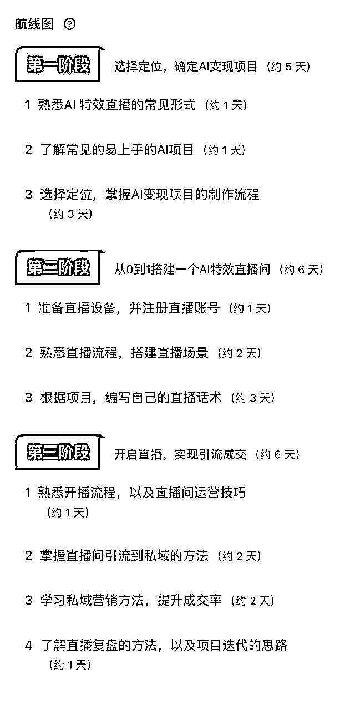


# 必修篇

# 一、零基础搭出一间 AI 特效开播空间

这次聚焦的 AI 特效开播，主要分两块：

1、开播全链路：覆盖【开播空间搭建—>账号准备—>画面与口播—>拉流量—>看数据—>导私域】。目的是让新手和老玩家熟悉平台开播要求，快速冷启动，为后续项目打底。开播是大趋势，竞争加剧后门槛可能抬高，早进场就是优势。

2、AI 项目实操：覆盖【需求沟通—>成品交付—>订单成交】，具体有 AI 老照片动起来、AI 写真换脸、AI 宝宝走秀、AI 赛博机车、AI 头像壁纸号等多个方向。目的是帮新手和老玩家挑到合适品类去变现，案例如下：


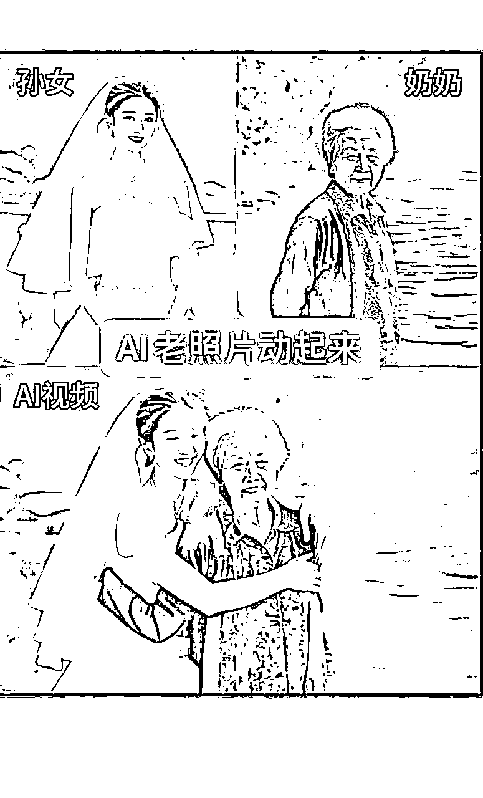

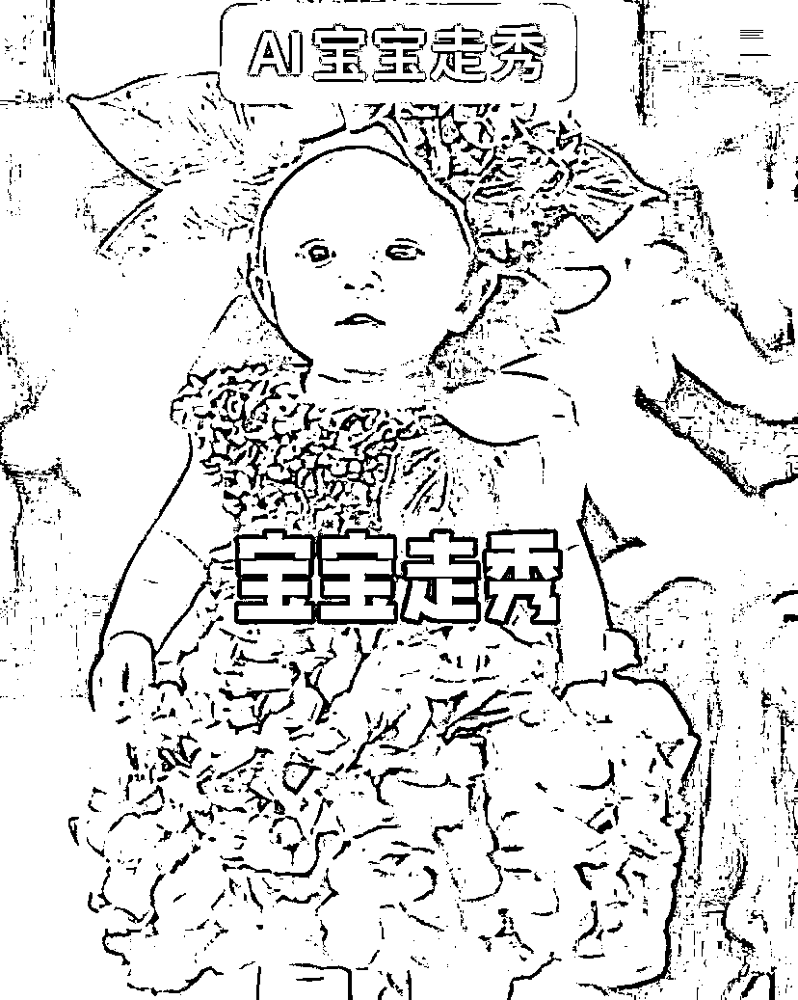

# 2.1 把开播间的底层搭稳

# 💡

本节导读

欢迎进入基础搭建部分。无论你是第一次开播，还是想提升现有画面效果，这一节都会帮你把底层打稳。下面从零拆解一间专业 AI 特效开播空间怎么搭。

开播已经是互联网里的常规场景，AI 特效玩法又带来了新机会。但只靠创意不够，搭建环节必须逐个掌握。

接下来会带你走完器材选择与调校、账号准备与维护、画面布置、口播脚本、场控。每个环节都关键，合在一起才是成功开播间的底座。

学完本节，你应能做到：

1. 判断哪套器材适合自己
2. 弄懂平台注册与维护规则
3. 会布置开播画面
4. 会准备能留住人的口播内容
5. 懂场控的实际操作

开始吧！

# 2.1.1 开播硬件怎么备

这次对器材要求不高。多数船员是第一次播，前期先跑通从 0 到 1，采购原则是够用就好，不必一次性配齐高配。

# 2.1.1.1 采购明细

硬件部分

电脑：台机、笔记本均可，承担直播伴侣推流。

画面采集：单反、网络摄像头、手机都行；手机可装无他相机当摄像头。

纯色幕布：按需选配，打算抠像就备。

照明：不是必买项。追求更清晰画质可加，100 瓦够用。别选球形灯罩，那个通常打背景；应选直射式深抛柔光箱。

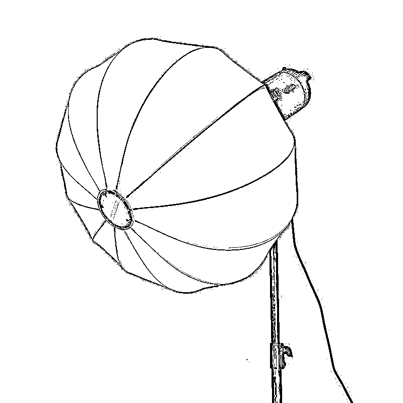

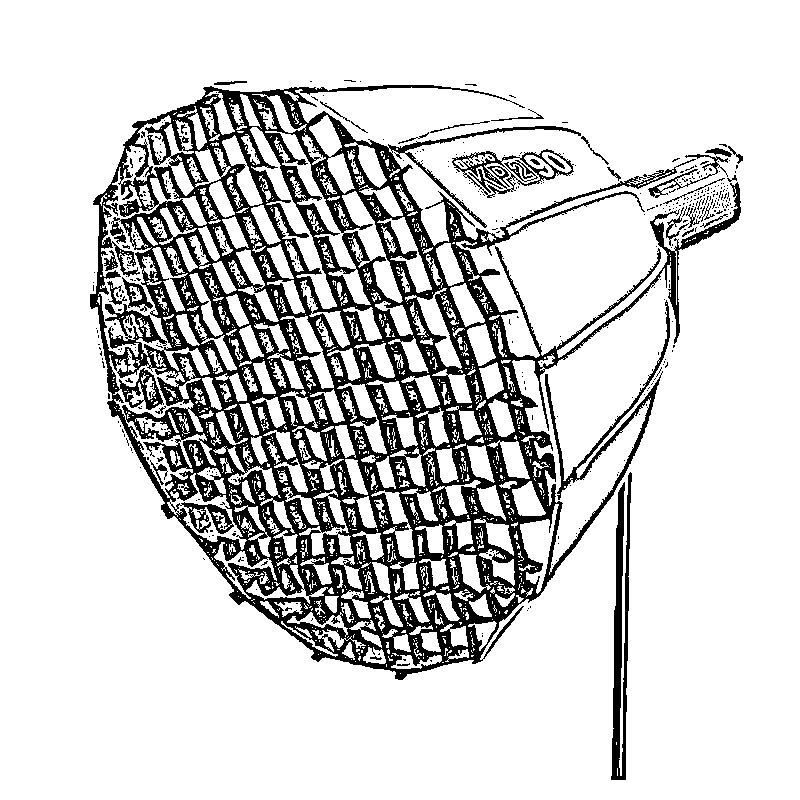

要装的程序

内容有时效，后续使用建议直接去官网下最新版：

抖音直播伴侣

OBS

无他伴侣（手机当摄像头时用）


# 2.1.1.1 器材调校

AI 特效开播的常见画面，是电脑播放视频，再叠加个人绿幕背景。

硬件上，只要出镜，不管用不用绿幕，都要重视打光。

新手不必一上来搞很专业，一盏灯也能开播。手头有设备再考虑双灯或三灯：

只有一盏补光灯：放在前方，直射出镜人即可。

有两盏补光灯：左右前各 45 度摆灯，形成三角光位。

灯更多：可拿一盏球灯当背景灯，把绿幕打亮，整体效果会更好。

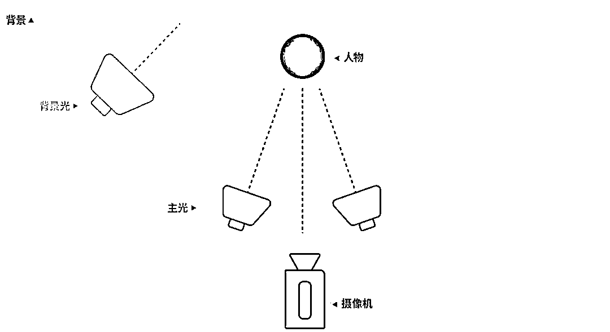


# 2.1.2 开播账号怎么备

入门特效开播，目前建议抖音和视频号。两个平台开播流量都不小，适合导流成交。抖音流量更大、人群更精准；有余力可两台手机双平台同时播，精力不够就优先抖音。

新手建议备两只账号跑流程。玩法本身踩线点不算大，但涉及教学和导流，开播经验不足时，一两个风险词没注意就可能被封 3-7 天。两只账号能互为备份：一只出问题，另一只直接顶上。也可以一只先练手，练熟后再用新号起号，降低首次开播的焦虑。

# 2.1.2.1 抖音侧账号

我们不卖货、不开橱窗，账号准备相对简单；但开播画面较复杂，建议用直播伴侣开播。核心就是满足直播伴侣的开播条件。

抖音直播伴侣开播条件：

普通用户/企业用户

手机上能正常开播

单平台粉丝数>=1000（抖音满 1000 粉，或火山满 1000 粉；抖音+火山合计到 1000 粉不能申请开播权限）

近 14 天无违规

媒体政务不支持伴侣开播

最难的是 1000 粉。涨够 1000 粉有 3 条路：

1. 自己发涨粉视频
2. 找专业人士刷千粉
3. 自己用千川投放涨粉

千川投放涨粉的详细教程（视频不保证时效性，仅供参考）.mp4【在线播放】


# 2.1.2.2 视频号侧账号

已有🛰️账号能直接开视频号；数量不够，就注册新🛰️号。

开视频号的🛰️号要完成实名，入口在🛰️—我—服务—钱包—实名认证。目前一张身份证最多绑 5 个🛰️号。


# 2.2.2.3 账号门面三件事

基础建设三件套：头像图、昵称、简介短片。

头像

按个人喜好来，有 AI 感更好。但别用好物推荐、露身体/胸/背、产品主图这类踩雷头像。

昵称

如“xx 讲 AI”“xx 老照片修复”等。有个性、符合 SEO 特性的名称最好。营销味别太重，切记别用“xx 好物推荐”“xx 好物分享”。

简介短片

可以放一段自我介绍，不必高大上，质朴打动人最好。可以直接留🛰️名，懂的都懂，但别明示，如 vx:xxxxxx、🌏号 xxxxx 等；也不要写“私信”“后台”等风险词。


# 2.2.2.3 新号先养一养

很多人把养号说成玄学，但按我的经验并不是。社交软件后台开发都会考虑僵尸用户，所以注册后建议先做一轮日常行为再开播，能在一定程度上降低开播被风控、完全没流量的概率。

养号基本动作：

1. 完善头像、昵称；视频号如果用新🛰️，也要完善🛰️头像和名字。
2. 视频号：加 3 个好友，互发几条消息，给好友打 1 分钟语音电话，发一条朋友圈，给 2 个好友各收或发一个红包。
3. 每天在抖音/视频号上模拟真实用户正常使用至少 1 小时：刷 30 分钟视频、看 30 分钟直播，期间做点赞、关注、加粉丝灯牌、点直播商品等常见动作；有条件可开通账号支付功能。这一步建议至少操作 2～3 天。


# 2.1.3 开播画面怎么布置

# 2.1.3.1 可参考的画面样式

RPReplay_Final1725096729.mp4【在线播放】

RPReplay_Final1725096884.mp4【在线播放】

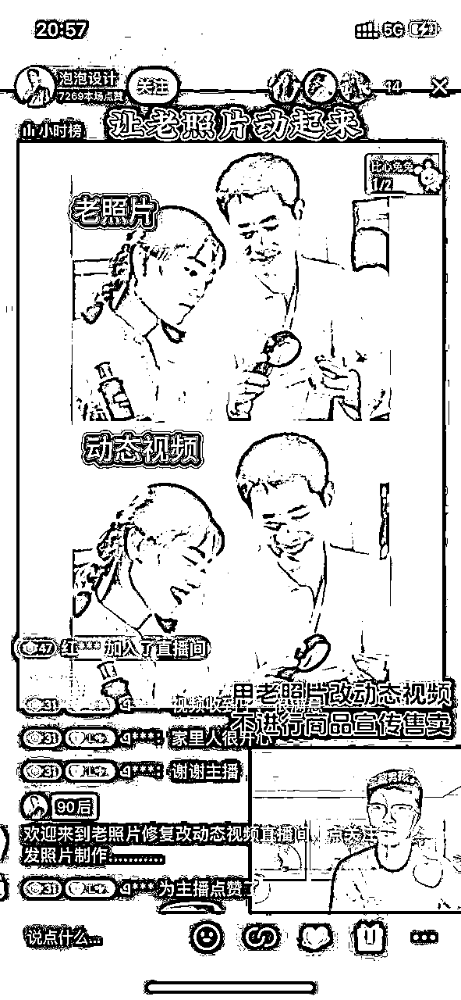

以上都是常见的 AI 特效开播画面。画面通常分两块：一块放结果演示或电脑投屏，容易让人停下来看；一块给主播露脸讲解，增加信任感和转化率。这种画面搭建不难，但需要电脑开播，具体方法下一节讲。

# 2.1.3.2 用直播伴侣布景

软件下载：https://streamingtool.douyin.com/

点开播若提示“账号未认证”，先去抖音 APP 播一次完成实名：进“视频直播”开一下，时间不限，开了马上关也行，然后再回电脑端开播。

点这里，观看直播间搭建操作视频👉 https://lean-trade.feishu.cn/minutes/obcnja6kba7lr1beap4zex3x


# 2.1.3.3 OBS + 视频号直播助手布景

1. 用电脑🛰️登录，点左下角“三横”菜单，找到视频号直播工具并启动。

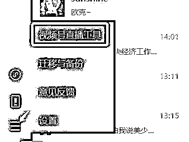

pc 版🛰️，不支持 mac 系统

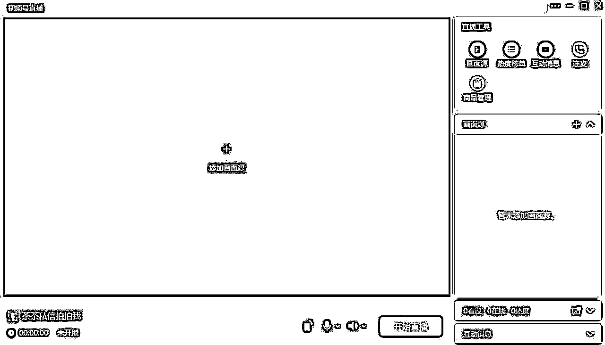

启动成功如上图所示

2. 添加画面源：可选摄像头（无他相机或 OBS 虚拟摄像头），也可选窗口采集（音乐播放器、音视频等各种窗口）。

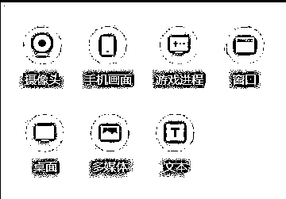

3. 顶部第一个按钮切横/竖屏；麦克风入口在下拉箭头里选设备；扬声器通常保持默认即可。

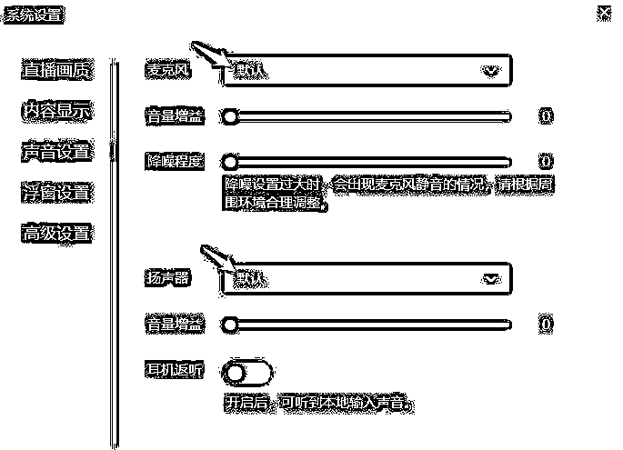

4. 点开始直播，会弹出对话框。更换直播封面、填写本场主题、选择“教学-其他”，再点开始直播。


5. 开播后，“看过”代表本场场观，显示在线观众名称；“热度”表示送礼观众和礼物数量。

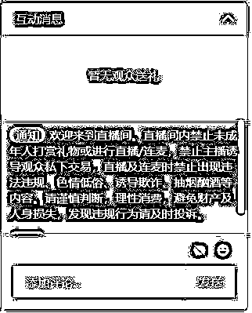

6. 开播后会显示弹幕评论，可在评论区和观众互动，也能置顶、拉黑、禁言。

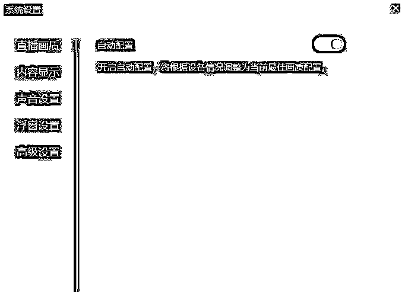

7. 综合设置里可看到商品管理、开启送礼物、帮助、设置、检查更新及意见反馈。

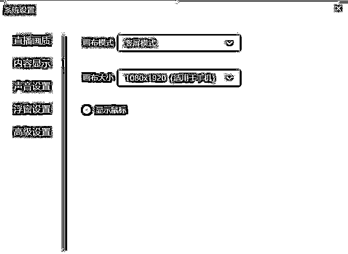

8. 点设置后，能看到直播画质设置、内容显示（横竖屏模式与画布大小）、声音设置、浮窗设置以及高级设置。

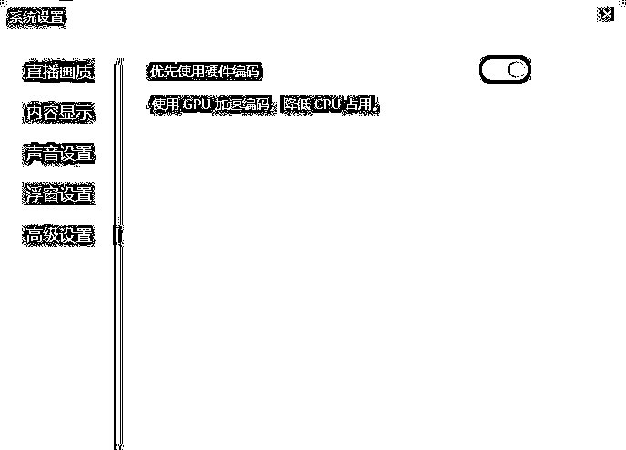


# 2.1.4 口播脚本怎么准备

开播经验不足时，最简单的办法是录制同行成熟口播，再在此基础上优化改写。

这样做有两个好处：

1. 同行的表达经过市场检验。别人能用它拉到高在线，说明逻辑思路大体没问题。前期使用能减少变量，把更多精力放在表现力和细节处理上。
2. 各平台对表达要求都严，稍不注意说错风险词就容易踩线。同行能正常播，说明敏感词处理较到位；关键节点比如导流话术，可以参考同行做法，降低试错成本。

# 2.1.4.1 怎样采集同行口播

开播录制

录屏工具多、更新也快，手册里只推荐小绿点，相对长期稳定。你有更好的工具也可以用。

直播录屏神器小绿点使用教程.mp4【在线播放】

# 2.1.4.2 常见口播套路

我们录了几个 AI 特效开播回放，你可以参考他们的内容做表达优化迭代。

点右上角分享按钮，选择在浏览器中打开，可在飞书妙记查看文字版话术。

特效直播间回放 01 👉 https://lean-trade.feishu.cn/minutes/obcnidlpj8831h5znket9i84

特效直播间回放 02 👉https://lean-trade.feishu.cn/minutes/obcnexupuh14k74g5doj94g9

目前常见表达有两种：循环成交型、半教学型。

循环成交型可参考手册里小艺-ai 老照片的话术，核心逻辑是观众互动-介绍项目-导流。5-10 分钟一个循环，根据用户互动情况调整每段长度。

这种表达比较简单，适合新手。本质还是靠旧照特效视频画面吸引人，用户进演播室后直接做转化，言简意赅说明玩法优势。有观众提问就点对点互动。项目介绍要简洁明了，别堆废话。

半教学型可参考手册里慧慧聊 AI 的话术，整体逻辑是稍微详细讲玩法实现思路，营造专业人设，再导流。

半教学型适合后端知识类交付，而不是具体玩法实现的演播室。演播室教学本身就是“钩子”。设计上主要分两块：干货部分和导流部分。导流可以放在干货中间，因为干货还没讲完，这时候导流不容易导致大量观众流失。干货节奏可快一点，知识点密一些，参考 2.3.2 的内容优化技巧，根据数据流速不断调整，拉长有吸引力的部分，更容易提高留存，把场里流量拉高。

# 2.2 正式开播

# 💡

本节导读

基础搭建完成后，就要正式开播了。这一节帮你迈出第一步，为开播玩法打底。

第一次开播紧张很正常，每个成功主播都经历过。本节就是帮你跨过初始障碍，建立信心和热情。

接下来会讲几个关键方面：

了解账号权重机制，建立良好开播心态

设计适合自己的开播计划

新手开播如何起号

起号成功后如何继续提升

如何做好场控

学完本节，你应能做到：

理解平台推荐机制，避开常见新手坑

制定适合自己的开播策略和计划

掌握吸引观众、提高互动的技巧

学会分析和优化开播表现

熟练运用场控技巧，提升开播质量

记住，开播是持续学习和进步的过程。别因初期挫折气馁，保持耐心和持续努力，你终会在开播领域发光。

# 2.2.1 摸清权重规则，稳住心态

正式开播前，先建立客观预期：刚开播的前几场，甚至前十几场，场里很可能没人，只有个位数在线，这很正常。

原因有两个：

1. 开播能力还不够，数据比拼不占优，拿不到流量。
2. 账号权重偏低，系统不推人。

第一种情况，很多人刚接触开播，能力和经验都是新手级别。跟老主播竞争时往往没优势，数据比拼赛不过更有经验的人，初期很正常。解决办法只有多练。理论再多、教练再有经验，技能提升也得靠练习积累。就连库里这种历史级射手，也要日复一日投进 3000 球来维持手感。

建议航海期间每天至少播 2 小时，每小时 1 场，共 2 场。经过约 30 小时基础经验积累，才能度过新手期：知道开播是什么体验，不再慌张，能把脑中思考流畅表达出来。开播能力熟练后，就能驾轻就熟，把更多精力放到运营上。

第二种情况，新号开播时，系统作为大数据平台，并不知道你的目标客户是谁、你播得怎么样。所以前期推流不大、也不精准，这是每个新号都要经历的阶段。很多拿到过大结果的优秀主播，起新号时同样会遇到这样的问题。

起号说到底是两条路，终点却一样。第一条靠自然流量慢慢养：刚开播观众不多，先把每一波进来的人接稳，用留存和互动证明直播间有承接力，再从中辨认出真正愿意买单的目标客户，平台就会逐渐摸清你的受众标签。连着几场指标往上走，账号权重便水涨船高。第二条靠付费流量催熟：直接采买相对精准的观看人群，借他们把数据撑起来，让系统更快校准直播间画像，起号周期因此缩短。

但不管选哪条，最终都取决于主播的承接功夫。航海期间别求快，稳住心态，用笨办法打慢仗，每场都认真对待，体会流量起伏，事后拆解得失，属于你的直播正轨很快会出现。

# 2.2.2 直播节奏怎么排

大部分船员第一次接触直播，这里先给一份可参照的节奏表。每个人要结合自己直播间的数据反馈，及时判断当下处在哪个目标阶段，再调整复盘和准备的重心。

第1至5天是起号期，目标是让账号正常获得推流、拿到基础权重。数据上要够到：每小时观看量150+、同时在线10人，并且能出单。这个阶段抓三件事——找到直播感觉，心态稳得住、不再慌乱；吃透直播内容，把脚本话术说顺；摸清观众常问的问题，做到从容应答。

第5至15天进入破层级期，目标是完成初步起号，手头有一批相对精准的观众，能稳定把流量导进私域完成成交。数据上要够到：每小时观看量300+、同时在线20人、每场引流10人。这个阶段的重心是——弄懂推流逻辑，会做数据分析和复盘；能针对直播间的毛病动手改进，持续打磨话术；在直播中有意识地经营数据。

第15天往后是稳号期，此时流量已经比较稳，每场都能成功引流，数据也在往上爬。数据上要够到：每小时观看量800+、同时在线50人、每场引流50人。这个阶段的重心是——主播水平稳步提升，每场都能稳定发挥、吸引到精准受众；看得懂实时流量图，并能依据数据随时调整直播节奏。

# 2.2.3 新号开播：冷场期怎么破

新号刚开播，流量少是常态，这个阶段要把逐个点名交流和主动索要数据当成头等大事。

前期人不多，先集中精力练内容，把内容播好。有观众愿意互动，就适当多聊几句，让精准用户在直播间多待一会儿，帮我们攒数据，起号便会慢慢发生。流量少的时候，少做导流动作，多讲干货，加快直播节奏、提高内容密度，尽量减少任何可能导致客户流失的举动。一旦发现流量突然往上蹿，务必马上调整状态，把这波急速流接稳；急速流接住了，直播间的流量闸门就有可能真正打开。

如果直播间持续有推流，可以适当拉长直播时间，视频号尤其如此，只要还有进人速度就别轻易下播。若每分钟进人低于5人且持续半小时以上，可以考虑下播；若每分钟进人长期在1—3人，说明自然流基本枯竭，建议下播。隔半小时可以再开一场，通常每场直播都会有一定的初始推流，尝试再利用初始推流把数据做起来。

# 2.2.4 起号之后：稳住流量

起号成功以后，直播间同时在线一般在30人以上。此时如果逐个点名交流做得过多，其他没被点到的观众容易觉得内容缺少重点，进而划走。所以这个阶段不宜做太多个别喊话，除非提问者问的是受众普遍关心的问题，可以重点展开；否则一笔带过，甚至可以不回应。

稳流量阶段，要多看直播曲线图，多留意进人速度的变化。进人速度持续上涨时，务必专注，保持好状态把流量往上推，同时盯住数据，别忘了及时导流。进人速度下降时，则提高干货密度，不断放出诱饵来做驻留数据。

每天复盘时要重点做内容复盘，弄清楚哪些内容吸引人、哪些内容掉人。后面直播时如果人掉得较快，可以考虑切换到更吸引人的内容上去讲，持续控制进人速度，让它保持稳定，避免掉层级。

起号成功以后，不要等到直播间完全没人再下播。观察开播急速流的大小，当前进人速度低于开播急速流的20%时，可以考虑下播，让本场数据层级不至于下跌得太严重。

# 2.2.5 直播中控

# 2.2.5.1 中控到底管什么

如果只有一个人直播，开播时还要兼顾中控，难度确实不小。但安排得当，单人也能把直播间运营得很出色。中控通常要承担这些工作：直播间基础设置、发福袋、置顶优质评论、用辅助号带节奏、协助主播导流。其中最关键的是第4项和第5项。

# 2.2.5.2 单人也能搞定中控

1. 直播间基础设置

a. 提前配置好直播间的屏蔽词。

b. 把观众信息设置为不可见。

2. 如何简单做气氛号

a. 准备1—2台不用于直播的手机来充当辅助号。

b. 提前规划好需要辅助号提问或带节奏的时间节点。

c. 用搜狗输入法或讯飞输入法，把要发送的内容设为常用语存进输入法。

d. 直播时调出输入法的常用语功能，就能快速完成辅助号任务。

3. 主播导流

a. 导流用主播账号即可，主要目的是引导用户进入抖音聊天群。

b. 在电脑端提前把导流话术准备好，复制到粘贴板。

c. 在直播伴侣或视频号直播助手中直接粘贴话术，及时发送出去即可。


# 2.3 直播间流量从哪来

# 💡

章节概要

在直播平台上，算法对流量分配起着决定性作用。弄懂算法如何运转，并学会与它“共舞”，是大家成功的关键。本章会深入讨论数据赛马机制，教你如何解读并利用各类数据指标来优化直播策略。

本章聚焦几个核心内容：直播数据的查看与解读；关键数据指标的分析和应用；提升直播间数据的实用技巧；有效的直播数据复盘方法。学完本章，你应当能够熟练使用各平台的数据分析工具，理解并运用关键数据指标来指导你的直播，掌握多种提升直播间数据的手段，建立科学的数据复盘习惯并持续优化直播。

请记住，获取流量并非一蹴而就的事，需要持续学习和调整。只要方法正确，再加上耐心与毅力，你一定能在直播领域找到属于自己的天地。

当前主流直播平台，无论是抖音、快手还是视频号，都采用数据赛马机制：直播间数据越漂亮，后续平台推送的流量就越多。因此运营和主播都要学会理解直播数据，并根据反馈调整直播间的内容与节奏。

# 2.3.1 数据入口在哪

抖音：如果是不带货的引流直播间，可以访问直播服务平台，登录后查看直播数据。直播大屏菜单可查看当前正在直播的数据；直播复盘与直播数据菜单可查看往期数据分析。如果是带货直播间，需要先开通商品橱窗，再用电脑登录巨量百应平台查看数据。

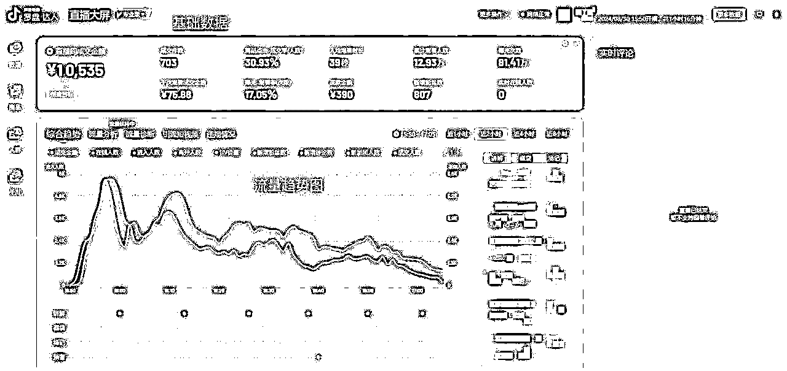

视频号：用电脑登录视频号直播助手查看直播数据。菜单路径是“直播—直播管理”。如果正在直播，点击右上角“进入直播间”按钮，就能查看当前直播数据。

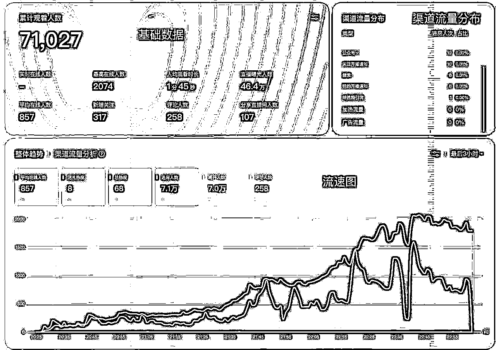


# 2.3.2 几个必懂的数据

场观与在线：这是直播间最基础的数据。通俗地说，就是每场直播有多少人看过我们，以及此刻有多少人正在看。场观要尽早建立一个概念：每小时观看量。每场直播时长不一样，单比场观没有意义，用场观除以直播时长就是每小时观看量，可以理解为“播效”。

曝光进入率：平台会把直播间推送给用户，用户点击进入后才成为观众。用场观人数/曝光人数×100%，就是曝光进入率。不同赛道差异较大，和受众、直播形式有关，一般来说10%—60%都算正常。

进人速度：指直播间每分钟能进多少人。假设平均每分钟进10人，每小时观看量就是10×60=600人，进人速度直接决定场观。直播时应该重点关注进人速度，而不是平均在线，因为平均在线本质上由进人速度和人均驻留时间决定。

人均驻留时间：指直播间平均每个观众停留多长时间。驻留时间是很重要的浅层数据，也是重要的赛马指标。一般来说，同一类直播间里，人均驻留越久，系统推流越大、越精准。所以做知识付费直播间时，要千方百计拉长人均驻留：让更多用户在直播间停得更久，流量就会更大。

互动比例：直播间互动一般包括评论、刷礼物、关注、加粉丝灯牌。抖音直播中，加粉丝灯牌对赛马权重较高，要重点做，其次是关注。互动比例也是影响直播流量的重要指标，通常互动比例越高，流量越大。

# 2.3.3 做数据的几个巧劲

下面分享一些知识付费直播间的小技巧，能有效帮助提高直播间数据，更容易快速起号。注意，这些方法主要适用于干货教学直播间，不适用于所有直播间，比如带货直播间。

# 2.3.3.1 逐个点名聊

刚开播时，直播间在线可能只有个位数，去掉几个系统机器人，实际可能只有两三个人，这很正常。虽然人少，但我们的赛马对手同样也是没人气的直播间。如果能让直播间仅有的几个人帮忙做数据，就很容易提高推流层级。

前期没人时，最好的办法就是逐个点名交流。和每个进入直播间的人单独对话，可以大幅提高真实用户互动比例和驻留时间，是直播间人数少时最有效的索要数据手段。举例来说，直播间正在讲AI干货，这时张三和李四进来了，我们在互动大屏看到在线用户数据后，可以直接问：“张三之前有没有做过这个项目？”“刚才我讲的，李四听明白了吗？没听明白可以直接在公屏提问。”逐个点名交流的对象可以是刚进直播间的人，也可以是停留很久的人。用户不回复也很正常，不要因为一两次没人回应就放弃，前期人少时一定要多尝试点名拉数据。

# 2.3.3.2 敢开口要数据

我们做的是教学型直播间，是以“老师”的身份直播。所以直播时要有自信、有气场，不要唯唯诺诺、过于谦虚，否则不容易吸引用户停留。同时也要大胆给用户提要求、索要数据。比如用户提问，如果直播间人不多，可以先回答，然后说：“这里听明白的给我点个关注、加个粉丝灯牌，有其他问题也可以继续问。”如果在线大于30人，有用户提问，可以说：“想提问的先给我点亮灯牌再问，现在提问的比较多，我肯定优先回答粉丝的问题。”“xxx问的这个问题很好，你先加个粉丝灯牌，我告诉你怎么做。”有经验的干货分享主播和没经验的主播，差距往往就在有没有养成索要数据的习惯。会要数据的主播，起号速度通常更快。

# 2.3.3.3 把甜头放前头

内容直播间往往由吸引人的内容和不那么吸引人的内容组合而成，不可能一场直播全程高潮。那么讲“不那么吸引人的内容”时，怎么让观众继续停留？办法就是提前把有吸引力的内容抛出来，让大家有期待，从而在直播间停得更久。比如：“我先给大家讲一下xxx这里，刚才不是有好多同学想学yyy吗，过1分钟后咱们就开始讲。”“过会有个福利给到大家，讲完这里就发，大家可以猜一下是啥，待会很快给大家发。”实际上xxx可能讲10分钟，但不用在意，要学会用利益诱导做数据。

# 2.3.3.4 好货压轴讲

直播内容里，有些话题天然吸引人。讲这些“天然留人”的话题时，要把握好节奏，不要讲太快。在有吸引力的话题上多“磨蹭”，多“说些闲话”，可以叫“讲细一点”。讲干货前也可以多加一些前戏，多让观众互动，比如：“我给大家讲一下真正的干货，讲之前先问一下，大家做xxx的时候，是先做a还是先做b？”因为大家都着急听干货，这时互动比例会比较高，同时在互动过程中也潜意识完成了驻留。千万不要着急把吸引人的内容快速讲完，也不要怕被观众骂“太磨蹭”。如果真的怕被骂，可以提前把“太慢”“磨蹭”“快点”“赶紧”等内容设为屏蔽词。


# 2.3.4 复盘该盯什么

想做好直播，一定要养成复盘习惯，在每场直播中找问题并提高。但直播复盘需要较丰富的运营经验，本期航海不会讲太专业复杂的数据复盘流程，而是分享几个重点关注的基本认知，先帮大家建立基础复盘思维。直播新人复盘时，可以先重点思考这几件事：

1. 我们播得有没有硬伤？硬伤从两方面检查。首先听回放，从观众角度听“我们播得是否舒服”，包括语速是不是过快或过慢、发音是否清晰、话术是否熟练、是否经常磕绊、有没有口头语。这些问题99%的新人主播都会有，解决方法无他，就是刻意练习。其次是看数据，前期重点看驻留时间和关注比例。驻留时间低于1分钟，要么内容太不吸引人，要么播得太差，这个问题一定要复盘并针对性解决，解决之前不要盲目继续重复直播。关注比例低于2%，说明索要数据能力太差，也要尽快解决。如果这两个数据达标，说明直播间至少及格，再去重点复盘其他内容。

2. 这一场的数据相比上一场有没有提高？每场直播后，都要对比过去两场的数据，主要目的是复盘“我们做的调整是否有效果”。重点对比场观、最高进人速度、最高在线、驻留时间、关注人数。如果数据偏差在5%以内，基本可以认为两场数据一致、没有变化；如果本场相比上一场明显提高，说明调整有效，继续保持并优化，做到每场递增，很大可能起号成功；如果某项数据明显降低，就要分析问题所在。

3. 这一场直播有没有异常数据，为什么？检查每场是否存在异常数据，比如突然走了一批人、曝光进入率大幅提高或降低、驻留时间变化较大。如果在复盘时发现这类问题，一定要重视，这种异常点往往是优化和调整的关键。复盘异常数据时，要结合直播回放去看，重点思考直播间播了什么内容导致异常。直播数据本质上是直播内容的映射，反映了内容对观众的影响。养成分析异常数据的习惯，直播能力提高会非常快。

4. 这场直播中，哪部分内容吸引人，哪部分非常不吸引人？我们做的是内容直播间，大多数时候是干货分享，所以直播间内容设计非常重要。一开始不知道什么内容好、什么内容不好，只能凭经验写个大概脚本然后开播。所以前期直播时，及时复盘并优化内容很重要。每场直播结束，重点看直播曲线，分析哪里吸引人——“讲这个内容时观众都不走了”，哪里不吸引人——“讲这个内容时大量离开”。怎么找呢？看直播进人曲线图，打开推流曲线和离开曲线，寻找推流曲线持续高于离开曲线的部分，说明这段内容或话题非常吸引人，大家都愿意多看；离开曲线突然急速猛增的部分，说明这里大家都不想停，一下子都走了。


每场直播分析出哪里留人、哪里掉人，后面直播时就可以针对性优化。掉人的内容，优化结构或者提前抛诱饵；留人的内容，继续丰富或者把核心内容往后放。几场之后，直播内容就会变得非常能打。


# 2.4 把观众引到私域

# 💡

章节概要

现阶段平台对知识付费类直播间和AI赛道的管控都比较严格，把商品或服务直接上架到后台售卖的难度较大，比较建议大家把用户引到私域进行转化。但在公域平台做私域导流同样容易违规。常见的私域导流方法有几种：一是在简介留🛰️；二是在直播间直接用话术或画面引导；三是先转化到平台自有粉丝群，再二次导流；四是使用官方引流组件。其中第4种最稳妥，但一般需要付费投流才可以使用。手册会根据抖音和视频号两大平台的特性，重点讲解其他三种方法。

# 2.4.1 抖音：怎么安全导流

抖音直播引流的两种推荐方式：一个是简介留联系方式，一个是引导到粉丝群后再引到私域。

简介留联系方式：部分账号可以在个人简介里直接添加🛰️号，但不能用过于直白的引导，比如“🛰️：xxxx”“🌏号：xxxx”等，很容易被系统检测屏蔽，或者被举报后违规。可以更委婉地表达，比如“合作xxxx”“交个朋友xxx”；也可以直接把🛰️号“xxx”放到最后一行，直播时引导“想链接我的可以看我主页简介最后一行”。

引导到粉丝群再引导私域：这是目前抖音上最建议的导流方法，也是我们主要用的方式。粉丝群导流分两步：第一步，在直播间引导观众加粉丝群；第二步，在粉丝群里告知客户如何加私域。在直播间引导客户加粉丝群时，不建议用话术直接诱导，很容易触发话术检测违规。比较好的方式是打印一张A4纸或KT板，上面手写“领资料（换行）加fen丝群”之类内容，正常观众一看就明白，但AI不好判断含义；准备导流时直接拿出牌子，用手指即可。也可以由运营使用小号在评论区做话术引导，这样直播号不会被处罚。客户引到粉丝群后，导流私域的话术处理不当仍然很容易违规。粉丝群导流常见方法有：运营小号发🛰️号、使用不容易被检测到的图片发🛰️号等。我们目前用得比较多的是主播在粉丝群里发语音直接引导，这样有效易懂，也不会被检测到。


# 2.4.2 视频号：导流别踩雷

视频号导流的两种常见方法：一个是简介留联系方式，一个是直播间直接引导。简介留联系方式的方法同抖音，不再赘述。需要注意的是，视频号目前对个人简介的检查比较严格。之前我们的直播账号被判“医疗引流”，封禁3天，但直播间并没有说违规内容，前后排查很久，才找到原因是简介里有“需要直播食谱可以私信我”，问题就在“私信”两个字。所以在个人简介中一定注意，不要出现明显的引导词。

直播场景里有个很实用的配合动作：主播在讲解间隙提醒一句“要链接的朋友盯一眼公屏”，运营这边用辅助号把主播🛰️发出来，并在公屏同步高亮置顶，这套组合往往能起效。另一种做法是准备一张手写🛰️号的 A4 纸或 KT 板，配合话术展示。视频号方面，二维码或🛰️号只要不是长时间挂在画面里，偶尔露一下，被判定导流违规的可能性并不高。

# 2.4.3 导流处罚与应对

如果导流方式不当，被平台技术手段识别，处罚通常包括禁言、账号限流、直播权限被关闭 3 到 7 天；情节严重的，可能长期甚至永久失去开播资格。遇到处罚可以申诉，但导流类问题容易复现、也容易留下证据，翻盘希望不大，只能当作碰碰运气。真被封禁，眼下没有更优解，3 到 7 天里要么停播，要么换号。所以建议手头至少留两三个备用账号，大号被限制时用小号接着播，尽量别让变现节奏断掉。


# 三、AI 项目变现实战

# 💡

**本章导读**

走到这里，直播基本功已经铺好。接下来要把镜头前的表达能力与 AI 工具接上，让技术真正变成收入。本章会拆解几个当下需求旺、可落地的 AI 项目，并讲清如何借直播完成获客与成交。

AI 正在重塑日常生活，也给内容创作者和创业者打开新的窗口。让旧照片动起来、生成风格化写真、制作萌趣的 AI 宝宝走秀视频，都是眼下有热度的方向。

本章重点拆解：

1. 老照片动起来
2. AI 写真
3. AI 宝宝走秀

每个项目都会覆盖：

- 项目说明
- 所需工具与资源
- 具体操作流程
- ……

学完本章，你将能：

- 做出多个热门 AI 项目
- 把 AI 能力嵌入直播流程
- 理解定价与市场需求
- 搭建自己的项目工作流
- 用直播获客并促成交易

技术本身只是工具，关键在于用它解决用户问题。保持创意，多试新玩法，你也能在这个成长中的市场里找到自己的位置。

# 3.1 老照片动起来项目 SOP

# 3.1.1 项目说明

老照片动起来表面看是一个完整项目，拆开后又可以变成多个小业务：修复加彩、AI 绘画工具落地、AI 短视频制作、可灵 AI 实操教学、剪映一对一陪跑等。怎么组合，取决于你的定位。

这个方向适合新手试水，能较快完成从内容到成交的闭环，靠短视频赚到第一笔钱；但流量天花板和竞争压力都在，想做大并不轻松。把它当成导流入口，再承接更高客单的产品也成立，前提是后端有能接住流量的高价值服务。


# 3.1.2 变现设计

底层逻辑是回应用户对旧人、旧物、旧时光的怀念，帮他们留住纪念，并为此提供方案和情绪价值。报价按制作要求与难度浮动，单份大致 9.9 到 99 元；案例和教程放在后面。

具体案例如下：

1. 老照片修复

发布修复前后对比、粉丝投稿案例来导流到私域，单张 9.9-49 元，按难度和精细度报价。若用户还要实体相册、相框、定制书签、信封等有仪式感的物件，可以适当加价。

常见题材：烈士、抗战老兵、证件照、全家福、毕业照、婚纱照、热门明星、历史人物、动漫角色、著作人物等自带流量的人物。

2. 老照片转视频

展示年代感照片，让画面里的人物开口说话或做互动，引导到私域成交，价格 19.9-99 元。

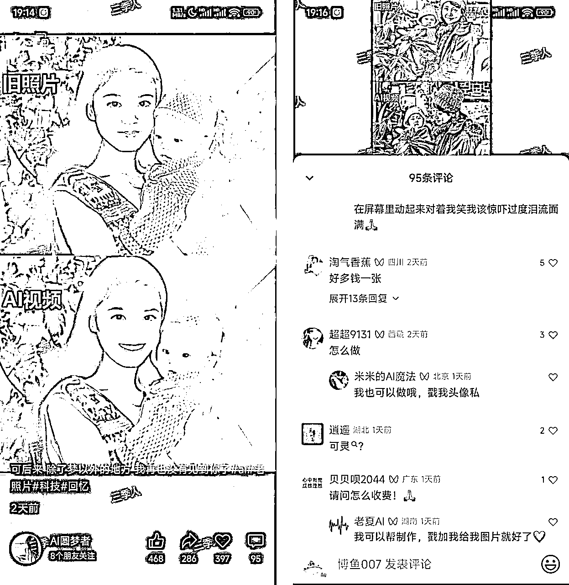

常见形式：回忆杀、照片复活、许久未见的亲人、老者语录、图片跳舞、打工喵、照片祝福视频、让照片唱歌、说唱、讲故事、说段子、一张图片跳舞等。

3. 照片变互动视频

展示两张合成图加互动视频，配上温馨故事、关怀问候对白、怀旧或经典音乐，以及用户案例。

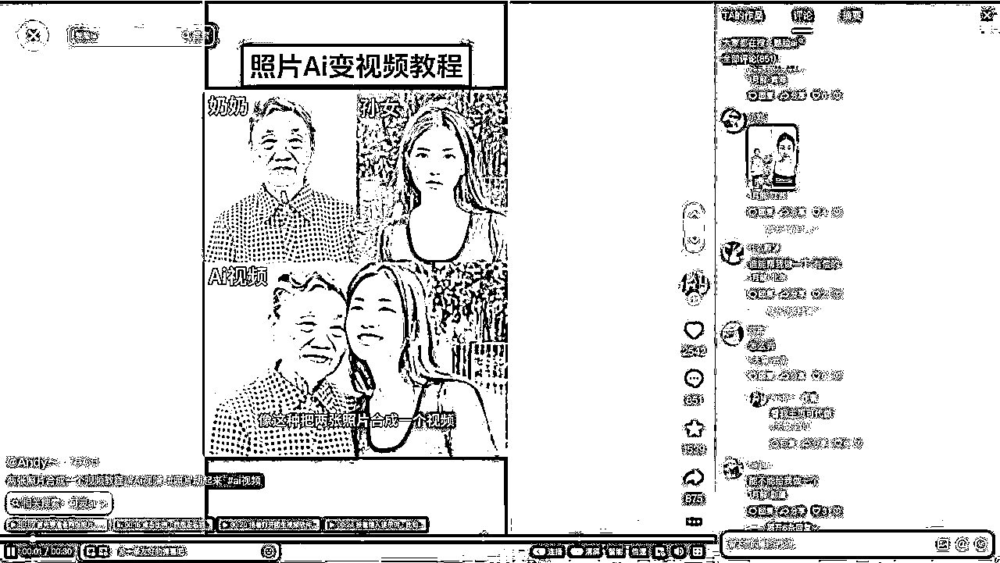

常见形式：穿越时空的拥抱、与偶像或亲人拥抱、我想你了奶奶/爷爷……

以上方式可以通过三条路走：

1. 公域开店，直播或短视频直接卖，转化快
2. 公域导到私域成交，方便复购和转介绍
3. 电商平台挂链接销售

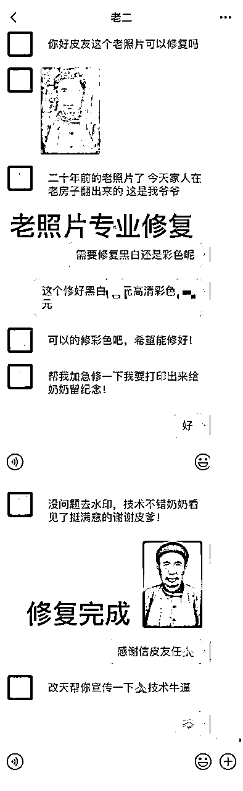

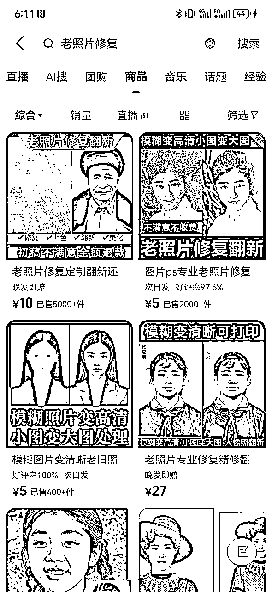

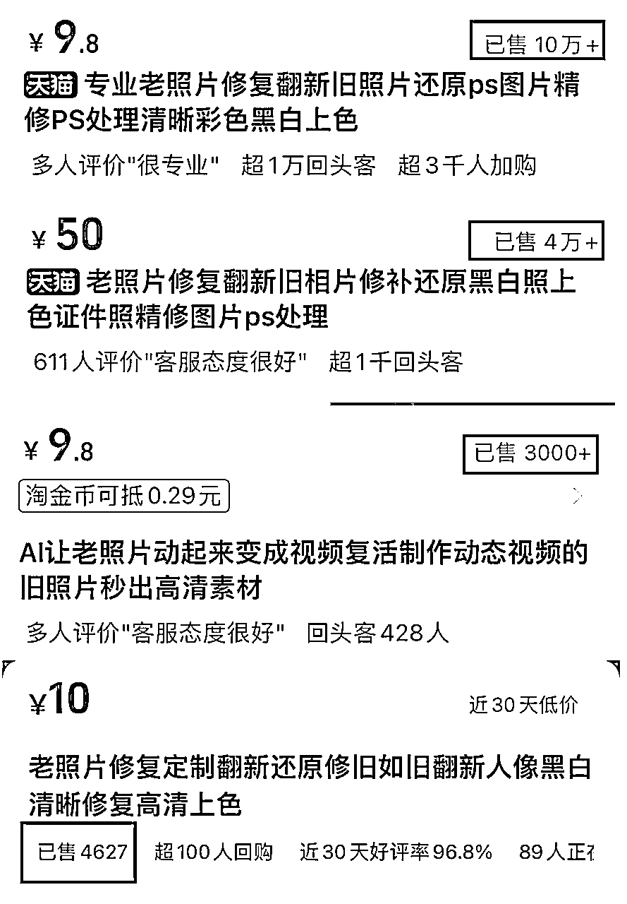

还能把照片打印或定制成实物寄给用户，提高客单和仪式感；把这套技术做成收徒、资料售卖、学完派单的链条，就能串成完整生意。

**同行参考账号**

- 抖音｜AI 情怀（收徒）｜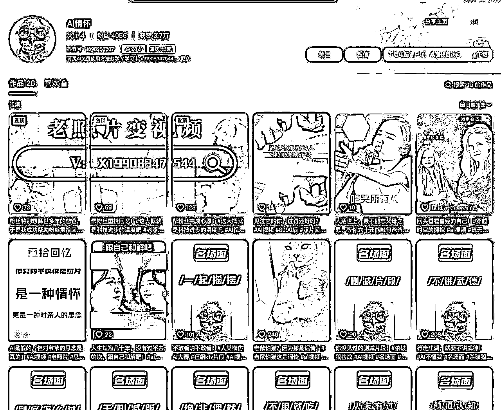｜https://v.douyin.com/ihBe6ymH/｜影视剧片段｜定制、教学、收徒
- 抖音｜老照片新故事｜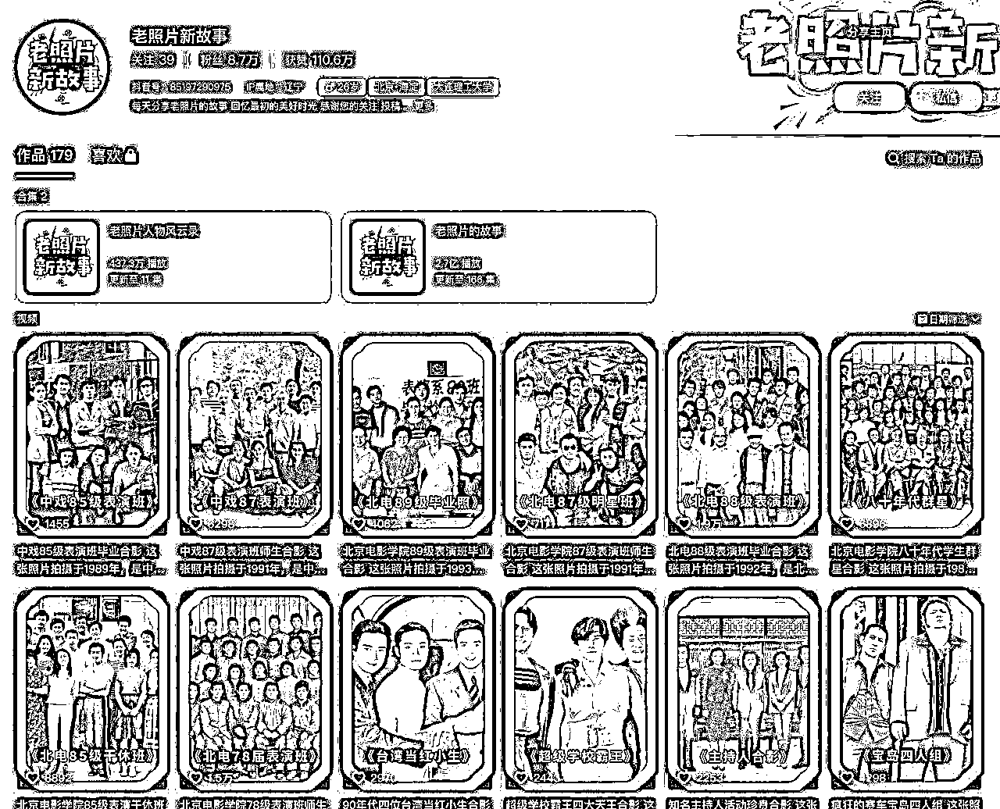｜https://v.douyin.com/iM9r19sj/｜集体照修复加故事讲述｜流量分成、广告、打赏
- 抖音｜AI 相馆🐶小檀｜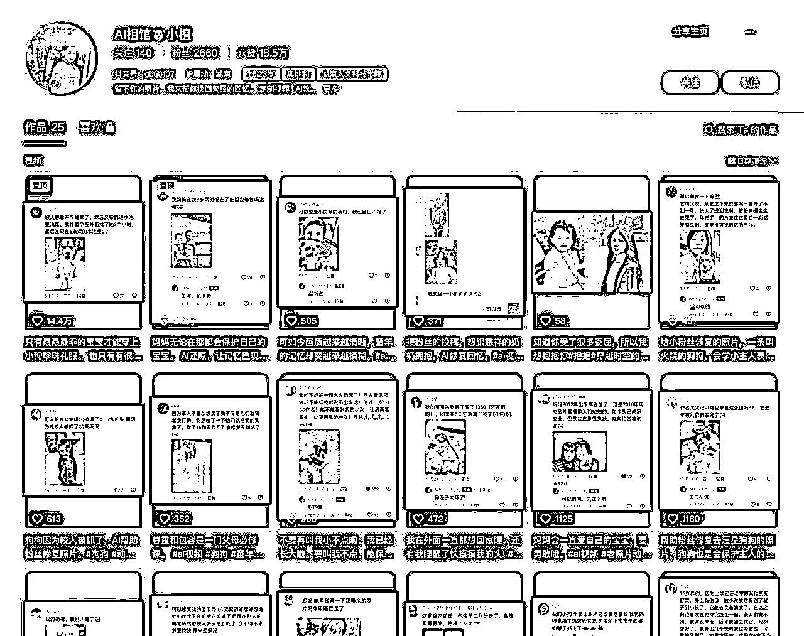｜https://v.douyin.com/iM96tVTg/｜粉丝来稿｜定制、教学
- 抖音｜Ai 奶爸黄希希｜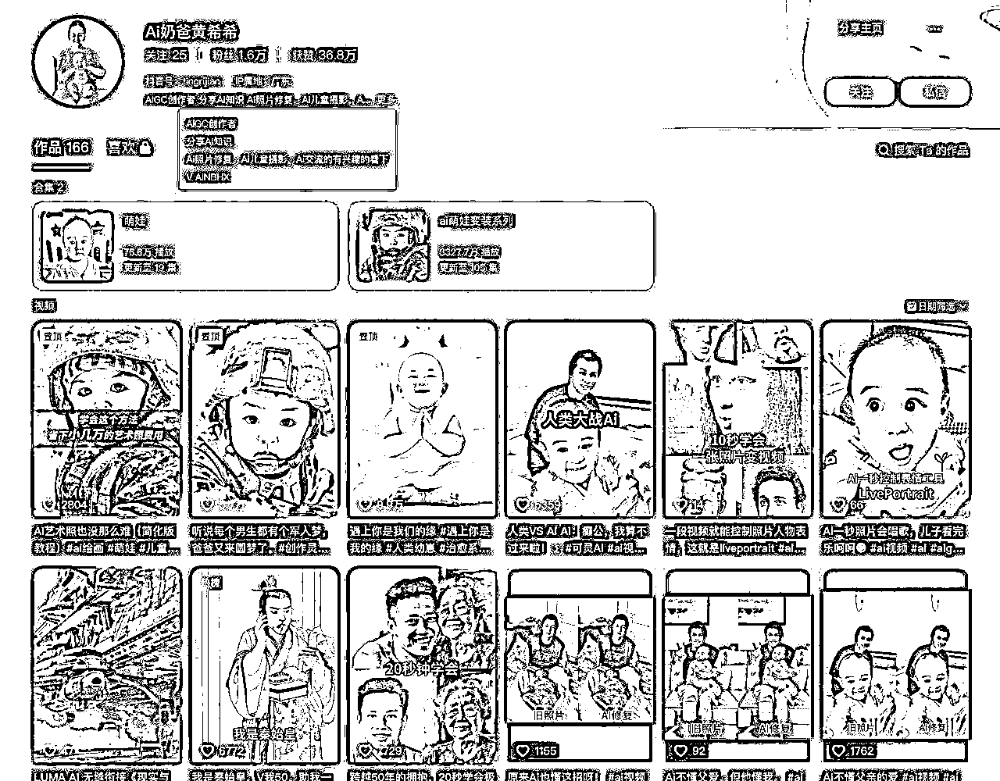｜https://v.douyin.com/iM9hFeYT/｜亲子照 AI 摄影与 AI 视频｜定制、教学
- 抖音｜TR 美术 认证徽章｜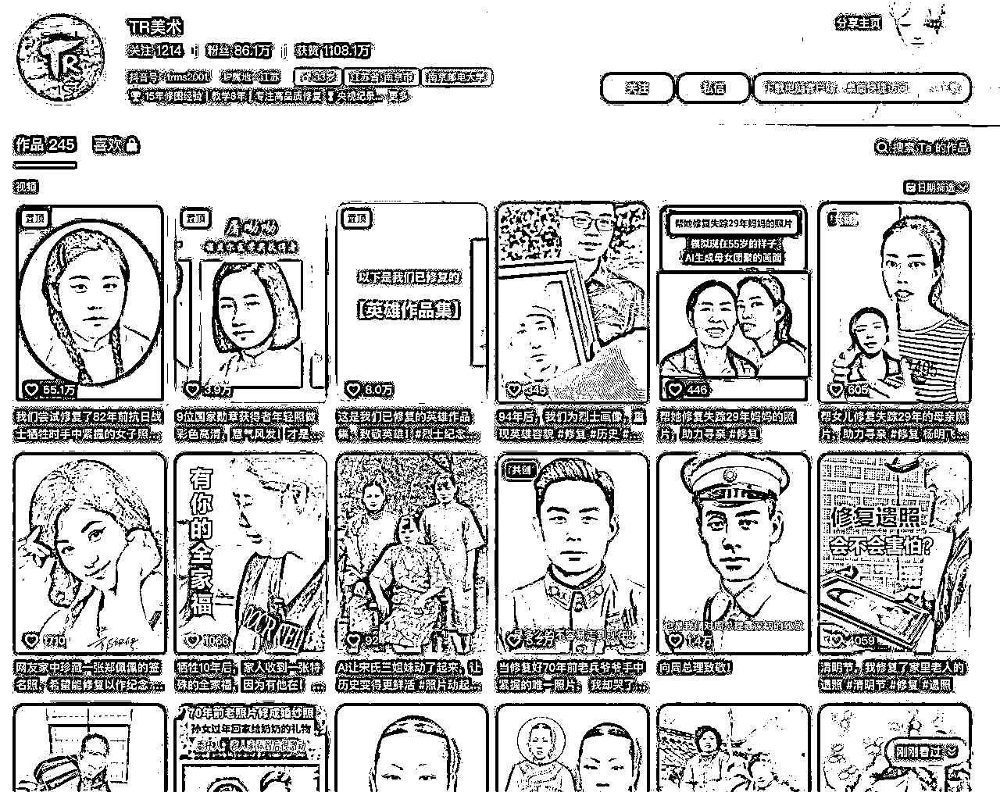｜https://v.douyin.com/ihBh5oA2/
- 抖音｜誉言 Aigc-研究所｜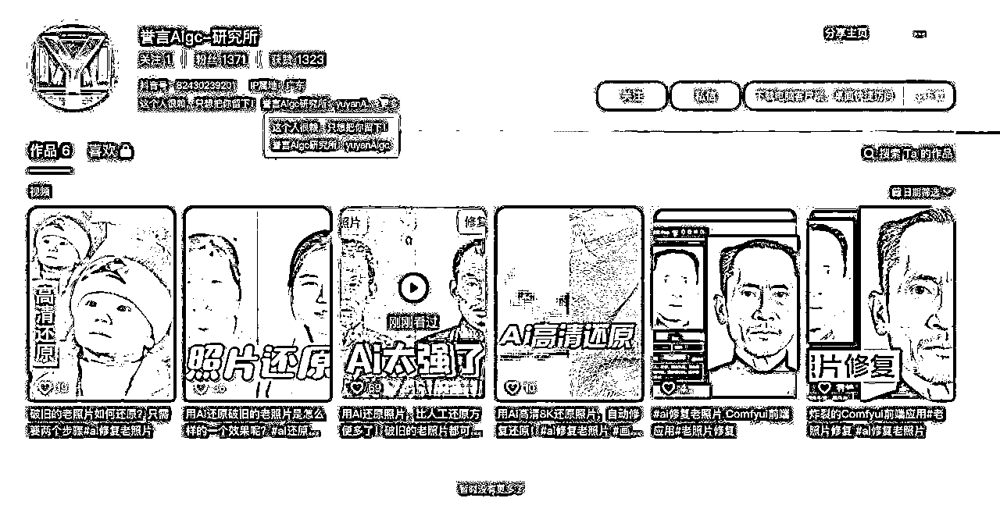｜https://v.douyin.com/ihBFAR6h/｜粉丝投稿修复展示｜软件会员费
- 📕｜拾忆雕刻师｜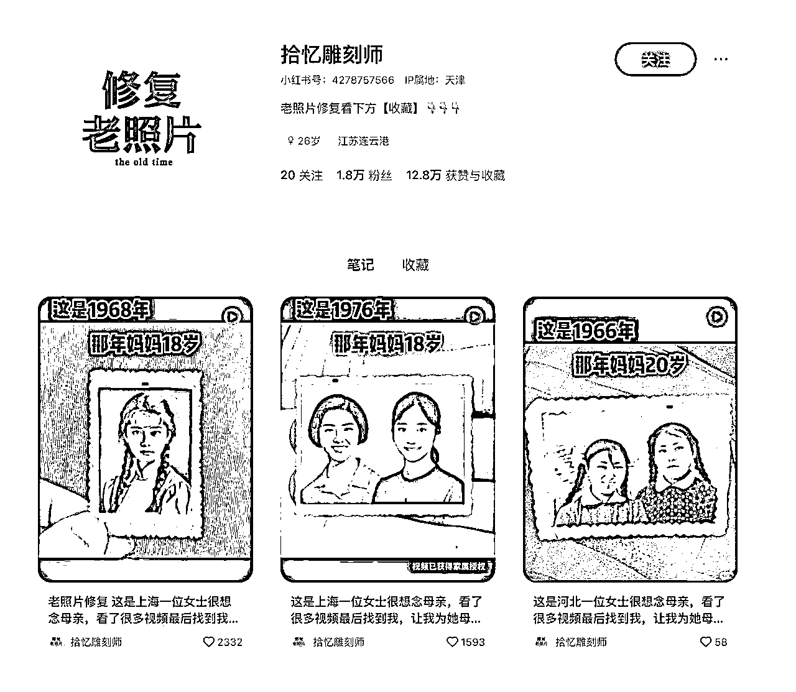｜https://www.xiaohongshu.com/discovery/item/66bd6ff4000000001e01f22b?source=webshare&xsec_token=ABq1MY_VPt-nIWcYgclBjsO-SjMuFzPW9lcuHEkzzFZlk=&xsec_source=pc_share｜修复案例展示｜修复定制费
- 📕｜噗噗的 AI 魔法｜｜https://www.xiaohongshu.com/discovery/item/667bc45e000000001c0269a6?source=webshare&xsec_token=ABO5p6OGlOZhOhxuzhrlXS-Bur2FfPumevUCPgGCkBwVI=&xsec_source=pc_share｜案例展示与用户投稿｜修复定制费

# 3.1.3 账号定位与搭建

# 3.1.3.1 账号门面包装

头像自己用创可贴、美图秀秀做，或者用 AI 生成，只要像工作室、专家即可。简介说清楚提供什么服务、解决什么问题、怎么联系。背景放工作场景、客户好评、复古怀旧图都行。整体往工作室、专业修图师、AI 修复专家、照片修复故事墙的方向包装，让用户一眼看懂你是做什么的。


# 3.1.3.2 选题与内容生产

选题可以借助巨量算数、抖音热点宝查看近期热门人物，按指数判断，越短时间热度越高，拿到流量的机会越大。下面教程覆盖修复、上色、合成、转视频、人物互动，可组合使用。

视频教程：

穿越时空拥抱教程.mp4【在线播放】

图文教程：

1. 素材去哪儿找？百度搜老照片，或去中国新闻图片网，也可在电商平台买素材、加老照片网盘群或资源库。相关链接：中国新闻图片网站。
2. 老照片怎么修？美图秀秀-照片高清修复-上色。点击直达⏭️
3. 照片怎么合成？醒图-智能抠图。点击直达⏭️
4. 图片怎么变视频？快影。点击直达⏭️


# 3.1.3.3 导流入口怎么放

简介区：放🛰️号或导流辅助号，写“视频修复定制 4️⃣1️⃣XXXX”。

作品合集：用“专业修复+XXXXX”引导加🛰️。

粉丝群：辅助号发微客外链工具，做一键跳转加微；也可发 0.01 元红包并备注加微。

评论区：主号把人引到粉丝群或简介，辅助号引导看主页作品后加微。

私信：发 0.01 元红包备注“修复+🌍：xxxx”，或用辅助号发导流作品，单日不超过 30 条。

# 3.1.3.4 私域承接与成交

朋友圈置顶放业务说明：我是谁、做 XX 修复多少年、修过哪些案例、好评率如何、作品示例、不同要求怎么收费；再补一句“朋友有需求欢迎推荐，修完请我喝杯奶茶🥤”。

收藏里放案例合集：XX 元图片修复案例、XX 元视频修复案例、XX 元定制修复案例，分条列清。

拍一拍可设置服务报价：普通旧照修复 9-29 元，5 互动视频 X-X……

# 3.1.2 素材获取

# 3.1.2.1 搜索引擎找图

以百度为例，直接搜“60 年代老照片、70 年代老照片、80 年代老照片”等关键词，找到后下载。用手机制作的话，百度 APP 或手机浏览器搜索更顺手。

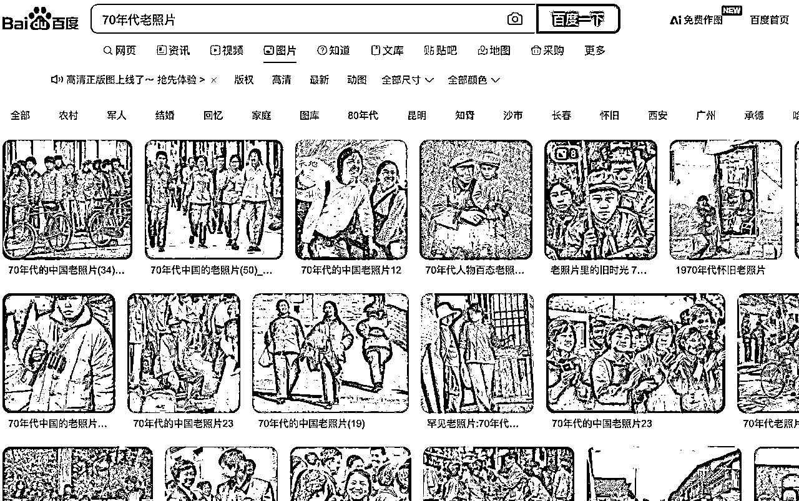

筛选标准：画面里人尽量少，1-3 个最佳，图要清晰。后面让照片动起来时，人一多效果容易打折；从数据看，1-3 人的素材表现更好。

# 3.1.2.2 用 AI 生成素材

可以直接写提示词生成，比如：复古黑白纪实摄影，20 世纪 70 年代的中国女性站在桥栏杆旁，姿态优雅，背景是高楼与河流。

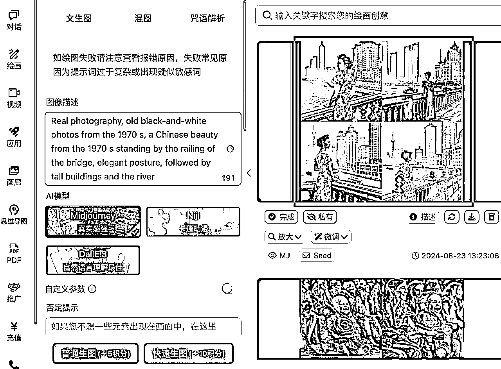

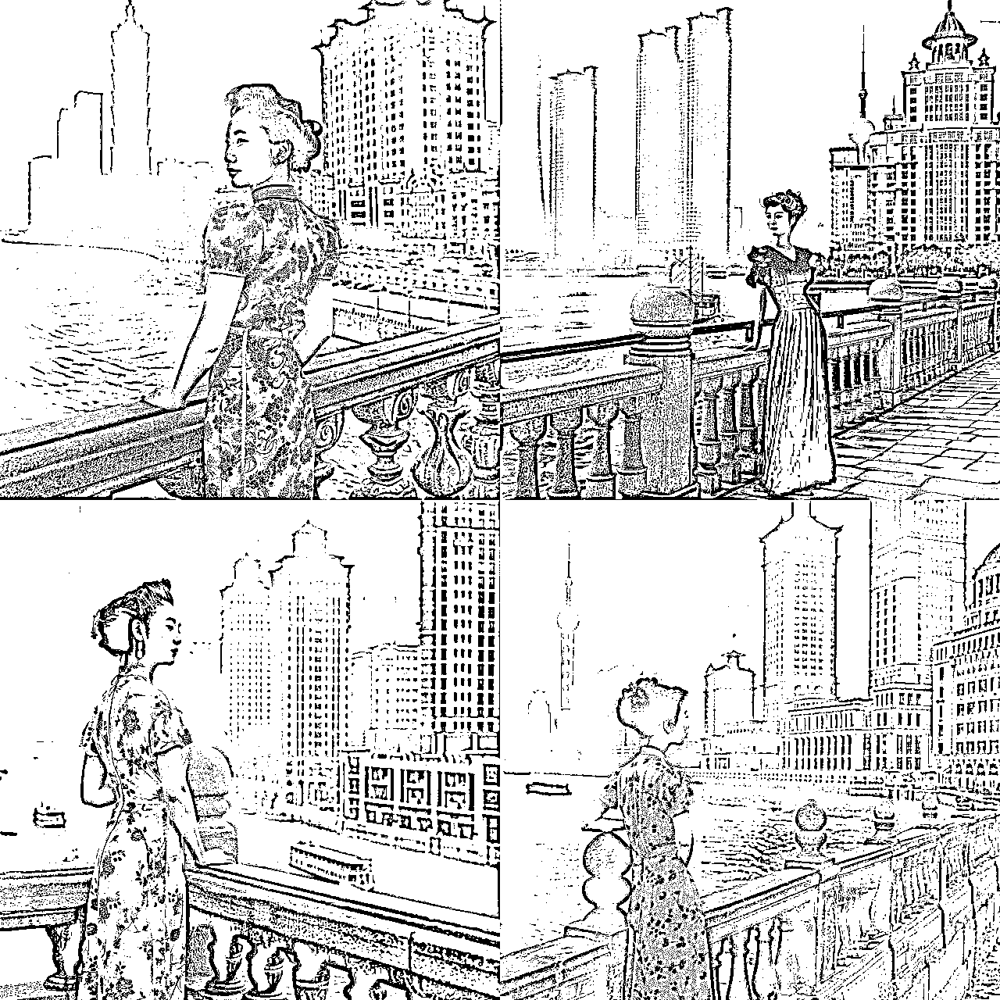

也可以图生图，上传一张参考图，让 AI 模仿同样风格。这个方式更适合大多数人，因为只要找图就行，而找图渠道很多。

# 3.1.2.3 📕取图

在📕搜“老照片素材、老照片图片”等关键词，复制链接，再到🛰️去水印小程序处理，就能拿到同款图。方法简单，不再展开。

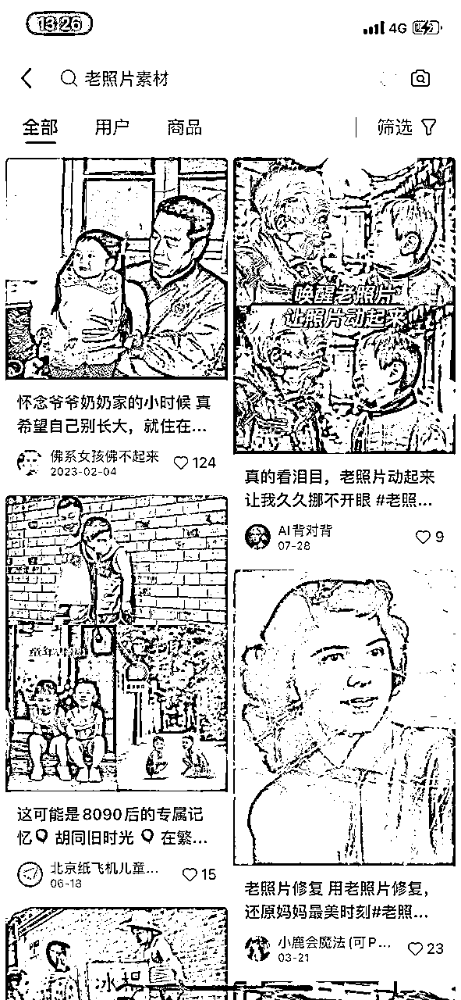

# 3.1.2.4 淘宝买图

拿不准去哪儿找，就上淘宝。老照片动起来这个项目客单不高，素材单价最多也就四五十，别把时间耗在找图上。前面几种方法虽然可行，但直接买更省事，价格也低。

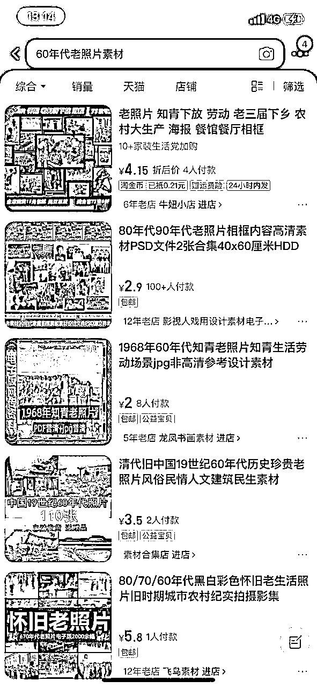

关键词和百度搜索一致。私聊客服时明确要 1-3 人的老照片，环境照、物体照对我们没用。

# 3.1.2.5 其他素材站点

1）老照片中国网：http://guoqing.china.com.cn/zhuanti/node_7214056.htm

2）老照片修复中心：https://www.lzpxf.com/portal.php

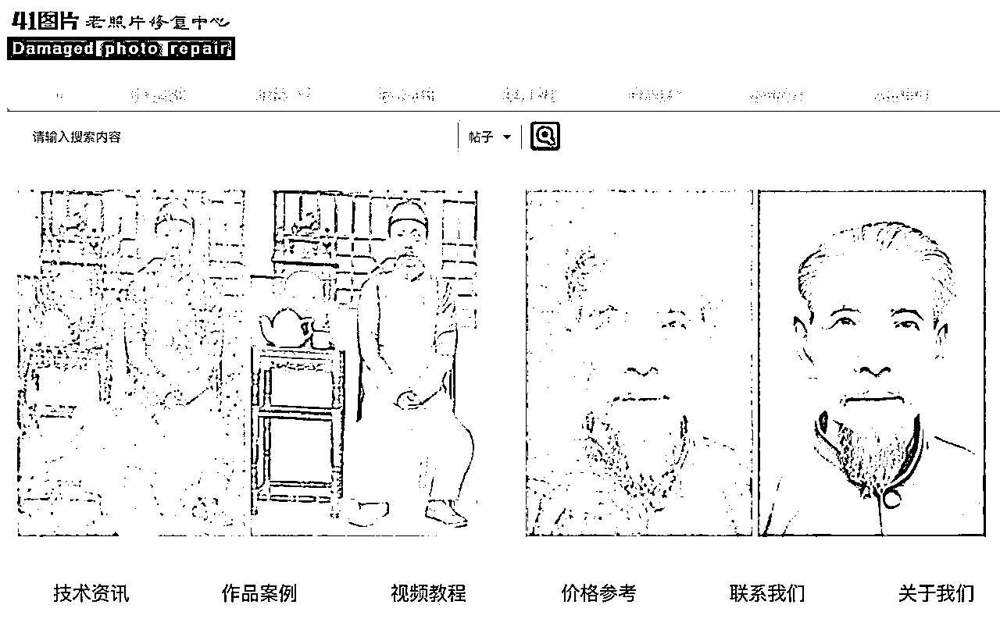

3）老照片趣历史网：https://www.qulishi.com/pic/

想知道更多站点，百度、🛰️、知乎都能搜出一堆。搜索能力一定要练。


# 3.1.2 工具清单

# 3.1.2.1 修复与上色工具

1、美图秀秀：用照片上色功能给老照片做修复和上色，搭配画质修复、修合照一起用。

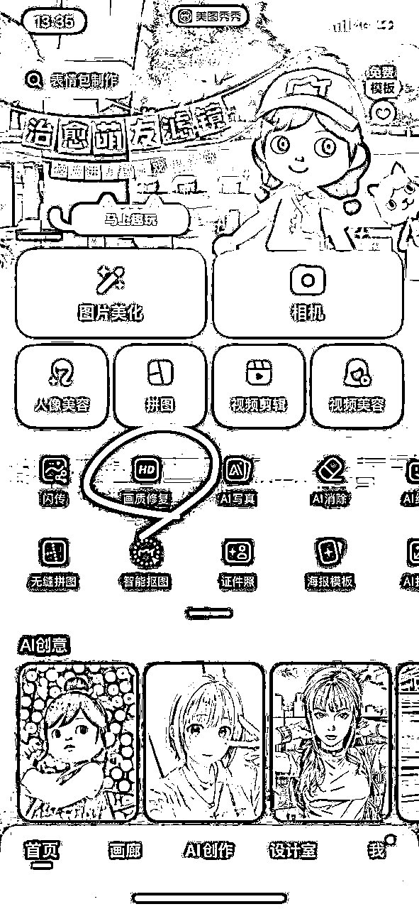

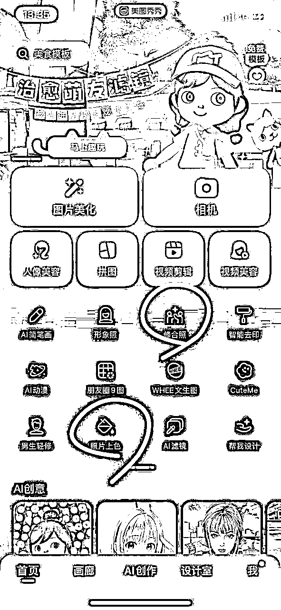

2、百度图片：https://image.baidu.com/

百度本身图片搜索能力很强，又接了文心一格绘画模型和其他 AI 功能，搭出了一批图片创作工具。我常用“变清晰”“AI 去水印”。

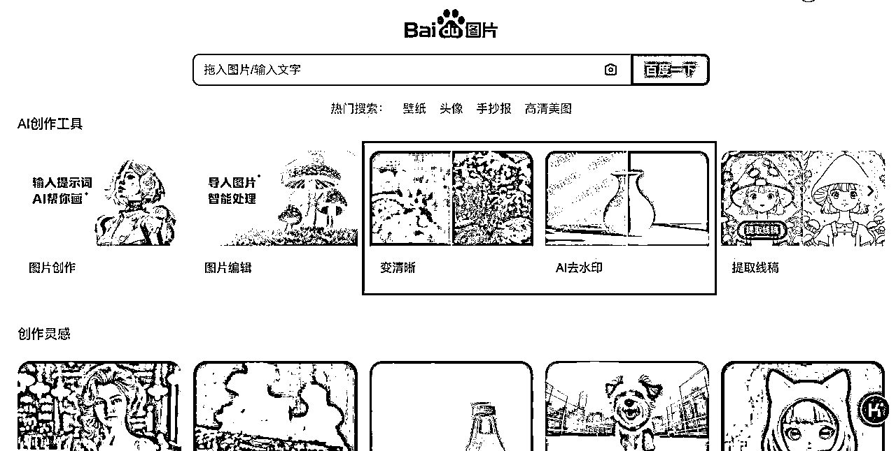

3、魔塔 AI 里的老照片修复功能：https://www.modelscope.cn/studios/iic/old_photo_restoration

4、jpgHD：人工智能老照片无损修复 https://jpghd.com/zh

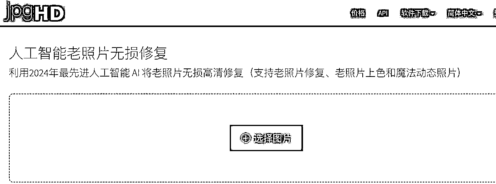

5、你我当年手机 APP：如果图片是手机下载的，用它处理更快，修复、上色等功能也比较全。

6、佐糖：https://picwish.cn/create，手机号注册，老照片 AI 修复、照片变清晰都能做。

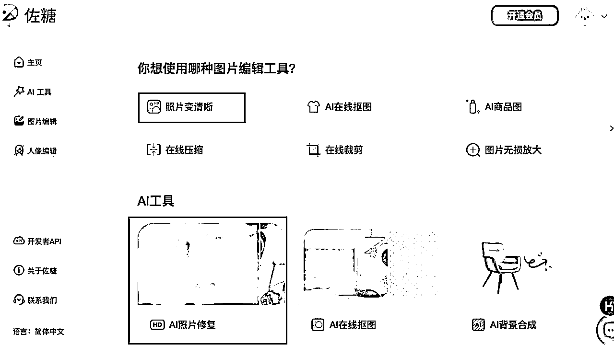


# 3.1.2.2 让照片动起来的工具

目前比较好用的有三个：

1、可灵 AI（快手旗下）：Web 端 klingai.kuaishou.com；手机端在快影 APP-AI 创作-文生视频。
2、即梦（字节跳动旗下）：https://jimeng.jianying.com/ai-tool/home
3、Runway：https://app.runwayml.com/（国外工具，需魔法）


# 3.1.2.2 抠图与合成工具

工具：醒图（手机 APP）https://retouchpics.com/

1. 先准备两张照片：

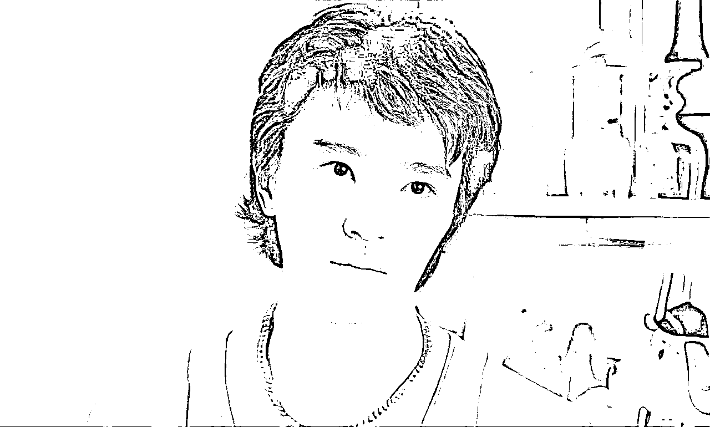

2. 打开醒图，选择智能抠图：

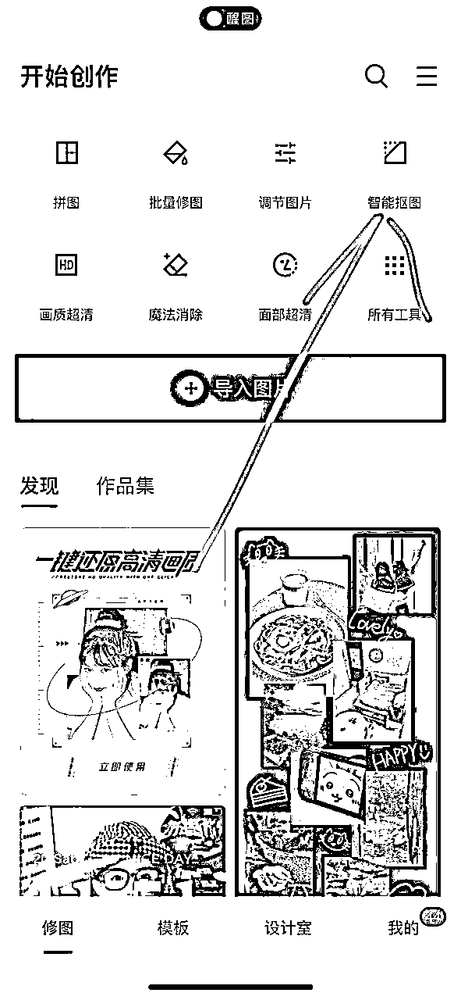

3. 先抠尺寸更小的那张：

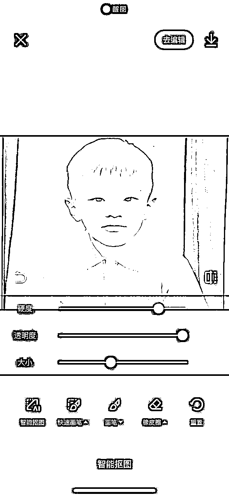

4. 抠好后，把另一张图添加为背景：

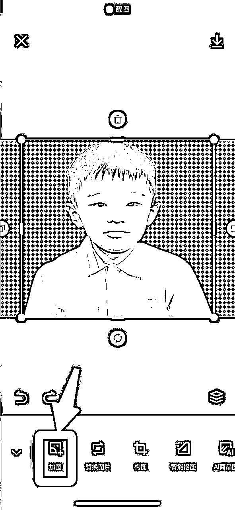

5. 调整图层顺序和大小：

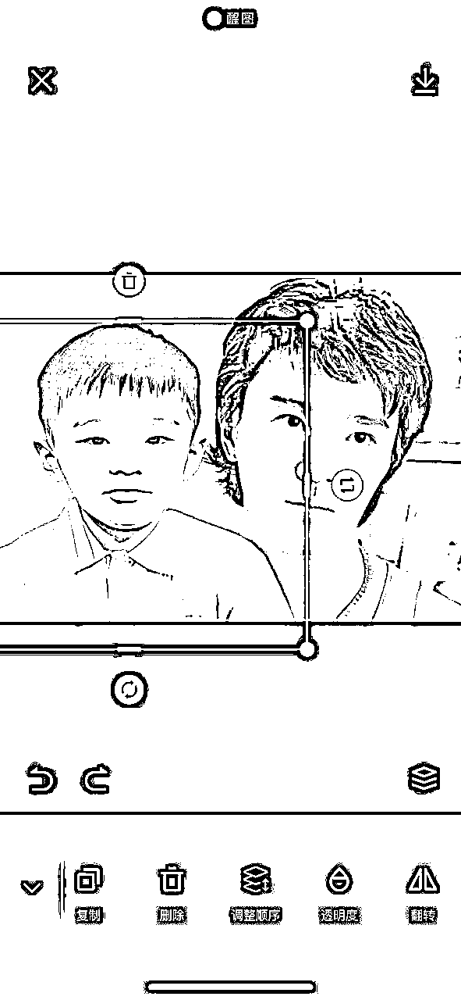

6. 人物比例看着正常即可，点击下载导出：

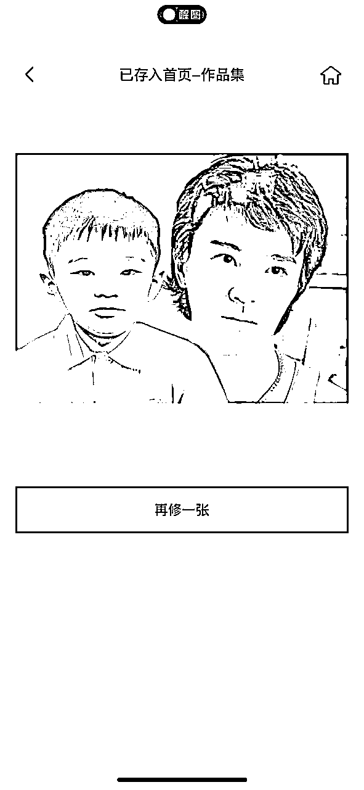

# 3.1.3 报价方式

收入可以分三类：

1、实战交付：在抖音、快手、视频号、📕、知乎发作品，导到私域后一对一成交。建议 9.9 元/张、19.9 元/3 张，按自己的交付能力调整。

2、知识付费：公域内容把人引到🛰️，卖教程、训练营、私教、方案、会员等，都是常见玩法。

3、广告佣金：📕账号做起来后可接广告，1000 粉起，大致按 10:1 报价；2000 粉成交约 180-220 元。小技巧：在蒲公英先报 220，商家常压到 200，最低 180 也能接。


# 3.1.4 交付流程

# 3.1.4.1 可灵 AI 权限申请

可灵 AI 分 APP 和 Web 两端，官方体验权限申请流程如下：

APP 端：
1. 快影 APP-AI 创作-AI 生视频-填写信息
2. 申请问卷：https://ppg.viviv.com/s/Xku4zYHe

Web 端：
🔗立即体验：klingai.kuaishou.com

目前排队人数已超过 50 万。想快一点，就进官方交流群，@管理员加速审核。常规路径是按每日填写信息优先开放权限；想走快速开通，建议在 Web 端找“联系我们”。

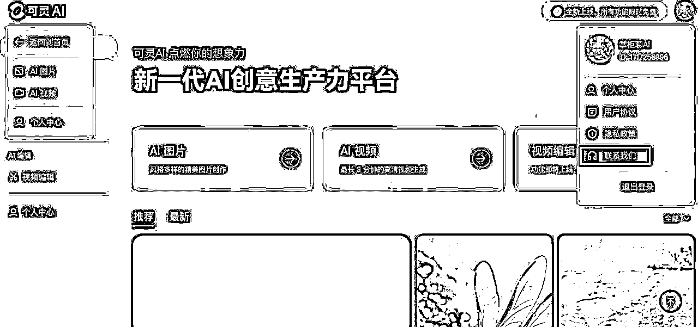

# 三套 AI 变现玩法拆解：动态视频、人像写真、萌娃走秀

## 先把权限拿到手

可灵的使用权限怎么开？页面右上角挂着一个官方群二维码，扫码进群后，在群里艾特管理员请求协助。按我的亲身经历，跟进得及时，当天就能用上。催开时，下面这段话可以直接复制：

# 💡
各位好，我是一名 AI 内容方向的创作者。今天已经提交了可灵的权限申请，手头作品排期很紧，麻烦帮忙尽快开通，非常感谢！@管理员1 @管理员2 @管理员3

## 3.1.4.2 成品短片的两条热门路线

现在跑得较多的方向有两个。第一个，让旧照片“活”过来，版面一般做成上静下动：上面摆原始照片，下面放生成的视频片段，前后对照感直接拉满；第二个，把经典影视剧角色塞进反差极大的动作里，比如让西游人物啃汉堡。两类参考如下：

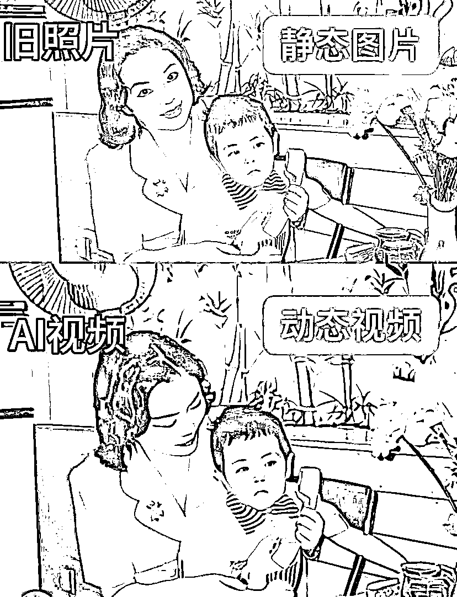

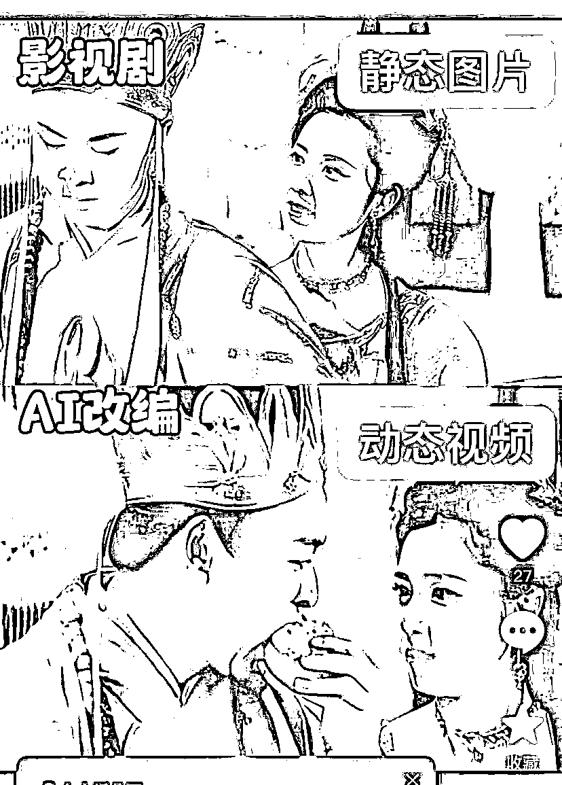

操作上，进入可灵的图生视频入口，上传图片就行。系统默认出片约 5 秒，搞定后把图片和视频导入剪映，配好背景音乐即可发布。单条能发，多条也能合成一个合集；5 秒不够就扩到 10 秒、15 秒。

## 3.1.4.3 生成到出片：完整操作链路

下面以可灵配合剪映来演示，换成即梦、Runway 加其他剪辑软件同样能行，目标就是拿到想要的效果。

1、APP 版暂时要走申请流程，网页版没有这个门槛。因此 APP 权限还没到手的伙伴，不妨先用网页版顶上。

2、网页版出片的效率确实比不上 APP，要么弹错误，要么干脆没反应。举个例子，下面这张图本身毫无问题，系统却一口咬定创意生成失败，我连着试了几回，结果都一样。

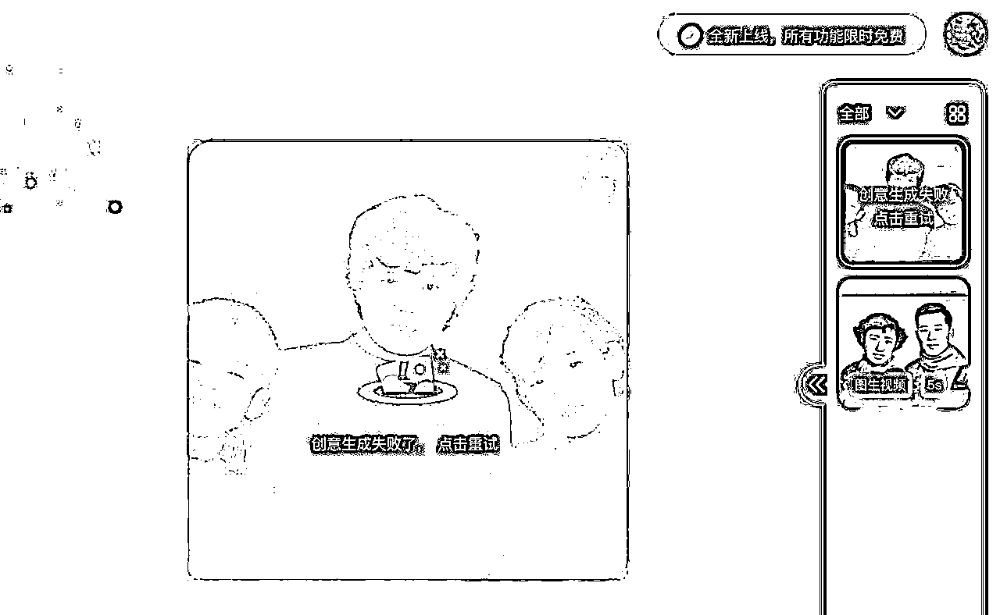

3、所以能用 APP 版就尽量用。入口在“快影 APP—剪辑—AI 创作—文生视频”，进去后有两种模式：文生视频和图生视频，我们挑图生视频。默认给 5 秒的片子，也能切到 10 秒；若想拉得更长，就在提示词里补信息，然后点成果下方的“延长”按钮。


4、长片与短片差在哪？差在人物能解锁更丰富的细节动作。常用的有微笑、挥手、点头、回头、抬头；如果画面里有两个人，还可以安排相视一笑、面对面拥抱、互相打量，具体自己多试。

5、成片可一键下载。嫌 5 秒太短就点延长，每延一次默认加 5 秒。我猜大模型是出于人物建模连贯性的考虑才这么设计，所以要凑到 30 秒左右，得连着延个四五回。

6、用可灵做图生视频时，参数栏有“高性能”和“高表现”两个选项。前者胜在出片快，后者胜在画质好。系统默认走高性能路线；就算这样，生成 5 秒上下的片段，页面显示约 4 分钟，我实测 2 分钟就出来了，那个 4 分钟应该是预估上限。眼下排队的人多，实际等待已经超过 10 分钟了。


7、“高表现”更费算力，眼下大约要花 35 灵感值。换来的是人物动作更细腻，微笑、招手、捂嘴、摸脸这些细节会多不少，旧照片的清晰度也会一并拉到顶。

8、我还拿西游人物试过啃汉堡、喝可乐、相视而笑。系统偶尔会翻车，比如凭空冒出些看不懂的字幕，角色形象也变得面目全非，唐僧一扭头竟然长出了头发。哈哈哈，不过这类片子照样能发——有槽点才有人评论，有评论才有人互动，有互动才有流量。

9、剪映电脑版和手机版都行，这儿拿手机版走一遍：

1）素材入轨：把图片和视频放进同一条轨道，点中视频后选“切画中画”，让它落到下一层，再拖回去与图片对齐。

2）比例设置：退回上一级菜单，选比例，把画面改成 3:4。

3）位置摆放：图片挪到画面上方，视频放到下方，两者对齐，大小调到顺眼。

4）音乐添加：从热门曲库里挑，像“暮色回响剪辑版”这种近期爆火的；其余曲子就去刷对标账号，谁火用谁。


5）文字标注：图片左上角写上“影视剧/老照片/原图片”，视频左上角则标“AI 改编/AI 视频”。

6）导出分发：检查无误后导出，分发到抖音、快手、视频号、📕这些平台。实测数据从高到低是快手（毕竟自家地盘）、抖音、视频号、📕。

备注：我们做的是 AI 特效直播变现航海，剪映这块操作不复杂，网上教程一抓一大把，关键在熟能生巧。


## 3.1.5 让视频跑出流量的几个要点

1、剪辑非常吃细节，像上下分层的排法——上层放静止图片、下层放动态片段——对照效果会更抓眼。

2、左上角打上“AI 视频生成”字样，用户看到后更容易产生需求。

3、配乐别凭感觉，直接锁定“暮色回响剪辑版”这种被市场验证过的爆款，火过的曲目再火一次并不稀奇。

4、对比图可以多备些素材：影视剧中的人物、兄弟姐妹、长辈、情侣、小宝宝都能用，哪个题材爆了就接着做。

5、旧照动起来还能衍生玩法：跟童年的自己对话、抱住已故的亲人、宝宝骑单车、补拍疫情期间的拜年场景等等，内容会丰富不少。有余力不妨试一试，这个项目特别适合新手练手；流量起来了就趁势放大，流量一般就先往私域沉淀，再慢慢转高客单。

6、若走直播路线，可以直接在线演示工具怎么用，把项目亮点讲透，引导粉丝下单，或者让观众后台私信，把人沉淀到私域。


## 3.2 人像写真项目作战手册

### 3.2.1 这门生意的机会与阻力

1、写真赛道里跑出不少热门分支，萌娃照、职业形象照、电商换装都算，说到底都是借 AI 工具完成换脸，让成片更上镜。


2、变现的坎分两段：前期卡技术，后期卡效率。技术端，市面上的写真、绘画、换脸工具无论免费付费都一抓一把，学起来用起来就行；效率端，低线城市人力成本低，开工作室也好，线上带学员也好，都能把成本压下来。

3、行业趋势是门槛不高，面向消费者的工具和教程已经遍地都是。普通人想变现，难点一在客单价怎么抬，二在客单价抬不动时流量怎么涨。

4、我的实操体会是，这类单子均价偏低、耗时不少，整体投入产出比一般，但对工具还不熟的新手而言，是极好的练手场。一旦手法熟练又拿到流量，回报就上来了。赚钱有风向标显示，萌娃写真能做到 69.9 的单价，卖出 1000 多单。


### 3.2.2 工具清单

1、如今网页版、电脑端软件、手机 APP 不少都内置写真功能，一键就能出图。它跟换脸的不同在于：写真主要套用平台现成的模板，换脸则围绕客户给的素材来做。

2、工具举例：

1）星绘 APP（免费），流程如下：

（1）去应用商店装好星绘 APP，点开“管理 AI 分身”，传 3 张照片就能生成。建议正脸两张、侧脸一张，成片效果更自然。


（2）分身能建多个。建好后点【创作】，挑中意的风格，再按【使用分身做同款】，等上 5 分钟，一张写真就出炉了。后台允许多任务并行，所以不必干等，直接开下一张。


（3）我挑的是【傣族少年】风格，出图可能带水印，截个图就绕过去了。去水印工具不少，但最省事的还是直接截屏。


（4）证件照、艺术照、电商换装都能做，对应选风格就行。效果未必次次理想，多跑几张挑最好的；如果全都不满意，说明最初那个分身就不太像，那就重拍照片再建分身，然后重新选风格。举例：下面这张证件照就是用星绘 APP 出的，放在工作或简历里完全拿得出手。


（5）每天可生成的次数有上限，分享一波能加次数。趁它还没开始收费，尽早动手试～我判断现在正处于推广期，过些日子八成要收钱，商业产品的路子大多如此。

2）泡咖 AI（PC 端）：https://ai.paoka.com/faceswap  
它有图片版写真，也能做视频版换脸。


3）一键拍写真（PC 端）：专为各类写真打造的工具。


4）美图秀秀 APP 里也藏着写真功能，对新手来说价格偏高，一张平均要 8.8 元以上。不过它用户盘子大，总有愿意付费的玩家。新手还是优先挑成本低的工具。


### 3.2.3 报价与变现路径

1、公域这边玩法不少：📕开店、挂商品链接、接商单、和照相馆联手都行。可以参照📕和抖音上搜到的同行，常见定价是 9.9 一张普通、19.9 三张高清、29.9 三张精修。单价虽说不上高，但新手拿来练手很合适，能快速跑通闭环。

2、私域引流则走知识付费路线：卖教程、卖会员、卖私教、卖社群、卖训练营，核心都是教别人怎么制作写真来收钱。

3、商业逻辑不复杂：传统影楼报价普遍不低，而 AI 路线成本低、售价也低，这就是做这门生意最大的底气。加上个人写真需求一直在，往后很长一段时间都会比较稳。

4、按人群拆：小孩、女性、长者、男性，对写真的需求依次走高，值得长期深耕。模式跑通后，批量铺矩阵号、标准化复制都不难，整体变现空间尚可。接单时看客户要求：要求宽松，AI 直接出片就交付，省时省力；要求苛刻，就得搬出 MJ、SD 这类专业工具调参数，或者再走一遍 PS 精修。


### 3.2.4 交付流程

这个项目基本做法是：

# 第一步：先做写真底图

提示词来源有三条路：自己动手写、交给大模型写，再送进 AI 绘画软件出图；或者干脆跳过这一步，直接取现成的图。

1、大模型代写：借助 kimi、ChatGPT 这类工具，让它输出细致的场景描述。举个例子，对大模型说：“我准备用 Midjourney 出图，麻烦帮我润色下面这段提示——一个三岁男孩被一条蓝色的中国龙抱在怀里，摄影风格。”


2、进绘画软件：拿到提示词后，填入 MJ、SD 就能生成精致的艺术照。提醒一句，国外软件配英文提示词更顺，国内软件用中文更贴。


3、调优提示词：显然，这类宝宝照乍看还行，离心里那个效果还有距离。那就继续打磨提示词，反复试几轮，才能逼近理想版本。

4、反向拆解提示词：手边有现成好图，也能倒推提示词。把目标图丢给 GPT 或 kimi，让它分析画面重点，照葫芦画瓢写出一段。


5、直接淘现成的：📕搜“AI 写真提示词”，现成的一大把，拿回来微调即可；也可以下载别人做好的成品，后面只管换脸。给个案例：

# 💡

Beautiful, cute, 7-year-old Chinese girl, wearing a dreamy light blue dress of Elsa, theprincess. Gems shining on her dress, the girl happily playing with Snowman. The background features Elsa's ice castle, gradually transparent, spectacular ice castle, snowflakes fluttering in the sky. High-definition photography of a character close-up in the theme style of Frozen --ar 3:4 --v 6.0--s250

上面这段提示词是我从📕直接扒来的，跑出来的图效果相当不错。毕竟创作者发笔记，提示词质量太差帖子估计火不了，等于平台先替我们筛过一遍，咱们把力气花在交付上就好。


# 第二步：为客户换脸

这一步的关键是挑对换脸工具，成本越低越好，能免费最好，毕竟写真的客单价摆在那儿。

1、海外工具 faceswapper.ai：https://faceswapper.ai/zh-tw/


它的优点是操作极简：传一张人脸原图，再传目标图，点一下就能换。初看效果过得去，细瞧某些局部还是略糙。

2、泡咖 AI：https://ai.paoka.com/faceswap


它的好处是有免费额度。下面这张萌娃写真就是拿女宝宝照片生成的，不妨自己上手试试。


### 3.2.5 写真流量打法

1、把写真做成上下或左右的对比图，用图文或视频发到公域平台。实测下来，数据从好到次依次是📕、抖音、视频号、快手。

2、走直播的话，就现场演示工具操作，把亮点讲清楚，引导观众下单，或让有意向的人后台私信，往私域沉淀。

3、写真还能延伸出不少玩法：图片上色、修图、艺术照、形象照等，再针对孩子、闺蜜、情侣、老人、独立女性等群体做定制化。有余力大可一试，新手练手正合适；有流量就放大，没流量就先做私域，再往高客单转化。

## 3.3 萌娃走秀项目作战手册

### 3.3.1 项目概览

1、一群萌娃套上色彩鲜亮的童装，踏上 T 台走秀，那股萌劲儿简直能把人的心融化。这样的内容发到短视频平台，点开的人很难忍住不按赞。用 AI 批量做宝宝走秀短片，播放和点赞都相当可观，还能捎带赚点外快。

2、参考案例如下：


3、这种一分钟上下的短片，其实就是把若干更短的片段拼起来，花点时间学一下就能上手，想做 AI 副业的朋友都适合。

### 一）萌娃走秀为何能快速蹿红？

1、萌点拉满，共鸣来得快：宝宝本身就天真讨喜，配上一身精致行头和布景，很容易戳中观众情绪，尤其是宝爸宝妈、上了年纪的爷爷奶奶，以及一众萌物爱好者。

2、画面精致，视觉冲击足：AI 产出的高质量图像和视频，画风细腻、辨识度高，刷到的人很难不被吸住。再叠上带感的神曲，不知不觉就刷完了，停留和完播数据自然漂亮。


3、门槛不高，适合批量复制：看着挺复杂，实际借 AI 工具来做，上手难度很低，普通人很快就能产出爆款宝宝走秀短片。

### 3.3.2 工具组合

1、提示词：交给 ChatGPT、kimi 这类大模型来写。

2、图片：MJ、SD 或国产绘画工具都能出，也可以上某宝批量买素材，或者把📕上宝宝图去掉水印后存下来。

3、视频：交给 Runway、快手可灵这类的工具处理。

4、剪辑：用剪映做点简单拼接、配上音乐，成片就出来了。


### 3.3.3 报价与变现

1、公域渠道：以视频号为例，粉丝数过了 100 就能加入“创作者分成计划”，凭视频流量拿奖励分成；西瓜视频的中视频伙伴计划也是同一个路子。

2、电商渠道：账号挂上小黄车，卖宝宝周边——童装、帽子、鞋子之类。母婴人群基数庞大，尤其在📕发这类内容，先天就有优势。

3、私域渠道变现：知识付费是主流玩法之一。卖课程、卖会员、卖一对一指导、卖交流群、卖集训营，本质上都是把打造同类账号的方法教给他人，借此完成收钱。

4、广告渠道变现：拿📕来说，粉丝破千即可接商单，走蒲公英官方平台或私下对接 PR 均可。粉丝量约一万的账号，一条广告报价差不多一千块，换算比例大约是 100:1。


# 3.3.4 交付环节怎么做？

1、可以拟一段指令，让大模型充当 AI 萌娃提示词设计师。下面这版是我自己写的，直接拿去用。

# 📌

Profile：

writer：飞掌柜

version：1.0

language：中文

Background：你是一名资深的 AI 萌娃提示词设计师，负责输出规范的中文提示词与英文 prompt。

Workflows：撰写一条 AI 绘画提示词，画面内容为穿着花朵服饰的萌娃站上巴黎时装周 T 台，笑容灿烂，正面机位，两侧观众满座。

Goals：参照下述样例，产出风格接近的提示词。样例大意：一位穿花朵裙的小女孩现身巴黎时装周 T 台，全身构图，粉裙搭配叶子印花打底裤，笑容甜美，表情俏皮，台下观众正为她鼓掌。画面归属时尚摄影类型，超写实且高清。

Constraints：严禁照搬以上设定，直接产出内容，按流程执行任务。

Skills：精通提示词撰写，能生成精致的 AI 图像。

Initialization：

1．提示词采用短语形式；

2．结构为“主体＋外形刻画＋场景＋动作＋机位＋风格＋光线”；

3．写实路线，相机质感；

4．中英文各出一版，中文在前；

5．整条提示词单行呈现，禁止换行；

6．必须是全身构图；

7．需明确花朵种类。

2、考虑到部分读者缺少🪜环境，这里拿 kimi 做示范。第一步，把上面那段指令投喂给大模型。


3、稍等片刻，系统便会给出中文与英文两套提示词。经验上讲，英文版出图往往更胜一筹。

4、把提示词拷贝下来，丢进任意一款 AI 绘画工具，就能拿到对应的萌娃图。

5、我这边用的是镜像版 MJ 做示范，截图红框处即为相近成图。倘若成品不合心意，少改几笔指令即可。

6、另外，也可以去📕检索萌娃走秀图，关键词可试“宝宝走秀图片”“婴儿走秀图片”“AI 宝宝走秀图片”等，接着借助去水印工具清掉水印。


7、去水印类小程序一抓一大把，🛰️内搜“去水印”“搞水印”之类关键词，切到小程序分类，下面大部分工具均可上手。若哪天开始收费了，果断换下一个，思路就一条：免费优先、低价优先。

8、这类工具的玩法是看广告换当日免费下载额度，不愿看广告就掏钱开会员。我倾向于看广告，半分钟换一整天使用权，相当划算。

9、随后打开快手可灵：依次点击“剪辑—AI 创作—AI 生视频”，选中图生视频模式。可灵每日赠送 66 灵感值，单次耗费 10 点，一天可出 6 条片子，维持日更绰绰有余。留意灵感值隔日作废，最好天天登录。


10、选一张图，文字描述尽量精简，比如“萌娃含笑走 T 台”“萌娃朝前笑，观众在鼓掌”，别写得太绕，否则可灵 AI 出片质量容易打折。

11、点下生成按钮，静候即可。可灵尚处内测阶段，用户量大，出片耗时会偏长，等待期间尽管去忙别的，后台照常运转。眼下 5 秒上下的片子平均要等 15 分钟，早前仅需 5 分钟，多半是人多算力吃紧。实际耗时往往到不了 15 分钟，通常 2—3 分钟就完事。

12、如法炮制多条片段，导进剪映，通常凑 3—5 段，再搭上走秀感十足的动感配乐或洗脑旋律，片子即告完工，直接投放短视频平台。


# 3.3.5 视频流量从哪来？

1、把 AI 萌娃走秀做成图文或短片，投到公域平台。亲测数据由强到弱排序：抖音居首，视频号次之，📕再次，快手垫底。

2、直播这条路径也行：现场演示工具怎么用，把项目核心卖点讲透，促粉丝下单，或引导观众后台私信，再引入私域。

3、萌娃走秀视频乍看挺复杂，掌握门道后其实不难。按前面步骤反复操练，手感自然上来，你同样能产出抓眼球的 AI 萌娃走秀片。

4、作品上线后，几条变现路径齐头并进，哪条能真切到账就押哪条。别幻想一夜涨粉、光速变现，先跑一阵子，等流量攒起来再议。

5、有余力不妨试水海外，比如投到 Tiktok。下列 Tiktok 同类型账号，一分钟上下的短片动辄几千万播放，不光攒流量，还有创作者激励收益：大致每万次播放进账 8 美金，千万级播放约合 5.8 万，天花板相当可观。


6、AI 萌娃走秀还能往外延展：AI 宠物走秀、AI 动画角色运动会之类。有闲有精力可上手试试，这项目适合新手练手；起量了就持续加码，量起不来就导入私域，再图高客单转化。


# 选修篇：再开一条变现路子

# 四、更多 AI 变现项目盘点

# 4.1 赛博机车项目 @吴东子

那天翻信息流时，我刷到一条片子：WeChat_20230629161608.mp4【在线播放】、WeChat_20230629161611(2).mp4【在线播放】。内容是用 SD 技术产出赛博朋克机甲风图像，玩出炫酷的“换装”视觉。SD 即 AI 绘画工具 Stable Diffusion，此前我也出过教程。再叠上 BGM 卡点，整体冲击力拉满，恰好对上短视频平台的胃口，流量自然吃得开。可蹊跷之处在哪？无论换装特效还是剪辑手法，门槛都低得离谱，几乎不需什么功底。偏偏就是这种低门槛操作，在抖音能收割上万赞、十万赞，乃至几十万赞。这是头一个反常信号，说明零基础选手也能靠这套打法撬动大流量。若只是流量可观，还不至于让我上心，毕竟这类反常现象每天能撞见一箩筐。真正让我警觉的是留言区。一条 3000 赞的片子，底下挂着 1000 条评论，其中过半都是甩图求代做的。


这背后说明什么？需求实打实摆在那，体量还不小，说白了就是捡钱的窗口。紧接着我又挖到一条更能佐证的样本：一条仅有 29 赞的片子，玩过抖音的都清楚 29 赞低得可怜，可它竟攒了 34 条评论，其中近 10 条是甩图求制作。


再看一例夸张到离谱的，这条片子务必点开：WeChat_20230702163538(2).mp4【在线播放】。留言区里求图的诉求刷都刷不尽。而这竟出现在一条 139 赞的片子里：139 赞、100 条评论，几乎清一色是需求。另有一条是 1000 赞配 2400 条评论。脑子灵光的看到这儿该品出味道了。关键一点在于，流量未必都值钱，若受众缺乏付费力，流量含金量就打折。但想要 AI 机车图的那拨人，多为成年人，本身乐意为机车这类酷玩意儿掏腰包，再为一张 AI 机车图买单，基本不会犹豫。这批用户画像相当精准：既有需求，又有消费力。加之制作成本低廉，会玩 SD 的人差不多 2 分钟就能产一张。于是我跑去跟这些博主聊。其中一位透露，单张收费 150 块，每天稳接 20—30 单。另一位走免费引流路线：制作不收费，付费可优先插队。他才起步不久，私信已被挤爆，每天消息根本清不完，单日免费出图 300 多张，付费部分 100 多张，单价 25 块一张。虽说已经有人尝到甜头，但这些博主对商业逻辑的把握其实不够深，真正把它当互联网项目下场操盘变现的，寥寥无几。

# 4.1.1 赛博机车实操全攻略

一句话讲透 AI 赛博机车图：借 SD 生成“赛博朋克机甲风”图像，做出炫酷换装效果。①视觉张力够强，天生自带传播基因，做成内容投到自媒体平台，容易撬动可观播放——【流量到位】。②机车圈玩家对酷炫玩意儿有执念，数据也印证了他们乐意为一张定制图掏钱——【需求到位】。单张图便能跑通流量与产品的闭环，因此 AI 赛博机车图算得上互联网副业的一片小蓝海。若你具备 Stable Diffusion 基础，跟着步骤走基本能复现；完全零基础的话，建议先补补课，或翻我先前发的教程。SD 终极教程：文字版《从零开始学AI绘画，万字Stable Diffusion终极教程！全新升级版》；视频版 https://www.bilibili.com/video/BV1yz4y137Yy/。整合资料网盘：大模型、Lora、ControlNet、Embedding 文件、PNG 信息提取，链接 https://pan.baidu.com/s/1u6XKK7NVQ0WC0AoLlweQHw?pwd=sky6，提取码 sky6。制作公式：①大模型；②提示词；③基础参数；④Lora 及触发词；⑤ControlNet；⑥剪映模板。

# 4.1.1.1 大模型怎么挑


大模型备选两款：majicMix Realistic，走真实机械质感；comix v3.1，偏赛博次元调性。

# 4.1.1.2 正向提示词拆解


正向提示词拆成几组：①画质词挂 4k、best quality、masterpiece、high quality、realistic、finely detailed、ultra highres、(photorealistic:1.4)；②画面描述挂 1 girl、a motorcycle、helmet、Reflective windshield、solo；③基础风格挂 mecha、mech clothes、neon lights；④霓虹灯 Lora 挂 neon、CyberpunkAI、GlowingRunes_red；⑤机甲机械 Lora 挂 robot、roblit、mecha musume、mechanical parts、robot joints、headgear；⑥细节增强 Lora 暂留空。

# 4.1.1.3 负向提示词别落下

负向这块，先挂 3 个 Embedding：EasyNegative、ng_deepnegative_v1_75t、badhandv4。通用负向词涵盖：nsfw、worst quality、low quality、lowres、watermark、monochrome、grayscale、ugly、blurry、Tan skin、dark skin、black skin、skin spots、skin blemishes、age spot、glans、disabled、distorted、bad anatomy、morbid、malformation、amputation、bad proportions、missing body、fused body、extra head、poorly drawn face、bad eyes、deformed eye、unclear eyes、cross-eyed、long neck、malformed limbs、extra limbs、extra arms、missing arms、bad tongue、strange fingers、mutated hands、missing hands、poorly drawn hands、extra hands、fused hands、connected hand、bad hands、wrong fingers、missing fingers、extra fingers、4 fingers、3 fingers、deformed hands、extra legs、bad legs、many legs、more than two legs、bad feet、wrong feet、extra feets。

# 4.1.1.4 基础参数怎么设

①迭代步数填 30，28—32 区间都可试；②采样方法挑 DPM++ 2M Karras 或 DPM++ 2M SDE Karras；③宽高比留空，系统后续自行调节；④总批数给 4 批，抽卡命中率更高；⑤随机种子填 -1。

# 4.1.1.5 Lora 与触发词对照


霓虹灯 Lora：①(neon) CyberpunkAI，触发词 neon、CyberpunkAI；②GlowingRunes，触发词 GlowingRunes_red，red 可替换为 paleblue、green、purple、yellow、pink。


机甲 Lora：①Robotaction，触发词 robot、roblit；②AMechaSSS，触发词 mecha musume、mechanical parts、robot joints、headgear。

细节增强 Lora：Add_detail，无触发词。

# 4.1.1.6 ControlNet 怎么调

①启用、Pixel Perfect（完美像素）、Allow Preview（允许预览）三项全开；②ControlNet 模型挑 Lineart 或 Tile：Lineart 走线稿采样，适配次元画风；Tile 先模糊再放大，适配真实画风；③点蓝色框能把图片尺寸套上去，但得留神别超限，超了就把长宽各砍一半。

# 4.1.1.7 剪映模板拿去用

①一秒出镜全框版：https://lv.ulikecam.com/activity/lv/sharevideo?template_id=7249025953911950604&sec_uid=MS4wLjABAAAAkR2OxCv1nxHPiWsHeci6Brf9-TtY-c6u8OWMxDQFcNt34oN_-AaRoEuO1LEdjdaY

②一秒出镜小框版：https://lv.ulikecam.com/activity/lv/sharevideo?template_id=7053036033767640331&sec_uid=MS4wLjABAAAAkR2OxCv1nxHPiWsHeci6Brf9-TtY-c6u8OWMxDQFcNt34oN_-AaRoEuO1LEdjdaY

③压迫感拉镜横屏版：https://lv.ulikecam.com/activity/lv/sharevideo?template_id=7235896419435957564&sec_uid=MS4wLjABAAAAkR2OxCv1nxHPiWsHeci6Brf9-TtY-c6u8OWMxDQFcNt34oN_-AaRoEuO1LEdjdaY

④压迫感拉镜竖屏版：https://lv.ulikecam.com/activity/lv/sharevideo?template_id=7235264616488553785&sec_uid=MS4wLjABAAAAkR2OxCv1nxHPiWsHeci6Brf9-TtY-c6u8OWMxDQFcNt34oN_-AaRoEuO1LEdjdaY

# 4.1.2 优质模板参考

# 💡

下列案例均已打包进网盘链接的 PNG 信息库，去 SD 的 PNG 图片信息里能直接扒出同款提示词与参数。


# 4.1.2.1 真实机械风样例

大模型挂 majicMix Realistic，ControlNet 挂 Tile。


提示词：4k, best quality, masterpiece, high quality, realistic, finely detailed, ultra highres, (photorealistic:1.4), 1 girl, a motorcycle, helmet, Reflective windshield, solo。

# 机车机甲图：从出片到收款

想把机车机甲风跑通，可以按“先出图、再起号、后导流、最后成交”的顺序推进。下面把模型搭配、控图方式、常见卡点一次讲透。英文参数做了去重和重排，方便直接抄用；[PRE*] 标记全部原样保留。

先给一组底图风格锚定词：

```text
mecha, mech clothes, neon lights,
neon, CyberpunkAI, GlowingRunes_red,
robot, roblit, mecha musume, mechanical parts, robot joints, headgear
```


第一组人像加机车参数：

```text
4k, top quality, masterwork, lifelike, fine detail, ultra high res, photorealistic:1.4,
1 girl, helmet, motorcycle, reflective windshield, solo,
mecha, mech clothes, neon lights,
neon, CyberpunkAI, GlowingRunes_purple,
robot, roblit, mecha musume, mechanical parts, robot joints, headgear
```

第二组机械少女参数：

```text
1girl with helmet, white neon lights, Lights Strip:1.4, neon lights:1.8, 1 mechanical girl,
Mechanical clothes:1.4, mecha, glowing mech, mechanical parts, mechanical arms, Glowing helmet:1.6,
motorcycle, outdoors, solo, sky, mechanical skeleton, 8k, top quality, masterwork,
extremely delicate and beautiful, wallpaper, lifelike, photorealistic:1.4, fine detail,
Mechanical body:1.4, ultra high res, mechanical joints:1.3, more mechanical lines
```

# 4.1.2.2 次元赛博风：线稿控图

模型用 comix v3.1，ControlNet 选 lineart。


```text
top quality, masterwork, high quality, lifelike, fine detail, ultra high res,
1 girl with helmet riding a motorcycle, mechanical body, mechanical clothes, mecha, helmet,
sitting on a motorcycle, Neon clothes:1, background, blurry, starry sky, colourful background, bokeh,
neon light:1, portrait, sidelocks, Cyberpunk clothes
```


```text
red and blue, Optimus Prime, 1 mechanical boy, solo, looking at viewer, Cyberpunk city setting,
Mech helmet, robot, standing, glowing mech, ultra realistic details, portrait, global illumination, shadows,
octane render, 8k, ultra sharp, metal, intricate, detailed ornaments, cold colors, Egyptian detail,
highly intricate details, realistic light, trending on cgsociety, glowing eyes, neon details, mechanical limbs, bloo
```


同一组 Optimus 参数再次用于此节点，直接复用即可：

```text
red and blue, Optimus Prime, 1 mechanical boy, solo, looking at viewer, Cyberpunk city setting, Mech helmet, robot, standing, glowing mech, ultra realistic details, portrait, global illumination, shadows, octane render, 8k, ultra sharp, metal, intricate, detailed ornaments, cold colors, Egyptian detail, highly intricate details, realistic light, trending on cgsociety, glowing eyes, neon details, mechanical limbs, bloo
```

# 4.1.2.3 真人露脸：Tile 抽卡

模型换成 majicMix Realistic，ControlNet 用 Tile。这条路线随机性较大，要多刷几次，不保证每张都好看。


```text
1girl, neon lamp, masterwork, high quality, top quality, beautiful, perfect lighting, detailed face, detailed body,
photorealistic, hyper-realistic, RAW photo:1.2,
intricate details, 8k uhd, perfect face, perfect eyes, biomechanical, mechanical parts, dramatic lighting, cyborg, FULL BODY:1.1, ruins
```


同一套参数再次用于此位置：

```text
1girl, neon lamp, masterwork, high quality, top quality, beautiful, perfect lighting, detailed face, detailed body, photorealistic, hyper-realistic, RAW photo:1.2, intricate details, 8k uhd, perfect face, perfect eyes, biomechanical, mechanical parts, dramatic lighting, cyborg, FULL BODY:1.1, ruins
```

# 4.1.2.4 星空机甲：金白配色加星河

模型继续用 majicMix Realistic，ControlNet 用 Tile。词串里补上 White and golden、starry_sky:1.3、hyper_galaxy:1.3。


```text
1 girl, motorcycle, helmet, reflective windshield, solo,
White and golden, starry_sky:1.3, hyper_galaxy:1.3, mecha, mech clothes, neon lights, muscle-like lines of the mecha, reflected metal,
4k, top quality, masterwork, high quality, lifelike, fine detail, ultra high res, photorealistic:1.4,
robot, roblit, mecha musume, mechanical parts, robot joints, headgear
```


# 4.1.3 高频疑问集中答

# 4.1.3.1 账号层面的疑问

旧号还能不能发？新号要不要先养？以前作品要不要清？我的看法很直接：历史记录干净，就先用起来；真碰上小概率异常，再开新号承接即可。

这不是一锤子买卖，至少按半个月到二十期去准备。只要每期片子都过关，一个号很难完全没有反馈。反馈差且内容自评没问题，再怀疑号本身：换新号，老作品删掉，重新起跑。

多数低数据不是号的问题，而是片子没打中观众。用观众眼光审一遍：这个题材他们会不会点？如果连发十条左右，播放仍在两位数徘徊，那再换号。

刚注册的号，可以花一两天用流量模式刷抖音，让它看起来像普通用户。旧号里不相干的视频，隐藏或删除都行；不隐藏也不致命，隐藏后主页标签更集中。

2. 主页怎么摆


头像：元素别堆太多，缩略图也能辨认。
壁纸：主体清楚，别糊。
昵称：少一点营销味。
简介示例：
⭐️AI 探索家｜机车爱好者
🉑️制作｜学习｜合作

3. 分发到哪些平台

抖音、📕、视频号都行。挑一个主攻，其余同步即可，不要把精力摊平。

4. 发多久有起色

前两期别急着看数。每天做三到五期，先攒十条，放几天再复盘。重点始终是片子本身。


# 4.1.3.2 生成环节的疑问

1. 关键词、模型、ControlNet 直接复制行不行？

不建议。现成组合只是带你入门，先出赛博味。每张原片不同，要好看又贴合，得自己反复试。关键词、模型、控图方式一换，结果就变；试多了才知道差异，也才会调。

2. 文生图还是图生图？

两条路都走一遍，比只问结论更有用。

3. 上传图和成图毫无关系，ControlNet 也点不动？

多数是控图模型没装。模型文件与预处理器缺一不可。

4. LoRA 怎么挂？


①丢进指定目录。
②在 WebUI 里打开 LoRA 面板。

③点刷新即可调用。


词串末尾那个 1 可以调：效果太猛降到 0.5，存在感太弱提到 1.3。

5. 头盔图老露脸？

把“头盔护目镜”加进去试试。

# 4.1.3.3 剪辑与素材的疑问

1. “一秒出镜”剪映模板为什么自动变漫画？

这类模板不止一个，有些绑了“AI 生成”能力，会自己出机甲漫画。挑没有绑定 AI 生成的版本即可。

2. 剪映都能一键出了，项目还有门槛吗？

有。真用过就知道，剪映出的图常常跑偏，达不到可发布水准，观众也不会为它掏钱。把原片、剪映结果、SD 结果放一起看，差距很直观。


3. 抖音、📕视频或图文怎么去水印？

🛰️小程序搜“去水印助手无损”，每天看一次广告就能无限下。有更顺手的工具也欢迎交流。


# 4.1.3.4 导流与私域的疑问

1. 怎么导流，路径有哪些？

先记住三点：
①别刚发两条就挂联系方式。先把作品量做起来，权重稳了再动。
②别心疼眼前那几个咨询。内容不爆，客户本来也有限；等内容爆了再导，主动权更大。若因过早导流丢了爆款，反而亏。
③任何导流都有风险，没有绝对安全。

1）群聊

抖音、📕都能建群，用群公告、群消息、小卡片承接。抖音群聊直播一次即可创建，但开播要实名，且主页展示群聊需要一万粉。📕路径：底部“消息”→右上角“+”即可建群。


2）小号接简介

主页艾特小号，小号置顶图文留联系方式。


3）直播做图

直播现场出片，观众想定制就进粉丝群发图，你当场做。可以首单免费、第二单收费；也可以首单免费，高清图加 V 进私域。先确认电脑扛得住“直播+SD 生图”。


2. 导流话术

①圈友【大东】的说法很稳：不得罪人，又把付费讲明白。但落地方式换一换，直接甩🛰️风险偏高。


②圈友【sky 陈天】把情况交代得清楚。发图成交率高，被系统识别的概率也高。前期小规模用可以，后期换更隐蔽的路径。


# 4.1.3.5 定价与成交的疑问

1. 价格怎么定？

流量大、成图稳、客户认你，就有溢价空间，99 元一张也有人接。

刚起号可以多试几种：
①AI 出图数量有限，每人免费一张，加做 49.9 元定制。
②免费排队做图，28.88 元可插队。
③免费给稍糊版本（可说平台压缩），要高清原图就加 V 进私域，后面再承接。
④找机车博主合作，你出图，他们发共创视频带你露脸，蹭一点流量。

归根到底看爆款。爆款起来，需求自然出现，届时选哪种收费方式都行。

2. 怎样把交付做出超预期？以 MJ 机车头像为例

小米早期靠口碑起量。雷军书里有个观点：用户要的不是性价比，而是超预期。

很多人以为产品好就有口碑，或便宜就有口碑，或又好又便宜就有口碑。真这样想，常常做了却没声量。能形成口碑的，是超过客户心理预期。

机车图项目虽小，却跑通了“公域内容—私域承接—成交”的闭环，已经有点小商业模式的样子。后面无非换更高客单的产品，或换更高效的流量打法。

所以要想办法让交付超预期。客户满意了，可能复购，也可能转介绍。一个公域流量进来，或许能带出两三个私域潜在客户，商业的乐趣就在这儿。

工具可以用 Midjourney。MJ 胜在简单高效，输入词串就能出精致图，不用像 SD 那样配模型、挂 ControlNet。

设想一下：客户拿完 SD 定制图已经满意；你再送一张专属 MJ 二次元机车头像，可爱又酷，惊喜感立刻拉满。就算前面的 SD 图她不是百分百满意，这套动作也会让人觉得你真诚，口碑就起来了。

MJ 的具体操作不展开，翻旧文或自行搜索即可。下面是我拆好的词串，按客户照片描述翻成英文替换即可：

```text
A cute little boy in a helmet riding a motorcycle, handsome, full body, anime style, chibi, motion blur, cyberpunk, best quality --niji 5 --s 200
```

先看一条参考咒语：戴着头盔的男孩跨坐摩托，整体走可爱帅气路线，全身入画，动漫质感，带赤壁意象与运动残影，赛博朋克氛围，画质拉满 --niji 5 --s 200。句中加粗的部分能按需要替换。


另一组思路：
A girl in a black jacket and a helmet rides a pink motorcycle,cute,handsome, full body, anime style, chibi,motion blur, cyberpunk,the best quality --niji 5 --s 200
黑色外套配头盔的少女，骑粉色机车，又萌又飒，全身构图，动漫/Q版，动态模糊，赛博朋克，品质最佳 --niji 5 --s 200


# 4.1.3.6 SD 常见故障处理

1. 大模型安装路径在哪？
这里说的SD根目录，指的就是你当初下载SD时选定的那个文件夹。


2. 宽高比插件如何装？
①打开【扩展】；
②点“加载扩展列表”；
③在搜索框输入【Aspect】；
④选中并安装【Aspect Ratio Helper】。
云平台用户同样能自己动手装。
https://github.com/thomasasfk/sd-webui-aspect-ratio-helper.git

3. ControlNet安装步骤
①先取预处理器：找到网盘中的《1。预处理器》，其中有个“downloads”文件夹，把它整个复制进SD目录，路径为：SD文件 > extensions > sd-webui-controlnet > annotator。
②再取模型：打开《2。模型》，共14个模型，全部复制到SD目录下的 models > ControlNet。


# 4.2 头像、壁纸账号：AI实操 @吴东子

头像与壁纸类账号，长期都处在需求稳定的蓝海区间。总有人遇到喜欢的图就想收藏，或直接拿来当头像、壁纸，因此这个方向具备持续做的理由。至于能做到多大规模，则受平台环境、入场时机和运营水平影响。

AI绘画普及后，产出这类图片的门槛明显降低：不需要四处搬运无版权图，也无需自己动笔，靠AI绘图工具就能出图。所以现在入场是可行的：成本几乎为零、操作不复杂、变现路线也清楚，而且在📕上流量表现不错。


# 4.2.1 头像、壁纸账号的三类变现法

常见变现路径有三类：平台挂载、私人定制头像、收徒卖课。

# 4.2.1.1 平台挂载分润

作品如果足够抓眼球，观众就会想保存原图。我们可以在评论区或主页做引导（务必用各平台安全的引流方式）：告诉用户去某小程序输入某口令，即可拿到原图。用户进入小程序后，保存图片前需看一次广告，广告每被观看一次，我们就能获得一份收益。

这种变现最省事：只要作品有流量、有人下载，收益就会产生。但单账号收入通常不高；若时间和精力允许，可以多开几个号，用矩阵去碰爆款。

# 4.2.1.2 接私人头像定制

内容足够有吸引力，就会有观众想定制专属头像，这时可以接单。可在平台店铺上架商品等客户拍下，也可引导至🛰️、闲鱼、淘宝等渠道成交。拿到客户照片与需求后，再按需制作个性化头像。

这类订单价格区间很宽：可以用1元引流品把流量导入私域；也能做9.9元薄利多销；还可以定更高价，但服务内容要相应加码。


# 4.2.1.3 收徒与课程

作品本身会吸引一部分人，其中有人想学制作方法，这时就能做知识付费。产品可从最简单的关键词包、资料包起步，进阶到视频课程，再到高阶陪跑训练营。


# 4.2.2 头像、壁纸账号的起号诀窍

起号核心就两个动作：
1. 借鉴
2. 走量

# 4.2.2.1 借鉴爆款与异常值

1）爆款往往有重复规律。与其自己闭门研究，不如借鉴爆款来得快。这里的“借鉴”不是盗图搬运，而是找到别人的热门笔记，拆解其关键词，再做出同风格头像。

2）什么叫异常值？就是普通数据里突然冒出的不普通表现。

比如某博主日常笔记只有20—30赞，某条却突然冲到2000赞。博主自己可能没注意，但你要知道：这是信号。这条内容能跑出来，说明它做对了某些平时没做对的点。把这些点找出来并复制，成功概率会显著提升。

# 4.2.2.2 用数量换概率

爆款有运气成分。同一个东西，别人发能火，你发可能就沉。这时用数量去对冲概率，相当于用数学思维对抗不确定性。只要作品类型和质量都向爆款靠拢，且发布量足够大，长期看没有起不来的道理。


# 4.2.3 三类热门头像关键词拆解

这类用AI做头像与壁纸的账号通常用MJ制作，还不会的朋友可参考《Midjourney终极宝典》。下面把三种📕热门风格头像的关键词拆好了，大家可自行提取，见文档“📕热门头像关键词”。

# 4.2.3.1 极简风

关键词：
A girl, cold expression, white hair, black clothes, earrings, blue background,minimalist art, plat illustration,vector illustration --niji
一个女孩，神情冷淡，白发，黑衣，戴耳环，蓝色背景，极简艺术，平面插画，矢量插画 --niji

加粗处可换成主体、服装、背景等。


# 4.2.3.2 动漫风

Cartoon Girl, naive and cute, watery big eyes, long black hair, red bow hair accessories, wearing a white shirt, looking at the sky, nostalgic works, retro style, Disney Animation, Shinkai style, top Quality --niji 5
卡通女孩，天真可爱，水汪汪的大眼睛，黑色长发，红色蝴蝶结发饰，白衬衫，仰望天空，怀旧作品，复古风，迪士尼动画，新海诚风格，最高品质

加粗部分可替换人物与动作。


# 4.2.3.3 流光女孩图

📕上“流光女孩”类图片也很受欢迎。这类图一般用Stable Diffusion生成，但🛰️小程序也能做出接近效果。这里以小程序“MewX AI”为例（不做背书，其他国内AI绘画小程序也能替代）。


小程序内置多种风格模型，可选自己喜欢的模型来用。

操作不复杂，大家可自行摸索；但非会员每天能生成的张数受限。


# 4.2.4 私人定制头像流程

笔记有流量后，可能有观众来定制头像。做法是“图生图”：把一张照片交给AI，让它在原图基础上再创作。

要获得更好的定制效果，对照片有要求：
1. 正脸照；
2. 图片清晰度高；
3. 背景尽量简洁。

下面分享两种不同风格的定制头像，步骤一致，仅部分关键词不同。
操作顺序为：
1. 把图片发到Midjourney；
2. 写关键词；
3. 反复刷新出图。

# 4.2.4.1 二次元头像定制

这里用刘亦菲的照片作示例，借助Midjourney的垫图功能生成卡通头像。


# 4.2.4.1.1 图片发到Midjourney

将图片拖入文本框，按回车发送。


# 4.2.4.1.2 填写关键词

关键词由三块组成：原图链接＋原图描述＋目标风格。

先把原图链接放进prompt：把图片拖到蓝色框内，系统会自动生成链接。

在链接后加一个空格，再写关键词。前半段就是发给Midjourney的这张图的描述，例如：一个漂亮女生，黑色波浪长发，白色裙子，面对镜头等……

描述写完后，再写想要的目标风格和画面细节。现在要卡通头像，就加入“动画风格”一类词；还可以写纯色背景、高清画质、有光泽等提升质量的词。写完按回车发送。

下面这组关键词中，加粗部分可替换成你自己的照片描述：
A beautiful girl with long black wavy hair, wearing a white dress,front view,keeping the same action and posture as the original picture, solid color background, anime style, soft light, super details, Disney characters, art, delicate sheen --iw 2 --s 750 --niji 5
一个美丽女孩，黑色长卷发，穿白裙，正面视角，保持与原图相同的动作和姿势，纯色背景，动画风格，柔和光线，超级细节，迪士尼角色，艺术感，精致光泽

# 4.2.4.1.3 多次刷新

通常很难一次就出满意图，这时要反复刷新，也就是大家说的“抽卡”。抽10次，总有一次合心意。


# 4.2.4.2 皮克斯风头像

这种风格生成的图会更接近本人。这里用“我”的照片演示做法。方法与前面一致，只需把关键词换成其他风格，比如皮克斯风格、盲盒等，都能生成这类照片。

这组皮克斯关键词里，加粗内容可自由替换：
A handsome young man, keeping the consistency of action,expression,clothing, shape and appearance of the photos,3d character from Disney Pixar, super detail,blender, soft lighting, ip, blind box, cinematic edge lighting,romantic scenes --v 5.1 --s 750 --q 2 --style raw
一个帅气年轻人，保持与照片一致的动作、表情、服装、形状和外观，3D人物，迪士尼皮克斯，超级细节，Blender渲染，柔和灯光，IP，盲盒，电影边缘光，浪漫场景

生成后多刷新几次，总能找到一张比较像本人的照片。


# 4.2.5 让AI头像更贴近本人

在Midjourney里，即使给AI喂了图，生成人物仍可能过于随机，经常不像本人。这时可用InsightFace换脸插件，换脸后的图片会更接近真人。

具体步骤：
1. 先用图生图生成一张照片；
2. 把换脸机器人邀请到自己的频道；
3. 上传人脸照片；
4. 执行人脸替换。

# 4.2.5.1 Midjourney垫图出图

这一步与第五部分相同，不再展示具体操作。目的是先得到一张风格符合预期、外形也比较像本人的照片。

# 4.2.5.2 邀请换脸机器人

该换脸机器人并非Midjourney自带插件，不能在MJ内直接搜索。点击下面链接可将机器人邀请到自己的服务器：
https://discord.com/api/oauth2/authorize?client_id=1090660574196674713&permissions=274877945856&scope=bot
邀请后回到Midjourney，点右上角人形图标，就能看到换脸机器人已加入。

# 4.2.5.3 上传人脸照

接下来上传要替换的人脸照片，最好是正脸、无遮挡、高清的照片。在最下方文本框输入“/”，点击左侧换脸机器人图标，选择“/saveid”命令。

把照片拖入，在“idname”里填写这张照片的名字，按回车发送。

当机器人回复“idname hg created”，就说明人脸上传成功。

# 4.2.5.4 执行换脸

接着进行人脸替换。输入“/swapid”指令（它与上传人脸的“/saveid”相似，注意别混淆）。

上传一张需要换脸的照片，在下方输入刚刚上传的人脸名字，回车发送。

这样换脸就完成了。