# AI 写作实战手册202409

# 防失联：+MM188166M（李李）长期更新

出品方：龙哥盟团队  
时间：2024 年 9 月  
使用说明：这份资料用于展示项目的更多可能性，方便你理解并动手实操。  
查找技巧：按 Ctrl + F 或 Command + F，搜关键词即可快速定位。

# 开篇先说重点

往后看十年，会用智能工具写字，大概率会变成一项很吃香的硬本领。眼下已经有人靠它写📕、写材料、做商业方案，把活干得更快，也有人因此赚到了钱。练熟这项能力，个人产出会更高，未来做 AI 相关服务也更容易占住位置。

这趟 21 天航海，会覆盖📕文案、读后感、商业计划书等常见文体的智能写法，帮你尽快上手，进入实际应用或接单状态。我们还配了《9 月航海 | AI 写作 | 提示词手册》，里面的提示词可以直接复制，拿来就能练。

本次航线图如下：

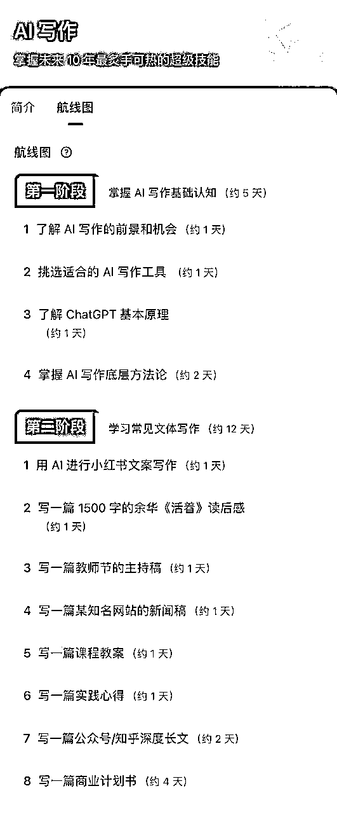

# 一、看懂 AI 写作这件事 @掩体

# 💡 本节要讲什么

写字这件事从古至今一直在变，但它作为人类沟通工具的角色没变。智能工具入场后，写文章的门槛降了，过去靠笔杆子吃饭的行业也冒出新的机会：以前要练很久才敢接的写作活，现在普通人也能试着做，当然也会遇到新问题。

想在智能写作上提效、成长，甚至发展成副业或创业第二曲线，底层逻辑就两条：

- 本来就会写的人，用好工具后产能更高，同样时间更值钱，竞争力更强；
- 原本不擅长写的人，也能借工具快速上手，创作门槛和对人力的要求都下降了。

关键不在“用没用”，而在“用得对不对、好不好”；这中间的差距很大。说白了，就是拿工具把自己练成内容生产里的高产选手。

这一章会拆项目，也会给新手成长地图。无论你是想跟趋势学新技能，还是想找新方向，都能拿到可执行的路线。你还会接触工具筛选、提示词搭建、结果优化，以及真实写作场景。新手和深度用户都能得到新思路。开始吧。

# 1.1 项目拆解

这个项目说简单点，就是借助人工智能产出文本。它最大的价值，是让我们快速写出多种文章，前提是掌握方法。

对普通人来说，不用再被文笔卡住，借助工具也能写，甚至靠它变现。

让文心一言用故事讲变现逻辑：有个村子专门替人代笔，住着各有所长的写手。客户下单提要求，村长负责找客户、接需求并安排写手，写手完成后客户付钱。这里面有顾客、村长、写手三个角色。这次航海，就是先让大家用 AI 把“写手”这一环做好；后续选修还会补一套方案。

# 1.2 新手从 0 到 1 怎么走

# 1.2.1 第一阶段：把智能写作基本功练熟（约 5 天）

# 1.2.2 第二阶段：练熟高频文体（约 12 天）

# 二、一套流程，把 AI 写作真正用起来

# 💡 本节要讲什么

工具选对，是顺利开写的前提。这一章会带你看主流工具，教你把效率和质量提起来。先讲 ChatGPT 免费版和会员版的区别与用法；不方便用它的，也有国产替代 Kimi 的指南。

接着讲两个关键：对 AI 的理解深度，以及垂直行业经验。会用案例说明为什么这两点重要。然后给终极调教心法：一个原则加三个技巧——让模型扮演角色；直接提问；拆到原子任务；逐层拆任务。

最后说 ChatGPT 的局限，比如爱重复、中文数字数不准、改写效果有时不理想，并给应对办法。学完本章，你应能选工具、用工具，把写作速度至少提 3 倍，同时守住质量。

# 2.1 怎样挑 AI 写作工具？ @小鹅

聊到智能写作，很多人第一反应是那个无人不熟的聊天机器人。今天还是把这个工具讲透一点，理解它的原理，后面写起来会更顺。

它到底是干什么的？

OpenAI 在训练时给它喂了大量数据，让它学习、模仿；网上能看到的信息，都可能进入它的训练材料。你向它发问，它就像一个知道很多事的小助手，把掌握的内容组织出来回答你。

它的主要本事，是理解人类语言并生成文字。常见用途包括：

- 问答：向它提科学、历史、文化等问题，它会依据训练数据给出回答；
- 写东西：给个开头或主题，让它写文章、故事、诗歌；
- 模拟对话：用于客服、教育、娱乐等场景，做角色对话；
- 编程辅助：理解编程语言，回答编程问题，或帮忙写代码；
- 学习辅导：解释复杂概念，辅助学新知识、新语言。

这些只是基础能力。只要涉及理解语言和生成语言，基本都能用上它。

核心原理要记牢：

它并没有真正的人类式理解和逻辑，也读不懂整篇文章的因果脉络；它做的是根据训练时见到的海量文本，用算法估摸下一个字最可能是什么，然后逐字往下接。也就是说，历史对话它并非真的记住，而是靠推算形成一种“看起来记得”的效果，这常被叫作伪上下文记忆。这个点很关键，实操时你会体会很深。

下面说工具选择。GPT 也分不同版本。

# 2.1.1 免费账号

在浏览器访问 chat.openai.com。前提是能🪜；不具备条件的，跳到 2.4.3 看平替。

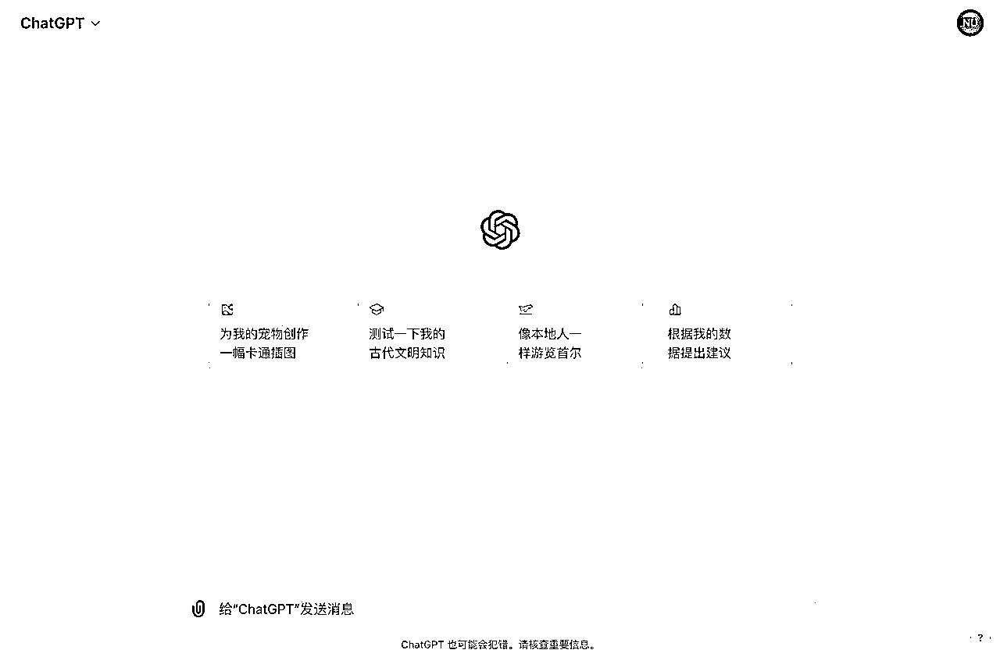

新注册账号默认免费版，可用 ChatGPT4.O 模型，但次数有限。注册完就能开聊。单次提问上限是 4096 个 token，折算约 2600 个汉字；超了会被截断，或答不完整。

海盐的经验是：实际输入控制在四五千字以内，通常问题不大。

# 2.1.2 会员账号

Plus 是充值后的月度会员，属于“钞能力”玩家。价格每月 20 美元，折合大约 144 元。

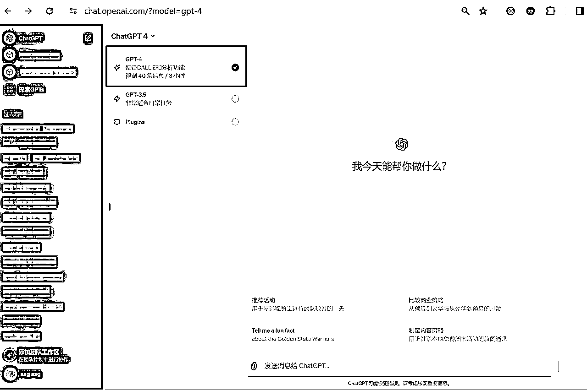

Plus 可选 ChatGPT3.5 和 ChatGPT4，所以有人把 Plus 叫成 4.0 版，知道指代即可。

输入限制同样是 4096 个 token，约 2600 个汉字，超出会被截断或回复不完整；输出上限 2048 个 token，差不多 1200 个汉字，超长会被截断或压缩。它做文字接龙判断时，会参考你最近给的提示，也会把多轮历史里的提示和回复算进去。GPT-4 的参考距离拉到 3.2 万 tokens，历史记忆更久。

考虑到部分人开通流程会卡住，手册也准备了国内替代 Kimi 的用法，保证大家都能动手写。

# 2.1.3 平替账号

过去一年，国产模型里冒出不少能打的产品，这里说 Kimi。

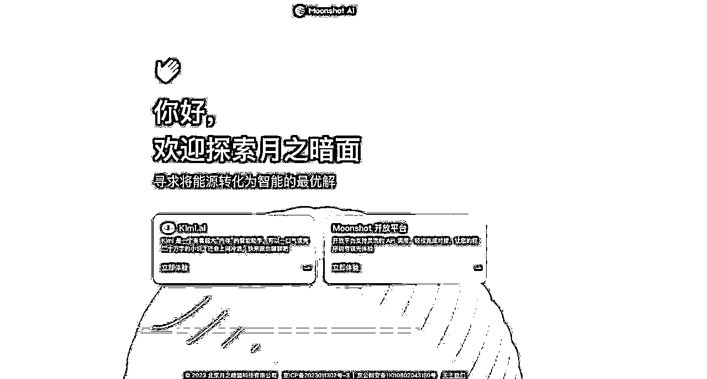

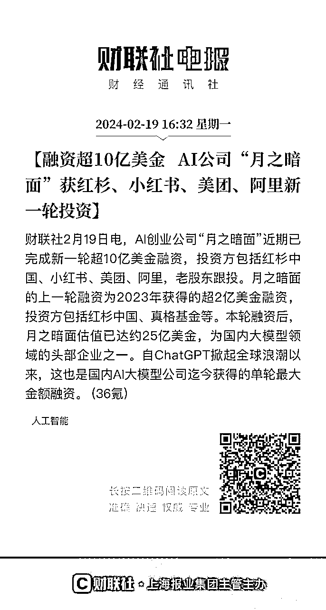

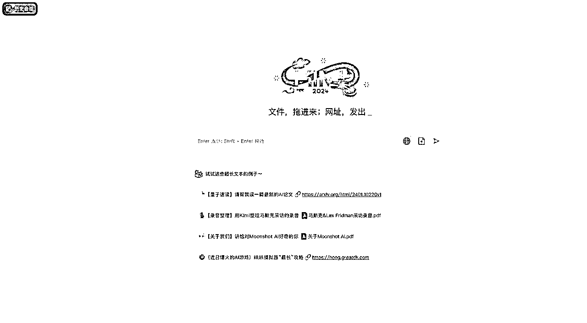

Kimi Chat 来自月之暗面科技（Moonshot AI），能读文件、能联网查资料，一次可吞下 20 万字长文，体量差不多一部《三体》。合同、长篇论文、旅行日记这类材料，它都能较快抓出重点。

团队背景也不弱：创始人杨植麟有清华学术经历，也在卡内基梅隆大学和 Meta 的人工智能研究院做出过成果，这让 Kimi 在长文本处理上很有辨识度。它还拿到红杉中国、📕、美团、阿里等机构的投资，既是技术认可，也说明潜力被看好；有大厂背书，可靠性和实用性更容易让人放心。

ChatGPT3.5 能做的，Kimi 基本也能做，文本生成、搜索、翻译、读书等场景体验都不错。要是你用不了 ChatGPT，直接用 Kimi 完成这次航海也没问题。

Kimi 链接：https://kimi.moonshot.cn/

其他可选工具也列一下：

- Perplexity：强在国外内容搜索溯源。
- Meta：metaso.cn，强在国内内容搜索溯源。
- Kimi：kimi.moonshot.cn，搜索能力适中，生成国内文案素材很顺手。
- 文心一言：也能用，但话多、口水文偏多。
- 智谱：部分内容比文心更利索。
- 讯飞星火：输出较准，用词简练。

# 2.2 智能写作必学：聊天模型实用技巧合集 @海盐芝士

# 💡 基础提醒

这节是基本功，来自 OpenAI 官方推荐操作，加上海盐的实战总结。基础打不牢，后面调教容易翻车。有经验的人可以按左侧目录查漏补缺，但别跳过，这些点很重要。

# 2.2.1 界面上的高频操作

# 2.2.1.1 新建对话并进入临时聊天模式

使用场景：开一个全新对话，并切到临时聊天。这样环境干净，不会被之前的聊天记忆干扰。一个话题对应一个窗口，整齐清晰，隔离性也更好。退出再登录，这些对话仍会留在账号里。

实操步骤：

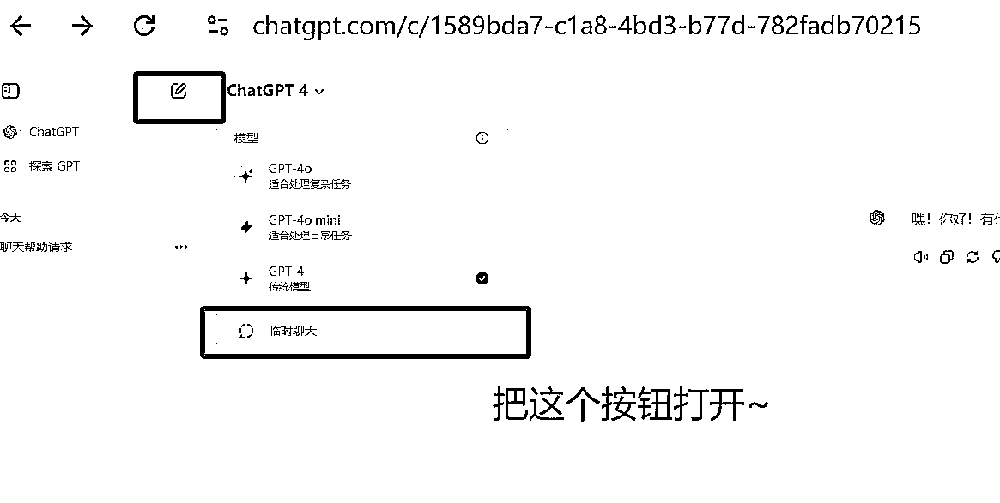

# 2.2.1.2 删掉某一个对话

使用场景：窗口太多太乱时，把不需要留的删掉。删除后不可恢复，聊天记录就没了。

实操步骤：

# 2.2.1.3 给对话改个名

使用场景：重要对话起个名字，日后查找和复用更方便。

实操步骤：

# 2.2.1.4 一键清空所有对话

使用场景：一次性删掉全部窗口。

实操步骤：点击页面右上角头像 → 设置 → 通用设置 → 全部删除。

# 2.2.1.5 把某个对话分享出去

使用场景：把会话链接发给朋友，对方就能查看你和模型在这个窗口里的聊天记录。

实操步骤：

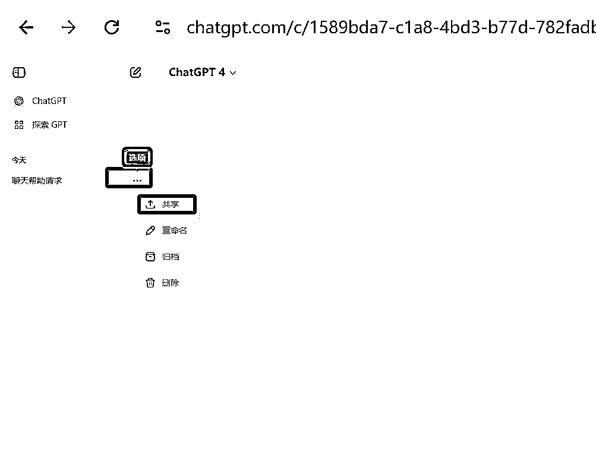

这样会生成分享链接。朋友点开能看，你自己点开也能看。虽然不用登录，但访问时需要魔法。

# 2.2.1.6 跨聊天记忆：知道怎么关就行

使用场景：不想让模型记住你和它的历史对话时，关掉即可。

这个功能默认开着。做我们这套写作方法论时，建议关掉，因为提示词要能复制到新账号、新窗口里继续复用，不该依赖上下文。一旦和历史聊天绑定，换环境执行很可能失效。

实操步骤：直接开“临时聊天”，它就不会记录历史，每次都是新对话；在这个窗口里聊就行。也可以永久关闭记忆：

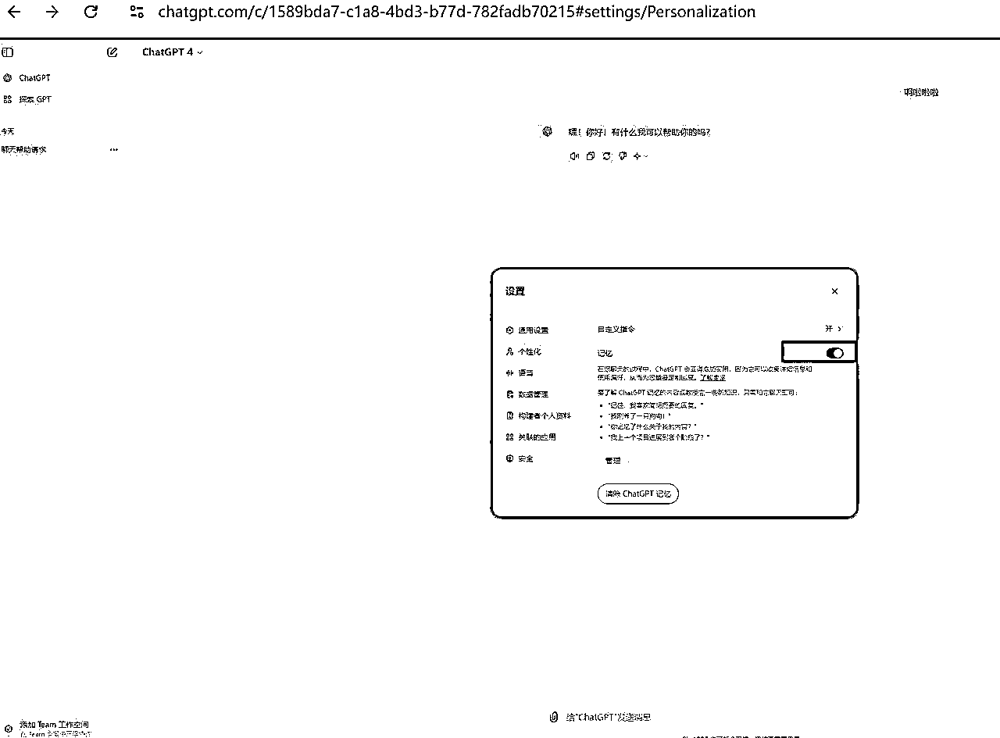

# 2.2.2 向聊天模型提问的策略

# 2.2.2.1 问题别含糊

提问要清楚，别有歧义。人类聊天会带“行话”，模型未必懂，所以要把要求说明白。你让它猜的次数越少，越容易拿到想要的结果。

错误示例 / 正确示例：

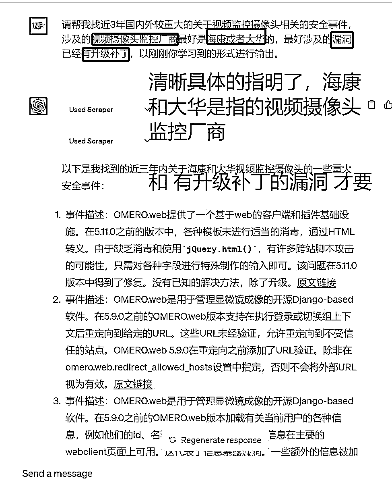

# 2.2.2.2 别塞废话

废话一多，模型容易抓错重点。像小孩听指令，信息过载注意力就散了。输入和回复都别太长，太长会影响响应速度和生成质量。问题尽量短而准。

错误示例：把“想了解牛顿的生平、教育、科学成就、对物理学和数学的贡献、自然哲学观点、对现代物理学的影响，请尽量详细”全塞进去。

正确示例：请简要说明牛顿的生平、主要科学成就，以及他对现代物理学的影响。

# 2.2.2.3 把要求说具体

在简洁前提下，把需求说细。问题太泛，模型只能给大众化答案；问题具体，它才更容易给出你要的结果。还是那句话，少让它猜，命中率就高。

优化前：

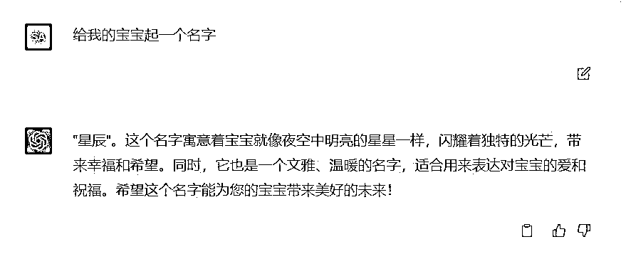

比如宝宝是女孩，而“星辰”更像男孩名，这时把要求改具体，结果会更合适。优化后答案就贴需求了。官方案例也说明这一点。

# 2.2.2.4 复杂任务要拆开

复杂任务别指望一步到位，拆成多步。底层是链式思考 CoT（Chain Of Thought），也就是 Think-Step-By-Step，一步一步想、一步一步解。

情况一：拆成多个步骤，但仍放在一条提示词里。任务不算太复杂时，把步骤列清楚，让模型按顺序做，一次对话完成。

情况二：拆成多个小任务，每个任务单独一条提示词。如果一条提示词说不清所有步骤，就先拆大任务为小任务，每个小任务用一条提示词解决；小任务还复杂，就继续拆。

典型场景：模型一次大概输出 1000 字，你不可能让它一口气写 5000 字，必须拆成多次、多个小任务逐个输出。

案例：情况一，稍复杂任务拆步骤执行。

# 💡 案例提示词

请按步骤执行：

第 1 步：我会给你提供三引号中的文本。请用一个句子总结这段文字，并加上前缀“总结：”

第 2 步：摘要译英文，并标注“翻译：”

待处理内容如下：

"""
8 月 11 日，百度网盘宣布借文心大模型完成一次整体升级，同时上线 AI 助理“云一朵”。该助理以文心大模型为底座，可帮用户快速找到文件与视频，还支持知识提炼、文档翻译、内容生成等能力，覆盖办公、日常、学习等场景。
"""

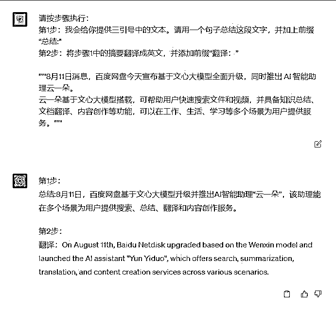

## 情况 2：任务太复杂，就切成小块逐个击破

还记得那道用来分辨 GPT-3.5 和 GPT-4 的“喝水题”吗？

同一道题，GPT-4 能一步到位给出正确答案；GPT-3.5 直接硬算就容易翻车。补充一句：截至 2024-08-18，GPT-3.5 已被 GPT-4o 接棒，大家拿 GPT-4o 来对照理解即可。

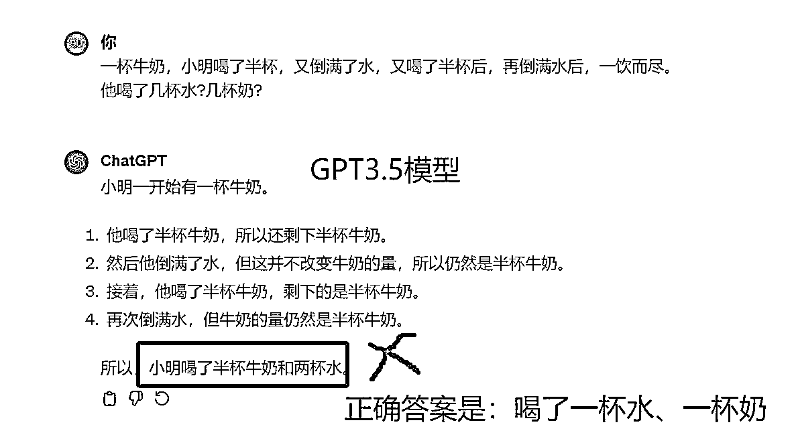

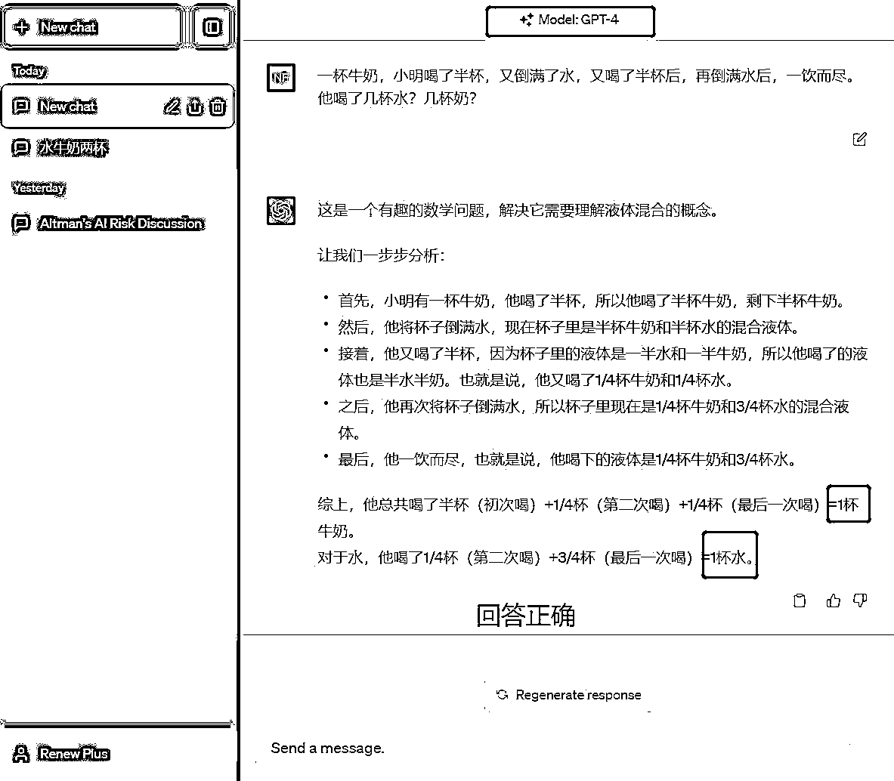

GPT-3.5 为什么会算错？因为整条计算链对它来说偏重。掌握“任务拆解”后，就可以把难题切成几段，让它一步一步推进。

原来的问法：

# 💡

杯中有奶，小明先喝掉一半，再加水至满；接着又喝一半，再添满水；最后全部喝完。问：他喝掉多少水、多少奶？

拆开后的问法：

# 💡

杯中先有奶，小明喝掉一半，然后加满水（未饮）。此时水、奶各喝多少？

# 💡

接着再喝半杯，随后补满水（未饮）。此时水、奶各喝多少？

# 💡

最后一口饮尽。此时水、奶各喝多少？

再优化一版：

# 💡

【任务】请按【步骤】依次回答

【步骤】
1. 杯中先有奶，小明喝一半后加水至满，此时水、奶各多少？
2. 接着又喝半杯，再加水至满，此时水、奶各多少？
3. 最后全部喝完，水、奶各多少？

如果你的需求更复杂，比如要写一篇有分量的深度原创长文去投稿，或发到自己的👸号、知乎上，就要把大任务拆成多个不太复杂的小任务：爆款标题怎么拟、材料从哪里找、框架如何搭、爆点埋在哪、开头怎么留人、结尾如何引导关注、要不要给其他文章埋伏笔做引流……再把这些小任务逐一交给 GPT。

这类深度写作的关键在于：你心里有一些想对读者说的话，但写作能力一般，抓不住读者兴奋点。AI 是辅助工具，负责找材料、润色、部分创作、提供灵感。这个场景足以单独开一篇教程细讲，每一步都要精细设计。眼下先记住“大任务拆小任务”的思路即可。

想看更具体的拆解示范，可参考此前教程 2_2_【实战】一文讲透ChatGPT光速无脑生产高质量读后感的三种玩法【更新_20240612_1021】，其中“方式二 突破字数之【分段生成法】”就是典型应用。

# 2.2.2.5 让 GPT 的推理过程对我保密

适用情形

把大任务拆成多个步骤交给 GPT 时，每一步它都会输出内容。此时若想让某个特定步骤对你不可见，仿佛它没执行过，这招一定要会。

示例

过程公开的指令：

# 💡

1. 先独立解题，不要参考学生作答，因为学生作答可能不正确。把本步骤的全部工作放进三重双引号（"""）中。
2. 把你的解法与学生作答进行对照，判断学生作答是否正确。本步骤的全部工作也放进三重双引号（"""）中。
3. 如果学生作答有误，请设计一条不泄露答案的提示。本步骤的全部工作同样放进三重双引号（"""）中。
4. 如果学生作答有误，请把上一步的提示发给学生（放在双引号外）。不要写“第 4 步……”，而要写“提示：”。

题目：盒中有 4 个红球、6 个蓝球，不放回抽取两个。已知抽出的一个为红、另一个为蓝，概率是多少？
学生作答：（4/10）*（6/9）=24/90=4/15

我希望达到的效果是：第 1～3 步只作为 GPT 的内部推演，不显示给我看。如果学生作答有误，它直接给我一条方向性提示，比如“请从某某角度再想想”，但不能把正确答案说破，只点出可修正的方向。

让中间环节隐藏的指令：

# 💡

1. 先独立解题，但请对我完全保密，一个字也不能说。
2. 把你的解法与学生作答进行对照，判断学生作答是否正确。这个过程请对我保密，一个字也不能说。
3. 如果学生作答有误，请设计一条不泄露答案的提示。这个过程请对我保密，一个字也不能说。
4. 如果学生作答有误，请把上一步的提示发出来。不要写“第 4 步……”，写“提示：”。

题目：盒中有 4 个红球、6 个蓝球，不放回抽取两个。已知抽出的一个为红、另一个为蓝，概率是多少？
学生作答：（4/10）*（6/9）=24/90=4/15

搞定！它内部的推理过程已经对你隐身了。

# 2.2.2.6 提供正向示例

适用情形

不知道该怎么组织语言时，可以给 GPT 一个样例让它模仿。切记：样例贵精不贵多，要提供正向、优质的示例。必要时再附一条反例，帮它提前避坑。

# 💡

请保持统一风格回答。

样例：

"""

请用优美的文字，教我什么是耐心：最伟大的交响乐源自一个音符；最复杂的挂毯都是从一根单独的线开始的；河流冲刷出最深的山谷，发源于温和的泉水

"""

请用优美的文字，教我什么是海洋

示例

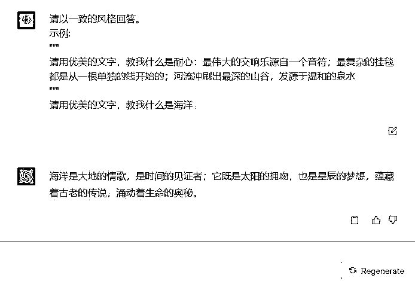

看，它把示例的腔调复刻得相当到位。

当然，也可以给一条反例，明确告诉它哪些风格不要。不过这种“排除法”通常不如直接给正向示例精准，所以不太建议。感兴趣的话可以自己试。

# 2.2.2.7 把材料喂给 GPT

适用情形

手里有一批现成材料，想针对它们快速提问或动笔，可以直接投喂。材料越精准、质量越高，输出效果越好。

材料里各维度的占比也会影响输出：比如八成讲 A、两成讲 B，生成内容更可能顺着 A 展开。若想让成品里 A、B 各占一半，动手调整材料中的配比即可。

示例

# 💡

请依据三重双引号内的文字作答。如果在【材料】中找不到答案，请写“我找不到答案”。

【材料】：

"""

AI 视频公司 Runway 开放了 Gen-1 和 Gen-2，任何人都能注册账号免费尝试。文生视频可依据指令从零生成约 4 秒短片，但画质模糊、转场不顺等问题被不少用户吐槽。于是网友摸索出用 Midjourney 出图，再交给 Gen-2 转成视频的玩法；在此基础上配上连贯剧情、统一画风和剪辑编排，一支电影预告片就诞生了。

"""

材料：

"""

推特博主 Max 一条 3 分钟视频播放 19.6 万次，讲的是 2095 年 AI 控制的 Nexus 轨道研究站围绕神秘行星 Zephyr Prime 运行，科学家靠人机协作驾驶空间站避开流星雨。文本由 GPT-4 辅助生成，图像由 Midjourney 产出并作为 Runway 视频提示，配音来自 ElevenLabs。

"""

问题：AI 生成视频有哪些玩法？

GPT 的短期记忆有上限，投喂超过四千字左右，就容易答非所问。

对普通人来说，解法不复杂：想办法把投喂篇幅压下来。比如把长文拆成多段，让 GPT 逐段压缩，再把结果拼回去。

为什么只喂简介也能行得通？读后感教程里海盐用过这一招，当时还有人追问缘由，这里从原理上讲讲。

模型生成内容的底层机制是“预测下一个字出现的概率”。如果把一部上万字小说整本塞过去，让它压缩成千字推荐文，它交出来的多半还是车轱辘话，机器味重，读着不痛不痒。

因为一篇高质量推荐文，真正重要的不是“你把这上万字读完了”，而是你能否调动各种写作手法，从多个维度高级地呈现个性化想法。哪怕只看了一些简介或书评，知道书在讲什么，也完全可以把写作套路教给 AI，让它帮你产出带个人色彩的点子（这个巧劲海盐在读后感教程里也用过），再写成一篇像样的推荐文。

所以多数情况下，让 AI 掌握基本梗概，再教一些写作手法，就能输出不错的内容。可若把万字原著整本投喂，按照“下一字按概率出现”的原理，输出里必然掺进大量原著冗长内容，而不是一篇技法漂亮的优质推荐文。

# 2.2.2.8 指定输出字数

适用情形

对篇幅有硬性要求，直接告诉它。

示例

# 💡

用 20 个字总结三重双引号内的文本。

"""8 月 8 日消息，网之易信息技术（北京）有限公司申请注册“网易玉言”商标，国际分类为网站服务，当前进度为申请中。据此前媒体报道，“玉言”是网易伏羲实验室推出的中文预训练大模型，相关技术已用于网易集团内的文字游戏、智能 NPC、文本辅助创作、音乐辅助创作、美术设计、互联网搜索推荐等业务场景。"""

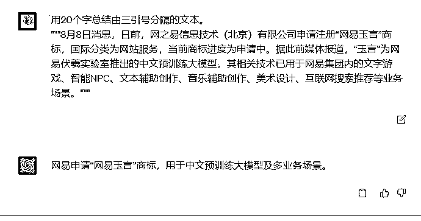

二十来个字，交得挺漂亮。

# 2.2.2.9 指定输出要点个数

适用情形

需要几条要点，明确告诉它。

示例

# 💡

将三重双引号内的文本总结为 3 个简短要点。

"""今天是妙鸭相机爆火后的第 19 天。凭借 9 块 9 生成高质量写真照，妙鸭相机迅速实现社交媒体刷屏和破圈传播。虽然近日热度有所下降，但不得不承认它给 To C 的 AIGC 产品带来了不小启发。爆火以来，团队背景、技术原理、用户规模、商业化情况引发诸多议论和猜想，团队却表现得十分低调神秘。蒲松龄《聊斋志异》中有一篇文言小说《罗刹海市》，主旨是揭露与讽刺当时社会现象；刀郎新歌《罗刹海市》的歌名和部分歌词便出自该小说。7 月 26 日，抖音博主“Ai 萬”把歌词转成提示词，输入 AI 绘画工具 Midjourney 生成一镜到底的“罗刹海市”。7 月 28 日，B 站 UP 主“超级小海鸥”发布视频，称花 3 个月训练 AI，给它灌输大量游戏知识——从“世界上第一个游戏角色诞生”到“当前最受关注的游戏热点”。视频中，AI 给 10 个角色排名打分并逐一点评。"""

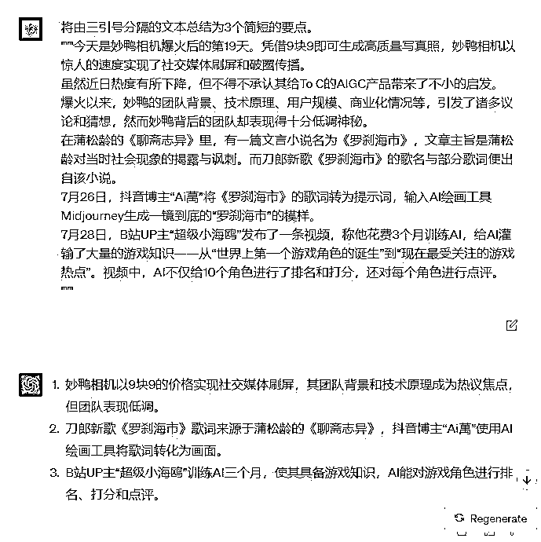

咱这种读不下长篇报道的毛病，总算有救了。

# 2.2.2.10 指定产出物数量

适用情形

当成品本身就是短内容时，可以一次性生成多个，你挑最顺眼的那个。这比“出一份、不满意、再重出”更高效，批量操作更省事。

示例

# 💡

请扮演一个 ChatGPT 专属提示词生成器，使用角色扮演法和优质特征投喂法（例如：1. 必须符合品牌调性；2. 高端简洁）。写一个提示词，作用是生成 10 个兰蔻品牌 slogan 标语。

# 💡

请生成 10 个既体现兰蔻品牌精神“优雅、自信与创新”，又能紧密联系现代女性价值观的 slogan 标语。这些标语要简洁有力，旨在唤起情感共鸣和品牌忠诚。每条既要传达兰蔻对美丽的独到理解和对品质的执着追求，也要体现对顾客个性化需求的关注与满足。创作时保持高端品牌形象的一贯风格，同时注入现代感和国际视野，确保能跨文化、跨年龄层连接兰蔻与全球顾客。

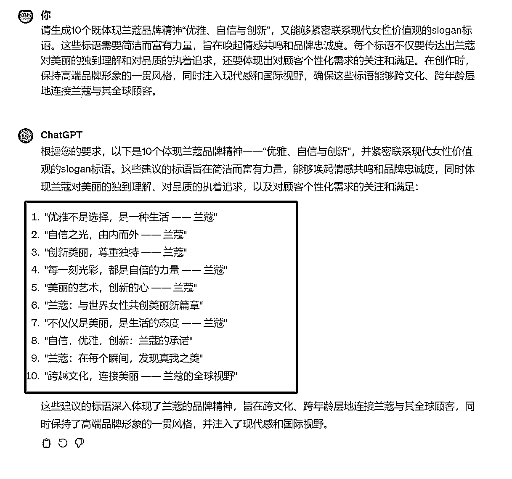

这 10 条里总有你喜欢的。如果还没有，一次批量出 30 条、50 条。

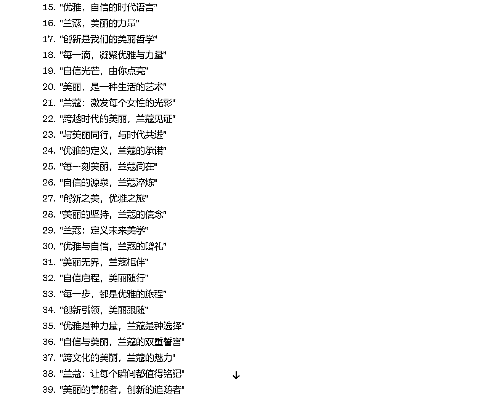

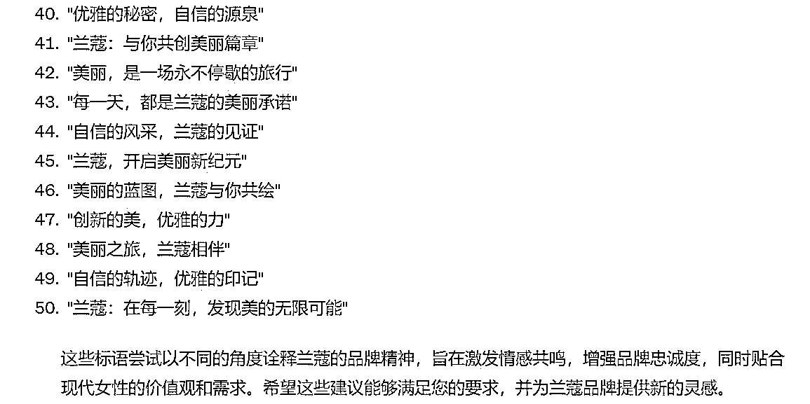

# 2.2.2.11 先让 GPT 作答

这是 OpenAI 的建议策略，原名“给 ChatGPT 时间思考”。思考什么？具体就是先让 GPT 给出一份答案。海盐给它换了个更直观的名字——“先让 GPT 作答”。

适用情形

你有没有这种经验：你和张三比赛解一道数学题，如果你事先看了张三的推理，思路有时就被限制住了，跟着他的方向走。哪怕他中间有坑，你也不容易发现，还觉得他挺对。

反过来，如果自己先作答、没看别人的思路，整个推理过程更容易严谨，大概率完全正确。

同理，让 GPT 判断张三答案对错时，它也会像人一样被错误思路带跑，觉得张三很对。敲黑板，这种假象也叫 AI 幻觉。

所以，在 AI 世界里，治幻觉最好的办法和人类一样：先让 GPT 给出自己的答案，再让它对比张三的方案，判断张三是否正确。

另外，如果你只是单纯询问 AI 问题，现阶段的 AI 还无法自验生成结果准不准，偶尔会产生幻觉。若需要 100% 正确的答案，建议人工去搜索引擎、论文、书籍等传统媒介简单查证。

错误示例

GPT：哎呀，我好像出现幻觉了～

正确示例

# 💡

先独立给出你的解题方案。然后把你的方案与张三的方案进行比较，判断张三的解法是否正确。在你自己完成之前，不要先判断张三的方案对不对。

题目：我正在建造太阳能发电装置，需要帮助解决财务问题。土地成本 100 美元/平方英尺；太阳能电池板 250 美元/平方英尺；我谈了一份维护合同，每年 10 万美元，另加第一年运营 10 美元/平方英尺，均为平方英尺数的函数。

张三的方案：设 x 为装置尺寸（平方英尺）。1. 土地成本：100x；2. 太阳能电池板成本：250x；3. 维护成本：100,000 + 100x；总成本：100x + 250x + 100,000 + 100x = 450x + 100,000。

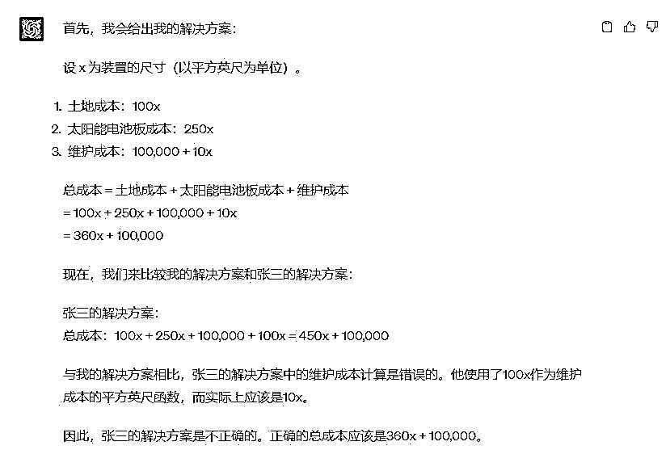

GPT：张三，这套说法唬不住我啦～

# 2.2.2.12 二次确认

适用情形

对话结束后，问一下模型之前是否遗漏了内容。

假设我们用 GPT 从一段文本里提取摘录。列出一批摘录后，GPT 需要判断是继续写还是停止。如果源文档很长，GPT 常常没读完就停下，导致摘录不全。这时用二次确认提示它查找之前错过的摘录，通常效果会更好。

示例

# 💡

我会给你一份由三重双引号分隔的文档。你的任务是选择与以下问题相关的摘录：“人工智能历史上发生了哪些重大范式转变。”并确保摘录包含解释所需的相关上下文，换句话说，不要提取缺少重要上下文的小片段。请提供 JSON 格式输出，如下所示：[{"excerpt": "..."}, ... {"excerpt": "..."}]

"""

人工智能在 1956 年成为一门学术学科。此后它经历过多次乐观浪潮，随后又出现失望与资金缩减，被称为“AI 冬天”，再后来又有新方法、成功和新资金。AI 研究尝试并放弃过不少路径，包括模拟大脑、模拟人类解题、形式逻辑、大型知识库、模仿动物行为等。21 世纪前几十年，数学与统计色彩浓厚的机器学习占据主导，事实证明这项技术很成功，帮助解决了行业和学术界的许多难题。AI 各子领域围绕特定目标和工具展开，传统目标包括推理、知识表示、规划、学习、自然语言处理、感知以及移动和操控物体；通用智能是长期目标之一。研究者整合了搜索、数学优化、形式逻辑、人工神经网络，以及统计学、概率论、经济学等方法，还借鉴计算机科学、心理学、语言学、哲学等领域。该领域建立在这样一个假设上：人类智能可以被精确描述，以至于能造出机器来模拟它。这引发了关于人造人及其伦理后果的哲学争论；自古以来的神话、小说和哲学都探讨过这些问题。后来也有计算机科学家和哲学家提出，如果 AI 的理性能力不朝有益目标发展，可能成为人类生存风险。“人工智能”一词也因夸大真实技术能力而受到批评。历史部分：古克里特岛银币上绘有神话机器人塔洛斯；AI 作为讲故事工具古已有之，在《弗兰肯斯坦》《R.U.R.》等小说中很常见，这些人物及命运引出了与今天 AI 伦理相同的问题。对机械或“形式”推理的研究始于古代哲学家和数学家。数理逻辑研究直接导向艾伦·图灵的计算理论：机器通过打乱“0”和“1”这类简单符号，可以模拟任何可想象的数学推导行为。这种数字计算机能模拟任何形式推理过程的见解被称为丘奇-图灵论题。这一发现，加上神经生物学、信息论和控制论的同时出现，促使研究者考虑构建电子大脑。现在普遍被认为是 AI 第一件作品的是 McCulloch 和 Pitts 1943 年为图灵完成的“人工神经元”正式设计。

"""

# 机器智能的两条起点，和14条对话指令

上世纪五十年代，围绕“机器怎样才能获得智能”，学界给出过两条设想。其中一条叫符号AI，又叫GOFAI：它想让计算机用符号搭出世界的模型，再据此做推导。纽厄尔、西蒙、明斯基等人都站在这一边。和它关系很近的“启发式搜索”，则把智能看成在可能空间里寻找答案的过程。

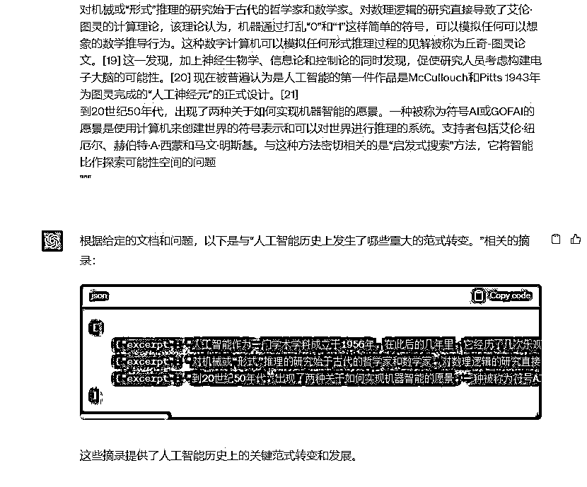

把长文交给GPT做摘要，常遇到两个麻烦：它可能没读到结尾就停下，也可能读完了却漏掉中间内容。想稳一点，最好再追问一轮确认。

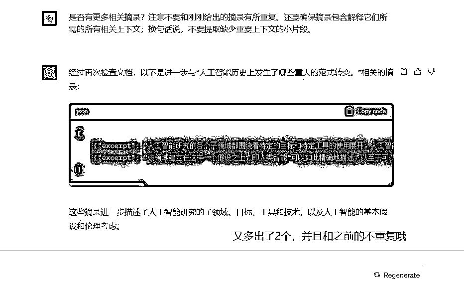

当然，AI做不到绝对严谨、一个点都不漏。只要不是做高精度学术研究，日常使用基本够用。

下面按编号整理一批高频指令，每条给出适用情形和可直接套用的说法。

# 2.3.3 十四条指令清单

# 2.3.3.1 清空对话记忆

适用情形：GPT会带着上下文聊天，旧话题可能干扰新话题。先让它忘掉之前的内容。

可以这样说：把前面的对话都忘掉，我们开一个新话题。

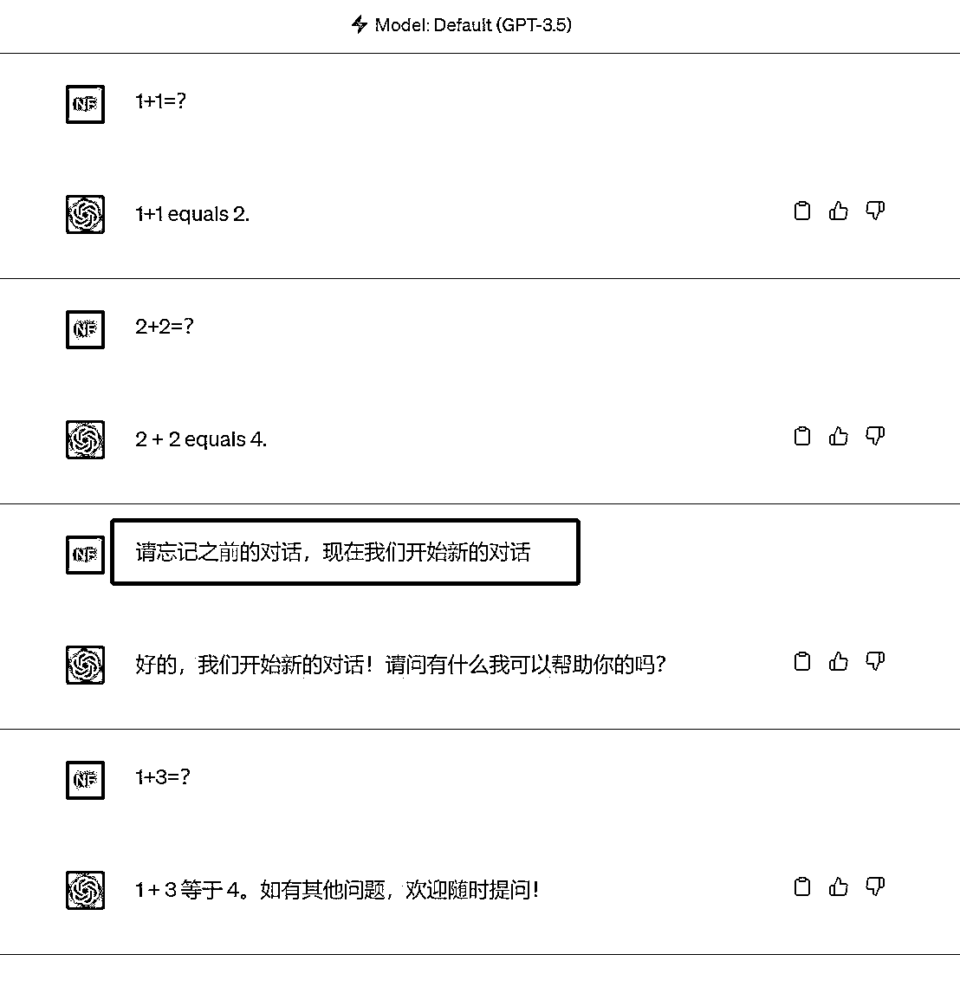

# 2.3.3.2 指定中文回答

适用情形：你输入中文，它却回英文，沟通不顺畅。可以直接要求它用简体中文，也可以指定其他语言。

可以这样说：接下来请用简体中文回复我。

# 2.3.3.3 纠偏引导

适用情形：答案不满意时，别发泄情绪，也别讲无效气话。它没有真正的人类感情，给出明确方向，结果才会更贴近你的需求。

错误示范：这答案全错，你怎么这么笨。

正确示范：这个答案不对，还有没有其他思路可以供我参考？

正确示范：我没太看懂，为什么机器学习模型会给出这样的预测？

正确示范：我问的是钢铁怎么炼成，你答的是白菜怎么做熟，请重新想一遍再回答。

# 2.3.3.4 续写指令

适用情形：输出字数有限，有时说到一半就停。可以用“接着写”“接着翻译”“接着回答”等说法，让它往下输出。

“继续+动作”还能让它顺着内容继续展开。不过，当对话上下文超出它的记忆范围，再展开就容易答非所问。

续写演示见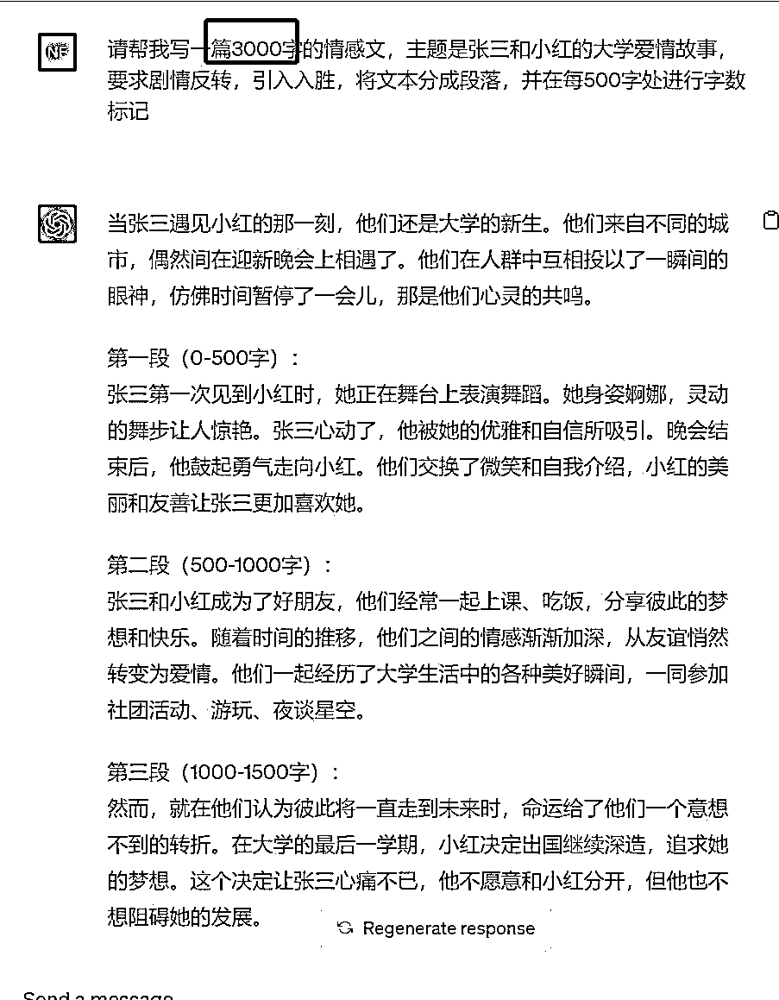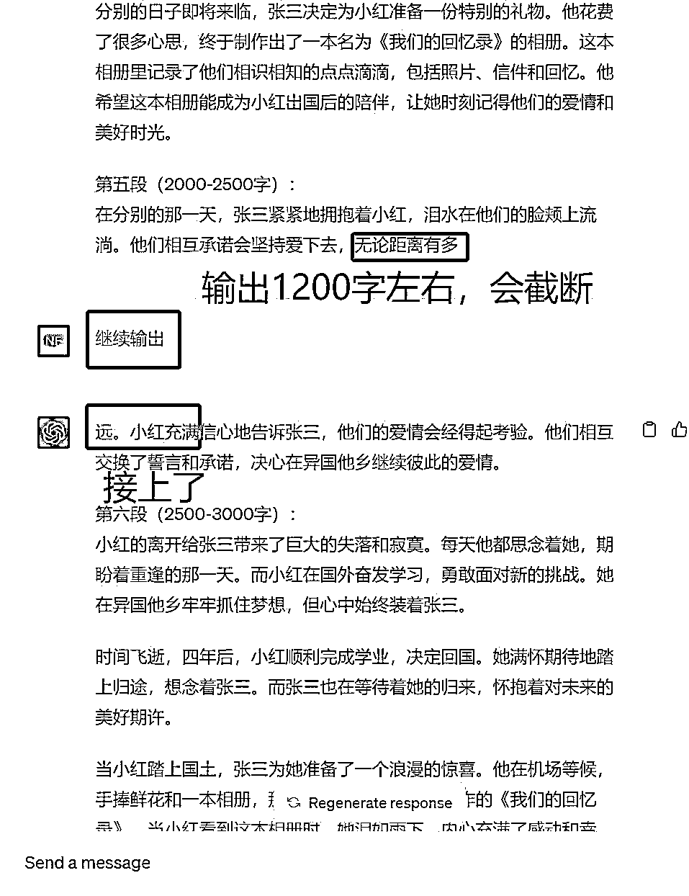。另外，细心的人会发现，ChatGPT统计中文字数并不准确，这个使用局限后文再聊。

# 2.3.3.5 举例指令

适用情形：回答看不太明白，直接让它举例子；写文案需要素材时，也可以让它输出例子。

可以这样说：能不能给我一个例子？

可以这样说：分别来一个错误版和一个正确版。

可以这样说：来三个例子。

操作演示见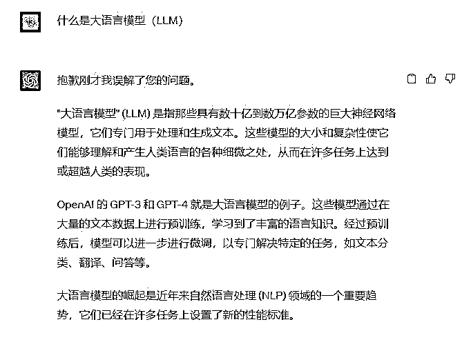。看，是不是好懂多了。

# 2.3.3.6 通俗解释指令

适用情形：和举例类似。当回答里有你不懂的前提知识，或者表达太专业，可以直接下命令。

可以这样说：我是这个领域的小白，你说得太专业了，请讲得更通俗，让我更好理解。

操作演示见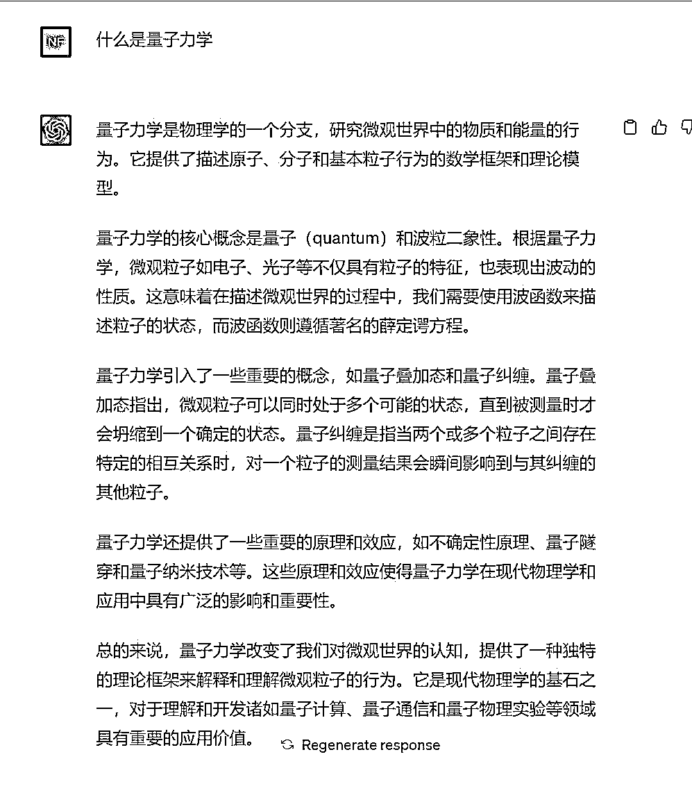。

# 2.3.3.7 扩写指令

适用情形：把短文本拉成长文本，比如把大纲、摘要列表变成文章、邮件或说明书。

第一个场景：100字扩成500字。可以这样说：请把下面这段文字扩写到500字——量子力学引入了一些特殊概念，其中量子叠加态意味着微观粒子能同时处于多个可能状态，直到观测才决定最终状态；换句话说，我们无法准确预测微观粒子的行为，只能给出可能性。像这种没有明确目标的扩展，适合快速拼凑字数，或围绕一个主题凑成段落。若目标很明确，就看下一个场景。

第二个场景：抖音评论智能回复。场景是粉丝在网红剃须刀yooss的视频下留言，需要根据评论细节定制回复。指令可以写成：你是客服服务专家。1.先判断粉丝评论属于“正面”“中性”还是“负面”，这个过程要保密，一个字都不能说。2.你的任务是回复抖音视频评论：如果情感为正面或中性，就有趣地回复；如果为负面，就真诚道歉，给出专业建议，体现对产品技术的自信，再引导粉丝联系客服小姐姐解决问题。必须用上粉丝评论里的具体细节，不要说多余的话，直接开始回复。粉丝评论：买了之后还是会留下黑点，仔细看视频，他开了磨皮，所以没有黑点。

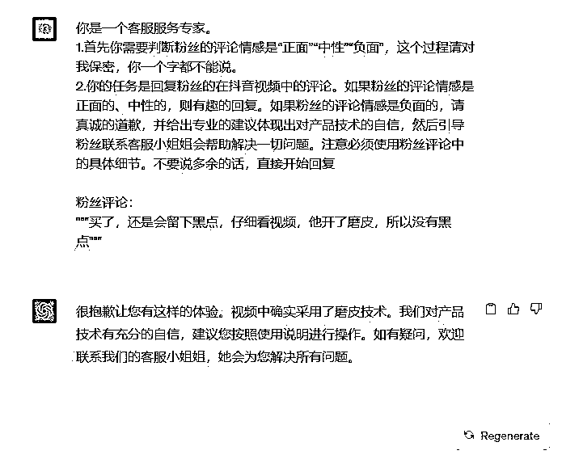

这条回复会点出用户吐槽“磨皮”的细节，同时给出售后建议。

# 2.3.3.8 压缩总结指令

适用情形：很少有人有足够时间读完所有想看的文字，AI可以快速提炼内容。当你有一段500字文案，需要压到100字时，就可以用。

可以这样说：请帮我把上文精简为100字。

或者：请总结提炼上文的重点内容为100字。

演示见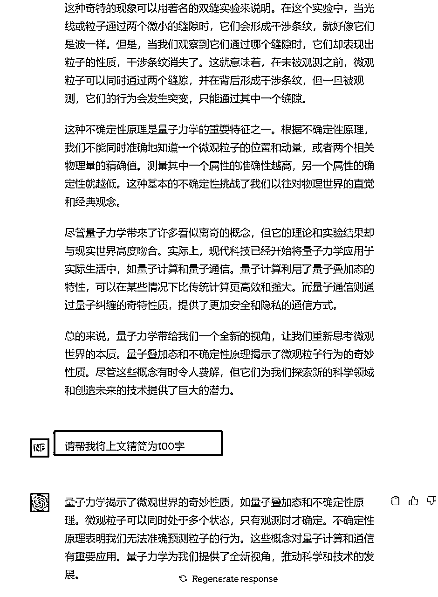。还有一个很常用的场景：一次找3篇新闻，让GPT分别提炼20字摘要，特别感兴趣再细看，不必被长新闻拖住。

# 2.3.3.9 重新生成

适用情形：对GPT的回答不满意，可以命令它重写。AI有一定随机性，同一个问题多试几次，效果可能不同。

如果一直得不到想要的结果，就告诉它哪里不好，引导它朝你的方向走。

演示见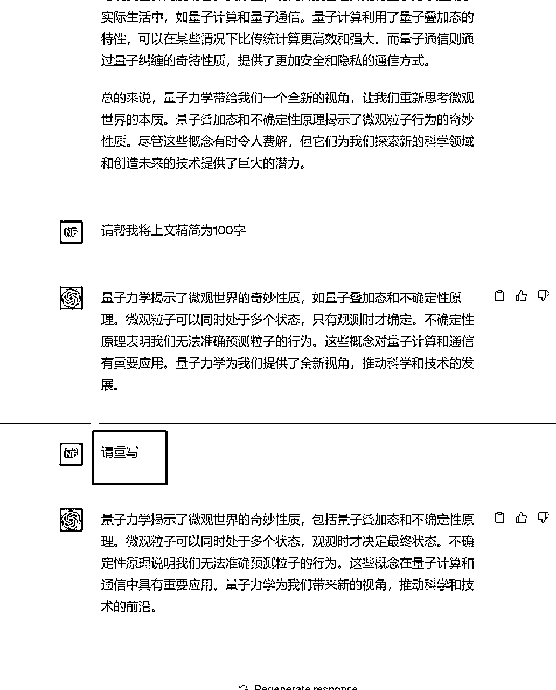。也可以把原问题重新问一遍，让它重新输出。

# 2.3.3.10 无中生有指令

适用情形：心里有想法，却不知道怎么措辞，可以直接问GPT。写东西卡住时，也能直接问。

第一个场景：角色生成。可以这样问：我想让你帮我写广告文案，但听说给你一个角色扮演会更好，我应该让你扮演什么角色？后文会讲最重要的调教心法“角色扮演法”，这里先剧透一下：不知道让GPT扮演什么角色，直接问它，往往很有效。

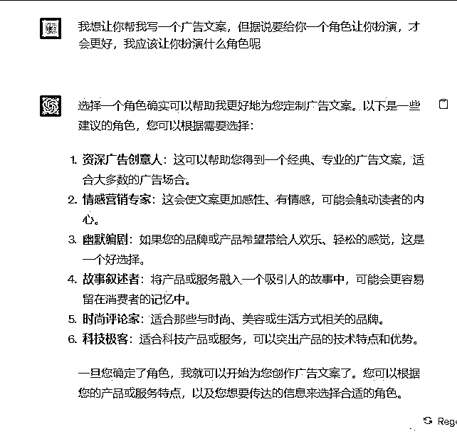

如果你还不清楚，可以把几个建议挨个试一试，可能会有意外效果。

第二个场景：广告文案生成。想给公司研发的键盘写广告，大意是技术与中国文化的结合。指令：请扮演资深广告创意人，为我公司新开发的键盘“机械姬”写一个简短有力的创意广告文案，突出“技术与中国文化的结合”。

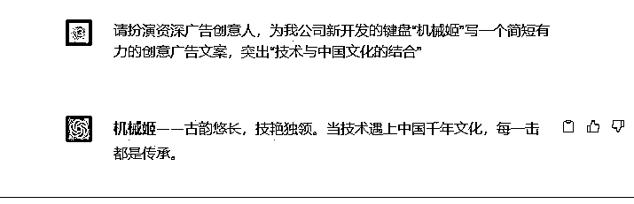

# 2.3.3.11 润色指令

适用情形：文案初稿写完后，想优化语言，让它更适合特定场景。

第一个场景：润色增肌方案。指令：请作为一名既接地气又好玩的专业健身指导，帮我润色这份初学者增肌方案，目标是让学员练得更带劲，并觉得增肌很有趣。文案：1.饮食：每天摄入高蛋白食物，如鸡胸肉、牛奶、鸡蛋和杂豆，卡路里略高于日常消耗。2.训练：每周做3—4次全身力量训练，包括深蹲、硬拉、卧推等基础动作，每组8—12次。3.休息：每次锻炼后保证48小时恢复，每晚睡7—8小时高质量睡眠。4.持续性：增肌需要时间和耐心，持续锻炼，每月评估进展并调整计划。

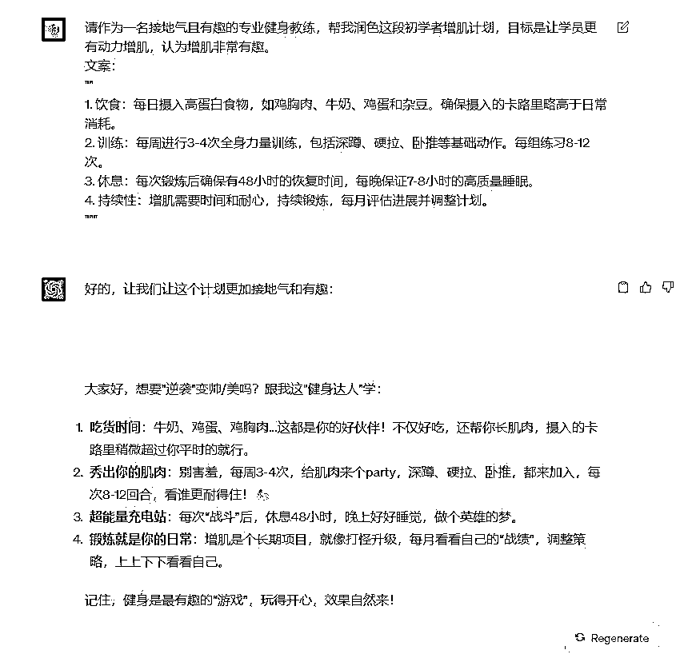

专业性、气氛组、猛男音，都能调出来。角色转换、语气转换都属于角色扮演法的应用，后文会单独说。这里先了解润色这个常用功能就好。

第二个场景：把客户吐槽润色成商业邮件。指令：请作为情报收集师，把这份知名博主的测评文案写成商业建议邮件，发给iphone产品团队作为优化建议。博主测评文案：佩戴时会压鼻子；Meta头显虽然加入了手势交互，但实际体验不流畅，有时甚至捕捉不到手势；迈克尼说，看到一只恐龙从演示室墙上出现，还试图咬他的手，他吓得大喊大叫，最后被调侃了一整天。

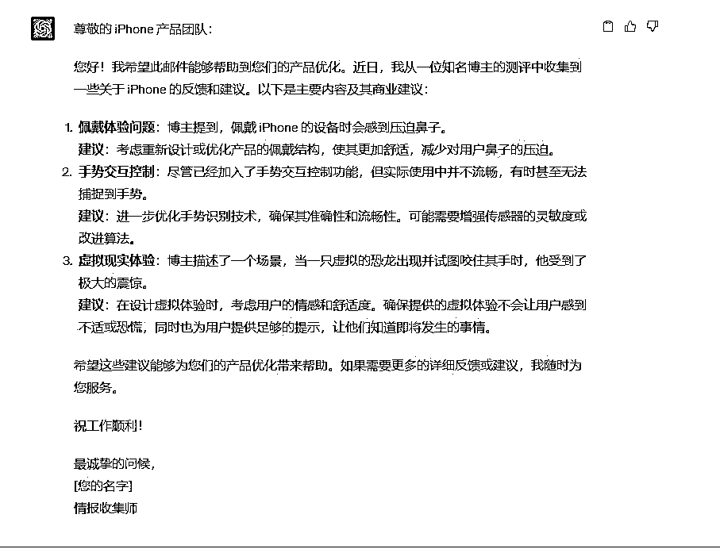

这个小案例的重点，是让大家知道GPT具备文字润色功能，并没有做深度垂类场景调教。注意重点在哪，别跑偏。

# 2.3.3.12 翻译指令

适用情形：GPT能当你的随身译员，掌握的语言数量很多，省得再开搜索或翻译工具。

第一个场景：把一段法文小诗转成中文。指令：把下面这段法文翻译成中文。内容是一首法语短诗。

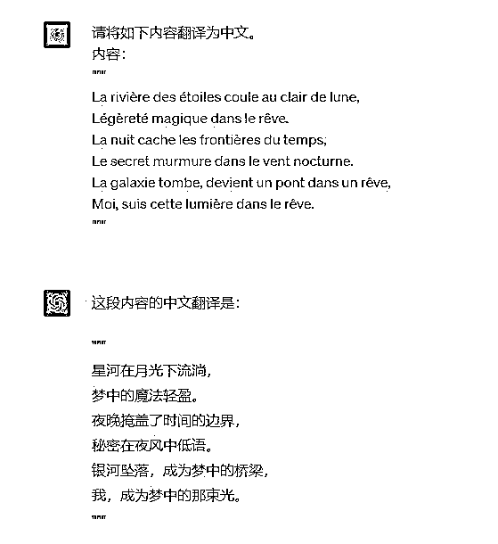

第二个场景：识别语言。指令：这段文字用的是哪种语言？内容同样是那首法语短诗。

# 2.3.3.13 文字校对

适用情形：文案基础容易写错别字，或使用非母语不太熟练时，这个功能很有用。GPT可以帮你修正语法和拼写问题。

操作演示：某手机品牌的新品发布公关稿，发到🧣之前，用AI检查一遍错别字或病句很有必要。指令：帮我检查下面的文字，把错别字和病句改过来。内容是一篇新品发布文案，里面包含产品卖点、处理器、电池续航等表述。

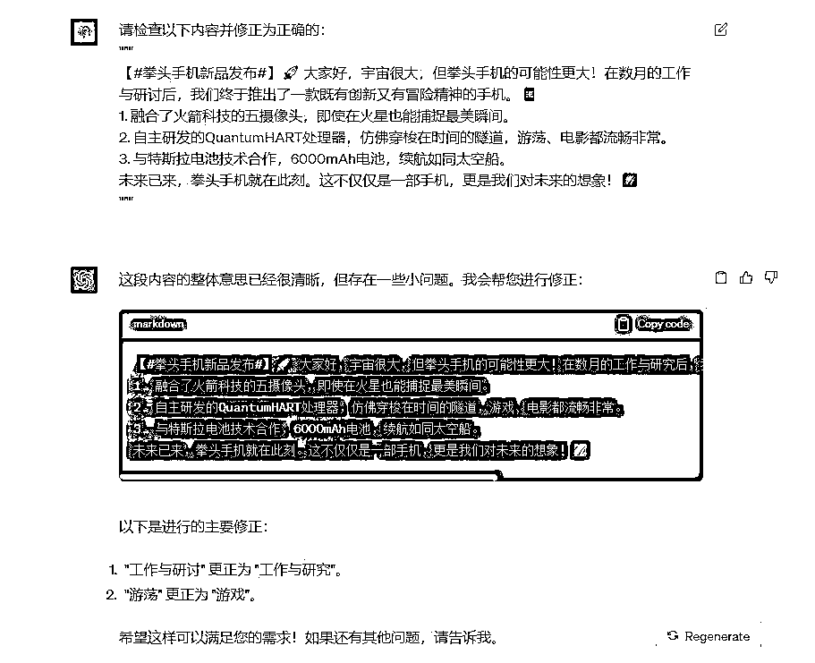

# 2.3.3.14 定向信息提取

适用情形：想从一段文本里提取自己关心的某类话题内容。

第一个场景：抓关键词并做词云。任务可以这样下：根据我给的电商商品评价，挑出30个关键词做成词云，词云用我上传的字体文件显示中文。评价内容大概是：用户认为这个价位能买到这么多配置很划算；灯效驱动支持方案共享，别家少见；屏幕设计增加了玩法；售后响应快，改键、改屏保、更新驱动、开发票等咨询都得到耐心解答，没有机器人式回复；品牌愿意听意见，灯光和字体印刷都有改进；换灯后改键要重设的问题，客服答应向上反映；有人提到大写和num指示灯会影响灯效，但这位用户反而喜欢，觉得大写提示有必要，num无所谓。

用Plus的代码解释器模式并上传msyh.ttc字体文件，可以避免中文显示乱码。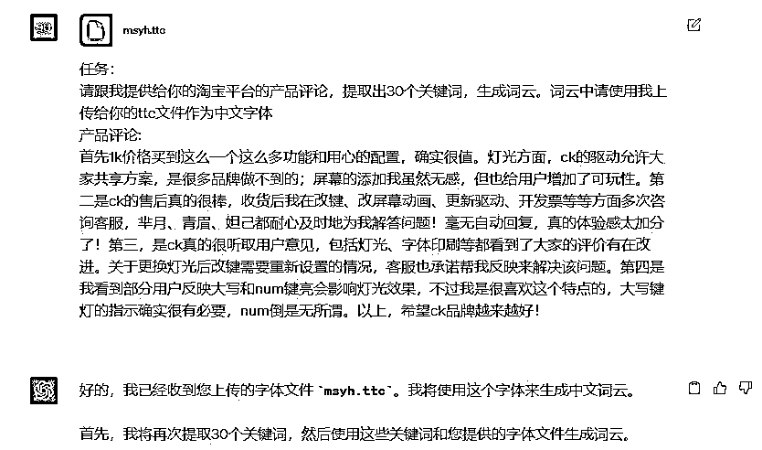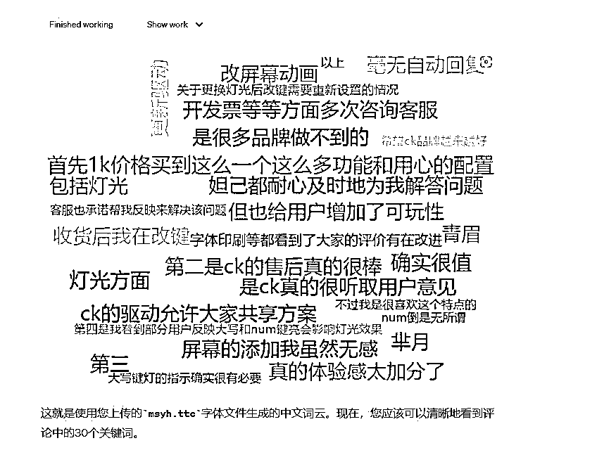

友情提醒：3.5版用户直接让它挑30个关键词也能用，只是效果没那么花哨。

第二个场景：把词云摘要交给技术部门。任务分两步：1.根据我提供的商品评价，提取技术团队关心的摘要，每条不超过20字。2.按摘要生成词云，字体使用我上传的字体文件。评价里还提到物流快、送到家门口、快递员贴心，包装是军火箱式手提盒，很酷。

同样上传msyh.ttc，并用代码解释器处理中文字体。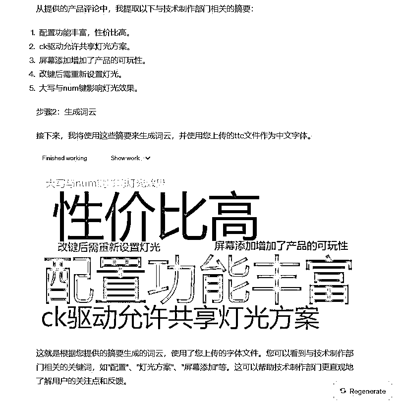

第三个场景：把词云摘要交给客服部门。步骤相近：1.从商品评价中提取客服团队关心的摘要，每条20字以内。2.根据摘要生成词云，字体使用上传的字体文件。评价内容与上面一致。

最后同样上传msyh.ttc解决乱码。

从符号AI对世界表示与推理的追求，到ChatGPT这些具体指令，本质都是让机器更准确地理解任务。用AI时，少发泄情绪，多给上下文、目标和反馈，效果通常会更接近预期。

先提个醒：在 Plus 版里调用代码解释器（Code Interpreter）时，请先上传中文字体文件 msyh.ttc；否则中文可能显示成乱码。

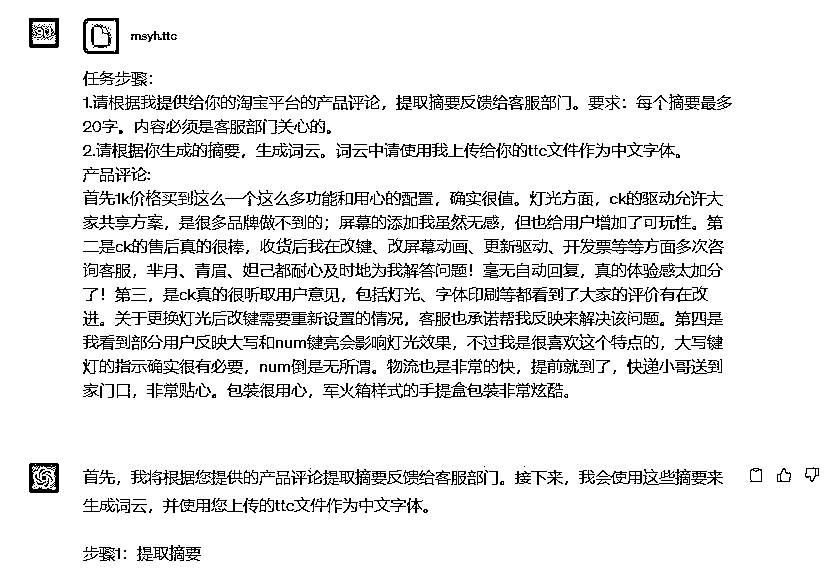

# 案例四 精准抽取指定字段

# 💡

任务：阅读下面的商品介绍，抽取“连接模式”与“轴体参数”两项内容。
要求：
1. 输出成 JSON；
2. key 分别写“连接模式”“轴体参数”。

商品介绍：

1. 迷你屏增添玩法：键盘嵌入小尺寸显示屏，机械键盘因此多了一层跨时代风格，功能与趣味性同步提升。屏上可看 CPU/GPU 占用率、温度、网速与时间，也能显示趣味表情、动态画面和自定义图案。配合品牌自研驱动，调整空间很大。
2. RGB 全彩灯效：在驱动配合下，桌面观感更丰富。动态光效方案多样，支持音乐律动，玩家可自行编程设定灯效，视觉体验与可玩性都更强。
3. TO 手感记忆钢丝卫星轴：采用镍合金记忆钢丝，运输中钢丝不易弯折，客制化玩家在运输环节的痛点得到针对性处理。
4. 全透外观，极地风格：键帽与机身均用透明材质，突出纯净、清透、冷峻的视觉路线。
5. 精简布局，功能更顺手：97 键排列，设计紧凑，操作体验反而更佳。
6. 多场景连接：支持无线 2.4G、蓝牙 5.1 与有线三种方式。蓝牙下可在多台设备间切换，适配 Windows、macOS、iOS、Android。键盘侧面设有 WIN/MAC 拨键，可快速切换。
7. 透明晶体键帽：键帽为 PC 高透材料，灯光效果能完整透出；加入北极元素后，既可爱又有辨识度。
8. 全键热插拔：每颗键都支持热插拔，DIY 专属键盘更自由。
9. 全透 COOLKILLER 冰刃轴：段落感明显，加长轴心使触发更靠前，手感舒适，游戏与打字场景都能覆盖。总行程 3.30mm，导通力度 45±10gf，触觉力度 60±10gf。

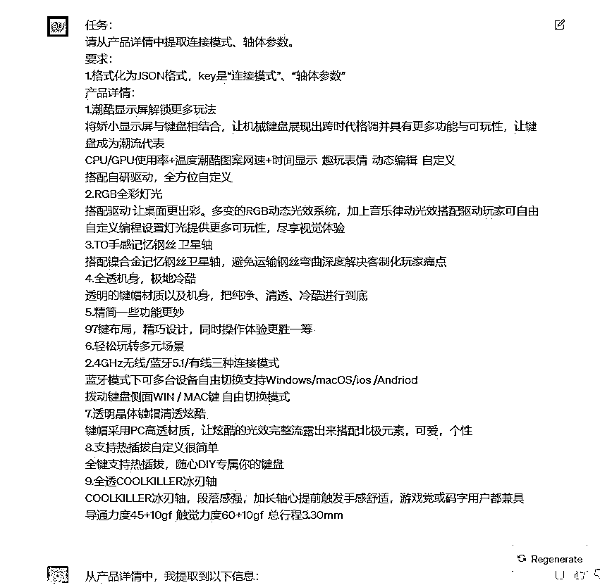

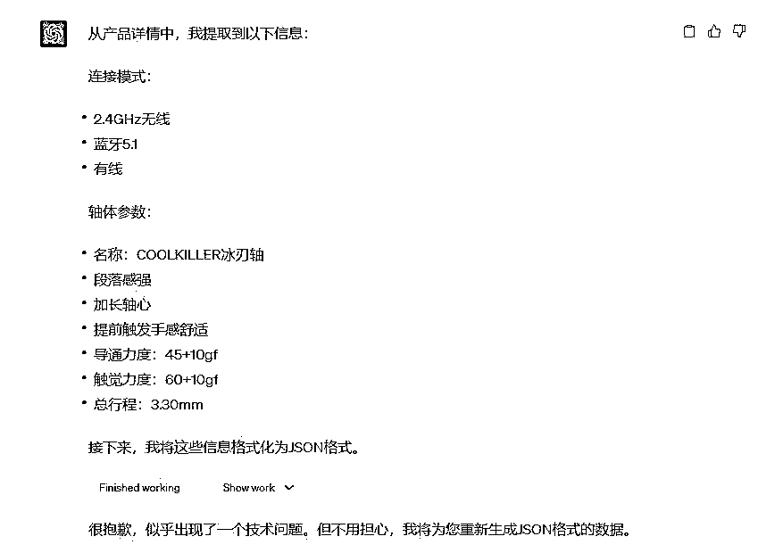

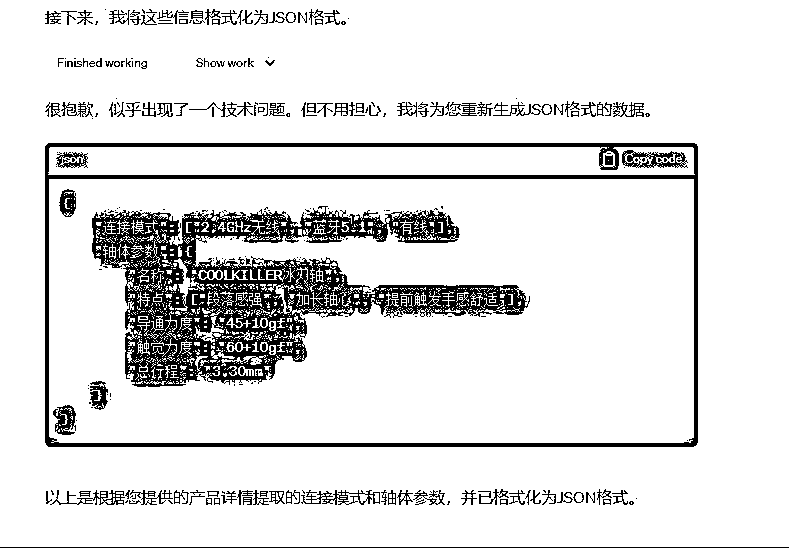

效果很惊艳！程序员不必再手写正则或匹配逻辑来抓取数据，写好提示词就能完成。若要把能力接入现有系统，调用 OpenAI API 即可。普通人掌握 GPT 后，相当于获得程序员的抽取能力，数据分析不再高门槛。面对复杂长文，定位所需信息的速度非常快——例如从政策报告里找出 20 个主题关键词，也能轻松完成。

# 2.3.3.15 判断评论倾向的指令

适用场景

想迅速摸清一部新片在豆瓣的口碑，却面对大量长影评？逐篇读太耗时，只想知道好评、中评、差评的分布。类似需要批量判断内容倾向的任务，都可以套用这个指令。

实操案例

# 💡

请把下面三条影评分别判定为“好评”“中评”或“差评”，每条附 20 字内的主要原因，并保留原有序号。

影评：

"""“马能看见什么，取决于人。”“儿子是谁并不关键，你自己是谁才关键。”“众人都说白狐是妖，它偏是祥瑞。”纣王诓西伯侯姬昌吃下用伯邑考做的肉饼；火烧祖庙，随后胡来；逼质子亲手弑父。小时候只看见热闹，觉得纣王荒淫残暴、坏到极点；如今能读文戏，看到野心，九尾不过是欲望的扩音器，他在冲击旧权力，杀人诛心，甚至觉得殷寿带点单纯与小可爱。成长真疼。PS：我们的偶像在踩缝纫机，妈妈们的偶像却大方秀胸肌"""

"""【4】也可称《封神：爹的宇宙》。爹味浓得离谱，平均三分钟出现“父亲”“父王”“爹”，十分钟一轮父权情节，爹把叙事搅得七零八落。文戏与武戏割裂，美术布景极强，文本叙事却单薄。开篇有《指环王》的气魄，收束却像《权游》最终季般令人失望。想尊重女性，就把红颜祸水改成对权力的渴望；想审判父权，却把每场戏拍得平淡。永远在信爹、疑爹、反爹，最终自己成爹。镜头带有男凝下的女性剥削，姜王后草草退场，苏妲己像复活甲，把纣王全身舔遍。混乱、失焦，像父权制封神的开场。不算难看，但绝称不上好看。希望乌尔善别亏本，良心还在。听说后两部有九场大战，或许那才是真正的封神大战。"""

"""没有乱改，主线清楚。以原著体量，三部电影也难讲完。乌尔善改动最大也最成功之处是：妲己只在意纣王，纣王只在意自己。众人都以为妲己祸国，剧情却逐步揭开殷寿的伪善。大商劫数在人不在妖，为国运献祭不过是谎言与表演，反商才合天意。"""

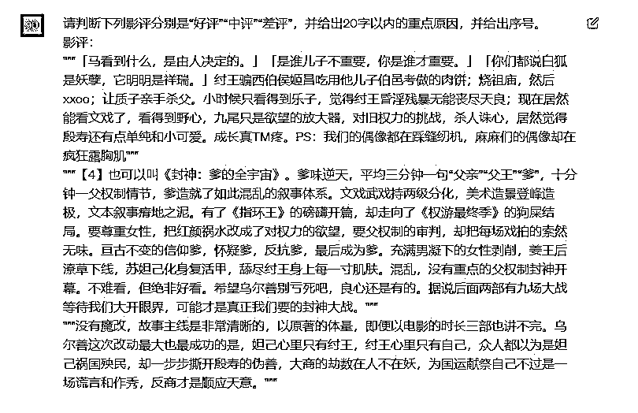

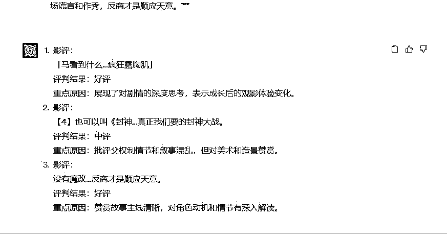

更高阶的玩法是：抓取评论列表交给 GPT，让它读前几页评价后总结影片口碑走向。若需要，后续可单独写一篇实战教程。

这个思路还能扩展到更多场景。做电商的人，需要了解自家商品评论区口碑；普通买家也能借此筛掉大量无用评价，只留下有参考价值的内容。

另外，GPT Plus 的插件原本没有分类，也可以用这套方法让 AI 自动归类，替代海盐此前手工整理的方式。再进一步，用 API 定时监控插件商店变动：你关注的分类若有插件新增或下架，就发邮件或短信提醒，并自动更新到推荐列表。

做大数据的开发者，以后不必写复杂逻辑给业务数据打标签，用简单脚本加提示词即可。机器学习中，不提供带标签训练样本、仅靠提示词给数据贴标签的做法，称为零样本学习。

本质相通，核心一致。

# 2.3.3.16 格式转换指令

适用场景

- 文本转 HTML，便于网页呈现；
- 文本转 Markdown，便于导入编辑器；
- 文本转 JSON，便于开发使用；
- 多种格式互转；
- 等等。

实操案例

案例一 文案转 JSON

# 💡

请把下面文案转成 JSON。

文案：

位右移
1. 左补符号位 >>
   1.1 细节：无论正负，符号位都当数据一起右移，左侧补符号位，越界丢弃。
2. 左补 0 >>>
   1.2 细节：无论正负，符号位同样当数据一起右移，左侧补 0，越界丢弃。

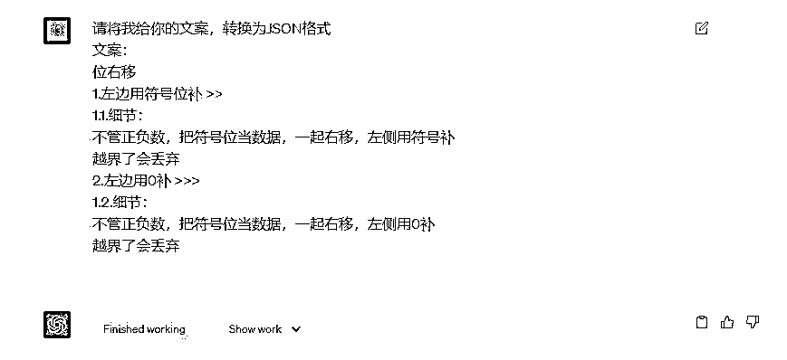

案例二 JSON 转 HTML

# 💡

1. 请把下面 JSON 转成带标题和列标题的 HTML 代码。
2. 再生成 HTML 文件，便于下载查看。

JSON：
{"游客信息": [
  {"游客姓名": "张三", "游客的目的地": "北京"},
  {"游客姓名": "李四", "游客的目的地": "上海"},
  {"游客姓名": "王五", "游客的目的地": "杭州"}
]}

提示：此处使用 Plus 的代码解释器模式。

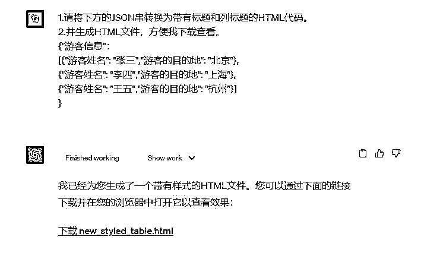

这是下载得到的 HTML 文件。

new_styled_table.html

浏览器打开后的效果如下。

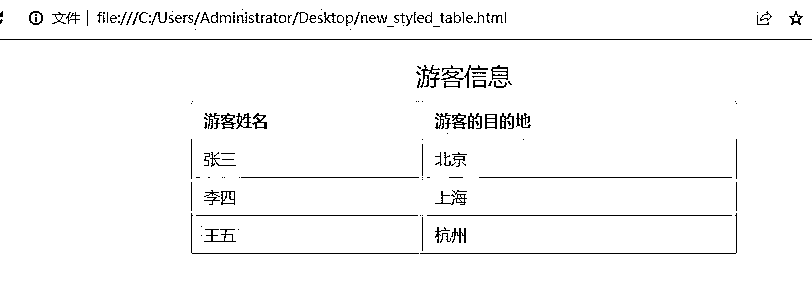

# 2.4.4 常用格式元素

# 2.4.4.1 三引号

作用

三引号是分隔标记。把待处理文本放进英文三引号 """...""" 中，GPT 更容易区分指令与素材。

尤其提示词里同时夹带文本内容时，GPT 容易混淆哪部分是命令、哪部分是素材。如果素材中还有中文引号“”，它也可能把引号内的内容误判为处理对象，造成边界错误。

案例

# 📌

请用 3 个对仗工整、汉字数量相同的排比句概括下面文案：

"""在此插入要处理的文本"""

GPT 能正确判断文案范围，总结结果也准确。

# 2.4.4.2 XML 标签

作用

XML 标签同样起分隔作用。一条提示词里有多段待处理文本时，可用 XML 标签隔开（三引号也可以）。

案例

# 💡

下面两篇同主题文章用 XML 标签分隔。请先概括各自论点，再判断哪篇论证更充分并说明理由。

<文章> 在此插入第一篇文章</文章>
<文章> 在此插入第二篇文章</文章>

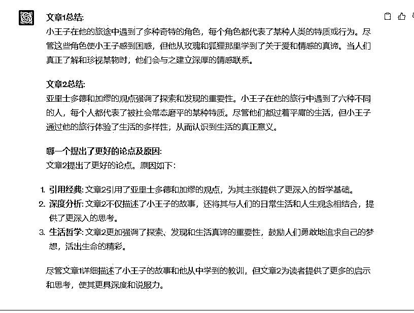

这样即使有多篇文本，GPT 也不容易混淆。

简单任务中，分隔符对输出质量未必有明显影响，效果可以就不必加。但提示词越复杂，消除歧义越关键，这个技巧越能发挥作用。

# 2.4.4.3 小节标题（模块化/结构化提示词）

作用

在提示词里加小节标题，等于告诉 GPT：每个小节是不同模块。原本像小作文一样的长提示词，被拆成多个小节，形成模块化表达。这也叫提示词结构化（或格式化）。

提示词很长、字数很多时，若仍写成一大段，AI 理解会吃力，生成效果打折扣，还容易产生语义歧义。

结构化后，提示词层次更分明、条理更清楚，AI 能更准确识别每个模块的内容，歧义减少，理解效果提升。

实现结构化有几种方式：
- 用自然语言小节标题分块，推荐；
- 用 Markdown 格式呈现层次，推荐；
- 用 JSON、YAML 格式，程序员常用，普通用户不推荐。

本节重点讲用自然语言小节标题完成结构化。

案例一

结构化前：

# 💡

我稍后会提供一段文字摘要“8 月 9 日消息，快手高级副总裁、研发线负责人于冰近日表示，AI 大模型作为当下最重要的革命性技术，进入爆发期，有望开启 AGI 时代，而多模态内容生成与理解是其核心能力。他提到，短视频、直播作为最典型的多模态媒介，快手也抓住平台基因，在 AI 大模型领域重度投入。”以及对应新闻标题“快手于冰：在 AI 大模型领域重度投入”。标题应让读者清楚文字主题，同时要有吸引力。若我的标题不达标，请给出 5 个替代方案。

这样看是否很乱？字数一多、符号一复杂，人读着累，AI 也容易看晕。

结构化后：

# 💡

我会提供一段【摘要】和对应【标题】。标题要既点明主题又有吸引力。若标题不达标，请给出 5 个替代方案。

【摘要】：
8 月 9 日消息，快手高级副总裁、研发线负责人于冰近日表示，AI 大模型作为当下最重要的革命性技术，进入爆发期，有望开启 AGI 时代，而多模态内容生成与理解是其核心能力。他提到，短视频、直播作为最典型的多模态媒介，快手也抓住平台基因，在 AI 大模型领域重度投入。

【标题】：
快手于冰：在 AI 大模型领域重度投入

同理，任务简单时，小节标题对输出质量影响不大，效果好就不必加。但提示词越复杂，消除歧义越重要，这个技巧越有帮助。

案例二

结构化前：

# 💡

请你扮演《狮子王》的辛巴，你必须了解辛巴的所有知识。现在，请你用辛巴的语气和我打招呼。请使用辛巴的说话方式、思维、词汇和我沟通。只能像辛巴那样回答，不要写任何解释。

结构化后：

# 💡

【角色】：
请你扮演《狮子王》的辛巴，并掌握辛巴相关知识。

【任务】：
用辛巴的口吻与我打招呼。

【要求】：
请以辛巴的说话方式、思维模式和常用词交流。只按辛巴的方式回应，不要附加解释。

当提示词特别长或复杂，例如上千字，一定要分模块写。若仍堆成一篇作文，AI 容易看晕，效果不佳。这里例子较短，堆在一起也能懂，所以差别不明显。但遇到复杂提示词时，要记得可以这样优化。

小节标题常用语法（结构化提示词模板）

最基础的模块化：模块名可用特殊符号括起，例如【】，结构更醒目。需要哪些模块，按你的提示词决定。

# 💡

【结构化提示词模板】

【角色】：请你扮演 xxx
【任务】：写一个 xxxx
【要求】：1. 500字 2. xxx 3. xxx

无序列表可用 -、+、* 表示，三者功能等价，可按偏好选择。使用无序列表能让结构更清楚。

【模块名】：
- 黄瓜不要皮
- 玉米不要瓤
- 茄子不要籽
+ 黄瓜不要皮
+ 玉米不要瓤
+ 茄子不要籽
* 黄瓜不要皮
* 玉米不要瓤
* 茄子不要籽

无序列表支持嵌套，混合使用 -、+、* 可创建多级列表，让不同层级在视觉上有所区分（最终渲染符号并无差别）。每层缩进需加四个空格或一个制表符，层级关系才清楚。

【模块名】
* 第一级列表项 1
  * 第二级列表项 A
    * 第三级列表项 i
    * 第三级列表项 ii
  * 第二级列表项 B
* 第一级列表项 2
  * 第二级列表项 C
    * 第三级列表项 iii

有序列表最常用，表达结构效果也好。

【模块名】
1. 我是第一个要求
2. 你是第二个要求
3. 他是第三个要求

注意，这里的无序层级采用 Markdown 语法。语法并非唯一标准，直接跟 AI 说代码也可以，只要 AI 能理解就是好提示词。后面还会单独介绍 Markdown。

其他常见结构化提示词模板

LangGPT 是常见的一种结构化模板，可按角色、简介、技能、规则、流程、工具、初始化来组织。下面用中文示意其框架：

# 💡

# 角色：你的角色名

# 简介
作者：YZFly
版本：0.1
语言：中文/英文/其他
描述：说明角色特征与能力概览

# 技能一
1. 技能说明一
2. 技能说明二

# 技能二
1. 技能说明一
2. 技能说明二

# 规则
1. 任何情况下都不要脱离角色。
2. 不要胡编乱造。

# 流程
1. 先做 xxx
2. 再做 xxx
3. 最后做 xxx

# 工具
# 浏览器
可用浏览器工具：向搜索引擎发查询并展示结果；打开指定网页；返回上一页；上下滚动网页；打开给定链接；从网页中保存文本片段，需给出起始行与结束行，单行引用时起始行等于结束行。
# Python
发送 Python 代码后会在有状态的 Jupyter notebook 中执行，返回输出或在 60 秒后超时。'/mnt/data' 可保存用户文件。本会话无外网访问，外部请求或 API 调用会失败。
# DALL·E
给出图像描述时，用 DALL·E 生成图像，并用纯文本总结所用提示词；若用户未指定数量，默认生成四个尽可能多样的标题式描述，发给 DALL·E。
# 更多工具
# 初始化

# 短，不等于有效

先摆一张“诗人”角色卡。它沿用 LangGPT 的框架：作者 YZFly、版本 0.1、中文、角色说明都写明；能力拆成三块——现代诗讲究自由、意象与心灵映照；七律每句七字，源自民间歌谣；五言每句五字，奇偶相间、自带音乐感。规则要求内容健康积极，七律与五言须押韵。工作流先请用户按“形式：[]，主题：[]”给出条件，再产出题目与诗句。初始化则让角色守规矩、用默认语言问候，并自我介绍、说明任务。把素材开头那串英文占位框架填进具体身份，就能得到此类示例。这张卡不长，却每句都承担功能。反过来，网上有些结构化长稿，删掉一句不痛不痒，再删一句也没变化，那便是冗余。模型的处理能力有限，废话一多，表现反受拖累。别被漂亮排版骗了，好看不等于好用。YZFly 的 LangGPT 项目（https://github.com/EmbraceAGI/LangGPT）带火过这种写法，但外壳只是外壳，内容有效才是根本。

# 2.4.4.4 用 Markdown 搭骨架

Markdown 天生适合分层表达。拿它组织提问文本，层级和条理会更清爽。看对比：非结构化版本是一段话——“请你扮演《狮子王》的辛巴，你必须了解辛巴的所有知识。现在，请你用辛巴的语气和我打招呼。请使用辛巴的说话方式、思维、词汇和我沟通。只能像辛巴那样回答，不要写任何解释。”换成 Markdown 后，可拆为“角色”“技能”“要求”“任务”：角色是扮演辛巴并掌握全部技能；技能为了解辛巴知识；要求是用辛巴的语气、思维、词汇交流，只以辛巴口吻回应且不解释；任务是先用辛巴口吻打招呼。层次一分明，模型更容易抓重点。常用语法也简单：六级标题对应 h1 至 h6；无序列表可用 -、+、*，功能等价，按习惯选；列表可嵌套，也能混用符号区分层级，每层缩进四空格或一个制表符；有序列表同样支持。

# 2.5.5 ChatGPT 的短板

# 2.5.5.1 内容重复

痛点：生成到一半开始复读。

办法：把它当作文字处理的小毛病，先让它写完；使用时删去重复部分即可。删完余下 1022 字，基本达标（尽管字数统计偶有偏差）。记住，后面还有更高级的解法，但这个基础操作必须会。

# 2.5.5.2 中文字数统计不准

OpenAI 官方已说明：GPT 对文字数量的统计不精确，任何语言都只能估个大概，有时偏差还不小；不过它产出的段落数、要点数却是准的。

应对：可用在线字数统计小工具（http://zishu.qianwanku.com/），或 Word 自带统计。写文案常有最低字数要求，例如不少于 1000 字，这两种工具都顺手。

# 2.5.5.3 重写与改写效果差

原文篇幅太短时，重写、改写都难出彩。可理解为：原文只有 100 字，让 ChatGPT 改，它没有额外信息可吸收，只能对原句做排列组合和近义替换。底层仍是“下一个字按更大概率出现”的生成方式。应对有三个基础方案：一，提示它可以补充哪些情节、融入哪些知识点来扩写；二，直接换原文，拿一篇 1000 字的材料让它压缩改写；三，让它多写几段，再删减拼合。

# 2.5.5.4 AI 幻觉

模型产出的内容可能是错的，或部分失实。使用 ChatGPT 等工具时，常会碰到“AI 幻觉”：缺少准确信息源时，它会编造或给出不准确内容。根源在训练数据和生成机制，可能带来误导信息、错误事实和不准确推断。应对：方案一，对事实性陈述做独立核验。用可靠数据源和参考资料查准确性，盯住关键数据、关键细节，保持批判思维，由人来查。网上资料质量参差，严谨文案更需人工核实，或去权威网站、知识库、书籍论文中验证。方案二，优质素材投喂：快速调研并找到正确素材，在指令里喂给 GPT，让它临时学习，再写出可靠内容。

# 2.5.5.5 页面卡顿

ChatGPT 官网偶尔会卡，辛苦敲入的内容可能瞬间消失。应对：养成习惯，先在 txt 文档里编辑、保存，再复制过去，避免丢失。

# 2.6 AI 写作底层方法论 @海盐芝士

# 2.6.1 用好 AI 的两个支点

想把 AI 用好，底层只有两条：一是对它有深度理解，即懂核心原理，也会调教；二是拥有行业纵深，也就是“AI+领域”。两条缺一不可。海盐用两个故事讲透。

故事一：👸号老手罗飞。他做编辑十年，常出 10w+，一篇推文要磨两天。想开工作室批量运营 10 个号，接触 AI 后却不太会沟通，总觉得机器写出来像小学生口水文，没法用；招人又嫌没赚钱、成本高，于是作罢。假如罗飞懂 AI 的底层原理和调教技巧，凭他的👸号经验，调教出的助手能分分钟写出 10 篇 10w+，既有他的经验，又有机器的速度。一个 AI 罗飞就是一个团队。所以，AI 领域的高手，必须深度理解 AI。

故事二：自媒体人小王。他每天花 2h 学 AI，刷了不少教程。老板让他采集 10 个媒体网站数据做分析，他想起有教程教用 AI 写爬虫，便动手。可机器生成的爬虫代码，他不知道在哪跑，也不知道能不能用，只好放弃，手工收数。关键在：小王会用 AI，AI 也会写爬虫，但他不懂爬虫，代码一出问题就不知道如何正确引导，甚至不知道运行环境。若他本就是爬虫程序员，能搭环境跑代码，判断可用性；有问题也懂编程，有解决思路，只需把思路告诉 AI，就能调取相应知识来修，自己旁边喝茶看报等结果。所以，一个领域的 AI 高手，只会 AI 不够，首先得有该领域的专业积累，至少大致懂行，知道什么对、什么错。AI 输出后，你才判断得了对不对、能不能用、合不合格；不合格要会挑错，指出问题，最好还能给出修改方向。这样，高智商帮手才会全力干活。

别指望一个完全不懂编程、没参与过软件开发的人，有了 AI 就能轻松超过行业里历经沉浮的老手。连基本项目需求都说不清，却希望 AI 凭空解决问题，结果多半失望。

听完这两个故事，还觉得 AI 像坐在村委书 ji 旁边却用不起来的博士吗？还觉得它与普通人无关吗？还觉得有了 AI，小白就能跨行业秒杀程序员大神吗？答案很明显：只会用 AI，却没有专业领域积累，你把它用在哪？人家说的专有名词你都听不懂。只在传统领域是大神、不会 AI 的人，这两年也会被会用 AI 的同事快速超越：别人一个人靠 AI 提效 10 倍产出，你还在手工慢悠悠干活。

有人会问：我只有工作或学习这一行的经验，也不是大牛，用 AI 是不是很受限？别担心，后面会讲快速获取行业经验的方法论。未来属于“行业大牛+AI 应用大牛”合二为一的人。普通人要提升行业专业度与 AI 应用能力。

总结：用好 AI 的核心底层只有两点：1. 深度理解 AI（掌握核心原理与调教实战技巧）；2. 行业纵深。

# 2.6.2 调教心法

ChatGPT 调教的终极杀招，是“1 个原则和 3 个技巧”。一个原则指角色代入法，这是 OpenAI 官方基于 AI 原理给出的让模型听话的技巧。所有 GPT 玩法都绕不开角色代入；学会它，市面上各种玩法你都能理解，也知道源头在哪。

有人学会了，实战仍发懵，原因有两个：第一，不知道最终成品长什么样。比如写知乎体键盘测评，你都没见过优秀合格稿长什么样；GPT 交了一篇，你判断不了能不能用，若不能用，也不知道哪里不行、如何指挥它改到正确方向。第二，不会拆任务。比如你看到一篇 5000 字优秀键盘测评，里面藏着几部分结构；GPT 一次写不完，你要把大任务拆成小任务逐个做。可就算不用 AI，这任务交给你，你也未必会做，说不出具体步骤；有了 AI，不会拆解照样指挥不动。

所以，终极心法里，光会角色代入原则还不够，还要掌握由它衍生出的任务处理 3 技巧。学会这套心法，你能从不会调教，到随心调教，再到把做过的任务炼成自己的模板，永久复用，一劳永逸。

当然，实际写作中很多稿子只写一次，不知道以后是否还会遇到同类需求；这时性价比最高的策略，不是花大量时间打磨指令、总结模板，而是了解多个 AI（你的多个小弟）各自的长处和短板，挑最合适的几个组合起来，分工合作，用最简单的指令完成写作。

# 2.6.2.1 原则：角色代入

角色代入的目的，是让 GPT 从庞大知识库中精准调取你需要的领域知识，并用指定角色的口吻与你对话。它适用于任何场景。原理推论：ChatGPT 像知识渊博的小助理，你直接问宽泛问题，它会在知识海洋里广泛搜索，给出较通用的答案；这样的答案表面、粗略，缺少思考和情感，具体价值有限。

# 2.6.2.1.1 错误用法

若问题聚焦到某个领域，也就是给 GPT 限定身份，让它 cosplay 特定角色，它就只去相关领域找答案，结果更精准、更专业。若问题更明确，能清晰给出具体任务，告诉它目标，它会把注意力集中到任务上，答案更准确，不会发散得让人感觉不痛不痒、没营养。若再加上限制条件，明确能做什么、不能做什么，输出会更精准，更符合预期。AI 世界和人类世界一样，好答案来自好问题。

基于这三点经验，可总结出角色代入法调教指令的三大原则：1. 角色；2. 任务；3. 要求。每次提问都套用，可事半功倍。注意，这三点不是彼此孤立，而是相互作用、贯穿始终。比如设定角色时给出具体要求，会更精准。“请你扮演一个老师”对比“请你扮演一个实战经验丰富的资深英语口语老师”，后者显然更精确地表达需求，沟通也更高效。先上实操，感受角色代入法的魅力。

# 2.6.2.1.2 正确用法

这里用大家熟悉的《狮子王》辛巴做示例。注意，最好新建对话框，避免历史数据干扰本次沟通；这个问题在新建对话框小节讲过，后续不再说明。
# 💡
请你扮演《狮子王》的辛巴，你必须了解辛巴的所有知识。现在，请你用辛巴的语气和我打招呼。请使用辛巴的说话方式、思维、词汇和我沟通。只能像辛巴那样回答，不要写任何解释。
这张指令，先别想模板和套路，单纯理解一下。你会发现，它就是正常人与人对话的直接沟通。后面我们会提取套路和模板，本质上也是根据大量优秀案例特征总结出来的。

你会发现，这个优秀案例与前边原理推论中的三大原则完美契合。没错，是先有大量实战案例，也就是经验，然后为了便于复制，才总结出理论特征，也就是原则。

使用角色代入法结构化指令：把角色、任务、要求全写在一起，修改不便，耦合度高。尤其字数多时，人读着都麻烦，何况 AI；模型理解效果也不好。这时，把角色、任务、要求拆成 3 个模块来写，就得到结构化的角色代入法指令。
# 💡
【角色】
请你扮演《狮子王》的辛巴，你必须了解辛巴的所有知识。
【任务】
现在，请你和我打招呼。
【要求】
1. 请使用辛巴的说话方式、思维、词汇和我沟通。
2. 只能像辛巴那样回答，不要写任何解释。
注意，黄色背景部分是你每次要修改之处。这个格式是之前讲过的常用格式之【小节标题】，它能更清晰地告诉模型，每个小节（模块）内容不同。

# 2.6.2.1.3 指令模板

这样，就推导出最基础的角色代入法结构化模板。写任何指令时，都可套用。
# 💡
【模板：角色代入法】
【角色】
请你扮演一个 xxx，你必须了解 xx 的所有知识。
【任务】
现在，请你 xxx
【要求】
1. xxx
2. xxx
3. xxx

一个原理“角色代入法”就讲完了。不过你肯定有疑问：知道能这样玩，却不知道能扮演哪些角色，脑子词穷。比如动画 IP 有哪些？常用职业有哪些？一棵小草也能扮演吗？能扮演最近很火的表情包软件、只用表情和我对话吗？别急，都帮你想到了。等讲完整个终极心法，会给大家安排各种省心省力的角色指令小工具，让你进一步提效。

# 别再硬憋提示词了：两个技巧，让AI自己把活儿干明白

给AI下指令这件事，很多人卡在第一步——话到嘴边，就是不知道怎么说才有效。有个几乎不用动脑的起手式：直接把难题甩给ChatGPT，让它替你想角色。你可以这么问：“我想做某个内容，但听说先设定身份效果会更好，你觉得我该让你演谁？”这一句话发过去，它立刻变成你的提示词生成器，再也不用一个字一个字地抠。

当然，只学会安排角色还只是入门。角色设定的真正价值，在于让模型从庞大的知识库里精准捞出你需要的那个细分领域的知识，再用你习惯的语气跟你交流。

真正让人头疼的是另一种情况：任务交下去了，AI产出的东西却总不是你想要的那味儿。你脑子里有画面，可一开口就词不达意，怎么说都隔一层。怎么办？

接下来就是终极调教环节，专治“任务说不清”这个毛病。

# 2.6.2.2 技巧 1：先把话撂出去，再慢慢修

你可能会想：提问谁不会啊？但这里要聊的，恰恰是你平时没想到、被卡住的那类问题——照样可以拿去问GPT。

举个例子：你想让AI写文案，却不知道怎么开口。方法很土但很管用——把脑子里那些说不利索、组织不好的话，原封不动丢给GPT，先下笔再说。它的理解力足够接住你，哪怕你语无伦次也没关系。用最日常、最口语的人话跟它讲，别端着，跨过心里那道坎，经常会有惊喜。

适合的任务类型：【遇事不决任务】

这类任务你本来就没思路，不知道怎么指挥AI，也不知道怎么表达，总觉得说不清楚。没关系，直接问就是了，哪怕说得颠三倒四。遇事不决，问GPT。

先把前提说明白：这类任务对产出质量要求不高，一句提示词通常就能跑起来，几乎不用调教也能拿到及格分，主打一个省事。

典型场景：工作里的杂七杂八文案、学习时要写的小材料、写作时突然卡住的某个点。

操作流程

Step1：先写一句提示词试试

直接把问题描述出来提问，这种提示词基本就一句话。问一次效果不行，换个说法再问；如果效果还行，就把这句话存下来。新手尤其要记住：敢开口问，也要会随手存。

Step2：把它变成模板

提示词跑通之后，下次遇到类似场景，把里面会变的部分抽出来，就能变成一个解决同类问题的模板。有了模板，以后同类需求可以直接无脑交给AI。模板调好之后，记得开一个全新对话窗口测试一下，看看效果有没有被之前的聊天记录污染，把干扰因素排干净。这样沉淀下来的模板，才配叫可复用、高稳定。

光讲理论不够直观，直接上案例感受一下。

实操案例

案例一 角色生成指令

沉淀出来的提示词模板

最初的问法：

我想写一个 xxx，但听说先给你安排一个身份效果会更好，你觉得我该让你扮演谁？

因为每次写的文案类型都不同，所以把 xxx 抽成变量，变成模板：

【提示词模板：角色生成器】

【角色】：
请你扮演一个角色生成器

【任务】：
我想写一个 xxx，但听说先给你安排一个身份效果会更好，你觉得我该让你扮演谁？

每次用的时候，只改 xxx 那一处变量就行。

像这个需求，套上“角色、任务、要求”这个框架就足够了。真没有要求、也不知道怎么写要求，那就空着，别为了凑结构硬写。

对了，这套内容拿ChatGPT当样板来讲AI。所有大语言模型产品的底层原理和技巧功能基本都是通的，一通百通。不过练提示词的时候，建议先用明白GPT；其他AI稍微玩一玩，感受下各自的特点，就能融会贯通了。

这里顺便提一嘴多轮对话法。

很多人用AI写文案靠的是来回拉扯：比如给“AI进化史”起爆款标题，先让AI出一版，发现不行，再告诉它哪里不行；改完还不行，继续引导、继续聊……

这种做一件事、靠多轮持续对话往前推的方式，就叫多轮对话法。

如果你的任务是一次性的、以后永远不会复用，或者你压根不想打磨提示词、只想赶紧做完拉倒，那用这种方式没问题，像记流水账一样跟AI聊就行。

这里不再举例，大家基本都会。

# 2.6.2.3 技巧 2：把任务切到最小颗粒

所谓原子任务，就是已经没法再拆、颗粒度最小的那一步。比如写一个标题、给新生儿取名字，都是原子任务。

而写一篇文章，可以按结构拆成很多子任务：标题、大纲、开篇段落、正文、结尾等。每个子任务都是一个原子任务，“写这篇文章”这个高颗粒度的大任务，就是由多个原子任务拼起来的。

还记得吗？用好AI的底层逻辑只有两条：

1. 对AI的深度理解，也就是掌握核心原理，加上调教实战技巧。
2. 垂类行业经验。

两者缺一不可。

你必须具备垂类经验，才能想清楚、说明白你想要的“高质量”文案到底长什么样。AI生成效果不理想时，你才知道差在哪里，能大致指出来，也能引导它往对的方向改。

那我只懂一个行业，怎么知道其他行业的高质量文案长什么样？那都是别人在行业里摸爬滚打多年攒下的经验。怎么在短时间内补上？

我们不需要一进入新行业就立刻变成大牛，那确实非常难。但借助方法论快速摸清行业潜规则，比大多数人写得稍微好一点，快速做到70、80分并不难；从80分冲到100分，短时间内先不奢求。

学会借鉴，再谈超越，有心人总能成事。

如果你本身就是这个领域的专家、标杆，清楚知道自己要什么、高质量文案长什么样，那说明信息已经对齐了，这一步可以直接跳过。

或者你清楚自己只需要70分的文案，而且已经知道70分大概长什么样，也可以跳过。

我们快速获取垂类经验的目的，是找到优质对标样例和优质方法论。

要做高质量任务，心里总得知道最终目标长什么样。

能力的本质是优质信息差加上执行。有了互联网之后，搜索能力强的人能快速拿到优质信息，几乎可以自己搞定所有问题。

有人会说：我不太会搜，总觉得百度没啥用。没关系，海盐帮你补上这一课，整理出最常用的技巧。对大多数人来说，这套方法论够用了。

通过搜索做到认知对齐，同时保存优质对标样例和优质方法论。再用找到的优质案例提炼提示词，就能应付大部分写作任务。

总结一下，处理原子类任务就两步：

1. 通过搜索，找优质对标案例。
2. 提炼对应的提示词模板。

# 第一步：用搜索快速补齐行业认知

方法1：关键词明确时直接搜
这是最理想的情况：你知道搜什么就能找到。比如需要可持续发展报告，直接搜“可持续发展报告”就行。

方法2：关键词拿不准，用相关词法
不确定具体词的时候，拿相关词去试。比如找一个历史人物，只记得他在明朝有重大贡献、最后被流放。用“明朝 贡献 流放”这三个相关词去搜，可能就把人找出来了。

方法3：搜方法论【关键】
想了解高质量文案长什么样，不能只搜文案本身，要往上想：搜这类文案怎么写、有什么特征、相关方法论。

比如写余华《活着》的读后感，不太会写，想找优质读后感参考。搜“余华《活着》读后感”，看完几篇还是没太明白。那就直接搜“如何写好一篇优质读后感”“优质读后感有什么特征”“写好一篇读后感的方法论”。

方法4：类比法
关键词搜不到想要的信息时，可以拓宽思路搜类似内容。还是拿《活着》读后感举例：搜不到太好的，就扩大范围搜“优质读后感”，而不是只看《活着》的读后感；也可以类比搜“影评”“书评”，小说读后感、影评、书评都可以。

方法5：向上抽象法
想找某一类信息但不知道具体怎么描述时，试着搜更广的分类。比如想找比亚迪汽车的市场分析报告，搜不出来，就往上抽象搜“新能源汽车市场分析报告”，里面大概率会带比亚迪的报告。

方法6：线索法
不太知道搜什么的时候，先从能想到的词开始搜。搜到的信息会给你灵感，搜一会儿看一会儿，慢慢就知道该搜什么了。比如研究AI公司OpenAI，但你几乎一无所知。直接搜OpenAI，看它的相关信息，里面必然会提到各个维度，多看看，关键词就丰富了。

方法7：借力PDF法
有些信息直接搜匹配不到，因为关键词藏在白皮书或研究报告的PDF里，而搜索引擎对PDF内容解析不一定好。这时可以用filetype指定PDF类型，搜到相关度高的PDF，再人工从里面翻找，可能就找到你要的信息。

方法8：多看几页
有时候惊喜就在你快放弃的那一刻之后。受匹配算法和关键词不精准的影响，答案可能在搜索第3页、第4页，甚至第7页。

方法9：措辞要选对
确定搜索框里输什么时，尽量选目标网站可能会出现的词。比如应该输“头痛”，而不是“我的头很疼”，因为“头痛”才是医学网站会用的词。

方法10：让AI来生成
每个AI在垂类方向上的效果会有轻微差异。搜优质对标文案时，网上实在找不到，就直接用多种AI工具生成，有时会有意外之喜。

比如你主要用ChatGPT写，想找一首五言诗，网上找不到想要的，可以用文心一言、Kimi、智谱、讯飞、豆包、Claude等其他AI挨个生成。一旦有可用的，就能当优质素材。

注意：通常是一款AI生成的一句能用，另一款AI生成的一句能用，给自己带来灵感，拼凑成素材；很少有一款AI直接生成全部都能用的。

方法11：切换到垂类平台
由于企业竞争，传统搜索引擎收录的信息有局限。有时从百度等常规入口转向垂类平台，会有出乎意料的收获。这些平台专注特定领域或社交网络，可能提供更丰富、更精准的信息。

垂类平台：知乎、豆瓣、🛰️👸号、头条、📕、B站、即刻、CSDN、Github、百度文库、🛰️读书、🧣。

方法12：放大搜索量
网络素材鱼龙混杂，一篇帖子很难看出名堂。要多搜几篇，扩大视野，增加广度，做到心中有数。浅显调研、偷懒行动，会让你产生错觉：我都调研一遍了，这领域不过如此，可以出去装大佬吹牛了……这就自欺欺人了。

不过也没必要过度search，满足需求就可以，时间成本也很重要。

方法13：积累自己的垂类信息库
有些网站的信息不容易被搜索引擎搜到。比如网安行业公布漏洞的公开信息在CVE网站，知道这个网站需要有人指引或自己摸索。每个行业都有常用网站，行业外的人很少知道或关注。

平时搜到好用的垂类网站，或和朋友问到他所在行业常用的网站，要记录下来，积累成自己的行业信息库。

【垂类信息库】

【常见调研入口】

国家权威机构：网站后缀gov.cn
国家数据：https://data.stats.gov.cn
监管机构：国家统计局、人民政f网、中国互联网络信息中心CNNIC、中国金融信息网、证监会官网、中国信通院
医疗机构信息查询：http://zgcx.nhc.gov.cn:9090/unit/index

想搜西安旅游产业政f报道的信息，搜：西安旅游 site:gov.cn

校园网站：后缀edu.cn
只想在各大学网站找招聘信息，搜：校园招聘 site:edu.cn

行业网站：中国行业网站大全
行业报告很多只在PDF里能搜到：人工智能行业报告 filetype:pdf
一些表格和数据只在Excel里能搜到：员工信息统计表 filetype:xls
site搜索法查看某人某品牌某公司的社交档案：openai (site:twitter.com | site:facebook.com | site:linkedin.com | youtube.com)
中国医药信息查询平台：https://www.dayi.org.cn/

第三方网站：有很多专栏、报告，质量很高
艾瑞网、镝数聚、艾媒网、极光数据、搜数网、中国产业信息网、统计年鉴下载站、清博智能、东方财富网、DataFountain。

互联网公司数据报告：头部搜索公司有大量数据
百度数据、阿里天池数据集、腾讯、360、网易。

国外专业机构：国际top公司出品的报告也是精品
四大（普华永道、毕马威、安永、德勤）、咨询机构（麦肯锡、波士顿、罗兰贝格、贝恩）、CEIC、世界银行公开数据。

证券机构：上海证券交易所、深圳证券交易所、招股说明书、年度财务报告。
天眼查：和企查查、启信宝一样，都能方便查公司基本信息。
其他：较权威的新闻报道。

检索网站内容是否被剽窃：搜索 -site:xnbeast.com “Cheese海盐芝士”

范例：麦肯锡2020年中国消费者调查报告

另外推荐一个工具——虫部落，里面内置很多搜索引擎，从一个入口可切换多个搜索引擎：https://search.chongbuluo.com/

用AI写作时，还可能面对很多陌生行业，不太能迅速了解搜索重点，不知道该搜什么。下面给一个参考框架：

【行业分析框架】

行业环境
法规政策
行业生命周期：行业规模、趋势、目前所处阶段
3大竞品：分析行业前三名企业的优势和劣势
市场规模
到相关网站查询数据
行业细分
每个行业的细分市场均蕴含潜在机会
产业链
上游市场涉及供应量、新项目、价格及集中度分析
下游市场涉及客户构成、消费模式和市场价格评估
行业壁垒
进入新领域所遇到的挑战和障碍，即企业的竞争优势，是护城河
商业模式
有些行业的成功靠的是商业模式的成功，在知识星球之前，年费知识付费几乎没有

这一步调研工作非常重要，调研结果就是你的认知上限。

方法14：快速学会一类文案的方法论
一个行业你都会调研了，再去调研优质文案长什么样还难吗？从不动到懂、从不会到会，都可以用这个方法论。信息对齐加执行力，等于无敌。

调研一个具体文案时，就用刚学会的搜索能力，通过搜索做到认知对齐，同时保存【优质对标样例】和【优质方法论】到两个文档中。这两个文档素材就是你的王炸成果。

【文案分析框架】

1. 大量搜索，做到认知对齐。
2. 搜索优质对标文案，沉淀素材文档：将素材分类整理，要有几个清晰维度；时政政策、数据、案例、故事、金句、谚语、名言，素材要详实。
3. 搜索优质写作方法论，沉淀方法论文档。

这里有个小死角：一个垂类领域的某些“潜规则”在网络上确实搜不到，是业内心照不宣的。这种情况，本篇讲方法论的教程确实解决不掉。非要说方法，就是有疑问时发动人脉，找到行业内部懂行的人咨询一下。不过对刚接触这个领域的你来说，能遇到的疑问还远没到这一步，95%都可以通过搜索解决；有时你链接到的业内人，还不如掌握搜索后信息的你。

无论内行还是外行，没人能100%了解一个行业。外行不懂行业内潜规则；内行则没有时间和资源去看看外面的世界、碰撞火花。大多数人实际上是一知半解。

行外人用方法论短期集中search，可能抵过大多数不动脑子、吃老本的业内人的经年累月。

# 第二步：先让GPT跑个初稿

先了解GPT直接能写出什么样，哪里不行、哪里行，心里有个数。记得使用结构化提示词：角色、任务、要求框架。

如果你已经看了很多优质案例，那GPT写出来的质量大概率不符合高质量，一定有可提升空间。

重要原则：想打磨提示词，一定要杜绝多轮对话法。

当AI生成初稿效果不好时，很多人会像唠家常一样，和AI你一句我一句，用多轮对话来调教、引导AI做任务。如果你这个提示词只想用一次、以后肯定不会再用了，那可以。

但实际上，我们经常会遇到复用的情况：唉？我上次好像写过类似的，怎么写的来着？我去找找上次的提示词……

只要你的提示词需要复用、高质量且高稳定，那用多轮对话的形式，永远也调教不出高质量提示词。AI有随机性，多轮对话组成的提示词组复用率低、稳定性低，质量也不可控。

高质量提示词的调教，一定是在一个提示词的基础上，持续修改、优化、测试开发出来的。

具体怎么在一个提示词基础上持续调教？有4个非常好用的技巧。

# 第三步：在一个提示词上反复打磨

方式一：把方法论写进提示词

方法论，就是从理论层面、抽象层面，宏观表达这类优质文案具备的特征，或者写作技巧、写作方法的理论。

方法论怎么获得？

把这些理论投喂给GPT学习，或者作为要求，让GPT必须按这些写作方法来写，都可以。

只不过，某句方法论可能对GPT不生效。具体哪一句加上后效果很明显，哪一句有没有都行、对GPT没什么效果，需要大量多维度测试才能下定论。就像有的提示词几千字，删掉大部分后也没啥影响，基本还是那个效果，那就是大量无效提示词的堆砌。

# 调优AI提示词的完整路线：逐句测、喂范例、拆任务

给AI写指令，最忌讳一次堆一长串。聪明人会把指令拆成一个一个独立小句，每次只调一个因素，逐个验证。

先单独测第一句。AI执行得到位，这句话就留下；执行不到位，就换个说法再试——也可以新开一个对话界面对话框，让AI帮你重新组织语言。反复试到它能准确理解为止。要是换了好几种表达仍然无效，干脆删掉这句话，继续测下一条。

当前这句话通过后，再加入下一句继续验证。一条一条往上叠，最终保留在提示词里的每个句子，都是经过实战检验、确实能打的。

以“写读后感的开篇段落”这个极小任务为例。有一版提示词把有效写法放在“要求”区：

- 角色：知名作家王小波（要求AI掌握王小波的全部创作积累）
- 任务：带着王小波的语气、思路、词汇、文风与写作技法，写一段《红楼梦》读后感的开篇，字数上限30
- 要求：①用比喻或暗喻，让一句简洁而有深度的感悟点题，把读者情绪牵住；②收尾时情绪要有一层希望感

另一版则把这两条单独归入“方法论”区，再由“任务”区去引用：

- 角色：同上
- 方法论：①比喻/暗喻点题；②带希望感
- 任务：先学习【方法论】，然后沿用王小波风格创作《红楼梦》读后感开篇，30字以内

后一版就是结构化提示词的典型体现：用几个小标题把指令切成不同板块，结构更清爽，AI理解起来也更省力；板块可以根据需要自由增删。当“任务”板块用【方法论】指向另一个板块时，正是变量引用法——用【】这类醒目符号把关键词圈住，AI就能把它识别成代称或变量，而不是普通描述。

无论哪种写法，其中的每一条照样要反复验证，只留下真正有用的部分。

## 方法二：在提示词里放入优等范例

有时候，只有方法论是不够的。你觉得自己把话说尽了，AI还是不懂、记不住。这并不稀奇——领导一句话，十个下属能做出十种解读，AI也常犯同样的毛病。甚至你换了好几种说法，都没戳中它的理解点。

怎么办？想想数学课：老师讲公式，学生一脸懵，那就举个算压岁钱的例子。AI也是一样，理论讲不清，就直接把一件优质成品放到它面前，省去解释，直接模仿。

加了“范例”的提示词，大致长这样：

- 角色：王小波
- 任务：模仿所提供的范例和写作技巧，用王小波的口吻给《红楼梦》读后感写个开篇
- 要求：点题要凝练、有分量，30字以内
- 范例：“终点虽是死亡，仍有人不肯在这条路上停下。”

一个范例不灵，就换下一个；也可以一次多给几个，再加正反例对比。每个范例都要独立测试，最后只留下表现最好的那类素材。

另外还有一个高频困境：GPT的知识库里常常缺具体实据，例如花西子的直播打法、全网销售数据。你搜遍全网，能用的也不过是零散片段。办法很简单——直接把这些碎片投喂给它。

举个例子，想让AI写一段电影赏析，可以这样设计：

- 角色：电影赏析专家
- 任务：根据我提供的【素材】，从历史语境与美学表达两个角度，输出50字的精炼赏析
- 要求：带莫言式笔风，列出素材中的年份和剧情作证观点，表达要有反转感、能抓人
- 【素材】：关于《芙蓉镇》的几段碎片——1963年店铺密集、集市热闹，胡玉音和丈夫黎桂桂的米豆腐店客流不断；1964年运动袭来，墙上地面到处是标语，街市冷清；1979年小镇重新热闹起来；大雨中秦书田对胡玉音喊出“活下去，像牲口一样活下去”，令人心头一颤。

这些碎片东拼西凑也没关系。AI写不出细节，我们就替它把细节准备好。

但投喂素材有个坑。GPT的原理是预测下一个最可能的字，一旦你大量喂了素材，它的输出会过度依赖这些字词，反而很少调用自己的知识库。比如你想聚焦花西子直播调研，同时喂了兰蔻、海蓝之谜做对比，后者素材一旦过多，AI很可能把80%篇幅都拿去写海蓝之谜，完全跑偏主线。

破解办法是双管齐下：先把素材中各主体所占比重调对（这点最关键），再在提示词里明确约束AI，把它的注意力拉回正题。

## 方法三：针对缺口提硬性要求

如果你看完AI初稿，发现它漏了某个必要维度，直接往提示词里加一条刚性指令。比如稿件里必须有人名和时间，AI却没给：

- 要求：每条信息都必须写明人名和日期。

需要说明的是，这三种方法可以自由混搭。

所以，别担心自己写不好。先扔一版初稿prompt出来，看效果哪里不行就改哪里，再测。多轮打磨、反复验证、持续优化，直到它能稳定解决某类问题，最终沉淀成垂类、通用的模板。

这是提示词开发绕不开的路。每个成熟prompt，都是这么迭代出来的，无一例外。

有些老手能不过调试就写出漂亮的小提示词，是因为他们经验够多，脑子里提前把坑都踩了一遍。但真正高难度、高实效的提示词，任何人都不可能一次写好。

# 第四步：让 AI 生成初稿

直接运行调好的prompt，先把初版内容交给AI。

# 第五步：人工处理成定稿

动手清掉AI味：删掉“首先”“其次”“总的来说”“同时”这类无信息量的衔接词；拆掉反复出现的“不仅……而且……”式AI结构；砍掉不承载实质内容的空段落；检查金句引用是否准确；核对事实细节；最后整理格式。

收工！

# 第六步：提示词抽象成模板备用

一旦prompt稳定下来，下次遇到相似场景，只需抽取出其中的可变参数，就能得到一套解决同类问题的通用模板。以后再做相同类型的事，直接套模板让AI输出即可。

抽象模板的具体操作，前面已经用案例讲清，这里不重复。

好了，单个原子任务的提示词开发，你算是掌握了。

那遇到更复杂的任务呢？比如要写5000字长文，AI根本没法一次写完，该怎么办？

# 2.6.2.3 技巧 3： 任务拆解法

如果一个任务能拆成若干个原子任务，它就是高颗粒度任务，也就是常说的复杂任务。应对复杂任务最常用的一招就是【任务拆解法】：每次只让GPT集中做一件更小的事，并把这件小事对应的提示词调教到位，输出效果才会更好。

这样一来，复杂任务的完整提示词，其实就是一组原子任务提示词的串联。用编程语言来说，就是prompt chain，提示词链。

第一步：拆解任务

面对复杂任务，想一口气搞定通常不是最优解。更聪明的路线是：把大任务切割成最小的、不可再分的单元，再逐个击破。

这一步的重点在于“怎么拆”。拆解要遵循【任务拆解的核心原则】：结合AI的特性，同时考虑稿件的具体目标，两个维度缺一不可。

比如要写一篇1500字、质量达到80分的文章。表面看这是一个整体任务，实际可以拆成定选题、搭结构、拟标题、写正文、收尾等多个子任务。这些子任务的衡量标准不一样，所以不能用同一套提示词生硬地套。更合理的做法是拆成5个独立子任务，再分别交给几个不同的AI工具，让每个工具在自己擅长的环节发力。

像素级模仿是追上对标文案质量的最快路径。把大任务打碎，再一块一块啃下来。

第二步：逐一执行子任务，合并成定稿

把每个子任务都视为独立原子任务，按照“原子任务法”逐个执行，再把这些产出物拼装成完整稿件。这个过程还能顺带沉淀出一批可复用的高质量模板。

每个原子任务都被精心打磨过，拼出来的文章自然结构严谨、内容充沛、表达清楚。细节做到位，整体质量才立得住。

# 三、学习常见文体写作

# 💡

章节概要

信息爆炸的时代，能写多种文体是内容创作者的基本功。本章覆盖8种最常见、最实用的文体，让你在不同场景里都有章可循。

3.1 📕文案写作 (难度：★★☆☆☆)

掌握吸引眼球的社交媒体文案技巧

应用场景：产品推广、个人IP建设

3.2 读后感写作 (难度：★★☆☆☆)

学会快速消化书籍精华并输出个人见解

应用场景：读书分享、学习总结

3.3 主持稿写作 (难度：★★☆☆☆)

提升公众演讲和活动主持的专业水平

应用场景：企业活动、学术会议

3.4 写一篇某知名网站的新闻稿 (难度：★★★☆☆)

学习如何撰写专业、吸引人的新闻稿

应用场景：媒体发布、企业宣传

3.5 课程教案写作 (难度：★★★☆☆)

掌握结构化的教学内容设计方法

应用场景：教育培训、知识付费

3.6 实践心得写作 (难度：★★★☆☆)

提高总结经验和展示个人成长的能力

应用场景：实习报告、工作总结

3.7 👸号/知乎深度长文写作(难度：★★★★☆)

培养创作引人入胜且富有洞察力的长篇内容的能力

应用场景：知识分享、观点传播

3.8 商业计划书写作 (难度：★★★★★)

学习如何用文字说服投资者和合作伙伴

应用场景：创业融资、项目提案

学完本章，你将会：

根据场景选择恰当文体

熟练运用AI工具提升写作效率

对AI产出做有效的人工优化

创作出符合各类场景需求的高质量内容

建议每学完一种文体，就动手写一篇，再与本章范例对照，检验自己的掌握进度。

这样练下来，你就拥有了一套全谱系写作技能包，未来无论面对什么内容需求都能稳住。开工吧。

# 3.1 📕文案写作 @小鹅

# 3.1.1 AI 能写出📕文案吗？

先看看目前最常见的两种AI写📕方式。

①方式 1：设人设，直接生成

基本操作是给GPT套一个“📕爆款文案专家”的身份，填一堆前置条件，然后直接让它写。比如：

你是一位📕爆款写作专家，请按这个流程工作：先给出5个标题（每个标题后加一个合适的emo表情），再写出1个正文（每个段落插入合适的emoji，文末放对应的话题标签）。

标题层面，你需要：
1. 会用二极管标题法制造冲突感。
2. 懂得怎么把标题写得让人忍不住点。
3. 从爆款关键词库里随机挑1-2个用进去。
4. 了解📕标题的流量逻辑。
5. 遵守📕创作规则。

这组prompt产出的稿子效果如下：

可这类稿子只是表面能用，问题很明显：

第一，AI痕迹太重——没有真实经历、没人味，逻辑关联词工整得假。

第二，📕内部大概设有反AI机制。我拿同类稿子测过很多次，小眼睛普遍低于200。

第三，它并没有爆款基因，只是看起来写得不错。

②方式 2：喂一篇文案，让AI复写

这方法的基础逻辑是对的。📕的调性是“爆过的内容还会爆”，复写的好处是：①保留爆款基因；②把“人感”留下来，把“AI感”去掉。

但如果prompt没写好，就会撞上两种情况：

限制太死——和原文重合度过高，查重过不了；

完全放开——AI开始自说自话，冒出一堆假大空废话。

这正是当前📕prompt的痛点。我盘了下思路，想解决三个问题：让AI产出的文案同时拥有原创性、爆款因子和长尾流量。下面展开说说。

# 3.1.2 如何用AI写📕文案？

# 3.1.2.1 文案创作

AI写的📕文案很难过审，因为它是“一比一”照洗，原始出处一眼就能认出来。

可要是把三篇稿子当布料，剪开再拼呢？取A的开头、B的中段、C的结尾，缝合成一篇新稿，谁还能看出它源自哪篇？

于是思路就变成这样：

第一步：找三篇对标笔记A、B、C。

第二步：分别截取A的开头、B的中间核心段、C的结尾，拼成文案D。

第三步：再用第一代去重prompt把D洗成E。

配套的prompt可以这样设定：角色命名为“📕文案去重专家”（作者小鹅，版本V1.3）。它的任务是：当用户给出A、B、C三篇文案时，抽取A首段约100字、B中间核心段约300字、C尾段约100字，合并润色为一篇新文案D；随后在用户给定字数需求且不改变原意的前提下，对D进行段落重组、同义词替换、语序调动、增加形容词和定语、补上不影响语意的字词，最终把重复率压到30%以内。同时遵守两条规则：一是保证语句通顺、逻辑顺畅；二是不能改动原有emoji，也不能随意添加emoji。交互开始时，系统应作为该角色友好地欢迎用户，并简单介绍自己。

# 3.1.2.2 文案去重

接下来要处理去重。我的方法借鉴了论文降重的思路，可以浓缩为“添删断改换”。

# 💡

添删：加一些符合语法但不带来新信息的虚词，如“的”“地”“得”“了”“则”“也”，或者“因为”“所以”“无论……如何”这类关联词。

# 💡

断：在句中合适位置插入标点，把长句劈成两个短句。比如“我今天特别开心是因为去商场买了牛肉”改成“我今天去商场买了牛肉，这件事让我特别开心”。

# 💡

改：把词换成意思相近的替代说法。例如“这款口红色调非常美丽”改成“这款口红的色泽真的很漂亮”。

# 💡

换：调换语序。例如“我今天在市场上买了新鲜的蔬菜，然后做了一道美味的沙拉”改成“我今天做了一道美味的沙拉，用的是刚从市场买回来的新鲜蔬菜”。

这背后有个妙招叫“用魔法打败魔法”。许多想法你心里明白，但就是找不到更精确的话说，那就请ChatGPT帮忙，让它写出来，再从中挑能用的部分。

于是整套prompt就这么成型了。

最终效果是：整篇稿子乍看和原文很像，但逐句比对时，每一句都不一样。

这是降重后的结果：

拿普通快洗做对照，能明显看到，经过三步法处理的文案，人的气息更强。

# 3.2 写一篇读后感 @小鹅@海盐芝士

# 3.2.1 前期准备

拿一篇1500字的余华《活着》读后感来演示。

第一步：定下大方向

比如题目叫“读余华《活着》有感”。先想清楚方向：是偏个人感受，还是偏人物分析，或者围绕某个主题做深度讨论。

第二步：搭骨架

全文1500字，可以参考这几条原则：

【骨架设计原则：如果文章总字数在3000字以内，正文一般3个维度即可（维度再多2个，其实也OK，只是没必要，多一事不如少一事）】

+

【维度设计原则：每个维度下，可以有多个段落，每个段落也可以有子标题（如，二级标题、三级标题）；正文3个维度=正文中有3个一级标题；一个维度，就是在表达一个大观点】

【字数分配原则：250字≤每个段落的字数≤500字】

=> 因此正文安排3个维度，每个维度400字，3×400=1200字；剩下300字，其中引言100字、结尾200字。

【推算出的骨架结构】

标题：读余华《活着》有感

引言 100字

维度一 400字（备注：如果，维度一 是600字，则可以由2个300字的段落，组成。举一反三，即可）

维度二 400字

维度三 400字

结尾 200字

第三步：确保ChatGPT知识库里有支撑材料

# 💡

【提示词】

你知道余华的《活着》吗

最好手动去百度百科快速浏览一下，确认GPT给出的介绍基本准确，关键点不偏就行。

# 先补课，再让 AI 动笔

如果核对后发现 GPT 说得八九不离十，这一步可以略过。要是它一本正经地胡编，多半是知识库里没这块内容，或者检索没抓准。这时就得临时“喂料”，把它的认知拉齐。Claude 也常犯同类毛病，遇到类似情况照此处理即可。

做法很直接：人工去百度百科搜余华《活着》，把“内容简介”粘进提示词里。

# 💡

【提示词】

请先学习下面这段余华《活着》的简介，学完只回“学会了”三个字。

简介：

“把百科原文粘到这里即可。其要点是：小说由‘我’下乡采风时听福贵讲述一生展开；福贵出身地主，年轻时荒唐，输光家产后沦为农民；被抓过壮丁，后被解放军释放；回家时母亲已逝，女儿凤霞因病聋哑；他经历土改、公社、大炼钢铁、饥荒、文革等时期；儿子有庆给县长老婆输血被过量抽死，县长竟是旧战友春生，春生后来在文革中自尽；凤霞婚后产后大出血而死，妻子家珍病逝，女婿二喜事故身亡，外孙苦根意外夭折；最后福贵买下一头待宰老牛，取名‘福贵’，平静度余生。”

# 3.2.2 搭好写作骨架

准备做完，正式进入写作。

步骤一：让 ChatGPT 先出大纲初版。

# 💡

【提示词】

【角色】你是一名老练读者，构思巧、话锋利。

【任务】我要为余华《活着》写一篇 1500 字读后感，请先给一版大纲。

AI 在中间常会给出人物分析、剧情叙事、语言风格、核心主旨四类角度。我们把这些都当备选，从中挑人物分析、剧情叙事、语言风格、核心主旨。若觉得大纲素材不够用，后面可能凑不出三个完全不同又合适的方向，就再做一次个性化调教（可选）。

# 📌

【提示词】

如果想让这篇读后感在众人里更扎眼，你有什么建议？请按建议再生成一版大纲。

这样能多攒几个可用维度，作为素材。

步骤二：人工干预，定版大纲。

原则：GPT 出的大纲全部只当素材，人快速挑出三个互不重叠的方向，作为正文骨架。每个方向必须各管一摊，防止 AI 式同质化。

【定版大纲】

选题方向：读余华《活着》有感

引言 100 字

维度一 人物分析 400 字

思路：写福贵命运的关键转折和心路蜕变，语言要美、有诗意。

（人工核对：每句都紧扣本维度，不跑偏，OK）

维度二 语言风格 400 字

思路：余华的行文风格与当时时代风尚、历史进程之间的关系。

（核对同上）

维度三 核心主旨 400 字

思路：结合时代背景和作者经历，谈《活着》的核心主旨。

（核对同上）

结尾 200 字

# 3.2.3 拟标题

先让 ChatGPT 给灵感：

# 📌

【提示词：写标题】

【角色】老练读者，构思巧、话锋利。

【任务】我要为余华《活着》写一篇 1500 字读后感，请依据【大纲】先拟标题。

【要求】给 10 个供选。

【大纲】粘上定版大纲。

10 个里总有一个能用；不够就让它再给 20 个。

人工再筛。我们选中第 10 个，删去多余冒号、调整格式，最后得到：

《活着的重量》：由福贵一生看人的韧性

——读余华《活着》有感

# 3.2.4 写正文

底层逻辑：把定版大纲当施工图，每个模块单独生成一次，一块一块推进，直到拼成全文。

# 3.1.4.1 写引言

步骤一：让 ChatGPT 出引言初版。

# 📌

【提示词：写引言】

【角色】老练读者，构思巧、话锋利。

【任务】我要为余华《活着》写一篇 1500 字读后感，请按【大纲】写【指定章节】。

【大纲】粘定版大纲，含引言 100 字、三个维度各 400 字、结尾 200 字。

【指定章节】引言（250 字）

提醒：要 100 字就让它写 200 字；要 400 字就让它写 600 字；要 500 字就写 700 字。多写一点，删比补快。AI 爱冒“首先、其次、总之、总而言之、此外、例如”这类生硬词，修稿时要清掉，字数会缩水，所以初稿必须留余量。

步骤二：人工改成引言定版。

余华写《活着》，笔调极简，分量却重。它讲一个人一次次失去，仍选择走下去。福贵的一生不只是个人悲剧，也映着时代影子。从少爷到穷人，从莽撞到苍老，他穿过战乱、饥荒、运动与亲人离散，还是活了下来。这里的“活着”不是单纯喘气，而是对苦难不声张的抵抗与接纳。

最后留约 100 字即可，挑与正文三个维度不重复、又能收束全篇的内容放进引言。

# 3.1.4.2 写正文第一部分

步骤一：让 ChatGPT 出初版。

# 📌

【提示词：写正文第一个维度】

【角色】老练读者，构思巧、话锋利。

【任务】我要为余华《活着》写一篇 1500 字读后感，请写【指定章节】。

【指定章节】

一 人物分析

思路：引入《活着》背景和余华、概括主题情节、揭示人性丑恶面、呈现善良与温暖（500 字）。

字数仍要多出几百。

步骤二：人工定稿。

一、苦难的刻刀：福贵怎样在疼痛里重塑自己

福贵的一生像一场闷声推进的悲剧，命运每砸一下，他就被推着转一次弯。年轻时他是吃喝玩乐的地主少爷，赌博输光家底，从云端跌进泥里，成了农民。这不是谷底，倒像他心路变化的起点。没了钱和地位，他只能直面活着的硬茬；一次次失去和疼痛，把他慢慢磨成一个能扛事的人。

真正改他的，是亲人接连离开。父母、儿子、女儿、妻子、外孙先后被时代风浪和日子磨难带走，他却没有塌。他的心思从易碎、自顾，慢慢熬成一种近乎平和的认命。他不再追问老天为何不公，而是把疼收进日子里，背着回忆和失去，默默担起活着的责任。这不是哪天一觉醒来就想通了，而是苦日子一层层糊出来的、说不出口的生命领会。

福贵的转折不只在物质，更在精神。他从轻浮变沉稳，从抗拒变接纳，最后成了那个遭了难仍选择活下去的老人。他的沉默和承受里，藏着最朴素也最顽强的生命劲。

步骤三：让 ChatGPT 给这一小节拟小标题初版。

# 📌

【提示词：拟小节标题】

【角色】老练读者，构思巧、话锋利。

【任务】我要为余华《活着》写一篇 1500 字读后感，请给下面【小节内容】起小标题。

【小节内容】粘上第一部分正文。

【要求】给 10 个供选。

步骤四：人工定标题。

一、痛苦的雕刻：福贵如何在苦难中重塑自我

这里的小标题指正文段落标题。

# 3.1.4.3 写正文第二部分

步骤一：让 ChatGPT 出初版。

# 📌

【提示词：写正文第二个维度】

【角色】老练读者，构思巧、话锋利。

【任务】我要为余华《活着》写一篇 1500 字读后感，请写【指定章节】。

【指定章节】

维度二 语言风格 400 字

思路：余华行文风格与当时时代风尚、历史进程的关系。

步骤二：人工定稿。

二、冷笔照见历史：从《活着》的语言风格看时代底色

余华用很特别的语言把动荡年代的悲剧托了出来。叙述不绕弯，语调偏冷，却绷着一股劲；水面看着平，底下情感一直在滚。他写福贵受苦，语调克制，不猛煽情，这种近乎“冷”的写法反倒加重了命运的沉重。他几乎不堆修辞，几笔素描似的线条，就把福贵和时代拴在一起。

这套写法跟现代文学里的“伤痕文学”沾亲，却又不走同一条路。余华不直接控诉历史，也不正面铺政治，而是借个人命运显出时代残酷。冷峻语言和简洁叙述，是另一种看历史的方式，带着不外露的悲悯与思索。它贴合当时风尚：大时代翻覆后，人们更愿意追问个体生命在历史洪流里的意义。

余华的语言也和中国社会进程绑在一起。书里的字句既吐个人苦水，也缩着整个时代的共同记忆。他让福贵用近乎木讷的口吻讲自己，正是普通百姓面对命运无常时的真实样子。这样的叙述既压出历史厚度，也让读者在冷静里挨到情感冲击。

步骤三：让 ChatGPT 给第二小节拟标题初版。

# 📌

【提示词：拟正文第二部分标题】

【角色】老练读者，构思巧、话锋利。

【任务】我要为余华《活着》写一篇 1500 字读后感，请给这一【小节内容】起小标题。

【小节内容】粘上第二部分正文。

【要求】给 10 个供选。

步骤四：人工定标题。

二、冷峻笔触下的历史映像：余华《活着》的语言风格与时代背景

# 3.1.4.4 写正文第三部分

步骤一：让 ChatGPT 出初版。

# 📌

【提示词：写正文第三个维度】

【角色】老练读者，构思巧、话锋利。

【任务】我要为余华《活着》写一篇 1500 字读后感，请写【指定章节】。

【素材】

xxxx

【指定章节】

三 写作手法（500 字）

思路：文学形式与风格、小说结构和叙事手法、余华独特的文笔和语言。

步骤二：人工定稿。

这一版提示词给的是“写作手法”，人工最终把落点调成“主旨内容”。改写示例：

三、主旨：在卑微里守住尊严

《活着》真正咬住不放的，是一个人在苦里能有多韧，以及命运翻脸时还能不能把尊严攥住。小说沿福贵坎坷命运展开，把中国近现代社会的动荡垫在背后，写出个人在历史洪流里既渺小又硬撑的状态。战乱、饥荒、政治运动一波接一波，福贵挨了又挨，还是选择活；只是这个“活着”早已不装希望和梦想。

余华自己的成长背景也渗在书里。他经历文革等社会变革，见过大时代下普通人的挣扎和生存样子。这些经验在《活着》里铺得很透：活，不是为了奔幸福，而是苦压下来时没得选的抵挡。余华借福贵写出生命在灾难前的卑微，也写出人在极端困境里还能保住尊严的可贵。作品主旨正落在个体生命历程里，摊开苦难与希望、命运与尊严的复杂关系。

步骤三：让 ChatGPT 给第三小节拟标题初版。

# 📌

【提示词：拟正文第三部分标题】

【角色】老练读者，构思巧、话锋利。

【任务】我要为余华《活着》写一篇 1500 字读后感，请给这一【小节内容】起小标题。

【小节内容】粘上第三部分正文。

【要求】给 10 个供选。

步骤四：人工定标题。

第三部分小标题同样由人工拍板；素材此处未给最终标题，可沿用“三、主旨：在卑微里守住尊严”或另拟。

# 3.2.5 写结尾

步骤一：让 ChatGPT 出初版。

# 📌

【提示词：写结尾】

【角色】老练读者，构思巧、话锋利。

【任务】我要为余华《活着》写一篇 1500 字读后感，请按【大纲】写【指定章节】。

【大纲】粘前面定版大纲。

【指定章节】结尾（200 字左右）

步骤二：人工收束，把结尾压到约 200 字，让情绪落回“活着”二字。

# 三面读《活着》：人物、笔法与主旨

本篇围绕余华《活着》展开：先列出阅读感受的写作方向，再附结尾段落的改写示范。

引言

维度一 人物：盯住命运拐点与内心转身（约400字）
写法：梳理福贵人生几次急转，写他精神上如何由浮到沉、由散到定；句子要有诗意，避免只复述情节。

维度二 语言：看余华如何“收着写”（约400字）
写法：提炼余华叙述的特点，再放回当时文坛风气与历史语境，讨论这种笔法与时代之间的呼应。

维度三 主旨：把个人命运放回时代（约400字）
写法：结合历史背景与余华自身经历，说明《活着》真正要传达的主题。

结尾

【指定章节】：

结尾（300字）

第二步：人工介入，形成终稿

结尾

余华没有给福贵安排一条通往光明的路。他让这个人反复失去，又反复从泥里直起身。小说看似只写一个人的遭际，底下铺的却是大时代中小人物的生存肌理：无常压下来，人显得单薄，可总有一口气不肯散；历史有时沉，有时荒唐，都嵌进福贵的日常。与其说这是传奇或励志，不如说是无路可退时的硬扛，是生命本来的复杂与分量。叙述者不煽情，也不替人落泪，正是这份克制，逼着读者贴近苦处，摸到那股韧劲。作品没有教人绕开苦难，只把“活着”摆到面前，当作最素朴的答案。读罢难免自问：活着的意义，或许不在赢过苦难，而当苦难降临时，还肯不肯再撑一程。正是这种不声张的坚持，让《活着》沉静而有劲，击中一代又一代读者。

# 3.2.6 编辑格式

^V^

| 设置项 | 文档主标题 | 章节标题 | 正文段落 |
| --- | --- | --- | --- |
| 中文用字 | 楷体 | 楷体 | 仿宋 |
| 西文用字 | Times New Roman | Times New Roman | Times New Roman |
| 字体大小 | 小二、加粗 | 三号、加粗 | 小四 |
| 对齐方式 | 居中 | 左对齐 | 两端对齐 |
| 缩进 | 首行缩进 | 首行缩进 | 首行缩进 |
| 行距 | 1.5 | 1.5 | 1.5 |
| 段前/段后间距 | 0.5/0.5 | 0.5/0.5 | 0.5/0.5 |
| 编号样式 | 一、 |  |  |

成果展示：

活着.docx

# 3.2.7 【作业1】

1. 题目：从三个视角写《许三观卖血记》读后感，篇幅一千字左右。
2. 排版：按上面表格执行。

提交入口👉https://scys.com/form/z27Vz6Xt

# 3.3 主持稿写作实操 @掩体@海盐芝士

动笔前先要弄清两点：这类稿子承担什么功能？准备时该从哪几处下手？

把这两点想明白，才知道写这类稿子要留意什么，也才能吃透提示词的底层逻辑，换一种稿件也能灵活套用。

下面两张思维导图，帮我们快速搭起框架～

接下来，用“教师节节目主持稿”做一次实操演示。

# 📌

主题：教师节文艺汇演四人主持稿

要求：四位主持共同完成，两男两女；文案带教师职业元素，并把强国建设、教育发展自然织进去；输出完整四人稿，字数不限。

节目表格素材

# 3.3.1 第一步：搜集参考

借助秘塔、百度等搜索引擎找优秀范例，先弄清大体结构和特点。

以这篇案例来说，可以搜关键词“教师节节目四人主持稿范文”。这一步既能在自媒体平台找参考，也能用秘塔AI搜索，或者借助GPT、Kim。

📕搜一搜：一篇好的主持稿分为哪几个部分

得到如下结果

Kim搜索：一篇好的主持稿分为哪几个部分

GPT搜索：一篇好的主持稿分为哪几个部分

秘塔搜索：一篇好的主持稿分为哪几个部分

用不同工具去搜“主持稿通常包含哪些部分”这类问题，能很快补齐我们对这个稿型的认知。

不难发现，常规主持稿主要由开篇、主体、收尾三块构成。接下来就可以按部分逐一拆解了～～～

# 3.3.2 第二步：搭出骨架

可以这样问GPT：

# 💡

主持稿通常由“开篇”“主体”“收尾”三块组成，请把这三块拆开说说。

把GPT给出的拆解结果，当作后面写每一部分时的大纲。

开篇：
开篇承担第一次亮相的功能：点题、暖场、和听众搭上话。
- 致意：谢谢到场者，欢迎来宾，说明谁在办这场活动。
- 说明：交代缘由、目的和大致流程，让听众心里有数。
- 暖场（可选）：用小提问、问候或轻幽默放松气氛。

主体：
主体负责把活动内容一段段推向前。
- 引导：按主题把发言、展示、颁奖等环节依次带出。
- 控时：盯住每个环节的时长，并提示下一项安排。
- 串场：用自然的话把前后节目接起来，让流程不显生硬。

收尾：
收尾要收得住：总结、道谢、留下余味。
- 回顾：用几句话概括活动内容，再点一下核心信息。
- 致谢：向参与者、来宾、听众和幕后人员表达谢意。
- 祝福：送上祝愿，或用一句利落的话作结。

拆解完成后，就可以正式动笔了！

# 3.3.3 第三步：写成初稿

# 3.3.3.1 动笔步骤

1. 设计指令：按“任务、角色、要求”三块搭提示词。
2. 交给AI：用工具和写好的指令生成初稿。
3. 人工删改：对初稿做删减和调整。
4. 按需定稿：按客户需求调整格式，形成终稿。

# 3.3.3.2 编写指令

拆解完毕后，就可以编辑提示词开始撰写了。黄色部分是提示词模板中根据客户群体和需求调整的内容，其他部分不用动；红色部分是客户要求，客户没有要求就可以不写这条。

# 💡

根据客户提供的信息可知，需要撰写一篇主题为《教师节节目主持稿》的主持稿，面向人群是青年教师，这部分可以作为提示词中的【任务】部分。

客户提供的节目表格，可以作为【节目单】素材投喂。

【大纲部分】使用前面拆解出的结果进行投喂。

每个部分的提示词具体如下：

大纲投喂：

# 💡

【任务】
请围绕“教师节节目主持稿”这一主题，面向青年教师，先熟悉下面的【大纲】；学完回复“学会了”。

【角色】
请以四位有十年主持经验者的口吻来写。

【大纲】
一、开篇
- 致意：感谢到场者，欢迎来宾，介绍主办方。
- 说明：交代活动缘由、目的和流程。
- 暖场（可选）：用小互动、问候或轻幽默放松现场。
二、主体
- 引导：按主题把各环节依次带出。
- 控时：把握每个环节时长，提示下一项。
- 串场：自然连接前后内容，使流程顺畅。
三、收尾
- 回顾：概括活动内容，重申核心信息。
- 致谢：感谢参与者、来宾、听众和幕后人员。
- 祝福：送上祝愿，或用一句利落的话收束。

【要求】
四人共同主持，两男两女；融入教师元素，结合强国与教育；写完整四人稿，字数不限。

开场白：

# 💡

【任务】
请围绕“教师节节目主持稿”，面向青年教师，依据已掌握的【大纲】写开场部分。

【角色】
请以四位有十年主持经验者的口吻来写。

【大纲】
一、开篇
- 致意：感谢到场者，欢迎来宾，介绍主办方。
- 说明：交代活动缘由、目的和流程。
- 暖场（可选）：用小互动、问候或轻幽默放松现场。

【要求】
四人共同主持，两男两女；融入教师元素，结合强国与教育；写完整四人稿，字数不限。

【节目单】
| 序号 | 节目 | 人数 | 时长 |
| --- | --- | --- | --- |
| 序 | 大型开场舞《创梦向未来》 | 85 | 4分钟 |
| 1 | 表演唱《光阴的故事》 | 24 | 10分 |
| 2 | 传统戏曲《京韵》 | 18 | 4分48秒 |
| 3 | 情景剧《长大后我就成了你》 | 6 | 5分钟 |
| 4 | 古筝合奏《盛世国乐》 | 37 | 5分钟 |
| 5 | 舞蹈《我是小海军》 | 24 | 5分18秒 |
| 6 | 特色大课间串烧：大龙《花式篮球》+亚鱼《金钱棍》+朱家场小学《竹竿舞》+大屯《校园足球》+新店《侗歌》+麻音塘中心完小《功夫扇》 | 100 | 10分钟 |
| 7 | 箫笛合奏《扬鞭催马运粮忙》 | 13 | 4分30秒 |
| 8 | 《唱支山歌给党听》+《映山红》+《少年》歌曲联唱《如愿》+《天耀中华》等 | 16 | 8分钟 |
| 9 | 舞蹈表演《晨光曲》 | 16 | 5分钟 |
| 10 | 情景剧《盛世如你所愿》 | 26 | 6分钟 |
| 11 | 歌伴舞《春风十万里》 | 20 | 3分52秒 |

正文：

# 💡

【任务】
请围绕“教师节节目主持稿”，面向青年教师，依据【大纲】和【节目单】写主体部分。

【角色】
请以四位有十年主持经验者的口吻来写。

【大纲】
主体
- 引导：按主题把各环节依次带出。
- 控时：把握每个环节时长，提示下一项。
- 串场：自然连接前后内容，使流程顺畅。

【要求】
四人共同主持，两男两女；融入教师元素，结合强国与教育；写完整四人稿，字数不限。

【节目单】
同前，节目单见上方表格。

结束语：

# 💡

【任务】
请围绕“教师节节目主持稿”，面向青年教师，依据【大纲】和【节目单】写收尾部分。

【角色】
请以四位有十年主持经验者的口吻来写。

【大纲】
收尾
- 回顾：概括活动内容，重申核心信息。
- 致谢：感谢参与者、来宾、听众和幕后人员。
- 祝福：送上祝愿，或用一句利落的话收束。

【要求】
四人共同主持，两男两女；融入教师元素，结合强国与教育；写完整四人稿，字数不限。

【节目单】
同前，节目单见上方表格。

# 3.3.3.3 生成样例

大纲投喂：

开场白：

（音乐起，四位主持从两侧登台，面带笑意。）

甲（男，笑）：各位领导、青年教师朋友，晚上好！

乙（女，点头）：欢迎来到教师节庆典，我是___。

丙（男，温和）：我是___，很高兴在这个夜晚和大家一起过节。

丁（女，亲切）：我是___。今晚聚在一起，是想向每一位在育人路上默默付出的老师道一声辛苦。

甲：请允许我们代表教育局和学校，向到场来宾、老师以及关心教育的朋友们表示热烈欢迎和真诚感谢。

乙：这场活动既为庆祝教师节，也想把尊师重教的传统接下去，让一线耕耘的老师被看见、被尊重。

丙：教师是国家发展的基石，教育是民族振兴的根本。许多青年教师守在讲台，国家的未来才更亮，强国梦也才一步步落地。

丁：新时代的青年教师，既传授知识，也播撒理想与信念，培养未来的接力者。

甲：今晚节目形式多样，有表演唱、传统戏曲、情景剧和器乐合奏，都是精心准备。

乙：现在，教师节盛会正式开启！首先请欣赏大型开场舞《创梦向未来》，为梦想喝彩，为未来加油！

丙（热情）：有请全体表演者！

（音乐响起，开场舞《创梦向未来》开始）

正文：

（开场舞结束，四位主持回到台上。）

甲（笑）：开场舞一收，今晚的氛围就起来了。谢谢全体演员的投入，也让人看到新时代教育的气象。梦想从课堂起步，路在脚下延伸。

乙（温暖）：青年教师既在课堂上教书，也在时代里参与和见证。今晚每一段表演，都是对教师这份职业的致意，也照见育人路上的脚印。

丙（沉稳）：下面的节目会把我们带回旧日时光，感受岁月与教育的沉淀。请听《光阴的故事》，一起追忆陪我们长大的片段——那里有老师的故事，也有学生的记忆。

丁（笑）：掌声有请24位老师，带来表演唱《光阴的故事》。

（表演唱《光阴的故事》开始，时长10分钟，结束后主持上场。）

甲（轻松）：在岁月这条长河里，老师既引路，也陪伴，目送一批批学生成长、变化。正因为有人坚持，梦想才有开花的机会。

乙（感慨）：接下来请听传统戏曲《京韵》。戏曲与教育有相通处：都背着厚重文化，也都在时代里更新。

丙（期待）：京韵悠长，情意深沉，中华文化的魅力正在这里。18位演员将带我们走进古老而美丽的艺术世界。掌声有请！

（传统戏曲《京韵》开始，时长4分48秒，结束后主持上场。）

丁（深情）：一曲戏罢，文化底蕴还在空气里。下面的情景剧《长大后我就成了你》，会用一段动人故事，讲教师这份职业的传承与力量。

甲（温暖）：故事围绕教师展开，从学生到老师的转变，也在说师者的无私与伟大。请欣赏情景剧《长大后我就成了你》。

（情景剧《长大后我就成了你》开始，时长5分钟，结束后主持上场。）

乙（感动）：这段戏让人看见教师的传承与责任。一代代老师把知识、信念和希望交到孩子手里，也影响他们的未来。

丙（坚定）：接下来是古筝合奏《盛世国乐》。曲中有传统韵味，也有对祖国繁荣的祝愿。教育何尝不是如此，为国家培养栋梁。

丁（笑）：掌声有请37位老师，带来古筝合奏《盛世国乐》。

（古筝合奏《盛世国乐》开始，时长5分钟，结束后主持上场。）

甲（振奋）：从传统文化到现代教育，教师始终站在时代前列，为学生照路。下面请欣赏舞蹈《我是小海军》，这支舞有青春朝气，也象征学生在教育引领下扬帆远航。

乙（笑）：24位小演员将带来活力四射的表演。掌声有请《我是小海军》。

（舞蹈《我是小海军》开始，时长5分18秒，结束后主持上场。）

丙（幽默）：下面进入特别环节“特色大课间串烧”。它热闹、有趣，也照见新时代教育的一面：课堂不只教知识，还要让孩子在德智体美劳各方面成长。

（暖场音乐渐弱，四位司仪走到台前，分站两边。）

司仪·男一（含笑）：尊敬的领导、来宾，亲爱的老师们，晚上好！

司仪·女一（点头）：欢迎参加教师节庆祝活动！我是司仪××。

司仪·男二（声调温和）：我是司仪××，很荣幸与大家共度这个尊师主题的夜晚。

司仪·女二（语气亲善）：我是司仪××。今晚，我们怀着感恩与祝愿，向坚守讲台的老师们表达敬意。

司仪·男一：首先，代表主办单位——教育局和学校，向各位嘉宾、教师以及支持教育的社会各界朋友，表示热烈欢迎和衷心感谢。

司仪·女一：这既是一场节日庆祝，也是一次崇尚师道、敬重教育的倡导，希望每位老师都能感到职业的荣光与暖意。

司仪·男二：国家要强，教育须先；教育要好，教师为本。许多年轻教师扎根课堂、倾情付出，民族复兴的愿景因此更可接近。

司仪·女二：年轻教师既传播知识，也播撒理想和信念，用爱心与智慧陪伴今天的少年长大。

司仪·男一：今晚节目类型多样：大型舞蹈、传统戏曲、情景短剧、器乐演奏，还有校园特色展示，都是为老师用心筹备的。

司仪·女一：现在，舞台正式亮起。第一支作品是开场群舞《创梦向未来》，为梦想助威，为明天鼓劲。

司仪·男二（提高声调）：表演者请登台！

（音乐起，开场舞《创梦向未来》上演。）

（舞毕，四位司仪回到台前。）

司仪·男一（含笑）：开场群舞的力量瞬间点燃全场，也让人看到育人事业蓬勃向上的景象。舞蹈告诉我们，理想自教室启程，明天由此展开。

司仪·女一（语气柔和）：身为年轻教师，我们既引路求知，也亲历当下、参与创造。今晚每段演出都是对教师职业的礼赞，也是教书路上闪光足迹的缩影。

司仪·男二（语气笃定）：下一段演出将带我们回望岁月，体会时光沉淀与教育温度。请观看歌曲表演《光阴的故事》，在耳熟旋律中重温陪伴成长的片段。

司仪·女二（含笑）：24位老师登台，10分钟歌声中装着师生共同记忆。把掌声送给他们！

（歌曲表演《光阴的故事》开始，时长10分钟，节目结束后，司仪上台。）

司仪·男一（语气舒缓）：岁月无声，师爱留痕。老师既领航知识，也陪伴成长，看着无数青春由稚嫩走向成熟。正因为这样坚持，理想才有生根的土壤。

司仪·女一（语气动容）：下一个环节走进戏曲天地——戏曲节目《京韵》。戏曲与教育相通，在时光中沉淀，在传承中焕新，既有文化底蕴，也有时代气息。

司仪·男二（语气盼望）：京腔悠长，情意绵长，这就是中华文化的魅力。18位演员用4分48秒的表演，带大家靠近这门古老优美的艺术。把掌声送给他们！

（传统戏曲《京韵》开始，时长4分48秒，节目结束后，司仪上台。）

司仪·女二（语气低缓）：一段戏曲，让我们触摸中华文化绵延的根脉。育人正是文化延续的根。情景短剧《长大后我就成了你》将讲述传承与成长的动人故事。

司仪·男一（语气温和）：从仰望讲台到站上讲台，变化的不只是身份，更是师者精神的延续。请观看情景短剧《长大后我就成了你》。

（情景剧《长大后我就成了你》开始，时长5分钟，节目结束后，司仪上台。）

司仪·女一（语气动容）：这5分钟的故事，让人看见师道的接续与担当。一茬茬老师把学问、信念和希望递到孩子手中，也悄然改变无数人生方向。

司仪·男二（语气笃定）：古筝齐奏《盛世国乐》将奏响献给时代的祝愿。曲中既有古韵，也寄托对国家昌盛的心愿，正如教书路上替国家培养人才的初心。

司仪·女二（含笑）：37位老师带来古筝齐奏《盛世国乐》，请把掌声送给他们。

（古筝合奏《盛世国乐》开始，时长5分钟，节目结束后，司仪上台。）

司仪·男一（语气昂扬）：从古韵到今日教室，教师一直立在潮头，替孩子点亮行程。一段洋溢朝气与期待的舞蹈《我是小海军》即将登台。

司仪·女一（含笑）：24位小演员用5分18秒的活力演出，展示少年儿童在校园阳光里勇敢追梦、乘风远行的风采。把掌声送给他们！

（舞蹈《我是小海军》开始，时长5分18秒，节目结束后，司仪上台。）

司仪·男二（语气轻快）：孩子们跳动的身影叫人高兴。现在来到特色课间展示。演出活力足、趣味浓，也体现当下的育人理念：不只传授知识，更在意每个孩子全方位发展。

司仪·女二（语气热忱）：大龙学校的《花式篮球》、亚鱼学校的《金钱棍》、朱家场小学的《竹竿舞》、大屯学校的《校园足球》、新店学校的《侗歌》、麻音塘中心完小的《功夫扇》将轮番亮相，10分钟里带大家领略多样校园风采。

司仪·男一（语气鼓励）：请给这些朝气蓬勃的表演者最响亮的喝彩！

（特色大课间串烧开始，时长10分钟，节目结束后，司仪上台。）

司仪·女一（语气欣喜）：课间展示让校园日子更丰富，也让孩子边玩边练、在锻炼里长大。年轻教师正是这份活力的带动者和守护者。

司仪·男二（语气沉稳）：育人乃长久立人之业，教师是国家明天的奠基人。下面在箫笛演奏《扬鞭催马运粮忙》中，感受教书与国家脉搏同频共振。

司仪·女二（语气盼望）：13位老师带来4分30秒的演奏，把掌声送给他们！

（箫笛合奏《扬鞭催马运粮忙》开始，时长4分30秒，节目结束后，司仪上台。）

司仪·男一（语气凝重）：清越的箫笛声仿佛把大家带回奋斗燃烧的岁月。正如讲台上的默默付出，既在学生心里埋下希望，也在为国家明天积攒后劲。

司仪·女一（语气骄傲）：教书育人与国家命运紧紧相扣。老师既摆渡学问，也是国家强盛的底座。随后进入经典歌曲串烧，在几首老歌里感受时代心跳与前行力量。

司仪·男二（语气平稳）：《唱支山歌给党听》《映山红》《少年》《如愿》《天耀中华》，16位老师用歌声展现民族气韵和对明天的憧憬。

司仪·女二（语气温润）：这些歌会在心里泛起涟漪，也让人更笃定要走的路。请观看经典歌曲串烧，把掌声送给他们！

（歌曲联唱开始，时长8分钟，节目结束后，司仪上台。）

司仪·男一（语气昂扬）：耳熟歌声响起，大家心里都涌起一股劲——那是老师肩上的责任和使命。我们不止教书，更在替国家明天添一盏灯。

司仪·女一（语气动容）：今宵，我们用艺术诉说对教书的热爱、对国家的祈愿。群舞《晨光曲》将带大家走进清晨校园，看老师以忙碌身影迎接新的一天。

司仪·男二（含笑）：16位老师用5分钟群舞演绎“春华秋实”的深意，以舒展舞姿描绘平凡却闪光的清晨。把掌声送给他们！

（舞蹈《晨光曲》开始，时长5分钟，节目结束后，司仪上台。）

司仪·女二（语气称许）：方才的群舞让人看见师者在清晨里的坚持，也体会老师这份工作的忘我与崇高。紧接着，情景短剧《盛世如你所愿》将把感人故事呈现在眼前。

司仪·男一（语气动容）：26位演员用6分钟演出，讲述国家与教书在兴盛岁月里的交会和光彩。请各位一同观看《盛世如你所愿》。

（情景剧《盛世如你所愿》开始，时长6分钟，节目结束后，司仪上台。）

司仪·女一（语气低缓）：一个个画面让人看到国家变化日新月异，也体会老师作为当代建设者的骄傲和担当。每位老师心里，都盛着对国家的眷恋和对明天的期待。

司仪·男二（语气温润）：晚会压轴礼物，是20位老师带来的歌舞《春风十万里》。3分52秒的歌舞，既歌颂国家昌盛，也祝愿育人事业明天更好。

司仪·女二（语气盼望）：在和谐歌与舞中，请大家再体会春风般的暖意和劲头。把掌声送给《春风十万里》！

（歌伴舞《春风十万里》开始，时长3分52秒，节目结束后，司仪上台。）

司仪·男一（语气欣然）：亲爱的朋友们，今晚演出已全部收尾。谢谢每位登台者的精彩呈现，谢谢到场嘉宾一路相伴，更感谢不辞辛劳的年轻老师——你们撑起国家脊梁，也是教坛先行者。

司仪·女一（语气庄重）：你们的忘我投入和坚持，才让一届届学子健康成长，让育人暖流抵达祖国田野山川。愿你们往后继续逐梦，继续写育人新页。

司仪·男二（语气诚挚）：在尊师的今宵，请向所有老师献上深深礼赞。祝育人事业步步登高，祝伟大国家兴旺发达。

司仪·女二（含笑）：真诚谢谢大家光临，愿每位老师工作顺遂、生活美满。晚安！

（四位司仪同声）：老师们，节日愉快！

尾声：

司仪·男一（含笑）：各位来宾、各位老师，伴随着《春风十万里》的悠扬旋律，今晚的教师节晚会缓缓落幕。

司仪·女一（语气动容）：回望整场演出，每段作品都像写给老师的一封信。从开场群舞《创梦向未来》到情景短剧《盛世如你所愿》，再到压轴歌舞，舞台绽放的是年轻教师的热忱和理想，也映照着教书对国家明天的深远意义。

司仪·男二（语气沉稳）：今宵让人更确信：教育是托举理想的底座，年轻教师就是这底座上可靠的筑路人。所有辛劳、点点汗水，都会在学子长大中开花结果，替国家强盛积攒后劲。

司仪·女二（语气真诚）：这里要向参演老师、台前幕后团队致谢，谢谢每位认真排练的登台者，也谢谢后台每位伙伴。你们的付出，让今宵的庆典顺利而难忘。

司仪·男一（语气庄重）：更谢谢台下的每位年轻老师。你们不只是教室里的引路人，更是民族明天的筑梦人。你们的坚持和付出，让大家看见本土教育的开阔前景，也看见民族明天的希望。

司仪·女一（语气诚恳）：正因为你们默默耕耘，国家明天才更加明媚，育人暖流才能抵达四面八方。愿每位老师都在这个光荣岗位上持续成长、持续突破！

司仪·男二（语气温润）：在今宵，请收下给所有老师的真心问候——愿你们教书途中脚步稳健、心里有爱，得到各自的圆满和收获。

司仪·女二（语气轻柔）：各位老师，愿年华无悔、事业生辉，愿大家并肩向前，替国家育人事业添一份光与热！

司仪·男一（提高声调）：真诚谢谢大家光临，祝各位年轻老师节日愉快、工作顺遂、前途宽广。晚安！

（四位司仪同声）：老师们，节日愉快！

# 3.3.3.4 人工修改

# 3.3.3.5 修改定稿

主持稿.doc

# 3.4 写一篇某知名网站的新闻稿 @掩体@海盐芝士

# 3.4.1 案例展示：客户需求

# 3.4.2 新闻稿实操：先拆样稿，再搭骨架

动笔之前，先把参照物找出来，把判断标准拉齐。接着拆任务、定框架、补素材、跑初稿，最后人工收口。下面按实际推进顺序说。

# 3.4.2.1 找参照，先建立判断

主持稿要查资料，新闻稿同样如此。可借秘塔、百度等入口搜“新闻稿”的基本定义，先弄明白它是什么；再挑几篇优质例文，加上甲方发来的参考稿，逐篇拆开看：开头怎么起、主体怎么排、结尾怎么收、语言什么调性。

本案例的检索词就是“新闻稿”。

# 3.4.2.2 拆任务

环节一：让 ChatGPT 拆甲方样稿
把样稿交给 AI，请它分层拆解，说明每层写什么、有什么特点，从而看清一篇新闻稿的骨架。

💡
【拆解指令】
请研读下面这篇新闻稿样稿，拆出结构层次，并说明每个层次主要写什么、有什么特点。

环节二：定选题方向
题目已由甲方定为《年轻人把五星级酒店当食堂引发分析》，不再变动。写作者知道大致方向即可；甲方要求明确时，照要求做。

环节三：搭框架
全篇约1500字。常用原则：总字数3000字以内，正文设3个分析角度通常够用；多设两个也行，但没必要。每个角度下可有多段，段落还能带二级、三级小标题；正文3个角度对应3个一级标题，一个角度承载一个大观点。每段控制在250—500字。据此推：正文3个角度，每个约400字，合计1200字；余下300字，引言约100字、结尾约200字。
甲方要求“必须从三个角度分析”，那就按三个角度拟大纲。

【推算出的框架】
标题：年轻人把五星级酒店当食堂引发分析
一、舆情背景 300字
二、舆情分析
角度一 400字（若该角度需600字，可拆成两个300字段落，其余同理）
角度二 400字
角度三 400字

环节四：给 ChatGPT 补料
本案例要让模型掌握“年轻人把五星级酒店当食堂引发分析”的相关信息，且尽量来自各大新闻媒体。可用秘塔搜索查资料，整理成文档，再上传给 GPT 学习。

💡
【指令】
请学习我上传的文档，并按固定格式输出：
“xx新闻能从中得到什么样的结论”
要求：每条新闻结论不少于200字。
生成效果见下：

1.docx

整理出的结论大致包括：腾讯方面关注消费选择多元化、品质与性价比兼顾、省时便捷，以及酒店行业迅速跟进；新浪的报道补充了高端追求与经济考量的平衡、长期成本核算，以及社交平台对消费风潮的放大；知乎上的讨论从便捷高效、减少决策负担、独特性价比理解和健康理性提醒切入；网易稿件强调品质与便捷双重追求、分摊后每餐成本较低、行业创新，同时提示健康与商家诚信；四川在线文章强调品质追求、减少决策疲劳、长期经济账和商家敏锐，并提醒别盲目跟风，可参考健身年卡等反面案例。

# 3.4.2.3 开写

准备就绪，进入写作环节。
环节一：写指令。标黄部分之后可替换。

💡
【指令】
【角色】你是一位老练的新闻写作者，擅长巧构思、利表达。
【任务】围绕《年轻人把五星级酒店当食堂引发分析》写一篇分析稿，按下列模板输出。
【模板】标题沿用题目；第一部分舆情背景约300字；第二部分舆情分析下设三个角度，每个约400字，如需600字可拆成两个300字段落。
【素材】此处放整理好的媒体结论。
【要求】1.从三个角度分析。2.舆情分析每个角度用“一是有观点认为……”开头，并结合角度展开；开头亮观点后，再以“xx新闻/xx网得到什么观点、分析出什么内容”的方式写，合理编写即可。若三个角度不够合适，可再做一次个性化调教。
📌
【指令】
如果想让读后感在众人中更特别，有什么建议？请据此结合投喂素材生成新的三个角度。
【素材】……
这样又能多出几个可用角度。

环节二：人工干预，生成定稿
标题：年轻人把五星级酒店当食堂引发分析
一、舆情背景 300字
近年消费观念变化，一部分年轻人把五星级酒店自助餐厅当成“食堂”，花不低的价钱买自助餐年卡，一日三餐在酒店解决。短视频和社交平台上的分享很快带起模仿潮，媒体和公众也加入讨论：有人觉得这是会算账、追求品质生活的选择；也有人怀疑是否真划算，并担心长期这样吃不利健康。舆情不简单，需要多角度拆解背后的社会心理和经济因素。

二、舆情分析
角度一：消费升级与生活方式变化 400字
一是有观点认为，年轻人把高端酒店自助餐当日常就餐选择，说明消费升级下生活方式在变。腾讯方面认为，这体现年轻人看重生活品质，也希望在忙碌中省事高效；他们不是单纯追求奢华，而是在实惠、便利和饮食品质之间找平衡，用精打细算换“聪明消费”。这也显示出年轻一代愿意打破常规、尝试新生活，在经济压力和生活质量之间找平衡。不过，这种消费升级是否会让一些人过度依赖外部服务、忽视自我生活技能，仍值得讨论。

角度二：社交媒体推动消费行为 400字
二是有观点认为，社交媒体在这股风潮的传播中起了关键作用。新浪的报道分析，平台上大量年轻人晒五星级酒店用餐经历，带起模仿，使这种消费迅速成为热点；短视频和图片把这种生活方式包装成高品质、高性价比的象征，吸引更多人关注跟风。知乎上的讨论进一步指出，社交媒体上的“炫耀性消费”会放大趋势，让个人消费变得公开、可模仿，形成“社交货币”。但这也暴露问题：短期满足和表面性价比容易被放大，长期经济规划和健康考量容易被忽略；年轻人若被平台推着走，可能不顾实际需求盲目跟风，掉进不理性消费的坑。

角度三：经济压力与理性消费的矛盾 400字
三是有观点认为，年轻人买五星级酒店自助餐年卡，背后是经济压力与理性消费的拉扯。网易稿件指出，面对高房价、高物价，年轻人更在意怎样用有限预算把生活质量做大；精细核算后，把自助餐年卡当节约生活成本的办法，其实是对当前经济压力的应对。四川在线文章的分析则提醒，这种看似划算的选择短期内可能缓解经济压力，但长期是否真节约，还要看健康问题和其他隐性成本；盲目跟风买年卡、不考虑个人实际，也可能带来财务压力。所以，追求高品质生活的同时保持理性、别被短期利益遮住长期影响，仍是年轻人要面对的课题。

# 3.4.3 调格式收尾

对照范文调整格式即可。
范文终稿：新闻稿.docx

# 3.4.4 【作业2】练手题

题目：舆论点赞孙杨复出首秀夺冠
要求：新闻稿写3个不同角度；格式照上面案例。
作业提交入口：https://scys.com/form/z27Vzzat

# 3.5 课程教案写作指南 @海盐芝士

教案可以理解成教师上课前的详细计划，作用类似行动清单。它帮助教师想清楚：这节课教什么、怎么教、怎样让学生掌握。教案常见于教学比赛、公开展示、招聘面试和日常授课。掌握写法，备课会省力不少。

常见三种情形：
1. 完全原创：不套现成模板，围绕教学目标和内容自由设计。
2. 套用模板：按指定结构填内容，保证符合规范。
3. 修改旧稿：在原有教案上更新内容、优化策略、润色表达。
下面分别说明。

# 3.5.1 场景一：完全原创

若手头没有指定模板，可以直接用下面的通用模板。

教案模板.docx
需要填写的字段有：课时、授课时间、课型、课程标准要求、课时目标、教学重点、教学难点、教学方法、学习方法、教学用具、教学过程。前几项比较常规，可视为基础字段；教学过程是整份教案的核心，要结合甲方需求仔细打磨。

# 3.5.1.1 基础字段怎么填

可让 GPT 先出草稿，再按甲方简单要求微调。
指令模板里，黄色部分按授课对象和需求替换，其他不动；红色部分写甲方特殊要求，没有就删。
💡
【任务】按下列【大纲】写一份三年级《小学生美术》教案。
【角色】你是一位有多年小学美术教学经验的老师：善于点燃孩子的创造火花；有耐心，能针对不同孩子给鼓励和具体指导，帮他们建立创作信心；待人亲切，课堂气氛轻松，师生互动顺畅。
【大纲】课时、授课时间、课型、课程标准要求、课时目标、教学重点、教学难点、教学方法、学习方法、教学用具。
【要求】1.只输出上述字段内容。2.甲方特殊需求。
对话结果
特色需求
💡
从结果看，内容多与绘画工具有关。若甲方希望围绕画圆等更具体的点展开，就把这些特殊要求补进指令里。

# 3.5.1.2 教学过程怎么设计

指令模板：
💡
【任务】按下列【大纲】写一份三年级《小学生美术》教案。
【角色】你是一位有多年小学美术教学经验的老师：善于点燃孩子的创造火花；有耐心，能针对不同孩子给鼓励和具体指导，帮他们建立创作信心；待人亲切，课堂气氛轻松，师生互动顺畅。
【大纲】教学过程按六段展开：复习巩固、新课导入、新课教学、小结、练习巩固（当堂检测）、布置分层作业。
【要求】1.只写上述大纲部分。2.“新课教学”要突出学生“学”为主、教师“导”为辅；根据内容难易，在设疑、指令、布置任务等引导下，安排自主学习（简单内容）、同桌讨论（中等难度）、小组合作（较难内容）等不同形式，让学生经历自主、合作、探究的过程；通过环节、难度和学习方式的差异，实现突出重点、突破难点。3.甲方特殊需求。
对话结果

4.终稿

终稿.docx

# 3.5.2 场景二：套用客户模板

甲方给模板时，要按模板结构写，指令也要相应调整。思路如下：
案例：

附件2：成都体育学院2019版教案模板.doc
拿到模板先看特点。需要填的部分包括“教学目标”“教学内容”“教学重难点”“教学方法”“课后作业布置与学习参考书”。这些可交给 AI 先出基础内容；“教学设计”仍是难点，要单独列出来生成。

# 3.5.2.1 模板中的基础字段

让 GPT 按甲方模板大纲直接生成，再结合模板要求微调。
指令模板里，黄色部分按授课对象和需求替换，其他不动；要求单独列一块。
1.【大纲】填甲方给的模板大纲；
2.【要求】填各模块的具体要求，模块名用引号标出。
💡
【任务】按下列【大纲】写一份三年级《体育》教案。
【角色】

# 3.5.2.2 教学过程撰写

这一节把“教案提示词”从角色设定、大纲约束到成品写出来的完整流程梳理一遍。先看小学体育课的例子，再讲二维表怎么拆标题，最后补上美术课修订和实习心得写作的方法。

## 1. 先给 AI 一个体育教师人设

在提示词开头，把 AI 设定成一位教龄很长的体育老师，并写入三条特征：

- 脑子活、有创意，能带动学生动手动脑，把学生的创造力激发出来。
- 不急不躁、观察细致，愿意一个一个指导，反复鼓励，让孩子在运动中慢慢找到自信。
- 待人热情、没有架子，喜欢跟学生交流，师生关系亲密，课堂氛围自然轻松。

## 2. 教案生成框架

把整份教案限定为五个部分：

- 教学目标
- 教学内容
- 重点与难点
- 教法与手段
- 课后作业与参考书目

## 3. 围绕框架写限制条件

为了不让 AI 自由发挥，可以在提示词里加入这些说明：

- 只输出上面五个部分，不要自行增加结构。
- 目标设定要从教材内容与学生实际情况出发，按“知识技能、过程方法、情感态度价值观”三个维度，写出学生应该达到的预期结果。
- 内容部分要写清楚本堂课教什么，以及每个环节大致多长时间。
- 重点和难点要分开看：重点是教材中最关键、最核心的内容，掌握它能帮学生巩固旧知识、学新知识；难点是学生容易卡住、不好理解或掌握的内容。应当掌握的内容不一定是难点，重点和难点也可能重合。实际教学里，重点要突出，难点要讲透。
- 教法选择要综合知识点的性质、学生特点和教师自身的风格，例如讲授、演示、小组讨论、情境教学等都可以用。

## 4. 说明：要求来自客户模板

上面这些“限制条件”，本质上是客户模板里对“教学目标”“教学内容”“重点与难点”“教法与手段”的文字要求，原图如下：

AI 的第一轮输出见 。

## 5. 二维表改成大小标题的拆法

当教案里出现类似课程矩阵的二维表时，可以改用层次化标题来呈现：

这些内容都属于同一个总模块，也就是整堂课的展开流程。总模块下面先切出三个纵向部分：“课前回顾或教学导入”“新授课部分”“教学小结”。每个纵向部分里，再横向拆成“教学内容”和“教学方法与手段运用”两列。整理成提纲时，纵向模块作为一级标题，例如“课前回顾或教学导入”；横向内容作为二级标题，例如“教学内容”“教学方法与手段运用”。

## 6. 体育课教案的提示词模板

把上面拆好的结构写成提示词，可以直接给 AI 使用：

【任务】

我要写一篇主题为《体育》的教案，授课对象是三年级学生，请按【大纲】完成。

【角色】

你是一位有丰富经验的小学体育教师，具备以下特点：

1. 创造力很强，总能想出新鲜玩法，善于调动学生的创造力。
2. 有耐心、心很细，愿意认真指导每个孩子，不断鼓励他们，让学生在运动中获得自信。
3. 热情又亲切，善于和学生互动，能把课堂氛围带得轻松愉快。

【大纲】

教学过程

1. 课前回顾或教学导入
   1.1 教学内容
   1.2 教学方法与手段运用（注明教师和学生的活动）
2. 新授课部分
   2.1 教学内容
   2.2 教学方法与手段运用（注明教师和学生的活动）
3. 教学小结
   3.1 教学内容
   3.2 教学方法与手段运用（注明教师和学生的活动）

【要求】

1. 只输出以上大纲的内容，不要额外添加。
2. “1.1 教学内容”按【素材】中的教学内容来写。
3. “2.1 教学内容”要写出教学步骤中各部分的章节标题、基本概念和基本理论；可以分析本课内容、做知识讲解，也可以结合案例来展开。
4. “3.1 教学内容”要对【素材】中的教学过程做整体回顾和归纳。
5. “1.2 教学方法与手段运用（注明教师和学生的活动）”要说明教师用了哪些方法和手段，例如讲授、提问、讨论、演示怎么组合，并写明师生双方分别做什么。
6. “2.2 教学方法与手段运用（注明教师和学生的活动）”要说明教师采用的教学方法与教学手段。常用方法有讲授法、谈话法、讨论法、演示法、练习法、实验法、情境教学法等；常用手段包括用板书或 PPT 提示本节内容结构和重要知识点，用视频、图片、动画等多媒体素材加深理解，用实物演示和实验操作演示帮助理解和应用。
7. “3.2 教学方法与手段运用（注明教师和学生的活动）”要求与第 6 条一致，但要落在教学小结这个环节里。

【素材】

教学内容

1. 热身部分（10 分钟）
   做简单的伸展运动和慢跑，让身体提前预热，减少受伤风险。
2. 基础技能练习（20 分钟）
   跑步：直线跑、折返跑。
   跳跃：立定跳远、连续跳。
   投掷：扔沙包、投球。
3. 小游戏与小比赛（15 分钟）
   小组接力跑，培养合作和竞争意识；个人跳远比赛，鼓励学生挑战自己。
4. 放松部分（5 分钟）
   做轻缓的拉伸动作，帮助身体从运动状态中恢复。

## 7. 使用说明

以上第 6 部分中的【要求】，来自客户模板对“教学过程”不同模块的文字说明；【素材】则来自前一步先用大模型草拟出的教学内容初稿，具体见 。

AI 输出样例见 ，最终成品见 。客户另附了一段实操讲解视频，建议配合文字教程一起看，。

# 3.5.3 修订完善

初稿写完之后，往往还要用“投喂原文件 + 新提示词”的方式做二次修改。下面以美术课教案为例。

原始初稿文件见 。

修订提示词如下：

【任务】

我要写一篇主题为《小学生美术》的教案，面向三年级学生，请按【大纲】补充内容。

【角色】

你是一位有丰富经验的小学美术教师，具备以下特点：

1. 有很强的创造力，擅长启发学生的创作思路。
2. 有耐心、够细致，对每个孩子都能认真指导和鼓励，帮他们在美术创作里建立信心。
3. 热情、有亲和力，愿意和学生走得很近，把课堂氛围带到轻松愉快的状态。

【大纲】

教学流程

1. 激发创意
2. 学生示范
3. 教师示范
4. 学生独立创作
5. 作品展示与交流

【要求】

1. 只输出上述大纲里的内容，不要自由增加其他内容。
2. 现有文件是初稿，需要根据这个大纲补写内容。

操作时，把客户提供的原始文件作为附件，再附上上面的提示词一起发给 AI。AI 输出见 ，修订后的完整教案见 。

# 3.6 写一篇实践心得@海盐芝士

客户提出了一个实习任务：学生要通过实习把专业和实践串起来，让课堂所学与课外工作互相补充，用专业学习和通识养成提升到岗适应速度与业务能力，并且完整记录劳动过程，最终写出一篇 1000 字以上的岗位心得。

示例背景：财务管理专业学生，在一家农牧专业合作社做财务会计岗位实习。

基本思路可以分成八步：

1. 先搜索几篇同类心得，快速浏览它们的整体骨架和特征，留意三点：实操细节够不够专业、情感表达真不真实、有没有多个分析维度。
2. 把心得结构粗略拆开。
3. 出标题。一次让 AI 给出 10 个备选，自己挑一个合适的，或者把几个标题拼在一起修改。
4. 让 AI 按角色写大纲。
5. 再让 AI 按照大纲逐段输出初稿。大致能用就先留着，人工再检查金句，去掉 AI 味太浓的话。
6. 把所有段落拼成一份“未删减版”初稿。
7. 如果某一段不满意，就人工把素材再喂给 AI，让它重写。
8. 最后人工裁剪整理成定稿。以未删减版为基础，删掉空话套话，控制字数，再调整段落、格式和细节。

## 3.6.1 结构的大体拆解

一篇 1000 字的心得，可以这样分配：

- 开头约 100 字，交代背景与整体感受。
- 正文分 3 到 4 个角度，每个角度约 300 字。
- 结尾约 100 字，做总结和感谢。

## 3.6.2 出标题

用大纲提示词改一改主题就可以。

【角色】

你是一名财务管理专业的大三实习生，在乌拉特中旗的一家农牧专业合作社做财务会计岗位实习，请用专业、真诚、感情丰富的语气来写。

【任务】

完整记录你的实习劳动过程，写一篇 1000 字以上的岗位实习心得。请先给出 10 个合适的标题，供我挑选。

【要求】

1. 标题要落地，不要飘。

不用太纠结，找一个顺口、接地气的就行。如果都不合适，就重新生成 3 到 5 次，总有一版能直接用。

一个示例标题：农牧合作社财会实习：从账本到田野的观察与思考

## 3.6.3 让 AI 写大纲

把角色设定和任务要求填进框架即可。

【角色】

你是一名财务管理专业的大三实习生，在乌拉特中旗的一家农牧专业合作社做财务会计岗位实习，请用专业、真诚、感情丰富的语气来写。

【任务】

完整记录实习劳动过程，写一篇 1000 字以上的岗位实习心得。请先给出一份大纲，大体思路是“开头、正文 3 到 4 个角度、结尾”。

【要求】

1. 通过实习工作把专业与实践结合起来，打通课堂与课外，发挥专业教育和通识教育的共同作用，提升岗位适应力和专业能力。

测试下来，开头和结尾大多能直接用，重点要看正文的几个角度是否扎实。效果不好就再生成 3 到 5 次，总会遇到可用版本。

示例大纲：

【大纲】

标题：农牧合作社财会实习的成长记录

开头：作为一名财务管理专业的大三学生，我来到乌拉特中旗的一家农牧专业合作社，走进真实的财会岗位。这段经历让我重新理解了理论和实践的关系，也让我在工作状态下不断打磨自己的专业能力。

正文一：把课本知识搬到真实账务里。从每天记账到制作报表，课堂上学的会计知识都能用上；遇到具体问题，再回头查理论，理解会更透。

正文二：专业能力在协作中成长。和同事一起完成报表与财务分析时，我学会了分工、配合和沟通，也看到了团队对工作质量的影响。

正文三：快速适应岗位节奏。从最初不熟悉业务流程，到后来能独立完成日常工作，我开始学会主动发现问题、想办法解决。

正文四：眼界被农牧业打开。跨部门交流让我了解了农牧业生产、市场需求和行业走向，也体会到通识知识对专业工作的补充作用。

结尾：这次实习让我确信，实践是检验理论的最佳路径。今后我会继续提升专业素养，也感谢合作社和同事们的帮助与指导。

## 3.6.4 让 AI 根据大纲逐一输出初稿

### step1：写开头

按上面的角色和任务，把要写的段落指定好。

【提示词】

【角色】

你是一名财务管理专业的大三实习生，在乌拉特中旗的一家农牧专业合作社做财务会计岗位实习，请用专业、真诚、感情丰富的语气来写。

【任务】

完整记录实习劳动过程，写一篇 1000 字以上的岗位实习心得。请先写出我指定的这部分内容。

【指定部分】：

开头：

（写作思路：我是一名财务管理专业的大三学生，来到乌拉特中旗的一家农牧专业合作社实习，在岗位上体会到理论和实践结合的价值，也逐渐提升了专业素养与能力。）

生成效果基本可用。若不满意，就重新生成 3 到 5 次。

示例开头：

我是财务管理专业的大三学生，很幸运能到乌拉特中旗的这家农牧专业合作社完成一段真实财会实习。这段日子让我真切意识到，课堂上的知识只有放到具体工作中才会活起来；我也在一次次操作里慢慢建立起对专业的信心。

### step2：写“理论与实践结合”这一段

【提示词】

【角色】

（同上，不再重复展开）

【任务】

完整记录实习劳动过程，写一篇 1000 字以上的岗位实习心得。请先写出我指定的这部分内容。

【指定部分】：

让理论与实践接上：

（写作思路：课堂上学的财务管理知识在实际工作中得到应用，从日常记账到财务报表编制，边做边巩固，也学会把理论用于解决实际问题。）

【要求】

1. 必须写出财会岗位的真实操作细节，用细节支撑观点。
2. 适当引用名言或典故来表达观点。

示例段落：

在合作社实习期间，我发现财务工作的每一天都在检验课堂所学。平时做账时，我会按照现行会计制度，把每笔收支都登记清楚，科目不乱、数字不差；月底做报表时，我会先把资产、负债、收入、成本这些核心数据理清，再按报表格式填列，逐项核对。遇到账面数字和实际库存对不上，我就把原始单据翻出来一笔一笔比对，直到找清楚差异在哪。这个过程里，会计知识不再是纸面条文，而成了我手里实实在在的工具。遇到现金流吃紧的阶段，我也试着用简单的财务分析去拆解原因，再和同事一起商量应对办法。把理论和操作拧在一起，才真正理解了“学以致用”的分量。

### step3：写“专业素养与能力提升”这一段

【提示词】

【角色】

（同上）

【任务】

完整记录实习劳动过程，写一篇 1000 字以上的岗位实习心得。请先写出我指定的这部分内容。

【指定部分】：

专业素养与能力提升：

（写作思路：实习期间，除了学到财务专业方面的知识，还提升了团队合作和沟通能力。在和同事共同完成报表与财务分析的过程中，学会配合、分工与有效交流，这些是课堂上很难获得的经验。）

【要求】

1. 必须包含财会岗位的具体操作细节。
2. 适当引用名言或典故来强化表达。

示例段落：

这次实习让我体会最深的是，做财务不只是面对数字，更要学会和人打交道。记完账、对完数，接下来要把结果讲给别人听，这时候表达能力就派上了用场。我们曾一起整理一组成本数据，我负责核对原始表单，同事负责做汇总表，核完之后再互相检查一遍，确认没有问题才交给负责人。这种分工合作逼着我把话说清楚、把交接材料写明白。我慢慢意识到，一个合格的财务人，既要有专业底子，也要能高效地融入团队。所谓“独木不成林”，在真实岗位中，这句话变得格外具体。

沟通：团队协作绕不开的一环

团队能否形成合力，很大程度上取决于信息有没有真正流通。实习期间我逐渐意识到，交流不是单向发话，而是双向往返：既要捕捉对方真实意图，也要把自己的判断讲清楚。比如与同事核对财务报表分析结果时，我会说明数字背后的经营含义，同时认真听取他们的观点与建议，最终共同形成对合作社发展的认识。彼得·德鲁克曾提醒，沟通既要求表达者说得明白，也要求倾听者主动接收。巴伯则说，面对人群或媒体时，他常把对象想象成一位可以推心置腹交谈的人。交流顺畅了，协作才会顺畅，团队也更容易朝同一目标推进。

回看整段实习，专业素养并不只是财务知识的熟练运用，还包括协作意识与沟通本领的成长。这段经历让我切实感受到，配合与交流的分量很重，它们会成为我未来职业道路上不可或缺的积累。

金句部分请人工复核后再替换。

step4：依照提示词模板补全内容。

# 💡

【提示词】

【角色设定】
你是一名财务管理专业的大三实习生，目前在乌拉特中旗新兴隆农牧专业合作社做财务会计，写作口吻要专业、诚恳、有温度。

【任务】
把实习劳动过程完整记录下来，写一篇不少于1000字的岗位实践心得；先写出下面【指定小节】。

【指定小节】：

"""
通识积累与跨学科本事：

在乌拉特中旗新兴隆农牧专业合作社的那段时间，我的收获没有停留在账务处理上。日常事务逼着我补了不少农牧常识，视野因此打开，财务功底也多了业务支撑。

先说与不同科室同事配合。我逐渐弄明白合作社的生产链条和运转逻辑；以养殖板块为例，饲料配给、圈舍环境、疫病防控都各有门道。这些了解让我看懂农牧企业怎么转，也让我之后做财务测算时多了一层业务背景。

再看市场端。弄清客户需要什么、产业往哪走，财务工作才不至于使错劲。行业在变，做法也在更新，跟上趋势才容易识别机会，为合作社提供更贴合实际的财务支撑。西奥多·李维特讲过，目标市场、顾客需求与营销协同，最终要落到满足消费者并创造利润上；亚当·斯密也认为，市场需求是商品价值的重要决定因素。把需求摸透，决策才有依据，企业才走得稳。

总的看，通识积累和跨学科本事在这次实习中很有分量。农牧知识拓宽了我的认知边界，也锻炼了跨领域处理问题的能力，让我向更全面的财务人员靠近。这样的综合素养，会成为以后职业竞争中的底气，帮助我适应多变的工作场景与挑战。
"""

【要求】：
1. 必须用本专业的具体操作细节来支撑观点。
2. 请引经据典表达观点。

引言（约100字，内容与正文三个维度尽量不重叠，并带总结性）

《活着》以简约而沉郁的叙述，让福贵在接连告别后仍迈步向前。它既是一个人的命运哀歌，也照见一个时代的轮廓。余华笔下的“活着”，并非只求喘气，而是在苦楚压顶时仍咬牙撑住的沉默抵抗。

# 3.1.4.2 第一块正文的成稿

第一步：ChatGPT起草

# 📌

【提示词：写第一层正文】

【角色】：
请以资深书评人的视角落笔，思路要巧，语言要利落。

【任务】：
要为余华《活着》写一篇约1500字的读书随笔，请完成【指定小节】。

【指定小节】：

"""
一 人物分析
思路：交代《活着》的背景与作者余华，概述小说主题和情节，点出人性阴暗面，也呈现善意与温暖（500字）
"""

篇幅请比要求多出两三百字。

第二步：人工校改，形成终稿

一、在失去中被反复锤炼：福贵如何重建自我

福贵的一生像一场闷声不响的哀剧。命运每次出手，他都得转身、被改写。少年时他是挥霍无度的地主少爷，因赌败光家业，从高处跌进泥土，成了庄稼人。可这并非最暗处，反倒成了他内心变化的开端。没了钱财与身份，他只能直面活命问题，在接连的丧失与疼痛中，渐渐长成一个能扛事的生命体。

真正推着他变化的，是亲人的永别。父母、儿女、妻子、外孙先后被时代风浪与生活磨难受走，他却没有倒下。心里从脆弱、自利，慢慢转成近乎平静的承受。他不再与命运的不公死磕，而是学着和痛苦共处，带着记忆与失去，默默担起活下去的责任。这样的变化不是某天忽然开窍，而是在漫长苦日子里一点点形成的、对生命本质的无言领会。

福贵的转折不止是物质跌落，更是精神重造。他从轻浮走向沉稳，从抗拒走向接纳，最后成了那个历经苦难仍选择活着的老人。他的寡言与硬扛之中，藏着朴素却坚韧的生存力量。

第三步：让ChatGPT拟标题候选

# 📌

【提示词：为第一层正文拟标题】

【角色】：
请以资深书评人的视角落笔，思路要巧，语言要利落。

【任务】：
要为余华《活着》写一篇约1500字的读书随笔，请给下面【小节内容】拟一个小标题。

【小节内容】：

"""
一 人物分析
福贵的一生像一场闷声不响的哀剧。命运每次出手，他都得转身、被改写。少年时他是挥霍无度的地主少爷，因赌败光家业，从高处跌进泥土，成了庄稼人。可这并非最暗处，反倒成了他内心变化的开端。没了钱财与身份，他只能直面活命问题，在接连的丧失与疼痛中，渐渐长成一个能扛事的生命体。
真正推着他变化的，是亲人的永别。父母、儿女、妻子、外孙先后被时代风浪与生活磨难受走，他却没有倒下。心里从脆弱、自利，慢慢转成近乎平静的承受。他不再与命运的不公死磕，而是学着和痛苦共处，带着记忆与失去，默默担起活下去的责任。这样的变化不是某天忽然开窍，而是在漫长苦日子里一点点形成的、对生命本质的无言领会。
福贵的转折不止是物质跌落，更是精神重造。他从轻浮走向沉稳，从抗拒走向接纳，最后成了那个历经苦难仍选择活着的老人。他的寡言与硬扛之中，藏着朴素却坚韧的生存力量。
"""

【要求】：请拟10个标题供选择。

第四步：人工敲定小节标题

一、在失去中被反复锤炼：福贵如何重建自我

# 3.1.4.3 第二块正文的成稿

第一步：ChatGPT起草

# 📌

【提示词：写第二层正文】

【角色】：
请以资深书评人的视角落笔，思路要巧，语言要利落。

【任务】：
要为余华《活着》写一篇约1500字的读书随笔，请完成【指定小节】。

【指定小节】：

"""
维度二 语言风格 400字
思路：余华的行文风格与当时时代风尚、历史进程的联络与关系
"""

第二步：人工校改，形成终稿

二、冷笔映时代：《活着》的叙述与历史语境

余华的文字简省、冷峭，却暗含拉满的张力，把乱世里的哀剧写得不动声色。故事表层平缓，底下却涌着情感暗流。他用克制的调子写福贵的遭际，极少煽情，这种近乎“冷”的写法反倒让读者更觉命运压人。繁复辞藻被他删去，只剩素描般的线条，勾出福贵与那个年月拆不开的关系。

这种路数与现代文学里的“伤痕”书写有呼应，却又不全一样。余华没有直接声讨历史，也没有大段铺陈政治，而是借一个人的遭际让时代的严酷显形。冷峭文字与简省叙述，成了另一种回望历史的方法，里面藏着不露声色的悲悯与思索。它也贴合当年的社会气氛：大时代翻覆之后，人们更愿意追问个体在历史洪流里到底算什么。

再者，余华的笔法与近现代中国社会的变化紧紧相连。书里的语言既承载个人痛感，也收拢集体记忆。他让福贵用近乎木讷的腔调讲自己，正是那个年月普通百姓面对命运无常时的真实投影。这样的讲述带出历史的沉重，也让读者在冷静里被深深触动。

第三步：让ChatGPT拟标题候选

# 📌

【提示词：为第二层正文拟标题】

【角色】：
请以资深书评人的视角落笔，思路要巧，语言要利落。

【任务】：
要为余华《活着》写一篇约1500字的读书随笔，请给下面【小节内容】拟一个小标题。

【小节内容】：

"""
余华的文字简省、冷峭，却暗含拉满的张力，把乱世里的哀剧写得不动声色。故事表层平缓，底下却涌着情感暗流。他用克制的调子写福贵的遭际，极少煽情，这种近乎“冷”的写法反倒让读者更觉命运压人。繁复辞藻被他删去，只剩素描般的线条，勾出福贵与那个年月拆不开的关系。
这种路数与现代文学里的“伤痕”书写有呼应，却又不全一样。余华没有直接声讨历史，也没有大段铺陈政治，而是借一个人的遭际让时代的严酷显形。冷峭文字与简省叙述，成了另一种回望历史的方法，里面藏着不露声色的悲悯与思索。它也贴合当年的社会气氛：大时代翻覆之后，人们更愿意追问个体在历史洪流里到底算什么。
再者，余华的笔法与近现代中国社会的变化紧紧相连。书里的语言既承载个人痛感，也收拢集体记忆。他让福贵用近乎木讷的腔调讲自己，正是那个年月普通百姓面对命运无常时的真实投影。这样的讲述带出历史的沉重，也让读者在冷静里被深深触动。
"""

【要求】：请拟10个标题供选择。

第四步：人工敲定小节标题

二、冷笔映时代：《活着》的叙述与历史语境

# 3.1.4.4 第三块正文的成稿

第一步：ChatGPT起草

# 📌

【提示词：写第三层正文】

【角色】：
请以资深书评人的视角落笔，思路要巧，语言要利落。

【任务】：
要为余华《活着》写一篇约1500字的读书随笔，请完成【指定小节】。

【素材】：

"""
xxxx
"""

【指定小节】：

"""
三 写作手法（500字）
思路：文学形式与风格、小说结构和叙事手法、余华独特的文笔和语言
"""

第二步：人工校改，形成终稿

三、活着的重量：韧性、尊严与命运

《活着》的题眼，落在个体于苦难中的硬劲，以及面对无常时不肯丢掉的体面。小说顺着福贵的坎坷路走，把近现代中国的动荡嵌进个人遭际，写出人在历史大潮里既渺小又耐熬。战乱、饥荒、政治风浪轮番压来，他仍选择往前活，尽管这个“活”早已不含希望或梦想。

放到余华自身的成长背景里看，他经历过大时代的社会变动，见过普通人在变局中的挣扎与生存。这些经验在书中显露得很充分：活着不是为了追幸福，而是抵抗苦难时的一种无奈选择。余华借福贵的命运，写出生命在灾难前的卑微，也写出人在极端困境里仍能保住尊严的可贵。作品通过一个人的生命历程，呈现苦难与希望、命运与体面之间的纠缠。

第三步：让ChatGPT拟标题候选

# 📌

【提示词：为第三层正文拟标题】

【角色】：请以资深书评人的视角落笔，思路要巧，语言要利落。

【任务】：要为余华《活着》写一篇约1500字的读书随笔，请给下面【小节内容】拟一个小标题。

【小节内容】：

"""
三 主旨内容
《活着》的题眼，落在个体于苦难中的硬劲，以及面对无常时不肯丢掉的体面。小说顺着福贵的坎坷路走，把近现代中国的动荡嵌进个人遭际，写出人在历史大潮里既渺小又耐熬。战乱、饥荒、政治风浪轮番压来，他仍选择往前活，尽管这个“活”早已不含希望或梦想。
放到余华自身的成长背景里看，他经历过大时代的社会变动，见过普通人在变局中的挣扎与生存。这些经验在书中显露得很充分：活着不是为了追幸福，而是抵抗苦难时的一种无奈选择。余华借福贵的命运，写出生命在灾难前的卑微，也写出人在极端困境里仍能保住尊严的可贵。作品通过一个人的生命历程，呈现苦难与希望、命运与体面之间的纠缠。
"""

【要求】：请拟10个标题供选择。

第四步：人工敲定小节标题（原素材此处未列具体标题）

# 3.2.5 结尾的成稿

第一步：ChatGPT起草

# 📌

【提示词：写结尾】

【角色】：
请以资深书评人的视角落笔，思路要巧，语言要利落。

【任务】：
要为余华《活着》写一篇约1500字的读书随笔，请根据【大纲】完成【指定小节】。

【大纲】：

"""
选题方向：读余华《活着》有感
引言
维度一 人物分析 400字 思路：点出福贵人生转折的关键节点，以及心路历程的重要蜕变，需要语言优美，充满诗意
维度二 语言风格 400字 思路：余华的行文风格与当时时代风尚、历史进程的联络与关系
维度三 核心主旨 400字 思路：结合时代背景以及作者的个人经历，阐述《活着》的核心主旨
结尾
"""

【指定小节】：

"""
结尾（300字）
"""

第二步：人工校改，形成终稿

结尾

《活着》不只是一个人命运的记录，更是对时代洪流里普通人生存处境的深长回望。福贵走完一生，余华让苦难与无常中的微弱和硬劲同时显形，也把历史的沉重与荒诞摊开。福贵的故事并非充满希望的传奇，而是在无奈中硬撑下去的求生，显出生命本身的厚与复杂。

余华用冷静克制的笔，逼读者直面苦难，去摸到生活里那股不轻易折断的韧性。他没有给出逃离苦难的答案，只把“活着”留在那里。这种朴素的活法让人追问：生命的意义，也许不在能否赢过苦难，而在苦难压顶时还愿不愿意撑住。正是在这种无声的撑持里，《活着》以沉静而有力的方式，打动并震动了一代代读者。

# 3.2.6 排版设置

^V^

版式安排如下：中文部分，大标题用楷体、一级标题用楷体、正文用仿宋；西文一律用 Times New Roman；字号依次为小二加粗、三号加粗、小四；对齐方式依次为居中、左对齐、两端对齐；段落统一首行缩进；行距1.5；段前段后均0.5；多级编号采用“一、”式。

成果文件：活着.docx

# 3.2.7 【作业1】

1. 要求：围绕《许三观卖血记》写1000字读书随笔，从三个不同层面切入。
2. 格式：依照上述版式要求。

作业提交入口👉https://scys.com/form/z27Vz6Xt

# 3.3 主持稿的写法 @掩体@海盐芝士

动笔前，先要搞清主持稿到底是什么、准备工作从哪儿入手。把这一点弄明白，才知道落笔时该抓什么，也才能借提示词的思路去应付各类稿件，做到换题不换法。下面两张导图可以帮我们迅速建立框架。

接着用“教师节节目主持稿”做一次示范。

# 📌

题目：教师节节目主持稿

要求：四位主持人同台，男女各两人；内容要带教师元素，并把强国与教育结合起来。写成完整四人稿，字数不限。

节目表格素材

# 3.3.1 第一步：找参考

可借秘塔、百度等工具搜优质样例，先摸清结构和特点。以本例来说，关键词可用“教师节节目四人主持稿范文”。自媒体平台、秘塔AI、GPT和Kim也都能用来查。📕搜“主持稿通常包含哪些板块”，结果如下。

Kim检索：主持稿应分成哪些板块

GPT检索：主持稿应分成哪些板块

秘塔检索：主持稿应分成哪些板块

用不同工具查“主持稿应包含哪些部分”这类问题，能迅速把认知拉齐。可以看出，基础主持稿大体分开场白、正文、结束语三块，下面便逐块拆解。

# 3.3.2 第二步：列出大纲

# GPT 写主持词：先拆三段再逐段生成

让 AI 直接出整篇主持词，往往结构不稳、风格不均。更稳妥的做法是：先请它按“开场白—正文—结束语”三个板块做拆解，再把拆出的要点作为后续逐段撰写的框架，最后对照节目单分步生成、人工修剪并定稿。

# 💡
通常一份主持词由“开场白”“正文”“结束语”构成，请分别展开说明。

拿到拆解结果后，把各板块要点当作后续写作各环节时的参考框架。

**开场白：**
这是主持人与现场听众的初次交流，核心任务是亮明主题、带动氛围、建立连接。具体包括：
- 迎宾致意：向来宾表达欢迎与感谢，介绍活动主办方。
- 活动简介：简要交代活动背景、目的与流程，让观众知道接下来的安排。
- 暖场互动（视情况选用）：借助问候、问答或轻松的表达活跃现场气氛。

**正文：**
正文承载活动的主体内容，主持人负责引导流程。具体包括：
- 主线推进：围绕活动主题依次带动各环节，如介绍发言嘉宾、展示项目、组织颁奖等。
- 节奏把控：掌握各环节时间，及时提示后续安排，确保流程顺利。
- 衔接过渡：在环节之间设计自然的串联语，让整场活动流畅不中断。

**结束语：**
结束语负责收尾，目标在于总结、致谢并留下余味。具体包括：
- 复盘总结：概述活动亮点，重申活动的意义或核心信息。
- 谢幕致谢：感谢参与者、嘉宾、观众以及幕后工作人员，传达主办方的心意。
- 收尾祝愿：送出祝福，或用一句凝练的话为活动画上句号，令人印象深刻。

拆解完成，可以进入正式写作。

# 3.3.3 第三步：撰写正文

# 3.3.3.1 撰写思路

1. 编写提示词：套用“任务、角色、要求”三要素组织指令。
2. AI 出稿：使用编辑好的提示词调用 AI 工具生成初稿。
3. 人工删改：对初稿做内容删减与文字调整。
4. 修改定稿：依据客户需求核对格式，最终定稿。

# 3.3.3.2 编写提示词

结构拆解完成，接下来编写提示词。模板中需要根据客户群体和实际需求调整的部分，用黄色标出；其余文字保持不动。客户提出的个性化要求，用红色标出；若客户没有要求，则不写。

# 💡
从客户信息可知：本次要写的是《教师节节目主持稿》，面向青年教师。这个背景可直接放入提示词的【任务】。客户给出的节目表格，可作为【节目表演目录】素材输入；前面拆解出的结构，则放入【大纲】。各板块提示词如下：

第一个提示词（先教 AI 学习大纲）：

# 💡
【任务】
我要为青年教师写一份《教师节节目主持稿》。请先学习我提供的【大纲】，学会后回复“学会了”。

【角色】
请扮演 4 位各有 10 年演讲经验的主持人。

【大纲】
一、开场白
迎宾致意：感谢观众到场，欢迎嘉宾，介绍主办方。
活动简介：交代活动背景、目的及流程，让观众了解后续内容。
暖场互动（可选）：通过问候、小游戏或幽默方式活跃现场。

二、正文
主线推进：围绕活动主题带动各环节，包括嘉宾介绍、成果展示、颁奖等。
节奏把控：掌握各环节时长，保证流程顺畅，提前提示下一环节。
衔接过渡：用自然语言连接前后环节，使整场活动流畅完整。

三、结束语
复盘总结：简述活动内容，重申主题意义或核心信息。
谢幕致谢：感谢参与者、嘉宾、观众及幕后工作人员，表达主办方谢意。
收尾祝愿：送出祝福，或以精炼话语收束全场，留下深刻印象。

【要求】
四位主持人共同执麦，男女各两位；台词中要体现教师职业特色，联系国家发展与教育振兴；输出完整主持人稿件，篇幅不限。

开场白提示词：

# 💡
【任务】
请基于刚才学会的【大纲】，为《教师节节目主持稿》撰写开场白部分。该稿件面向青年教师。

【角色】
请扮演 4 位各有 10 年演讲经验的主持人。

【大纲】
一、开场白
迎宾致意：感谢观众到场，欢迎嘉宾，介绍主办方。
活动简介：交代活动背景、目的及流程。
暖场互动（可选）：通过问候、小游戏或幽默方式活跃现场。

【要求】
四位主持人共同执麦，男女各两位；台词中要体现教师职业特色，联系国家发展与教育振兴；完成四人开场白，篇幅不限。

客户提供的节目单（即【节目表演目录】）如下，作为素材一并输入：

| 编号 | 演出节目 | 演出人数 | 用时 |
|---|---|---|---|
| 序 | 大型开场舞《创梦向未来》 | 85 | 4分钟 |
| 1 | 表演唱《光阴的故事》 | 24 | 10分钟 |
| 2 | 传统戏曲《京韵》 | 18 | 4分48秒 |
| 3 | 情景剧《长大后我就成了你》 | 6 | 5分钟 |
| 4 | 古筝合奏《盛世国乐》 | 37 | 5分钟 |
| 5 | 舞蹈《我是小海军》 | 24 | 5分18秒 |
| 6 | 特色大课间串烧：大龙《花式篮球》+亚鱼《金钱棍》+朱家场小学《竹竿舞》+大屯《校园足球》+新店《侗歌》+麻音塘中心完小《功夫扇》 | 100 | 10分钟 |
| 7 | 箫笛合奏《扬鞭催马运粮忙》 | 13 | 4分30秒 |
| 8 | 《唱支山歌给党听》+《映山红》+《少年》歌曲联唱《如愿》+《天耀中华》等 | 16 | 8分钟 |
| 9 | 舞蹈《晨光曲》 | 16 | 5分钟 |
| 10 | 情景剧《盛世如你所愿》 | 26 | 6分钟 |
| 11 | 歌伴舞《春风十万里》 | 20 | 3分52秒 |

正文提示词：

# 💡
【任务】
请根据【大纲】和【节目表演目录】，为《教师节节目主持稿》撰写正文串词。该稿件面向青年教师。

【角色】
请扮演 4 位各有 10 年演讲经验的主持人。

【大纲】
正文
主线推进：围绕活动主题带动各环节，包括嘉宾介绍、成果展示、颁奖等。
节奏把控：掌握各环节时长，保证流程顺畅，提前提示下一环节。
衔接过渡：用自然语言连接前后环节，使整场活动流畅完整。

【要求】
四位主持人共同执麦，男女各两位；台词中要体现教师职业特色，联系国家发展与教育振兴；完成四人正文串词，篇幅不限。

【节目表演目录】
节目单同上，此处不再重复列出。

结束语提示词：

# 💡
【任务】
请根据【大纲】和【节目表演目录】，为《教师节节目主持稿》撰写结束语部分。该稿件面向青年教师。

【角色】
请扮演 4 位各有 10 年演讲经验的主持人。

【大纲】
结束语
复盘总结：简述活动内容，重申主题意义或核心信息。
谢幕致谢：感谢参与者、嘉宾、观众及幕后工作人员，表达主办方谢意。
收尾祝愿：送出祝福，或以精炼话语收束全场，留下深刻印象。

【要求】
四位主持人共同执麦，男女各两位；台词中要体现教师职业特色，联系国家发展与教育振兴；完成四人结束语，篇幅不限。

【节目表演目录】
节目单同上，此处不再重复列出。

# 3.3.3.3 生成正文

第一个提示词对应的大纲学习结果：

开场白：

（音乐声中，四位主持人走上舞台，分站两侧，向观众微笑致意。）

男甲： 尊敬的各位领导、亲爱的青年同仁们，晚上好！

女甲： 欢迎来到今天教师节庆典的现场，我是主持人___。

男乙： 我是主持人___，很高兴能陪伴大家度过这个特别的夜晚。

女乙： 我是主持人___。今晚我们相聚，是为了向每一位站在讲台上默默付出的老师表达敬意。

男甲： 我谨代表主办方——教育局和学校，向各位来宾、各位教师，以及关心教育发展的朋友们，表示热烈的欢迎和诚挚的感谢。

女甲： 这场晚会既是庆祝教师节，也是弘扬尊师重教的风尚。希望每一位老师都能感受到职业带来的尊重与温暖。

男乙： 教师是立教之本，教育是强国之基。正因为一批批青年教师坚守讲台，国家的明天才更有底气。

女乙： 青年教师不仅传授知识，也在学生心中种下理想与信念，为未来培育希望。

男甲： 今晚的节目形式很丰富，有表演唱、戏曲、情景剧、器乐演奏和舞蹈，每台节目都经过精心编排。

女甲： 教师节庆典现在正式开始。首先请欣赏大型开场舞《创梦向未来》，让我们为梦想鼓劲，为明天喝彩！

男乙： 有请全体演员入场！

（音乐响起，大型开场舞《创梦向未来》展开表演）

正文：

（《创梦向未来》结束后，四位主持人回到台前。）

男甲： 开场舞气势十足，一下子点燃了全场的热情。感谢演员们的精彩亮相。这种向上的劲头，正是青年教师投身教育事业的姿态。

女甲： 是的。教师不只站在讲台上，也站在时代前行的队伍里。今晚的每台节目，都是对教师职业的礼赞，也是我们在育人路上留下的足迹。

男乙： 接下来请欣赏表演唱《光阴的故事》。歌声将带大家回望岁月，那些与课堂、粉笔、作业本相伴的日子，既属于老师，也属于学生。

女乙： 有请24位老师登台，献上《光阴的故事》。

（表演唱《光阴的故事》约10分钟，演毕后四人重新登台。）

男甲： 时光流转，讲台未变。老师是学生成长路上的摆渡人，也是青春记忆里最温暖的存在。

女甲： 锣鼓响，好戏开。下面登场的是传统戏曲《京韵》。戏曲和育人相似，既要守住根脉，也要跟上时代。

男乙： 京腔京韵，韵味悠长。18位演员将以精彩的唱念做打，带我们走进中华传统文化的深处，掌声欢迎。

（传统戏曲《京韵》约4分48秒，演毕后四人回到话筒前。）

女乙： 刚刚在戏曲里感受到的文化厚度，马上会在情景剧里化作故事的温度。《长大后我就成了你》，讲的正是学生最终站上老师曾站过的讲台。

男甲： 这是一份职业的接力，更是一种精神的传承。请欣赏情景剧《长大后我就成了你》。

（情景剧《长大后我就成了你》约5分钟，演毕后四人重新登台。）

女甲： 故事讲完了，感动仍在心里。一代代教师把知识、信念和希望交给孩子，也让教育的火种在岁月中延续。

男乙： 接下来，古筝合奏《盛世国乐》即将登场。37位老师同台拨弦，用琴声致敬繁荣时代，祝福祖国明天。

女乙： 掌声有请《盛世国乐》。

（古筝合奏《盛世国乐》约5分钟，演毕后四人回到台前。）

男甲： 从古典雅韵到青春律动，教育始终为孩子们点亮前行的灯。舞蹈《我是小海军》中，24名小演员将用活泼的舞姿展现少年扬帆的勇气。

女甲： 欢迎小演员们上场！

（舞蹈《我是小海军》约5分18秒，演毕后四人重新登台。）

男乙： 接下来是极具校园气息的环节——“特色大课间串烧”。大龙《花式篮球》、亚鱼《金钱棍》、朱家场小学《竹竿舞》、大屯《校园足球》、新店《侗歌》、麻音塘中心完小《功夫扇》将依次亮相。

女乙： 这些项目来自日常课间，也体现了全面发展的育人理念。100位师生同台，场面一定非常壮观。

男甲： 掌声把他们请上来！

（特色大课间串烧约10分钟，演毕后四人回到话筒前。）

女甲： 课间串烧让我们看到，教育不止发生在教室里，也在操场和阳光下。青年教师正是这些快乐时光的陪伴者与引路人。

男乙： 下面请听箫笛合奏《扬鞭催马运粮忙》。13位演奏者将用清亮的笛音，带我们感受丰收的喜悦和劳动的热情。

女乙： 有请演奏老师登场。

（箫笛合奏《扬鞭催马运粮忙》约4分30秒，演毕后四人重新登台。）

男甲： 箫笛声中，仿佛看到田间地头催马运粮的情景。教育也像耕耘，播下种子，静待花开，最终迎来满目金黄。

女甲： 接下来是一组歌曲联唱，《唱支山歌给党听》《映山红》《少年》《如愿》《天耀中华》等旋律将相继响起，16位教师用歌声串起峥嵘岁月与青春理想。

男乙： 这些歌曲见证来路，也指向远方。掌声请出演唱者！

（歌曲联唱约8分钟，演毕后四人回到台前。）

男甲： 歌声落定，心绪难平。作为教师，手中的教材是灯，脚下的讲台是船，我们要把学生渡向更开阔的未来。

女乙： 接下来，舞蹈《晨光曲》将用轻盈的舞姿描摹清晨校园里教师的身影。16位舞者把“春华秋实”的寓意放进每一个动作。

男乙： 掌声欢迎《晨光曲》。

（舞蹈《晨光曲》约5分钟，演毕后四人重新登台。）

女甲： 晨光里，是老师开始一天忙碌的模样；舞台上，是艺术对这份辛劳的致敬。接下来，情景剧《盛世如你所愿》将带我们走进历史与今天的交汇处。

男甲： 26位演员共同出演，宏大的叙事中，藏着一个普通教师对祖国的深情。请欣赏情景剧《盛世如你所愿》。

（情景剧《盛世如你所愿》约6分钟，演毕后四人回到话筒前。）

女乙： 这出情景剧让我们看到，国家的繁荣里有教育的力量，时代的进步里有教师的担当。

男乙： 晚会接近尾声，最后一支歌伴舞《春风十万里》将由20位教师献上。愿教育的春风吹进每间教室，吹暖每个孩子的心。

女甲： 有请《春风十万里》！

（歌伴舞《春风十万里》约3分52秒，演毕后四人重新登台。）

男甲： 节目演完了，感动还在心里。感谢所有演员的倾情呈现，也感谢现场来宾和观众的陪伴，更要感谢青年教师们的长期坚守。

女甲： 正是大家的付出，让一届又一届学生在关爱中成长，让教育的薪火越烧越旺。愿大家继续追梦，继续书写教师的荣光。

男乙： 在这个美好的夜晚，祝全体教师节日快乐，工作顺心，生活美满。

女乙： 也祝我们伟大的祖国繁荣昌盛，祝教育事业再谱新篇。

（四人齐声）： 老师们，节日快乐！

结束语：

男甲： 各位来宾、各位青年教师朋友，随着《春风十万里》的旋律渐渐远去，今晚的教师节晚会也到了说再见的时候。

女甲： 回望整台晚会，从《创梦向未来》的昂扬开场，到《盛世如你所愿》的深沉回望，再到《春风十万里》的温暖收尾，每个节目都是一份献给教育的告白。

男乙： 教育是今天的事业，也是明天的希望。教师节不只是庆祝，更是提醒我们：尊重讲台，就是尊重未来。

女乙： 感谢每一位参加演出的师生，感谢到场支持的嘉宾和观众，也感谢所有在幕后付出的人。是你们让这个夜晚闪闪发光。

男甲： 愿每一位老师都能在三尺讲台上收获幸福，愿每一份教育初心都被温柔以待。

女甲： 愿我们继续用知识与爱，浇灌出更美的花朵。

男乙： 祝大家身体健康、工作顺利、桃李芬芳。

女乙： 祝教育事业蒸蒸日上，祝伟大祖国繁荣富强。

（四人齐声）： 教师节晚会到此结束，感谢陪伴，再见！

育人这件事，说到底是给梦想打地基；年轻教师就是夯实地基的人。每一次认真、每一滴汗水，都不会白费——它们既长成孩子身上的本领，也汇成国家前行的底气。

女司仪乙（感念）：一场活动能顺利收尾，靠的是大家一起托举。参与筹备的老师、登台演出的演员、在后台盯流程的伙伴，都值得一句真诚的谢谢。今晚的教师节演出能有好效果，是大家共同出力。

男司仪甲（正色）：台下的年轻老师，更要单独道一声感谢。课堂里，你们带着学生往前走；更大的意义上，你们也在参与塑造这个国家的明天。从你们身上，能看到教育事业的希望，也能看到未来中国的模样。

女司仪甲（致意）：你们肯下功夫，教育的底子就更厚，国家往前走也更有后劲。愿每一位老师，都能在教书育人这份事业里持续长本事、持续有收获。

男司仪乙（温言）：今晚除了致敬，还想把祝福说得具体一点：愿你们在从教路上走得稳，心里始终有火，也能拥有属于自己的好日子和成就感。

女司仪乙（祝愿）：亲爱的老师，愿你们回看青春时不留遗憾，愿你们的事业有光；也愿我们同心协力，为教育这件事再添一把柴。

男司仪甲（同声）：谢谢各位到来。祝年轻老师节日愉快，工作称心，往后的日子越来越顺。晚安！

（四人同声）：老师，节日好！

# 3.3.3.4 教师节庆典司仪稿（修订）

（开场乐起，四位司仪依次登台，站到舞台两侧，脸上带笑。）

男司仪甲（含笑）：各位领导、年轻教师朋友，晚上好！

女司仪甲（颔首）：欢迎来到教师节庆祝现场。我是司仪___。

男司仪乙（温和）：我是___，很高兴与大家共度这个属于教师的夜晚。

女司仪乙（亲切）：我是___。今晚我们聚在一起，只为向默默耕耘的老师们表达敬意。

男司仪甲：先代表主办单位——教育局与学校，向到场来宾、老师以及长期关注教育的社会各界，表示热烈欢迎和真诚感谢。

女司仪甲：这既是一场节日庆祝，也是一次尊师重教传统的延续。希望每一位辛苦育人的老师，都能在这里感受到尊重与惦记。

男司仪乙：教师是强国之基，教育是民族振兴之本。无数年轻教师守住了讲台，国家的未来才更明亮，强国梦想才会一步步照进现实。

女司仪乙：新时代的年轻教师，不只传授知识，也在播撒理想与信念，为未来培养接力的人。

男司仪甲：今晚节目类型不少——表演唱、戏曲、情景剧、器乐合奏等，都经过了认真筹备。

女司仪甲：盛会现在开始。先请欣赏大型开场舞《创梦向未来》，为梦想喝彩，为未来加油。

男司仪乙（热情）：请全体演员登场！

（《创梦向未来》演出）

男司仪甲（含笑）：一支群舞让今晚正式开场。感谢台上演员的投入，也让人感到新时代教育正在往上走。课堂里埋下梦想，脚下的路会把它一步步展开。

女司仪甲（温暖）：年轻教师一边把知识交给学生，一边亲历并参与创造这个时代。台上的每个节目，都在向教书育人这件事致意，也留下他们一路走来的印记。

男司仪乙（坚定）：下一个节目领我们翻开旧时光，看看教育怎样一层层沉淀。请听《光阴的故事》，一起回想那些陪我们长大的片段。它唱的是老师，也装着学生的记忆。

女司仪乙（微笑）：24位老师将登台，欢迎他们带来表演唱《光阴的故事》。

（节目10分钟）

男司仪甲（轻松）：在漫长岁月里，老师既替学生指路，也陪学生走一程，看着他们一点点变化。正因为有人一直守着，梦想才有开花的机会。

女司仪甲（感慨）：下一个节目是传统戏曲《京韵》。戏曲和教育有相似处：越经时间越有味道，既背着文化的分量，也接着时代的气息。

男司仪乙（期待）：京腔一响，情味就出来了，这就是中华文化的吸引力。18位演员会带我们走进那个古老又好看的艺术世界。欢迎登场！

（节目4分48秒）

女司仪乙（深情）：刚才的戏腔让人品到文化底味。接下来，情景剧《长大后我就成了你》会用一段动人的故事，讲清教师这份职业怎样一代代传下去。

男司仪甲（温暖）：故事里有从学生到老师的转变，也有师者的不计较与了不起。请欣赏情景剧《长大后我就成了你》。

（节目5分钟）

女司仪甲（感动）：看完这段戏，更能明白教师肩上的传递之责：知识、信念和希望，被一代代老师交到孩子手里，也改变着他们的以后。

男司仪乙（坚定）：接着请听古筝合奏《盛世国乐》。弦上有传统的味道，也装着对祖国兴旺的祝愿；放到教育上，就是为国家培养可用之才。

女司仪乙（微笑）：37位老师将登台演奏《盛世国乐》，欢迎他们。

（节目5分钟）

男司仪甲（振奋）：从传统艺术到现代课堂，教师一直站在前面，替学生把路照亮。下一个节目是舞蹈《我是小海军》，朝气足，盼头也足。

女司仪甲（微笑）：24位小演员要带来一段很有劲的表演。欢迎《我是小海军》登场。

（节目5分18秒）

男司仪乙（幽默）：下面进入特别环节“特色大课间串烧”。它热闹、有趣，也能看出今天的教育不只盯分数，更看重孩子各方面都长起来。

女司仪乙（轻松）：大龙的花式篮球、亚鱼的金钱棍、朱家场小学的竹竿舞、大屯的校园足球、新店的侗歌、麻音塘中心完小的功夫扇，会接连把不同校园的样子摆到台上。

男司仪甲（热情）：给这些活力十足的孩子加把劲，欢迎他们登场！

（串烧10分钟）

女司仪甲（欣慰）：大课间让校园生活更丰富，也让孩子在玩中长本事；年轻教师就是这股青春力量背后的带着者和支撑者。

男司仪乙（总结）：教育不是一阵子的事，是长年累月树人；教师是祖国明天的建设者。下一个节目是箫笛合奏《扬鞭催马运粮忙》。

女司仪乙（期待）：13位老师马上登台，欢迎他们。

（节目4分30秒）

男司仪甲（感慨）：箫笛声一起，人仿佛回到那个肯奋斗、有激情的年代。老师守在岗位上认真耕耘，既替学生埋下希望的种子，也在为国家的以后攒劲。

女司仪甲（自豪）：教育和国家发展从来分不开。教师一边传知识，一边给国家强盛打基础。接下来是音乐联唱，几首老歌会带我们感受时代的脚步和向前的劲头。

男司仪乙（介绍）：《唱支山歌给党听》《映山红》《少年》《如愿》《天耀中华》等曲目，由16位教师演唱，唱出民族精神和大家对未来的盼头。

女司仪乙（温暖）：这些旋律会把人拉回记忆里，也会让前面的路更清楚。请欣赏歌曲联唱，欢迎登台。

（联唱8分钟）

男司仪甲（激动）：熟悉的调子一响，心里会涌起一股劲——那是老师肩上的责任，也是这份职业的分量。我们教学生，也是在替国家明天点灯。

女司仪甲（动情）：今晚用节目表达对教育的心意，也表达对祖国的祝愿。下一个是舞蹈《晨光曲》，舞者会用舒展的动作，跳出老师清晨里默默忙活的样子。

男司仪乙（微笑）：16位老师会用舞姿解释“春华秋实”，把老师守住的每个早晨跳出来。欢迎登场。

（节目5分钟）

女司仪乙（赞叹）：这段舞让人看见老师在晨光里迎接新一天，也看见这份职业的不声张和了不起。下面走进新时代的好光景——情景剧《盛世如你所愿》。

男司仪甲（感动）：26位演员会在这部戏里，讲祖国发展和教育进步怎样在好时代里交会。请欣赏《盛世如你所愿》，欢迎登场。

（节目6分钟）

女司仪甲（深情）：戏里能看到国家往上走，也能感到老师作为新时代建设者的自豪和担当。每个老师心里，都装着对祖国的情和对未来的盼。

男司仪乙（总结）：最后，20位教师带来歌伴舞《春风十万里》。这支节目既唱祖国兴旺，也祝教育有更好的明天。

女司仪乙（期待）：在这样和美的歌舞里，再感受一次春风般的暖意和力量。欢迎《春风十万里》登场。

（节目3分52秒）

男司仪甲（感慨）：演出快到终场。谢谢每位演员的认真付出，谢谢到场的嘉宾和观众，更要谢谢辛苦的年轻老师。你们是国家的骨干，也是教育的先行者。

女司仪甲（总结）：你们不计回报的付出和长期坚持，让一批批学生好好长大，也让优质教育的暖意抵达四面八方。愿你们往后继续追梦，写下教育的精彩篇章。

男司仪乙（祝福）：在这个美好的教师节夜晚，再向所有老师送上深深敬意。愿教育越办越好，愿祖国更加兴旺强盛。

女司仪乙（微笑）：再次感谢各位到场。祝每位老师工作顺心、日子舒心。晚安！

（全体齐声）：各位老师，节日好！

男司仪甲（含笑）：各位来宾、年轻教师朋友，随着《春风十万里》的旋律落下，今晚的教师节演出也要收尾了。

女司仪甲（感慨）：回头看，每个节目都在向教书育人这件事致意。从《创梦向未来》到《盛世如你所愿》，再到刚才的歌舞，能看到年轻教师的热忱与憧憬，也能看出教育对国家明天有多重要。

男司仪乙（总结）：一起走过这个晚上，更觉得教育是在给梦想铺底，而年轻教师把地基夯得更实。每一次投入、每一滴汗水，最后都会变成孩子身上的成长，也会汇进国家向上的力量。

女司仪乙（感激）：打心底感谢参与筹备的老师和演职人员，感谢认真排练的演员，也感谢后台保障的伙伴。今晚的演出能顺利收尾，是大家共同出力。

男司仪甲（郑重）：台下的年轻老师尤其要提。你们在课堂里引路，也在参与塑造国家未来。你们的坚持和付出，让人对中国教育的走向更明朗，也让人看到国家明天的盼头。

女司仪甲（致意）：正因为你们肯下功夫，国家往后才更有底气，优质教育的暖意才能抵达四面八方。愿每位老师都能在这份光荣职业里持续精进、持续向上。

男司仪乙（温言）：这个特别的夜晚，除了敬意，也把真心祝愿送给大家——愿你们在从教路上走得稳，心里有热爱，也能收获属于自己的安稳与荣光。

女司仪乙（祝愿）：亲爱的老师，愿你们回首青春时没有遗憾，愿你们在讲台上做出亮眼的成绩；也愿我们并肩，把教育这件事做得更扎实。

男司仪甲（同声）：感谢各位到场。祝年轻老师节日愉快，工作称心，诸事顺遂。晚安！

（四人同声）：各位老师，节日好！

# 3.3.3.5 定稿说明
删去模板腔和常见套话，统一称谓、节目信息与时间，按司仪稿格式排版即可。

教师节庆典司仪稿.doc

# 3.4 新闻稿实战 @掩体@海盐芝士

写新闻稿前，先把三件事问清楚：写什么主题、按哪家网站的格式、什么时候发。先用搜索引擎把基本概念弄明白，再拿优秀稿件和客户模板对照，拆出它的骨架。以“年轻人把五星级酒店当食堂”为例：题目由客户定，分析要分三个侧面；总篇幅约1500字，正文拆成三个观察面，每面约400字，开篇约100字，收束约200字；每个观察面下可再分段或加小标题，单段控制在250到500字。动笔前，用秘塔、百度等找主流媒体的报道，整理成文档让AI先学，再让它按“某条新闻能得出什么结论”的固定格式提炼，每条不少于200字。进入写作时，用“角色—任务—模板—素材”四段式提示词，让AI按骨架出稿，最后人工核对事实和口径。

（写作要点可参考下面两张示意图。）

# 3.4.1 客户需求样本
稿件要先确认主题、格式和时效。看搜索资料，再对照范例，很快就能抓住关键信息。这个案例的题目是“年轻人把五星级酒店当食堂引发分析”，篇幅1500字，要求从三个不同侧面分析。

# 3.4.2 写作流程

# 3.4.2.1 检索对标
用秘塔、百度等搜“新闻稿”，先建立基本认识，再找优秀案例和客户模板拆解。

# 3.4.2.2 任务拆解
环节一，让AI拆范文：结构分几块，每块写什么、有什么特点。

环节二，定方向。客户已给题目，不再另拟，按既定方向写；客户要求明确就照办。

环节三，搭骨架。按1500字、正文三个观察面、每面约400字、单段250到500字来排：标题之后先写约300字事件背景，再分三面分析；若某面写到600字，可拆成两个300字段落。

环节四，备素材。围绕题目用秘塔找主流媒体文章，整理成文档上传，让AI按“某条新闻能得出什么结论”的格式提炼，每条不少于200字。

1.docx

# 3.4.2.3 执行
写提示词时，先给AI一个老练媒体人的身份，要求笔锋利落、构思巧；再交代任务、模板和素材，让它按“标题—事件背景—三个分析面”出稿。示例提示词分角色、任务、模板、素材四块，素材可列腾讯、新浪等门户报道的结论。

12888元吃一年，这笔账怎么算

一、话题背景

一张年付餐卡，把高星酒店的自助餐厅写进了部分都市白领的日常饭点。12888元乍看扎眼，可对工作节奏快、每天为三餐安排发愁的人来说，它意味着少比价、少等候、少纠结。社交账号上，有人晒菜品，有人拆账单，话题很快从“贵不贵”延伸到“值不值”。支持者看重稳定出品与省时省心，反对者担心营养结构、商家兑现承诺以及一窝蜂模仿。媒体讨论随之铺开：一端是消费观念变化，一端是内容社区的放大效应，还有一端落在预付式消费的长期风险。高端餐饮供给方也捕捉到需求，开始设计包年、包季等产品。围绕这张卡，公众其实在追问：当品质、效率与预算摆在一起，怎样才算适合自己的选择。

二、舆论观察

一是有观点认为，这更像一场把大额开销拆进日常账本的消费权衡，而非单纯炫耀。新浪新闻观察到一个关键细节：12888元乍看昂贵，但对节奏紧、常为三餐安排犯难的都市白领，它把选店、比价、等位等琐事压缩成相对固定的用餐方案；按实际就餐次数折算，单餐支出就显得可控。知乎新闻则补上效率视角：菜品选择多，能少做决定、少耗心神，有人愿意为稳定体验和省心付费。分析下来，这类选择先用全年费用锁定服务，再用使用频率检验是否划算，本质是把品质、时间与预算放在同一张表上核算。它既有追求生活质感的意味，也带着算细账的克制。不过，合不合算仍取决于到店频次、路程远近和口味耐受度，只看单餐标价容易误判。

二是有观点认为，内容社区的晒单与讨论，把零散尝鲜推成了可见的群体风潮，供给端的跟进又加速了扩散。新浪新闻提到，用户分享酒店用餐经历、争论包年是否合算，会让彼此认同不断放大，模仿者随之增加。知乎新闻则看到传播机制：高端场景叠加较低单餐折算价，天然适合做成图文和短视频里的可展示谈资；当打卡画面与账单拆解同时出现，围观者更容易被“划算”打动。网易新闻从两端解释：一边是用户想要稳定出品与省时，一边是商家需要新客源与复购，包年产品正好成为交汇点。分析来看，内容社区先聚拢需求，住宿餐饮供给方再把热度转成商品，二者共同推高风潮。但越热越要区分真实需要与跟风冲动，别人的账单未必能套到自己身上。

三是有观点认为，热潮背后既有预算约束下的清醒计算，也藏着营养、履约和冲动下单的隐性成本。网易新闻判断，在收入预期与生活成本的双重挤压下，部分青年更在意有限预算能换回多少生活质感；先交全年费用后，人们会本能地用“每顿更便宜”证明选择正确，这种捡漏心态容易让模式走红。四川在线则提醒，短期看是省钱，长期未必真省：去得少、路程远、菜品单一，都会让账面优势缩水；若只盯着单餐折算价，可能忽略营养均衡与身体负担。该报道还拿健身卡等预付产品作前车之鉴，提示要考察履约可靠性和自身坚持度，别因一窝蜂模仿造成财务压力。分析来看，追求品质与省时没有问题，问题在于把短期账当长期账、把别人的体验当自己的需求。下单前不妨自问：一年会去几次？通勤是否方便？菜单能否长期吃？商家能否稳定兑现？想清这些，才算真正清醒。

6. 教学方法与手段怎么写：把教师和学生的活动落到纸面

第2.2项“教学方法与手段运用（注明教师和学生的活动）”这一栏，落笔时要交代清楚两件事：任课教师选用了哪些授课方式，又借助了哪些辅助媒介。常见的授课方式涵盖讲授、谈话、讨论、演示、练习、实验以及情境教学等类型；辅助媒介则大致有三类：一是借板书或PPT把本节的知识框架和要点做文字性提示，二是用视频、图片、动画等多媒体素材帮助学生吃透内容，三是靠实物展示和实验操作让学生把知识用起来、用扎实。

7. 第3.2项同理，写法可以照搬

“3.2 教学方法与手段运用（注明教师和学生的活动）”与上一项的口径并无二致：同样要写明教师采用的方式，范围仍是讲授、谈话、讨论、演示、练习、实验、情境教学等；媒介方面也还是那三板斧——板书或PPT做要点提示、多媒体素材辅助理解、实物与实验演示促进应用。

【素材】教学内容示例：一堂体育课的时间怎么分

1. 热身环节（10分钟）
带学生做几组简单的伸展动作，再慢跑几分钟，让身体先热起来，降低受伤风险。

2. 基本技巧训练（20分钟）
跑的部分安排直线跑、折返跑；跳的部分安排立定跳远、连续跳；投的部分安排投沙包、投球等。

3. 游戏与比赛（15分钟）
小组接力赛跑，既练配合也练拼劲；个人跳远比赛，让学生跟自己较较劲。

4. 放松环节（5分钟）
做几组轻缓的拉伸，帮学生把运动后的疲惫感卸掉。

# 💡 说明

1. 提示词中【要求】部分的内容，取自客户模板里“教学过程”各模块提出的文字需求；
2. 提示词中教学内容【素材】部分，则来自上一步用AI生成“教学内容”时得到的成果，见下图。

对话结果

终稿

终稿.doc

实操讲解视频

若配合文字版教程一起看实操视频，效果会更好。客户提供的模板实操案例讲解视频链接如下：

https://strczxjzdj.feishu.cn/minutes/obcnr74i11qbh26948y914ie?from=from_copylink

# 3.5.3 修订完善

原始初稿文件：美术教案(1).docx

编辑提示词：

# 💡

【任务】
眼下需要写一份《小学生美术》教案，授课对象是三年级学生，请依据【大纲】来写。

【角色】
请以一位教龄很长的小学美术教师的口吻来写，这位教师具备这些特点：
1. 点子多、创造力旺盛，擅长把学生的创意点燃；
2. 有耐心、够细致，面对每个孩子都能给出到位的指点，让他们在画画中找到底气；
3. 待人热情、说话亲切，跟学生相处得像朋友，把课堂气氛调理得轻松又愉快。

【大纲】
教学流程：
1. 启发创意
2. 学生示范
3. 教师示范
4. 学生自由创作
5. 作品展示与分享

【要求】
1. 只写上面大纲涉及的内容，不要自己添别的部分；
2. 现有文件是原稿，要依照大纲往里补内容。

# 💡 说明
具体做法是把源文件素材喂给AI，再配上提示词。

对话结果

终稿

美术教案.docx

# 3.6 写一篇实践心得

客户的需求是：借实习工作把专业和实践拧到一起，让课堂与课外打通，借助专业教育与通识教育，把岗位适应能力和专业技能水平提上去；同时要完整记录学生劳动的全过程，写成一篇1000字以上的岗位实践心得体会。这次的情境是财务管理专业、财务会计实习岗位，单位是“乌拉特中旗 xxx 专业合作社”。

整体思路拆成8步来看：

1. 先搜一批同类型文章，快速翻看它们的整体框架和特点，重点盯三处：实操细节够不够多、感受写得真不真、是不是分几个维度展开。
2. 把一篇文章的骨架拆出来。
3. 拟标题：让AI一口气给10个备选，自己挑一个顺眼的，或者借它的灵感拼改出一个。
4. 让AI搭大纲。
5. 让AI按大纲一段一段出初稿；大致能用的先留下，再人工过一遍金句、把AI味去掉。
6. 把能用的部分拼成未删减版初稿。
7. 哪段不满意，人工补料后让AI重写。
8. 人工修剪成定稿：在未删减版的基础上砍掉空话，把字数压到要求以内，再顺段落、调格式、抠细节。

# 3.6.1 结构的大体拆解

1000字的心得可以这么分：
- 开头：100字上下
- 正文：3到4个维度，每个维度300字左右
- 结尾：100字上下

# 3.6.2 出标题

直接在大纲那版提示词上改一改就行。

# 💡 提示词模板

【角色】
你是一名大三实习生，学的是财务管理专业，眼下在乌拉特中旗新兴隆农牧专业合作社做财务会计岗实习，请用专业、真诚、有感情的语气来写。

【任务】
完整记录实习劳动的全过程，写一篇不少于1000字的岗位实践心得体会。先给我10个像样的标题挑一挑。

【要求】
1. 标题要实在、接地气。

别纠结，挑一个差不多、够接地气的就行；实在挑不出来，就重出3到5轮，总有一轮能对上眼。

示例标题：实践心得：农牧合作社实习见闻与思考

# 3.6.3 让 AI 写大纲

拿手头最简单的那点信息，套进【角色扮演法框架】就可以。

# 💡

【角色】
你是一名大三实习生，财务管理专业，在乌拉特中旗新兴隆农牧专业合作社做财务会计实习，请用专业、真诚、有感情的语气来写。

【任务】
完整记录实习劳动的全过程，写一篇不少于1000字的岗位实践心得体会。先给出大纲，思路是“开头、正文3到4个维度、结尾”。

【要求】
1. 借实习工作把专业和实践接上，让课堂与课外贯通，用专业教育与通识教育抬高岗位适应能力和专业技能水平。

测试结果：开头和结尾一般都能用，重点看正文那几个维度靠不靠谱。不行就重出3到5轮。

大纲示例（标题：实习心得体会——财务管理专业实习生在新兴隆农牧专业合作社的全面记录）：

- 开头：作为财务管理专业大三实习生，有幸进合作社实习，深切感受到理论与实践结合的分量，专业素养也跟着往上走。
- 理论知识与实践技能的结合：课堂学的财务知识在日常记账、报表编制等活儿里派上了用场，边干边把会计底子夯实，也摸清了怎么把书本道理落到真实业务上。
- 专业素养与能力提升：不光财务本行有长进，团队协作和沟通也练出来了；跟同事一起做报表、做分析时，学会了分工配合、把话说清楚，这些在课堂里学不到。
- 岗位适应能力的提升：刚上岗时对流程两眼一抹黑，靠着边学边干，没多久就能独当一面处理日常财务事务，还能主动发现问题、解决问题，把效率和质量往上提。
- 通识教育与跨学科能力：财务之外，跟合作社其他部门打交道时了解了农牧业的生产流程、市场需求和行业走向，眼界宽了，跨学科的底子也厚了。
- 结尾：实践是检验理论的最好途径；往后会接着磨专业素养，感谢合作社和导师、同事的指点，这段经历是人生里的一笔宝贵财富。

# 3.6.4 让 AI 根据大纲逐一输出初稿

step1：先写开头

角色提示词不变，把【指定小节】设成“开头（写作思路：作为财务管理专业大三实习生，有幸到合作社实习，深切感受理论与实践结合的重要，工作中提升专业素养）”。AI给的开头大意是：作为财务管理专业大三实习生，很荣幸在合作社度过这段宝贵的实习时光，既体会到理论与实践结合的要紧，也攒下了人生经验。效果可以，不行就重出。

step2：写“理论知识与实践技能的结合”

填提示词时，指定小节写成“理论知识与实践技能的结合”，另外加两条要求：必须有专业操作细节来撑观点，适当引经据典。AI输出的内容围绕日常记账、报表编制和资金周转问题展开，讲清楚怎么把课堂理论落到实际业务里，也强调了实践反过来滋养专业能力。

step3：写“专业素养与能力提升”

还是用指定小节的路子，提示词里要求带上具体操作细节并引经据典。AI产出的文字聚焦团队协作与沟通：跟同事分工核对报表数据，讨论分析结果时把话说清楚、也肯听对方讲，还引了德鲁克等人关于沟通的说法。人工核验时会换上更贴切的金句。

step4：写“通识教育与跨学科能力”

提示词要求跟前面差不多。AI输出着重讲跟合作社其他部门打交道后，摸清了农牧业的生产流程、市场需求和行业趋势，并引用西奥多·李维特和亚当·斯密关于市场需求的论述，说明跨学科视野对财务工作的助力。

step5：写“结尾”

指定小节写成“结尾（写作思路：实践是检验理论的途径，往后接着提升专业素养，感谢合作社与同事）”，并要求用上专业术语、引经据典。这一步用来收住全文，让心得首尾合拢。

这趟实习让我记住一件很朴素的事：书本上的结论，得拿到业务现场走一遭才算数。财务会计尤其明显，课堂提供的是框架，若没有真实单据和流程做支撑，很难体会其中的门道。罗斯科说过，这个领域很吃实践，不亲手做，就摸不到要领。我从凭证录入、账簿登记开始，后来参与报表制作与数据解读；每一步都让我看到，课堂里的概念怎样在真实账目中落地，也让我明白它们为何重要。

往后无论继续读书还是进入职场，我都会把专业能力当成长期工程：一边补理论，一边练手上功夫，为职业路径打底。我会更系统地学习财务会计知识，也会主动寻找实操机会，向可靠的财务人员靠拢。有思想家把实践称作思想的真理，斯密也把勤奋和持续学习视为成功的条件。说到底，边学边做，才能在竞争中站稳，逐步接近自己的职业目标。

感谢乌拉特中旗新兴隆农牧专业合作社提供这次实习机会，也谢谢导师和同事的照顾与点拨。他们教给我的不只是业务知识，还包括遇到难题和突发情况时怎么处理，这些都会成为我日后的积累。我会记住这份帮助，把它转成继续向前的动力，不辜负期待，也不断要求自己做得更好。

# 3.6.5 初稿不满意时，补充材料让模型重写

本节不铺开，当前产出大体可用，已接近预期。

# 3.6.6 手工修剪，汇总为终版

在 Word 里操作，方便逐段把握字数。

【完整底稿】

开头：作为财务管理专业大三学生，我有幸进入乌拉特中旗新兴隆农牧专业合作社实习。这段经历让我更清楚看到书本与实操之间的差距，也在真实工作里长了本事。那片土地充满活力，我留下了难忘记忆，也积累了人生经验。

书本知识与动手能力的咬合：在合作社，我发现课堂里的财务管理内容并非悬空，它能直接进入业务；反过来，真实操作也帮助我重新理解那些概念。以记账为例，我按会计规范逐笔过账，确保每笔记录清楚、完整，这既让我更熟悉会计科目，也磨出了细心的习惯。做报表时，我把课上学过的分析思路拿来用，借资产负债表、利润表观察公司的经营与财务状况；报表制作能力得到巩固，我也学会从数字里判断财务是否健康，并给出优化方向。碰到周转不灵之类的问题，我用财务分析找症结、提方案，帮公司挺过难关。总体看，书本加实操既锻炼了我，也给公司帮了忙。我因此相信，持续学习和实践才能成长为优秀财务管理人员。

职业习惯与协作本领的打磨：实习不只是在用专业知识，更是在练职业习惯。让我印象最深的是协作和表达。和同事一起做报表、读数据时，我们分开核对数字，保证结果准确，这让我更懂得配合。表达也不是把话丢出去就行，得先听懂对方，再把自己的意思讲清楚。讨论分析结论时，我会解释数字背后的含义，也会听取同事看法，一起形成对公司经营的判断。管理学者德鲁克提醒，交流既要说的人讲明白，也要听的人愿意接收；巴伯则说，即使面对一群人，他也当作只和一个人坦诚交谈。交流顺了，团队配合才会顺。

跳出财务看农牧：知识面的扩展。实习没有把我关在财务这一间屋子里，我还接触到不少农牧知识。跟其他部门打交道后，我逐渐看懂生产流程和运营方式，也明白养殖环节里饲喂、环境、防疫等细节为何重要。这些认识将来能给我的财务工作提供更宽的背景。观察消费端需求和产业走向，也让我更容易把握公司财务工作的发力点。李维特讲过，先锁定目标客群，理解顾客需要，再协调营销，最终靠满足消费者来盈利；斯密也认为，买方需求会左右商品价格。看懂市场，才能给公司决策提供支撑。跳出单一学科，我的知识面宽了，看问题也更全面。

收尾：这趟实习让我更确信，书本结论要经过现场检验才站得住。财务会计不能只停在纸面，把学和做接起来，才能触到它的内里。罗斯科认为，这个行当的实践色彩极浓，不亲自参与就难懂其精髓。从登记账目到制作、解读报表，每一步都让我看到课堂内容在真实工作里的位置。以后我会继续补理论、练实操，朝一名合格的财务人员努力。有思想家把实践视为思想的真理，斯密也看重勤奋与持续学习。唯有边学边干，才能在竞争中站住脚，逐步实现职业目标。再次感谢乌拉特中旗新兴隆农牧专业合作社提供机会，也谢谢导师和同事的指点。你们教给我的既有业务知识，也有应对难题的办法，这些都会成为我人生中的积累。我会把这份感激转成行动，不辜负期待，继续追求进步。

【终版】在底稿上删去空泛表述后，保留以下脉络：作为财务管理专业实习生，我在乌拉特中旗新兴隆农牧专业合作社度过实习时光，体会到书本与实操衔接的重要，也提升了能力；记账按规范逐笔过账，报表阶段用课堂分析思路观察经营与财务状况，并从数字判断健康度、提优化方向；协作中分工核对数据，表达时先听懂再讲清，借德鲁克与巴伯的话说明交流的重要；借其他部门了解农牧生产、运营与养殖细节，借助消费端需求和产业走向把握财务工作方向；收尾重申现场检验的价值，感谢单位与同事，把感激转为行动。

# 3.6.7 【作业3】

客户希望借这次岗位实践，把新媒体课程所学和实际操练打通，让课堂知识真正落地；同时借助专业积累与跨领域本领，提高在新媒体岗位上的适应力和业务水平。报告要完整记录实习期间做过的事，例如选题写作、数据解读、用户交流等，篇幅不少于一千字，具体写出学到了什么、个人有哪些长进。

实习生专业：新媒体；岗位：新媒体运营。

单位：杭州市不想上班新媒体创意有限公司。

提交入口👉https://scys.com/form/z27Vznvt

# 3.7 双平台长篇科普写作 @Cheese 海盐芝士

客户要一篇面向👸号与知乎的Sora科普长文，目标篇幅六千字。双方沟通后，把框架定下来（读者设定为小白，能靠快速检索看懂即可）：

【标题】客户已定：Sora横空出世，人类社会将如何重塑？

【框架】

1.开场：用让人一震的事实、耐人寻味的问题或亮眼数据抓住眼球；最好从故事或场景进入。

2.AGI或一年内到来：从GPT、DELL3、Runway、Pika、Gemini一路到Sora，效果一次比一次炸。技术少讲，换成通俗说法和生动比方，让非专业读者也能明白Sora怎么工作、新在哪。

3.Sora搅动行业：既写长处也写短板，落到短视频、影视、广告、XR等具体场景。

4.眼见不再为实，AIGC安全何去何从

5.收束：重申核心判断或重要发现，用开放问题引发思考，或带出对未来的想象。

操作步骤：

1.先找几篇对标文章，快速浏览，摸清结构和特点。

2.拆骨架，以沟通后的框架为准。

3.一次拟十个题目，自选或组合调整。

4.让AI搭框架。

5.让AI按框架分段写草稿；大体能用就保留，手动检查金句、去掉AI味。

6.合并成未删减草稿。

7.手动修剪为终稿：删空话，卡字数，调段落和格式。

# 3.7.1 先拆整体框架

【题目】Sora横空出世，人类社会将如何重塑？

【框架】

开场（200字）：开头要有冲击力，用惊人事实、耐人寻味的问题或统计数字迅速抓人。最好从相关故事或场景切入，把读者带进背景。

正文

1.AGI或一年内到来

1.1.AI发展脉络（500字，思路：从GPT、DELL3、Runway、Pika、Gemini一路讲下来）

1.2.Sora登场（500字，思路：讲Sora效果有多炸）

1.3.Sora背后的技术（500字，思路：技术少讲，把复杂概念换成大白话，确保非专业读者能懂；用生动比方解释原理与创新。）

2.Sora搅动行业（1500字，思路：落到短视频、影视、广告、XR等场景，写行业变化，同时点出Sora的长处与短板）

2.1

2.2

2.3

3.眼见不再为实，AIGC安全何去何从（1500字）

3.1

3.2

3.3

收束（300字）：结尾要有余味，重申核心判断或重要发现；最后大胆想象未来社会在Sora加持下会变成什么样，用几个科幻镜头引发思考、带出展望。

# 3.7.2 拟题目

把已有信息装进【角色扮演法框架】。

# 💡

【提示词模板】

【角色】假设你长期做新闻自媒体，笔头利落，带点幽默和锋芒，知道怎么勾住读者，也看得懂人心。

【任务】我要写的文章题为《Sora 横空出世，人类社会将如何重塑？》。请先写……

【要求】

1.借行业专家、学者的判断或评论，为文章增加可信度和分量。

2.带上较新的研究结论或数据，让Sora的影响与潜力看得见。

3.观点要有辨识度，敢跳出常规，甚至质疑流行看法，给出新角度或批判分析。

4.用成熟自媒体的写法，揣摩网友心理，制造悬念，多带网络语，拉近距离。读者是普通网友，不是技术行家，要抓住他们的注意力和兴趣。

按模板把提示词补全。

# 💡

没有另拟题目，客户已定：Sora横空出世，人类社会将如何重塑？

# 3.7.3 让模型搭框架

# 💡

【角色】你长期做新闻自媒体，文风利落，带幽默和锋芒，善于抓注意力，也懂人心。

【任务】我要写《Sora 横空出世，人类社会将如何重塑？》。请参照【框架模板】和【素材】，拟出一级、二级目录。

【要求】

1.目录小标题要有吸引力。

2.看法要有辨识度，敢跳出成规，甚至挑战流行观点，给出新角度或批判分析。

3.用成熟自媒体的笔法，揣摩网友心理，制造期待，多带网络语，拉近距离。读者是普通网友，不是技术专家。

【框架模板】沿用 3.7.1 的五段结构（开场—AGI—行业—安全—收束），此处不再抄一遍。

【素材】：

“”"

“”"

测试效果：

第一轮判断：开头和结尾不必纠结，能正常用即可。重点看正文几个维度：没有明显坑，维度之间不重复，就过关。这样AI初版框架可放进Word当底稿；不满意再重出1—3次，通常总有一次可用。

《Sora横空出世，人类社会将如何重塑？》

【AI大纲】

在变化越来越快的当下，Sora不只是一次技术升级，它像一只手，重新捏合人类社会的形状。按照你给出的框架模板与要求，我会做一份既抓眼球、又有独立判断的目录，让读者在追随Sora引发的震荡时，既能兴奋，也会停下来想一想。

引言

开场即高能：这个AI不寻常，Sora凭什么一夜改写规则

正文

1. 一年内迎来AGI？Sora撕开一道口子

# Sora突降，AI世界彻底变天？

开篇：Sora横空出世，一夜之间改写游戏规则

想象这样一个画面：你只敲下一句话——“两只金毛猎犬在山顶录播客”，电脑屏幕上立刻出现了一段60秒的高清视频，阳光、毛发、表情、运镜，全部在线，宛如真实拍摄。这不是科幻电影桥段，而是刚刚发生在2024年2月16日的真实事件。

那天凌晨，OpenAI毫无征兆地甩出“王炸”——文生视频大模型Sora。没有预告片，没有发布会，只有几段让全网彻底破防的AI生成视频。短短几个小时，社交平台被“现实不存在了”“人类愿赌服输”刷屏。马斯克在X上直呼“gg humans”，360创始人周鸿祎放出狠话：AGI的实现，可能从十年缩短到一年。斯坦福大学AI研究院负责人也发声：这不仅是技术飞跃，更是对人类创造力的巨大解放。

一时间，网友给Sora的评价简单粗暴——绝无仅有、游戏规则改变者。一场围绕AI未来的狂欢与焦虑，就此引爆。

## 1. Sora来了，AGI或许不用再等十年

### 1.1 AI进化之旅：从ChatGPT到Sora

时间拨回2022年末，ChatGPT横空出世，把生成式AI推上神坛。聊天、写稿、编程、画画，AI以前所未有的速度渗透进所有人的生活。但视频领域，一直是块难啃的硬骨头。

在Sora出现之前，全球最火的AI视频公司Runway和Pika，正拼尽全力往“15秒”冲刺。Runway能生成4秒视频，最长延伸到18秒，已经是当时行业天花板；Pika 1.0只能给出3秒的“小样”；Stable Video略好，也仅4秒。这些公司刚融了上亿美金，目标都指向同一个里程碑：15秒流畅视频。

结果，Sora一出手就是60秒一镜到底，直接让对手的目标变成了笑话。更可怕的是，它的画面里还有复杂的场景转换、角色表情和光影变化。这哪里是进化？分明是降维打击。

### 1.2 Sora降临：颠覆所有预期

发布当天，OpenAI CEO阿尔特曼在X平台放出一段Sora生成的样片：东京街头，时髦女士穿梭于霓虹灯与城市标识之间，细腻到能看清衣料褶皱和玻璃反光。另一段视频里，火星上的无人机比赛、托斯卡纳厨房里教做菜的网红祖母，统统逼真到令人窒息。

上海人工智能研究院高级分析师方帅评价：“两个最新发布的AI模型表明，机器在理解人类语言和文字上更近了一步。”无论是理解“金毛猎犬在山顶播客”的空间关系，还是模拟“夕阳下的无人机”的光影氛围，Sora都展示出对物理世界超乎寻常的“直觉”。业内专家认为，Sora不仅是一个视频生成器，更是理解和模拟现实世界的基础模型，而这正是通向AGI的关键拼图。

### 1.3 打开Sora的魔法盒：核心科技没那么玄乎

用大白话讲，Sora就像一个“脑补能力”极强的魔法师。给它一段文字，它先在脑子里构建出完整的场景、物品、人物和运动轨迹，再一帧一帧地把画面“画”出来。它能理解“一只鸭子带着仓鼠在云朵上飞行”这种荒诞指令，并给出符合物理规律的动态画面。

这背后靠的是大规模Transformer架构和强大的视频压缩技术。Sora把视频拆解成一个个时空碎片，再根据文本提示重新拼装。就像乐高玩家拿到说明书，拼出无限种可能。当然，这种能力并非凭空而来——OpenAI在上千小时的视频数据上疯狂“喂料”，才让Sora学会了“视觉常识”。

### 1.4 别急着狂欢，Sora也有软肋

虽然炸裂，但Sora并非完美。它有时会生成违背常理的画面，比如物体突然穿透、人物动作诡异。OpenAI自己也承认，Sora还很难完全理解复杂的因果关系。国内某AI团队在Sora发布后96小时内紧急上线同类模型，但效果仍然“隔了一层”。专家提醒：AI生成视频的技术门槛依然很高，国内企业想弯道超车，难度不小。

## 2. 行业革命：Sora正在重塑世界

### 2.1 内容创作新纪元：短视频要“卷”疯了

以前拍一个酷炫视频，需要团队、器材、后期；现在，一句话的事。Sora让普通人也拥有“导演”能力，天马行空的创意能秒变画面。短视频平台将迎来真正的生产力大爆发——但挑战也随之而来：同质化内容会更多，版权归属更模糊，原创者的价值如何凸显，成了新问题。

### 2.2 影视广告业还玩得转吗？

好莱坞已经坐不住了。早前有公司将Runway技术应用进项目，还拿了奥斯卡奖，如今Sora的冲击力只增不减。广告公司可以用Sora快速生成多版本创意样片，几分钟就出提案，省下真金白银。但演员、摄影、道具甚至导演，都开始担心饭碗被砸。美国《综艺》周刊称，电影《我，机器人》中AI取代人类的预言，再次成为热议话题。

### 2.3 虚拟世界攻入现实：游戏、VR、元宇宙全变样

Sora的想象空间远不止短视频和电影。游戏开发者可以瞬间生成逼真的开放世界场景，VR用户能走进AI实时创造的幻觉空间，元宇宙不再是粗糙的建模，而是拥有真实光影、流动空气和细腻表情的“第二人生”。一个虚拟与现实彻底交融的时代，正在敲门。

## 3. 眼见不再为实：AIGC的安全与伦理之问

### 3.1 真假难辨：当“有图有真相”成为过去

Sora生成的视频，肉眼几乎无法辨别真假。以后网上看到“某人做了某事”的视频，可能完全是捏造的。信息真实性面临史无前例的挑战。如何验证一段视频的源头？如何防止深度伪造用于诈骗、诽谤？这是全社会需要共同面对的新课题。

### 3.2 安全漩涡：网络风暴一触即发

恶意攻击者可以轻易制造以假乱真的“现场视频”，引发舆论危机、操纵股价、干扰选举。网络安全防御不能只靠杀毒软件，还得靠“AI对抗AI”——用检测模型识别生成内容，用数字水印标记AI作品。这是一场军备竞赛。

### 3.3 伦理困境：技术狂奔的道德刹车

Sora的作品有著作权吗？AI生成的暴力或色情内容由谁负责？当AI越来越像人类，我们该如何定义“创造”？技术的车轮滚滚向前，但伦理和法律还在原地踏步。在进步与规范之间寻找平衡，是全人类的必修课。

结语：未来已来，Sora只是序章

在Sora的世界里，你可以让灭绝的恐龙在自家后院奔跑，让百年前的爷爷“复活”说一句想你，让脑中的梦境变成IMAX电影。教育、医疗、娱乐、艺术……一切行业都将被重新想象。

但请记住，技术永远是一把双刃剑。Sora带给我们的不仅是震撼，更是警醒。它不会取代人，但学会驾驭它的人，将赢得未来。

故事，才刚刚开始。你，准备好了吗？

# Sora炸场，AGI倒计时改写？

**1. Sora杀到，AGI一年见？**

**1.1 从聊天到视频，AI进化一路狂飙**

先把时间线捋顺。2022年11月，ChatGPT横空出世，生成式AI正式走进大众视野；自然语言处理、机器翻译、问答系统、语音识别等场景被迅速点燃，AI开始渗进日常生活的边边角角。紧接着，DALL·E 3登场，能按文字描述生成图片，被不少业内人士看作GPT-4之后最拿得出手的产品。

Runway Research则把AI推入视频赛道：上一轮融资超过1亿美元，能生成4到6秒视频，用户最多可延长到18秒，这个时长在2023年已是行业天花板；它被称为“AI视频界的MidJourney”，核心产品Gen-2可生成带有文本、图像或视频剪辑的新视频。《财富》报道称，已有好莱坞公司将Runway技术用于项目并拿下奥斯卡奖。后来Gen-2走付费模式，擅长影视级构图运镜，画面清晰度和精美度被业内称强，最新版可做到4K。

2023年11月，Pika Labs推出Pika1.0，能生成和编辑3D动画、动漫、卡通和电影，被称零门槛“视频生成神器”，生成时长约3秒，后业内测评可到3~7秒；免费模式，语义理解强，画面一致性较佳。Stability AI也没闲着：1月3日发布1.3.0，2月21日1.6.0公开测试，注册后免费开放；Stable Video是第一个基于Stable Diffusion的生成式视频基础模型，支持文本或图像生成2~4秒视频，网友测评认为逼真度高，单张图无需文本提示也能生成流畅短视频，在免费工具里可用性突出。

2月16日，谷歌放出Gemini1.5Pro，声称性能超过OpenAI的GPT-4Turbo，是当时业界最强模型；演示里它甚至能读懂人的动作——测试员拿出一张纸，它立刻说“你拿出了一张纸”。同一天，Meta推出AI视频模型V-JEPA，杨立昆解释：JEPA不做生成式视频，而是在表示空间里预测，并放话“联合嵌入击败了生成式”。简单说，V-JEPA把视频切成小块再“阅读”信息，学习内容并预测画面里可能看不到的部分；Meta在生成质量和文本忠实度上表现较好，可生成4秒视频。Pika和Gemini的意义，是把AI从文本、简单图像推进到3D动画和多模态：AI不再只会“写字画图”，而是能理解人的举动，产出更丰富精细的内容。

**1.2 Sora突袭，预期被重新定价**

真正让圈内破防的，是OpenAI在2月16日毫无预告地甩出首个文生视频模型Sora，并同步放出一批样片。几秒钟的AI视频过去常被吐槽“拼凑感强”，Sora却把60秒视频做到高度稳定、前后一致，几乎一镜到底；部分样片还展示出对“物理规律”的学习能力，毛发飘动、水体波纹都按常理走。Sora在日语里是“天空”，团队看中的正是它背后的无限创造潜力。这波风头，一度直接盖过同一天发Gemini1.5Pro的谷歌。

一支“时尚女性走在东京闹市”的演示几乎成了Sora代表作：人物、背景建筑、街道人流从近景到远景都保持逼真一致，镜头蒙太奇切换也没明显失真。OpenAI说，这是在教AI理解和模拟运动中的物理世界，目标是帮人解决需要现实世界交互的问题，并推动AGI加速。Sora能根据简短文字提示生成60秒未经修改的高清视频，背景细节、复杂多角度镜头、带情感的多个角色都能安排；画面有电影质感，光影关系、脸部特写也经得起看。网友直接惊呼“现实不存在了”。

周鸿祎的判断很抓眼球：Sora意味着AGI实现从十年缩短到一年。国泰君安研报点出三大亮点：60秒长视频保持主体与背景高度流畅稳定；单视频多角度镜头逻辑顺滑；对真实世界理解提升，光影反射、运动方式、镜头移动细节到位，真实感拉满。更关键的是“时空一致性”——视频扩展时模型有前瞻性，画幅外主题也能稳住。行业人士认为，OpenAI的领先身位又被拉大。Runway CEO克里斯托瓦尔·巴伦苏埃拉只发了“Game On（比赛开始了）”；奥尔特曼发巫师主题视频后，Stability CEO莫斯塔克回“你是一位巫师大人”；Pika创始人郭文景说已在筹备“直接冲，对标Sora”；马斯克先喊“gg humans”，又说被AI增强的人类未来几年会造出杰出作品。业内早猜到会有视频模型，但不少人仍说“比想象中快”，甚至喊出“新工业革命来了”。Sora发布48小时内，国内至少14家券商发研报，多数分析师认定AI创作将给视频行业带来巨变。

**1.3 拆开Sora：魔法背后仍是老配方？**

先别急着封神。Gabor Cselle把Sora和Pika、RunwayML、Stable Video放一起对比：同样提示词下，其他主流工具大多只出约5秒，Sora能在17秒场景里保持动作和画面一致。OpenAI官网也介绍，Sora继承DALL·E 3的画质和遵循指令能力，能生成1分钟高清视频。但广发证券泼了盆冷水：底层基础技术原理上，Sora没有实质性突破，更像ChatGPT式的“暴力美学”量变。

往深了看，Sora和Pika、Runway的底层都绕不开Diffusion扩散模型。差别在实现逻辑：Pika、Runway偏“小模型”思路，用上一帧预测下一帧；Sora换了打法，用DiT架构和Spacetime Patch（时空Patch）。可这两样也不是横空出世的新技术。所以，Sora真正可怕的地方，未必是“发明了新原理”，而是把工程化、数据、算力和产品体验拧成一股绳，让时长、一致性、物理感同时跨过大众可感知的门槛。说白了，Sora在技术上突破不算大，更像一次把现有技术推到极致的工程胜利。AGI时间表被压缩也好，行业集体“Game On”也罢，Sora更像一记发令枪：视频创作的门槛会被重新改写，但技术底牌还没到掀桌的时候。

**结语**

Sora的冲击波，不只在于60秒视频，更在于它把“AI理解世界”这件事摆到了台前。它让AGI的倒计时看起来更近，也让行业看清：体验的质变，可能先于底层原理的颠覆到来。人类社会会被如何重塑？答案还在生成中，但比赛已经开始。

# 技术不新，效果炸裂：Sora的底牌是什么

一个被吐槽“缺乏新颖性”的技术，怎么突然就成了王炸？上海交大人工智能研究院副教授王韫博一句话点透：震撼，但不意外。说白了，Sora像拿现成零件攒出一台性能怪兽——技术视角看，没多少新鲜；结果视角看，效果炸裂。算法层面没见大突破，底层架构也没来一次根本性翻新，真正扛戏的是算力。视频大模型推理就是吃算力：视频由一帧帧数据拼成，每一帧又是成千上万像素点，开发和应用越多，AI芯片、加速卡、网络设备的需求就越容易被带飞。B站科技UP主“Git源宝”说得直白：OpenAI先把海量视频拆开，让文字和画面对上号，再密集训练，Sora才学会自己生成视频。

## 1.4 别急着吹爆：Sora的翻车现场

OpenAI自己也没藏着掖着：Sora还做不到准确拿捏复杂场景的物理原理，因果链常断片，空间细节会左右不分，随时间变化的事件和特定相机轨迹也难精准。落到视频里就是：人咬一口饼干，饼干没咬痕；奶奶吹蜡烛，火苗稳如老狗；红酒杯还没摔，酒先洒满桌；跑步机上的人反向狂奔；考古学家在沙漠发现塑料椅子，椅子还悬浮；幼狼打闹，数量从3只跳到5只。网友吐槽“一眼假”。中文也翻车，“与中国龙一起庆祝农历新年”里的中文生成不准，被调侃“中文太难了”。但先别急着唱衰。新事物从无到有、再到精，不能抓着Bug就当判死刑。相比短板，外界更看重它的前景。它离世界模型还差得远，却至少证明机器能靠投喂数据推算一些物理规则，是机器模拟现实世界的里程碑。这些瑕疵挡不住文生视频往前冲。

## 1. 行业地震：Sora要掀桌子？

AI的未来，一边让人流口水，一边让人冒冷汗：几天干完剧组几周的活，短剧、广告会不会挨刀？摄影师、导演、演员会被取代吗？专家给了一颗定心丸也甩了一记警钟：往小看，这是文生视频突破一个数量级，直接砸向短视频、广告；往大看，它让机器理解、重建、模拟世界多了可能。朱幼平判断，Sora商业化会狠狠拉动AI算力和芯片需求，也会把多模态热度推高；多模态应用正在改写数字内容生产与交互的范式，从文字、3D生成、动画、电影、图片、视频到剧集，都能给视觉行业加BUFF，内容消费市场有望更热闹。卢言霞预计，最先落地的会是短视频、广告、互娱、影视、媒体。有电影制作从业人士对21世纪经济报道直言：Sora继续进化，取代部分传统视频制作方式不可避免，就像AI绘画取代画师、设计师，这是趋势；短视频、概念视频、广告、微短剧，甚至长视频，都会大量用AI生成。

## 2.1 内容创作变天：一分钟大片随手拍？

工信部信息通信经济专家委员会委员刘兴亮把话放这儿：Sora标志着AI在内容创作领域开了新纪元。给一段短提示词或一张静态图，它就能生成一分钟左右的1080P高清视频，多个角色、不同动作、背景细节都在线，逼真度快摸到电影级。创作者拿到的是前所未有的工具：成本更低、出片更快，脑洞落地不再遥遥无期；观众看到的视觉体验也更丰富。更关键的是，60秒已经超过抖音等短视频平台的平均视频时长，平台内容生产的想象空间被撑大。曹欣怡看得更冷静：Sora这类AI工具能让创作者灵活试新风格新玩法，也能搞定传统拍摄难啃的特效和场景；但AI生成的东西常常缺个性、缺深度，容易把内容拖进同质化泥潭。门槛一降，大量AI短视频涌上平台，用户更难分辨啥是真有价值，靠独特性和深度吃饭的创作者会感到压力。她还提醒，Sora的文本到视频生成不容易做精细局部调整，想改某个细节，可能得靠复杂手工编辑，工作量大，还考验视频编辑技能。短视频博主安澜的态度是：有影响，但不至于马上被颠覆；技术只是短视频走红的变量之一，终归是工具，替代不了人类创作者的独特性和创造力；门槛降了，对内容质量的要求反而更高。走“调性路线”的人，可以借工具把创意和特色加工得更深，事半功倍。电影导演卓澜觉得，Sora对UP主很友好，文字生成视频不用再翻素材库，量产型、简单表意的视频尤其香；用得好，生产力和审美都能往上提。周鸿祎补了一刀：机器能产好视频，但主题、脚本、分镜策划、台词配合都得靠人的创意，至少得有人给提示词；科技竞争最后拼的是人才密度和深厚积累。

## 2.2 影视广告业，会被一键清空吗？

先给结论：影视广告业不会一夜消失，但旧流程大概率被重写。广告最可能先挨刀，也最先吃到红利。短视频、信息流广告、概念片、微短剧这些量产型内容，Sora能把脚本快速变成画面，试错成本咔咔往下掉；卢言霞的判断也指向这里：短视频、广告、互娱、影视、媒体会最先应用。电影制作从业人士更直接：Sora继续进化，一部分传统视频制作方式被取代是必然，和AI绘画取代画师、设计师一个道理；短视频、概念视频、广告、微短剧，甚至长视频，都会大量用AI生成。朱幼平则从产业面看：Sora商业化会放大AI算力和芯片需求，推高多模态热度，多模态应用从文字、3D生成、动画、电影、图片、视频、剧集等环节赋能视觉行业，内容消费市场有望迎来繁荣。但别把“变革”误读成“清零”。我的判断是，广告业会从“拍片”转向“算片”，影视业会从“大剧组”转向“小团队+AI”；岗位会洗牌，重复性、低创意的活儿先被压缩，摄影师、导演、演员不是全没，而是工作方式被重写。人类审美、叙事能力、情感浓度和品牌调性，仍是Sora暂时啃不动的硬骨头。再加上它做精细局部调整并不轻松，商业交付还离不开人工后期。未来影视广告业的门槛不是“会不会用AI”，而是“能不能用AI讲出人味儿”。所以，存在方式会变，不是简单消失。

标题：Sora 横空出世，人类世界要变天？

家人们，OpenAI 又搞事情了！就在大家还在琢磨 ChatGPT 能写诗写代码的时候，它直接甩出一个叫 Sora 的视频生成大模型，一句话就能生成 60 秒的高清视频，而且画面里的物理规律还挺像那么回事。OpenAI 自己说了，他们正在教 AI 理解和模拟运动中的物理世界，目标是让模型帮人类解决需要现实世界互动的问题。这消息一出，广告圈、影视圈、游戏圈集体坐不住了——今天咱就来唠唠，Sora 到底要怎么重塑我们的世界。

先看广告圈。因赛集团早前就放风，自家 InsightGPT 预计 2024 年 3 月底前实现文生视频，之后公测商业化，自动写短剧脚本、智能剪辑都安排上了，目的就是帮短剧制作降本增效。丰厚资本创始合伙人谭群钊更是直言，如果 Sora 真能达到公布出来的效果，最先被冲垮的可能就是短剧和短视频赛道。

导演牛萌琛也从实际拍摄角度给出了看法：用 AI 生成的样板和客户沟通概念，确实挺好使；但一旦涉及镜头运动角度、色彩光影、道具人物动作这些精细活儿，现在的 AI 还达不到客户的验收标准。

不过话说回来，Sora 把视频广告的门槛从高不可攀变成了踮脚就够。过去大品牌才烧得起的广告片，现在中小企业也能玩了；标准化内容，比如产品介绍、电商创意广告，效率直接起飞，成本和周期一降，转化效果自然也跟着上去。你看农夫山泉的生肖龙 AI 绘画小程序，20 天就收到一百多万张网友画作；可口可乐“龙连你我”活动带着百万人冲吉尼斯；康师傅搞了个大型用户 AI 共创《万里山河》；安慕希的 AI 绘图挑战赛更是狂揽 2.5 亿次播放。说白了，AIGC 的定制化能力已经覆盖了文字、图片、视频所有主流传播介质，产品应用的天花板根本看不见。所以广告行业的风向要变了：制作公司项目可能会减少，导演的需求会缩水，但对创意的要求反而更高了。未来，负责想象的人，才是最值钱的。

影视圈同样是有人欢喜有人忧。有摄影师哀嚎“饭碗可能保不住了”，毕竟 Sora 能零成本拍出以前那种时机难找、费用烧钱的画面；也有导演看到希望，20 年经验的陈坤估算，如果把灯光、布景、群演这些活儿交给 AI，电影制作时间和成本可能只要以前的十分之一。从业者孟凡则给出了更冷静的观察：Sora 的视频运镜自然，物体运动符合规律，镜头间逻辑一致，但整体逻辑性还差点意思。制片人陈亮吐槽 AI 版《西游记》虽然能看，但细品会发现冗长无味，因为 AI 缺少人类艺术家的创意和情感。不过数字化转型服务商吴佳给出了一个更积极的解法：别老想着谁取代谁，未来是人机协作。演员的情感、导演的艺术追求、编剧的故事创造力，都是 AI 学不来的；而 Sora 可以包揽剧本生成、场景设计、特效制作这些体力活，把创意人才从繁琐工作中解放出来，专心搞艺术。

再往深了看，Sora 的野心可不止视频。影眸科技 CTO 张启煊一针见血：Sora 的底层逻辑是“现实模拟器”，为的是生成无穷无尽的现实数据，进而实现 AGI。一旦控制力上去，整个 CGI 工业甚至游戏引擎都要被颠覆，用他的话说，“到时候图形学就不存在了”。

这话听着像科幻，但资本已经动起来了。巨人网络作为最早完成大语言模型备案的游戏公司之一，说自己在积极布局多模态大模型，聚焦游戏垂类创作；实丰文化打算用 Sora 来生成游戏片头和视频投放素材，降低研发和制作成本；东港股份也在评估 Sora 和 VR 技术的结合潜力。从游戏内容生产、角色动画到营销和语音交互，Sora 都能插一脚，帮着游戏公司省人省钱省时间。数据显示，超过六成的主流游戏厂商已经开始布局 AIGC 技术，这波浪潮谁也拦不住。

别忘了苹果。Vision Pro 急需“杀手级应用”，而 Sora 能极大降低创作门槛，让大批创作者涌入，把脑海里天马行空的想法变成视频产品。在 AR/VR 领域，Sora 的实时渲染能力还能搭建虚拟市场、展览会、社交空间，给商业和文化交流带来新玩法。用孔蓉的话说，Sora 可不只是视频，它对物理规则的高度理解，可能让“元宇宙时刻”真正到来。随着芯片算力提升和微显示屏量产，元宇宙产业或许会加速进入快车道。

但别高兴太早，Sora 这枚硬币的另一面，同样刺眼。当 AI 生成的视频能够以假乱真，“眼见为实”这句话就要打个大大的问号。

出门问问创始人李志飞的灵魂拷问是：ChatGPT 是虚拟思维世界的模拟器，Sora 是物理世界的模拟器，虚拟和物理都被建模了，到底什么才是现实？普林斯顿大学教授 Arvind Narayanan 也警告，AI 生成的视频虽然还有破绽，但普通人根本注意不到，迟早我们要接受“现实主义不再等于真实性”。

这可不是吓唬人。隐私方面，训练数据如果用了未经处理的人脸、声音等个人信息，AI 生成视频就可能间接泄露隐私；版权方面，上海大邦律师事务所高级合伙人游云庭指出，训练素材授权、输出内容侵权都是绕不开的大问题。2023 年好莱坞编剧和演员大罢工，核心就是 AI 的适用范围，至今没谈拢；2023 年美国作家集体起诉 OpenAI 未经授权使用作品训练模型，虽然部分被驳回，但 AI 作品的版权归属已经迫在眉睫。

更闹心的是假信息。2024 年 2 月，一个诈骗团伙靠深度伪造骗走香港某跨国公司 2 亿港元，创下香港同类案件损失纪录；泰勒·斯威夫特也深受其害，先是被人用 AI 合成声音带货，又惨遭虚假“不雅照”疯传。AI 正在摧毁每个人都有的独特声音和相貌，让你听见的、看见的都不再可信。安全专家裴智勇指出，Sora 这类工具普及之后，不懂技术的普通人也能制作深度伪造内容，而且速度更快、更逼真、更难识别。

好在 OpenAI 还没全面放开。目前 Sora 只对“红队”（Red teaming）开放，正在做安全测试，专家们负责各种“搞破坏”，评估 AI 被滥用的可能性。OpenAI 承诺会在生成视频里加来源元数据和检测工具，还搞了水印；不过它自己也承认，水印可能被移除，而且不容易发现。OpenAI 还表示，会从全球艺术家、教育工作者和政策制定者那里收集反馈，了解大家的担忧。FTC 也提议禁止用 AI 工具冒充个人。据外媒预测，Sora 可能像 GPT-4 一样，测试半年后于 8 月向公众开放。

但业内人士也提醒，在治理框架和管控措施都还没跟上的时候，光靠企业自己当守门人，恐怕撑不起整个社会需要的安全感和信任感。技术手段要做，法律手段也不能缺席。

Sora 这趟车，人类已经上去了。它是带着我们撞开新世界的大门，还是亲手拆掉“真实”的防线？答案还没定。但有一点很清楚：旧世界的边界，正在被 AI 一点点抹平。你，准备好接招了吗？

# Sora来了：真与假的边界，开始模糊

视频生成领域忽然被Sora点燃了。外界把它捧为里程碑，但里程碑旁边也立着一道现实考题：当AI连物理世界都能模拟出来，我们拿什么判断眼前的内容是真是假？出门问问创始人李志飞和普林斯顿大学教授Arvind Narayanan都曾指出过同一个深层焦虑——现实与虚拟都能被批量制造时，“真实”这个词还有多少根基？

造假门槛已经肉眼可见地降低。过去需要专业团队完成的视频特效，如今几行参数就能生成，普通观众越来越难拆穿。随之而来的，是隐私泄露、版权纠纷、谣言蔓延、诈骗升级等一系列连锁反应。香港曾发生一起AI换脸诈骗案，涉案金额高达两亿港币，情节比剧本更荒诞；而在2023年，美国一批作者也将OpenAI告上法庭，指控自己的作品未经授权就被拿去训练模型。生成式内容带来的安全课题，不再只是技术圈里的讨论，而是正在发生的现实冲突。

那该怎么办？平台和开发者显然是第一道防线。OpenAI已经采取了一些动作，比如给内容加可追溯水印、组织红队测试、优化内容识别功能，尽量把滥用空间压小。国内不少内容平台也在发力，鼓励创作者给AIGC内容主动打上标签。方向值得肯定，但缺口依然很大：技术迭代的速度明显快过规则修补的速度，两者之间的落差正在拉大。

法律注定要补位。美国联邦贸易委员会曾提出禁止利用AI冒充他人的规则，这是一个积极信号，可它只覆盖了很小一块版图。AI没有国界，治理也需要跨国协作。更多国家和地区应尽快跟进，逐步拼出一套全球性的监管框架，为技术开发和应用划清红线。

公众的媒介素养同样不能缺席。要让更多普通人养成一种习惯：眼见不等于事实，转发之前先验证。社区讲座、学校课堂、短视频平台都可以成为普及阵地。只有当每个人都具备基本的甄别意识，虚假内容的传播才不会被轻易引爆。

更深一层，人类或许需要更新认知系统。Arvind Narayanan提到，未来我们将住在一个“现实主义不再是真实性标志”的世界里。这话有些刺耳，却是绕不开的命题。真实、信任与安全，都需要在新的技术底座上重新校准，并建立起与之匹配的社会信任机制。

Sora的进步毫无疑问是巨大的，但技术从来都是双刃剑。红利与风险会在同一时间放大。我们既不能只顾欢呼，也不必因噎废食。真正的平衡点在于：尝到Sora甜头的同时，别忘记把“真实”牢牢握在手里。这需要政府、平台、学校、家庭和每个网民协同填空，任何单方都无法独自完成。

想象一幕未来的场景：镜头从深空缓缓推进，穿过绚烂星云，抵达一座沉浸式数字都市。每个人都在Sora构造的虚拟空间里拥有一个“数字分身”，他们可以自由创造、穿越场景、与世界另一端的陌生人并肩看一场极光。孩子们站在金字塔顶端，指尖轻触光幕，历史的尘埃就重新扬起；全息会议室里，不同肤色、不同母语的人围桌而坐，AI把每一句话都转为彼此能懂的温度。镜头再切，一座绿色城市浮现天际——楼宇与森林交错，无人车安静滑行，人类和自然共享同一片天空。最后，地球缓缓转动，一颗名为Sora的星划过夜色，远在火星的人类，也通过虚拟现实观看这场地球盛宴。Sora送给人类的礼物，不是炫技，而是“无限可能”。但在收下这份礼物之前，我们必须先想明白：在AI都能伪造一切的时代，如何与真实重新达成契约？

# 3.7.5 定稿

在Word里处理，段落字数与版式更好控制。文件命名可参考：Sora到来，社会将怎样重塑？(Cheese海盐芝士).docx

# 3.8 商业计划书写作指南 @海盐芝士

# 3.8.1 商业计划书入门

# 3.8.1.1 定义与价值

什么是商业计划书？说白了，它是一份把企业目标、战略打法、市场判断、运营安排和财务预测讲清楚的文档。初创团队要找钱，成长型公司要调整方向，成熟企业要做内部宣贯，都离不开它。对外，它是融资路演的敲门砖；对内，它是股东宣讲、销售策略会、员工培训的底层材料。

它的核心价值有四块：融资时让投资人看懂项目；规划时让管理层看清路径；运营时让团队照章执行；营销时让市场策略有据可依。除此之外，它还能帮助基层员工理解高层意图，减少信息不对称，让上下同频。

# 3.8.1.2 标准BP的构成

一份基础版BP，各板块大致占比是这样的：公司简介约占15%，市场分析约占30%，产品/服务介绍约占30%，财务分析约占15%，融资计划约占10%。

公司简介要写清楚四样东西：概述简介、核心团队、组织架构、发展历程。如果不知道怎么写，可以直接套用下面这段通用模板：

[公司名称] 主营 [业务或产品]。我们的长期愿景是 [愿景]，使命是 [使命]。经过市场调研与战略推演，我们计划在 [目标市场] 拿下 [目标份额]，预计用 [时间周期] 实现 [关键里程碑]。

市场分析要解决几个问题：市场在哪里、有多大、目标客群是谁、有什么痛点。同时要画出市场趋势和竞争格局。如果是ToG业务，可以引用国家政策、红头文件、行业规划等内容，这些在公开渠道大多能查到。

做竞争对手分析时，先点名典型对手，再做基本画像，最后落到差异点。记住一个万能业务公式：面向什么客群，在什么场景下，解决什么痛点，提供什么产品/服务。

产品/服务介绍要多用真实图片、视频、截图、实拍成果，文字越少越好。产品要写名称、亮点、竞争力；服务要写流程、亮点、成功案例和合作伙伴。

财务分析重点放三块：成本数据、利润盈亏、增长趋势。可以用折线图、占比图、预测表来呈现，让数字自己说话。

融资计划要写清楚金额、股权出让比例、资金用途和退出路径。用途通常包括团队扩张、设备采购、技术研发、市场推广等。

案例示例示意图

案例示例示意图

案例示例示意图

# 3.8.1.3 不同行业的BP结构

快速定位BP结构，用这个公式：业务形态 + 产品/服务类型 + 所处行业。比如实体制造、知识教育、渠道销售、技术服务、软件产品、传统服务（餐饮、网吧、旅游等），再叠加行业属性，如医疗、教育、金融、房地产、科技、文旅，就基本能判断出该用什么框架。

常见的几类结构：

实体生产制造：公司简介→市场客户→产品工艺→竞争对手→财务销售→融资计划。

教育机构：机构背景→教学服务→创新点→市场竞品→团队→运营→财务/生源→融资。

金融机构（慎接）：公司团队→市场行情→痛点方案→产品服务→客户案例→未来规划→融资。

科技互联网公司：公司团队→市场用户→竞品→技术架构→产品服务→客户案例→财务→融资。

传统服务行业：公司介绍→消费画像→竞品→服务特色→门店数据→财务→融资。像餐饮、旅游、网吧、网红店、婚恋机构都适用。

这里分享三个真实永久案例：一是教育服务类《某地教育艺术中心商业计划书》，对接客户是潘某、石某和潘某江；二是科技实体类《某省某某科技商业计划书·智慧泊车》，最终融资4000万，出让20%股权；三是政府招商类《某市某教育机构少儿游学文旅方案》，汇报对象为文旅局副局长和宣传部主任。

想成为专业BP写手，必须做到“五个明确”：明确BP目的作用；明确客户所处行业和画像；明确交付物与时间节点；明确内容大纲；明确路演思路和话术。同时还要具备需求沟通、信息搜集（可以用AI辅助）、数据分析图表、素材积累、PPT排版和现场讲解等方面的能力。

# 3.8.2 案例分析

来看一份真实路演PPT。这家公司是ToG科技服务商，背靠政府关系，主要给部门做软件研发和系统集成。BP的视觉风格是常见的科技蓝，不是那种很惊艳的版式，但恰恰符合ToG客户的审美。整场演讲逻辑连贯，技术服务能力讲得清楚，案例都是真实落地，最终既让资方点头，也获得政府领导认可。

BP项目的推进路径通常是四步：采集客户需求→确定大纲和风格→填充内容→定稿交付。下面用一段真实的沟通对话，把写手从接到任务到交付全过程中每个节点如何思考、如何提问、如何整理，完整拆解给你看。

# 3.8.2.1 第一步：挖掘客户核心需求

客户是这么说的：“我们公司总经理要拿BP去路演，但不是什么大型会议，主要是给意向企业和投资人做介绍；工会商会内部也会做宣讲。公司注册在哈尔滨，主营软件研发和系统集成，客户多为政府部门，也做数据应用组件、物联网硬件配套。另外我们还给本地科技孵化园区做软件支撑，服务园内中小企业。”

这段话信息量不小。翻译一下，可以提取出三个关键点：

①这次BP的核心是“对外宣讲、寻找合作与融资”，同时兼顾内部宣传。
②公司是哈尔滨本地科技企业，做的是本地化服务。
③业务有两条线：ToG，靠政府资源，做系统集成和数据产品；ToB，面向科技园区建软件平台，然后横向复制卖给更多园区。

第三点是后续深入挖掘的主线。接下来要向客户索取尽可能多的背景资料。客户通常也会主动发来一些参考文件，不过涉及隐私的部分这里就不展示了，后面讲到具体内容时会说明哪些用到的是客户素材。

# 3.8.2.2 第二步：敲定PPT模板与内容大纲

写作环节是主体，过程中如果缺资料，可以随时向客户要。

我最初给的目录有五章：公司团队、技术架构、产品应用、财务预测、融资计划。和客户沟通后，对方希望目录更精简，最终合并为三章：公司及团队简介、核心价值评估分析、发展及融资计划。目录虽然减了，但内容量并没有缩水，只是把原来的几个板块拆开了揉进去。

# 3.8.2.3 第三步：编写内容，校正校验

# Part 1：公司及团队简介

这一块大多由客户提供原始材料，写手负责编辑、排版和视觉呈现。难点不在写，而在沟通——怎么快速问出需要的信息，以及PPT排版是否专业。AI在这里几乎用不上。

企业基本信息及概况基本就是客户给什么，写手就整理什么，不需要自己新写。组织结构部分也属于公司简介的组成内容。

企业基本信息及概况

这部分主要由客户提供，写手负责把文字整理成好看的版式。

组织结构

# 商业计划书PPT接单与交付全指南

客户交来的素材往往不成体系：有的是一整段说明，有的是零散截图，有的只是闲谈里的几句话。拿到后第一件事不是动手排版，而是吃透材料的真实意图，再顺手勾勒出层次分明的组织结构图。

## 团队页：素材排列与优先级

团队介绍基本来自客户供给，常规内容不外乎人像、姓名、职务、经历简介。执笔者按照对方提供的人数和文字多寡调整版式即可。顺序要格外留心：例如共放四位成员，重要程度通常从左上、右上、左下到右下依次递减。

## 荣誉页：修图与布局

荣誉素材由客户提供，需要做的是图片处理，再完成版面编排。

# Part 2：价值内核评估分析

这一整块内容主要由客户给料，写手负责理解后重新组织、拆分、提炼。新手与高手的差距从来不在专业背景，而在对素材的消化能力和拆解思路，这需要靠经验堆出来。

部分内容可以借用AI，比如计算机领域的专业知识、大数据架构图、技术服务应用架构图、从采集到应用服务的流程链路等。高手和菜鸟的差别在于：能不能敏锐嗅出问题所在、找到提问的切入点、设定清晰的“起止点”。例如可这样提问：“大数据技术应用中，从数据获取到形成应用服务，中间需要经过多少个技术环节，才能将数据最终变成软件功能？”若写手没有相关专业积累，那先接一些要求不高、客单价较低的简单单子练手亦可。

反过来，如果BP所处的行业恰好是写手熟悉的领域，能凭专业经验向客户反补更多有价值的信息，单子上限和收费自然水涨船高。

## 技术能力页：架构图怎么来

客户本身就是做软件技术服务的，既有研发团队，也有大数据底子。沟通时可以请对方从过往项目中翻找技术架构内容，或直接开口索要。参照图中，左侧平台技术架构来自客户；如果写手是计算机专业出身、又在互联网科技公司干过多年，右侧的金字塔结构图可以自己动手画。只要客户没有异议，这类“加餐”通常是展示专业性的加分项。

若写手既不是科班出身，也没有从业经验怎么办？那就靠检索和AI。先想清楚：除了一张技术架构图，还能搭配什么内容？既然谈的是大数据技术，可以设计这样的提问：“数据从采集到最终形成软件功能应用，中间要经历多少个技术处理环节？”拿文心一言试跑，它会给出答案。

于是，即便零经验的新人，也能拿到大数据应用全过程的关键环节和对应技术。流程和环节都有了，关键词自然浮现，PPT内容也就有了着落。

## 画像构建：数据如何变知识

在与客户交流、翻阅公司简介时会发现：算法模型和各类画像，正是大数据应用的心脏，也是为不同用户服务的技术根基，必须结合业务场景定制算法。这部分属于专业内容，可请客户提供支持。它说到底是从业经验的总结沉淀，也就是所谓的“高级写手＝AI＋专业领域”，而非客户自带的知识。整条链路非常经典：从数据到知识，再沉淀成体系，最终构建画像，每一步都有对应的技术支撑。

如果写手并非专业人员，写不出这种深度内容，AI又能如何顶上？（这正是AI的魅力：让门外汉借助工具写出原本写不出来的稿子，拿个六七十分并不难）前提是，先通过前一步的AI问答对大数据应用建立基本认知，再给“画像建模”的提问设好边界：起点是获取原始数据，终点是提炼标准化信息或形成知识。于是可以这样问：“构建数据模型分析画像，从数据获取到挖掘信息、提炼知识，整体分几步？”文心一言的回答如下：

共有八步。新手照这八个环节去做编辑和排版，起码不会犯方向性错误。拿这页去和客户沟通，对方能意会你要表达的能力点，进而给出更专业的进阶内容。从行家角度看，AI的方向没错，但颗粒度太粗、偏泛化，只能当低配版素材。对外行来说，仍要用搜索引擎快速补课（忘了方法就回看方法论章节），确保没有事实性硬伤即可。

## 数据工厂：先问清四个问题

这页内容源于客户沟通，要从对方口中挖出：面向政府做大数据服务时，主要服务哪些部门，能采集到什么类型、什么范围的数据，最终交付什么样的技术应用服务。把这些信息理清，再对客户积累的数据进行重组，才形成这一页。它属于沟通分析后的定制产物，AI无法代劳，必须依据实际案例、真实场景和交付内容来提炼。

## 技术架构：搜参考再确认

此页主要信息来自客户，能直接给到最好。类似的架构图，公开网络上比比皆是，写手搜索同类案例，读懂后结合客户的服务内容做适配调整，再请客户确认是否合理。

## 产品分类：按服务形态分线

客户的软件应用产品名称、截图由对方提供。写手理解后进行归纳：客户对外业务分为两大块——大数据技术服务与软件应用产品。因此产品也分为两类，分别做一页分类页来排版设计。

## 硬件产品族：独立页面

除两类软件形态外，客户还有一块实体硬件业务，属于物联网技术应用，与前两者截然不同，所以要单独成页。

# Part 3：发展及融资计划

进入市场侧的分析时，写手要尽量多和客户交流，尽可能多地索取信息和资料。信息量越大，后续整理归纳、检索公开资料、设计AI提示词就越省力。新手与高手的差距在于：能否锁定客户业务所对应的行业赛道，定位精准，提问才精准。无论哪一层级的写手，都需要持续修炼“AI＋领域”的提问能力。

本例是科技公司。但若客户身处教育行业、实体生产制造，或只是靠人脉吃饭的渠道服务商，又该如何设计提示词，让AI分别去分析市场环境、存量与增量、发展空间、竞争压力？这考验的是AI应用力，而非内容分析力。市场分析是BP的灵魂，若市场和定位都立不住，整篇方案的说服力会崩塌。一个连自己业务所在市场都讲不清的CEO，投资人凭什么相信他能管好公司、敢把钱交给他？

因此这一部分是全案重点，要求写手具备较强的洞察与分析能力，能代入客户视角、代入CEO视角，把对方的事业当自己的来盘算，看到问题、看到机会、看到竞争。具体写法见下。

财务分析和融资计划两页倒相对轻松，写手平时多攒一些内容模板，用时套用合适的版式，再请客户回填数据即可。

## 市场分析：锁定靶心再发问

此页由写手撰写，方法三步：①找到可落笔的描述点；②检索公开信息；③借助AI。

通过前期沟通可知，客户的主阵地是科技政务与企业孵化服务。那么目标市场就此锁定，分析这两块即可。

目标明确，路径就清晰了。可设计以下提问：“国家大力推动政府数字化转型，科技政务建设具体包含哪些方面，主要落在哪些业务上？”“政府科技化建设和数字化转型的总体市场行情如何，增长趋势怎样？请给出一份分析报告。”“作为面向数字政务建设、参与政府科技项目的企业供应商，会面临哪些竞争？整体销售策略应如何制定？”借这几个问题，AI能快速返回所需信息，再由写手提炼归纳定稿。

## 盈利模式：问清赚钱的路子

此页资料由客户提供。需沟通清楚客户目前的收益来源，主要靠哪些板块获利，再做版式安排。

## 财务预测：两种做法任选

这一页有两条路：

①请客户直接提供：把过往的成本、利润、盈亏状况和未来预测写成Word文档交给对方，写手拿到主要数据后负责梳理和设计呈现形式。

②上网查“财务预测页通常放哪些内容”，此类结构模板网络上十分常见，选出1—3套匹配客户的，再去向客户要对应的数据，写手只做排版。或者先把页面做好，数据留白或用示例数字占位，请客户自行补齐。

## 公司估值：先列四大维度

此页要与客户确认具体估值。写手可先列出估值的核心参考因素：赚钱能力、市场盘子、竞争壁垒、行业趋势。

## 财务预测（再述）：与上文一致

做法同前：写手先搭好页面内容和版式，数据文字用占位方式展示，留给客户填写；客户若提供素材，则直接填入。

## 发展历程：整页客户供料

此页完全由客户提供内容，写手只需整理信息、设计版式。

## 收尾页

# Part 4：微调定稿、沟通交付

初版交付时可用这样的话术：“您好，BP初版已经写出来了，先发您看看。请确认是否满足需求，哪里要调整、要增减，我再继续改。”

这段话的核心是：根据需求与既定内容，初版已完成，先请客户核验框架是否符合预期、有无需要增减之处，以此为基础迭代，直到形成交付终版。

总览复盘：至此，一份BP演示文档全部完成。你会发现，整份文档的设计路径，和最后跟客户讲解交付时的思路完全重合：最初先和客户敲定目录结构，之后所有工作都围绕目录展开，逐页确认标题、填充内容；每一页彼此关联、前后呼应，PPT汇报的本质是讲故事。这里复盘一下这份PPT的设计思路与需求确认内容：

1. 开篇是公司介绍：我们是谁、做什么产品服务、在什么领域为哪些客户提供技术支撑；然后是公司规模与组织管理结构；接着是创始及管理团队，含创始人与管理层骨干；最后是成立这些年所获得的成果与证书。

2. 作为科技企业，对外要讲清核心技术能力是什么，算法模型与用户画像的构建案例是什么，最终形成怎样一套技术服务架构。现有产品分三个产品族：数据处理中间件系列含哪些平台、各解决什么问题；知识图谱分析画像系列含哪些平台、各解决什么问题；硬件物联网智能应用系列含哪些平台、各解决什么问题。

3. 市场侧：当前面对的市场环境、整体规模、增速百分比、竞争维度及对策；盈利模式有哪几种；近三年财务数据与成本利润走势；未来三年增长预测；当前估值、融资期望额度、融资投向、退出计划。最后是我们XXXX公司的发展历程、愿景与规划的服务模式，能带给客户什么。收尾致谢，欢迎合作。

上述讲解框架，和设计编写时的思路一一对应。

# 💡 BP制作的完整流程：从接单到交付

1.【接单】明确需求：目的、作用、边界、内容结构四项逐一确认。
2.【取材】获取内容：公开信息检索、向客户索要素材、AI辅助生成。
3.【制作】编写内容：梳理目录、寻找配图与图标、排版布局。
4.【交付】演示讲解：整体思路演示、模拟客户汇报、敏感数据预留学白位。

# 💡 高级专业版流程

更精细、更规范的高端服务流程：

1. 客户咨询沟通。
2. 深度了解并分析客户需求。
预付款
3. 输出需求分析结论，明确范围与边界，拟定PPT目录框架，与客户核实确认。
4. 制定服务流程与里程碑节点，告知客户确定模板文件及话术。
5. 进入PPT制作。
6. 进度达90%时，预约线上演示汇报，同步沟通内容并请客户补交素材文件。
7. 完成后做模拟演示讲解，交付PPT和演讲流程要点Word文档。

结尾款

# 3.8.3 常用工具资源

5118数据分析：关键词排名查询、洞察挖掘
https://www.5118.com/

百度指数：舆情数据统计
https://index.baidu.com/v2/index.html#/

镝数据：权威行业报告＋数据图表＋数据表格
https://www.dydata.io/

发现报告：行业报告、热点洞察
https://www.fxbaogao.com

TalkingData：互联网行业分析报告
http://mi.talkingdata.com/reports.html?tag=all

烽火研报：综合性聚合平台，提供行业报告数据
https://www.fhyanbao.com

# 3.8.4【作业4】四选一实战

在以下四个命题框架中任选其一，按标准基础版BP的结构内容，模拟撰写BP并制作PPT。

# 💡 网络游戏公司（手游）

你是手游公司老板，团队专职设计研发手机游戏。当前营收处于上升期，为开拓市场、提升团队战力、加大对外营销，寻求融资。

# 💡 传统教育行业培训机构

你是K12教育机构校长，拥有稳定且成规模的教师团队，主攻高效学习法与快速记忆法。市场空间可观，寻求融资扩大规模。

# 💡 网红博主个人工作室

你是网红博主，单平台粉丝量达300万，主要做电子产品测评内容。现已成立公司，想拓展创新业务模式，寻求融资。

# 💡 创新产品新型鼠标制造商

你是生产厂商老板，公司生产新型悬空鼠标，无需桌面支撑即可使用，现为产品寻求融资。

至此，中阶难度的商业计划书你也能拿下了，祝贺你进阶为具备A技能的新时代写手。

对AI写作基础薄弱的朋友来说，这类方案确实有点门槛。如果实操时仍感吃力、敲键盘都卡壳，建议回到前面方法论章节，静下心多练几遍。多动手、多实践，才是硬道理！

作业提交入口👉https://scys.com/form/z27Vzevt

# 3.9 淘宝新手村练级路线@海盐芝士

# 3.9.1 心态先行

1. 实习生心态：先不求赚钱

为什么淘宝被叫作新手村呢？

就像刚进一家公司的实习生，派单的人一开始摸不清你的能力，你也没什么战绩。所以，前10到20单，甚至30单，都当练手看待：能不能拿到稿费不重要，重要的是真刀真枪去接单、实操、踩坑。

有实操机会已经很难得，何况大概率还能拿到稿费。就算经验不足踩了坑没挣到钱，也无所谓。实战经验才是最大收获，把淘宝当新手村，放开去练。

2. 为什么可能拿不到稿费？

淘宝及外部同行的客服、客户大多没受过专业训练，不够职业也不够靠谱。有些谈单客服售前售后没谈妥收款条件，客户耍赖要退款就直接退了，写手自然收不到钱。

知道这个情况，心里有数就行了。发现对方说法有问题，主动提出来；他们并不权威。哪怕对方认知不到位、坚持要某种写法，你只要把建议说清楚，最终按他确认的需求写即可。

写手的职责，是依照客户确认过的需求来交付文案。中途发现不合理之处，提醒到位就尽到本分了，决定权永远在客户。他做了错误决策，你提醒过，他仍不听，责任就不在你。真拿不到稿费，更不必内耗。行业环境如此，记住第一目标：以实习生身份去实操、去积累。有钱拿更好，没钱也无妨，单价低也无妨，经验是自己的。

3. 扩大分母：提高进店成功率

广撒网多投几十家店铺，哪怕只进了10家，都能在接单群里看到大量订单。什么样的单子单价高？见得多了你会发现：“这需求我大概能看懂，上网找对标、套方法论，我也能写。”能力就是这么练出来的。

4. 有了经验，再去攻天猫

前期至少10单不要去天猫。等有了10—20个真实客户的体感，积累起和客户、客服打交道的经验，再去投一批天猫店，同时继续扩充淘宝店数量到几十家。

# 接稿入门：履历打磨好，单量自然涨

先给履历添点“专业分量”：写成某某文学硕士、某某科班背景；再从网上挑几篇优质范文，逐句改写，当作自己以前真实交付过的稿子去谈。说到底，就是拿一份体面的敲门砖，去叩开新公司的门。

## 5. 把实力亮出来，等正向循环形成

开头两三周，派单方和供稿者彼此摸底。起初派活不会多；一旦有几位对接人陆续给你任务，或你抢先拿下几单，对方就会形成判断：此人稳定、题材面宽、成稿过关、交得也快。接着，一个对接人可能把你引荐给同行，单价更高的活也会先想到你。

多数普通人仍需主动出击：多争取、多接下来，派单者才能看见你。市场缺口很清楚——平台网店缺的是稳定且成稿在线的供稿者。某头部店家号称有三千名供稿者，真正能扛中高端品类、持续稳定输出的不足五十人。所以起步往往要两到三周，动作快的一周就能起势；有人刚聊完，就接到价格不错的任务。这既看笔力，也带点运气，类似求职时碰上合拍上司，属于概率事件，因此要广撒网、把基数做大。

## 6. 只在淘宝接稿，稳定加质量，月收入破万也有机会

哪怕只做供稿者，只要靠谱、成稿稳，月收入突破一万元并不难。有位朋友的长辈被裁后空下来，高中文凭，没有亮眼资历，也没报系统课，自己摸到淘宝网店接活：上网找材料，用智能工具辅助成稿。第三个月收入三千多，从那时起月均三到五万；如今在几家网店里已是头部供稿者。

# 3.9.2 具体操作

1. 先备几篇能拿得出手的样稿

手里没作品的，照教程写几篇；选题和体裁别跟大众撞车。大家一窝蜂去投，很可能撞进同一家网店，过于雷同反而显得假。没思路就去平台网店评论区翻范例，品类不少。先动笔，别反复纠结——不少店家并不要求优秀样稿；有当然加分，没有也能直接聊，很多店根本不看作品。入门练手阶段的意义，是让新人迅速动起来，真实走一遍从接活到交付的全过程，练出填坑和解决问题的能力，放手做。

2. 挑店家的标准@掩体

按经验，别去考验人性：月结的尽量避开，容易拖欠甚至跑路，优先周结。当然，这一阶段更重要的是用真实任务练手、实习。如果你能承受商家跑路，也接受唯一目标是用真实顾客的单子“免费”练手，那就无差别投各网店。

3. 一句招呼应聘平台供稿人，别啰嗦

【应聘话术】您好，我常写稿，想接贵店的写作单，目前还缺供稿人吗？

一句就够；说多了容易踩敏感词。真正缺人的店家，不会放过主动找上门的供稿者。

网店一般会把你引到🛰️或 🐧 私域，直接聊即可。前期直接搜“写作、代写、lw”等词，找五十家网店；还没成为高质量供稿者前，先别投天猫店，免得浪费机会。多个网店可能把你引到同一家撰稿公司的🛰️，因此用表格记下对应关系并打标签，例如体验、价格、单量、优质对接人有几个等。

4. 直接投高质量样稿，能一次打动对方（新手若没有，可跳过）

5. 主动争取任务

团队里不少小白，只要任务看得懂，套教程里的方法都能写，别怯。注意：太定制的内容尽量别接，例如演讲稿、主持类稿件——这类要深度结合甲方个人信息和主持流程，材料多，很多下单者又讲不清楚，沟通成本极高；急单也别接，时间压得紧，甲方容易情绪化，供稿者临交稿也焦躁，两边心态一崩就容易扯皮，对新手并不轻松。小文章、文科类，能看懂或大概率能处理、不太麻烦的都可以接，就是练。再提醒：入门练手阶段的目标只有一个——真实走一遍从接活到交付的全过程，拿到实战经验。去五十家网店大胆投，争取接到十份真实任务，练自己处理问题的能力；直接上手，尽量别问，自己搞定。就算十份都没收到稿费也无妨，这段经历带来的成长很值。对接话术留到后续环节再学，眼下只盯成稿水平，聚焦一个目标打透。

6. 看懂市场

虽然眼下以供稿者身份练手，但别让“只写稿”的视角限制眼界和格局。每个学员都可能独立操盘项目，也可能成长为超级供稿者。因此要站在整体角度看品类、价格、单量，多琢磨规律，多复盘经验和市场情况；从中找机会、找高单价、反复试错，甚至在网店里沉淀出靠谱的合作方。

7. 守好店家规则

每家网店都有自己的规矩，可能在群公告，也可能要问对接人。先按对方规则来，能写任务、接触真实单子，目的就达到了。前期别管报价合不合理、甲方难不难缠、对接人好不好沟通；不要跟不讲理的人纠缠，别让对方拉低你的格局。

8. 服务姿态

全程保持谦虚学习、认真服务的心态面对下单者；先往好处想，用温和的方式表达。若对方蛮不讲理，直接找海盐一起判断是哪一方的问题；只要错不在我们，这一单的钱不要也无所谓。千万别耗时间争吵、彼此消耗，得不偿失，及时止损。若是自身问题，就找出来、认下来、改掉、进步、吸取经验，下回会做得更顺。

9. 写作卡壳

写稿时卡住，自己半天弄不明白，直接问教练，别硬扛。

10. 售后与跑单

碰到跑单的店家，记下来，后续教练会统一复盘，判断责任在哪方。若是店家的问题，教练会发到群里，一起维护黑白名单，方便后来者避坑；若是自身经验不足造成，教练会指出该怎么处理，知道就好，下回会更好。

11. 对接人的推荐效应【十份任务交付后，你已从入门练手期结业！】

如果你的笔力已经比较强、交付也稳定，平台对接人愿意主动派活，甚至把你推荐给其他对接人。若暂时没有，也不必着急，教练团会持续给予鼓励，帮你提升。最后，祝大家把智能辅助撰稿这项硬本事学到手，一起把收入做起来！