# 出海工具站实战手册202409

资料原址（飞书）：https://ocn93f5d9olj.feishu.cn/docx/HiKSdjo8Lo5pWaxkvlTcTJ2cnTf

防失联🛰️：MM188166M（李李），后续会继续补充

出品：龙哥盟团队  
日期：2024年8月30日  
阅读须知：作者排名无先后。本册想让你看见项目更多可能，也方便理解和落地。想快速找内容，用浏览器页内查找定位关键词即可。


# 开篇：先完整跑一轮

欢迎来到9月航海·英文工具站主题。接下来的手册里，我们会多次碰面。

靠工具型站点赚钱，需要持续投入。与其一开始就追求“完美站点”，不如先走完一轮流程：把各环节弄懂，形成最小可行版本（MVP）意识，并建立SEO视角。

必修篇就是按这个逻辑展开：从找需求到尝试收费，完整展示一个站点的诞生过程。等你遇到第二、第三个需求，就能更快复用这套方法，尽早获得访问量，再转化成收入。

开始前先回答几个问题。

1）为什么选海外工具站？

国内赛道更挤，海外竞争相对小，用户池更大；海外工具型产品也有门槛，个人或小团队不易复制。做得好的站点，一年利润可能上亿；向上可融资做SaaS独角兽，向下也能低调盈利。想象空间很大。

海外流量短期内仍很依赖Google搜索；而且做站能力可以迁移到下一个工具需求。龙哥也在星球多次建议有产品开发、获客能力的人尝试海外产品，还说若不做龙哥盟，自己会去做英文工具站。

但要记住：海外工具站不能一步到位。想快速验证需求、拿到真实反馈，从找需求到上线推广，都要带着MVP意识和SEO思维。

2）哪些人适合？

① 有产品设计、开发、营销基础的人；  
② 对海外市场有兴趣，愿意耐心试错，对用户需求挖掘和工具开发有基本认识的人。

站点若能有稳定访问量，可以考虑长期经营，每天花一点时间维护，获得相对省心的“躺赚”。挑战也要知道：  
1、开发容易，推广难，上线后要持续看流量、做优化；  
2、有技术门槛。开发能力不足时，可自学、借助工具或找伙伴。

另外，本期手册在往期基础上升级。大家找需求的偏好、技术背景不同，必修篇保留多种找需求、做产品的方法，并重点更新：  
1. 2.3 用关键词挖掘需求  
2. 3.3.1 方法一：利用 Claude 编程  
3. 3.3.5 方法五：用 Cursor 辅助编程

老船员可按需跳读，优先看更新或补薄弱实操。愿大家这趟既拿到成果，也认识一群同行者。

以下内容由龙哥盟联合圈友制作，仅供航海船员和龙哥盟星球圈友学习使用。


# 【更新提示】怎么用这本手册

开始前先了解使用方式，方便按自身情况取用。整体按“从0到1搭海外站点”推进。可以照航线图顺序做，也可按需选读。

注意：这次改动较大。旧版尽量展示更多玩法，让大家自由选；新版分为必修、选修两块。

必修篇：覆盖从0到1跑通最小MVP的全部动作，对应航线图路径。若你还在摸索，想先完整走一遍流程，建议从必修篇认真读、认真做，不必在玩法上纠结。

选修篇：提供更多玩法、案例和放大思路。若已跑通最小MVP，想继续找灵感、看项目可能性，选修篇不要错过。

📌 第一次接触英文工具站：  
正式动手前，先了解项目全貌👇  
✅【项目概述】英文工具站基础介绍

📌 对项目已有大致概念：  
从航线图第一阶段开始，也就是手册第二章👇  
✅【项目实操 1/4】挖掘工具需求

找到需求后，进入航线图第二阶段，搭第一个站点👇  
✅【项目实操 2/4】快速做出工具产品并上线

上一环节完成后，站点初步成形，接着完成航线图第三阶段，尝试获取流量并变现👇  
✅【项目实操 3/4】为工具站获取流量/冷启动  
✅【项目实操 4/4】如何开通 Adsense

📌 已跑通MVP，想了解更多玩法和案例：  
可读以下章节，扩展思路👇  
✅【变现拓展】其他变现方式  
✅【项目拓展】通过挖掘竞品获得信息  
✅【注意事项】做海外工具站有哪些注意事项  
✅【案例展示】海外工具站案例分享

本航海项目航线图如下：

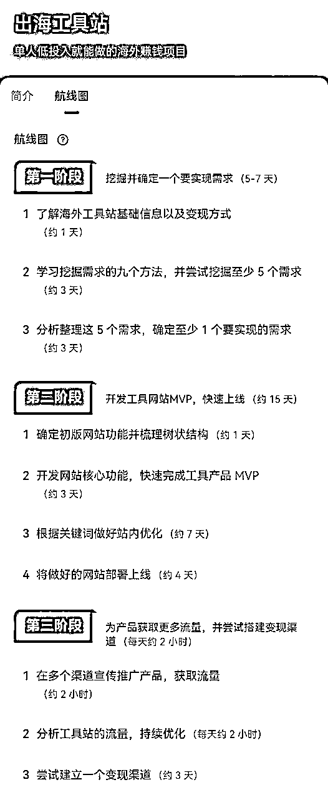

航线图与手册一一对应，可按当前环节找对应步骤学习。


# 必修篇：先跑通最小MVP

# 💡
# 本章导览：先认识，再动手

这一章从认识海外工具站讲起，逐步带你走完整个项目流程。你可按步骤实操，跑通最小MVP，做出第一个静态站点。

如果你是新手，建议动手前先看项目全貌：  
✅【项目概述】海外工具站基础介绍

如果你已有整体概念，就可以按核心步骤开始：  
✅【项目实操 1/4】挖掘工具需求  
✅【项目实操 2/4】快速做出工具产品并上线  
✅【项目实操 3/4】为工具站获取流量/冷启动  
✅【项目实操 4/4】如何开通 Adsense

必修篇中，航线图与手册顺序一致。按手册顺序学，就能逐个完成航线图任务。后续关键步骤的导览也会提示对应航线图，提醒你完成该步骤。接下来正式开始。

# 一、先把海外工具站看明白

# 💡
# 本章导览：概念先行

动手做出海站点前，先对海外工具站形成整体认知。这一章不涉及操作，却会影响后续每一步。你会看到：  
✅ 工具站是什么？  
✅ 工具站靠什么赚钱？  
✅ 一个工具站如何经历起步、成长与衰退？  
✅ 做工具站为什么要有MVP意识和SEO思维

读完本章，你会更清楚为什么要做出海站点。下面开始。


# 1.1 工具站是什么

# 1.1.1 常见网站类型速览 @ChatGPT

本节由ChatGPT辅助整理：

简单说：  
工具站：围绕搜索、翻译、在线存储等具体工具或服务。  
内容站：以文字、图片、音频、视频为主，新闻门户、博客、社交平台都算。  
电商站：承载商品或商业服务，独立站官网、在线市场是典型。  
社区站：让用户连接、互动、分享，论坛、社交网络、博客平台常见。  
教育站：提供课程、学习资源，在线学习平台、教育博客、机构官网都算。  
娱乐站：提供游戏、影视、音乐等娱乐内容。  
新闻站：发布时事、事件与评论，新闻门户、博客、媒体网站是常见形态。  
……

这些类型很常见，本次实战聚焦工具站。为什么选它？因为它能承接从用户需求挖掘、定位到最终变现的完整链路。


# 1.1.2 工具站的特点与分类 @ChatGPT

本节由ChatGPT辅助整理：

想让在线工具型站点既商业成功又让用户满意，通常要留意八个方面：懂用户想要什么；把界面做得简洁好用；功能要真能解决问题；技术方案稳定高效；数据与隐私要有保障；营销获客要有效；客服支持要能兜底；再用数据复盘用户行为和偏好，持续改进。

工具站提供好用的工具，帮用户解决具体问题，比如个税计算器、万年历、IP信息查询等。

常见细分方向有：邮件触达、项目协同、访问统计、在线收款、图片设计、文档协作、客服系统、表单收集等。每个方向都有成熟产品，但个人或小团队更该瞄准细分需求，也就是“Micro SaaS”。Micro SaaS是一种小型软件即服务产品，通常简单、易用，专门解决某类业务需求。与传统SaaS相比，它更聚焦某一特定方面，价格也更友好。做Micro SaaS，关键在于理解用户需求，并给出简单易用的解决方案。

工具类站点开发完成后，日常维护花的精力较少，可以自动运行。如果工具确实好用，用户会记住网址，或放进书签以后再来。

# 1.1.3 为什么优先做英文工具站 @刘小排 @哥飞

为什么先从英文站开始？答案就一个字：快。

App开发与审核链路长；国内App还要软著，修bug得发版让用户升级；国内网站备案周期约1～3周，严格城市还常被打回；小程序生态限制多，很多轮子得自己造。海外站省掉软著、备案、应用商店审核这些环节，更新时用户也不用重新下载。代码托管在GitHub，配合自动化流水线，提交后就能上线，开发体验很顺。

站点排名做上去后，可以长期收钱。只要互联网、搜索引擎、广告还在，收入就还在；站活得越久，外链越多，排名越稳。前提是别做垃圾站——真能帮到人，用户才会自发传播。

长期积累的事，最好的开始时间就是现在。放着不更新，只要还有人用，权重也会慢慢涨。今年AI热度高，AI相关工具更容易被用户传播。新手可先用短期或好玩的需求练手，学找需求、SEO、引流、推广、收费；之后再布局长期工具，参考竞品，争取更好用、更漂亮、更快。起步用网站，不代表产品永远是网站；MVP阶段先验证，拿到足够反馈后再做小程序或App也不迟。

内容来源：《写给独立开发者：如何快速做出产品 MVP》、《海外工具从需求挖掘到网站制作一篇文章让你搞懂》


# 1.1.4 中国工具出海时间线 @非洲水手

吴晓波的《激荡四十年》引出这段回顾。中国工具出海这二十年，大致可分四段：萌芽、起始、扩张、转型。

1、萌芽期  
1998—2007年，中国互联网早期，还是Copy to China的阶段。周奕以MP3 CD Maker开端，被视为中国工具出海第一人，行业迎来第一波曙光。

2、起始期  
大家逐渐意识到，工具出海能抹平中西方文化差异。2007年iPhone初代和Apple App Store发布后，移动互联网开启；久邦、百度、360、UC、金山等玩家在海外低调扩张，闷声发财。

3、扩张期  
2011—2016年，移动互联网出海进入扩张期。工具方向细分为手机管理、相机图片、桌面、浏览器等。买量成本不到0.01美金，安装量动辄数亿数十亿，资本迎来明媚春天。广告代理公司也随之出现，如Yeahmobi、Mobvista、Avazu，猎豹也自营广告代理。作者在这个阶段入行，服务过明星产品，见证行业辉煌。

4、转型期  
2017年后，增长方式更多元，变现也成熟（甚至夸张），但海外人口红利下降、产品同质化加重、Facebook和Google平台规则收紧。

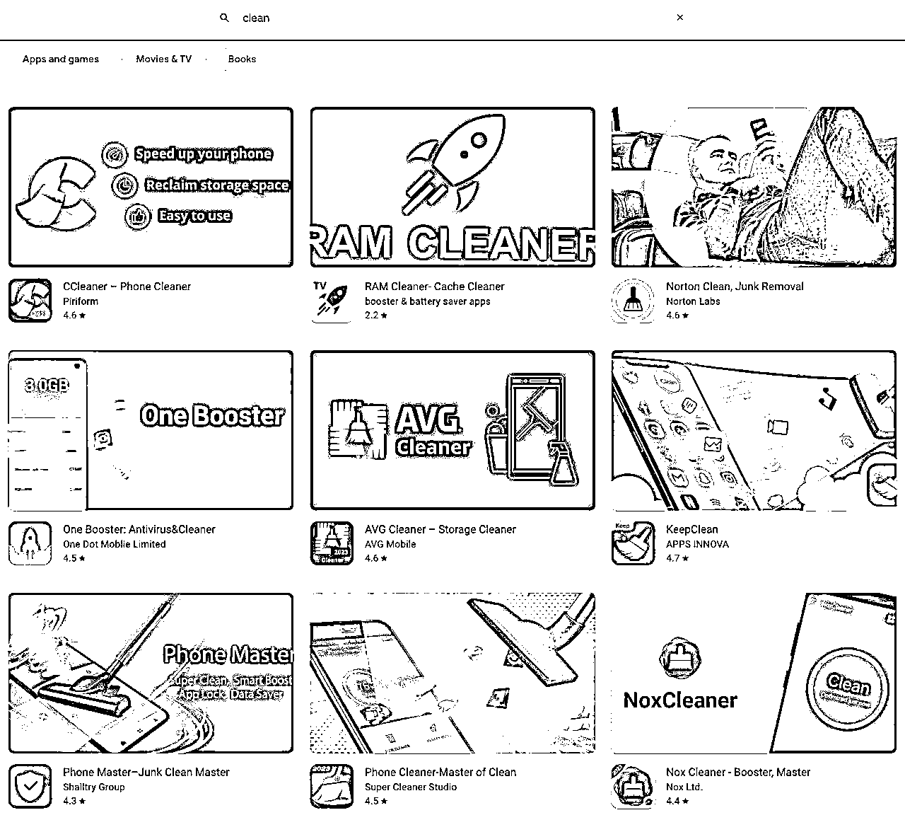

久邦股价腰斩后退市；Google、Facebook先后禁止锁屏广告；Facebook暂停中国区工具广告主投放；Google下架iHandy、猎豹等开发者的数百款工具。看空声音变多，利润空间被压缩，行业被迫转型。难道中国工具出海要止步？继续看后面。

内容来源：3月6日《关于出海工具产品营销推广，我的几点经验分享》@非洲水手

# 1.2 英文工具站怎么赚钱：先看全貌

赚钱有两个核心：流量与产品。要同时盯住这两端，确保不是只会开发产品、却没有盈利能力。

如图所示，ChatGPT海外工具站也分为卖流量和卖产品赚钱。你可以先大致了解。

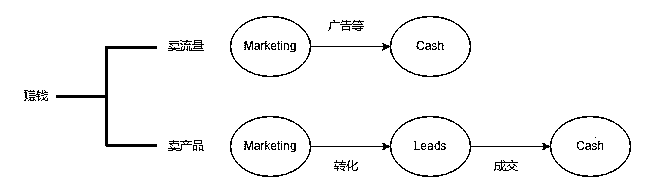

变现像竹子一节节长出来。在此之前，还得经历找需求、做站、拿流量。所以，做站前可以先定变现方向，但必须先有第一个站和流量，才谈得上收入。主要变现步骤，第五章和第六章会说明。下面先看看方式。

# 1.2.1 流量路线：广告收入 @子木

卖流量，是靠免费工具站点吸引访客，再通过广告、分销、广告联盟、Affiliate（联盟推广）、导流其他产品等方式收钱，类似 https://sharegpt.com/。挂广告即可变现。（图片网站暂不运营，仅做变现模式参考）

这类站的第一要素：提供有价值的免费工具，以获取流量。  
变现也简单：广告、分销、广告联盟、Affiliate（联盟推广）、导流其他产品等。  
比如ChatGPT领域，最简单做法是用免费工具站导流，再用ChatGPT账号自动发卡变现。


# 1.2.2 产品路线：付费收入 @子木

卖产品，是提供付费工具来变现。比如ChatGPT相关的付费工具站，类似 https://www.proseoai.com/（圈友做的谷歌SEO获客内容神器），可通过试用后转为付费用户来实现变现。

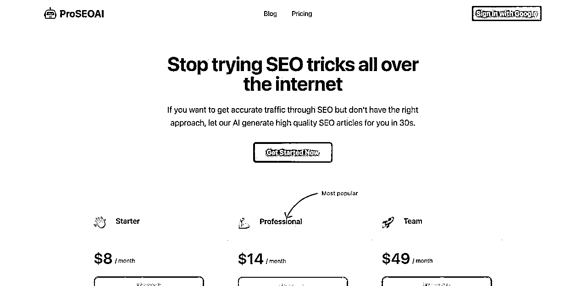

这类站的第一要素：提供有付费价值的工具。  
链路也长：搞流量 -> 搞转化 -> 还要客服搞成交 -> 还还要客服售后。也就是说，需要建立完整的销售链路，包括获取流量、转化、客服销售和售后等环节。

# 同一批流量，能变两份收入吗？

答案是可以。前提是流量与产品别错位：受众重合、需求相关。只要这两点守住，既推自己的产品，又做流量生意，就能形成双重变现。

内容来源：5 月 25 日《普通人能做 ChatGPT 相关海外工具的 IDEA 方向》@子木


# 1.2.3 广告与付费订阅组合变现 @龙哥

Google Play 政策趋严后，“订阅+广告”的组合在全球逐渐流行。其本质是用户分层：愿意掏钱的人进入付费订阅，不愿付费的人则通过广告贡献收入。

若早期用户画像不清晰，无法判断谁更可能付费，可先让全部用户走一遍付费流程；被拒绝后，再引导到广告路径。这样多少会损害体验，因此要用 AB 测试反复调优，最终把 LTV 做到最大。

广告侧可借助聚合平台筛选广告来源，把每次展示匹配到收益最高的广告、选择最优 eCPM，提升填充率与广告收入。

订阅侧 LTV=新增用户数×订阅率×支付率×续费次数。

Google Play 与 App Store 很早便鼓励开发者采用这套模式，但我真正感到中国出海开发者关注它，是近一两年的事。工具类产品适合试水订阅，原因有二：

第一，免费试用期能降低门槛，让用户先体验服务，再沉淀高价值付费用户；

第二，与一次性买断相比，单次支付金额更低，但后续自动续费会持续贡献收入，整体 LTV 往往更高。

内容来源：《龙哥盟 #轻享栏目：出海工具怎么玩》

除了上面的订阅讲解，龙哥此前也解释过订阅模式，下面摘录出来；想看全文可点原文。

如今，订阅模式早已突破早期较窄的定义，进入许多商业细分场景。出海领域里，它被越来越频繁地用于工具变现。

5 家增长之星中，喜马拉雅、蓝城兄弟、WPS Office 都采用订阅模式。执行策略各有差异，但订阅确实让它们的应用边界更宽。

WPS Office COO 章庆元接受 Morketing Global 采访时提到：会员订阅已是 WPS 越发依赖的商业模式；其根基是持续增长的用户规模，以及面向不同人群的本地化内容服务。海外市场上，WPS 正在探索模板、H5 海报制作等轻编辑产品，并认为这是正确方向。

WPS Office 属于办公工具，文字处理、图表制作等基础功能对所有用户免费。若只停留在基础功能，它也会陷入同类工具常见的变现难题：传统工具 App 用户黏性有限，商业空间因此受限。

订阅模式恰能改善黏性。

WPS Office 的订阅提供大量创意模板等轻编辑内容，吸引用户付费。用户使用频次会因此提高，使用方式也随之变化。在此基础上，WPS Office 还能做社群运营，奖励优质内容生产者，进一步扩展自身边界。

内容来源：《订阅模式让出海工具获得新生》


# 1.2.4 先免费后付费变现 @静水流深

先用免费服务聚拢用户，再找后续变现路径。我们自己的网站是：

https://realfavicongenerator.net/api/

有人会疑惑：这站不挂广告、也不收钱，靠什么活？

秘密在 API：申请时需留下邮箱，之后他们可推送其他服务完成变现。


# 1.2.5 资本变现 @静水流深

做海外流量变现，AdSense 账号是底线收入来源。若准备认真创业，最好正规注册公司。最赚钱的往往不是业务利润，而是把公司卖掉，这正是资本市场的吸引力。

BLOCKCHAIR 为加密货币提供优质服务，技术过硬、体验也好，却几乎不收钱。它为何免费？因为它先靠口碑扩大用户基数，再在资本市场出售股权融资。用户规模一旦上涨，没人会怀疑其变现能力，资本自然愿意追投。

再看另一个案例——IP 数据定位与服务：以免费服务汇聚大数据，再把数据能力做成定制化商业服务。

内容来源：《英文工具站，你没见过的那些案例》


# 1.3 了解产品的完整生命周期 @Cathy

💡 章节概要

熟悉产品从生到长的完整周期，能让规划更有章法。产品落地后，通常会经历三个阶段：

测试期

推广期

衰退期

测试期要解决的是：拿到用户反馈，并判断值不值得推。

能进入推广期，说明用户接受度尚可，已有一定自然增长，或手里有资源可加码。此时要盯住持续获客与变现，核心指标包括新增、活跃、留存、收益。服务对象也从一个个具体用户变成数字，所以推广前应接入数据统计平台。

产品走到稳定或衰退，可能源于市场变化，也可能因为用户变了。这一阶段要争取第二次用户增长或收入增长，得重新把目光放回用户，挖掘真实需求。

测试、推广、稳定或衰退，构成了产品的生命周期。尊重规律，事情才会更顺。


产品（无论工具站、内容站、APP 还是其他形态）上线后，一般也绕不开三个时期：

测试期

推广期

衰退期

下面以圈友 @Cathy 做过的 App 为例；若你做的是网站，可按网站步骤替换上线与运营流程。

# 1.3.1 测试期

目的：

收集用户反馈，并决定是否推广。

时长：

约一个月，拆成四个阶段。

第一阶段：

交给同事和亲友试用。直接发 demo 或未上架 APK，观察他们怎么操作。他们通常了解你的产品方向，因此重点看 Bug、易用性和需求匹配。

第二阶段：

找前期锁定的几位核心种子用户。重点收集需求匹配情况、Bug 与建议。

第三阶段：

在应用商店上线 Beta 版，同时到论坛社区邀请用户加入 Beta 计划。继续关注需求匹配、Bug 和建议。

第四阶段：

在应用商店发布正式版。可在社群邀请此前积累的用户来体验；若人数不够，就到非专业论坛、App 评测站发帖，例如 XDA Developers（最好提前养号）、Quora、Making Money with Android、Droid Forums、Facebook Group、AppAdvice、App Store Apps、148Apps 等。

应用商店可考虑：GetJar、SlideMe、Opera Mobile Store、AppsLib、Amazon Appstore、AppBrain。若产品够好，还可去 Kiip Build Fund、The mobileys、Appy Awards、Best App Ever Awards、AppCircus Competition 申请榜单，甚至争取 AppStore 与 Google Play 推荐。

我在猎豹负责过一款 App，靠推荐拿到超百万早期用户。若想更快，可从 Facebook、Google 等渠道买一点精准量。这个阶段最该看用户反馈与自增长能力，它决定 App 生死；如果两者都弱，方向或路径至少有一处出了问题。

不同 App 在第三、第四阶段会有差异。以我负责过的项目为例：

社交型 App：

第三、第四阶段尤其依赖外部社区测试。我参与过朋友的两个社交产品，一个是游戏语音交友，一个是匿名交友。做法是多备几个马甲，混进对应品类的 Facebook Group、XDA Developers 及竞品社区放钩子。

工具型 App：

测试要短平快。我们团队曾监测到大量竞品下架，于是迅速做了一款短期获利 App：在包名、名称、描述等素材里自然嵌入竞品关键词，一分钱不花就换来大量测试用户，为打磨与推广提供了数据。

所以测试期不只看反馈，也要重视 ASO，它能让推广事半功倍。包名、名称、Logo、短描述、长描述、关键词、宣传图、Page 页、视频内容、评论，每个模块都关键；越基础越不能马虎。

另一款竞争压力很大的 App，则需要用付费推广拉精准用户来测试，通常一天不到 100 美金。

若背靠有同类产品的大公司，常见做法是通过导量获取测试用户。

订阅型 App：

往往两种流量一起用。我参与过一个 TikTok 付费工具 App：早期测试流量主要来自 Quora 和 Google，我们在问答后留下产品名或链接；该品类竞争也激烈，所以测试期每天还配合约 20 美金 Google 流量。

对个人团队而言，开通 Facebook 广告与 Google 广告很关键，小预算也能办大事。

# 1.3.2 推广期

产品进入推广期，意味着用户接受度令人满意，已有自然增长，或有资源可加大投入。此时要关注持续获客与变现能力。

核心指标转为新增、活跃、留存、收益。服务对象从具体用户变成数字，因此推广前必须接入数据统计平台。

推广分免费与付费两类。

免费推广要长期维护；付费推广的诀窍只有“细节”二字，包括预算与规划、渠道拓展维护、质量监控、数据分析。不同产品适合的付费渠道不同，常见有社交媒体、Google、网盟。

新产品可先试社交媒体，质量较稳。若不确定投哪里，就观察竞品渠道，先复制测试，最后保留一两个 ROI 最好的渠道长期投放。

这一时期，除非自然增长特别强，一般都要做付费推广。以我负责过的 App 为例：有两款工具 App 没做付费，因为行业整体受 Google 压制，而它们靠竞品关键词还能活；硬推反而容易出头挨打，所以一直低调维持。

前面提到的那两款小 App——3V 与美化类——竞争激烈但 ROI 尚可，因此会持续付费。经验是只买竞品看不上的 Google 长尾流量，在成本上做出差异。

我在猎豹期间做的桌面产品，大部分流量来自免费渠道：用大量主题 APK 覆盖长尾关键词。

无论免费还是付费，都要围绕 AARRR 模型，它贯穿用户全链路。从用户看到素材到最终使用，每个环节都经过多轮 AB 测试。例如我们的头部主题产品，每周按语言测试图片与文案，提升点击下载率。

用户下载到安装成功，要平衡包体大小与质量；安装成功到点击应用主题，则对按钮颜色、样式、推荐主题做 AB 测试；应用成功落到桌面后，继续优化包体、图片与文案；下载成功到使用阶段，会根据国家、机型等特征，在第 * 天推荐相似主题或头部主题，以提升使用率和留存。


# 1.3.3 稳定期或衰退期

产品进入稳定或衰退，可能由市场决定，也可能用户变了。这时要争取第二次用户增长或收入增长，重新把主要精力放回用户，寻找当下的真实需求。

我负责的桌面产品曾实现非线性增长，原因是目标用户仍有未被满足的需求，而差异化运营推广能触达这部分人。

但我自己的小 App 大多已进入稳定或衰退。稳定期需求平稳，服务与推广跟得上，就继续维护。

衰退期 App 原本做的就是短期收益，再投入太多会成为负担，食之无味，弃之也不可惜。

内容来源：《Google Play 赚钱机会：对于小型技术团队/个人开发者，如何判断一个 App 是否值得做、引流及变现方法论分享》


# 1.4 如何快速做出工具产品 MVP @刘小排

💡 章节概要

为什么要快速做 MVP？因为新产品失败率太高。想提高整体成功率，只能增加尝试数量，不断试新 idea，这是创新者的共同困境。

下面整理几种快速做产品的方法。在精益迭代的商业竞赛中，一年能发 12 个 MVP 的人，比一年只发 3 个的对手多出四倍优势。

当然，做出 MVP 只是工具产品第一步，重点在验证需求、明确后续优化方向。方向初步跑通后，还要依据数据与反馈继续完善功能、迭代网站，增强竞争力，最终持续变现。


独立开发者 Peter Levels 今年 10 月上线 avatarai.me，首日收入 1 万美元，十天累计 10 万美元。

秘诀是什么？是“多”。

过去约十年，他做过 70 个产品，只有 4 个成功，成功率约 5%。他已是全球顶尖独立开发者之一，成功率也只有 5%，何况普通人。

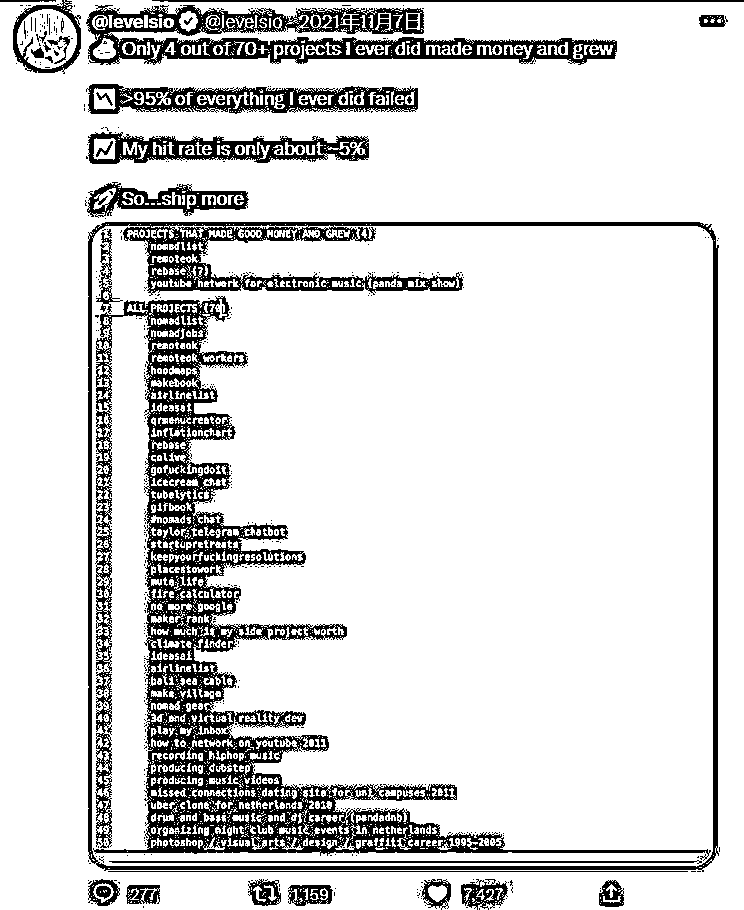

所以更现实的选择是：

把你能想到的 idea 都列出来；

用最省事、最快的路径做出来并上线，比如一个周末；

上线后看数据，让市场决定是否继续投入。

具体怎么做？下面展开：

方法一：买模板，两天做出 MVP

海外工具站 MVP 只需抓住两点：

界面要好看，显得专业且值钱。

核心功能必须可用。

对应方案很清晰。

界面怎么好看？花钱买模板。

我买的是 https://tailwindui.com/templates/salient。

拿它和我前面提到的 https://keywordsea.com 对比，观感几乎一致。

不过这个模板偏贵。更推荐去 themeforest.net 挑，选择多且便宜，通常 10 到 50 美元。

核心功能怎么完成？只写一个函数。

对，只写主功能那一个，其他函数先不碰。

我不太相信一个合格程序员在开源社区帮助下，8 小时还写不出一个函数。

比如做“下载 YouTube 视频”工具，先定义输入输出（输入 URL，输出视频文件），再去 GitHub 找现成代码稍作修改，通常 1 小时内能搞定。

时间大致这样：

选模板并采购：约 1 小时

注册域名：约 1 小时

撰写落地页文案：约 1 小时

调整模板：约 2 小时

开发核心函数：约 8 小时，往往更短

发布到线上：约 2 小时

两天足够。

上线后把链接发到 Startup 社区，比如 Product Hunt，然后等数据。

免费产品重点看自然流量是否增长，因为它代表自传播。自然流量包括社交网络、搜索、外链。


方法二：靠预售，半天做出 MVP

你可能注意到，最耗时的是写主函数，其次是前端（买模板+改模板），两项占 MVP 时间七成以上。

如果这两项都不做，能否再缩短？

可以。

尤其对付费产品，主功能可以先不做，因为你要验证的是付费意愿。

验证付费意愿的最佳方式就是预售，也就是“卖空气”。

步骤：

写预售营销文案，重点讲清要解决的问题和三个卖点。

用工具生成 Landing Page。推荐 carrd.co、Webflow、Framer，把文案填进去。

用 Typeform 接入 Stripe 支付。

买 Google 关键词搜索广告，盯转化率数据。

carrd.co 和 typeform 体验不错，具体操作不展开。

在 carrd.co 里制作 landing page 界面，如图所示：

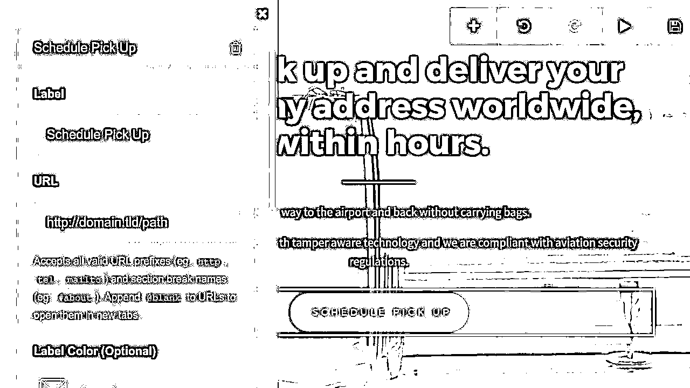

在 Framer 里制作 Landing Page 页面，如图所示：

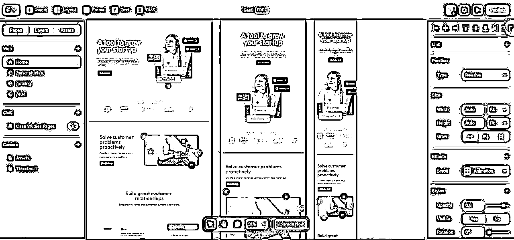

在 typeform 里添加收款功能的界面，如图所示：

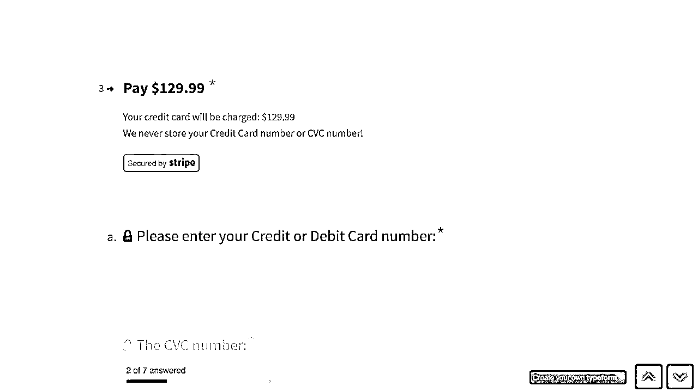

再看几个例子。

下面两个产品的 landing page 都用 carrd.co 生成，无需写代码：

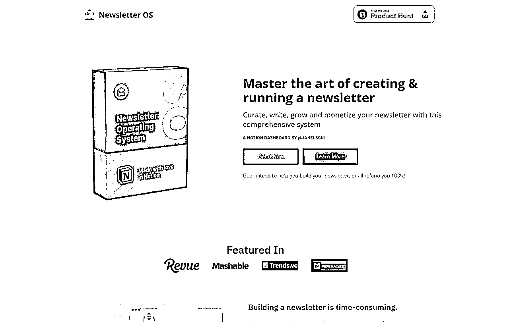

而这个链接用 Typeform + Stripe 做出“带支付功能的调查问卷”，同样零代码。把它放到 landing page 上，MVP 就完成了，可以开始测转化率。大家可以点开感受一下。

https://template.typeform.com/to/zDzdJ3Me

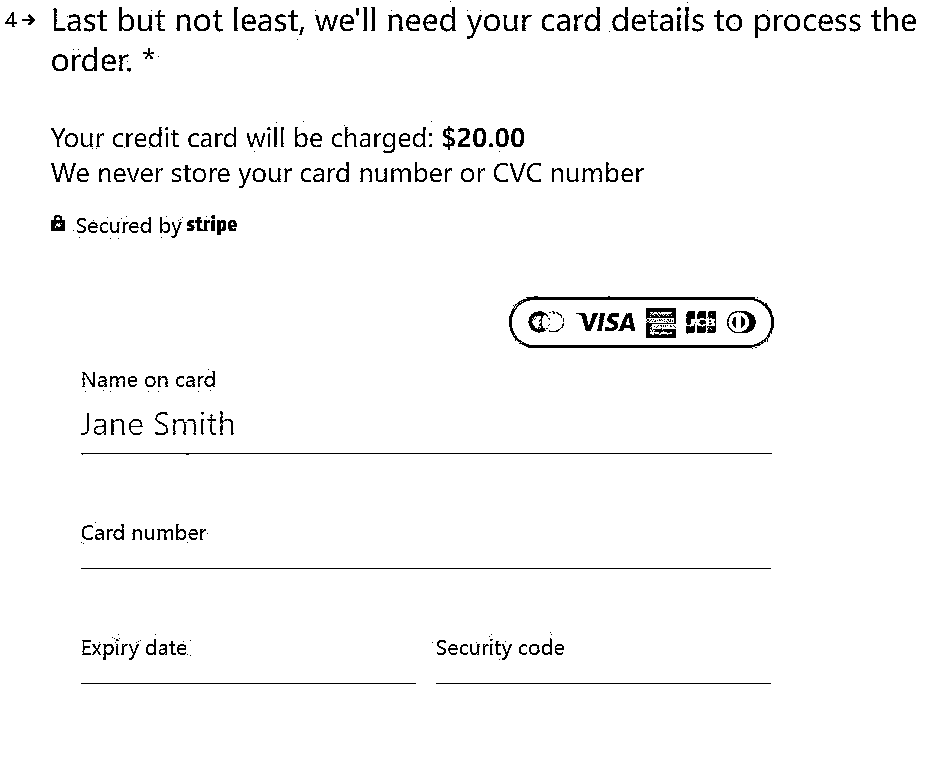

出处：《写给独立开发者：如何快速做出产品 MVP》


# 1.5 工具站从第一天就带着 SEO 思路 @子木

谷歌靠内容检索分发流量。网站若想出现在搜索结果里、还想让收录速度更快，从搭建之初就要把挑选好的搜索词和延伸词安排进站内。

域名、代码、页面内容、站外推广——每个环节都别脱离 SEO 视角。归根结底，就是让目标用户搜得到你。

预算和资源都有限时，新英文站想靠谷歌自然搜索起量，通常有两条打法：

1. 长尾先行：先把 long-tail 搜索词覆盖到约 1000 个页面，作为首阶段任务；站点从新站熬成中老站后，再向 mid-tail、short-tail 这类更热的词进攻。
2. 用规模换机会：铺大量词条和内容页，例如把旧素材重新包装，或让新站借助 AI 与二次创作批量产出。

我理解的谷歌 SEO 权重是：内容占八成，外链占两成，技术几乎不单独加分。即 SEO = Contents（80%）+ Backlinks（20%）+ Technical（0%）。

Contents：价值优先。谷歌的底层逻辑是让搜索者得到有用答案。
Backlinks：优质外链不可缺。
Technical SEO：技术层面的优化属于入场券。

能带来流量的技能不少，但写代码的人更值得先补 SEO：有技术底子，学起来、做起来都更顺。更重要的是，稳定的自然搜索流量具备长期性、复利效应，新增边际成本极低。

现在，就把 SEO 意识带进你的第一个海外站点。


# 二、【项目实操 1/4】找到值得做的工具需求

# 💡
# 本节要点

挖需求如果只凭感觉，很容易原地打转。我们整理了星球里几位实战派的套路，把他们找方向时用过的招数摘出来。

圈友刘小排给出的判断是：高胜算点子要过三道门槛；他据此归纳了五种常见路径，并标注了命中率。本章以他的框架为骨架，再补入其他高手的做法，所以下面列出的路径不止五条：

✅ 从自身痛点长出的原生点子 ★★★★★
✅ 用搜索词反推需求 ★★★★★
✅ 拆竞品后做出差异 ★★★★
✅ 顺着痛点找机会 ★★★
✅ 围着平台生态找机会 ★★★
✅ 从自己的需求往外扩 ★★★
✅ 看榜单找方向 ★★★
✅ 盯新兴领域 ★★★
✅ 接个性化定制 ★★

这些思路不只服务于工具站。更希望你能借此摸到海外市场的付费需求，找到一个能持续赚钱的切口。

# 💡
# 本章路线

学完并做完第二章，航线图第一段就算完成：确定一个要落地的需求，周期约 7 天。

1. 先弄懂海外工具站的基本盘与盈利方式（约 1 天）
2. 掌握九种挖需求方法，并试着找出至少 5 个方向（约 3 天）
3. 把这 5 个方向逐一分析，筛出至少 1 个准备动手的（约 3 天）

下面进入实操。挑一种顺手的挖需求方式，去记录你的发现，并在航海日志里打卡。


# 2.1 高胜算点子先过三道门槛 @刘小排

一个能打的产品构想，通常要同时跨过三道门槛：

第一，需求真实存在；
第二，你是这个赛道里的专家，哪怕硬碰硬竞争，也有把握比同行做得更好；
第三，你能扛住早期没有正反馈的阶段，继续做下去。

围绕这三道门槛，我梳理出五条常见路径，命中率由高到低排列。以下只是个人看法：

1）原生点子 ★★★★★
2）借鉴成功竞品，再切出差异化价值 ★★★★
3）研究搜索词，找出尚未被满足的空白 ★★★
4）有人先付钱请你定制，再把它做成标准产品 ★★★
5）凭空硬造的点子 ★

资料出处：《如何获得产品 idea》

# 2.2 路径一：先解决自己的麻烦 ★★★★★ @刘小排

英文叫“organic idea”。硅谷创业圈最认可这种做法，不少科技和投资圈大佬也站台。

它的内核很朴素：你遇到的麻烦，自己动手解决；你本人就是用户，产品会被你天天使用。

这个说法可追溯到硅谷创业教父 Paul Graham。他提醒，构思产品时更该用的动作是“留意到”，而非“想出来”。YC 把从创始人亲身经历里自然长出来的构想称为 organic startup ideas；最成功的创业公司，大多是这样起步的。换句话说，先“留意到有个问题，可以这样处理”，而不是“我拍脑袋想到了一个创业方向”。

原文链接：http://paulgraham.com/startupideas.html

类似表达还有——

硅谷科技圈流传一句老话：eat your own dog food，先吃自己的狗粮。含义是你得成为自家产品的使用者。过去五十年，大量公司和行业人物引用过它。

顶级独立开发者 Peter Levels 在《Make》中写道：最重要的是从解决自身问题里发现方向。他还给了一个练习：每天记下 3 个你碰到的麻烦，七天就能攒出 21 个产品构想。

不少成功公司正是这套思路的产物。

苹果最早组装个人电脑，服务对象是谁？就是自己。那是沃兹的业余爱好。

Facebook 起步时是小扎自用的小站点，用来给校内女生评分，名字叫“hot-or-not”。

AirBnB 的起点是创始人交不起房租，于是做租床位生意：提供充气床垫（Air Bed）和早餐（Breakfast）。品牌名也由此而来——Air Bed and Breakfast。

BuiltWith 同样如此：这个一度很火、团队仅 1 人、年入 1400 万美元的产品，最初源于创始人常看到别人的网站，想知道对方用了什么技术栈，于是干脆自己做一个工具来查。

再看近一点的例子。龙哥盟，最初是龙哥想找一个创业者交流社区，发现市面上没有，便自己搭了一个。

还有一个很接地气的：nomadlist.com。Peter Levels 是数字游民，想知道全球哪些城市适合这类人生活，先做了个 Excel 表。后来他发现表格被不少人转发，才决定产品化。此后有无数创业公司带着更多资金、资源和人力试图复制它，却始终没能取代它。原因很直接：Peter 本人最懂数字游民要什么，这个产品首先解决的是他的问题。

为什么这套打法胜算更高？因为它刚好对上前面三道门槛：

需求真实——麻烦就长在你身上。
你是专家——你被痛点折磨过，花时间研究过，也发现现有方案都不够好；你比谁都清楚自己缺什么。即便后来有人想抄，你作为最懂场景的人也不慌。
你能坚持——因为你自己就是用户，你会发自内心希望它变好。

当然，它并非万能。最大的疑问是：你的需求，凭什么别人也有？

这个问题没有标准答案，世上也不存在百分之百成功的创业方法。只能说，用这条路，赢面通常比乱撞更高。

资料出处：《如何获得产品 idea》

# 2.3 路径二：从搜索词里听出需求 ★★★★★

用户不会直接告诉你“我需要什么”，但会留下搜索痕迹。比如：

在某个平台吐槽某款产品；
在搜索引擎里输入某个疑问；
……

这些动作都会在互联网上沉淀记录，也能从数据侧折射出潜在需求。那怎样站在用户视角理解搜索词？可以拆成两问：

一，用户的关键词从哪来，他们会在哪些场景留下词？
二，用户带着什么心理去搜，搜索动作背后想解决什么？

弄明白这两问，就绕不开搜索引擎。搜索引擎里又有哪些技巧，能帮我们更快筛出有价值的词？

# 2.3.1 用户的搜索词从哪里冒出来

互联网上，只要存在用户交互，就会留下痕迹，区别只在主动还是被动。站在挖需求的角度，这些痕迹就是矿脉。

以 Amazon 上的用户行为为例：

用户输入过某个词，平台会记下，之后再打开页面就推送相关商品；
用户浏览了哪件商品、停留多久、收藏了什么，也会进入平台的分析系统；
用户下单或留下评论，同样会被记录，之后平台可能给对应 listing 更多曝光；
平台还会读取用户位置等信息，用于推荐商品。

这些行为轨迹，就是判断需求的原材料。Amazon 或第三方工具（例如卖家精灵）会把数据摆出来，我们要做的是从中抽丝剥茧，用多个指标交叉验证：这个需求到底成不成立。

常用工具包括 Semrush、Similarweb、Ahrefs、Google Trends 等，先用免费额度判断值不值得做。若想解锁付费功能，正版价格不低，可以去电商平台找共享账号。

# 2.3.2 搜索词挖掘的具体动作 @三林@Tiger

**1）先跑通一遍搜索词挖掘**

我的经验是，第一步先圈“母词”。

研究对象不同，母词也不同：TikTok、YouTube、Tesla……先各定一组。以 TikTok 为例，我会拿 tiktok video、tiktok live、tiktok shop、tiktok fans 等词先把范围框大。

然后：

第二步，拓词。借助 Google Ads 的 Keyword Planner（关键词规划师）等工具，把相关搜索词找出来。
第三步，清洗，再拓一轮，并回查流量。
第四步，把结果二次分组，看哪些词条的流量更有代表性。
第五步，挑出值得跟的词，反推它背后对应什么产品或服务。把结论放进项目库/需求池，调研评估完再决定做不做。

**2）好用的拓词方式**

用下拉框捡词 @TIGER

在 Google 或 YouTube 输入词时，搜索框常会弹出建议。这些建议经过平台算法过滤，相关度和热度都不错，很适合找热门词与长尾需求。这次拿 Google 演示，换到国内平台，思路同样能迁移。

一个小技巧：在目标词前加星号（*），它类似通配符（wildcard）。这样能带出更多相关词，竞争往往不大，搜索潜力却不小。

注意，YouTube 里直接以 * 开头不会被当成通配符；要先输入词，再把 * 放到前面。

下面这张图，是我用“TikTok”演示如何找潜在热门搜索词。

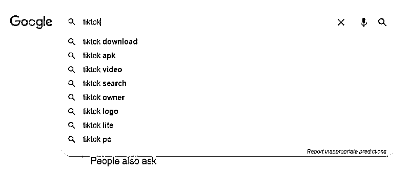

按上述方法在 Google 搜相关热门词后，跳出来的第一条是：How to go live on TikTok（如何在 TikTok 上直播）。

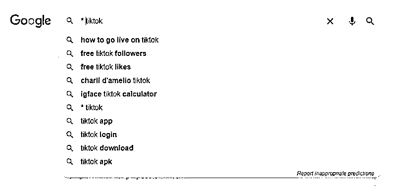

用这个词去搜，首页出现了同名解说视频，标题与搜索词几乎一字不差。

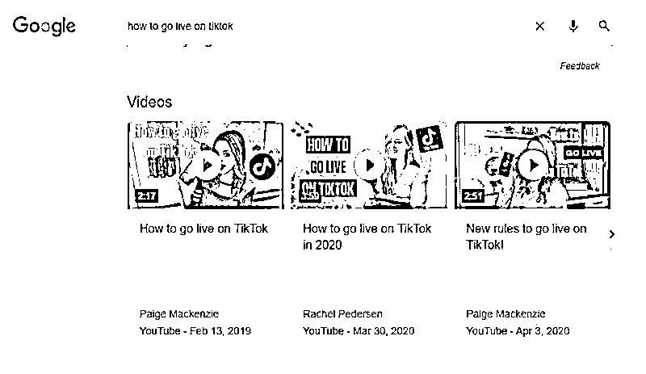

点开后能看到，这条视频播放量达到 150 万次。


再进博主主页，会发现她日常视频大多只有几万播放，而这条 150 万播放的视频是她最大的爆款。她的粉丝增长，很大程度上靠这条视频引流，账号也做到了 20 多万粉。

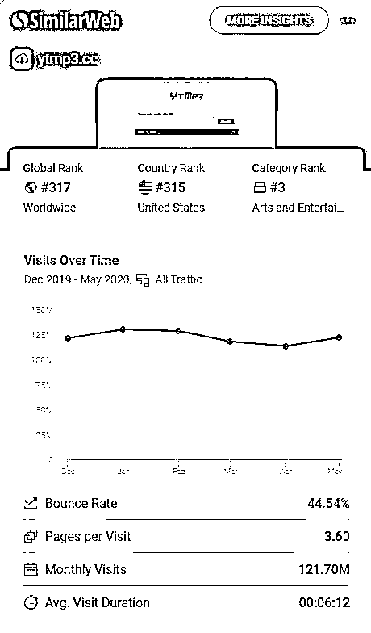

就这样，顺着搜索词一路分析，挖出了一个靠该词流量起飞的 YouTube 频道（当然，她也在用 TikTok 导流）。

上面这个案例只是演示：怎样用搜索技巧找需求，或拆解别人的成功路径。

资料出处：《Google 搜索 技巧寻找潜在商机》

拓词工具：Google Ads 的 Keyword Planner（关键词规划师） @三林

它原本是谷歌广告后台的功能，用谷歌账号就能注册并免费使用。入口在「工具和设置-规划」里的「关键词规划师」。

进去后有两个方向：一边是「拓词」，帮你发现新词；另一边是「查词」，用来查流量。

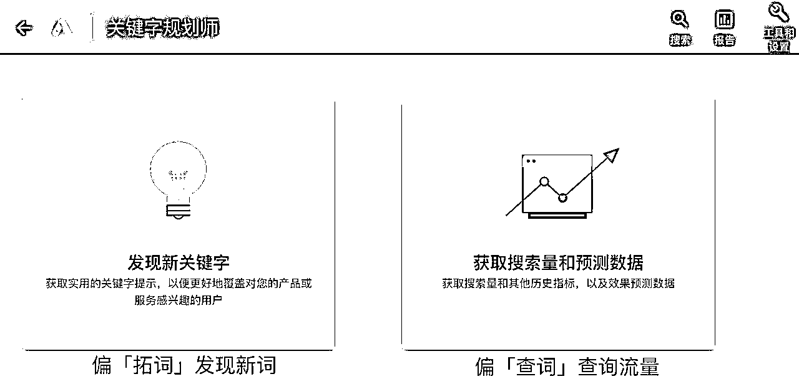

在「发现新关键词」里输入一个词，系统会给出更多相关词，以及月搜索量、广告点击出价预估等。它本质上是为投放服务，但拿来做需求调研也未尝不可。如图所示：

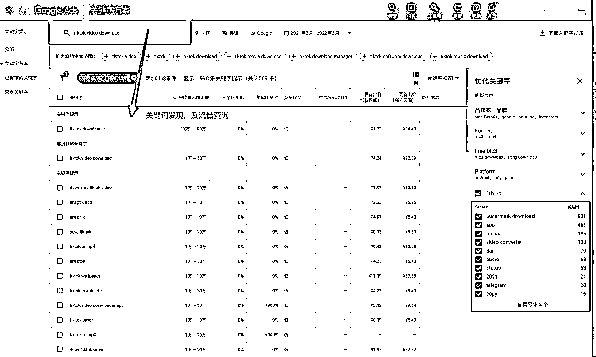

这就是拓词。初筛之后还能再拓，也就是“二阶拓词”。通常一个母词能带出上千个词；如果手里有上千个核心母词，扩出百万级有搜索量的词并不稀奇。

拓词工具：Ahrefs 的关键词查询 @三林

Ahrefs 在海外站点 SEO 上很能打。它也有 keyword explorer 板块，但和 Keyword Planner 不同：它更擅长围绕某个具体词做精准匹配，数据颗粒度更细。比如只看 tiktok video downloader 这一个词，就能看到：

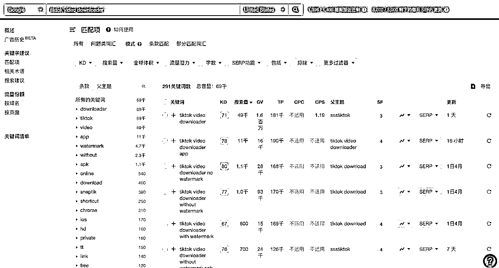

它直接匹配了哪些相关词。

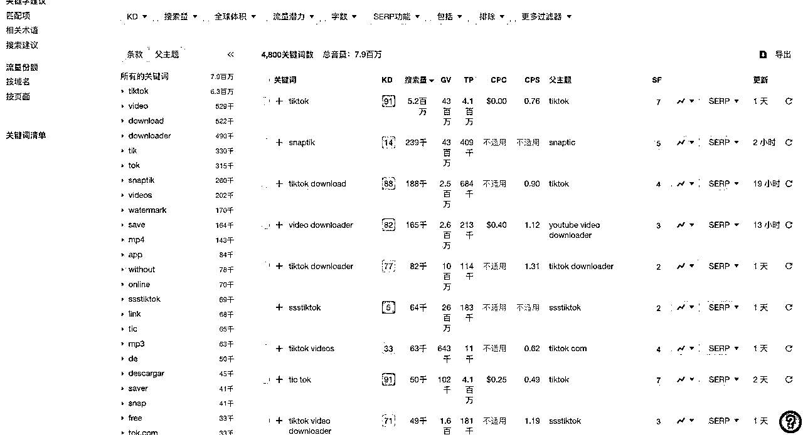

页面还会给其他相关词建议。遇到同需求的词，可以导出，继续作为下一轮拓词素材。

Ahrefs 专业度很高，可以去淘宝租个共享账号快速体验。

另一个 SEO 工具 Similarweb 也有搜索词分析模块，不过我觉得它的词量不够大，不太好用；但查网站访问量时，它比 Ahrefs 更准。

拓词工具：光年-谷歌关键词分析工具 @三林

这款工具由国内流量增长咨询公司光年实验室推出，优势是批量查询和多维数据导出。数据量一大，网页版就不够用，需要申请谷歌关键词 API。它的数据同源，同样来自 Keyword Planner。

提醒：谷歌关键词规划师 API 目前不容易申请。

资料出处：《以 TikTok 举例，如何发现海外产品的赚钱机会？》


**3）拿到词之后怎么处理 @TIGER**

筛出靠谱的热门词后，一般要走下面几步：

先看搜索频次。

有些词天然带巨量衍生需求。以 YouTube 为例，主词搜索量上亿，围绕它长出的 Youtube to mp3 等子类，单月搜索量就能到千万级；头部几个轻量工具站靠 SEO 能做到月流量过亿。

但也有一些词，主词本身搜索量不高，想靠走量赚钱就未必划算。

可用工具：Google Ads Keyword Planner、Ahrefs、Semrush、Keywords Everywhere 等。

再看竞争对手。

好机会不是“流量大就行”，而是流量可观、对手又没那么强。你看到某个热词，别人也看得到。

如果做 YouTube 频道，就把该词下推荐的频道逐个拆：粉丝规模、制作水平如何。

如果做独立站，就分析 Google 首页前十名的外链数量、域名权重等，判断自己有没有机会超过。

查对手外链还有个小办法：

在 Google 搜索框输入「link:xxx.com」（把 xxx 换成具体域名），能看到对方相当一部分外链。想要更精细的数据，再借助 Ahrefs。

资料出处：《Google 搜索 技巧寻找潜在商机》


**4）母词技巧补充 @三林**

母词要“多”且“准”。数量建议拉到四位数：几千个母词，往往能扩出几十万甚至上百万个词。准也很关键，否则会拓出大量无关结果，筛选成本反而变高。比如用“Tiktok”拓词，容易混进大网红名字，这类词要先剔掉。

母词可以从哪找？三点：

第一，从目标网站里挖：首页、关于我们等页面的人工整理，Slogan、页面描述、Metawords、底部导航命名，凡是描述业务的词都尽量收全。
第二，从自己所在行业出发做头脑风暴：直接相关词、行业相关词、人群相关词都可以纳入。
第三，从广告投放词里找：这也是极好的来源。Ahrefs 有个“付费关键词”功能，可以查某个网站正在投放哪些词。你想，愿意按点击付费买来的词，精准度能差吗？下图以 Shein 为例：Ahrefs 收录了 7.4 万个词，可过滤后导出继续筛。

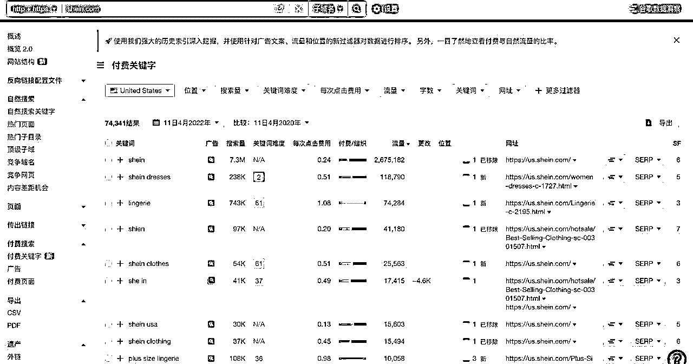

先收个口：

Google 的搜索数据，像一面镜子，能照出用户真正的缺口。做关键词调研，若想摸透一个行业，得沉住气，把词挖全、选准。这里分享一条借工具快速入门的路子。TikTok 能这么玩，换个赛道呢？比如估值被传得沸沸扬扬的 Shein（千亿美元级别），它周围又藏着哪些可做的生意？

渠道会更替，但用户要的东西不会凭空消失。新平台刚起势时，若能抢先铺好相关服务，就有机会吃到红利。早年在 Instagram、YouTube 做下载站的经验，搬到 TikTok 上再跑一轮，照样成立。

借助 Google 关键词调研去捕捉需求、判断产品方向，我把它称作「赚钱机会」。这件事很有意思：你会看到一些人用你没想到的方式搜词；顺着词点进去，又会感叹——原来还能这么干。关键词的用途远不止找需求和做 SEO/SEM，内容选题、信息流投流、舆情监测、KOL 筛选等场景都能用上。

内容来源：《以 TikTok 举例，如何发现海外产品的赚钱机会 ？》


# 2.3.3 关键词挖掘与分析：四件趁手工具 @哥飞

① Similarweb

它能帮你摸清一个站的访问规模、访客从哪来、分布在哪些地区，还会列出同类站点。

网址： https://www.similarweb.com/zh/

插件：https://chrome.google.com/webstore/detail/similarweb-traffic-rank-w/hoklmmgfnpapgjgcpechhaamimifchmp

平时可以多一个动作：随手在搜索框里敲工具类词汇，把结果页前十名的站点逐个丢进工具里，看看各自吃了多少流量。

拿“pdf”试一下，Google 首位是 Adobe 官方站，紧随其后的是 ilovepdf.com；这时用 Similarweb 查一下后者即可。

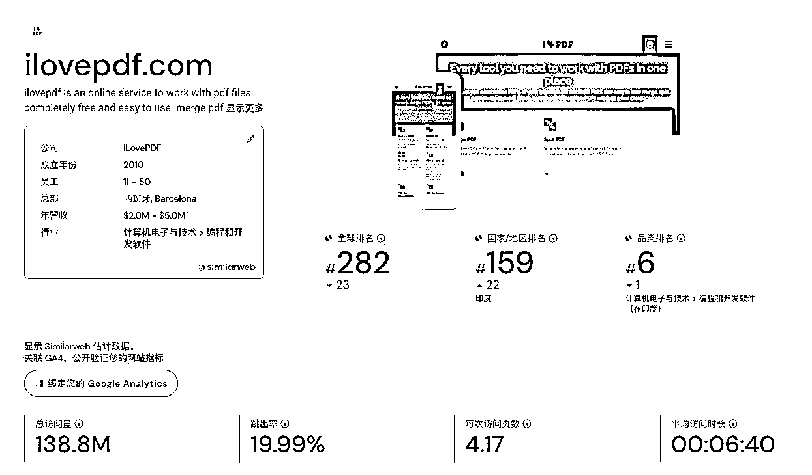

访问量里的 M 指百万，8.8M 即八百八十万，138.8M 则是一亿三千八百八十万。跳出率低于两成，意味着多数访客进来后能顺利找到所需工具，侧面证明产品有用。

跳出率若偏高，通常说明页面加载太慢、内容质量差，或者干脆是垃圾站，无法接住搜索意图。人均浏览页数和停留时间，同样能判断一个工具站是否真正解决问题。

流量分布很散，多国都有覆盖；某些地区暂时空白，反而值得深挖。

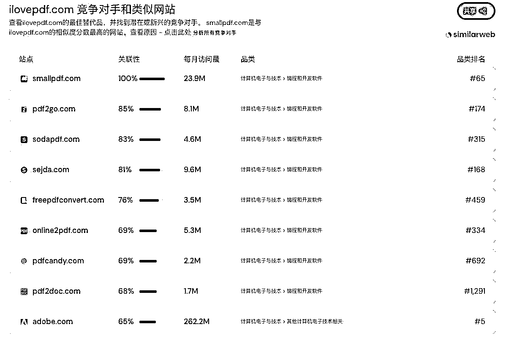

页面还会列出大量相似站点，并附上各自的流量数据。逐个点开看，就能从一个入口站出发，顺藤摸瓜扒出一串同行。

也就是说，在 Google 找到一个站，就拿到了继续挖下去的线索。

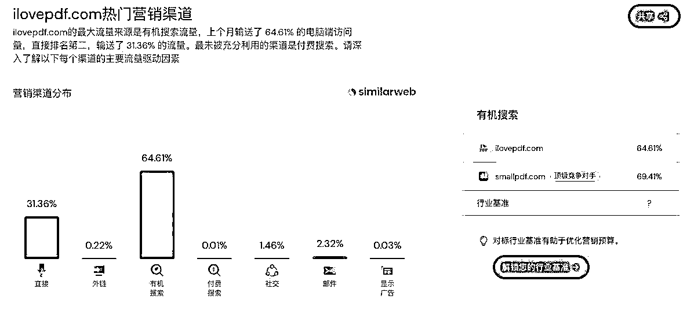

搜索渠道贡献了 64.6% 的流量，说明该站 SEO 功底扎实；但直接访问仍占 31.3%，并未完全依赖搜索。

这透露它能把搜索来的新客沉淀为熟客——要么记住了域名，要么收藏了页面。再次说明体验过关、需求接得住。

继续看关键词来源，仅品牌词就带来八百五十万访问，品牌认知可见一斑。

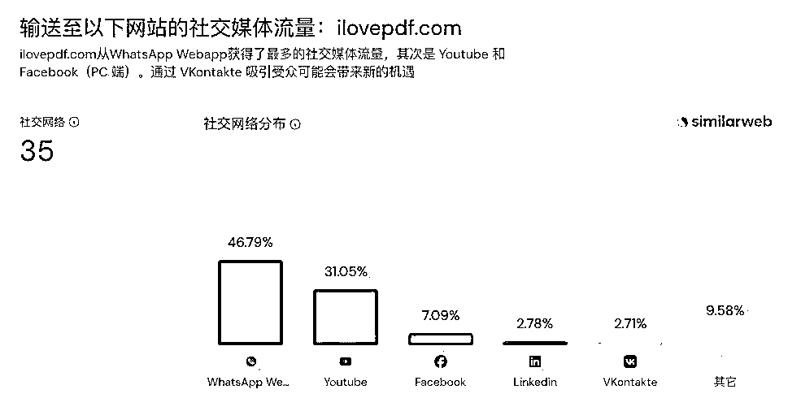

这一块能看出社交平台为站点输送了多少流量；那一块则列明外链来源，顺带还能偶遇一些新站点。

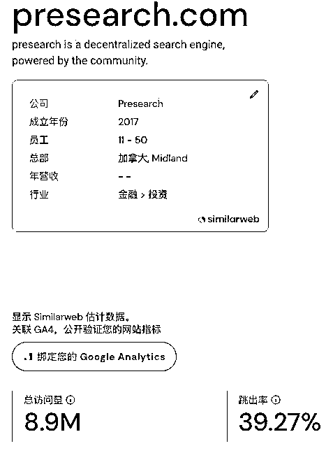

例如 presearch.com，点开一查，月访问量有八百九十万，体量不小。介绍里说它是去中心化搜索，哥飞此前也没听过。

碰到这种陌生站点，不妨照研究 ilovepdf.com 的套路再走一遍，很可能又挖到新东西。

上网常被比作冲浪，既然在信息海里游，怎么游得看工具顺不顺手；工具用熟了，视野自然打开。

② Semrush

这个平台适合拆解站点的搜索流量结构：关键词怎么分布、单词带来多少访问、优化难度高不高，入站外链和出站域名也能一并查看，功能相当全。

网址：https://zh.semrush.com/projects/

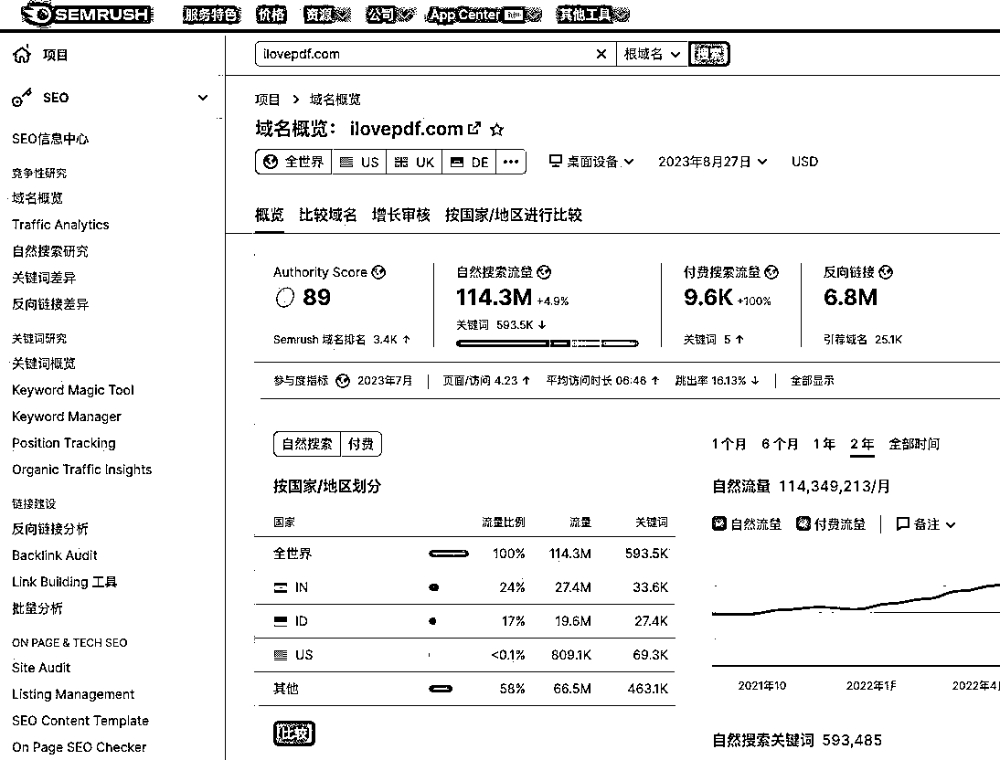

操作不复杂：填入域名、提交查询，结果页就出来了。自然流量、付费流量、反链数量一目了然，还能按国家拆分。

点一下顶部的 114.3M，就能进入该站在各国关键词流量来源的明细。

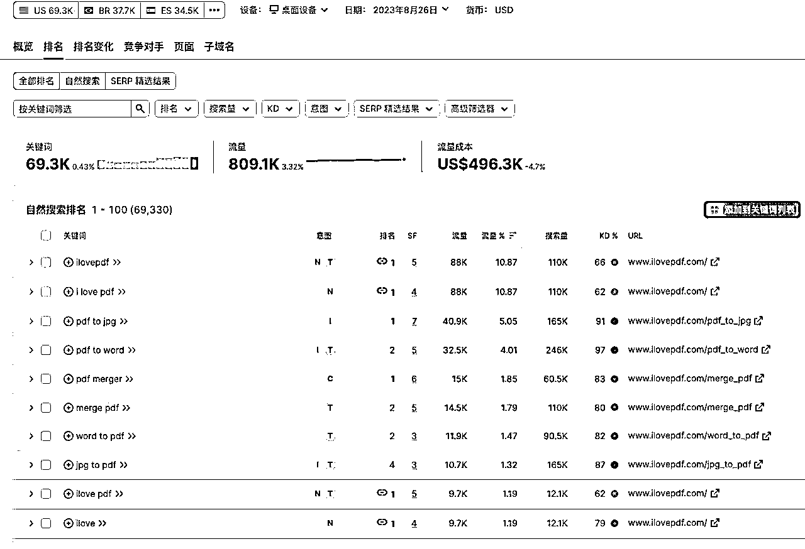

留意 KD 这一栏，它表示某个词在指定国家的优化竞争程度。数值越高越难啃，硬碰基本没戏。

免费账户不能按 KD 过滤；如果是付费会员，可把阈值设在 60 以下，再按搜索量降序排列，就有机会捞到搜索量尚可、难度偏低的词。

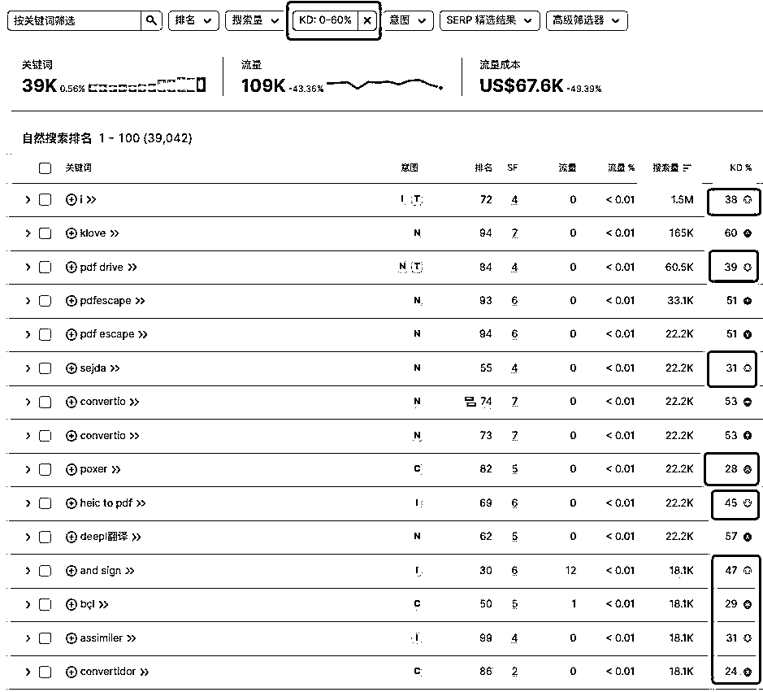

逐个关键词点开，会看到搜索量、竞争度以及排在前面的结果。

像 seword 这种明显属于他人品牌的词，直接跳过，不必浪费精力。

哥飞实测时发现“poxer”竞争度很低，且结果页几乎全是内页。此时若注册一个相关域名、集中全站资源打这个词，冲上 Google 首页并不难。

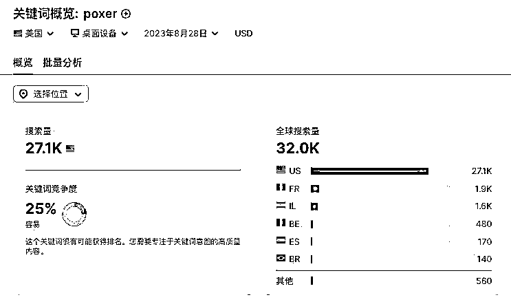

提醒一句：“monkey pox”指猴痘，“pox”是痘，所以搜“poxer”的人，很可能想找的是与“长痘的人”有关的信息。

③ Google Trends

适合观察流量走势，也能比较多个关键词之间的相对热度。

网址：https://trends.google.com/trends/

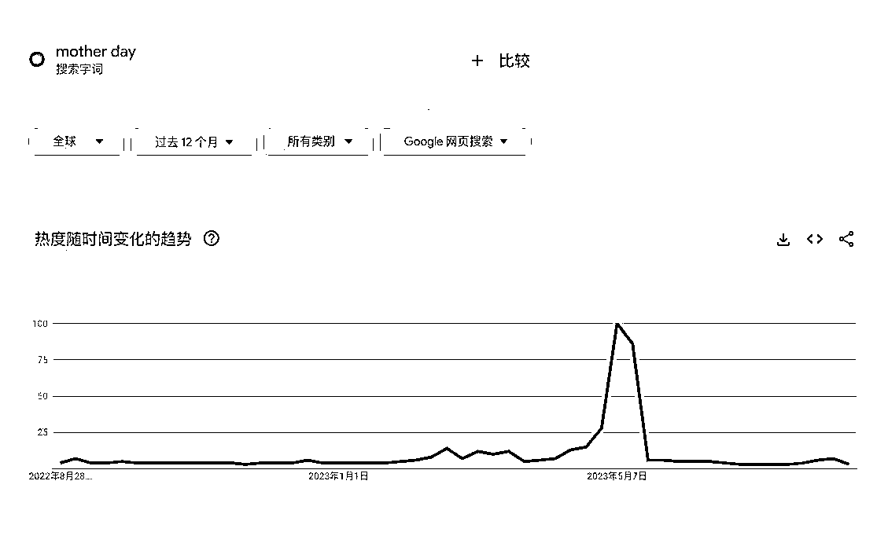

对比上面两个词就能发现，有些搜索量呈周期波动：例如母亲节相关词，只在节日前后的窗口冲高，其余时间相当冷清；

而“poxer”全年曲线都比较平。

④ ahrefs

用来评估关键词的优化难度。

网址：https://ahrefs.com/keyword-difficulty

填入目标词、选定国家，按下 check 即可。

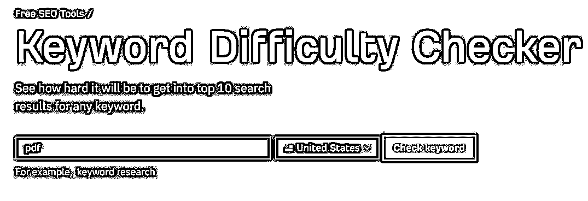

结果页重点看两块：难度与外链。图例中竞争难度为 95，意味着要排进 Google 美国前十，大约需要 1391 个引荐域名。

经验上，所需外链站点低于 100 的词，都值得试一把。

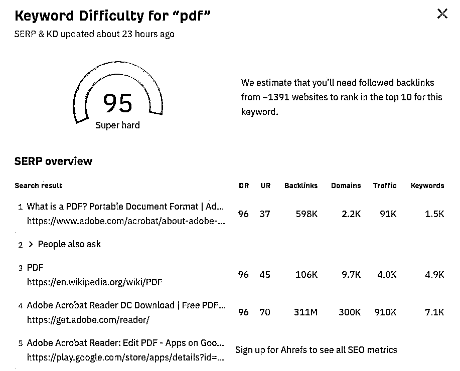

前面用 Similarweb 看 ilovepdf 时，已经发现它在美国几乎没量；上图的结果列表也印证了这一点，它并未上榜。前十中出现了 freepdfconvert.com，大家可以把它当作练习，自己拆一遍。

再看“poxer”，查询难度为 0，属于无人关注的小词、新词，优化起来自然轻松。

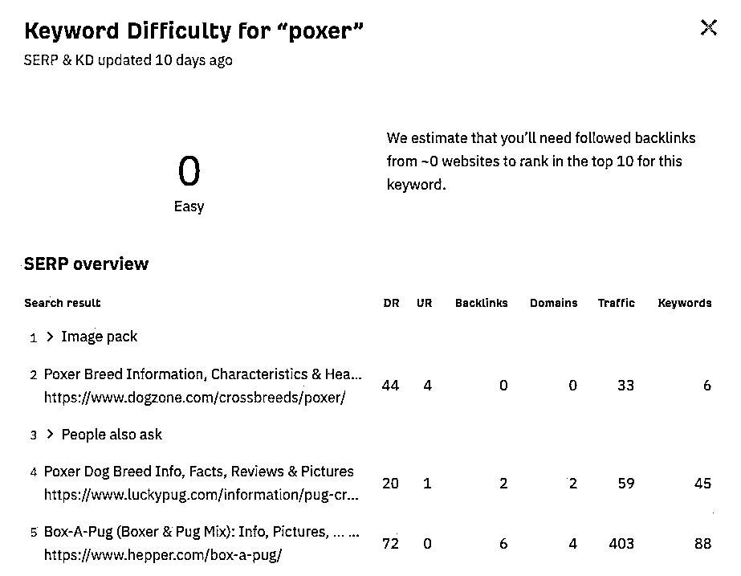

最后收个尾：先在搜索引擎里搜工具类词汇，筛出站点；接着用 Similarweb 看流量、渠道和相似站；再用 Semrush 拆站点、找关键词，锁定低竞争词；最后到 ahrefs 复核。

其实未必只盯工具站。任何一个你知道的、有流量的网站，都可以拿来分析它的关键词来源，再从中判断哪些词自己能做。

⑤ 关键词工具实战

Reddit 上有位海外开发者发帖，讲了他如何借 ahrefs 挖到两个关键词，并分享了找机会和建站的心得。

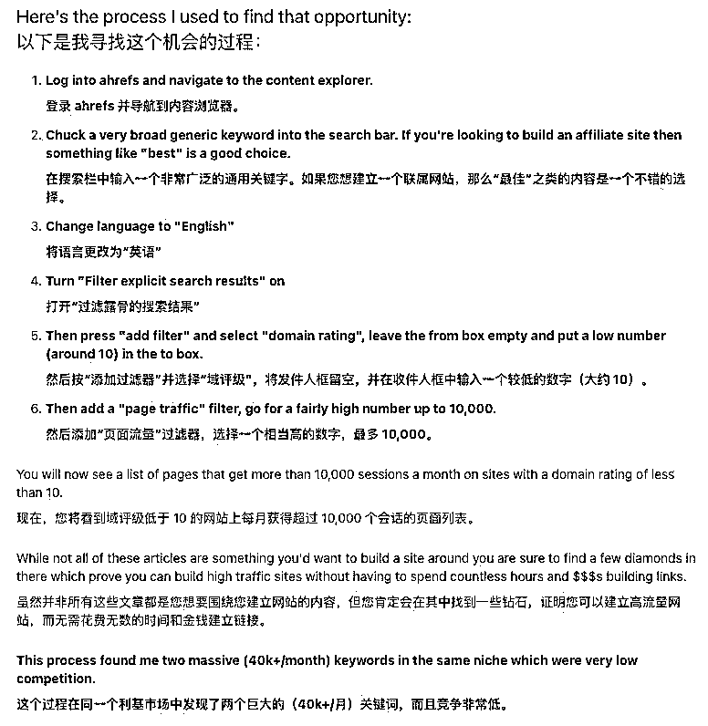

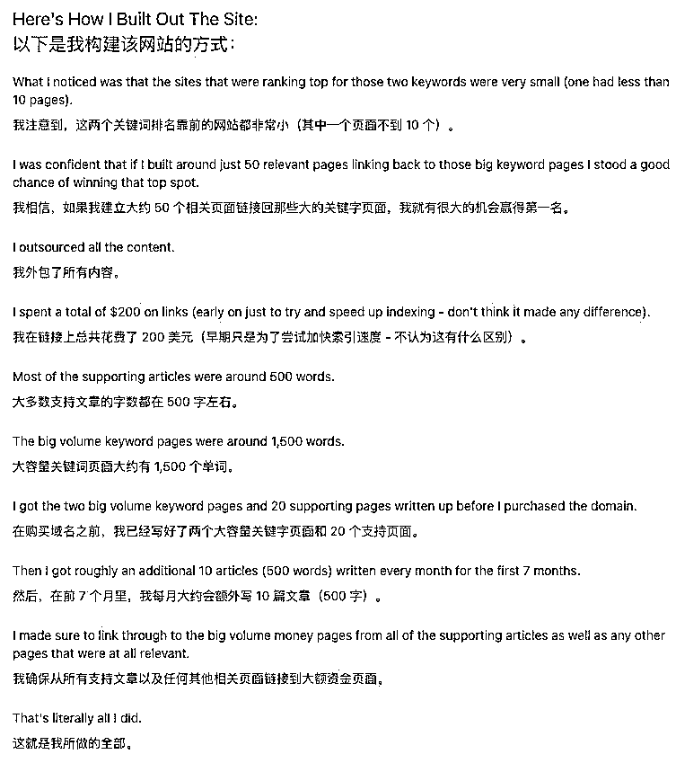

同样的思路也能搬到 Semrush。哥飞带大家走一遍：进入 Keyword Magic Tool，先随意输入种子词，我用的是猫、狗这类常见词；把 KD（竞争度）框定在 0～29% 的低竞争区间，再过滤掉成人词，然后逐个翻看。

翻着翻着就撞见“cat coloring pages”：竞争度仅 27，结果页前六名还都是内页。照这个形势，注册域名专门做这个词，排上 Google 首页的希望很大。

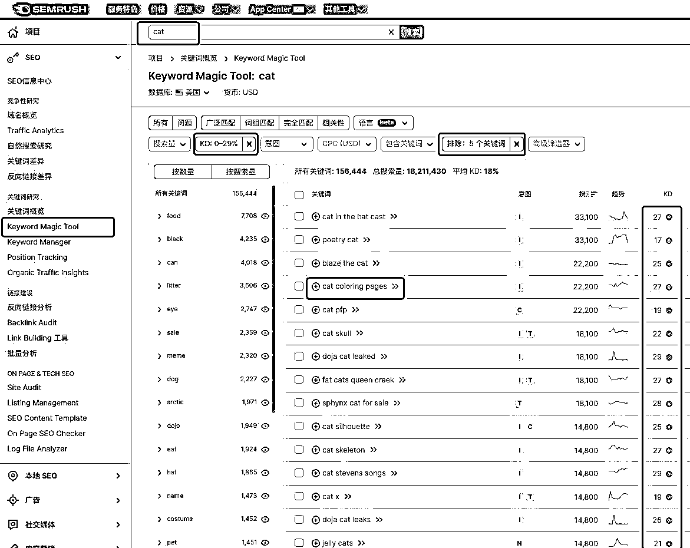

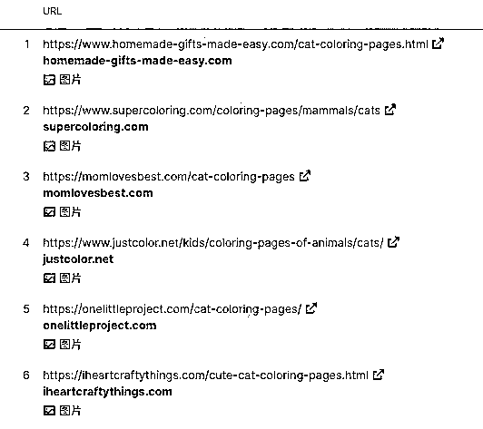

随后到 https://ahrefs.com/keyword-difficulty 复核，难度只有 9，大约 10 个外链就有机会进首页。

cat 行得通，dog 呢？flower 呢？不妨把思路打开，继续裂变。

用 coloring pages 再搜，会看到一串相关词，当然其中也有硬骨头。

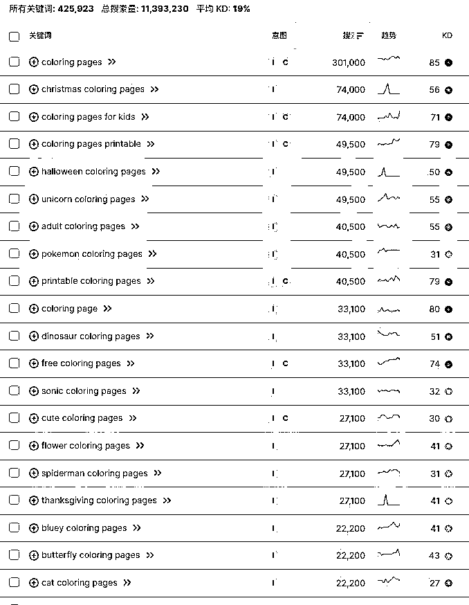

真要建站承接这些搜索需求，第一步是选个好域名。前面提过，域名里带 AI 对推广有加成，于是 ai-coloring-pages.com 就很合适：既贴合关键词，又添了 AI 标签。

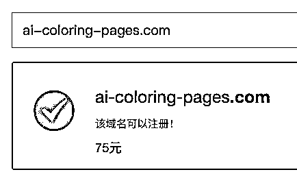

接着拆需求：访客通常想找喜欢的黑白线稿，下载后打印出来涂色。

因此站内要铺大量已生成好的线稿，并做好分类检索；最好再把 AI 绘图接进站里——用户输入 dog、cat 这类简单词，后台自动补全 prompt、生成图并展示。

所有产出对所有访客开放，图片就能持续新增，你也不必手动更新。

变现除了挂广告，还能在下载上做文章：未注册只能拿少量图，注册后额度提高，订阅则可批量下载，甚至把多张图合成一个 PDF。

既然按图片站来搭，图就要够大；用户既然为了打印，那就统一做成 A4 尺寸，下载即打。

每张图的 alt 也要写清楚，方便图片搜索命中，再把流量引回页面。

内容来源：《航海实战｜Google | 付费插件｜实战手册 》、《海外工具的需求挖掘和网页制作》


2、用户搜词的真实方式 @Tiger

普通用户很少上来就敲核心词，他们更习惯把需求描述出来，也就是带核心词的长尾表达。

比如想给父亲挑礼物，搜索往往长这样：

适合送给父亲的礼物有哪些？

送父亲什么（烟、酒、手表、剃须刀等）比较好？

给退休父亲的生日礼物送什么比较好？

这些问法都从需求侧出发。一个比较通用的公式是（顺序可换）：核心关键词 + 需求动词（名词）+ 疑问词。

要拿到这类长尾需求，除了第三方工具，还有个更轻的办法：看搜索引擎的下拉联想和页尾的相关搜索，那里往往就是用户意图的直接投射。

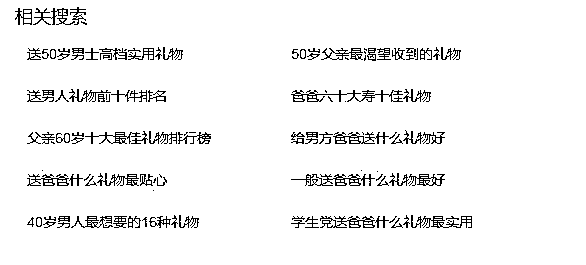

内容来源：《Google 搜索 技巧寻找潜在商机》


# 2.4 方法三：模仿竞品，做出差异 ★★★★ @刘小排

对多数龙哥盟的圈友而言，这是我最愿意推荐的一条路。好处很直接：已经被市场验证过的竞品，等于替你确认了需求存在、路径可行。

龙哥盟本身就像一座创业案例库，里面沉淀了大量实操经验；完全可以从模仿起步，再逐步优化，做出自己的差异点。

“抄”听起来不够高级，但高级不高级不重要，管用就行。

看几个例子。Google 是全球第 11 个搜索引擎，它早期也借鉴了同行，随后用 PageRank 改进了结果排序，从而形成差异化。

百度借鉴 Google，打出“更懂中文”的差异。

腾讯借鉴当时颇成功的 ICQ，做出 OICQ（后更名 🐧），产品体验和渠道能力都更强；后来做🛰️，这个点子同样不是凭空原创。

优酷、滴滴、🧣、淘宝、抖音……许多公司都是先从模仿切入，再靠差异化价值跑出来，例子不胜枚举。

这套方法优势明显，短板也明显，至少有两点要留心：

你的差异化价值到底是什么？这一点最容易被忽略。

你模仿原版时，能不能比原版更懂用户？能不能像 🐧 对 ICQ 那样，做出更好的体验和流量渠道？

内容来源：《如何获得产品 idea》

# 2.5 方式四：从痛点里找需求 ★★★ @龙哥

找痛点的方式很多：从自己的实际需求出发，从所在行业或关注的话题出发，从巨头产品周边出发，等等。

资源有限时，我常用的一招是盯互联网巨头周边。任何大型产品周围，都散落着未被满足的需求点：

1）巨头评估后主动放弃的，例如🛰️👸号数据服务（新榜）、🛰️小程序导航（爱范儿）。

2）巨头没注意到的。一些小众需求，大厂未必看得到；即便看到，也未必愿意为 1% 的人去影响 99% 的体验，比如让一部手机同时登两个🛰️。

这些被有意或无意漏掉的需求真实存在。接住它们，就能获得对应的用户，体量未必小。几乎每个巨头周边，都有一批产品/创业公司活得不错，甚至跑出上市公司。这次讲的是如何在 Instagram 上找真实痛点与产品机会，同样的思路可迁移到 Facebook、WhatsApp、Bitcoin、Snapchat、🛰️、🧣。

1、挖掘痛点

先 Google 搜『Instagram』，下拉框和推荐搜索会提示下面这些词：

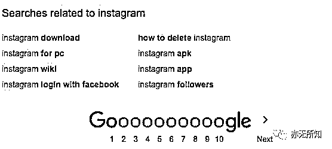

除 instagram download 外，其余看起来都平常。

再搜这个词，看看有什么机会，结果里出现下面几组关键词：

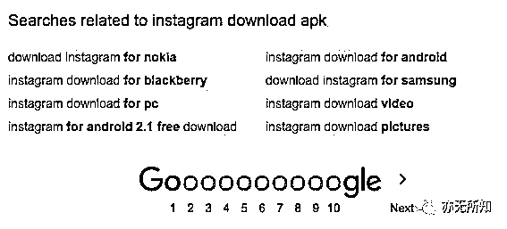

除了最后两个『instagram download video』、『instagram download pictures』，其余需求官方已经满足。

2、确认痛点

难道在 Instagram 下载图片和视频还有没被满足的地方？

果然，网页版 Instagram 不允许右键保存别人上传的图片，另存为被限制。类似限制很常见，不少网站（包括知乎）出于版权等原因，会阻止站内复制文字或保存图片。

好比用🛰️时，朋友发来语音，你想转发却发现不支持。

这个设置可能让九成以上普通用户束手无策。但下载图片/视频的需求确实存在，痛点真实且有效。围绕它有没有好方案？能不能赚钱？还不清楚，继续用 Google 往下挖。

3、挖掘现有产品

继续搜『instagram download pictures』，结果第一页冒出 6 个解决该痛点的小工具。

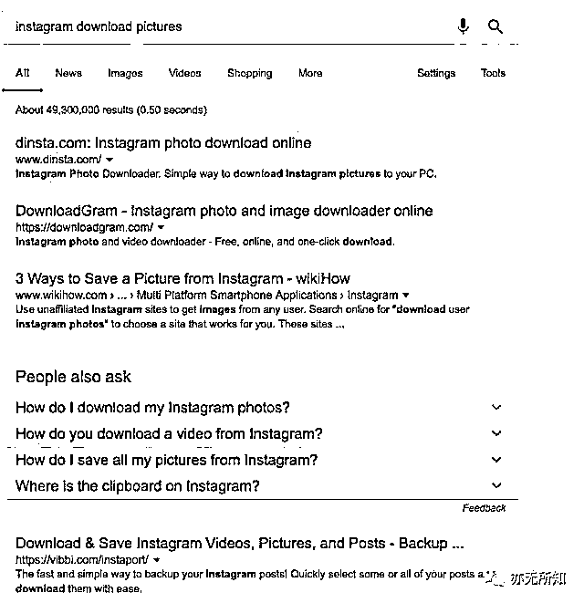

4、商业模式研究

点开排名第一的网站，功能很简单：粘贴 Instagram 图片链接就能下载。盈利靠 Google Adsense。

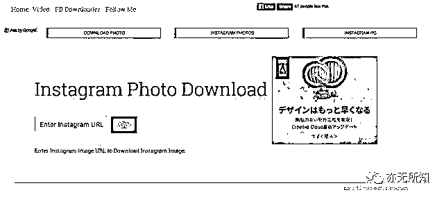

用 SimilarWeb（网站流量统计插件）查一下：月访问 120 万，日访问 4 万。按千次访问 2 美元估算，每天约 80 美元，每月约 2400 美元，一年约 28800 美元，折合人民币约 20 万元。

相当于一个白领一年的收入。

挖到这一步，痛点真实、需求不小、已有成熟产品，是不错的机会。

内容来源：《通过 Google 挖掘细分市场的一个案例》


# 2.6 方式五：围绕平台找需求 ★★★ @Sepp

读完龙哥老师《通过 Google 挖掘细分市场的一个案例》，我动手试了一遍，找到一个围绕 Instagram 赚美元的案例，拿来和大家分享。

站点是 linktr.ee，创始人 Alex Zaccaria 靠这个轻量产品，一年大约进账 200 万美元。据 Alex 说，linktr.ee 启动时在营销推广上没花一分钱，用户几乎全靠自然传播带来。

Instagram 的链接规则相当苛刻：帖子、评论等位置都不允许放可点击外链，唯一合规入口是个人主页资料里的网站栏。这意味着粉丝无法从多个入口分别抵达不同落地页（Facebook 广告投放属于例外）。达人和商家因此很被动：商家可能同时经营亚马逊店和独立站，达人又常替不同雇主推广，谁都希望粉丝能分流到各自页面，但平台规则把这条路堵住了。linktr.ee 正是抓住这个缺口：它生成一个中转页，把多个目标链接集中展示，粉丝点哪个就去哪个。PRO 版强化了数据追踪与页面美化，既方便查看各链接效果，也能强化品牌识别。它的收入结构很单一——只靠用户订阅 PRO。

素材出处：《围绕 Instagram 赚美元的案例》

# 2.7 方式六：把自身痛点变成生意 ★★★

1、Dropbox 扩容案例 @真武

这个案例几乎不需要垫资，靠给 Dropbox 扩容赚到 1 万美元。Dropbox 是海外较早的同步网盘，新注册送 2G；每邀请一人注册，双方各得 1G，总容量上限 18G，算下来要拉 16 个人。很多人不想打扰熟人，作者自己也有扩容需求，便在淘宝花几块钱买现成扩容服务——商家其实是用虚拟机自动操作。后来他琢磨：既然自己有这个需求，别人多半也有；国内竞争激烈，不如转向海外。fiverr.com 上多数服务标价 5 美元，平台每单抽 1 美元。他挂出 Dropbox 扩容和现号出售，定价 5 美元，成本只有几元人民币。有订单就转给淘宝商家，一单大约赚 20 元，每天接几单很轻松。

2、手机解锁案例 @静水流深

手机解锁这个行当，有海外经历的人大多知道。国外买手机常签合约，国内也有类似模式，但规则不同：国内常见返话费，手机插上支持制式的卡就能用；国外则低价给机，条件是签通常两年的合同，期间每月话费要达到最低额度，而且只能用签约运营商的 SIM 卡，换别家卡直接无法入网。两年后提交 IMEI，官方解除网络锁，手机才能随便插任何运营商的卡，也能转号、结束合同或签新约换新机，再循环。很多人记得 iPhone4 刚出时，有人说美国只要 99 美元、国内却要五千块，这其实是只截取了一半信息。当时合约一般每月最低消费 50 美元左右，24 个月起步，总账算下来谁更便宜还真不一定。

正因如此，手机解锁被催生成一个行业，simunlock 这个词检索热度很高，谷歌上不少商家在投广告：

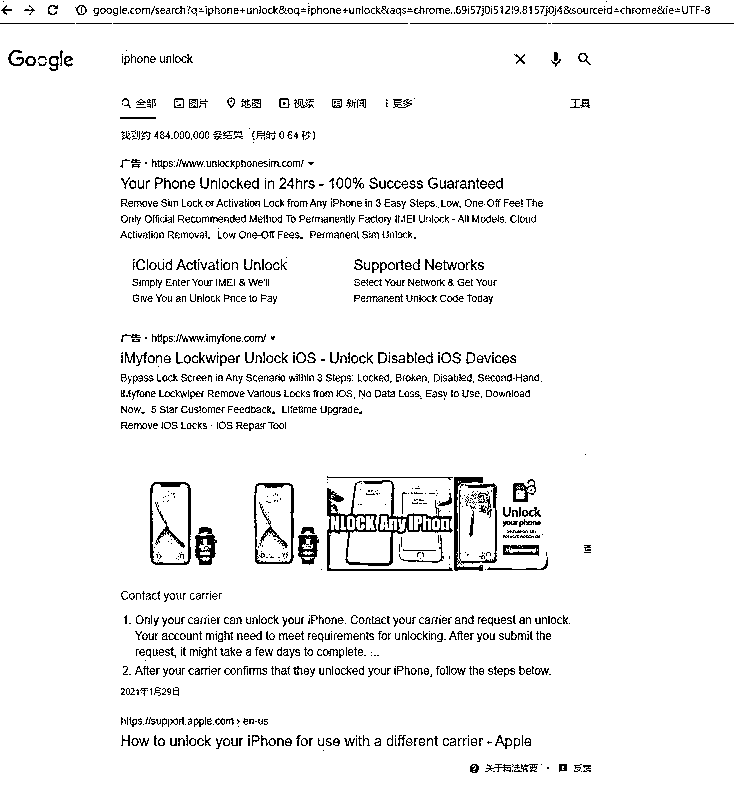

作者选了一家以前合作过的解锁商，服务确实靠谱。这里随手拿比较主流的 iPhone12 做测试，商家给了报价：

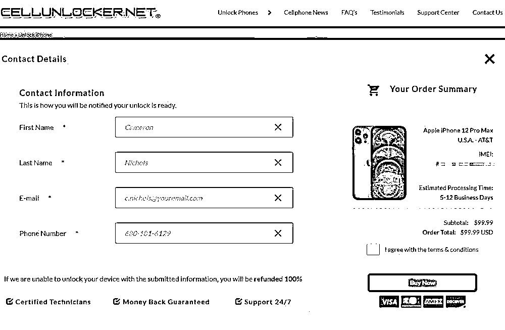

99 美元解锁。而闲鱼和一些国内渠道，价格低很多（闲鱼上过低的标价未必是真实成交价）：

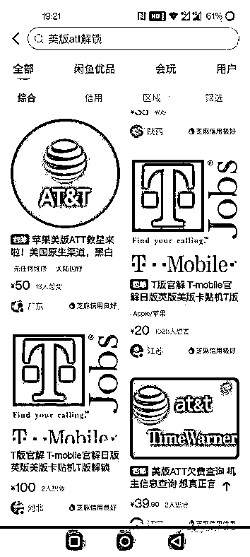

前面看到有人投谷歌 Adwords 广告做竞价排名，说明这个生意不仅存在，而且有利可图。这里又看到明显的价差空间，估计不少做跨境电商的朋友已经看明白了：一个简单的 Shopify 就能复刻那些解锁网站的能力，完全可以把解锁当成虚拟服务来做跨境电商。

还能更轻地做无本买卖：Ebay 上似乎没人提供解锁服务：

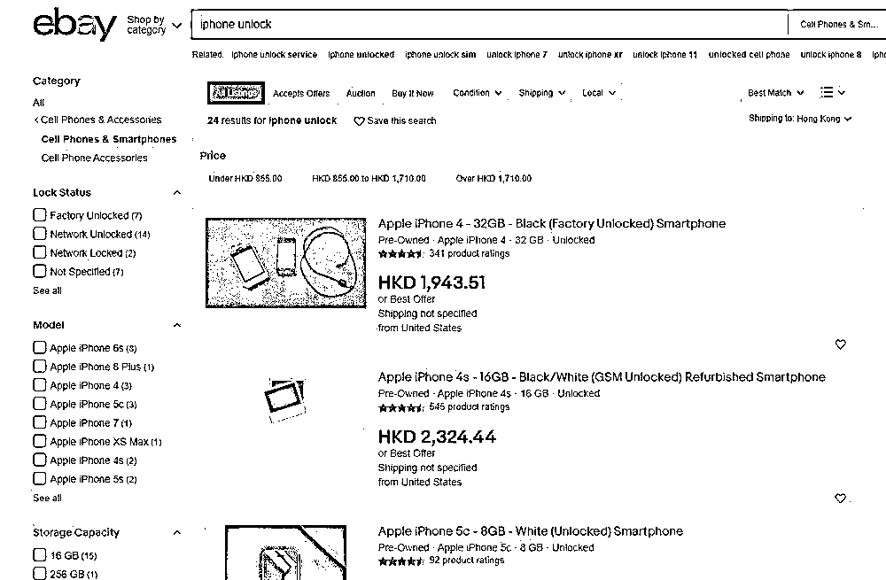

Fiverr 上更夸张，要么没有，要么 150 美元。你只要把解锁服务当成商品，用相关关键词做成吸引人的标题挂上去，就能自然获客，而且一分钱不用花。接到老外的解锁请求后，转给国内提供解锁服务的商家处理，赚取利差。哪怕解锁失败，退款即可，你也没有任何损失。多数时候，毛利超过 100%。具体找哪几家国内服务商？闲鱼、淘宝多翻翻，包括国内知名的找果科技，前提是你一定要亲手去试。任何项目不动手就是零，项目再好也一样。

素材出处：《3 个单人就能做的赚钱案例，告诉你怎么通过互联网在海外淘金？》、《空手套白狼，使用 dropbox 赚了 1 万美元》

# 2.8 方式七：用榜单挖真实需求 ★★★ @非洲水手

想找需求，榜单要常翻。别闭门拍脑袋，自己琢磨的往往不如榜单数据真实。下面几个榜单值得反复看，视野会打开：

https://www.ycombinator.com/companies

https://toolify.ai/

https://chrome-stats.com/

这个平台的日榜、周榜、月榜靠前项目也值得扫一眼：https://www.producthunt.com/

从 AppAnnie 2023 年 1 月非游收入榜里，能读出几个有意思的方向：

1、娱乐产品依旧最赚钱，收入榜前三名都来自这个赛道。那就可以往周边想：去水印、主页外链聚合、Instagram 小工具，是否能平移到 TikTok、Bigo、Kwai？

2、把产品力打磨到极致、长期深耕，就有机会形成难以逾越的护城河，扫描全能王、美图秀秀就是例子。选定赛道做时间的朋友，回报可能远超预期。

3、前十名里出现了圈友熟悉的老照片修复项目，连分享者本人都没料到，确实该反思。

4、AI 赛道除了老照片修复，还有动植物识别。🛰️里的“识花君”就火过一阵。这类爆款说明，海内外用户对新鲜创意类目的接受度都不低；之前的“蚂蚁呀嘿”也能在两地同时走红。

5、按出现频率看，娱乐社交、照片视频编辑、阅读、AI、健身、办公等方向都不少。有些需要资源池，社群里已有不少对接渠道；只要有心，总能找到。

6、榜单之外，海外开发者做的《Hallow》也值得关注。它服务天主教徒的祈祷冥想，原型正是冥想独角兽《Calm》，只是把人群切得更细。今年 2 月 24 日它曾进入美榜前三，说明宗教移动市场不容小觑。再想想此前做成矩阵的《Holly Bible》圣经电子书，是不是有相似味道？两个品类交叉，也能擦出强烈火花。

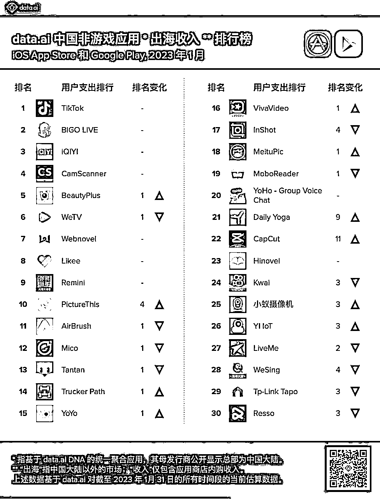

内容来源：3 月 6 日《关于出海工具产品营销推广，我的几点经验分享》@非洲水手


# 2.9 方式八：在新兴领域挖机会 ★★★ @三林

聊新兴领域，AIGC 绕不开。它迭代太快了：ChatGPT 4.0、Midjourney 5、谷歌的 LLM 新模型、微软 Copilot、百度文心一言……用圈内调侃说，AI 一周，顶一年；Web3 都得靠边站（txtx）。具体可看极客公园这篇：https://mp.weixin.qq.com/s/5fhzpYmLKQhx9FEIT0wssA

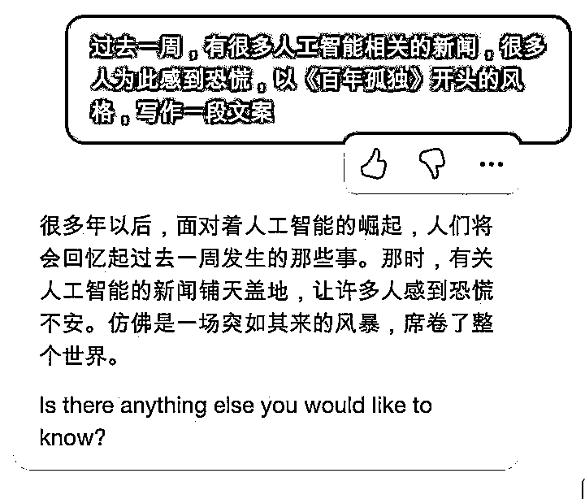

再说 ChatGPT。几乎可以肯定，API 开放后，围绕它的应用会大量涌现，形成一个热闹生态。API 开放前，已有产品抢跑：国人开发者 Lencx 的 ChatGPT Mac/Win 客户端，以及爆火的浏览器插件 ChatGPT for Google，后者安装量达到百万级。

下面分享一些围绕 ChatGPT 的第三方浏览器插件，看看它们怎么定位、体验上有什么思考。产品发现来自 Chrome 应用商店搜索“ChatGPT”：

https://chrome.google.com/webstore/search/ChatGPT

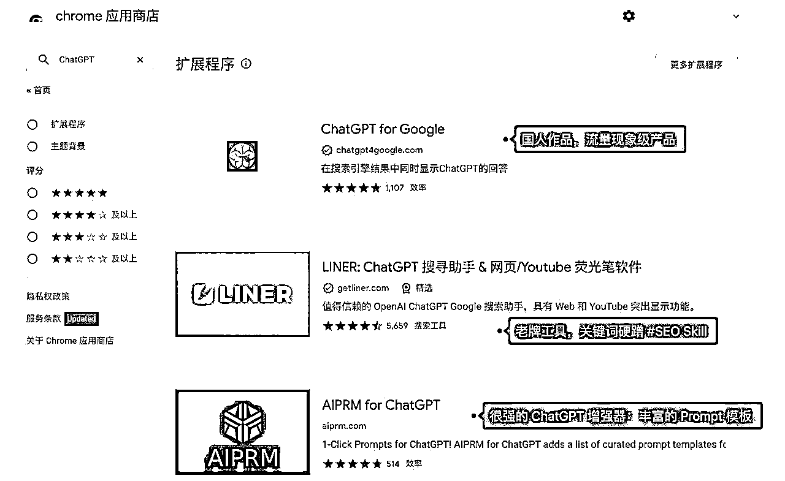

1、AIPRM：可能是最好用的 ChatGPT 插件之一

ChatGPT 的输出质量，很大程度取决于输入质量，也就是你怎么问。高质量提问本身就是关键。有几款工具专门增强提示语输入，让好问题更容易提出来，AIPRM 是其中的代表。


AIPRM 内置 Prompt 模板市场，直接嵌在 ChatGPT 界面里。对用户来说，提问更省事，结果质量也更高；作者很欣赏它能设置输出语种与语言风格。比如你输入中文，却设定英文输出，ChatGPT 默认就回英文。营销方面，开发者本身是 SEO 专家，AIPRM 先在海外 SEO 圈打开名气，例如这条推文。如今安装量超过 60 万，Chrome 商店里能看到世界各地网友的好评。最新消息是它开启商业化：免费版限制较多，精选 Prompts 只给付费版（最低 20 美金/月）使用。想找平替，可以试 ChatGPT Prompt Genius。


2、ChatGPT for Google：搜索场景的代表

这款产品来自国内开发者，是最早围绕 ChatGPT 做浏览器插件的选手之一。它的效果是：你在谷歌搜索时，插件同步列出 ChatGPT 的答案。


产品在即刻社区传开后增长很快。目前它是第三方工具里用户量最大的，安装量超过 100 万。它是开源产品，支持二次开发（划重点）。想快速判断一个工具的能力，作者有两个办法：一看设置项 Setting，二看价格页 Pricing。


在 ChatGPT for Google 的设置里，有一项 Trigger Mode（触发模式）：Always——每次谷歌搜索都查询并响应；Question Mark——只有带问号“？”时才响应；Manually——默认不响应，需要时再点一下。这个小设置体现了它的核心交互。作者单独聊它，因为早期这块体验被人诟病：如果每次搜索都查询，会产生太多无效对话。触发模式把选择权交还给用户。

3、ChatGPT Writer：抓核心场景，起量快

大语言模型的强项是“文本处理”。如果要做 ChatGPT 赋能产品，围绕核心能力展开，效果最好的方向也应是文本处理。


ChatGPT Writer 这款写作辅助插件定位精准。除了随时发起创作，还切入了应景场景，例如嵌在 Gmail 邮件书写框里。它目前已有 30 万安装用户，难道是名字取得好？

同类产品还有 YouTube summary with ChatGPT，能一键总结 YouTube 视频。做法不复杂：拿下字幕，转到 ChatGPT 做总结。作者认为它只用了一个提问 Prompt，而一个 Prompt 就等于一个迷你工具。后起之秀 Monica - Your ChatGPT Copilot in Chrome 出自国人团队，设计精美，交互类似 New Bing 唤起侧边对话栏，但内容生成质量不太给力，作者总觉得它用的是 GPT-3，而不是 3.5 或 4。

4、补官方不足：以 ShareGPT 为例

作者高频使用的插件之一，能一键把 ChatGPT 对话变成对外分享链接，比长截图友好。


同样瞄准官方功能不足的产品还有：赚钱圈友 @码叔编程 的 AI 会话存档插件，可把对话导出为 PDF 等多种格式到本地；赚钱圈友 @啊洛 开发的 ChatGPT to Notion，一键把对话存到 Notion；再比如 ChatGPT Master，主打划词快捷键提问，自定义鼠标右键，支持多个模板配置。类似 Notion AI 的交互，选中文本，让 ChatGPT 继续干活：优化文案、翻译、缩写、扩写……都能配置。


还有结合浏览器语音播报能力的 Voice Control for ChatGPT、Speak to ChatGPT，适合跟 ChatGPT 语音对话。场景能干嘛？练口语、练听力。


5、ChatGPT for Amazon：给原有业务升级

国内创业公司 Shulex VOC 做了一款面向亚马逊商家的评论分析 SAAS，靠数据挖掘和垂直行业分析，洞察消费者与市场。在 ChatGPT 出现前，它对主要大类目研究很深，但覆盖全品类较难。ChatGPT 横空出世后，NLP 不存在了……能服务的商家范围更广。Shulex VOC 原本已足够深入电商评论分析，如今还能借 ChatGPT 提升：高效产出多维评论分析（产品优缺点、消费者期望），秒出 Listing 优化结果，产品体验大幅提升。营销上，Shulex VOC 利用 ChatGPT 热点和跨境圈红人视频营销，增长势头很不错。

技术底层的转变，让人想起赚钱圈友强哥那句话：研究 NLP 家破人亡，用好 NLP 鱼翅拌饭。

殊途同归，产品“Glowe 阁楼”用 ChatGPT 底层技术赋能心理咨询，刚拿到新一笔千万级融资。

对龙哥盟来说，AI 教练、AI 鱼丸，甚至 AI 龙哥，都在开发中。说不定下一期航海，让 AI 教练陪你航行。

这都是我身边的案例。

——

上面提到的插件产品可以归为：

提示词集成类：AIPRM，ChatGPT Prompt Genius 等

突出文本处理类：ChatGPT Writer，YouTube summary with ChatGPT，Monica

效率工具类：ChatGPT for Google，ShareGPT，ChatGPT Master，ChatGPT to Notion

原有业务赋能类：ChatGPT for Amazon 等

简单小结：上面聊了不少浏览器插件，其实插件生态已经有一些玩家。从去年 12 月初到现在，4 个月时间，足够手快的选手做出好产品。但我相信，目前还远没到爆发阶段。

回到开头的问题：为什么选择浏览器插件？因为 ChatGPT 官方正版是网页版，浏览器插件对网页的增强能力，能在用户熟悉的场景下做体验升级，贴合用户习惯，让人乐于使用。这弥补了原生产品的不足，相当于借力成熟平台做事。

以上还只是我看到的部分产品与服务，相信接下来会冒出更多有意思的产品。

总结：

从这些产品里，我学到几点认知：

1）从面向 Google 编程，转向面向 ChatGPT 编程；开发者圈友应该感受很深。

2）ChatGPT 是万能工具箱，钥匙就是 Prompts，这既是获客钥匙，也是变现钥匙。

3）浏览器插件只是一种产品形态，API 开放后，可能性太多了。一句 Prompt 等于一个迷你工具，一套 Prompts 等于一个迷你 SAAS；

4）围绕自己业务需求找场景，大胆用 ChatGPT 给自己和业务赋能；

5）最后也最重要：考虑到原生体验与内容安全，建议创业者出海，这也是我们做英文工具站的意义。

内容来源：《ChatGPT 应用生态之浏览器插件观察》

目前 ChatGPT Plus 版已逐渐支持联网，并接入 70 多个第三方插件，涉及教育、电商购物、娱乐、新闻、投资等领域。圈友 @黄小刀 整理分享了这些插件的功能，除了上面提到的几个工具，这些功能描述也许能给你一些灵感：《ChatGPT Plugins 清单 @黄小刀》

另外，龙哥盟里和 ChatGPT 相关的风向标，也藏着不少可挖掘的需求机会。

我们整理了 73 条技术应用相关的中标风向标，大家可以参考下面的内容，寻找属于自己的工具站机会点，也可以在龙哥盟查看近期相关风向标：

龙哥盟 ChatGPT 中标风向标合集（技术应用类）


# 2.10 方式九：先接定制，再产品化 ★★ @刘小排

若有人愿意预付费用请你定制某类需求，这是相当好的模式。码叔在龙哥盟分享过，他就是这么做的。从 6 月自学 Google 插件开发开始，半年时间变现好几十万，方法可复制。他从不凭空造 idea，总是从定制需求切入。某人有个需求，知道码叔会编程，就付费请他开发。随后，码叔想办法把它产品化，卖给更多人。

大约十年前，我在重庆诺怀软件科技有限公司任职（这家企业如今仍在经营，我持有少量股份）。公司的主营方向是承接欧美客户的软件项目，不过老板很早就看明白一件事：客户既然肯付费请我们开发，那能否把相似能力整理成标准方案，再复制给更多买家？因此公司陆续做过几款小型 SaaS 成品，其中个别项目也跑出了不错成绩。国际上更常被提到的例子是 Typeform 与 Basecamp——它们起步时同样做外包，后来在客户反复提出的问题里抓住共同点，转身做成了可售卖的工具。下面两段保留创始人的原话。


在龙哥盟，不少独立开发者会接到客户付费定制的单子。若能联合起来，从这些真实委托中筛选可复用的部分，机会并不小。但有一件事要提前说明：硬造出来的需求常常是陷阱。靠凭空想出的点子把公司做大的案例，屈指可数。我把它写在这里，是想提醒大家——当脑中蹦出“这个主意太妙了”时，先追问：目标用户在哪儿？谁会掏钱？最容易骗过的人，其实是我们自己；人很容易被自己虚构的需求点燃，所以别太快迷上自己的构想。

素材来源：《如何获得产品 idea》


# 三、【项目实操 2/4】把工具产品尽快做出来并发布

# 💡

# 本章要做什么

当你已经找到需求、掌握分析路径、理解差异化与完整生命周期之后，下一步就是动手搭自己的工具站。为什么要尽早做出最小可行产品？原因很直接：新项目夭折的概率太高。想抬高整体胜率，只能多试、快试，这也是创新者绕不开的处境。在精益迭代的赛跑中，一年能上线 12 个 MVP 的人，相比一年只推 3 个的对手，天然多出四倍机会。

做 MVP 本质上接近“精益创业”的做法；而要真正提速，可以借助一些提效工具，例如 ChatGPT、Claude、Vercel 模板等。人工智能的进化速度很快，几乎像一位随时在线的资深教练：无论你提问、求建议还是要方案，它都能给出能落地执行的回答。眼下不少代码编辑器也集成了 AI 功能，写程序的门槛被明显压低。下面会给出若干用高效工具搭成品的小案例，供你照着完成自己的开发。

# 💡

# 本章路线图

完成第三章的学习与实操后，你将进入航线图的第三阶段：为产品争取更多流量，并试着搭起变现通道（每天约 2 小时）。

1. 在多个渠道宣传推广，争取流量（约 2 小时）

2. 分析工具站流量，持续调整（每天约 2 小时）

现在就去推广你的站点吧，也别忘了在航海日志里记录并复盘这次宣传动作。


# 3.1 早点发布成品有什么价值？@do 小鱼

# 3.1.1 第一点：先检验念头

最初的想法可能只是一个念头，或者一个解决小问题的功能；市场买不买账，必须验证。怎么验？尽快把成品推出去，让潜在用户实际使用、测试，再依据反馈决定是否继续投入，避免耗时很久却做出没人需要的方案。

# 3.1.2 第二点：锁定更细的市场

借助用户数据与反馈，可以进一步锁定目标人群和用户画像，同时与共创者、推广方等利益相关者建立联系，让后续营销更聚焦、更有效。

# 3.1.3 第三点：动作更轻

先小步走，把最核心的能力做出来；上线后再根据市场信号灵活响应，逐步调整和补强。

# 3.1.4 第四点：跑完整条交付链

构思阶段很容易被无关紧要的细节拖住。但真正上线一个成品，除了功能本身，还要考虑推广、营销与交付。

以上是我认为做 MVP 时最该关注的几点。2 月航海期间，我把一个想法做成了 MVP，也收到不少反馈；综合这些反馈后，我选择先暂停。原因是我很难刻画出具体的用户画像——即便程序做完了，也不知道该去哪里找用户推广。换句话说，最初的点子看起来有趣，但验证后发现需求强度偏弱；冷静下来后，热情也降了，于是暂时不必继续开发。虽然这个项目没往下走，我的收获却不小：完整经历了一遍产品流程，也明白成功不只靠新鲜创意，关键在于清楚用户在哪里、如何与他们建立连接。这也让我体会到尽快暴露想法的重要性——不要闭门造车，先做出来再逐步打磨。

船上的朋友不少是互联网行业某一环节的专家，比如开发、产品经理、设计师。在公司里做项目，通常只负责自己专业范围内的一小块；而独立开发并上线，能让你把全流程走一遍，感受每个环节可能遇到的问题和坑。


# 3.2 第一步：先画站点骨架

方向确定后，接下来要画出网站的树状结构：由哪些页面组成、层级怎么安排。结构统一清晰，Google 抓取会更顺。搜索引擎更愿意推荐那些能快速找到正确页面的站点；一旦骨架合理，它也能更快理解网站如何运作、提供什么内容。如果对结构没思路，可以搜索关键词，看看竞品站点怎么分层，从中借一点启发。


理解整体结构之后，还可以按 Ctrl+Shift+I 打开单个页面的代码，观察它的布局和设计是怎么实现的。


请记住：网站不必一步到位。如果非要等完整版本才去验证，会耗掉大量时间。此时更该做的是：先实现初版核心功能，尽快上线测试，拿到真实数据和用户反馈，再按实际情况继续优化、补齐功能。

# 3.3 第二步：做出工具 MVP @哥飞

最好是自己写，或者直接部署别人已经做好的成品。若没有编程基础，航海只有 21 天，临时从头学可能赶不及，但也不能完全跳过学习。

1. 有开发能力，就自己动手

如果你已经具备开发能力，前面这些自然不是障碍。但要注意一个坑：别一味追求高级技术栈。我们做的是带 AI 能力的工具，交互通常不复杂。会 Vue 就用 Vue；不会，用原生 JS 也够，最多再引入 jQuery。

2. 没有开发能力，可以走这四条路

① 自学资料

网上教程太多，看多了反而容易迷失。零基础先看菜鸟教程入门即可。下面三份教程不必全部学完再开工，可以先浏览概览，知道 HTML 负责结构、CSS 负责样式、JS 负责交互，然后按需查找对应章节：

HTML 教程 https://www.runoob.com/html/html-tutorial.html

CSS 教程 https://www.runoob.com/css/css-tutorial.html

JS 教程 https://www.runoob.com/js/js-tutorial.html

此外，也可以让 ChatGPT 陪你学，尽快做出一个简单网页。

② 找人组队

如果实在不想学，就找伙伴合作，团队合力通常胜过一个人硬扛。

下面介绍几种门槛较低、上手较快的开发方式。

# 3.3.1 🔥方法一：让 Claude 帮你写 @刘小排

# 💡

适合任何想学编程、想做工具的人；即使零基础，也能一步步掌握并完成开发。

工具：Claude 3.5

推荐指数：★★★★★

去年的 AI 编程工具，对完全没有编程经验的人还不足以支撑自学。像 Github Copilot、Cursor.so、Replit AI 这些明星产品，更大的价值是给程序员加速——让初级开发者更快接近中高级水平，或让资深开发者获得十倍效率。新手用它们能做出小玩具（例如贪吃蛇、2048），但很难做出有实用价值的成品；而且配置开发环境对新手也不友好，至少会挡住八成零基础用户。

现在有了 Claude 3.5，没有编程底子的人也能比较顺畅地自学，并做出真正有用的东西。

# 3.3.1.1 Claude 的编程实力与实例

一方面，它的智能水平很高，是目前写代码能力最强的大模型之一，表现超过 ChatGPT-4o（截至 2024 年 7 月，依据 lmsys 大规模人类双盲测试，链接见下：https://chat.lmsys.org/）。


另一方面，它独有 Claude Artifacts 功能，可以实时查看代码运行后的样子，省掉配置环境、反复复制粘贴等麻烦（见下图）。


看看 Twitter 上的海外用户如何评价和使用 Claude 3.5 的编程能力。

🔥案例一

一个从没写过代码的人，仅靠与 Claude 对话 4.5 小时，就做出了功能完整、界面美观、带数据库的笔记应用。原帖在 X 上（需要网络环境）。我也把视频搬到了 Bilibili，不方便访问外网可以点这里学习。视频约 15 分钟，建议完整看三遍，它是用 AI 学编程的极佳教材：第 0 到 3 分钟看他如何起步，第 11 分钟之后看成品有多完整。

🔥案例二

开发者 Dave 展示了自己用 Claude 3.5 Sonnet 做出的 Voice Notes AI——一个语音笔记工具，只花了两个小时。原帖在 Dave 的 X 上（需要网络环境）。


🔥案例三

Y Combinator 的 CEO Gary Tan 在 Twitter 转发观点：借助 Claude 3.5，应用商店里的任何应用都可能被创建出来，速度比过去快十倍以上。原帖在 Gary Tan 的 Twitter 上（需要网络环境）。


# 3.3.1.2 操作步骤

1、认真研究上面那条视频（零代码基础的人与 Claude 聊 4.5 小时做出笔记应用），以及附带的 3 条原始 Twitter 链接，从评论交流和作者回答里学习。这一步最关键，我身边不少朋友就是模仿这个视频，一个周末便做出了让人意外的成果。

2、想一个产品方向，可以从生活或工作里的痛点入手。

3、找一个别人的相似成品，最好是网页形态的。

4、把那个产品的界面截图放进 Claude，让它照着复刻。

5、用自然语言继续对话，要求它把复刻界面改造成你想要的样子。

6、界面调整好后，再让 Claude 补充功能、数据库等逻辑。

7、点击 Claude Artifacts 右下角的 Publish 按钮，把作品分享给朋友试用。

8、根据朋友反馈修复问题。

9、把网页成品部署到正式服务器并发布，让朋友能通过域名访问。

素材来源：《用 AI 自学编程的最好时机到来了》


# 3.3.2 方法二：让 ChatGPT 参与搭成品 @AUDI

# 💡

适合任何想学编程、想做工具的人，编程底子弱也能逐步掌握并完成开发。不过相较 Claude，目前它不能直接预览运行效果。

工具：ChatGPT

推荐指数：★★★★☆

下面用一个预置 prompt 的文本生成产品“作文生成器”举例，看看 ChatGPT 如何辅助编程。过程中会用到 Flask 和 OpenAI 库。

1）让 ChatGPT 生成代码时，要把需求讲清楚：网页有哪些元素、每个元素做什么、操作后会发生什么。例如：用 Python 和 HTML 做一个“作文生成器”，页面上单独一行显示名称，下一行是“请输入作文主题”的标题，再下面是文字输入框和“确认”按钮；点击确认后，把固定前缀加输入内容传给 OpenAI 接口，最后用输出框展示返回结果，并要求代码带清晰的中文注释。

2）随后会得到一批 Python 代码和一份 HTML 代码；如果内容不完整，输入“继续”即可补全。

3）查阅 OpenAI 的 API 文档并对照代码后会发现，需要 key 才能正常调用接口。登录 beta.openai.com 生成 key，再把 Python 文件里对应位置替换成自己的密钥，保存为 .py 文件，就能在本地运行（运行方法也可以问 AI）。

```python
# 设置 OpenAI API 密钥
openai.api_key = "XXXXXXXXXXXXXXXXXX"
```


4）若要部署成网页，前面生成的前端代码也能用：把 HTML 保存为 index.html，放进 templates 文件夹；py 文件与 templates 同级，然后上传服务器运行。

（我自己试这一步时没按这个做法，结果报错，问过 AI 才知道正确方式；部署服务方面，因为以前折腾过博客，算有点运维经验，但仍遇到问题，最后也是靠询问 AI 解决。）

当然，这样做出的成品还比较粗糙；受时间限制，详细配置没有写全，示例和图片主要用于演示，不一定代表真实效果。大家可以自己动手试，折腾本身也有乐趣。你还可以继续让 ChatGPT 优化 HTML 样式（图二就是让它简单排版后的效果；我早先自己玩的那个还加了不少样式和动效），或者去 OpenAI 的 playground 调整 prompt——那里也能把 prompt 直接生成代码，用来替换程序中的提示词。


素材来源：《ChatGPT 火了，我如何抓住机会，打造了一个有用的工具站？》、《0 编程基础搭建属于自己的 AI 产品》


# 3.3.3 方法三：改开源项目或用模板 @哥飞

# 💡

编程底子弱的人也能完成开发：有一点代码基础，可以拿开源项目改；完全没有基础，可以直接用模板部署。

工具：找开源项目去 Github、https://codecanyon.net/search/ai；找模板用 Vercel 模板中心

推荐指数：★★★★☆

其实无论你有没有开发能力，都可以在别人开源的基础上改一改就用。GitHub 上有大量开源代码，不少是完整项目，拿来即可运行；Vercel 模板中心也提供许多一键部署的模板。


另外，https://codecanyon.net/search/ai 上还有不少付费源码，功能完整，价格不算贵，几十美元就能买到。


素材来源：《海外工具的需求挖掘和网页制作》


# 3.3.4 方法四：请 GitHub Copilot 当助手 @do 小鱼

# 💡

它能帮你更快完成开发，但最好已有一定编程基础。

工具：GitHub Copilot

推荐指数：★★★★

小排老师的文章《写给独立开发者：如何快速做出产品 MVP》：https://t.zsxq.com/0eIswqav8 ，我隔一阵就会翻回去看，检查自己有没有照做。每读一次都是一次巩固，也建议大家按文中流程亲手走一遍。

航海期间我上线的第一个工具是 #小程序：手写签名签字板。做它的起因很具体：航海开始前，我妈连续几天问我怎么弄电子签名。需求就在身边，小程序又很适合承载，我也正好借它练习 GPT 如何辅助开发。

过程中我主要用了 GitHub Copilot。起初想完全依赖它写程序，但没成功——小程序文档更新很快，Copilot 给出的部分函数已经过时，改了很多次都不对，只好放弃从零让它生成。后来换了个办法：按小排老师文章里说的，去开源资源库 https://ext.dcloud.net.cn/ 找功能接近的代码，再在此基础上修改。

先提醒一句：Copilot 要配合带绿色图标的 VS Code Insider 才能用；安装步骤网上能搜到，下面只讲我自己的实操方式。

# 3.3.4.1 当聊天助手使

配置好之后，Insider 界面会出现一个入口图标，点开就能直接和它对话。


# 3.3.4.2 让它讲清代码

开源项目里碰到读不懂的段落，框选后请它说明，理解起来会快很多。

# 3.3.4.3 顺着页面找函数

二次开发开源代码时，难免有冗余或不需要的模块。可以指着前端已有入口，让它帮你定位对应实现，再决定怎么动。


# 3.3.4.4 按需求改代码

把想增删的功能描述清楚，交给它改，比如砍掉某项能力或补上新模块。


# 3.3.4.5 编译报错交给它

构建时若报错，让它判断问题出在哪，并协助修代码。


靠这个小助手，我二次改代码推进得很快，5 个小时就把产品推上线了。

内容来源：6 月 8 日《如何利用工具快速完成产品上线？》@do 小鱼


# 🔥3.3.5 方法五：借 Cursor 辅助开发 @刘小排

# 💡

就算编程底子薄，也能把开发跑通；略懂代码的人适合拿开源项目做二次修改；本身有编程经验的上手会更快。

工具：Cursor

推荐指数：★★★★

想装 Cursor、了解基本操作，可以先看两位圈友 @Time @熊猫Jay 的分享：《0代码AI编程重塑你的编程体验：Cursor使用教程》、《AI 编程：Cursor 来了，你没理由说不会写代码了》。

Cursor 是从 VS Code 分出来的分支，所以既有 AI 编码能力，又保留熟悉的编辑器手感。


装好后按 Ctrl+L 调出对话面板，用自然语言说需求即可。若再配一个语音转文字工具，全程不敲字也能把产品做出来。

演示视频：CURSOR + REPLIT + VOICE

视频里用的编程工具是：Cursor

视频里用的语音工具是：TalkTastic

# 3.4 第三步：把站内优化做扎实 @哥飞

需求分析完、关键词也筛出来后，接下来要判断：用户搜这个词时，究竟想获取内容、找工具、买服务、挑商品，还是别的？把意图摸准，才能决定用哪种页面去接住这部分搜索流量。

# 3.4.1 站内内容怎么准备

哪怕是工具型站点，也不能只有功能没有内容，文章列表尤其值得做。谷歌抓取与收录底层仍看内容；和关键词贴合度高的页面，更容易被展示，收录速度也会受影响。因此建站同时就要把 SEO 内容排上：TDK（title、description、keywords）；页面结构（h1/h2/h3、正文、图片等）。下面拿电影《学爸》影评站做例子，拆开讲每个模块怎么处理。

# 3.4.1.1 TDK 三件套怎么打磨

① title

网页标题是搜索引擎判断页面主题的重要线索，很多 SEO 工作最后都落在标题写作上。它还会出现在结果页里，标题起得好，点击率也会跟着涨。


② description 与 keywords

description 是页面描述，同样会显示在搜索结果里，不能敷衍。keywords 一般可以不要。我的习惯是不过度堆砌：title、description 认真写，keywords 直接省掉。

# 3.4.1.2 页面结构怎么排

一个 HTML 页面，title 和 description 之外，清晰层级最关键：h1、h2、h3 要一眼能看出来。

《学爸》影评站示例：

① h1

每页只放一个 h1。title 更多面向搜索引擎，h1 则首先面向访客；搜索引擎也会拿 h1 辅助判断内容，排名与否、排到什么位置，往往由 h1 和 title 共同影响。


② h2 和 h3

二者是语义化 HTML 的必要组成，一页里可以出现多个。


③ p

标题之外的正文段落，统一放进 p 标签。

④ img

图片同样是页面的一部分。摆得合理，既帮访客理解内容，也能从图片搜索带来流量。img 必须写 alt，用来说明图片；尺寸尽量大一些，最好不低于 300×300。


# 3.4.2 站内链接怎么串

主关键词往往能延伸出二级、三级词。首页通常用 h1、h2、h3 把主词和延伸词分别列出来，目的就是强化首页主词。

🌰举例：主词为 Coloring pages

二级词在它基础上拓展出 coloring pages christmas


三级词继续从二级词往外扩


然后给每个二级词开子目录，用子目录首页去优化该二级词；再在这个子目录下，为该二级词对应的三级词建内页。

所谓内链，就是首页能链到每个二级、三级词，同时各关键词页面也能指回上一级。换句话说，某个二级词下面的全部三级词页面都要链回该二级词子目录，而所有二级词子目录页面也要能回到首页。

# 3.4.2.1 后端渲染别偷懒

前面说的 tdk、h1、h2、h3、p、img，都要能在浏览器查看源代码时直接看到；也就是服务器返回的 HTML 本身就包含完整内容。不能只给一个固定模板，再靠接口取数据、前端拼接。

# 3.4.2.2 让 URL 保持唯一

同一页面可能有多条 URL 都能打开，这时要在 head 里用 canonical 告诉搜索引擎：哪个才是规范且唯一的地址。

比如🛰️ App 在苹果 AppStore 的页面，官方推荐的唯一 URL 是 https://apps.apple.com/cn/app/%E5%BE%AE%E4%BF%A1/id414478124

但下面这些也能打开：

https://apps.apple.com/cn/app/id414478124

https://apps.apple.com/cn/app/weixin/id414478124

https://apps.apple.com/cn/app/wechat/id414478124


可见无论从哪条 URL 进入，苹果通过 canonical 指定的规范地址始终一致。

内容来源：《站内优化、部署上线、广告变现》


# 3.5 第四步：部署并上线 @哥飞

# 3.5.1 先把域名和服务器备好

# 3.5.1.1 域名在哪里买

做海外站，域名尽量别放在国内注册商。海外常用平台：

https://www.godaddy.com/

https://www.namecheap.com/

https://www.namesilo.com/

https://www.cloudflare.com/

https://www.hostinger.com/

这几家随便挑，手上哪家账号方便就用哪家，不必为了几块钱差价反复比价。

# 3.5.1.2 服务器怎么解决

如果已有阿里云或腾讯云账号，可以直接买它们的海外机器；海外还可以选 AWS、谷歌云等：

https://aws.amazon.com/

https://cloud.google.com/

https://www.digitalocean.com/

https://www.linode.com/

能不能不买服务器？如果只是简单的前端工具站，Vercel 免费版就够，前后端代码都能放。前端也可以用 CloudFlare Pages，后端用 CloudFlare workers。Vercel 与 CloudFlare 的免费套餐足以支撑起步阶段，等流量起来再付费。

# 3.5.1.3 Logo 自己设计

下面两个 AI 绘图工具可以用来做 LOGO：

https://ideogram.ai/ ：免费，推荐使用

https://www.midjourney.com/


# 3.5.2 开始部署

访客在浏览器输入域名后，先走 DNS 解析，定位到提供服务的那台服务器 IP——可能是你自己的云主机，也可能是 Vercel、CloudFlare 这类平台。请求到达服务器，经处理后返回 HTML 代码，浏览器再渲染成页面。

因此域名需要配 DNS 服务器；注册商一般会免费提供，也可以换第三方。这里建议统一用 CloudFlare 的解析服务。

# 3.5.2.1 配置域名解析

进入 CloudFlare，左侧点 Websites，打开站点列表，再点右上角 Add a site，在输入框填域名，按 Continue。


选免费套餐，继续 Continue。


把 CloudFlare 给出的 ns1、ns2 复制出来，填到域名注册商后台的 DNS 设置里。


有的 DNS 服务商给 5 个 NS，通常至少 2 个；CloudFlare 只给 2 个，那就填这两个，保存提交。


继续下一步，三个开关都打开，最后 Finish。生效要等一会儿；回到站点列表，如果下面显示 Active，就说明 DNS 改好了。


# 3.5.2.2 添加解析记录

查 Whois 看到 DNS 已变成 Cloudflare，说明新 NS 起效了，这时去 Cloudflare 配解析记录。左侧菜单找 DNS 下的 Records。


进去后能看到全部记录，可新增、修改或删除。


常见类型有 A、CNAME、TXT、MX。只让网站能访问，前两种够用；配邮箱才涉及后两种；域名所有权校验有时会用到 TXT。多数情况下，别人让你加什么就加什么。

# 3.5.2.3 静态网站部署实操

以 Vercel + CloudFlare 为例，流程如下：

1、建 Github 仓库，把前端代码推上去；

2、在 Vercel 新建项目并关联该仓库；

3、等自动构建成功，用 Vercel 赠送的子域名试打开；

4、在 Vercel 域名设置里加自定义域名，默认选无 www 版本，把 www 跳到无 www（与官方建议相反），并开启 SSL，设置 http 跳 https；

5、到 CloudFlare 添加解析记录，SSL 选 Full；

6、等解析生效，用 https://域名 打开，部署完成。

具体步骤：@彩笺

vercel 免费额度不小，简单前端工具站完全够用，流量起来后再付费。

第一步：静态网站部署

1. 在 vercel 的 Dashboard 页面（下图），红框区域添加 project


1. 下图第一部分绑定的是我自己的 github 页面仓库，若你已有项目仓库，从这里导入；第二部分是使用 vercel 模板导入。具体用哪种看航海手册和个人情况，这里以导入 github 仓库为例。点 import，再点 deploy。之后等部署结束即可，成功失败页面都会显示。后续 github 有更新会自动同步到 vercel；也就是说网站要改，只需提交到 github，vercel 会检测并重新部署。

第二步：购买域名

我常在 cloudflare 买域名，价格相对低，续费也透明。

官网链接：全球云平台 | Cloudflare 中国官网 | Cloudflare (cloudflare-cn.com)

注册登录后，点注册域


如上图，找到注册域名入口后，给网站想个名字，这里我随手写了一个。下面是可购买域名和价格。

注册时不支持🛰️、支付宝，但支持 paypal；这里用 paypal 购买（paypal 国内可用，可自行研究）。


如上图，购买完成。

第三步：绑定域名


上图是我随便用模板搭的项目，点 Domains。


点后面的 add


继续


此时会提示配置无效，因为 DNS 解析还没配。下面开始配置：

第四步：配置DNS

第一步购买完成后，点管理域


然后点更新 DNS 配置


点添加记录


把 vercel 页面给的值分别填进去：


再添加一条名称为 www 的记录，注意两条记录的 IP 都填 vercel 页面提供的地址


之后点 SSL/TLS：


之后重新打开 Vercel 面板，就能看到所有配置已就绪。不过配置生效通常需要一点等待时间，刚配置完可能还在转圈，别着急，稍等片刻或手动点一下 Refresh 即可。


再访问你的域名，就会惊喜地发现网站已经可以正常打开了。


内容来源：《站内优化、部署上线、广告变现》、《"出海工具站" 的一些补充，免费静态网站部署、绑定域名》


# 3.5.3 谷歌上线全流程

首先，需要为网站生成一份 sitemap（站点地图），具体格式可以自行搜索或直接请教 GPT。

接着在 Google 搜索 `site:你的域名`，页面会给出“尝试使用 Google Search Console”的提示，点进去即可。


在左侧面板选择“添加资源”，选用“网域”类型，填好域名后继续。由于你的域名托管在 CloudFlare，可以直接一键授权完成所有权验证；若域名在其他平台，则按提示添加解析记录来验证。


验证完成后，把先前准备好的 sitemap 文件提交上去，接下来只需要耐心等待 Google 爬虫来访问即可。

# 3.5.3.2 添加流量统计代码

打开谷歌分析后台，进入左下角“设置”，点击“添加媒体资源”，按向导一步步添加自己的域名。按要求填写即可，第 3 步记得选择“获取基准报告”。


第 4 步把类型选为“网站”，输入域名和站点名称，提交后即可获得统计代码。将这段代码放进网站所有页面的 `<head>` 之前，具体参考下面示例：


如果用不惯谷歌，也可以同时加装百度统计代码，同样放在那个 `display:none` 的 div 里。

内容来源：《站内优化、部署上线、广告变现》


# 四、【项目实操 3/4】冷启动与流量获取

# 💡

# 章节概览

对我们而言，最有效的方式通常是产出引流内容来触达目标人群，主要渠道包括（但不限于）：

- 谷歌爬虫常访问的网站、各类科技媒体
- 社交平台（TikTok、Facebook、Instagram、YouTube 等）
- 测评类网站
- 自建博客
- 工具使用教学
- 做好 SEO

除了内容引流，也能尝试投放广告等付费方式获取流量。

# 💡

# 本章路线图

学完并实践第四、五章内容，就能完成整体路线图的第三阶段：给产品拉来更多流量，同时建立变现路径（每天大约投入 2 小时）。

3. 尝试构建一个变现方式（约 3 天）

现在就动手搭建变现渠道，试着赚取第一笔收入吧！别忘了在航海日志里记录并复盘每一步行动～


# 4.1 第一步：搭建冷启动外链 @哥飞 @AUDI

这一步的核心目标是让 Google 尽快收录新站。下面会介绍几种可操作的方法。

① 方法一：去谷歌爬虫常出没的社区发帖推广

比如 V2EX 就是很合适的平台，可以到“分享创造”节点发布你的产品链接：https://v2ex.com/go/create

注意帖子介绍要足够真诚，别只丢一句话就算完事。也可以参考评论区互动较多的帖子，学习它们的写法，比如：


② 方法二：在已有的老站点添加友情链接

如果你手头有已经被搜索引擎收录的站点，那再好不过——在老站里放上新站的链接，同样能吸引爬虫。

有自己的老站时，通常会把新站链接放在主页的站内通用信息区（顶部或底部）。


如果是和别人交换友链，或是付费广告合作，具体放哪就要双方协商了，通常会在首页底部，也可能放在专门的友链子页面：


③ 方法三：向周刊（Weekly）投稿

最近试出一个可验证的小玩法，适合冷启动、外链推广或用户获取，分享给你：

灵感来自阮一峰老师的网络日志，可以用 GitHub 的仓库搜索功能。

1. 在 GitHub 搜索 `weekly in:title`，找到相关周刊
2. 主动提交自己的产品信息，换取访问量、外链和权重
3. 提交时如果提前加了统计代码，之后就能对比每个周刊带来的访问量，为后续其他产品的运营迭代提供参考
4. 每个周刊都有自己的固定读者群，其中不少人会主动写文章或推荐转发，这又能带来一轮稳定扩散

最终你能收获：冷启动流量、自然扩散，以及一批稳定的外链和权重。

④ 方法四：借竞品的外链反向挖掘渠道

还有一个外链技巧：用 SimilarWeb 查看目标站点的流量构成。如果它来自外链的流量占比很高、搜索流量占比很低，就去研究这些外链都分布在哪些平台，然后到这些地方提交你自己的产品链接。

用这个方法分析群友的 douhub.wiki 时，我找到了一个新的大型外链渠道：小众软件官方论坛。

除此之外，还有更偏人工的做法：

1. 找到大型中文博客或 GitHub 仓库
2. 加对方🛰️或主动提交信息
3. 沟通如何交换友情链接

整体效果都挺好的。

有了友链基础之后，再慢慢补充内容页也来得及。

【补充】

这属于一种标准化操作方法，也是冷启动/流量来源之一。不过真正发布前，建议先思考自己是否已经在社区混个脸熟，产品是否相关，以及是否符合对方平台的规则和调性，务必自行判断。


# 4.2 第二步：向科技站点投稿 @哥飞

好了，准备工作已就绪，接下来就是大力推广。

先从你最熟、最能影响的渠道下手，把所有能发布的地方都发一遍。先积累第一批用户——哪怕都是国内用户也没关系，因为他们能帮你发现并修复各种 Bug。

然后投递到各类科技周刊，比如阮一峰的每周五科技周刊、ahhhhfs.com、小众软件、不死鸟博客等，这些平台都有投稿或发帖入口。

再把产品提交到 ProductHunt，这能给你带来真正意义上的首批海外用户。

而且，很多导航站的爬虫会在这类新产品的集中发布地自动抓取链接。比如你的工具是 AI 产品，就很可能被各家 AI 导航站从 ProductHunt 上抓走并收录，进而获得来自导航站的一波用户。

接着，还可以手动提交到一些不自动抓取的导航站，付费的也可以尝试，但要量力而行，太贵就暂时跳过。

到这一步，你应该已经积累了几批新用户。这时候需要观察大家的使用行为：工具是否正常可用？用户愿不愿意分享？老用户有没有带来新用户？

内容来源：《站内优化、部署上线、广告变现》

# 4.3 第三步：多渠道放大推广

如果前面这些渠道反馈都不错，那就还可以主动联系一些小众科技媒体和个人自媒体，自荐产品。

优先选免费渠道。只要工具足够有趣又实用，通常能找到愿意帮忙宣传的媒体——别忘了他们也需要内容素材。

另外，也别忘了去 Twitter 搜索有没有人在找同类产品，然后到评论区真诚自荐——坦白这是你自己做的产品，请对方试用并给反馈。被无视也没关系，只要有一个人理会，就多了一个用户。

下面整理了几种可以借鉴的玩法：

# 4.3.1 玩法一：TikTok 冷启动 @Harvey

TikTok 已经是巨大的流量池，只要把这里的引流做好，产品的冷启动基本不用发愁。

新手怎么在 TikTok 上引流？下面以圈友 @Harvey 通过 TikTok 给一款海外交友平台推广的完整案例，带你走一遍全过程，希望有启发：

1. 注册账号，先包装成美女账号

注册好 TikTok 后，把昵称、头像、简介都按美女形象设置，再搬运 3 到 6 条美女视频让账号看起来更真实，播放量不用太在意。


2. 找到目标地区美女账号

美女账号下的男粉丝，正是我们要触达的用户。我测过中国台湾、欧美、中东、东南亚等地区，通过账号文案或简介的语言就能大致判断归属地；目前欧美地区充值率最高，不过仅供参考。

这里分享两个能无限外扩的对标账号采集方法：

第一种：

①先关注一个目标地区的美女账号
②点击“Follow”右边的小箭头，会弹出相似推荐
③再点小字“See all”，就能看到一批类似博主
④不断重复，就能无限滚雪球

第二种：

①还是先关注一个目标地区的美女账号
②进入账号的粉丝列表，基本全是男粉
③看看这些男粉又关注了哪些账号，就能发现一片新大陆
④最后筛选出合适对象就行

3. 集中关注对标账号的粉丝

老外本来就有回关粉丝的习惯，再配上美女人设，整体回关率基本能做到 30% 左右。

4. 私信跟进转化

最后，把提前写好的话术私信给对方，引导通过链接下载 App。到这里就完成了——之后用户只要在 App 内消费，你就能拿分佣。


当然，除了用私信发链接，也可以把人引到 WhatsApp 上深度聊天转化。话术到位的话效果不错，缺点是效率偏低。账号有些权重后，还可以转为商业账号，直接在主页挂链接，多一个触达入口。

为什么我说这种玩法不必在意播放量？其实这是主动流量和被动流量之间的一种取舍。

过去做基金或带货，通常得靠优质视频冲高播放、攒粉之后才能变现；但这条路受环境影响大，流量被动不可控。爆款确实爽，但很多人应该也经历过长期 0 播低播的煎熬。

而关注回关这种玩法，既不用费心做优质视频，也能无视环境带来的 0 播低播，把流量主动权抓在自己手里——毕竟稳定才是王道。

# 玩法升级与其他应用场景

这个玩法能跑通，底层逻辑很简单：TikTok 上一个账号背后的粉丝，就是一群精准用户；只要围绕产品对他们展开定向触达、营销和变现即可。

顺着这个逻辑想，是不是能复制到很多其他项目上？

还可以延伸出一种应用面更广的玩法，已经有人在实操了：

大号负责造包装，小号在评论区引流。

具体步骤如下：

1. 注册一个大号，明确类目，比如包包。把名字、头像、简介都包装到位，挂上独立站链接或 WhatsApp，让账号看起来足够专业。


2. 制作产品视频时，务必突出外观、质量、价格等亮点，并用图片和箭头清晰标注购买路径。


3. 找和包包匹配的账号，比如品牌官方号、种草博主等，然后借助工具批量采集这些账号下的粉丝用户名。

这里也分享一个找精准对标账号的方法：

TikTok 也有类似国内星图的官方广告平台（https://creatormarketplace.tiktok.com/），激活需要用公司资质注册。注册后可以免费使用筛选功能，按粉丝数、性别、年龄、地区、兴趣等维度筛出目标账号。

4. 准备一批小号，在产品视频评论区批量 @ 已采集的用户。用户一登录 TikTok 就会收到提醒，点进去就能看到你的产品视频。


精准用户看到正合需求的产品、便宜的价格和清晰的购买路径，转化率自然会大幅提升，对不对？

5. 掌握这套粉丝采集和营销打法后，可应用的场景就太多了。尤其是跨境卖家，它可能成为获取精准客户的利器，导流到独立站或私域做长期复购。

采集年轻女性，卖美妆、包包、鞋子等
采集家庭主妇群体，卖家居日用品、平台刷好评等
采集儿童群体，卖玩具、做游戏推广

……此外，各类 CPS 项目、知识付费课程、其他产品等，都有大量的操作空间。


内容来源：《TIKTOK 如何利用海外 CPS+工具 0 粉丝变现月入过万》

# 4.3.2 玩法二：找测评网站引流 @龙哥

网上有大量测评类网站和 how-to 类网站，类似国内创投圈的 36Kr、小众软件。它们聚焦用户使用主流产品时的痛点，评测能解决这些痛点的工具型产品，并导入流量。如果能被这些大型测评站报道一次，就能带来非常可观的初始流量。

我在外链查询工具 ahrefs.com 上分析过竞品 https://vibbi.com/instaport/ 的“top referring content”页面。


结果发现，mashable.com、lifehacker.com、makeuseof.com、pcmag.com 等流量巨头都在推荐这个小工具，为它注入了巨大流量。

显然，这些巨头也看到了“下载 Instagram 图片”这个真实的痛点，只是他们选择用内容而非产品来解决问题——通过测评这些工具站给用户指路，最终把用户引向工具站。

所以到这一步，行动方向就很清楚了：整理出报道过竞品的网站列表，主动联系他们请求测评。这就像打开一个开关，一旦有大站愿意评测，流量会持续涌入，之后还会形成自增长——哪怕你什么都不做，过段时间也会看到越来越多测评站主动链过来。

内容来源：《通过 Google 挖掘细分市场的一个案例》


# 4.3.3 玩法三：Instagram 引流 @aWu

Instagram（以下简称 ins）是海外主流社交平台之一，也很适合冷启动。圈友 @aWu 分享过一套 ins 流量玩法，虽然部分方法可能已过时，但重点在于学习搞流量的思路。

如果你按顺序读下来，会发现这套玩法和上面的 TikTok 几乎一样，只是换了平台。这也说明，玩法可以跨平台复用，思路是通用的。

# 4.3.3.1 批量账号引流

批量引流的思路很简单：注册一批账号，批量关注 ins 用户。由于产品机制，有人关注你时会弹提醒，大多数人会点进去看看关注自己的人是谁——这就是引流机会。账号简介里留好🛰️或 WhatsApp，感兴趣的就会来加你。

这类方法我很喜欢，简单直接，引流效果也不差。不过需要一定资金和技术支持：软件、账号、代理等都要成本。随着 ins 风控收紧，难度肯定越来越高，但现在依然能做。我听说有些工作室月流水上百万；至于他们做什么业务，大家可以自己注册 ins 观察一下，多少会有点灵感。

批量操作必须依靠软件。市面上常见的工具不少，我用下来比较好的有两款：Jarvee 和 GMT。Jarvee 功能更全、更强但比较贵；GMT 便宜，功能相对弱一些。

批量玩法的另一个关键点是代理节点。现在 ins 上的垃圾账号太多，很多都用了数据中心 IP，导致这类代理质量越来越差——有的上号就死，有的过几天被 ban。目前相对可行的办法是用手机信号基站代理，能缓解不少问题，缺点是贵。

# 4.3.3.2 关注点赞涨粉法

跟批量引流同理，用自己的账号去关注别人，总会引起对方注意，这是最直接的涨粉方式。不过，手工操作不像大水漫灌，得关注回粉比例。所以要精准寻找对产品感兴趣的受众。那怎么找受众、提高回粉几率呢？

我的做法是找同行里粉丝低于五万、帖子互动很高的小 V 下手，回粉概率更高。有人可能问，为什么不找几十万上百万粉的大 V？我也这么试过，结果回过来的基本都是机器人或营销号，没几个真人。后来看了很多前辈经验才明白其中门道，所以大家最好从小 V、小小 V 的粉丝入手。

关注一个人后，还有个“小聪明”技巧：去给他一个月前的帖子点几个赞。对方会觉得你认真看过他的内容，回粉几率会大很多。

# 4.3.3.3 子母账号互相涨粉

Instagram 的风控这两年收得很紧。过去那种一天关注六七百人的粗暴玩法，如今很容易被系统识别：轻则操作被冻结，重则整个账号直接报废。于是有高手想出了“主号保平安、小号去拉客”的组合打法：把批量小号和一个精品主号绑在一起做增长。

主号只按正常节奏运营，专心打磨内容；一批小号负责去 follow 那些可能对你有兴趣的人，等对方回关之后，再想方设法把人引导到主号。这样一来，高风险动作基本都摊在小号身上，主号单日涨粉的上限却被大大抬高。

小号在这套打法里既是诱饵，又是“引导员”，所以资料设置格外重要。头像方面，大多数人直接上美女图，也可以根据自己所在的 niche 来选；用户名和显示名要改得像个真人，不少买来的小号，用户名是一串乱码，一看就是垃圾号，这种必须处理掉。显示名是资料页最显眼的一行，能加表情、能换字体；做批量引流的人还会直接把🛰️号或手机号放在这一行。小号的名字可以贴近 niche，也可以干脆写“关注主号”之类的引导语。

简介部分更要当心。以前直接在简介里 @ 主号没什么问题，但现在大量小号同时这么干，很快就会被清理。这里有两个替代方案：一是金字塔式 @ 链，小号 A 去 @ 小号 B，小号 B 再 @ 小号 C，一层层传导，最后落在主号上；二是买一个便宜域名，做个跳转页，用户点链接就直接进入主账号。这两种做法，都能把平台风控的“杀伤力”压下去。

小号日常要做四类动作：第一，关注和点赞，对回关的用户发私信，邀请他们关注主号；第二，正常发帖，在帖子里 @ 主号；第三，把 @ 主号的信息做到图片上；第四，在同行内容下面评论时带上 @ 主号。所有动作都要克制，总原则是模仿真实用户的习惯。至于帖子和私信，批量操作不可能一条条手写，可以用 spintax 这种随机文本语法写一套模板，再由带相应功能的群发软件自动生成不同句子，重复度降下来了，风险也跟着降下来。

原文见：《Instagram 的流量江湖》

# 4.3.4 玩法四：用工具批量产出教程引流 @Muthon

一篇教程或一个教学视频，就能换来每月上万的长期被动收入，这个诱惑力确实不小。更让人心动的是，这些内容未必需要你亲自制作：海外有海量的英文、繁体中文视频教程和文字教程，把核心内容重新梳理一遍，就能直接拿来用。

把它们发布到国内各大平台，尤其是 B 站；也可以搭配百度、知乎的广告投放做套利。拿 Clifunnel 这种关键词来说，会主动去搜的人，往往早就对软件有过了解、需求明确，转化率大概率低不了。

类似的工具还有很多，再举一个：Vidnami。这个工具在国外非常火，但很多做抖音、TikTok、B 站的人不一定认识它。它内置了一个庞大的视频片段库，你只要输入一段文字，它就能自动生成对应的高清视频，是做 YouTube 的创作者几乎人手一个的利器，拿来做 TikTok、B 站、抖音的内容也完全够用。

原文见：《从一套课程衍生出来的月入万刀生意，每个人都可以操作》


# 4.3.5 玩法五：SEO 免费流量打法 @Lebron @小孟*

SEO 的英文全称是 Search Engine Optimization（搜索引擎优化），也可以指 Search Engine Optimizer（搜索引擎优化服务商）这类角色。说人话，就是通过把内容里的关键词排布好，让搜索引擎心甘情愿地把流量送上门。

这套玩法在海外流量渠道里很常见：Google SEO、YouTube SEO、独立站 SEO……网上教学资源一大堆，这里就不展开说了。@Lebron 和 @小孟* 两位圈友整理了一份不错的 SEO 博客清单，我摘选过来给大家参考。另外，谷歌官方也有一份《搜索引擎优化（SEO）入门指南》，可以拿来对照学习。

原文见：《海外营销、SEO 博客汇总》


# 4.3.6 玩法六：工具产品的付费推广 @非洲水手

# 4.3.6.1 海外主流营销方式

海外数字营销的打法，细数下来主要有下面这些，当然并不局限于此：

1. SEO：把网站的技术细节和内容质量打磨到位，让自然排名慢慢往上走，吸引更有价值的访问流量。相比其他方式，它投入更低，效果也更稳定、更耐看。
2. ASO（App Store Optimization）：核心是让 App 在应用商店里排得更靠前、曝光更多。关键词优化、产品页元素调整、评价管理和商店内广告都是常用手段，整体成本不高，但能有效拉高下载量。
3. SEM（搜索引擎广告）：在搜索引擎结果页上展示广告，通过竞价决定先后，Google Ads、Bing Ads 都是典型场景，适用范围很广。
4. 社交媒体广告：跑到 Facebook、TikTok 这类平台上面投放，借助人群定向和细分把广告推给对的人，绝大多数产品都能用。
5. 移动应用广告：在各类 App 内做投放，一般通过 DSP 平台竞价，效果广告占大头，电商旺季也会有品牌广告主主动露出。
6. 电子邮件营销：给潜在用户或老客户发邮件，用有价值的信息和优惠吸引他们下单、保持粘性，电商产品尤其爱用。
7. 红人营销：靠社交媒体上有粉丝影响力的人来带动品牌，具体可以是赞助他们发推文、视频、图片，也可以是邀请他们参与品牌活动、拍广告片，最终目标是让品牌更有吸引力、更好转化。
8. 社群营销：把垂直论坛、Telegram 群、Facebook 群组等圈子养起来，靠成员之间的推荐和口碑扩散影响力，从而带出更多生意机会。
9. Retargeting（再营销）：用分析工具追踪已经接触过你产品的人，把广告再次定向投给他们。这种“回马枪”打法能明显提高广告效果和转化，也能把老用户重新激活。

当然，还有一些更适合英文工具站的营销手段，这里先不列。方法虽然多，关键是要匹配自己产品方向。

如果你想做长期品牌，建议多手一起抓：官网 SEO 和 SEM 把关键词流量握在自己手里，红人和社群负责加深用户品牌认知，再视情况用效果广告冲一冲订单。这套组合拳慢慢磨合，就能打磨出属于自己的媒体营销矩阵。

但对大多数中小开发者来说，最直接高效的还是效果广告，尤其是 SEM 和社媒广告。只要商业模式成立，买量放大通常是最快的路子。

国内常见的投放渠道是百度系、腾讯系、头条系；做海外产品，接触的往往是全球化流量渠道。所谓大媒体，基本就是 Google 和 Meta（Facebook），现在 TikTok 也被大家归进主流大媒体。此外还有 Twitter、Reddit 等海外常被用到的流量入口，具体选谁，要看你的产品类型来配。

最好再准备一份广告名词扫盲资料：https://www.yestupa.com/facebook-ads-glossary.html

# 4.3.6.2 开投前的准备工作

方向认准了，产品也做到完成度 80% 以上，就可以进入下一步——买量。这里以 Facebook 为例，拆解一个 App 工具产品的投放流程。

先聊开户。人如果在大陆，就别指望用个人户跑投放，那基本只有挫败感。有营业执照的话，Facebook 大陆户开户是有返点的，能谈下几个点，看你的商务能力。Google 大陆户的返点目前几乎消失，但海外户还能拿到 10～20 个点（Facebook 也有），少数能摸到源头的话，25 以上也不是没可能。TikTok 大陆户的返点政策少一些，不过最近也开始放海外户，返点比例能做到全球统一。这个方向能展开的太多，以后有机会再细聊。

Google 投放没给太多用户属性选项，更多是依赖算法做智能投放（UAC）；Facebook 这边提供了不少定位和测试空间，所以这份教程主要以 Facebook 为例来讲。

在 Facebook 正式投放前，请确认手头有这 4 样东西。如果你是通过代理商开下来的账户，而不是个人户，那这些东西大概率已经齐全：

- 广告账户
- BM（Business Manager）
- 主页（Facebook Page）
- 已上架的产品：Google Play、iOS App Store 都可以，也可以是已经上线的网站（Shopify 独立站或自己的工具站）

再提醒一句：新账户千万别挂羊头卖狗肉，也就是拿 A 产品开的户去跑 B 产品，这是 Facebook 的红线。2017 年之前的部分老账户还这么干过，但这种账户资源太稀缺，堪称行业熊猫，用一个少一个。

账户问题解决后，开始做投放前设置：

第一步，做开发者授权。登录 Facebook 开发者后台 https://developers.facebook.com/，填入你的广告账户 ID，把 App 绑定到 Facebook 广告前端。


第二步，做三方 MMP（App）设置，或者 GA（网站）设置。以 Appsflyer 为例，其他平台同理：打开 Meta 的渠道开关，填入刚才的 FB App ID，归因窗口保持默认，再加好需要跟踪的关键 App 内事件，保存即可。


接下来，进入正式的投放操作，跟着步骤走就行。

# 4.3.6.3 投放操作步骤

第一步，打开你的广告账户，点击新建。投 App 选 App Promotion，投 Web 选 Traffic 或 Sales。新手可以从 Advantage+ app campaigns 入手，想认真钻研就正常选 App Ads。


第二步，在广告组（Ad Set）层级选好之前绑定的 App。区域设置建议改成 People Living in this Location。比如图示就定位在最近居住美国、18-35 岁、喜欢摄影但不喜欢柯达胶卷的女性用户，还可以叠加上 Beauty 这类关键词，这个人群就很适合投放图片编辑类应用。

第三步，设置出价、优化目标和版位。这部分多说几句。

Facebook 的优化能力分三层：优化安装、优化付费事件、优化 ROAS。建议按节奏来：先跑安装，攒数据；再跑事件；最后跑付费。

出价和预算方面，可以先选 Lowest Cost 自动出价，跑 10-20 美金，看结果是否符合预期的 CPC 和 CPA。如果差距太大，就在现有结果基础上，找一个你能承受的出价（通常乘以 0.85 就行），再选 Bid Cap。这样可能拿不到更大的量级，但能把买量成本摁住。

这里顺带展开一句：无论是 IAP（内购）、IAA（广告变现），还是混合变现，每个产品都有自己的盈利模型，也就是单个用户大概能赚多少钱——这个数字应该在投放之前就算好。你想赚多少，直接决定出价：从 LTV 里扣除预期利润，剩下的就是买量预算。如果算下来预算很薄甚至为负，那就要重新审视商业模型了。一个没有买量空间的模型，本身就很难成立。

版位这里可以先不勾 Audience Network，它是 Meta 的三方流量池，等缺量的时候再加进来。

第四步，选好主页和素材。拿 ChatGPT 写文案、让它出素材图片的 prompt，再交给 AI 生成图片，我认为都没有问题。也可以去 Facebook 官方广告资料库找灵感：https://www.facebook.com/ads/library/ （顺带说一句，这个库也开放了 API。）


# 4.3.6.4 数据盯盘与竞品分析

广告投出去，数据就得跟上。我主要看两块：投放监控和竞品分析。

1、投放监控

先讲几个平时不常看、但需要留意的指标：

1）广告展示频率（Frequency = Impression / Reach），也就是单个用户看了几次你的广告。当你发现点击率往下掉，或者消耗变慢，就该看看这个数。一般来说 2.5 到 3.5 都还能接受，但如果超过 5，就别舍不得关了，要么暂停，要么换素材。


2）点击率（CTR）和转化率（CVR）。有代投的话，直接问问他们这个品类的平均水平，作为参照来判断投放结果：

CTR 高但 CVR 低：说明素材确实吸引眼球，先收进素材库作为方向。这种情况先看 CPM 正不正常；如果 CPM 明显不对劲，说明广告跑偏了；如果 CPM 正常，而 CVR 还是低，就去拆性别、年龄、版位等细分数据，确认不是单纯靠素材诱导点击。实在看不出问题，就复制一条，换个兴趣或出价再做对比。

CTR 低但 CVR 高：主要看最终成本。只要成本合适，哪怕 CTR 只有 0.05%，也是好素材。

CTR 低、CVR 也低：人群不对、素材不行、Frequency 过高都有可能，这种情况建议重新找投放方向。

3）版位。Facebook 通常分为 Facebook、Instagram、Messenger、Audience Network 四大版位，细分选项更多，可以自己慢慢探索。其中除了 Audience Network，其他都是 Facebook 自有流量；AN 是第三方开发者流量（比如我们通过 Facebook 做广告变现）。当成本和消耗出现异常，来这里看看常常能找到线索。


4）广告质量评级。这个指标其实参考一下就好。它是 Facebook 根据你的广告质量、转化率排名、参与度排名，决定给你加大量级还是压缩量级。真的受影响，直接提高出价通常就能拉回来。


再聊日常监控。核心指标是花费 Costs、主要 App Events 以及收入（用来算 ROAS）。数据来源可以是 MMP（Appsflyer 等）、广告平台后台直接拉取，也可以自己搭 BI。但收入数据比较敏感，如果不放心传给 MMP，那就自建一个 BI 来看（听我的，代码让 ChatGPT 写，行吧？）。要是觉得麻烦，还可以用 Google Data Studio，它支持自定义数据源，所以不只广告数据，SEO 表现、产品用户漏斗都能放到同一个面板上。


2、竞品分析

竞品分析的具体方法，星球里已经写了很多帖子，我就不重复了。今天只推荐一个最原始但最有效的办法：亲自刷广告。

别吐槽刷广告效率低。市面上再贵的 Spy 工具，说实话都没有你手动刷出来的 Facebook 广告实时。尤其是那种点赞多、评论多的广告，碰到了一定留个心眼：该赞就赞，该评就评，该收藏就收藏，顺手再加个购物车。下次对方跑 LAL 的时候，说不定就把预算花在你身上了。

所以从今天开始，准备一台干净的手机，挂好干净的节点，装上 Facebook、Instagram、TikTok，再去 Google Play 免费榜下载几个评论区都在骂“全是广告”的“垃圾 App”——这套组合，就是你的最强 Spy 工具。

原文见：3 月 6 日《关于出海工具产品营销推广，我的几点经验分享》@非洲水手


# 五、【项目实操 4/4】Adsense 开通实操

# 💡
# 本章导读

做海外工具站，最终目的都是变现。网站做出来，有了排名和流量之后，就该考虑怎么赚钱了。

如果网站还没有很完善，暂时没有接入支付功能，那开通 AdSense 是一个很自然的选择，也是大量工具站会走的变现路径。另外，当你确认这个网站可以长期经营之后，除了 AdSense，第六章里提到的捐赠、佣金分成、付费订阅等变现方式也值得尝试。大家可以根据自己目前所处阶段，挑着看第六章。

至于捐赠和 AdSense 具体怎么落地？继续往下看。


# 5.1 满足什么条件才能开通 @悉尼刘哥

想了解完整的申请资格，可以直接看官方说明：加入 AdSense 计划的资格要求。

Google 的审核走的是 AI 加人工双重审查制度，比较重要的几个点如下：

1. 网站内容必须原创，并且对用户有帮助。
2. 不同页面之间不能有重复内容，尽量做到独一无二。
3. 网站结构要清晰，用户能轻松浏览内容，分类和导航得明确。
4. 每日 UV 达到 500 以上。
5. 申请人年满 18 岁。

如果申请被退回，一定要去看来原因，再有针对性地处理。比如：

1. 网站所有权没有确认。这个问题其实可以避免，跟着引导做完验证就好。
2. 网站存在不被认可的问题流量。先搞清楚哪些流量不被许可：大部分社交流量、Google organic 流量、邮件营销带来的流量，以及从外链跳转过来的流量，都是官方认可的。
3. 网站内容偏劣质，或者基本没内容。这是比较常见的坑，多半是内容不够丰富，需要在站内补充更多优质内容，同时把网站结构理清晰。

# AdSense开户收款全流程：从审核避坑到变现入账

申请被谷歌拒绝，不必急着丧气。只要没踩中原则性红线，平台通常会留出修正空间。审核结果出来后，后台会将需要处理的地方标记为红色的「Needs attention」，点开右侧下拉箭头进入「Show details」，系统会陈列具体的修改建议。一旦按提示整改到位，就可以再次递交审核。若还有疑问，写邮件到 AdSense-support@Google.com 说明情况，请教具体的调整方向即可。

一些常见的踩坑点，可以先自查一遍：

4. 网站内容是从别处整合或搬运来的——把原创比例提上去，稀释掉转制的痕迹就能缓解。

5. 同一地址此前有过账号因违规被停用，换新账号再来申请——这条就是针对这类情形设置的。

6. 站内找不到 Ads.txt 文件——补上这个档案即可排除嫌疑。

7. 网页提供的信息密度低、价值感弱——把内容做扎实，输出真正对用户有用的东西，便能解决。

8. 域名注册尚不满三个月——这往往反映出网站流量还在爬坡期，不妨加大推广投入，或借 SEO 提升自然流量。


如果问题属于另一种类型，就需要完整阅读谷歌的相关政策文档，把网站上不合规的页面逐一撤掉，再重新发起审核。


内容来源：《出海内容站的案例分析及谷歌广告开通详解》

# 5.2 开通步骤 @哥飞

# 5.2.1 第一步：注册账号

AdSense 的基础是 Gmail 账号，想操控 Adsense 后台，先得有一枚 Gmail 邮箱在手。

接下来，下列两个网址任意点开，都能直达 AdSense 官网。进站后点击右上角的「Sign in」或「Get started」，就能走上注册流程。

https://adsense.com/

https://www.google.com/adsense/

页面会切换至新界面，此时可以把要交给平台审核的网站添加进来。

若是眼下还没有搭建好的网站，就先别急着注册 AdSense——做站这件事得排在前面。


# 5.2.2 第二步：添加并验证网站

参与审核的网站得先积攒一定流量。流量偏弱的站，还会遇到额外要求，如域名注册时长超过 3 个月并且内容充实度要达标。

尚未建站的，建议先花时间搭一个 WordPress 站点，日常写点原创博文。数量不用贪多，固定每天一到两篇，坚持个把月后再来申请，审核通过率会有明显提升。

填写网站栏时，填顶级域名即可，别带 https 前缀，更不要把路径塞进去，同时“我目前还没有网站”这个选项一定不要勾选。

想要最大化利用 AdSense，选择第一个选项就行。

国家或地区要按真实情况填写——人在国内就填中国。毕竟后续还要做地址验证才能开始产生收益，这里千万不能大意。

当然，如果你并身在国内，选择你目前所在的国家地区即可。

按下“开始使用 AdSense”按钮，页面会引导你进入下一个环节。


这里要补充真实信息，还要把广告代码取过来部署到自己的站点上，接下来便进入审核等待期。

个人信息填写时，账号类型选择“个人”，姓名与地址均按实际情况填写，直接使用中文即可，不必用拼音或翻成英文，填完提交即可。


# 5.2.3 第三步：设置广告代码到网站

随后去复制广告代码并嵌入网站。审核期间广告不会真实展示，因此相关的设置只需保持系统默认状态，不用做过于繁琐的勾选。


接着要完成第三件事——把网站关联起来，按下“我们开始吧”按钮。


下一页面上会再次出现广告代码。如果前一步你已经存好代码并放到了网站中，这次显示的内容就不需要再复制一遍了。

不过需要注意的是，这里所提供的两种验证方式并不是二选一。哥飞的经验是，两个都要做才算完整。

不光是广告代码要放进网站，还需要在站点根目录下添加 ads.txt 文件。


两种验证全部完成之后，就可以点“我已放置代码”，再按“下一页”，换到新页面里点“申请审核”按钮。

首次审核往往耗时不短。流程大致是：先由谷歌爬虫来看广告代码与 ads.txt 文件是否就位，再花一段时间统计站点的流量状况，同时抓取网站页面看看内容的丰富程度，之后才会进入人工审核环节。

人工审核会先查看统计数据。假如站点流量稀疏、内容单薄，大概率会被直接打回，并建议你继续充实内容或等到流量增长后再来。

不少网络教程会说，域名必须注册满 3 个月才能申请 AdSense，这个说法其实只适用于那些内容少、流量小的网站。

账号审核与网站审核双双通过以后，广告便会开始投放，Adsese 后台也能看到广告数据报告了。


# 5.2.4 第四步：收取 Pin 码进行实名认证

谷歌的付款底线是 100 美元，不到这个数额不会结算。

在达到付款条件之前，必先填写真实居住地址。例如你身在国内，就直接写国内的具体住址；随后等待谷歌从美国寄来的信件，其中装着 Pin 码。收到后回 Adsense 后台输入这串数字，实名验证才算正式通过，之后的款项才有望发出。

跨国邮寄的平信，丢件的可能性不小。若迟迟等不到，可以去后台申请重发。

最多能重发 3 次。若 3 次后依旧收不到，则可改走后台的线上实名认证通道，上传身份证资料，最好再附上你站在地址附近标志性建筑旁拍的照片，来证明这个地址确实与你本人挂钩，这样认证会更容易通过。

线上实名认证入口：https://support.google.com/adsense/workflow/11033519


# 5.2.5 第五步：设置收款方式

只有 Pin 码输入正确并通过实名认证，或用线上传资料的方式通过了验证，广告才会继续照常展示。

此后当收益累积至 100 美元，谷歌就会安排付款。

建议采用招商银行电汇方式收款，国内银行卡便能直接接收。谷歌汇出的款项，在招行 App 内即刻可查，也支持直接在 App 内操作换成人民币。

关键词请记牢：China Merchants Bank。凡是之后需要填写收款信息时，拿着这个词连同 Adsense 丢进搜索引擎，就能找到操作教程。

内容来源：《站内优化、部署上线、广告变现》


# 选修篇：更多玩法和案例展示

# 💡

# 章节概要

当项目的 MVP 跑通，基础操作已经了然于胸时，选修篇的内容就值得好好翻阅了。

想进一步放大项目、探索更多玩法，本章都可以作为首选：

✅【项目变现拓展】其他变现方式

✅【项目拓展 1/4】更多挖需求的方法

✅【项目拓展 2/4】更多获取流量的方法

✅【项目拓展 3/4】如何分析竞品网站流量

✅【项目拓展 4/4】如何使用 ChatGPT 搭建工具产品@AUDI

✅【注意事项】做英文工具站有哪些注意事项

✅【案例展示】英文工具站案例分享

更多项目可能性，就藏在这里了～


# 六、【变现拓展】其他变现方式

# 💡

# 章节概要

广告并非唯一的收入来源。产品初创期，也可以放置一个捐赠入口，让用户请你喝一杯“咖啡”。

等工具服务更加成熟、流量相对可观之后，再根据网站自身的调性来挑选合适的变现模式。

例如网站能推介大量优质产品，便能走分销路线，赚取佣金分成；若工具被验证确实解决了用户的问题、满意度高，那就可以考虑付费订阅这条路。


# 6.1 放置捐赠入口 @哥飞

当前没有其他变现办法的话，想先用“付费行为”来测试用户意愿，可以通过捐赠做初步尝试。

那么，如何把捐赠做起来呢？

第一步：利用这两款工具搭建你的捐赠页面

https://ko-fi.com/

https://buymeacoffee.com/

注册完成后创建产品介绍页，再关联到 PayPal 或 Stripe，这就具备了收款条件。用户一旦捐赠，资金会直接汇入你的账户。

第二步：向用户展示捐赠入口

你可以把入口放在网站首屏等易被看见的位置，比如 Logo 旁边、页面中央、底部或顶部导航栏；在社交媒体发布推广内容时，也能附上捐赠链接，用户觉得你的产品有价值，自然会伸手支持。

例如：


# 6.2 佣金分成 @Muthon @allen

Affiliate 联盟营销，翻译过来就是海外版的“淘宝客”。知乎好物、抖音书单、外卖淘客、美团地推这些国内常见的玩法，都属于这个范畴。简单说，就是帮商家推销产品，以此赚取佣金。

入门第一件事，是搞清 Offer 的概念。目前最主流的 Affiliate Offer 类型是 CPS 与 CPA。

CPS 依据商品销售额来分成，覆盖范围不止实物商品，各类软件服务同样是适用对象。

如今 SaaS 工具数量庞大，加上一次推广长期收益的特点，这类产品给出的佣金普遍较高，综合收入与实物类 CPS 相比并不逊色。以亚马逊年末促销为例，提成最高到了 9.5%，算下来，卖出 300 美金的冰箱能赚 28.5 美金。

如果专门推广某一品牌商品的独立站 offer，佣金比例通常会更高，保健品类的提成甚至可能冲破 50%，https://fanfuel.co 可作参考，不过高佣金也意味着高竞争。

另一大类型是 CPA，用户完成指定行为后获得报酬。行为可以是下载软件、注册表单等。CPA 常见的佣金在 2-10 美金之间，到了保健品这类细分领域，甚至可以攀升至六七十美金。


新手友好的 CPS 联盟有：

https://affiliate-program.amazon.com

https://shareasale.com

https://www.cj.com

https://rakutenadvertising.com

https://www.flexoffers.com

新手友好的 CPA 联盟有：

https://www.mobidea.com

https://www.clickdealer.com

https://www.maxbounty.com

https://adcombo.com

此外，affi.io 这个站点聚合了大量提供联属计划的平台。

海外数字产品种类丰富到难以想象，佣金水平相当诱人。依据工具站的定位和访客画像，可以筛选出合适的联盟营销对象，把佣金政策摸透后再决定推不推。

新人挑选领域时别凭直觉一股脑冲进去，先找到一个实力偏弱的竞对去超越更为稳妥。千万不要流量做到一半，才发觉找不到合适的产品可推。

想选品，可以看对手在推什么，跟着申请同一项目；也可以拿“关键词+Affiliate”到谷歌搜索；和 Affiliate Network 联手、或直接对接广告主，也都是常用方式。

联盟作为中间方会抽取一定中介费，但也替你对接了大量广告主，省去很多运作成本。直接与广告主合作拿到的佣金更高，相应的门槛也更高。三者的关系就像房产中介（Affiliate Network）——你——卖房方（广告主）。

合作久了，还能向他们谈条件，比如提高佣金比例、减少扣量。

在 https://www.Offervault.com/ 与 https://odigger.com/ 搜索关键词，也能找到贴合你 niche 的 Offer。值得留个心眼的是，相同的 Offer 在不同联盟中的转化率差异可能很大，这需要你亲自测试——毕竟每家公司的运营风格和规则尺度并不统一。

选定推广产品后，第一步往往是申请推广资格。海外大多数软件与工具类产品的页面底部，都会能找到联盟加入入口；或者直接在谷歌搜“产品名+Affiliate”，入口也就冒出来了。注册流程并不繁琐，按照指引申请就可以。新手申请时最好填写真实资料，避免日后佣金到手却无法提现。

🌰举例：

Shopify 的佣金政策，可以查看这里：https://help.shopify.com/zh-CN/affiliates/about#part-a459ba80ec41f838


从截图里能看出两件事：其一，Shopify 平台自带简体中文，对中文用户相当友好；其二，佣金相当丰厚。那么到底有多少呢？


从图中能够看到，每成功推荐一个卖家入驻开店，你最多可以拿到 600 美金的佣金。

还有隐藏好处不容忽视：Shopify 作为独立站建站平台，卖家在建站过程中会用到主题、插件、邮件营销、社交媒体营销等各类配套工具，这些环节统统自带独立佣金。再加上许多卖家不止开一个店，站群玩家大有人在，这也意味着佣金收入的想象空间相当大。

内容来源：《一个高佣金的海外产品完整操作指南》、《Affiliate 行业入门分享》


# 6.2 付费订阅 @赖嘉伟 Gary

工具站想做付费订阅，就离不开收款渠道。个人开发者可用 LemonSqueezy；而 Stripe 则建议以公司身份来注册，海外公司名义更佳。

把海外公司、银行账户、Stripe 全部办妥后，美元也好 USDT 也罢，都能实现全球收付款、国内落地。

银行户头发的员工卡可绑在支付宝上消费，同时海外服务也能无障碍使用，OpenAI 扣款失败这类糟心事基本可以告别。

办理前要备好护照、驾驶证。填写信息时切忌造假，以此避免封号风险。

为什么要注册海外公司

为的是获取稳定的收付款通道与银行账户。

不少海外服务对中国大陆用户并不开放，或对大陆身份设置了更强的风控规则。

海外手机号

英国号码可以用 giffgaff，每 180 天发一条短信便足够保号，费用为 0.3 英镑。

美国号码则选 Ultra Mobile PayGo，月租 3 美元。

giffgaff 的官方申请入口免费开放。

以上这些卡在淘宝、京东上也都能买到。

海外公司注册地选择

备选通常是英国或美国公司。

英国公司的注册环节更省事、也便宜（通过 1st Formations 办理），开户资料用 Wise 企业账户即可。我这次注册的是美国公司，具体怎么选要看业务需求，两个都拿下也无妨。

Firstbase 注册开户流程

我选择了一家口碑不错的全流程代办服务 Firstbase，从公司注册到地址公证再到银行开户，它都给出了明确的指引与支持。从省心的角度看，找淘宝代理确实快捷，但我更喜欢能直接看到 dashboard 的 SaaS 式服务。

公司注册地我选了 Wyoming，类型是 LLC，对个人开发者比较友好。

随后租用邮箱（私人地址），通过 Notarize 做远程视频公证（1583 Form）。

在此之前要备好驾驶证翻译件（淘宝几十元可解决），注意证件照片和地址必须显示在同一张页面上，推荐合并打印成 A4 纸。视频公证环节只涉及简单英文沟通，工作人员会让你展示翻译件，确认你是否知情、并核对签名。

雇主身份识别号码（EIN）方面，地址公证结束后 Firstbase 会接着代理申请 EIN。我在第 10 个工作日收到了国税局的信件。

Mercury 银行开户：经 Firstbase 关联提交 EIN、护照进行审核，1 个工作日内即可通过。

至此，公司主体、EIN、私人地址、银行账户、手机号都已集齐。

私人地址的用途相当广，例如账单地址、申请实体银行卡后转寄回国、代收 Google AdSense 验证信件等。

Mercury 支持免费发放无限量的虚拟卡，还可以对卡片限制交易商户与额度，比如 A 卡只在 Google 使用，B 卡只在 OpenAI 使用。倘若遇到不给退订入口的无赖服务，直接把卡号注销就完事了。

Mercury 虚拟卡也可以与支付宝绑定消费，200 元以下的交易能省下 3% 的手续费。

有银行卡、账单地址、手机号这三样，各种海外服务就能顺利注册使用；更进一步还能申请 ITIN、个人信用卡等。

Stripe 企业账号

拿到 EIN 之后注册 Stripe 会顺畅很多。把网站语言切到中文并填写中文信息，个人验证用护照，提现账户关联 Mercury 就可以了。

除了 Stripe，Lemon Squeezy、Paddle 也可以一并注册，注意这两家平台都需要验证产品网站。

Wise 个人收汇款

注册 Wise 可用大陆身份与护照，比较费神的是入金激活步骤。Mercury 里若有余款，可以转过去加速激活；否则在淘宝找代充会更方便。

Wise 实体卡（附带 3 张虚拟卡）不接受大陆地区的申请，但可以在激活后修改个人地址再办理，费用为 9 美元，同时需要地址证明。

Wise 余额可直接折算成人民币并提现至国内银行卡，也可以提至🛰️、支付宝账户。综合费率算下来，比经由香港银行卡再结汇要划算，且 Wise 的汇率常年高于国内结汇价。

此外还有更稳妥的结汇方式：

https://twitter.com/zhufengme/status/1706971107885265405

Payoneer 的业务类似，建议也将它注册下来。

Kraken 交易所提现到 Wise

注册 Kraken 同样用大陆身份与护照。充值 USDT 后，在订单簿中买入欧元——注意不是选用兑换功能，兑换操作的手续费很高——然后选择 SEPA 汇款，1 个工作日内就能把欧元提至 Wise 欧元账户。

之所以不用美元提现，是因为大陆身份登记没有 ACH 汇款通道；而欧元 SEPA 的提现手续费仅为 1 欧元，成本优势也更明显。

# 一、公司注册与日常维护开销

1. 美国号码：一年 36 美元。

2. Firstbase 的开户注册服务：399 美元。

3. 地址加邮箱：每年 350 美元。

4. 公司代理（年报、报税工具包含在内）：每年 299 美元。

做美国公司注册代理的机构挺多，Firstbase 的价格不算有优势。注册、地址公证、EIN、代理、报税、银行开户，这些环节可以拆开分别找服务商，也能自己操作，按需选择。

另外，圈友 @阿彪 之前在航海活动中讲过海外付款和回款的经验，想细看可找《简单聊聊出海工具，流量和支付的一些事》回放，1 小时 03 分附近开始。

来源：《从注册海外公司到 Stripe 收款回国》


# 七、【项目拓展】向竞品取经

# 💡

# 内容速览

同行工具站用了哪些技术？他们的访问数据怎么拆？定价怎么定？弄明白这些，对自己站点的流量和价格策略会有参考价值。

流量分析部分，先厘清四个基础概念：访问量、来源、跳出率、转化率。

访问量，指访客来到站点的规模；

来源分四类：搜索引擎、直接访问、外站推荐、社交平台；

跳出率，是访客打开页面后没做进一步动作便离开的比例；

转化率，是完成既定目标的访客占全部访客的比例。

定价部分给出五条参考，彼此没有先后顺序，只是提醒：

按用户获得的价值来定价，别只算自己的投入；

重点照顾那 20% 的核心用户；

设一个价格参照点；

订阅制，多少带点“套路”；

提价常常是最有效的增长手段。

这些是圈友的个人心得，落地时还得结合自身情况。数据分析和定价从来没有唯一答案。


# 7.1 借竞品案例找到趁手工具 @do 小鱼

我不是开发者。遇到“这个产品该用什么技术、什么工具实现”没头绪时，我的习惯是先找优秀同类拆开看，研究人家的实现路径。

航海手册里收录了不少好案例，挑自己感兴趣的做深挖，经常能发现新东西。

因为我不懂开发，所以更关注 low-code、no-code 这类案例。

手册里《卖 notion 模板赚了 5w 刀》这个案例很吸引我。

我从三个角度拆：

1）用了什么工具、什么技术；

2）怎么获取用户、怎么留住用户；

3）靠什么赚钱。

案例主角有一个产品站：https://brainpint.com/

第三方平台搭的站，通常在页脚会留技术标识。滑到最底部，可以看到这个站由 Carrd 搭建。


Carrd 是单页建站工具，适合快速做落地页。

再看首屏，放的是邮件订阅入口。这个设计很关键，能直接把访客信息沉淀下来。


点击 read previous issues，会进入往期简报的列表。


随便打开一期，页面最底下同样有技术信息：这项功能由 Mailerlite 支撑。


顺着这条线去查，Mailerlite 是一款数字营销工具。


回到站点继续看，第二部分提到主角做了两个 app。


点进去会发现，app 同样借助第三方平台完成。

继续摸索，能找到 no-code 应用平台：https://www.glideapps.com/


第三部分展示的是她售卖的 notion 模板，也就是手册里那个案例产品。

点开看，是独立域名，仍然由 Carrd 制作。


点 Get it Now，会跳出 Gumroad 的第三方页面，收款环节直接解决。


页面右下角还有 Buy xx a coffee，这是打赏平台。


到这里，她的工具组合和盈利方式就大致清楚了，可以整理如下。

工具/技术

说明

作用

Carrd

零代码单页建站平台，适合做展示页和落地页

承载产品落地页：https://brainpint.com/、https://newsletteros.com/，并衔接其他第三方服务

Glide

无代码应用开发平台，不写代码也能搭移动应用

App 开发

Mailerlite

轻量邮件营销工具，支持名单管理、自动化邮件、模板设计，适合中小团队做邮件触达

收集邮箱、发送 Newsletter

Gumroad

数字内容交付平台，方便创作者上架并销售虚拟产品

虚拟产品发布、交易和收款

Buy me a coffee

创作者打赏平台，粉丝可付费支持创作者

现金打赏

把优秀案例拆透，能发现对方背后的第三方技术栈，再迁移到自己的项目。

除了页面上的线索，还能用 www.builtwith.com 查询站点技术；不认识的词点蓝色链接继续看。


分析案例不止能挖工具，还能看到获客、留存和变现路径。

以“Notion 模板”为例，主角主要在 Twitter、ProductHunt 这类公域平台发内容，把有兴趣的人引到独立站，再通过邮箱收集和 Newsletter 提高回访。

她的收入来源有三块：

1）卖 Notion 模板；

2）Newsletter 广告；

3）读者打赏。

拆完案例，我对运营和营销的理解也打开了：

1.

海外产品形态很丰富——不只软件、插件，邮件订阅、模板、教程都能卖；

2.

变现方式也多元——不靠一次性买断，赞助、打赏同样可行；

3.

搭建工具选择多——大量第三方平台能让我们轻量起步；

4.

用户资产最关键——公域引流、独立站承接、产品售卖，再用邮件订阅把用户信息留下来，便于后续激活和营销。

这套思路能不能迁移到自己的产品上？

想做点什么时，先别急着从零自研，优先找现成的第三方资源来支撑想法。

比如我想做内容站，内容平时都在 notion 里，就琢磨有没有工具能把 notion 页面直接变成网站，省时间。

在谷歌搜 notion to website，找到了 super.so。


要不要用？按自己的需求做目标匹配，看功能是否对得上。

我的需求

满足情况

把 notion 内容一键发布成网站

满足：改 notion 内容，前端同步更新

学习成本低，不折腾搭建和服务器

满足：no code，点选配置即可发布

价格控制在 10 美金内

部分满足：可免费用，年付 12 刀/月，月付 16 刀/月

国内能正常访问

不满足：免费域名国内打不开，需要买域名

免费版体验尚可，但域名访问有问题，查到它指向 vercel。又搜“notion vercel 博客”，找到免费开源方案，只买域名就把站搭起来了 👉 https://www.solopilot.xyz/

从 Notion 模板案例中学到，留下用户信息很重要，于是也接入了案例主角用的 Mailerlite，把邮件订阅做起来。

之后可以参考她的做法：拿到邮箱后，内容更新直接发邮件，引导用户回站；变现也可以借鉴。

来源：6 月 8 日《如何利用工具快速完成产品上线？》@do 小鱼

# 7.2 拆解同行站点流量 @Leevege

看一个网页表现如何，通常从四个维度入手：访问量、来源、跳出率、转化率。更细的指标大多由这四项延伸出来。下面逐个说。

# 7.2.1 访问量怎么看

访问量常分 PV（页面浏览量）和 UV（独立访客数）。同一个访客看了多个页面，会记成多个 PV、一个 UV，所以 PV 不会小于 UV。similar web 里的“每次访问页数”就是 PV/UV；它和平均访问时长一样，可作为判断用户粘性的参考，通常越高越好。


Similar Web 对 Google 的分析显示，用户去谷歌往往带着明确目的。和直觉不太一样，Facebook 作为社交平台，在访问量、平均停留、每次访问页数、跳出率这些指标上与 Google 存在差异。做竞品分析时可以横向比这些维度；如果同类指标能超过对手，剩下的主要就是推广投放。

要做更细的运营分析，还可以看分时段访问数据。不过时差会影响判断，通常要换算成目标用户所在时区，结果才贴合真实浏览习惯。页面级数据也值得看：某个页面被同一用户反复打开，PV 偏高，说明用户更偏爱它。


某站点的用户浏览数据，采用美国时间。横轴从开始浏览到 1 小时内，20 代表晚上 8 点到 9 点。图上能看出，活跃高峰在美国时间下午 5 点之后到晚上 10 点。做内容站的话，在这个时段做引流和推广，通常比上午更有效。


# 7.2.2 访客从哪里来 @阿彪

来源怎么分类，取决于业务需求。网站开发和运营者要持续盯数据、做复盘，一旦出现异常就查原因。如果异常带来了流量上涨，就把导致上涨的特性放大投入，流量大概率还能再冲一波。

先记住四类主要来源：搜索引擎、直接访问、外站推荐、社交平台。弄清定义，也弄清竞品主要靠哪类来源，才能制定自己的营销打法。

# 7.2.2.1 搜索引擎带来的访客

搜索流量，就是从搜索引擎结果页点进来的访客。它又分自然搜索和付费搜索。


图中红色柱状为 77.28%，这是搜索来源占比。别默认这 77.28% 都是自然流量，其中可能含不小比例的付费搜索。

理论上，别人能靠买搜索排名获得曝光，你也能。用户没用过产品之前，体验像开盲盒；只要 ROI 能打平，你同样有机会。

以 PDFfiller 为例，它做在线 PDF 编辑，月访问量 13.7M，搜索来源占 77.28%。

再看右下角：organic traffic（自然流量）占 60%，paid traffic（付费流量）占 39%，也就是说付费搜索贡献了 39%。

这个比例很高。粗算一下：1400 万月流量，70% 接近 1000 万；这 1000 万搜索流量里付费占约 40%，就是 400 万付费搜索访问，量级相当大。

这提醒我们：对手在投广告，我们也要研究广告。哪怕只会投放，也能从中分到一块，400 万里拿 100 万，足以养活自己。这就是分析的价值。

另一个站 Top10.com，月流量 3M，90% 来自搜索，基本可以视作搜索驱动。其中 60% 是付费，说明它主要靠广告。感兴趣可以看看，它本质是广告套利：自己做一个榜单，比如十大域名商、主机商或其他产品，从谷歌买流量，再通过推广代理产品拿佣金。只要佣金高于买量成本，就能盈利。

这生意不小。月流量 3M，付费广告 180 多万，单次访问至少 0.5 美金，一个月广告费就是大几十万美金。

再看 PDF editor online，流量 180k，60% 为付费。如果做一个类似站点，有一个能打的功能，靠广告投放就能赚钱。只要 ROI 打平，这事就很好，因为投放确定性高、反馈即时。

当然，在线 PDF 编辑本身有难度；但真做出来，靠投放打平，生意仍然不错，研发门槛也没那么高。

# 7.2.2.2 直接访问

直接流量有两类。第一类是访客自己输入网址，或从收藏夹、插件打开。英美用户有直接输 URL 的习惯；中文是象形文字，而互联网地址多为英文，英文母语者更习惯敲域名。所以不少人直接输 google.com。国内用户很多不会这么做，而是先搜 Google 或 Apple 再点进去。

第二类，是浏览器无法判断来源的访问，也会被归入直接流量。常见场景包括：桌面软件，比如视频、图片、文档编辑工具；通讯类 App；在 telegram 或 WhatsApp 里点链接，效果也类似直接输入 URL。

为什么？比如在 Adobe 桌面软件里点一个链接，浏览器看到的就是直接打开网址，和手动输入没区别。它不知道你从哪个页面来，因为根本没有“来源页”。Adobe 和 Chrome 是两个孤岛，链接从桌面软件直接过去，于是被算作直接访问。

所以很多桌面软件或 App 公司，web 站流量很大，其中相当一部分直接流量可能来自自家客户端。

还有一种：不少 web3 或区块链工具直接流量很高。它们主要靠社群传播，telegram 里链接一点就进站。

看到这种高直接流量，别急着下结论说要做 SEO——人家可能根本没做 SEO，重点在社群运营。链接在群里扩散，用户点进来，直接流量自然高。

再比如一个 PDF 作品，无论免费付费，里面放了指向官网的链接，这些点击也会算直接流量。当然，这里的 PDF 是在 Adobe 等桌面阅读器里打开，不是网页端。

第三类，带 noreferral 标签的链接也会归为直接流量。广告跳转、网盟链接、弹窗广告里，这类标签很常见。

# 7.2.2.3 外站推荐

引荐流量，指从非社交类网站点链接过来的访客。如果这类流量占比高，通常有几种可能：

主站的小号站、子工具站、子品牌站，或自收购站点。引荐量高的站，很可能是下一个收购目标。小号站换个壳，颜色不同、功能相同；子工具站，以视频编辑为例，把每个小功能拆成独立子站，再统一往主站导流；子品牌站则是另起品牌。

多语言站点，通常用不同域名后缀区分。

Affiliate 代理商站点。很多主品牌会发展代理业务，引荐流量高，可能来自自家代理。

付费投放的高质量软文，也会带来引荐流量。

支付通道服务商。比如网站接了 PayPal，用户付款时会跳到 paypal.com，并带上来源参数，等于给支付方导流。


先把话挑明：眼下八成普通项目，想靠软文把引荐访问做起来，成功率很低。A 站往 B 站倒人，能留下十分之一就算到顶，平常三到五个点已经算不错。反过来算，某月若有人送你一万访问，你原有页面先得有十万月访问量托底；可十万月访问量本身，又有多少站拿得出来？

想摸对手的推广棋局，Top Referral Sites 值得看。代理站、马甲站、多语种页面，通常都会在这里留痕。

免费版图先放，再对照付费版看。


拿 pdffiller.com 说，这是做在线 PDF 编辑的站，流进来的属于 Referral Traffic。六月到九月，引荐来源合计送来两百多万访问。谁在送？红框只露出一部分，右列还排着一长串。中间 traffic share 列显示，像 pdf-editor-online.com 这种，三个月就贡献了 393k。

一路往下拉，会发现这些站点的标识像一家人。答案不难猜：主站把各小功能拆成独立站点，组成子工具矩阵，再统一往主站导。

子站访问从哪来？六成打底，甚至八九成，靠买广告。主站投，子站也投，最后汇入主站，这是它的增长套路。

在 SEO 圈，它算 top 3 级别，值得细看。产品覆盖网页在线编辑、桌面端、App、浏览器插件，是全终端生态。这种公司融资能到大几千万美金。

再看 shopify.com。它的引荐来源里，多语种站点不少。第四名 usefulcharts.com 送来 77.7k。

它为什么给 Shopify 导流？因为它用了 Shopify 的购物车和支付，流量自然被带过去。第六名 Oberlo 带来 55.9k，一看就是代理商站。


PayPal 的引荐数据也值得翻。看支付通道的 Top Referral Sites，能反推哪些站点卖得好，商机就藏在这里。

支付通道最核心的是收钱。谁给 PayPal 送的人多，谁收的钱通常也多。把前一千到前一万名导出，逐个筛，看到感兴趣又够得着的，就研究。


榜首是家电商站，单月给 PayPal 送 21.6M，两千多万，高得离谱——它自己就是电商平台。下面还有一堆熟脸，不展开。

这些名字普通玩家基本做不了，都是巨头。但方法可以学：多翻排名靠后的。你做 Shopify 或工具站，就找给 PayPal 导流多的同类工具站，说明它们赚钱，你也能琢磨切入口。这是挖商机的一种思路。

# 7.2.2.4 社交流量从哪来

社交流量，就是从社交平台过来的访问。它占比高，常见就三种情况。


第一种，在 FB 等平台猛投广告，社交流量被推高。靠自然发帖，基本撑不起来。

想想看，你有五百万粉，天天发帖，指望带来大量引荐或社交流量，概率很低。Facebook 也要赚钱，你把流量都薅走，它喝西北风？一条帖子五百万粉里能有一成看到就不错，看到的人里再有一成点进来，更难。

所以大 V 发帖带来的引荐和社交流量很有限。真正社交流量高的，是广告砸得凶，尤其跨境电商独立站，社交平台大规模投放，社交流量自然上来。

第二种，产品长在社交平台上。比如自动转发某条 Twitter，尾巴带个小链接，把人引到开发者网站。这类寄生工具，社交流量可能不少。

第三种是 YouTube。引流效果好，还能持续。它本身是全球第二大搜索引擎，搜索流量大。视频播放高，简介或评论区放链接，这些链接就成了社交流量。

这三类高社交流量，对品牌曝光帮助大。算一下：点击率 5%，引流一万，品牌曝光就是二十万次。换搜索渠道，二十万次曝光成本高得多。

展示广告也未必有社交效果，成本还更高。流量无非来自搜索和社交。要品牌曝光，社交广告或信息流广告更有用。

比如 usefulcharts.com，给 Shopify 引荐流量高，social traffic 占 37%，很高了。


再算：5% 点击率，曝光要乘二十，品牌曝光得多大。它九月 social traffic 占 42%，细分看，94% 来自 YouTube。去 YouTube 搜 usefulcharts，一百多万观看、一百多万订阅。

前面高播放视频，大多几百万量级，带来的引荐流量不低。这些引荐流量归在社交流量里——这是 SimilarWeb 深度分析挖出来的。

我知道它给 Shopify 导流多，主要因为它用 Shopify 购物车。再分析发现社交流量猛，又追到 YouTube，整个分析链就闭合了。

内容来源：《直播回放：简单聊聊出海工具，流量和支付的一些事》


# 7.2.3 跳出率说明什么

跳出，通常指进页面后没做其他操作就关掉；也有人把返回上一级算作跳出。跳出率就是浏览者里发生跳出的比例。高跳出率，通常意味着页面不满意、误触，或者内容没吸引住人。

这个案例统计了不同页面跳出率。某商家页面明显高于其他页，可能是装修差，也可能商品太少。要进页面，和其他页对比。单页高跳出不会影响其他页，但用户可能因为这一页体验差而流失。


# 7.2.4 转化率别只看一个数

转化率，是进站用户里完成设定目标的比例。目标不一定是买，也可以是发帖、看完视频，或一段时间留存。大多数不靠直接消费主营的网站，看的是某组件点击率或广告观看率。

分析面板能看每页转化。转化率可用页面互动（转化）操作除以该页全部非互动操作。这个案例转化率偏小，因为谷歌统计把 sending_request、receive_response 也算进去。分析时横向对比，看哪页转化低；也可对某组件单独埋点，用数据辅助判断。

说到这，有人会问：是不是不管做什么站，只要流量高、跳出低、转化高就行？未必。海外网站分析和其他业务一样，先定目标。

工具站目标可能是促付费，内容站目标可能是促分享、点广告。做工具站，要考核来源渠道。

拿我们公司的海外餐饮 SaaS 说，用户消费场景和生活物理区域紧密相关。所以投广告、做裂变时，我们很关注物理特征。

如果用户来自基于位置的投放和裂变链接，或通过已下单用户即时通讯传播知道我们，基本能进付费转化；其他渠道来的，往往看看就走。渠道和用户标签匹配很重要，否则流量越多，投放成本越高。


城市和地区也能判断来源。发现链接被非该地区用户点击，要及时找到那几个链接并查明原因；否则推广越猛，浪费越多。当然也有例外。

这个案例网站面向全球，但非洲内罗毕浏览量很多。可做交叉分析，看那边什么用户点了网页、看了什么、价值如何。

内容站重点在分层和留存。持续活跃，才能让用户越聚越多、越来越依赖，甚至自来水推荐。考核从来源渠道变成 DAU、MAU 等留存指标。


用户留存用谷歌统计工具（下面提）可直接算。这个案例里，内容站第三天 4.2% 留存偏低，要回去看是否某页跳出太高。

全新内容站，用户曝光机会基本均等。对高度活跃用户，我们会看其他用户对其内容的浏览。单用户帖子 PV 越高，内容对他人越有价值，我们就激励这类用户，鼓励他们给网站带自然流量。

做好分层，跳出率会降，帖子查看比例（转化率）会升。这时高转化内容就可变现，比如给想看高转化内容的用户推嵌入式广告，赚广告费。YouTube 上很常见。

只要你没装 Adguard，就一定见过 YouTube 千人千面广告。用户为了喜欢的 YouTuber，通常愿意看点广告。广告若匹配当下痛点，让人感兴趣并点击，就能吸引更多广告商。

说了这么多，怎么看自己网站数据？

出海网页和 APP 都能用 Google Analytics 追踪。配置功能性埋点，除了 Firebase，还能用 Google Tag Manager（GTM），后者更容易上手。


Google Analytics（GA 或 GA3，2023 年全面换 GA4）免费，还有 Demo 账号可试用。


GTM 能用最少代码做埋点。部署后数据更容易被 GA4 利用和解读。

网页本身埋点、分发埋点后的 URL，一般用 Campaign URL Builder。


网页链接最基础埋点设置好，结合 GTM 就能做基础用户数据分析。

要对 Google Analytics 数据做可视化，可接谷歌 Data Studio（最近改名 Looker Studio）。刚才图片一部分来自 GA，一部分来自 Data Studio。该服务之前没对中国区谷歌账号开放，现在似乎可重设国家正常使用，有空可试。


Looker Studio 模板多，从使用指引到国家地区分布，基本可套用，不用重复造轮子。谷歌出品的好处是，疑问几乎都能翻官方文档解决。

总结，衡量网页表现看四点：

1）流量：多少人、看了多少页；

2）来源：用户从什么渠道、怎么找到我们；

3）跳出率：对应网页多少人没做其他操作就退出；

4）转化率：多少用户进网页后完成了我们期望的动作。

内容来源：高手分享 - 10 月 17 日《海外网站数据分析需要关注的几个点》

# 7.3 定价策略拆解 @壹树

小众市场里，产品价值可以粗暴用价格体现，用价格拉高用户预期。价格从 $1.99、$4.99、$6.99 一路提到 $9.99，用户留存颠覆了我的认知。

同时我对 Shopify Product Scraper 也做了同样涨价，从 $4.95、$6.99 到 $9.99 一路往上。下图显示的是涨价时间。

用户没因涨价明显流失，反而高价留存比例更好。非常后悔没早点干——什么产品优化都不用做，直接涨价利润就涨了。

下面是我收到的一位付费用户邮件。这种正反馈是最好的回报，比钱更让人开心，说明产品对他价值巨大。


涨价过程中，我多次从技术跳到产品，再到运营，对价格和小众市场复盘总结，更真切体会一句话：为价值定价！

# 7.3.1 价格跟着用户价值走，不是跟着成本走

我们接触的公司项目或个人外包，通常有惯性认识：成本要控，利润最大化要么压成本，要么拼商务能力。

副业起步容易被这种思维定势带偏。我的成本多少，报价就得高于成本才有利润。

但小众市场直接面对用户，怎么定价很头疼，因为做的东西目标用户不一定是自己。比如我做的 YouTube Comment Bot，最初定价 $1.99，因为这东西对我价值低，开发成本也不高。

后来我才深刻理解，要按用户价值定价，不是按自己成本定价。大胆明码标价，谈钱谁说伤感情？


# 7.3.2 把两成核心用户服务透

产品漂在小众市场，什么方式最快、最直接、最有效让用户产生期望价值？

不是列功能描述，不是用户问答，不是七天免费试用，不是全天候客服，不是安装用户数，也不是体验评分。而是一个明明白白的数字价格——有了这个数字，用户就会对产品产生匹配的期望价值。

高期望价值确实会过滤部分潜在付费用户，但要想清楚：按 80/20 法则，20% 用户贡献 80% 利润，那就优先服务好这 20%。深知产品价值的用户会提出更多有价值想法，对迭代帮助更大。

# 7.3.3 用参照价格影响判断

价格锚点，就是商品价格的对比标杆。营销中，企业用各种锚点手法，借对比和暗示营造幻觉，动摇人们对货币价值的评估。

消费者眼里，商品价值是“相对存在”的——这东西值不值这个钱、定价实不实惠，都需要参照标准。价格锚点就是商家设的参照标准。

可以这么理解：99 元/年就是价格锚点，有了它，你才会觉得后面的价格实惠。

下图是优酷会员费用，套路满满。季度 VIP 56 元可理解为价格锚点。

新用户首三月 6 元/月，第四月起 15 元/月，老用户 15 元/月。正常办季度三个月会员最多 45 元，标 56 元季度 VIP 是什么意思？:P


# 7.3.4 订阅收费的另一面

这个模式国内多见于视频网站：包月、包季、包年，不同价格满足不同口味。但跟国外比，自动续费在国内依然难行——看 App Store 评论就知道，被扣费会找客服理论，人力成本高。所以国内更多是一次性付费（准确说不能算订阅）。

但在国外，订阅付费很流行，用户接受度高，工具软件通常用这种形式。

一般按月，也有季度、年。还有支持更多付费选择的，然后强烈推荐（Most popular）其中一款，订阅越长，价格通常越低。


为什么说订阅有点“黑”？因为用户订阅后，很大概率忘记取消（或取消指引不显眼），用着用着就忘了，过段时间把工具删了，彻底忘干净。

结果呢？继续扣费。不主动取消，或去信用卡银行申诉，基本等于白花钱（偶尔收到用户要求取消订阅的邮件，人家扩展程序都删了，但基本不会叫我退款）。

我的小产品也采用这种模式，不会判断用户是否还在用（其实通过使用日志能判断，超过一定时间不登录就自动取消）。这算是行业心照不宣的规则——视而不见，钱来了，就让它来吧。

确实，偶尔会有用户向银行发起投诉，但真遇到的不多。我到现在也只处理过大约十次。下面这张截图来自 Stripe 后台，显示的正是这些有争议的订阅扣款。


在争议详情里，原因写的是欺诈（Fraudulent）的，多半是持卡人卡被盗刷。其实卖家也有权对这些交易提出抗辩，递交邮件沟通、使用记录之类的证据。但我个人懒得走这些流程，通常直接退款。


# 7.3.5 涨价是最优增长策略

这个说法或许会招来质疑，但对我们来说，这个险值得冒。做产品本就是一连串试错与冒险，各种方法都值得尝试，以达成不同的增长目标。

在小众市场，作为产品各环节的负责人，决策必须果断，能想到的环节都去优化。涨价这件事，就像温水煮青蛙。

对于已订阅的用户，可能没什么感觉，因为他们未必察觉到价格变化。而新用户看到产品安装量，容易产生误判，觉得老用户也为这个新价格买单。

来看这张涨价对照表：若每月新增 1000 个用户，就算付费转化率因为涨价而下降，哪怕掉了 0.9 个百分点，总收入仍比原来高。


当然，收入也受流失率影响。但流失不会因涨价而立刻加剧——涨价不影响老用户，流失基本是自然发生，相对平稳。

注：小众市场里，付费率若下降 1%，已经是剧烈波动了。《前言》里提过，小众市场做的是细水长流，一般不会有暴起暴落（除非产品被下架）。

我们既要站在用户角度解决痛点，也要从用户角度衡量价值，并依此定价。既然帮用户解决了问题，就有底气明码标价，理直气壮地收费。

# 八、【避坑指南】做海外工具站有哪些注意事项

# 💡

# 章节概要

出海做英文工具站，机遇与风险并存，踩坑和失败几乎无法避免。

这一章，我们把圈友们在实操中沉淀的经验和教训整理了出来，告诉你产品开发过程中要注意哪些问题，例如：

✅招人坑

✅业务流程坑

✅支付坑（大坑）

✅图标图像坑

✅推广坑

✅技术永远为思路服务

✅一直失败怎么办

希望这些内容能给你启发。


# 8.1 招人坑 @颜过

当时需求还没完全明确，就急着去 fiverr、upwork 这类平台找 freelancer。很多坑，只有亲自踩过才知道。

比如 PDFXYZ 这个 Chrome 插件，表面简单，其实内里有几个难点，得靠有经验、能主动解决难题的工程师才行。

让外国开发者干活，你得把实现步骤 1、2、3、4、5…… 拆得清清楚楚。要是不这么做，加上时差、对方不熟悉技术栈（我当年学的编程语言和算法，基本都还给老师了），沟通成本会高得吓人。

所以，找老外写代码，一定先把详细需求列好，让他照着实现就行，否则开发周期能把人拖垮。最关键的一点：多找几个候选人，多磨合几轮，才有机会挑到合拍的。

对小型工具来说，开发周期就是个大坑。拖得越久，成本只涨不跌。这本身也是磨合过程。开发活儿终究是技术能力强的一方占主导，差那么一点，就只能靠时间硬磨，没有任何捷径。

# 8.2 业务流程坑 @颜过

做小众市场，先行原则只有一条：找到别人已验证能赚钱的需求，再往里深挖——最直接的办法是翻差评，看你能否解决差评里的问题。这样做，离变现就不远了。

有句话说得好：想学会游泳，总得先跳下水。光有漂亮姿势没用。前面说过，PDF 这个大工具周围隐藏着很多需求，用户盘子够大。先积累种子用户，如果还能收到第一块钱，那就更好了。之后再拓展其他需求，赚钱是迟早的事。

既然要下水，那就先模仿。把核心需求做出来，特别是支付环节（Chrome 扩展以前还能用 Google Pay 收款，现在官方支付通道停了，只能接第三方，这个坑后面会展开说）。

拿 PDFXYZ 举例。朋友 L 的实现方式是用中间服务器，PDF 文件几乎无损呈现（因为 PDF 文档可能是文字、图片或其他格式混排而成），能满足用户真实需求。但中间服务器带来上传下载的问题，文件大小也是门槛：文件一大，下载耗时边长，插件会卡半天没反应，体验很糟糕，所以只能把大小限制在 10M 以内。

朋友 Y 则直接用 js api 实现，代价是下载下来的文件会变模糊——客户的核心需求没完全满足。同样，他也遇到上传下载问题，不过因为清晰度不同，文件大小限制可以放宽到 30M。


# 8.3 支付坑（大坑）@颜过

海外工具/产品除了用 Google Adsense 打广告变现，通常还有几种玩法：PayPal 捐赠、通过内容分销赚取 affiliate 佣金，以及最直接的——直接向用户收费。

Chrome 扩展在大多数情况下，只能在捐赠和直接收费之间选。但目前 PayPal 账号已经不支持国内账号接收捐赠了。

若想直接收费，由于 Google Pay 官方支付已下线，只好接第三方服务。你第一反应可能是 PayPal，但很遗憾，虚拟产品 PayPal 不接（也许只有大型软件能进它的白名单）。还有 Stripe 这类选项，然而现在申请门槛极高，就算批下来，也随时面临封号风险。

我们目前测试的是 Sendowl，它可以把订单再转给 PayPal。目前测试下来，几十美金的订单通过 Sendowl 的付款链接，钱会直接进入 PayPal 账户。

Sendowl 走的是网页支付，所以扩展端需要接收 webhooks 回调，以确认用户是否支付成功。我们选择不引入登录，而是生成一个本地唯一的 Key 标识。用户一付款，就生成 Key 存起来（存到数据库或用户电脑缓存中）；同时最好手动或自动向支付邮箱发一封邮件，把 Key 发给用户。将来用户重装扩展，也能用这个 Key 找回记录。

但插件内不支持直接回调确认，结果就会像下图一样卡住——因为系统收不到支付成功的回执。朋友 Y 的做法是：单独打开一个新浏览器标签页，让付费用户通过 Sendowl 的网页链接完成付款。


# 8.4 图标图像坑 @颜过

这个坑，多数独立开发者要等真正跑出一款产品后才意识到。但真到那时，如果涉及侵权，你账户里的钱很可能已经被扣光了。

也许你没遇到过，乍一看会觉得我在夸大其词。

但我没有。想起很多年前，我第一次开私模，做的是硅胶材质的汉堡制作工具。因为一家加拿大公司把那个细分品类的常用词全部注册成了商标，导致我在亚马逊仓库的库存、还在路上的货，以及工厂里正在生产的货，全部要换包装（还是彩盒），产品上的 LOGO 和产品词也必须去掉。这么一处理，几十万就没了……

# 8.5 推广坑 @颜过

因为是虚拟产品，Chrome 扩展的网页地址可以直接投 Google 搜索广告，但联盟广告不允许，必须另做一个网站来承接。PDF 这个需求其实特别适合做联盟广告，尤其是针对相关网站定点投。

我也试过 native ads（Zeropark、PropellerAds），Google Ads 也试过（Chrome 扩展页面可以直接投 Google 搜索+智能广告）。Bing Ads 不行，Quora Ads 也不行。

目前还处于盲测阶段，没装统计代码（插件和普通网页不一样，具体方法可以参考 https://developer.chrome.com/docs/extensions/mv2/tut_analytics/）。Google Ads 这边只做了极简优化：地理位置直接定位到城市、设备排除非 PC、关键词用精确匹配。

就这么简单调了一下，表现最好的市场是新加坡，每个安装成本约 0.5～0.7 美元。如果花时间精细化优化，成本至少还能砍掉一半。另外，目前卸载率是 30%（样本不大）；同类产品功能相近且免费，PDFXYZ 的性能也要继续打磨。安装率 45%，相当于每两个人看到就有一个装，说明需求真实存在，流量也够精准。

下面这张 2020 年的国外统计表，值得参考：做 Chrome 扩展，初始预算要准备多少。达到 1000 个用户，基本就能脱颖而出了。当然现在已经是 2021 年，用户基数的标准更高了。按前面简单优化时单个安装 0.5～0.7 美元来算，试错成本至少得备 500 美元。这么一看，是不是突然觉得这事可以干起来了？

内容来源：《Chrome 插件从 0 到 1 的试错经验》

# 8.6 一直失败怎么办 @刘小排

答案很简单：这很好，你只需要提高失败的速度，然后继续尝试。

我特别喜欢德州扑克。

一开始，我以为它是数学游戏，赢的奥秘是“计算概率，只在赔率合适时下重注”。

一年后，我意识到概率只是基本功，每个人都会算。于是我又以为，真正的关键在“meta game”——靠察言观色捕捉隐蔽信息，从而准确判断对手的底牌。

https://www.thepokerbank.com/strategy/psychology/metagame/

又过了两年，我才想明白：核心其实是“心理游戏”（Mental Game）。长期保持情绪稳定，比什么都重要。

https://howtoplaypokerinfo.com/poker-mental-game/

要情绪稳定，就得“打无记忆的牌”。

有人连输几把冤家牌，整个人就急躁起来；有人连赢几把，手就松了，不把筹码当回事。这些都是业余玩家容易犯的错。

过去的事，无论好坏，你都无法改变。眼下拿到的这手牌，无论好坏，你也无法改变。唯一能做的，就是忘掉过去、不抱怨，把手里的牌打到最好。

这跟做产品多么相似！

有人做出几个成功产品，就飘了。这很常见——你能数出几个连续做出多个产品、连续成功的人？不多吧。就像某些 rapper，没红的时候能写出好歌，后来出了名、搬进大房子，反而再也写不出像样的作品。

也有人连续做失败几个项目，就否定自己，甚至抑郁。同样常见，龙哥盟里就有不少圈友是这种状态。

他们都输在“带着记忆打牌”。

所以，如果你已经连续失败了好几个产品、好几个项目，该怎么办？从失败里吸收教训，然后继续试错。就像 Peter Levels 那样，也像职业德州扑克手那样。

内容来源：《写给独立开发者：如何快速做出产品 MVP》


# 九、【实例分享】海外工具站项目复盘

# 💡

# 章节概要

前面几章聊下来，大家对英文工具站的基本套路应该已经比较清楚了。

为了让大家更直观地看到不同类型的英文工具站是怎么做起来的，我们从星球里整理了 18 个较完整的实例，其中跟 ChatGPT 相关的 4 个，其他类型的工具站 14 个。

另外还有 100 多个颗粒度更大的案例：赚钱风向标里 ChatGPT 相关案例 59 个，可以直接点这个链接查看：赚钱风向标：ChatGPT+海外工具案例库。圈友贡献的 ChatGPT 相关案例 10 个，AI 类型案例 84 个，都可以参考。

这些案例涵盖扫域名工具、代码聚合网站、图片站、导数据工具、PDF 小工具、旅游网站、数据清理工具等，希望你能从中获得灵感。


# 9.1 AI 工具产品实例

# 9.1.1 围绕 ChatGPT 打造的工具站实例

# 案例一：从航海实战里嗅到 ChatGPT 工具机会 @AUDI

航海结束后，我养成了每天刷📕的习惯。刷着刷着，从虚拟资料一路刷到转码、论文神器、好用工具、Python 作业，再刷到 ChatGPT 相关的内容。

当时 ChatGPT 还没到大热的程度，但我在龙哥盟风向标共创群待久了，直觉告诉我这是个巨大的信息差，肯定会爆。我干脆放下手头正在做的工具站，开始琢磨怎么蹭上这个热点，做点有用的东西。

由于总刷到 Python 作业求助帖——比如求改 bug、求代做、求指导——我冒出一个想法：做个工具帮学生学代码、写作业。这就是 AICodeHelper 的雏形。

1）冷启动阶段

我 17 年做过小程序开发者论坛，积累过一套 SOP，所以做 AICodeHelper 时，很自然就按这套流程来：

先验证需求。我去📕翻 Python 作业相关帖子下的评论，主动互动、私信，用“还接吗？”或者“我能接”这类话试探，看看是不是伪需求。私信之后，不少学生直接问多少钱可以做。既然有这么多人主动询价，我觉得这需求是真的。

确认需求后，我开始在评论区引流，说可以免费代做 Python 作业。很快就有不少人加我，把作业发过来，还追着问怎么收费。我当时用 ChatGPT 帮着做作业，顺手发了一篇帖子，标题叫《听说你们都在被 Python 作业打，Python 很难么？师兄出战帮你搞定》，顺便挂上了群二维码。

产品形态上，我考虑过 App、小程序、网页、Chrome 扩展，但最快的肯定是单页网页。于是元旦那天，我花了一天时间调教 ChatGPT，让它写完了前后端代码，产品直接上线，地址是：https://aicodehelper.com


调教 ChatGPT 的具体方式，可以参考这篇：《0 编程基础搭建属于自己的 AI 产品》，基本上跟我用的方法一样。

上线后，我第一时间接入了谷歌统计和百度统计，提交了谷歌和百度的网址收录，并去即刻 App 做了第一波冷启动。为什么选即刻？因为发帖能带图片和链接，而且有现成的兴趣圈子，天生适合冷启动。

SEO 和外链那块，我在 CSDN、简书、博客园发了一批博客，标题都用产品名，正文里介绍产品并附上链接。这么做的目的是，日后用户搜索时，能有文章承接流量，同时链接也能把人导到 AICodeHelper。

想了解更具体的经验，可以看我 17 年写的《小程序开发者论坛复盘》。

我的建议是：产品一上线，就得马上开始铺 SEO 内容。按我的实测，做了 SEO 之后，百度、谷歌通常一周多才能搜到；如果什么都不做，用户基本找不到你的产品。

4）及时蹭上热点阶段

那段时间我依然在📕和即刻发帖，用自己的帖子引流，还会在评论区置顶产品名（不是网址，只是名字），同时跑到别人的帖子底下截流。为了判断流量来源，我一边直接问用户从哪来的，一边看百度统计里的访客来源，两个方法互相验证，确认这些渠道确实有效。

2 月 10 日之后，ChatGPT 的热度突然爆炸，朋友圈、👸号都在刷屏。我注意到这个异常信号，而且市面上同类网站还很少，就立刻复制页面做了个 ChatGPTHelper，专门满足那些“不知道 ChatGPT 是什么但想尝鲜”的人，借势推了一波。

5）思考流量变现阶段

当时流量涨得又稳又慢，我没太有动力琢磨变现，想着靠谷歌广告费自动赚点钱，为爱发电就行。但后来流量上来了，网站频频卡顿，我需要升级服务器、多开账号，成本随之而来。再加上我也真心希望这工具能帮到更多人，变现这件事终于被提上日程。

我开始有意识地找能带收入的思路，试过这些路子：

① 推广别家的产品赚佣金
② 分销别人的 AI 内容专栏赚钱
③ 自己写专栏做知识付费
④ 私域变现
⑤ 卖源码

最高峰时，单日变现过 1k+。但如今已经不行了：热度消退、ChatGPT 相关应用越来越多、能直接登录官网用 ChatGPT 的人也越来越多，泛流量被大量竞品和官网分流、承接。

6）回归长线，专心做产品，铺流量阶段

目前基于 ChatGPT 的应用开始多起来，很多都同质化，但细分场景仍有机会。

① 继续做细分产品，比如翻译、口语练习、语法润色、周公解梦、情侣昵称生成、起名、周报生成器、自动化测试脚本生成器、SQL 生成器、一键视频总结、智能客服 SOP 机器人等；
② 关注细分产品对应的用户群体；
③ 持续打 SEO 基础，流量始终是命脉。

7）遇到过哪些难题？

① 产品形态纠结。App、小程序、扩展、网站，到底做哪个？我犹豫过一阵，但最终还是奉行“完成大于完美”，先快速上线再迭代。

② 变现不稳定。分销专栏前期效果好，后期效果差，因为新老访客的需求在变，需要定期测试和更换产品。

③ 专栏的问题。我不建议自己做专栏，那容易陷入交付牢笼，售前售后要耗大量精力；不如分销别人的专栏。

④ 流量来源单一。目前只做了主关键词的 SEO，长尾词还没铺，这部分需要持续补。

内容来源：《ChatGPT 火了，我如何抓住机会，打造了一个有用的工具站？》

# 案例二：用 ChatGPT 开发并上线了一款 Chrome 扩展 @易焘

三月份，我第三次参加英文工具站航海，这次在 ChatGPT 的辅助下，终于把第一个 Chrome 扩展做上线了。它能把 ChatGPT 的对话记录保存成 HTML、TXT、PNG、PDF 等格式到本地，这样就不用担心把内容分享到线上导致泄露。另外，我还让 ChatGPT 写了一个 WordPress 插件 API，让扩展程序可以远程加载指定网站的文章列表。

安装链接：https://chrome.google.com/webstore/detail/ChatGPT-save-data/ocejkjkjbhbkgdidjhodiejdppbiahna

# ChatGPT 封号潮下，先保住你的对话记录

ChatGPT 最近大规模封号，不少人的心血一夜清零。账号本身不值几个钱，但你反复调教出来的那些对话、那些灵光一现的点子，才是真正舍不得的东西。有个小插件，可以把它们备份到自己电脑里。

整款插件从头到尾由 ChatGPT 生成，开发者连一行代码都没自己敲。最初只是让它帮忙抓取当前页面的 HTML，接着加上存成 TXT 的功能，然后把抓下来的内容做清洗和优化，再扩展出 HTML、PDF、PNG 几种导出格式，最后还补上了多语言。十几天里，人和模型每天对着聊八到十个小时，磕磕绊绊、彼此“听不懂”的情况不少，好在靠调试引导加上 ChatGPT 的耐性，难关一个接一个被啃下来。

快上架时才发现被 ChatGPT 摆了一道：写的是 Manifest V2。可 Chrome 网上应用店从 2023 年元旦起就不收 V2 新插件了。只好返工，让它改成 V3 版本。再折腾几天，提交审核，期间冒出的问题照例扔给 GPT，它挨个处理掉，连商店里那段简介都是它按 PAS 结构代笔的。终于，昨天审核通过了。

这不过是个小插件。说实话，去 GitHub 上找个现成项目改改，可能更快。但这次的意义在于：GPT4 确实能承担开发工作。当然，用它做项目有几条经验：

1. **口子要开得小**。别幻想一口气把整个项目丢过去，它就能把代码全吐出来。哪怕是小型项目，只要有若干功能块，GPT 也未必兜得住。先抽出最小的功能单元，小到它能一次性给出可用版本。这个插件起步时，要的只是“读出当前页面源码并显示在 popup 里”，之后再逐步加码。

2. **分模块让它写**。ChatGPT 输出常会中断，发“继续”有时能接上，有时不灵。代码前后依赖强，逻辑一断就容易埋雷。比较稳妥的做法是：先让它列出需要哪些文件，再逐个文件单独生成。

3. **反复确认代码**。GPT4 有时前后对不上。每加一项功能前，先让它复述需求、把现有代码过一遍，确认无误再往下加。

4. **该深入时就深入**。GPT4 容易在某种实现思路里钻牛角尖，改来改去都不对。这时需要你凭经验介入，把需求和代码掰开看，引导它换条路走。

开发和审核一路波折不断，但都靠人机配合解决了。ChatGPT 不只是工具，更像一个搭档、一个同事，要像带同事那样跟它讨论、一起推进。插件虽小，却说明借助 ChatGPT 可以做英文工具站，往后能想的事还很多。


出处：《通过 ChatGPT 开发上线第一个 Chrome 插件，实现保存 ChatGPT 对话记录》


# 案例三：告别手动，真批量生产——ChatGPT 超级写手机器人 1.0 实录 @渣渣浩

1、项目缘起

1）用 ChatGPT 写作时卡在哪儿

ChatGPT 是深度学习喂出来的大模型，本事不小，能落地的场景很多，写东西更是它的强项。具体能做：

- 自动成文：学一篇文章的调性、题材和行文习惯，产出一篇相近的；
- 内容推荐：依照用户偏好和浏览轨迹，推送对口的图文、视频、音频；
- 翻译：跨语种转换；
- 摘要：拎出文章要点，用精炼方式呈现；
- 分类：按主题、领域、类型把文章归档，方便检索。

一句话，它能把内容生产的效率和质量往上抬一截，让人更快拿到想要的信息。这段看着像凑字数，但后面要用，而且很关键——chatpdf 正是靠这套能力拿到大纲摘要，才让流程从“半自动”变成“真自动”。

用 ChatGPT 写作，痛点是这些：

- 写到一半戛然而止；
- 发“继续”，接上的内容跟前面脱节，甚至风马牛不相及；
- 问和答都得自己复制、自己粘贴；
- 问得多了，整理起来是个体力活；
- 对话内容不会自动落盘；
- 提问次数和频率都有上限；想靠多账号、多浏览器绕开，就得有人盯着处理各种停摆，人力成本高。

模型是好模型，可最大的毛病在于：太多环节要人动手，它只能当助手，谈不上自动。


2）ChatGPT 处在 AI 的地基位置

蒸汽机之于蒸汽时代，发电机之于电气时代，计算机与互联网之于信息时代，到了 AI 时代，站 C 位的是 ChatGPT。AI 听着新，可“人工智能”这个词 1956 年就有人提了。不少企业多年前就开始砸人砸钱做研发，团队和资金都到位，自动化对它们不是难事。

而 ChatGPT 是头一个面向大众的 AI 模型，却逃不开大量重复、机械的手工动作。大厂无所谓——人家有程序员有团队，自动化随手就做。ChatGPT 本身只是 AI 的地基材料，好比砖、沙、水泥，得跟别的工具、产品拼在一起，才成得了一件趁手的自动化兵器。

对我们这种才上手一两个月的普通人来说，没有开发团队，也没有预算，怎么让它看起来像个聪明产品，而不是个“蹩脚的小可爱”，这事既重要又急。

3）RPA 加 ChatGPT，把“全自动真批量”做实

市面上不少宣传张口就是“批量出 500 篇📕”“批量出 1000 篇抖音”，可他们的做法，光手动复制 500 个问题、再粘贴 500 个回答，就够喝一壶的。这种人绝不敢把“全自动批量”四个字挂在嘴边。

2、动手配好你的第一个 RPA 机器人

超级写手底层用的是 RPA 这类低代码工具，所以先花几分钟把机器人的配置和使用跑通。

1）装 uibot

uibot 安装教程（龙哥盟）

2）跑通第一个 RPA 机器人（批量加🛰️好友）

第一个 RPA 机器人怎么用（批量联系🛰️好友）（龙哥盟）

3、ChatGPT 超级写手机器人 1.0 怎么用

1）源码

https://t.zsxq.com/0cC5e4Pkn

2）全程复制粘贴，不懂编程也能上手

- 把机器人压缩包放到常用位置解压；
- 用 uibot 打开机器人文件夹；
- 用 listary 打开 ChatGPT 内容工厂模板文件；
- 按需填写。


RPA 机器人的用法就这么简单：复制、粘贴，不需要任何编程基础。压缩包不知道怎么用，去看上面那份教程《使用你的第一个 RPA 机器人（批量联系🛰️好友）》（龙哥盟）。

超级写手 1.0 能干这些事：

- 文章自动生成；
- 自动接续，不用干等；
- 续写时按段落盘，逻辑对不上的地方方便单独改再拼；
- 成稿后自动把问答存进 Excel。

跟 3.0 比是弱一些，但够用了。

各版本对比（龙哥盟）

就不吹它多厉害了，写再多，读者看完心里也就一个念头。按 RPA 帮的定价，50 个机器人不到 500 块，折下来这货只要 10 元，也没什么好渲染的。

3）运行录像

4月7日RPA帮内容工厂chatgpt超级写手1.0.mp4【在线播放】


4、实战：1.0 跑一遍

拿《怎么用 Google 挖细分市场，做推广赚到钱》这篇当样本，让 ChatGPT 照着重写。

第一步：用 chatpdf 抽出大纲

www.chatpdf.com


第二步：把大纲粘进超级写手的模板表格


正好赶上饭点，得去吃饭，就没再跑一遍看调优后的成品。这里只是模板演示，用的时候按自己情况来。

第三步：全部问完，逐段整理答案

提醒一句：有人图省事，喜欢让它一口气出整篇，而不是分段拼。这未必是好事。ChatGPT 偶尔会上下文打架、逻辑对不齐，全揉在一起，改起来连从哪下手都不知道。


演示录像

4月10日chatgpt超级写手机器人实战案例-谷歌挖掘细分市场.mp4【在线播放】

5、写在最后

用上超级写手之后，自己的 ChatGPT 总算不像个“小可爱”了，也不再是只等你调教的电子宠物。

这篇讲的是 1.0。对 99% 的创作者来说，1.0 已经够使。开发者、赚钱圈友阿愚呱呱说，后面还打算做几个新版本，对规模大些的团队或许有用，小个体就不好说了。

出处：《全自动，真批量——ChatGPT 超级写手机器人 1.0》


# 案例四：ChatGPT 海外工具站有哪些赚钱 IDEA @子木


1. 说人话：ChatGPT 和 OpenAI 是什么关系

先弄清楚 OpenAI 手里有哪些能力。可以拿 OCR、拍照、录像、音视频处理来打比方。它们的关系，用大白话讲：

信息，就是文字、图片、音频、视频这些互联网数字内容的表现形态。人的大脑是装信息的容器。而 ChatGPT 背后的 OpenAI 能力，作用类似大脑——能存也能造，既能生成 AI 文字，也能生成 AI 图片。

不过，ChatGPT 说到底是个网站，是 OpenAI 旗下的一款应用。同理，把 OpenAI 的绘画能力单独做成产品，叫它 DrawGPT 也说得通。

2. 拿它做海外工具站，怎么落地

我们公司眼下的用法是这样的。

获客端：

- 产出 SEO 友好的优质内容。圈友二两做的 https://www.proseoai.com/ 就是个例子，靠谷歌 SEO 拉客的内容工具，自动出稿。
- 优化 SEM 投放词、打磨落地页文案。
- 打磨社媒上易传播的文案，配图顺手交给 AI 绘画。

研发端：

- 产品这块，我们做在线会议。头脑风暴环节可以用 AI 帮忙发散，会议结束还能让 AI 出纪要。
- 研发同学借 ChatGPT 写代码、出技术方案。
- 面对大客户（KA）的 SaaS 项目，也让 ChatGPT 参与出方案。

3. 普通人怎么找到能做的 ChatGPT 海外工具站点子

重头戏在这儿：普通人能上手的 ChatGPT 海外工具，点子从哪来？

拆开看，得满足几个条件：

- 是个点子：意味着市场有需求；
- 跟 ChatGPT 沾边：需求要么直接围绕它，要么能用 OpenAI 的能力更快更好地满足；
- 普通人能做：成本和难度不能高。

合起来说，就是相对 niche 的利基市场，多半藏在信息差、认知差里，还没被太多人盯上。顺着这几条，我列几个方向。

1）围着 ChatGPT 这个巨头补位

ChatGPT 是眼下蹿红的现象级应用，可它周边没被满足的小需求一抓一大把，有 plugin 也补不全。盯着它的用户群，切出一小块细分人群去做，就有生意。

比如 Voice Control For ChatGPT

- 痛点：打字多累，能不能直接说话？
- 做法：无非把“文字转语音、语音转文字”这类基础能力接进去。
- 本质：改进了输入或输出的通道。
- 顺延：翻译能不能做？Siri 能不能接？🛰️语音能不能通？

比如 ChatGPT to Notion

- 痛点：会话虽然留着，可它不是知识库，东西得归到知识库里。
- 做法：对接知识库应用的 API，做个模块，一键存到对应分类，还能打标签。
- 本质：把输出端“用起来”的最后一环补齐了。
- 顺延：对印象笔记、对飞书，对谁都行。

比如 AIPRM for ChatGPT

- 痛点：想要 prompt 模板，怎么把输入做得更好。
- 做法：攒一个高质量、有分类、可检索的 prompt 库。https://sharegpt.com/ 走的是同一条路。
- 本质：解决“怎么把 ChatGPT 用出效果”。
- 顺延：AI 绘画的 prompt 有人要吗？有——https://promptheroes.cn/ 现在月 UV 一万。更垂直人群、更专业的模板呢？中英双语的 prompt 呢？

这些需求怎么挖？“这一期航海文档”里有详细讲。我自己的办法是在谷歌插件里搜关键词：ChatGPT To xxx、Xxx For ChatGPT。

2）用 OpenAI 的能力，切细分场景做工具站

把 GPT 能力看成 OCR 那样的底层能力，能力配上场景，能玩的工具站就多了。

比如 ChatGPT for Mail Messages

- 痛点：老外天天写邮件。用 AI 把邮件和消息整篇生成出来，还支持 Gmail。
- 做法：为 Gmail 做个插件，用户按 prompt 给出主题，自动生成内容填进去。
- 本质：解掉老外天天写 messages、写 mail 的苦。
- 顺延：能不能覆盖各大社交平台，比如 TW、FB？能不能覆盖 YouTube 这类视频平台？

比如 ChatGPT for Amazon & Shopify

- 痛点：亚马逊和 Shopify 的评论分析、listing 优化、评论生成。
- 顺延：几乎每一个“for 某平台”背后都有需求。国内比如针对📕的内容生产，国外同理，Amazon 也快有种草属性了。

我找需求的办法很朴素，就是搜“chatgpt for xxx”。

内容来源：5 月 25 日《普通人能做 ChatGPT 相关海外工具的 IDEA 方向》@子木

# 9.1.2 另外 10 个 ChatGPT 相关案例 @MoneyHunter

1、ChatGPT WhatsApp 插件
- 目标用户：想要一站式插件的人，把聊天、画图、转移等功能收在一处
- 流量：每月 40 万
- 增速：每月 40 万
- 网址：https://www.whatgpt.ai/

2、机械佛（ChatGPT 佛主版，与菩萨聊天）
- 目标用户：心里有疑问、想找佛祖或耶稣聊聊的人，换个国家信仰还能再做一遍差异化
- 数据：上线几天已为 222492 人解答疑问
- 变现：分享裂变（社交裂变）
- 网址：https://hotoke.ai/
- SEO 链接：https://hotoke.ai/?id=222445

3、AI SQL 语句
- 模型：Powered by OpenAI GPT-3
- 目标用户：天天和 SQL 打交道的人
- 流量：twitter+ph 等
- 上线：23 年 3 月前后
- 成绩：月入 2000 美元
- 网址：https://www.ai2sql.io/

4、漫画图片翻译器
- 模型：GPT3
- 目标用户：看漫画的人
- 变现：开源漫画翻译器、漫画全球化出海
- 网址：https://github.com/zyddnys/manga-image-translator

5、ChatGPT Mac 插件
- 来源：从 twitter 上发现的有趣玩法
- 流量：76K
- 增速：每月 76K
- 价格：0 元起
- 下载量：134036
- 变现：付费增值
- 网址一：https://goodsnooze.gumroad.com/l/menugpt
- 网址二：https://www.macgpt.com/

6、GPT 3.5 套壳
- 说明：属于打榜套路，用 1 块钱的成本去冲付费榜，再做订阅

**日入2700元的轻订阅盘，46个AI玩法逐个拆**

先看订阅这一侧：某产品每天靠订阅撑起7%—10%的盘子，换算下来一天约2700元进账，而且这笔钱是按周累计滚动的。那个“28”大概率指的就是每周订阅价。它每天下载量在1378次上下，收入主要来自榜单和订阅两条路。参考页：https://www.qimai.cn/app/downloadEstimate/appid/1670286468/country/cn

**7：ChatGPT写稿＋Canvas制图，把流量卖给联盟**
思路很直接——用AI产出的东西去接住流量，再把来人送到返利链接上。体量133337。直达：https://www.youtube.com/watch?v=gQIOxC6aIhU

**8：繁体ChatGPT扩展，用小语种切收费市场**
人数从3月22日的千余人，走到5月19日的32285。增幅不算猛，但每月能多出约一万；要是按不同语言切细分赛道，假设5%的人愿意掏钱，也能攒下几千名付费者，收入依旧值得做。直达：https://chrome.google.com/webstore/detail/chatgpt%E8%87%BA%E7%81%A3%E7%B9%81%E9%AB%94%E4%B8%AD%E6%96%87%E7%89%88/codimfnjmclmdlbbjblecaahhpjdkcjf

**9：GPT地图，把“哪儿值得玩”直接变成行程方案**
归到智能小工具。每月访问4万，增幅约四倍。用户能直接问哪处好玩，让它出方案，甚至整套旅游攻略都能生成。直达：https://www.mapsgpt.com/

**10：Buzz——搭载Whisper内核的本机离线转录利器**
开源页：https://github.com/chidiwilliams/buzz
产品页：https://buzzcaptions.com/
Windows版：https://github.com/chidiwilliams/buzz/releases
它能在个人电脑上脱网把音频转成文本或翻译，底层由OpenAI的Whisper支持。自媒体、写博客、翻录这类活儿都用得上。


# 9.1.3 再拆84个AI赛道样本 @MoneyHunter

**1：Buzz——本机音视频转文字，给SEO内容站供料**
这是一条能细水长流攒现金流的路径。项目页：https://github.com/chidiwilliams/buzz
它能在电脑离线把声音变文字，也能替视频配字幕。延伸玩法：拿音视频转成原创文章，铺进内容矩阵做搜索排名。

**2：AI导航aitools.fyi：靠资料、测评和社交拉量**
项目页：https://aitools.fyi/
收费口：https://aitools.fyi/deals
两个月冲到324.0K。可学之处：导入资料、导入评测、导入社交。

**3：视频号“ChatGPT星球”＋小鹅通卖资料**
归为AI教程。办法是用小鹅通做知识付费，进账来自资料购买和问题打赏。预估每天净利4000—8000元，39.9×200约等于8000。复制打法：买一套类似材料，重写一遍，再用同样方式出手。

**4：AI教学课，多平台铺开卖**
视频页：https://www.youtube.com/watch?v=-IBxIXBaei8
归为教程。可干的事：拿这条视频用中文重制一版。收入来源包括视频站带人买资料、小鹅通卖资料、网易云课堂等平台售课、抖音卖课。

**5：AI备课助手，三天引来五千位老师**
项目页：http://www.srxbkzs.com/
三天内有5000位教师使用，归到智能小工具。延伸：开发成APP、软件、小程序。收费口：订阅、按次、资料下载。获客方式：裂变、抖音短视频、垂直渠道。

**6：ControlNet换发型，C端筛选＋B端理发店**
切入点是拿AI直接换发型。可以试：做APP帮普通用户筛发型；对理发店等B端直接销售。获客靠社交和裂变。

**7：myGPTReader：网页与电子书快速总结**
参考页：https://twitter.com/madawei2699/status/1638554382878015488
功能有：在线读任意网页并给总结回复的Slack bot；支持多种格式电子书，也能围绕书的内容跟你讨论；可定时推送每日热榜；支持prompt模板，结合历史消息上下文回复；支持多国语音交互，用来练外语。延伸：做成Google插件等，有得做。

**8：AI资源导航openai.wiki：一个月访问量翻十倍**
项目页：https://openai.wiki/
体量5—10万/月。收费口：卖资料、广告、教程、会员。复制思路：在国内上线一版；按语种做矩阵，国内跑得通，国外也能跑。

**9：ChatGPT插件市场，别错过的未来AppStore**
项目页：https://openai.com/blog/chatgpt-plugins
说明：这是未来的AppStore，务必重视。

**10：和名人对话，AI对话细分的大流量**
归到AI对话细分。项目页：http://character.ai/
体量860万/月。特点是能跟各类名人对话，也能和李太白对诗。本质仍是ChatGPT，只是加了前缀。延伸：做成APP和小程序；让李白教你写诗，貂蝉陪你谱曲。

**11：漫画图片翻译器，垂直细分＋出海**
归到垂直细分领域，模型是GPT3。项目页：https://github.com/zyddnys/manga-image-translator
可以做：开源漫画翻译器；把漫画卖到海外；拓展全球市场。

**12：AI小说生成，令人上瘾也容易收钱**
归到故事生成。项目页：https://appintro.io/ai-story-generator-novel-writer
想法：小说是最容易让人欲罢不能的，也是来钱最快的一类。

**13：AI做PPT，300万月访问、月增两倍**
归到AI生成工具。体量300万/月，月增长两倍。项目页：https://www.beautiful.ai/
可以看看：算slide细分，值得研究，但未必亲自下场。

**14：AI去图片背景，国内上线＋联盟推广**
归到AI工具。项目页：https://www.erase.bg/
体量200万/月。延伸：在国内上线同款；推联盟计划；做API套壳和affiliate。

**15：AI去视频背景，套壳API的机会**
归到AI工具。项目页：https://www.unscreen.com/
体量100万/月。可做：API套壳，API套壳。

**16：AI广告素材，国内套壳思路**
归到AI工具。体量100万/月，月增长两倍。项目页：https://www.adcreative.ai/
延伸：在国内上线一层套壳产品。

**17：AI换发型，40款发型收14美金**
归到AI工具。项目页：https://www.hairstyleai.com/
体量10万/月。收费口：40个发型14美金。可以做：国内复刻一版；再开发独立应用。

**18：AI Prompt与教程交易站，多语言复制**
归到AI交易站。项目页：https://promptbase.com/
体量150万/月，月增长一倍。延伸：国内开一家，各种语言各来一个；把畅销品买回来再卖一遍；自己觉得好的Prompt或教程挂上去出售。

**19：AI装修风格生成，市场还在长**
归到AI垂直。项目页：https://dreamhouseai.com/
体量3.7万/月。可以：这是见到的第二个AI装修项目，每个都有访问增长，说明需求仍在；国内开一版，向装修公司导流；开发独立应用。

**20：AI菜单，三个月引来40万月访问**
归到AI垂直。项目页：https://www.chefgpt.xyz/
体量40万/月（3个月引流40万）。收费口是订阅。延伸：开发应用；做小程序。

**21：AI卖Prompt，几天卖出300多份**
归到卖资料。项目页：https://shushantlakhyani.gumroad.com/l/midjourney-AI-art-generator
流水是几天卖了300多份。可以：买回来当引流工具；买回来再转卖一遍；在Gumroad用同样方式再卖一遍。

**22：AI工具导航，3个月从0到15万访问**
归到AI工具导航。项目页：https://www.vondy.com/
体量15万/月（从0到15万花了3个月）。收费口：导航类收入方式很多。获客来自Twitter。延伸：开一个国内版；做一个其他语种的。

**23：AI简历，硬需求赛道、月入几万美金**
归到AI工具。项目页：https://www.resumai.com/
体量50万（3个月增长50万）。收费口：订阅或购买，月入几万美金是有的。获客来自Twitter。同类产品：https://Resumaker.ai（自动补全并填数据）、https://Kickresume.com（用ChatGPT做简历）、https://Rezi.ai（几分钟用AI生成简历）、https://ResumAI.com（AI简历写作助手）。可以做：求职简历属于硬需求。

**24：AI股票教程，已售2969份**
参考页：https://twitter.com/reachvaldo/status/1639872380217487360?t=9A6F01MrD3VrIm1mjWoC1Q
售卖页：https://reachvaldo.gumroad.com/l/tradingcourse
已售2969份。收费口是出售教程。可以：买回来再转卖。

**25：AI取名字，250万月访问的轻工具**
项目页：https://namelix.com/
体量250万/月。延伸：开发成应用或小程序；换个语言再做一次。

**26：AI Prompt出售平台，月访问300万**
项目页：https://prompthero.com/
体量300万/月，增长率两倍/月。获客渠道：Twitter、PH、裂变。可以：真可以搞一个C2C市场；国内开一个；开发成应用或小程序；把里面卖得最好的买回来重新包装继续卖。

**27：AI面试记录分析，垂直SaaS机会**
项目页：https://www.metaview.ai/
体量2万/月，访问增长三倍/月。延伸：开发一个小型SaaS应用；垂直细分的SaaS还是赚钱的。

**28：AI博客写作，SEO友好型站群**
项目页：https://koala.sh/
体量1万/月，增长在第一个月。可以做：内容矩阵搭建，因为描述里写SEO Friendly；开发同类产品，这类垂直产品付费率高。

**29：AI网页生成邮件，电商运营插件**
归到AI工具。项目页：https://www.tugan.ai/
体量3万/月。获客来自PH，月增长一倍。介绍：把一个网页内容用AI生成各种邮件。延伸：电商运营等必备插件。

**30：AI生成Figma UI图，Chat To UI**
归到AI工具。项目页：https://www.usegalileo.ai/
体量160万。获客方式：PH、Twitter。描述：Chat To UI。可以做：成本大，适合观察；接一些UI设计师的活。

**31：AI开源模型仓库，1500万月访问**
归到AI仓库。体量1500万/月。项目页：https://huggingface.co/
描述：找到任何你喜欢的开源模型。延伸：从中找可以套壳的仓库；做一个国内项目推荐。

**32：AI内容转视频，批量做自媒体**
归到AI工具。项目页：https://www.steve.ai/
体量100万/月。描述：把博客内容、网页内容、声音内容、Tweet内容自动转成视频。可以做：利用它批量生产内容做自媒体；把热门博客做成内容卖。

**33：AI生成LOGO与书籍封面，3个月增100万访问**
归到AI工具。体量100万/月，增速100万/3个月。项目页：https://stockimg.ai/
Twitter页：https://twitter.com/stockimgAI
描述：这个产品其实是在教用户怎样靠其工具变现来帮自己带量。延伸：国内小说封面有市场，可以试试；去Logo接单的地方试试；用同样方式引流。

**34：AI做YouTube爆款，标题描述标签生成**
归到AI工具。项目页：https://morise.ai?via=z4pq34d7flxjxclb239f
体量5万/月，访问增长5万/月。说明：根据你给的Channel，自动生成爆款标题、描述、Tag；可以模仿，也可以制作新视频Idea；根据你的描述，自动生成爆款标题、描述、Tag。可以做：同类视频直接用后流量暴涨，可以抄一个同类博主，再通过这个方式重做内容；做affiliate；再开发一个小工具，这个小工具太有用了。

**35：AI产品介绍视频，电商广告场景**
项目页：https://app.movio.la/guest/templates?cid=29e68db2
体量100万/月。介绍：这是新产品，直接用AI生成一个人对产品做介绍或反馈；电商能用上；有各种template。延伸：有实力的上，这确实是电商或广告场景；后期把语音节奏调好，估计很多人买单。

**36：AI Logo生成，多语言关键词有滞后红利**
归到垂直工具。项目页：https://makelogo.ai/
体量18万/月，访问增长6倍/3个月。介绍：这个AI Logo maker和其他产品的区别，是landing page上多了展示Logo，感觉品质更高。可以做：国内很需要；其他国家多种语言都上线；接单时说出你的想法。原因：现在所有关键词都英语，其他语言的关键词有延后性。

**37：AI对话生成3D游戏场景，元宇宙生成器**
归到AI工具。项目页：https://opus.ai/
体量7万/月，增速两倍/月。介绍：根据文本描述自动创建3D游戏场景，简直是元宇宙生成器，多半接入了ChatGPT。延伸：游戏公司可以先尝试；毕竟是改变一个行业的先驱。

**38：AI优化Amazon Listing，关键词提自然流量**
归到AI工具。项目页：https://copymonkey.ai/?via=moneyhunter
体量10万/月。介绍：这个产品对Amazon卖家非常有用，能快速优化关键词，让自然流量更多。可以：有没有优化淘宝的；有没有优化拼多多的。

**39：AI Prompt站点，51%搜索流量的UGC玩法**
归到AI导航。项目页：https://prompthero.com/
体量200万/月，增速100万/月。流量中51%来自搜索，可见每个Prompt都做了SEO title优化，相当于UGC。如果还做付费Prompt买卖，应该很给力。延伸：做一个垂直Prompt站点；做一个地域垂直或国家站点；做一个付费增值版本。

**40：AI壁纸，2万月访问且增速同量**
归到AI工具。项目页：https://www.background.lol/
体量2万/月，访问增速2万/月。可以做：增加生成存档，做SEO；壁纸和铃声是刚需。

**41：AI电商Prompt导航，垂直电商流量**
归到垂直导航。项目页：https://www.ecommerceprompts.com/
体量6万/月，访问增速6万/月。介绍：ChatGPT Prompts for the Ultimate eCommerce Marketer。延伸：做垂直电商类ChatGPT prompt；做一个中国版试试。

**42：AI生成音乐，无版权音乐刚需**
归到AI内容生成。项目页：https://mubert.com/render/pricing?via=MoneyHunter
体量66万，增速1.5倍/月。Google Play下载873084。介绍：AI生成音乐、无版权音乐，用处很多；但这个安卓2018年就上架了，公司存在5年左右没有垮；如果再结合LinkedIn数据，就能推断是赚钱还是亏钱。可以：套壳API先试试；无版权音乐也是刚需。

**43：AI画图Prompt站，免费转增值付费**
归到AI Prompt。项目页：https://publicprompts.art/
体量15万/月，访问增速1.5倍/月。介绍：就是一个AI画图的免费Prompt站点。延伸：把它搬过来做增值付费，它免费你收费；同样的垂直站点再来一个。

**44：AI Prompt工程培训，免费教材改9.9元付费**
归到AI资料。项目页：https://learningprompt.wiki/ 和 https://learnprompting.org/zh-Hans/
介绍：免费Prompt工程师入门教材。可以做：改成付费AI prompt工程师教材，只要9.9元。

**45：AI TikTok引流，把视频流量导入落地页**
TikTok页：https://www.tiktok.com/@sincode.ai?lang=en
AI页：https://www.sincode.ai/
体量60万/月。介绍：通过TikTok视频引流进来，仔细看。延伸：这种方式引流到APP落地页也可以；转到付费壳里也可以；引流到资料里也可以。

**46：AI Meme音乐生成，整站330万访问**
项目页：https://www.voicemod.net/text-to-song
体量330万（注意这是整个网站的流量）。介绍：我们已经看到Meme图片生成带来的巨大流量，这次Meme音乐又来了。可以：开发应用，这个必须开发应用了——这个垂直niche场景已经两次出现。

# 从网页流量到应用订阅：一批 AI 产品样本拆解

## 47：AI 换衣
- **赛道**：智能工具
- **入口**：https://www.outfitsai.com/
- **体量**：每月约 23.5 万访问，增量同量级；最低档收费 29 美元/月
- **做什么**：让用户用 AI 预览穿搭，判断当天出门怎么配，落在电商场景里。
- **观察**：页面并不复杂，却能拿到这个访问量，说明“虚拟试衣”需求很实在。

## 48：YouTube 内容再加工
- **赛道**：智能内容生成
- **入口**：https://ytcopycat.com/
- **体量**：未公开
- **做什么**：把 YouTube 素材改写为文章，再提炼成推文爆款，用于 SEO 或导流。
- **观察**：路径很巧——先改造视频内容，再喂给搜索，顺带产出社交爆款。

## 49：TikTok 卖 AI 课
- **赛道**：课程变现
- **入口**：https://www.tiktok.com/@createwithsean
- **数据**：粉丝约 4718
- **路径**：先导到 Telegram，再进付费课程。
- **做什么**：热点从币圈切到 AI；但缺少免费诱饵，其实可以放资料做钩子。
- **观察**：本质仍是靠内容引流卖资料。

## 50：一键生成动漫头像
- **赛道**：应用
- **入口**：https://play.google.com/store/apps/details?id=com.ai.polyverse.mirror&hl=en-us&gl=us
- **上架**：2023 年 2 月
- **下载**：937637
- **做什么**：短期冲量很大，且各平台都在投放，回本空间看起来不错；从素材和排名轨迹看，近期才起量，说明前期测试与素材打磨已跑通。
- **观察**：可完整跑一遍流程；从 iOS/Android 评论找机会；沿公司挖代投或收入线索。

## 51：AI 写作平台
- **入口**：https://writesonic.com?via=mh
- **体量**：1100 万/月，三个月增加 300 万
- **做什么**：写作赛道头部产品，产品完成度和增速说明需求真实；部分评价显示用户获得了实际收益。
- **观察**：可以先用小语种试水。

## 52：YouTube 封面生成
- **赛道**：智能工具
- **体量**：4 万/月
- **做什么**：专为 YouTube 封面设计。
- **观察**：TikTok 也有封面需求；市场很细，若把标题生成一并包进来，做成垂直小站，赚钱会更稳。

## 53：广告素材生成
- **赛道**：智能工具
- **入口**：https://www.adcreative.ai/
- **体量**：130 万，月增 30 万；3 月 24 日还是 100 万
- **做什么**：不到一个月多 30 万访问，推算月流量约 140 万，付费率应已提升。
- **观察**：可照做垂直 niche；也可套壳切入细分市场。

## 54：文字转视频
- **赛道**：智能视频
- **入口**：https://elai.io/
- **体量**：90 万/月，月增 30 万
- **做什么**：生成仿真人讲解视频，ChatGPT 3.5 可写电商、博客等脚本。
- **观察**：电商从业者可直接用起来，形成业务闭环。

## 55：Excel 公式生成
- **赛道**：智能工具
- **入口**：https://excelformulabot.com/
- **体量**：100 万/月
- **做什么**：域名去年 7 月注册，产品上线不足一年便到百万月访问，订阅收入应当可观。
- **观察**：国内做一版，再换语言做一版。

## 56：国内 Excel 插件
- **赛道**：智能工具
- **入口**：https://chatexcel.com/
- **体量**：80 万/月，增量也是 80 万/月
- **做什么**：国产插件，增长很快。
- **观察**：可连续给 Google Workspace 等平台出插件；做教程导流或返利；多语言各一套。

## 57：社交账号维护助手
- **赛道**：智能工具
- **入口**：https://predis.ai/
- **体量**：220 万/月，月增 140 万
- **做什么**：用 AI 写文案、洗文案、生成品牌视频，并定时发布到社交平台。
- **观察**：做细分社交插件有爆发机会，增长确实猛。

## 58：关键词引流
- **赛道**：引流方法
- **入口**：https://www.awyerwu.com/9273.html
- **体量**：252922
- **上线**：2023-02-26
- **关键词**：chatgpt 注册教程
- **观察**：ChatGPT 长尾词、联想词流量也值得做。

## 59：2D 转 3D 模型
- **赛道**：智能工具
- **入口**：https://www.kaedim3d.com/
- **体量**：13 万
- **做什么**：游戏行业刚需，2D 直接转 3D；缺少建模人员的其他行业也能用。
- **观察**：用起来，提升生产效率。

## 60：日本市场的 AI 套壳
- **赛道**：套壳产品
- **入口**：https://app.diandian.com/app/ygdivudwpz9vh6y/googleplay?market=11&country=26&id=com.peace.AiChat
- **下载**：1277302
- **上架**：2023-01-21
- **做什么**：日版 AI Chat 套壳，目前日本榜第二。
- **观察**：其他小语种可复制，自然流量也够吃。

## 61：按 LinkedIn 资料写邮件
- **赛道**：智能工具
- **入口**：https://finalscout.com/
- **体量**：10 万/月
- **做什么**：用 ChatGPT 从 LinkedIn 提取有效邮箱，并根据个人资料生成定制邮件，宣称送达率 98%；外联效率大幅提升。
- **观察**：HR 场景很实用；其他国家可做类似产品；付费意愿应较高。

## 62：用传统 Top 站打法做 AI 流量
- **赛道**：导航博客
- **入口**：https://easywithai.com/
- **体量**：15.3 万/月，月增 12 万
- **做什么**：用 Top 榜单系列覆盖 AI 周边关键词；靠联盟、邮件广告位或展示广告变现；不需要技术，主要花时间。
- **观察**：可搬中文版或其他语言版；谁火就吃谁的长短尾词。

## 63：Prompt 日报订阅
- **赛道**：订阅产品
- **入口**：https://www.neatprompts.com/
- **体量**：60 万/月，增量 60 万/月
- **变现**：广告、卖课
- **做什么**：Prompts Daily 订阅项目，同类已见到第二个。
- **观察**：可跟进做一波，靠 Twitter 导流；也可做电商或游戏领域的 Prompt 订阅。

## 64：工具站承接电商需求
- **赛道**：工具站
- **入口**：https://www.zmo.ai/
- **体量**：240 万/月，月增 80 万
- **做什么**：一整套工具，实用性强，电商需求踩得准。
- **子页**：https://www.zmo.ai/aimodels/ 和 https://www.zmo.ai/background-ai
- **观察**：能做返利就直接加；模型能力很强。

## 65：AI 歌手与孙燕姿
- **赛道**：智能应用
- **入口**：https://search.bilibili.com/all?vt=00271011&keyword=ai%E5%AD%99%E7%87%95%E5%A7%BF&from_source=webtop_search&spm_id_from=333.1007&search_source=5
- **体量**：百万级
- **做什么**：看视频。
- **观察**：卖教程，或引流后卖教程；想象让孙燕姿为你唱一首。

## 66：长视频自动切短视频
- **赛道**：智能视频
- **入口**：https://www.opus.pro/
- **体量**：61 万，月增 57 万
- **做什么**：把长视频裁成短视频。
- **观察**：适合短视频引流；可试电影号；可试中视频；还能用于短视频洗量。

## 67：套壳应用
- **赛道**：应用
- **入口**：https://www.qimai.cn/app/rank/appid/6446806786/country/us 和 https://www.qimai.cn/app/rank/appid/1668787639/country/us
- **下载**：252,505/昨日；118,855/昨日
- **做什么**：不只看国内，套壳应用也能赚钱。
- **观察**：把前面觉得有意思且有 API 的项目都套一遍。

## 68：日本 AI 教程站
- **赛道**：教程站
- **入口**：https://blogcake.net/
- **体量**：200 万/月，两个月增 200 万
- **做什么**：用谷歌翻译看，确实赚翻。
- **观察**：小语种竞争小，转载、翻译、洗稿可做。

## 69：论文解释、翻译、提问、总结
- **赛道**：垂直产品
- **入口**：https://typeset.io/
- **体量**：170 万/月，月增 20 万
- **做什么**：高亮难懂的文本、公式、表格即给解释；追问即时答；不用关键词也能搜到相关论文。
- **观察**：后期付费空间大，论文优化尤其；垂直 niche 付费率高。

## 70：最新 AI 动态订阅
- **入口**：https://www.therundown.ai/
- **体量**：4 月 11 日 67 万/月，增速 6 倍/月；5 月 30 日 110 万/月
- **做什么**：同行把最新 AI 资讯推给订阅者，具体需深挖。
- **观察**：我也想做一个海外版。

## 71：AI 导航站
- **赛道**：导航站
- **入口**：https://topapps.ai/
- **体量**：4 月 23 日 10 万/月；6 月 1 日 15 万/月；7 月 11 日 37 万/月
- **做什么**：进站先弹大窗收邮箱订阅。
- **观察**：每天做一波邮件营销很香；弹窗值得抄；路子和 therundown 类似。

## 72：卖绘画 Prompt
- **赛道**：Prompt 变现
- **入口**：https://bestaiprompts.art/
- **体量**：10 万/月
- **观察**：接着用私信或主页导到付费平台转化。

## 73：电商一站式 AI
- **赛道**：电商 AI
- **入口**：https://www.weshop.com/
- **做什么**：蘑菇街旗下电商 AI 应用，刚上线；像电商人理想中的全套 AI 工具。
- **观察**：创业公司拿这套逻辑，估计能聊天使轮。

## 74：AutoGPT 套壳
- **赛道**：套壳产品
- **入口**：https://godmode.space/
- **体量**：2023-06-09：220 万/月
- **做什么**：AutoGPT 套壳，国内似乎还没人做；另有一个 WordPress 站一个月做到月入 37 万刀：https://t.zsxq.com/0eTyPig37
- **观察**：盯紧关键词全吃掉；套壳上应用；吃小语种词。再看 https://autogpt.net/，三个月 200 万流量，体量 540 万/月。

## 75：给社交图片配标题
- **赛道**：智能工具
- **入口**：https://www.imagetocaption.ai/
- **体量**：40 万/月，增量 40 万/月
- **做什么**：源于摄影师给 Instagram 婚礼照写标题写烦了；他既是软件工程师又是摄影师，网上找不到现成工具便自建；由 ChatGPT 驱动，免费且承诺永久免费。
- **观察**：套壳做应用；再做一次导流到 App；做成摄影师专业工具后加付费升级。

## 76：书籍总结
- **赛道**：智能工具
- **入口**：https://summarist.ai/
- **体量**：10 万/月
- **收入**：广告、Amazon 联盟
- **做什么**：躺赚项目，每月几千美金问题不大。相似源码与流量方法：https://t.zsxq.com/0fsRdR9ko 和 https://huggingface.co/pszemraj/led-large-book-summary；有数据库+源码可搭一套；来自 theresanaiforthat，刷导航站就起来了。

## 77：套壳助手与插件
- **赛道**：智能助手
- **入口**：https://monica.im/
- **体量**：390 万/月；Chrome 插件 700,000+；Edge 插件 100,000+
- **做什么**：同为 GPT 插件，它有何不同？同样是套壳，为何这么猛？
- **观察**：差异化市场总有机会；能做桌面端也很爽；看关键词、增长和竞争，上博客页吃词就是流量。

## 78：淘宝卖提示词
- **赛道**：Prompt 售卖
- **入口**：淘宝搜关键词，按销量排序
- **销售**：1 万+
- **月入**：10 万+
- **做什么**：实际可能更高，因为 MJ 共享会员需持续付费。
- **观察**：上架试试；拼多多也整一个。

## 79：老照片修复
- **赛道**：智能工具
- **入口**：https://www.restorephotos.io/
- **体量**：70 万/月
- **做什么**：把老照片修复成高清。
- **观察**：做多语言站；有源码就做 App 试水。

## 80：创业想法生成
- **赛道**：智能工具
- **入口**：https://ideasai.com/
- **体量**：17 万/月
- **做什么**：生成创业想法，也能当创业导师；本质是 GPT 套壳。有人问赚钱吗？看订阅量：私域相当于 4 万多人。

## 81：AI 情报站
- **赛道**：小语种站
- **入口**：https://wowokurage.com/
- **体量**：27 万/月
- **做什么**：最简单粗暴的赚钱方式？搭 WordPress，把搜集的 AI 资料放进去，广告加返利每月稳拿几千刀。
- **观察**：用火车头采集国内金色财经、8btc 等，再用插件自动译成英文；当时采集做不好也有 2 万 IP/月；现在直接重写一整套 SaaS。

## 82：论文写作
- **赛道**：智能写作
- **入口**：https://www.the-good-ai.com/
- **体量**：52 万/月
- **做什么**：看到 3 个论文写作站，体量没到百万也有几十万；润色、格式都是好 niche。
- **观察**：吃各语言关键词，做联盟。

## 83：Meme 生成
- **赛道**：智能工具
- **入口**：https://app.supermeme.ai?via=MoneyHunter
- **体量**：3 月 28 日 30 万/月；7 月 10 日 70 万/月；用户 30 万+
- **做什么**：AI 生成 meme 图；已升级多语言、更正规，应该赚钱。
- **观察**：流量在涨，做小工具很香；API 套壳；套壳成应用；做插件。

## 84：AI 伴侣源码工具包
- **入口**：https://github.com/a16z-infra/companion-app
- **做什么**：提供框架和工具，可按需求设定伴侣的性格、背景故事和能力，再训练部署。步骤：1 选主题并设定背景；2 写对话脚本；3 用 OpenAI API 训练；4 在设备测试；5 发布给他人用。具体步骤：https://twitter.com/venturetwins/status/1678800686115594240


# 9.2 非 AI 工具站实例

# 案例一：给开发者找代码的站点 @哥飞


把时间拨回 2012 年。秋玉米上线一个月后的 4 月 6 日，Code4App.com 面世。它服务 iOS 开发者，做代码下载。起因是搭档本人就是 iOS 开发者，此前在 Oracle 写 Java，iOS 靠边学边做。

学习过程中他攒下 100 多份源码，有的实现功能，有的做界面特效。他发现找功能代码只能靠搜索或论坛翻帖，下载前不知道能不能用、适配哪个系统，用法还得自己试。

于是他想到：若把每份代码都跑一遍，用自己的话说明用途，写清步骤，再附运行截图，对别的开发者肯定有用——能省时间。

我们随即分工：他整理代码、测试、截图、写说明；我开发网站；实习设计师妹子做第一版界面。两周多后网站上线，100 多份代码全部传上去，初始内容就有了。

# 十个海外赚钱小工具复盘

帖子在 V2EX 亮相之后，站友反响很不错，站长 Livid 也专门在 Twitter 上帮我们转发过一次。那年 7 月，Code4App.net 英文版上线，我们没做任何推广，只在中文站底部留了个入口。没过多久，Google 就开始收录页面，一批 iOS 开发者在搜索中发现了它，试用后觉得顺手，渐渐成了回头客；不少人还会在 StackOverflow 回答问题时，顺手把我们的英文链接贴出来。外链越攒越多，英文站在搜索引擎里的权重跟着水涨船高，流量也一路上扬。中文站则完全以体验优先，只短暂放过一段广告用于观察点击情况，发现收入太少便撤下了广告。后来有人来谈收购 Code4App，报价在我们预期之内，于是把站卖了。当时我们忽略了英文站的广告数据，稀里糊涂地把 .net 站也打包送给了买家。事后复盘数据：中文站广告期间累计浏览约 530 万 PV，广告收入只有 1250 美元；英文站从上线到出售总浏览约 480 万 PV，广告收入却高达 4670 美元。


# 案例二：一张图生成分享链接，月入 12 万美元 @龙哥

在国外互联网圈混过一阵的人，对 prnt.sc 应该不陌生。它已经运营了十年，产品形态却始终很简单：用户上传图片，网站给出一个可传播的链接。国内用户可以把它的原理理解成美篇的简化版——把多张图片做成一个图集，从而突破朋友圈九图限制。就是这样一个不起眼的能力，每天吸引着约 100 万访问者，PV 达 200 万。收入来源几乎全靠 Google Adsense，按照每千次展示约 2 美元来估算，日均收益约 4000 美元，一个月就是 12 万美元，几乎算得上躺赚。更妙的是这款产品自带扩散属性：生成的链接一旦被发到社交网络，就会不断带来新访客。同类工具并不少，但现在想靠同样功能复制这么大的量级，难度极高；网络上也能看到对 prnt.sc 的各种吐槽，比如不能一次传多张图生成分享链接，也没法把上传的图片转成二维码。


# 案例三：Shopify 店铺数据复制插件，小投入也有高回报 @壹树

Shopify 大航海计划中，一批做代发的卖家有这样一个痛点：用 Shopify 结合速卖通建站时，想靠一些评论数据让店铺显得真实可靠。于是有人做了一款插件，专门把 Shopify 店铺的数据抓取出来，再借此复制出一个新店铺。技术上没什么门槛，但赚钱能力出人意料——据我所知，同期的好几位航海成员都购买了付费版。目前插件已经下架，原先的地址是：
https://chrome.google.com/webstore/detail/shopify-product-scraper/deinfjdkjobfkjkgdonefkeegfkeekje
不过在 Chrome 商店搜 Shopify Product Scraper，还能看到其他类似插件。截至 2019 年，该插件有约 2600 名用户，定价为每月 9.99 美元，付费率约 5%，电商类的这种小插件往往有比预期更好的留存。


# 案例四：PDF 工具选品，先跑通再做大 @颜过

怎么选细分市场？这件事和跨境选品相通，新手觉得像玄学，可一旦亲手做出第一个小产品，感觉就会慢慢建立；反之，若一直犹豫不决，大概率没有后续。我在这次选品中也踩过弯路：一开始想到的两条大路是电商工具或 wp+woo 工具，但都因为无法立刻执行而等于白想，挑选开发人员也浪费了大把时间。最后让方向清晰起来的，是一位美国物流圈的朋友提出的 PDF 小需求；付费也随之发生（介于半买半送，之后围绕 PDF 的一系列工具，包括暂时隐去名字的 PDFXYZ，都会向她免费开放）。入账两笔 49.99 美元，金额不大，却是最关键的正面反馈。


后来决定深耕 PDFXYZ，背后还有几层逻辑值得琢磨：想开拓新市场，最好先找准小切口，用低成本跑通整条链路，完成比完美重要；deadline 更是不可或缺，对冷门小市场尤其如此，开发进度一旦拖延，成本会迅速堆高。另一方面，GitHub 上原来就有相关功能的实现源码，虽然语言不同，但移植到 Chrome 插件上完全可行，相当于借别人的轮子赶路。PDF 的海外需求非常惊人，打开 Google 搜索，结果数量高达 250 多亿条；软件本身又有边际效应，开发完成后维护成本很低。选择这个方向还附带两个好处：一是试水 Chrome 插件市场，二是积累第一批真正有 PDF 需求的种子用户。而周边可以延伸的点很多，每一个子功能都能做成独立小工具，最终形成工具矩阵——这多少有点“跨境多账号”的味道。


# 案例五：链接中间页 linktr.ee，年赚 200 万美元 @Sepp

linktr.ee 的创始人 Alex Zaccaria，用一个极轻量的网页服务做到了年收入约 200 万美元。他公开说过，这个项目启动时没有花任何营销费用，增长基本靠自来流量。它的诞生源于 Instagram 的“一链接政策”：在 IG 中，用户发帖或简介里都不能随意放置外链，唯一允许你填链接的位置是个人资料页的网站栏。这带来一个明显的尴尬——网红和商家无法把粉丝引导到多个不同的落地页，除非另外投放 FB 广告。许多做生意的 IG 用户都有类似需求：商家可能同时有 Amazon 店铺和独立站，网红要为不同品牌做推广，粉丝需要被分流到不同页面。linktr.ee 的出现解决了这个问题：它本质上是一个中间页生成服务，用户可以在生成的页面里堆叠多个跳转链接，让粉丝自行选择去向。PRO 版则进一步开放了数据追踪和页面装饰，方便这些 Instagram 重度用户分析链接表现，并强化个人辨识度。它的变现方式极单一，收入全部来自 PRO 订阅。这个项目后来也获得资本认可：2020 年 10 月融资 1070 万美元，2021 年 3 月又融资 4500 万美元。


# 案例六：两小时完成的酒店代码站，月入约 1000 美元 @静水流深

先简单科普 Adsense：它就像是谷歌推出的广告联盟产品，和百度联盟的本质类似，但整体体验好出不少。常见的玩法是让流量主把广告库存卖给谷歌，无论是传统网站、视频 UP 主还是 App 内置，都能挂上；谷歌会自动输出一段代码，找好位置展示广告，并根据访问者画像匹配合适内容。当然也有流量套利类的进阶操作，这里不做展开。放几张后台数据图：


收入看起来不多，平均每个月约 1000 美元，换算成人民币约 5000 元。可能有人觉得这数字太平淡，但这个项目只花了两小时搭建，之后几乎没做管理；成本方面，每年只有一个域名费 9 美元、服务器每月 5 美元。平时只需要用信用卡付掉这些开销，再让银行自动接收谷歌 Adsense 的月付款，同时开启自动还款，等于跑着一台自动赚钱机器。上面说的还只是 Adsense 渠道，叠加其他广告联盟后，月均仍为 1000 美元左右，这个状态已经持续了好几年，未来大概率会继续。站点地址：https://hotelcorporatecodes.com ，中文版：https://xieyidaima.com 。至于流量来源，也很直白：hotel corporate codes 这个词稳居谷歌搜索结果第一页前三，搜索量还不小。

# 案例七：Dropbox 扩容的倒卖生意，空手赚了 1 万美元 @真武

这是几年前亲测有效的项目：不投入本金，靠 Dropbox 的空间规则赚了 1 万美元。Dropbox 是海外最早那批云同步盘，注册一个账号送 2G。邀请朋友注册，双方各得 1G，但整个账号最多只能到 18G，也就是说你得找到 16 个愿意帮忙的朋友。很多人不喜欢打扰熟人，可自己又有扩容需求；我在淘宝花几块钱买过扩容服务，背后其实就是虚拟机批量完成。顺着这个思路想，既然我需要，别人肯定也需要；但国内竞争太卷，我便把生意搬到了海外市场。fiverr.com 是当时的主要阵地，上面的商品大多标价 5 美元，平台每单抽成 1 美元。我在上面挂了 Dropbox 扩容和卖现号的服务，同样标 5 美元，成本不过几元人民币。收到订单后转给淘宝店铺操作，一单赚约 20 元，每天能轻松做几单。后来我犯了个大错：发现国外某网站有漏洞，用脚本群发超过一千万条私信给 fiverr 商品导流，结果服务器被封，商品链接也被举报下架。讽刺的是，当天就成交了 200 单，最终也成功提现。现在想重操旧业已经没机会——竞争对手把价格抬到 25 美元，你如果标 5 美元，他们会用恶意手法让你的链接和账号一起消失。教训很明确：发现商机只是第一步，若没有稳定引流手段，只依赖平台自带流量，规模很难放大。


# 案例八：GMass 靠个性化邮件群发，月营收 20 万美元 @阿杰

经常用 Gmail 的人，或许对 GMass 并不陌生。StarterStory 上有篇访谈介绍了它的作者，如今这个工具每月的收入约为 20 万美元。作者阿杰创业时间超过十年，早在 2002 年，他就做过一个邮件平台；这个项目运营了十年，后来出售给其他公司，他也因此开始寻找新赛道。当时 Gmail 开放了一个能更高效回复邮件的接口，他为了节省时间，给自己开发了一个内部小工具，这就是 GMass 的原型。因为手上有出售公司留下的资金，他把大部分开发工作外包了出去；刚好市场上有现成的、专为 Gmail 应用服务的代码库，产品做起来非常轻松，不到半个月就拼出了雏形。产品初期的功能很单纯：群发邮件时，在内容中插入 {FirstName} 来指代收件人名字，{LastName} 指代姓氏，让大家收到的是带着自己名字的定制邮件。这对冷启动或活动营销场景特别实用。产品定位也相当清楚——让创业者和销售能更便捷地发送冷启动邮件、活动邮件。发布过程没有太多炫技：先跑去 Reddit 做了一次介绍，又在 Product Hunt 写了几句描述，然后就直接挂进 Chrome 商店。但“早就是优势”，当初同类型竞品还比较粗糙，GMass 很快获得了关注；这份反馈也让他下决心把这件尝试性的事当成正式业务来做。

他过去写内容时，会刻意避开所有 SEO 技巧，只想着把文字写得让自己觉得有趣；在他看来，SEO 只是技术层面的手段，反而会削弱内容本身的价值。但后来他也承认“真香”，认为优质内容和 SEO 完全可能同时成立；如果自己没精力兼顾，还可以请别人来做。内容之外，他还一直坚持做投放。现在月收入中至少有 10% 被用于广告，因为单笔利润很高，这笔支出长期算下来很划算。另外，平台积累的数据同样珍贵：这些年 GMass 发送的邮件总量超过 10 亿封，由此沉淀出的邮件格式统计、不同行业的打开率数据、收件方设备信息等，对任何做邮件营销的人来说都极具价值，简直像开了上帝视角。在这样的营收规模下，团队规模约 20 人，且全部远程分布在世界各地。

# 案例九：清理社交网络黑历史的 Scrubber，月入 3800 美元 @麻瓜小小

Scrubber 是一个专攻“污点清理”的服务，它能找出社交账号里的不良历史内容，比如粗话、毒品、酒精、性或政治相关言论，并帮助用户处理，换来每月约 3800 美元的收入。筛查范围包括用户发布过的内容、写给别人的评论、收到的评论，以及被提及的内容；用户还能设定自定义关键词，把涉及特定人名、职位或机构的帖子标出来。这个概念话题性十足，不但普通用户喜欢分享，媒体也热衷报道。Scrubber 后来登上了 Cosmopolitan、华尔街日报和早安美国，给早期启动带来了巨大助力。

盈利模式分三层：注册免费，扫描结果出来后可自行删除；如果嫌麻烦或信息量大，可以付费让 Scrubber 直接给出定位链接；若希望每次技术升级后都自动重扫，则需按月付费（现实中多数人只付一次就走了）。值得留意的是，Scrubber 只负责“找到”，删除依然要用户自己动手——很可能是因为 Facebook 等平台没有提供第三方删帖接口。但这也正好体现了一个 MVP 设计思路：需要被解决的问题，未必等于最终交付的方案。

项目起始于 2017 年，可作者的灵感早在三年前就有了。让他着迷的是一个叫 4SquareAnd7YearsAgo（后来叫 Timehop）的应用，从中他意识到 Digital History 这个概念，并开始想象几十年后，每个人的数字历史将膨胀到什么程度。当时他把想法讲给女友听，女友非常兴奋；她正在读法律，说有位同学很担心 Twitter 或 Facebook 上的不当发言会毁掉未来的职业生涯。作者马上在笔记本上做出原型，朋友们的反馈也很正面，但他又拖了一年才公开发布。上线后，一位 Cosmopolitan 编辑不知从哪发现了网站，随后一篇报道让他在一天内获得了约 10000 名用户，Scrubber 就此起步。后面靠着口碑连续发酵，华尔街日报和早安美国也跟进报道。

发布时间：2017 年  
运营渠道：Clean up embarrassing posts from your Facebook, Tw...  
流量概况：约 5000 UV/月（2018.6-2018.8），老用户回访占 60%，搜索引擎占 30%，搜索关键词集中在 Scrubber 相关词条  
盈利能力：3800 美元/月（2017.4）  
扩展阅读：Growing to $4,000/mo by Scrubbing Embarrassing Con...


# 案例十：卖 Notion 模板，赚了 5 万美元 @infinity

要解释 Notion 和模板，得先从产品定位说起。Notion 没法简单放进“笔记软件”或“协作软件”的抽屉里，它把笔记、数据库、看板、日历，甚至多人实时协作都集成到了一起。与其说它是某类软件，不如说它是一个信息容器，所有功能都是为了让信息可以被记录、整理、追踪和呈现。至于 Notion 模板，就是一套预先搭好的信息框架：简单点的可以是纯文字日记，复杂到能覆盖一个产品完整生命周期的项目管理流程，也都行。看几个实际例子：


前面列出的模板都偏基础。Notion 的进阶玩法不是本篇重点；真想继续研究，可以去 B 站、知乎搜一搜，那里聚集了不少深度用户。

2）Notion 模板也能卖出 5 万美元以上

下面几张截图展示了 Newsletter OS 的界面：


3）搭建这套产品用了哪些平台，成本多少？

Notion：承载主体内容，不花钱

Figma：负责设计，不花钱

Flaticon：找图标，不花钱

Gumroad：销售平台，按成交抽佣，而且只有产生收入后才收

域名：每年 8 美元

4）产品发布 48 小时进账逾千美元，她押对了什么

① 定位：卖的是“系统”，不是普通模板

产品名里有个 OS，它是 Operating System 的缩写，也就是“操作系统”。用户第一反应很容易是：买下它，做 Newsletter 就能快速进入状态。

若只叫模板，价格感会很低，愿意付费的人也不多，客单价很难抬上去。她的高明之处，是把个人经验、流程和最佳实践装进去，又刻意用“操作系统”来命名。这样买家拿到的不是一份冷冰冰的模板，而是某个领域的成熟打法。

另外，Newsletter 写作在海外很常见，是创作者塑造个人品牌的路径之一。它像博客，但订阅属性更强，作者可以把更新推给订户。放到国内，大概类似🛰️👸号（笑）。

② 疫情打开的窗口

2020 年疫情全球蔓延，不少人待业在家，开始琢磨线上生意：开网店、做 Instagram / TikTok 博主等，Newsletter 写作也是热门方向。

她刚好赶上需求抬头。原本就想做简报的人看到这种产品，购买意愿不低；价格也处在合理区间。

这更像是外部机会，而非她主观“做对”的动作（笑）。

持续更新六个月后，她发现自己的运营心得也许能帮到同行，于是把自用 Notion 模板补进更多内容和常用资源，整理成商品，再到 Twitter 推广。那条推文传播效果比之前好太多，连她本人都没料到关注度会这么高。随后产品发布 48 小时收入就破千美元，完成冷启动。

③ 产品本身够硬

疫情像助推器，产品才是箭体。火箭升空时看着顺利，飞到半程却解体，助推器再强也没用。

在 Gumroad 平台上，这款产品的评价几乎全是五星，只夹着一个四星。


如今 Newsletter 新手若在社群里问起步方法，Janel 这套系统大概率会被点名推荐。

④ 商品页很会打消顾虑

Janel 商品页的模块结构我梳理过，几乎把买家可能关心的问题都回答了。链接：https://janel.gumroad.com/l/newsletteros

页面显著位置标出“已售 1200+ 份”。平台不公开销量，她先用成绩建立信任。接着回答为何做这套系统：自身有 Newsletter 实操经历，理由自然，也能增加信任。她还写，自己投入 150 多个小时打磨，买家买下就能省去搭建时间。这句把价值换算成了时间。随后列出适合人群，主动筛选买家，而不是试图卖给所有人。内容清单强调数量和收益点，如 130 种创作工具、20 种变现方式。用户评价区放优质反馈，并附评价者主页链接，方便判断其可信度与影响力。最后 FAQ 处理退款政策等零散问题。

⑤ 借势放大，再持续运营

产品口碑起来后，多位业内人愿意替她宣传。有人把它发到 ProductHunt，当天拿到 400 多个赞，累计 800 多个赞；这个平台很多新品发上去无人问津，能拿到这样的数据很亮眼。

成绩出来后，她没有停下等收入自己增长，而是趁热继续曝光，让更多目标用户知道这套模板。

Janel 还参加采访、上播客，借助对方受众再扩一圈知名度，而且这些曝光基本没花钱。

5）这套产品怎样从 0 走到 1

作者起初也是普通网友。翻她早年的 Twitter，2020 年之前多是日常流水账，点赞、评论、转发常常都是零。2020 年 4 月，她第一次推广自己的免费简报产品（不是本文这套 Notion 模板），反响很冷：1 个赞、1 条评论，评论还是她自己留的。


但她至少迈出了第一步。

之后半年，她规律更新简报，并在 Twitter、IndieHackers 等社区发内容。订阅数慢慢累积到 500 多，收入虽只有少量赞助，却带来了关注者和订户。她也会在 Twitter 分享简报数据、运营心得，推文的互动逐渐变好；粉丝数虽无当时记录，但从点赞和互动看，个人品牌已走过从 0 到 0.5，为后来的产品爆发埋下伏笔。

创作过程中，她用 Notion 搭了选题、调研、写作、推广的一套工作流。半年积累后，她意识到同行可能愿意为这套经验买单，于是把模板补充成商品，再到 Twitter 推广。那条推文传播效果明显强于从前。


她也没想到会收获这么多关注。

接下来就是众人熟知的结果：产品发布 48 小时收入超过一千美元，走完冷启动阶段。

出处：《卖 Notion 模板也能赚个 5 万多美元》


# 案例十一：把数据库内容搬到网页上 @阿杰

国平老师在《我以前在阿里巴巴的流量方法论》中提到一个思路，很值得反复琢磨：如果某个行业存在可从固定数据库查询的数据，就把这些数据做成网页，去承接搜索引擎关键词，流量自然会来。后来 🐧 号、邮编、手机号、天气预报等内容被批量网页化，确实吃到了不少搜索流量。

我收集过几个例子：alltwcompany.com、twzipcode.com 分别对应公司和邮编信息。还有 https://twedr.com/scmh/ 这类站点，把分散、难读的医院门诊时间、医生诊别、看诊进度、交通信息汇总到一处，也获得了可观的资讯流量。

此外，用 API 作为内容源来建站，同样是一条好路子。

出处：12 月 2 日《在龙哥盟开启月入过万的工具站之旅》@阿杰


# 案例十二：内容站如何覆盖海量关键词 @阿杰

小排老师写过《0 资源，做出 3 个日 UV 过十万、7-8 个日 UV 过万的网站，分享我获得无限网站流量的秘籍》，原文链接：https://t.zsxq.com/BeiemMB ，讨论的是怎样做出近乎无限的流量。没读过的圈友可以找时间看看，启发很大。

我的理解是，网站流量天花板取决于两件事：能覆盖多少关键词，以及每个关键词背后有多大需求。也就是“总流量等于关键词数量乘以单个关键词的潜在流量”。要做无限流量，难点就在于关键词覆盖面和内容供给能力。

下面看两个例子。先说明：参考思路即可，不一定去抓别人的内容，抓取很可能不被允许。

网站一：kknews，https://kknews.cc/ ，月 PV 破千万的内容农场。


它的关键做法：

1、抓取🛰️👸号文章。🛰️防爬，常规搜索不易找到这类内容。

2、把简体转成繁体再发布，在搜索引擎眼里更接近原创。

3、文章之间做足内链，且不少图文质量不错。

4、主题铺得广，能接住大量关键词。

网站二：PTT 相关站，https://www.ptt.cc/bbs/index.html ，系列总流量也破千万。

PTT 由台湾大学管理，历史很久，仍是台湾大型线上论坛之一，类似 Reddit。网民在各版块发帖，篮球、韩综、美妆等话题都有，问答内容非常密集。

做 SEO 或做网站，本质多半在服务“问答”，所以 PTT 的内容价值很高。于是有人按分类抓取，让内容聚焦特定主题；重写原帖标题和描述；加强文章间内链。后来市面上出现多个 PTT 复制站，持有人不同，不少流量都过了百万 PV。

出处：12 月 2 日《在龙哥盟开启月入过万的工具站之旅》@阿杰


# 案例十三：工具站靠多语言放大流量 @阿杰

案例是工具邦，https://www.piliapp.com/ ，月 PV 破千万的多语系工具站。


在我看来，工具站有几项优势：

1、关键词竞争没纯文字内容那么激烈，因为同时会编程和 SEO 的人少。

2、多语言版本能拓全球流量，很多工具不分国界。

3、相对不容易被 Google zero-click 影响。搜索结果直接给答案，用户未必点进来。

4、广告单价也可能高于内容站，因为用户要在页面上点击操作，广告位置更值钱。

工具邦是我最喜欢的例子，月 PV 数千万，收入往往也比普通内容站高。页面交互多，用户更容易点到广告。

但它的结果不是短期冲出来的。我几年前就观察过它，当时流量已经很高；最近再看，它还在改外观和架构。很多工具站上线后就放着不管，而工具邦开发者据说月收入早已超过十万美元，欧美流量单价高，却仍持续开发，连台湾捷运工具、数字大小写转换这类小众需求也在做。

出处：12 月 2 日《在龙哥盟开启月入过万的工具站之旅》@阿杰


# 案例十四：一个疏于打理的海外折扣站 @比浪 Belone

1）成绩：亚马逊联盟约 2000 美元

因公司另一个项目需要，我们顺手搭了个海外促销商品展示站。

只有三个页面：首页、分类列表、详情页；界面借鉴 slickdeals.net、myvipon.com 等促销站，没有专门设计。

两天左右上线，纯商品展示，没有注册、邮箱领码、发折扣码等功能。后来觉得别浪费，申请亚马逊联盟，把联盟 ID 放进商品链接；用户点购买链接跳转亚马逊下单，我们拿佣金。

运行约两个月，基本没管；旧项目结束后更是不再维护。那段时间大概赚了百来美元。2019 年提现不方便，也没细研究，亚马逊把金额折成礼品卡兑换码给我们。之后更没管。

过一阵收到邮件，说联盟账号因一段时间销售额不达标被封，细节记不清。可以用原亚马逊账号重新注册联盟，但我只补了美国站，其他国家站也被封却没重新申请，等于少赚了一些（笑）。

换上新美国站联盟 ID 后，又长期没管。约一年半后，2022 年 2 月底登录美国站后台，发现累计 848 美元。这时才想提现。随着支付方式进步，亚马逊联盟已支持派安盈 P 卡。我注册、配置账户，2022 年 2 月 28 日提出人生第一笔亚马逊美元，真正落袋。


虽然约合人民币 6000 元，仍没引起重视（笑），因为它与公司主项目无关，这点钱也缺少投入精力。唯一变化是看后台频率略增，大约每周瞄一眼。

到 2022 年 11 月，当月佣金还有 186.21 美元。

不算亮眼，但对想赚到第一块美元的新手，是条可走的路。

2）小站月独立访客 4.3 万


这是 2022 年 10 月数据，月独立访客约 4.3 万。

此前我没系统学 SEO，只翻了几篇技巧文。做法是给每个产品页单独设置 TKD，链接里带上产品标题，如 *-mechanical-gaming-keyboard-；在 FB 分享时配好图文；生成站点地图并定期更新，提交给 Google。

其他真没了。时间久、当时不上心，现在只能对着网站和代码回忆，可能不完整。以前没意识到 SEO 的重要，现在等于从入门开始学。

3）需求是怎么来的


其实没专门挖需求，就是另一个项目误打误撞做出来的站。

要复盘的话，促销打折属于大众需求，总有人要，尤其当下经济环境，海外用户也精打细算，能省则省。

TEMU 海外版最近很火，但大众需求也意味着竞争激烈，大小促销站很多。

好在促销站只需定期批量上新，很多可一键操作，持续优化 SEO，不用投入太多精力，变现路径也直接：佣金。

新手有精力可以试试。它表面像内容站，实际更像工具站，内容添加可用自动化；做 SEO 的同时，有余力再去海外社媒引流。

流量做大后，若有一键代发的自有产品，利润空间更大，也可以考虑 Google 等广告投放（随便畅想，笑）。流量大了还能接卖家站外单，赚中介费；龙哥盟里有圈友分享过。围绕折扣站的收费方式其实不少。

4）踩过的坑和心得

当时系统设了商品 30 天后自动下架，导致在售商品减少，成交转化也跟着降。

网站没人管，证书到期没发现，老用户流量掉了一截，转化再受影响；本来流量已起来，结果直接腰斩（见图）。


其他国家站点最初一起被封后，我只补了美国站，导致站上其他国家的商品相当于替别人卖，佣金一分没拿到。

提醒大家：各国家站点的联盟 ID 要常检查，失效就尽快补；除非不做该国商品，否则多补几个站点就多几个赚钱机会。

做海外折扣站，复盘下来有几处本可以更早补齐。谷歌搜索优化这块，我并没有系统学过，只翻过一两篇相关文章，照着几个技巧做了改动；若当时把搜索优化做深做透，流量数据理应更漂亮。站点也没做多语言版本，小语种国家的用户用起来不顺手，转化难度估计不低。博客模块也应加上，围绕产品分类做排行榜式文章，甚至模板化生产，谷歌收录会更方便，也更容易带来流量。还可以注册一些支持一件代发的平台，把相关产品挂上去，本质上等于卖自己的货，预估收益会更高一些。等站点有一点流量后，发放折扣码时要求买家留下邮箱，后续就能用邮件营销把老用户唤回来，促进复购。这段复盘来自12月5日《海外促销折扣站案例分享》@比浪 Belone。

# 案例十五：低竞争关键词聚合站，省心又付费@邬轼

Build the Keyword 这个站点，主打两件事：一是向用户推送竞争度偏低的关键词，二是判断关键词的竞争难度。它的做法基本是调用主流搜索优化站点的部分功能，内容由用户生产，再把用户产出的有效内容作为站点推送内容。眼下月浏览量约6万，变现采用订阅制，支持终身买断或按年付费。它面向开发者群体，帮他们省下不少市场判断的精力；定价不高，这本身就成了价值点，付费效果相当不错。案例信息来自《海外赚钱思路：低竞争关键词聚合网站，省时省力，付费效果不错》。