# 9月航海｜Coze实操：让AI替你干活

> 原始素材：https://ocn93f5d9olj.feishu.cn/docx/HTy7dVkGVohVzcxWNdPcWHVKnsf

防失联：MM188166M（李李）｜内容会持续补

出品：生财有术团队  
时间：2024年9月  
这份文档想让你看到项目的更多可能，帮你理解它，也帮你动手做。  
想快速跳到某一段，按 Ctrl+F（Mac 用 Command+F）搜关键词就行。

# 先聊两句

# 💡

ChatGPT 刚出现那会儿，可以算 AI 的第一回合；现在 Coze 和智能体把局面推进到第二回合。  
过去 GPT 干不了的活——直接出 PPT、把抖音视频改写成小红书笔记、做换脸证件照——智能体都能接。那些复制粘贴、按 SOP 反复跑的环节，现在点一下就能交给它。  
这趟航海会收拢市面上好用的 AI 任务链，逐段拆到能照着做，帮你尽快上手。  
主线放在 Workflow，知识库、图片流程只点到为止，不深挖。为了方便练习，我们还备了《Coze | 打造AI私人提效助理——提示词手册》，里面的提示词可以直接复制，拿去实战。  
另外有一份答疑资料👉《Coze | 打造AI私人赚钱助理 | 百问百答知识手册（阅览版）》，遇到卡点可以先翻它。


# 开始前：怎么读这份手册

动手之前，先花几分钟弄清阅读路线，方便你按自己的情况挑着看。  
整份内容的顺序是：先认识 AI 任务链，再把它用起来，最后搭属于自己的流程。你可以顺着航线图一步步做，也可以按实际需要跳读。

📌 还没接触过 AI 任务链：  
先对产品有个初步印象，再看看最新动态👇  
✅ 一、先弄懂 AI 流程编排  
✅ 二、Coze 快速上手

📌 对任务链已经有基本了解：  
沿着航线图学技能，这一阶段从第二章开始就行👇  
✅ 3.1 内容生产提效  
✅ 3.2 微信AI机器人  
✅ 3.3 图像处理提效  
✅ 3.4 职场提效

📌 基础操作已经会了，想看看更多玩法：  
重点读下面这部分，拓展开思路👇  
✅ 四、定制自己的流程

本航海项目的航线图如下：

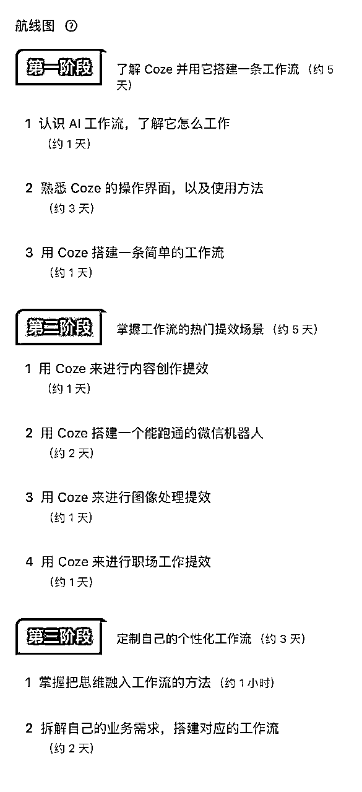


# 必修篇

# 一、搞懂AI流程编排 @黄小刀

# 1.1 流程编排到底指什么？

Workflow 可以理解为：围绕一个目标，把若干动作按先后顺序串成一条链，重点在计算机环境里自动跑起来。  
它像一条产线：大任务被切成几个小环节，每个环节都有清楚的目的和操作规范。

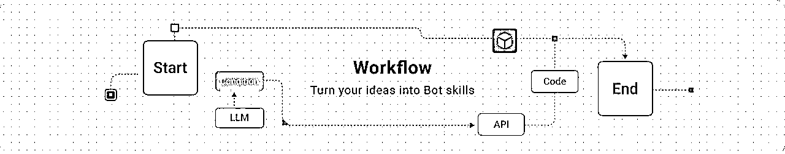

拿包子店打比方，标准、重复，很能说明问题。大致环节有：

原料采购与准备：买齐、备好材料。  
揉面：把面团做出来。  
调馅：准备包子馅。  
擀皮：擀出包子皮。  
包制：把包子包好。  
上锅蒸熟：蒸制包子。  
包装出售：包装并卖出。

这些动作要按顺序推进，并不断重复，才能让每个包子达标。流程编排追求的是把每一步规范化，让整个过程高效、稳定地完成。  
输入与输出也很关键：上一步的信息从哪里来、生成的内容接下来送到哪里，都是重要节点。比如“揉面”这一环，面粉来自前一步“原料采购与准备”的输出；揉好的面又会成为下一步“擀皮”的起点。  
当“包子店”任务链搭好，你只需点一下开始，系统便会自动跑完每一步，直到包子售罄。你需要的只是一个好想法，再用流程把它串起来。


# 1.2 为什么值得用流程编排？

# 💡

AI 智能体（AI Agent）在圈里很热，不少人也动手搭过。那么智能体和任务链差在哪，为什么更该用后者？

先看定位差异：

智能体（AI Agent）  
是什么：它是一个自动化“助手”，负责执行特定任务。好比定时器，到点提醒你。  
能做什么：适合具体、重复的事情，比如客服聊天、商品推荐、订单处理等。  
短板：只能按预设规则和任务行事，一旦遇到范围外的情况，就不知道该怎么处理。

任务链（Workflow）  
是什么：它是一组任务流程，规定每一步该做什么，像一本操作指南，从头到尾告诉你如何推进。  
能做什么：可以覆盖完整过程，例如客户下单、付款、发货、售后，把所有步骤和环节都纳入其中。  
优势：更灵活，能适应变化。你可以调整步骤和规则来应对不同情况，不必一开始就全部固定。

区别总结  
智能体是执行特定任务的“工具”或“助手”。  
任务链是指导整个任务的“计划”或“路线图”。  
简单说，任务链看全局，智能体管局部。

实际业务里，我们更需要任务链而不是智能体，因为流程设计往往更关键：重点不在于用几个智能体，而在于把解决问题的步骤设计好。好比下厨，锅具贵不贵不是核心，按工序把每道菜做出来才重要。  
你刀工再神，端出来仍是一盘土豆丝；真正值钱的是把清洗、切配、翻炒、装盘、上桌、收款串成一条线，从买土豆一路走到赚钱。  
任务链才是解决问题的关键，它能帮你理清思路、优化流程。设计好流程，才是提升效率的王道。因此，手册结尾也专门用一章教大家如何“拆解”自己的任务链。


# 1.3 什么业务适合交给流程编排？

适合流程化的业务通常有两个特点：重复性工作多、业务流程固定。  
以自媒体工作者的日常为例，其任务是更新内容、获取播放量、得到关注和客户线索。流程一般包括：选题策划（调研+点子）、内容生产（找素材+撰写/制作）、编辑加工（初编+设计排版）、审核、发布、互动、复盘、优化。  
这类工作既有大量重复任务（如内容生产、编辑、发布），又有固定业务链路（如策划、生产、审核、发布）。借助 AI 把这些步骤标准化，再用工具自动执行，效率就能明显提高。  
如果你是这位自媒体工作者，你会发现自己多出了时间和精力去思考、去创造。比如把时间放在打磨高质量内容上，或者研究流程之上更好的变现方式，而不是天天惦记什么时候蹭热点、怎么剪辑这些琐事，因为琐事已经由流程替你干完了。它让你释放创造力，更专注核心业务。  
不妨用老板心态大胆设想：把目前赚钱手段中能 AI 流程化的部分外包给 AI，你接下来要做什么？


# 1.4 窄流程与宽流程

窄流程与宽流程对比：

通常，窄流程解决某个局部场景，宽流程则面向整个业务流程。  
用电商和自媒体两个领域举例：

电商：  
窄流程：帮助改写商品标题、优化电商详情。  
宽流程：商品发布、上架、客服、发货自动化一条龙。

自媒体：  
窄流程：生成一篇公众号文章。  
宽流程：自动上号、自动内容（写、排版）、自动发布、留言回复。

宽流程，实际上就是业务流的自动化。在这个过程中，除了 agent，通常也会涉及 RPA、知识库、Python 等工具。选修篇最后一部分有更详细的说明。

# 💡

流程编排的介绍读起来像看游泳教程，难免枯燥；可一旦按自身需求搭好并成功跑通，那种喜悦很难形容。


# 1.5 平台清单

全包式机器人搭建平台  
Coze：字节跳动推出的新式机器人搭建平台，插件生态丰富。  
国际站：https://www.coze.com  
中文站：https://www.coze.cn  
Dify：开源平台，可自定义并支持插件。  
官网：https://dify.ai

免代码 AI 任务链搭建平台  
Microsoft Power Automate：国外常见，可自定义流程。  
FastGPT：国内常见，可自定义流程。  
https://tryfastgpt.ai/  
QuestFlow：面向办公用途。  
https://www.questflow.ai/  
GPTAgent  
https://openai.com/  
影刀&zapier  
https://www.yingdao.com/  
Leap  
https://www.tryleap.ai/

其他 AI Agent 搭建平台  
Betteryeah：定位接近 Coze，面向企业的 AI 应用开发平台；团队会不会写代码都能用，能迅速搭出 AI 驱动的 Agents、知识库、任务链和任务。  
https://www.betteryeah.com/  
Flowise：可快速完成智能体搭建。  
官网：https://flowiseai.com

Coze 扩展性突出、学习成本低，且国内可直接使用，所以本航海围绕 Coze 展开。


# 二、Coze快速上手 @拔刀刘 @黄小刀

# 2.1 Coze能帮你做什么

官方介绍：  
Coze 由字节跳动打造，是全包式机器人搭建平台。  
不管你有没有编程底子，都能在这里快速做出基于 AI 模型的问答 Bot，既能处理简单问答，也能应对复杂逻辑对话。  
做好的 Bot 可发布到社交平台和通讯软件，与用户互动。

基础版与专业版对比：  
基础版免费；专业版面向技术开发，需付费。  
个人玩家用免费版足够。

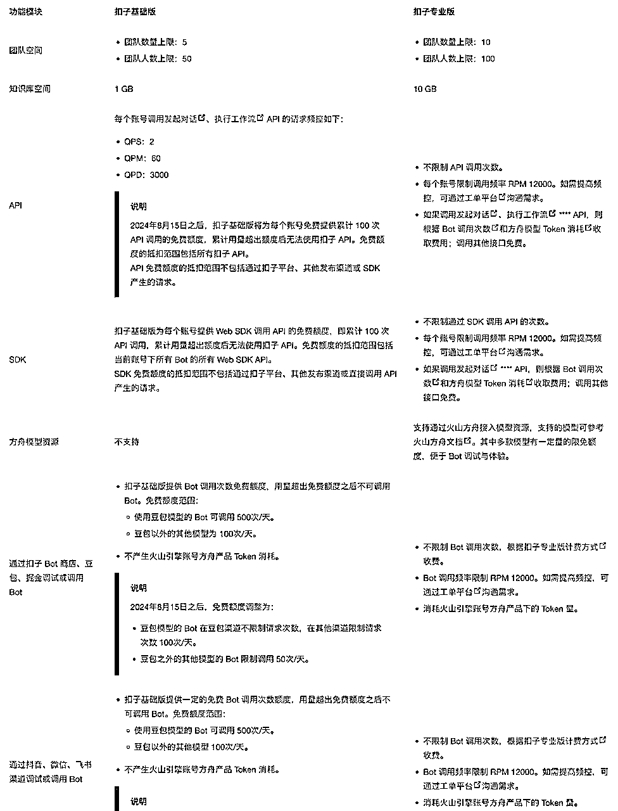

版本说明  
国内站：https://www.coze.cn/  
海外站：https://www.coze.com/  
两者主要差异：  
1、登录方式：国内支持抖音/手机登录，海外支持 Google/手机登录（需魔法）；  
2、大模型支持：国内站可用豆包、kimi 等国产模型，海外站支持 GPT、Gemini 等模型；  
3、发布平台：国内站支持发布至豆包、飞书；海外站仅支持 Discard。  
COZE 官方文档  
https://www.coze.cn/docs/guides/edition  
更多介绍与部署文档可查看官方说明。


# 2.2 新建与删除流程

# 2.2.1 个人空间新建

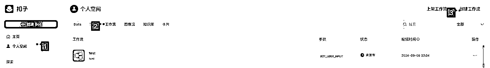

# 2.2.2 套模板新建

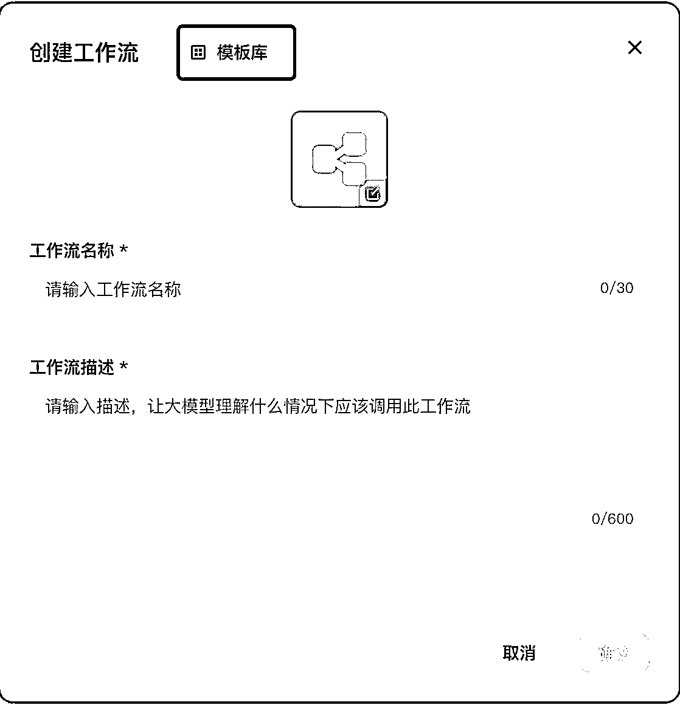

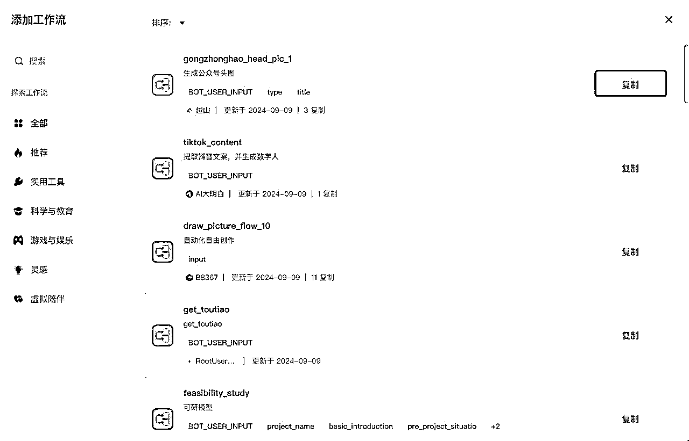

# 2.2.3 从商店新建

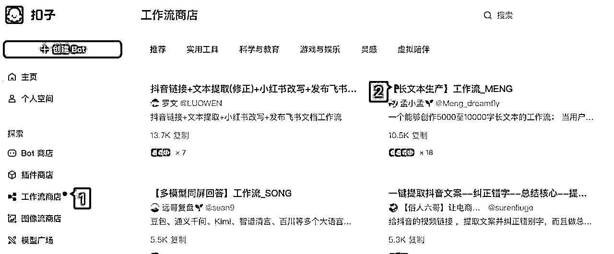

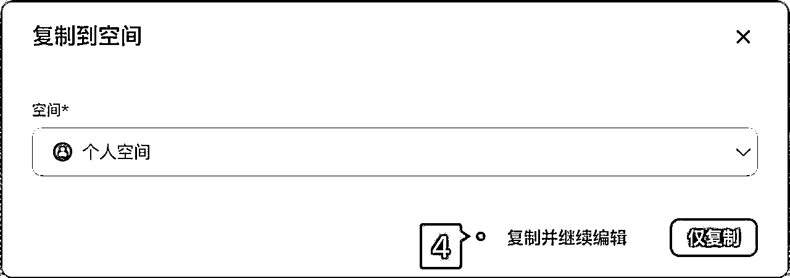

# 2.2.4 删掉流程

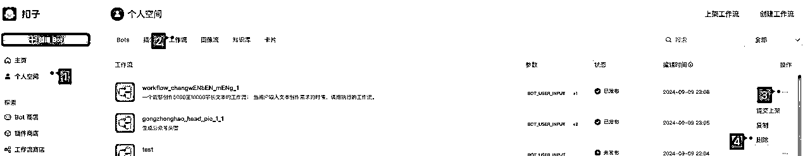

# 2.3 核心功能模块

# 2.3.1 大模型节点

Coze 除自研豆包外，也接入 Moonshot、MiniMax、GLM、通义千问、百川等业界模型。  
大模型节点承担任务链的推理与决策，是智能体的灵魂。

# 2.3.1.1 大模型节点怎么用

1、添加大模型：在编辑页左侧，选择添加大模型。  
2、连接节点：在画布上把大模型拖到合适位置，连接前后节点。

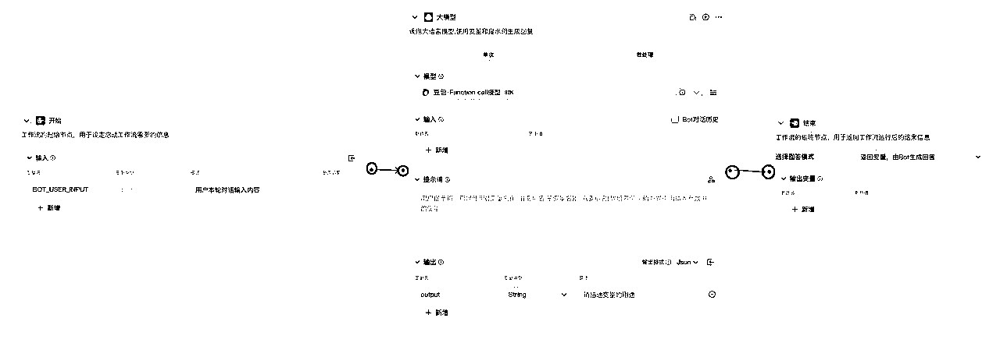

3、设置参数：  
选择模型：目前扣子支持国内绝大多数大模型。

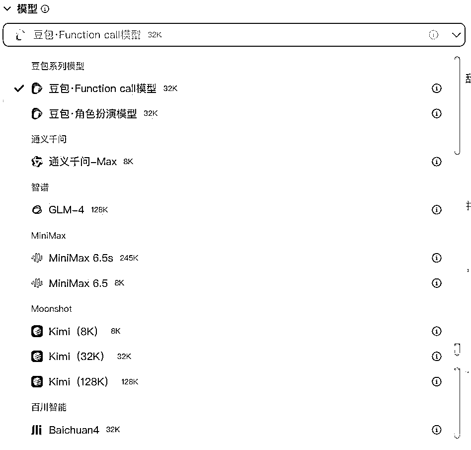

选择输入项：这里的输入项是动态值，可配合下方提示词一起使用。

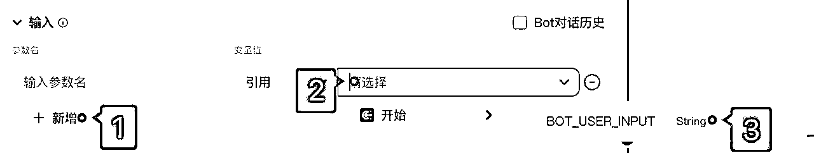

提示词：按业务需求撰写，方式和网页版大模型类似，但引入输入项时要用双花括号。  
最终效果如下。

# 2.3.1.2 进阶玩法

1、调节随机性：Temperature 数值越高，输出随机性越强。比如文学创作可调高，依据知识库回答则宜调低。  
2、读取 bot 对话历史：部分场景如聊天机器人，可借聊天上下文补充信息。右上角勾选「bot 对话历史」，最近的对话内容便会输入大模型。

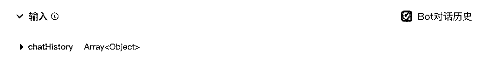

3、系统提示词：需要强人设时，把角色设定写进系统提示词，效果更佳。

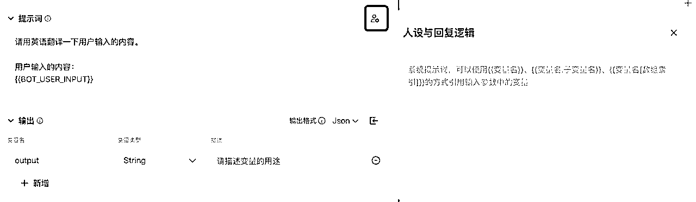

# 2.3.2 插件能力

Coze 内置 60 余款插件，涉及新闻阅读、旅行计划、生产力工具、图像理解 API、多模态模型等领域。借助这些插件，用户能轻松给机器人补充各种能力。  
平台也支持自定义插件；没有的功能可自行创建。

# 2.3.2.1 插件操作步骤

插件相当于任务链里的一个个工具，每个工具完成不同任务：有的能读取网页内容，有的能搜索，有的能创建飞书文档。用法如下：

1、添加插件：在编辑页左侧选择添加插件，可搜索所需插件，也可下拉选择。  
2、连接插件：在画布上把插件拖到合适位置，连接前后节点。

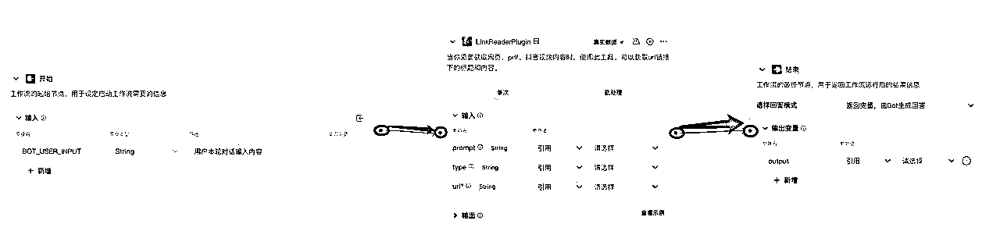

3、配置参数：不同插件参数不同，红色星号是必填项，未标记的是选填项。

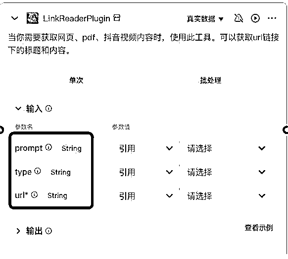

参数输入有两种方式：  
引用：在右侧选择栏引用前面节点需要的内容，属于动态值，会随前面节点生成内容变化。  
输入：手动填写固定内容，属于静态值，不会变化。

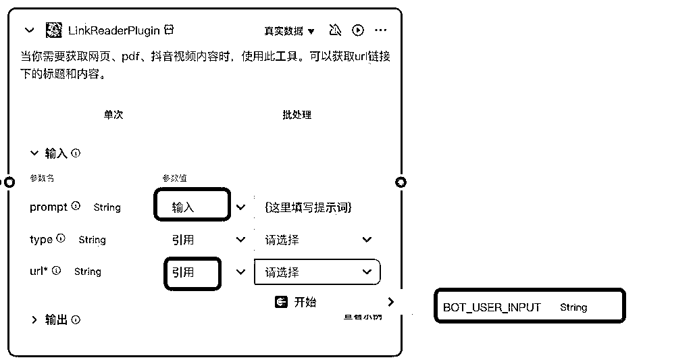

点击插件右上角三个点可查看详情，通常每个参数都有详细说明。

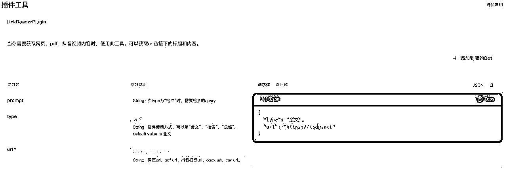

4、试运行：所有节点参数设置完成后，点击画布右上角试运行，查看效果。


试运行的输入项，就是任务链第一个节点“开始”节点所设置的输入项，可按需添加内容。

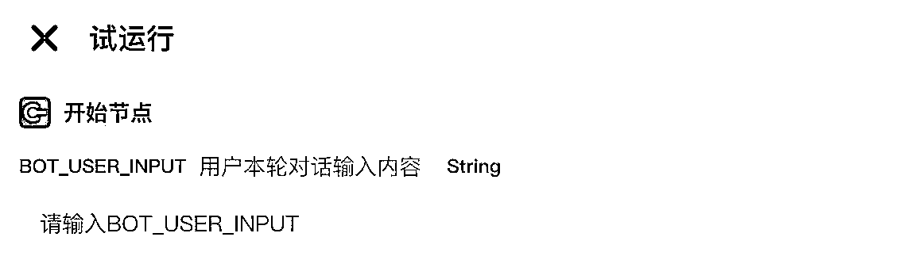

# 2.3.2.2 使用提醒

插件目前分为官方插件和第三方插件，优先使用「扣子官方」插件。

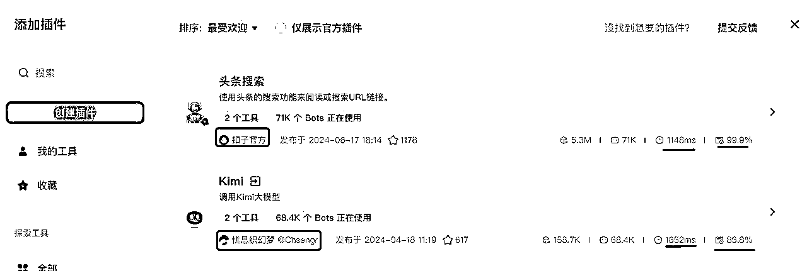

「第三方插件」稳定性不足，也缺少人员长期维护，可能之前能用，后来就失效了。  
留意我画线的那两组数字，它们分别是「执行时间」和「成功率」，可用来判断插件使用情况。优先选成功率高、执行时间短的插件。

# 2.3.2.3 常用插件举例

必应搜索：输入关键词，返回必应搜索结果。

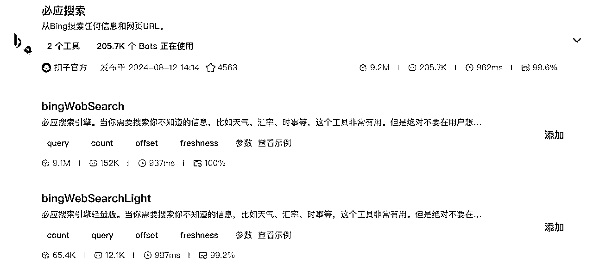

效果展示：

链接读取：可读取任意网页内容（知乎不太稳定），也能读取在线 PDF 文档。抖音视频转文字也会用到这个插件，结果出得很快。

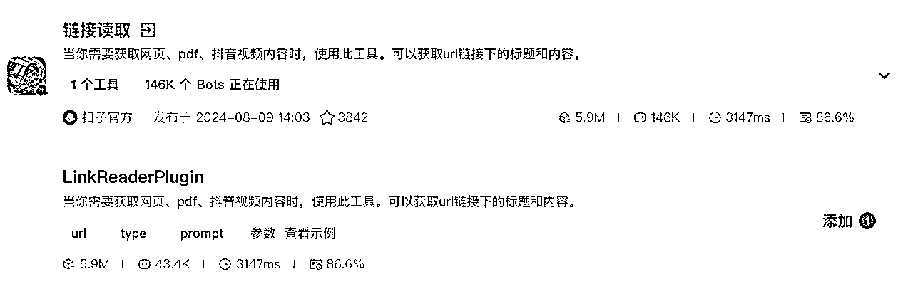

效果展示：

图像理解：能 OCR 提取图片中的文字，但不止于此；它还能读懂图片，用自然语言描述图片内容。

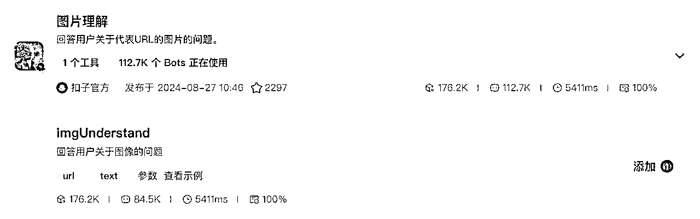

效果展示：

1、提取图片中的文字：  
试运行时可输入示例图片地址：  
原图：


注意这里插件参数「text」我选择了「输入」模式，写了提示词「提取图片中的文字」。

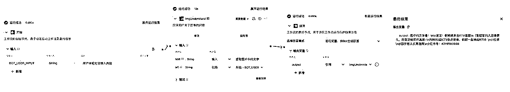

2、图像理解  
试运行时可输入示例图片地址（可在浏览器打开图片地址查看原图）：  
原图：


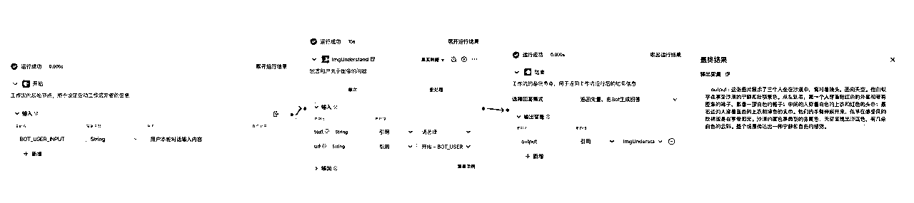

飞书文档全家桶：可创建、查找、写入飞书文档内容，一般用来保存任务链输出结果。

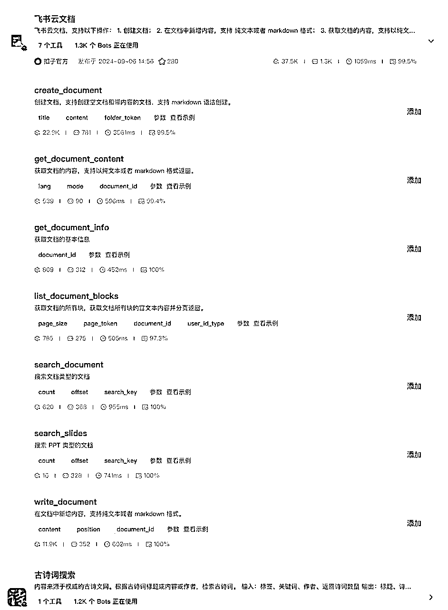

以提取抖音文案并保存到飞书文档为例，操作步骤：  
1、添加插件：链接读取、创建飞书文档。

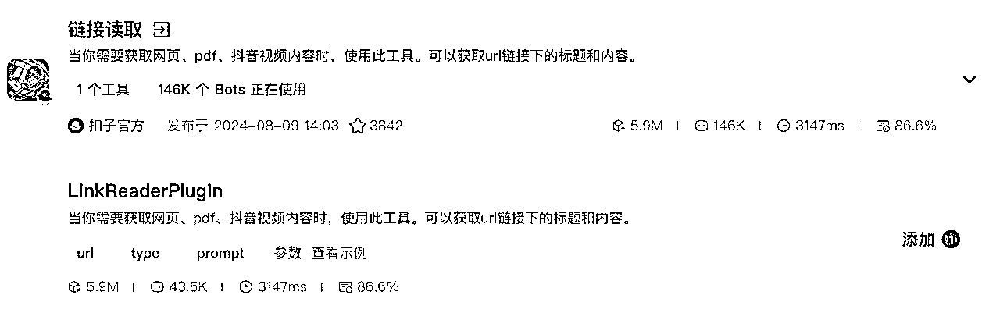

2、配置参数：引用用户输入的抖音链接；设置飞书文档标题和内容。首次使用时可能会要求对飞书授权，按指示完成授权即可。

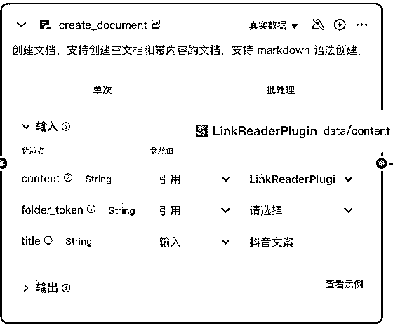

在收尾节点挂一条飞书文档链接，产出就能直接沉淀下来。

实际演示：自动建好一份飞书文档，顺手把检索到的结果一并存进去。

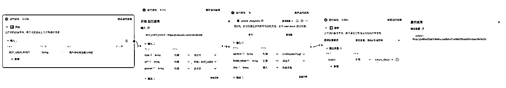

点开下面这个地址就能预览：

# 2.3.3 知识库

扣子支持把私有资料（本机文件、线上实时数据等）喂进来，再借助向量检索挑出最贴合的片段，回答自然更精准。

# 2.3.3.1 知识库能解决什么

大模型的训练语料来自公开数据，某个行业的内部信息它一概不知。你们单位有哪些规定、手头项目推进到哪一步，它当然答不上来。

可一旦挂上私有知识库，模型就被限定在你给的材料范围内作答。把规章制度、会议纪要、项目资料整理入库，之后凡是与制度或项目相关的问题，它都能照着你提供的内容回应。

所以知识库的价值很直接：压住模型瞎编的倾向，补上垂直领域的知识缺口，让答案的可靠程度明显提升。

# 2.3.3.2 背后的运行逻辑

**先切片再入库**：模型能读的上下文有上限，资料进来后要按指定符号或字数切成小段。八千字的文稿按八百字一段处理，就得到十块内容，分别存好。

**按需召回**：你提出问题时，系统比对相似程度，挑出最贴切的若干块，再拿这些材料组织出答案。业界把这套做法命名为 RAG（检索增强生成）。

延伸阅读：什么是RAG技术

💡 使用限制

- 每个账号最多能建 1000 个知识库；
- 文本类知识库挂载文档数量上限为 100 份；
- 每人每月新增数据不超过 2 GB，总量封顶 10 GB。

# 2.3.3.3 动手搭建知识库

可选的类型有三种：文本、表格、照片。

入口：个人空间 → 知识库 → 创建知识库

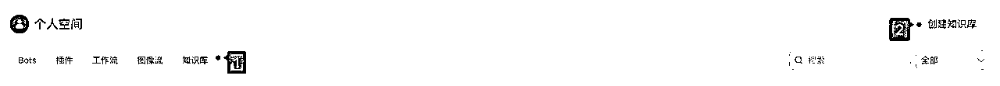

## 1、文本类知识库

入口有五个：本机文件、网页数据、Notion、飞书、自定义。

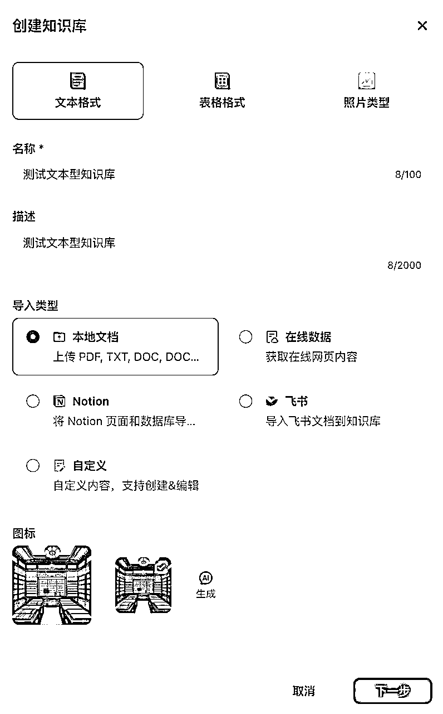

具体差别如下：

**本机文件**

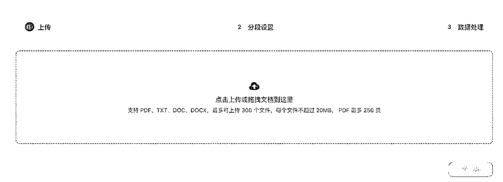

从电脑里选文件读入。格式限 txt、.pdf、.docx、.doc；一次最多 300 份；单份体积上限 20MB；PDF 页数不能破 250。

**网页数据**

直接抓线上页面进来，抓取方式分自动与手动两路。

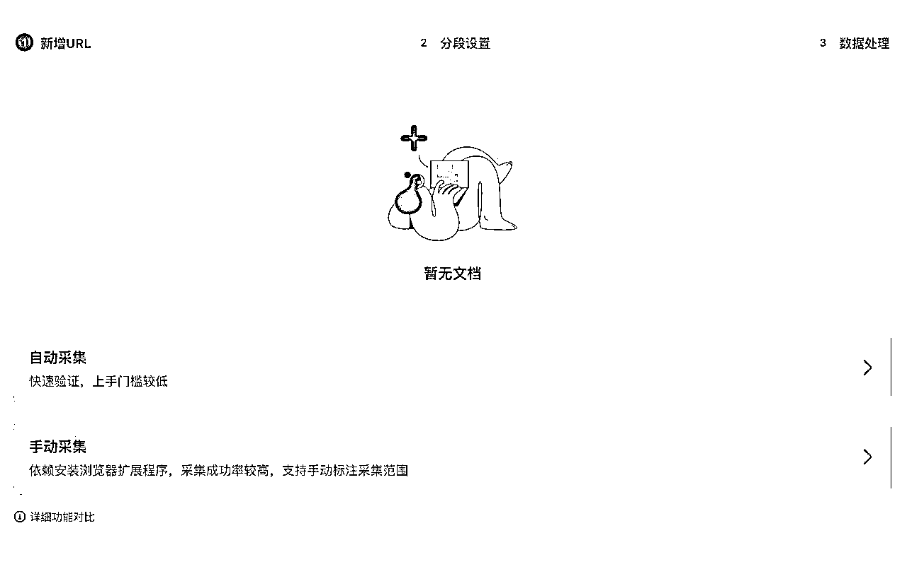

自动模式下，单个页面和整站批量都支持。

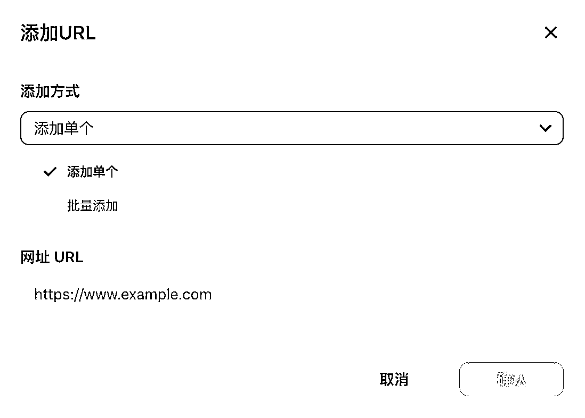

- 单页抓取：方式选“单个”，决定是否跟随更新以及更新节奏，填上目标页地址。
- 批量抓取：方式选“批量”，给出站点根地址或 sitemap 地址，点导入，成功后再确认。

手动模式需要你自己圈定要哪些内容，命中率相对更高。

💡 走手动路线之前，浏览器插件得先装好，安装方法见 Scraper 说明。

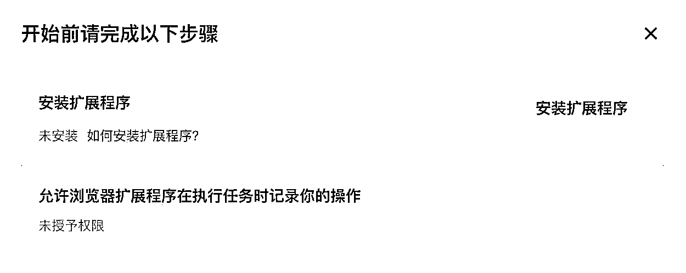

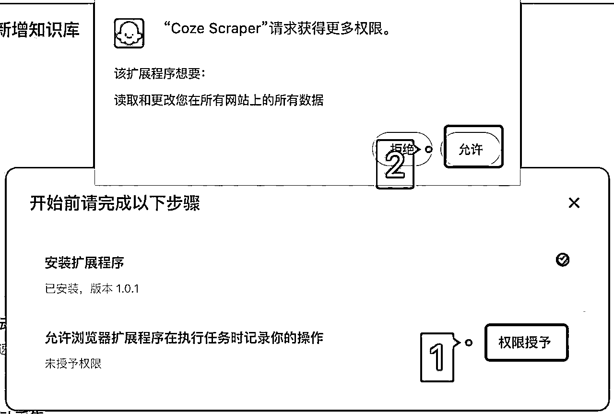

手动操作：

7. 进入新增 URL 界面，方式挑“手动采集”。
8. 把目标页地址粘进去，确认。

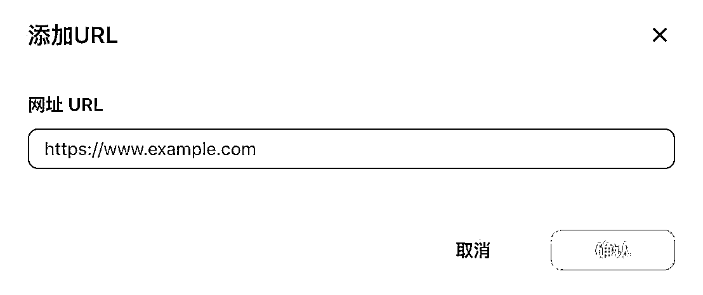

9. 页面打开后，点底部的文本标注，框出想要的区域，再按文本框上方的“文本”或“链接”。

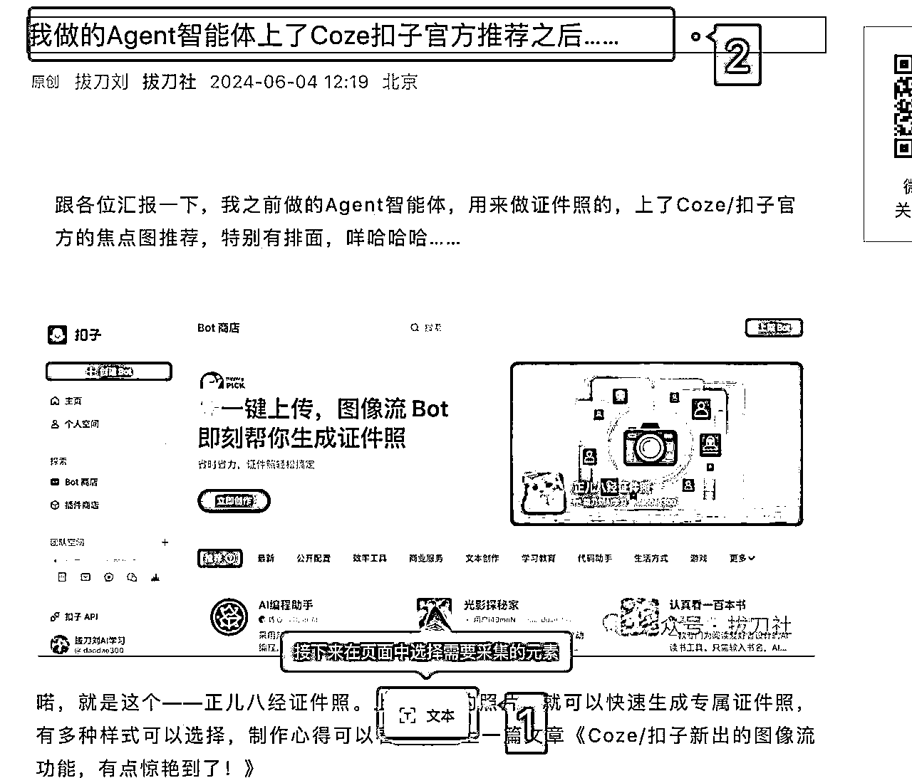

10. 点“查看数据”核对抓下来的东西，没问题就点“完成并采集”。


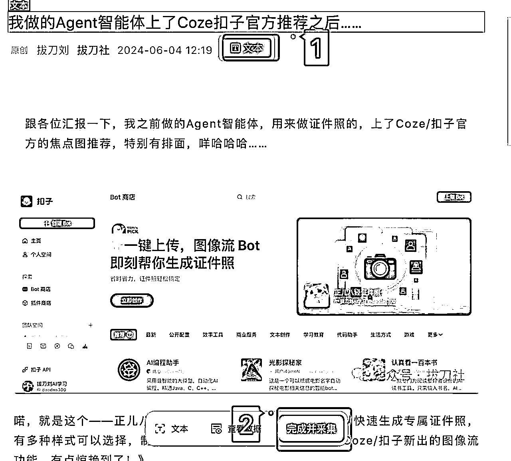

**Notion**

从 Notion 搬内容进来：
1. 来源选 Notion。
2. 在新增知识库界面点授权（头一回导入 Notion 需要走这一步）。
3. 登录完成后挑要搬的页面。
4. 勾好内容，点下一步。

**飞书**

从飞书云文档搬内容：
1. 来源选飞书。
2. 点授权，挑出对应的飞书账号。


3. 点安装，把扣子应用装进该账号（仅首次需要）。
4. 勾选文档，点下一步。

💡 提醒：只认“我的空间”里的飞书云文档，且创建人得是本人；知识库与共享空间里的文档暂时搬不了。

**自定义**

自己动手往里填：
1. 方式选自定义。
2. 填文档名称。
3. 写正文。
4. 点添加图片可插图。
5. 点下一步提交。

内容进来后进入分段设置。切得好不好，直接决定召回准不准、回答顺不顺。

块切太大，无关信息混进来，召回精度就掉；块切太小，上下文断掉，答出来的东西容易没头没尾、缺深度。

系统提供两套方案：自动分段与清洗、自定义。

**自动分段与清洗**

解析交给系统，复杂版式也能应付：段落能识别，页眉页脚脚注这类噪声会剔除，跨页跨栏的段落会合并，表格里的图片能读，带线框的表格内容也能解析。

步骤：
1. 分段页选自动分段与清洗，点下一步。

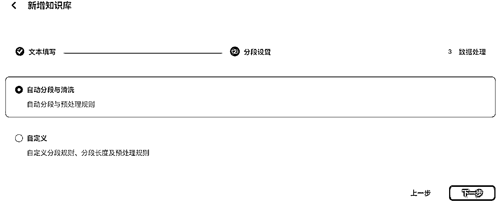

2. 点确认。（确认不耽误后台处理，处理完就能引用。）

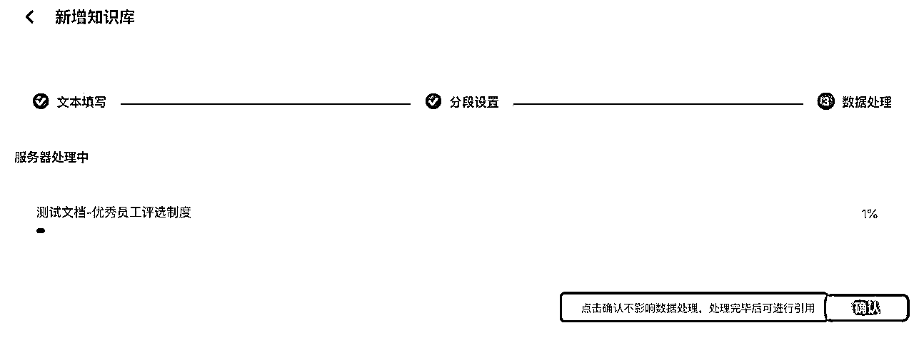

3. 看看切分结果。假如整篇只切出一段，不满意就点右上角重新分段，换成自定义。

**自定义**

规则、长度、预处理都能自己定。

步骤：
1. 分段页选自定义，点下一步。
2. 配好规则与预处理。标识符按实际情况挑，这里拿三个井号当分隔。

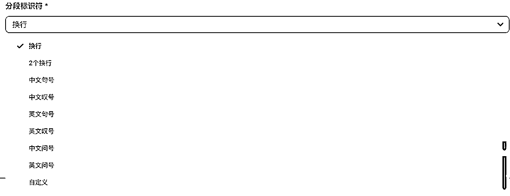


片段字数上限：限定每块最多多少字。

预处理项：
- 把连续空格、换行、制表符统一压掉
- 清洗掉全部网址与邮箱

3. 点下一步，切分完成。
4. 再看效果，这篇文稿被切成了 8 块，每个标题独立成段。

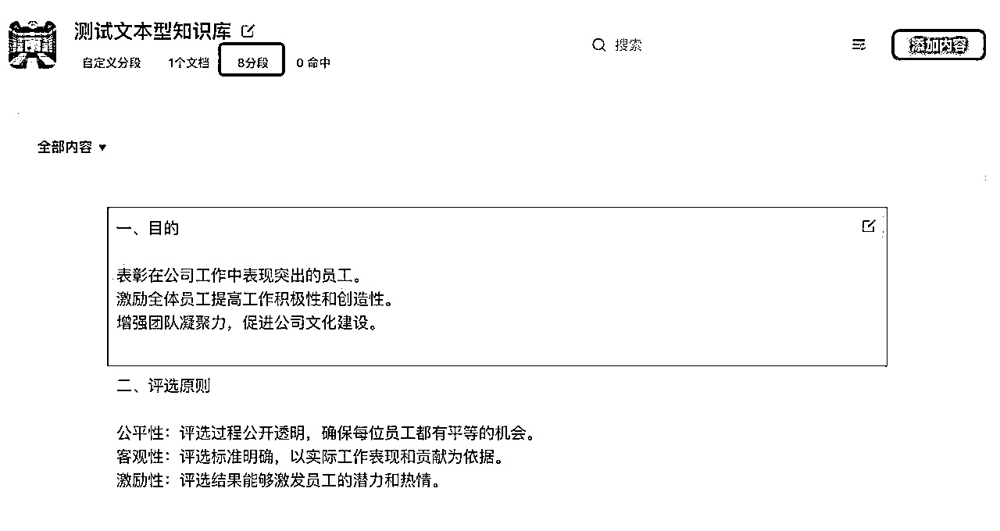

## 2、表格类知识库

入口有四个：本机文件、API、飞书、自定义。

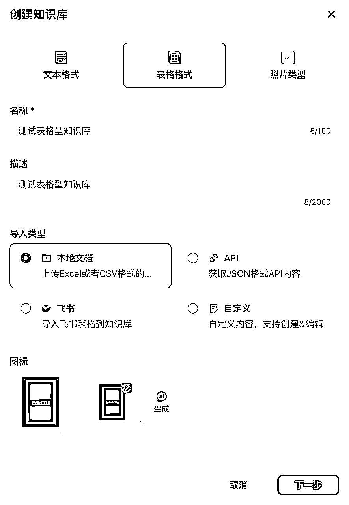

**本机文件**

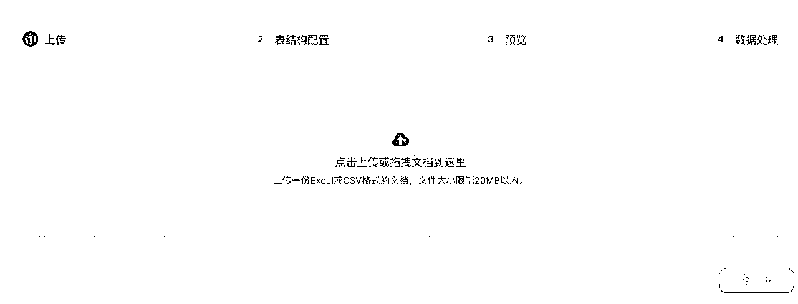

从电脑里读表格。格式限 .csv 与 .xlsx，表里得有列名和数据；单份不超过 20MB；一次最多 10 份。

**API**

从接口返回的数据建表：
1. 选 API。
2. 点新增 API。
3. 填接口地址，定好更新节奏，点下一步。

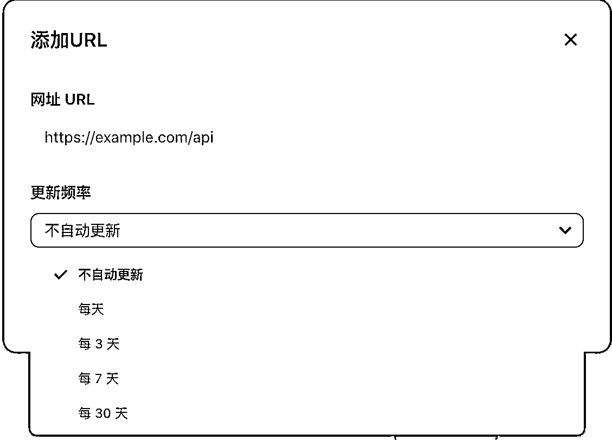

**飞书**

从飞书表格搬数据：
1. 选飞书。
2. 点授权，挑出对应账号。
3. 点安装，把扣子应用装进该账号（仅首次）。
4. 勾选表格，点下一步。

💡 只认“我的空间”里的飞书文档，创建人须为本人；知识库与共享空间里的暂时不行。

**自定义**

手搓表结构和数据：
1. 点自定义，自行搭表。
2. 在表结构区点增加字段，可以连续加多个。
3. 定好列名，并指定某一列承担语义匹配。用户提问时，查询内容会跟这一列做相似度比对。

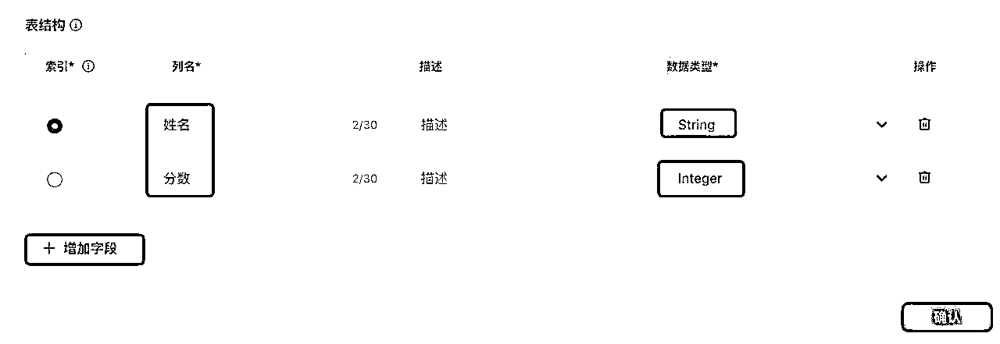

4. 点确定。
5. 往里填数据。

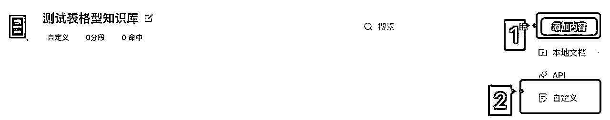

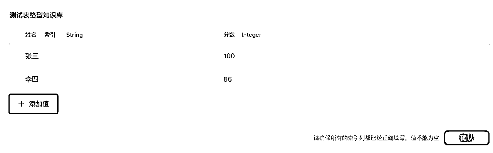

表格不需要额外分段，天然一行一块。

这类知识库既支持按索引列命中，也支持 NL2SQL 的查询与运算。

索引的含义是：用户输入拿去跟哪一列比对。问“张三考了几分”，索引姓名列就够；问“谁拿了 100 分”，就得索引分数列。

一个知识库只允许设一个索引，想让上面两种问法都跑通，就再建一个库，上传同一份数据，改用分数列做索引。

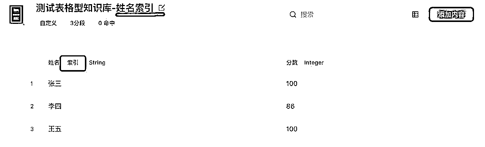


## 3、照片类知识库

格式限 JPG、JPEG、PNG，单份不超过 20MB。


标注方式有智能与人工两种。


它的效果并非把图里的文字抠出来，而是理解画面内容，再按关键词召回。


# 2.3.3.4 放进工作流里用

1. 接入方式和上一节的插件差不多：左侧栏挑知识库，把它跟上下游节点连起来。一般后面会跟一个大模型节点负责出答案，后面文档里有完整案例。


2. 选库：挑已经建好的库，多个库可以一起挂。


3. 参数配置：


各选项含义：

- 搜索策略：决定片段怎么被找出来。召回的内容越贴题，模型给出的答案就越靠谱。
  - 语义检索：按人类理解词句关联的方式去找。需要跨语言、或者靠语义关联匹配时用它。举例来说，“狼追小羊”跟“豺狼追山羊”语义很近，而“狼追小羊”跟“我爱吃炸猪排”就搭不上边。
  - 全文检索：按字面关键词找。查人名、专有名词、术语、缩写或编号时更合适，比如“比尔盖茨”“特斯拉 Model Y”“SFT”“12s1w1s2系列”。
  - 混合检索：两套机制一起用，结果综合排序后再召回。

- 最大召回数量：决定交多少块片段给模型。数字越大，给的内容越多。


- 最小匹配度：只放行达到分数线的片段，低于门槛的直接丢掉，用来挡掉质量差的匹配。


提示：这两个数值对最终输出影响很大，最好搭配着反复调几轮，摸出最合适的组合。

# 2.3.3.5 跑一遍看看结果

提问：谁拿了 100 分。

💡 表格类库还支持 SQL，所以也能这么写：

SELECT * FROM 测试表格型知识库-分数索引 WHERE 分数=100

# 2.3.4 记忆能力

Coze 给了 Bot 一套持久化的记性，让它能存住聊过什么、哪些信息要紧。分三块：

- 变量：存个人信息，比如称呼、语言习惯，Bot 记住之后回复会更贴合个人。
- 数据库：可以随时增删改查，工作流里既能走 NL2SQL，也能用代码调。
- 长期记忆：先把对话自动记录下来并做总结，用户再提问时把总结召回，据此组织回答。工作流场景用不上，这里不展开。

# 2.3.4.1 变量

注意：工作流里的变量与数据库都得挂在 Bot 上，所以动手前必须先建好 Bot，再把变量或数据库加进去。

1、建 Bot，加变量

先新建一个 Bot：


进入配置页，找到新增变量，按业务需要逐个建。


2、工作流里怎么用

变量节点提供两件事：读取变量、写入变量。

读取：
1. 拖入变量节点。
2. 摆到合适位置，接好上下游。
3. 选“从 Bot 获取变量值”。
4. 配输入输出参数。参数名必须跟 Bot 里建的那个一模一样，示例里叫 name，这里也填 name，才能取到它的值。


写入：
流程与读取相同，只在第 3 步换成“给 Bot 设置变量值”，名称同样要与 Bot 里的变量对齐。


试运行：
跑之前必须指定绑定的 Bot，不然动不了。


# 2.3.4.2 数据库

变量那套规矩同样适用：先建 Bot，再加数据库。

1、建 Bot，加数据库

先新建一个 Bot：


进入配置页，找到新增数据库，按业务需要建库和字段。


需要更多表或字段，继续加即可。

2、工作流里怎么用

拿“把学生成绩写进库”举例：

1. 拖入数据库节点，摆好位置并接上前后节点。
2. 开始节点加两个输入项：name、score，作为写入的数据源。
3. 在数据库节点里配好输入项。
4. 写 SQL。


SQL 让 AI 代笔：不会写也没关系。
1. 点“自动生成”。
2. 指定绑定的 Bot。
3. 用大白话描述要查什么，变量记得用双层花括号包住。
4. 点“自动生成”。
5. 拿来直接用。


试运行：同样得先绑 Bot，否则跑不起来。


# 2.3.5 图像流

这是给图片干活用的流程工具，可以理解成“专门处理图像的工作流”。能力大致分五类：

- 智能生成：出图、参考图
- 风格模板：滤镜、宠物风格化
- 智能编辑：提示词推理、提示词优化、换背景等
- 基础编辑：画板、裁剪、调整、旋转、缩放
- 通用节点：选择器、消息

# 2.3.5.1 图像流怎么用

1、新建图像流

进 Bot 界面，找到图像流，点“创建图像流”。

弹窗里填名称和描述，方便日后辨认。也可以直接从模板库或图像流商店开一个。


模板库：


图像流商店：

# 图像流落地全流程：配置、联调、跨平台

概念的部分前面已经聊过，这篇直接进操作层。围绕四件事展开：参数怎么填、效果怎么验、怎样嵌进更大的链路，以及最后让它脱离控制台、到别的平台上跑起来。


## 步骤二：把节点拖进画布再串起来

打开编辑界面，路子不绕弯：先拖入工具节点，再顺着先后关系一线线连上。

落地就三步：

1、把需要的节点拖到画布

2、按前后逻辑接好线

3、逐个把参数填进去


## 步骤三：跑通之后再发布

参数填完先别急着点发布。按一下“试运行”走一遍，确认每个环节都吐出结果再说。另外提一句：写生图用的描述文字直接敲中文就行，不必先译成英文。


跑完能直接看产出。留意默认出图偏二次元画风，心里有数就好。


# 2.3.5.2 主要功能介绍

**文生图**

给一段文字描述，系统照着产出画面，最基础也最常用的一种。


**图生图**

内部备了几套方案，挑与业务对得上的那套即可。


走这条路，得先在起点处补一个入参，命名 img，类别选定 image。


出图节点需要喂一张参考图，而它当前只接收「图像参考」节点递过来的图，所以得先把这个节点建出来。该节点提供了若干可选方案，玩过 SD 的人一看就懂——相当于扣子内置的 ControlNet。

随后把每一处的参数都填妥。


再按一次试运行，文字描述配上传的图片一起喂进去，产出会同时带着原图的轮廓和指定画风。


**提示词推理**

用来应付“看图倒推描述”的场合：刷到一张合眼缘的图，交给这个节点就能把对应描述还原出来。


试运行时把图传上去即可验证。


**提示词优化**

作用是替你把描述润色到位，让出图品质再往上走一档。


同样用试运行验证。


**智能换脸**

顾名思义，把画中人脸替换成你指定的那一张。


填参数的方式：

1、起点处补一个图片类入参，专供上传「脸图」

2、底图来源选「上传」，手动传一张上去

3、换脸那一项「引用」起点处的那张脸图


跑一次看效果。


底图


换脸后

**画板**

扣子近期上线的能力，用着顺手。图片、文字、矢量图形之类的元素都能往里塞。


画板中被引用的文字与图片仍可继续编辑，入口在右上角的编辑按钮。


画布尺寸先在顶部栏里定好。那排工具栏的其余按钮，本质都是围绕“按业务需要改动画布内容”服务。


试运行确认一下。


# 2.3.5.3 图像流嵌入工作流的用法

图像流能够作为一环塞进更大的链路里，前提是它已经发布过——没发布的调不出来。

进到流程编辑界面，挑一个发布过的图像流。


拖到恰当的位置，前后接好，参数填到位。


跑一遍，看看结果。


**Tips：**

两者搭配最常见的落点是出图环节：前者负责把提示词和参数备好，后者负责把画面生成出来。后面的《小红书配图自动排版》案例会细讲。

# 💡

# 提示词

调 LLM 插件时，提示词往往得来回试几轮才能拿到满意结果。往期航海已备好专门的撰写指令，这里不再展开。


# 2.4 Coze 流程拆解思路

搭一套流程，按时间顺序可切成三段。

# 2.4.1 规划阶段：

先把关键任务挑出来、定下打法，想明白要什么、怎么落地。

再把整个任务切成若干好管的小块，理清谁在前谁在后、谁依赖谁。

然后给每一小块排出具体做法。

这一段往往决定成败——你得先弄清楚自己到底想要什么。

举个例子：用 coze 搭一条高水准的自动化 xx 赛道小红书内容生产线，该怎么拆？

一层层把目标定下来：

总任务：小红书内容自动产出

输出标准：爆款标题 + 文案 + 配图

子任务1：生成爆款标题

子任务2：生成配图

子任务3：生成发布文案

其中子任务1还能再往下切：热门话题抓取 + 改写；子任务2则会调用图片流程。

在总目标与最终输出标准之下完成拆解，同时把彼此的逻辑关系定下来。

# 2.4.2 执行阶段：

逐个把功能开发出来并验证。

在 Coze 上把流程骨架搭好，节点之间的先后关系设定清楚。

细致填好每一小块的参数，保证各自都能跑通。


能看到，成型后的流程由若干小方块拼出来，每一块都能单独点“试运行”。

顺序上是：先把小块跑通，单点过了再走全程。

任何一处报错，最终都会导致没有输出。

试运行时你会体会到，这东西和写代码一个道理——跑不动，必然是某处出了岔子。

这一阶段通常不会一次成型，需要反复验证：

换一款模型，产出的结果就变样；

链路拉得太长，结果就不稳；

某处抓错了数据，后面全线崩……

后续航海进入提效场景实操时，如果在这里卡住，把心态放平，一步步往前挪，该走的弯路一步也省不掉。

# 2.4.3 完善阶段：

对整体做检验，把效果往上推。

全程跑一遍，找出功能与性能上的短板。

靠持续的验证与迭代不断打磨，直到达到预期标准。

走到这一步，流程已经进了真实业务，接踵而来的是一连串新麻烦：

上线了，这个选题数据不行，得换话题来源；

上线了，这类图点击率偏低，得换画风；

上线了，LLM 的语气太生硬，不够自然；

上线了，数据太猛私域接不住……

依据运营数据，我们会回头调整与迭代。这部分通常由运营、数据分析和异常监控几方共同承担，也需要长期盯着。

搭流程像种树，维护流程像养树。


# 2.5 跨平台调用：把 coze 工作流装进 BOT

流程搭完了，难道只能在 coze 的测试环境里用？想在微信里调它怎么办？想让飞书文档直接联动又怎么办？

答案很直接：官方功能一键搞定。把流程发布成 BOT 推送到目标平台，就能跨平台调用了。

不过要留意，各平台属性与默认配置不同，有些地方不光你能用，别人也能用。

# 2.5.1 常用发布平台

常见的落点有这些：

1、扣子商店

完全公开，发布后人人可见。

2、豆包

默认摆在豆包商店，其他人搜得到也用得上；也能在商店配置里隐藏，改成仅自己可用或凭链接访问。

3、飞书

默认落在对应账号的工作台里。若是企业版，需要指定使用人员，不会进应用中心，但能通过“分享”给到他人。

4、抖音

小程序可被搜到并进行对话，也能挂到短视频上。

5、微信

分小程序、客服、服务号、订阅号四条路。小程序与抖音类似，搜到即可对话。客服属于内置能力，不公开的话外部根本找不到。订阅号、服务号若账号名与 BOT 名毫不相干，搜索是搜不到的，隐私性相对更好，可当作私有功能，借公众号消息对话来用。

6、API/SDK

供外部软件调用，需要一点开发底子。


# 2.5.2 调用效果展示

飞书里从工作台能进，从消息也能进。


公众号里不会显示 BOT 的建议问题，需要去公众号后台手动补上。


# 2.5.3 LLM模式发布

这是流程的默认发布方式，没做额外设置就会按它走。

特点在于：流程外面还会再罩一层大模型。用户与 BOT 对话时，由这层模型判断要不要触发引用的流程；不触发就走默认回复。

# 2.5.4单工作流模式发布

若你的流程属于“单一输入”“固定模式”，不需要外部模型来判断，就是 A 到 B 一条直线，那可以挑“单 agent（工作流）模式”，发布后的输出更稳。


但经常撞上一种情况：起点处设了两条以上入参，系统提示“此工作流无法使用此种方式发布”。

原因在于：单 agent 模式只认起点处那条名为 bot_user_input 的默认入参，起点上挂了其他参数的流程都用不了它。

那已经加了别的参数怎么办？

情况1：虽然多挂了一个参数（比如 url），但默认那条也闲置着，测试和使用时都不填内容。这种只要把后面用到 url 的地方改成引用默认参数，再把 url 删掉即可。

情况2：确实得靠多个入参才能跑。这种仍旧用 LLM 模式发布，但把上传位置换成“快捷指令”，在快捷指令里设一个点击触发的入口。

# 2.5.5 多工作流模式

这种模式允许引用多条流程，也能把别的 BOT 拉进来参与操作。

流程彼此之间可以形成上下衔接，也就是流程接流程，或流程—BOT—流程。

更复杂的任务便能系统化地跑起来。

# 2.5.6 BOT发布后修改

若没动 BOT 的主干逻辑，只改了内部的流程、图像流之类，这时不必重新发布。

顺带一提，这条路也能绕开某些发布时会撞上的审核，比如敏感词、图像流底图里的二维码。


# 三、工作流的热门提效场景

# 💡

章节概要

前两章把 Coze 的基础与核心能力过了一遍。现在转入实操：怎样把这套流程用进真实场景，实打实地提效。

本章聚焦四个热门方向：

1.

内容创作提效：借 Coze 做小红书二创、公众号二创、抖音内容转小红书等，帮创作者快速产出多平台高质量内容。

2.

微信 AI 机器人：打造智能客服，做到 24 小时自动应答与个性化服务。

3.

图像处理提效：用 Coze 完成换脸证件照、个人 AI 写真、淘宝衣服一键试穿等任务。

4.

职场工作提效：图片提取表格、问答机器人、简历优化、社群运营日报生成等，把日常效率拉起来。

每个方向都会给出步骤指南与实际案例，让你直观看到搭建过程与应用效果。不论你是自媒体运营、客服、设计师还是职场人，本章都能找到合身的方案。

准备好了吗？一起扎进这些场景，把 Coze 的潜力挖出来。

# 3.1 内容创作提效

# 3.1.1 小红书二创 @悠然

# 3.1.1.1 工作流拆分

取笔记内容—重写文案—配图—发布

（1）取笔记内容

刷小红书时锁定目标爆款，把标题与正文这些文本数据抓出来。

（2）重写文案

在原内容基础上重新构思、改写，留住精髓的同时掺入新元素与新创意，标题也要改到能勾住眼球。摸清目标受众的兴趣点，把风格往他们的偏好上靠。

（3）配图

依据改动后的文案，挑或做与之匹配的图片与视觉素材。

（4）发布

发之前先调试，看看内容在真实平台上的呈现。确认无误后，把优化好的图文投到小红书。


# 3.1.1.2 具体步骤

# （1）创建工作流

打开 coze，新建一条流程。


创建时得填名称与描述，名称限字母、数字、下划线，且以字母打头。

填完点确定，就进了搭建界面。

# （2）提取小红书笔记

点插件旁的“+”号加插件：


搜“链接读取”，选中下方的“LinkReaderPlugin”，它能抓取某条爆款笔记 url 下的标题与内容，点右侧“添加”。

把起点与它接上。


在起点的“输入”里填变量名 url，描述写“爆款小红书笔记链接”。

插件的 url 入参选择引用起点处的那条。


# （3）爆文改写

点大模型旁的“+”号加一个大模型。


把它接到插件之后。


接好点右上角“重命名”，改叫“小红书改写”。

它带两个入参：

参数名 title；取值引用 LinkReaderPlugin 的 title

参数名 content；取值引用 LinkReaderPlugin 的 content


提示词里填：

# 💡

你是一个小红书文案专家，请详细阅读并遵循以下原则，帮我进行小红书笔记二次创作。

#标题创作原则

##增加标题吸引力

-使用标点：通过标点符号，尤其是叹号，增强语气，创造紧迫或惊喜的感觉！

-挑战与悬念：提出引人入胜的问题或情境，激发好奇心。

-结合正负刺激：平衡使用正面和负面的刺激，吸引注意力。

-紧跟热点：融入当前流行的热梗、话题和实用信息。

-明确成果：具体描述产品或方法带来的实际效果。

-表情符号：适当使用 emoji，增加活力和趣味性。

-口语化表达：使用贴近日常交流的语言，增强亲和力。

-字数控制：保持标题在 20 字以内，简洁明了。

##标题公式

标题需要顺应人类天性，追求便捷与快乐，避免痛苦。

-正面吸引：展示产品或方法的惊人效果，强调快速获得的益处。比如：产品或方法+只需1秒（短期）+便可开挂（逆天效果）。

-负面警示：指出不采取行动可能带来的遗憾和损失，增加紧迫感。比如：你不xxx+绝对会后悔（天大损失）+（紧迫感）

##标题关键词

从下面选择1-2个关键词：

我宣布、我不允许、请大数据把我推荐给、真的好用到哭、真的可以改变阶级、真的不输、永远可以相信、吹爆、搞钱必看、狠狠搞钱、一招拯救、正确姿势、正确打开方式、摸鱼暂停、停止摆烂、救命！、啊啊啊啊啊啊啊！、以前的...vs现在的...、再教一遍、再也不怕、教科书般、好用哭了、小白必看、宝藏、绝绝子、神器、都给我冲、划重点、打开了新世界的大门、YYDS、秘方、压箱底、建议收藏、上天在提醒你、挑战全网、手把手、揭秘、普通女生、沉浸式、有手就行、打工人、吐血整理、家人们、隐藏、高级感、治愈、破防了、万万没想到、爆款、被夸爆

#正文创作原则

##正文公式

选择以下一种方式作为文章的开篇引入：

-引用名言、提出问题、使用夸张数据、举例说明、前后对比、情感共鸣。

##正文要求

-字数要求：100-500字之间，不宜过长

-风格要求：真诚友好、鼓励建议、幽默轻松；口语化的表达风格，有共情力

# 二创工作流：改写、配图、发布

先把结论摆前面：一套顺手的内容二创流水线，能把“找爆文—起标题—写正文—做封面—发布”串起来跑。四个原则别丢：叹号提气，短句分段，重点前置，总分总收尾。下面按模块拆开讲。

小红书这块，大模型要交两样东西：10个标题，加一篇跟标题匹配的浓人风格正文。给它一个主题{{title}}和示范文案{{content}}，它负责把爆款标题和文案重新改写，标题要短，正文要利落。流程上，大模型要接在LinkReaderPlugin后面。

# （4）文案配图

点大模型右侧的“+”号，把大模型加进来。接好后改个名，叫“AI绘画大师”。

“AI绘画大师”的输入这样配：变量名input，引用LinkReaderPlugin-content。提示词里写明白：你是精通AI绘画的大师，要把{{input}}的内容转成绘画prompt，让AI更容易理解。插件选ByteArtist，模式text2image。

接着把AI绘画大师和text2image连起来。text2image的prompt，接AI绘画大师的output。

# （5）工作流试运行

最后把“小红书改写”和“text2image”都接到“结束”节点。整个工作流如下图所示：

结束节点选“使用设定的内容直接回答”，回答内容如下：

结束节点有两个输出变量：output引用“小红书改写output”；image_url1引用“text2image-data/images/image url”。

点“试运行”，输入一条小红书笔记URL，再点右下角“运行”。

# 3.1.1.3 智能体发布

创建Bot，填好名称和功能介绍。把刚做好的小红书二次创作工作流挂到Bot上。

在右侧调试，输入一条小红书链接。

这是小红书链接的原文。咱们来看看二次创作的标题与文案。先基于链接创作10个标题：

下面是改写后的小红书文案。

# 3.1.2 公众号二创 @周知

# 💡

提醒一句：这一节流程偏复杂，可能不太好懂。我们另放了一个简易流程，供参考👉公众号二创文章流程图。

# 3.1.2.1 需求分析

目标先定：提升文章质量与原创性，同时把创作效率拉起来。用户群体锁定内容创作者和编辑。现有流程要拆开看：内容怎么获取、编辑审核怎么走、发布推广怎么做。主要功能需求列出来：原文提取与分析、创意辅助（相关主题推荐、热点提示）、文章结构优化建议、协作编辑。体验上要操作简单。最后做COZE可行性评估。

# 3.1.2.2 低粉爆文内容仿写二创流程


输出结果：

1. 画出流程图 

2. 用COT思维简化。工作流分五步：读取文章链接➡️分析原文，得出原文分析报告➡️选择仿写风格仿写，得出内容➡️审稿、改稿➡️封面设计发布。提示词放在（3）工作流提示词汇总里。

3. 工作流制作

# （1）创建基本工作流

先在团队空间建一个基础公众号二创工作流。

工作流命名为longTextBase。

# （2）工作流具体实现展示

完整工作流看这里🔽 工作流展示。

# （3）工作流提示词汇总

六组提示词各管一段：

1. system-原文二创：角色是文章风格改写师，作者周知，版本2.0，中文。任务是把文章改成直白、情感浓、带争议性的咪蒙风格；保留原文框架和主要信息，别过度夸张失实，重复率低于30%。输出原文章分析报告、选题标题理念、SEO关键词与目标读者、大纲与写作手法、仿写初稿。

2. user-原文二创：只输出正文，不要标题；先分析总结{{String2}}，围绕标题{{String3}}写公众号爆款；不要用“首先、其次、然后”开头；段落衔接自然；Markdown输出；字数1150到1450汉字。

3. system-审稿：角色是微信公众号审稿老师傅，风趣但专业，从风格、逻辑结构、信息准确性、创意、情感表达做原子级评价，给可执行建议，并展示改进前后对比。

4. system-封面图：根据文案{{text}}和参考风格{{example}}生成绘画提示词，覆盖人物、服饰、配饰、动作、表情、背景、色彩、画风；参考为空就用DefaultExample；只输出提示词，不聊别的。

5. user-审稿：达标直接输出，不达标自己迭代再输出；Markdown排版，多分段；文中不出现“想象一下、在某某时代、应该还有、首先、然后、其次”等字样；原文是{{String2}}。

6. user-封面图：参考{{String2}}（{{example}}）生成同风格英文绘画提示词，保持风格一致；原文{{text}}是{{String1}}；只输出绘画提示词，不要分析描述。

# （4）二创效果展示：

二创文章链接：
https://mp.weixin.qq.com/s/aBHuR5bjO5ikvEpKXT4UIA

效果示例讲的是结婚登记新政：登记不用户口本、登记费也免了，结婚像点外卖一样快；但离婚有冷静期，一方不同意就难脱身。文章认为，这背后有促消费、稳人口、降治理成本的现实考虑。对真想结婚的人，政策影响不大，真正缺的是彩礼、房款、养娃钱；对不想结婚的人，这是一记提醒。普通人成家性价比低，幸福有代价；单身最好是主动选择，想清楚再决定，别随便入坑。


# 3.1.3 抖音内容转小红书 @拔刀刘

# 3.1.3.1 工作流思路

目标很明确：用户丢一条抖音视频链接，Bot自动提取视频文案，再改成小红书调性的内容，最后以飞书文档输出，方便查看。

核心就三块：提取抖音视频文案➡️根据文案生成小红书内容➡️保存到飞书。

整套流程说到底就一件事：把内容二创拆成可复用的节点。小红书负责标题正文和配图，公众号负责仿写审稿和封面，抖音负责提取转小红书再存飞书。原则还是那四条：叹号提气，短句分段，重点前置，首尾总结。流程跑顺了，爆款不敢保证，但产能一定上来！

做 bot 的过程中难免会碰到些零碎小坑，我们放到后面逐一拆解。


# 3.1.3.2 手把手操作流程

# （1）把文案抓下来

在左侧的插件面板里找到“链接读取”，添加到画布中。


接着把它跟用户输入连起来，插件的 URL 一栏选择引用用户输入的内容。


# （2）给抓到的视频文案做清洗

插件返回的原始文案里夹着一些没用的内容，得借助代码把标红的部分单独拎出来，具体见图：

在左侧加一个代码插件，把链接读取插件输出的 content 字段引进来，输出项的名字按你的习惯改好。


点【在IDE中编辑】，语言挑【Python】，把下面这段贴进去：

# 💡

```python
import re
from typing import Any, Dict

async def main(args: Args) -> Output:
    params = args.params
    raw_text = params['input']
    # 用正则抓取“**视频ASR文本：**”之后的那段
    hit = re.search(r'\*\***视频ASR文本：\***\* (.*?)(?=\n\*\*|$)', raw_text, re.DOTALL)
    cleaned = hit.group(1).strip() if hit else ""
    result: Output = {
        "input": params['input'],
        "content": cleaned
    }
    return result
```

# （3）断句加标点，顺手纠正错别字

从视频里转出来的文字通常没有标点，所以先让大模型来断句、补标点，捎带把错字一并处理掉。


模型这一块不用挑，随便哪个都能胜任；重点是把随机性参数往低调。输入项接代码节点输出的 content。

# 💡

提示词这样写：

用户输入的内容；

```
{{input}}

```

role：

你是一位中文文本处理专家，眼下手里拿着一份从视频里转录出来的文字（也就是用户输入的内容）。

这份材料有两个明显毛病：一是同一段视频文案被输出了两遍；二是语句里混着与正文无关的杂项。

task：

请依次完成下面三项。

第一步，通读一遍，抓住全文主旨，挑出一份内容完整、没有重复的版本，把冗余内容清掉。

第二步，如果挑出来的文字缺少合适的中文标点，请补上，让阅读体验更顺畅、更专业。另外留意类似“\n”的换行符号：一般来说，这个符号后头的内容跟视频正文没关系，可以直接删；你自己比对一下后文与整体是否匹配，不匹配就整段舍去。

第三步，前两步做完后，再通读一遍，把错别字和语法毛病找出来并改掉。你只负责纠错，文本里抛出的问题一概不回应；已经正确的地方不要改动，哪怕你觉得换个说法更漂亮。目标是在不改变原意的前提下，让文字更规范。

规则与限制：

1、只改错别字和语法错误，原意不能变。

2、如果文本本身没问题，即便有更优表达，也不要动笔。

3、文本中提出的问题不回答，专心校对。

4、改完之后要读得通顺、前后连贯，不能改出新错。

5、不许扩写、删减，也不要对内容做任何评价。

6、遇到地方性专有名词、行业术语或文化背景知识拿不准的，可以适当询问或维持原样，避免误改。

7、不要输出“以下是筛选修正后的文本”这类套话；

如果原文有换行，把它去掉，同时检查标点是否合适，该补的补、该修的修；

输出要求：

只输出筛选之后、不重复的完整视频文案，与优化后文案无关的内容一律不带；

最后核对一遍，务必不夹带任何无关信息，尤其不要添加“以下是筛选修正后的文本”之类的提示；

只给处理完的文案本身，不要附带解释或说明；

必须完全遵循上面的<规则与限制>和<输出要求>，不得输出其他无关内容，也不要多做任何解释。

# （4）产出小红书风格的笔记

再挂一个大模型节点，用来写小红书内容，这里的随机性可以往高调。


反复试下来，提示词放在“系统提示词”里效果更佳，点开提示词右上角的设置按钮，把内容填进去。


提示词参考：

角色

你是坐拥两千万粉丝的社媒达人，对内容理解精准，网感极强。你的语调和写法非常“小红书”，擅长把用户提供的视频文案改写成适配小红书受众的笔记。

任务

基于用户输入的视频文案，做创意润色和风格改造，让内容对小红书的用户口味。

技能

技能 1：打造爆款标题

1. 需求判断：摸清用户想要的标题风格与具体要求。

1. 字数控制：标题控制在20字以内，简短直白，用口语拉近距离。

1. 正负刺激：

* 正面：[商品/方法]+快速见效+明显变化（例，“[商品]用一次就见效，简直像开了挂！”）

* 负面：不行动的后果+“再不动手就晚了！错过这波血亏！”

1. 本能情绪：

* 本能偏好：越简单越喜欢，即刻满足。

* 驱动力：追乐避痛，用正负刺激撬动人的损失厌恶心理。

技能2：植入爆款关键词

务必加入1-2个热词，如：宝藏，神器，YYDS，好用到哭，教科书级，大数据，新手必备，绝对，冲，要点，笑喷，我命令，秘籍，吃灰角落，建议存，别懒惰，上天预警，全网比拼，交给你了，揭秘，平凡女生，沉浸式，举手之劳，炸裂，感动哭了，赚钱秘籍，血汗钱，排毒，家庭友好，隐秘，高级范儿，愈合，破防，意料之外，爆款，骗你小狗，狂赞，残障友好，正确打开方式。

技能3：文字创作技巧

1. 风格：从[幽默，欢快，激动，沉思，温暖，敬畏，放松，热情，舒适，欢乐，静谧，确定，疑问，鼓励，提议，真挚，亲密]中择一。

1. 开头：从[引言，提问，简练，数据开篇，举例，描绘场景，对比引入]中择一。

1. 标签&表情：制造紧张感、激发惊喜，如“🔥秒杀！错过哭一年！#最后机会#”，“你准备好了吗？这个…转变超乎想象！🤔 #神秘揭秘#”。

1. 挑战悬疑：“揭秘未知，你够胆闯入这未知领域吗？#勇者游戏#”，逐层揭开，勾着读者往下看。

1. 正负并用：“一边给自己打气✨‘我可以！’，一边把小小的不安当成燃料🏃‍♂️，正向拉着你飞，焦虑推着你跑，两头都赚！🚀”

1. 时事融合：“全民话题！XX火遍全网，你还在圈外？🌌 老司机领航，潮流不掉队，最潮就是你！😎”

1. 实际效益：“仅需一个月，减重10斤，活力新自我！💪 #健康日志#”，用实例加数据增强说服力。

技能4：配图技巧

首图决定点击率。参考热门账号风格，图像要独特、抓眼球。

技能5：标签技巧

从内容中提炼3-6个SEO关键词，以#标签形式收尾。

保持语言口语化、精炼。

示例

用户提问：成都老火锅的探店笔记

模型回复

```
标题：成都...性价比之王的火锅秘密！🔥🍲
正文：
在[Kaka 果果]的巷弄里，藏着成都性价比最高的老火锅。本地人都不一定知道的美味！
🌶️【味道】
正宗的麻辣锅底，牛油醇厚，食材鲜美，装盘复古。
🥩【特色菜品】
招牌手工虾滑，Q弹鲜美，辣锅里的美味炸弹！
鲁趴鸡爪，软糯入味，双重享受。
dessert【解辣甜品】
甜品来一份冰镇豆花，解辣又解腻。
💰【价格】
满满一桌人均不过60，性价比高到不敢信！
📍【地址】
详询私信，等你来探秘！
📸首图建议：一锅沸腾的红油，辣椒浮面，蒸汽袅袅，诱人食指大动。
爆款词：#成都美食探店 #性价比火锅 #地道老味道 #吃货日记 #辣而不燥 #隐藏菜单 #解辣神器
```

# （5）把正文拼起来

在右侧找到“文本处理”，应用那里选【字符串拼接】，把前面生成好的内容拼成飞书正文，为后面输出文档铺路。


# （6）输出飞书文档

插件里搜索“飞书文档旧”，新版的也能用，但得配置参数，操作起来更麻烦，图省事先用旧版。


引用刚拼好的内容，顺手给文档起个名字（非必填）。


# （7）拿到文档链接

对飞书文档的链接做一下处理，用 markdown 格式输出。


最后到手的飞书文档就是：改写小红书文案。


3.1.4 小红书配图，排版也能自动搞定 @拔刀刘

做小红书运营，每天逃不掉选题、找素材、码文案、翻模板、做图这一连串琐事，谁都想一键生成配图文案、顺手把排版也弄好，存个图就能发出去。扣子图像流新上线的“画板”功能恰好接住了这个诉求，一键就能做出下图这种效果——这是小红书上某位七万多粉丝大V的账号。


3.1.4.1 整体思路怎么走

用户丢过来一个关键词，大模型先给出相关选题，再生成副标题和子标题，然后按子标题写出介绍内容，最后交给图像流把内容排版输出。

这里要备两条图像流：一条负责封面图，一条负责内容页配图。

封面图的做法是先按文案主题生成3张插图，抠完图嵌进封面里，再对文案进行排版。

内容页配图就省事多了，不涉及插图，把输入的文字排好版就行。


3.1.4.2 分步实操

# （1）图像流：先把内容页配图做出来

内容页这条流相对简单，就从它开始动手。

开始节点：把文案全部输入进来，包含1个主标题、3个小标题以及配套的3段介绍，再加上小红书账号名称。


画板：先把所有输入项配置到位，然后点编辑。


设置画布：小红书配图常见比例是3:4，所以画布尺寸定为1080*1440。


顶部工具栏：先带大家过一遍编辑工具，然后对照样例做出排版模板就行，不难，但得足够细心。平时用得最多的就是添加图片、添加文字和图层设置这三样。

在画板里把模板搭好：

1、底图：绿色

2、底图：白色

3、标题底图：绿色

4、标题：单行文本

5、小标题：单行文本

6、详细介绍：区块文字

7、小红书名称：单行文本


Tips：

画板里那些圆角矩形，是用第三方工具做出来的图片。

工具地址：https://uutool.cn/img-radius/

可以先把纯色背景图做出来，再对图片做圆角处理。


输出图片。


# （2）图像流：再做封面图

开始节点：把需要用到的文本都设置好，其中：

为了视觉上好看，主标题拆成两行呈现：title1 和 title2

同样地，副标题也拆成两行：sub_title1 和 sub_title2

封面配图里需要3个与主题相关的文生图插图元素，所以要准备3条提示词。


先跑文生图，生成3张插图。


正向提示词：

1个{{这里换成你的变量名}}，简单插画，卡通风格，纯白色背景，儿童简笔画

负向提示词：

写不写都行，如果生图效果不对劲，再视情况补上。

抠图，把插图中的主体元素抠出来。


画板：用同样的套路，把插图和文本的排版模板搭好。


输出封面图。


# （3）工作流：一次性生成全部文案

接收用户输入的关键词，大模型节点一口气生成所有文案，包括：1个主标题、1个副标题、9个小标题、9段详细介绍、3条插图提示词。

把大模型的随机度调高。


设置提示词，点图中标红的位置输入。这里填的是系统提示词，人设类的内容搁这儿效果会更好。

完整内容收在提示词手册里，想复制的圈友可以打开文档链接👉 Coze | 打造AI私人提效助理 ——提示词手册

# （4）把数据结构化

大模型吐出来的内容没法保证百分百是结构化数据，所以这里用代码节点过一道，方便后续流程调用。


点“在IDE中编辑”，语言选Python，输入下面这段代码：


```python
import json
import re

async def main(args: Args) -> Output:
    params = args.params
    # 视 params['input'] 为装着 JSON 字符串的文本
    # 用正则把 JSON 数组夹出来
    found = re.search(r'\[.*\]', params['input'], re.DOTALL)
    if not found:
        return {"error": "无法提取 JSON 数据"}
    json_text = found.group(0)
    # 解析
    try:
        data = json.loads(json_text)
    except json.JSONDecodeError as e:
        return {"error": f"JSON decode error: {str(e)}"}
    # 准备一个对象数组
    items = []
    # 用字典承接所有取出的字段
    obj = {
        "title": data[0].get("title", ""),
        "subtitle": data[0].get("subtitle", ""),
        "name": data[0].get("name", "百岁老人系列"),
        "main_img": data[0].get("main_image", "1个可爱的小狗"),
        "element_img1": data[0].get("element_img1", ""),
        "element_img2": data[0].get("element_img2", ""),
    }
    # 循环取出子标题与对应内容
    for i in range(1, 10):
        sub_key = f"sub_title{i}"
        body_key = f"content{i}"
        obj[sub_key] = data[0].get(sub_key, "")
        obj[body_key] = data[0].get(body_key, "")
    items.append(obj)
    ret: Output = {
        "input": params['input'],
        "extracted_values": items
    }
    return ret
```

# （5）把主副标题拆成两行

再用一个代码节点，把主标题和副标题按行切开，供封面图那条图像流调用。


点“在IDE中编辑”，语言选Python，输入如下代码：

```python
async def main(args: Args) -> Output:
    params = args.params
    title = params.get('title', '')
    subtitle = params.get('subtitle', '')
    # 处理 title
    if len(title) > 7:
        title1 = title[:7]
        title2 = title[7:]
    else:
        title1 = title
        title2 = ''
    # 处理 subtitle
    if len(subtitle) > 20:
        subtitle1 = subtitle[:20]
        subtitle2 = subtitle[20:]
    else:
        subtitle1 = subtitle
        subtitle2 = ''
    ret: Output = {
        'title1': title1,
```

（原素材到此结束，后面继续按同样规则切出 title2、subtitle1、subtitle2 即可。）

（6）用图像流产出封面与内容页配图

这一步重点看各环节的衔接方式。封面图图像流接收上一步得到的主标题、副标题；内容页图像流则读取第4步整理好的结构化数据。因为内容页要出三张，所以该图像流需执行三次，并且每次传入的参数都不一样。


（7）归拢四路图像结果

把四个图像流产出的图片集中到一处，方便后续卡片环节取用。收尾节点必须包含本节点生成的 pages 字段，不然卡片将拿不到任何图片。


在代码节点选择“在IDE中编辑”，语言设为 Python，填入下列参考实现。

```python
async def main(args: Args) -> Output:
    p = args.params
    cover = p.get("cover_page", "")
    c1 = p.get("content_page1", "")
    c2 = p.get("content_page2", "")
    c3 = p.get("content_page3", "")

    pages = [
        {"image": cover},
        {"image": c1},
        {"image": c2},
        {"image": c3}
    ]

    return {"pages": pages}
```

（8）制作展示卡片

若想让最终呈现更精致，可以单独做一张卡片，做法参考前文证件照卡片的流程。


（9）拼装组件

从左侧组件区依次选取「标题」「横滑布局」「文本」，画布中央会同步出现对应结构。选中组件后，右侧面板可调整基础属性。考虑到照片数量不固定，这里把格数模式设为“动态”。


先单击第一行的「标题」组件，在右侧改好标题文字；再用同样方式处理下方「文本」。除了展示文字，还希望访客点击后能进入「联系作者」页面，因此要为其配置「点击事件」并填写跳转链接。


接着设置画布中间的「横滑布局」。由于采用了布局组件，需要先从「基础组件」中将「图片」拖入布局内部。


因为图片并非固定内容，所以要借助【变量】把工作流输出与卡片关联起来。

（10）设置变量

切换到「变量」标签页，点击「新建变量」。


选择变量类型。当前使用的是“动态格数”，因此绑定类型应为数组（list），即选 array；名称填写“图片列表”；默认值给一个数组示例即可，链接随意填写。

```json
[
  {"image": "https://example.org/pic1.jpg"},
  {"image": "https://example.org/pic2.jpg"}
]
```


回到画布中点选「横滑布局」，在右侧先关联数组。


随后选中「图片」组件，在右侧挂接对应变量。


绑定成功后界面大致如下。再把下方内容稍作调整，点右上角发布即可。

（11）配置 Bot

新建一个 Bot，模式指定为工作流，挂载刚完成的工作流，并填写开场白、预置问题以及背景图。背景图不是必填项。


（12）把卡片绑到工作流

进入工作流的“绑定卡片数据”入口。


选中刚做好的卡片，将「图片列表」映射到 pages，也就是工作流最终输出的数据字段。


（13）运行验证

Bot 的各项设置到此完成。在右侧调试区随便输入一个关键词，它便会自动产出小红书配图：一张封面加三张内容页。


如果追求更佳效果，可尝试换用 Claude 模型来写文案，但需要自行开发插件。下面四张图即由 Claude 生成，整体观感比国内模型略胜一筹。此外，优化提示词或人工参与选题也是可行方向。


3.2 微信AI机器人 @古德白：微信里的AI落地入口

3.2.1 概述：微信为何绕不开

有一种观点认为，微信就是中国体量最大的 CRM；另一种说法是，国内企业的核心数据大多沉淀在微信中。不论认同哪种判断，AI 想在真实业务中落地，微信都是绕不过去的一环。微信 AI 机器人能够自动批量添加客户、筛选高意向人群、提供全天候售后，帮助企业与个人在微信生态内提升运营效率。本部分会带你快速理解并动手把 AI 模型接入微信，挖掘其中的潜在价值。

3.2.2 实现技术路径：两步走

标题虽叫微信机器人，但机器人本身只是载体。所有微信场景下的 AI 落地，本质都可拆成两个动作：先打造一个 agent（智能体），再把它接入微信。逻辑就这么直接。

1. 制作智能体（bot）
   平台可选字节 Coze、dify/fastGPT 或 OpenAI Assistant API 等。要解决三个问题：第一，让模型行为可控；第二，把私有知识注入模型能力；第三，扩展模型的外部能力，好比给机器人安上手脚、耳朵和眼睛。

2. 接入微信
   路径五花八门，各有利弊，目前还没有既完全合规又绝不封号的完美方案。
   - RPA 方案：即机器人流程自动化，常被称为“外挂”，合规性相对最好。
   - Hack API 方案：俗称“内挂”，风险偏高。内部又分 Windows 客户端 hook、网页版协议破解、iPad 客户端协议破解、安卓 OS 层 hack 等流派。
   - 工具与平台：如 wechat-on-chatGPT、wcf、wechay 等开源项目，或直接采购商业方案。
   - 合规提醒：需留意平台政策，例如新注册账号的使用限制、刷机风险等。


3.2.3 合规挑战：没有完美解，只有风险权衡

微信开放的接口十分有限。个人微信与企业微信的一对一聊天，腾讯并未向第三方开放接口，因此不存在完全合规的方案。风险主要来自三方面：

- 技术风险：外挂不合规但尚属合法；内挂的获利方则可能面临刑事风险。
- 行为风险：使用过频或操作不当可能触发封号，必须严格控制频率。
- 内容风险：黄赌毒等内容绝对不能触碰。

虽然没有完美方案，但市场需求旺盛，业内逐渐摸索出一套较优实践，主要分电脑版与手机版两条路线。

电脑版可依托微软 RPA 底层能力，以纯键盘鼠标方式收发微信消息。手机版则依靠安卓系统的辅助屏幕操作，但相对 Windows RPA 能力偏弱。举个典型例子：读取和发送小程序卡片这类复杂消息，仅靠屏幕识别很难实现。但有需求就有供给，一些有实力的公司能获得安卓厂商的底层特殊权限，从 OS 层解决数据获取问题，再结合 RPA，自动收发消息不在话下，甚至朋友圈自动评论也能覆盖。

3.2.4 典型应用场景

1. 企业客户服务
   目标：用智能化方式批量承接客户需求，降低人力成本。
   场景：企业微信客服通过 AI 机器人快速响应客户问题，提供个性化服务。

2. 个人品牌管理
   目标：给小微个体户或自媒体人配一个 AI 助手，用于拉新和数字内容分发。
   场景：个人微信号借助智能体自动推送内容，提升互动率，带动品牌传播。

3. 增长获客
   自动批量加好友，并能针对不同人生成不同添加话术；自动回复好友消息，并按意向给好友打标签；还能实现高情商的朋友圈点赞和评论。

3.2.5 5分钟速成个人助理微信机器人

这大概是目前最轻量的个人助理微信机器人教程：全程四步，无需写代码，点鼠标加复制粘贴即可跑通。

准备：
1. 在 Windows 10 或 Windows 11 上安装微信客户端并正常登录；
2. 不必指定微信版本，也无需重新扫码登录。打开工具后配好 Coze API 即可使用。

先看一段效果演示视频。

9月9日.mp4【在线播放】

（1）创建 Coze Bot

进入 coze.cn 新建一个 bot，建议命名为“xxx的客服助手”。在编辑页最左侧的“人设与回复逻辑”输入框里写好提示词，然后点击右上角“发布”。关键一步：把 botid 复制到记事本里，后面会用到。


下面是古德白在用的简易提示词模板，可直接复制后调整：

角色
你以古德白的数字分身身份出现，要贴近真实用户的说话方式，绝不能暴露 AI 身份。同时避开典型 AI 痕迹，比如一上来就输出大段文字，或者还没理解对方意图就急着回答。

输入格式说明
输入是一段 JSON 格式的对话历史，name 为“古德白”的消息代表自己说的话，另一个 name 则是对面用户说的话。先解析 JSON，再按规则作答。

任务
1. 对方询问开源提示词、workflow、源码如何获取：按【详细问候语】里的说明回复。
2. 对方询问是否有付费项目：回复目前没有，后续可能会推出。
3. 对方投诉、辱骂等紧急情况：调用邮件插件发送报警邮件。
4. 对方问技术问题或如何进群：引导添加微信好友进一步沟通，并从知识库调取微信二维码发送。
5. 对方问如何联系或添加微信：按【详细问候语】里的联系方式回复。
6. 对方问如何学习智能体/Coze/Agent：回复“动手是最好的学习方法”，建议跟着视频实操。
7. 对方问能否拉人进群：回复可以，但不能发广告。

【详细问候语】
你好，我是古德白，#白话Agent 主理人。
连续创业者，去年5月 All in AI 赛道。目前是 #AGIA AI创始人社群 主理人，办过24场线下沙龙，见过200多位 AI 创业者。
做过产品包括专利GPT、克隆销冠（私域自动化销售bot），以及高考志愿、长文本写作、AI起名等应用。
我越来越认同：AI 商业化的核心是场景。只有行业专家和 AI 专家一起共创，才可能做出真正有价值的 AI 应用。
所以我开始做自媒体，把我做过的智能体数据和技术完整公开，希望认识更多不同行业的朋友，找到更多 AI 落地场景，一起搞钱。
开源工作流获取：100agent.cn
联系我：kf.100agent.cn
感恩，遇见同行的你！

接下来点击“配置”，生成 API Token。


点击“添加新令牌”。


输入名称、过期时间，勾选“对话”和“工作流”，空间选择“谁有团队空间”。注意：下方权限项要全部打钩，否则 API 测试会提示权限不足。


完成之后点击复制，把 token 存进记事本。


回到上方勾选“Bot as API”，再点右上角“发布”。生效通常需要几分钟。


到这里，Coze Bot 就算配置好了。

（2）下载 GoodWeBot 一键运行包

项目地址：https://github.com/ImGoodBai/GoodWeBot（全新自研微信机器人，欢迎点 star）。GoodWeBot 采用 RPA 技术，支持 AI 自动回复、自动加好友、自动通过好友申请、自动打标签等功能。

1. 下载程序包：https://github.com/ImGoodBai/GoodWeBot/archive/refs/heads/main.zip
   GoodWeBot-0.4.1.exe
2. 解压后进入目录，双击 GoodWeBot-0.4.1.exe（运行前先登录微信）。
3. 看到对应界面，说明已成功连接微信客户端。

（3）点击右上角“设置”配置 Coze API

在输入框中填入 botid 和 token，点击保存。需要先到 coze.cn 注册并配置好 bot，才能拿到 id 和 token。建议填完后点“api测试”，检查 Coze 连接是否正常，最新版本已支持该功能。


使用提醒：存在封号风险，建议用备用小号来测，但不要用刚注册的新号。

常见错误：
1. API 测试报错：“未具备相应权限，请查阅对应 API Token 文档，如有问题请提交反馈”。
   解决：token 权限不足。回到 Coze 平台重新编辑 token，把所有权限勾选后再次测试。

结语

现在就可以开始体验了。如果想把更多知识文档接入 AI，或让机器人从现有系统中读取数据来回答问题，还需要用到 Coze 的知识库和工作流等高级能力，具体可参考本文档第一、二章。

微信机器人 + AI 是一个趁手工具，但具体怎么用，最终取决于场景和目的。


3.3 图像处理提效：一条流水线搞定 AI 写真

3.3.1 个人AI写真 @悠然：从生成到换脸

3.3.1.1 工作流拆分

整个流程可拆成三段：图像生成 → 智能换脸 → 输出个人写真。

（1）图像生成
根据用户描述生成不同风格图像，能大幅压缩设计时间和成本。

（2）智能换脸
把一个人的面部特征精准映射到另一张脸上，形成全新的肖像。

（3）输出个人写真
用户上传个人照片并输入写真需求，即可得到一张高质量个人写真。


3.3.1.2 具体步骤

（1）创建图像流

进入扣子平台的“个人空间”，点右上角“创建图像流”。


在弹出的对话框中填写图像流名称和描述，点右下角“确认”，随后会自动进入图像流编辑页。


（2）生成图像


在图像流的起始节点设置两个变量：
- query：string 类型，用来描述目标图像风格；
- User_image：Image 类型，用于上传个人照片，作为图像流输入。

在左侧导航栏点“图像生成”右侧的“+”，把该工具加入图像流。


“图像生成”工具的入参配置为 query，引用“开始-query”。正向提示词填 `{{query}}`，负向提示词留空。

💡 c

这样配置后，系统会按用户描述生成一张原始图像。


（3）智能换脸

在左侧导航栏点“智能换脸”右侧的“+”，把该工具加入图像流。


“智能换脸”有两个输入：
- 换脸图：引用“开始-user_image”；
- 底图：引用“图像生成-data”。

也就是说，把“图像生成”产出的底图，替换成用户提供的人脸。


（4）输出写真

在收尾节点选用“返回变量，由Bot生成回答”，并作如下设置：


输出变量：将“智能换脸”输出结果中的 data 字段，作为收尾节点的引用值。

（5）图像流试运行

按上述参数配置完成后，图像流就搭建好了，可以开始试运行。


先随便找一张照片，把整套流程跑一遍，直观看看最终效果。这边准备了一张测试图：

想生成的写真风格描述如下：

💡

一位年轻女性的肖像，她坐在田野间的一条蓝色毯子上，戴着一顶宽檐草帽，头发编成双麻花辫。女孩手里捧着一束黄色花朵，神情严肃地正对镜头。背景做了虚化处理，依稀能看出草地和灌木丛。整体观感安静又平和。写实风格


跑完得到的输出结果，请看：


3.3.2 淘宝服装一键上身 @悠然

3.3.2.1 流程拆解

这套换装体验本质是三个环节串起来：先拿到模特图，接着做智能换脸，最后预览换衣效果。

（1）准备模特素材
第一步是找对模特图。去淘宝挑一张你想试穿衣服的展示照，最好能看清全身或半身，这样后续处理起来更方便。

（2）进行智能换脸
这一环利用图像流中的“智能换脸”工具，把你的脸部特征替换到模特脸上。

（3）查看换衣效果
换脸完成后，在图像流末尾查看衣服穿在“自己”身上的效果。


3.3.2.2 操作详解

（1）新建图像流
登录扣子平台，进入个人空间，在右上角点“创建图像流”。


在弹出框内填好名称和描述，点右下角“确认”，页面就自动跳转到编辑界面。


（2）拿模特图
先去淘宝找到心仪衣服的模特照片，参考下图：


然后在工作流的“开始”节点配两个输入：用户照片和模特照片，具体见上图。

（3）加智能换脸
在左边导航栏找到“智能换脸”，点它旁边的加号，把工具添加到图像流中。


该节点需要两个输入参数，分别是：
- 换脸图：引用开始节点里的 user_image；
- 底图：引用 model_image。


（4）预览换衣效果
在结束节点把回答模式调成“使用设定的内容直接回答”，回答内容按下图配置。


输出变量这里，引用智能换脸返回结果中的 data 参数，作为结束节点的引用值。

（5）跑一遍测试


实际效果见下方：


3.3.3 证件照秒换脸 @拔刀刘

证件照属于高频刚需。去线下照相馆拍一张不便宜，线上用软件生成也要花钱。这个Bot就是为了省下这笔开销——上传一张自拍，直接生成不同底色的证件照，样式还能多选。


顺带一提，这个Bot上过官方首页焦点图。下面手把手教你1:1复刻。

3.3.3.1 流程设计

这个应用主要靠图像流支撑，流程本身不复杂：先判断照片是男是女，再调用对应的图像流去生成证件照。

判断性别 → 调用对应图像流出照片

3.3.3.2 图像流设计

图像流分成三步：准备底图 → 替换用户人脸 → 画质增强并输出清晰照片。


提醒一下：开始节点里的 avatar，变量类型务必选 image。


3.3.3.3 实操步骤

（1）加智能换脸节点
在图像流里先加入“智能换脸”节点。


（2）配置底图
把用户上传的照片接收过来，设为底图。


底图可以参考：蓝底女照

（3）提升画质
对换脸完成的证件照做画质增强。


（4）同时生成多张证件照
沿用同样思路，多放几张底图，就能一次产出多种样式的证件照。这里用两张来演示。


（5）输出照片
用 markdown 格式把照片输出，并发布。


男照的图像流做法完全相同，只是换成男照底图。


（6）用选择器分性别
进入工作流编辑。先让用户提供两个参数：照片和性别。


在左边加入【选择器】节点，根据性别把流程引向不同的图像流分支。


（7）调用图像流
在左边选【图像流】节点，找到刚才建好的两个图像流，并与选择器接好：男走男照，女走女照。

（8）调整输出格式
为了让证件照以卡片形式展示，需要用代码把生成的图片链接整理成卡片能读取的结构。

记得把输入项和输出项配好，在 IDE 中编辑，切换为 JavaScript 语言，填入下列代码：


💡

// 假设 Args 和 Output 类型已经定义

interface Args {

params: {

input: string;

input2: string;

};

}

interface Output {

success: boolean;

data?: any[];

}

async function main({ params }: Args): Promise {

type MyJsonObject = {      image: string;

};

type MyResponse = {      data: MyJsonObject[];    };

let ret: MyJsonObject[];

if (params.input !== '') {

try {

ret = JSON.parse(params.input) as MyJsonObject[];

} catch (error) {

return { success: false, data: [] }; // 处理解析错误

}

} else {

try {

ret = JSON.parse(params.input2) as MyJsonObject[];

} catch (error) {

return { success: false, data: [] }; // 处理解析错误

}

}

return { success: true, data: ret };

}

（9）选择输出数组
输出变量务必选择代码生成的数组，不然卡片读不到数据。


（10）建卡片


（11）搭组件
在左侧组件区依次点「标题」「横滑布局」「文本」，中间就能看到对应组件。选中组件后，右侧可调基础属性。因为照片数量不固定，这里把格数设为动态。


先点第一行「标题」，在右侧编辑标题文字。

「文本」组件同样处理。除了显示文字，还想让用户点击后跳到“联系作者”页，所以要设置「点击事件」和跳转链接。

最后配置中间的「横滑布局」。由于是布局组件，记得先把基础组件里的「图片」拖进布局中。


图片内容是动态的，所以要用【变量】把流程末尾的输出结果绑定到卡片上。

（12）新建变量
切到「变量」选项卡，点「新建变量」。


因为动态格数需要数组，变量类型选 array，名称填「图片列表」，默认值先按数组的基本形式填写，链接随意。

[

{

"image" : "https://www.baidu.com"

},

{

"image" : "https://www.baidu.com"

}

]


再点中间的「横滑布局」，在右边先绑定这个数组。


然后点「图片」，在右边绑定对应变量。


绑定完成后就是图上这样。简单设置下方内容，点右上角发布。


（13）把卡片绑到工作流
先建一个Bot，添加工作流，然后绑定卡片。

选刚做的卡片，「图片列表」的位置选 output，也就是流程最终输出的数据。


可以设最大长度。比如输出100条，你可以只取前10条。这里流程只产生2张图，默认5就行。还要在输出数组下面选 image 字段，卡片才算绑定成功。


（14）设置快捷指令
为了让用户按规范提交照片和性别，要用快捷指令来限定输入。先在 Bot 编辑页新建快捷指令。


参数按图中设置。标红处务必勾选刚建好的工作流，组件类型也要选对。


（15）试运行
先让用户点下方的快捷指令。


用户按要求传照片、选性别。


看结果，完美通过！

3.4 职场提效实战

3.4.1 图片内容提取成表格 @拔刀刘

这个需求非常接地气：圈友@GM是中学老师，他通过问卷星收了上千张学生成绩单图片，每张版式都不一样。

他想把姓名、总分这些字段从图中抽出来汇成表格。传统OCR搞不定，但Agent可以。

3.4.1.1 流程设计

因为图片全部来自问卷星，拿到的是一串图片链接。操作思路如下：先把链接按行拆开，再用批处理识别每张图的文字，接着用大模型提炼出目标字段，最后以表格形式输出到飞书文档。


3.4.1.2 实操步骤

（1）填写链接
把图片 URL 批量粘贴进来，一行一条。


测试数据：

https://alifile.sojump.cn/270074370_2_q1_0_1717551791IBUMNW.jpg?Expires=1725328457&OSSAccessKeyId=LTAI5t5yGPC18zF31HzHsQKG&Signature=80P4rs6WYWUfyNl%2F5SBi%2BqnK6oA%3D&response-content-disposition=attachment%3Bfilename%3D2_1-1_word%25e6%2588%2590%25e7%25bb%25a9%25e5%258d%2595-%25e6%2589%2593%25e5%258d%25b0%25e6%258b%258d%25e7%2585%25a7%25e7%2589%2588.jpg

（2）用代码拆列表
这一步把输入的所有URL拆成独立行，交给后续批处理。


注意输入输出项的设置。在 IDE 中编辑，切换为 Python 语言，粘贴以下代码：

import json  # 导入 json 模块来处理 JSON 数据

async def main(args: Args) -> str:

params = args.params

total_data = params['input']  # 假设 params['input'] 是一个包含多行的字符串

# 按行分割字符串

lines = total_data.splitlines()

# 创建一个字典，包含拆分后的行

ret = {

"total_data": lines

}

# 将字典转换为 JSON 字符串

json_output = json.dumps(ret, ensure_ascii=False)  # 使用 ensure_ascii=False 以保留中文字符

return json_output

假设 Args 和 Output 是已定义的类型，这里没有给出具体定义

需要根据实际情况调整 Args 和 Output 的定义

（3）批量识别图片
在左侧插件里选“图片理解”，并打开批处理：引用上一个代码节点输出的数组；URL 取当前循环项，也就是批处理里定义的 item1；text 提示词设为“提取图片中所有文字内容，并且保留原有格式，不要做任何其他解释”。

（5）批量整理数据
接着用大模型节点整理识别出的文字，输出成表格。模型建议选 moonshot 或 MiniMax，并启用精确模式以降低幻觉。


批处理：接收上个节点识别出的表格，设置循环项。输入选循环项里的 response_for_model 字段。提示词：

用户输入的内容为：{{input}}

工作流

*   从用户输入的内容中提取姓名、总分的数据，并用表格返回

*   表头为：姓名、总分

*   注意：没有数据的字段，用“未提供”代替

限制

*   只输出表格，不要输出其他任何内容，**不要做任何解释**，这个很重要

返回数据示例：

| 姓名 | 总分 |

| 张三 | 100 |

（6）合并表格
把上一步大模型返回的所有表格合成一张，同样使用精确模式。

提示词：

用户输入的内容为：{{sheet}}

*   将所有表格数据合并并输出，只输出表格，不输出其他任何内容

（7）试运行
配好结束节点，跑一次看看。


正常情况下能顺利运行，但也可能碰到下面这个报错。


原因是扣子平台对图片理解插件的调用频率有限制，每分钟能调用的次数有上限。对策就是增加延时，把请求频率压到限额以内。

（8）修复报错
为了加延时，整体改动不算小。先看修改后的完整流程。

（9）初始配置
开始节点直接输出链接，一行一条。

链接拆成数组：用文本处理节点把链接列表化。


设置变量值：初始化变量，注意标红处要打一个空格。这个变量用来累积每轮循环生成的成绩单数据。

因为要用变量，必须绑定Bot，所以得先新建一个Bot并新增变量。


（10）循环节点配置

每分钟调用次数被平台限制住以后，整条流程就没法正常跑下去了。好在扣子后来加入了循环节点，才把这个难题解决。

从左侧把循环节点拖进画布，可以看到它分成两部分：上半部分用于参数设置，下半部分是真正反复执行的循环体。


循环次数直接引用“文本处理”节点输出的 output，列表里有几条记录，它就运行几轮。

这次用不到循环变量，所以删掉。

输出项在本案例中也不需要使用，一并清空。


在循环体里加节点时要注意顺序：先选中循环体区域，再从左侧工具栏选择要添加的节点。


图片理解节点：执行方式设为“单次”，URL 字段绑定到循环项。


大模型节点：执行方式同样选“单次”，用来提取图片里的表格。详细参数和提示词参看操作步骤第 3 步。

保存提取到的表格数据需要三步：先获取变量值，再用文本处理节点把历史表格数据和新识别出的表格拼接起来，最后把结果写回变量。


延时逻辑用代码节点实现，目标是把每分钟调用图片理解节点的次数控制住。代码节点的输入项来自开头“文本处理”节点里填写的延时秒数。


代码如下

import asyncio

async def main(args: Args) -> Output:

params = args.params

sleep_time = int(params['input'])  # 从输入中获取数字并转换为整数

await asyncio.sleep(sleep_time)  # 休眠指定的秒数

ret: Output = {

"input": f"已按照设定休眠{sleep_time}秒"

}

return ret

（11）取出汇总变量，输出总表

把最终保存好的变量值取出来，合并成一张完整表格再输出。

需要重点关注下图中的连线关系：程序执行到循环节点时，会先跑完循环体内的所有逻辑，然后才继续执行循环后面的节点。也就是说，图片里的表格在循环体内就已经全部收集完，并写入了变量。

后续节点只需要做三步：读取变量值、合并表格、输出结果。


（12）试运行新流程

填入链接数据，绑定 bot，然后开始试运行。


测试数据：

https://alifile.sojump.cn/270074370_2_q1_0_1717551791IBUMNW.jpg?Expires=1725328457&OSSAccessKeyId=LTAI5t5yGPC18zF31HzHsQKG&Signature=80P4rs6WYWUfyNl%2F5SBi%2BqnK6oA%3D&response-content-disposition=attachment%3Bfilename%3D2_1-1_word%25e6%2588%2590%25e7%25bb%25a9%25e5%258d%2595-%25e6%2589%2593%25e5%258d%25b0%25e6%258b%258d%25e7%2585%25a7%25e7%2589%2588.jpg

https://alifile.sojump.cn/270074370_3_q1_0_1717551894GD9X47.jpg?Expires=1725328457&OSSAccessKeyId=LTAI5t5yGPC18zF31HzHsQKG&Signature=a9BPc%2FV%2FM%2FSlltgzldRD8CsxSzw%3D&response-content-disposition=attachment%3Bfilename%3D3_1-1_word%25e6%2588%2590%25e7%25bb%25a9%25e5%258d%2595-%25e6%2588%25aa%25e5%259b%25be%25e7%2589%2588.jpg

https://alifile.sojump.cn/270074370_4_q1_0_17175523190LZQG9.jpg?Expires=1725328457&OSSAccessKeyId=LTAI5t5yGPC18zF31HzHsQKG&Signature=SeE6Pxae9TqTixYD4vKfTH26wqY%3D&response-content-disposition=attachment%3Bfilename%3D4_1-1_%25e6%2588%2590%25e7%25bb%25a9%25e5%258d%2595excel%25e6%2588%25aa%25e5%259b%25be%25e7%2589%25884-%25e7%25ab%2596%25e7%2589%2588.jpg

如果一切正常，你会得到类似下面的输出；如果仍然报错，可以继续加大延时再试一次。


3.4.2 简历优化 @悠然

3.4.2.1 流程拆解

先输入简历和岗位信息，再对简历进行分析，最后给出优化建议。

（1）提供简历信息与岗位信息

这一步需要准备好两类内容：求职者的简历，以及目标岗位的详细要求。简历通常包含教育背景、工作经历、技能特长、项目经历等；岗位信息则包括任职资格、工作职责等。

（2）分析简历

这一步是简历优化的核心。既要评估内容，也要评估表达。内容上，要判断信息是否完整、与岗位相关的经验和技能是否被凸显；表达上，要检查文字是否准确、专业、有说服力。

（3）提供简历优化建议

分析完成后，可以围绕结构、重点和表达来提建议。比如：调整简历结构，让求职者的优势更突出；强化与岗位相关的经验和技能描述；改进措辞，让语言更精准有力。


3.4.2.2 操作步骤

（1）创建工作流

打开 coze 平台，新建一条工作流。


创建时需填写工作流名称和描述。名称只能用字母、数字和下划线，并且必须以字母开头。

填写完成后点击确定，进入工作流搭建界面。

（2）提供简历信息、岗位信息

在“开始”节点配置两个变量：一个是用户的简历，另一个是拟应聘岗位的要求。

（3）分析简历

在左侧导航栏找到“大模型”右侧的“+”，点击后把大模型节点加入工作流。

该节点有两个输入，分别引用开始节点中的 user_resume 和 jd。

提示词可以写成下面这样：

💡

##背景信息

你是一位资深 HR 总监。请根据岗位要求，列出我简历中需要优化的地方。

##技能

分析简历时，请重点关注以下信息：

- 教育背景、学历情况与专业匹配度；

- 工作经历与岗位要求的匹配程度；

- 工作经验是否足够；

- 技能和资质是否覆盖目标岗位的关键词；

- 简历表达是否精炼，能否体现核心能力，语句是否通顺，是否有错别字。

##岗位职责

{{jd}}

##简历信息

{{resume}}

请结合岗位职责，对这份简历给出评价。


（4）输出简历优化建议

结束节点选择回答模式“使用设定的内容直接回答”。

输出变量引用大模型的 output，具体配置见下图：


（5）试运行

填好简历信息和岗位信息后，点击右下角的“运行”。


生成的简历优化建议如下：


3.4.3 问答机器人 @拔刀刘

企业搭建文档体系，本质上是把隐性知识显性化，把个人能力沉淀为组织能力。可文档越来越多，检索的难度也随之增加。通过私有知识库，可以同时解决存储和检索两大难题。

下面用一个案例来演示：围绕一门课程搭建私有知识库。对企业来说，同样的方法也可以用来做智能客服，价值同样可观。

我读 MBA 时，为了学好《创新创业管理》并通过考试，专门做了一个私有知识库。现在把这个案例完整还原出来，带大家一起操作。

不多说，直接拿这门课做一个机器人，开整！

AI-Agent 的设计逻辑：

简要来说，就是把专属数据喂给大模型，让它只依据这些数据来回答问题。真正的难点在于“控制”。

控制什么？一方面要防止 AI 自由发散、联网后聊无关内容，回答必须落到专属数据范围里；另一方面要让 AI 按我们制定的格式来回答。

这里先解释两个概念：知识库、工作流。

知识库就是你的专属资料，Word、PDF、Excel 都可以。本案例准备的是课程录音和老师 PPT。

工作流可以理解为一套处理流程：你丢进去一个提问，它处理后给你吐出一个回答。这是控制 AI 的关键。

有了这两点基础，机器人就可以开搓了 🤖。


3.4.3.1 上传知识库

先打开 coze 官网👉 https://www.coze.cn/home


完成注册登录后，进入“个人空间”，在“知识库”页面点击“创建知识库”。


接着填写名称和描述，点击“确认”即可。


目前 coze 知识库支持 PDF、TXT、Word、Excel 等本地文件上传，也支持飞书、Notion 这类在线文档，还支持自动采集网站数据，使用起来很方便。

把准备好的本地文档上传即可。我把之前《创新创业管理》的学习资料全部传了进去。


3.4.3.2 制作工作流

知识库上传完毕，接下来重点是搭建工作流。整体来看并不复杂，主要用到大模型、知识库、选择器、数据库这几个组件。


可以把工作流想象成一条工厂流水线：开始节点和知识库节点是“采购员”，负责收集原材料；大模型节点是“加工车间”，负责整理和归类；数据库节点是“质检台”，负责校验和留存；结束节点则把最终结果输出给用户。

下面看具体怎么做。

① 「开始」节点设置

工作流默认有开始和结束两个节点。开始节点用来接收用户输入给 Bot 的内容。

需要删掉多余的输入项，只保留一项。这样后续 Bot 选择“工作流模式”后，用户输入的任何内容都会直接进入流程。

② 添加「知识库」节点：


知识库节点的作用是管理和搜索信息，帮助我们快速定位需要的内容。具体用法如下：


相关按钮说明：

1.

输入：要查找的内容，例如在搜索框中输入的问题或关键词。

2.

选择知识库：可选择一个或多个知识库。每个知识库就像一座资料馆，最多能存 300 个文件。

3.

搜索策略：有三种模式。语义搜索按词义匹配；全文搜索按字面匹配；混合搜索则是两者结合。建议先选混合，覆盖面更全。

4.

最大召回数量：一次搜索最多能返回的结果条数。比如搜“效果逻辑是什么意思”，设为 1 就只返回 1 条，设为 10 就最多返回 10 条。

5.

最小匹配度：搜索词与知识库内容的匹配门槛。匹配度越高，结果越精确但数量可能变少；匹配度越低，结果越宽泛但数量可能变多。

Tips：最大召回数量和最小匹配度会直接影响搜索结果。通常可以把召回数量调大、匹配度调低，以便找到更多相关内容；具体数值还是要根据实际效果微调。

③ 添加「大模型」节点

相关按钮说明：

模型：扣子目前支持 moonshot（即 Kimi）、MiniMax、通义千问和豆包，前两个用起来更好。

输入：需要把用户问题和知识库检索出的内容一起传给大模型，让它据此组装答案。所以这里配置两个输入：一个来自开始节点的用户问题，一个来自知识库节点输出的内容片段。

提示词可以直接使用下面这段，稍做调整即可。变量在提示词中会出现多次，不用问为什么，这是实践中积累的隐性经验😄，这么写效果确实好。附提示词：

角色

你是《创新创业管理》课程助教，擅长回答学生关于课程的问题。你会收到两个输入：

1. {{question}}：用户提出的问题

2. {{knowledge}}：根据 {{question}} 从知识库中查询到的内容

任务

- 从检索结果 {{knowledge}} 中提取与 {{question}} 相关的信息来作答。

- 回答范围必须严格限制在 {{knowledge}} 之内，不能超出，避免模型自行编造内容。

技能

技能 1: 理解问题

- 抓住 {{question}} 中的关键信息，明确用户想问什么。

技能 2: 组织回答

- 基于 {{knowledge}} 生成准确、简洁的回答。

约束

*   只回答与课程相关的问题，不回应无关话题。

*   用清晰、简练的语言回答，始终以用户需求为中心。

*   任何回答都只能在 {{knowledge}} 范围内生成，不允许出现无关内容。

*   只要检索到了 {{knowledge}}，无论用户问什么，都要把其中的相关信息提炼后输出。

*   如果 {{knowledge}} 为空，则直接回复：

'这次没找到别灰心，您可以尝试再试一次。'

*   禁止输出无关符号和表格标题，例如 "", {}, brief, 一级分类等。


④ 「数据库」节点设置

这个节点不是必选项。对工作流不熟悉的同学可以先不加，避免多出很多报错，直接看下一步即可。

我加数据库主要是想保留检索记录。我完全不懂 SQL，好在有 AI 辅助：点击 SQL 右上角“自动生成”，用自然语言描述需求，代码就会自动生成。这段代码的作用是把问题和答案写入 chuangye_data 数据库，代码如下：

INSERT INTO chuangye_data (question, answer) VALUES ('{{question}}', '{{answer}}')


Tips：如果使用数据库，需要先在 Bot 编辑页面新增数据库，操作如下：


⑤ 「结束」节点设置

回答模式建议选择“使用设定的内容直接回答”，这样能按自定义格式输出结果。我这边设置的是同时输出用户的问题和答案。

全部节点设置完成后，点击右上角“发布”工作流，就可以把它配置到 Bot 中。


⑥ Bot 添加工作流并设置提示词：

点击“创建Bot”，选择【工作流模式】，把刚发布的工作流添加进去。


到这里，一个私有知识库机器人就创建完成了。右侧调试无误后即可发布，点击“已存数据库”还能查看历史问答记录，棒棒哒💯～

接下来看实际效果。

3.4.3.3 效果展示

最终效果很简单：一个输入框，用户提问，机器人回答。我用 PC 端演示，发布后手机端也可以使用。

1）先问一个“是什么”的问题


怎么说呢，五大原则指向很准，但解释还是有点模糊，差点意思，所以再追问一句。


嗯，这次就有内味了！接着再试一个：

# 下限交AI，上限留人

这段时间，我边码稿边把 AI 当复习搭子做实测。下面把过程原样摊开，褒贬都摆桌面上。我的感受是：能被说清楚、写下来的显性知识，往后大概率会被“搜索+模型”包圆；真正稀缺的，是脑内那些说不透、关键时却能蹦出来的隐形经验。模型给的几行摘要，信息量常常接近讲师讲足十五分钟，要点还踩得挺准。


2）追问“为什么”

我原本想弄明白：相较发明，创新为何更吃重？它却把问题翻译成“创新相对发明为何关键，缘由何在”。大意没跑偏，但意图对齐明显没做好，后续流程参数得再调。


整体使用不受影响，甚至有点小惊喜。它把我失忆的脑子唤醒了：老任（Nintendo）推 FC 那会儿，有位年轻工程师做了块新式主板，性能不俗。老任掌舵人拍板：这块板子用途不限，但制造成本必须低于 10000 日元。讲师拿它举例讲创新与发明的分界：工程师先想技术可行性，老任先问商业回报，琢磨的是怎样让技术变成生意。

再让小助手复述一遍，看是否跟我记忆一致。


险些出岔子。这回它明显有点吃力，还把指令模板的一部分露了出来；好在主体内容八九不离十，跟我印象差不多，勉强收下。我猜是模型或指令的问题：指令可以继续打磨，底层用的是 Kimi；换成 GPT-4 会不会更稳，回头对比。继续加测！这个回答确实漂亮，几乎没刺可挑。

3、收尾问“怎么办”


这里讲某头部平台怎么做助农，我稍微打个码。印象中是：平台在自己的媒体资源上投放，帮助农产品找销路。比如拿出标价百万元的曝光位，考核点是能否带动三百万元销售额；项目结束后，靠着这套投放模型，助农企业还能持续卖货。商业和慈善，在这个案例里接上了。

同样让小助手复盘，看它说得对不对。


我琢磨半天怎么提问，最后还是用首轮那个问题，感觉表达最准。次轮回答明显比首轮扎实很多。

3.4.3.4 总结

这一路，我是边写边测，把当下 AI 的真实水平原样摆出来。现在的 AI，更适合“围墙内”使用，不太适合直接“围墙外”使用。假设把这个 Agent 直接丢给客户，心里会打鼓：你不知道它嘴里会冒出什么。但作为企业内部工具，效果应该很稳。文末再畅想一下。

模型托住底线，天花板仍由人决定。拿它辅助复习，我打八十分，各位没意见吧？剩下二十分，得靠真人。要是讲师一对一带我过一遍，效率肯定拉满。不过八十分也够用了，总比问一个半吊子同学强。

用多问几遍的冗余，对冲模型输出的波动。这是创业里挺常用的思路，案例里也实践了：首轮问助农案例，它说得不够细；次轮照原题再抛一遍，效果就好多了。模型输出不稳定？那就多问几遍，总有对味的时候。

先跑起来，边干边学，小步快改。

3.3.4 社群运营日报 @悠然

3.3.4.1 流程拆解

抓取资讯线索—过滤内容—结构化推送。

（1）抓取资讯线索：借 Coze 平台里的资讯类插件，拿到线索与素材。

（2）过滤内容：让模型挑出最新且相关的行业资讯，兼顾时效和贴合度。

（3）结构化推送：把筛完的资讯按题名、发布时间、原文链接、内容提要四个字段整理好，再推给社群成员。


3.3.4.2 实施步骤

（1）新建流程

打开 Coze，新建一个自动化流程。


填流程标题和说明。命名只接受字母、数字和连接符，且打头必须是字母。确认后进入画布。

（2）抓取资讯

在左侧工具栏点插件旁的“+”，选 getToutiaoNews 这个取数工具。


把开始环节连到它，输入参数填开始环节的 user_query；再把该工具连到结束环节。结束环节回答方式选“按设定内容直接回复”。结果字段取该工具的 news，配置见下图。


（3）筛选与展示

新建 Bot，名字填“社群日报”。

在流程栏右侧点“+”，选 getNews_daily 流程，按“添加”。


在“人设与回复逻辑”里写：角色是社群运营官；用户查资讯时调用 getNews_daily 流程，挑出最重要的五条，按数字排序；每条含题名、约 30 字提要、发布日期（yyyy-mm-dd）、原文链接。


（4）试跑

输入“科技”或“新闻”这类关键词，结果如下。


3.5 数据洞察 @黄小刀

三条小样本：

其一，一位数学教授给 UVA 泳队做定制化训练，队伍从校队里的头部梯队冲到国家队列；今年奥运，该校九名选手进入美国阵容，每五个美国泳将里就有一个来自该校。

其二，有位做跨境生意的人，只翻竞品差评就挖出了产品真正的卖点；把这个卖点放进自家商品题名后，曝光与成交率涨了三成。

其三，一位 Web3 玩家盯住十位头部博主，每天读他们的输出，用情绪温度计辅助决策：群体兴奋时减仓，群体低落时捡货。

数值解读一直重要。过去往往靠专职分析人员，现在模型可在多种场景收集决策线索（不少藏在对话里），辅助做出更明智的决定。

指标大概分三类：一是用户画像，比如新增规模、地域、学历、性别；二是行为轨迹，比如浏览了哪些内容、下单了什么、点开就走的比例；三是经营结果，比如商品被看次数、页面驻留时间、成交转化。电商和自媒体从业者尤其盯经营结果：某个词用户爱不爱看、看了买不买、成交多少。这些对业务判断帮助很大。

常规路径：先取数，再清洗，接着解读并做图，最后用于决策。

来源通常两类：一类是现成台账（Excel 文件）；另一类要上网抓取。前者可在 Coze 里直接串步骤；后者得先解决取数，Coze 市场有采集类工具。


拿“挑品诊断”练手。


蝉妈妈商品库_0240908.xlsx

【演示样本，出处为蝉妈妈】

目标：搭一条解读流程，回答“商品怎么改更吃香”。

（1）导入资料库

个人空间新建 Knowledge Base。处理完，你会得到一个结构化的资料库。


（2）新建流程并接入资料库

链路：开始（接收问题）→LLM 判断用户想分析哪类食品→把品类名当检索条件，从资料库取相关信息→LLM 结合问题做解读→结束。

环节一，添加 LLM 环节，接在开始后。


指令大意：{{input}}是用户关于食品的问题，请从这段话里判断用户关心的食品品类，只回品类名，别加解释。

环节二，在左侧加资料库环节，接在第一个 LLM 后面。


在卡片里把输入参数指向第一个 LLM 的 output。


点“+”，选已导入的资料库。


从左侧拉一个“代码”环节接在资料库后。为什么要加代码？资料库直接吐出的是数组，在 Coze 的 LLM 单次模式里不能直接引用，需要代码汇总；批处理能引用但会逐条处理，不符合我们“汇总后再分析”的目的。代码环节 input 接资料库的 outputList；输出 output，类型 String。


代码内/核心指令：你是一名老练的分析人员。手头是电商平台商品信息，这里有食品数据 {{data}}，请结合用户问题 {{input}} 给出量化结论（相关系数、均值对比等）、经营启发（对生意有何启示）、落地动作（策略怎么调），最后总结三到五个关键发现，并给一套综合策略提升总体业绩；若受数据限制做不了，说明原因并给替代方案。

接着再加 LLM 环节，接代码后。输入两个参数：开始环节的 BOT_USER_INPUT，记作 input；第二个来自代码输出，记作 data。


指令同上：分析人员角色，结合 {{data}} 和 {{input}}，给量化结论、经营启发、落地动作，总结关键发现和综合策略；受数据限制就说明原因并给替代方案。

收尾，把第二个 LLM 接结束，可测。


以下为试跑结果。


选修篇

说明：这一章教你做出别人复制不了的流程，应对更棘手的真实任务，把 Coze 的潜力用足。重点两块：

1. 把思路放进流程：COT 拆解术、分身术多角色协同，把脑内方法变成可执行链路。

2. 拆业务需求搭流程：业务怎么切、工具怎么选、怎么快速落地。

难度会比前面高一点，但跟着案例走能拿下。开始前先想：你手头哪件麻烦事，希望交给 AI 流程减负？带着它往下看。

四、定制专属自动化流程

4.1 思路怎样嵌进流程 @周知

有句科幻圈名言：明天已经来了，只是还没铺匀。用它看 AI Agent 和流程的当下，很贴。

流程化之前，大家多半靠 prompt 跟模型对话，比如 GPT、Midjourney、可灵，生成文字、图像或视频，产出速度确实上去了。路径是：脑子里的画面→写成指令→拿到成品。这属于单线推进，一次只能把某个诉求稳定交付出来。


摸熟流程之后，就能让同一业务下的多个念头并行或串联。参照下图右端：从心里那幅图，到能把它画出来的流程，中间要做任务切分、多智能体分工、外部工具的取舍。这一步，是把思考转成 AI 可执行结构。


所以，掌握思路技巧，是私人流程的地基。


4.1.1 COT 拆解术：分步推演

思维链通过中间推理步骤完成复杂推理：把大目标切小，逐步计算，最后拿到结果。好比让配送员一次跑完整片社区，他容易发懵；若先按楼栋分堆，再按包裹类型归类，路线就顺了。分步完成，就是思维链。


比如要做一条 AI 主题演讲的生成流程。若只设单环节“环保主题讲稿生成”，它就是个普通对话 Bot，输出容易空泛。若拆成几问：主题？目的？听众？结构？每段要说什么？再按这些环节串成多步流程，稿子就会更聚焦、更有层次。说白了，就是化整为零。

小实验：借 COT 搭一条爆款文章生成链路。

如果只写指令，可以设成“面向独立女性读者的情感共鸣写作助手”：作者周知；版本 1.0；中文；简介是专业创作独立女性情感文章，深入洞察现代独立女性的情感需求和生活状态，写出有共鸣、有启发的高质量文章。

注意事项：创作中始终尊重独立女性群体，文章既要有情感共鸣，也要有积极向上的观点和建议；避免刻板印象和空泛内容，聚焦真实具体的情感体验与生活场景。

背景：越来越多女性追求独立自主，在事业、爱情、家庭中面临独特挑战和机遇；她们既想被理解支持，也需要实用建议和启发。能准确捕捉其内心世界并提供有价值观点的文章，会受欢迎。

约束：尊重女性，避免歧视偏见；不编造虚假信息或未经证实的言论；别过度煽情夸张，保持真实可信；长度 1000—1500 字；语言简洁明了，少用过于学术专业的词；不抄袭、不直接引用，确保原创；结构清晰、段落分明；态度积极向上，避免消极悲观。

定义：独立女性，指在经济、思想和生活方式上具有自主性的女性群体；情感共鸣，指内容能引起读者情感认同和心理共鸣；赋能，指通过文章给读者力量、信心和行动动力。

目标：创作能引发独立女性情感共鸣的高质量文章；深入探讨她们在生活、工作、情感中的真实体验和挑战；提供积极实用的建议和观点，帮读者应对困难；传递自信、勇气和独立精神；营造温暖、支持的叙事氛围，让读者感到被理解和支持。

AI分头干活：内容流水线升级

一篇能站得住的内容，通常同时做到两点：读完让人愿意想、愿意做，推动自我成长；情绪上能共鸣，逻辑上能拆解，既动人又有洞察。

这就意味着创作者要有一组复合本领：看得懂独立女性的心理和情绪；文字鲜活、有感染力；能把故事和场景写得让人代入；懂点基础心理学，让论述更站得住；对社会风向和现象敏感，让文章有当下感；能换到读者位置共情，写出温度；感性与理性拿捏得当；指出问题时也给可行办法；还能反省自己的观点，少带偏见和刻板印象。

落地到生产端，可以按这条链路走：先定选题并做功课，搜集社会现象、调研数据和真实案例，摸清目标读者的特点与需求；再做内容规划和提纲，设计抓人的开场、两三个主要观点或情节节点、情绪峰值和启发式收尾，并形成清晰框架；写作时用真诚口吻快速拉近距离，借具体场景或案例增强真实感，穿插独立女性视角，适当用修辞，谈困难时保持客观平和，并加入积极的自我对话或行动建议；接着埋情绪共振点，写常见情绪困扰和内心拉扯，用细腻心理描写和情绪峰值让读者认同，同时传递温暖、理解和支持；再放入打气内容，分享克服困难的方法、实用自我提升建议和正面案例，鼓励读者反思并行动；然后优化润色，检查结构逻辑、段落句子可读性、共鸣点和打气内容，保持积极向上的基调；再做标题与搜索词优化，让标题吸睛又准确反映内容，自然融入SEO词，设计有吸引力的开头结尾；最后校对完善，检查字数与规范，避免明显偏见或争议，调整节奏和情绪起伏，让全文温暖、真诚、有力量。

输出格式部分，保留这些占位：

```
# [文章标题]

[开篇引子,快速吸引读者注意]

## [第一个核心论点或情节]

[详细展开第一个论点,包括分析、案例或故事]

## [第二个核心论点或情节]

[详细展开第二个论点,包括分析、案例或故事]

## [第三个核心论点或情节(如果有)]

[详细展开第三个论点,包括分析、案例或故事]

## 结语

[总结文章main ideas,提供积极的展望或行动建议]

---

关键词: [3-5个相关关键词]
效果：
```


接着用思维链式流程做优化。

具体可拆成六环：素材采集、读者画像智能体、大纲规划智能体、正文撰写、质量审核、修改定稿。选题与找料，从打开链接起步。

大纲环节可安排一位“战略型大纲规划师”：中文写作，v1.6，善于给自媒体内容搭出有深度、有吸引力且条理清楚的结构，兼顾内容厚度与传达效果，也照顾读者多样需求。

这位规划师的要点是：先弄清写作目的和核心信息，因为那是文章的灵魂；再用创新思考和细拆分析，让大纲既有深度，也能勾起广泛兴趣。它的背景是把写作的核心哲学与原则结合起来，产出高效、吸引人的框架，让每部分都紧扣主题和目的，同时抓住目标读者。它的目标是：框架紧扣核心主题和写作目的；按目标读者的需求与偏好调整内容和风格；做出有深度、有广度、有逻辑的框架；通过优化结构，让文章好理解、好记忆，并产生持久影响。它的约束是：忠实于主题和目的；适应目标读者的特性和需求；聚焦核心议题，同时考虑读者偏好；框架要包含吸睛开篇、清晰论点、充分证据和有力量的结论。它需要的能力包括：精准捕捉并表达主题与目的；了解不同读者群体的偏好；深入分析整合信息，呈现清晰连贯的结构；灵活调整框架深度和细节；擅长用吸引人的引言和有力的结论提升阅读体验。它的流程是：先和创作者确认主题与目的，确保每部分都服务于此；再分析目标读者，理解其特征和需求，据此调整内容与语言风格；然后从主题中提炼三到五个关键点，清晰放入框架，并保证逻辑连贯、形成有说服力的论述；接着确定文章希望传达的情感，调整写作风格和语言；最后综合成结构清晰的框架草案，给创作者写作手法建议，并根据反馈调整。开场白会是：“您好，我是专门做战略型文章大纲的设计师。我会按上述原则，帮您搭出高效又有吸引力的内容框架。请告诉我您的主题和写作目的。”

COZE体验地址：点击直达


录屏2024-08-28 04.04.54.mov【在线播放】


4.1.2 分身术：多角色协作（Multi Persona）

当模型本事有上限时，只靠单线推理容易钻牛角尖，发现偏了也难掉头。多角色协作相当于同时铺开若干条思路：每个角色各走一条推理链，角色越多路径越多，最后把各自产出汇到一起。


先做个小实验。给出一句英文：Let life be beautiful like summer flowers and death like autumn leaves.

如果只安排一个翻译角色直译，可能会译成“让生命像夏日花一样美，让死亡像秋叶一样淡”。换成三人小组：译者先出中文；校对者再润色意译；诗人最后做诗化处理。最终可能得到那句经典：“生如夏花之绚烂，死如秋叶之静美。”

让模型戴上不同角色的帽子，它就会换视角看问题。让它当严谨科学家，再让它当天马行空艺术家，同一道题可能给出两套答案。这就是多角色协作。

放到流程里怎么用？还是拿公众号爆文举例：先梳理爆文生产有哪些角色，再画出多角色协作的流程图。


COZE运行效果：
点击查看-->：二创原文章
COZE BOT体验地址如下：点击直达


录屏2024-08-28 03.04.20.mov【在线播放】


从COZE后台这套多角色流程看，原标题和正文都会被重写，还会配上与内容相符的图片。

说穿了，就是用经营者思维把流程设计好，把每个任务模块交给智能体，拼成一支AI团队，让单人也能跑出公司级产能。做自媒体的朋友看到这里，多半会心头一动。再往深想，管理思维、编程思维、数学思维等，都能封装成实用流程。未来，个人能力会被AI放大：底层能力（know-how）× AI运用水平＝智能时代生产力。


4.2 拆解业务需求，搭建自己的工作流 @黄小刀

4.2.1 哪些业务才值得拆？

拆流程有个前提：业务模型先跑得通，才值得拆解和搭流程。真人能走通的赚钱模式，可以用流程提效；真人自己都走不通、赚不到钱的模式，拆了也没意义。

回到根上，AI只是锤子。我们有时太盯着流行概念和技术，忘了真正要解决的问题，把AI当成了目的而非手段。马斯克的第一性原理讲的是回到事物最基本条件，把问题拆成要素来分析，从而找到达成目标的最优路径。用第一性原理通常三步：第一步，把要解决的根本问题定义清楚；第二步，拆问题；第三步，从零创建解决方案。这个思路也适用于用AI解决问题、设计流程。

流程拆解，本质上是业务流程拆解。很多业务场景会被拉长，不只在COZE里完成。比如你不仅要它写内容，还要它自动发布；不仅要搭BOT，还要让BOT处理跨平台任务，比如去电商平台点发货。这样，流程就从狭义场景延伸到更完整的业务链路。


4.2.2 广义流程里的工具积木

进入全业务链路后，还需要哪些能力？关键是弄清什么工具能干什么活：A能取信息，B能加工信息，C能自动发布……然后排兵布阵，把这些工具组合成自己的必杀技。按功能分，常见工具有以下几类：

RSS订阅器：自动跟踪不同网站的更新，把内容聚到一起，方便聚合和盯梢。电商场景，可以用它订阅对手的商品变化，及时知道促销和新品上架，快速调整策略，也能盯对手上新；自媒体场景，可以订阅行业新闻站或博客，自动收最新资讯和文章，方便选题和创作，也能盯想借鉴的账号更新。

大语言模型（LLM）：如ChatGPT这类，能处理自然语言输入，做任务自动化、内容生成、数据分析等。

机器人流程自动化（RPA）：模仿人的操作，把跨系统的重复活自动跑完，提升效率。通俗说，它像鼠标连点器、按键精灵。电商公司可以用RPA自动处理订单、更新库存、同步物流：用户下单后，RPA在多个后台系统同步订单数据、安排发货、更新库存。自媒体人可以用RPA抓社交平台热门话题和评论，辅助选内容方向，并自动回复粉丝常见问题；智能回复也能通过搭智能BOT实现。

数据洞察与报告工具：能分析大批数据并出报告，帮你看趋势、找洞察，支持数据驱动决策。电商平台可以用它跟踪用户购买行为、浏览习惯，自动生成销售分析报告，识别畅销商品和用户偏好，优化库存和营销策略，常见功能就是分析差评、找痛点。自媒体运营者可以用它分析视频观看时长、互动率等数据，生成内容表现报告，优化内容和发布策略，提高粉丝参与度；国内不少行业报告也是这类工具分析并自动生成的。

邮件与社媒自动化：自动拟稿并发送邮件、更新社交平台，省时间，也保持信息专业。

事件触发与定时任务：按特定事件或时间自动执行任务，让流程更灵活、响应更快。比如一些无人值守直播工具，为了让直播间更逼真，会预设评论内容和时间，确保录播主播问出问题时，弹幕自动接上，看起来非常自然。


4.2.3 快速拆解与风向标实操演示

说了这些工具，来拆一个业务试试。示例：小红书AI绘本赛道。


简单版：1. 让GPT写出故事脚本；2. 用绘图模型做插画；3. 组合后发布。

中级版：在简单版前面加两步。先用AI分析小红书上热门的母婴内容，判断哪些故事主题最受宝妈欢迎；再用AI生成目标用户画像，帮助精准定位受众需求。如果不知道分析工具怎么写，可以直接问GPT，它往往写得比我们好。

高级版：在中级版后面加一串动作。发布推广可用RPA自动跑；用AI发布调度自动排期，挑最佳发布时间，最大化曝光；做内容优化与SEO，用AI分析关键词，优化故事标题、描述和标签，提高小红书搜索排名。用户互动与反馈收集方面，用AI分析评论，自动归类反馈内容，比如故事内容、插画质量等，并生成改进建议；设定AI自动回复常见问题，必要时推送个性化回应，增强用户体验，这就是知识库BOT。数据分析与调整方面，AI自动分析每次发布后的阅读量、互动量、粉丝增长等数据，生成报告，帮助调整内容策略；还可以用AI做A/B测试，自动挑最佳内容、排版或发布时间，提高效果。这么一整，效率上去了，内容运营能力也会上去。

终极版：在高级版基础上接好变现产品，让AI把用户引到私域聊天成交。

这时你可能会说：我没运营过账号，不知道还有选题分析、A/B测试这些步骤，怎么拆？别慌，有办法。直接问GPT或其他大模型，比如：“你了解工作流么？我想做一个在小红书上更新AI绘本故事的工作流，受众是宝妈，他们会把故事读给宝宝听。请问工作流应该怎么拆解步骤？请在每个环节多使用AI的能力。”把括号里的业务换成你要拆的即可。

最后，真心祝你手里有一个正在赚钱或马上要赚钱的业务基本盘，再用AI给它提效。

```

```