# 个人优势挖掘实战手册202409

素材来源：https://ocn93f5d9olj.feishu.cn/docx/UxHfdUNznoj2ltxuYxRc73eIncb

# 备用联络：MM188166M（李李）长期更新

手册由龙哥盟团队出品，成稿于 2024 年 9 月 5 日。

使用指南：翻开它是为了看见个人优势的多种可能，也为了弄懂之后真正上手。想快速定位某个知识点，按 Ctrl + F / command + F 输入关键词即可。

# 写在前面的碎碎念

# 💡

# 嗨，欢迎上船

欢迎登上 9 月航海「个人优势挖掘」的探索之旅。启程之前，先回答一个绕不开的问题：找到个人优势，到底图什么？

从小到大，我们听的教导往往是“哪里弱补哪里、要全面发展”，可现实常常是：在不合适的领域拼尽全力，勉强能到及格线；在天赋所在的方向，同样的投入却可能冲到第一梯队。与其整天修修补补，不如把长板磨成利器，让付出产生更大的回报。

那优势到底是什么？说出来也很朴素：某个动作你做起来毫不费力，别人却很难模仿或复制。要是你不甘心一味补短，那么“把自己最擅长的那件事找出来”，就是这期航行的头号任务。

平时怎么找线索？一是看你做成过什么、哪些事让你成就感拉满；二是看你总是忍不住重复做什么。若在此基础上加一件趁手的识别工具，速度会明显提升。我们挑的，是市面上颗粒度细、科学认可度也更高的盖洛普。

这本手册要做的就是三件事：带你走进盖洛普、学会初步解读报告，再通过案例看见自己的天赋轮廓，最后用它化解现实中的麻烦。

当然，盖洛普体系庞大，34 种才干的排列组合数以千计，单靠一本手册不可能让你瞬间洞悉整份报告、发现全部优势。我们更想传递的只有一点：用自己顺手的才干去完成目标，而不是把性格硬掰成另一种形状。

天赋其实一直被我们无意识地使用着：方向对了，事半功倍；方向错了，反而形成阻力。越深入理解自己的特质，职业方向、亲密关系、长期热爱这些选择题，都会变得更好作答。从今天起，不如做一个微小练习：刻意去看别人身上的优点，留意生活的变化。

航海结束以后，这本手册仍然是你的随身后备教材。航行过程中，教练团队也会带来多角度分享，回应你遇到的困惑，欢迎随时交流你挖掘优势的心得。最后再强调一次：多提问，多沟通，这里没有覆盖到的内容，问出来就总有更多解法。

# 【更新提示】新版手册的使用姿势

开始之前，先弄懂这本手册的用法，再挑选合适的阅读路径。

整本手册按“从 0 到 1 掌握个人优势探索”的节奏排布。你可以沿着航线图走完全程，也可以依据实际需求挑选章节跳着读。

一个关键背景是：这版相比旧版做了大调整。早先的手册把各种玩法尽可能铺开供你自由选择；这次则收敛成两大模块——必修与选修。

必修篇：收录了把该项目从 0 跑到 1 的最小 MVP 全流程，也就是航线图对应的行动路径。还处在前期摸索阶段、想先完整走通一遍，建议从必修篇逐章读、逐章练。

选修篇：呈现的则是更多玩法、延伸案例与项目放大思路。已经拿下必修篇，想要打开更多可能、收集灵感，这一部分值得细看。

📌 如果还没接触过个人优势探索：
建议正式操作之前，先了解一下项目全貌 👇
✅【项目概述】了解个人优势挖掘

📌 如果对项目已形成大致印象：
跟着航线图第一阶段走，从手册第二章起读 👇
✅【测评】完成 1 次盖洛普测评

前期准备就绪后，进入第二阶段，试着看懂自己的报告 👇
✅【分析】如何看懂盖洛普报告

等到流程已经上手，就可以推进到第三阶段，把它放进生活里 👇
✅【应用】怎么将盖洛普应用到生活

📌 如果必修篇已经过关，想继续拓深：
下面这些板块可以帮助你把盖洛普用得更透 👇
✅ 盖洛普更多应用案例
✅ 常见问题答疑
✅ 优势&成长书单推荐

本项目的航线图如下：

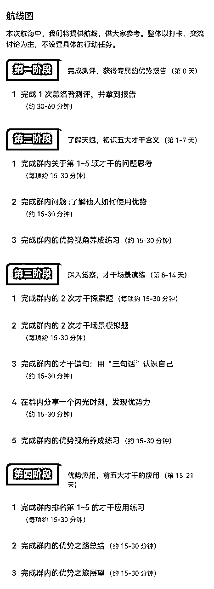

航线图和各章节高度联动，你完全可以对照自己所在的位置，选取对应的章节学习。

# 必修篇：交付最小 MVP

# 💡

章节概要

这一部分从“认识个人优势探索”起步，带你逐步完成盖洛普优势的挖掘与应用。

刚入项目的新朋友，建议先把握项目全貌：
✅【项目概述】了解个人优势挖掘

如果已经清楚整体路径，就可以按核心环节边学边练：
✅【测评】完成 1 次盖洛普测评
✅【分析】如何看懂自己的盖洛普优势报告？
✅【应用】怎么将盖洛普应用到生活？

必修篇的编排与航线图一一对应，顺着章节读下去，就能把航线图的任务挨个解决。后续每个关键环节的章节概览里，也会再次给出相关航线图提示，提醒你不要漏掉步骤。

那我们现在就开始。

# 一、【项目概况】了解个人优势挖掘

# 💡

章节概要

本章我们一步步走近个人优势挖掘，把基础问题聊透：
✅ 什么是个人优势？又如何把它找出来？
✅ 盖洛普测评是什么？它跟个人优势挖掘之间有怎样的关系？

项目全貌不是可有可无的铺垫，先把它弄清楚很重要。

# 1.1 优势值得花时间找吗？ @醒醒同学

“拖延、想太多动太少、自认愚笨、冷漠、没人情味、软弱、强势”……这些标签常常成为职业发展和人际关系的绊脚石。但换个角度：拖延可能是因为手头的事不适合自己，提不起效率；冷漠背后也许只是理性；软弱里藏着善良；强势往往等于果断。

每一个负面标签，几乎都能找到对应的积极一面。一旦开始“多看好的那一面，少盯不好的那一面”，改变就会自然发生。

在我有限的职业生涯里，越是在心里认定自己不如人，越容易陷入攀比；拿短板去硬碰别人的长板，结果越碰越差。反倒是顺着本心去做那些擅长的事，常常收获超出预期的成果。

过去的我，总有一堆毛病想改，也很爱把所有成绩归功于运气。越是想改，越会被惯性拉回原样；无论得到多少认可，都觉得还差得远。直到遇到盖洛普，它像显微镜似的，让我看清自己的天赋和不足，再回看过往经历，很多困惑都迎刃而解。

我总算明白，为什么互联网比国企更适合我：关系建立和战略思维都排得很靠前，成就才干排第九，脑子里总有各种想法，闲不下来，偏爱弹性大的环境；而纪律才干排在末位，在规矩过多的环境里简直寸步难行。要是让我去国企过朝九晚五的生活，越有想法越努力，反而越压抑。

再用盖洛普复盘过去，也解释了连续销冠和同事总来求助的原因：体谅和个别才干靠前，让我能敏锐捕捉情绪，和用户聊不了几句就摸清对方的真实需求；理念强，点子多、办法也多；战略强，总能拿出解决方案，赢得信任；适应强，越遇到突发状况越兴奋，表现也越好。信任一旦建立，成交就是顺理成章的事。

做优势教练这两年，一个感受越来越深：凡是在职场和生活中看清自己天赋优势的人，普遍越过越好。盖洛普的科学研究同样指向这一点——成功者共通的秘诀就是扬长避短。如果把天赋比作闯关路上的独门武器，那盖洛普就是这份武器的使用秘籍。空有一身好装备却不会用，实在太可惜。

希望更多人加入“唤醒天赋的旅程”。能看见并接纳自己的好，是终身幸福的起点。

# 1.1.1 个人优势究竟指什么？

简单说，优势就是你在某些事情上天生做得比别人好、比别人省力。它由天赋才干、技能、知识三块拼成，但底层支撑始终是天赋才干。

天赋才干是老天爷出生时就发给你的特质，越早形成，后期越难改动。盖洛普所呈现的，正是人天生的才干图谱，优势也从这片图谱中生长出来。

打个比方：天赋才干像人的底层属性，优势则是把这种属性推到极致后的外在表现。用盖洛普官方公式理解就是：才干 × 投资 = 优势。想弄清自己有什么优势，第一步永远是识别天赋才干。

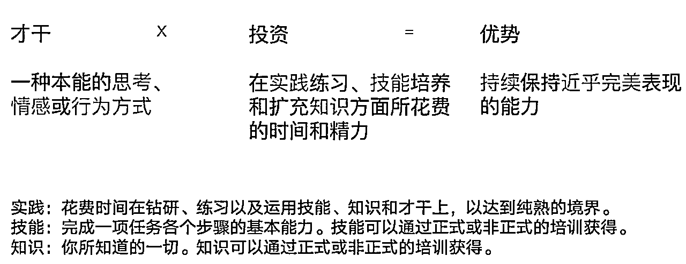

想把一件事做成，除了天赋，还要看所在领域有没有经验积累，有没有知识+技能加持。如果领域、经验、知识和天赋刚好严丝合缝，优势的显现会更快、更明显。

# 1.1.2 找优势，具体从哪下手？

挖掘优势的重点，是锁定那些你做起来不怎么费力、又能持续得到正反馈的事。正反馈来得越容易，坚持下去的意愿就越强。

也就是说，优势是从“结果”里看出来的。常使用擅长的才干，结果自然不会差；而搞清楚才干和自身的关联，正是识别优势的入口。

下文分两种情况来说：没有测评工具时，怎么靠日常观察做判断；有了测评工具，又如何加速这个进程。两种方法平时都能用，搭上专业测评就像多了一副望远镜。

市面上的优势探索工具并不少，大多指向“真实的自己”，像九型人格、MBTI、DISC、盖洛普、VIA，各说各话。相比之下，盖洛普给的颗粒度更细，结果更准确。因此本期航海以盖洛普为坐标，后续内容也都围绕它展开。想了解具体的才干分析，可以点开「3.5 了解 34 项基础才干」查阅。

# 1.1.2.1 从成就事件里挖线索

前文提过，优势往往隐藏在你比身边人做得更轻巧的事情里。天赋一旦朝正向发挥，成就感紧随其后。所以，请把这些成就感爆棚的事件一一记下来，再观察它们的共同点——共同点指向的，很可能就是底层才干。

这条路径最不容易卡壳。想一想：过去我做成过什么？那些时刻我是什么状态？

以我的朋友 L 为例子。她做投资出身，从小就对数字和原理特别敏感，数学常年拔尖，这是她的成就一。大学时，父亲一次性把四年的学费交到她手上，她拿去投资理财，日子过得颇为舒展，赚钱在她手里就像做数字游戏，这是成就二。进入职场后，她专注炒股，扫一眼盘面就能发现买点和卖点，整体收益相当可观，这是成就三。平日聊天，她扫几眼数据，就能准确说出不同数字背后的含义，接着给出合乎逻辑的买卖建议；她不怕别人的质疑，反而享受严密的逻辑推演，专业度帮她吸引来大量客户，这是成就四。

从小到大，她对数据、逻辑、原理的敏感始终在线，分析判断能力一直是她手里的王牌。放到盖洛普的话语体系里，就是“分析”才干：对数字天然敏感，喜欢追根溯源，受不了没有根据的断言，信数据不信直觉，能够一眼看到问题的内核。

照着这个思路，写出自己的 3—5 个成就时刻，提取交叉点。你会看到，在每一个与成果有关的故事里，总有一种熟悉的方式在反复起效——它就是你的优势指纹。

# 1.1.2.2 从停不下来的事上找燃料

有人会花很多时间重复做同一件事，这件事多半带着强烈的吸引力，而吸引力的源头往往就是优势动力。

拿朋友 A 来举例。她热衷出门、爱好各类活动、喜欢认识新人，哪怕是半夜 11 点，也能精神抖擞地赶到现场。她持续往外跑，不停结交新朋友，一段时间没社交就浑身难受；生活上碰上难题，她的第一反应同样是出门找人聊，听听别人的经历和见解。

A 的“取悦+行动+积极”组合特别鲜明。认识新朋友、体验新事物，对她是充电；人群里有她在，气氛就不会冷，大家也玩得开心（取悦+积极）；拿到好建议就赶紧执行、快速收到反馈，这种循环让她乐此不疲。

但重复行为也不是每次都有正反馈。比如我自己，经常忍不住刷各种消息、看商业报道、发朋友圈，也很容易分心。一个朋友则沉迷报课，还爱收集各种小物件堆在房间，没少被说不务正业。还有个熟人话很少，开口就是点出问题、给出解法，总被误会成爱挑刺。

我们都有过“自己是不是走错路”的瞬间，却常常没想过，这些拦都拦不住的行为里，藏着的是思维、理念、搜集、学习、取悦等才干。拿我本人来说，朋友圈素材几乎源源不断：搜集才干负责海量囤料，理念才干负责冒出灵感，思维才干负责梳理成文，就这样靠着持续写作获得了七位数收入，而我从没正儿八经学过写作。

所以，要是真有那种忍不住想做的事，不论旁人鼓励还是反对，都别轻易忽略，它多半标记着底层才干的需求。接下来要做的，是替这份才干找到适合发挥的场景，然后把优势越滚越大。

内容来源：《接触盖洛普后，我唤醒了自己的天赋，也希望能帮到你》《3 个挖掘底层天赋的小妙招，一般人竟都不知道》

# 1.2 认识盖洛普测评 @叶叶在觉 @醒醒同学

工欲善其事，必先利其器。这句话我改了一下：想把优势探明白，得先摸清工具的脾气。这一节集中回应三个问题：盖洛普测的是什么？它为什么能成为找优势的助手？测评结果到底可不可信？

# 1.2.1 盖洛普测的究竟是什么？

盖洛普测评由美国盖洛普咨询公司推出，测量目标是本能的心智模式，涵盖思维模式与行为模式。换句话说，它呈现的是人做事的底层偏好，相当于一份“个人使用说明书”。

想想看，狗生来适合在陆地上奔，鱼生来适合在水里游；若硬要比较谁游得快、谁跑得快，让狗下水、让鱼上岸，结果可能不止是输赢，而是能不能活。盖洛普想判断的，正是你适合在哪片环境、用什么姿势发挥。

它还是一种语言。除了给出测评结论，它用一套专属词汇描述人的行为规律，以及这些规律背后的天性优势。整套体系收进了 34 种行为规律，即 34 种天赋优势，统称才干（talent）。才干就是情感、行为、思维上的自动化反应模式。

来几个更直观的画面：
- 你要是总忙个不停，闲下来就浑身不自在，享受任务一个接一个完成——这是“成就”，它在乎看得见的结果，渴望成就带来的满足。
- 你要是控制不住想上课、想买课，学的过程本身就很快乐——这是“学习”，潜意识里大概是“什么都能学会”。
- 你要是遇到冲突就想缓和、退让，始终在找共识——这是“和谐”，也许内心相信争执伤感情，一致才能让团队往前走。
- 你要是思维四处乱窜，总有稀奇古怪的点子冒出来——这是“理念”，仿佛只有不停创新，世界才新鲜、才有意思。
- 你要是动手前先盘算风险，准备充分才肯行动——这是“审慎”，追求的是稳妥与不出错，讨厌冒进。
- 你要是总在琢磨事物的本质和底层规律，脑子停转不下来——这是“思维”，喜欢深度思考，受不了太浅的信息，进了再多的群也聊不下去。
- 你要是面对生人不仅不慌，反而兴奋，自来熟地聊起来——这是“取悦”，渴望被更多人认识、欣赏，社交能给你充能。
- 你要是更喜欢和老友窝在一起，人多的场合反而不自在——这是“交往”，慢热但重情，反感虚泛的社交。
- 你要是看到任何资料或结论，本能先追问“这是怎么来的”，对数字敏感，习惯用数字量化事物——这是“分析”。

这些模式并不需要你费劲演出来，它们是下意识的行为惯性，也是内心深处的需求。刻意去训练这些本能，往往能事半功倍，更容易积攒正反馈。

每个人的 34 项才干组合和排序都不相同，盖洛普的价值就在于把这种独特性呈现出来。打个比方，钢琴只有 88 个琴键，但组合出的旋律无穷无尽。

# 1.2.2 盖洛普测得靠谱吗？

判断某项优势测评是否经得起推敲，可以从信度、效度、测谎机制几个角度切入。

1）信度

信度讲的是结果的前后一致性、稳定性和可靠性：用同一方法对同一对象反复测量，答案是否基本一致。信度越高，结论越能站稳。

但人这种生物很复杂，会带着社会化的“面具”答题，会不自觉地美化自己，所以目前还没有哪款优势测试能够做到 100% 精准。盖洛普的重测信度达到 73%（两次测评的一致性），已经跑赢绝大多数测评，具备参考价值。

2）效度

效度看的是“有没有测到想测的东西”，也就是日常所说的准不准。效度越高，越说明结果贴近真实优势。

盖洛普的底子相当硬。它由美国优势心理学之父、盖洛普前董事长唐纳德·克里夫顿主导设计。团队花了至少 30 年时间，访谈了来自不同国家、不同行业的 200 多万位杰出人士，探究他们成为顶尖高手的原因。在这些海量访谈的基础上，盖洛普提炼出成功者共通的思维模式，最终凝结为 34 项天赋才干主题（talent theme），并以此命名。

目前盖洛普官网已有超过 3000 万条样本数据，持续验证着它的有效性。

关于盖洛普测评更深的历史故事，点击延伸链接继续查看。

你有没有想过，市面上的性格测评，其实很容易“作弊”？

很多人在做测评时，会下意识地选择那些听起来更“好”的答案，而不是真正符合自己的答案。毕竟，谁不想在别人眼里——甚至在自己眼里——是一个责任心强、积极向上的人呢？

盖洛普的优势测评，恰恰在这方面做了非常巧妙的设计。它不问你“你认为自己是什么样的人”，而是通过一系列看似无关、实则相互印证的题目，去捕捉你下意识的、不经思考的行为模式。

这就是盖洛普的**测谎机制**。

它一共包含177道题，每道题之间都有交叉验证的逻辑。同一个才干主题，会被拆解到完全不同的题目中去。比如「积极」这个才干，可能一道题在问你是否热爱生活，另一道题在问你是否经常赞美他人，还有的题在问你是否总能看到事情好的一面。你不知道哪道题在测什么，所以也就无法刻意地去“演”出一个理想中的自己。

你只需要凭本能去选择“符合”或“不符合”即可。越符合，说明这个特质在你身上越突出；反之，则靠后。

也正是因为如此，一旦你深入了解了盖洛普的体系，就不建议反复去测了。因为当你知道每道题在测什么的时候，你的理性就会介入，准确性自然就会下降。

# 1.2.3 盖洛普都能用在哪儿？

盖洛普并非凭空诞生的理论，它脱胎于积极心理学在职场与学术领域的大量实践，是一套综合性的评估工具。它既能用来观察个体，也能用于理解团队，应用对象覆盖了职场员工、高管、学生、家庭成员以及每一个渴望自我探索的人。

具体来说，它的价值体现在以下几个层面：

*   **个人成长**：一个人想要发生改变，前提是先知道自己该往哪个方向走、从哪里迈出第一步。盖洛普能帮你看见自己行为背后的惯性逻辑——为什么你总是用同一种方式处理问题？因为这背后对应着你内心深处未被满足的才干需求。当你真正了解并接纳了自己，自信也会随之生长。

*   **职业发展**：通过这份测评，你可以清楚地看到自己的优势所在和潜在的成长空间。如果把才干和你的岗位职责做匹配，相当于在你的职业路径上加了一根杠杆，让你做事更省力、更高效、更有成就感。

*   **团队建设**：对管理者而言，盖洛普提供了一个识人用人的高效视角。摸清团队里每个人的优势，就能把合适的人放在合适的位置上。同时，团队成员之间互相了解彼此的才干特质，也能更容易理解彼此的差异，从而建立起一种兼容并蓄、多元共赢的团队文化。

*   **人际关系**：我们常常因为“理所当然”而误解他人。比如，你习惯随性自由，他习惯按部就班，你们互相看不惯。但如果透过盖洛普的视角去看，你会发现这只是彼此天生的行为偏好不同而已。这样的理解，尤其在伴侣和亲子关系中，能减少大量不必要的摩擦与误会。

关于才干更细致的应用方法论，我们会在第四章【应用】部分，结合具体的案例，展开来讲。

内容来源：《盖洛普是什么？一个龙哥盟全团队都在用的工具》 《276 。 我觉得自己一无是处，还能找到天赋吗？》

# 二、【实操】手把手带你完成一次盖洛普测评 @醒醒同学

# 💡

# 本章导读

发展至今，盖洛普已经衍生出了 7 类测评产品。其中，最核心、也是必须做的一项，就是「34 项才干测评」，它能帮你找出自己身上那些可能尚未被察觉的天赋。至于其他测评之间的差异，可以直接去官网查阅👉「查找最适合你的克利夫顿优势评估」。

如果你已经准备好做一次完整的测评，照着下面这五步走就行：

✅第一步：拿到一个测评码

✅第二步：注册一个全新账户

✅第三步：进入克利夫顿优势评估

✅第四步：完成全部答题

✅第五步：下载专属报告

目前获取测评码的渠道主要有两种：

**渠道一：找教练代购（有优惠）**

**渠道二：官网原价购买**

⚠️稍微解释一下：盖洛普官方有一套非常严格的教练认证体系。本次航海的所有教练，都通过了官方认证考核。官方为了支持教练们的工作，会以优惠价格向他们提供一批测评码，但每个教练每年仅有 350 个限额。

当然，你也可以通过其他渠道自行购买，只要最后能拿到正确的测评报告就行。但请务必注意：不要直接在搜索引擎里搜“盖洛普测评”，你大概率会点进一些非官方的广告网站。

在正式开始之前，强烈建议先看一遍「2.2 盖洛普测评注意事项」，以免操作不当，白白浪费一次测评机会。

# 💡

# 本章路线图

完成本章的学习与实操，你就走完了整个海上航线的第一阶段：拿到专属优势报告（第 0 天）。

1.  完成 1 次盖洛普测评，获取报告（大约需要 30-60 分钟）

准备好了吗？那我们就开始吧。

盖洛普优势测评，官方名称是“克利夫顿优势测评”（唯一正版网址：https://login.gallup.com/）。你在网上搜“盖洛普”，会跳出无数条结果，但绝大多数都不是正版，测出来的结果自然也就不靠谱。

截至 2023 年 4 月，盖洛普官方一共推出了 7 种测评，其中「克利夫顿优势 34 个才干主题测评」是必做的基础项，也就是我们常说的“34 项才干测评”，它能帮你发现自己的天赋所在。

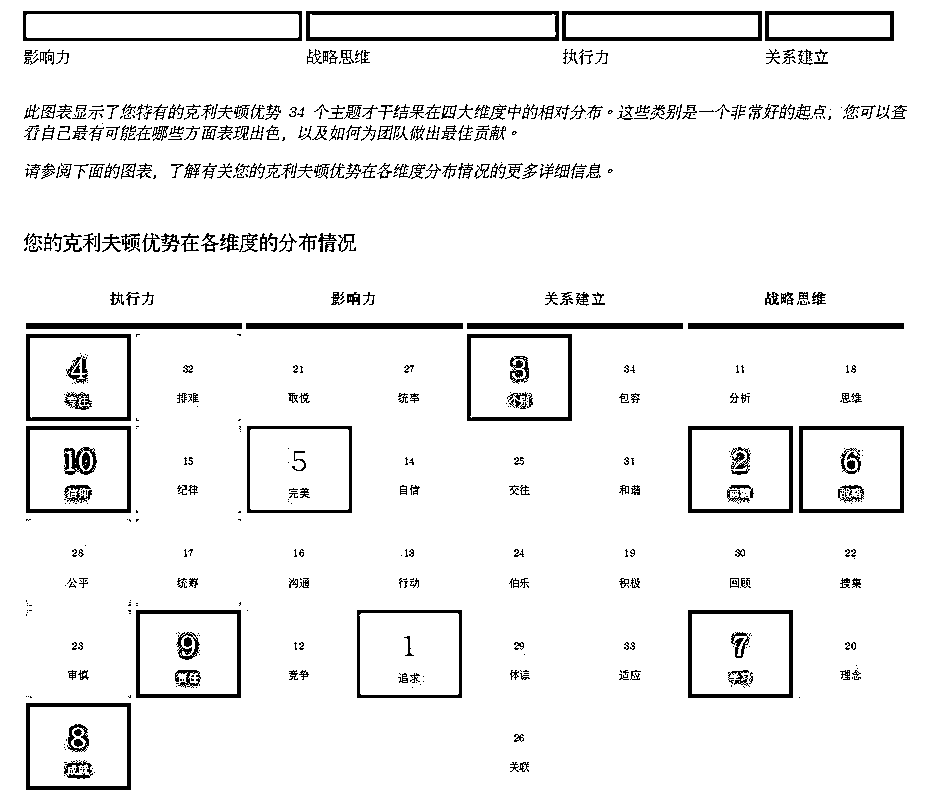

（官方参考报告）

上图中提到的“经理人”、“领导者”、“销售人员”等优势，不需要额外测评。做完“34 项才干测评”后，如果想解锁，付费即可获取对应的优势报告。

如果你对其他测评也比较感兴趣，同样可以联系航海教练购买，也会有一些折扣。

（图片来自盖洛普官网）

本期航海我们使用的，就是「克利夫顿优势 34 个才干主题测评（CliftonStrengths 34）」。

**它有什么用？** 清晰地展现你的优势和短板，帮助你了解自己的强项、薄弱环节，并发挥出色表现，从而实现自我提升和职业进阶。

**价格**：380 元（这是教练渠道的优惠价，想买可以咨询航海教练）

**报告包括什么？** 34 个才干主题的完整排名、每个才干的详细解读，以及针对你个人情况的定制化优劣势建议。

更多测评产品的区别，可以移步官网 👉「查找最适合你的克利夫顿优势评估」。

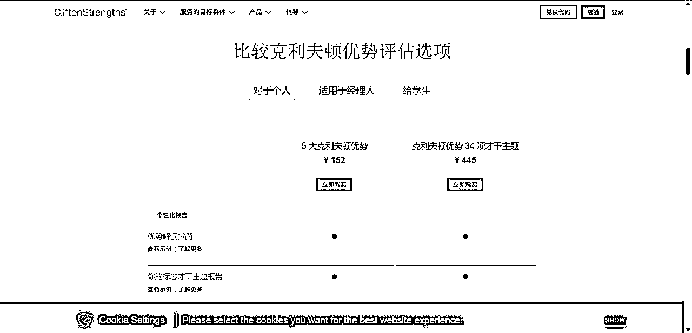

# 2.1 盖洛普测评码怎么买？

**优惠购买流程（找教练）**

⚠️购买前需要了解：

盖洛普官方对优势教练有一套成熟的认证机制。本次航海团的教练，都通过了盖洛普官方的认证考试。

官方为了支持教练的业务开展，会给他们发放折扣码，每个教练每年限额 350 个。不过，并不是所有教练都愿意把这部分优惠让渡给用户。本次龙哥盟官方合作的教练，都给出了优惠。

盖洛普测评码的官方原价是 445 元/个，通过教练购买会有一定优惠。本期航海会组织圈友统一向教练采购，具体的对接方式，记得留意航海大群里的消息。

**原价购买流程（官网购买）**

1.  打开盖洛普官网（网址：https://login.gallup.com/），注册一个盖洛普账号；
2.  在商店里找到“克利夫顿优势 34 项才干主题评估”并下单，支付 445 元；
3.  支付成功后，测评链接会在一个工作日内发送到你的邮箱。

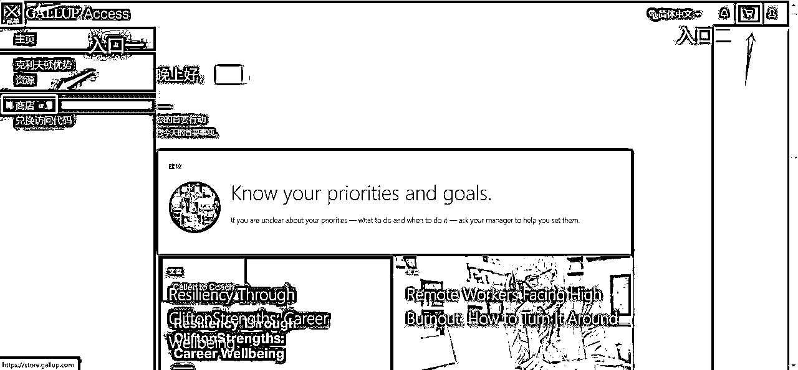

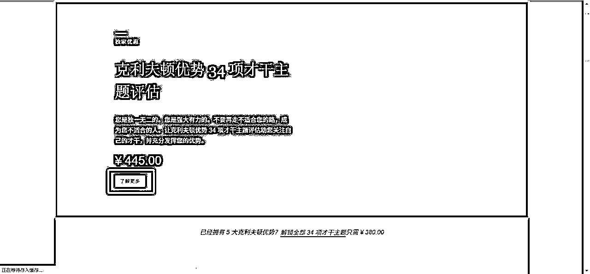

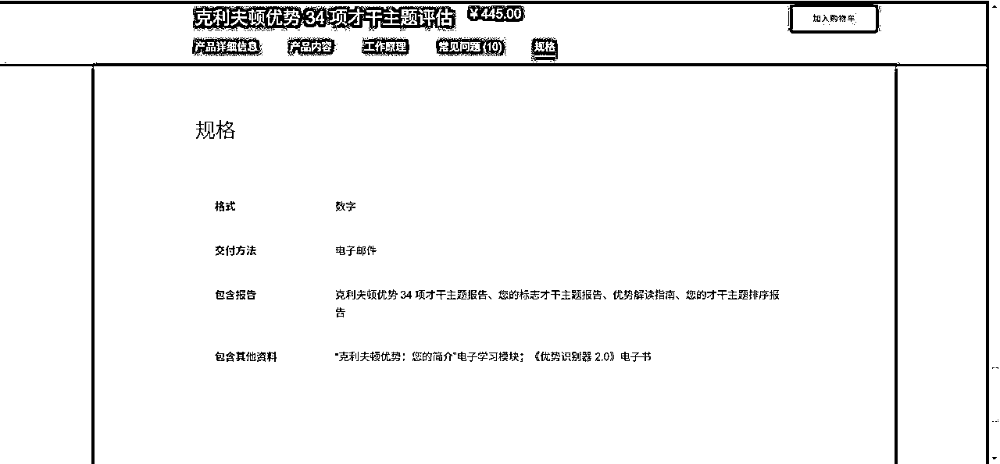

# 2.2 开始测评前，务必先看这 8 条

正式测试之前，请一定把下面这些注意事项过一遍：

1.  本次测评共有200道题，注册账号+完成全部题目，大约需要40-60分钟。请务必找一个安静、不被打扰的环境；
2.  不要大量选择中立选项，这会直接影响报告准确性。答题时请以你的第一反应——“本能”、“不自觉”就会那样想/那样做——为优先依据。尽量避开那些后天训练出来的、被他人教导的、或是“我希望成为”的选项。想更了解真实的自己，就选最真实的自己；
3.  每道题只有20秒作答时间，超时会自动跳到下一题，并且不能返回修改。没来得及选，也是一种结果，系统会如实记录；
4.  手机和电脑均可作答，但推荐使用电脑端的谷歌浏览器，官网的访问速度会稍微有一些慢；
5.  如果中途有事退出了怎么办？不用慌，重新登录后，系统会带你从上次中断的进度继续；
6.  测试者当时的状态会对结果有一定影响，尽量让心情平静一些再做，忌大悲大喜的状态下测试；
7.  盖洛普的很多题目并不是非黑即白的对立关系，也请放心，它不会给你贴标签、定义你。看了上千份报告，我还没有见到过两份一模一样的报告，盖洛普是高度个性化的；
8.  盖洛普支持多语言切换，在网页右上角可以更改国家/语言。英语功底过关的朋友，更推荐直接做英文版测评。

# 2.3 一步步带你走完测评全流程

这里以“找教练购买测评码”为例，说一遍完整流程。自己在官网买也差不多，只需要把第二步的“注册新账号”换成“登录已有账号”就行。

**第一步：获取测评码**

联系教练购买优惠测评码，然后你会在🛰️/邮箱里收到一个专属的“测评码”。

**第二步：打开盖洛普官网，注册账号**

（1）访问网址：https://my.gallup.com/

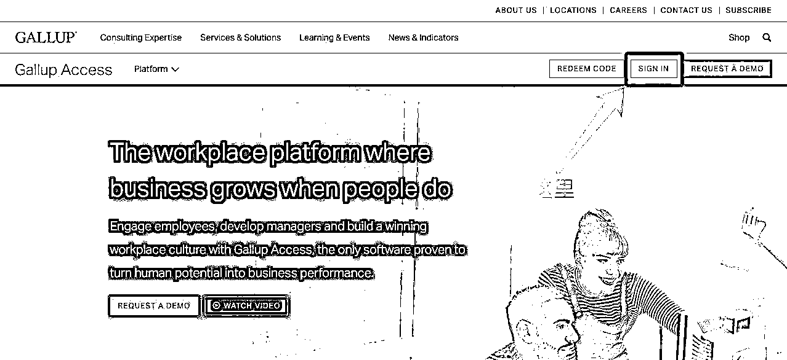

（2）点击“创建账户”

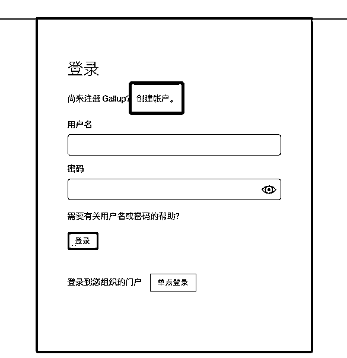

**第三步：填写注册信息。** 这里不用有任何心理负担，所有信息都可以填真实的，也可以不填真实的。

注意：如果你以前测评过，请务必换一个全新的邮箱重新注册，然后再兑换测评码。

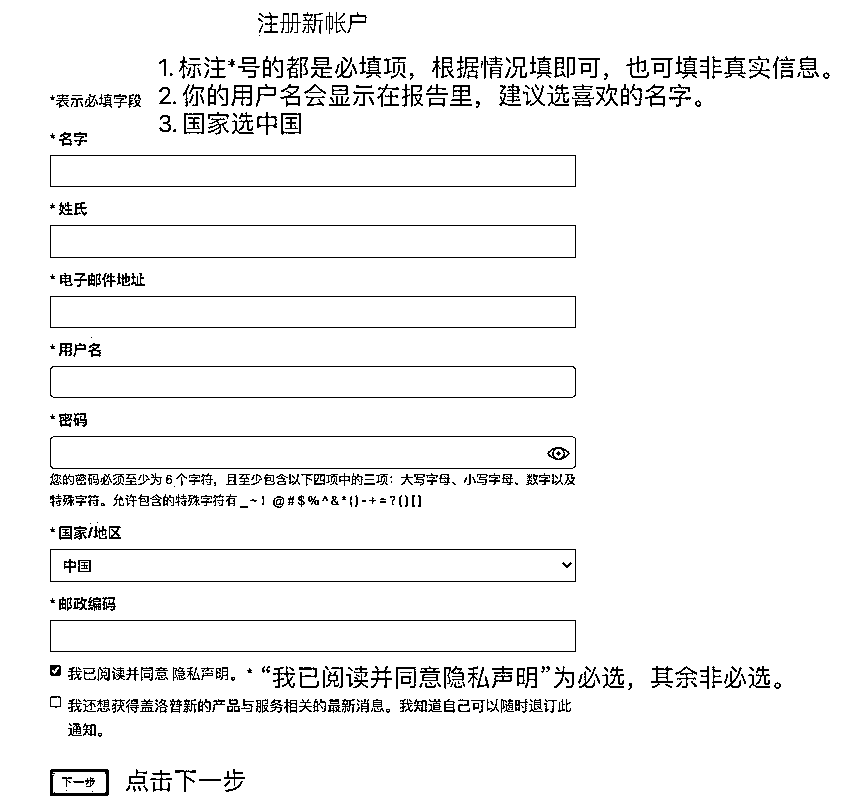

**第四步：登录账号，点击「菜单」→「兑换访问代码」，输入教练发你的那个“测评码”**

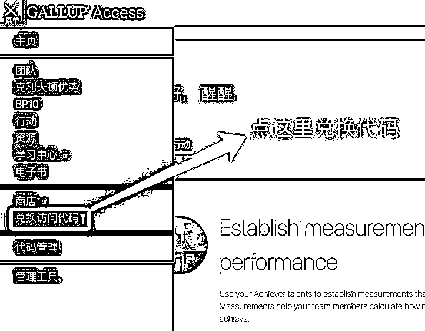

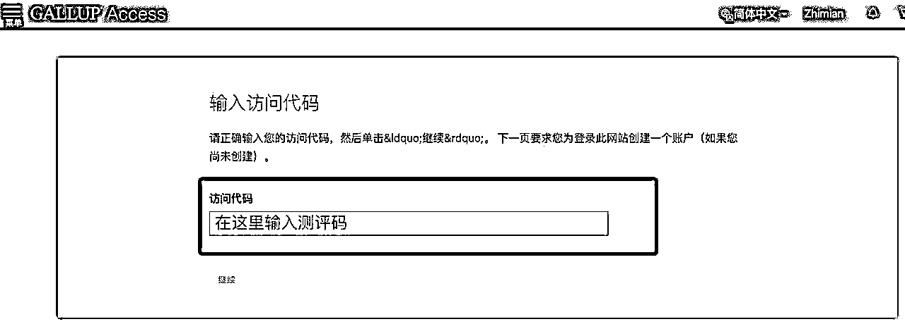

**第五步：屏幕上出现“参加克利夫顿评估”的按钮，就可以开始了。记得在网页右上角把语言切换成“简体中文”。**

**第六步：开始正式测评。** 一共177道题，每题20秒。（做题前，再回头翻一下上面的注意事项）

请注意：每道题有 5 个选项，左右两端分别代表两种不同的倾向，分别是“非常符合我”、“较为符合我”、“两边差不多（中立）”。

如果你是用手机作答，可能会看到下方的界面，选项挤在一堆；但在电脑端看，排版就清晰很多（我做了一个对比图）。

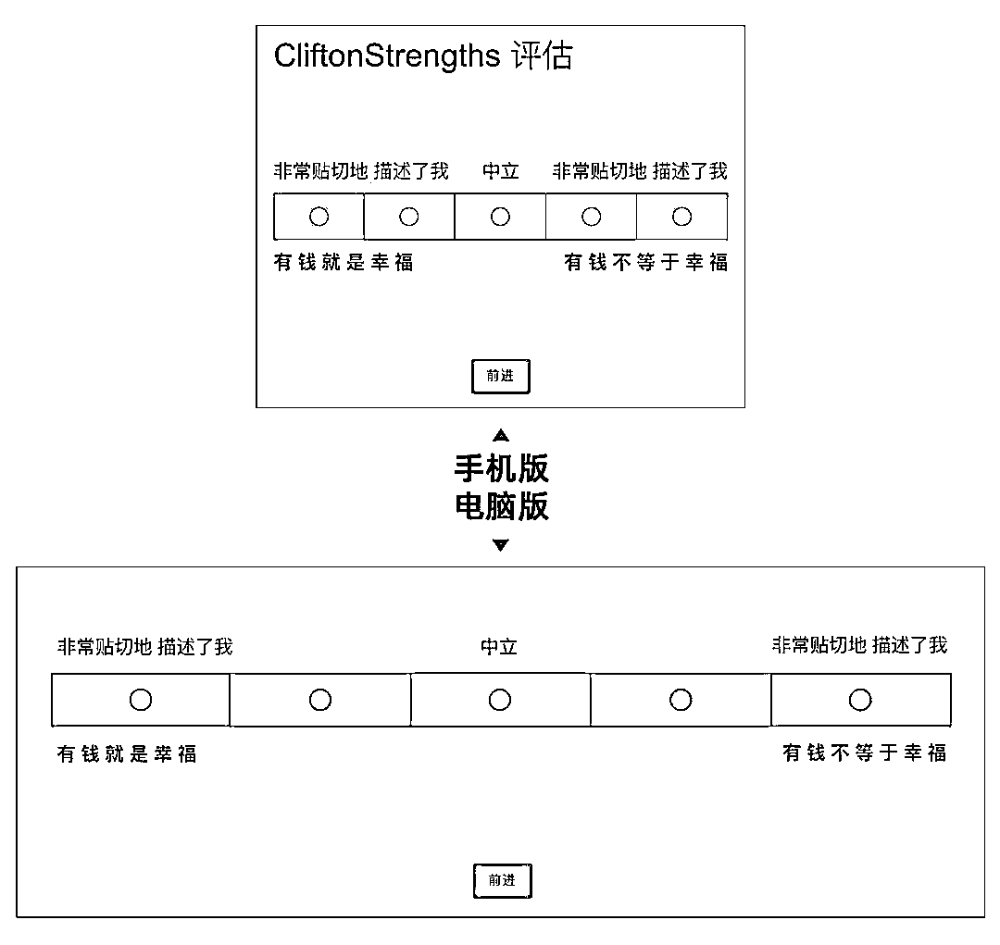

**示范**：比如题目是“有钱就是幸福”，如果这完全符合你的内心，就选左边最边上的那一个；如果觉得比较符合，选左二；如果觉得两边都说得通，自己没有明确的偏好，就选“中立”。

**第七步：测评完成后，如何下载“34 项才干优势报告”？**

（1）测评结束后，点击右上角「菜单」，选择「克利夫顿优势」，然后向下滚动鼠标。

（2）看到报告列表后，点击任意一个红色框，比如“克利夫顿优势 34 项才干主题报告”。

拿“醒醒”举例：左边这张彩色的图，就是她的34项才干分布图。点击右边红框里的“查看我的报告”，就能看到完整的优势报告。

（3）打开报告后，点击右上角的“下载按钮”，完成下载。

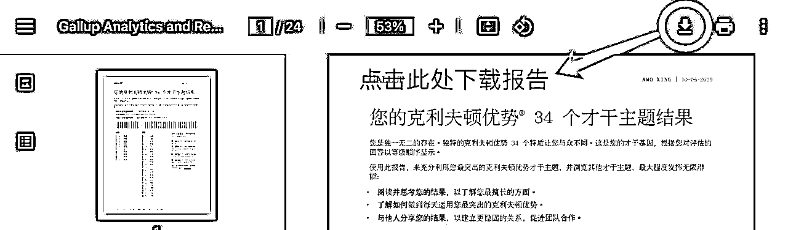

（4）下载完毕后，你会得到一份 24 页的优势报告。这份报告本身，就相当于一份入门解读。上面是报告第1、2页的示例图。

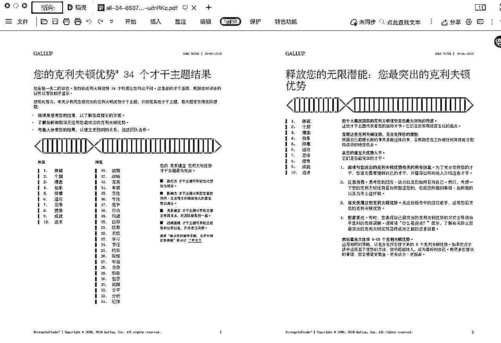

# 三、【解读】报告拿到手，怎么看才不浪费？ @醒醒同学

# 💡

# 本章导读

拿到盖洛普报告之后，建议按下面的顺序来做：

**第一步，先看四大维度，找到你的优势主场。**

盖洛普把人的优势划分为四个大类：执行力、影响力、关系建立、战略思维。从这四大维度入手，你就能很快对报告有一个整体把握。哪怕你发现自己在某个维度上没有突出的才干，也请不必沮丧——这不代表你没有这方面的能力，只是你的天然偏好不在此处。

**第二步，看自己的天赋才干排序。**

1.  对初学者来说，先死盯前 5 项才干就好。你要做的，是找到自己的优势是什么。
    通过报告中的“才干特质”、“报告详解”、“盲点与风险”等板块，去理解这些才干在什么场合下是加分项，什么场合下反而会拖后腿。然后，想办法把自己置身于能发挥它的环境里，你会发现生活和事业都会变得更有价值感。
    考虑到阅读篇幅，关于全部34项才干的详细解读，放在了本章末尾的「3.5 附2：了解34项基础才干」部分，大家可按需查阅。

2.  再看靠后的才干，学着和弱点共处。
    在盖洛普的理念中，所谓的“弱点”有两种情况：一种是你过度发挥靠前才干导致的负面结果；另一种是因为动用了靠后的才干而带来的负面体验。盖洛普的策略不是去死磕弱点，而是用优势去补劣势。通过目标拆解、优势互补等方法，那些看似棘手的问题往往能够迎刃而解。
    在「3.4 附1：34项才干的需求清单」中，我们也准备了一份才干需求对照表。如果你不知道某个才干需要什么样的“养料”，可以重点关注这一部分。

**第三步，去感受才干组合的魔力。**

单个的才干，只是你身上的一枚碎片。当34项才干叠加在一起，它们才构成了那个独一无二的你。

关于才干组合会呈现出哪些有趣的化学反应，在「3.3 第三步 了解组合才干的应用」中会详细展开。

不过提醒一句：初学者不要一上来就死磕组合才干，很容易绕晕。建议你先从单个才干出发，摸透它的脾气，然后再试着做“两两组合”的练习，熟练之后你自然就能玩转更多组合了。

⚠️当然，还是那句话：这本手册更像是一本工具书，帮你对盖洛普和自己建立初步的认知。如果你想得到更深入的个性化建议，联系教练做一次深度解读会是更好的选择。

❗️如果你拿到了报告，却感觉依然不知道如何用它来解决现实中的具体问题，那也别急——本次航海我们特意新增了一个实操模块，帮你把盖洛普翻译成可以落地的行动思路：

「3.6 盖洛普在自我分析模型中的具体应用」

# 💡

# 本章路线图

完成本章的学习与练习，你会走完整个航线的第二阶段和第三阶段。

**第二阶段：看见天赋，初识五大才干含义（第 1-7 天）**

1.  完成群内关于第1～5项才干的问题思考（每项约 15-30 分钟）
2.  完成群内小任务：了解他人是如何运用优势的（约 15-30 分钟）
3.  完成群内的优势视角养成练习（约 15-30 分钟）

**第三阶段：深入觉察，进入才干场景演练（第 8-14 天）**

*   完成群内的 2 次才干探索题（每项约 15-30 分钟）
*   完成群内的 2 次才干场景模拟题（每项约 15-30 分钟）
*   完成群内的才干造句：“用三句话”向别人介绍自己（约 15-30 分钟）
*   在群内分享一个高光时刻，体验优势带来的力量（约 15-30 分钟）
*   完成群内的优势视角养成练习（约 15-30 分钟）

好的，现在，请你打开自己的报告吧。

# 3.1 第一步：找准你的优势主场

盖洛普体系将人的优势分为四个大的维度，分别是：执行力、影响力、关系建立、战略思维。这四个维度下面，才囊括了34项才干。每个人的才干排序与组合各异，因此所展现出来的优势模式也大不相同。

这一节，我们来看看这四大维度分别意味着什么：

打开盖洛普34项才干报告的第21页，你会看到四个维度的排序和长度都不一样。排得越靠前、横条越长，代表这个维度越可能是你突出的优势维度。同样的，越是排在前面的才干，往往越是你用得顺手的天赋。

不过，请一定不要把这四个维度当成束缚自己的框架。每个人其实都同时具备做事、影响他人、建立关系和处理信息的能力。你只是需要在不同情境下，学会调用自己更顺手的那些才干，同样可以把事情做成。

**执行力：更擅长“把事做成”**

拥有较高执行力维度的人，通常更关注“怎么把一件事儿落地”。在完成任务、达成目标、组织协调、制定计划、追踪进度这些事情上，他们往往极有天分。具体你的执行力天赋是什么？看你这个维度下排名前十的才干就知道了。

**影响力：更擅长“带领人往前冲”**

影响力维度突出的人，往往更在意“如何让别人动起来”。在与他人沟通、谈判协商、说服他人、鼓舞士气、掌控局面这些事上，他们天生有一套。具体的影响天赋有哪些？看看你这个维度下排名前十的才干即可。

**关系建立：更擅长“照顾人与凝聚人”**

关系建立维度强的人，对“人与人之间的信任”非常敏感。他们通常很擅长与他人建立深度的信任关系，维护旧友，打造一个有归属感、彼此支持的团队。具体的关系天赋是什么？依然去看你这个维度下排名前十的才干。

**战略思维：更擅长“想清楚再做”**

战略思维突出的人，最关心的是“我们该做什么决定”。他们通常对信息的获取、分析、整合以及策略制定、趋势判断非常着迷。具体的思维方式天赋是什么？老办法——看这个维度下排名前十的才干。

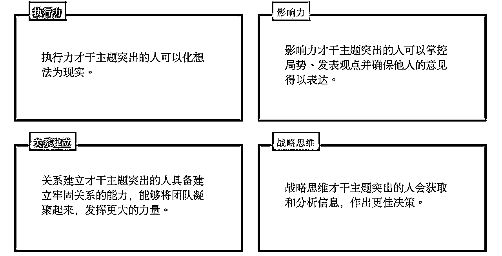

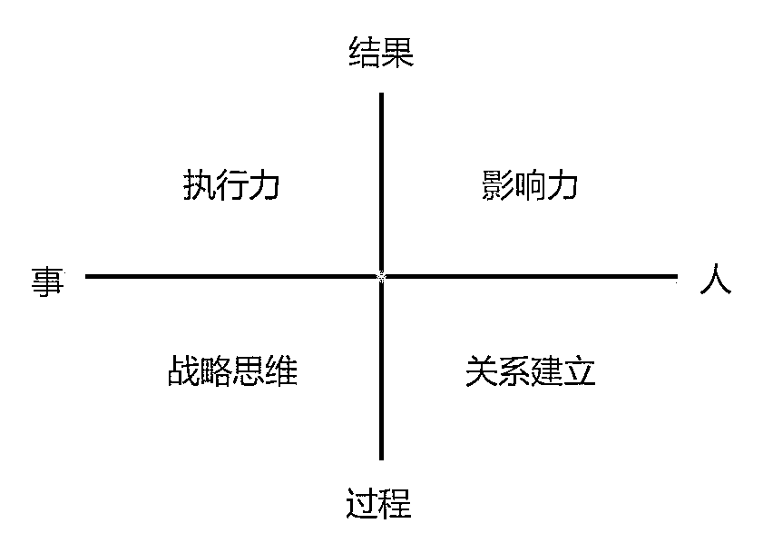

# 💡

现在，你也可以翻开自己报告的 21 页，试着列举一下：在大的方向上面，你更擅长什么？再回忆一下，过去那些让你有成就感、让你对自己满意的时刻，是不是都发生在那几个领域里？

拿 @醒醒 来举例，她的四大维度排序是：关系建立 > 战略思维 > 执行力 > 影响力。

对她而言，做事的顺序永远是“先找对人，再开始做事”。只要人对了，事儿就成功了一大半。

而她的 Top 10 甚至 Top 15 的才干，在每个维度里都有分布。这又进一步反映出了她在不同模块中的优势倾向。比如：

*   她更擅长通过支持和成就他人来获得深度信任关系（体谅 + 个别 + 伯乐），而不是靠广交人脉与竞争对抗（她的取悦排 26，竞争排 17）；
*   她更喜欢那些可以发挥创意、提供新想法和新策略的工作（思维 + 理念 + 搜集 + 战略 + 前瞻），而非常排斥需要强逻辑、数据处理与学术钻研的工作（她的分析排 33，回顾排 31，学习排 23）；
*   她更擅长在具体的难题中拆解并建立流程（排难 + 成就），而对做严格计划（纪律 34）和精细的目标管理（专注 15）没什么耐心。

这就直接解释了，为什么如果让她每天带兵打仗、做纯粹的科研、或者闷头在工位上不和人打交道，她会感到极其痛苦。因为她最擅长的“关系建立”完全没有用武之地，那些冷冰冰的数字和刻板的规则，在她看来只是僵化想象力的枷锁。而让她用“权威式”的指令去指挥别人，更是触碰了她内心对关系敏感的那根红线。

回看她过去的职业生涯，凡是做社群运营、群发售、做咨询、做教练、写作这些事情，她都能交出不错的成绩单。这些工作的共同点是：大量地与人链接、支持并见证他人的成长、持续输出新鲜内容、给他人带来启发。正是这些输出，给了她巨大的价值感，也让她结识了许多生命中的贵人。

反过来，凡是需要定时打卡、严密推导逻辑、处理庞杂数据、严格按固定流程操作的岗位，她都会感到束手束脚、痛苦万分。她的内心几乎每时每刻都在呐喊同一句话：

**“规矩是死的，人是活的，为什么非要这样不可？”**

# 3.1.1 优势放对位置，结果才会出现

优势用在对的场景，产出往往来得更快，报告里也能看出这一点。但四个维度一旦用偏，也会露出盲区：

执行力：能扛事是优点，可若只顾低头做、不让外界看见贡献，价值容易被埋没，重用也会擦肩而过。

影响力：能带动人是本事，可若缺少可信度，旁人容易给你贴上“强势、难相处、只会说”的标签。

关系建立：善解人意很宝贵，可若总把自己的立场和感受排在最后，一味退让，别人可能把你当成好拿捏的人。

战略思维：会判断是优势，可若说不清依据，或嫌别人理解慢而不愿沟通，旁人会觉得你清高难懂，也不清楚为何要跟随你。

所以，使用优势维度时，要多寻找最能释放它的领域，同时留意盲点，主动觉察并调整。

举个例子：某人执行力与战略思维靠前，关系建立与影响力靠后。若去做销售，研究营销工具、优化转化率，通常比天天面对面社交更贴合他的天性。

# 3.1.1.1 关系中的四种风格

执行力：未必会说漂亮话，但你需要时，他常能补位，平时也可能默默做了不少，属于让人踏实的存在。

影响力：像一束追光，自带力量感，关系里倾向掌握节奏，表达更大胆，常让人不由自主地跟上。

关系建立：像春日暖阳，柔和地进入别人心里，带来温暖、信任与可依靠感，擅长换位，也容易经营长期而深厚的关系。

战略思维：更看重精神层面的交流，常不自觉成为圈里的“军师”；比起大范围社交，独处可能更让他们自在。

# 3.1.1.2 带队时各自在意什么

执行力：这类管理者把目光放在事情本身——结果、流程合理性、制度有效性、能否稳稳落地。他们有时带头冲，干得比员工还投入。没有成果绝不行，最烦空头承诺和复杂人际。

影响力：这类管理者关心局势是否在手，热衷快速打开市场、统领队伍、抢占行业前排。他们偏爱能赢得鲜花与掌声的战场；被忽视、被边缘化难以接受，最反感小富即安和局面失控。

关系建立：这类管理者重视团队气候，关心成员成长、共识形成、人岗匹配。他们愿意把资源投到人身上，相信人对了事就顺；团队分裂、冲突不断、同事只顾自己，会让他们很难受。

战略思维：这类管理者把决策质量放首位，关注行业走向、愿景、逻辑是否站得住。他们习惯先研究信息与工具、搭好系统，再推动执行；蛮干、重复劳动、拍脑袋决定最令他们头疼。

# 3.1.1.3 选工作与项目时的偏好

执行力：务实派，偏爱目标清楚、流程明确的任务，整体偏实战。方向模糊时，他们未必反复推演，更相信路是干出来的；手上有活，心里反而踏实。

影响力：渴望能持续展示自己、表达观点的工作，分享欲强。最好多人协作而非独自包揽；外界正反馈越多，他们越有劲。

关系建立：希望进入轻松、舒适的团队。关系糟心、冲突频繁会直接消耗动力；在天然需要深度连接的领域，他们通常如鱼得水。

战略思维：意义探索者，重视事情的价值，点子多，厌倦重复内容。挑项目前会先收集信息辅助判断；脑力劳动占比高，他们会更享受。

以上只是三个场景下的随机示例。现实中，有人四项较均衡，样样都沾；有人一两项特别突出，领域特质更鲜明。翻到自己报告第21页，把不同场景逐一对照，大致就能看出总体偏好与优势所在。

# 3.2 第二步：读懂才干排序

弄清优势维度后，你对自己已经有了粗略画像。下一步是看才干排序，这一步很关键。

盖洛普将人的行为、思维、情绪模式归纳为34项才干。它们是与生俱来的潜能，经过知识、技能训练后，才可能长成优势。

现在翻到报告第1页，找到你的才干排序。

第2—11页展示前10项才干的详细分析，其中前5项附有个性化解读，值得重点阅读。

每个人排序不同，形成的价值观、性格、优势也不同。通常先关注靠前的才干，那里可能是优势爆发区；越往后，越代表不常调用的天赋，也可理解为相对不拿手。

以醒醒为例，常用前三项是“体谅”“个别”“理念”，较少调用的是倒数三项“公平”“分析”“纪律”。（具体才干解释会在「3.4 了解34项基础才干」展开。）

我容易捕捉他人情绪（体谅），能看见每个人的不同（个别），新点子也多（理念）；但规则（公平）、数据与逻辑（分析）、计划（纪律）并非强项，平时关注也少。

由此推测，我的潜在优势在“共情力”“组优势团队+人才发展”“创新力”；短板则偏向定规则、推理和做计划。

报告里每项才干都有价值。越靠前，越可能在无意识中省力调用，这往往就是天赋信号。举个例：

有人从小语文顺手、数理吃力，对文字的理解天然强过数字与逻辑，文字天赋可能较高；有人自幼爱和朋友玩、不愿闷在家里，社交天赋可能更明显；有人总爱观察人、琢磨人，识人辨人也许就是他的长项。这些早年特质，在盖洛普中大概率会排得较前。

大体上：

Top1—10：突出才干。越靠前越可能是最拿手的天赋，某些方面天然容易做好。

Top11—20：辅助才干。偶尔会调用，能帮你成事，但频率未必高过前十。

Top21—34：底部才干。越往后越少用，甚至不太出现。

初学盖洛普，重点应放在靠前才干：它是什么样的天赋，何时好用、何时容易用偏，并找到匹配环境。这样生活与事业更容易获得价值感和意义感。靠后才干虽不拿手，也可能带来影响，但不等于弱点。

翻译差异会让部分原版解释在中文语境下产生偏差，最好对照官方报告，或到「3.4 了解34项基础才干」自行查阅。

还要注意：即便两人测出相同才干，擅长的事也未必一样。盖洛普会结合个人才干组合给出天赋说明，让人看见自己的独特性。

（沟通 1-这位是医生）

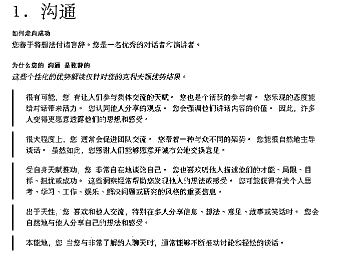

（沟通 1-这位是 Leader）

读到这里应该能发现，两位都拥有“沟通”才干，描述却不同。原因在于才干说明与整体排序相关。

# 3.2.1 从 Top 5 里找共鸣

想弄清自己的天赋是什么，最好从最强的Top 5入手。报告第2页给出了“了解自己的天赋的方法”。

以醒醒排第一的体谅为例，重点看以下几块：

才干特质描述：先理解特质，才能看见可能存在的天赋。

才干如何使用：读具体描述，圈出有共鸣之处，再回想自己做成的事里如何调用它、带来了什么效果。

提醒：前5才干的阴影部分要重点看。这是个性化报告，含金量高。不同人体谅排第一，内容也不一样，因为其他才干不同。

行动建议：怎样持续用好天赋。日常可照建议练习，加深理解与使用。

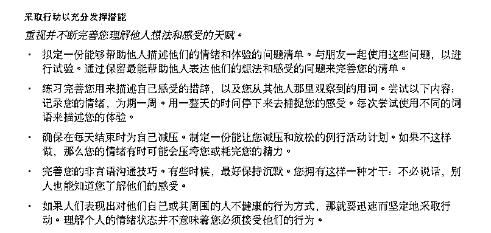

才干盲点：才干像硬币，有正反两面，有时用得好，有时用偏。看见盲点、管好盲点，优势才更稳。

拓展：靠前才干露出盲点、带来负面反馈怎么办？可以尝试：找到适合天赋发挥的场景；反复练习使用，尽量放大优势面，减少盲点出现。

举个例子：行动才干突出的人，想到就干，行动力是长处；同时也可能急躁，没想透就动手，试错成本不低。若环境需要持续开拓、鼓励尝试，他的冲劲能开疆拓土，常被评价为“敢闯”；若环境要求长期谋划、一步错代价巨大，他可能常被说成“莽撞”。

可见才干本身中性，没有绝对好坏。无意识使用，无论擅不擅长，都可能因用法不当暴露短板；目标合理时，有意识地调用擅长才干，弱点出现的概率会明显下降。

这里说明“有意识管理”和“无意识发挥”：

无意识发挥：才干像车的自动巡航，上了路自己就跑，也不管方向。竞争才干突出、胜负欲强、想争第一的人，在无意识状态下处处比较，容易觉得遍地假想敌，把人推到对立面，关系紧张还得罪人。

有意识管理：你知道自己会这样，也知道是哪个才干在推着走，接受每项才干都有优势与盲点。使用时围绕目标调用，尽量放大优势面，避开盲点面。例如：争对自己有利、值得争，那就争；鸡毛蒜皮都要争，反而到处树敌，就不必了。

总之，圈出共鸣点后，多回想高光时刻，擅长才干的影子会自然浮现。对靠前才干有感知后，在生活中观察自己与他人的差异，留意感受和下意识反应，就能更有意识地调用它，看见它的优势。

# 3.2.2 Top21-34：别把靠后当死穴

靠后才干，指报告中排第21—34位的项目。

经常调用靠后才干，容易因不熟练而出负面反馈，进而被当成“弱点”。盖洛普所说的“弱点”，是发挥优势过程中，因才干管理不当，或技巧、知识不足、误用，给自己和他人造成困扰。

靠后才干带来负面反馈时怎么办？

例如，你想扩大社交圈、多认识新朋友，但取悦靠后，眼下圈子较窄。未必要硬着头皮参加各种活动，关键是找到自己拿手的切口：

取悦能天然和陌生人打成一片，但你不擅长调用它，怎么办？

「学习才干突出」→若你爱学习，多参加感兴趣的线上课程，借同学交流认识新朋友；

「交往才干突出」→若有特别要好的朋友，常参加活动，可让对方陪你入场，慢慢融入，或请对方引荐新朋友；

「排难才干突出」→若你善于解决问题，就多帮别人处理难题。时间一长，自然有人愿意认识你。

……不再逐条列举。面对弱点，可做两件事：

1）先梳理目标并拆分，再盘点擅长才干能否支撑目标。

拆解路径可参考：澄清目标—盘出优势—制定策略—跑通路径—复制成功。

例如：

目标：完成赚钱拉新500人。

优势：战略思维+关系建立维度有7项才干突出，擅长定策略、把合适的人放到合适位置、推动策略落地。影响力靠后，招募新人和快速成交不是强项。

策略：

战略12+体谅1+个别2：盘点赚钱、拉新团队、用户、核心团队四方需求，找到利益平衡点，再按内容设计销售漏斗策略，写SOP，带大家执行。这些都在我的能力区。

取悦26+统率25+专注16：快速引流、快速成交、掌控主动权并非所长。

路径：用内容吸引同频客户，走自动化成交；借关系建立优势，联合有影响力的朋友，我负责策略与内容。

成果：30天运营后，今年最终拉新847人。

2）找优势互补的人合作。

仍以拉新为例。好友梁靠谱“影响力+执行力”靠前，对应才干是“统率+专注+取悦+积极”。她成交意愿强（统率+专注），擅长与陌生人打交道，能吸引大家加🛰️，引流效果很好（取悦）。

我俩合作很顺。提前半年商定：她负责招募和直播，我负责策略、调动人员与后端精细化运营。最终效果不错，拉新847人。

总之，补“自认为的劣势”要选合适、舒服的方式。最好的补短，是先了解拿手才干，再用最强的那部分去打通不擅长的部分。

补充：靠后才干若稍微学点用法，常常能提升整体竞争力。比如醒醒分析才干靠后，会刻意找擅长的朋友多交流，学习他们的思考方式，现在已有明显提升。

无论你是否相信天赋的意义，你都在有意无意中用它保护和捍卫自己。若结果不理想，也许只是所处环境无法让天赋发挥。

最后提醒：天赋对路，势如破竹；总在弱项硬扛，只会痛苦。即便补短，也别硬补。

# 3.3 第三步：组合才干怎么理解

前面看的是靠前与靠后的单项才干。才干往往组合起作用，接下来理解组合应用。

盖洛普测评颗粒度很细。多数工具像一面模糊的大镜子，只能照出大概类型；盖洛普则像8K超高清相机，通过才干组合，能照出高矮胖瘦与五官，帮你更清楚地看见“天赋才干”。

以人际关系为例，表现形式可以有N种。举个例子：

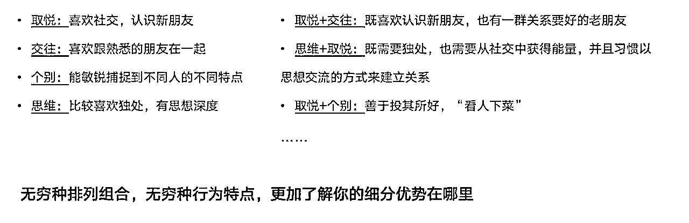

假设A、B前五才干里都有取悦，说明两人都爱社交、喜欢认识新朋友，并从新人连接中获得满足。A排第一的是沟通，B排第一的是成就。

A：沟通+取悦：借交流表达不断交换信息、建立关系。

B：成就+取悦：偏爱能持续认识新朋友的工作，做事与交友同时进行。

若在两两组合上再加一项，例如：

沟通+取悦+交往：八面玲珑，朋友遍天下。总能找到话题，与新老朋友保持交流，关系维护得好。

成就+取悦+完美：工作中本能想结识更优秀的新朋友，倾向向上社交，在做事过程中交朋友。

每加一项才干，组合复杂度与难度都会上升，但画像也更精准。才干的N种表现形式，体现在34项才干的排列、数量与排序差异，这意味着：

第一，测试结果像基因一样，几乎独一无二，展现的是本人与生俱来的独特性。

第二，34项才干有无穷组合。人与人可能有相似优势，但组合不同，反映的是差异化优势。

初学者不必一上来死磕组合，很容易绕晕。想更精确地了解自己的天赋组合，仍应从单项才干入手，弄清后再练两两组合，慢慢就熟练了。

以下组合较容易同时出现在前五，作为了解即可（常见组合数据来自盖洛普官方）。

成就+学习：任务一旦启动，就盼着顺利收尾；碰到新东西，会忍不住钻进去，学习模式自动开启。

专注+成就：围着目标排优先级，完不成不松手。

统筹+责任：协作中只要与自己相关，过程和结果都愿意扛起来。

信仰+责任：守住自己看重的原则与目标，答应帮忙就尽全力。

审慎+责任：做事尽责，说话谨慎，承诺了就会守。

排难+责任：为了帮助受伤、受损的人事物，甘愿付出自己，服务他人。

纪律+责任：爱用日历、日程表等工具管理进度，确保计划完成、承诺兑现。

公平+和谐：为让事情顺利推进，尽量管理情绪发生过程，减少冲突争议，保持冷静。

行动+战略：先找出最优方案，再催大家尽快动起来。

追求+成就：自驱力强，也想站上更大舞台；有人欣赏，会更卖力。

完美+战略：评估未来方案时，先淘汰不够好的，再从特别好的里面挑最佳。

自信+战略：对能力与判断有底，知道最佳方案是什么，也清楚目标与实现路径，不易被改变。

统率+战略：习惯提前考虑可行方案并选出最优，统领大局时少做无用功。

竞争+成就：既能努力完成工作，也会在比较中更有动力超越自己和他人。

沟通+取悦：社交中靠清晰表达赢得关注，建立广泛关系。

适应+体谅：活在当下，对眼前情况与情绪较敏感，并能随之调整。

伯乐+体谅：情感与潜力虽看不见，但能帮别人表达感受、释放潜力。

包容+积极：爱把大家聚在一起，希望邀请的人全到场；有人缺席就不太开心。

个别+交往：容易看透他人本质，也希望有人真正了解自己。

和谐+责任：能营造利于合作、提升实际生产力的环境，并借此赢得信赖。

交往+责任：为客户、亲人、同事、朋友提供帮助越久，越懂得欣赏他们，也越能获得认可。

关联+体谅：很关心他人，对独特情绪敏感，也认同人类共性。

积极+取悦：对情绪和获取新朋友青睐很敏锐，能轻松结识新人、鼓励沮丧者，并享受其中。

分析+学习：爱学习，主要目的是学会客观评价事物。

回顾+搜集：持续搜集资源、翻看历史记录时，总能给别人提供他们想要的东西。

理念+战略：达成目标时会考虑所有可能；若都不满意，就创造新方法。

前瞻+战略：能判断未来走向，并找到通往未来的最佳方案。

搜集+思维：爱思考并搜集深刻洞见、哲理，也认为这些很有意义。

# 3.4 附1：动力从哪里来？34项才干需求表 @叶叶在觉

上班提不起劲，未必是态度问题。翻翻盖洛普报告，常常能找到线索：某种内在需要长期空着，人自然就没了燃料。

34项才干，每一项都连着一种心理补给。举例来说：

「追求」型的人，得收获外界的欣赏与肯定，才会被推到最佳状态；

「竞争」型的人，身边最好有个能较劲、能互相点燃的伙伴，才会持续加码，一心要压过对手；

「适应」型的人，越处在变动频繁的环境里，随机应变的能量越容易被唤醒；碰到强手，反而更来劲。

一旦这些需要被接住，人的状态会大不一样：干活有热情，行动有冲劲，在职场里也更敢闯。

拿「交往」来说，它指的是熟人社交和深度关系维护的本事。如果你这项才干突出，就该定期约几位老友碰面，保持有质量的交流；和他们相处，你会明显松下来。

工作方式上，你更适合服务单客或小圈子，经营有深度的关系，而不是拼数量。高客单价产品更对路，也可以靠转介绍来带流量。

想找到自己的动力来源，可以对照下面这张表。

34项才干需求清单@上淇&醒醒：

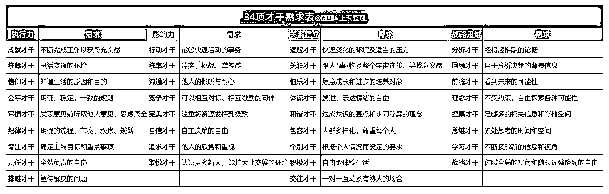

# 3.5 附2：34项基础才干速览🔥

下面这张表收齐了34项才干，每项都列出定义、动机、内核和特征，方便逐条比对。

表格由@柳大 教练整理：

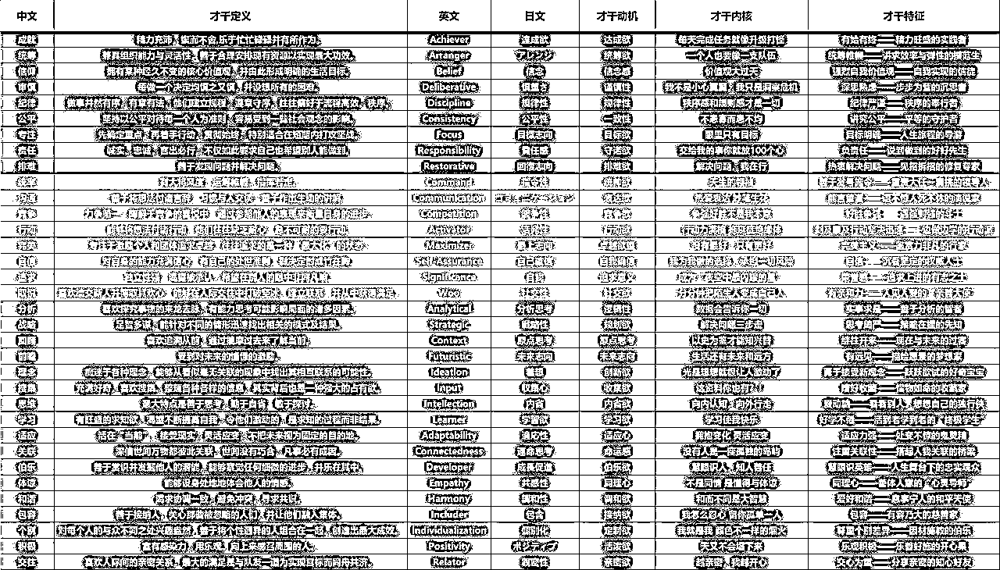

为了把单项才干讲透，我们统一从三个角度拆解：

第一，本能反应。也就是遇到情境时不假思索就会做出的举动，往往藏着这项才干带来的优势。看清这一层，能帮你认识自己、找到强项。

第二，过用盲区。才干用过头，或放在不合适的场合，也可能变成短板。这一层要多留意，能避则避，避不开也要学会接纳。

第三，优势形态。也就是才干经过刻意打磨后可能结出的果实：天赋怎样长成个人亮点，落到实践里又能带来什么成果。

提示：点左侧目录，就能跳到对应的才干。

# 3.5.1 ⭕️ 执行力

# 01 成就才干

本能反应

这类人对“做完”这件事很上头，精力旺、推进欲强，特别想拿到成果、做出名堂。每收尾一件事，心里就多一分满足。

他们自带专注、能量和推进力，通常不用旁人催。不管上级怎么派活，成就才干强的人都会主动往待办里添任务，闲散度日反而难受。

脑子里常转着：下一步做什么、还有哪件事要收尾。每划掉一项，就涌上一阵满足感，妥妥的自我加压型选手。

过用盲区

长期勤奋，容易对“懒散的人”生出反感。但也要明白：别人未必和你一样高期待、高电量，否则容易给人留下“你太苛刻”的印象。

有时会高估自己的精力和能力，任务越堆越多，结果拼尽全力也做不完。

过度消耗还可能拖垮身体，张弛有度更稳妥。

工作投入太多，容易冷落家人；太盯结果，也容易忽略同伴的感受。

优势形态

完成任务的内驱力很强，因此容易成为团队节奏的标尺。

爱列待办，不一定写在纸上，也可能排在脑子里；每完成一项，都很享受那种“又拿下一城”的快感。

驱动力极强，即使不断被追加任务，也愿意主动接下来。

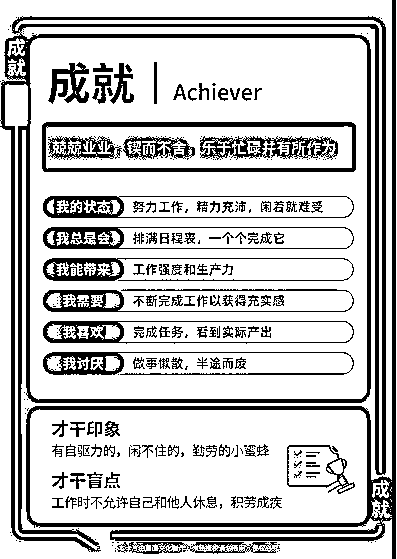

# 02 统筹才干

本能反应

统筹才干强的人，像乐队指挥：局面越复杂，越能协调人、事、物，让成员各就各位、各管一摊。

他们身段灵活，会随外部变化主动寻找更合适的人员搭配和资源组合。

偏爱多线程作业，同一时段能处理好几件事，一次只做一件反而不过瘾。

过用盲区

灵活过了头，会不自觉重排人员和资源，却忘了别人未必能同样快速应变、迅速重组，结果让旁人一头雾水，也可能被看成没主见、想得不深。

优势形态

出色的指挥者，能在繁杂事务里化繁为简、进退从容，把效益做到最大。

擅长多线程管理，也长于调配资源。

# 03 信仰才干

本能反应

这类人价值观稳固、信念感强，通常坚韧有毅力，不会因困惑或挫折就丢掉信仰。

碰到契合自己价值观的事，他们热情高、决心大、驱动力足；碰到不契合的事，则容易排斥甚至抵触。

真正能打动他们的，多半是使命感和意义感，而不是金钱与名望。

这项才干还会给其他才干“加信念”，而且不容易被撼动。比如：个别才干本就相信人人独特，叠加信仰后，会更反感一刀切，更认定人生而不同；伯乐才干本就认为人人有潜力，叠加信仰后，会更认同“人生而有用”，也讨厌别人对自己的才能和潜力视而不见。

过用盲区

价值观和信念太稳定，可能被旁人误读成固执、我行我素、不会转弯。

遇到不符合自己价值观和信念的事，容易带着批判和排斥去回应。

优势形态

凭借清晰、坚定、稳定的价值观，朝理想目标不摇摆地走，并带动身边人。

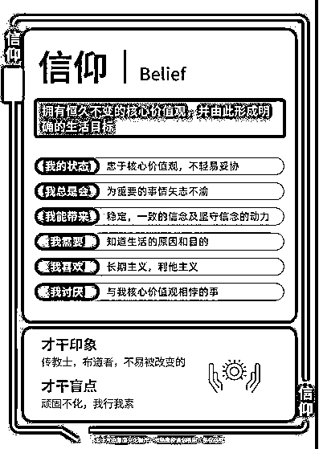

# 04 公平才干

本能反应

这类人本能地盯着规则是否公开、透明、前后一致，希望所有人守同一套原则，机会和资源均等分配；搞特殊、开后门、靠关系，他们都很反感。

常把自己当公平和正直的守卫者，比起个人需要，更在意群体需要。

特别反对特殊化，深信只有规则明确、人人适用且稳定，每个人的最大潜能才放得出来。

他们认定待人要公平，不论对方社会地位高低；也总能敏锐察觉哪里“不公平”。

过用盲区

太在意规则一致，容易忽略个体差异和独特性，最后变成“一刀切”。

过度看重“公平”，却忘了世上没有绝对公平；“公平”也未必是最合理的资源配置，一些表现突出的人还可能因此被打击积极性。

优势形态

在团队里，能让成员感到公平、公正的氛围，不必担心被不公正对待，团队执行效率和信任感都会提升；

同时也能让自己服众，立起公信力和威望，赢得大家认可。

制定标准化流程可能也是强项。我的观察里，不少公平才干突出的人，喜欢从重复劳动中提炼“公共流程”；大家用上这套SOP，他很有成就感。

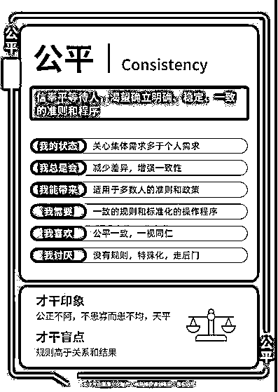

# 05 审慎才干

本能反应

这类人对潜在风险天生敏感，为人谨慎、缜密、尽责，常能做出明智决策。正因为看得见风险，决策前会尽量识别、评估，先做预案和准备，让事情更顺；明知是火坑，不会往里跳。

行动前反复掂量；处理关系时小心谨慎，也很看重隐私，不轻易交出个人信息，还会刻意避免过度夸人，免得显得浮夸。除非环境让他有信任感，他才愿意多谈自己的看法和私事。

过用盲区

总能察觉风险，可当风险消不掉时，也可能迟迟动不了手，陷入犹豫。有时要对自己的判断多点信心，相信直觉：不是每个风险都会发生，也不是每个预测都会应验。

过于谨慎，可能被旁人看成内向、高冷、不好接近。有时你在意的人需要被肯定和赞美，这时多给一点认可、少盯不足，反而更有利于拉近关系。

谈风险时，容易被人误读成“没把握”或“没行动力”。试着用合适的说法向别人解释：揪出风险是为了预防和控制风险，不是挑刺、找借口，这样更容易被理解。

优势形态

警觉性高，说话做事谨慎。可能是个很好的树洞，因为他不会轻易泄露自己或他人的隐私，免得惹麻烦。

排雷高手，好像随时都能嗅到风险，忍不住把它拎出来、想办法消掉。

判断力在线，无论决策还是行动，都会提前想很多，把风险压到最小，再一步步推进，走得稳也走得远。

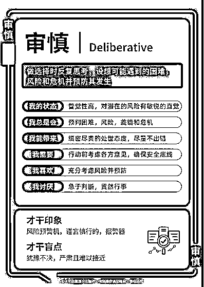

# 06 纪律才干

本能反应

这类人看重秩序和流程，在意流程是否一致、统一，偏爱精确的SOP和清晰的做事节奏；

比起结果怎样，他们更关心过程对不对、流程顺不顺；

更在意“怎么做”，而不是“做什么”。

过用盲区

太看重标准流程和秩序感，外界一变就容易缺灵活、转不过弯；

过度盯过程和流程是否严丝合缝，对结果的关注反而不够；

太希望待在秩序井然的环境里，却忽略有些人更适合自由、创新的土壤。

优势形态

个人做事有章法，井然有序，效率也稳。

在团队中能提升秩序感，让项目节奏有条不紊，事情更可预测。

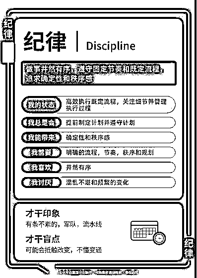

# 07 专注才干

本能反应

这类人本能地盯目标和效率，会先分出轻重缓急；方向一旦定了，就尽量让自己心无旁骛，排除干扰，按进度朝目标推进。

生活里也总在找目标，本能判断某个动作是否有利于达成目标，并优先选效率最高的方案。

团队里有人跑偏时，你对这种偏离很敏感，也能带人回到正轨，少走弯路。

过用盲区

太专注任务目标，有时会忽略目标之外的需要，比如团队成员的情感需求、容错空间，给关系添了障碍，甚至不得不停下来处理这些干扰。

目标需要调整时，若还死守原来的方向、不愿变，可能造成损失。

一时够不到目标，压力容易翻倍；偶尔要给自己松松绑。

优势形态

擅长定目标、定方向，并能一以贯之；专注力强，会绕开干扰，始终朝目标走。

在排优先级、设目标和高效工作方面，能力很强。

是提升团队效率和质量的高手。

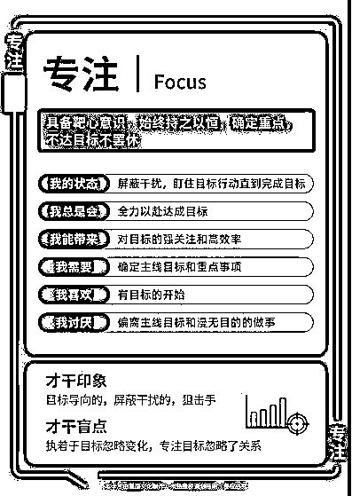

# 08 责任才干

本能反应

这类人责任意识强，会不自觉地想扛事，也希望别人觉得他们靠谱、可信。他们通常守信，说到做到，对没把握的事不轻易许诺。

有担当，一旦承诺，事情不分大小都会全力去做、亲自跟进，直到兑现。

“一言既出，驷马难追”像是他们天生的信条；一旦没兑现，就会很愧疚，不停想办法补救。

过用盲区

不太会拒绝别人，超出能力范围的责任也容易背锅；

把不属于自己的责任揽过来，既分散时间和精力，也容易身心俱疲；

看到别人不像自己那样甘愿付出、言出必行，可能会觉得对方不够负责；其实未必，有些人信奉的是“边干边想”“及时止损”。

优势形态

有新项目要托付时，责任才干突出的人常被最先想到，因为过往表现会给人“踏实靠谱”的印象。

因为总是守信，业务上的口碑通常很好，似乎天然就能让人产生信任和依赖。

所在团队的道德标准可能也偏高。

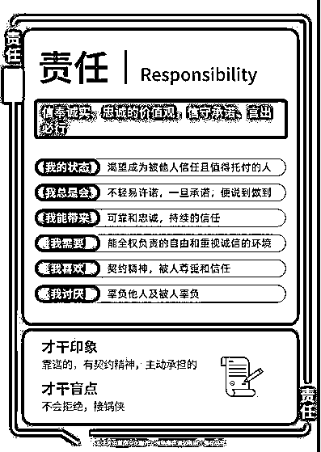

# 09 排难才干

本能反应

这类人习惯盯过程中的细节，善于找出问题并解决，喜欢把一切恢复原样，不会被困难和错误吓退。

遇到复杂、没处理过的问题反而兴奋，尤其是判断故障、修复bug这类事，他们不怎么费劲就能看出毛病。

他们常有这种感觉：一台机器、一件器具、一家公司或一个团队出了毛病，少了我就可能停摆，或体验大不如前；问题若一直没解决，他们会很受挫。

过用盲区

总盯着问题，有时容易被误解成“消极”，好像很怕难。

我们认定非解决不可的问题，在别人眼里也许根本不算问题。

容易关注事而忽略人；急着帮别人解决问题，可能忽略有些人需要亲自处理、借此成长。

指出别人做事的问题时，对方可能觉得你爱挑刺、总看不足；有时他们更希望被看见做得好的那一面。

对自己太苛刻，总盯短板，也容易变成自我攻击。

优势形态

解决问题的高手，别人对困难束手无策时，他们能冷静处理。

能察觉别人可能发现不了的问题，并给出解法。

任务开始前就能预判可能出现的问题，提前预防，让事情顺利推进。

对自己的短板不躲，反而有勇气去补。

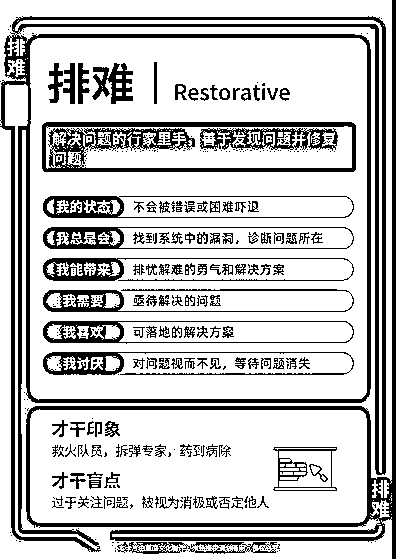

# 3.5.2 ⭕️ 影响力

# 10 行动才干

本能反应

这类人行动力强，既能自己发起行动，也能推着别人动；最受不了原地踏步，常把“咱们什么时候开始？”挂嘴边。

他们打心底认同：没有行动，一切空谈；“想，全是问题；做，全是答案；站着不动，永远是观众”。

过用盲区

重开场、轻收尾，可能做无用功；

想到什么立刻上手，一旦没做出成果，容易虎头蛇尾或三分钟热度；

急着行动，也可能给还没准备好的人带来压迫感。

优势形态

是把想法变行动的先锋，能量足、干劲大；

很有感染力，能用自己的行动带动别人，或直接推别人一把。

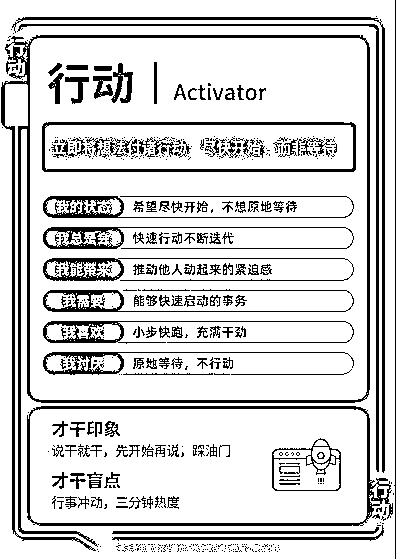

# 11 统率才干

本能反应

这类人果断，立场清楚，爱憎分明，敢扛事；

不怕权威，不躲冲突，也不怕正面对抗；

善于讲出自己的想法，喜欢拍板，享受掌舵的感觉；

希望团队边界清楚，大家实事求是、开诚布公；最讨厌为了表面和气把问题盖住。

过用盲区

太强势，会给人压迫感；

太决断、听不进劝，容易被认为刚愎自用；

习惯拍板，容易忽略别人的意见。

优势形态

为人果断，喜恶分明，敢直面冲突；

善于把被回避、被掩盖的问题揭开。

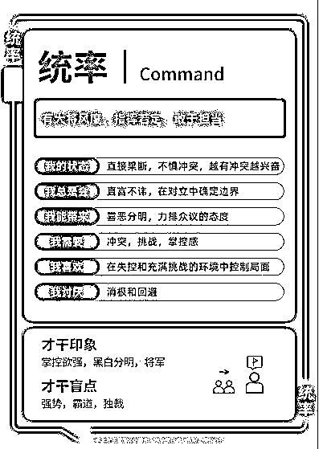

# 12 沟通才干

本能反应

这类人爱聊，也让人愿意听他们聊。

表达欲强，希望自己说的能抓住听众，还会不断找生动、有趣、有感染力的好词句。

喜欢解释、描述、主持、演讲，擅长把想法讲活，比如变成故事、画面、例子和比喻。

过用盲区

表达欲一过头，可能霸住话头，不给别人开口的机会。

太顾着表达自己，倾听就少了。

也不容易及时注意别人说了什么、没说什么。

优势形态

总能找到合适的词句，谈得妙趣横生，把听众注意力牢牢抓住。

用生动、形象的表达说服并激励别人往前走。

场景化表达的能力特别强。

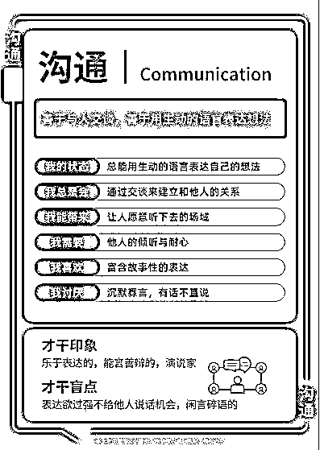

# 13 竞争才干

本能反应

这类人喜欢竞赛和竞争氛围，胜负欲强，对“赢”有执念；爱找对标对象，并设定能客观衡量的标尺，比如业绩、分数、排名。

特别想拿第一，努力做到最好；只要没排第一，就说明还有人要超，也说明自己还没赢。

为了赢，愿意多付很多努力，直到登上顶峰。

一旦没赢，心理落差会很大，甚至觉得所有成就都空了。

过用盲区

胜负欲太强，总用对立视角处理关系，关系容易变差。

还容易以己度人，忘了不是每个人都像自己这样想赢；只盯胜负，可能冒犯别人、伤感情。

为了赢，可能做出过激、事后后悔的举动；争胜时务必守住原则和理智。

优势形态

驱动力足，不甘平庸，常能看见标杆在哪。

通过营造想赢、争第一的氛围，能抬高团队的成就水平。

# 14 完美才干

本能反应

这类人本能追求精益求精和投入产出最大化，非常看重品质；比起补短板，更想放大优势，看到有价值的东西就想物尽其用。

通常标准很高，不接受事情只做到平均分，更希望把“很好”推到“更好”，把“优秀”推到“卓越”。

喜欢和优秀的人共事，常能看出自己和他人的优势与工作是否匹配，乐于让优秀的人更优秀，讨厌和自己眼中的平庸者合作。

过用盲区

太在意发挥优势和高品质，有时会被认为不能一视同仁，或者慕强。

也许你想拼尽全力试遍所有可能，也想让团队每个人都更优秀；但有人更喜欢“够用就好”的节奏和标准。有时得接受“足够好”也成立。

给反馈时，常常偏批判而非支持，比如“你还能更好”“这里还有优化空间”……这容易让别人觉得你要求太高、压力很大。

优势形态

追求超越优秀的标准，不断刷新成功线，拿出惊艳成果。

专注优势、绕开短板，让投入产出比最大。

把优势当作激励个人和团队走向卓越的方式：看见每个人的强项，让每个人做最擅长的事，个人、团队和集体就会持续变好。

善于搭出优势互补的团队，做出卓越产品。

# 15 自信才干

本能反应

# 底气足，才敢向前一步

有一种人，对自己擅长什么、能做到什么，心里很清楚。他们敢开口提要求，也敢把风险接过来；新挑战摆在面前不退缩，事情落到手里，有把握办成。他们信自己的判断，也愿意承担判断带来的结果。这份笃定像船体的主骨，风浪压过来，方向不容易散，船仍能向前破浪。与此同时，他们讨厌被框死，不愿由旁人贴标签，自主空间很重要。可这股劲一旦用偏，就会变成过分独立、爱独来独往，决定落下后很难听进劝。若用得正，他们会信任直觉、不怕难关，慢慢成为带队的人；路再险也敢开，还能把信心传给同伴，主动把担子接过去。

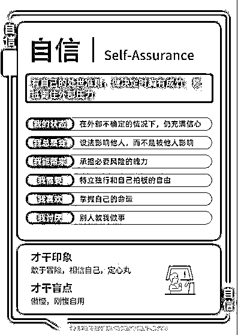

# 16 追求：掌声与结果都想要

追求才干突出的人，心里常有一团想被看见的火：希望得到真正的器重，盼认可，也想做出名声。他们像天生的舞台型选手，灯光、掌声、评价都能牵动神经，对声誉和口碑格外敏感。挑事情时，会优先找那些能放大贡献、能影响更多人的舞台，最怕被忽略；不够有分量的事，很难让他们提起劲。他们也愿意靠近自己佩服的人，还会顺手推着同伴一起往上走。正是这股劲，让他们不甘平庸，朝更热爱、更想要的方向持续用力，直到把目标握在手里。

容易踩的坑：谈成绩容易只讲自己，旁人会觉得在抢功或太爱表现；太在乎外界眼光，可能为了一句好评付出过高成本，想被认同本身没错，却常给关系和心情添负担；要明白与众不同并非过错，不必硬把自己塞进同一个模子；人都有短板，若总遮着，别人反而不知道该怎么搭把手，偶尔露出需要，反而更容易赢得敬重。

发挥出来：不同阶段都可能明显跃升，因为心里装着大事，对卓越人生有强烈企图；自主意识强，愿意在关键位置扛重责，且往往真能做出成绩；演讲、表演、主持一类事务上手很快；雄心也能感染同行者，把队伍带起来。

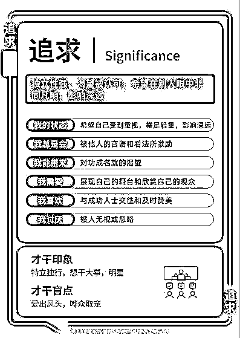

# 17 取悦：把初识变熟络

取悦才干突出的人，把关系网铺得宽。他们不怕和生面孔搭话，越是在陌生人多的场合，越容易主动开口，几句就能把气氛松下来，让对面卸下防备，聊得轻松。他们常把这句话放在心里：世上没有陌路人，只是朋友还没打招呼。

容易踩的坑：可能一直往前认识新人，却把旧友晾在一边，被误解成喜新厌旧、不够真诚；也可能推进关系过快，没顾到别人的社交边界，有人就是需要更慢、更谨慎的节奏。

发挥出来：成熟之后，他们和人相处自然，能把场子串起来，让交流有热度，不容易冷掉；作为社交型选手，也常能拿到旁人不易接触的资源和机会。

# 3.5.3 ⭕️ 关系建立：让连接更牢

# 18 适应：变化当前，先接住再转身

适应力强的人，遇事常先顺着环境走，不硬扛，也不急着定死路线。他们身体里像装了弹簧，突发状况一来，能快速判断、冷静转向，哪怕这和原计划不一致。偶尔，他们甚至会期待生活扔来一个意外考题，每接住一次，灵活度就被验证一次。反过来，条条框框多、必须提前排满的任务，会让他们觉得手脚被绑。

容易踩的坑：灵活是天赋，但若合作对象很看重秩序，对方可能跟不上这种随时调整；顺着别人的想法、节奏和需要时，别把自己的需要弄丢，也别让这份天赋被人无限使用；注意力总在当下，截止时间可能被漏掉，造成拖延；环境对这类人影响很大，松散的地方容易松下来，积极的地方才容易跑起来，若身在松散环境却想发力，常常心有余而力不足。

发挥出来：用对了，他们会提前做足预案，把危机先在脑子里演一遍，真遇到挑战更从容；别人被变化吓住时，他们能先接受现实，冷静找出路，带着同伴往前走；需要马上行动的短期任务里，他们像缓冲带，也是能补空位的人；随遇而安的气质，能营造轻松氛围，让周围人愿意试、愿意学；就算临时插进新任务打乱节奏，也能迅速重排顺序，把效率守住。

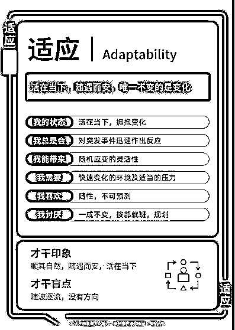

# 19 关联：相信万物有连线

关联才干的人相信，事情不会凭空发生：有果必有因。他们容易被宏大的命题吸住——关乎全人类、甚至整个宇宙的观点、哲学、政策、事件，都能让他们着迷，也擅长从日常小事里抠出意义。他们认定个体是世界的一块拼图，每个人都以某种方式和世界相连，因此人与人命运相牵。分裂、剥削、彼此对抗，会让他们本能排斥；变成孤岛，是他们最不愿看到的局面。

需要留意：太把“大家同属一个整体”放心上，可能看不见组织之间真实的利益拉扯，甚至被评价为天真、理想化；目光总在远处，眼前和短期的安排就容易落下。

发挥出来：成熟后，他们能带人跳出琐碎，看见更高的意义、追求和目标；擅长把过去、现在、将来的散点串起来，在不确定中给人安稳和宽慰，帮人找到积极解释，指出方向与希望；也能看见更大的图景，在个体与群体之间搭桥，让人明白彼此如何相连、如何互相支撑，从而发现身处世界的意义。

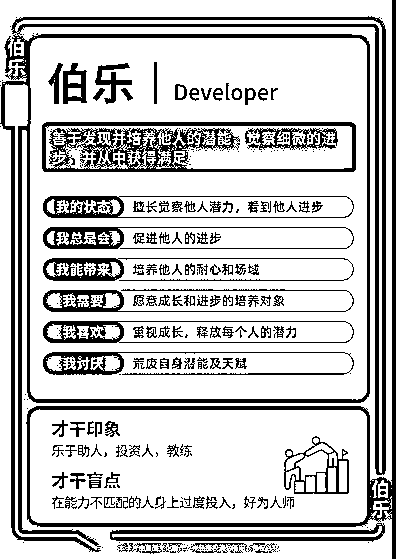

# 20 伯乐：把别人的潜力点亮

伯乐型的人，心力常花在别人的成长上。他们盯得住旁人的进步和潜力，哪怕只是很小一步，也能第一时间发现。和人相处时，会本能地想帮对方变强、更接近成功，看上去很有耐心。他们愿意试各种方法，让身边人尝到赢的滋味；只要确认自己确实推动了别人成长，就会很满足，这也是他们获取价值感的方式。

需要留意：若把资源投给不合适的人，目标会被带偏，精力也白白耗掉；看到潜力就忍不住插手，容易变成拔苗助长，毕竟成长有自己的节拍，外力太急会变成压力；忙着托举别人时，也可能忘了自己也要长本事，只有自身能力够，帮起人来才不吃力。

发挥出来：用成优势后，他们很容易捕捉别人的进步和潜能，利他倾向明显；能帮团队抬高后备力量，也让个人和团队看见更好的发展可能；有耐心，会鼓励那些需要重新看见自身长处的人，让对方对未来生出希望；还能给出实在的支持和帮助。

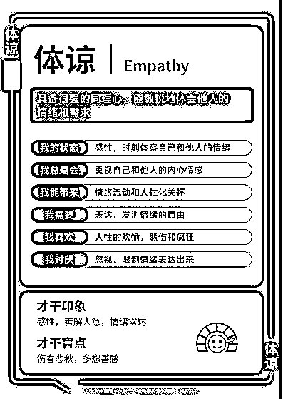

# 21 体谅：感受他人，也别丢自己

体谅才干突出的人，对情绪像装了雷达：共情快，常能站到对方的位置体会感受。很多时刻，他们天然理解或认同别人的立场，但不会把别人的坐标直接换成自己的坐标。他们会不自觉搜集情感线索，做决定时倾向凭直觉，行动前又会把各方的观点和感受放在心里掂量。

需要留意：因为容易吸收情绪，连负面情绪也一并接住，看上去可能偏软，也容易把自己耗空；要练会课题分离，先照顾自己的感受。情绪上头时，可能过度相信对人或对事的判断，客观和理性会打折；敏感让他们容易察觉别人的需要，但对方未必想要这份关心，或不愿把情绪摊开，稍不留神就越了界。

发挥出来：成熟后，他们能带来稳定和舒服的氛围，也有能力建立情感深厚的关系；能给人理解和认同，帮对方把情感与需要说出口；在情绪疏通上，他们往往很在行。

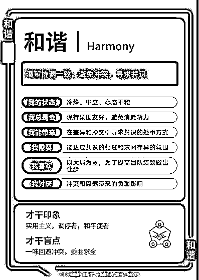

# 22 和谐：把分歧磨成共识

和谐才干的人，习惯把力气花在找共同点上，也常能一眼看到各方一致的地方。他们在意团队是否安稳、少火药味；冲突被他们视为损耗，会尽量绕开对抗。真遇到意见不合，他们也会在争执里筛出可以合作的交集，先谈大家都能点头的部分。

需要留意：太想避开冲突，可能退到没有原则，委屈自己，合作未必长久，后面还可能爆出更大的矛盾；为了维持表面平静，也可能下意识拦住别人公开表达想法和情绪。

发挥出来：用好了，他们能减少摩擦，让团队更凝聚、协作更顺；当讨论卡住时，他们能避开最容易吵起来的互动，把大家重新拉回共识。

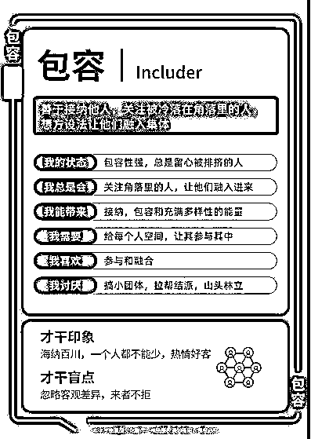

# 23 包容：谁都不落下

包容才干的人，看团队时会先找“有没有谁被落下”。他们希望没有人被边缘化，没有人掉队，一个都不能少。对差异持开放态度，愿意让更多人加入，不按高低贵贱分人，期待团队是多元的。他们反感拉小圈子、搞派系，会留意弱势和孤立的人，也愿意搭把手。

需要留意：太想装下所有人，团队里的声音会变多，分歧难收，摩擦也可能更频繁；太盯着离群者，急着把人拉进来，却忘了融入未必符合对方的意愿和习惯；讨厌小团体时，言语和动作容易带批评和攻击，忽略了不同人本来就有不同诉求。

发挥出来：成熟后，他们能把团队拢在一起，让成员不必担心被冷落或孤立，感受到被接纳；也会把更多想法、视角、观点和行为带进团队，增加多元性。

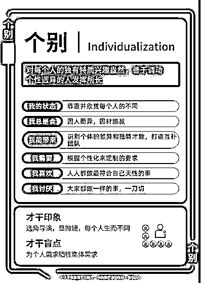

# 24 个别：因人而异，放准位置

个别才干的人，天然认定人和人不一样，对差异特别敏感，反感一刀切和简单贴标签。他们喜欢找每个人身上不可替代的部分；差异越鲜明，越能勾起他们对风格、动机、思考方式、交际方式和潜能的兴趣，会花时间琢磨别人的长处，像选角导演一样看人。他们希望每个人都能发挥自己的特长，而不是都做同一件事、长成同一种人。

需要留意：太盯个体差异，当集体需要更优先时，容易把集体漏掉；别人对你的了解，常常没有你对他们那么深，若能主动说出自己的偏好，而不是默认对方应该知道，就能少掉一些失望引发的误会，比如觉得别人不上心；决定牵涉他人时，因为本能要照顾多方利益，拍板会偏慢；也容易去找通用规则、流程之外的例外，忽略规则本身的有效性，被人看成区别对待。

发挥出来：用成优势后，他们擅长把不同特质的人安放到合适位置，搭出互补的高效团队；识人准，能因材施教，优化人员配置，把潜能用出来；做个性化、定制化服务，也很拿手。

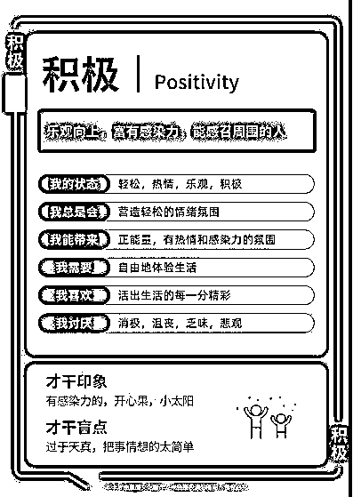

# 25 积极：把气氛点亮

积极才干的人，性格外向开朗，笑意常挂在脸上，也不吝惜夸奖，擅长给人打气，像队伍里的气氛组组长。他们总能看到事情亮的一面，心态乐观，常常能量很足。在团队中，他们像小太阳和开心果，能把气氛炒热，把干劲传出去。夸人几乎是习惯，因为他们总能发现别人的优点。

需要留意：乐观过头，会漏掉客观风险和障碍；也很难接受别人长时间停在悲伤里，对痛苦有时缺少共情，而有人就是需要一点时间消化，不是马上就得看到光明面；夸奖若不看对象、不分场合，容易被理解成为了夸而夸，不够走心。

发挥出来：成熟后，他们感染力强，能让身边人觉得日子更有盼头；热情和精力都足，当别人卡住或不敢迈步时，他们的乐观能给人继续走的勇气；也总能肯定、夸奖别人，带来正反馈和动力。

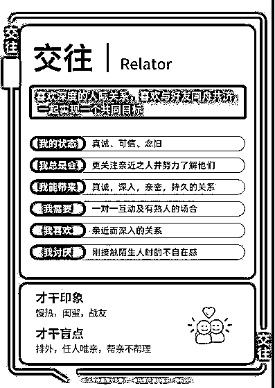

# 26 交往：深关系胜过广人脉

交往才干突出的人，擅长经营真诚、深入、彼此受益的关系。比起热热闹闹的社交网络，他们更看重关系质量，而非数量，所以交朋友有筛选、有门槛。刚认识时可能有点不自在，可一旦认定对方，似乎自然知道怎样赢得信任，也愿意给出信任。他们肯花时间维护密友，在关系里坦率、愿意付出，会主动关心在意之人的情感、经历和目标，也希望对方同样对待自己。

需要留意：更愿意把时间留给彼此了解、彼此信任的人，可能让旁人觉得排外，也可能错过一些不错的连接；交往有选择性，不会一上来就完全信任，容易给人慢热、不易靠近、太挑或被忽略的印象；对亲密的人信任深、付出多，有时会因为太顾关系而受伤。

发挥出来：用好了，他们能建立真诚、互惠、紧密且长久的关系，并守住信任，比如亲密友谊、共同目标、长期客户关系；亲密圈里的人会觉得被看重、被关心、值得信赖。

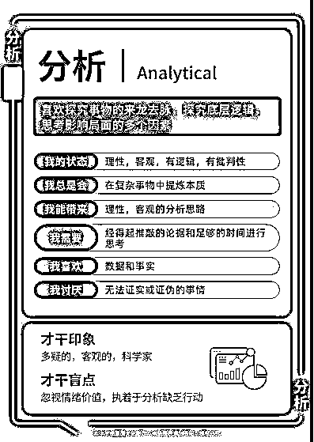

# 3.5.4 ⭕️ 战略思维：拆得深，望得远

# 27 分析：把复杂拆成关键

分析才干的人，爱追问事情从哪来、往哪去，也关心底层逻辑、规律和原理；数据、依据、凭据、证据，一切能量化、能复现、能验证的材料，都很对胃口；他们习惯把事物提炼、拆成公式、模型或框架；相信真理是客观的，也应该可衡量，决策时主要靠理智。

需要留意：太看重证据，容易把能验证的当成唯一正确，不能验证的就判错，从而否定模糊地带；太信模型和公式，忘了它们本身也在迭代；太理性，只盯事实和道理，情感与情绪容易被忽略。

发挥出来：成熟后，他们能化繁为简，用很小的力撬动很大的局，快速拆开复杂问题，提炼关键和底层逻辑；结构化思维强，说话写文条理清楚；批判性思维也强，面对各种说法不轻易被带走，能给出犀利判断和不同角度。

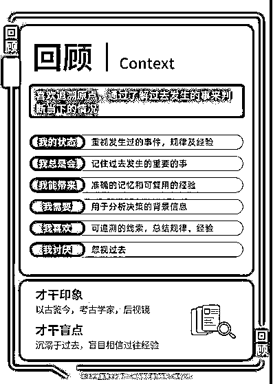

# 28 回顾：向过去要经验

回顾才干的人，关注事情的源头、背景和演变过程；偏爱可追溯的资料，擅长从旧事里提取经验，喜欢挖事情最初怎么发生，相信“太阳底下没有新鲜事”；也可能爱记录、爱回看，比如写日记、读史书、看人物传记。

需要留意：太信过去的经验，可能忽略今昔差异，对现在和未来的变化反应不足；目光总向后，容易被看成守旧、抗拒改变、不愿往前看，对新情况不够开放；手头缺少旧经验时，又会迷茫，少抓手；自己对往事有热情，却容易忽略别人未必想反复听旧事。

发挥出来：用成优势后，他们能以史为镜，从过往中找规律，提炼出宝贵经验，再拿去应对未来；不容易被流行信息带跑，常能找到事物源头，洞察发展脉络，带来不一样的视角和灵感；也擅长提醒别人回到初心。

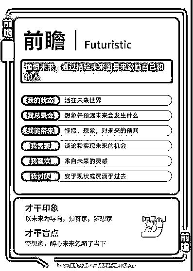

# 29 前瞻：先看到，再带路

前瞻才干的人，热衷想以后，总在找“将来会更好”的机会，也常被未来的美好画面推着走。他们像有远见的梦想家，一看到可实现的蓝图、美好和可能，就会兴奋，也愿意把未来讲给别人听，给人动力和期待。很多场合里，他们会格外留意与好前景有关的信息、预测，以及能让未来变好的人；具体关注什么，和自身兴趣、优势有关。

需要留意：常活在对将来的想象里，眼前的好可能被漏掉；不是每个人对未来都有同样的敏锐，若能借合适的词、工具、草图，让别人明白为什么你看到的未来值得一起走，推动起来会更顺；太沉醉于美好前景，总想找最正确的未来，却忘了未来要靠行动兑现，想象需要在行动里被验证。

发挥出来：成熟后，他们乐于获取或描述美好前景的信息，本能能看到未来的许多细节；更容易帮别人看见未来的可能，带人跨过当下的不确定；也常能预判哪些事可能发生、哪些事应该发生。

# 30 理念：让灵感落地成方案

理念才干的人，发散思维强，喜欢把各种念头变成可感的认知，热衷创意和创新。他们痴迷于把概念变得具体，爱找不同理念之间的连接，对能让思绪飞起来的体验很感兴趣。只要新想法、新灵感冒头，他们就会兴奋，似乎天生擅长跳出惯性，从多个角度看问题，提出新鲜、有创造力的点子。

需要留意：本能偏爱创新，新点子源源不断，也容易被下一个想法勾走，放下原来的方向，行动变化大，结果难落地，被说成不切实际；想法太多变，合作的人可能跟不上；表达偏抽象，不擅长抽象思维的交流对象会听不明白。

发挥出来：用成优势后，他们总有新奇创意，也不怕创新带来的挑战；擅长设计创新项目，比如销售战略、营销计划、客户服务方案、新产品；能从多个角度审视问题，词汇丰富，能描述概念、观点、感受、模式等。

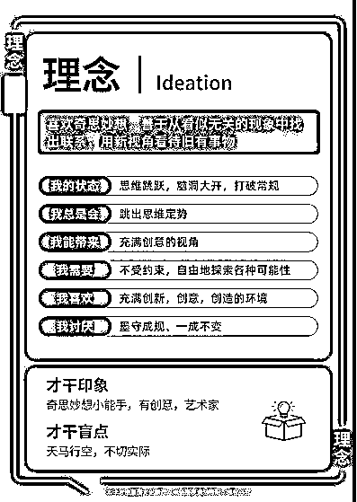

# 31 搜集才干：好东西先收着

**下意识的样子**

这类人探索欲旺盛，脑子转得快，办法也多。他们日常反复做一件事：把资料、人脉、物件、线索等有用的东西归拢进来，分门别类存好，像自带一个仓库。很多领域都能聊几句。收进来的东西当下未必有用，但心里总有个声音：先放着，以后说不定能派上用场。只要这些存货被调用——自己受益或帮到旁人——他们心里就踏实。在他们眼里，没有废料，只有还没等到出场时机的存货。

**容易踩的坑**

探索欲一上来，囤积量容易失控，真要用时反而翻不到；也可能收着收着忘了时间、丢了目的，效率被拖慢，注意力被带跑。存货攒多了，若不筛选就一股脑塞给旁人，对方会被参考量压住，帮忙也可能帮出反效果。

**顺用之后**

他们会成为身边人的百宝箱，靠分享存货帮到旁人；也能给所在小组带去带动增长、改善业绩的工具。点子多，愿意提供具体、能落地的支持。许多旁人忽略的日常线索，他们往往顺手就存了下来。

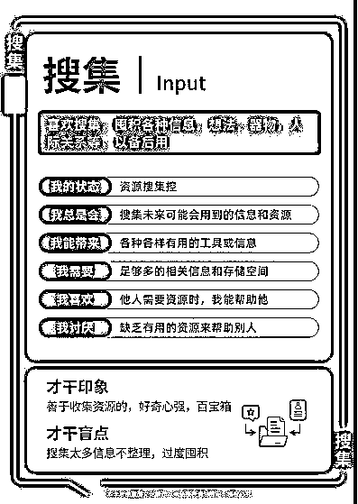

# 32 思维才干：大脑总在后台运行

**下意识的样子**

他们喜欢琢磨事、习惯自省、愿意动脑，也偏好有厚度的话题；浅层闲聊很难让他们来劲，交朋友更看重对方是否有见地。独处是刚需，好让思路慢慢铺开，想的内容多与个人兴趣领域有关。阅读、分析是家常便饭，所以常给人见解深、有智慧的感觉。思绪爱到处跑，大脑很难彻底空下来，仿佛一直在运转。碰到批评或指责，他们未必能立刻接话，通常要先想一想。

**容易踩的坑**

长时间一个人待着，旁人可能误读成冷淡、难接近。不妨找机会讲清楚：自己只是需要一段安静思考的时间，并非把谁晾在一边。如果凡事都要想透才肯动，容易卡在“想”这一环，迟迟交不出结果；其实边干边想也是一条路。见解太锋利、表达太专业，不善思考的人可能感到压迫甚至嫉妒，换成大白话，接受度会高很多。

**顺用之后**

在小组里，他们常扮演军师，能拿出有分量的判断，帮旁人找到破题、提质的新路子。日常里那些值得深挖的智慧，他们往往能捕捉到；只要和他们聊、给他们出思维难题，就能看见。一个人待得住的能力也很强。

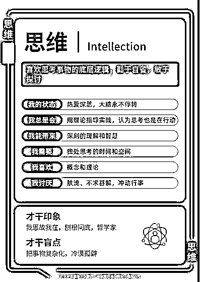

# 33 学习才干：像海绵一样持续吸水

**下意识的样子**

探索欲推着他们不断接收新知识、新事物，持续给自己升级，也享受学新知识、新技能的过程。他们渴望进步，只要能学到东西，面对生活就更有底气。看待事情时，常带着学习视角，比如会问：“这件事能让我学到什么？”

**容易踩的坑**

若只贪图学习过程的爽感，不顾最后拿到什么，时间和金钱可能大把砸进去，人累钱包也瘪。学习虽好，并非人人都享受；要尊重旁人的节奏，别硬拉着别人“为学而学”。

**顺用之后**

他们常把“从中学什么”的视角带给周围人，带动自己和旁人一起往前走。组织里有人怵改变时，他们那股想学的劲头，能提供抢先一步的资讯和推力。上进心、求知欲、探索欲都强，信奉终身成长，版本更新也快。

# 34 战略才干：不满足于“能用”

**下意识的样子**

他们脑筋活、转身快，这几乎是一种思考习惯或价值排序。无论决策大小，脑内都会自动弹出：还能怎么选？有没有第二条路？这种局面怎么接，那种局面又怎么接？照老规矩办事会让他们浑身不自在；旧法子即便还能跑，只要不是最优解，心里就过不去。

他们盯上的是最优解、最优路径，而非“凑合能用”的选项。所以乐意把不同路线摊开，一条条比较，免得漏掉更好的走法。旁人没辙、场面乱成一团时，他们常能摸出规律和关键点，看清各条路的去向、卡点和破法，反复筛、反复删，直到锁定最顺的那条道，这个过程让他们很有成就感。

**容易踩的坑**

他们能提前看见某个选择背后的雷，因而常被误会成爱抬杠、爱挑刺。若在指出问题的同时递上绕坑或拆雷的办法，再说明“我只是习惯这样想”，旁人会更容易接住。并非人人都像他们一样脑筋转得快，别人可能跟不上他们衡量可行性的节奏，必要时得把“为什么这么走”掰开讲。方向不清时，他们还可能陷进各种可能性的比较里，耗掉精力和时间。

**顺用之后**

他们比旁人更容易察觉每个选项可能埋下的隐患，并指出更顺的前进路线；能给小组、项目、他人带来有创造性的预判、想象力和一股子韧劲；也常能看见别人看不见的可能，带来新视角和新机会。

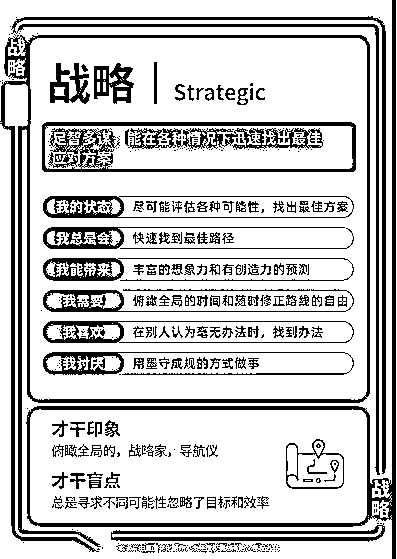

# 3.6 盖洛普自我分析实操@醒醒同学

# 3.6.1 SIGN四问：找到你的优势信号 @《现在发现你的职业优势》

💡

S（success，自我效能）：在某些事上底气很足，认定自己拿得下。
I（Instinct，本能热爱）：不用谁催，手就痒，很想立刻上手试。
G（grow，成长速度）：一碰就能看出长进，学起来比预想快。
N（need，满足感）：哪怕累到不行、甚至没报酬，做完仍觉得值、有意义。

如果一个人前十里那些才干被喂饱了，就更容易同时感到：这事我能行、我乐意做、做了开心、还越做越顺。

不妨拿下面这组自问来盘点：

S（success，自我效能）

a. 哪类任务交到你手上，你心里有底一定能交出结果？旁人遇到什么常来问你？
b. 在哪些场合，你对自己的判断特别有信心？
c. 干什么的时候，你几乎不犯怵？

I（Instinct，本能热爱）

a. 哪些活儿你很少往后拖？
b. 哪类题目、任务或氛围，一听见就手痒想碰？
c. 什么事情能让你一头扎进去忘了时间？

G（grow，成长速度）

a. 哪类本事你一学就会？
b. 和同龄、同行比，你在哪块更冒尖？
c. 旁人常说你“天生吃这碗饭”的是哪件事？

N（need，满足感）

a. 干什么会忘了时间，事后还觉得赚了？
b. 哪类过程让你觉得没白忙？
c. 回想最痛快的一次投入，你当时在做什么？

把上面四类答案，对应到自己的盖洛普才干，整理成一份“SIGN优势盘点表”。示例如下：

S（success，自我效能）——我调动哪个才干时最有底气，能把某件事扛下来。
I（Instinct，本能热爱）——哪件事我不催自做，背后是哪个才干被喂饱了。
G（grow，成长速度）——哪类事你进步肉眼可见，比周围人更快出结果？多半动用了什么才干？
N（need，满足感）——哪件事让你越做越有劲、愿意长期做，可能是哪个才干在发信号？

**样例：**

拿醒醒来说：

S（success，自我效能）

线下沙龙从排流程、备物料到招人，这几步我做起来心里有底。可一到活动后的跟进、加🛰️聊天，要我想话题就发怵。这大概和我的“体谅”“理念”“思维”“个别”几个才干有关。

I（Instinct，本能热爱）

客户抛来有挑战的题目，我反而来劲；产品我也总想折腾点新花样，原地踏步会让我难受。这或许对应我的“排难”和“理念”。

G（grow，成长速度）

凡是跟看懂客户、识别他人天性相关的事，我上手特别快：能读到情绪背后的需要，也能记住不少优势案例，几乎不用死记，见一次就印在脑子里。

N（need，满足感）

能帮人解困、写点东西、一个人待着、少去应酬，我就很知足。

摸清这些后，我做优势教练时，对现阶段该推什么产品、怎么获客、往哪个方向试，心里更亮堂，也爱给客户制造惊喜。另外，我拉上很会破冰、擅长总控的同行牙牙教练一起办线下活动：我管流程和物料，她管全局协调与活动后跟进。

# 3.6.2 副业转型卡点：四要素自查

💡

一份副业或职业做起来顺不顺，一般看四件事：你喜不喜欢、干不干得来、能不能换钱、心里有没有意义感。卡住的时候，多半是这四样里至少缺了一项。拿职场场景对照，可以判断自己该补哪块短板：

干得开心也充实，就是钱不宽裕——喜欢、擅长、也觉得有意义，唯独收入不够。比如工作清闲舒服，单位上升通道窄，孩子上学后开销变大，就得在主业或副业上想办法增收，让家庭抗风险能力更强。

日子过得去，却总觉得没被当回事——擅长、喜欢、收入也还行，缺的是意义感。比如某设计师被上级要求照搬别家产品，自己的创意使不出来，越干越没劲。可以找更能体现自身价值的事做，不必一上来就转行、裸辞或搞副业，先小步试水也行。

稳定又安全，偶尔却发空——有意义、有钱赚、也干得来，就是提不起兴趣。比如某程序员跟着老板创业多年，受器重，从技术岗升到管理岗，可他并不喜欢管人，觉得工作寡淡。可以另外找点感兴趣的事做，未必还围着本职转，换条道试试也无妨。

干得兴奋、有成就感，偶尔又心里没底、觉得无力——喜欢、也有一点本事、能挣到钱，但能力还不够稳。比如一些自由职业者，背后没人兜底，收入忽高忽低，只能持续练本事接挑战。可以先回职场缓一缓，或补相关课程、找人请教，一路打怪升级，学会和不确定共处。

把卡点看清，再补该补的那块。

**样例：**

小王干了五年项目管理，近来公司人事震荡，她的工作也卡住了：天天在几个部门之间周旋，累得慌，再拖下去绩效恐怕要受影响。她想走，可房贷压着，不敢贸然辞职；换东家吧，眼下这家在行业里给的待遇又算靠前的。这个局，她能怎么破？

拿四要素一对照，小王在“喜不喜欢”和“值不值得”这两项上分数偏低。工作把她的心力耗得厉害，来回扯皮也让意义感掉得厉害；好在“干不干得来”和“来不来钱”这两块，她还比较满意。

① 兴趣：她眼馋短视频，也想开家自己的小店，可具体怎么弄还没摸清。

② 意义：单位给的正反馈一少，她的价值感也跟着缩水。平时她在孩子教育和自我探索上投入不少，也觉得这些事挺值。

两下一合，开店眼下不太现实：先要砸钱，还要大把时间，短期她又离不开职场。若走短视频，她得先答几道题：

1. 本事：要把副业撑起来，缺哪些技能和知识？比如剪辑、短视频内容课、商业化常识等。
2. 进账：短视频靠什么挣钱？各种变现路子中，她更愿意走哪条？
3. 意义：账号能输出什么？职场、亲子教育，还是个人成长？

单从副业这条线看，这或许是小王能试的一个方向。

# 3.6.3 问题定位：目标减去现状，差在哪

💡

所谓问题，就是目标与现状之间的差额。想找准真问题，先得把“想要的结果”——目标、期待或理想状态——说清楚，再把“眼下如何”盘明白，两者一减，落差就是问题；接着从落差里挑出能落地的动作，一点点把差距缩小。

人常会先问“是什么挡了路”。可有时候，是目标定得太高，或者压根没想清，需要靠教练式对话、反复试错慢慢校准。

盖洛普能帮我们解释某个麻烦为何出现：多半是前十里某个才干掉进了盲区，或者手头资源不够。把盲区看见，再找机会把才干练起来，问题往往更好解。

**样例：**

小王做设计，今年的愿望是进账一百万。眼下正职四十多万，业余接私活年均十万左右。

目标：一年一百万。
现状：正职四十多万，私活一年十万，周末能挤出时间，工作日则很紧。
问题：还差六十万，从哪儿补？

他想多挣，本事是够的，眼下仍靠一份时间换一份钱，卡点主要在时间。不辞职的话，未必非得今年就冲上一百万：

一条路是把同一份时间卖多次：比如开课教设计，或做设计资源社群、知识星球；也可以主攻流量与成交，把单派给别的设计师。
另一条路是把单位时间卖更贵：少接零散海报单，借AI绘图工具提效，或去接预算更高的活动与领域，把自己的单价抬上去。

先把可行方向粗粗盘一盘，再挑当下最合适的那一个动手，边做边攒资源。

# 3.6.4 时间管理：把力气花在要事上

💡

可以借四象限给任务分堆，下面四个格子只是参考：

第一格：要紧又急＝火事，马上动手，别磨蹭，这类事越少越好，时间占比两成到两成半。
第二格：要紧但不急＝要事，先排计划再动手，最值得砸时间，占比七成半到八成。
第三格：不要紧也不急＝杂事，闲了再说，能不做就不做，占比低于百分之一。
第四格：不要紧但急＝碎事，尽快处理或交出去，别自己全揽，占比百分之一到百分之五。

精力应更多押在第一格和第二格，压减第三、第四格的消耗。把第二格的事做在前头，也能少被第一格拖着连轴转、忙却不出活。

盖洛普还能提供线索，看出一个人时间安排上哪里顺、哪里拧，也在一定程度上帮人想明白“自己更愿意把时间投在哪块”。

**使用参考：**

可以借助滴答清单，把日、周、月要做的事这样过一遍：

1. 先别管急不急、重不重要，全部倒出来；
2. 倒完后，再一件件塞进对应的格子里；
3. 每隔一天、一周或一个月回看：自己是否真把更多时间放到了第一、第二格，并做复盘。

做着做着，很多“急但不要紧”“不要紧也不急”的事会自然脱落。慢慢地，你也会更清楚，哪些事对自己才算真正要紧、真正急。

# 3.6.5 执行力提升：福格行为模型的小步法

**样例：**

小王约朋友小张一起练盲打，想提升打字速度。小王练得挺顺，小张却只坚持一天就撂挑子，直呼太难。于是小王给小张排了一套小步骤：

1. 每天上午读完书，小张只消碰两下键盘，找找书名的首字母缩写，不必真打字；做完跟小王说一声，小王就分享一本当天在读的书。
2. 等这个动作顺了，每天读完后在键盘上敲一句书里最打动他的话，发给小王；小王也回他一句自己最喜欢的。
3. 如此反复，熟了再慢慢加到一段话、一整章。小王还会跟他聊每天的阅读见闻。等他能完整敲出一千字，两人互送一份礼物。

这事来自醒醒一位朋友的真实经历。醒醒第一次听到第一步只是“摸摸键盘”时很意外：原来最小的动作可以小到这种程度，还这么容易照做。后来，那位朋友真把盲打学会了。

# 3.6.6 情绪内耗梳理：用6W2H把乱麻拆开

💡

情绪堵不如疏。它像一盏提示灯，照出心里某个未被满足的需要；把情绪理顺了，人才有劲头做事。

这套方法用八个提问，帮我们看清情绪从哪冒出来、又该往哪去：

What（出了什么事）：情绪起来的那段时间，究竟出了哪些事？
Why（原因）：为什么心里会冒出这种感受？
When（何时）：你是在哪个时间点察觉到自己有情绪的？
Where（何地）：当时你人在哪里？
Who（谁）：哪些人牵动了你的情绪？
How（如何）：你看到的人或事，是怎么作用到你情绪上的？
Which（哪个）：其中哪件事、哪个人对你的冲击最大？
How to do（如何做）：接下来你准备怎么安放这些情绪？

这些只是备选问题。真到自己梳理时，不必每道都答，哪一问最能帮你把情绪捋顺就用哪一问。情绪常常是多股力量拧在一起的结果；顺着“为什么会这样”多追问几层，找到主要症结，也找到自己能动手改的那一块，变化就会开始。

**样例：**

小王近来心里堵。公司今年指标重，加班成了常态；回家跟先生也总拌嘴；辅导孩子功课又常上火；杂七杂八的事把她时间塞得满满当当。有时是同事惹她不痛快，有时是家里关系让她烦。今天又因为项目上的事，她跟隔壁部门同事吵了一架。到家看见先生还在打游戏，火一下就上来了，数落了几句，两人又吵起来。结果她饭也不想做，闷着气；孩子偏闹着要吃麦当劳，她更来火，觉得没一件事让人省心。

拿6W2H一拆，原来惹她冒火的不止一桩。连着追问几层，摸到几个能下手改的地方：

1. 跟同事为项目争执：根子是两个部门负责人没把活分清楚，两边都认定该对方兜，谁也不肯接。可改之处：以后先把自己这摊要做的列明白，进度及时报给上级；缺人手就开口要支援，别一直闷着，等出了岔子再被翻旧账。
2. 因游戏跟先生吵：一是她把单位的火气带回了家；二是最近裁员风声紧，两人情绪都低，游戏不过是个引信。可改之处：把工作与家庭分开处理，一事归一事；正面看待眼下的家庭摩擦，多和先生聊；也为“万一失业”先做铺垫，比如看看别的项目，或想想升职、跳槽的路。

核心有几点：

3. 先把事业上的困局松动：盘算跳槽、转型或副业。经济压力一降，对自己和旁人都会更从容；若收入问题一直悬着，现实会反复顶到眼前，人很难有安全感。
4. 对先生和孩子有期待，可眼下没法样样顺心，需要把话好好说开，也适当把期待往下调一点。
5. 对自己松一点，别什么都自己扛。每周留一天给自己，做点喜欢的事，把电充回来。

# 四、【应用】测完盖洛普，才干怎么落到日常？@醒醒同学🔥

# 💡

# 章节概要

做完测评的人，十有八九会卡在同一个地方：这份结果到底拿来干嘛？

我们五月在航海群发起过一轮调查，128份问卷收回来之后，从中提炼出7个方向、13个被问得最多的问题，力求对准大家共同卡住的地方。

本章按七个生活场景铺开：执行力、社交关系、亲密关系、时间管理、自信问题、情绪管理、职场问题。

此外还有一个大家特别在意的部分：怎样拆解自己的长处与短板，找到贴合自己的工作或副业？

# 💡

# 本章航线图

把本章学完、练完，路线图的第四阶段就到手了：优势应用，也就是前五项才干的实践（第15—21天）。

1. 群里排名第1～5的才干，各做一项练习（每项大概花15—30分钟）
2. 群内完成优势之路总结（大概15—30分钟）
3. 群内完成优势之旅展望（大概15—30分钟）

那么，现在出发。

# 4.1 七类最常见的生活场景

# 💡

# 小节概要

下面共7小节——执行力、社交关系、亲密关系、时间管理、自信问题、情绪管理、职场问题，每节放1到2个提问。除少数例外，每个提问都按三层展开：

哪类才干排在前面的人，容易撞上这个麻烦？
才干占优为什么会反过来变成绊脚石？
具体怎么做，才能压低才干用过头带来的干扰？

才干从来不是脱离情境单独起作用的，它要和场景、目标、身份、行为放在一起看。说得再直白些：我打算做哪件事，想拿到什么结果，要跟谁连接，需要调用哪些资源，手里这些才干又能怎样推着我往前走？

举个例子，直播带货这件事，沟通加追求排在前面的人，通常更容易适应镜头，讲解生动、有画面感；可要是没练过怎么找货源、怎么呈现产品价值、怎么促单，效果依然可能一般。愿意在这些环节下功夫，做成的概率就大。

反过来，成就、学习、搜集靠前的伙伴，先拆解50个做得不错的主播的打法（学习+搜集），再每天雷打不动练5个钟头（成就），最终成绩说不定还更好。

同样的结果，背后往往是不同的才干组合在发力。真正值得琢磨的是：你习惯用哪种方式把事情做成，又该怎样把目标稳稳拿下。

下文案例没法把所有情况都写进去，大多只是从才干维度举例子，供你对照，具体情况还得具体拆解。（案例均已征得本人同意公开）

# 4.1.1 执行力：定了目标，落到结果

执行力这三个字，拆开看就是：先定目标，再动手，最后把成果拿回来。

被它困住的人不少：脑子里转了一百遍就是不启动；什么都想摸一摸，结果哪样都不精；天天忙得脚不沾地，进度条却纹丝不动；非拖到最后一刻才肯开工……

篇幅有限，这里只挑两个问得最多的情况——「拖延：非得想周全才肯动手，顾虑太多」和「难坚持：热情来得猛，凉得也快」，试着用盖洛普的视角找找出口。

# 4.1.1.1 拖延：不把一切都想明白，就不敢开工

拖延是个挺普遍的心理现象，栽进去的人不在少数。

它多半来自对结果的过度担心：怕时间紧、怕本事不够、怕知识储备差一截，也怕中途杀出难题。于是任务迟迟起不了步，目标就一直悬在半空。

① 哪些才干排在前面的人容易中招？
完美、审慎、排难、分析、战略

② 卡点在哪（才干分析）
完美：一心想把事做到极致，自我要求高，容易滑向「不做则已，做就做到顶」。要是眼前这件事体现不出自己的价值，很可能连启动都懒得启动，也咽不下「能挣钱却回报偏低」这口气。
审慎：风险雷达转得飞快，什么项目都能先扫出隐患，怕投进去打水漂，于是一路等那个「百分百踏实」的机会。
排难：最擅长揪问题、解问题，还没开工就在脑子里推演会卡在哪；一旦找不到解法就不肯迈步，总觉得往下走不通。
分析：爱刨根问底，动手之前习惯先把商业逻辑理顺；万一理不顺，就容易质疑整件事，一头扎进分析里，反倒忘了用真实动作去检验判断。
战略：找路、找方法是一把好手。可选项一多，战略就想挑那个最优的，挑不出来就僵住，看哪个都差点意思。

③ 破局思路（供对照）
完美：优先挑能放大优势、而不是天天补短板的项目；也得允许自己「先交卷，再优化」。完美才干不等于完美主义，但太想做得漂亮，压力一上来反而更不想动。
审慎：尽量绕开那些要不停拍板、天天应对变动的活儿，可以做风险把关、给人提建议的角色。也可以搭上「统率」「自信」「行动」「积极」用得顺的伙伴，他们能帮你挡住质疑，先把脚迈出去。
排难：挑稍有挑战的项目。排难钻牛角尖时，就像路上横着一块石头，不挪开浑身难受；其实绕过去也行。选项目时别被还没发生的麻烦吓退，那最耗行动力。不妨把所有疑虑列成清单，要么边做边解，要么找过来人问一句，别把「终极大招」一直攥在手里。
分析：不是每个项目的商业模式都能算得门儿清。分析才干给不出答案时，先下场试试也行，或者找「行动」强的人搭伙，边干边看。
战略：长期最优未必等于此刻最优。得看自己处在哪个阶段、想奔哪个目标来定策略，也可以考虑与「行动」「成就」靠前的人配合。

# 4.1.1.2 开头很燃、后面熄火：事情总做到一半

所谓三分钟热度，就是起初劲头十足，后来因为某些缘故迅速没了兴致和推力，接着就撂下或者转头去干别的了。

① 哪些才干排在前面的人容易中招？
行动、适应、理念、战略、学习等

② 卡点在哪（才干分析）
行动：启动速度极快，不太计较结果，先跑起来再说。可一旦试完没尝到甜头，就容易判定这事不值当继续，于是丢下换下一个。
适应：随环境随时调频，对眼前变化反应很灵。要是被一堆杂事反复打断，进度拖得厉害，甚至事情黄了，也可能摆摆手：「算了，随它去吧。」
理念：点子源源不断，最受不了枯燥和重复。干着干着冒出新鲜念头或好玩的事，手就痒了，正在推的项目被晾在一边，最后不了了之。
战略：天生会找路径、抄近道，总想试试有没有更优的项目，很容易觉得手头这套方案还不够好，于是先搁着。
学习：好奇心旺盛，爱吸收新东西，但不一定盯结果。课报了一堆，知识到手就挺满足，刷到新课程又忍不住报名。

③ 破局思路（供对照）
行动：可以找「前瞻」「分析」「战略」「回顾」靠前、又在某个领域有积累的人合作，他们看得更远、判断更稳，能帮你把前路照亮，正好互补。
适应：别接需要长期规划的角色，短期任务更对你胃口。也可以与「专注」「战略」「信仰」突出、有行业经验的人搭伙，让他们帮你把长期目标拎清楚，把注意力拽回主线。同时主动往有挑战的场合凑，多跟厉害的人一起做事，自然会被带着跑；尽量别待在按部就班、鼓励躺平的环境里。
理念：优先挑需要创造力、欢迎新想法的活儿和项目，让天性有地方撒欢。也可以找「分析」突出的人配合，帮你把落地那一环补齐；或者跟「行动」突出的人组队，他们动得快，能马上帮你验证点子。有时候边走边想，比死磕出「更好的点子」再动要有效。
战略：适合当那个替别人出谋划策的角色，最好把战略挂在目标上。缺了目标牵引，战略才干特别容易绕远路。要是你执行力这一维偏弱，就找「行动才干」或执行力强的人搭档，让他们把你的部署落地。

# 4.1.2 社交关系

社交是日常生活绕不开的一关。

无论在学校、单位，还是朋友聚会，各种社交难题都可能冒出来。这一节重点处理两类：怎么跟陌生人和不太熟的朋友打交道。

太在意别人怎么评价，怕讲错话，索性能躲就躲，怎么办？
什么都自己憋着琢磨，开口问人特别难为情，这种沉默怎么打破？

# 4.1.2.1 太怕别人怎么看，怕说错话而不敢开口

这种状态，根子通常在两点：太把别人的评价当回事，又对自己的能力没底。很多人一面对陌生人或者社交场合就发紧、有压力，最后选择闭嘴，能不参加就不参加。

① 哪些才干排在前面的人容易中招？
和谐、审慎、体谅

② 卡点在哪（才干分析）
和谐：跟别人意见相左时，一旦觉得可能让对方不舒服，真实想法就未必说得出口，容易委屈自己。
审慎：本能地会预演每句话可能给关系埋下什么雷，字打完又删掉，不想撞上「言多必失」的场面；在不够安全的交流氛围里，干脆不吭声，图个安稳。
体谅：总能接收到听者的情绪。要是自己一句话让人别扭，自己心里也不好受；为了不出现这种局面，会尽量挑让对方顺耳的说，有时怕打扰人家，索性就不联系了。

③ 破局思路（供对照）
这三个才干相处起来很舒服，可用偏了，就容易因为太顾着对方而把自己的感受和需要压下去。如果思维靠前、沟通靠后，脑子里很爱预设「对方听了肯定不舒服」，于是不敢去连接，而不是到真实相处中去验证。别全凭猜测和直觉下判断，钝感力适当加一点，也可以直接找当事人问一句。
多跟「沟通」「积极」「取悦」「包容」用得顺的朋友待在一起，他们开口就能聊起来，也很自然地把朋友介绍给你，社交圈就这样打开了。
找准自己拿手的领域，持续做出成绩，愿意靠近你的人自然越来越多。
推荐书籍：《被讨厌的勇气》《5%的改变》《重塑心灵》《沟通的方法》

# 4.1.2.2 遇事只肯自己琢磨，开口请教特别难

一个人闷头研究，可能是本身就享受这个探索过程；也可能是怕露怯——「不懂」「问得太基础」，怕挨批评或被否定；还可能是不想给别人添麻烦，被想象出来的恐惧拦在了门外。

① 哪些才干排在前面的人容易中招？
排难、分析、思维、体谅、责任

② 卡点在哪（才干分析）
思维：爱思考，也享受独处，想通了就很爽，可能压根没养成向人请教的习惯。
排难：习惯自己上手搞定，也会担心打扰别人；卡住解不开的时候，心里堵得慌。
分析：喜欢把一件事的来龙去脉扒个透，很享受这个过程；扒不透的时候同样难受。
体谅：怕打扰对方，不希望对方有半点不适。
责任：不好意思麻烦人，怕给人家添负担，也怕被看成不靠谱。

③ 破局思路（供对照）
分析、思维、学习、搜集靠前的人，往往享受查资料、研究知识、推项目的过程。要提防的是别陷进过度思考、迟迟不动；研究卡壳时，多用行动去验证理论。
体谅、责任突出的人，如果担心麻烦别人，可以考虑付费请教，或者加入行业交流群——这本来就是你该享有的权益；也可以找人合作做项目，一旦有了安全的表达环境，体谅和责任的包袱就轻了。
试着当「发起者」，比如拉一个「某某项目交流群」，约上兴趣相投、做事认真的朋友一起研究，安全交流的氛围也就造出来了。
ChatGPT和各类搜索工具也能帮你找答案。

# 4.1.3 亲密关系

在亲密关系里，有两句话值得记住：「谁先做出改变，谁就是关系的引领者」「好的亲密关系，不要总是讲道理」。两个人的才干报告差得远，既可能形成互补，也可能水火不容；报告很接近，既可能特别懂彼此，也可能纠缠不休。关键看两个人怎么调，能不能共同面对问题、解决问题。

想让关系越来越好，最好从「先了解彼此」起步。被千万人宠，也不如被一个人懂，只靠一个人，解决不了两个人的问题。

建议拉着对方一起学盖洛普，把这份报告当成一种对话语言，主观评判会少一些，看见彼此需求和差异的机会多一些，也更容易摸到突破口。

# 4.1.3.1 相处模式找不到，磨合起来特别费劲

每个人性格不一样，相处方式自然也各不相同。这里拿一个双方报告差异很大的案例来看看。

难磨合的地方：
很常见的一种情形是：女生想试点什么，男生先给她分析一通。他并不是想打击人，可分析完，女生发现不少项目产出并不高，总像被泼了冷水。平时逛街男生也提不起兴趣，她只好约闺蜜。
女生希望男生能多理解她一些，支持她去做些尝试，而不是凡事都拿理性分析来回应。

怎么磨合？

① 借才干报告读懂对方的需求
男：战略 成就 追求 专注 统筹 分析 行动 责任 取悦 个别
女：体谅 理念 积极 伯乐 个别 搜集 战略 交往 学习 思维

男生在事业上非常清醒，肯拼、有野心、极度理性，不愿意把时间花在没意义的尝试上。
女生在关系里更主动，喜欢新鲜事物，各种课程都愿意报，也很能体会别人的感受，整体偏感性。

两个人本能的习惯不同，差异自然就出来了。拿旅行来说：男生多半希望先把目的地定死，照着计划走就好；女生即便做了攻略，到了地方发现别处更好玩，也可能临时改道。
男生可能犯嘀咕：怎么又换地方了？不是说好先去甲地吗？
女生则觉得，计划要是提前讲得太细，一切都在预料之中，反倒少了点惊喜。

② 一方先换位，主动改变
关系要磨合，总得有一个人先动。能开始换位思考，对方感觉到关系有变化了，再谈需求、讲道理，效果会好很多。如果谁都不肯先变，新的关系模式就不会出现。

怎么摸清对方的需求？
去翻34项才干卡片里每个才干下面的「我需要」那一栏。比如「追求才干」，越被欣赏越有劲儿，特别需要一个懂得欣赏自己的伴侣。
那就多创造能让他露脸的场景，常常夸他，他会很开心，能量也越来越足。要是长期被忽略，他可能会失落。
用盖洛普这套工具去理解对方的需求，彼此的付出才更可能落到对方心上，甜度也会上来。

# 4.1.3.2 另一半总读不懂我要什么

亲密关系里常有一种情况：你读不懂对方，或者对方读不懂你。沟通一旦卡住，两个人就容易陷进不健康的相处状态。

① 容易中招的人，才干怎么分布？
可能关系建立、战略思维、执行力排在前头，沟通才干排在后面。

② 卡点在哪（才干分析）
每个人都不一样。要是对另一半了解有限，就容易按自己的猜测来，用「自认为爱对方的方式」去爱。比如：无微不至地照顾、不想给对方添麻烦、替对方省钱，觉得这些都是爱的表现。可对方偏偏不吃这一套，反而觉得自己不被需要、没价值感，甚至觉得有压力。
关系建立靠前的人，对情绪和需求很敏感，不用多说话就能猜到对方要什么，也期待对方同样懂自己。对方一旦没做到，就容易觉得人家不上心。
执行力靠前、沟通靠后的人，往往不擅长说，更愿意用行动表达爱。但这种方式合不合另一半的期待，就不好说了。
要是对方并不是关系建立突出的人，可能真没你那么敏锐，于是你就容易一个人生闷气。

③ 破局思路（供对照）
把自己的需求直接、明确地说出来，有时比让对方猜有效得多。比如你希望对方也分担家务，就开门见山商量：能不能一起做家务。
定期聊一聊，比如每周或每月坐下来一次，说说相处中的感受，增进了解，而不是把情绪都压着不讲。
学一点亲密关系里的沟通方法，读读相关书，在实践里慢慢调整。

# 4.1.4 时间管理

时间管理是每个人躲不掉的功课。同样是24小时，有人工作生活两头顾，还能睡够；有人只能熬夜加班，成果却拿不出手。

这一节主要聊两个问题：
计划立了一堆总是完不成，怀疑自己不自律、时间全浪费了。
时间根本不够用，想做的事很多，却件件做不好。

# 4.1.4.1 计划立了就倒，怀疑自己不自律又浪费时间

① 哪些才干排在前面的人容易中招？
适应、理念、行动

② 卡点在哪（才干分析）
适应：灵活度极高，擅长短期任务，越在变动里越自在。硬逼自己照计划走，等于把灵活的天性摁住；也可能一口气给自己塞了太多任务，最后收不了场。
理念：想法多，想试的也多。新点子一冒头就想调整，看上去就像坚持不住原先的计划。
行动：想到什么当场就开试，启动能力一流，却不执着于结果。试完没拿到正反馈，就换新的继续试。

③ 破局思路（供对照）
适应：尽量挑需要灵活性的岗位，比如关系建立靠前的人可以往用户运营方向走；也可以跟「战略」「专注」靠前的人配合，一头看长期，一头看短期。
理念：少碰重复性事务扎堆的活儿，考虑创新、创意、要给客户出解决方案的岗位，让理念的天性有处施展。同时可以找「专注」「成就」「分析」用得好的人搭伙，他们或许能帮你把想法打磨并推进落地，而不是新点子一个接一个却都没结果。理念的自律不是一成不变，而是让想法更容易落地。
行动：尽量选正处在初创期或者急需转机的工作内容，行动才干的敢试敢闯在这时候很值钱。也可以跟「战略」「分析」用得好的人合作，及时校准方向，持续迭代拿结果。

# 4.1.4.2 时间永远不够，想干的太多却样样做砸

① 哪些才干排在前面的人容易中招？
成就、统筹、适应

② 卡点在哪（才干分析）
成就：像只停不下来的小蜜蜂，闲不住，完成一项才有成就感。有时任务越堆越多，时间自然不够。
统筹：多线程一把好手，能同时推进好几件事。可并行任务一多、忽略资源有限，就可能哪件都没做好。
适应：习惯照当下情况重新排优先级。中间插进来一件事，精力立马转过去，结果每件都只做了一半，场面容易乱。

③ 破局思路（供对照）
成就：点头接任务之前，先掂量掂量自己的精力，别随口就应。
统筹：多留意手里可调动的资源和待办事项是否匹配，同时推多件事之前先做减法。
适应：适当屏蔽干扰，可以在身边贴一张优先级清单提醒自己，少被🛰️、App和别人的消息牵着走。

# 4.1.5 自信问题

# 4.1.5.1 总跟别人比，别人一句话就动摇

# 自信未必源自最强才干：总在比较，怎么办？

很多人有个误会，觉得自信和能力强是同一件事。但在优势排序里，自信未必能排到前面。一个人动不动就和别人比较，往往不是天生好胜，而是成长里的正反馈太少——从小被家长拿来比，或者常被打压，慢慢地就认定：只有变强，才配得到认可。眼睛只往上看，看不到自己也有做得好的地方；一听到反驳，第一反应不是回应，而是先怀疑自己。

## ① 哪些才干组合容易造成这种情况？

竞争、思维、排难；完美和成就也常来掺一脚。

## ② 各才干是怎么“捣乱”的？

**竞争心强的人**：比，是本能。尤其爱和更厉害的人比，用对方当鞭子抽自己，可一旦比输了，心情立刻往下掉。

**完美倾向重的人**：对自己的要求永远在提高，注意力习惯性放在别人哪里更强，所以很难对自己满意。

**排难倾向重的人**：天生爱找问题、想解决，特别习惯补短板。一发现自己不如人，就拿着短处去碰别人长处，还急着想把它修好。

**成就欲望高的人**：拼命想做出成绩，也很努力，但如果拼了半天还是不如别人，就会有种被击中的挫败。

## ③ 可以试试的破局思路（仅供参考）

竞争心需要管理，不是消灭。适度对标能让你看到“偶像”，产生往前走的动力；超过了度，心力就会被一点一点耗干。当比较的念头又冒出来，可以有意识地追问三句：比的是什么？赢的定义是什么？跟谁比你才不会累？一直问到找出一个让自己舒服的比较模式。

举个我遇到的案例。有个人总爱和朋友圈比收入，但他其实很讨厌加班。聊着聊着发现，他心里有个隐藏剧本：只有成为朋友圈里最会赚钱的人，人生才算走上坡路。可一想到自己一个月没陪家人，又懊恼，开始质疑现在做的事。后来他清醒地看到，那套比较既没让家庭更幸福，反而制造了矛盾，朋友也觉得他不好接近。他理清真正需求后，不再做无谓的攀比，转而和从前的自己比，把焦点拉回自己身上，攻击性弱了，生活也松弛了。关系里哪有什么输赢。

完美型的人，可以修一点“60分也能过”的松弛感，不是每件事都必须满分才是好。更重要的是，把自己放进能让优势发光的场景，而不是总跟弱点较劲。排难型的人，试着把“补不足”换成“是什么在阻碍我使用优势”。少盯着靠后的才干，多管理靠前才干的盲区，去那些解决问题就有回报的地方。成就型的人，要给自己定一把“生产力”的尺子，选工作强度和自身能力匹配、又能被看见付出的团队。否则一旦陷入比较，别人比你更卷，你只会越努力越痛苦。

找对标时，请选一个有希望超过的人，别一步到位去够那种遥不可及的差距。这不是怂，而是聪明的策略。多拿出时间分析自己为什么会赢，那些胜利，才是你比旁人强的证据。

# 4.1.6 情绪管理：压太久，终会炸

## 4.1.6.1 讨好型人格：总让情绪自己憋着，直到失控

有一种人，在关系里从来不当刺头，谁都不想得罪，情绪全部自己消化。等到装不下了，会突然爆发，把身边人都吓一跳。常见才干组合有和谐、体谅、审慎，整体上关系建立维度更突出。

为什么会这样？和谐型的人，最怕关系里出现裂缝，遇到不痛快先选择忍，宁可自己吃亏，也想让团队或家里太平；忍到某个临界点，情绪就会一下子冲出来。体谅型的人，接收别人情绪的天线特别灵敏，别人随便一句话，自己心里已经过了好几遍，但一想到说出来会让对方不舒服，干脆不说。审慎型的人，总是担心拒绝会变成冒犯，讲话做事留三分，久而久之不满越攒越多，终有一天绷不住。

怎么做？可以看看《被讨厌的勇气》，或者把自己放进一个氛围轻松、关系融洽的团队。多和拥有“积极、沟通、取悦、交往、体谅”特质的朋友在一起。他们往往能看见你的好，也更希望你有什么想法直接说，而不是闷在心里。

## 4.1.6.2 习惯过度解读：别人还没怎样，自己先内耗

过度解读常常是这样发生的：对方的行为刚好踩到你的雷，你心里冒出一句“他是不是在针对我”；又因为没有问，只能靠过往经验去猜。于是委屈、愤怒、难过全都压在心里，说不出口。这样的人往往关系建立靠前、沟通靠后，更习惯先照顾别人，而不是靠对话解决误会，时间一长就变成无休止的内耗。

容易中招的才干有思维、和谐、个别、体谅。

思维型的人习惯在脑子里写剧本，把别人的言行拿来反复分析，要是推演出一个不好的结论，就开始内耗。和谐型的人不希望任何冲突发生，容易把不同意见当成攻击，于是不敢表达自己，只能自己纠结。个别型的人擅长捕捉人与人之间的差异，比起直接询问，更爱靠猜测判断对方，猜错就产生误会。体谅型的人情绪雷达太强，觉得说出真实感受会伤到别人，所以选择不说，但心里又消化不了。

解法也简单：练习说出自己的需求和感受，哪怕先从写日记开始，把烦恼落在纸上，而不是闷在胸中。若真的想知道对方怎么想，最快的方法是直接去问本人——当然要注意说话方式。举个例子，同事让你帮个忙，你不想接，又怕拒绝影响关系，于是勉强答应。可对方可能只是随口一问，根本无所谓。这就是自己给自己加戏。盖洛普这类工具可以帮你理解别人行为背后的模式，减少猜测；同时，也学着多和让自己舒服的人共事。更重要的是，把精力放在提升自己上，去做那些让你开心、有价值的事情。很多关系里的内耗，都会随着你变强、有了话语权而渐渐消失。

# 4.1.7 职场问题：努力却看不见回报，该怎么办？

不管刚入行还是混迹多年，职场总有绕不开的烦恼。最常见的，是明明不讨厌这份工作，却总觉得没意思、没价值；有人还没过试用期就知道不合适，有人要熬三五年才进入倦怠期。另一个高频难题，是活儿没少干，可领导看不见，升职加薪从来轮不到自己。酒香也怕巷子深，想让上级看见你做了什么，下文有方法。

## 4.1.7.1 不喜欢工作、找不到意义，怎么破？

对工作提不起劲，跟才干类型关系不大，什么类型都可能发生。想搞清“没意义”来自哪里，可以把前10项才干取出来，翻开醒醒做的才干卡，专盯“我需要”那一栏（航海群内领取；小程序内容没法放进航海手册）。当这一栏的需求被满足，才干就会跑得顺畅。举个例，取悦型的人需要新鲜的人和互动来充电，去做那些需要认识新朋友的工作，会越做越有劲；反过来，天天关在家里，既没新朋友也没人关注，工作自然会变成一种折磨。

## 4.1.7.2 埋头苦干却得不到赏识，怎么办？

职场里有一类人，特别相信“把事做成”就是一切。他们很少主动汇报，不习惯把自己的成果摆到台面上，结果做得最多，升职加薪却总轮不到他。从才干分布看，这类人常常关系建立和执行力靠前，影响力靠后。关系建立靠前的人，太顾及别人感受，不愿意起冲突，就算遇到不公，也硬着头皮不争。执行力靠前的人，觉得把事情做成、用结果说话就够了，不需要额外表现。而影响力靠前的人，更愿意在领导面前展示自己，自然更容易被记住。所以，别再把“主动呈现”当成邀功。换到领导视角想，他不在执行一线，很多细节你不说他根本不知道。主动同步进度，让他清楚你的苦劳，这其实是提升沟通效率。再学一点汇报技巧，让要点更清晰，也更能为自己争取好处。

# 4.2 如何从性格优劣势中，找到合适的工作或副业？@叶叶在觉

## 💡 本节速览

在求职迷茫、职业倦怠、不喜欢当前工作，或者进入平台期想发展副业的时候，都可以停下来做一次职业规划。规划的核心只有三步：第一步，向内看，认识自己；第二步，向外看，认识职业；第三步，把两者配对，筛出合适与不合适的领域。如果你手里已经有盖洛普报告，可以直接跳过第一步，用叶叶教练的“职业匹配罗盘”来对接。不过要提醒一句：这套方法不是100%的标准答案。职业方向是在持续探索中慢慢长出来的，而且你不是只适合做一件事，可能适合好几件事。别让任何工具给你设限。祝你在自己擅长的领域里做擅长的事，向世界交出你的价值。

# 4.2.1 第一步：向内看，弄清楚你的兴趣、动力、优势和需要

先翻开记忆，把每份工作、每次副业做过的事都过一遍：哪些是你喜欢做的？哪些是你做得不错、很有成就感的？把它们填进《我的优势探索表》的“具体内容”栏。拿我自己的表举例，我喜欢的工作内容一半是文字，一半是跟人打交道。

填完这张，再打开工具1《盖洛普34项才干解读卡片》。34张卡片，一张对应一个才干，分别讲它的特点、优势和动力。拿“取悦”来说，卡片上说它是一种社交能力，喜欢认识陌生人。这让我很共鸣，因为我本来就很爱交朋友，每次参加赚钱的线下活动，想到会遇见很多新人，整个人都会兴奋起来。

所以我在“业余兴趣”那一格，填上了“取悦”。顺便解释一下，这里的“取悦”不是讨好迎合，它是从英文译过来的专有名词，字面理解容易跑偏，实际意思更接近“自来熟、社牛”。其他才干也用同一套逻辑，觉得像是自己的，就填进右边。第一张表完成后，再去填第二张《我的优势动力表》，把每个才干的优势、动力分别写下来。

比如“取悦”，我回忆了一下，自己确实擅长和陌生人打开话题，很多人第一次见面就愿意跟我交心；我的🛰️好友超过了七千。我的动力，是不断认识新朋友、扩大社交圈。如果你没有这个特质，硬要你去社交，可能做一会儿就累了，也不会有动力去认识人。剩下几个才干我就不一一展开，最后我汇总了一份“优劣势360°画像”，标出自己最突出的优势和动力，也标出那些我既不擅长也不喜欢的事。

做到这里，自我认识基本成型。但如果想更准确，我还是推荐去做一次正式的盖洛普测试，它会把最突出的五大优势排好顺序，再给你详细解读。

比如我的“学习”才干就写着，每天吸收新知识和新技能会为生活加温。我确实每天都要读点书、听点音频课程，才觉得一天完整了。这个报告帮你把那些早就习以为常的行为，翻译成优势语言；只有看见它们，你才会有意识地拿优势去选职业。

# 4.2.2 第二步：向外看，搞懂不同职业的门道

这一节分享一个我原创的工具——职业匹配罗盘。为什么我们总觉得选择太多、不知道怎么下手？一是对自己不了解，二是对职业缺乏一套清晰分类。我们只看见行业里那些亮眼的人，却不清楚他们背后依赖的是什么优势，于是看到好方向就想去试，到头来什么都没抓住。用罗盘把方向分好类，你就能相对明确地判断某个职业适不适合你。

罗盘把职业/副业分成六类：技术实操型、流程协调型、创意策划型、服务助人型、思维分析型、影响表现型。

详细来看：

第一类，技术实操型。这里的技术不是单指编程，而是所有看得见、摸得着的技能，比如摄影剪辑、收纳整理、化妆、建筑设计、外科手术。适合这类工作的人，通常能沉下心钻研具体事务，观察力很好，不需要太多人际往来；对应的盖洛普优势常是执行力主导。

第二类，流程协调型。同样偏向和处理事有关，但不喜欢在一个点上反复磨，而擅长把资源、人手、项目串联起来，按流程和规则推进。运营、项目经理、操盘手都属于这类。它对人的综合素质要求高，既懂沟通又懂管理，所以优势往往横跨三四个象限。

第三类，创意策划型。特别需要灵感和形式感，广告、婚礼、活动策划都算。如果你脑子里经常装满天马行空的想法，喜欢好玩有趣的体验，可以往这里走；对应的盖洛普优势通常是战略思维，尤其“理念”排序要靠前，如果再有点关系建立才干，比如“个别”，很适合做定制化内容。

第四类，服务助人型。天生有服务精神，愿意倾听、支持、帮助别人，看到别人因为自己变好就很满足；关系建立大概主导。

第五类，思维分析型。和技术实操型一样可以成为专家，但研究对象不是实体，而是理论、概念、数据这些抽象东西。数据分析、咨询顾问、产品经理、律师、程序员都是这一类，通常战略思维占主导。它还能再拆成两半：一半偏人文社科，一半偏数学物理。如果你数据能力不强，就别硬碰金融分析师这种数据密集型的岗位。

第六类，影响表现型。喜欢被关注，也有能力吸引关注，愿意通过分享、表演去带动别人。主持人、模特、配音演员、主播、博主、自媒体都算；对应的优势往往来自影响力。但表现方式不一定都是舞台和聚光灯，有人用文字，有人用声音，有人用穿搭，有人用美食，全看其他优势怎么配合。

看到这里你可能会问：我感兴趣的不止一个类别，怎么办？

那没关系。有些职业天生就是多种类别的混合体，比如培训讲师，既需要分析能力，也需要服务精神，还要会表现。这六类可以随意组合叠加，不用把自己锁进单一格子里。还有人会问：为什么没有销售类？因为销售的底层要求很不统一，不同行业要的东西不一样。光靠外向不一定能做好；对技术背景要求高的行业，销售本身就要有技术实操型或思维分析型的优势。所以真要去做销售，先看自己的优势符不符合那个行业的要求。

# 4.2.3 第三步：做匹配，筛选出合适和不合适的领域

把前面那张优劣势360°画像和职业匹配罗盘放在一起，梳理出适合的和不适合的领域。

有了大致范围，再想落到具体职业，就得结合专业、技能、经验这些信息。可以去招聘网站搜职位，看岗位描述是不是自己真心喜欢，技能要求是否匹配。接下来，针对要补的能力去报班或自学，试着做出一些作品；同时混进相关行业的圈子，积累人脉。很多零经验转行成功的人，靠的是贵人带进门，所以学习之外，千万别小看圈子的价值。龙哥盟本身就是一个优质圈子，航海又是按行业切出来的小圈子，找感兴趣的参加就对了。

做匹配时请记住三条原则：一，核心匹配，你的优势要能覆盖岗位核心要求；二，避免对立，别选一个和优势对着干的职业；三，创业多元，创业需要的优势远不止一种。

分享一个我亲历的案例。有个学员之前在头部教育公司做运营，去年转岗成为OKR方向的产品经理。

他过去几年始终拿不出让自己满意的成绩，长期自责，整个人一直在否定自己。同事朋友都认为他做得不错、人缘也好，他却始终听不进去，只会给自己差评。他把自己能敏锐感知别人情绪这件事当成病；把爱琢磨概念、想些抽象问题当成逃避现实的坏毛病；还觉得自己不踏实，光想不做。直到做完测评，认真研究优势后，他才反应过来：这些他嫌弃的特点，都是天赋。他的主导优势是战略思维+关系建立。

他对情绪的敏感来自“体谅”，这也是他能成为团队里讨人喜欢的角色的原因——他总会照顾同事，常常开导别人。他那些不停歇的念头来自战略思维，他也想起自己常常在团队里冒出好点子。从此，他学着用正面眼光看待自己，比如好奇心强、喜欢收集信息。他后来发现，最让自己享受的时刻是讲课，跟家长、孩子交流时，心里特别满足。

他内心抗拒的是那种步步紧逼的推销方式，对课程本身并不认同，也懒得费尽口舌为产品找补。做包装、宣传、营销这类差事，正是他的短板所在，这与他影响力才干排名靠后脱不开干系。基于360度画像和职业匹配罗盘，他其实更偏向思维分析+助人型的方向。但离职之后，他依旧迷茫，不知道下一步该迈向哪个行业，整个人低迷了将近半年。后来，他偶然发现一家由大企业孵化的公司，觉得基本面靠谱，就递交了销售岗位的申请。出乎意料的是，面试官在交谈中判断他更能胜任课程开发的角色，他自己也有兴趣，就这样转行做了课程产品经理。虽然他之前对OKR在企业中的实操毫无积累，但入职不久就感到这份工作处处踩在他的强项上：拼命收集信息、钻研学习、反复思考、持续产出，与盖洛普优势报告的重合度相当高。领导看过他的报告后也表示，这和他平时呈现的状态别无二致。很多时候，我们认定的缺陷，可能只是一项尚未被善加利用的才能。只要不放弃探索，保持对自我优势的清醒认识，适合的机遇终会不期而至。内容来源：《如何分析自己的性格优劣势，找到适合自己的工作/副业？》

# 选修篇

# 五、盖洛普延伸应用实例集（@叶叶在觉 @醒醒同学）

# 💡

# 章节导览

除去前面已讨论的场景，盖洛普还有哪些能派上用场的地方？

它能够帮你梳理出大量行为背后的深层规律，从那些早已习惯的思维路径与行为习惯里，挖出自己从未留意过的长处，同时找出那堵限制前行的思维之墙。

这样讲或许仍有距离感，可一旦把盖洛普放进真实的生活情境中，它的敏锐度和操作性就会立刻展现。不断进行解读练习与情境重现，这些才干会逐渐化为己用，被安放到适合自己的土壤里。

为展现盖洛普的实际效用，本章汇总了12个应用实例，依照个人成长、人际关系、职场生涯、团队管理、创业/副业等领域加以归类。每个模块下，又拆成具体的「应用方向」与「实际案例解读」两部分。

「应用方向」侧重于说明盖洛普的可行用法，我们围绕具体场景提供了一些参考思路，在实际运用中，你可能会挖掘出更多的可能性；

「实际案例解读」则采用真实案例结合盖洛普报告的方式，一步步示范如何进行才干解析，帮助大家对盖洛普形成更加牢固的认知。

「实际案例解读」的具体使用方法如下：

✅案例背景

✅四大维度

✅前十才干

✅盖洛普才干图谱

✅盖洛普分析（重点看）

以下案例由 @叶叶在觉 与 @醒醒同学 两位教练经授权后公开。以下内容仅反映盖洛普的一部分价值，其余的运用边界，等着大家继续拓展。

# 5.1 个人成长中的盖洛普运用

# 5.1.1 【应用方向】定位内耗与拖延的症结 @叶叶在觉

案例一：投入一年做抖音自媒体，却连一条视频都没发出去的自由职业者

小强（化名）打算经营抖音号，耗费整整一年时间，结果连一条视频都没抛头露面。你能说他不努力吗？当然不能。他报了大量课程、入手了摄影器材、打磨过文案、拍过素材、也做过后期剪辑，但总觉得效果不够理想，因此迟迟不予发布。

他的盖洛普测评里，「学习」位列第一，「完美」排在第二。看到结果他就懂了，自己执行力差的原因在于：把过多的时间用来钻研如何做好抖音、如何剪出完美的短片，随后又陷入对细节的反复打磨，始终不肯把一个“未完成”的作品公之于众。

找到症结之后，他不再苛求一步到位，换成了一种新思路：先把事情做出来，再逐步改进。

案例二：一位总觉得抓不住内容热点的运营人员

阿杰（化名）自认内容敏感度不高。他构思的爆款点，很难获得领导的认可；别人告诉他多刷热搜，积累够了自然会有感觉，他也照做不误，可面对一条内容能否走红，他心里依然没底。

症结出在哪里？因为他带着自己的视角去看热搜，和别人看到的重点并不相同，无论琢磨多少条热榜，敏感度也难以突破。

回看他的盖洛普，既有「专注」又有「学习」，这让他更偏爱个人成长类和与自身目标相关的内容，对跟自己无关的事情提不起兴趣。可爆点的把握偏偏需要对大众情绪的敏锐感知，这不是他惯常的关注方向。好在他善于归纳共性、挖掘底层逻辑，因此建议他转而摸索规律、搭建自己的热点信息库，用这种方式弥补敏感度的短板。他听完觉得这个方案靠谱，人也重新振作起来，不再怀疑是不是自己不适合这份工作，而是确信可以继续把它做好。

# 5.1.2 【实际案例解读】深入自我认知，重建自信 @醒醒同学

案例背景：一个从小缺乏自信、总爱自我攻击的人，如何走出自我怀疑？

四大维度：执行力>关系建立>战略思维>影响力

前十才干：审慎、和谐、回顾、伯乐、统筹、排难、体谅、成就、适应、交往

🔥盖洛普分析（部分才干）：

当审慎、和谐、排难、体谅、适应同时跻身前十，而积极、自信、统率排名靠后时，个体很容易因为太过在乎别人的感受，把自己的需求抛在脑后，造成严重的精神消耗。针对这种组合，与其不断自我批判，不如多做些为自己蓄能的事情，一点一滴积攒信心。这类人在与人相处中，也常常能收到不少令人温暖的反馈。

从四大维度的格局看，关系+执行排在前列（再结合具体才干），对他们需求的感知相当敏锐，愿意全力配合对方把事情做好，相处起来轻柔舒适，没有压迫感，不争不抢，总在背后默默托底。能成为她的朋友，几乎等于被温柔包裹。

体谅+伯乐+交往：她认准的朋友和熟人，会获得她不遗余力的支持、关怀和信赖。无论是工作上的挑战还是生活中的决定，只要是她认定的人，她都会细腻地顾及对方的感受，看见对方的亮点，并鼓励对方勇敢去追梦。

审慎+交往+体谅：她像个磁石一样吸引别人来倾诉心事，而且从不轻易外传他人的秘密。

适应+成就：几乎你刚开口，她就会放下自己手头的事，先来解决你的需求，然后再回头处理自己的事情。灵活性与完成度双高。

审慎+排难+和谐+体谅：旁人随口一句话，比如“你怎么不这样做？”，她的心里可能早已波浪翻涌（体谅），开始反复审视自己哪里做得不够好。但她不会轻易表露，也不觉得有必要去争辩什么，更多的是一言不发地消化，悄悄反思自己（排难）。她规避冲突（和谐），也害怕言辞失当带来更大的问题（审慎），所以她选择默默使劲，用成果与付出来表明自己。如果始终得不到肯定，她就会陷入“是不是自己还不够拼”的循环里。

排难：哪怕别人夸了她9句，只有1句稍显不满，她也会揪住那1句反复琢磨，觉得自己距离“够好”还差得远，就这样陷入内耗。然而，她也并不回避自身的短板，反而具备极强的反弹力。

总结：无论达成怎样的成果，这种才干组合都很难真正认可自己，外界的正反馈对她们来说堪称刚需。在人际关系相对单纯、环境较为稳定的团队里，她很容易受到赏识，尤其是做用户运营这类岗位，服务口碑往往不错，配一位对外强硬但护短的领导更佳。需要避开狼性过强的职场氛围。

除了筛选外界环境，想提升自信还有一个前提：先坦然承认自己总是忍不住否定自己；其次，多接近那些「积极+沟通+伯乐」靠前的人，他们会给你源源不断的鼓励；最后，每次自我否定冒头时，也别忘了给自己的闪光面留一个镜头。

# 5.1.3 【实际案例解读】择业选择参考 @醒醒同学

借助才干与优势的挖掘，判断一个人的成长潜力和培养路径，也能解开不少学习上的困惑，让人生少走弯路。比如高中选文理科、高考报志愿，都可以借此做个参考。

小A前十才干偏向关系建立+影响力：沟通、行动、体谅、伯乐、适应、统筹、个别、交往、取悦、理念。她高一下学期结束时，成绩处在中下游。

她坦言自己上课很难keep专注，伙伴们埋头刷题的时候，她却觉得这一切都很没意思。可她又怕让父母失望。行将文理分科，两个闺蜜都选了理科，她却毫无头绪。

在沟通过程中，我发现她举棋不定的原因在于：她内心觉得学文科更轻松、也更有兴趣，却不愿意和好友分开。学业与友谊摆在面前，让她进退两难。

她很爱和人打交道，喜欢张罗大家一块玩，任何八卦都逃不过她的耳朵。可这些特长并没有变成漂亮的试卷分数，让她始终有些沮丧。

以她那套识人断事的敏锐度，将来去做活动统筹、教练、营销、主持、教师等方向，大概都会做得有声有色；但要是成天闷在实验室里搞长期课题，大概是会闷坏的。

她父母在了解她的天赋和意愿后，虽然心里仍认为理工科就业更稳，最终还是同意了她选文科的请求，并且主动说：可以邀请朋友来家里一起温书，也就不用总往外跑了。

因为她跟朋友在一起时，学习状态反而会更好。

# 5.2 人际关系中的盖洛普运用

# 5.2.1 【应用方向】挖掘亲密关系摩擦的深层原因 @叶叶在觉

案例三：相恋二十年的青梅竹马，明明相爱，却动辄争执

Linda和男友自小认识二十年，关系亲密无间，但她一直弄不懂男友为什么总爱泼她冷水。

比如她提出想做📕，觉得这能给简历增加亮点，男友没有送上鼓励，反而警告她说小心招来网暴。

通过盖洛普报告，事情有了答案：男友「排难」第一，而她「积极」排第五。一个凡事先看光明面，一个下意识先找出风险和坑。

分析时我对她说：“他不是要故意打击你，而是希望你想清楚可能的后果，事先有应对之策。”男友听后深表赞同，他解释道：自己很清楚女友对指责极其敏感，担心她做了📕后，看到攻击性的评论会情绪崩溃，所以故意用“网暴”这种夸张的措辞吓她，让她想清楚再行动。

听完男友的心声，Linda大受感动，也终于理解了他的思考路径，不再觉得两人之间有什么根本分歧。

真心相爱的两个人，别因为频道对不上、互动太疲惫就轻言分开。借由盖洛普，就能看见对方脑中的地图，许多冲突与误解都能提早化解。

# 5.2.3 【实际案例解读一】判断伴侣双方是否适合同行 @醒醒同学

案例背景：这对情侣找到我时，正处在关系的最低潮。他们既是创业搭档又是人生伴侣，因为一连串矛盾，其中一方提出了分手。他们希望做一次彻底的交心，为感情再争取一次机会。解读结束9个月后，他们在今年5月举行了婚礼，彼此的理解多了，也摸索出了适合这段关系的生活节奏。

男生四大维度：影响力>战略思维>执行力>关系建立

女士四大维度：执行力>关系建立>战略思维>影响力

男生前十才干：战略、交往、行动、理念、统率、信仰、完美、取悦、个别、自信

女士前十才干：排难、责任、交往、学习、纪律、分析、和谐、思维、伯乐、审慎

🔥盖洛普分析（部分才干）：

从互补的角度来看：两人相处时，男生天然担任了更“主导”的角色（影响力+战略思维），性格果断、思路灵活、规划意识强，在拍板决策、对外社交与资源合作上很有一套；女生则是“辅佐”型（执行力+关系建立），温柔不矫情，细心通透，又带着冷静的理性，韧性十足，在选品和落地执行上相当扎实。女生看得出男生的潜力（伯乐，信任他），男生也能接收到女生的欣赏之意，双方相处起来舒适自然（体谅+和谐+适应）。

从相同的角度来看：两个人都把交往才干拱得很高，对亲近的人感受极其敏感，愿意为在乎的人去付出；再加上责任才干也不弱，双方都将家庭看得很重。好胜心之类的才干都排在末位，在经济与成长上，两人追求的是协作而非互斗。

从分歧的角度来看：男生在工作中的决策速度极快，频繁生出新想法并希望立刻执行（战略+理念，加上靠前的行动），急切感十足；女生则把重心放在怎么落地，不喜欢分散发散，遇到不懂的地方会卡住不动（排难+审慎，行动靠后），习惯踩刹车。男生会觉得女方反应太慢，怀疑她是不是不信赖自己，怎么总在反复追问缘由（分析）；女生则觉得男生的想法太过跳跃，跟不上时便浑身不自在，心里发慌（责任）。

男生能迅速融入一段关系（取悦+沟通+交往+个别：天生自来熟），女生则明显慢热（交往+审慎：非得经过足够的相处，确认对方靠谱且同频，才会真正打开自己）。在他们各自融入对方家庭时，男生很快就把自己当成了自家人，人情世故拿捏到位；女生却可能守着边界感，没到结婚那一步，总还觉得自己是个外人，心里有些话也不愿说出来。这种差异，最容易在日常琐碎中悄悄磨损感情。

面对这些分歧，这段关系里有哪些值得守护的亮点？

交往才干：双方的交往排名都靠前，不会任性地毁掉一段来之不易的感情，愿意为对方付出，也乐意把对方规划进自己的未来。这正是他们会找到我咨询的核心原因——心里都放不下对方。男生自己也说：出现矛盾时首先要认错，妻子顺心、全家安宁，就算他平日里说了算也一样。后来他们约定将事业和感情分开安排，每隔一段时间就专门约个会，聊一聊心里话，默契愈发深厚。

责任才干：由于此前两个家庭间出现过摩擦，他们明确了未来的重心，决定以自己的小家庭优先，并重新梳理了事业的比重、原生家庭的边界和朋友圈层的顺序。

维度互补：根基是双方互相尊重、感情稳固，在此基础上，事业与生活的相处模式能够彼此融合：不需要针尖对麦芒，也不可能把担子都推给对方。

后期复盘：解读的过程中，两人透过表象看到了彼此的不同。在不强求对方改变的前提下，女生逐渐给了男生更多信任，男生也愿意耐心等着女生慢慢融入。他们定期腾出时间做深度交流，把事业和家庭分开对待，还整理了一份提升亲密感的复盘，放在这里供大家参考。👉《我从一对情侣用户上学到的相爱之法》

# 5.2.4 【实际案例解读二】让情侣彼此理解，走上合适的相处轨道 @醒醒同学

案例背景：这对情侣是在热恋期来做解读的，关系里并没有明显的阻碍，但总有些尚未向对方完全敞开的部分，甚至两个人自己都没有察觉到对方的真实想法。借助才干报告先一步看见，就可以减少磕碰，找到更默契的互动方式。

理白四大维度：影响力>关系建立>战略思维>执行力

比比四大维度：关系建立>执行力>影响力>战略思维

理白前十才干：成就、理念、个别、关联、沟通、交往、追求、完美、战略、专注

比比前十才干：和谐、搜集、个别、取悦、沟通、排难、伯乐、统筹、适应、思维

🔥盖洛普分析（部分才干）：

从互补的角度来看：在确认恋爱关系之前和刚进入热恋时，理白的影响力最强，关系其次；比比则是关系最强，执行其次。从才华结构来看，理白更偏向主动出击的一方。理白眼中的比比，温柔和煦、很会照顾人（个别+和谐+取悦+沟通）。比比则被理白的野心和头脑所吸引（战略+理念+成就+专注）。比比越是对理白表达欣赏，理白就越有“被看到”的满足感（追求）。这大概便是“事业向+生活向”的组合，既踏实又有烟火气。

从相同的角度来看：双方都很看重关系建设。个别才干同样靠前，天生就能察觉到对方的不同之处，“我懂你”的感觉很容易在两人之间产生。沟通+取悦双双在线，聊天的频次高且嘴巴甜，甜蜜感翻倍，闹了矛盾也很少拖过夜。

从差异的角度来看：理白（成就第1+专注第10+完美第8）是很典型的自我驱动型，工作上投入极多，标准还高；比比（成就第20+专注第27+完美第31）并不觉得事业是人生的头等大事。两人在节奏上能否对齐，或者至少互不干涉、彼此尊重，就成了一个关键命题。

比比（排难+和谐+审慎+适应）稍偏靠前，（自信+积极+交往）却排列靠后，是一个偏被动的人。理白（交往+专注+成就+追求）全在靠前的位置，一旦认定了比比值得投入，就会毫不犹豫地推进关系；可比比的本能反应是思索“理白到底为什么对我这样好”，会怀疑自己是不是真的配得上对方的关注与爱（排难式思维）。

理白（追求+成就+交往）靠前，越爱一个人就越想付出，但同时也极度需要被看见（追求）。他把完成目标看得很重，事情做不完会难受（成就）。如果没在第一时间得到回应，他很可能产生挫败感，进而怀疑对方的心意。一个人还在犹豫要不要跨出那一步，另一个人却已经感觉到了委屈，误会的空隙就此产生。

同时，理白可能更喜欢把感情放在阳光下，享受向全世界大声宣布的仪式感；比比则容易觉得难为情，甚至想往后退半步，这也是值得注意的地方。

其实这段关系里有许多闪光点值得珍惜：

沟通+个别：两人之间的对话意愿很强烈。解读完成后，他们学着用认识自己的方式去重新认识对方，有意识地探求彼此的想法，然后给予对方真正想要的东西。比如说，比比更频繁地向理白表达喜欢，理白也学着尊重比比的节奏。争执的场面少了，理解的成分多了。

维度互补：理白对未来蓝图的渴望、对关系的投入程度、以及把规划变成现实的那股劲头，让比比体会到被重视和被托住的感觉；比比则用自己的耐心、松弛和包容，接住理白一个又一个跳跃的念头，让他在她面前能放心地做自己。只要节奏相差不大，不用自己的坐标系去框定对方，并且愿意看见并接受彼此的不同，两人就能在关系里看到更大的世界和更好的自己。

后期复盘：我曾问过他们当初为什么会被对方吸引，也帮他们把彼此没说出口的心事翻译了一遍。话一旦打开，双方知道了更多对方心底的真实想法，也更能欣赏彼此的差异。看见了，自然更愿意尊重。他们设置了定期的感情复盘时间，现在默契度已经很高。亲密关系中最遗憾的事，并不是差异有多么悬殊，而是怀着误解认定对方不在乎，把自己困在努力却无解的死胡同里。了解彼此，真正看见对方，一起走向未来，才是一切优质关系的锚点。

# 5.3 职场生涯中的盖洛普运用

# 5.3.1 【应用方向】排除不适配的工作，减少弯路与情绪磨损 @叶叶在觉

案例四：偏爱创造性的应届生，随大流进银行半年后逃离

一个通过校招进入银行的年轻人，觉得银行事务让他喘不过气。后来做了盖洛普测试，发现「理念」高居第一。理念才干的人头脑奔腾不息，脑洞极多，最怕僵化流程。银行的工作节奏与他的第一才干正面冲突，日子自然不会痛快。于是没多久他就辞了职，转行做文案策划，整个人不再内耗，状态明显不一样了。

他感叹道：如果大学期间就测过盖洛普，他绝不会头脑一热跟着大家去银行。

案例五：社恐体质的商务人士，被渠道关系维护折磨得痛苦不堪

一个商务从业者，「取悦」排在倒数第二（取悦不等于讨好，指的是与陌生人迅速破冰的能力）。他的日常是面对海量渠道伙伴，不断打电话、组饭局，年节还要维护好各方关系——对这种人来说，简直是持续性的消耗。

他其实更适合那些不需要经营大量关系、偏后台操作与策划的角色，比如广告策划、产品经理等。

或许有人会说：我同样社恐，照样能强迫自己社交，应付得了各种场合。对此我想表达两点：

第一，大家的社恐深度不同，克服它时承受的痛苦等级也完全不同；

第二，靠后天硬练出来的“应付”，和天生就喜欢跟人联结，在工作中的效率和能量来源有本质差异。后者做这类事是一种充电过程，越做越有劲；而前者是顶着本能行事，每一场社交都在放电，结束后需要漫长的恢复。所以，逼一个人拿最短板去搏生存，听起来很励志，实际上对长远的职场竞争力并无益处。

市场竞争力，是你用尽量低的成本产出尽量好的结果。死磕短板，就相当于闯进别人的主场，等着被碾压。

# 5.3.2 【应用方向】解开向上管理的症结 @醒醒同学

小A的才干结构是执行力+关系建立特别占优：专注、成就、责任、纪律，和谐、适应、积极。最近她被巨大的压力笼罩着，老板动不动就冲她发火，绩效指标也让她喘不过气，去留之间难以抉择。

她觉得自己一直算是运气不错：刚进公司就赶上原领导离职，实习期她拼尽全力，哪怕老板常有不满，最后依然给了她转正的机会。

# 5.3.3 产品不认可，销冠也不出单 @醒醒同学

叶子的经历有点反常识：保险销冠，却不靠主动推销；陌生客户会自己找上门。她卡住的点在于，手中产品在她看来不够划算，良心上过不去。整整一年，她抗拒成交，甚至有人来咨询也被她劝退。转机来自保险经纪机构——那里能替客户挑到更合适的产品。她重新有了劲头，业绩再次冲到第一。

四大维度：关系建立＞影响力＞执行力＞战略思维

前十才干：责任、和谐、体谅、适应、积极、竞争、包容、完美、沟通、信仰

🔥盖洛普视角（部分才干）：

她的人际联结与带动他人的能力排在前列，天然适合在人群里发光发热；相较之下，落地执行和策略思考偏弱。若让她长期按部就班，或扎进科研类岗位，她会相当煎熬。

从才干组合看她的需求（部分举例）：

责任才干希望自己给人可靠感；若挣钱方式违背良心，她会十分难受。

竞争才干需要标杆，超过它、拿到头名，才有更足的劲。

完美才干想看见更优的东西，也推动自己与结果变好。

积极才干把人生是否愉快看得很重，这一点分量不轻。

从才干组合看她的优势：

责任：替客户把关，方案尽量匹配，长期信任容易沉淀。

积极＋沟通＋取悦：能和陌生人迅速搭话，在社群有亲和力，愿意赞美，传递正能量，不硬推保险。

完美：筛选客户，偏向有购买力的人群，常混高价社群，打开高净值市场并获流量。

竞争：别人强会激起胜负欲，促使她做得更好直到第一，收入随之增长。

体谅靠前、专注靠后：不硬推保险，更重用户体验。

她遇到的挑战，可以怎么解决？

她想把经验变成方法教团队，却总卡在提炼环节。她擅长和人聊、答销售问题，但不擅长整理信息知识。可让擅长提炼的人提问，她回答，再由对方成稿。

做自媒体时不知道写什么？她获客靠大量接触交流（关系建立＋影响力靠前），不是内容创作（战略思维靠后）。拓展社群人脉更顺。若一定要做自媒体，让别人做选题，她来答，再让别人做成内容。

收束一句：钱当然重要，但每个人在意钱的方式不同。有人要开心，有人要良心，有人把理想排在收益前。才干排序越靠前，越像内心需求与价值观的坐标。叶子没法为了收入做自己不信的事；一旦产品被她认可，销售天赋就会立刻启动。

# 5.4 盖洛普怎么用在带团队上

# 5.4.1 【应用方向一】先找出管理中最耗人的结 @叶叶在觉

案例六：绩效垫底的主管，要不要辞退？

某团队负责人纠结：手下有人绩效垫底，频繁出错，提醒多次仍不改，团队成绩和士气都被拖累。她却下不了决心走辞退流程，总想再给机会，也怕对方受打击后找不到工作。

她的报告里「和谐」「审慎」很靠前，这解释了她不愿在人际关系里当坏人、会反复设想坏结果。找到原因后，我帮她换个角度：辞退不等于作恶。越早离开不适合的岗位，越可能更早找到喜欢的事。

案例七：带不动的微商团队，问题在哪？

某微商团长「学习」＋「成就」突出，每天精力旺盛，于是不理解别人为何卷不动，一度认定下属懒。实际可能是精力不如她，或对工作的看重程度不同。她以前常挥小鞭子催进度，团队难受，她也难受。

建议两条：筛选同样愿意拼的人；接纳并非所有人都特别渴望赚钱，找到成员真正的动力，用另一种方式激发。后来她不再为带不动而内耗，只带能带动的人，团队反而发展不错。

龙哥也谈过才干如何影响他的管理方式，原文入口：https://t.zsxq.com/0cHEoq5DE

# 5.4.2 【应用方向二】看清成员长处，激励才不跑偏 @叶叶在觉

案例八：赚钱团队成员的盖洛普画像

赚钱团队做过整体盖洛普测评与分析，下面是部分成员情况：

有人看重目标达成，有人更爱与人交流，有人偏务实……摸清成员风格、长处与短板，协作会更顺，个人成长也更有方向。

# 5.4.3 【实际案例解读】管理风格没有标准答案 @醒醒同学

案例背景：

这位管理者写代码出身，做程序员时就常不自觉承担带队角色：牵头同事做没试过的项目，屡屡超预期，公司里几乎都认识她。她属于赋能型，鼓励尝试、愿意给机会，团队气氛很好。

四大维度：战略思维＞关系建立＞影响力＞执行力（四项差不多长）

她既能搞定人，也能搞定事，没有明显短板，相对来说是对事很在意、对人比较温和的领导。

前十才干：积极、搜集、成就、学习、取悦、沟通、行动、统筹、体谅、专注

🔥盖洛普视角（部分才干）：

积极＋沟通：主动性足，偏爱愉快的工作气氛，能看到成员亮点并说出来鼓励；团队轻松、有凝聚力，下属通常开心。

取悦＋沟通：跨部门认识人，关系维护得好，能为部门争资源。

成就＋专注：盯完成度，本人勤奋、以身作则，团队绩效通常不差，不会把任务一扔了之。

统筹＋取悦＋行动＋沟通＋积极：对外关系处理得好，平时留意哪些外部人手可用；任务多时能迅速调动公司资源，别人也愿意帮。

成就＋行动＋专注：对下属是否按时交付很在意，受不了拖延；她判断人主要看能否做好并及时完成，做到会被重视，做不到她会难受。

统率29＋完美25＋排难18＋追求27：她不算强势型领导，有容错空间，也愿意把功劳和舞台分给下属。

总结：不同性格有不同带队方式。她的风格：温和、结果导向、善激励与反馈、重氛围、有容错、对外低调。活干得好，她管得少；若需要利索，遇到拖延，她会果断换人。

相反的风格：要求高，只想招优秀者，容错低，有野心，能持续拿结果；更在意解决问题和结果，说话直接。跟这种人，别太玻璃心。

# 5.5 做创业或副业，盖洛普能帮上什么

# 5.5.1 【应用方向】影响力与流量，各有各的打法 @叶叶在觉

若你擅长人际，社群引流更合适；若不喜欢社交，或不愿和用户走得太近，去公域平台做内容吸引流量更顺。

而且，不同性格优势，内容风格也不同。

曾有位客户说写不了深度内容，不好意思写文章；聊后发现她对搜集提升生活品质的好物很有兴趣。她不必走深度路线，接地气就行。我建议她找生活痛点，做解决痛点的产品测评，同样提供价值。

另一些人一聊天就有话，可以找朋友每期定话题对谈，用对话体输出，像两人或三人圆桌播客。

# 5.5.2 【实际案例解读】副业社群这条路，适合她吗 @醒醒同学

案例背景：25岁＋，动画设计相关行业，换过几份工作，副业项目常能跑通0到1；她想做副业社群，但不确认是否合适，年度营收目标五十万。

四大维度：战略思维＞关系建立＞影响力＞执行力

前十才干：前瞻、理念、个别、体谅、战略、适应、交往、伯乐、竞争、完美

🔥盖洛普视角（部分才干）：

战略思维＋关系建立突出：找项目、拆项目有优势，能跑通0到1；一旦知道怎么做就失去兴趣，因为新认知没了，也不爱重复琐碎。若亲自做社群，带人跑通0到1、回答细节，她容易失去耐心，交付质量会受影响。

找项目时对需求与风口敏感，能从别人跑通的项目里找到0到1机会；若项目还需大量创意，她会更舒服。有视频底子，短剧CPS、小说推文可试。但她可能频繁换项目，要留意“擅长赚短期快钱”。

流量上，她擅长拆解项目吸引人：既发挥战略思维，情商也不错（个别＋体谅＋战略），还擅长结识新朋友（取悦＋沟通）。相比带人做项目（执行力靠后，非优势），做商业拆解引流获客、赚其他知识付费产品CPS，或许更匹配。

需注意：对商机敏锐，看到好的忍不住换（前瞻＋战略＋适应，专注＋成就靠后），要警惕习惯短期钱与换项目；做社群用户可能跟不上。做流量赚CPS可行；找善于交付、责任心强的人配合交付产品也行；她主做团队招人＋流量增长同样可行。

总结：和她盘点过去经验，梳理结果都对得上。目前她更倾向不做副业社群，转做内容与流量，和有知识产品的人合作分销，发挥战略＋关系建立天赋。

内容来源：《盖洛普是什么？一个龙哥盟全团队都在用的工具》

# 六、关于盖洛普的高频疑问 @醒醒同学

盖洛普是工具，使用中难免有疑问。这一节整理常见答疑，或许能解决你的一部分困惑。

问题一：我测了2次（或更多），结果变化很大，该怎么理解？

我前后测过两回，才干顺序确实会变。有人变化小，有人变化大。经验上分三类看。

第一类：前十大部分仍在前十，只是名次微调。名次不代表谁最强，只说明你常用、容易显露该特质。两次之间经历变了，常用才干频率变了，很正常。就像你会做红烧肉也会做酸菜鱼，某段时间常做这道，另一段时间常做那道，都是拿手菜。

第二类：前后差异大，靠后与靠前互换。可能经历重大变故，价值观与环境要求剧变，不得不调用不擅长的才干；也可能曾被压制的才干得到滋养，跑到前面。适应靠前、价值观尚未稳定者，常在不同环境调用不同才干，也容易大变。把几份报告放一起对照，或许能看出经历与突破口。多次测评未必都凭本能，有人按“我喜欢/我应该”作答，觉得不准又反复测，结果自然不同。想校准，找专业教练梳理。

第三类：熟悉工具后很难测出真实反应，结果可能失准。学过盖洛普，可能调用更多才干，再测几乎无法靠直觉本能选择，还会猜题目，前后有差异不奇怪。

问题二：盖洛普能帮你什么，不能帮你什么？

能帮个人了解天赋、识别优势与卡点，按才干找更合适的场景，事半功倍；也能帮老板或管理者识别员工长处，把人放到合适位置。但不能只凭这一工具招聘，容易误判。它呈现的是个人惯性，无法呈现经验、知识、技能；实际招聘里，经验和能力仍然关键。

问题三：天赋真的是天生的吗？原生家庭或职业会不会影响测评结果？

可能影响。测试未作假时，越靠前越可能是天生才干；部分才干也会受后天影响，但自然状态、本能反应往往更能反映天赋。优势＝天赋才干＋技能＋知识，核心仍来自天赋。正常状态下，习惯模式最能说明真实天赋。

问题四：测评结果出来，发现和自己并不特别符合，该相信还是规避？

以直觉为准。了解才干含义后，用直觉判断是否准确，或找专业教练深度解读校准。关键在是否真正理解才干含义。可查“3.4 了解34项基础才干”。

问题五：我很在意排在最后的那几个才干，真的没办法提升吗？

并非完全不能提升，但这近乎逆天改命，要看值不值得补天生短板。我的经验是能提升一部分，却很难达到天生擅长者的水平。多和擅长的人交流，观察用法、请教方法。我更倾向找到能发挥天赋的场景，把优势用足。

问题六：盖洛普能帮我选龙哥盟的项目吗？

只靠盖洛普不够精准，但仍可参考。可看叶叶教练文章：《如何分析自己的性格优劣势，找到适合自己的工作/副业？》。

内容来源：《学了盖洛普，劣势也可以是优势！》

# 七、优势与成长书单 @醒醒同学

优势探索很深，下面书单可供阅读。航行中读完一两本，也会对个人优势多一层理解。

《盖洛普优势识别器2.0》

《首先，打破一切常规：世界顶级管理者的成功秘诀》

《伟大管理的12要素》

《现在，发现你的领导力优势（白金版）》

《2的力量》

《盖洛普关于管理变革趋势的52个颠覆性发现》

《发现天赋的15个训练方法》

《高敏感是种天赋》

《唤醒沉睡的天才》

《5%的改变》

《Strengths Based Parenting 优势教养：发现培养孩子优势》英文原版

《你的水桶有多满》

《斯坦福大学人生设计课》

《成为黑马》

《高效能人士的七个习惯》

《人生定位》

《卓有成效的管理者》

《管理团队》

《赋能·打造应对不确定性的敏捷团队》

《人生算法》

《重塑心灵》

《非暴力沟通》