# 202409 航海｜爆文写作从0到1实战课

备用联系：MM188166M（李李），内容持续更新

更新时间：2024 年 9 月 4 日

使用提醒：手册由多位创作者共同完成，排序不分先后。目的不是替你下结论，而是把项目可走的路摆出来，方便你判断与执行。

查阅方式：想直接跳到某段，可用 Ctrl + F / command + F 搜关键词。

# 开篇说明

欢迎加入 9 月航海｜爆文写作（原创）｜实战课。接下来的日子，我们大概率会在这里反复碰面。

正式动手前，先回答两个问题：这件事到底是什么？现在入场迟不迟？

不少人心里犯嘀咕：现在还有谁看长文？短视频和直播占了大把时间，一篇文章真有人读完吗？此时再做，还能不能有结果？

可以。已经有一批圈友用实际成绩验证过。逻辑也变了：过去靠社交裂变，内容要极强，还得有粉丝或私域底子；如今👸号接入算法，形成“社交+算法”双通道。没有粉丝基础，方法得当也能进推荐池。说得直白点，0 粉写出 10w+，并非空话。

适合谁？想找长期副业的人，可以试；以前注册过👸号却一直闲置的人，更该把现成账号用起来，争取多一份收入。

这次仍以手写原创为主线，自动化作为补充。目标很清楚：先练爆文基本功，再用 ChatGPT 等 AI 工具提效。因此重点增补了这些内容：

✅ 1.2.3 三条常见路线的拆解

✅ 3.1.5 选题的三个判断点、3.3.4 高点击标题的方法

✅ 第六章 用自动化跑通项目

✅ 7.4 Python+全自动流程、7.5 多账号与 AI 辅助

✅ 第八章 个人 IP、私域承接与引流

✅ 第九章 流量主收入委托个体户公户收款流程

✅ 第十章 部分收益样例

另外，圈友 @一来 把实操中的常见问题和踩坑点整理到最后一章，遇到卡点可查第十一章问答汇总。

希望大家这趟不仅拿到成果，也能结识一群并肩作战的伙伴。

# 初阶篇（必修）：先跑通最小变现闭环

章节速览

必修篇从认识这个项目开始，一步步带你走完流程。照着做，先把最小 MVP 跑通。

如果你没接触过👸号，建议实操前先看项目全貌：

✅【项目概述】了解爆文变现逻辑

如果已有大致了解，可按【项目概述】1.2.3 三条路线选学习顺序：

1、账号多、想快速跑通，重点看：

✅【第六章】用自动化跑通项目

✅【第七章】用 AI 提升写作效率

2、账号少、不追 IP、时间较足，重点看实操：

✅【项目实操 1/3】确定方向，开通流量主

✅【项目实操 2/3】写作与发布

✅【项目实操 3/3】变现

✅【复盘优化】优化与提效，提高爆文数量

3、项目较稳、想做个人 IP，看：

✅【第八章】拓展：个人 IP、私域转化与引流

建议必修篇的核心步骤都掌握。航线图与手册顺序对应，按顺序学，就能逐个完成任务。

后续章节概要也会提示对应航线图，提醒你完成动作。

接下来，正式开始。

# 一、项目全貌：先看清爆文变现逻辑

章节速览

这一章从四个角度认识项目：1.1 现状与机会；1.2 核心玩法；1.3 推荐机制；1.4 运营规范。

❗️每期手册都会迭代。老船员可重点留意新增或修改内容：1.2.3 三条常见路线。

看完后，你会建立基本盘，也能找到自己的发力点。

## 1.1 现在入场还有没有机会

总有人问：还有机会吗？值不值得做？

从 2023 年起，龙哥盟已组织 8 期相关航海。规则、工具、方法不停迭代：最早纯手工，后来 AI 提效，再往后自动化放大。机会仍在。

圈友 @安七 说过：平台需要好内容，生态要良性循环，内容做好，未来仍可期。

成绩如下：

@大何 从 12 月航海坚持至今，经历算法调整，账号入池、断流、再入池出池，累计 1.5w+；

@开卷🌀 6 月运营两个号，主号文章 100% 入池，单篇最高 110w+ 阅读，单篇收益最高 6000+，航海期单号变现五位数；

@刘志军 21 天阅读 350 万+，收益 1.7W+，涨粉 2000+，私域新增 1600+；

@一ge不小心 2 周 320 万阅读，变现 1.3 万，多篇 10 万+；

@苓枫 航海期总收益 5000+，单篇最高 20w，结束后坚持复盘、测新号，做到千万爆文创作者，月入 3w。

截图参考：

注：以上均来自坚持日更作者。

eCPM（千次展示广告收入）虽在下降，但横向比仍高于不少平台，蓝海赛道参与者少。

新手现在适合入局。回归内容基本功，别把希望全押给 AI，爆文能力上来后，效果和正反馈更快。

## 1.2 核心玩法与变现路径

### 1.2.1 从0到1的最小闭环

逻辑：粉丝达到 500，开通流量主；之后发文可插广告，收入由🛰️结算到绑定银行卡。

最小 MVP：选领域→建账号→开流量主→找对标（关键）→写内容（关键）→插广告拿收益。

找对参考账号和文章、写出优质内容，是成败关键。

跑通闭环后，重点转向质量与效率，素材库也很重要。

### 1.2.2 收入来源有哪些

主要两类：广告、打赏。

广告是主渠道，也是本期重点。细分有自主接广告、商家投放、文内带货、文末贴片等（爆文项目暂不展开）。打赏更依赖 IP 属性，不是本期重点。

### 1.2.3 三条可选路线

每个人资源不同，教练方法也不同，因此单独说明。

#### 1.2.3.1 路线一：人机协作的稳扎稳打

1、人工为主、AI 为辅，适合账号少、不追 IP、时间较充裕者。

2、位置居中：叠加 RPA 可转向批量路线；增加人力可转向 IP 路线，进退都有空间。

3、耗时较多，步骤要自己懂，基本需学完必修篇，适合有耐心的人。

4、批量路线出问题，也要靠这套基本功排查；没基础很难定位。

推荐：初阶篇（必修）全章。

#### 1.2.3.2 路线二：批量自动化的概率打法

1、当前热门，AI 参与 80% 以上，人工低于 20%，即“AI 工具+RPA”批量产出。

2、质量由 AI 决定，需要多账号、多文章铺量，拼概率；人工介入少。

3、适合账号多、不愿投入太多时间的人。

4、风险：平台不鼓励纯 AI 内容。用数量搏爆款，10 个号跑出 1-2 个已不错，入场者越多比例可能越低。

推荐：第六章 自动化跑通。

工具与可替换项：

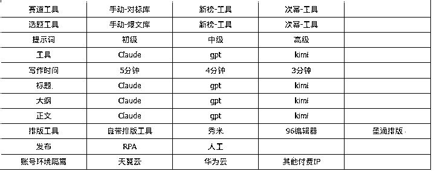

工具有成本，核心是 RPA。三条路：自己学 RPA（约 2 周）；付费找人代写；买打包课（通常最有价值的是 RPA 部分，其余更新有限）。

#### 1.2.3.3 路线三：个人品牌的长期路线（拓展）

1、面向个人 IP，AI 低于 20%，人工高于 80%。目标是把账号做成品牌，再导私域变现。

2、账号养成后，可减少对流量主生命周期的依赖。

3、要求长期输出观点，读者认可 IP 往往因为内容某一点打动人。

4、质量耗人力，变现周期长，普通人约 3 年，也有人 5 年，适合能坚持者。

推荐：第八章 个人 IP 与私域转化。

## 1.3 流量是怎么被推起来的

### 1.3.1 排序模型：系统如何判断匹配

推荐系统会看用户近期累计行为，关键有两项：统计周期（时间窗口）和用户标签。窗口动态细分，服务不同场景。系统计算读者与“账号+文章”的匹配度，这就是排序模型。它关注近期，如最近 x 时/天/周/月/年。

近期实时阅读、点击、点赞等；近期新增用户、点击、在看、完读等。

想深入可看 @肖旭东《👸号，与其推文自嗨，不如用术赚钱》。

### 1.3.2 赛马机制：一层层跑出来的爆款

#### 1.3.2.1 这套筛选逻辑是什么

这套逻辑不只用于👸号，抖音、快手、视频号等也常见。

1、为什么有它？

大平台每天海量作品，质量参差。平台需要好内容留住用户、提升活跃，因此要用高效机制筛选，赛马就是公认方式之一。

2、底层原理

以👸号为例，发布后会过去重、机审、原创检测等环节；任一环节有问题，可能被降权到低流量池，阅读停在几十，严重时直接发不出。

通过后进入分发，同期同类文章也在竞争。系统要把更优质的那篇送到相似人群面前。

怎么判断？先给几百人曝光，相当于让这批用户打分。分数体现在完读、点赞、转发、评论等数据：完读高说明看得认真；点赞多说明受欢迎；评论热说明有话题。

胜出者进入更大流量池，再与下一层比较；失败则留在当前层，胜出继续晋级。推荐反复叠加，阅读可能冲到 5 万、10 万、100 万甚至 1000 万。像多匹马分层跑，因此叫赛马机制。

### 1.3.3.1 怎样借这套机制放大结果

四个角度：

第一，避开过度拥挤的赛道，找蓝海。领域小没关系，写的人少，竞争文章少，更容易层层晋级。中国 14 亿人，再小的领域也有足够人群，爆起来十万加有机会。

第二，发布时间可错峰。对标晚上 8 点发，你可试 7 点；也可多时段测试，再到👸号网页后台内容分析里复盘，找自己账号更合适的时间。

第三，提升完读等指标。标题负责吸引点击，正文负责留住人。比如 960 多字起就能放两条广告，不必写太长，让读者更快读完，完读率可能更高。开头要有冲击力，中间和结尾埋钩子，引导继续看；文内适度提醒点赞、收藏、转发，和短视频结尾引导同理。

第四，与对标爆款做差异。人无我有、人有我优：对方笼统你详细，对方模糊你清晰；对方给三个角度，你给五个且更生动；对方标题一般却爆了，可拆解其命名方式再利用。做过视频的人会发现，这套逻辑通用。

## 1.4 合规底线与平台规则

这个项目靠时间积累：粉丝多，阅读可能高；阅读进池，粉丝也会增长。合规才能长久，不少船员因违规或忽视规则前功尽弃。官方规范如下。

### 1.4.1 🛰️公众平台运营规范（官方）

https://mp.weixin.qq.com/mp/opshowpage?action=newoplaw&token=464216875&lang=zh_CN

### 1.4.2 推荐运营规范（官方）

发文页滑到底部，找到“不允许被平台推荐”旁的问号，点开可见“推荐规则”蓝字，再点即跳转官方规范。

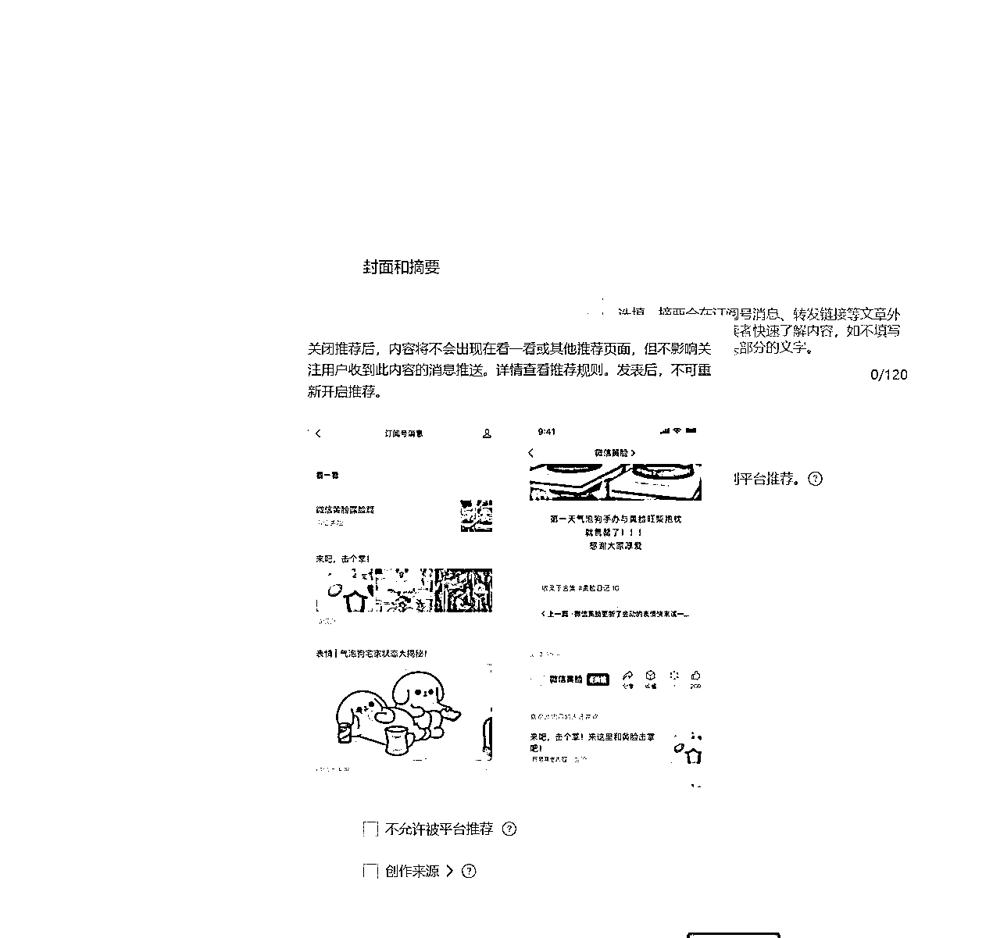

最后提醒：守住底线，不涉党涉政，不造谣诽谤。轻则封号，重则被请去喝茶。通常选好领域，按对标选题和风格写，除非故意越线，严重违规概率不高；对方文章能正常发出且未被删，说明选题大体可发。新手最容易踩的坑是滥用原创，多由洗稿造成，AI 洗稿尤其要警惕。

建议你先培养一种习惯：真正理解原文之后，用自己的语言把它复述出来，越细致越好——只要能做到，一般就不容易出问题。把上面这些要点落实，触雷的情况也会少很多。

# 二、【项目实操 1/3】明确创作方向，快速开通流量主

# 💡

# 章节导读

从本章开始，我们就要真正上手👸号爆款文章的实操了。想必你也有一些疑问：

从没碰过👸号，新手最好挑哪些方向？

有没有竞争不大、回报又高的分类？

听说要500个关注才能开通流量主，新号是不是得先涨粉？

别担心，学完这一章，这些困惑都会解开。本节的内容安排如下：

选定写作方向和类目

完成👸号注册

给账号做基础包装

把流量主功能开通

如果你准备好了，就跟我一起往下看。

# 💡

# 本章路线图

完成本章学习和实操后，你就走完了第一阶段：定好方向，备好两个号（约1天）

1.

确认1个写作方向，再拆出2个具体切入点（约1小时）

2.

完成2个🛰️👸号的搭建（约0.5小时）

3.

两个号各攒到500关注，开通流量主（约0.5小时）

现在，开始一步步落实吧。

# 2.1 选定创作领域和写作切口

# 2.1.1 哪些方向容易做出成绩

目前，👸号上已经跑通的方向有六条：

热点类——如吃瓜、民生、影视剧（常做常有）

历史类——如朝代、正史野史、人物（值得长线经营）

剧评类——如悬疑、职场、武侠（素材稳定，数量充足）

养老金民生类——如养老金、社会话题、房产（赚钱空间大，但门槛高）

美食类——如做菜、地方特色（素材易找、涨粉快）

小众专业类——如护士、辅警；抑郁焦虑、减脂（窄但稳定）

这六个方向，新手都可以从零起步。至于选哪个，可以参考【2.1.2】的评分方法，再借助【2.1.3】来判断竞争强度。当然，学得快、接受新玩法快的人，也可以留意一些刚兴起的赛道，具体见【2.1.4 项目延伸：蓝海赛道风向参考】。

给新手的建议是：一个主赛道，两个细分方向，持续输出，更容易看到结果。

本次航程会拿其中三个热门方向和往期的三个方向来示范，教大家把👸号爆款文章的写作套路吃透，再灵活搬到自己的领域里。因为这些内容通常由素材、选题、正文、标题几个部分组成，手册会在同一个章节里穿插不同文章类型的写法。比如「3.1.2 六个推荐赛道的选题方法」，就会分别讲剧评、热点这些类型怎么找选题。

# 2.1.2 如何判断哪个方向适合你

如果你是刚入门，我建议从“有兴致”和“有底子”两个角度去挑，两者能重合最好：

1、感兴趣的，你会主动想日更，哪怕没有收入，也愿意一直写。

2、擅长的工作或技能，你天然爱琢磨、爱复盘，越复盘，越厉害。

3、市场需要，你要判断现在是供大于求还是供不应求，竞争激不激烈，自己去感受，或者多翻翻同类账号。

4、愿不愿意改变自己的输出习惯，过去没有的，现在能不能下决心养成。

以上四项，每一项25分，你可以给自己打个分。

拿我自己举例，我选的是娱乐大类的剧评方向，当时是这样打分的：

1、兴趣：15分。因为我对剧不算狂热，平时要带娃、写稿，追剧的时间也有限。

2、技能与经历：15分。按知道、了解、熟练、精通来评估，一开始只有10分，后来慢慢提到15分。我知道娱乐领域可以做，但要摸得更透，整个写作流程跑顺了，才算真正精通。

3、市场需求：电视剧和电影的剧评目前还是刚需，没有到饱和状态，所以我给了20分以上。

4、输出习惯：这个格外关键，没有的话就必须去练，就像练写作一样，我给自己20分。

合计80分，完全能做。

总分为100分，低于40分就建议换一个方向；40到60分，要看看四个维度里哪个需要补短板；60分以上可以入局。分数越高，你坚持的动力就越强。

# 2.1.3 搭一个属于自己的对标资源库

1、搭建对标账号库

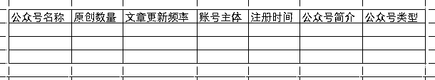

•建一个专门的库，把同行的账号信息存起来，再根据注册时间、更文数量、发帖频率、点赞转发情况把它分成A、B、C、D几个等级。

•这个库里可以收纳🧣、🛰️👸号、知乎、头条号、百家号等各种平台的账号，让你获取信息的渠道够广。

2、怎么找对标账号

•用某个关键词或话题去社交媒体平台搜索，可以找到与你领域相关的热门内容与账号；也可以借其他办法发现更多值得关注的号。

•这样做能帮你积攒更多素材，让你不断有新灵感、新信息。

•时不时更新一下资源库，把最有价值的账号留在里面。

3、对标账号要有层次

•选一个方向里粉丝多、互动积极的账号；（A类）

•选那种短期内突然跑出10w+爆款的账号；（B类）

•选数据稳定、阅读常年保持在2w上下的账号；（C类）

•选一直做得比较艰难的账号。（D类）

•A、B、C这三类账号的内容通常比较受欢迎，可以给你带来源源不断的灵感，也能帮你摸清受众喜好和变化；D类账号则是要避开的雷，别走同样的弯路。

•多关注这些账号，你能第一时间看到他们更新的文章、发布时间、封面图长什么样，以及简介是怎么写的。

4、坚持刷对标

•建好资源库之后，一定要多刷、多看，这样才能了解当下的热点和用户口味，做出更抓人的内容。

•刷对标不能三天打鱼两天晒网，定期去做，才能持续感知行业的风向。

内容来源：《👸号爆文进阶教程》

# 2.1.4 项目延伸：蓝海赛道风向参考

# 💡

如果你已经能写出不错的爆款，想去找一些更新、更冷门的蓝海市场，下面这些方向也许能打开你的思路。

我们经常在龙哥盟星球看到一些细分的蓝海案例，比如“生僻字”拆解、茅台酒报价、大厂“工资泄露”这类小众玩法，也能做到很不错的流量。

这里我们把这些方法整理成一张清单，方便你随时查看；后续也会持续补充，免得错过有用信息。

因为蓝海方向变得很快，时不时就会有新玩法冒出来，所以我们收集了👸号爆文最近三个月的风向，供你参考（每周更新）：

推荐方向

参考链接

发布时间

新奇特赛道

https://t.zsxq.com/qOE1V

2024/8/19

图片分享号

https://t.zsxq.com/Rsw98

2024/8/12

热点赛道

https://t.zsxq.com/IVtgt

2024/8/8

企稳趣事

https://t.zsxq.com/rl3Hj

2024/8/1

图片分享号

https://t.zsxq.com/Rsw98

2024/8/5

MBTI

https://t.zsxq.com/TwcIH

2024/8/2

旅游攻略

https://t.zsxq.com/hEvaK

2024/7/30

职场赛道

https://t.zsxq.com/aV0AX

2024/7/24

中老年赛道

https://t.zsxq.com/i00yL

2024/7/23

汽车领域

https://t.zsxq.com/Py1Tj

2024/7/22

公文素材

https://t.zsxq.com/e813x

2024/7/15

教育赛道

https://t.zsxq.com/87Hv9

2024/7/3

教育赛道

https://t.zsxq.com/LPums

2024/7/3

教育赛道

https://t.zsxq.com/3TyJ0

2024/6/28

二次元

https://t.zsxq.com/66cx8

2024/6/28

离职赛道

https://t.zsxq.com/tF1q8

2024/6/24

AI图片生成赛道

https://t.zsxq.com/A9PLZ

2024/6/21

AI图片生成赛道

https://t.zsxq.com/AoowB

2024/6/20

书籍拆解

https://t.zsxq.com/iprV5

2024/6/19

社会故事+普法类

https://t.zsxq.com/EGxhh

2024/6/18

教育赛道

https://t.zsxq.com/BfFCn

2024/6/17

职场赛道

https://t.zsxq.com/blCzA

2024/6/14

世界杯

https://t.zsxq.com/62WMp

2024/6/12

中年赛道

https://t.zsxq.com/EHx45

2024/6/11

国学赛道

https://t.zsxq.com/TLCAQ

2024/6/4

付费软件序列号分享

https://t.zsxq.com/uq7F6

2024/5/31

国学赛道

https://t.zsxq.com/vtZrl

2024/5/31

游戏赛道

https://t.zsxq.com/HmOYC

2024/5/30

游戏赛道

https://t.zsxq.com/X9sYc

2024/5/30

情感赛道

https://t.zsxq.com/K4U8u

2024/5/30

AI图片生成赛道

https://t.zsxq.com/MGzyA

2024/5/28

# 2.2 注册👸号的具体操作

第一步：备好身份证、银行卡

新手的话，建议一次准备两个号。为什么是两个？一是为了分担账号违规带来的风险；二来也能应对不确定，万一某个号一直没流量，你也不会因为只有一个号就怀疑人生。

注意：一张身份证和对应的银行卡，只能注册一个👸号。也就是说，个人身份最多注册1个（除非你是个体工商户、企业以及其他组织，可以注册2个；政府或媒体可以注册50个）。

想用两个号，借家里人的身份证来注册就行。

第二步：走完注册流程

先进入🛰️公众平台 https://mp.weixin.qq.com/ → 点右上角的“立即注册”，系统会跳到注册页面，选“订阅号”，再按提示把资料填好就可以了。

# 2.3 给账号做包装

给👸号做门面，其实就两个重点：名字和介绍文字。对大多数刚起步的朋友来说，起一个和自己内容相关、好记的名字，再配一段简明介绍就够了。

如果你打算长期深耕某个方向，也可以研究一下👸号SEO；不过这次航海的重点是写爆款，所以这里先不展开。精力比较多的朋友，可以翻翻 @郭耀天 的《最新👸号 SEO 核心玩法，自动引流躺着赚钱》。

# 2.4 开通流量主功能

账号注册好之后，要用500个关注来解锁流量主。花钱买粉是见效最快的方式，而且不会拖慢后续流量起来的速度。这类买卖在某宝随便搜搜就有，不过多展开。

不过要提醒一句：刷粉有被封号的风险。买粉的话，你要做好号可能没了的心理准备，最坏也就是注销重来；平台查得一阵松一阵紧，最好多到航海群里问问，及时跟上最新动态。

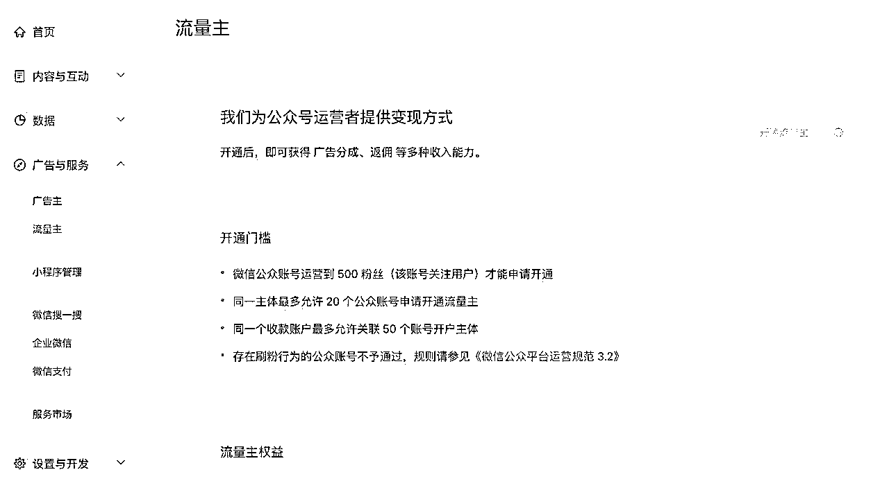

流量主开通之后，先挂上原创并群发三篇文章，打赏功能就会跟着开放。账号的头像、名字，和打赏页面显示的头像、名字，尽量保持一致，这样会显得更有真人感。

到这里，开号前的准备工作就差不多了。这些细节完全不用太纠结，真正重要的是把内容做扎实，其他都是次要的，别捡了芝麻丢了西瓜。

# 三、【项目实操 2/3】爆款写作与发布实操

# 💡

# 章节导读

这是整个项目里最核心、最花时间的一章。

一篇👸号文章，无非是选题、正文、标题三件事。

选题是骨架，决定了文章最终长什么样；正文是血肉，负责把细节填满；标题像外套，决定了别人在信息流里能不能一眼看中你。

这一章，我们就按这个顺序来拆解。

第一节：找到合自己胃口的选题

第二节：写出让人愿意读完的正文

第三节：做出打开率更高的标题

❗️每一期手册它都会更新，如果你是上一期就来过的老船员，下面两处新增/改动的内容值得重点关注：

3.1.5 好选题的三个特征

3.3.4 点击率超过70%的标题秘诀

希望大家持续练习，把爆款能力真正练出来。加油，等这个阶段走完，你离第一笔爆文广告收入就不远了。

# 💡

# 本章路线图

学完并且动起手来，你就走完第二阶段：爆文写作与发布（大约需要5-7天，每天投入3-5小时）

1.

用“搜一搜”找低粉爆文，先筛出3-5个对标账号（约1小时）

2.

照着对标选题，完成1篇正文写作（约3小时）

3.

学一下“开幕雷击”这种开头写法，再磨一版高点击标题（约1小时）

4.

每个号每天至少更新1篇，想办法让账号进池子（每天3-5小时）

现在就开始行动吧。

# 3.1 把选题拿捏住

# 💡

# 小节导读

👸号这个圈子里有句话流传很广：“选题定生死。”这和卖货一个道理——你选什么品，直接决定了你面前的人群有多大。

我们这一节会集中讲几个快速找选题的技巧。

第一部分，会告诉你怎样只靠一个词，不停地往外发散，就能找到一周甚至更多的写作方向。这套方法，不管什么内容领域都能用。

第二部分，我们来拆六个赛道——职场、热点、剧评、法律、历史、情感，分别说说每个方向的选题窍门。

最后，还要聊聊那些容易踩的“坑”。开头说“选题定生死”，一点都不夸张。要是选到特别危险的题，后果可能很严重：轻一点是文章被删，重一点就是整个号都没了。那要怎么办？这一部分会给你讲明白。

好，准备好就继续吧。

# 3.1.1 找选题通用策略：用“🛰️搜一搜”挖对标爆款 @枫宇翔

对新手来说，最快见效的选题方式，就是找已经有结果的对标爆款来模仿。那怎么找呢？

最常见的方法就是打开🛰️搜一搜，用你的领域关键词去搜，照着那些爆款文章学习；只要用几次，🛰️的推荐算法就会不断给你推类似内容，相关文章会越刷越多，所以这条路是眼下最省时间的。

# 3.1.1.1 关键词怎么定

看到这里，你应该已经学完2.1节，知道自己的方向了。

第一，先把第一个关键词定下来。

选定领域之后，比如三农、军事、情感、法律等等，你要根据平时积累的经验和常识，先想到一个词。

拿我来说，如果写情感，我第一反应就是婆婆、婆媳这类词，去搜一搜，基本一定能翻出爆款。

我之前还推荐过一个方向：大厂裁员。那关键词自然就是裁员、毕业、失业、降薪、减薪这些。

如果一时想不到更好的词，那就直接用领域名，比如“三农”“情感”，到🛰️搜一搜里先找第一篇爆款，虽然会慢一点，但也能起步。毕竟你给的词越准，找得越快。

比如写这段文字的时候，我就在🛰️搜一搜里敲了两个字：“裁员”。

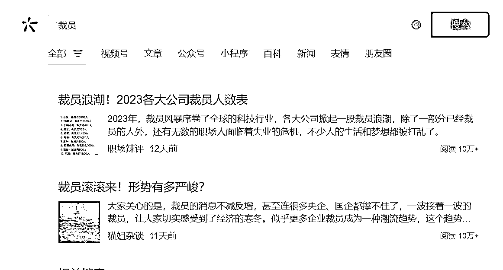

你看，很快就刷出了10万+的文章。只要找到第一篇爆款，你就拿到了第一个对标账号。这一步千万别省，因为这是从0到1的关键环节。

有了对标账号之后，你就能进入下一步：继续挖更多关键词。

第二，像套娃一样，一层层地拿新关键词。

👸号的爆款，很大程度上赢在标题，而标题里往往就藏着这个赛道最有流量的词。

你先翻翻对标账号，挑几篇阅读数几万甚至10万+的文章，把它们的标题都摘出来。

上面我搜“裁员”，搜到了“职场辣评”和“猫姐杂谈”两个号。我点进“职场辣评”随便一看。

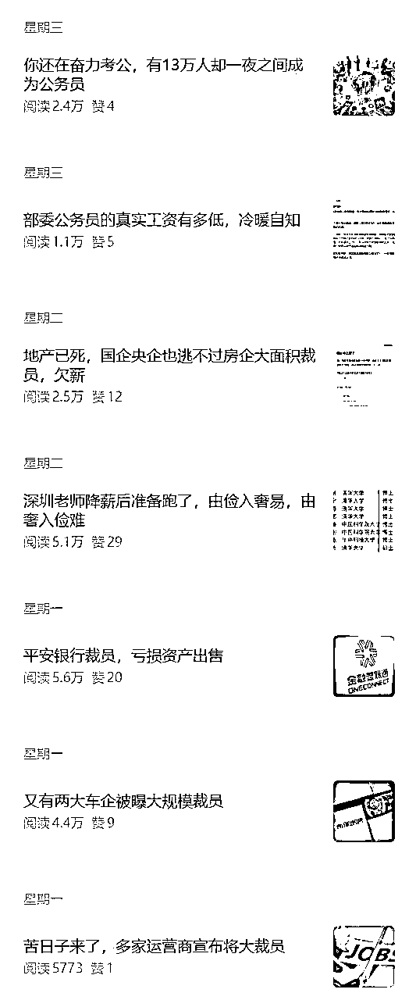

看这张截图里的标题，国企央企、欠薪、降薪、亏损……这些都是关键词。你还可以直接拿这些标题再去搜一搜，过不了多久又能刷出一批新爆文和新账号。重复这个动作，你就能不断挖到新词，像套娃一样无限拿到爆款和对标。

其实也有一些第三方工具可以用，但我没碰过，感觉太麻烦。我的套路很简单：粗暴，但见效快。

顺带一提，其他平台比如头条，里面是有频道分类的。你写军事，就点进军事频道，一下子能看到大量文章，标题里全是关键词，一个个拎出来就好。

有人说文章正文里也藏关键词。确实会有，但我懒得逐个看，直接从标题下手——毕竟大家第一眼就是被标题上的词勾住的。

# 3.1.1.2 怎么挑对标爆款

要判断一篇文章能不能当对标，看几个硬指标就够了。

第一，在搜一搜里找到文章后，优先挑10万+的爆款，其次才是七八万阅读量的。

第二，发布时间要在最近三个月内，越新越好。原因很简单：曾经爆过的东西，大概率还会再爆。最近有人用这个选题爆了，说明现在有流量，你去写，爆的几率依然不低。

第三，上面两条都满足后，再看这个账号是什么时候注册的，最好也是三个月之内。为什么？因为有些号注册时间长、粉丝多、原创也多，那篇爆款可能是靠老粉撑起来的。我们要找的是低粉爆款，因为这些号跟我们处在同一起跑线，他能爆，你也有很大概率能爆。

# 3.1.1.3 怎么拆解一篇爆款模板

# 别急着写：把样稿拆成自己的结构

要复制一个高阅读样本，先别碰键盘。选一篇已经验证过的文章，逐段看完。然后自问：它真正想说服读者什么？把答案压成一句。接着按“起笔—推进—收束”三个位置，用你的话再讲一次。以那个职场辣评号为例：两篇样稿分别写房企和大厂突遇裁撤、工资停发、员工半夜接到离场通知。题材不同，落点相同：人员优化没有预警。可抽象出框架：开篇交代公司处境；中段解释外界眼中的铁饭碗为何也动刀；末段归纳并给建议。看样稿要留意语气的换挡词，像但、为何、不过、然而；它们一出现，作者通常要转层、加深。把换挡前和换挡后分别缩成一句，框架自然显形。其他领域也有类似提示词。中文写作讲衔接，转换话题若没有过渡，文章会硌人，口头表达也一样。具体赛道有具体套路，手册面向不同人群，不能只给一个模板；真正要带走的是拆解方法。回到自己的领域，手动拆几篇跑量稿。对标号和样稿都摆着，先做案例。若看不懂，先照着结构临摹，写多了手感自然长出来。

# 3.1.2 六条赛道怎么定题：原理先行，模板后置

# 💡 提醒：平台规则和市场一直在变，下面这些方向未必能一直吃香。本章真正要学的是底层逻辑，学会后可以迁移到别处。

# 3.1.2.1 职场线：从脉脉挖“人员调整”题 @枫宇翔

先把职场分细。这里讲互联网企业裁撤与薪酬外泄的找题法。去年我在直播和多个场合反复推荐：经济环境承压，公司降本提效，岗位持续优化，公众很在意被裁、待岗消息。这类人爱在职场社区倾诉、爆料，选题就藏在里面。最典型是脉脉。登录后刷互联网公司动态，或搜公司名，会看到成批员工发帖。

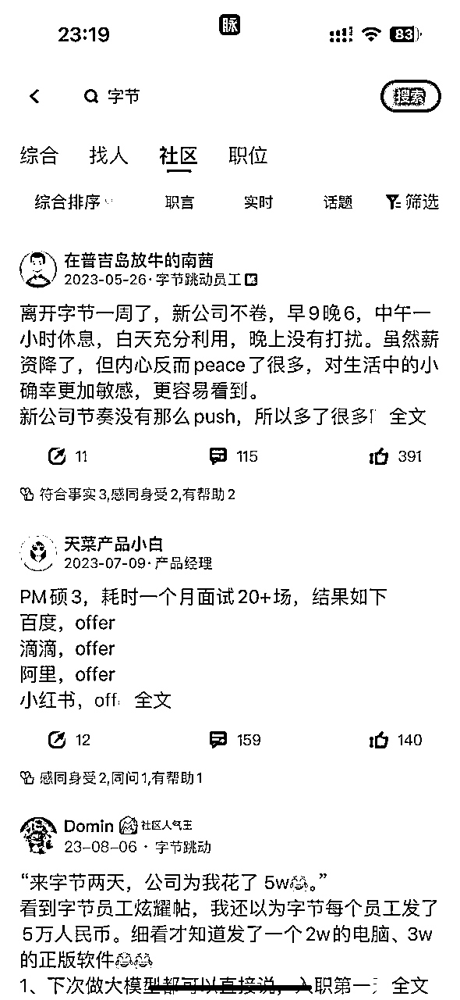

这些公司自带关注度，帖子也容易被读者点开。把正文和评论区截进文章，再加你的分析。被裁、欠薪、薪酬泄露等题已被验证能跑量；手册7.7那条线有参考号，从2023年12月19日起更打工圈内容，覆盖裁撤、薪酬外泄等，数据不错。脉脉以互联网公司为主，可迁移到体制内、设计、地产；头条、百家号、抖音、快手也能搜。你若在这些行业，专业网站或应用里会有一手线索；我是程序员，所以更关注互联网。注意三件事：一，人员调整、薪酬外泄只是入口，脉脉能挖更多方向。二，这类料受关注也易被企业公关盯上；只讨论网友公开评论，不脑补、不造谣、不引导攻击，保持客观，借消息表达打工态度。看参考号怎么写。三，渠道不止脉脉，问答社区、豆瓣、BOSS直聘都能找；社会新闻、老板谈人员优化也可写。参考号的内核是打工加裁撤，外壳常变。

# 3.1.2.2 热点线：先分读者，再挑榜单

热点优先从榜单挑。我常看🧣与知乎，但不同子类方向不同。

社会批判型：读者多为上了年纪的男性，专评不公。挑题时知乎优于🧣：前者负面曝光更猛，后者榜单修饰更多、力度弱。还要注意：知乎有些高赞回答有流量却上不了榜，它们更尖锐、更容易跑量，因为靠逐赞顶起，情绪已被调动。挑题就要找这种见血内容。顺序：知乎自然高赞 > 知乎热榜 > 🧣热榜。

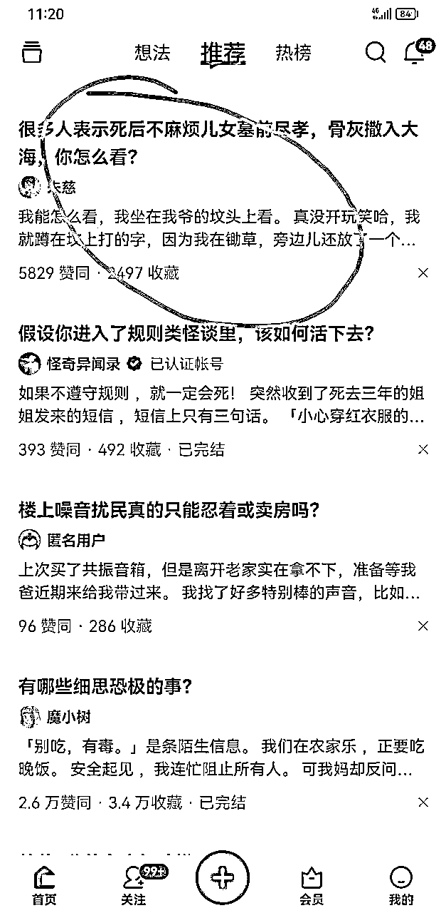

娱乐追热点型：读者偏年轻女性，追当下娱乐话题。多数作者把🧣榜单放第一，一天多刷。看到“热”可选，“沸”优先，“爆”要当天尽快出稿，否则流量滑坡。顺序：饭圈小道消息 > 🧣热榜 > 知乎热榜。

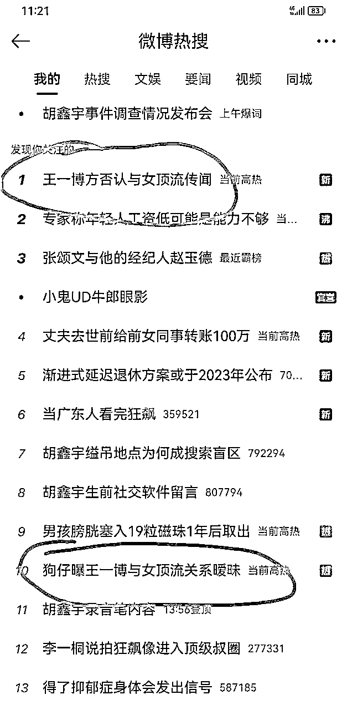

银发科普型：读者为上了年纪的人，男女都有。这里的养生偏古话，如“立春三不吃两不喝”。老人对疾病、死亡焦虑重，这类内容阅读量高。做法：结合农历节气和榜单健康话题，但只能往古代习俗靠，不能给医学建议，否则严重违规。顺序：节气 ≥ 🧣等平台健康类选题。

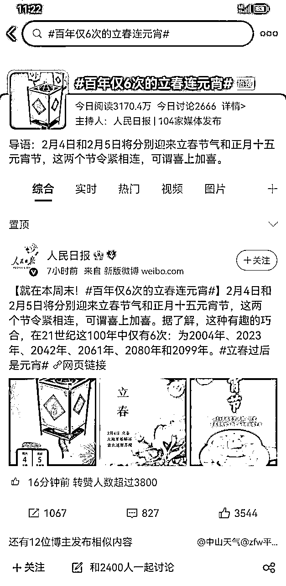

其他子类我接触少，留待以后。

# 3.1.2.3 剧评线：新片热度与旧剧深挖

两条路：热点+剧评，如《满江红》正火且评价分裂，此时连写多篇角度新奇的影评可吃流量；经典老剧，如《知否》《甄嬛传》《大明王朝1566》，受众大、信息密，一个细节能拆多篇，给一部剧写几百篇都不夸张。两条都可做。

# 3.1.2.4 法律线：选新闻看情绪与要素

新闻尽量选官媒报道过的，投诉少。避开时政军事，写邻里纠纷、生活琐事等民生新闻，贴近普通人。能跑量的新闻多是这类。所以不必非去🧣知乎找，地方新闻栏目也能用。看到让你血压升高的就选，没感觉就放弃。理智做法是对照“开幕雷击七要素”：占两条以上优先，仅一条慎用，一条不占绝不用。法律条文用搜索引擎查，关键词抓故事本质。比如有人把头打破，就搜“头部轻伤如何判刑、如何赔偿”，取资料汇编进段落。

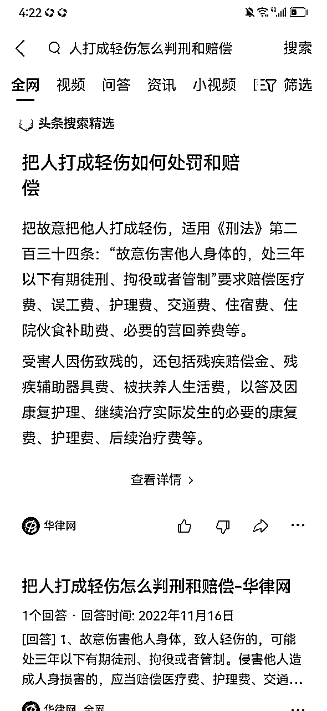

# 3.1.2.5 历史线：借热点，也写偏爱的人物

两套打法。

1、追热点：某演员生女引发热议，可找历史上重要人物出生或添丁引发大反响的案例，但契合度必须非常高，经验不足别写。类似，县长贪腐新闻可借写古代官员贪赃如何处罚；明星和粉丝话题可写古代追星狂热，《大宅门》白玉婷嫁尚筱菊照片就有原型。

注意：追热点历史契合度要高，还要从今观古，写作功底要求高，可日后慢慢练。

2、中规中矩：按自己想法写喜欢的人物和事件。写得高兴最重要，可选敬佩、讨厌、惋惜、催泪的人物。定人物后确定基调，梳理事迹，给基本概括：敬佩、同情、肯定还是毁誉参半；全文围绕一个思想写，问题不大。写隋炀帝，绕不开劳民伤财、暴政、急躁；写唐太宗，可用虚心纳谏、宽厚爱民打光。资料少但喜欢的人物，可从其前人后人、身边人角度写，也可适当编撰，但别太假，假故事为真性格服务。圈友@一来试过近代史：写历史可涉及。近代史起号较难，常需一个月甚至更久，有不确定性；进流量池后阅读量较稳。参考“飞扬说史”，每天有大小爆款，缺点是文中常没广告。来源：6月8日《👸号流量主的经验分享》@一来。

# 3.1.2.6 情感线：素材至少凑三处爆点

情感爆文要有爆款潜质素材，去各大平台找灵感。

比如能共鸣、感人至深、有争议、事出异常的素材。包含：1 有曲折性；2 有情绪；3 有信息增量；4 有关民生问题；5 明星名人；6 性；7 暴力；8 金钱。一个故事至少含3个以上。

# 3.1.3 定题避坑：三类内容别硬碰 @半糖梦呓

👸号是公域流量，措辞要小心。题材踩坑，写得再好也难爆；用违禁词也可能被打压。避三类。

# 3.1.3.1 政治底线：党史军史别写

平台每月封几千上万账号，大部分很黄很暴力，也有一部分踩政治红线。什么红线？记住党史、军史。写文史尤其注意。党和军队是正面形象，只能写正面；要安全，1840年后与中国有关的最好别写。民国人物历史慎写，新手最好不碰。文史敏感，自媒体人要守使命，不该说的话一个字别多说；敏感历史事件人物一根头发丝都别碰。喜欢历史怎么办？新手从古代史入手，最好中国古代史，安全、受众广、话题多、易出爆款。

# 3.1.3.2 热点伦理：别拿逝者做戏

追热点是自媒体天职，但有一类热点公域平台绝对别碰：吃人血馒头。例一，二更食堂曾百万粉，滴滴空姐被害后编造无中生有情色猥琐情节侮辱死者，被封，没余地。

例二，今夜90后，孩子和母亲吵架后跳桥，虚构细节博眼球，后被证明杜撰，同样被封。

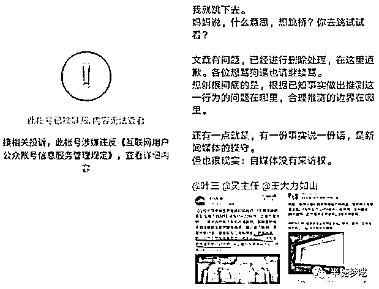

利用逝者大做文章、编造细节、夸张性暗示，吃相难看。网络不是法外之地，不是道德禁区。中国人认为死者为大，拿逝者做文章会激起众怒。有人问：不吃人血馒头、不脑补造谣，只站小老百姓角度评社会行不行？不行。一不小心挑起社会对立、煽动仇恨；那么多正面事件不看，专盯负面，不封你封谁？

# 3.1.3.3 资质门槛：财经健康先认证

有小伙伴问半糖：昨天发微头条竟被官方删除？

问清楚后发现，没财经资质却写财经。财经、健康需要职业认证。没认证，要么限流，要么删文，做不大。头条官方有明确门槛：财经满足22种职业中任意一种并提交证明，如经济学者、财经评论员、市场研究员、分析师、基金经理、注册会计师、证券经纪人等；健康满足10种中任意一种并提交证明，如医生、护士、药剂师、康复治疗师、营养师、心理咨询师等。具体看头条职业认证标准。

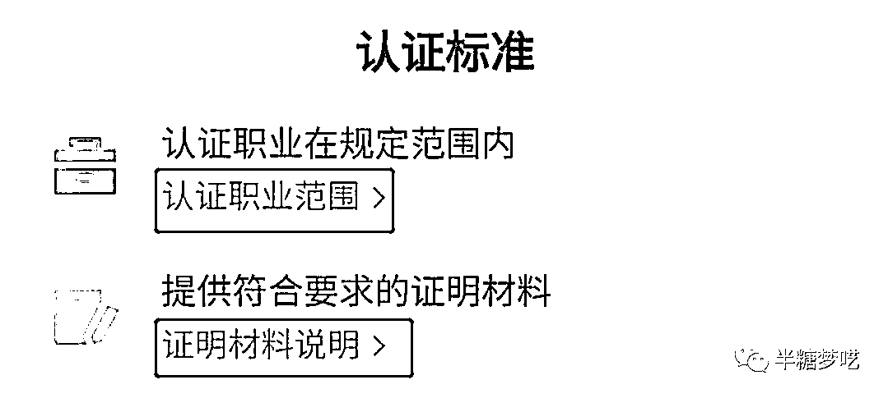

都不满足，财经健康就别碰，这是非专业人士禁区。以上三个禁区是明面上不能写的内容，公域平台共通。避开后还有细节。先查违禁词。用句易网🛰️👸号粘贴内容查询，系统自动过滤。查后可能意外：天天挂嘴上的词怎么也违禁？具体自己试。若没违禁词仍限流，找标题党嫌疑。举例：上周小伙伴问半糖，这篇微头条被警告怎么改？原开头：闺蜜和前夫打电话要退1000000，她爆骂后拒绝。他又发照片和信息：晚上8点来我家。她看着照片眼泪夺眶，恨不得打死自己。系统警告“刻意隐瞒关键信息”。

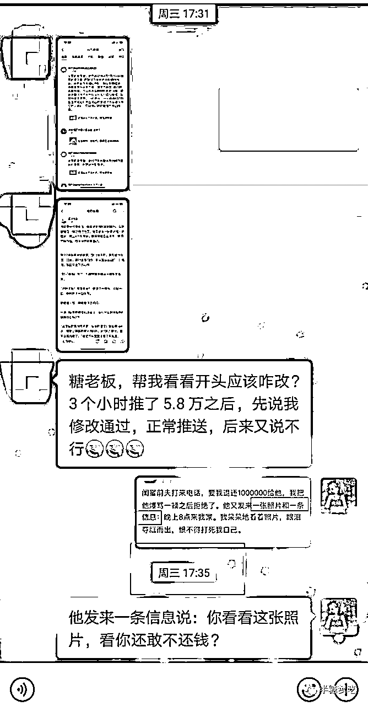

通俗讲就是标题党。被全网戏谑的UC震惊体是翘楚：故弄玄虚、小事夸大、隐藏主语；读者被标题吸引，看完觉得智商被按地摩擦，有被强奸感。读者取关拉黑，平台也被骂。平台不傻，有UC扑街史，谁还做一锤子买卖？于是加大打压。学员开头“一条信息和一张照片”就是故弄玄虚，所以限流。半糖建议改成：“他发来一条信息说：你看看这张照片，看你还敢不还钱？”意思一样，没隐瞒关键信息。

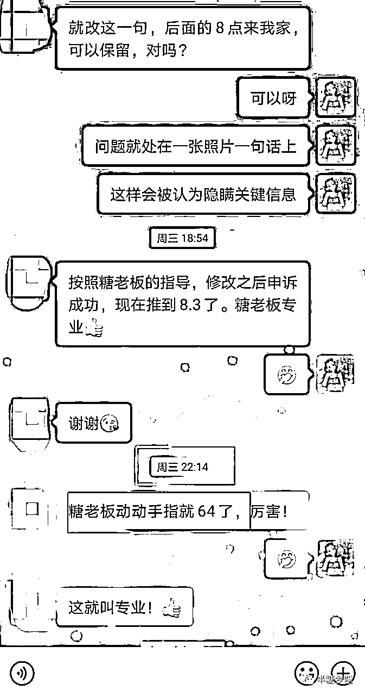

4小时后，这篇微头条爆63万+。很多扑街文改成爆款，就一句话的事。但大部分人稀里糊涂，文章静悄悄扑了，想破头不知问题在哪，其实某句话甚至某个词踩坑。总结避坑题材：1 政治不能写：包括党史军史、时政热点、国家领导，除非有互联网新闻信息服务许可证；2 追热点不吃人血馒头：就算不造谣，站小老百姓角度评判社会也不行；3 财经健康需要资质；4 公务员、体制内不要写，容易违规；5 黄赌毒不要碰；6 媚外内容不要碰；7 娱乐负能量事件和艺人不要碰，除非官方发话。来源：《今日头条七大变现方式，我只用一种，半年赚80000》。

# 3.1.4 定题技巧：同质化里找差异 @张波

选题要有差异化。内容差异化低，千篇一律，很难脱颖而出拿流量。很多情感方向还在写那些事，看的人早没新鲜感，除了自嗨看的人越来越少。选题要分析，下面两个例子不太准确，希望能启发：千篇一律看的人越来越少，一个人顿顿大鱼大肉也会吃腻，要找差异化。观点+情绪

分析领域内账号写作角度。比如观点+情绪导向，很多账号写正观点+正情绪，特别拥挤；你可写不同观点+正情绪，也可写正观点+不同情绪。这样就有差异。

**2024年养老金调整：四种标题写法示例**

同一则政策新闻，换一个立场、换一种情绪，标题的吸引力就完全不同。下面是四组差异明显的示范。

- 正向视角＋正向情绪：《2024年养老金新政来了？工龄满30年，涨幅能到10%？最高8万元？一探究竟》
- 反向视角＋正向情绪：《多数人还不知情！养老金今年要按缴费年限算：满30年，一年多领240元！三种人赚到了》
- 反向视角＋正向情绪：《别只顾着高兴！中央已明确：2024年起，3类人停发养老金，缴满15年也没用！快查》
- 正向视角＋消极情绪：《2024年养老金真要“20连涨”？不到3651元的涨10%，超过6400元的反而不涨？能同意吗？》

热点＋领域

观察同赛道账号的写作角度会发现，最常见的组合是“热点＋领域”。但这个方向挤得水泄不通时，可以换个思路：去写“热度稍低的话题＋本领域”，也可以做“热点话题＋其他领域”的交叉搭配。

举例：

热点＋娱乐：
《娃哈哈创始人宗庆后去世，众人惋惜，为什么只有王力宏说得一针见血？》
《嫌王力宏老，买下百万名表，她是42岁的娃哈哈新掌门》

热点＋情感：
《宗馥莉又上热搜了，这次是恋爱！知道男方是谁之后，我眼眶红了……》

热点＋业务：
《来了！不接下娃哈哈的大楼设计，我怎么对得起宗庆后和全国网友的热情？》

参考：《👸号文章内容质量提升教程》
https://k170ac9yh31.feishu.cn/docx/KbupdqExXo8z9pxL5RqcUzJOnfb

# 3.1.5 什么样的选题更容易出爆款？三个共性特征@开卷🌀

关于找选题的具体方法，航海手册里写得很详细。这里只补充一点个人体会：我能把入池率做到100%，靠的就是在选题上比旁人多花了一些心思。

刚开始做号时，我也在不同账号、不同选题之间反复试。但人的精力和时间是有限的，必须想清楚哪些题目更值得押注、哪些更容易出爆款。这个问题一度让我纠结了好几天。

后来总结下来，凡是大几率能进池子、而且阅读数据不会差的选题，通常都躲不开下面三个特征。

# 3.1.5.1 选题里必须有一个“异常”点

新闻界有句老话：狗咬人算不上新闻，人咬狗才是新闻。

带着异常属性的选题，天生具备新闻感，也天生自备流量。只要你写得不太拉胯，阅读量大概率是好看的。

举个自己的例子：“做自媒体月入五万，我却想回公司上班了”。

你可能会说，这是靠“钱”这个元素吸引人。但我观察到的现象是：单纯带钱的因素的文章不一定会火；而我写过的内容里，只要带着反常点、有看点、正文又不水的，基本上都爆了。这背后的催化剂就是“异常”。

后来我看到，我的百万爆款被别人仿写，但数据都很平淡。为什么？因为这些作者把我文章里最重要的“异常”给删掉了，整篇文章从有看点的叙事变成了“顺拐”的鸡汤。

你来看三条标题，猜猜哪个题目会爆：

1、寒心！男子被狗连咬三次，现场竟无人伸援手！
2、震惊！男子被狗连咬三次，竟在大街上干出这种事……
3、怒了！男子被狗连咬三次，反被狗主人索赔五千块……

答案我不直接说。选题看多了，你自然会有判断。

# 3.1.5.2 同类选题中，已经有3篇以上10W+，爆的概率更大

我第一篇突破百万阅读的爆款，就是因为看到好几个账号都用类似的选题写出了10W+。后面那些50W+、20W+、10W+的文章，选题也都有一个共同点：至少能找到三篇爆款打底。

有一次我遇到一个特别感兴趣的选题，但翻来翻去只找到两篇10W+，我犹豫了一下还是写了，最终阅读量停在5W左右，心里多少有点可惜。

为什么把“10W+”当作一个参照线？道理很简单：同样的时间，写出一篇10W+，相当于写出两篇5W+，单位时间里的产出效率完全不同。这也是手搓党想靠质量去弯道超车时，最值得参考的一个指标。

# 3.1.5.3 选题不需要多高大上，重要的是给读者留出讨论空间

这条规律在抖音、📕、👸号上都成立。

头部玩家的百万爆款，可能来自博主独到的洞察；但普通人的百万爆款，往往只是抓住了一个能让大家都想插几嘴的话题。

比如说：

高考分数只高过一本线十几分，是去普通一本院校，还是挑个好一点的二本？
手里就三百万预算，该买市中心的老破小，还是郊区的大平层？

这类话题没有标准答案，却是大众真正关心的。讨论热度一起来，很容易跑出爆款。

我做👸号航海项目能走得比较顺，很大程度上是因为初期把八成的时间都砸在了选题上。

有人会问：数据网站的会员是不是必需品？

我的答案是：新手期至少不是。不管做抖音、📕还是👸号，新人进场的第一件事，都是先把平台的内容生态摸熟。如果自己不亲手去刷去读，根本分不清楚什么内容好、什么内容一般、什么内容很烂。

数据平台确实能让你迅速定位高数据内容，方便是方便，可问题也恰恰藏在这里。好坏永远是相对而言的——新人只盯着“数据好”的内容看，反而看不出它相对其他内容的优势所在，更判断不出它是偶发爆款、账号权重高，还是内容本身真有价值。

所以在打基础的那个阶段，我的内容全部手写，选题也全部手动去刷。这是任何一个新人只要想在这个行业做长远，就必须经历的事情。我也是真心相信，想深耕内容的人，这一关躲不掉。

以后我会不会用数据平台？可能会。

因为我现在已经明显感到：如果一直靠手刷选题、手写文章，哪怕全职来做，一个人同时运营五个账号，脑力和精力也已经拉满了。想把盘子做得更大、人更轻松，就必须在对平台有了真切理解之后，借助外部工具去提规模、提效率。

内容来源：《👸号新手实现百万爆文，单篇收益6000+，单账号变现5位数》

# 3.2 正文怎么写：先套框架，再装内容

# 💡

**本节导读**

多数文章的正文，其实都有模子可依。我们要做的，不过是照着现成的框架去收集素材，再把文字填进去、打磨一遍。

这次航海涉及的五类内容，各自的爆款骨架大致如下：

职场向：标题 → 故事主线 → 网友争论点 → 总结建议
热点向：标题 → 基本事实 → 态度立场 → 收尾
剧评向：标题 → 剧情 → 观点或剧情拆解 → 收尾
法律向：报案发地 → 摆冲突 → 讲事件 → 看网友 → 引法条 → 给对策 → 促互动
历史向：先提问，后解答
情感向：标题 → 主人公 → 故事主干 → 收尾

下面一类一类拆开，看看这些模板具体怎么用。

# 3.2.1 职场类：故事文的万能模板@枫宇翔

职场故事文的套路，可以归纳成四个词：标题、故事主干、网友争议点、总结建议。

按我的判断，一篇职场文能不能成，七成以上的功夫都花在标题上。标题过了关，进了流量池，正文怎么写都能有不错的阅读量。

如果让我只留一个最简单的模板，那就是两步。

第一，定下选题，把主题的截图放到文章最顶部，然后对着截图展开分析，把原因聊透；第二，从评论区里挑出网友的不同观点，重点选那种吵得不可开交的，放进文章里做对比拆解，最后补上你自己的判断。

这里给一个可以直接观察的对标号：以前叫“程序员圈儿”，现在改叫“职场故事荟”。这位作者的强项是编故事，偷懒的时候也会只用一张图，或者截几张网友评论区的图就开聊。

还有一个建议：分析原因、讨论话题的时候，尽量用故事去包装。干巴巴的讲解没多少人爱看，一旦换成有情节的故事，吸引力会完全不同。多翻几遍这个账号，你大概就能体会到。

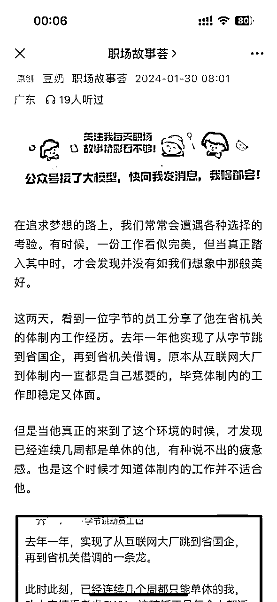

# 3.2.2 热点类：一套可以通用的结构

热点文的整体框架可以写成：标题、基本事件、态度观点、结尾。

# 3.2.2.1 模式一：龙骨与龙鳞

把一篇文章想象成一条龙。事件的梗概是龙骨，起支撑作用；那些零散的金句、观点、细节和态度，是龙鳞。

龙骨的任务特别简单，就是把事情讲明白。如果事件本身太复杂，需要花很长的篇幅才能说清楚，那就只挑一个侧面讲透，千万不要追求面面俱到。事情一大，文章就长，完读率就会大幅下滑。

龙鳞的用法有讲究。过去写真实故事时，龙鳞要用来铺陈细节，让故事看起来更可信。可现在写热点，新闻就是真实发生的，不需要再用细节去证明它的真实性。硬要往上加，反而会引发负面效果——二更食堂出过的那次事故就是个教训。

在热点文里，龙鳞的任务只有一个：表明态度、亮出观点、选边站队。除此之外，它不需要承载任何别的东西。

热点文的写法也没什么玄机。当你叙述一件事，情绪涌上来的时候，就直接用文字把那股情绪写出来，用来吸引跟你同频的读者。记住这一点，就足够用了。

# 3.2.2.2 模式二：不同深度，两套公式@妞妞💋

入门版热点文＝标题＋开头＋事情经过＋结论（参考账号：泡哥看世界）

进阶版热点文＝标题＋开头＋事情经过＋横向对比（可省略）＋结论（参考账号：桌子的生活观）

把公式拆开来看：

1）标题：50字以内，最好自带“开幕雷击”效果。

比如：突发！“中石油牵手门”男女主再曝大料，这背后可不简单

2）开头：100字左右。可以写几句自己的感悟，也可以直接切入正题。

几个常见的开头姿势：

① 生活总会送来一点小意外。就像成都那位街拍小哥，随手一个镜头，就拍出了一位国企大领导的“牵手门”闹剧。

② X月X日，有个话题登上了热搜。“宝妈因孩子吃了同学生日蛋糕发飙”的新闻很快引发全网讨论，事情到底是怎么回事？

③ 谁都没想到，在珠穆朗玛峰上也会发生这种事。近日，#珠峰攀登者放弃登顶救起濒死女子#的消息冲到热搜第一。

④ 大家还记得十天前那位在校园里被老师倒车碾压致死的小学生吗？噩耗还在耳边，又一个打击来了：孩子妈妈在孩子离世后的第十天，从24楼跳了下去。

开头的写法很多，挑自己顺手的那一种就行。

3）事情经过：500字左右。把时间、人物、地点、事件经过完整讲一遍，配几张现场图。

4）横向对比：300字左右，这一步可做可不做。事件正处在热度高点时，可以果断省略；热度不够时，补上更好。做法是找一两个同类事件过来对照，顺手写几句点评。

5）观点与情绪：300字左右。写下你对事件的看法和判断，情绪感要足，哪怕偏激烈一点也没关系。

两篇可以对照着看的范文：

范文一：《胡继勇带女员工在太古里牵手逛街！女方的素颜照很一般，但胜在腿长肤白》，属于不加对比论证的直给型写法。

范文二：《“我儿子被投毒了！”家长群聊天记录流出后，我看得好窒息……》，属于加了对比论证的深度写法。

拿范文二去对照上面的公式：

① 标题：“投毒”这个词，配上家长群的聊天记录，冲击力直接拉满。

② 开头：6月6日，一个话题冲上热搜。“宝妈因孩子吃了同学生日蛋糕发飙”一事迅速引来围观。到底发生了什么？

③ 事情经过：从网友分享的聊天记录看，六一儿童节当天，一位家长带了蛋糕分给孩子们。此后家长群里争吵不断，有人直接说出了“投毒”这种字眼，直到那句“再毒的奶油蛋糕，其危害性也比心灵的终极污染小得多”。完整经过可以去读原文。

④ 横向对比：知乎答主“一只小仙女”讲过自己的经历；另一位网友提到，妈妈的一位同事因为孩子吃了辣条，竟然给孩子灌了成人两倍剂量的泻药；还有主持人倪萍分享过的故事，也让我印象深刻。这些细节都在原文里。

⑤ 观点与情绪：从“只有自己的内心得到过满足，才不会匮乏”，到“没有人一生都在吃标准的食物，也没有人一生都在走正确的道路。对孩子和家长来说，适当保持一点松弛感和容错率，或许我们都能活得更轻松”。

内容来源：7月13日《用GPT写热点文&👸号快速入池的方法》@妞妞💋

# 3.2.3 剧评类：一套公式写出爆款剧评

写剧评可以套下面的公式：标题＋剧情＋观点/剧情拆解＋结尾。

1）走观点文路线的剧评，无论剧情还是细节，最后都必须收拢到一个落点上，那个落点就是你的观点。

举个例子：《知否》里明兰并不知道，顾廷烨和贺弘文来求娶她，出发点其实一模一样。看到这里读者一定会好奇：到底是哪个目的？

剧情本身是：顾廷烨想娶明兰，一直在暗中算计。他明知明兰和贺弘文马上要订婚，却故意把贺弘文的青梅竹马曹表妹送进了京城。果然，曹表妹出面央求给贺弘文做妾，贺弘文动了心，却按兵不动，等着明兰先低头。两边正僵持不下的时候，顾廷烨开口求娶明兰。

给出的观点是：合适。对贺弘文来说，论手段、论家世，明兰都很配他；对顾廷烨来说，看重的是她的品行和能力，他始终记着父亲那句“娶妻娶贤”的叮嘱。明兰有主见、有手腕，还能压制住继婆婆，方方面面都合适。

结尾点题：婚姻的本质不是爱情，而是合适。能互相扶持往前走的关系，远胜只有心动的感情。剧中明兰那句话也很通透：“婚姻里未必一定需要爱情，作为女人也不应该把眼光放在儿女情长上，要实现经济和精神的独立，去看看更广阔的世界。”

这篇文章做到了3.8万阅读，收益200多。

再看一个例子：盛家四个女儿，嫁得最好的偏偏是墨兰。读者会好奇：她做了那么多不体面的事，凭什么反而嫁得最好？

剧情是这样的：墨兰是盛家女儿，为了攀上高门，不惜搭上全家名声，和永昌伯爵府的公子暗自私通，逼得盛家上下只能为她张罗，让她风风光光嫁进梁家。说她嫁得好，是因为虽然进门的方式不光彩，但嫁过去之后丈夫宠爱、婆婆慈和，桩桩件件都踩中了她当初“高嫁”的愿望。

观点只有一个：嫁得好，不代表过得好。

细节最能说明问题：她明明握着一手好牌，却把所有心思都用在和妾室争宠上，还主动给丈夫张罗纳妾，最后把自己家搞得乌烟瘴气。

结尾：她原本在四姐妹里嫁得最好，却亲手把日子过成了一地鸡毛。反观其他三个姐妹，无论用的是心机还是手段，都把不那么如意的婚姻一步步经营成了自己想要的样子。

这篇文章4W+阅读，收益280多。

这两篇的骨架都是：标题、细节、观点、收束，拼在一起就把剧评写完整了。

2）还有一种写法是纯做剧情拆解，把暗线和人物命运挑明给读者看。

比如：曹锦绣胸口半敞求欢，才看懂贺家当初为什么不肯娶明兰。

这段剧情是：曹锦绣后来得偿所愿，嫁进贺家做了表哥贺弘文的妾。日子却远没想象中好过，除了吃喝不愁，其他什么都没有。贺家祖母经常拿捏她，贺弘文对她也算不上怜惜。于是她借口自己生了病，把表哥骗进房里，于是有了那场主动求欢的戏。

拆解的重点是：曹锦绣没意识到，正是成了贺家的妾，她才更容易被贺家拿捏。一来，妾的地位很低，说白了不比丫鬟高多少；二来，当家主母处置妾室名正言顺，根本不用讲情面。

结尾：曹锦绣的步步紧逼、得寸进尺，把那点情分和愧疚全磨没了。可见人会权衡利弊，可是当付出被人骗走，剩下来的就是心灰意冷。

这篇文章采用“剧情描述＋解析＋结尾”的方式，拿下10W+阅读，收益800多。

但要特别提醒：别为了博眼球去编造剧情，那样只会伤害账号本身。

# 3.2.4 法律类：七步新闻爆款模板

法律新闻类的爆款方法，一句话口诀：说地名、列冲突、讲新闻、网友看、说法律、怎么做、引互动。字数控制在1200到2000字之间，不能超。

一步步展开说。

先说地名。一定要说清省市，最好具体到地级市。这是全篇的第一个断句，字数越简洁越好，常规位置就是“近日X省X市”。

再说冲突。这一环等同于开头的“开幕雷击”，放在第一段的前50到100字，紧跟在地名之后。你要找出这条新闻里最扎心的冲突点，然后换位思考：怎么写才能让读者在几十个字内，跟你一样血压升高？这就是“列冲突”要完成的任务。

分享一条播放量过千万的爆款示例：

“近日山东菏泽，一女子加油加满后直接傻眼：加油机显示加了59升，而她的车油箱最多只能装41升，进站前油表显示还剩7到10升。面对质疑，加油站方一口咬定没问题。女子气不过，转身去4S店做了一个疯狂的决定。”

除了“近日X省X市”的常规开头，也可以直接用情绪词砸场子：“令人发指！太残忍了！严惩不贷！太坑人了！太猖狂了！”

不过要注意了，像“残忍”这种用词，可能带来一定的合规风险。

下面进入“讲新闻”。用400到800字把事件的来龙去脉讲清楚。这一段节奏可以放缓，语言要朴实、生动，像跟邻居聊天一样，千万别用官方书面语。

另外，这里不得使用插叙、倒叙的手法，否则读者看不懂，直接跳出页面，前面所有铺垫就都白费了。

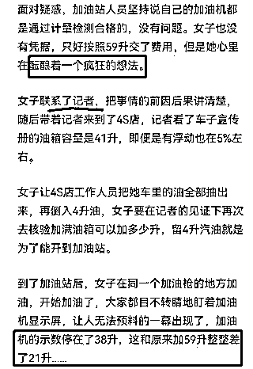

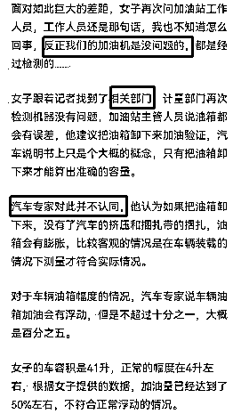

在讲新闻的过程中，尽量加入一些有波折的、抓人的词句，让读者愿意跟着你的节奏走。比如案例里“酝酿着一个疯狂的想法”、“目不转睛”，以及女子联系记者、联系计量部门、咨询汽车专家等各种细节，都是在拉着读者往深处走。

接下来是“网友看”，篇幅在200到300字。做法很简单：去新闻媒体账号的评论区里，挑几条高赞评论放进来就行。

如果懒得翻，也可以自己写。写得足够多之后，你心里会积下一大堆“网友语气”的观点，编几条放进去也没人查证。反正那代表的是网友的个人立场。最好正面、反面、中立各来几条，末尾再补上自己一小段话，这部分就更完整了。

然后是“说法律”。这里要特别说一句：就算你没有法律资质，只要援引的法律条文没问题，一样可以做爆款。

平时要怎么做功课？一是多刷知乎上的热点法律问题，知乎答主们会帮列出相关法律条文，连查找的功夫都省了；二是自己备一些电子版的法律资料，遇到问题用关键词检索，很快就能找到对应条款。这一步听起来难，但在信息时代，只要掌握基本的关键词检索技巧，几乎没有任何门槛。这段同样写400到800字。

引用完条文之后，还要结合本案去分析：这个事件该怎么用法条来评判，相关人员该当何罚。

然后就是“怎么做”。告诉读者，如果碰上相似的麻烦，该怎么处理。放在倒数第二段，简单几句就行。如果前面篇幅没凑够，这里也能加一段自己的经历，讲讲你遇到同类问题时的处理方式；就算没经历过，现编一段也可以，目标是让读者产生共鸣。

最后是“引互动”。抛出两三个问题，引大家在评论区聊起来。放在倒数第一段，两三句话足够。

# 3.2.5 历史类：一条直线写到尾

历史类文章的结构最简单：先抛出一个问题，然后围绕问题把答案讲透。

# 👸号写作变现：抓眼题目、反转故事与流量到账

公号长文和头条的图文、问答、微头条，底层逻辑相通：先设问，再作答。真正拉开差距的是题目。头条更看重深度与概括力，读后要有启发；公号更看重点击冲动，题目得让人好奇、非点不可。

**1）历史人物：从结局切入，主打遗憾或想不到。**
按人物一生来写，从出生、青年、中年到晚年，每一段穿插一两个关键事件。晚年部分尤其要写得有棱角，因为点题靠它。

**2）历史人物：写性格与事迹的反差，主打震惊感。**
整体仍讲生平，但选一两件事重点写性格反面，比如善人做过的恶、明君干过的糊涂事。大部分篇幅写大众熟悉的一面，留一小段揭他不为人知的一面。

**3）事件原委：多角度拆解，让人看完敬服。**
类似追热点，从多个角度解释一个问题，比如清代保密手段；也可以横向写各朝传位、皇帝无嗣时怎么选继承人、立长还是立贤、子嗣多到底是福是祸，围绕一个问题铺开讲。

# 3.2.6 情感赛道：故事爆款模版

一篇情感稿可拆成四块：题目、主角、主线、落点。展开说：主角是谁、想达成什么、为什么做或怎么做、途中碰上什么、最后怎样。先定主题，再拟题，然后顺着主题往下写。

主角简介：我是谁、多大、哪里人、做什么的，简单交代；再带出相关的人或物，什么关系、怎么认识、什么背景。主线包括目标或梦想、挫折阻碍意外。落点写对主角的影响、他怎么应对、结果如何。

故事爆款有五个基本条件：题目好、原创、有信息增量、不炒旧闻、不散播消极情绪。通常用“我”的口吻写，便于读者代入，但不是硬性规定。主线详略得当：无关的略写，能塑性格、推情节的详写。收尾尽量反着来，制造出乎预料又合乎逻辑的体验。比如聘礼要得过高，婆家想悔婚，按常规读者猜分手，可写成仍结婚，再补反转缘由。故事可虚可实，但价值导向要正面，不违伦理。素材附有一组示例题目，围绕聘礼、家政、再婚、病危、继女等制造冲突与反转；写作时可借鉴“冲突+反常结局”的思路，不必照搬原题。

# 3.3 让题目先赢

题目影响打开率，打开率影响阅读量，阅读量又影响收益。套路是“首屏即高能”：第一眼有冲击，读者像被击中，想点开。下面用案例说方法。

# 3.3.1 首屏就要抓人

每篇想拿高阅读、高收益，题目得抓住读者在意点，激发好奇和欲望。题目平庸，内容再好也无人看，收益无从谈起。该技巧最早由圈友@半塘梦呓在星球分享，从微头条切入讲开篇点击；原文《半塘梦呓：如何用好开幕雷击》。所谓首屏高能，就是第一眼出现令人吃惊的说法或画面。反复测试后归纳七个抓手：钱财数字、两性联想、冲突暴力、死亡、走捷径、反常与悬疑、民族情绪；其中“反常”最稳。七个抓手不限于公号，短视频、百家号、头条图文问答微头条都可用；不违规时尽量多叠加。很多作者内容不差，败在开场不够炸；也有人误把狗血、血腥、暴力当雷击，这会让读者反感，可能限流、投诉、封号。真正的雷击是反常且勾好奇，不是直写“震惊”“惊呆了”，更不是“刀砍下去血溅满身”“倒在血泊”。要用含蓄字眼留联想。例：亲人病逝本应悲伤，他却开心——反常，读者想看为何。例：小店矿泉水3元一瓶、10元三瓶，大家说老板傻，都单瓶买，三瓶9元，老板却乐——钱+反常，让人想点开看亏本为何乐。记住别直写暴力血腥涉黄，隔层纱，字面别露，让读者自己补；别为流量挑战平台规则。题目含两个抓手，打开率通常有保障，越多越好。

# 3.3.2 题目打磨法（张波）

高点击题目四要点：调动情绪（喜悲怒好奇）；用数字数据（具体可信）；用极端夸张词（增强冲击）；简洁清晰（一眼抓重点）。公式：主题+矛盾冲突+悬念。润色时植入流量热词，如“疲惫不堪”“心满意足”“笑容满面”；用具体生动语言造情境、展角色、反转或设悬。可保留原选题，只把表述改得更口语、更有冲突感。

# 3.3.3 题目样式（张波）

1. 疑问式：人物+为什么+具体事件；人物+经历+凭什么。
2. 悬念式：如何/为什么+事实+反转，话只说一半。
3. 数字式：数字+事实+奖励，具体可信。
4. 蹭热点：把热点话题放进题目。
5. 对比式：形成反差与对照。
6. 权威稀缺：提供独家信息。
总之，吸引点击的题目往往口语化，甚至看着“low”，不靠文采，靠换写法。
7. 钱+悬念+反常组合：这类题目常把收入、退休金、债务、年薪等数字，与反常结局绑在一起。
8. 反常/悬念+悬念：先抛一个反常判断，再留一个未解之谜。
9. 两性联想+悬念：用含蓄字眼制造联想，但不直写违规内容。题目抓得住，流量和收益才跟得上。

# 3.3.4 点击率超70%的题目心法（开卷🌀）

自媒体选题定生死，题目很大程度定打开率。我的主账号高点击率在70%以上，配图多为免费通用图，关键在题目。处理方式两种：拿来就用，或凭经验调整。

# 3.3.4.1 拿来就用

有人不愿用别人题目。想想小时候命题作文：选到好选题，对方题目不错，就当命题作文写自己观点。📕上不少被反复验证的选题母题，各平台各领域都经典。写这些选题不是谁抄谁，只要不抄袭洗稿，谁都能写。

# 3.3.4.2 凭经验调整

新手最难判断“题目还不错”。有人把高点击题目改得平平无奇，因为觉得“这是我原创的，要和别人不一样”。原创可以，但要加入思考。比如看题目里有没有首屏高能七抓手里的至少两个。选题不错但题目还有优化空间，就按【首屏高能元素+高点击题目套路】改。经验来自多刷对标，不只公号，抖音📕同方向高点击内容也多刷。常见问题：选题定生死，题目无所谓，内容好就行？真不是。面前两个女生，一个精致到头发丝，一个邋里邋遢，你先跟谁搭讪？题目和封面是外包装，选题是内核。读者不会先耐心研究平庸包装里的好内容。好题目和配图的威力，刷过📕都见识过，精致高级本身就是魅力。

# 四、【项目实操 3/3】公号变现路径

公号收入由阅读量决定，本质是流量生意。流量长尾很长，很久以后还有源源不断的流量。建议文章写到1200字以上，能插两条广告增加收益。公号不用自己提现，每月收益自动打到开通流量主时绑定的银行卡，次月1号和15号分别入账，哪怕一分钱也准时到。目前爆文主要两种变现：广告变现和打赏变现，前者为主，后者偶尔加鸡腿。本章详细讲这两种。本章主要介绍变现方式，不设航线图任务。

# 4.1 收入为何跟阅读量走

收益按阅读量算，流量越高收入越高，流量长尾长。流量单价由很多因素决定：文中和文末广告展示量、点击量、完读率等。文章最好1200字以上，文中可插两条广告；800字左右只能插一条。

# 4.2 两条变现路

两种：广告变现（主要）、打赏变现（次要）。

# 4.2.1 广告变现（主渠道）

广告变现指文章中插广告，如小程序、游戏、电商卡片，点击本身或点击后消费都有收益，或者文章本身就是广告文。常见有四类，这里细说前两类。

**路径一：自主接单**

先关注👸号“新榜有赚”，里面多种赚钱方式，有分销、文案类，比如《刘小念》号每天发那种，按阅读计费，一个阅读四毛左右，时间要求不同，有的24小时可删，有的可长期放，新榜里有教程，自己去研究。

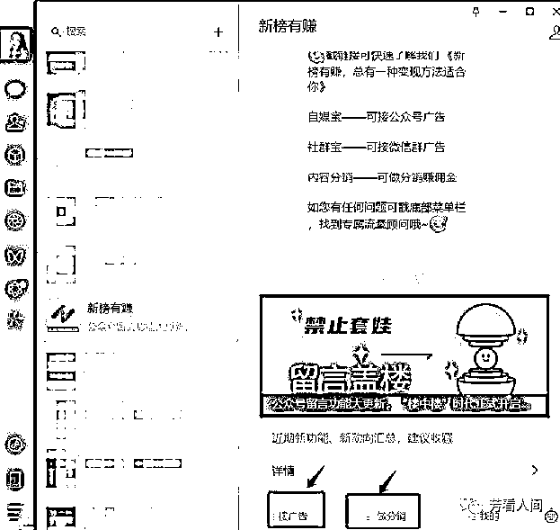

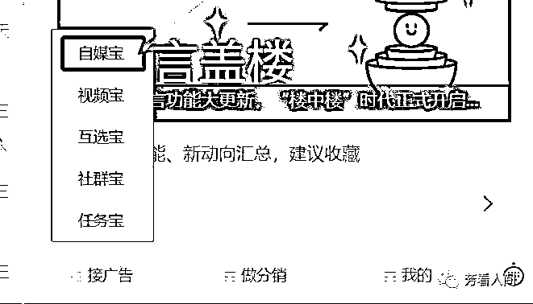

按系统步骤一步步来，抢到单后在商家限定时间内把广告文案发到自己👸号，坐等收益。到账后可马上提现到🛰️，秒到。我只发过两篇，都是24小时可删，每篇收入800多，后来觉得伤粉就没发了，等粉丝多点再试。“新榜有赚”里很多赚钱方式，有时间可研究，我只试过发文案按阅读赚收益这种，其他没试过，有待大家自己研究。

**路径二：商家投放**

商家后台留言“商务合作”，加🛰️谈价，一般要我们自己出价，对方出文案，复制粘贴就行。费用分头条、二条、三条，头条最高，一般2000以上一篇。这种广告慎接，看文案涉及什么内容，涉黄涉赌封建迷信的不要接，可能封号。价格通常见下表：

具体要求和实际价格，请以你与商家最终谈定的为准。

# 方式三：文章内自主带货 @徐胖子

早年间，👸号带货曾风靡一时；随着短视频带货兴起，纯文字带货的转化效率被明显稀释。但要说这条路已经走不通，倒也为时过早——它依然有可为空间。

为什么说还能做？四个理由足够说明问题。

其一，流量底盘仍在。圈友@渭水徐公 的👸号训练营已办到第七期，累计产出阅读量十万加的作品超过一千篇，阅读量破万的小爆款更是不计其数。假设一个号每天推八条内容，每条最多挂十款商品，八条算下来就是八十款。只要有一款卖爆，回报就相当可观。

其二，内容创作自由度高，图文与商品的匹配门槛低。哪怕你深耕情感赛道，学习类、励志类、文学类、情感类图书照样能推；食品、日用品同样可以通过👸号完成转化。

其三，佣金回报可观。选品可以自行对接商家谈分成，图书类最高能到五成，水果、蜂蜜等品类通常也不低于两成。

其四，结算路径正规可靠。走官方结算通道，流量主收益有保障，佣金到账效率也高。从用户下单、确认收货，到创作者后台查看佣金、官方打款，每一步都能在系统里追踪到。

操作路径大致如下：

首先注册👸号并入驻平台。粉丝数达到五百以上后，确认财务结算资料，即可申请开通流量主。审核周期通常在三到五个工作日，资料无误的情况下当天就能通过。

流量主开通后，接着激活返佣商品广告功能——进入推广商品模块，把返佣商品广告嵌入文章，发布后分享出去即可产生收益。

👸号带货与头条带货的机制大同小异：文章中出现商品关键词，便能插入对应商品。

单篇文章最多可挂十款商品。读者点击商品卡片会跳转小程序，一键完成下单；确认收货后，流量主即可获得销售分成。

另外，无论带书、带日用品还是带水果，都可以复用一套结构：先用故事暖场，再从故事过渡到话题讨论，接着展开商品介绍，最后引导读者下单。至于具体怎么写带货文案，可以参考高手分享的 3 月 6 日《如何在👸号带货》@徐胖子。

# 方式四：文末贴片广告带货

扫描二维码注册成为有赞分销商，然后挑选自己想推的产品，生成超链接，把链接放在文章末尾即可。

如果对超链接操作不熟悉，可以请客服协助，但需要向对方提供你的有赞账户密码。我当初就是让客服帮忙做的。

客服🛰️：可扫码添加

注意：

账号尚未起量时，发文风格尽量清爽，不要搞得过于花哨。等粉丝积累起来后，再根据受众年龄调整视觉风格：年轻粉丝偏多可以做得活泼一些，年长粉丝为主则保持简洁。换句话说，文章顶部放一张图甚至不放图，正文中穿插少量分隔符就足够了。

分隔符的密度也要控制，大约每两三百字出现一次比较合适，过密或过疏都不理想。

# 4.2.2 打赏变现（次要）

流量主开通后，先以原创声明群发三篇文章，打赏权限便会解锁。账号名称、头像与打赏入口的名称、头像尽量统一，人设看起来会更真实可信。

打赏收入通常集中在 IP 属性突出、人设扎实的账号上，这类账号的文章下方偶尔会出现大额打赏。对我们而言，它属于补充性变现渠道，并非主力收入来源，但开通之后偶尔也能添个鸡腿。

# 4.3 👸号提现

👸号的收益不需要手动提现。每月会固定两次自动转入你开通流量主时绑定的银行卡，日期分别是 1 号和 15 号，当月发放上月的收益。

哪怕只有一分钱，也会按时到账。每月 1 号和 15 号可登录手机银行查看，偶有延迟但不会缺席。到账金额为税后数额，已扣除 20% 个税。

# 五、【复盘优化】通过优化与提效，提高爆文数量

# 💡

# 章节概要

前面的章节，我们学了怎样写出一篇爆款文章。接下来，我们将学习，怎样「持续的」写出「一篇又一篇」爆款文章。

👸号爆文这个项目，拼的不仅仅是文案能力，还有我们的体力。只有不断的产出有爆款潜质的内容，才有可能有稳定的收入。

那要怎么保证持续产出呢？很简单，就是降本增效。降低我们的创作成本，提升我们的创作效率。

我们本章的内容，就是围绕这两个目的来设计的。

降低创作成本：

第一节，搭建素材库。通过日常记录素材的方式，提高你写作的速度，保证源源不断的选题。

增加创作效率：

第二节，自检与复盘。通过不断的优化迭代，有助于提升你的爆款能力。

第三节，快速入池技巧。通过一些被验证的技巧，加大文章被算法推荐到流量池的可能，提升爆款概率。

第四节，写作避坑指南。提前了解一些👸号的规则，让你的爆款不至于夭折，减少爆款的“浪费”。

好的，下面就进入这个章节的学习。

# 💡

# 本章航线图

完成本章节的学习和实操，即可完成航线图的 第三阶段：复盘 & 优化（约 1 小时）

1.

对已发布的文章进行复盘与优化（约 1 小时）

# 5.1 如何搭建素材库，提升写作效率

做自媒体的都知道，想日更最大的一个问题是：天天写，哪里来的那么多素材写呢？

对于没有素材库的伙伴来说，写一篇故事已经绞尽脑汁想半天了，要是连续更新一个月，没有素材库那哪行？

素材库不仅可以提供灵感来源，更是大大提升了我们的写作效率。

接下来我们就来学习下，素材库的来源和搭建？

# 5.1.1 素材来源：职场类@枫宇翔

职场方向的素材渠道其实相当丰富。其中我最想安利的一个入口，是脉脉。

脉脉这款 APP 专攻职场社交，里面活跃着大批职场人，吐槽、爆料、分享日常的内容随处可见，共鸣感极强，多刷准有收获。

举个例子，“入职 SHEIN 后，终于明白为什么大家都在劝退”这种帖子，一眼就能勾住人。而且除了普通员工吐槽，还有人专门制造争议性话题来带动讨论，热度往往很高。

脉脉之外，BOSS 直聘等招聘类 APP 的留言区，以及豆瓣、知乎、微头条等平台，同样藏着大量职场类素材，随手一抓就是选题库。

抖音、快手这类短视频平台上，职场主题的高赞作品，其评论区也堆满了可用素材。👸号内部同样不缺这类内容，搜“职场”两个字就能翻出一批。

判断一个素材值不值得写，看点赞量、评论量等指标即可。数据漂亮就动笔，即便你个人对那个素材无感，也建议发——数据是市场投票的结果，值得信赖。

# 5.1.2 素材来源：热点类

热点方向的素材，基本绕不开🧣热榜、今日头条热榜、知乎热榜这几个入口。这些榜单上从来不缺可写的选题。

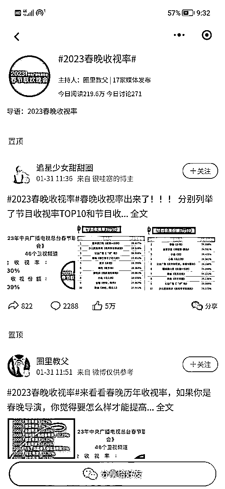

不过也要留个心眼：榜单上的内容有时是经过修饰的，真正的大众关切未必排在前面。不少知乎高赞回答明明流量可观，却始终上不了热榜——这类内容反而更值得挖掘，写出来爆的概率更高。

道理很简单，那些回答是靠用户一个个赞同顶上去的。没有热榜曝光还能聚集这么多关注，说明内容本身击中了读者的真实需求。我们要找的，正是这种直戳痛点的硬货。

# 5.1.3 素材来源：剧评类

剧评方向最大的好处是素材永远不缺。你只需要做好三件事：

1）追剧时把戳中你的画面或台词截屏保存，归档进素材库；

2）拆解剧集的高光片段；

3）拿剧版和原著做对照，把改编差异乃至离谱之处拎出来写。

以《知否》和《甄嬛传》为例，这两部剧热度和口碑都在线，盛祖母对明兰的教诲、明兰对日子的体悟，随手一拎都是写作切入点。

单说《知否》里淑兰和离那场重头戏，至少能撑起三篇文章。

先给没追过剧的朋友补补课：淑兰生在经商的盛家大房，带着厚嫁妆嫁给了穷秀才孙志高。婚后婆家一边花她的嫁妆，一边变着法儿折磨她。直到孙志高要纳风尘女子进门做妾，盛家大房彻底翻脸，这才有了和离一事。

那三个方向具体怎么切？

①淑兰凭什么能顺利和离。搁在古代男权社会，孙志高没犯什么大错，淑兰想离并不占理。可以往深处挖：娘家是怎么护着她的——不惜名声受损也要让她跳出火坑；也可以从淑兰身上反推，女人自己撑不起来会是什么下场——嫁妆丰厚、养着孙家全族，照样被磋磨得形容枯槁，说到底还是性子太软。

②孙志高哪来的底气跟盛家叫板？根子在于商贾出身的盛家社会地位不如读书人孙家；再者孙家一无所有，真撕破脸，光脚的不怕穿鞋的；此外两家闹掰不只是两个人的事，而是两个家族的对抗。在宗族至上的环境里，盛家即便和离也得掂量孙家宗族的态度。

③明兰促成淑兰和离后，祖母那番话其实暗伏了她与小公爷的结局。这个角度可展开的空间更大。齐衡与明兰私下有情，却注定走不到一起。第一层是门第悬殊：齐家是国公府，齐衡身为独子，背负着平宁郡主的全部期望；盛家不过五品小官，明兰还是庶出。第二层是齐衡虽心仪明兰，却缺乏为感情抗争的魄力，不敢违逆母亲。第三层是平宁郡主根本瞧不上明兰，真要动手收拾她，手段多的是。

你看，一部剧的一个高光片段就能裂变出三篇甚至更多文章。对爱追剧的人来说，素材是不是唾手可得？

# 5.1.4 素材来源：法律类

1、新闻素材可关注北青网、1818 黄金眼等官方媒体，这类信源通常较为可靠，也适合作为写作底稿。

2、另一路来源是头条新闻热榜及地方热榜。

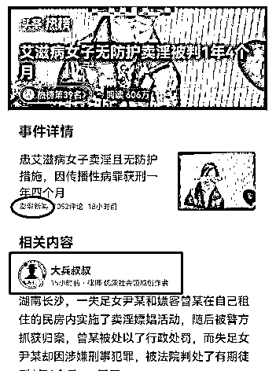

点进头条热榜的详情页，通常能看到官方媒体的报道。比如“艾滋病女子卖淫无防护被判刑”这条，来源就是澎湃新闻。建议关注澎湃新闻，遇到其他热点也顺手点进去，把相关媒体逐一关注。

久而久之就能攒下一批可信赖的信源，日后查资料会方便很多。热榜下方往往还有法律从业者撰写的分析文章，可以作为参考。

不少律师类账号会标注“抄袭必究”，比如大兵叔叔，可以学习他的行文思路，但切忌照搬。否则头条可能判定为高度相似，仅推荐给粉丝，甚至招来原作者投诉，得不偿失。

第三个渠道是裁判文书网。

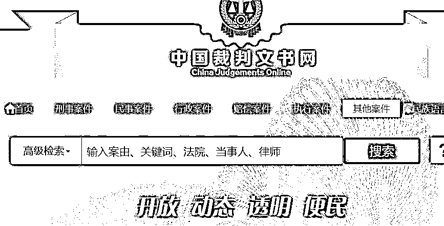

上面有大量已宣判的案件可供取材。务必注意：涉案人姓名要做模糊化处理，不能直接写真名。一来保护当事人隐私，二来避免被投诉。

# 5.1.5 素材来源：历史类

历史方向的素材同样好找。这门课大家从小读到大，新奇有趣的故事信手可拾。从帝王将相到贩夫走卒，从沙场征战到闺阁婚嫁，可落笔的维度极广。况且读者天然爱听故事，用惊险、紧张、圆满、愤怒或搞笑的情节去抓人，是很讨巧的路子。

来源渠道也多样：看过的影视剧、听过的百家讲坛类历史节目、历史博主的深度讲解，都能转化为素材。甚至看到某个人物片段后，可以顺着他后续的人生轨迹往下挖——大众往往只记住了历史的一瞬，我们要做的就是把完整人生铺展开来。

刷头条、百家号时遇到的历史小故事，同样可以收进素材库。

B 站有几位历史区老师值得推荐：文大郎（三国领域几乎无出其右）、正直讲史（清朝历史的好手）、直男文史课（用漫画讲历史，轻松有趣）、御史房（综合视角，思辨到位）。

特别提一下喜马拉雅——百家讲坛的内容它几乎全收。写故事的前提是吃透故事，通勤路上、闲暇时点开一集，老师会用平实的语言把一段历史讲透，故事来源有了，思想深度和史料可靠性也有保障，写起来自然顺畅。

我常年听百家讲坛，分享几个常听的节目。

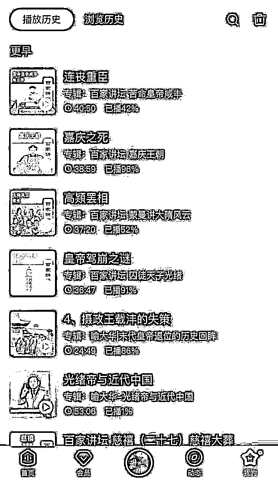

# 5.1.6 素材来源：情感类

情感素材的渠道非常多：身边亲友、邻居的亲身经历；网络端的知乎、抖音、百度、头条等平台，都是矿脉。

生活中遇到触动你的事或话，立刻记下来；网上冲浪时看到有意思的片段，也随手存档。

当读者积累到一定量后，可以设置自动回复留下🛰️号，引导读者来倾诉，素材就从读者中自然生长出来。

平时读书看报攒下的好词好句、新奇故事，以及影视剧、小说中的桥段，同样能派上用场。总而言之，宝藏遍地都是，缺的是发现的眼睛。

下面重点展开：如何从亲友和短视频平台挖素材@Ray

1）亲友口述

都说故事源于生活。前阵子和亲戚聚餐，我发现二姨特别爱聊家长里短，对村里的事了如指掌。她提到村里有个已婚女性，两个孩子留在老家，自己跑去大城市打工，结果跟别人好上了，还给对方生了孩子，逢年过节都不回来。最后跟原配离了婚，两个孩子丢给老人带，父母双方都不管，很让人唏嘘。

要不是亲戚亲口讲，我大概率不会信。一直以为这种狗血剧情只存在于电视剧、小说或新闻里，没想到离自己这么近。

于是我灵光一闪：平时刷抖音，情感纠纷类新闻底下总有网友留言讲自己的亲身经历或身边事，能不能把这些故事挪来用？这就引出了第二个来源。

2）短视频平台的情感故事与评论区故事

核心思路是：用关键词在各平台检索情感故事，同时追踪事件的后续走向和评论区的衍生故事，借此扩充素材储备。

大致步骤：

先确定关键词进行搜索，比如“婆婆”；

然后筛选结果，优先选新闻媒体发布的视频，因为媒体号自带流量；

如果新闻中的纠纷没有结局，可以搜“XXX 后续”；

情感纠纷视频下方常有大量网友分享自身经历，这些故事同样可作参考；

除了情感新闻，专门的情感类节目也可以——比如《爱情保卫战》，后文还会提到《老娘舅》。如果不知道有哪些节目，直接搜“情感纠纷节目”即可。

具体我是怎么操作的？

在抖音搜关键词时，我注意到婆媳关系类的情感故事占比最高，于是搜“婆婆”，再叠加一个情绪词或动词，相关视频就会大量涌出。

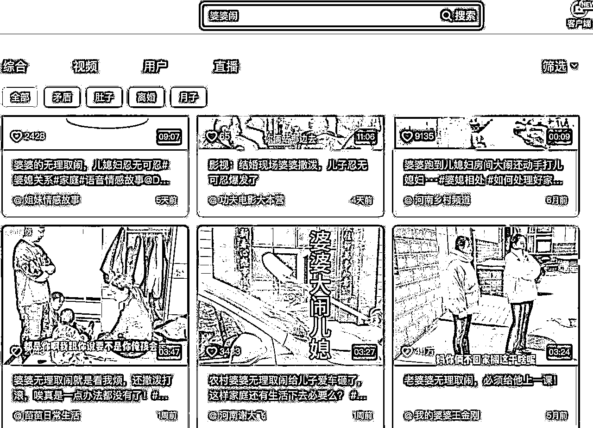

搜到之后不能直接搬用，需要过滤。

个人用户发布的视频，很多是按剧本演的。这类视频的优势是受众精准、已被市场验证过，但素材可能陈旧，或是从其他平台爆文改编而来。直接照搬，阅读量通常不会理想。

另一类是媒体发布的新闻视频。如今媒体号经常转发他人视频再加个标题，性质接近营销号，但媒体号自带流量，评论区往往非常精彩。

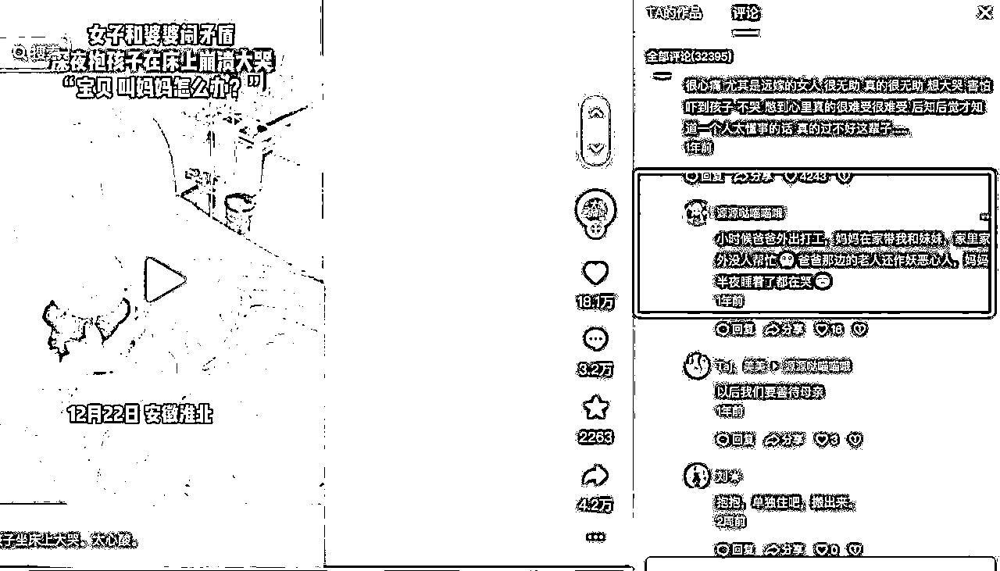

看这条大象新闻的视频，18 万赞，评论区多达 32395 条，说明内容引发了强烈共鸣，不少网友会把自己的真实经历写出来。

比如我图中圈出的那条评论，虽然篇幅不长，但完全可以作为素材使用。

于是我继续搜索，发现了前段时间的一条新闻。

搜索下拉框里出现了“XXXX 事件后续”，说明很多人关注这件事，都想知道结局。我也好奇搜了一下，但没有后续。那就按老办法，打开评论区，果然有相关留言。

这位网友的评论时间是最新的，我觉得这个素材也能用。搜索过程中我发现不少人提到“曹心柔”，搜了一下，内容相当精彩。

这是一个情感调解类视频，讲的是恶婆婆打断儿媳手臂，还伙同两个女儿把儿媳赶出家门，结果儿子再婚娶的第二个儿媳十分强悍，反手把两个小姑子扫地出门。后面的情节就不展开了，可以自己去看。

视频评论区里佩服的人不少，但也有人分享自己的身边经历。

这条评论是我搜索时前二十分钟刚发出的，不过仍需自己改编。

我在 B 站搜曹心柔相关内容时，也找到了这个调解视频的原始出处，里面藏着不少故事素材。把这些新闻放回抖音搜索，再看看视频下方有没有网友评论。

素材到手后，就可以进入故事创作环节了。

内容来源：5 月 25 日《抖音平台挖掘情感素材，网友评论也能出爆文》@Ray

# 5.1.7 搭建素材库

当你手上积累了足够多的素材渠道，素材便源源不断。这时可以按类别把它们梳理成素材库，后续写作时直接从库里调取合适的素材进行组合加工即可。

下面以情感类素材库为例：

先给几个对标账号：写故事的刘小念、陈若鱼、猪小浅。她们都写故事，笔法各有差异，可以模仿着写，也能从她们的账号里扒故事素材和爆款标题。

在「3.2.6 情感类：爆文模板」里，会讲情感类正文模板：一个故事=标题+主人公+故事主干+结局。

展开来说就是：一个故事=标题+主人公+故事主干（包含梦想或目标、挫折、阻碍或意外、惊喜或反转）+结局。

再拆细一点：一个故事=谁～想做什么事～为什么做或怎么做～做的过程遇到了什么～结果怎么样。

具体操作时，先定好故事主题，再把标题拟出来，然后围绕主题一路写下去。

主人公：我是谁，多少岁，来自哪里，做什么的……简单交代基本情况；

接着介绍与主人公相关的人或物：和主人公什么关系，怎么认识的，做什么的……也简单带过基本情况。

故事主干：想做什么，发生了什么事，遇到了什么问题。其中包括目标或梦想、挫折或阻碍或意外。

结局：这件事对主人公的影响，主人公是怎么做的、或应该怎么做，结果是什么。

# 六个素材库，故事随取随用

故事怎么写完？把流程固定下来，再建素材库。生活、文学、小说、影视、热点、平台内容里的材料，怎么反复用？先建6个库，之后交叉搭配，故事就能快速成形。

1、标题库：看到让人想点开的标题随手存。例：66岁退休金8000儿孙满堂却不想活；听完母亲遗言这辈子不能结婚；和堂哥地下恋20年结局意外；68岁生大病才知有些东西比亲生孩子可靠。总之反常、能勾人点开的标题。

2、主人公库：新闻、报道、八卦、小说影视、身边事里的主人公存起来。例：18岁未婚当妈的小佳；不孕的小爱；40岁不结婚还有女人倒贴的老光棍；55岁大妈生三胎；50多岁大妈再婚要100万彩礼。有异常、有争议的人物。

故事主干库分3个：梦想或目标库、挫折阻碍意外库、惊喜反转库，再加结局库。来源同上，记下人物的目标、阻碍、惊喜。

3、梦想或目标库：不孕夫妻想生娃；结婚想买婚房；大爷想找老伴；重男轻女家庭二胎想生男孩；想开美容院等。

4、挫折、阻碍或意外库：恩爱夫妻多年没怀孕医院查不出；房租突然涨；谈几年因彩礼房子遭父母反对；跳舞突然中风；感情好一方卷钱失踪；相亲相爱多年对方突然离婚等。

5、惊喜或反转库：老家拆迁得钱得房；女友父母要50万彩礼突然只要8万；失散多年儿子开宝马回来；多年不孕3年后突然怀孕；房东突然减免房租等。

6、结局库：复婚、离婚、一家人幸福生活、儿子接她养老、找到合适老伴安享晚年、去养老院、夫妻更恩爱等。好坏都记。

6个库建好，几分钟能讲出故事。比如用主人公库1、梦想5、挫折2、意外4、反转5、结局3：小佳18岁未婚当妈，想开美容院，只有8万，看中月租7万店面，房东突然要9万；她想放弃时房东中风，儿女不愿出钱治病，想尽快出租，愿降到6万租给她；8年后美容院成连锁店，孩子父亲回来，一家人幸福生活。初稿一波三折，真实有共鸣。

不想写故事，想写观点鸡汤文，就用小故事加观点、名言、金句，一般3个小故事，每个后面加观点金句；再建一个观点名言金句库即可。回到故事，有雏形后加细节、对话、动作、心理，故事才有血有肉。情节要曲折，起承转合要到位。有素材库，一天写10个故事不难。一个库写N个故事：把主人公、目标、挫折、惊喜、结局打乱组合。小佳用152453，也可12345或22335，稍作调整。再例：小爱26岁财务，小王29岁业务员，夫妻想生孩子（目标1），结婚3年没怀上（挫折1），看医生吃药没用，认命不治，1年后却怀上（反转4），结局夫妻更恩爱（7）。组合成雏形：我叫小爱26岁财务，老公小王29岁业务员，结婚3年多想要孩子，没避孕也没怀上，看很多医生吃很多药没用，认命不再治，1年后意外怀孕。字数少不吸引，要填细节，越曲折越好。填完加观点和信息量，文末@自己，加总结感悟，再抛问题：认同观点吗？对故事怎么看？比如小爱例观点：怀不上别放弃，积极就医放松心情，可能有奇迹。问题：身边有不孕不育夫妻吗？后来生了吗？观点感悟问题不能少，能引用鸡汤、名言、影视书金句更好。

平时看电影新闻书剧视频，把有意思的标题或开头、主人公、目标、挫折阻碍意外、惊喜、结局6要素提取分类入库。收集素材像逛超市买菜，喜欢就放购物车；整理入库像买菜回家分门别类放冰箱，用时随手拿；写故事像炒菜煲汤，可胡萝卜玉米马蹄骨头一起煲，也可换菜炒或煲。众口难调，多试验才知道。注意主干详略：与主题无关略写，体现性格推动情节详写。结尾尽量反其道而行，制造意料之外情理之中。主干多动词，大白话，少形容词，连贯动作让人身临其境有画面感共鸣。语言简练，如月工资100元、一个月挣100块；带入场景，多动词名词，多转折连接词。原创底线要守住，模仿可以照搬不行，标题也要自己改。写贴近生活、温情正能量，不狗血不暴力，不碰违背公序良俗、乱伦色情。素材库可用Excel再导入印象笔记，表格直观，习惯什么用什么。图中素材交叉搭配能写很多故事，60个素材一年写不完，越多越好。

# 5.2 爆文写完，先自检再复盘

# 5.2.1 自检清单

1）快短平：进主题快，句子短，最好平叙。

2）读者休闲中想学点东西不想动脑，喜欢浅显文字，太文绉绉不喜欢，大白话即可。

3）单句尽量不超15字，段落别太长，两三句即可。

4）查病句，主谓宾齐全，段落末尾与下段开头承接，阅读顺滑。

5）有避坑意识，知道什么能写什么不能写，违禁内容花了时间没收益还可能封号。政治相关不写，记住党史、军史；黄赌毒不写。

6）检查开幕雷击冲击力够不够、画面感强不强，不够就优化到OK。

打开公号爆款大门，粉丝收益源源不断；举一反三触类旁通，其他平台也有惊喜，一鱼多吃。

# 5.2.2 复盘：盯紧后台数据 @枫宇翔

复盘主要看完读率、渠道构成、用户画像，这些👸号后台有。在电脑端进入👸号后台，依次点“数据—内容分析”，看到文章，点详情看数据。

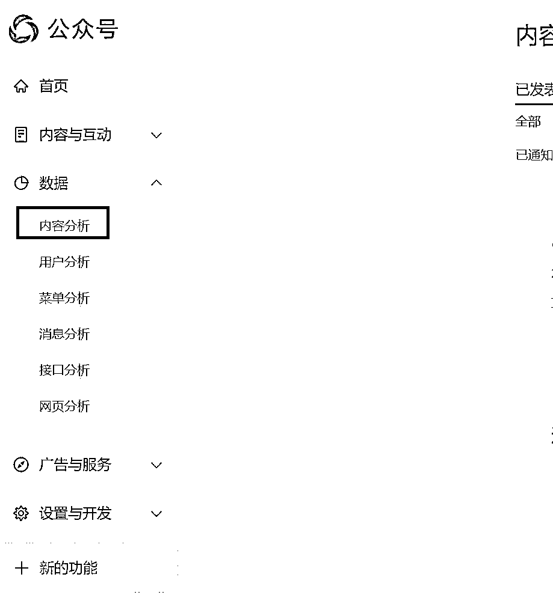

第一，完读率。很重要。我有文章阅读20万收益600多，别人同样阅读收益300多，差异在完读率。文章读完可获文中两个广告和底部一个广告收益，读完人越多完读率越高收益越高。

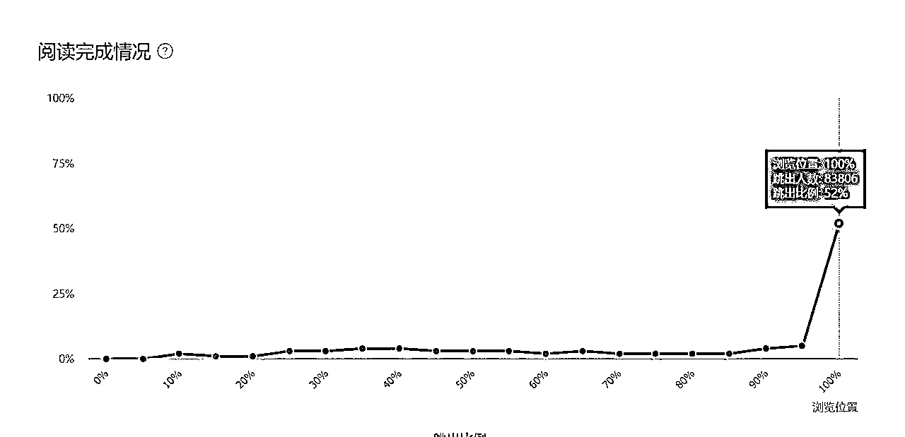

比如浏览位置到100%跳出比例52%，完读率就是52%，约一半人没看完，说明内容不够吸引。我会把精彩内容后置，前面做引导，如“详细数据放文末，感兴趣到文末查看”；字数太多就缩短，提高完读率。若阅读量高，但30%～40%跳出比例达50%，说明一半人只看一个广告就走，很少人看完三个广告，阅读再高收益也少，要重视并调整下篇内容。

第二，渠道构成。看用户来源。比如文章流量基本来自推荐，说明进了流量池，不错。若数据都来自搜一搜，说明没进推荐池，可能碰节点，热度过了会断崖下跌，碰到就戒骄戒躁继续日更。朋友圈、👸号消息比例通常不大，不太关注。

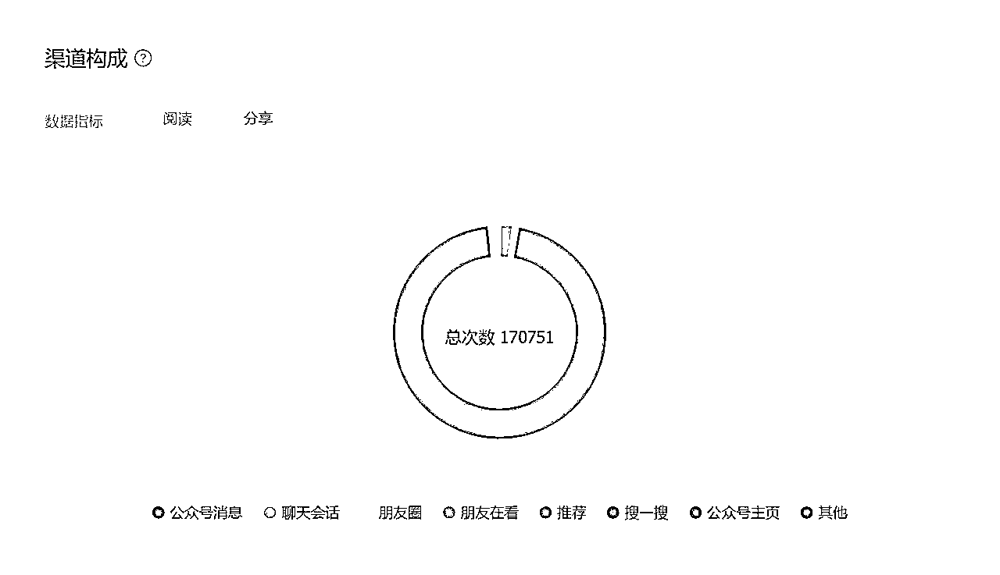

第三，用户画像。含性别、年龄、地域分布。性别看男粉多还是女粉多；年龄看哪个年龄段多。比如36岁以上男粉居多，内容更偏这个群体，游戏时尚不出现；根据赛道和用户了解选相关赛道测试，看能否提高阅读。地域看哪里喜欢看，广东居多就多写广东内容，增加爆款概率。

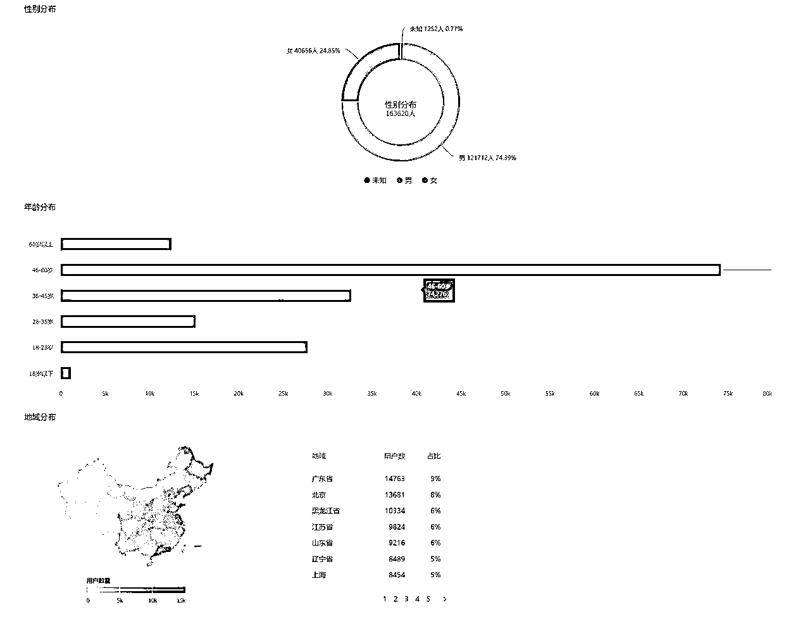

第四，数据趋势。稍关注。推荐时看趋势是否上升，上升且曲线陡峭说明还有流量在推流，这时别睡，再写类似文章很可能再爆。

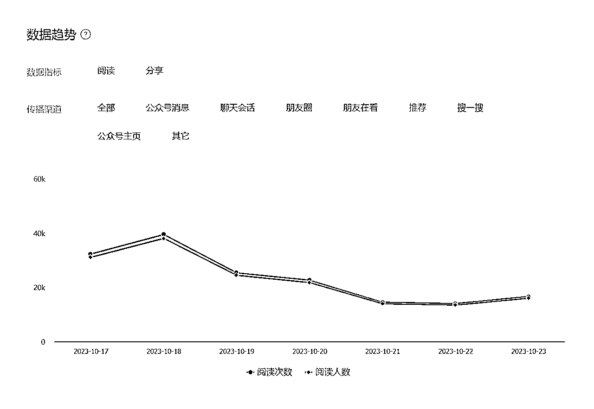

另外送达转化、分享转化关注不多，占比少。复盘主要看上面几个，尤其完读率。

# 5.2.3 一份内容，两份流量主收益 @枫宇翔

以往写👸号发出去，靠文中广告收益。其实还有方式：开通后发一篇文章能拿双份流量主收益。腾讯内容创作平台 https://om.qq.com/ ，注册账号开通分成权益，侧边栏我的主页=>内容同步，按提示绑定👸号。这样只管发文章，既能得🛰️👸号流量收益，也能得企鹅号收益。

# 5.2.4 提高推荐量的几个动作 @枫宇翔

①合集推荐：文章可放合集，但记得关闭连续阅读，避免底部占太多空间。后台侧边栏=>合集标签=>编辑合集=>关闭连续阅读，合集就不会在底部占一大块。

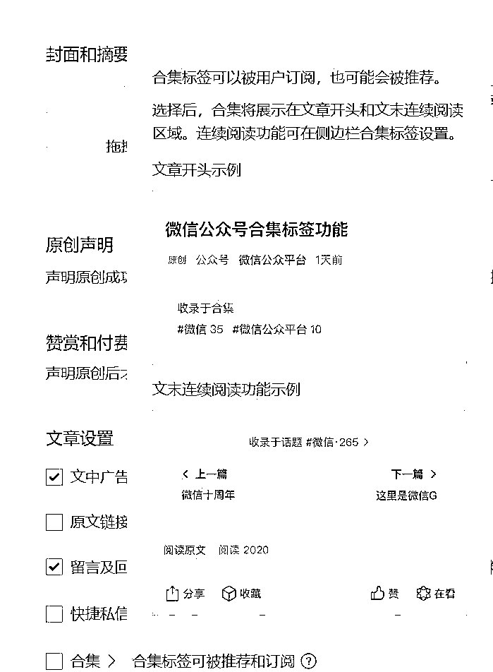

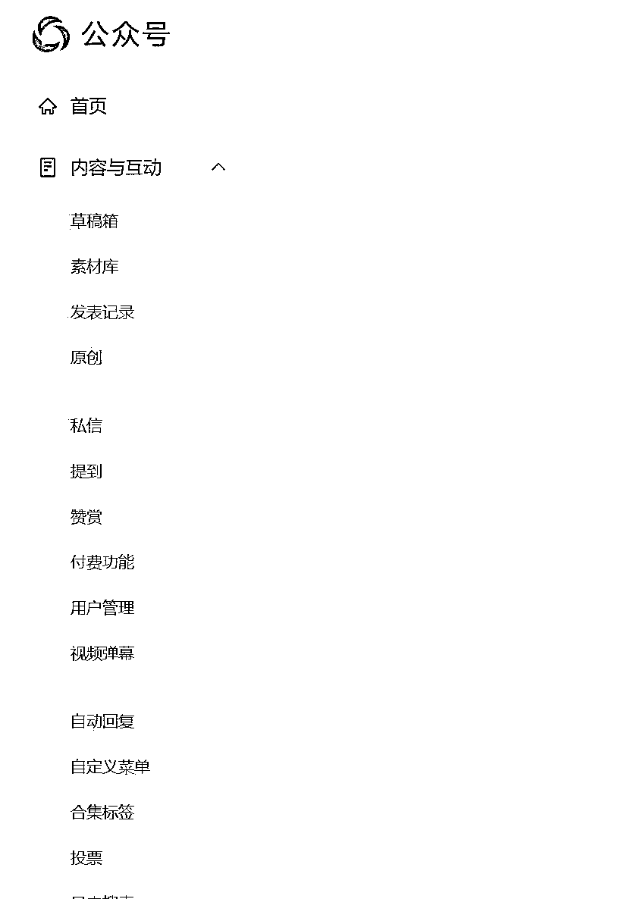

②小绿书：写文章找不到感觉，可试小绿书，类似📕直接发图，有些流量挺高，可试。

③划线推荐：对文章金句划线，句子可能在订阅号信息流再推荐，给文章曝光。情感文可划精彩情感段落，如婆媳争吵，被推荐到信息流可能吸引用户。善用划线。划线功能是发布后自己去👸号找到文章，随便一处长按才出现。

# 5.3 快速进流量池的实操技巧

# 💡 小节概要

进流量池时间不确定，有账号一天进，有半年进不了，👸号有玄学。多数情况7到21天坚持写基本能进。坚持更新、标题戏精、内容垂直，都能进，早晚问题。老号注册一年以上有权重，进池更快，测试过老号有优势。没老号可发朋友圈问身边人借注册久的👸号实操更快。新号注册不久，先选领域，找对标账号，按爆款选题内容二次创作，每天2至3篇不断更，也能很快进。进流量池就是赚钱开始。一直没进，要思考花多少时间精力、有没有研究标题。付出回报对等，一天一篇和两篇、一个账号和两个账号效果不同。

# 5.3.1 怎么判断账号进了流量池 @一来

👸号在变。之前单篇进流量池，如阅读从个位数变三位四位，有看一看流量，基本账号进池，第二天再发阅读往往上来。现在有调整：单篇进看一看，第二天流量仍少甚至个位数，就继续更新直到账号进池。最直接变化是阅读突破1000甚至上万。个位数变两位数三位不一定，可能来自搜一搜。观察和持续更新很重要。内容来源：6月8日《👸号流量主的经验分享》@一来

# 5.3.2 入池技巧一：把文章改成视频文案，发到视频号 @亦小亮

选好题、写好文章、👸号发出，不一定有结果。接下来可试：用文章延伸2到3篇甚至5篇视频文案。视频号文案可从文章开头截取，也可用小标题累积；可用倒叙，先写视频文案或大纲，再补具体内容，操作更丝滑。视频形式可以图片为主、图片视频结合、纯视频为主。

刚接触剪辑、基础还不稳的朋友，建议先从单一素材形态练手：要么全图，要么全视频，暂时别做混剪，能省不少时间。原创通过后，混剪的推荐效果确实更好，但可以后面再进阶。

纯图方向，多在画面呈现和渲染上下功夫。娱乐类可以用明星照片，剪映的“图文成片”就能直接出片。

纯视频方向，治愈系、解压类素材很合适。比如下面这段洗车解压视频，搭上生活情感文案就很有感觉。

c136b7f2b804ed57fd8ed7ca6967958d.mp4【在线播放】

这部分门槛不高，剪映足够完成。平时多刷视频号、抖音，能淘到大量素材。

成片发布后，把公号文章链接放到视频下方。

注意：文章发出 7 天内阅读量破 10000，才满足挂链接的条件。

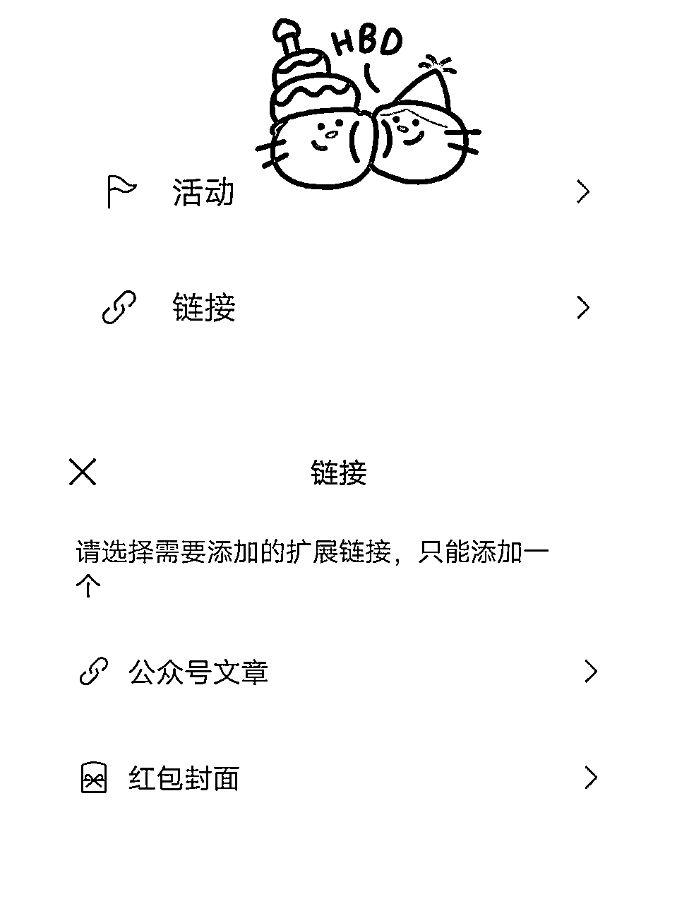

我做过粗略统计：视频每被看 1000 次，文章打开率能到 10%以上，而且有长尾。之前写王宝强《八角笼中》，现在每天还有几百阅读。

你可能会说，热点过去流量就没了。别急，重点在后头。

🛰️上线了“问一问”，可以用视频作答。如果没有合适问题，不妨一个号发问、另一个号接答。

但要记住：回答只能用视频号身份。因此把视频号名称改成公号名称，就能实现“一鱼三吃”。

这样又回到选题。选题做得好，公号、视频号、问一问能串成一条线，互相导流，三端都有变现空间，不止流量主收入。

比如副业赛道，三者结合很顺；旅游赛道也合适。

问一问入口在“搜一搜”栏目，点进去可见。

创业、副业方向已经有人吃到「🛰️问一问」红利。现在才刚开始，很多领域仍空白，值得深耕。

出处：7 月 4 日 @亦小亮 分享，原题《如何迅速把一篇文章的阅读量提高到 1 万+》。

# 5.3.3 入池技巧二：用已进池的号给未进池的号导流 @妞妞💋

① 在已入池文章开头或结尾放未入池公号名片，见图：

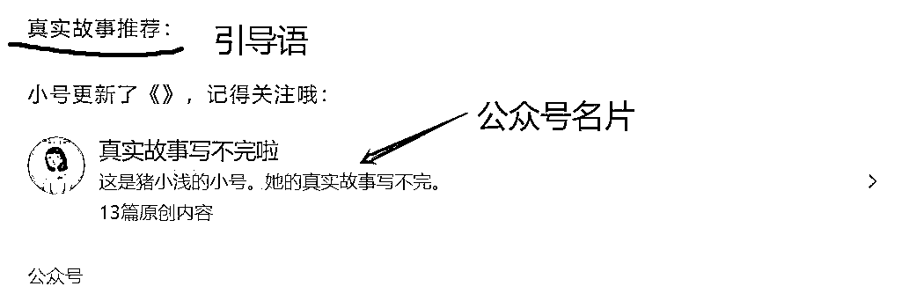

② 在已入池文章开头或结尾放未入池公号的文章超链接，见图：

两种选一种或并用，如图：

操作都在公号后台编辑文章时完成。

（1）公号名片插入步骤

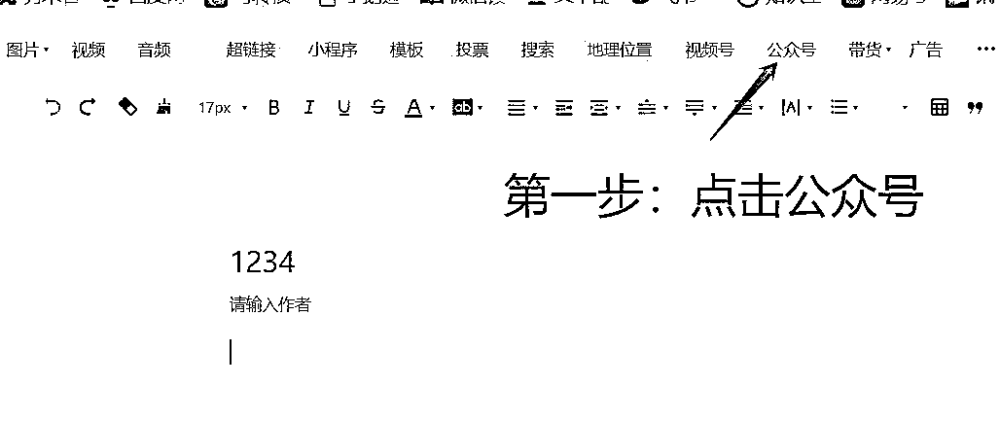

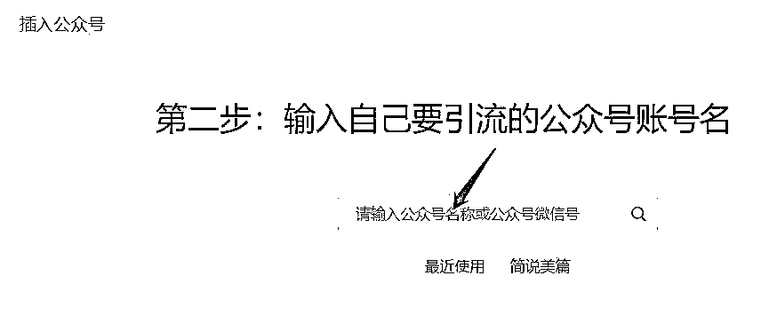

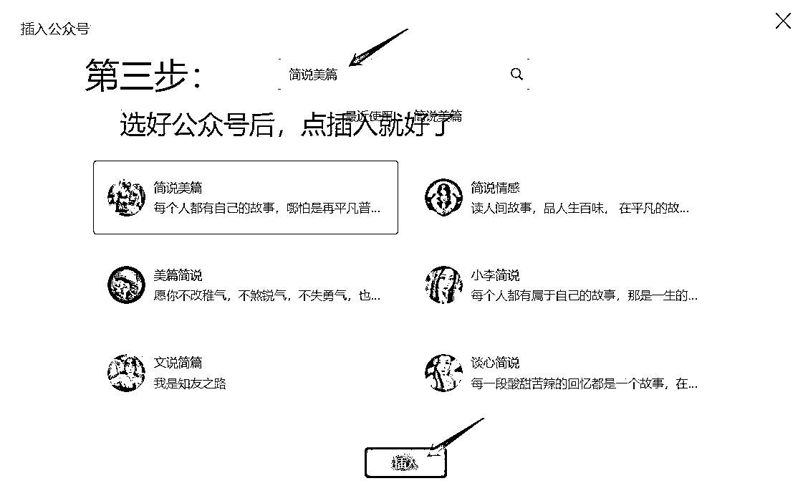

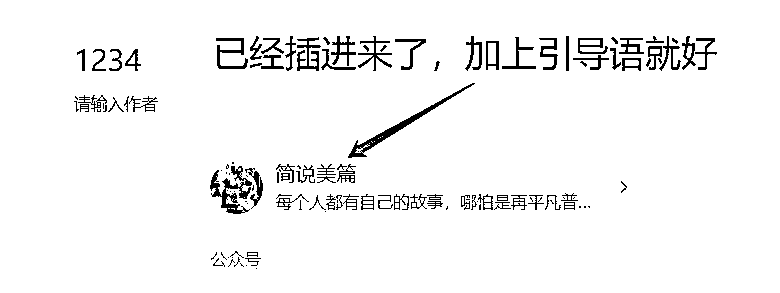

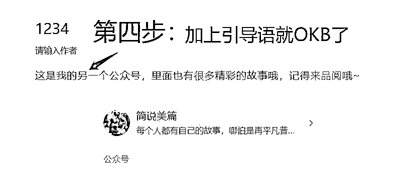

（2）文章超链接插入步骤

再加一句引导语即可，很简单。

有人会问：没有已入池的号怎么办？找朋友或同学合作，方式自谈。例如朋友帮你挂文章链接，你把该文收益分他一部分，怎么合适怎么来，互惠互利。

出处：7 月 13 日 @妞妞💋 分享，原题《用 GPT 写热点文&👸号快速入池的方法》。

# 5.3.4 入池技巧三：让朋友来关注

1、找 5-10 位不同地区的朋友，在🛰️搜你的公号并关注。

2、让朋友从订阅号推送里直接读文章，不要由你转发；按正常节奏阅读，别快速划走。方便的话点个在看或赞。当天没刷到推送不用刻意找，等推送再看。

我的后台数据：每天找十多个朋友阅读，坚持约一周，账号就入池了。

第一篇入池数据。文章是否入池很直观，阅读量往往涨几十倍。

# 5.3.5 入池技巧四：自读复盘+对标拆解

账号初期未入池，我会先点开自己的文章通读，记录体验：排版是否别扭、字号是否偏小、开头是否啰嗦、后文是否乏味。

把问题记下，再将文章分三段，与 10 万+爆文逐项 1 比 1 对照。

对照点包括：

主角何时介绍

第一处挫折何时出现

第二处挫折何时出现

标题悬念第几段揭晓

……

逐项摘录核对，找差距再优化。

举例：

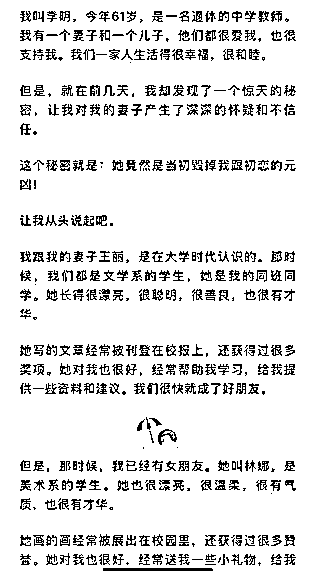

那篇 10 万+ 开头有悬念、逻辑清楚、转折自然，能把你带进去猜“老婆怎么拆散的”，八卦心被勾起。

再看我的文章，红线处转折生硬、逻辑乱，开头就能猜到“老婆拆散了我和初恋”，后面没有读下去的欲望。

优化方向：故事流畅、逻辑清晰，开头五句内交代人物、职业、关系并抛出悬念，再展开细节。

若用 GPT 优化故事，我的指令是：

请把“需要扩写的内容”写得更充实：补足事件细节、对话、动作与神态、情绪，并按（你的具体需求）来写。

# 5.3.6 入池技巧五：把“量”做起来

常有人问：更新一个月没入池？两个月还没入池？

我的看法：多开号、多发高质量内容。矩阵是对抗不确定性的好办法。

为什么要多号？账号有随机性。

比如同父同母同吃同住三个孩子，只有一个常生病，很多人觉得是体质问题，但父母能决定孩子先天体质吗？很难。

账号同理：同一作者、同一手法，有的号 2 天入池，有的 15 天，有的一直不进。对抗办法就是多号。

本期航海建议至少 2 个号起步；掌握基本发文能力后，有余力可再开。

如果两个号都不入池，要反思文章质量，回到质量提升。

为什么要多发？多写多练，熟能生巧；写得越多提升越快，能快速熟悉领域；多看多写多踩坑，成长快。

出处：5 月 30 日 @Adrian 分享《情感类公号如何从 0-1 起号，拿到第一个 100 元》、6 月 29 日 @Beverly 分享《👸号文章如何快速入池》、6 月 8 日 @一来 分享《👸号流量主的经验分享》。

# 5.4 写作避坑指南 @半塘梦呓

以下内容整理自微头条老师 @半塘梦呓。

虽然面向今日头条，但内容平台底层逻辑相通。

这里摘常见坑，更多细节看原帖《微头条踩坑经验》。

# 5.4.1 措辞踩坑

不少伙伴发文前会查违禁词，查过仍可能踩坑，以下地方要注意。

# 5.4.1.1 硬改违禁词，反而拉低行文质量

很多违禁词出乎意料，查出来你会疑惑：这也算？

但平台规则如此，大平台为安全限制很严。有人用空格隔开，或用拼音、错别字替代，少量可以，但别在开头用，全文也别多次。

# 5.4.1.2 别带竞品平台关键词

别带竞品平台关键词。写作时不自觉写“还花呗”“看🧣”等，措辞若带营销感，容易被限流。

# 5.4.1.3 企业名要隐去

一不留神就写“去中国移动上班”“去电信营业厅办事”“去中石化加油”，这些企业名别带。必须写就用“某通讯公司”“某银行”等模糊掉。

引用名言也别提某企业 CEO。

主角起名要小心。有同学找不到限流原因，一看主角叫“大华”——大华是知名企业，还上过美国制裁名单。叫“小米”之类也危险。

甚至别写“门铃叮咚一声响了”，因为叮咚买菜……

# 5.4.1.4 主角名字别乱取

你说避开企业名，找个像人名的？叫“王强”总行吧？不好意思，“王强”在句易网也算敏感词。这类大众名字容易撞官员或罪犯。

所以起名别太指名道姓，可叫小王、小强、阿强、强强。

主角叫“小王”就安全？“小王刚刚吃好饭”有问题吗？不好意思，“王刚”也是敏感词。“小李刚刚洗好澡”——“李刚”也是敏感词。

因此发文前过句易网要成习惯。

# 5.4.1.5 标点别走极端

标点别全用逗号一逗到底，也别通篇感叹号！否则会被判“马景涛体”！文章显得低质！读者不喜欢！审核也不喜欢！（感受到了吗）

# 5.4.1.6 专业词别乱用

别用专业领域词。比如没有医学资质，别写主人公急得乳腺增生；“增生”“结节”属医学用语，无医生资质可能被认定误导读者。

# 5.4.1.7 查不出的词也要防

句易网查不出的违禁词也要留意：

暴力血腥：割腕、脑浆

封建色彩：占卜、卜卦、风水、当铺

性暗示：小姨子（句易网里“姐夫”敏感）、黑丝（“蕾丝”敏感）、情趣、袭胸

这些查不到，靠平时积累。

建议收藏隐形雷区：

1、渣男、渣女、高富帅、白富美、富二代、官二代、男神、情侣套房、打情骂俏、试管婴儿、代孕

2、首付、房住不炒，以及宣扬房价上涨的内容会被打压

3、支付宝、信用卡、保险、银行卡

4、投资、炒房、炒股、赌博

5、人格侮辱、干了见不得人的事、好吃懒做、三观不合

6、辞职、离职、资料、空降、投资

7、奥运、抗洪、三胎等话题受限

8、热点别乱蹭，很多是坑。无论多正能量，舆论不可测，照样可能被限。没有金 V 护身，就写稳妥内容，才能长久。

9、叮咚买菜是品牌名，“叮咚”最好别用。

10、涉及其他软件、商品品牌名的，基本别提最保险。

这些没固定规律，靠敏感度和日常积累。

# 5.4.2 图片踩坑

违禁词查得熟，限流也可能出在图片。配图要谨慎，常犯错误有这些：

# 5.4.2.1 配图别泄露个人信息

生活场景图尽量别露脸；露脸要打码，尤其小孩。

手机号、车牌号等也要打码。

明星图慎用，尤其有负面新闻的明星。

# 5.4.2.2 配图别带营销信息

选图稍不注意就出现品牌 logo 或公司名，很敏感。

容易忽略的是品牌标识和文化。比如苹果电脑标识；美团外卖即使袋鼠打码，黄色头盔和工作服也能认出。

育儿领域无意拍到奶粉罐，罐上 logo 也会出问题。

图片里的支付宝、🛰️二维码也要打码。

# 5.4.2.3 负面敏感图要避开

抽烟、酗酒、娱乐场所配图偏负面；

大面积裸露肉体偏敏感，比如光膀子大爷、给宝宝洗澡图、小孩大面积裸露身体，都敏感。

# 5.4.2.4 别放引人不适的图

恐怖图片、车祸现场、某人被打得鼻青脸肿都不行。

有学员写蛇，放真实蛇图也不行，最后换卡通蛇才过。

找图时这些规则要记牢。

# 5.4.2.5 图文要对得上

文中写中国人，配图外国人；

文中写婆婆，配图却是两个不同人在超市和做饭；

文中写车头相撞，配图车尾被撞；

写别人的事用明星照片（除非写影视剧用剧照，或追娱乐热点用明星图）。

# 5.4.3 运营踩坑 @Nicole·纯

# 5.4.3.1 排版越简洁越好

发表一般用秀米，排版简洁。我写情感文，受众中老年人，越简单越好，内容才是核心。

# 5.4.3.2 旧文别反复发

提醒：别重复发旧文。非要发，只能发一两个月前文章，且不能频繁。

目前三种情况：

1、有人常发旧文被限流，比刚开始还惨，每天收入个位数。

2、有人发旧文被摘原创 1-3 天。

3、也有人每天发旧文没事。具体是一天发七八篇，其中一篇旧文，整体没问题。

账号情况不同，案例仅供参考。

# 5.4.3.3 原创要开，快捷转载别开

原创一定要开，否则影响单价和推荐。开通赞赏需先发 3 篇原创。

快捷转载千万别开，开了别人可随便转你的文章，流量被分走。

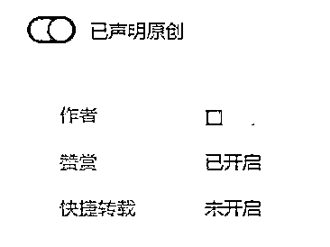

发表前检查以上事项，再看是否显示广告插入，出现下面字样就没问题。

发表后用自己的🛰️读一遍，查错别字（公号只能改 20 个字符，且只能改一次，标题不能改）。

可给自己点赞、在看，但别点广告，别转发朋友圈或群，也别让别人帮你点广告。若总是同一批用户点赞、点广告，账号容易“死”，进不了流量池。

出处：3 月 13 日 @Nicole·纯 分享《避开这些坑，你也能写出爆款文章》。

# 六、用自动化把项目跑顺 @猫哥@飞天拖鞋板@倚栏听风

# 💡

# 本章概览

👸号爆文做久了会明白，本质是概率事件。

前面手册能提高拿结果的概率，但经验再丰富也难保证每个号都起。

所以可多运营账号提高概率；一旦矩阵化，自动化就少不了。

若前面选了速通篇玩法，也可在本章解锁新技能，快速搭自动化程序。

本章学习：

1.了解自动化基础知识、认识影刀

2.快速批量获取写作素材

3.编写自动写文 RPA 程序

4.自动化发布文章

另外，6.3.2 提供批量创作文章的自动化成品程序，可按教程完成写作；本章不设航线图任务。

下面开始。

# 6.1 先认识自动化

# 6.1.1 自动化的含义

简单说，把重复枯燥操作交给软件，解放双手。自动化是固定脚本程序，但效率通常更高。

在本项目可做：自动生成文章、自动开浏览器、自动输入提示词、自动保存文章，以及存稿发布等。

# 6.1.2 影刀是什么

影刀是自动化工具，上手简单，无编程基础也能学。搭程序像搭积木，把合适指令放合适位置。

网址：https://www.winrobot360.com

下面代码界面看起来不复杂。想深入学可在 B 站搜影刀，官方教程很详细。

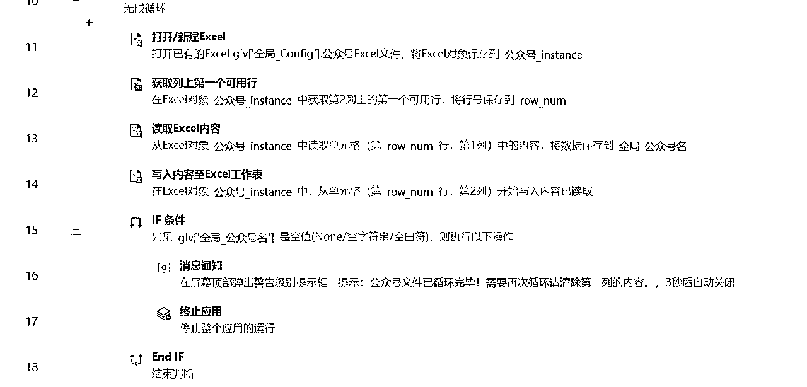

# 6.2 批量找写作素材

批量写作要先有足够素材，要么故事大纲，要么标题。

情感赛道里，故事重要性不如标题，所以优先选爆款标题。

最直接思路：找大量对标账号，找他们文章中的异常值，整理标题。

这项工作简单重复，可用 RPA 解决。

# 6.2.1 挑数据平台

数据平台可筛选热门赛道话题。

次幂数据：https://www.cimidata.com/dashboard 专注公号数据，数据都来自公号，但收录不太全，收费较贵，99 元/月。

易撰平台：https://zmt.yizhuan5.com/ 收录除公号外大部分图文平台，数据较全，支持直接下载标题，收费 299 元/2 年，闲鱼 99 元/年。

# 6.2.2 选赛道

每个周期都有相对好做的赛道。比如去年 7 月文案鸡汤文，8 月城市往事文，10 月职场体质文，12 月职场薪资类文，今年 2 月情感故事等。

有些时候，某个领域会因为偶然事件被瞬间点燃。比如去年河北那场持续不断的暴雨，洪水久久不退，大家都盯着灾情看，天气预报类账号一下子成了流量洼地。圈里有人每天更新，几乎发一篇爆一篇，其中一个号硬生生吃了三个月的红利。再比如去年国庆假期，发高速路况相关视频的账号，同样篇篇十万加。突发事件会把赛道流量重新洗牌，谁能早点察觉、早点动手，谁就能吃到肉。

可问题是，多数人其实被困在信息茧房里。你以为的热门赛道，可能只是你单方面的想象。

那怎么判断一个赛道值不值得做？除了找同行对数据、互换信息，还有一个不算太准但能看个大概的方法：用次幂数据的👸号排行功能。（次幂收录的范围有限，只适合用来判断大方向。）

具体操作是：打开次幂数据，进入👸号榜单，在领域里切换不同赛道。重点盯两个数据：

1、总阅读数据。先固定一个赛道，切不同时间周期，纵向看它的整体趋势；再固定同一个时间周期，切不同赛道，横向比各赛道的流量盘子。

2、赛道里的新号数量。固定赛道后，换几个时间周期，粗略观察排名是否有明显变动。如果榜单常年不换脸，说明新号很难挤进去；要是排名频繁洗牌，而且近3个月冒出来的小号不少，甚至能冲进前列，那这个赛道多半还有缝可钻。

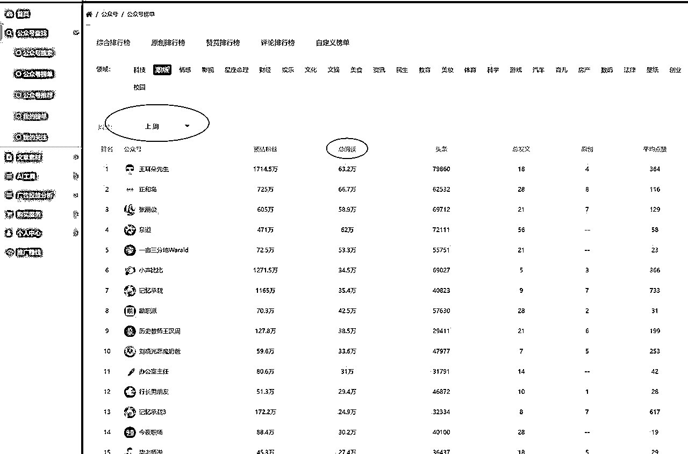

这里要提醒一句：次幂对阅读量的统计并不精确。单篇阅读过了10w之后，无论真实数据是多少，它都只按10w记录。

另外，腾讯没开放👸号接口，次幂本身收录得也不全，偶尔还会把一些赛道错放到“文摘”类目里。不过用来判断赛道机会，它依然够用。先锁定大方向，再往下细分，说不定能挖到蓝海。

# 6.2.3 快速找到对标账号

这里有一款影刀开发的 RPA 工具，名为“👸号数据采集使用说明”。它能帮你快速抓取对标账号的文章数据，再统一筛选整理。跑完的数据会自动存成 Excel，方便后续分析。

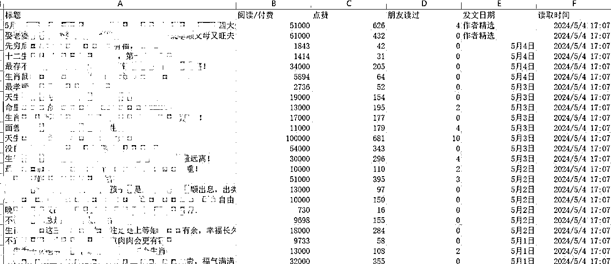

# 6.3 编写自动写文 RPA 程序

# 6.3.1 RPA详细代码讲解

写这类程序之前，先把执行步骤理清楚，再逐步落地就行。整体拆解思路如下，接下来照着步骤写对应代码。

关于用 ChatGPT 和 Claude 写文章、写提示词、产出范本的方法，请参考《第七章 利用 AI 提升写作效率的玩法》。

按上面的拆解，完整程序代码如下：

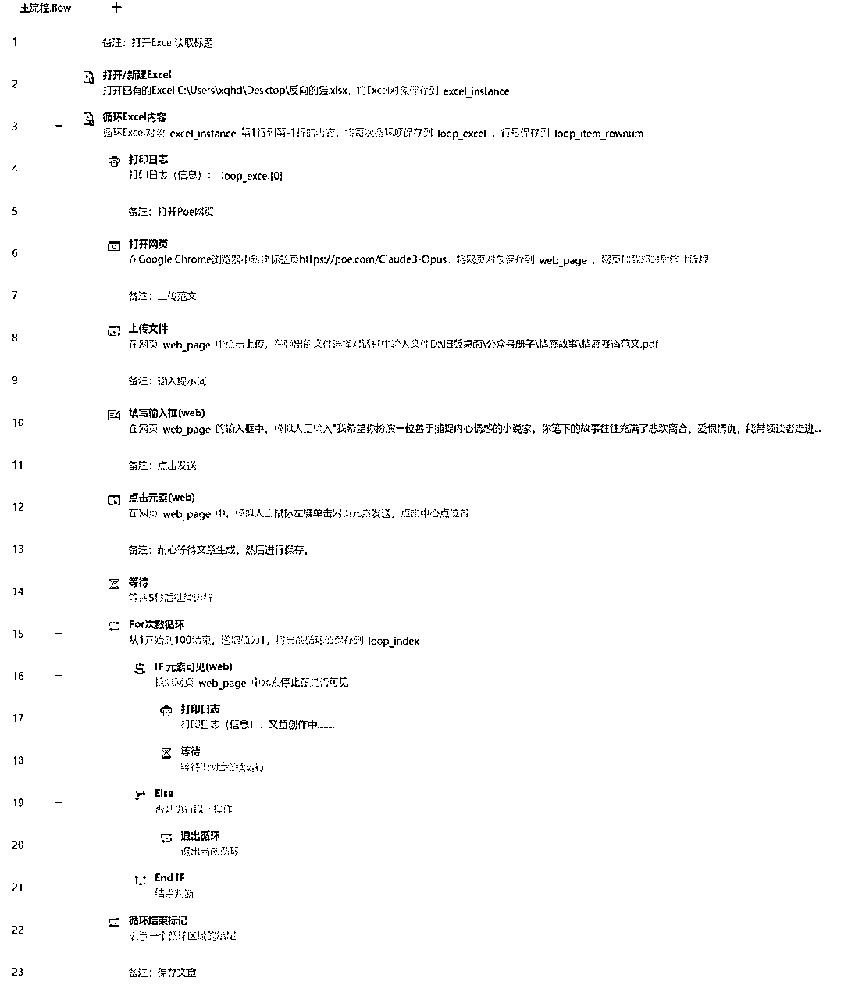

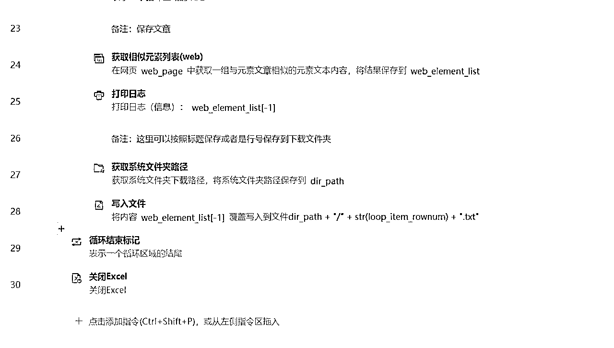

实现的效果：程序先打开 Excel 并读取第一列数据，随后打开 Poe 网站，上传咱们备好的范文，再输入指定提示词加读到的数据，点击发送，等文章写完，自动保存到系统下载目录。这样就能成批产出文章。

# 6.3.2 成品程序

前面讲的是写一个自动化写文程序的方法，这里直接给成品，拿来就能用。

这个程序基于影刀开发，靠模拟人工操作 Poe 来生成文章，可以自定义 AI 模型、投喂范文、设定提示词。实测写一篇文章大约 2 分钟。

注意：访问 Poe 需要特殊网络环境，这个得自己解决。

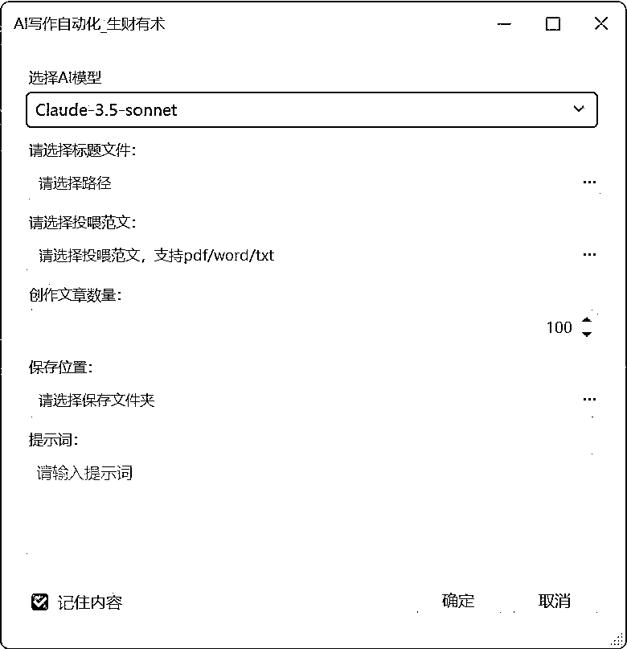

# 6.3.2.1 准备环境

1. 影刀
2. WPS 或 Office
3. 谷歌浏览器

程序下载地址：https://www.123pan.com/s/KtY7Vv-Kyezv

Ps：谷歌浏览器千万别装山寨版，搜索出来有很多高仿的，务必用正版。

本程序只兼容 Windows10 及以上版本。

# 6.3.2.2 获取程序

先打开这个链接：https://api.winrobot360.com/redirect/robot/share?inviteKey=91da13ce3da54784

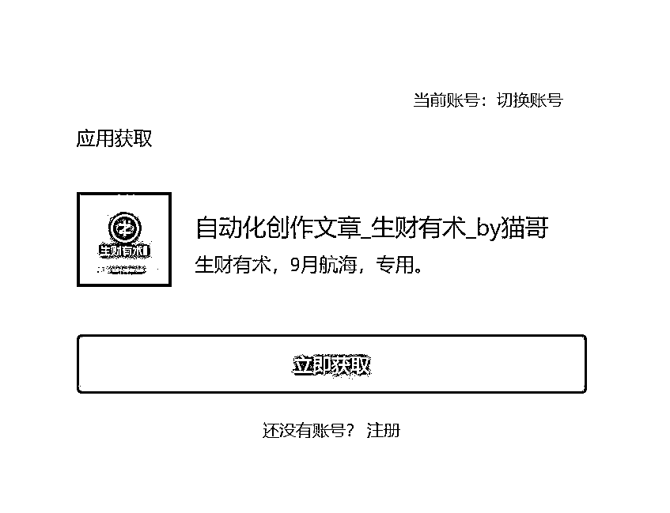

点击“立即获取”，登录自己的影刀账号完成获取。之后打开影刀客户端，进入“我获取的应用”就能找到它。

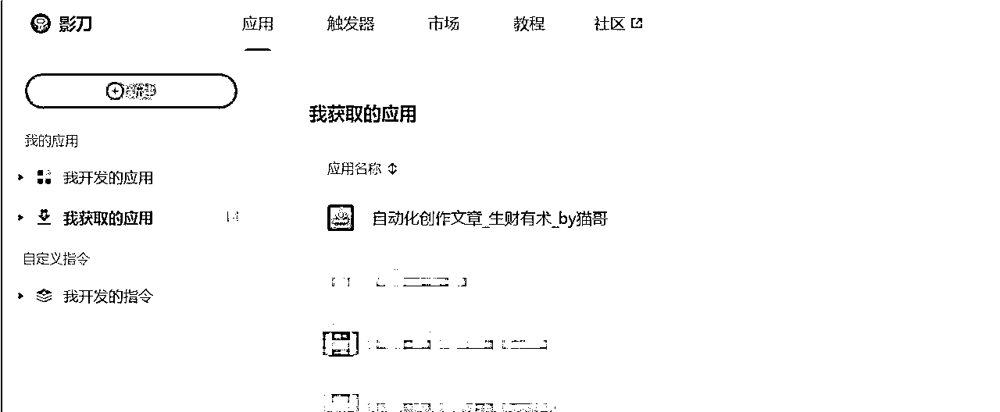

# 6.3.2.3 配置浏览器插件

打开影刀，鼠标移到右上角头像上，依次点“工具”→“自动化插件”→“谷歌浏览器”→“安装”。

接着打开谷歌浏览器，在地址栏键入：chrome://extensions/

找到影刀插件，确保它已经开启。

# 6.3.2.4 运行程序，开始写文

# 💡

启动前，请先在谷歌浏览器里打开 poe.com，登录你的 Poe 账号。

下面逐个说明配置选项。

1. AI 模型选择。目前可选的模型有 Claude-3-Opus、Claude-3.5-sonnet、Claude-3.5-sonnet-200k。

2. 标题文件。这里指定存放标题的 Excel 文件，程序只需一个标题就能生成一篇纯原创文章。

3. 投喂范文，也就是用来模仿的参考文章。

4. 创作数量，设定生成多少篇文章后自动停止。

5. 保存位置，即成品文章的存放目录。

6. 提示词。只填提示词就行，不用加标题，程序会自动补全。

实操效果展示：

bandicam 2024-09-04 10-38-17-861.mp4【在线播放】

提醒一下：这套玩法属于速通法，具体规则和风险可以参考玩法二：速通法。

# 6.4 文章发布

RPA 自动化说到底，就是在模拟我们平时在网页上做的动作。

发文这个环节，在👸号整个工作流里算很轻松的：把写好的内容丢进后台，点发布就算完事。流程不复杂，可一旦量大，就特别磨人，而这恰恰是自动化工具最擅长的地方。

先看看👸号后台长什么样，顺便梳理一下发文时到底要操作哪些控件。

捋了一遍之后会发现，大部分步骤都很机械，说白了就是看见什么点什么。

# 6.4.1 封面图和插图的处理

相对麻烦一点的，是图片这块。

常见做法有两种。

一种是通过 URL 链接直接插进去，圈里不少人都知道 Json 大佬就是这么干的。好处是省事，坏处是没办法去掉图片自带的水印，所以图源必须干净。

另一种是我现在在用的：本地建一个图片文件夹，发文时让 RPA 读取路径自动插入。

怼量玩法的话，其实一张图同时当插图和封面就够了。所以第二种方法我更推荐。

# 6.4.2 文章库的设计

因为每个人生成文章的习惯、用的提示词都不一样，发布工具对应的文章库格式和排列方式也各有差别。

我自己的习惯是：通过自动化工具调 GPT 分段生成的文章，统一收进一个 Excel 表格里，发布工具直接读这个表就行。

也有朋友直接保存成 Markdown，那样更省事，贴进去就能用。总的来说，只要顺手，能接住文章生成工具的输出，怎么设计都行。

流程和重点都理清楚之后，发布工具的思路其实很直接：把 Excel 里的内容送进👸号后台，按预设格式点相应按钮，完成类型选择、插图片、保存这一串动作，然后循环。

# 6.4.3 使用 RPA 工具发布的源代码

整体界面如上，具体的流程可以看下面贴的截图。

# 6.4.3.1 基础起手式

1、用 Excel 存待发文章，格式参照上面 2.3 的图。

2、第 9-12 行除了读图片地址，还顺手做了个判断：如果没图就直接跳过这篇，免得后面卡在选封面那一步发不出去。

# 6.4.3.2 发布内容

# 6.4.3.3 简单调格式&其它开关

堆量玩法的核心不在排版，所以这里只是简单调了下👸号后台自带的字号和间距。更精致的美化，比如套模板之类，需要的插件不一定人人都有，这里就不展开了。

文章摘要直接留白。

开启原创后，选文章分类那步有点费劲，需要多试几次。好在那个下拉框不用把分类滚到可见位置就能点中。另外要留意：“其他”这个分类没有二级分类，必须单独判断。

最后一步，记得存草稿，记得存草稿，记得存草稿！

内容来源：《只需5分钟，影刀RPA搞定👸号自动发布工具》

# 6.5 其他常用工具

# 6.5.1 👸号文章下载工具

这个程序有个小毛病：不管你要导出哪种格式，都得先把“导出 HTML”勾上，不然文章存不下来。

开源工具：https://github.com/qiye45/wechatDownload

🛰️👸号文章批量下载工具2.4.zip

# 6.5.2 保存标题程序

同样是一款影刀写的 RPA，名字也叫“👸号数据采集使用说明”。

使用时要输暗号：龙哥盟

# 6.5.3 30 分钟搭建 10 条静态 IP 攻略

做👸号爆文项目，账号超过 3 个的话，为了防止账号之间互相牵连，最好搭多 IP 做隔离。

大体思路：用天翼云开出多条 IP，再搭配指纹浏览器，保证每个👸号都用自己独立的 IP 发文。

下面要搭 10 条 IP，详细步骤往下看。

1、注册天翼云账号并完成实名

天翼云官网：https://www.ctyun.cn/h5/auth/login

注册完之后：

点“基本信息”，按提示做实名认证。

2、绑定代理商折扣链接

能打到 5.5 折。

如果没绑定代理商，上图红框那里会显示绑定入口。代理商链接可以找我拿。绑完之后买云主机直接打 55 折。不在乎这点钱的话，这步跳过也行。

3、购买云主机

鼠标点左上角的“控制中心”。

地区必须选直营的，最好挑离自己近的。怎么分辨直营？看界面就行，直营和非直营的 UI 长得不一样。

比如四川这边，有成都3、成都4、成都5 三条线路。

看上面两张图的对比，界面明显不同。成都3是直营，成都5不是。其他省份也可以用这个办法验证，这里拿四川举例。

我们选定成都3，来买弹性云主机。

点右上角“创建弹性云主机”。

按下图配置即可。规格可以适当加大，但价格也跟着涨；这里用最低配 1vCPUs+1G 做演示。

镜像那一栏选 Windows，具体版本随意，这里挑了 2008 Enterprise R2 64 位 中文版。系统盘勾选“高 IO”。

可以看到最终价格是 31.35；不绑代理商折扣的话，原价 57。接着点右下角“下一步网络配置”。

网络这块全部用默认值，安全组一会儿再配，弹性 IP 暂时不买。

再点“下一步高级配置”。自己设一个密码，这相当于云电脑的开机密码。注意用户名是 Administrator，密码就是你刚设的那个，后面登录云电脑要用。最后点右下角“下一步确认配置”，去付款。到这里，弹性云主机就买好了。

4、购买弹性 IP

买弹性 IP 之前，账户余额至少要有 100 元，所以先去充值。

返回左上角“控制中心”，在“网络”菜单下找到“弹性公网 IP”，点右上角的“购买弹性 IP”。

按下图选参数：

带宽在 1～300 之间随便选，200M 对我们来说够用了。如果你流量特别大，记得选包年或包月，不然按量计费会非常烧钱。

购买条数自己定：有 10 个👸号就买 10 条；也可以买 5 条，两个号共用一个 IP。这里我们直接买 10 条。

最底下的“弹性 IP 保有费”不用管，绑定主机之后是免掉的。

支付完成后等个一分钟，刷新页面，就能看到那 10 条弹性 IP 了。

接着打开 ip360.cn，把申请到的 IP 一条一条复制进去查。凡是显示“xxxxxx 数据中心”的，直接从列表里删掉，这种不能要。删掉一条就补申请一条，最后留存 10 条非数据中心的 IP。

5、申请虚拟 IP

点一下弹性云主机的名称进入详情页。

红框里的数字最好从 1 开始连续填。10 个弹性 IP 里，有 1 个要拿去绑云主机，所以只需要申请 9 个虚拟 IP，比如 192.168.0.1～192.168.0.9。

注意：这 9 个虚拟 IP 不能批量造，得点 9 次“申请虚拟 IP 地址”，一个一个来。

6、把虚拟 IP 和弹性 IP、云主机绑在一起

给每一个虚拟 IP 配上一条弹性 IP，具体绑哪条其实无所谓，反正是绑一个没一个。然后逐个绑定主机，网卡保持默认就行。

7、配置安全组规则

还是进云主机详情页，找到“安全组”。

入方向和出方向都要单独配置，具体见下图。切记是“新增规则”，别去动默认的那些。

8、云主机绑定弹性 IP

10 条弹性 IP 里，9 条已经分给虚拟 IP 了，最终剩下 1 条，留着绑定弹性云主机。

直接点云主机的名字进去，就能看到绑定入口。

9、配置远程云主机

按 Win+R，输入 mstsc，回车。

填上云主机绑定的那条弹性 IP，再输密码（就是之前买云主机时自己设置的那个）。

进去之后，你会看到一台全新的电脑，这就是传说中的云电脑。

10、配置云主机网络

在云主机桌面按 Win+R，输入 cmd 回车，在弹出的黑色窗口里敲 ipconfig，再回车。

把红框显示的内容记下来。每台机器显示的可能不一样，以实际看到的为准。

然后点左下角打开网络信息，找到“以太网”，右键选“属性”。

双击 IPv4。

进入“高级”页面后，把先前申请到的 9 个虚拟 IP 逐个录入；子网掩码要和此前黑色命令行窗口中显示的值保持一致。点确认后，网络会短暂中断约一分钟，待系统完成重新配置即可恢复联网。

11、ccproxy 安装与参数配置

安装包已上传至网盘，有需要可自行下载：

链接：https://pan.baidu.com/s/1RrVjoLIuZcU9T2qq-qDmKw?pwd=pjq2

提取码：pjq2

--来自百度网盘超级会员 V7 的分享

把安装文件拖到云主机桌面（注意落在云主机系统里，不是本机桌面），双击执行，安装向导一路“下一步”。完成后打开程序，进入“设置”。

1080 端口不建议新手调整。

继续点“高级”，参照下方截图配置，最后确认。（该环节很重要，网上不少教程刻意省略，实际上是为了引导你付费找远程协助。）

回到程序首页，选择“账号”。

点“新建”：
此处只录用户名和密码，其他保留默认。举例：账号 ss001，口令 123123。
这组登录信息要记牢，后续还会用到。

到此，基础配置已经完成。配置结束后务必让 ccproxy 保持运行！务必保持运行！务必保持运行！
一旦退出该程序，代理连接就会中断。
云主机通常长期在线，因此 ccproxy 需要持续挂着。

前面申请的 10 个弹性地址还记得吗？打开记事本，按四段式逐行列好（斜杠不要漏）：
公网IP/端口/账号/密码
示例：
182.151.1.10/1080/ss001/123123
182.151.1.14/1080/ss002/456456
是不是很眼熟？四项里端口、账号、口令这三项，正好对应刚才在 ccproxy 中填的内容。

下面做连通性测试，工具换成老鱼代理。请装在你自己的电脑上，不要装到云主机；安装文件同样在网盘。
（提醒：老鱼代理仅用于检测这些地址是否可用，后续不会继续用它。若前面操作无误，也可跳过它，直接用指纹浏览器验证连通性。）

安装后先更新，再启动：

打开“线路设置”，右下角选择“添加线路”，再点“批量添加”。将整理好的四段式记录按一行一条粘进去；若有 10 条地址，就粘贴 10 行。

出现对勾即表示检测通过。前提是云主机中的 ccproxy 正在运行，且账号、口令已经设置好，否则会检测失败。
由于端口、账号、口令均由你自行设定，旁人无从得知，因此这些地址属于独享资源。

12、接入指纹浏览器

现在手头有 10 个地址，相当于掌握 10 台独立设备。让 10 个👸号账号分别落在不同设备环境中登录，就能减少彼此牵连。
新的麻烦是：每换一个账号就切换一次代理，操作太繁琐。
指纹浏览器正好解决这一痛点。我使用的是 Hubstudio 浏览器，不充值会员也能用，每天 20 次免费启动额度基本够用。官网如下，可自行注册：
http://suo.im/afqdl

注册完毕开始配置，点“新建环境”。

把刚才在记事本里记录的四段式信息找出来：
示例：
182.151.1.10/1080/ss001/123123

点“检查代理”，出现连接测试成功即可。

再点“打开指定网址”，填入👸号后台登录地址。

以后发文时，点击右侧“打开”即可，每天有 20 次免费启动次数。

本搭建流程到此结束。

资料出处：《👸号爆文多账号必备：30 分钟搭建 10 条静态 IP 超详细攻略》

# 6.5.4 环境隔离工具：指纹浏览器

指纹浏览器的核心用途是隔离运行环境。它与静态 IP 搭配后，每个环境都能保持独立，账号之间不易相互干扰。
如今可选产品不少，用于👸号项目基本都能满足。
ixBrowser: https://www.ixbrowser.com/pricing

比特浏览器：https://www.bitbrowser.cn/price/
Hubstudio 浏览器：https://www.hubstudio.cn/pricing/

上述三款均可使用，操作逻辑差别不大。

# 选修篇：把项目做大的进阶玩法

# 💡

# 本章导读

当项目最小可行方案跑通，或操作步骤已经大致熟练，可以翻看选修篇。
若希望继续深耕、扩大项目规模，或探索更多玩法、提升收入，建议重点阅读本章：
【第七章】借助 AI 提高写作效率的玩法
【第八章】用👸号建立个人 IP，提升私域转化与引流
【第九章】👸号流量主委托个体户公户收款的流程
另外，我们汇总了近期圈友运营👸号爆文项目的复盘帖；精力允许的话，可看【第十章】的收益案例，帮助自己少踩坑。
闲话不多说，进入正文。

# 七、借助 AI 提高写作效率的玩法

# 💡

AI 面世后，内容行业原创度不足、产出慢的问题得到明显缓解。搭配前文的方法与工具，一篇文章从选题构思到发布，往往几分钟内就能完成，也更容易持续产出爆款。
对 AI 的看法因人而异，但大方向不会逆转：社会始终向前，如同汽车替代马车，即便刚出现时令人难以置信，即便旧行业从业者极力抵触。

下面按不同使用场景，介绍两种 AI 工具组合，重点涉及 ChatGPT 与 Claude。
✅ 方法一：用 ChatGPT 提高写作效率
采用该方式，人工约承担四成，ChatGPT 约承担六成。人工环节包括选题、情节设计、修改润色 AI 初稿、拟定标题、上传发布。落到正文写作，ChatGPT 可完成八成以上，人工主要做删减与打磨。
✅ 方法二：ChatGPT + RPA 批量自动化
在 ChatGPT 基础上加入 RPA，把重复动作交给流程自动执行，例如自动出稿、自动发布到👸号后台。提前设好流程即可运行。不过批量产出的内容质量通常偏弱，后面会给出优化办法。
✅ 方法三：用 Claude 写原创文章
该方式不依赖复杂提示词。准备几篇质量较好的范文让 AI 学习，就能较快产出成稿；无需繁琐调教，一条提示词即可完成。
配合较新的 Claude3-Opus 模型，成文质量很高，几乎不用人工返工。
ChatGPT 4.0 与 Claude 能直接读取网页链接，ChatGPT 3.5 只能读取文本，使用时要注意区分。
ChatGPT 账号需自行解决，本文只讲使用方法。想深入了解，可阅读「12 月航海 | ChatGPT | 实战手册」。
Claude 账号同样需自行准备，本文只提供操作思路。获取 Claude3 的几种途径，可参考【获取 Claude3 的几种途径】。
❗️每期航海手册都会更新。若你参加过上一期本项目，以下新增或调整内容更值得留意：
✅ 7.4 Python+👸号爆文全自动化
✅ 7.5 多账户运营：AI 辅助手搓
看完这些玩法，你对 AI+👸号的组合会有更清晰的认识，也更容易挑到适合自己的工具。

# 7.1 如何用 Claude 创作原创文章@猫哥

# 7.1.1 先认识 Claude

在接触 Claude 前，若你尚未用过其他 AI 产品，建议先理解它的工作逻辑。
我的理解是：别把 AI 只当成机械问答程序，它确实具备类似“大脑”的结构。其原理参考神经网络的构造方式，通过参数模拟神经连接，因此有一定的思考、学习与理解能力。更合适的定位，是把它当成随身助理，随时帮你处理问题。
为了说明提示词为何重要，设想一个场景：你想让 AI 写一篇情感文，下面三种说法，哪种更接近你的真实需求？
A：帮我写一篇情感文章。
B：帮我写一篇情感故事文，语言幽默生动，字数 2000 字以上，主题是：XXXX。
C：帮我写一篇情感故事文。这里有几篇样例，请按同样风格来写；语言幽默生动，情节有起伏，人物刻画要深，字数 2000 字以上，主题是：XXXX。
A、B、C 三种表达，哪一种成文更贴近你的想法？
A 连主题都没给，AI 很难猜中你的心思。
B 虽然给了要求和主题，但“幽默”“生动”的尺度不好拿捏，结果常常不理想。
C 直接提供参考样文，明确要求模仿其风格，又补充了情节等条件，成文大概率更符合预期，至少风格不会偏离太远。
因此，让 AI 写作时，要求越具体越好，同时附上样本供它学习模仿。它的模仿能力不容小觑，效果往往超出预期。
Claude 已历经多个版本。早期它只是 Slack 中的小插件，直到去年 7 月 Claude2 发布并上线独立站点，才真正进入大众视野。
与 ChatGPT 相比，Claude 在文章创作上更贴合中文表达习惯，细节处理也更顺滑。但涉及写代码、拟合同、判断事故责任等具体任务，ChatGPT 更占优势。
Claude 更像语文老师，在文章、文案、剧情创作方面有独到之处，表达方式更符合中文语境。
目前 Claude 主要有这些版本：Claude2、Claude-3-sonnet、Claude-3-Haiku、Claude-3-Opus、Claude-3.5-sonnet。
其中较强的是 Claude-3-Opus 与 Claude-3.5-sonnet。即便提示词很简单，这两个模型也能写出质量很高的内容，机械感弱，甚至优于多数写作者。

# 7.1.2 Claude 的获取方式

工欲善其事，必先利其器。AI 兴起后，我对比体验过 ChatGPT、New Bing、Claude、Gemini，以及国内的文心一言、讯飞星火、Kimi 等。
结论是：中文文章创作方面，Claude 表现更突出。去年 7 月 Claude2 上线后，我便持续使用；此前主要用 ChatGPT4。今年 Claude3 推出，包含 Claude3-Opus、Claude3-sonnet、Claude3-Haiku 三个模型，其中 Claude3-Opus 表现最好。之后 Claude-3.5-sonnet 发布，价格更低、成文效果不错，响应速度也明显快于 Claude3-Opus。
你可能也注意到，网上 ChatGPT 的内容很多，Claude 的却偏少。Claude 的风控更严，稍有不慎就会封号。去年九、十月间，Claude 经历多轮封禁，使用门槛一度很高。下面列出几个还能体验的渠道。
官方 Claude：https://claude.ai 封号较频繁，可在淘宝购买账号体验。月费 19.9 美元，优势是封号可全款退。
Poe 平台：https://poe.com 集成式 AI 平台，既有 Claude 也有 ChatGPT，月费 19.9 美元，采用积分制，每月赠送 100 万积分，不同模型消耗不同：Claude-3-opus 每次 2000 积分，Claude-3.5-sonnet 每次 295 积分。
You 平台：https://you.com/ 同样属于集成平台，新近推出，价格较低，对话次数不限；不过模型效果感觉略假。
以上平台都需要特殊网络环境，请自行解决。

# 7.1.3 一条提示词，产出一篇原创文章

从前文可知，Claude 的模仿学习能力很强。对新手而言，与其苦思提示词，不如找优质范文让它仿写，更省力也更实际。
第一步，挑选质量较好的范文。最好来自同一位作者，因为同一作者的语气、常用词、结构通常较稳定。
我们的目标是让 AI 学习文章风格，所以范文质量至关重要。不要随手找几篇一眼就像 AI 生成的内容当样本，否则成文效果会打折。
因此，先找 3—5 篇好文章，风格尽量统一，复制到 Word，也可保存为 PDF 或 TXT。
比如我整理过一批情感类👸号文章，文笔细腻、人物刻画扎实、整体质量较高，适合作参考。
有了范文，风格样本就建立起来了，接下来可直接创作。这里分两种路径：
第一种，给故事大纲，让 AI 扩写；
第二种，只给标题，让 AI 直接成文。
第一种适合你偶然看到的好故事：情节动人、吸引力强。可先用任意 AI 提炼大纲，再依据大纲创作。
第二种在情感赛道尤其好用。AI 按标题写文，基本能避开标题党嫌疑；同时内容完全由 AI 发挥，对读者来说也是新鲜故事。读者被标题吸引点进来，只要情节自洽，主角叫张三还是李四并不关键，关键是让人愿意读完。
特别提醒：Claude 的道德约束较强，涉及暴力、性暗示等违反公序良俗的标题，它不会写。这种情况可改用大纲路径。
接下来进入创作。下面给出提示词，作用是降低跑偏概率，提高成文成功率。
提示词一：
下面这些文章是我写的，请先体会我的行文习惯，再按要求写一篇。故事要有波折，情节有反转和悬念，读起来有吸引力；人物要立得住，性格清楚；多用神态、动作、心理和环境等细节，整体传递正向情绪。直接开写，不要解释；不少于 1500 字，依据下列内容仿照我的风格完成 1 篇。
标题：
大纲：
这条提示词并不复杂，只列出情感文的基本要求，没有额外规定文风。
注意：标题与大纲可同时给，也可二选一。
例如，我直接用上面案例的标题来写。
标题：奶奶去世，大伯让我出 12 万丧葬费，我：你还活着，凭什么让我这个孙女出？
下面是实际响应过程。可以看到，仅用一条提示词就完成一篇原创文章，而且 AI 味很淡。
Claude 对字数并不敏感，通常会写得和范文长度接近。此次范文大约 3000 字，生成结果也差不多。

# 💡

成文效果小结：
对范文风格模仿度较高，语言与结构都会贴近样本。范文中常用 1、2、3 这类小标题，生成稿也会保留类似处理，字数规模也接近。
这条提示词几乎不用背，找到合适范文就能快速产出，尤其适合新手。
提示词二：

# 指令越细，成稿越稳

先拿一个极简指令试水：只抛出题面，不规定语气、结构，AI 照样能交出一篇看得过去的稿子。可一旦把要求写细，成品通常更贴心意。道理不玄——你给的边界越清楚，模型越容易抓住你真正想读的东西。

接下来这套示范，让 AI 化身擅长挖人物内心的情感小说作者。落笔前先定核心人物与情绪走向，再顺着这根线推情节，途中塞进能翻起波澜的冲突与转弯，让情绪有起有落、最后抬起来。写人不能停在表面：喜、怒、哀、乐、心里的小震荡，遭事之后怎样犯嘀咕、怎样拧巴、怎样慢慢长出来，都要让读者跟着疼一下。细节也要有用：手上的小动作、脸上的神色、周围环境的烘托，能把场面立住，但别铺得太密，免得拖慢故事。语言要柔一点、准一点，把情绪递到位；比喻、拟人可以用，别用得太满，抢了人物风头。目标是让读者像站在现场，跟角色一同掉眼泪、一同松口气，合上文章还愿意想一想。行文不妨留点真人写作的毛边，流行话、老典故、网络梗适度掺一点，时代感和真实感就出来了。开场还得“炸”一下，第一眼就把人拽住。

这份提示词还强调：先想再写，人物要往深里刻，细节得为情绪服务。情感故事能不能戳人，往往就靠这些。示范里还要求围绕 # 💡 这个题写两千字往上。下面换一套指令，看看同题之下差别在哪。

# 同题实测：两条出稿路

路线一：先喂范文，再让 AI 动笔

路线二：只靠提示词直接写

# 实测对照

同样给了范文，指令越细，稿子越像样。路线一开头就甩来一通电话，读者一下被拉进现场，代入感很足；情节拐得动，人物动作、对白也细，容易让人看进去。路线二没有范文可学，成品也不差，但方向可能飘。说到底，一份靠谱的指令，作用真不小。

# 7.1.4 两类内容的写法差异

内容方向不同，下笔方式也不同；从创作逻辑上分，其实就两堆：沾时事的，和不沾时事的。沾时事的，指最近才发生、模型知识库里还没收进去的东西，比如某款车的具体参数、正在打的仗、明星绯闻等。这类题如果照范文的路子硬写，内容多半对不上现实，发出去还可能被扣上瞎编、传谣的帽子，所以不能靠模仿范文解决。不沾时事的就好办：模型本来就有积累，或者不靠新消息也能写，比如情感故事、心理疗愈、职场体会、星座生肖等。这类题可以学范文，因为内容通常是虚构的，或者是文化经验的归纳，不带时事信息。

沾时事的题怎么弄？思路不绕：模型没掌握的，我们先塞给它。比如写一篇运动员全红婵夺金的消息，先去搜相关资料，挑几篇信息较全、彼此有互补、能提供新内容的，汇总成文档上传，让 AI 先吃透。若事情有争议，前因后果要理清，评论区里的声音也可以收进去，尽量让模型看到全貌，表达才不容易偏。之后再用指令去写。不同方向要不同味道，按自己喜好选。指令主要抓两头：一头是表达风格，比如轻松诙谐、大白话、鲜活有趣、刀锋犀利、口语化；另一头是文章骨架，开头放什么、中段放什么、收尾放什么，分别点明。约束到位，稿子就更合胃口。

# 📌 写在最后

AI 有模仿本事，找几篇好文章当样本喂进去，能比较快地产出像样的稿子；再配一份好指令，质量还能往上走。这样做不用提前做复杂调教，新开对话直接聊就能写，省下不少生产时间。遇到复杂方向，比如社会热点、娱乐八卦，光有好指令还不够，得把事件材料先交给 AI 学一遍，再让它写。

# 7.2 借 ChatGPT 成文的操作法 @木白 @袁永兵 @妞妞💋 @小浩哥

# 7.2.1 正文怎么让 ChatGPT 参与

# 7.2.1.1 先把文风捏出来

从手册里翻出“3.2 制作文章正文”的爆文模板，再把“3.3.2 实战案例”中的爆文案例一起投给 ChatGPT。

也可以去公号搜几篇文章当样本喂进去，让它照着学。指令大意：请它研读这篇文章的写法，归纳成一种风格，取名叫“风格 A”。正文建议用 text 加三引号包起来，OpenAI 在其文档里也推荐这种写法，能把命令和待处理文本分开。文章别太长，太长 ChatGPT 可能报错；公号爆款通常 1200 字上下，基本不会出问题。

风格提炼出来后，再让它继续吸收，把这份风格和“风格 A”并到一起，留着后面写稿用，当下先别动笔。

# 7.2.1.2 选题从哪来

找一篇曾经爆过的文章，把情节抽出来喂给 ChatGPT，当作选题样例，让它多给几个方向。不满意就提具体要求，让它继续出，直到比较合意，再人工改一改定下来。学会这招，以后故事不用全靠自己憋，题材会越攒越多。选题可参考前文 ⌈3.1 找到合适的选题⌋ 里的爆文库、榜单，以及 ⌈3.2 制作文章正文⌋ 的例文，这里不铺开。抽情节有两路：一路直接从原文拿，有些文章开头几句或标题就把主要情节交代了，拿来即可；另一路让 ChatGPT 代劳。指令大意：请它扮成情感文作者，用 50 字以内缩写文章，重点留冲突、悬念、转折，收尾一句带过。

拿到主要情节后，可以让 ChatGPT 多生成几个选项，再定最终选题。指令大意：仿照示例写 5 段，读起来像真事，勾人有强读欲，情节要拐，开头就要有冲击力，贴近普通人的日子，最好围着日常琐事、婆媳拉扯、家庭伦理转。

# 7.2.1.3 先搭故事骨架

让 ChatGPT 按选题列大纲，不满意就让它改，改到顺眼为止。指令大意：根据选题写一个 1500 字短故事，线性推进、按时间走；带点现实感，语言平实鲜活，容易让人共情；内容要像身边真发生的事，让人想追下去，情节有弯，开篇就要有强钩子，贴近普通人生活，最好写柴米油盐、婆媳摩擦、家庭伦理；先交故事大纲。

这里有个提速小窍门：用不同指令攒出几种大纲模型，以后写某类稿子直接调用。比如指令一，让一位敏感、老练的作者写兼具情感厚度与人性挖掘的故事，第一人称；开头交代主角家庭背景、个人简介，给角色起名，让读者能代入并想到自己生活中的类似难题，1300 字以内，保持紧凑。示例里，主角是 28 岁的杰克，在小公司做市场专员，父亲开出租，母亲做医务工作；另一位是 49 岁的房东艾米，离异多年，儿子在外地，她做会计。发展段写两人从房东房客慢慢生出情愫，以及杰克表白；冲突段写艾米拒绝后两人的别扭与矛盾，以及心理变化；解决段写电视机坏掉那次，两人感到彼此的关心和陪伴，艾米借着酒意接受了这份感情；结局写艾米提出结婚，双方家人不同意，他们仍决定领证，呈现爱情的韧劲，也说明年龄在感情面前不算障碍。指令二，让作者围绕“爱情迷阵：老公长期驻外，我为何没扛住顶头上司的温柔攻势”写情感纠葛与道德冲突。先交代女主个人与职业背景、和丈夫的关系、丈夫为何去外地，以及她和公司领导关系的初步轮廓；再写丈夫走后她的生活变化，尤其是和领导那段越界关系怎么发展，把心理挣扎、内疚、害怕写准；然后设一个危机，比如丈夫突然回来，或同事撞破秘密，逼她反思并找办法；最后安排反转，可以是坦白忏悔，也可以是接受自己的选择并承担后果，让读者看到人性的复杂，也对她的未来留点期待。故事用第一人称，开头介绍家庭背景和个人简介，给角色取名，让读者感同身受，1300 字以内，节奏紧凑。

# 7.2.1.4 分段落笔

ChatGPT 写出来的东西有套路，常是“1、2、3”或“首先、其次、然后”，机械、程序味重。别指望全自动或批量生成就能质量很高。与其一口气产整篇，不如拆成几块细写，明确重点写什么、字数卡多少、还有哪些要求，最后拼起来，原创度大约能到 60%。指令大意：写事件开端，占 30% 篇幅，限 400 字以内；在“风格 A”基础上用第一人称口述，语言平实；鲜活、易共鸣；多写行为、动作、对白，少写心里活动；不要扩到别的主题。

# 7.2.1.5 人手再修一遍

ChatGPT 给的是标准答案，冷冰冰，缺人情味和情绪价值，数据往往一般。所以人工修改润色不能省：调整、优化，补引文，处理段落之间的起承转合，结尾再抬一抬，把情绪价值补足。一篇千字原创稿就出来了，原创度可到 70% 以上，主流平台比较容易过。先改各部分接缝：ChatGPT 按大纲生成时，接缝处常出现重复、多余内容，需要删改。比如下面两部分是同一篇文章不同部分生成的，内容基本重复，选一个就行。

再精简结尾：ChatGPT 写的结尾通常啰嗦，多是空话，如下图：

需要人工改，一般留其中 2、3 段即可；段落承接生硬就稍改，几分钟就能完成。精简后如下，结尾虽不如标题和开头重要，也别太啰嗦。经过这次风波，我和老板更加珍惜彼此的友谊。在我和老板的共同努力下，那些不实的传言终于被澄清了。这让我们都松了一口气，但我们也意识到，真正的友谊需要经得起考验。如今，每当我们回顾那个令人难忘的晚上，都会感慨万分。正是那次误会，让我们找到了彼此，也让我们明白了珍惜现在的重要。那些曲折的经历，成为了我们生命中最宝贵的财富。别担心字数，删掉多余内容后一般也不会少于 1200 字。

# 7.2.2 让 ChatGPT 帮着起标题

标题得人把关，好标题直接决定文章能不能被点开。模型直接吐出的标题，眼下还不能原样上墙，但可以给灵感。

# 7.2.2.1 吸睛标题的生成办法

先让 ChatGPT 学几个爆文标题，再给自己的文章出标题。指令大意：参考给出的 5 个爆文标题，为文章内容生成 5 个吸引人的标题。

如果都不满意，可以加要求再生成。比如：不够戏剧性，再给 5 个更吸引人的标题，可以标题党、更狗血一些；或者不够吸引人，再优化一下，加入异常、反转、数字、冲突等元素。

# 7.2.2.2 可直接套用的标题指令

为了更快批量取标题，这里给一个只需主题就能套用的标题指令：作为一个有深度理解和探究社会生活微妙情况的作家，希望根据特定主题创建一系列精彩标题，在公号里激起大范围关注与深入讨论。创作时考虑：1、标题要短、要直、要勾人，直击要点，留悬念吊好奇，让人忍不住点开；2、多用带情绪张力、画面冲劲的词，像“崩了”“反杀”“震住”，挑起情绪反应，吸引点击；3、标题里最好有人物、有情感碰撞、有生活难题，还要埋钩子，设定有记忆点的人物关系与处境，让人想知道后续。期待利用这些指导创作精彩标题，让公号读者眼前一亮。第一种玩法：甩关键词，比如职场、恋爱、婚姻、人际、老板、男友、男同事、老公这类角色题；不满意可继续写。第二种玩法：直接给爆款标题，让它写同类型。

生成后从标题里选较满意的，稍作优化就能直接用。

# 7.2.3 追求出稿速度时怎么做

如果对出稿速度有要求，或稿件数量需求大，可参考 @妞妞💋 老师的方法。

# AI 写作+自动发布，👸号生产的完整链路

当你已经敲定主题方向（详见 7.1.1.2），搭好内容骨架（详见 7.1.1.3），并且手里有平时积累的资料库（详见 5.1），就可以把这些东西连同你的创作指令一次性丢给 AI。在提示词里，把细节刻画、氛围渲染、视角选择、背景交代、人物设定、情节走向和结尾处理都写清楚，再补一句“你是一名讲故事高手，请据此写一篇约 1200 字的内容”。

如果一次输出没写完，把上一段的最后一句话贴回去，再加一句“刚才没写完，请接着写”即可。

标题别直接采用 AI 给的版本。我会参照“3.3 如何写好文章标题”的方法，自己手工重拟一个。比如原案例里，最终标题被改成《56 岁大妈嫁 63 岁老头，儿子拒认继父，18 年后，儿子抱住继父哭喊爸爸》，明显更有冲击力。

正文部分再按“5.2 爆文写作自检方向”过一遍：该断行的地方断行，把拗口的书面语改成顺口的口头表达，基本不用大动就能推送。成稿效果可参考下图。效率上，只要资料库里备好了情节梗概，一个钟头产出十几篇并不夸张；当然，每个人调校模型的时长不同，对文章的标准也不同，不必强求同一速度。平时有空，多和模型“玩耍”总会更顺手。

# 7.2.4 用 AI 写稿的三点体会

第一点：从灵感到推送，一篇通常需要 1～2 小时。最大的瓶颈是 GPT-4 回复太慢，所以尽量不要在深夜写，晚上不仅速率明显降低，还常常碰上网络故障。

第二点：按这个方法把模型调教好之后，大约产出 5 篇内容，就建议重新调一遍。根据 GPT-4 API 的上下文长度推测，对话能够记住约 25000 个 token。token 和字数的换算没有明确说法，一般估算 1000 个 token 约等于 750 个英文单词，或 400～500 个汉字。5 篇加上调教内容，累计常在 10000 字上下。继续写下去，模型大概会把最初的设定忘干净。因此更推荐用 GPT-4；GPT-3.5 的上下文容量只有 4096 个 token，相当于每写一篇都要重来一次。

第三点：如果只能用 GPT-3.5，就一定要多调教。它记不住上下文，也缺少逻辑感，很容易出现前后接不上甚至随口乱讲的情况。有条件的话请直接上 GPT-4，它能承接上下文，逻辑性和人情味都更好，相当于替我们又往前推了一步。

内容来源：
《ChatGPT + 👸号爆文写作，从 0 开始，7 天达成阅读 10W+，方法全分享，毫无保留》
《大杀器 ChatGPT 问世 135 天，一篇👸号爆文 10 分钟搞定，千元收益唾手可得！》
6 月 1 日《👸号 AI 写作分享》@小浩

# 7.3 让 ChatGPT 和 RPA 协作，自动跑完写稿到发布 @春柏

# 7.3.1 自动生产文章的完整链路

# 第一步：先把工具用顺

用 AI 自动写稿，主要涉及三样东西：ChatGPT、影刀 RPA 和 Python。ChatGPT 的操作说明直接看本手册第五章；影刀 RPA 的官方 B 站账号有细致讲解，视频地址：https://space.bilibili.com/393215006?spm_id_from=333.337.0.0 ；Python 的教学资源在 B 站同样丰富，对编程感兴趣的圈友学完后，很多重复劳动都能交给它。

以自动生成一篇情感故事为例。先人工把模型调教好，再准备好故事梗概。接着打开 RPA，按下面的流程配置：找到 ChatGPT 的输入框，粘贴提示词；点击“发送”；等待回复；将返回的文字保存到文件。循环执行以上步骤，直到整篇文章写完。

提示词可以这样设计：根据三引号内包含的故事梗概，使用“风格 A”，以第一人称写一篇故事。要求：1. 全文必须拆成 9 个段落；2. 每段不少于 130 字。先写出第 1、2、3 段。

text: """
故事梗概...
"""

一口气让模型输出太长，容易触发幻觉，内容质量也会掉下来。所以 1200 字左右的内容，我会分 3 次请它完成，每次约 400 字。它不善于统计字数，因此每次只让它输出 3 段，控制效果会更好。写故事优先用 GPT-4，比 3.5 好很多。“风格 A”是提前调教好的写作风格，具体方法和写大纲的教程，可见《ChatGPT + 👸号爆文写作，从 0 开始，7 天达成阅读 10W+》。下图是 RPA 操作 ChatGPT 自动写故事的过程。

# 第二步：让文章自动进后台

上一步生成的稿件会保存在文件中。接下来用 RPA 接管👸号后台，完成自动发布：1. 登录后台，用 RPA 打开网址，自动填入账号密码；2. 新建图文，把存好的文章内容粘贴进去；3. 配置固定格式，如 17px 字体、1.75 倍行距等，按钮位置固定，RPA 很容易处理；4. 扫码发布。最后这步需要管理员手机配合，但据说可以在“安全中心”关闭扫码验证，从而实现全自动。

这样一来，只要把文章放进指定目录，固定好格式，就基本能自动推送。下图展示的是 RPA 操作👸号后台发布的过程。

# 第三步：把流程变成批量

把上面两步接在一起，就能获得一条自动写稿和自动发布的链路，人工只负责最后的扫码。再通过 RPA 循环执行这两段流程，先批量生成文章，再批量推送出去，就实现了真正的批量操作。举例来说：把故事梗概分成 4 份，每份单独存成一个文件；将这些文件统一放进一个目录；在 RPA 里设置循环，逐个读取文件中的大纲，交给 ChatGPT 去写。

2. 再把这些文件统一放在同一个目录。3. 在 RPA 中设置循环，读取每个大纲文件，让模型拉通生成正文。

按以上步骤即可批量产出内容。生成的文章统一放在一个目录里，再用 RPA 循环读取并发布，批量推送也就顺理成章。

# 7.3.2 批量化会碰到两个问题

这个批量流程里有两大难点：一是故事梗概从哪里来。比如运营 100 个👸号，每个号每天发一篇，就需要 100 份大纲，靠人写几乎不可能。二是成稿质量不够好。让 ChatGPT 直接生成的内容，往往有重复和啰嗦，仍需人工修饰。有没有解决办法？有。

# 7.3.3 批量化的破解思路

# 7.3.3.1 批量生成故事梗概

大纲依然交给 ChatGPT 来做，但不是让它凭空拼凑——那样质量没保障。我的办法是让它模仿已有的爆款文章来总结大纲。步骤：1. 批量提取对标👸号的文章；2. 把这些文章交给模型，请它提炼出故事骨架；3. 参考提炼出的骨架，生成一批近似的新大纲。

# 7.3.3.2 批量抓取👸号文章

我本人是用 Python 完成批量抓取的。后来想了想，RPA 大概也能实现，只是在提取文章内容上会费些功夫。要批量提取某个👸号的文章，前提是你自己有一个号。具体流程：登录👸号后台，新建“图文消息”；点击上方工具栏里的“超链接”；在弹出页面选择“其他👸号”；输入目标号的名字；点击搜索，就能看到该号的所有文章；拿到链接后，自然就能抓取全文。

上面的提取流程，用 Python Selenium 可以做到完全自动化。

# 7.3.3.3 用 ChatGPT 批量提炼文章大纲

从👸号抓下的文章，先保存到本地文件夹，再通过 RPA + ChatGPT 总结成大纲。总结这一环用 GPT-3.5 足够；GPT-4 虽然效果更好，但在这个环节提升有限，而且不用 API 的话还有 3 小时 25 次的限制。3.5 速度快、成本低，产出效果也不错。

提示词示例：

大纲格式：
1. 引子：人物背景与人物关系；
2. 冲突：故事开端和冲突；
3. 转折：出现了怎样的变化；
4. 解决：冲突最后如何收场。

请根据三引号内的内容写一份故事大纲，要求：修改人物姓名和年龄；适当改动情节，让故事更抓人；以第一人称书写；不超过 200 字；按上面格式输出。

text: """
故事内容
"""

用这个方法就能批量生成质量不错的故事大纲。还可以让模型基于已有大纲继续改写，衍生出更多新版本，大纲来源的问题也就解决了。

内容来源：6 月 27 日《ChatGPT 自动化生产👸号文章》@春柏

# 7.4 Python+👸号爆文全自动 @毛韩

# 📌 注意

✅ 因为代码量很大而且结构繁杂（作者称之为“屎山”），配置脚本会比较耗时。有编程经验的圈友，整套配置大约需要 2 小时；没有编程经验的圈友，可能要 5 小时以上。

✅ 整套脚本分为三块：
1. Python 代码：负责抓取对标账号文章、调用 GPT API 生成内容、保存到本地文件夹；
2. 飞书部分：作为整套流程的控制台，管理参数调整和收益计算等；
3. 影刀部分：驱动悦互联浏览器，从本地文件夹把文章发布到👸号平台。

# 7.4.1 配置环境

1、下载 Python 自动生成脚本。

👸号爆文全自动.zip

2、下载影刀脚本。

👸号发布.rar

👸号自动获取收益.rar

3、下载悦互联浏览器：https://kj.chinafic.com

4、配置环境：

（1）下载 Python（自行搜索安装方法）

（2）安装 Python 包（安装方法也请自行搜索）：

pip install openai
pip install requests
pip install selenium
pip install beautifulsoup4
pip install python-docx
pip install pillow

（3）复制飞书文档模板：打开“👸号素材库 副本”，点击右上角“创建副本”。

（4）创建飞书应用并配置到表格中（具体步骤自行搜索），参考教程：https://open.feishu.cn/community/articles/7298446935350231044

（5）创建本地文件夹，并将其与 Python→main.py→#16 行对应（建议沿用 D:\BaiduSyncdisk\文章存档，减少出错）。每个领域文件夹内再建三个子文件夹：爆文文章、待发布、历史文章。

# 7.4.2 修改参数

1. 在 Python 文件中搜索“Todo”，把所有带 Todo 标识的参数全部替换成你自己的内容（Todo 后已注明要填写什么）。

2. 同样，在影刀 RPA 脚本中搜索“Todo”，按提示填入参数。

3. 打开飞书表格的“账号配置”页，修改配置。

账号配置中的字段含义如下：
a. 账号名称：👸号名称；
b. 平台：默认👸号即可；
c. 领域：要与本地文件夹及“素材配置”文档页里的领域一致，否则会报错；
d. 天数：公式自动生成，不能改也不能删；
e. 主体：不用关心，保留即可；
f. 启动日期：该账号发布第一篇文章的日期；
g. 更新日期：默认为昨天。若为今天，脚本会认为今天已发过文章，不再发送；不是今天才会启动发布；
h. 发布数量：每次发布的篇数，上限为 8；
i. 发布次数：每天发布几轮，不设上限，当天总发布数 = 发布次数×发布数量；
j. 爆文重发：默认 1。如果该账号过去 x 天内有爆文，且符合素材配置中的领域规则，同时此值为 1，就会优先重发此前爆文，数量不够再补新文；设为 0 表示当天已发过爆文；
k. 公益广告：与“自动关闭公益广告 RPA”配合使用，关闭后能提升 CPM。1 表示已关闭，0 表示未关闭；
l. 总收益、月度收益、每天收益：用于统计各账号和整体收益，可通过“自动查询收益”RPA 获取。

4. 打开飞书表格的“素材配置”页，修改配置。

素材配置中的字段含义如下：
a. 领域名称：与账号配置中的领域对应；
b. 排序/阅读量/时间/是否原创/易撰领域：这些均为易撰平台参数，不使用易撰素材可留空；
c. RPAing：填写“教育 ing”表格的 ID；
d. Prompt：填写“教育 APIpro”表格的 ID；
e. 原创发布分类：发布时选择的领域第一分类，现已弃用但不能删除；
f. 原创发布子分类：同上；
g. 素材来源：可选头条/飞书/易撰。选头条，默认从“对标账号库”中寻找该领域账号进行爬取；选飞书，从“教育 ing”中读取已导入素材（一般不用）；选易撰，从易撰采集该领域素材（目前验证码识别频繁、容易卡顿，尽量别用）；
h. 发布数量：该领域默认发布数；如果账号配置已填，则优先采用账号配置值；
i. 最早发布时间：单位为小时。比如晚上 18 点后发效果较好，就填 18；
j. 是否启用：1 启用，0 停用；为 0 时脚本不会生成和发布该领域文章；
k. 是否原标题：1 使用原标题，0 则让 AI 根据最后一行指令重新拟标题；
l. 分钟内阅读量：头条筛选条件，指 60 分钟内达到 x 阅读量；
m. 小时、小时阅读量：指 x 小时内达到 x 阅读量；
n. 大时、大时阅读量：含义同上，时间段更长；
o. 创造来源：已弃用；
p. 发布次数：含义同发布数量；
q. 昨天阅读量、前天阅读量、10 天量：均为头条文章筛选条件；
r. 天数差、天数差阅读量：指 x 天内的文章，阅读量需达到 x；
s. 历史爆文周期：填数字。每天用 RPA 抓取收益时，会自动统计该领域 x 天内的爆文，放入“爆文记录”文档，并在发布时使用。热点类领域的周期一般设为 1，即 1 天内产生的爆文可再发，超期不再用；非实时类领域可设更长，如情感故事类设 30，表示 30 天内的爆文都能再次发布。

5. 在飞书文档的“key 配置”中，填入 GPT4.0 直连 Key。

6. 在飞书文档的“教育 APIPro”中，将指令按行填入。

7. 其他飞书文档无需配置。

8. 悦互联配置：
a. 将👸号账号添加进悦互联；
b. 打开对应账号网页，登录👸号。

9. 🛰️配置：运行脚本前，先在电脑上登录一个🛰️，并打开与“文件传输助手”或其他好友的聊天框。脚本运行期间如果发现未登录或掉线的账号，会自动把账号名称发送到当前🛰️聊天框。

将以上所有注意点配置完毕后，就可以试着运行了。

# 7.4.3 两个高频疑问

读者常问：源码里为什么留了不少重复段？不能合并瘦身吗？

答：能，不过很花工夫。车还能正常跑，轮胎上沾点泥先别急着抠；真要优化，等你有空闲、有兴致再慢慢动。

另一个问题：脚本跑不起来怎么办？

答：十次里有九次，毛病出在参数值没填对；剩下约二十分之一，是飞书那头的设置出了岔子。若是后者，找飞书客服，或自行搜索“Python 连接飞书文档”的用法。

# 7.5 多账号运营：让国内模型替你打下手@开卷🌀

到眼下为止，国外那批工具我基本没碰，所以需要“魔法”的版本不在讨论范围。只从写稿的真实场景出发，说说把国产大模型当成文字助理后，流程能怎么调顺。

项目做久了会有个体会：人的脑力特别金贵。该动脑的地方认真动脑，那些做到六十分就够的环节，交给机器去跑。这样成绩出得来，人也能歇口气，再把省下的脑力拿去换收益，幸福感会高不少。

落到操作上，一篇一千二百字左右的推文，我真正动笔可能只有三百字上下。好比手机内存占用从满格降到四分之一，不卡、不烫，脑子也是同样的道理。

先拿观点文做个直观对照，我自己的爆文流程 1.0 和 2.0 差在哪：

全手写版：定题目十分钟，拆骨架三分钟；正文里开头三分钟、三个分论点十五分钟、收尾三分钟、金句打磨六分钟。整体感受是半小时连轴转，还没算选题，人已经被掏空。

人机配合版：定题目十分钟，拆骨架三分钟；机器三分钟出草稿，人再花五到十分钟修。整体感受是半小时连选题一起收工，余下时间还能抠细节。

# 7.5.1 三款国产工具实测，挑顺手的写作搭档

工欲善其事，必先利其器。让模型帮忙写字之前，工具得选对。我没批量做号，也没上“魔法”，只按平时使用习惯，给圈友聊聊三个平替。

先声明：只谈个人体验，不比较高低；若你有不同感受，以你为准。

## 7.5.1.1 文心一言

这是我较早愿意长期用、也确实常用的国产工具，今年上半年到现在都还满意。

它的长处在讲究语言的文本：措辞专业，但不是把漂亮词硬堆上去。偏文艺、偏精致的表达，它比其他网站明显更稳。

最初我只让它辅助写文学评论和书评，本来只想要点思路，结果发现它自己写出来的语言也不错，于是一直留着。现在碰到稍深、稍专业的内容，我会先想到它。

举个例子：用简单提示词让它写《乌合之众》拆书稿，没投喂任何资料，我试了几个工具，只有它写得比较像样。（下图是 24 年 3 月左右的测试）

一句话总结：写书评类文章、读者或客户偏“文化人”、内容偏专业术语而非大白话时，它很好用。

## 7.5.1.2 Kimi

五月前后，不少人推荐用 Kimi 写公号、头条，我也测了一阵。实话讲，有用，但没传说中那么惊艳。

哪怕用了网上分享的提示词，我也没抓住它的核心优势。目前用它就两种情况：一是外出时处理简单问题，APP 界面比较友好；二是别的模型把我绕进去时，拿它临时过渡，因为它处理文本速度快。若能接受机器腔重、空泛铺陈多，它也能派上用场。

感受一下 24 年 6 月的 Kimi 和 3 月的文心一言，对《乌合之众》拆书稿这个需求的差别：

能看出 Kimi 的废话和套话确实偏多，处理信息也偏机械。所以它可用，但对我不是非它不可。

## 7.5.1.3 橙篇

这是我在👸号航海末期才发现的工具。跟文心一言比语言，它未必占优；但跟 Kimi 比，表达明显“成熟”不少。

这篇复盘里所有模型演示，用的都是橙篇。目前用下来，它的优势有三点：一，能按要求产出长文本；二，长文本里绕圈子说废话的情况少；三，对常见的辅助写文需求响应度比较高。

附上搜索广告页面，这可能是官方自己挖出来的卖点↓

虽然没试过克劳德，但感觉橙篇应付半自动写大白话文章，已经够了。这里不展开举例，后面的演示都用橙篇。

# 7.5.2 模型不是万能工：新手这样用才省力

现阶段的国产模型，别指望一步到位，也别想当甩手掌柜。我以前就是这种心态，觉得没一个能用。

但模型真的一点用没有吗？并不是。

我现在用它，主要就三件事：搜金句、拆骨架、起底稿。（下面都以橙篇为例）

## 7.5.2.1 搜金句

前面说的填金句，除了去句子网站，也可以直接让模型找。

比如想找关于“勇敢”的名人名言，直接开口，它会分门别类整理好，帮你省下筛选时间。做文案类账号，体验感很好。

还有一种情况：记得某位名人说过某主题的话，但记不清了，也可以让模型搜。比如我想找张爱玲谈“爱情”、鲁迅谈“人性”的名言，直接交给它。做名人名言类账号，体验感也很好。

## 7.5.2.2 拆骨架

如果你是纯新手，不知道怎么拆骨架，或者拆文时想扩思路，可以让模型给些方向建议。

想拆某篇具体文章？接着提问就行。要求它按建议给出仿写思路，再提供一篇范文。下图左边是提问，右边是模型针对文章给出的具体仿写建议。

写文章没思路、没框架意识，模型能帮你搭框架。

但要注意：它的思路不一定合理。有时候问多了，答案越来越离谱，别被带偏。

## 7.5.2.3 起底稿

框架搭好了，就能让模型写初稿。

具体怎么写，放到下一部分【好框架+机写+人改=能打的爆款】里细说，方便圈友看完整流程。

# 7.5.3 好框架+机写+人改=能打的爆款

举个例子，如果我要用“赚钱”做关键词写爆文，分四步走：

## 7.5.3.1 定题目（10分钟）

用“赚钱”这个关键词，我找到了这个选题：《赚钱就是每天持续不断练习这3种本事》

## 7.5.3.2 拆骨架（3分钟）

提炼核心框架和观点。如果对标文章是总—分—总结构，就明确自己要写哪三个分论点——这就是你对选题本质的理解。

实在不会拆，也可以按前面说的，让模型帮你拆。

## 7.5.3.3 机器出雏形（3分钟）

有了整体认知，再上网找些提示词模板，给模型下指令。比如：

“假设你长期运营👸号，要产出一篇题为‘赚钱就是每天持续不断练习这3种本事’的推文。读者是希望增强赚钱能力的职场人，内容融合商业思考与创业方法，围绕三条线展开：升级赚钱认知、筛选优质项目、反复试错并复盘。行文贴合公号读者习惯，减少机器腔，遵循真人表达逻辑，穿插热梗与名言，让人读得进去、愿意多想。”

把这个要求发给橙篇，会怎样？大概十几秒，一篇文章的雏形就有了。接下来按你的需求和习惯微调。

微调这一步，也可以让模型再试。提示词我就不展示了，每个人调整需求不同，你可以找常见模板，按文章要求改改具体需求，扔给模型就行。

改到你觉得它改得有点离谱，就挑一个最好的版本当初稿。

## 7.5.3.4 人工修细节（5-10分钟）

初稿有了，剩下就是花五到十分钟改稿。

改稿的“必杀技”是：读文章。

一开始默读或出声读都行。因为只看文字，你看惯了书面语，模型写的毛病容易滑过去。但一读出声就不一样，读到卡壳、别扭的地方，就是该改的地方。习惯之后，不用真读，眼睛扫过去觉得怪，直接改。

怎么改？如果你有自己的风格，就按习惯来。没有固定风格，别硬拗，不如写大白话。没风格的话，平时怎么跟朋友说话，就怎么改。

举个例子：

模型写的第一句都像演讲稿开场白，我一般直接删。开头怎么切入，你可以参考对标形成自己的习惯，用小故事、金句或带入场景都行，这里不细改。一进入正式内容，我就开始改它的表述方式：把官方表达改得口语化、接地气。

其他要改的还有案例和金句，可以手动改，也可以用前面说的模型辅助。

等你熟练了，基本两遍就改完。千字左右的文章，熟手三五分钟改完一遍很轻松。

再来复习一下观点文的对比：

全手写：定题目十分钟，拆骨架三分钟；正文（开头三分钟+三个分论点十五分钟+收尾三分钟+金句打磨六分钟）。整体体验：半小时完成（不含选题，脑子被掏空）。

人机配合：定题目十分钟，拆骨架三分钟；正文（机器出草稿三分钟+人工修五到十分钟）。整体体验：半小时完成（含选题，还能完善细节）。

这样，就能把脑子高速运转的半小时，变成轻松愉快的半小时。以前写文章要关门关音乐关🛰️，现在写文章还能边写边听播客。

只要你对要写的文章有概念，搞定一套让自己满意的提示词，能简单修改过于官方的表达，这篇文章就写完了。

摸透这个过程，我们就能从哭唧唧的搬砖人，变成画龙点睛、点石成金的人。

之前纠结用不用模型，是担心它写的东西没人味、影响推荐。但按这套流程实操下来，人机配合和全手写的数据差异，没有明显区别。

内容来源：《👸号新手实现百万爆文，单篇收益6000+，单账号变现5位数》

# 八、拓展：借👸号树个人招牌，放大私域承接与引流@一来@桃子🍑@二丫吖

# 💡 本章导读

如今做抖音 IP、📕 IP 的人很多，但👸号上的个人招牌同样值得经营。

尤其是有私域积累的朋友，不管身处哪个行业，都可以借公号把利润放大。假如你手上有项目，不靠流量主收益，却想用公号招牌放大项目、承接私域，同时提升写作能力，解决信任与成交问题——

读完这一章，你会对打造公号个人招牌有更深一层的理解，也更懂得如何深耕项目。

接下来，围绕这几个维度展开：
1、个人招牌在公号上的重要性
2、做出公号爆款的秘诀
3、如何靠公号实现精准获客
4、如何在公号上沉淀个人招牌价值
5、个人招牌的变现方式

# 8.1 个人招牌为什么值得经营？

（1）信任先行

今天的个人公号，和过去的企业号不一样。它的核心，是把一个活生生的人推到客户和粉丝面前，先解决信任问题。

抖音、📕呢？很少有人会主动搜索某个 IP 今天发了什么视频。但公号不一样，你转发到朋友圈，大家顺手就能点开看；或者刷🛰️时，也会搜一下你最近写了啥——触达率高很多。

现在大家买东西，很多时候是“看人下单”。喜欢这个人，就来买。

如果你持续写公号，写真实的故事、感受、思考，读者看完文字，就能感知你是什么样的人，然后愿意选择你。

有私域基础的话，只要公号内容过得去，转化率会明显增长。客户会想：原来你会写东西、原来你经历过这事、原来你是做这个的、原来你的思考是这样……一旦信任解决了，转化就来了。

（2）承接流量

现在的公号，文章底部可以直接放二维码。只要标题选得好，文章爆了，一篇就能引来不少人。

而且公号粉丝的积累性，比短视频粉丝质量更高。这事可以一直做下去，粉丝也会慢慢陪着你成长。

# 8.2 做出爆款的几个要点

公号既是个人招牌的沉淀平台，也可以承载企业和商业文化。个人品牌故事、企业文化都能放在这里沉淀。因为文字内容吸引来的用户，大多是沉浸式阅读者，质量更优。

同类内容还能用专栏打包，这也是个优势。

同时，公号是私域和公域之间的过渡平台。比如📕可以先导到公号，再从公号导到私域。

举个例子：很多博主喊“全网同名”，但其他平台不能留🛰️号，而同名到公号后，就可以直接放🛰️号，让用户直接触达号主。

所以今年做公号是向好的趋势。除了接广告、流量变现，对有后端产品、做个人招牌和私域的人来说，还能通过付费产品、付费文章、赞赏、卖资料、私域和代运营等方式变现。

## 8.2.1 标题是敲门砖，直接左右点开率

做过📕的人清楚，封面和标题很关键。放到公号，点赞的权重没那么大，“在看”更值得引导，文末可以提醒读者点一下。但真正决定命运的仍是标题，我个人认为它至少占一半作用。

## 8.2.2 测出你的关键词

每个账号适合的关键词不一样，也可能撞车。要反复试，慢慢找到属于你的那个词。

## 8.2.3 测试、保底、再测试

先跑出一批有推荐数据的选题，尤其出过爆款的，把它当保底持续写；再拓其他类目，让账号不那么单一。

## 8.2.4 找自己，学自己

结合你的个人特质或后端产品，挖出专属关键词去测。测出来后把自己当对标，认真学自己，持续产出好内容。

## 8.2.5 数据思维、测试思维、空杯心态

测试不是随手扔骰子，要看推荐数据。某篇推荐数据能到一半以上，说明这个方向或关键词在你账号上成立，再多次验证。所以动手前先有数据思维。

## 8.2.6 空杯心态

你在📕等平台做得再好，底层逻辑也许相通，但进新平台仍要空杯，老老实实学规则和底层逻辑。

追流量没错，别盲追。以自己为原点，把流量当外壳，内容才是内核。

另外，账号里要露出鲜活的你，不是千篇一律的教程。若每篇都教人做公号、做📕，偏偏没有你，这样的号缺魂。

要从各方面展示你，吸引喜欢你、认同你价值观和文字的人，先建立信任，再让他们喜欢你的后端产品。

# 8.3 精准获客怎么做？

一旦公号被推荐，引流钩子也布置好了，只要数据持续，来链接你的人就会源源不断。

获客流程很简单。

前提：先有爆款、有数据。得先让人看到你，不然没人加你。

再者：提前准备钩子。公号引流比较猛，还不违规。如果钩子跟你的产品契合，来的人就会更精准。比如你做📕，可以准备一份“📕起号干货”当钩子。

第三：做钩子引导。可以直接放🛰️（比如“通过公号添加我的，我都会送一份公号入门干货”）。

下面最右边是我当时在文章里展示的钩子，放得比较隐蔽，在文章最末端，很多人可能看不到。

但如果你希望更醒目、更高效地引流，可以放一张大🛰️图，更显眼。

这就是公号获客，确实非常方便，比公域获客方便太多，因为公号不违规、不限制。

# 8.4 🛰️👸号如何沉淀个人IP资产？

想让👸号走向商业化并积累个人品牌资产，就不能只发布同质化内容，而要围绕“你这个人”的价值做多维输出。尤其对于已有产品的人，下面六类内容非常值得尝试。

# 8.4.1 写好自己的品牌故事
每一个IP或企业，都应该有一篇详细的品牌故事：你是谁、经历过什么、如何走到今天。我曾在自己的公号上连载“一个普通女孩的十年”系列，被系统推荐过，阅读量逼近十万。读者透过文字看到我从零开始的付出，很容易产生共鸣。当时无论是新增关注还是🛰️添加率，数据都相当亮眼。某种程度上，品牌故事本身就是天然的高传播内容。

# 8.4.2 整理一份产品介绍
产品介绍文，其实就是产品目录。把你的产品种类、作用、适用人群一次性讲清楚，读者自行判断、挑选即可，省去了挨个介绍的麻烦。把这类文章固定在👸号里，做成一篇可供随时查阅的收藏帖即可。

# 8.4.3 保持定期复盘输出
复盘文章需要有固定节奏。比如每个月写一篇，回顾本月做了什么、收获了什么。别人能从你的复盘或计划中看到你的自律，也更了解你的业务与生活，同时还可能从你的经验中获得启发，所以这类内容具备实在的价值。

# 8.4.4 记录个人感悟与观点
这就是日常的随笔表达。你对某个热点事件的看法、对生活的感受，都可以写下来，亮明自己的态度和立场。

# 8.4.5 沉淀所在领域的干货
干货文是IP的必备内容。例如，我经常在👸号写关于👸号运营的思考——排版技巧、变现方式等。专业内容最能让人快速判断你的方向和实力，也是许多付费用户用来“验货”的关键参考。

# 8.4.6 展示学员成果与评价
这类文章属于加分项。学员案例和学员评价之所以有效，是因为它们从第三方的视角呈现了IP的靠谱程度，远比自我表扬更有说服力。

以上六种内容，都有助于构建IP资产。其中，品牌故事、产品介绍和干货沉淀尤其重要，能帮助客户更立体地认识你。

内容来源：《深耕👸号5年，实现百万IP的心法分享》

# 8.5 IP的变现方式@二丫吖

# 8.5.1 投稿换稿费
投稿的稿费通常在50元到200元之间。不过说实话，现在大部分👸号已经不再收稿，我以前的号也停了这个通道，但还有部分号在征稿，可以自行搜索。买房、升职、加薪、买课、受骗、踩坑，这些经历都能写成文章投稿变现。我自己也曾一边投稿一边运营👸号，后来放弃了投稿，因为单篇200元的稿费，比起我单条广告1000元的收入，实在差得太远。

# 8.5.2 广告接单
接广告的过程，我算一路打怪升级：最开始一篇150元；后来报价500元，广告主还砍价到450；再涨到700元，对方觉得太贵，谈崩了；到现在，低于1000元的不接，每个月还能稳定维持3到4个老客户。很多人作为消费者，眼里只看到篇篇10W+的大号，却想不到像我这种平均阅读量几百到一千的小号，光靠广告每月也能赚三四千元——这已经接近小城市的月薪水平了。

# 8.5.3 分销与知识付费变现
知识付费的边界很宽，几乎任何内容都可以被包装成付费产品。如今，各大互联网平台都有自己的玩法，比如知乎好物、西瓜视频的中视频计划、抖音切片、👸号流量主等。有些项目的逻辑很简单：用爆款内容获取平台流量，再流量变现。拿今日头条来举例，1万+阅读的视频或文章，流量收益大概有5到10元；以此推算，10万+阅读的对应收益能超过100元。这里只是举个例子，具体单价我已经很久没有关注了。

很多人靠这种方式赚钱，但这种收入和投稿一样，主动权完全在平台手里：平台缺内容时就提高单价，内容饱和时就降低单价，甚至直接砍掉项目。说到底，这不过是在给平台打工。

所以，最后一定要做IP，这才是最能赚钱的方向。所谓IP，就是在互联网上以“真人”的方式刷存在感，降低陌生人对你的信任门槛。这里说的“真人出镜”，并不一定指怼脸直播；用文字、图片去展示你的思想、你的成长、你的生活，一样是“真人出镜”。

在知识付费圈里，有人教怎么搞流量主收益，有人教怎么做IP——我就属于后者。即使是在IP这个领域，也存在不同派系（此处先不展开）。想深入了解，不妨看看知乎副总裁写的《创作者》，底层逻辑讲得很透彻。

内容来源：《大专学历，副业自媒体，变现80W+，如何选择适合自己的自媒体赛道》

# 九、👸号流量主用个体户公户收款的操作指南@大何

# 💡

# 章节导读

如果你已经把👸号爆文项目跑通，开始拿收益了，多半会遇到流量主扣税的问题。有没有办法解决？如果你具备条件，办理一个个体户公户来收款，是最省钱省事的路径，甚至还能带来一笔额外收益。下文是圈友@大何整理的👸号流量主个体户公户收款全流程，需要的人可以学起来。

# 9.1 什么样的情况适合用公户收款

公户收款的首要目的，就是省税。👸号以个人名义收款，税负压力其实不小：单月收入超过500元就开始扣税，月收益1万元时大约要扣掉1600元（后面有详细计算示例），而且赚得越多扣得越多，最高税率能到40%。

这部分的税，虽然每年年底个税汇算清缴时可能退还一部分，但和公户收款相比，仍然是一笔不小的支出。反过来，如果通过公户收款，只要年流水控制在120万元以内，并选择核定征收，综合税负往往只有1%左右——这受益于国家对小规模纳税人的一系列优惠。

个体户既可以是小规模纳税人，也可以是一般纳税人。只要符合小规模纳税人标准，就适用以下规定：小规模纳税人在增值税应税销售行为中，合计月销售额不超过10万元（以季度为纳税期的，季度销售额不超过30万元，下同）的，也就是一年120万元以内，免征增值税。按照《财政部税务总局关于对增值税小规模纳税人免征增值税的公告》，适用对象是增值税小规模纳税人，因此无论是企业还是个体工商户，都能享受。从2023年起，增值税小规模纳税人月度销售额10万以下、或季度销售额30万以下，免征增值税；即便超额，也只按1%的征收率计算。（注：2023年的免税政策调整为月不超10万、季不超30万，原3%征收率减按1%执行。）另外，从2023年1月1日到2027年12月31日，个体工商户年应纳税所得额不高于200万元的部分，个人所得税减半征收，还能和现有的其他个税优惠叠加享受。

在使用公户收款时，腾讯要求提供增值税专用发票。小微企业的常见税点在1%到3%之间，我开的是信息服务费，税点1%。要开公户，首先得有营业执照，公司的或个体户的都可以。此外，公户每年都有年费，各家银行收费标准不同。我选的是本地银行，年费400元；曾向在地税局工作的同学打听过，四大行的门槛通常更高，管理费也贵一档，其他方面相差不大。具体费用可咨询当地银行。

开通公户后，开票环节需要一点税务知识。公司公户涉及的税务相对复杂，一般人都交给代理记账处理。我选择的是个体户公户，相对简单，自己摸索着也完成了开票；后续报税同样能在电子税务局线上办理，又省下一笔代理费。整体开销大概是这样的：个体户执照自己注册，不花钱，可以用自家住宅地址登记，我用的就是这种方式；想省事也可以在网上找当地代办，费用约200到300元。后面办公户，银行会派人上门拍照核验；刻章需要公章、法人章和发票章，一个章80元，共240元；银行公户管理费大约400元；电子Ukey 16元；短信提醒每月2元。算下来1000元以内就能全部搞定。换句话说，如果你的年收益在1万元以上，开公户收款才值得操作。

不过，昨天看到曹大的分享，我又想到一个点：合规比什么都重要。很多时候，你赚到的钱并不真正属于你，只是暂时放在你这里。在金税四期的环境下，尤其是业务量大、年收入高的人，一定要提前规划，该走公户就走公户；做社群的，也可以利用知识星球等工具，找到低成本又合规的方案。

# 9.1.1 先看流量主的结算规则

重要提示：媒体、政府、企业及其他非个人类型账号，不支持委托个人收款。个体工商户和已注销企业则允许委托个人账户收款——前者可由经营者代收，后者可由指定的权利义务继受人代收。如果不同开户主体的账号委托了同一个收款账户，最多能关联50个开户主体。

# 9.1.2 收款账户如何变更

当流量主的收款账户或邮箱需要变更时，可以在公众平台自助提交申请。后台审核通过后变更即生效，结算信息页面也会同步展示更新后的部分信息。操作路径：登录🛰️公众平台，进入流量主模块，在“财务管理”-“收入结算”页面的“结算信息”板块，点击“修改”进入变更页面。

变更规则如下：
个人账户收款：支持仅更换银行账号、变更为其他个人账户收款、变更为其他企业账户收款；
企业账户收款：支持仅更换银行账号、变更为其他企业账户收款、变更为个人账户收款（仅限个体工商户和已注销企业——个体工商户由经营者代收，已注销企业由指定权利义务继受人代收）。

需要特别说明：个人主体的账号一旦委托企业账户收款，之后就不能再改回主体或其他个人账户。使用同一结算主体的多个流量主账号，如果其中一个修改了结算信息，名下所有账号都会同步变化，并以最新一次修改为准。若委托第三方收款，而第三方已经提交过结算信息，那么新委托的账号必须提交和之前完全一致的信息。如果是委托收款，当银行账户信息有变动时，还需要提交新的委托收款协议。

结算信息的具体要求：使用同一结算主体的流量主账号，必须提交同一个银行账户（包括账户名、开户行、开户支行、开户省市、银行账号）、营业执照以及结算邮箱。

# 9.2 扣税怎么算

# 9.2.1 个人账户缴税

1、个税说明
个人账号无需邮寄发票。个人账户的收入属于个人劳务报酬。依据《中华人民共和国税收征收管理法》及其实施细则等税收规定，腾讯公司从2019年11月1日起受税务机关委托，为个人流量主代征增值税和附加税费。

2、增值税与附加税费计算
每次劳务收入超过500元（含500元）时，腾讯代征3%的增值税，并按增值税应纳税额代征附加税费，综合税率为6%（即按一般综合税率12%减半执行）。如因税法或税务征管要求调整，腾讯会另行通知。

增值税应纳税额 = 劳务报酬（≥500元）÷（1+3%）×3%
附加税费应纳税额 = 增值税应纳税额 ×6%

3、个人所得税计算
1）应纳税所得额
劳务报酬所得按个人当月同一项目下的多次收入合并为一次收入，再按规定定额或定率扣除费用。每次收入不超过4000元的，定额扣除800元；每次收入超过4000元的，按20%定率扣除。

应纳税所得额 = 劳务报酬（<4000元） - 800元
应纳税所得额 = 劳务报酬（≥4000元） ×（1-20%）

2）应纳税额
应纳税额 = 应纳税所得额 × 适用税率 - 速算扣除数
劳务报酬所得适用超额累进税率，档次为20%、30%、40%：应纳税所得额不超过20000元的部分，按20%；超过20000元至50000元的部分，按30%；超过50000元的部分，按40%。具体可见下方税率表。

举例来说：
案例一：A流量主当月收入400元。由于收入未满500元，腾讯不代征增值税和附加；扣除800元后个税应纳税所得额为0，也不代扣个税。

案例二：A流量主当月收入800元。增值税=800÷（1+3%）×3%=23.3元；附加税=23.3×6%=1.4元；扣除增值税、附加及800元后，个税应纳税所得额为零，因此只代征税费，不扣个税。

案例三：B流量主当月收入3090元。增值税=3090÷1.03×3%=90元；附加税=90×6%=5.4元；个税应纳税所得额=3090-90-5.4-800=2194.6元；个税=2194.6×20%=438.92元。

案例四：C流量主当月收入10300元。增值税=10300÷1.03×3%=300元；附加税=300×6%=18元；个税应纳税所得额=（10300-300-18）×80%=7985.6元；个税=7985.6×20%=1597.12元。

案例五：D流量主当月收入82400元。增值税=82400÷1.03×3%=2400元；附加税=2400×6%=144元；个税应纳税所得额=（82400-2400-144）×80%=63884.8元；个税=63884.8×40%-7000=18553.92元。

因为腾讯只是代扣代缴，你仍需在年底自行完成个人所得税综合申报，并承担多退少补。

# 9.2.2 企业账户代收

个体户只要拥有对公账号，并且后续能开具增值税专用发票，就可以作为代收企业。根据国家税务政策调整，小规模纳税人在2023年1月1日至2027年12月31日期间发生增值税纳税义务的，原本适用3%征收率的应税销售收入，可选择免征增值税或按1%征收率执行；如果主动放弃免税，则按3%征收。因此，在上述期间开具的发票，腾讯接受1%或3%税率的增值税专用发票，也接受免税的增值税普通发票。流量主收到结算单后，请尽快开票并完成结算。

【小提醒】🛰️广告现已支持电子发票上传，不需要再打印和邮寄，收款体验更方便。详情见下方第2点“开票信息”。

1.结算单
附件为腾讯🛰️广告流量主结算单。如有疑问，可关注👸号“🛰️广告助手”（🛰️id：ad_helper），在会话窗口留言，在线客服会尽快答复（咨询时间：工作日09:00-18:00）。

2.开票信息
①对私：无需开票，等腾讯打款即可。
②对公：请按结算单总额开具增值税专用发票，用A4纸打印结算单并盖章，连同发票（发票联和抵扣联，加盖发票专用章）一起邮寄到腾讯指定地址。邮寄及开票信息见结算单条码内容页。

（这条路需要去当地税务局代开纸质发票，同步打印结算单、盖企业公章，再邮寄，确实比较麻烦。）

③电子专票
目前🛰️广告对公合作伙伴可以通过电子发票系统直接上传，无需打印结算单和邮寄发票。链接如下：https://mp.weixin.qq.com/s/vPiZtxGVIPkknYzQGiAD1A

3.打款时间
①对私：收到结算单后15个工作日内，税后金额会自动打入你的结算银行卡。
②对公：腾讯在收到正确发票及结算单后的30个工作日内，将收入汇入你预留的对公账户。

# 9.3 怎么开通无纸化结算？

流量主使用电子专票进行无纸化结算，需要满足以下条件并走以下流程：

1.结算主体是对公账户；
2.在当地税务局申请开具电子发票（不是纸质发票的电子版）；
3.开通流量主服务助手（开通方式见“开通流量主财务助手”）；
4.用收款企业法人的注册🛰️号扫码进入🛰️公众平台，即可看到上传入口；
5.电子发票上传步骤：进入电子发票上传页→按要求上传电子发票→查询处理状态→付款审核【这一步无需上传结算单】；
6.提现流程：电子发票审核通过后，登录🛰️小程序“流量主服务助手”自助提现。提交申请后，平台会在10个工作日内完成支付。

# 条件一：结算主体须为对公账户

# 👸号收款走个体户，全程拆解

想拿公户接👸号流量主结算？先得有个对公账户。开户主体不限定为公司，个体户同样能办。若每月进账不算大，个体户更省事——企业账户那套税务流程会复杂不少。

## 1、个体户执照怎么办？

最省心的方式是委托本地代办，行情价两三百元。为何强调“本地”？银行开公户时要上门拍照、核查实际经营场地，若注册地址是网上买的虚拟挂靠，开户这一步大概率过不了。

假如场地问题自己能搞定，完全可自行办理。注册入口可以问 Kimi，照着页面填资料提交即可。有个容易忽略的点：执照经营范围里排第一的类目即主类目，往后工商公示也只体现这一项。

我当初自办时踩过一些坑，可移步参考：聊聊注册个体户过程中踩过的坑。

顺带说个好处：个体户能再开两个订阅号；若注册成公司且选媒体类，👸号上限能到 50 个。

## 2、开对公基本户

执照到手，接着去银行开公户，通常办一个基本户就够。

个体户开基本户，材料大致如下：

1. 营业执照原件；
2. 法人身份证原件；
3. 经办人身份证原件（如有）；
4. 公章、财务章、法人私章。

办执照时可以问问当地是否支持刻章后一并寄送，各地政策有差异。

我当初做个体户纯粹为了多开两个👸号，刻章的事没上心；后来通过 Kimi 查到线上刻章渠道，发现不能网办，只好挑了个近且便宜的线下网点跑了一趟。刻章过程见：刻公章的经验。

号备齐后，就可联系银行咨询开户。基本户通常不难批，四大行把关可能更紧，建议多询几家，尽量选离住处近的网点，日后办业务方便。开户经验与费用参考：个体工商户办理银行对公账户经验分享。

PS：我的执照原本打算开📕店铺，主类目填了互联网销售，并把相关类目都勾选上；后来登记核定时，系统只保留主经营范围。附图供参考。

# 条件二：到税局申领电子发票

公户落地后，还差税务登记这一步。我起初在网上找入口，入口是找到了，可用企业身份登不进去；后来搞明白，新办个体户若没完成信息确认，系统不让直接登录。问了在税务局上班的同学，他建议直接跑窗口，我就去了现场。

窗口把需求讲明白，工作人员会引导操作。现场人员也透露，其实线上也能办：先以个人身份登录，绑定企业、同步信息，再切换企业身份登录。入口确实藏得深，找不到就问窗口，一般排队人少。

第一项和第三项业务，前后约半小时办结；定期定额征收核定那项，对方说 15 天内，实际两周左右批下来。

重要补充：

我自己也是边做边学，后来税局来电让我报税、调报表——其实在大厅办开户申请时工作人员提过一嘴，当时没完全领会。我说主要用来开增值税专票，对方直接告诉我：双定户完全没必要申请；而且一旦开了专票，双定户通常也会被撤，因为系统没法自动申报，反倒得手动改表。

双定户是怎么回事？税局按未达起征点给你估一个销售额，定好之后不用反复调表，能开免税普票，不超限额就行。比如我核到每月 4 万（自己申报时只填了 1 万），系统会自动申报，也不用缴税。

我一度以为只有双定户才享受 30 万免税额度，其实个体户都有这政策。但我们拿它收👸号款项，主要开电子专票，这条不适用：电子专票并非零税率，最低 1%，届时得按真实销售额补税；系统不会自动扣，所以不匹配。

结论：若只为收👸号的钱，别申请双定户，直接走查账征收，开多少专票报多少。

调报表的路径也附上，入口不好找，我是电话请教税务人员一步步改的。

第一步，登录电子税务局，搜“财务报表更正”。

点进去，因为我此前改过这两张表，所以直接列出来了；头一回改的话，得按税款所属期去搜对应申报表。我是三月底办的双定户，税局核定了每月额度。

把第 11 行“未达起征点销售额”改成相应数字保存即可。税局让我填 12 万。

### 1、电子发票怎么开？

先以企业身份登录电子税务局，点“蓝字发票开具”。前提是账号已通过定期定额核准，实测约两周出结果。

进去后点“立即开票”，常用信息可存草稿；资料填齐全再确认。

开票信息填好，核对无误即可开出。

发票样式见下。

### 2、个体户后续怎么报税

核定征收的个体户不涉及成本票，因为税额按月核定，银行自动划扣。

按定期定额方式缴纳生产经营个人所得税的，可通过国家税务总局 XX 省电子税务局自行申报。

确认申报信息无误，点“申报”。

### 3、税款清缴

依次点【我要办税】—【税费申报及缴纳】—【清缴税款】—【立即缴款】。

# 条件三：启用流量主财务助手

第一步，绑定收款账号。下面流程引自圈友 feng 的精华帖，我就不重复造轮子了。原帖我反复看了几遍，附上：👸号爆文变现 6 位数复盘与思考。

PS：补充一句，收款主体若为个体户，开户名称中“个体户”的括号须用英文半角字符。

审核放行后，再去开通财务助手。

路径：流量主—财务管理—财务助手，注册一个流量主财务助手；审核通过若干天后，收入结算页就会冒出“上传发票”按钮。

步骤一：进入电子发票上传页

流量主登录🛰️公众平台，进财务管理—收入结算，点“上传电子发票”，跳转至上传页。

步骤二：正确上传电子发票

选中对应结算单，点“上传发票”，弹窗里核对结算单详情，确认后点“上传”，支持 PDF 或 JPG。

步骤三：查询处理进度

传完返回上传页，选“上传记录”，就能看处理状态。

步骤四：付款审核

电子发票过审后，系统会提交平台做付款审核。材料没问题，10—15 个工作日内打款；材料有缺漏会收到修改提醒，建议号主盯紧审核状态。

内容来源：《👸号流量主委托个体户公户收款流程分享》

# 十、圈友收益案例参考

# 💡

章节概要

假如你已经吃透爆文写作那套逻辑和衍生玩法，也做出了些成绩；或者好奇同行怎么玩、想试水更新更小众的赛道，下面这些案例或许能给你点思路。

赚钱星球里时常冒出爆文复盘帖，像“新手玩家做👸号一个月赚到 10W+”“👸号坚持半年两周变现 7W 的踩坑之路”这类圈友心得，参考价值不小。

我们筛了六月航海收官至今表现较亮眼的经验帖，做成表格供你查阅，帮你在做爆文时少走弯路。表格会持续补充，尽量不让你漏掉有用信息。

| 帖子标题 | 链接 | 作者 |
|---|---|---|
| 新手玩家👸号如何 1 个月赚到 10w+ | https://t.zsxq.com/EFqA7 | IIXX。。 |
| 毕业 1 年，通过👸号爆文项目赚到 7 位数，👸号爆文还值得做吗 | https://t.zsxq.com/q1XVf | 安七 |
| 细分赛道加关键词，👸号爆文航海 2 周收获 320 万阅读量，变现 1.3 万 | https://t.zsxq.com/KSGko | 一 ge 不小心 |
| 👸号爆文航海，21 天阅读量 350 万+，收益 1.7W+，我做 对了什么？ | https://t.zsxq.com/R2zKa | 刘志军 |
| 👸号坚持半年，5 月底两周变现 7k，拿下 212w 阅读，单篇 89w，分享我的成长和踩坑之路 | https://t.zsxq.com/Tf2Pv | 大 何 |
| 👸号爆文项目，50 篇文章 11 篇 10 万+，一个月收入 2.2 万 | https://t.zsxq.com/CU4X5 | 斌斌 |
| 新手单打独斗通过👸号爆文赚了 18w，我的经历及复盘 | https://t.zsxq.com/pUeJi | ph |
| 新人做👸号 5 天斩获 64.2w 阅读，我做对了哪些事？ | https://t.zsxq.com/v5j3D | 一 ge 不小心 |
| 👸号爆文全自动化，7 个月收益 37 万复盘 | https://t.zsxq.com/mPcBu | 毛韩 |
| 从项目爆雷到赚到赚钱百倍门票，我是如何通过👸号爆文矩阵化翻身的？ | https://t.zsxq.com/CcXBs | 阿泽 kk |
| 👸号新手实现百万爆文，单篇收益 6000+，单账号变现 5 位数 | https://t.zsxq.com/jX1Im | 开卷🌀 |

# 十一、常见疑问速答

# 💡

章节概要

手册末尾收罗了一些👸号爆文的常见疑问与解答。问题数量多，加上平台规则变动快，各阶段碰到的状况不尽相同。

以下内容仅供参照，不保证绝对正确，但都是实战里摸出来的体会，希望能给你启发。这部分也会随航海进程不断增补，力求让手册成为你能随时翻查的答疑库。

**1.** 新号写多久能拿到推荐流量？
常规按 20—30 天一个周期看，也有人熬到 70 天才进池。若更满 30 篇还没起量，可以考虑换赛道；再写 15 天仍无起色，切第三个领域试两三天，还是没流量就注销或先放着。

**1.** 号掉出流量池了咋办？
先在原领域续更 3—5 天，数据没动静就转热点领域测试；再测 3—5 天仍不行，注销重开。若粉丝已过万、写起来也不吃力，建议守住原领域继续更。

**1.** 易撰提示原创不足，要管吗？
易撰的检测不准，自己写的东西直接发就行，不必被它牵着走。

**1.** 一天能推几篇？什么时段发？
每天可群发一次，单次上限 8 篇；发表次数不设限。起号阶段单号 1—2 篇，号多可加至 2—4 篇；权重起来后还能继续加量。

**1.** 后台有人问接不接广告？
粉丝不到 3000 基本没多大意思。体彩、理财、App 类别接；📕写作、小说写作类可考虑；自媒体二维码推广若报价低，不接也罢。

**1.** 读者留言要不要放出来？
挑优质留言展示，负面内容就别放了。

**1.** 什么情况下该注销账号？
流量主被永久封禁；换了几次领域依旧没阅读；曾经出过爆款但之后长期无流量、写了很多篇也没效果。通常千粉以下账号注销确认后 7 天可重新注册；千粉以上注销约 15 天。

**1.** 钱怎么打？能代收别人的号吗？
绑好银行卡并通过审核，一般每月自动打款一次；被扣的税次年 3 月可申请退回。金额较大时，建议换收款人或走企业对公。别人的号可在后台代收，下载协议模板、打印签字上传即可。若因没及时绑卡导致金额未结算，继续等着就行，到账慢不用催。

**1.** 怎么找对标号？
拿一个爆款标题去🛰️搜一搜，点进文章选“最热”，看哪些号在稳定更新、流量尚可且不算大号（文章数 300 篇以内）。

**1.** 单价太低怎么办？哪些领域单价高？
判断单价高低，可看爆款的点赞和在看数，这俩数据好的号单价通常不差。军事、养老金、民生、美食类较优；职场、诗词类偏弱。若自己单价低，可在后台挑地产、服饰类广告试一试。单价归根结底看领域。

**1.** 收到侵权通知如何处理？
个人类账号一般无需担责，删掉文章，等系统判罚即可，不必承认侵权。

**1.** 原创被限制 1 天，影响流量吗？
不影响。多组数据验证过，照常更新就行。

**1.** 个体工商户、企业号、个人号有何差异？
目前主流是个人类账号，进流量池相对容易、风险也低；企业号能进池，但容易踩侵权赔钱，图片侵权尤其常见；个体工商户账号不建议，很少见其留在池里。

**1.** 每天收益在哪看？
小程序搜“流量主助手”，一般早上 7 点前后出数，偶尔会延迟。

**1.** 阅读量和数据怎么看？
小程序搜“👸号平台”，点“群发数据”看昨日阅读量；点底部某篇文章下滑，可看流量构成，判断单篇有没有推荐。

**1.** 要做 IP 隔离吗？
我用指纹浏览器试过隔离，发现该掉池的照掉。有学员一个美食号加一个个人 IP 号能同时在池；也有学员小众领域号和 IP 号并存，靠手机 App 流量发布。个人看法：账号超过 3 个可以做隔离。办法是百度搜“指纹浏览器”自行摸索。

**1.** 电脑端怎么发文？

**1.** 发布时显示 2 条广告，事后只剩 1 条甚至没有？
多半是系统撤了广告，正常，不用管；若连续几天发完都没广告，建议手动插广告；若只是文中少了一条，换另一台手机🛰️看看是否正常。有些用 AI 模板批量操作的，发布时有广告、发完没了，可能是程序故障，从程序端排查。

**1.** 自己的文章要自己点赞、转朋友圈吗？
不用。发完就撂那儿，主要靠系统推荐；转朋友圈、自赞没有任何增益，别做。

**1.** 能自己点广告或让家人点吗？
千万别频繁自点，也别喊别人点，否则可能被限流一个月流量主，严重的永久封禁。

**21.** 掉出流量池还能再进吗？
目前看可以再进，但时间没准。有人三个月，也有人更久仍在坚持更新。若粉丝基数大、领域熟、每天一篇不费时，可以接着做。

**1.** 多账号能写同一领域吗？
最好别，矩阵同领域确实会被打压，分不同领域做更稳。

**1.** 怎样提高收益？要同步头条吗？
可先在头条首发，72 小时后再搬到👸号，两边绑定。有人把养老金文章发头条，千字左右拿了 100 元。时间充裕的话，值得同步。

**1.** 账号很多但都不在流量池，怎么办？

# 账号不在多，先跑通两三个

不少人同时养着一堆账号，想着这个号起不来，还有别的号能顶上。可如果一天发几十篇内容，却始终没流量、也变不了现，那更稳妥的做法反而是收缩到2—3个账号，先把整套流程系统跑通，等有了起色再逐步扩号，这样更合适。

1. 每天只能挤出一篇内容，写什么方向？

若你本身有一定社会阅历，可以尝试偏人性洞察、鸡汤式表达的方向（类似厚黑学）。这类内容吸引来的粉丝质量通常更高，后续接广告、做引流都更有优势，长期潜在价值往往比眼前纯收益更值得看。

26. 想多注册几个账号，邮箱数量不够怎么解决？

可以用无限邮来注册邮箱，免费额度不限制数量。

无限邮网址：https://www.2925.com/#/

（1）第一步，创建一个主账号

（2）接着创建分账号；

