# 202409 航海｜从零认识 Web3 的实操手册

> 原始出处：https://ocn93f5d9olj.feishu.cn/docx/SJDbdav9eoIrg4xPxhLcKIm0neg
>
> 防走丢加 MM188166M（李李），内容持续更新

出品：龙哥盟团队  
时间：2024 年 9 月 5 日

用法提示：文内作者排列不分先后。写作目的不是替你下结论，而是呈现一个项目可延展的空间，方便理解与动手。想精准跳到某一段，可用 Ctrl + F / command + F 搜关键词。

# 开篇的话

# 💡

Hi，欢迎登上 9 月航海这趟 Web3 起步实战列车。接下来的学习里，我们大概会多次在此碰面。

先记重点：本期航海请到实操经验丰富的 @阿布 Abo 老师。他在「十一、新手入门路径」中补入了新手必须关注的资产防护内容，并说明了怎样识别官方渠道、拿到可靠消息。建议优先翻阅「11.5 官方信息」和「11.6 资产安全」。

过去两年，这个圈子更多在“搭地基”。如今“Web3”已成宽泛标签，寄托着人们对更优互联网形态的想象。它最要紧的一层是：用户网络行为产生的信息产权应归本人，内容一诞生，权属就该落到用户头上。也可以说，Web3 属于“拥有者”的经济。

还有不少人没弄懂 Web3，但这条赛道依然可能孕育十倍以上的成长空间。先理解，才可能接住未来。此次航海想做的，是用结构化信息带大家跨过门槛：把概念和行业特征理成体系。

先声明：航海及这份文档均不提供投资建议。

文档采取“结构化信息 + 案例拆解”的写法，陪大家推开 Web3 之门。

去年 12 月那期，有位船员借航海认识 Web3，也链接到教练；之后他进入若干社群，今年 2 月正式下场。仅三个月，他赚到人生首个 100 万元利润。我们替他开心，也盼更多冷静、肯钻研的玩家在这里拿到成果。但请先把基础判断力练出来：面对各类项目，能大致分辨什么该继续看，什么该保持距离。

# 【更新提示】这份文档怎么用

正式学习前，花几分钟弄清用法，便于按自身节奏安排。整体路径按“从 0 到 1 认识 Web3”铺开。你可以顺着路径图走，也可按需要挑读。

提醒：本版较往期变化不小。旧版偏重罗列玩法，让读者自选；新版拆成基础与拓展两块：

基础板块：围绕一个项目从 0 到 1 跑通最简可行闭环的完整动作，即路径图对应流程。若你尚在摸索，想先完整走一遍流程，建议从基础板块认真读、照着做，不必在玩法取舍上反复纠结。

拓展板块：收纳更多玩法、案例与放大思路。若最简闭环已跑通，想找更多可能和灵感，这一块值得细看。

# 📌

刚接触或只简单碰过 Web3：  
先补基础概念👇

✅基础板块：走进 Web3

# 📌

已有基础、想拓宽认知：  
先吃透基础板块，再进入拓展板块的深入内容👇

✅拓展板块：Web3 深入

# 📌

想快速看近期新增：  
优先读👇

✅「11.5 官方信息」  
✅「11.6 资产安全」  
✅十一、新手入门路径  
✅2.4.4 Layer1、Layer2  
✅2.5 案例分析：比特币生态崛起  
✅4.1.2.1 资产发行  
✅4.2.3 如何选择稳定币？主流稳定币对比  
✅8.2 各国监管政策  
✅案例三：RWA 概念  
✅14.1 站外资料

本航海项目路径图如下：

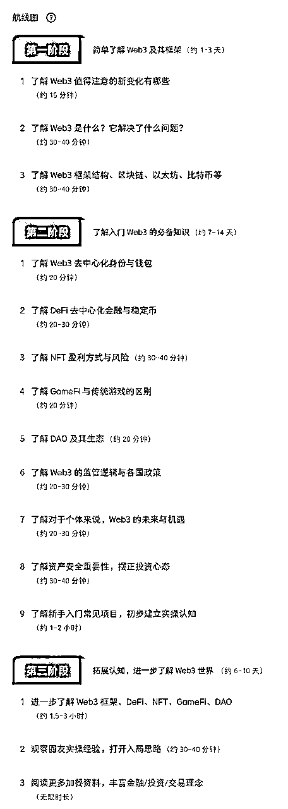

⚠️说明：上述时长仅指浏览内容所需；若想深入 Web3，还要另花时间自行探索。

路径图与文档紧密咬合，可按所在环节学对应动作：

1. 每天对照项目进展，确认自己走到路径图哪一格，下一步做什么；
2. 点开要实操的步骤，跳到文档对应模块，边看边做；
3. 当天行动结束，记录进展，复盘并安排下一步；
4. 路径图与关键路径强关联。全部动作完成，代表最简闭环已跑通；接着别停，继续循环第一到第三阶段。

走完路径图后，持续精进，选准适合自己的切入方向，冷静且审慎地进入 Web3 世界。

# 必修篇：走进 Web3

# 一、认识 Web3 @可达 Koda

# 💡

章节概要

这些满口 Web3 的人到底在聊什么？为何我完全听不明白？什么叫“我要 Mint 一个 NFT”？碰到自称做 Web3 的人，你是否会怀疑自己穿越了？同样成长于互联网时代，怎么对方的话一句都接不住？

例如这些词：大饼、以太、币安、智能合约、无聊猿、阿谢、跑鞋、公链，以及 DID、DeFi、NFT、GameFi、DAO……是不是全都陌生？

别慌，这太正常了。多数人初入 Web3 都一头雾水。原因不复杂：你闯入一个新圈子，圈内人默认你已懂前置概念；新词不解释就冒出来，普通人自然理解不了。

不必焦虑，下面会按这些线索逐项拆解：为何要认识 Web3？它究竟指什么？能解决哪些事？商业模型怎样？眼下发展到哪？和 Web2 有何差异？……

来，推开 Web3 世界的第一道门。

重点提示：本期 9 月航海邀请实操经验丰富的 @阿布 Abo 老师，在「十一、新手入门路径」补入新手应留意的资产安全知识，并分享如何辨别正确官网、获取信息。感兴趣者重点看「11.5 官方信息」「11.6 资产安全」。

# 1.1 2024 年，Web3 出现了哪些新动向

2021 年冲高之后，这个行业近两年更像在“补课搞建设”。

2022 年，明星背书的高价 NFT、6.9 万美元的比特币、4800 美元的以太坊、马斯克带热的狗狗币等故事逐步冷却；头部交易所 FTX 出事，LUNA 币两天内近乎清零，不少人离场，市场几乎探底。

2023 年，加密资产行情转暖，新故事密集涌现，Web3 又回到公众视线。那一年，加密市场总市值比年初涨逾 110%，增量超 8700 亿美元；到四季度已升 55%，约 5960 亿美元。

比特币走出大起大落：从 1.5 万美元低谷重新越过 4.4 万美元，涨幅 190%。比特币生态中，Ordinals 与 BRC-20 让链上首次能部署、铸造、转移可替代代币，ORDI 币一度涨近万倍。

以太坊生态继续迭代，体量大且根基稳，基础设施持续加固，也催生新技术与细分市场，二层项目空投频繁。

今年 2 月底，以太坊二层项目 starknet 向 129 万个地址发放 7 亿枚代币；二级价现为 2.2 美元，最高 2.5 美元。单地址最低空投 500 枚，折人民币最普通“低保号”也有 7000—9000 元；而单号资金成本仅几百元，交互支出甚至不到 100 元。笔者也借此次 starknet 空投拿到六位数结果。

最大加密交易所币安与美国监管方达成和解，接受 43 亿美元罚款，行业朝可监管方向迈步；多家基金巨头申请现货比特币 ETF，可预期大量法币未来能合规涌入。

宏观上，美国利率处在 22 年高位，美联储降息预期渐近；欧洲通胀回落，欧洲央行降息预期也提前。这些对 Web3 市场构成偏暖因素。

噪音渐大，入场者渐多，新机会也在孕育。接下来看看，为何 Web3 仍值得学习了解。

# 1.2 为什么 Web3 还值得学

一句话：我们看见这条赛道有十倍以上增长可能。

混沌大学创始人李善友在一次创业课上说过：创业者若发现十倍增长，就是历史级窗口，应该主动扑上去拥抱。此话不只对创业者有效，打工人与投资者同样适用。

先看微观层面正在发生的现象。

# 1.2.1 打工人视角：仍属朝阳领域

前些日子，知乎有篇帖子讨论“在某安上班是什么体验”。某安是 Web3 头部公司，类似 Web2 的腾讯、阿里。帖中一句话：按小时薪酬算，同级别互联网大厂很难追。事实确实如此。

另外，它支持全球远程协作。所谓分散办公，就是工作地点灵活、可远程。我认识的不少 Web3 创业者都在家干活。注意，这不代表远程一定比坐班高效；个人反而认为集中办公效率通常更高。但即便这样，报酬仍能开得高，说明什么？没那么卷。

而且，Web3 门槛没想象中高。深入看会发现，无论产品还是市场，眼下它仍被 Web2 压着打。那为何还能“高报酬 + 远程”？因为人才总量不少，但懂 Web3 又真正投入的人不多。后文会讲，Web2 与 Web3 对底层工作能力的要求并无本质差别，关键在认知与选择。

# 1.2.2 创业者视角：尚待开垦的入口

马斯克在一次访谈里说：大学时他先想的问题是，什么能影响人类未来。答案是互联网、人工智能、可再生能源、太空探索与地外生命、基因工程。

若你想做大的互联网创业，最好看看 VC 怎么判断。VC 挑赛道，创业者做经营，专业分工。以 VC 视角，当下大赛道：国内是双碳、新能源、半导体等硬科技；海外是 Web3。

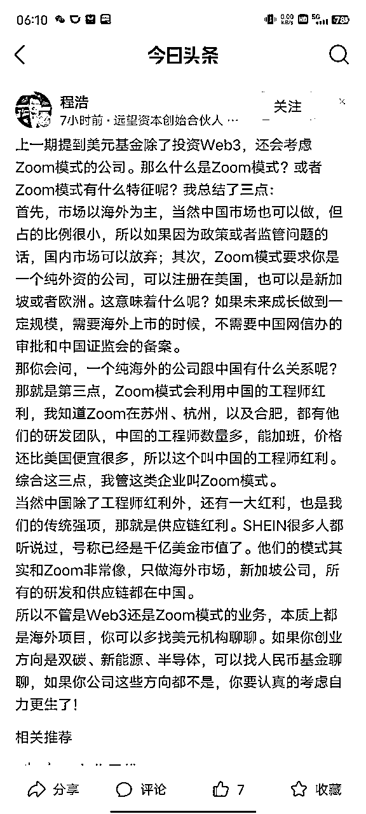

# 1.2.3 投资者视角：多一种配置可能

我们经历过股票、房产等投资后，再看 Web3 相关机会，对比很鲜明。这是过去两年的历史。若拉长到十年，全球涨幅最大的资产是什么？答案很明确：数字资产比特币。这些是数据，是已经发生的事实。

同一时期，美股龙头苹果从 90 到 150，1.7 倍；谷歌从 1460 到 2900，2 倍。A 股与港股则为负增长。

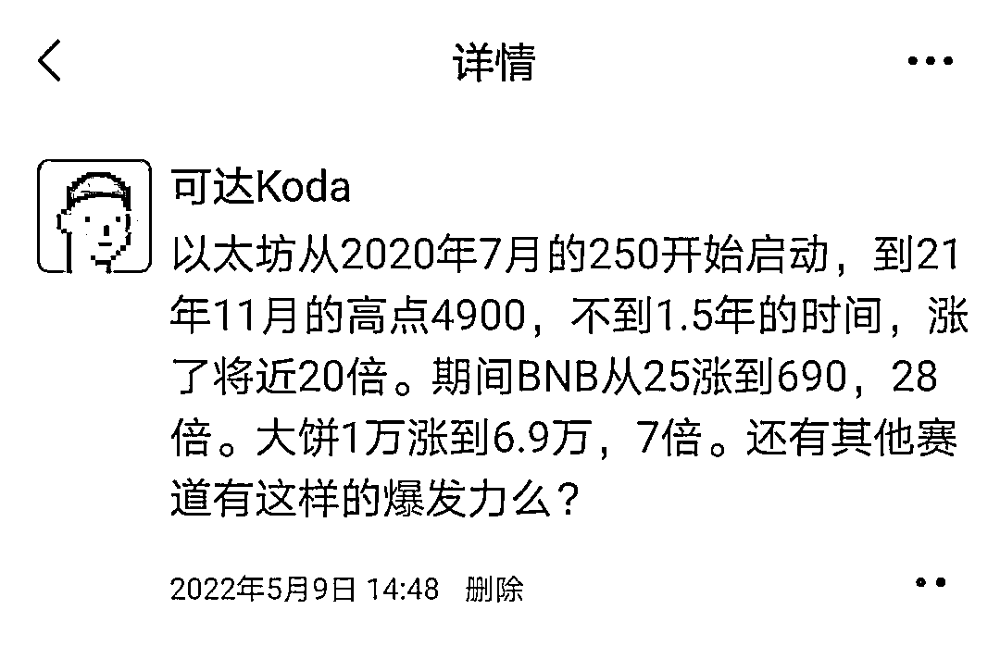

再次说明：文档不构成投资建议，这里只是呈现一种理财配置的新渠道可能。

当年 BTC China 的 CEO 向还是 Web3 小白的赵长鹏介绍数字资产，对话颇有意思：拿 10% 资产换成 bitcoin，清零概率很低，更可能涨 10 倍；若真涨 10 倍，总资产就翻倍。赵长鹏听完，先卖掉上海的房子买入比特币，随后又投身 Web3 创业。如今他已是 Web3 世界最富有的人之一，位列福布斯全球富豪榜 TOP 20。

# 1.3 Web3 到底指什么

可把 Web3 的底层主张压缩成四组词：权力分散、准入开放、链上原生结算、弱化中介信任（对应去中心化、无需许可、原生支付、无需信任）。

到今天，Web3 已是包罗很广的术语，指向一种更新、更理想的互联网愿景。其核心是借区块链、加密货币与 NFT，用所有权形式把权力还给用户。

行业尚早，严格定义仍有难度，但有几条原则在指引它：权力分散、准入开放、链上原生结算、弱化中介信任。

权力分散：网络不由某个中心化实体掌控，产权归建设者与用户。  
准入开放：人人可平等参与，不被排斥在外。  
链上原生结算：用加密货币完成在线消费与汇款，不必依赖传统银行或类似银行的第三方。  
弱化中介信任：靠激励与经济机制运转，不靠某个必须被信任的中介。

看到这里可能仍蒙。没关系，下面继续拆解、追根溯源。

要理解 Web3，可先对比 Web1、Web2 的定义：

Web1：只读网络；  
Web2：读写网络；  
Web3：读、写、拥有，即价值网络。

按现有说法，Web1 偏浏览；Web2 让用户能看也能写；Web3 多出“拥有”一层——网络信息产权归用户，所以常被称作价值网络。

展开看互联网演进。1989 年，日内瓦 CERN 的 Tim Berners-Lee 正开发后来成为万维网的协议。他设想建立开放、分散的协议，让信息在全球任意地点共享。

这项创造后被称作“Web 1.0”，大致在 1990 至 2004 年。那时多为公司持有的静态站点，用户互动近乎为零，个人少产内容，故称只读网络。

社交媒体兴起后，Web 2.0 于 2004 年开启。网络不再只读，而变得可读可写。平台不再只由公司向用户投喂内容，而是提供空间，让用户生成内容并彼此互动。

上网人数激增后，少数头部公司掌控了不成比例的流量与价值。Web 2.0 也催生广告驱动收入模式。用户虽能生产内容，却不拥有内容，也无法从内容变现中获益。

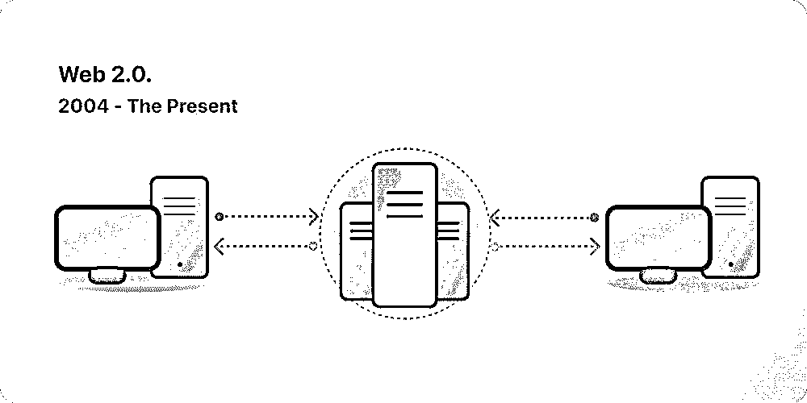

Web3 一词由 Polkadot 创始人、以太坊联合创始人 Gavin Wood 在 2014 年提出。他们关注的问题是：现有 Web2 网络要依赖太多信任。换言之，人们常用的大多数网络，都建立在信任少数私营公司之上。他们希望用 Web3 解决“用户拥有网络信息所有权”的问题。

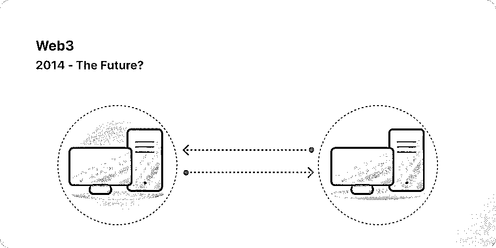

所以 Web3 是什么？——价值网络，用户真正掌握自身信息的所有权。

下面用实例区分 Web1、Web2、Web3。

1）Web1 的代表是 PC 互联网时代巨头，如海外雅虎、谷歌，国内搜狐、网易等门户。它们聚合信息，用户点击浏览。

2）移动互联网到来后，信息生产不再只由门户完成，全球数亿用户成为生产节点。人们既能获取信息，也能自行生成信息。代表产品国外有 Facebook、Twitter，国内有🛰️、抖音，均属 Web2 时代。平台一端聚用户，一端接商家，用广告完成商业闭环，是典型平台经济：先以免费服务聚拢海量用户，再在用户未许可的情况下把信息卖给商家获利。

3）Web3 的不同在于：用户掌握自己在互联网上的信息产权。内容一经产出，权属即确认给用户。Web3 是拥有者的经济。如今用户不必依附各平台注册账号；生成自己的钱包后，就能用钱包在 Web3 各类应用中穿行。钱包概念后文会解释。理论上，钱包只归你，不属于任何公司或组织。Web2 里游戏封号或公司倒闭，虚拟资产可能打水漂；Web3 则不同，你的就是你的，即使公司倒闭，信息资产仍留在钱包里。这就是 Web3 的特质：强调用户信息所有权，构建原生价值网络。

# 1.4 Web3 能解哪些难题

上节讲了 Web3 是什么，以及从 Web1 到 Web3 的演进。本节换到 Web3 视角：为何需要它？它能治 Web2 的哪些毛病？

注意，这是 Web3 视角，你当然也可用别的框架思考。眼下 Web2 暴露的问题包括：

- 数字身份被平台拿捏；
- 数字资产不归用户；
- 用户应得收益被截走；
- 平台与内容创作者权力严重不对等；
- 支付受限。

1. 数字身份被平台拿捏

在 Web2 世界，参与网络活动通常得注册账号。聊天要🛰️、🐧；玩网易游戏要游戏账号；海外用社交媒体要 Twitter、Facebook 等。

也就是说，你的数字身份从诞生起就落在平台里；注册那一刻，身份信息实际上已交给平台。

然而，在 Web3 的世界里，情形完全不同。当你创建了自己的数字地址，你就拥有了专属于你的链上身份，凭借这个地址，你可以自由进出各种 Web3 应用。

2.

顺着这个逻辑往下走，用户在平台上积累的所有数字资产，同样不属于用户本人。之前我提到过，假如你在玩某款游戏，因为各种意外，账号被封，或者游戏公司倒闭跑路，你辛辛苦苦积攒的虚拟财产也就随之消失了。原本属于你的东西，被平台强行剥夺。

这里有个流传很广的轶事：如今 Web3 生态中规模最大的公司以太坊，其创始人 V 神（出生于1994年）从13岁起就沉迷《魔兽世界》。2010年的一天，暴雪的一次版本更新改动了他游戏角色的某些特性，这位少年天才伤心不已，干脆删掉了游戏。或许正是这次经历，在他心底埋下了日后创立以太坊的种子。

3.

既然数字资产不属于用户，那么由这些资产产生的收益，自然也与用户无关。很多人可能还没真正理解“数字资产”这个概念。其实，我们每个人的🛰️号，本身就是一笔数字资产，它的价值本质上和一套房产没什么两样。尤其是对做自媒体的人而言，大家在各大内容平台辛勤创作，但大多数情况下，平台一边变卖着你的数字资产，一边向用户征收着无形的“租金”，却从不向你支付任何直接报酬。这是一种典型的白嫖，而大多数用户对此浑然不觉。

4.

平台与内容创作者之间的权力结构，也已经严重失衡。这一点显而易见——如今哪个 Web2 平台不是想封你就封你？前不久，我们 RichDAO 的一位小助理申请了一个新的🛰️工作号，用来添加 Web3 好友。某天，一下子有将近 200 人加了这个号，同时小助理还要在群里组织活动，结果🛰️号直接被🛰️封禁，到现在都没能找回。小助理做了什么出格的事吗？并没有。他只是失去了与新朋友建立连接的权利。这背后，是垄断型平台与用户之间权力关系的严重不对等。

再比如知识星球。我们为了给社区成员沉淀内容，把部分 Web3 资料放到了免费的知识星球上，可当我们申请转为正式星球时，平台因为内容涉及 Web3 就不给审核通过，而这些都是再正常不过的学习材料。所以 Web3 的信仰者认为，这个世界需要 Web3 的理念与精神，现有的平台权力必须受到制衡。

5.

支付层面的限制

我们经常看到某些国家，比如美国，动辄对某个国家或个人实施制裁，冻结他们的银行资产。Web3 的出现，理论上可以在一定程度上减少这类限制。

讲了这么多，归根结底，Web3 要解决的核心问题，就是用户的数字资产所有权问题。

今年6月底到7月初，一篇题为《Web3 三问》的文章在 Web3 圈子中广泛传播。文章提出了这样三个问题：
- 什么场景在 Web2 下无法完成，必须靠 Web3 才能实现？
- 如果存在这样的场景，那么该场景下的 Web3 产品有多少用户需要？
- 在这个场景中，Web3 产品的解决方案效率真的会更高吗？

这三个问题的提问框架，主要是从生产创造价值的角度出发，存在一定的局限性。除了这三个问题，我还想补充一个：
- 如果你认为没有什么问题是必须由 Web3 来解决的，那 Web3 还会发生吗？为什么？

以上就是 Web3 四问，大家可以结合自己的认知和经验，试着给出自己的回答。

# 1.5 案例对比：Web2 与 Web3

上一节，我们站在 Web3 的视角剖析了 Web2 存在的问题，也聊了 Web3 能解决哪些问题，并给大家留下了 4 道思考题。这一节，我们来看看 Web2 与 Web3 各自的代表性公司，通过具体案例来感受它们的差异。

Web2 这边，我选谷歌。它手握安卓系统、谷歌搜索、YouTube 视频网站等一系列产品，堪称 Web2 世界的巨无霸，目前市值达到1.3万亿美元，在全球科技公司中仅次于苹果和微软。

Web3 那边，自然要提以太坊。它现在已经是 Web3 生态中体量最大的公司，市值1600亿美元，在整个加密世界里排行第二，仅次于比特币。

为什么拿这两家做对比？因为它们在一定程度上是“同类”——都是有代表性的生态型公司，可比性很强。

以前经常有人问我以太坊是什么。如果我说“以太坊是一个去中心化、开源、基于智能合约的区块链平台”，估计大家根本听不明白。所以我想了一个比较容易理解的解释，虽然不是百分百精准，但能让不懂 Web3 的人快速建立概念：

以太坊，就相当于 Web3 世界的安卓系统。当然，两者在网络架构上存在差异，这会在后面“区块链技术与 Web3 基建”章节中详述，大家现在有个大致印象就行。

我们主要从以下四个维度来观察 Web2 与 Web3 的公司：
- 商业模式
- 扩张方式
- 融资方式
- 投资人获得什么？风险是什么？

1.

先说商业模式。任何一家商业公司，其核心都逃不过这样一个基本问题：为谁提供什么样的产品或服务？解决什么痛点？卖什么？收多少钱？这几个要素缺一不可。

对商业不太了解的同学，不妨把自己熟悉的公司套进这个框架试试，看看是不是每一条都符合。

有人可能会问：不对啊，我用谷歌、百度、抖音、🛰️都没付过钱，难道它们是在免费为我服务吗？答案自然是否定的。这只是一种用户视角的错觉。任何一家公司，本质上都需要盈利。即便它阶段性免费，最终也一定会从你身上获得些什么。

换到平台视角来看，以抖音为例：它的模式是向用户提供短视频内容，再把用户的注意力打包出售给商家，通过赚取广告费来获利。这几乎就是所有平台型互联网公司的通用打法。

谷歌的安卓系统也一样。你可以免费使用安卓操作系统，但谷歌会向商家收费。归根结底，它仍然是把你的注意力或数字资产转化为现金流。

那以太坊的商业模式又是什么？简单讲，它为商家和用户提供一个安全可信的网络。和 Web2 公司那种“挂着羊头卖狗肉”的套路不同，以太坊从一开始就把收费规则摆到明面上，写进智能合约，且说好之后不再更改。你要使用网络，就支付手续费；商家要接入，同样要支付手续费。就这么简单。

2.

接着看扩张方式。谷歌和以太坊都具有显著的规模效应：你越强大，使用的人就越多，平台体量越大，用户和商家就越离不开你，最终形成垄断格局。另一种表述是——用户越多，平台能够吸引的商家就越多；商家越多，用户体验就越好；体验越好，用户更多……这是一个完美的飞轮。

这两家公司的增长策略本质上也差不多：都是砸钱优化产品、花钱获取用户。区别只在于，一个用的是美元（也就是我们常说的法定货币），另一个多数时候使用的是自己发行的加密货币。

更深刻的差异在于理念：Web3 的用户，心里装着去中心化的信念。

3.

再说融资方式。在我看来，Web2 和 Web3 在形式上最大的不同，就体现在这里。当然这只是我个人的观点，大家也可以有自己的思考。

先介绍两个概念：IPO 和 ICO。

IPO（Initial Public Offerings，首次公开募股）指的是一个 Web2 公司向普通投资者发行股票的过程。股票上市后，普通投资者如果看好公司未来的增长，就可以掏钱买入。但“首次公开募股”这个说法其实有点误导——因为在公开发行之前，公司的一部分股票早就卖给了机构投资者。普通个人投资者通常只能在二级市场接机构的盘。这个词的关键不在“首次”，而在“公开”——“公开”意味着此前已经有过一轮非公开的售出。个人投资者很难在上市前拿到公司股权。尤其在 Web2“烧钱换规模”的模式下，公司往往以超高估值上市，一上市就收割韭菜。

ICO（Initial Coin Offering，首次代币发行）则是 Web3 特有的概念。这里的“coin”既是货币，又是股票，这是与 Web2 的第一个不同点。第二个不同点是，如果把代币看成股票，那么 ICO 的“首次”是货真价实的首次——它直接面向 Web3 的普通用户发售。与其叫“首次发行”，不如翻译成“众筹”，更容易理解。第三个不同点在于，ICO 不需要金融牌照。目前国内不允许 ICO，对于这一点我们暂时按下不表，后面讲到监管合规时再展开。

谷歌的融资上市路径没什么好说的，重点讲讲以太坊当年的 ICO 故事。

2013年，19岁的 Vitalik 前往美国加州圣何塞参加了一场比特币相关会议。听完之后他意识到，自己有个想法可以大干一场，回来后直接辍学了。接下来的6个月，他跑遍世界各地，见了许多当时还叫“区块链”、现在叫“Web3”的同类团队——以色列、加州、伦敦、洛杉矶、拉斯维加斯、阿姆斯特丹。他失望地发现，大家的思路都没能解决比特币的现有缺陷，区块链技术和应用仍然被局限在金融领域。他认为，比特币如果加上一套图灵完备的编程语言，任何人都能在上面开发去中心化应用，而不仅仅是金融应用。

当时他对周围人讲了这个想法，没有人理会他。于是他决定自己动手。回家用了一个月时间，把这个想法写成白皮书，命名为 Ethereum（以太坊）。白皮书完成后，他首先拿给身边的朋友们看，也由此找到了早期合伙人。

几个月后，V 神在迈阿密比特币大会——Web3 全球顶级会议之一——上向人们介绍了以太坊，引发不小的轰动。随后以太坊启动 ICO。在为期42天的募资中，共募得 31000 枚比特币，售出 60,102,216 枚以太币，按当时汇率计算约合 1840 万美元。若按现在的比特币价格估算，这笔钱大约相当于6亿美元，堪称天价 ICO。

当然，早期买入以太坊并长期持有的人，如今都获得了惊人的回报。以太坊 ICO 单价不到0.5美元，而现在价格是1300美元，不到10年上涨了几千倍。（下面是以太坊的历史价格走势图，大家可以感受一下。）这种涨幅，当初哪怕只投入1000块钱，现在也值几百万了。Web3 世界里，这样的机会并不罕见。

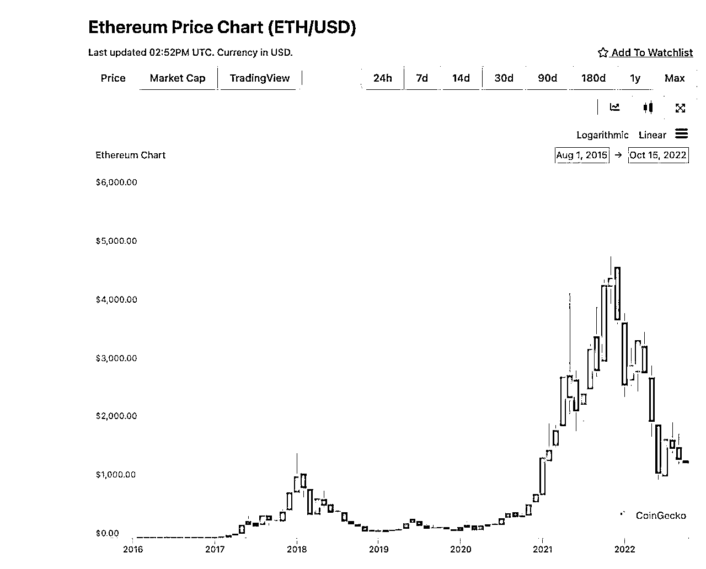

这里再分享一个小工具。考虑到大家可能还没有交易所账户，可以用这个网站查询加密资产的历史价格：Coingecko（https://www.coingecko.com/）。另外，全球访问量更高、在 Web3 第三方网站中排名更靠前的还有 CoinMarketCap（https://coinmarketcap.com/），也一并附上。

1.

说到这里，其实还有一个问题大家应该也心里有数了，就留作这一节的思考作业吧：Web2 的投资机构和普通投资者分别获得了什么？又要承担什么风险？

# 1.6 另一种视角：跟着资本看 Web3

俗话说，术业有专攻。在看赛道、选公司这件事上，资本无疑是最专业的。这里想给大家提供一个方法——从资本的视角看 Web3，了解那些聪明的钱都流向了哪里，以及如何确认一家 Web3 公司背后站着哪些投资方。这对我们评估项目质量非常有帮助。

自 Web3 赛道出现以来，2021 年可以说是资本出手最阔绰的一年。根据 galaxy Digital 2021 年 12 月的报告，截至 2021 年 12 月底，风险投资机构对 Web3 相关企业的投资总额已达到 330 亿美元。仅 2021 年一年的投资量，就超过了此前多年总和。

The Block 的研究报告也显示，整个 Web3 行业的独角兽公司数量在 2021 年井喷式增长。各类项目百花齐放，涵盖金融服务、交易所、基础设施、NFT、GameFi、数据分析等众多细分领域。

之前在股票投资中，我寻找优质标的时用过一个小技巧：在烯牛数据上查腾讯战略投资了哪些公司。这些专业机构的筛选，某种程度上为二级市场投资提供了一层“安全垫”。放到 Web3 里，这个思路同样适用——想验证哪个方向、哪个公司更有潜力，不妨看看那些知名 Web3 投资机构都投了什么。下图列出的都是 Web3 领域大名鼎鼎的资本及它们孵化出的成功项目，比如 Coinbase、Digital Currency、Paradigm、a16z、红杉等。

如果你刚听说一家 Web3 公司，想快速判断它靠不靠谱，可以用一个叫 Cypherhunter 的网站（https://www.cypherhunter.com/en/）来查询哪些资本投了它。举个例子，在搜索框输入 Ethereum（以太坊），网站会显示介绍：以太坊是一个去中心化平台，支持智能合约和 DApp。继续往下，可以看到以太坊的团队信息及他们的 Twitter 链接，包括我们之前提到的 V 神 Vitalik。再往下是 Portfolio，也就是以太坊的投资组合，列出了它投资了哪些项目。最底部，则能看到哪些投资人或投资机构对以太坊进行了投资。

再看看最大的 NFT 交易平台 OpenSea，它的投资方阵容非常豪华，都是知名机构和投资人，NBA 小牛队老板库班也参与了投资。

最近，币安旗下的投资机构 BinanceLabs 出手也相当有质量。关注 Binance 投资了哪些项目，对我们判断 Web3 公司或项目很有参考价值。翻看 BinanceLabs 的 Portfolio，能看到我们之前提过的 BNB 域名项目 SPACE ID，还有今年实现百倍涨幅的跑步赚钱项目 STEPN 等等。

总结一下，今天给大家提供了一个理解 Web3 的新视角——资本视角。概括来说，就是两个问题：第一，Web3 领域的知名投资机构最近在投什么类型的项目？第二，一个新的 Web3 项目，背后站了哪些机构？这两个问题，都可以作为判断项目质量的重要参考。如果你自己准备参与投资，这或许是一个不错的安全垫。

# 1.7 章节小结

最后，做一个简单的梳理。

第一节，我们先了解了 Web3 在 2023 年的新变化，以及这些变化带给我们的影响。第二节，讨论了 Web3 为什么值得关注。第三节，介绍了 Web3 的定义——Web1 是只读网络，Web2 是读写网络，而 Web3 是价值网络，用户拥有数据所有权。

第四节，我们站在 Web3 的视角，细致梳理了当前 Web2 的种种问题，以及 Web3 对应的解决方案，包括：用户的数字身份被平台控制、数字资产不属于用户、用户应得的收益被剥夺、平台与创作者之间的权利关系失衡、支付受到限制等。

第五节，用谷歌和以太坊作为 Web2 与 Web3 的代表性生态案例，从商业模式、扩张方式、融资方式等方面做了对比。第六节，则提供了从资本视角理解 Web3 的方法。

整个 Web3 概述这一章，除了帮助大家建立概念之外，还给了两个实用工具和五道思考题。工具方面：用 Coingecko 查看加密资产的历史价格；用 Cyberhunter 从资本视角辅助发现好项目、判断项目质量。

五道思考题分别是：
1. 什么场景在 Web2 之下无法实现，必须依赖 Web3 才能完成？
2. 如果存在这样的场景，那这个场景下的 Web3 产品有多少用户需要？
3. 在该场景中，Web3 产品解决问题的效率会更高吗？
4. 如果你认为没有什么问题必须由 Web3 来解决，那么 Web3 依然会发生吗？为什么？
5. Web2 和 Web3 的投资机构与普通投资者，各自获得什么？又面临什么风险？

从下一节开始，我们会逐步拆解 Web3，从底层技术一直讲到热门应用。

# 二、读懂 Web3 的框架结构 @可达 Koda

# 💡

本章概览

这一章，是 Web3 入门课程中难度最高的一节，因为它牵涉到底层技术——区块链与基础设施。期间会涉及以下话题：
- Web3 从协议层到应用层的完整架构，帮你在遇到各种名词时建立分层思维；
- 区块链技术源于比特币，而比特币与区块链的诞生正是为了解决“双花问题”；
- 去中心化平台以太坊的介绍；
- 当前公链格局，以及两条不同的公链解决方案思路；
- 联盟链、私链等概念。

别担心，我们会结合具体案例进行拆解，帮大家更好地消化理解。

# 2.1 认识 Web3 的分层框架

先放一张图，帮大家对 Web3 的整体框架有个直观印象：

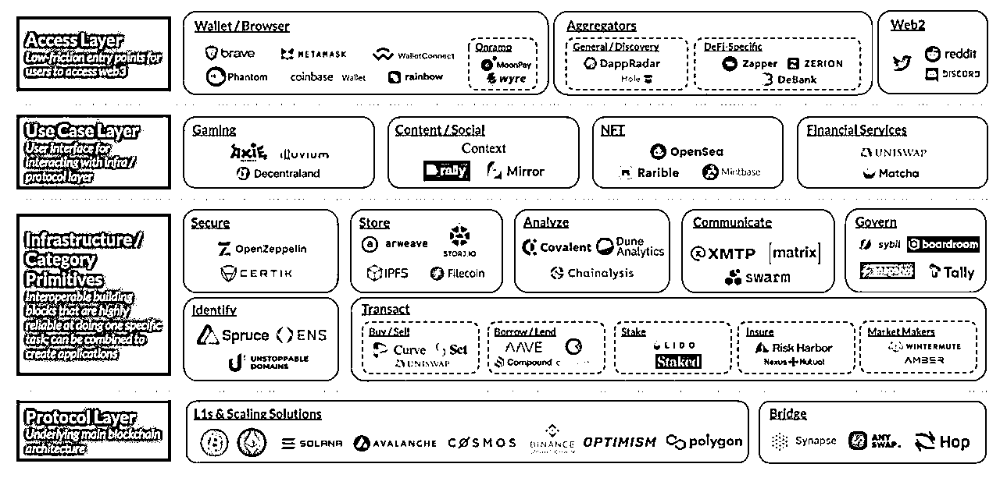

https://www.coinbase.com/blog/a-simple-guide-to-the- Web3 -stack

在前面的内容里，我们提过不少听起来陌生的词汇，比如区块链、基础设施、智能合约、比特币、以太坊、DeFi、交易所、NFT、GameFi、DAO 等。其实，这些都是 Web3 的重要组成元素。这一节，我们就借助上面这张结构图，先对这些概念进行分层归类。有了整体框架之后，再遇到新概念，你就能快速对号入座。

简单来说，Web3 可以分为四层，自下而上依次是：协议层、基础设施层、应用层和接入层。这四层之间的关系就像盖楼，每一层都稳稳地建在下一层之上。

为了帮助你更好地理解，我们用 Web2 里大家都熟悉的腾讯系产品做一个类比（虽然不是十分精确，但有助于建立直观感受）。

1. 协议层

我们平时使用的各种互联网产品，本质上都建立在互联网协议之上。什么是互联网协议？我把它理解为一种各方共同认可的语言标准。为什么互联网能连接全世界？因为全球都在用同一套标准交流。就像你没法和一个不懂中文的人交谈一样，能够对话的前提是双方都认同并采用同一套交流规则。这个层面，就是协议层。

2. 基建层

也就是基础设施层。当我们用腾讯的🛰️、🛰️支付、🐧、游戏时，有没有想过这些服务背后是如何运转的？这就要靠基建层来支撑了。以🛰️支付为例，它需要后台完成记账与处理，同时你的支付账户还需要一套完整的安全机制来保障；你在应用中产生的数据，既要存储在公司的服务器里，又要进行处理——这一系列复杂工作，都属于基建层的职责范围。没有基建层，我们根本没法顺畅地使用各种 App 和网站。

3. 应用层

# Web3不玄乎：先看懂这张分层图

Web3这个词，听着高大上，实则没那么难懂。把它拆成分层结构，脉络也就清楚了。

离我们最近的是应用层。🛰️、🐧、以及火遍全网的游戏《王者荣耀》，这些腾讯生态里的产品，全都算作这一层。互联网里的各类应用，基本也都是按照一套分层办法生产出来，再送到用户面前的。

4. 接入层

再往外看，是接入层。想用🛰️，先注册一个🛰️号；想逛淘宝，先注册一个淘宝账号。无论哪个平台，都得先给你一个“身份”才谈得上使用。在Web2时代，这个身份要么是手机号，要么是邮箱。

拿这套框架去对照Web3，会发现底层分层并没有出现天翻地覆的变化，真正的差别体现在理念和玩法上。

先看协议层。Web3可不是只有一张网络，而是多张网络各说各话：以太坊是一张网，比特币是一张网，Solana、Cosmos、币安也都分别有自己的链上生态。如果觉得“网络”太抽象，不妨把每张网想象成一套操作系统生态。Web2移动端基本被iOS和安卓两分天下，Web3则热闹得多，头部是以太坊，币安生态这两年也蹿得飞快。

在Web3语境里，这样的生态被叫作“链”，名称自然来自区块链。按照开放程度，链还可以分成公链、私链和联盟链，这个课题后面再展开。总之，以太坊的链就叫以太坊链，币安对应的就是币安链。

既然是独立的生态，每条链自然都要配齐自己的基础设施和应用。于是架构图里出现了基建层和应用层的种种产品：基建层管的是安全、存储、身份系统；应用层目前扎堆着游戏、社交、数字藏品、金融服务等门类。

轮到接入层，Web2和Web3的分野一下子就明显了。前面提到，Web2时代要用什么平台就注册什么账号，手机号、邮箱换来的是一个个平台专属的数字身份，而且这些身份数据归平台所有。Web3则换了一套逻辑：不管你想访问该网络里的什么应用，一个钱包地址就够了。不用打开🛰️注册一遍，打开淘宝再注册一遍，打开网银还得重新来一遍。钱包地址一亮，资产记录跟着它走，访问同一条链上的应用也全都认它。

一句话总结这套架构：协议层好比地球上的土地，基建层是在土地上盖起来的建筑。建筑里摆着游戏厅、商店、服务台，这些内容就是应用层。建筑门口装了门禁，进门要看身份证，Web3里这张证就是钱包地址。

有了这张分层图，以后无论遇到哪种Web3产品，都能先做个归类，看看它站在哪一层。接下来的课程，我们就照着这条主线，把有代表性的项目逐一拆开。

# 2.2 实例解析：区块链从何而来，解决了什么

想理解Web3，先要摸清它的技术底座——区块链。

既然是入门内容，这里不准备堆砌技术细节。想往深处钻研的，最后附了阅读材料，啃不透随时在群里交流。这一节更关注两件事：区块链到底解决了什么问题？它又是怎么解题的？

区块链这个概念正式进入大众视野，是从比特币开始的。2008年，一位化名“中本聪”的极客发表了一篇论文，当时没什么人注意到它。论文标题本身就是在定义一个新事物：比特币——一种点对点的电子现金系统。区块链技术也正是从这篇文章开始，被越来越多人知晓。

这里是《比特币白皮书》的阅读材料，建议当作一项长期阅读作业，多读几遍：

《比特币白皮书》英文版.pdf

《比特币白皮书》中文版.pdf

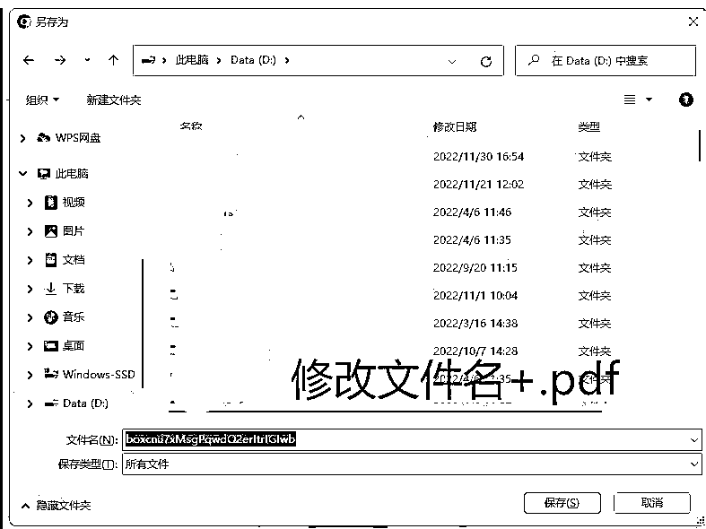

小提示：如果下载后打不开，或者文件名出现乱码，手动把文件名改一下，补上“.pdf”后缀，并把保存类型选成“所有文件”即可。

读一遍全懂是不可能的，正常。多啃几轮，里面的逻辑会越来越清晰。

这里先抛出三个问题，后面的内容就围绕它们展开：

1. 比特币为什么会出现？区块链最初要解决什么麻烦？
2. 解决方案长什么样？
3. 区块链有哪几条关键特征？

1.

先回答第一个问题：区块链的诞生，最初是为了对付“双花”。

“双花”，就是同一笔钱被重复花了两次。为什么会出现这种问题？这要先看看我们熟悉的货币体系是怎么运转的。

现有的货币体系，本质上是一套中心化的清算体系。大量用户和银行都连接在同一个记账网络中，所有交易依靠后台的账户系统完成清算。银行最核心的活儿，说白了就是记账——不能记错，更不能记假账。

可问题在于，一套中心化管理的数据库，在数字时代有太多被篡改的可能。至少三种情况值得想一想：

第一，中心化银行真的可靠吗？我们的存款在银行的账本里，说白了就是一条数据，而且这条数据对储户并不透明。账目背后真实发生了什么，普通个体很难核实。

第二，中心化银行真的安全吗？为什么某些国家一旦发生经济危机，民众就会在银行门口排长队取不出钱？

第三，国家背书真的管用吗？在美国、中国这样的强国，国家信用相对稳固，货币因此有底气。可是一些第三世界国家，政治局势动荡，本国货币的汇率波动甚至比股市还刺激，更极端的例子是整个国家直接破产。一旦背书体系本身摇摇欲坠，其货币的信用又从何谈起？

上面只是随手列出的几种风险，现实中的问题只会更多。欢迎大家展开脑洞，想想还有哪些信任裂缝。

中本聪给出的解法，是绕开中心化机构，让用户之间直接点对点支付，形成一套去中心化的货币系统。

2.

接下来看，这项技术具体怎么落地？

“区块链”这个词，其实是英文blockchain的直译，乍一听有点唬人。拆开看就简单了：block是区块，chain是链。所谓区块链，就是由一个个信息块前后咬合而成的一条长链。如果再翻译成贴近生活的说法，区块像一个不断生成的小账本，这些账本通过哈希算法首尾相连，最终汇成一本总账。说白了，区块链并不神秘，它不过是一种很难篡改的新式记账技术。

这套方案可以浓缩成几句话：

中心化机构不靠谱，那就别让某一家独占记账权；
数据库的管理权交还给全网，大家一起记、一起维护；
每个人手上的账本必须和别人完全一致，才能算有效；
于是全网账本高度统一，没有任何人能私下动手脚。

传统方式是“一个人/一个系统记账”。区块链则变成“全网所有人一起记账”：每发生一笔交易，所有节点都记录一次，而这些记账节点分布在世界各地。账本要起作用，前提是吸引足够多的参与者，人越多，网络就越健康、越难被攻破。

那问题来了：普通人为啥要当这个“义务会计”？

动力不会凭空产生。比特币吸引大家参与建设的方式非常直接：每10分钟发一轮奖励。分布式记账网络大约每10分钟要生成一个子账本，校验无误后接入总账本。这中间需要计算机贡献算力来完成计算和确认。只要参与了劳动，就有机会抢到奖励包。

比特币的发行从未离开过奖励机制——奖励不停发送，货币便随之流入市场。按白皮书的设定，奖励要持续派发142年：起初每10分钟发50枚，之后每4年减半，从50到25再到12.5，以此类推。比特币总量恒定为2100万枚。即便奖励发完，参与网络维护的节点依然可以靠用户的交易手续费获得收益。

抢奖励包的过程，在Web3里有个形象的叫法——挖矿；参与建设的人，叫矿工。既然是概率事件，单枪匹马拼运气不如抱团取暖，于是矿工们把算力集中到一处，这就形成了矿池。到这里，挖矿、矿工、矿池三个概念就一次讲清了。

比特币网络刚上线时，参与者寥寥，全网算力低得可怜，普通笔记本随便挖挖就能出不少币。第一笔真实的比特币交易，是一位老兄用1万个比特币换了两张披萨。放到今天，这1万个比特币价值2亿美元上下，峰值时甚至逼近7亿美元——这两张披萨，可能是人类历史上最贵的一顿外卖。

3.

最后回答第三个问题：区块链有什么特点？

如果硬要归纳，我认为核心只有两条：分布式方案和不可篡改。至于“去中心化”“公开透明”，其实都是分布式方案带来的结果。要明确一点：区块链是为了治理中心化的顽疾，才选择了去中心化的解题路径，不是因为“去中心化”本身有多酷，才发明了这项技术。至于完全公开透明是否一定优于部分公开透明，我觉得还有讨论空间，欢迎各抒己见。

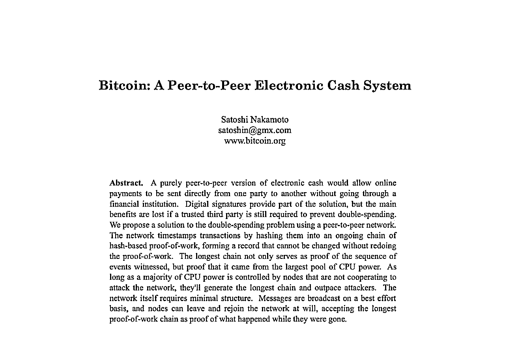
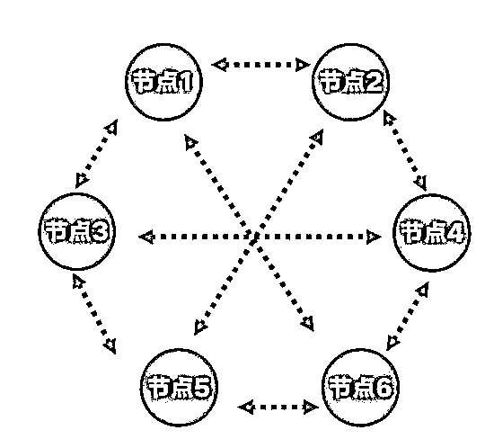
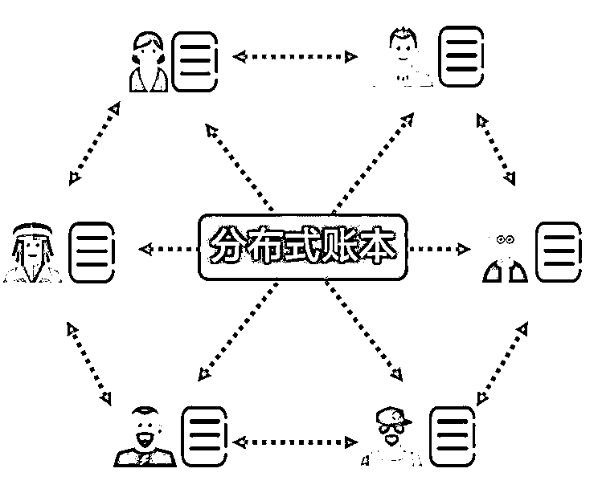
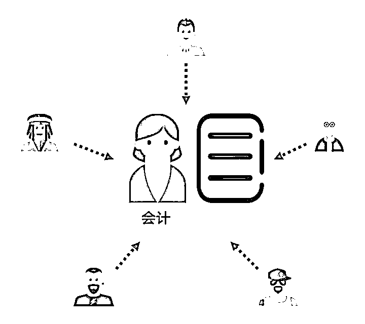

# 2.3 实战拆解：公链第一项目以太坊

上一节讲到，区块链技术的原点，是比特币这套点对点电子现金系统；我们也借此理清了比特币要解决什么问题、怎样解题、具备什么特征。

之前在《Web2和Web3经典公司对比》里，我们曾经提过以太坊。这一节，就把它摊开来看。

还是按问题来拆：

1. 以太坊到底是什么？它想解决什么问题？
2. 它的解决方案是什么？有没有副作用？
3. 它和比特币，各自站在什么位置？

# 2.3.1 以太坊到底在解决什么？

经过前面的铺垫，以太坊的轮廓已经比较清晰了。这里再复述一遍它的自我定义：以太坊是新一代智能合约与去中心化应用平台。如果仍然觉得抽象，可以先把它理解成一个自带货币体系的安卓系统。

以太坊的创始人为什么要做这件事？他看到了什么痛点？

简单来说，比特币解决的只是“交易”这一个问题。有了比特币后，任何人可以像发消息一样把钱汇给地球另一端的用户，几乎不受国界限制，手续费也远低于传统国际转账。区块链的价值由此被看见，越来越多人想把这类技术用在金融、云计算、信息传输，以及一切需要分布式管理的场景里。

可是比特币网络从设计之初就只服务“电子现金”这一个目标。开发者想在上面落地更多去中心化应用，门槛很高，体验也很不友好。

以太坊的回应是：那我们来做一个更好用的平台，专门用来搭建这些去中心化应用。这听起来，是不是真的很像去中心化世界的安卓？

# 2.3.2 破局之道：标准、语言与智能合约

具体怎么解决？以太坊做了几件事。

1. 定标准、统一语言、简化协议

商界常讲，一流企业做产品，超一流企业定标准。以太坊在这个新赛道上，直接推出一套全球通用、相对易用的可编程语言，让不同需求的开发者都能上手。这门语言叫Solidity。

协议层面也是如此。比如你打算在以太坊网络发行一种货币，就要遵循ERC-20这套协议标准——当然，协议不止这一种。

2. 把规则和合同，变成自动运行的代码

Solidity写出来的东西，主要就是智能合约。“智能合约”译自smart contract，一句话解释：启动之后就无法更改的电子合同。

拿租房来说，房东与租客之间会签一份合同，约定谁把房子租给谁、租客每个月几点之前给房东转多少钱。这类合同目前依然靠人工和机构系统来执行，并不完全是程序化的。智能合约则把区块链“分布式记账+不可篡改”的逻辑延伸进了更广泛的场景，把合同变成代码：只要参与各方在开始时认可了条件，一旦运行，就无法反悔。

想一想，货币系统最内核的功能，用代码表达其实异常简单：

“从A的账户扣除X个单位，再给B加上X个单位”；前提是，A在转账前至少持有X个单位，且这笔转账由A批准。

要实现一个代币系统，本质上就是把这段逻辑写成代码。

顺着这个思路，可以发散一下：人类社会里还有哪些规则，是敲定之后就不再修改，一直运转的？恐怕不只是转账这一条。

把方案落地后，一个全新的局面打开了。由于以太坊本身就是区块链，与iOS、安卓这类Web2开发平台相比，在上面开发应用，天然内置了一套货币系统。

但这里有个问题：项目方在合约里写一句“我发行货币”，凭什么别人就认它能当钱花？要是这样也行，那大街上随便写个数字都能自称货币了。

钱之所以能流通，本质是信任，是共识。

因此，一个Web3项目通常的起手式是：先抛出理念和白皮书，再在平台上发起众筹，发行自己的代币；投资者用BTC、ETH或别的币认购，项目方就此获得启动资金。说白了，项目所有参与方的利益分配，必须在最开始就算清楚，写进合同。大家觉得分配方案靠谱、格局够大，就会真金白银支持你。

这种玩法，就是之前提过的ICO——首次公开发币。以太坊自己的启动资金，正是靠ICO筹来的：42天，融了31000多枚比特币，按当时币价计算，超过了1800万美元。

# 2.3.3 危机时刻：DAO被盗与硬分叉

以太坊允许任何人开发去中心化应用，规则一旦商定就写入代码、自动执行、无法篡改。在这样的土壤上，自然生长出了一种特殊应用——去中心化组织。

最具代表性也最惨烈的，是The DAO事件。

DAO由Slock.It团队创建，这支团队技术扎实，甚至有以太坊创始成员参与。Slock.It做这件事的初衷，是把社区变成项目的资金来源，相当于一个众筹式的投资组织。操作逻辑是：社区一起筛项目，提案获得通过后，资金从以太坊社区募集；项目跑通之后，投资人分享利润。

DAO也是以太坊生态里一次重要的社会实验。参与者并不是直接用以太坊资助项目，而是把手里的以太币换成DAO代币。有了DAO代币，你就可以给项目投票，也可以随时把它换回以太币。

2016年4月，DAO开启了众筹，不到一个月募集了约1.5亿美元，占到当时全网以太坊存款的近14%。这么大体量的资金池，没法不引起黑客的注意。

然而，凡是语言就有歧义，凡是规则就有漏洞。同年6月，黑客利用DAO合约代码中的漏洞，盗走了360万枚以太币，大约是这次众筹资金总数的三分之一。这就好比一份条款严密的合同，仍然可能被聪明人找到套利的方法反复钻空子——据说曾有彩票系统因为规则设计上的漏洞，被直接掏空了奖池。

面对这场灾难，以太坊创始人做了一件在“不可篡改”框架下非常大胆的事：经过社区激烈讨论，平台方选择介入，强行把被盗资金追回。做法是推翻原有规则，另起一条新链——这就是著名的“硬分叉”。

争议自然铺天盖地。

一派认为：规则就是规则，区块链的精神就是去中心化与不可篡改。被偷了也是既定事实，不能因为结果不好就改账本。

另一派认为：社区要有伸张正义的能力，不能让作恶者逍遥法外，更不能让普通投资者白白承受损失。

最终，分叉方案拿到了超过85%的社区投票；V神本人也站到了“正义优先”的一方。这次事件，也让以太坊以两种代币的形式一分为二。

# 2.3.3.1 分叉之后，两条路🔥

分叉后的两条链，各自延续了一种价值观。

ETC保留了“不可篡改”的原教旨：账本一旦成型，谁也不能改。

ETH则代表另一种选择：当极端情况出现，创始人与社区可以一起修改规则。这也是今天大家最常用的那条链。

值得玩味的是，分叉之前的原链和新链都有对应代币：原链代币叫ETC，新链代币叫ETH。查看一下币价就会发现，市场用脚投票，选出了现在的ETH。

再回头看比特币：到目前为止，它可以说是最彻底的去中心化网络。创始人中本聪的真实身份无人知晓，后来这位网名拥有者干脆销声匿迹。整个系统不依赖任何领袖，十多年来就按“定期派发奖励”这一套规则自动运转。

比特币其实也分过叉：有人嫌它支付效率太低，于是分出了BCH。但新链并没有获得普遍共识。

比特币用“以不变应万变”完成了一种极简主义：比特币就是比特币。它已经成了Web3世界里的图腾式存在，不需要追求演进和高效率。

反观以太坊，它的诞生本身就冲着“更高效率”而去，所以它的进化，本质上也是一场持续提升效率的升级。

这里藏着一个值得琢磨的对比：为什么有些事物必须不停地演化，而另一些事物，却可以靠“不变”守住自己的位置？

# 2.3.3.2 BTC vs ETH：谁在不变，谁在改变 🔥

最后，把Web3世界里这两颗最亮的星放在一起，对照着回顾一下前面两节的内容。

比特币：2008年，匿名网友中本聪提出。以太坊：2013年，编程天才Vitalik创造。

比特币不属于任何组织；以太坊虽然目前是Web3最大的去中心化平台，但它的走向，依然明显受到社区与创始人的影响。

比特币提供的是点对点数字现金——一套去中介的电子支付方案。以太坊则在比特币的区块链基础上，提出智能合约与去中心化应用平台，把区块链技术推向了更多赛道。

比特币没有融资故事：共识自动聚集，人们自愿成为记账节点，靠系统奖励获得激励。以太坊则是先拿出方案、再拿到投资，然后用钱把网络搭起来。

共识机制上，比特币用的是PoW，即工作量证明。以太坊早期同样使用PoW，但2022年9月完成了全网升级，切换成PoS，即权益证明。PoS可以这样理解：你持有的该网络货币越多，参与记账能拿到的奖励也越多。

# 2.4 多链新常态：生态各有各的江湖

这一节，我们把视线放到Web3底层，看看区块链世界里“群雄并起”的现实。

以太坊这三个字，我们可以换一个角度来理解：

很多人一提到以太坊，脑子里第一反应就是“一枚币”。其实这个理解只抓住了它的第三重身份。咱们先把最容易搞混的地方捋顺。

第一重身份：以太坊是一群人扎堆干出来的一项事业，参与其中的有组织、有分工，他们想攻克的是去中心化应用不好开发这道难关，让区块链能干的事不再只是转账比特币。

第二重身份：为了把这件事落地，这群人建了一个专门服务开发者的平台，你可以把它理解成区块链世界里的安卓或者 iOS。这个平台本身，也被称作以太坊。

第三重身份：和 Web2 那些平台不同，以太坊打娘胎里就把金融系统写进了协议底层。在这套生态中流转的代币，中文叫以太坊或者以太币，英文缩写 ETH。

顺便说一句，把 token 译成“代币”，我个人认为丢了原味。在 Web3 平台里流通的 token，更好的叫法是“通证”或者“令牌”。为什么呢？因为这类东西不止有货币的职能，它还兼具债券、股票那样的属性。如果硬喊成“代币”，听的人容易误以为它只是钱的一种形态，格局就小了。

当然，这个系统从最底层协议就已经在运转，各种基础设施、应用也全都跑在里面，所以以太坊也可以被看作一张 Web3 网络。再因为它长在区块链技术之上，Web3 圈子和区块链行业习惯把它叫作公链——顾名思义，谁都能接入、谁都能使用的链。

这样一块底层平台的蛋糕，放在商业世界里当然是兵家必争。别的公司、机构还有资本，谁都不愿意看以太坊独自坐大，于是各路公链纷纷冒头，盯着以太坊的短板，各亮各的招。

咱们把本节开头那张架构图再翻出来看一眼。

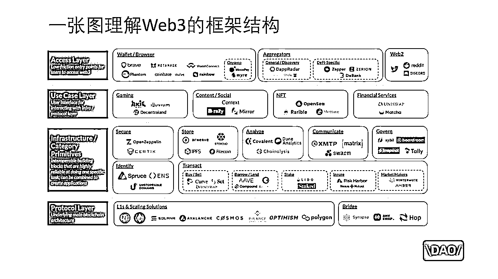

最底下那一层，用户面前摆着的链其实选择很多。这一章就来聊聊眼下公链是个什么局面。要是从“不可能三角”的角度去梳理公链生态的来龙去脉，就比较容易看懂每条链各自在治什么病、开的什么方子。

# 2.4.1 绕不开的“不可能三角”

所谓区块链的“不可能三角”，意思是：一条链没法同时把可扩展性、去中心化、安全这三样都拉满。其中可扩展性，你也可以把它当成效率来看。

拿比特币这种老牌网络来说，去中心化和安全性都挺能打，可效率就成了代价，转账速度慢得让人挠头，赶上拥堵，等上几个小时也不稀奇。

以太坊一路走来，也在这个三角上吃过亏。今年上线的以太坊二层方案，瞄准的就是网络扩张之后算力跟不上的瓶颈。

再瞅瞅我们天天在用的 Web2 网络，可扩展性和安全性算是练到了极致，代价是什么呢？网络变得中心化，用户对自己所用的网络失去了所有权。

另外，目前区块链还有一种分法，是按去中心化程度切成公链、联盟链、私链三类，这个后面再细说。

自打区块链技术问世，各条公链基本都在围着这三项指标做文章——优化、提效，下面咱们摊开来讲。

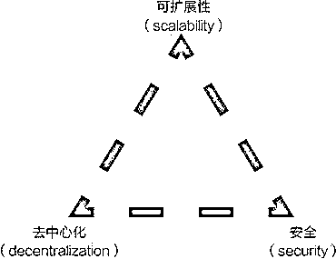

# 2.4.2 公链进化史：效率是那根主线

先顺着时间轴捋一遍公链是怎么走过来的。

2008 年，比特币问世。2008 到 2012 年这段时间，扛旗的是比特币和莱特币。到了 2013 年，以太坊登场，带来了智能合约这个新概念。打那以后，各种针对以太坊网络毛病而生的平台网络就冒了出来，共识机制、侧链、跨链、多链、Layer2 等路子都有人走。

# 2.4.3 以太坊的两大槽点：慢和贵

先瞧瞧以太坊到底卡在哪儿。

Web3 越做越大，以太坊上的应用和用户跟着水涨船高，用户体验上最突出的两个毛病就露头了：一是网络速度慢，二是交易手续费高。

先聊 TPS 这个概念。TPS 就是每秒能处理多少笔交易，以太坊在这项指标上大概只有 15，意思是每秒钟差不多能消化 15 笔。用户一多，这种处理能力显然顶不住。

再说手续费。这笔钱跟网络拥堵情况挂钩，时高时低。以太坊曾被人叫作“贵族链”，原因就是在这条链上转一笔账，便宜的时候几美金，贵的时候几十甚至上百美金都可能。

这俩问题跟用户感受直接挂钩。于是各家网络纷纷围绕着“手续费怎么往下压”“速度怎么往上提”动脑筋、出方案，今天公链这幅格局，就是这么一点点打出来的。

# 2.4.4 Layer1、Layer2 【新】

为了方便大家理解，下面从公链里挑几个最有代表性的项目，分门别类讲一讲。

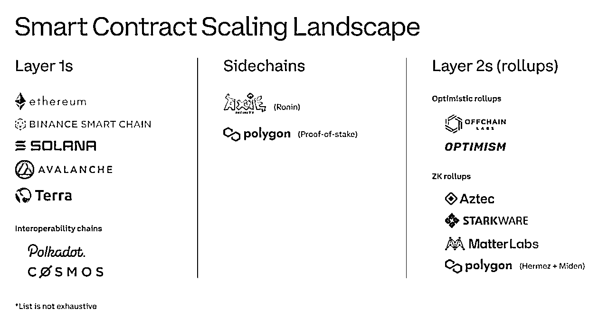

依我看，这些方案背后的思路说白了就两条路：自己干，或者包出去。

L1 的逻辑：既然这条网络不好使，那我就另起炉灶，造一条体验更好的网络来顶替你。

L2 的逻辑：侧链和 L2 本质上是一回事，都算“外包”。相当于给以太坊当小弟，跟它对接，脏活累活自己扛，让以太坊继续端着“贵族链”的架子。低费用、快速度的事情在小弟这边办完，关键数据再回传给以太坊做验证。

在 L1 这一档里，可以看看这些：

币安智能链，英文 Binance Smart Chain，是全球最大的加密货币交易所亲手打造的链。它在去中心化上做了适度让步，把安全守住的前提下，网络性能大幅往上拉。用户在这条链上交易，手续费低到几乎可以忽略，速度也相当快。

Solana 走的是另一条路，创新地用上了 PoH（Proof of History）共识机制，交易速度蹿升一大截，手续费比起以太坊也便宜了不少。

还有一个例子，以太坊联合创始人、也是 Web3 概念提出者之一的 Gavin Wood，自己出来搞了波卡（Polkadot）。这个网络盯上的是区块链架构里的可扩展性难题，打的算盘是把各条链串到一起。

打个比方，没有波卡的时候，各条链就像移动、联通、电信三家运营商，彼此之间打不了电话。波卡想干的事，就是让所有区块链网络能互相通信，顺便把用户体验也往上带一带。

类似思路的项目还有 Cosmos，追的也是“万链互联”这个区块链终极愿景。

换到 L2 这一档：

AXIE 侧链是为了一款经典链游量身定制的网络。那会儿这游戏人太多了，以太坊根本撑不住，团队索性另做了一条新链，再和以太坊对接。

今年大火的以太坊二层方案 Op、Zk、Arb，本质上也是这个路子，区别无非在数据怎么打包、怎么认证上各有各的做法。

下面简单拆一拆以太坊自己推的 3 个 L2 项目。开讲之前，先把一个概念说清楚——Rollup。

Rollup 是什么？

字面上看，Rollup 就是归纳、整理、打包的意思。

前面咱们聊过，以太坊速度慢、手续费贵，尤其交易一多、网络一堵，手续费能飙到几百美金。

你想想平时在家做饭吃，跟节假日跑去景区排队吃饭，花的时间和钱完全不在一个量级。

为什么会这样？原因在于以太坊每笔交易都带着数据，处理每一份数据都要收手续费，而每个区块能装的数据量和 TPS 都是有上限的。大家都抢着交易的时候，出价高的先被处理，出价低的只能干排队。

那咋整？既然每个区块的数据量和 TPS 已经顶到天花板了，那就少处理点数据呗。只把关键数据留给以太坊处理，杂七杂八的放到别处去，这就是前面说的 L2 外包思路。

Rollup 具体怎么干呢？它把以太坊要算的内容复制一份，送到以太坊外面挂着的 Layer2 协议里去算，算完之后把结果压缩、打包、整理好，再送回以太坊主网。

这就像 100 个学生排队问老师题。每个人都跑去问，老师一个个答，时间全耗进去了，老师也得累趴下。这时候大家推一个课代表出来，先把问题收上来、审一遍、合并处理，最后只把最关键、最需要重点讲的问题交给老师，效率一下就上来了。

在这个场景里，Rollup 协议干的就是课代表的活儿。

不过新问题也跟着来了：课代表水平参差不齐，靠不靠谱直接关系到交易的安全和效率。下面就来认识几位有代表性的课代表。

ZK Rollup：

ZK Rollup 指的是用零知识证明（Zero Knowledge Proof）来做验证、完成 Rollup 环节的 L2 协议。那零知识证明又是什么？

设想有 A、B 两个人，A 手里攥着一个秘密，B 不知道。A 想做到的是：不把秘密内容抖出来，同时让 B 相信他确实知道这个秘密——这就叫零知识证明。

关于零知识证明，最早的例子大概要追溯到 16 世纪。那时候数学界正在找一元三次方程的解法，两位数学家同时宣布自己解出来了。为了证明自己没吹牛，又不想把求根公式泄露出去，两人商量好：各自出 30 道方程让对方解。要是真掌握了求根公式，这 30 道题很快就能算完。结果也确实对上了——一个人全部解出，另一个人一道也没做出来。

这个故事里，两位数学家互为对方的证明者，整个证明过程谁都没把求根公式亮出来，只要短时间内交出对方题目的答案就行。

所以 ZK Rollup 的核心打法是这样的：借助严谨复杂的零知识证明算法，让认证者（谁都可以当认证者）去核实不同数据的真伪，核实完把结果打包送回以太坊。整个流程里，认证者不用看到交易的具体内容，工作量因此少了一大截。

ZK Rollup 的长处是验证快、安全性高，特别适合支付这类需要快速结算的场景，圈里不少人把它捧为“以太坊 L2 的终极形态”。但 ZK 的算法相当复杂，应用开发的门槛不低，眼下真正落地的应用并不多，前头还有很长的路要赶。

在已经落地的项目里，zkSync 生态算是最抢眼的一个。

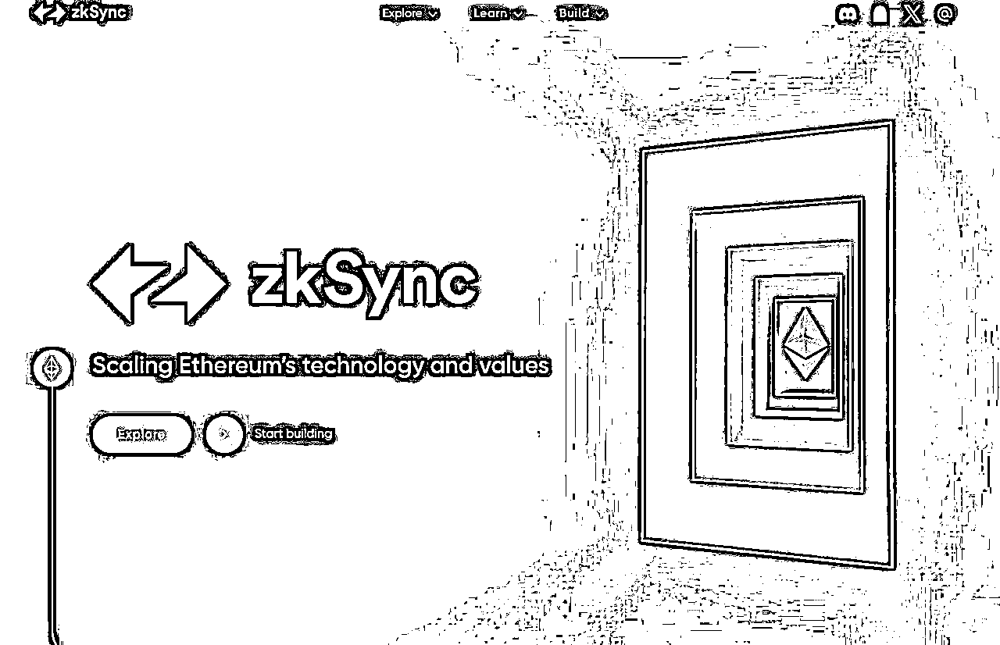

zkSync 出自 Matter Labs 团队之手，a16z 等机构领投，融资总额 4.6 亿美金，现在已经迭代到 2.0 版本，也就是 zkSync Era。

zkSync Era 的生态规模相当可观，目前有 300 多个应用在上面搭建，TVL（总锁定价值，指项目中用户抵押的数字资产总价值）稳在 3 亿美元以上，长期活跃地址接近 40 万。顺便提一句，zkSync 是前面说的 3 个 L2 项目里唯一还没发币的。

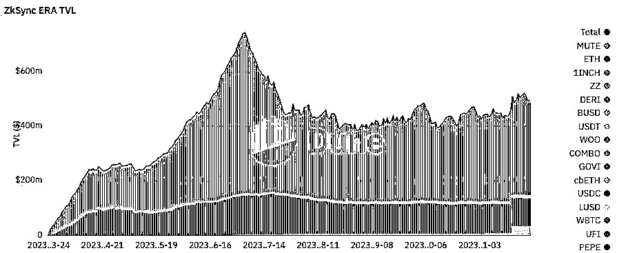

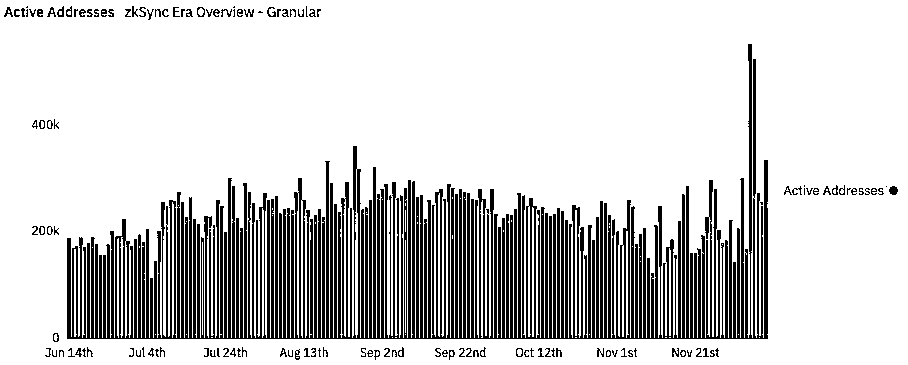

ZK Rollup 虽然给 L2 画了一张“终极形态”的蓝图，可算法和配套设施都还没到火候，那有没有更成熟的过渡方案呢？

这时候就该请出采用欺诈证明的 Optimistic Rollup 了。

Optimistic Rollup：

Optimistic Rollup 的套路跟它的名字一样，透着一股“乐观”——一开始就默认所有发出去的交易都是可信的、已经认证过的。

拿我自己举例，作为交易认证者，我得先押一笔钱当保证金。每笔被打包的交易都有个验证保质期。假设我验了一笔交易，判定数据没问题，那么在保质期内，要是别的认证者跳出来说这笔交易有猫腻（也就是认为我在搞欺诈），这笔交易就会被送到 L1 的智能合约上去算账，看看到底谁在说谎。

要是查出来确实是我撒谎，我的保证金就会被扣掉一部分，用来奖励那个揪出问题的人，有问题的那笔交易也会被打回去重新打包。

跟 ZK Rollup 不一样的地方在于，OP Rollup 的前提是默认这些认证者不会说谎。所以 ZK 那边谁都能当认证者，OP 这边更愿意挑一小撮信得过的人来做认证，统一盯着整个打包交易的过程。

从 OP Rollup 用的证明方法就能看出来，它的处理速度比 ZK Rollup 慢不少。原因是要在交易保质期内让认证者去核实打包的真实性，一旦发现问题还得送回 L1 裁决，裁完再回 L2 处理，而且认证者抱团欺诈的风险也不是没有。

虽说有这些短板，OP Rollup 胜在实现简单、技术成熟，特性上很适合开发 dApp，开发者几乎能把原本跑在 L1 上的项目原样搬过来。与此同时，OP Rollup 的开发团队也在持续升级技术，把安全性和效率往上提。所以 OP Rollup 眼下应用很广，最具代表性的两个项目就是 Optimism 和 Arbitrum。

Arbitrum 是纽约的开发公司 Offchain Labs 搞出来的，2019 年到 2021 年总共融了 1.23 亿美元；Optimism 则由 Jinglan Wang 带队的一批以太坊开发者创立，融资总额 1.75 亿美元。两家拿到的钱都远不如前面提到的 zkSync。

可要是看 TVL 数据，Arbitrum 和 Optimism 对上 zkSync 就是压倒性的优势，生态成熟度和活跃地址数也领先不少。

这也从侧面说明，zk Rollup 协议的建设还有一堆硬骨头要啃。就当下而言，OP Rollup 确实是更靠谱的选择。

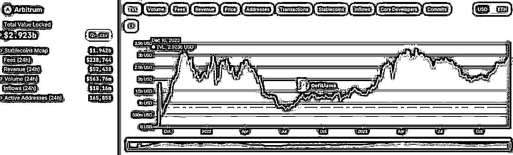

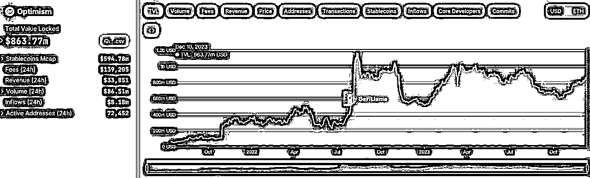

值得一提的是，Optimism 和 Arbitrum 都已经发过币了。靠持续交互撸空投，不少人在两个项目上都拿到了大结果。

Optimism 在 2022 年 5 月 31 日推出原生治理代币 OP，初始供应量大约 43 亿枚，先后在 2022 年 5 月、2023 年 2 月、2023 年 9 月做了 3 轮空投，单个钱包地址的空投上限是 10000 个 OP，按现在的行情值 21000 美金。

Arbitrum 则在 2023 年 3 月推出治理代币 ARB，总供应量 100 亿枚，单个钱包空投上限 10200 枚，发币后最高价值到过 18000 美元。

Optimism 和 Arbitrum 虽然都走 OP Rollup 协议，细看还是有差别。Arbitrum 更像是 Optimism 的升级版，差在哪儿呢：Optimism 只做一轮欺诈认证，而且 L2 上的交易计算还得打包到 L1 去执行；Arbitrum 会做多轮欺诈认证，同时它的交易不往 L1 上打包执行，而是在自家虚拟机里跑，对以太坊网络的兼容性更好。

L2 的搅局者：Blast

加密市场里的加密货币，从经济模型上看大致分两类。一类是比特币那种通缩型，代币数量有固定上限，不再增发，比特币就是 2100 万枚，总量锁死；另一类是以太坊为代表的通胀型，代币总量每年按固定比例增发，这就让以太坊每年能有大约 3% 到 4% 的稳定质押收益率。

可大部分现有 L2 账户上的资金只是干放着，也就是无风险收益率为 0%。这意味着这些资产正在被以太坊的通胀慢慢吃掉价值。

Blast 盯上的就是这个痛点，想让 L2 账户里的钱也能被动吃上利息。

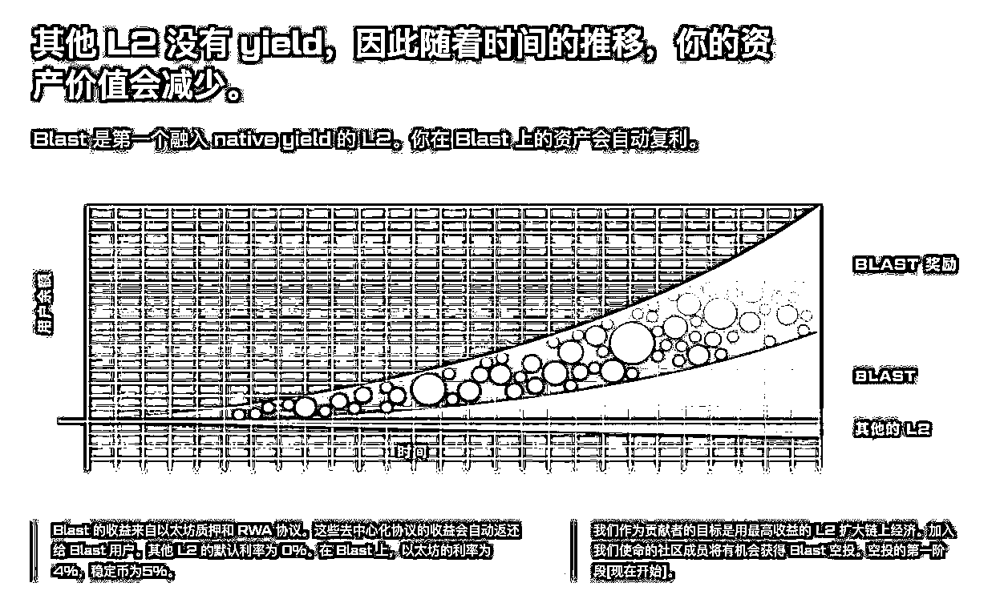

具体怎么操作呢？用户把钱存进 Blast 之后，Blast 会立马把 L1 上锁定的对应 ETH 拿去做网络质押，质押赚到的 ETH 收益自动返还给 Blast 上对应的用户。

说白了吧，你在 Blast 账户里放着 1 个 ETH，过段时间它可能自己长到 1.1、1.2 个 ETH。

除了 ETH 能参与原生质押，Blast 还能帮稳定币吃被动利息。

用户把稳定币（比如 USDC、USDT 和 DAI）转进 Blast 后，Blast 会立刻把 L1 上锁定的对应稳定币存进 RWA 协议（可参考选修部分 11.2.2 RWA 概念），再以 USDB（Blast 原生稳定币）的形式把收益自动还给 Blast 上的用户。

钱存进 Blast 之后，不光能马上享受 ETH 4% 或者稳定币 5% 的被动生息，还能同时攒 Blast Points 奖励。

关于积分这块，官方目前只透露了 Blast 计划明年 2 月 24 日上线主网并开放提款，5 月 24 日开放 Blast Points 的“赎回”。

Blast 一出现，把沉寂了好一阵的 L2 市场彻底点着了。上线才 20 天，Blast 的 TVL 就冲过 7.6 亿美元，一下子成了 L2 的搅局者。不过火归火，争议也跟着来了。

往根上看，Blast 也是 OP Rollup 协议下的项目，技术上没啥新东西，甚至严格来说，它当下还不算 L2。

先来的人赚后来的人的钱，组队抱团赚得更多，加上空投积分规则直接明牌，再叠加联合创始人 Pacman 和投资机构 Paradigm 的巨大流量，大批投机者蜂拥而至。

短期看，Blast 会直接吸走其他 L2 项目本就紧巴巴的流动性。往长远看，这个旁氏模型怎么维持下去，还得经受考验。

拓展阅读：

Vitalik：Rollup 不完全指南（精选）

零知识证明

欺诈证明

Optimism 深度研究报告

新 L2 网络 Blast 撸空投教程

# 2.5 一个观察样本：比特币生态为何“回暖”

从 2009 年比特币诞生算起，14 年过去了。

这些年里，矿工（在比特币区块链上打包区块的人）不断加入，网络技术持续升级创新，新平台一个接一个冒出来，比特币被越来越多人知道，接受比特币支付的零售商也多了起来。

但比特币的生态一直不温不火。直到今年 Ordinals 和 BRC20 出现，矿工收入涨了，开发者大批涌进来，各个项目团队开始从技术层面给比特币的发展添砖加瓦，比特币生态这才又回到了加密叙事的聚光灯下。

过去比特币一直被当成纯粹的数字黄金，发展路子偏保守。但比特币的开发者慢慢意识到，在比特币上开发应用是有市场需求的。今年 Ordinals 和 BRC-20 的走红恰好说明，BTC 网络上做生态应用是行得通的，这些项目也用一种新玩法把比特币生态往前推了一把。

那比特币生态到底指什么？

比特币生态说的是跟比特币相关的整个系统，既包括比特币本身，也包括建在比特币区块链之上的各种应用、工具和服务。

咱们都知道以太坊有配套的主网、L2、钱包以及各类代币，比特币这边其实也有对应的产品和服务，是一张复杂又庞大的网。

比特币生态建了这么久，为啥偏偏今年火了？这就得从 Ordinals 和 BRC-20 讲起。

# 2.5.1 潘多拉魔盒是怎么打开的：Ordinals 与 BRC-20

先补一个基础概念：什么是聪？

一枚比特币能拆成 1 亿份，每一份叫一个“聪”（sats），这也是比特币的最小单位。

比特币的最小可分单位是“聪”，一枚 BTC 可拆出 1 亿个聪，也就是说，单个聪的价值就是 0.00000001 BTC。

那 Ordinals 是怎么来的？2022 年底，软件工程师 Casey 拿出一套方案，并在次年 1 月正式发布。他的想法很巧妙：一枚 BTC 里有 1 亿个聪，而比特币的总供应量是 2100 万枚，合在一起就有 2100 万亿个聪；只要约定一种固定排序，给这 2100 万亿个聪从 0 开始逐一编号，就能让每一个聪都变得可定位、可追踪。再往前走一步，如果往每个聪里塞进图片、文字、视频甚至一段代码，就等于在 Web3 世界里造出了可发行、可流转的资产。把数据写进聪的过程叫做“铭刻”（inscribe），铭刻得到的产物叫做“铭文”。

Ordinals 没有建立新底层，只是沿用比特币既有的能力，铭文的转手也完全交给 BTC 网络完成。

起初，Ordinals 主要用于记录多种多样的复杂数据，也就是大家熟悉的 NFT。到了 2023 年 3 月 9 日，一位不愿透露姓名的开发者 Domo 带来 BRC-20 协议，让 Ordinals 不仅能做 NFT，还能按统一标准发行同质化代币。BRC-20 就好比一套给比特币山寨币用的发币规则，核心是一个固定结构的 JSON 数据包，再通过 Ordinals 写入比特币。

BRC-20 的部署几乎零门槛，谁都能发起，代币名称和总供应量也由部署者自己拍板，只是要遵循先到先得——某个名字一旦被人占用，后面的部署便自动失效。后来涨了近万倍的 $ORDI，正是 Domo 布下的第一个 BRC-20 代币。

在 Ordinals 和 BRC-20 问世前，BTC 是可以互换的，两个聪之间根本分不出彼此。经过这套设计，每一个聪都变成了唯一且能携带信息的个体，比特币无法直接发行资产的老大难问题，就这样被轻轻松松绕了过去。BRC-20 的热度扩散后，改良版、仿盘项目相继冒头，比特币生态迅速热闹起来。链上交易笔数随之暴涨，矿工手续费占比被明显推高，铭文已经成了矿工群体一块重要的收入来源。整体来看，Ordinals 与 BRC-20 带来的并不只是一项新工具，而可能成为下一轮加密牛市的重要叙事。

# 2.5.2 闪电网络：为什么比特币也需要 Layer2？

一提到 Layer2，很多人先想到的是以太坊，原因很简单：以太坊的二层网络近年发展得太快、太好用，以至于“Layer2 是以太坊专属”成了常见误会。其实 Layer2 概念的源头在比特币，中本聪发表比特币白皮书时，就埋下了分层处理思想的种子。

前文解释过，Layer2 的思路是把链上复杂的计算放到二层网络，主链只做必要且简单的校验，从而给主网减轻负担。比特币同样逃不开交易慢、手续费贵的难题。主链大约每 10 分钟才出一个新块，空间相当有限，能容纳的交易屈指可数，用户只能靠多给手续费来抢打包资格。市场低迷时，低费率交易多等几个区块也能确认；一旦市场进入狂热，人人都在抬价抢跑，低手续费交易就会被矿工抛在脑后，迟迟得不到确认。更极端的是，手续费短时间飙升时，矿工会频繁放弃正在打包的交易，转头去接出价更高的新单，链上因此长时间产不出新区块，这就是所谓的“卡块”，直到手续费平复后才恢复出块。

为了破解这一局面，比特币的 Layer2 方案登上舞台，其中最出名的就是闪电网络（Lightning Network）。它悬在比特币主链之上，目标是让 BTC 支付又快又便宜，用户几乎不用承担额外费用。

玄机在于一条双方共同维护的“私人账本”。第一次交易时，两人会部署一份智能合约，这个合约可以看成一本只给彼此看的小本子。之后的所有小额来往，都先记在小本子上，不急着广播到主链；这个小本子就是闪电网络里的“通道”。比如我和张三各放 5 BTC 进通道，账面上都是 5 BTC；我从通道里转给张三 1 BTC，账面随即变成我 4 BTC、他 6 BTC。这笔余额变化最终会同步回比特币主链，但“我给张三 1 BTC”这一中间动作只存在于双方的私人账本中，主链并不知情。因为有通道作为缓冲，我们不必等主网出块就能先完成支付；等区块确认后，再按账本结果把资金分配到各自地址即可。

比特币主链的 TPS 通常只有 7 上下，时不时还会卡块；闪电网络却能轻松达到百万级 TPS，价值 100 美元的 BTC 转账，手续费不足 1 美分。低成本与秒级到账叠加，让比特币在跨境支付场景里真正站稳了脚跟。

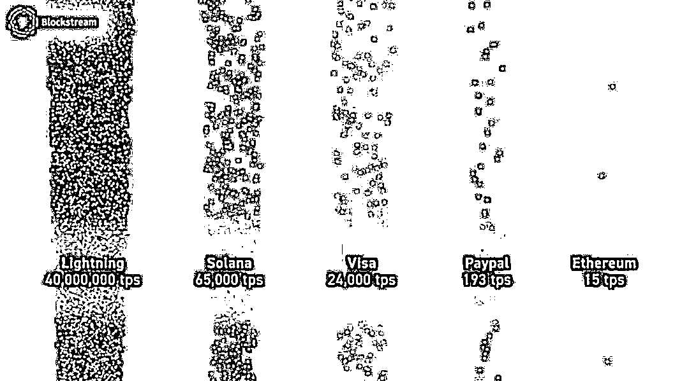

# 2.5.3 其他：比特币生态里的更多玩法

比特币生态今年新涌出的玩法，远不止 Ordinals 与 BRC-20。在介绍新项目前，先补两个基础模型：账户模型和 UTXO 模型（Unspent Transaction Output，即“未花费交易输出”）。

账户模型源于传统银行体系，银行转账、支付宝和🛰️付款都是这套逻辑。举个例子：假设甲有 100 元，乙也有 100 元，甲转 50 元给乙，系统只需要记录甲减 50、乙加 50，两人余额变成 50 元和 150 元。如果甲仍持有 100 元，但要给 100 个新用户各转 1 元，理论上必须做 100 次转账，而且下一笔必须等上一笔完成，否则余额会对不上，轻则分不清是否多转，重则余额不足。交易量越大，耗时也越长。

UTXO 模型则更像日常现金的使用方式。比特币用的就是 UTXO，数字人民币也沿用了这一思路。假设甲钱包里有 1 元、10 元、100 元三种面值的现金，他要分别给乙、丙、丁各 1 元，可以直接拿 1 元给乙；也可以拿 10 元付给丙，让系统找回 9 元；还可以拿 100 元付给丁，收回 99 元。放到链上，10 元这个 UTXO 一旦被花掉，并不会飞到丙手里，而是整体作废，系统重新生成 1 元和 9 元两个新 UTXO，分别送向丙和甲的地址。这种设计的好处是每一笔消费相互独立，几个付款可以同时并行：甲能在同一笔交易里把 1 元、10 元、100 元分别转给三个人，完全不需要等待彼此。账户模型里的每一笔转账都依赖前一笔完成，两者的吞吐差距一眼可见。回到给 100 个新人各转 1 元的例子，UTXO 模型可以把 100 元面值的 UTXO 拆成 100 个 1 元的 UTXO，放进一笔交易里一次性派发，瞬间搞定。简而言之，UTXO 就像可以自由找零的现金，在链上不断经历“销毁—重建”；想知道一个地址有多少钱，只要把该地址下面所有 UTXO 的面值加总即可。

有了这些基础，再来看今年涌现的几个代表性项目。

1. Atomicals & ARC20

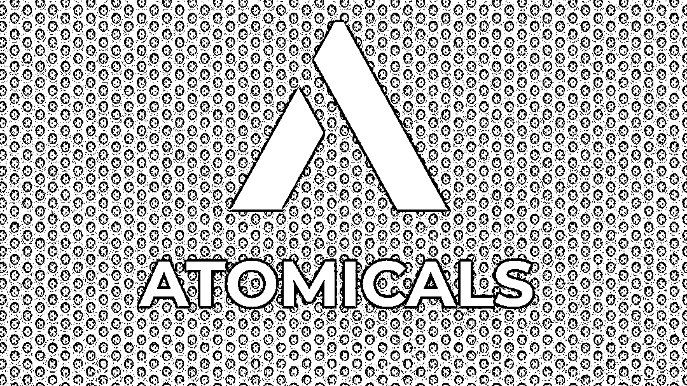

Atomicals 把矛头指向 Ordinals 和 BRC-20 的痛点，尤其专注代币赛道，试图摆脱 BRC-20 对中心化链下索引的依赖。所谓中心化链下索引，是说 Ordinals 在执行过程中离不开比特币网络之外的线下服务，这类服务负责维护状态；一旦底层服务出问题，资产就可能受损。比特币本身不具备拒绝坏数据上链的能力，谁真谁假需要一个中心化角色来裁决，被判为有效的铭文才会被收进合集。这套机制缺少智能合约那种公开可审计的规则，很难在防双花、形成共识等资金安全层面让人完全放心。Atomicals 的做法是扩展比特币既有的 UTXO 模型，把每个聪的 UTXO 视为一个 Atomical 代币或数字对象，以此在 BTC 上创建更丰富的代币系统（ARC-20）。该协议于 2023 年 9 月上线，首个代币 ATOM 在极短时间内便被铸造一空。ARC-20 与 BRC-20 最大的不同是引入了 POW 机制：铸造者必须先求出一个带有特定前缀字符的哈希值，才有资格完成铸造，这种分发方式更加去中心化和公平。总体来说，Atomicals 是 Ordinals 在可替代代币方向的挑战者，它通过改良 UTXO，让代币系统更贴近比特币原教旨精神，也更有希望赢得核心社区的认可，为生态打开更大的想象空间。

2. Runes & PIPE

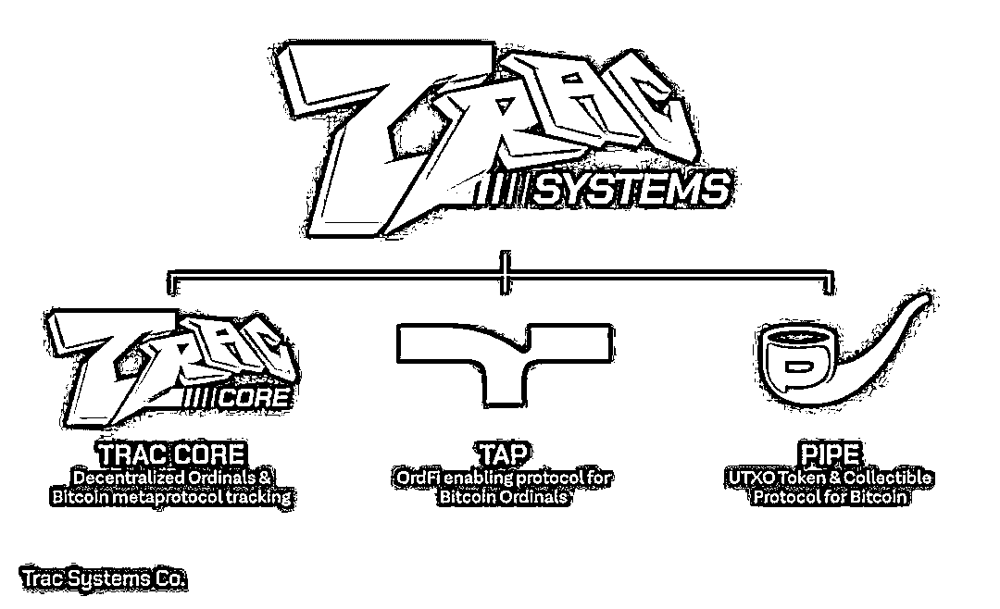

Runes 出自 Casey 之手——也就是 Ordinals 的设计者。他写出 BRC-20 的不足后，提出了又一个基于 UTXO 的方案。Runes 的规则相当精简，代币余额直接存放在 UTXO 中，同一个 UTXO 可以承载任意数量的 Runes。交易里特定的脚本输出会被识别为协议信息，用来决定 Runes 如何转手；而数据推送则负责具体的分配指示，使代币的拆分和发送变得非常灵活。Runes 的增发也走数据推送路线：第二个推送被视作发行事务，可以制造出新的代币。协议有意保持轻量，不使用链下数据，也不依赖原生代币，同时天然兼容比特币的 UTXO 结构。Runes 可以绑定符号，但协议不参与符号抢注，一切以简单为上。虽然 Runes 目前仍停留在设计层面，但社区开发者 BennyTheDev 于 2023 年 10 月把这套思路落到了一款叫 Pipe 的协议中。Pipe 刚一亮相，就接住了从 BRC-20 溢出的炒作情绪，第一轮热度快速走完。Runes 与 Pipe 的出现，说明比特币社区始终没有放弃对同质化代币实现的探索。这些方案虽在早期，但简单意味着更容易被采用，未来或许能为比特币带来更多交易费、开发者和用户。

3. Bitmap & BRC420

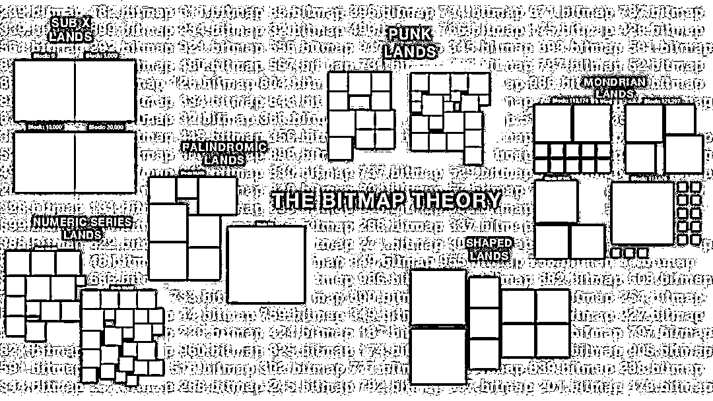

Bitmap.land 被看作比特币生态里的首个元宇宙项目，底层机制来自 Ordinals 和 Bitmap Theory（位图理论）。位图理论由推特用户 @blockamoto 在 2023 年 6 月 13 日提出：它把比特币区块中的每一笔交易输入映射成一块土地（Parcel），多块土地聚在一起就形成一个街区或区域（District）。交易输入的大小不同，映射出的地块面积也会有大有小。Bitmap.land 采用了在地图上划地、作画的形式，用户通过铭刻把内容留在“聪”上，从而认领某个比特币区块。主链上的每个区块还会被等分成四份，用来对应四个减半周期；用户可以在 Bitmap.land 网站上查看区块的编号和颜色，颜色直接反映区块的售卖状态。Bitmap 给了原本平平无奇的区块一个新维度——任何区块都能被个人拥有和记录，进而变成元宇宙的一部分，为社区带来全新的创造与所有权表达。

BRC-420 依附于 Bitmap 搭建，2023 年 11 月 13 日之后，Ordinals 铭文总数突破 4000 万，它也顺势成为比特币生态里活跃的协议之一。与传统代币协议不同，BRC-420 做的是链上铭文的模块化组合，形成一种前所未有的资产类型。它的首个通证被大家叫作“蓝盒子”，价格从 0.15 美元一路冲到 1000 美元，开发者仅靠链上版税就拿到了可观回报。模块化的意思是，多个铭文能够被拼成一套复杂资产，小到一个角色、一只宠物，大到完整游戏脚本甚至虚拟机，都不在话下。由于全部内容都在链上开源，任何客户端都能运行或校验。BRC-420 与 Bitmap 正在把全链游戏和元宇宙的概念一步步变成现实，同时也为创作者、开发者和普通用户带来了新的赚钱机会与互动体验。

拓展阅读：

- 币安：什么是 Ordinals？
- 比特币闪电网络初学者指南
- 闪电网络白皮书英文版.pdf

- 闪电网络白皮书中文版.pdf

# 三、去中心化身份 DID 和钱包 @可达 Koda

# 3.1 去中心化身份相关的概念解释

DID 全称 decentralized identifier，即去中心化身份。它要回答的核心问题是：用户能不能对自己的数字身份拥有完整主权？这份主权包括名义上的归属、实际的控制和日常的管理，而且这些权利只属于用户自己。前面讲过，Web2 时代的数字身份被装在各大公司和机构的账号体系里；到了 Web3，身份产权终于回到了个人手里。区块链技术天然不可篡改、全程留痕，再配上去中心化身份，用户的每一条链上行为都会保存下来，随时可查。但这也是一把双刃剑：链上的所有交易透明可见，你的资产与操作痕迹容易被别人盯着，隐私风险因此浮现。

目前，去中心化身份主要由一对密码学密钥承载——公钥和私钥。用户在链上创建地址时，系统会生成这一对密钥。公钥相当于门牌号，可以公开，通常表现为以 0x 打头的一串字符，功能上类似银行卡号。私钥则是一长串毫无规律的数字与大小写字母，几乎没人能背下来。它才是身份真正的核心：私钥即产权，谁握着私钥，谁就拥有对应地址下全部资产的所有权；私钥只属于你个人，任何机构都无权替你保管或支配。你也可以把私钥理解成银行卡密码，只不过它永远不能重置。

钱包是负责生成和保管私钥的工具，让用户不必直接面对那串冗长的字符。任何链上交易都需要钱包授权，说穿了就是调用私钥完成签名。大多数人注册钱包时还会遇到助记词。私钥太长不好记，助记词便把私钥翻译成一组更容易口读的单词。比如你的密码是 12345，单词库里恰好有 cat、dog、sun、moon、star 几个词，数字和单词一一对应，背单词显然比背数字轻松得多。

因为整条区块链共享同一套密码学规则，哪怕你用的钱包公司倒闭了，只要区块链网络还在运行，而你又记得私钥，换一个新的钱包工具就能重新登录和管理资产。Web2 世界里，平台一旦破产或跑路，用户资产往往跟着消失；Web3 则把这种风险压到了非常低的水平。

使用钱包时还要设置一个登录密码，这个密码只用于打开钱包应用本身，和 Web2 应用的账号密码差不多。不同之处在于：同一个私钥可以放在不同设备的不同钱包里，各设备也能设置各自独立的登录密码，互不干扰。

# 3.2 钱包的分类

说到钱包，通常会提到四个词：中心化钱包、去中心化钱包、热钱包、冷钱包。最核心的区别在于私钥在谁手里。中心化钱包的私钥由机构代为托管，去中心化钱包的私钥则由用户自己严加保管。

中心化钱包最常见的形态就是数字货币交易所钱包。以币安为例，用户要在上面做交易，第一步是注册账号和密码，还要提交 Web2 身份信息，整个流程和开通股票账户几乎没有区别。这个动作本质上就是用户选择信任交易所，把钱包的管理权委托给了对方。

从行业现状聊起：假如你的资金量算不上庞大，那么把资产放进头部托管型钱包，往往比自托管方案更让人放心，毕竟币安在安全技术上的积累相当深厚。但托管也有代价——它处在监管视野之内，个别账户可能因监管动作而被冻结。

自托管钱包按私钥存放时是否接触互联网，可划为两类：离线冷钱包与联网热钱包。冷钱包全程与网络隔绝，常见形态是硬件设备，作用类似银行发的U盾；密钥的生成、调用都发生在不联网的机器里，所以防护等级更高。热钱包则相反，创建与操作都离不开网络，大家常用的小狐狸就是典型。结论是：头部交易所钱包搭配冷钱包，属于比较稳妥的配置；热钱包抵御风险的能力有限，钓鱼攻击防不胜防，大额资金不宜放在里面。

# 四、DeFi 与稳定币：Web3 金融的主舞台🔥

# 4.1 Web3 金融全景 @可达 Koda

# 4.1.1 走进去中心化金融 @可达 Koda @馋嘴猫

支撑 Web3 的两根支柱，无非区块链与金融。前者可视为密码学、计算机科学的交叉领域；后者在 Web3 中几乎已实现全品类覆盖。本章就带大家先摸清 Web3 金融的基本概念与产品轮廓。

在 Web3 的话语里，金融有了新名字——去中心化金融，英文写作 DeFi，即 Decentralized Finance。不少人会想：眼下的中心化金融已经足够顺手，信用卡、支付宝、🛰️支付都很成熟。

那个常被引用的理由，我在这里不再重复：全世界尚有 17 亿成年人被挡在金融体系之外，享受不到传统银行的服务，而加密货币能让其中拥有智能手机的多数人触达现代金融的便利。这些当然是正在发生的事实：在第三世界、跨境汇款以及某些特殊支付场合，加密货币确有真实需求，且这种需求还在上升。

但换个角度，这些似乎也谈不上“非它不可”。有加密工具自然更好；没有的话，不过是费用贵一点、到账慢一点，金融基础设施薄弱的地方少一些服务罢了。

那么，Web3 内部是否存在某种强刚需，足以稳稳托住整座大厦？若找不到，Web3 的地基就谈不上牢固，也许只是众人接力吹起的泡泡，而泡泡总有破灭之日。

我的判断是：有。

从最底层看，Web3 中较为确定的东西，是比特币这类去中心化资产所承载的价值。这种价值难以被取代，至少眼下还没出现替代品。请留意，我说的是“比特币这类去中心化资产”，并非单指比特币。核心在于：去中心化资产让财富真正握在自己手里。

比特币算一例，可它的原罪同样刺眼：挖矿耗费大量能源，带来环境负担，批评声从未停歇。以太坊在 9 月完成 PoW 向 PoS 的切换后，实体矿机退出舞台，能耗骤降 99% 以上，因而更受传统机构巨头青睐。而且转 PoS 之后，以太坊从过去每年约 4.4% 的固定通胀，逐渐转向通缩，已隐约显露出与比特币争夺“数字黄金”名号的迹象。

对那些账面上财富可观的人而言，配置一部分能真正由自己说了算的资产，理由似乎不必多讲。

前几日与几位老友小聚，话题落到比特币估值上。有人提出，不妨拿全球 1% 富人持有的 1% 资产总额，作为比特币估值的一种参照。照此推算，大家可以算算，比特币单价最高能到多少万美元？这只是一个假设。不过这个假设至少要纳入两点考量：

其一，部分助记词已经丢失，几百万枚比特币事实上已从流通中消失，总量不再是 2100 万枚，按此估算单价只会更高。

其二，以太坊崛起之后，比特币不再是富豪们唯一会考虑的加密资产。尤其以太坊的节能环保特质，比比特币更讨机构巨头喜欢。所以，“全球 1% 富人 1% 资产”对应的总估值，不该只记在比特币头上，而应看作部分比特币加部分以太坊，未来还可能冒出别的储备资产。

为什么是“部分比特币 + 部分以太坊”？因为除财富储备之外，两者各自还有别的价值，足以支撑一部分市值。以太坊尤其如此：公链生态持续扩张，它正逐步演化为一台世界计算机；跑在上面的每个 Dapp 都要烧 ETH 当汽油费，系统越庞大，ETH 消耗越多，其价值根基也就越扎实。

传统金融的权柄握在政府或金融组织手中；去中心化金融则不同，无论比特币还是以太坊，理论上资产归属由你自己的私钥决定。产品形态上，DeFi 几乎把传统金融那套照单复制了一遍。

两者最大的分野在于本位：传统金融以法币为本位，美元、欧元、人民币等政府货币统称法币；DeFi 则以加密货币为本位，要么是稳定币（简称 U），要么是比特币、以太坊等网络原生加密货币（Crypto）。

当下 Web3 的去中心化金融，主要由两类产品承载：中心化交易所与去中心化交易所。前者又称加密货币交易所，多由公司运营，并配合主权政府的监管要求；后者运行逻辑接近比特币网络，由算法程序自动执行，人为难以干预。后文我们会依次拆解稳定币及相关产品、中心化交易所及相关产品、去中心化交易所及相关产品。

部分素材出处：12月2日《DeFi：Web3 里最重要的应用》@馋嘴猫

# 4.1.2 从 Web3 架构看 DeFi 为何关键 @可达 @馋嘴猫

找准“去中心化资产”这个相对扎实的需求点之后，便可顺着它把上下游板块捋一遍。至少在我看来，这些板块都是围绕底层需求生长的，投入建设既有意义，也有必要：

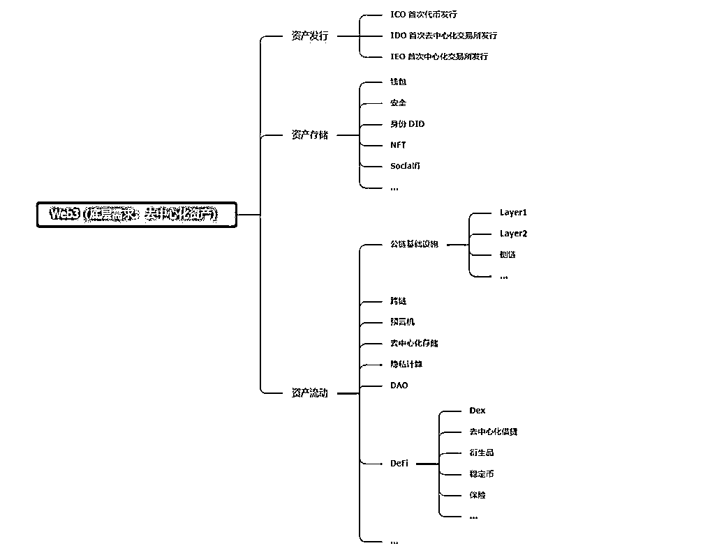

Web3 金融世界的演进，始终在资产发行、资产存储、资产流动三条主线上催生新叙事；比特币生态、以太坊生态乃至其他公链生态，概莫能外。

# 4.1.2.1 资产发行【新】

先看发行方式。此前学习中我们已经认识了 ICO（首次代币发行，Initial coin offering）。这一节来了解 ICO 之后常见的另外两种。

1. IDO（首次去中心化交易所发行，Initial DEX offering）

与 ICO 相比，IDO 最大的差异在于借 DEX（去中心化交易所）完成代币发行与融资，因此也有人称它“首次通过 DeFi 发行”。流程大致是：发币项目方向 DEX 注入代币，用户将资金质押进 DEX 的流动性池，DEX 依据用户质押资金的多寡完成代币分发与划转，全程由智能合约驱动。

IDO 的好处在于：对用户而言，靠谱的 DEX 通常比项目方更让人安心；且 IDO 无需 KYC 身份认证，有钱包即可参与，省事快捷。对规模偏小、名气不大的项目方来说，走去中心化交易所发币，比挤上中心化交易所更容易，成本也更低。

2. IEO（首次中心化交易所发行，Initial Exchange offering）

IEO 与 IDO 的分水岭，在于交易所平台本身是否去中心化。币安 Launchpad 就是典型的 IEO。用户参与 Launchpad 时，质押特定资产进行项目挖矿，换取代币，待二级市场开放后卖出获利。某些币安 Launchpad 的明星项目代币，上架后 24 小时收盘涨幅甚至能超过 3000%，这也解释了大家参与币安 IEO 的热情为何一直高涨。

相较 IDO，IEO 对项目的审查更为严格，所有参与用户必须通过交易所 KYC 认证，安全性在 IDO、IEO、ICO 三者中居首。下面这张表可对比三者差异：

# 4.1.2.2 资产存储

1）钱包、安全

钱包不难理解。要把去中心化资产保管妥当，搁在中心化交易所或托管机构显然不够稳妥，Not your keys，not your money。因此钱包这个赛道有需求、也有市场。前文提到安全保管资产，那么与安全相关的板块自然不可或缺。

2）身份 DID、NFT、SocialFi

我们在「三、去中心化身份 DID 和钱包」中已提过这一概念。为何身份 DID 在资产存储环节也举足轻重？一个重要原因是当下钱包对新手太不友好，安全保管资产成了大难题。今年以太坊在哥伦比亚首都波哥大举办的 Dev 大会上，账户抽象成为备受关注的板块，正是冲着账户安全去的。

许多比特币丢失的案例，根源都在私钥保管不当。今年以太坊创始人 V 神受魔兽世界启发，提出灵魂绑定代币 SBT 这一概念，其重要功能前景之一，就是助记词丢失后的身份恢复。当然，这牵涉线上身份 DID 与社交关系等议题，于是 NFT、社交图谱、SocialFi 也成为其中颇为关键的板块。

素材出处：12月2日《DeFi：Web3 里最重要的应用》@馋嘴猫

# 4.1.2.3 资产流动

资产天然有自由流动的诉求，去中心化资产的自由流动，自然离不开去中心化基础设施。

1）公链基础设施（Layer1，Layer2，侧链等）

比特币每秒处理 5-7 笔交易，打包一个区块约需 10 分钟，等 6 个区块确认后一笔交易才算基本落定。以太坊稍好，目前每秒也就 15-20 笔，效率着实偏低。于是新公链与扩容提速的需求应运而生。从 2017 年至今，从 EOS 到 Solana 再到 Aptos，新公链高 TPS 的叙事从未改变，且屡屡奏效。Layer1、Layer2、侧链走的都是扩容路线，扩容亦是近几年行业大热板块，核心目标直指资产流动效率。

2）跨链

眼下比特币生态尚显薄弱。若想把比特币换成稳定币，或赚取利息，又不愿走中心化平台，该怎么办？跨链此时便派上用场。把比特币链上的资产跨到以太坊生态或其他生态，再抵押生息，或抵押借出其他资产，从而提高比特币的利用效率。当然，公链数量众多，彼此之间通信也依赖跨链，所以在提升资产流动效率的链条上，跨链是不可忽视的一环。

3）预言机

这个词对普通人稍显陌生，因为主要是 to B 的业务形态。举个简单的例子：你在 AAVE（借贷平台）抵押 1 个比特币，借出 1.5 万美金；一旦比特币价格暴跌，AAVE 会启动清算你的抵押物，以免平台出现坏账。那么 AAVE 的价格从哪来？答案就是预言机。预言机会从各大中心化或去中心化交易平台抓取比特币价格，喂给 AAVE。目前该赛道龙头是 Chainlink，表现确实稳健，基本没出过大岔子。最近币安也下场做预言机，一家独大的格局开始松动，有竞争对整个行业是好事。

4）去中心化存储、隐私

存储同样举足轻重，主要用于保存重要数据，眼下涵盖 Dapp 的前后端数据、NFT 图片元数据、部分公链数据备份、Web3 相关代码以及去中心化社交平台的数据。不过当前去中心化存储的应用面仍偏窄，盈利能力有限，龙头 Filcoin 已转头进军计算领域。隐私板块则负责保护交易信息与隐私数据，但一直没有真正火起来，或许要等以太坊二层 ZKrollup 来带动。

1. DAO

这里更多指去中心化项目基金会所组成的 DAO，用于保管项目代币、核算财务支出等。至于社区型 DAO，运行机制目前尚不成熟。关于 DAO 的详细内容，我们在后文「七、了解 DAO」中展开。

5）DeFi（Dex、去中心化借贷、去中心化衍生品、稳定币、去中心化保险等）

DeFi 的分量不必多说。比特币这类去中心化资产，若想在摆脱中心化机构管控的前提下实现资源效率最大化，DeFi 不可或缺。从分类上看，Dex（Uniswap、Pancake 等）负责去中心化交易；交易之外，还有借贷（AAVE、Maker）、衍生品（Dydx、Gmx 等）、稳定币，以及去中心化保险（目前基本没发展起来，缺乏优质项目）等。

回过头看第二大类“资产流动”里的前几项：公链基础设施、跨链、预言机、去中心化存储、隐私、DAO 等，可以说都在为 DeFi 服务；甚至第一大类“资产保管”中的几项，也是 DeFi 离不开的基础设施。因此我们说，DeFi 是 Web3 世界最重要的应用。当前正在搭建的 Web3 基础设施，绝大多数都围着 DeFi 转。

沿着 Web3 的核心支撑需求“去中心化资产”，我们延展出一个有价值的 Web3 框架。从这个框架望去，Web3 各大刚需板块都与 DeFi 有着千丝万缕的联系，DeFi 称得上是 Web3 中最核心的应用。

写到这里还没提 GameFi。不过 GameFi 目前确实没找到确定的突破模式：无论是往现有游戏里塞 DeFi 元素，还是打造原生的 GameFi 项目，都还没跑出优质且持久的模式。这条路仍需慢慢摸索；或者说，这个需求本身是否真实？重心在 Game 还是 DeFi？如何破局？都还得再观望。若论 GameFi 与 DeFi 的关系，眼下的 GameFi 可视为 DeFi 应用的一种延伸，具体内容我们在后文「六、了解 GameFi」中展开。把 GameFi 一并算进来，基本就是行业里流传甚广的那套 Web3 框架了。

当然，Web3 的定义至今仍众说纷纭。但我以为，从最底层的需求出发，锁定 Web3 最重要的支撑点，再顺着脉络梳理相关板块，会更有底气，也更确定。

素材出处：12月2日《DeFi：Web3 里最重要的应用》@馋嘴猫

# 4.2 稳定币基础 @可达 Koda

本节围绕几个问题展开：稳定币是什么？它解决哪些麻烦？靠什么方案实现？又该如何挑选？

开讲之前先厘清一个概念：加密货币，英文 cryptocurrency，可简称 crypto。经过前面的学习我们知道，比特币 bitcoin、以太坊 ETH 这些名词背后都藏着多层含义。而 cryptocurrency 侧重的是货币、股票、债券这类金融产品层面的含义。比特币、以太币都可称作 cryptocurrency，即加密货币。这个中文译名，我认为并不精准，因为它不只有货币属性；在某些场景下，它可当股票理解，也可当债券理解。

# 4.2.1 稳定币是什么？它解决哪些问题？

稳定币，英文 stablecoin，同样属于加密货币。所谓“稳定”，说的是价格稳定。一般而言，加密货币价格并不安分，即便是比特币、以太坊这样的头部币种，波动幅度也相当惊人，加上 7×24 小时不间断交易，价格自然随之起伏。

如何获得加密货币？从比特币与以太坊网络的激励机制可知，为网络做贡献、付出劳动，就能得到网络奖励的加密货币。此外，作为一种金融产品，它天然衍生出用法币购买的方式。而一旦走法币购买这条路，问题就来了：

加密货币价格 7×24 小时波动，又运行在区块链网络中，法币与加密货币的买卖双方很难直接撮合。一个持法币的人想换比特币或以太坊，该怎么办？若直接找人或者找平台兑换，双方刚达成交换意向，买家还没转账，价格就已经变了。

再者，Web3 网络内部的各类金融与应用交易，也存在必须使用价格稳定媒介的场景，比如发薪水。员工在 Web3 公司上班，公司按美元等值发加密货币当工资，结果第二天币价跌到原来的十分之一，多数人无法接受。并非人人都以加密货币为本位。

于是，稳定币的需求浮出水面。另外，部分国家和地区的政策也不允许直接拿法币购买加密货币。为解决上述三个问题，稳定币在 Web3 中登场。

简单理解，稳定币就是钱，是 Web3 世界里的美元。由于目前使用最广的稳定币叫 USDT，我们便把稳定币简称为 U。这也是大家常碰到的疑问：你们口中的 U 是什么？U 就是稳定币，与美元等价。因此，想买加密货币，可先在中心化交易所换稳定币，稳定币与美元 1:1 兑换；再用稳定币，在加密货币交易所买入加密货币。

# 4.2.2 稳定币有哪些类型

接着大家可能会问：我凭什么确定稳定币和美元等价？你随手搬来一个数据库，我如何相信它有价值？为了让稳定币与美元价值对等，Web3 目前主要有以下几套方案。

# 4.2.2.1 法币抵押型稳定币

稳定方式：按 1:1 抵押美元。每存入 100 美金现金，便发行 100 美金稳定币。以 USDT 为例，它目前是市值最大的稳定币。USDT 由总部位于香港的 bitfinex 加密货币交易所所控制的泰达公司发行。它承诺：你在我这里买 1 美金，我就对应持有 1 美元；当你要换回美元时，这家公司会把美元还给你。稳定机制由此形成，本质仍是靠共识与中心化信任撑起来的。

然而这家公司究竟存了多少美元，外界无从知晓，也未公开接受审计。优点：稳定性强。问题：中心化，存在发行方信用风险。代表币种：USDT、USDC、BUSD。

# 4.2.2.2 加密资产抵押型稳定币

稳定方式：以加密资产作抵押。加密货币虽波动剧烈，却并非完全不能充当抵押物。比特币和以太坊若按美元计价，再打个安全折扣，也能实现类似效果。以 DAI 为例，它由以太坊网络中的去中心化组织 MakerDAO 发行。当某人想从 MakerDAO 获取 1000 美金的 DAI，规则要求他先在 MakerDAO 存入价值 1500 美金的 ETH 或 BTC。

价格上行时，系统看起来风平浪静；可一旦抵押的加密资产从 1500 美元跌到 1000 美元，质押物就会被没收。DAI 正是用这套规则，让我手里的加密资产始终维持 1000 美元的价值。

优势：去中心化程度适中，规则公开透明；风险：智能合约漏洞。

# 4.2.2.3 靠算法稳住币价

稳定方式：算法调控。系统通过供需算法影响币价：稳定币价格高于 1 美元，就增发，把价格压下来；低于 1 美元，就销毁，把价格托上去。长处是彻底去中心化，短板是价格不稳定。它究竟怎么稳？后文会用 Web3 经典算法稳定币 UST 归零案例做深入分析。

# 4.2.3 稳定币怎么挑？主流币种对比【新】

对个人来说，稳定币最关键的就是稳。这类加密货币本身是中心化与去中心化之间的接口，而行业当前阶段仍需要信用背书。那么，在锚定美元、1:1 抵押的稳定币里，谁更值得选？核心只看一条：它承诺的抵押资产是否受到监管。当下市值前两位是 USDT 和 USDC，二者背后分别由中心化交易所发行。

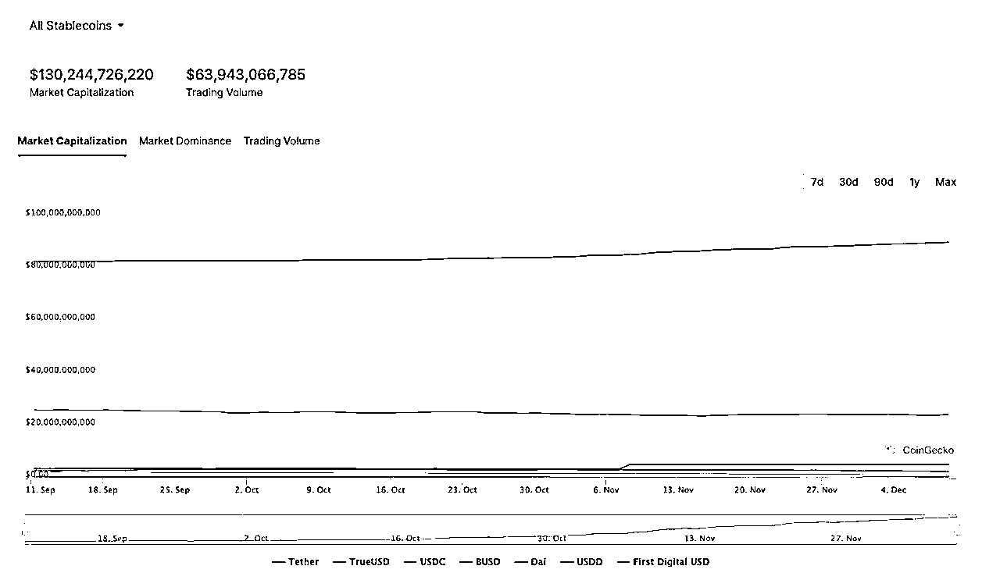

其中，USDT 背后泰达公司的储备包括现金、商业票据、企业债券和数字资产等。USDC 由美国最大加密货币交易所 Coinbase 支持，储备为现金、现金等价物、储蓄和短期债券，并且接受美国监管。尽管 USDT 使用者最多，但若看交易所可靠程度和第三方监管背书，USDC 显然更胜一筹。再看市值前三稳定币的历史价格走势，USDC 的市场表现同样优于 USDT。

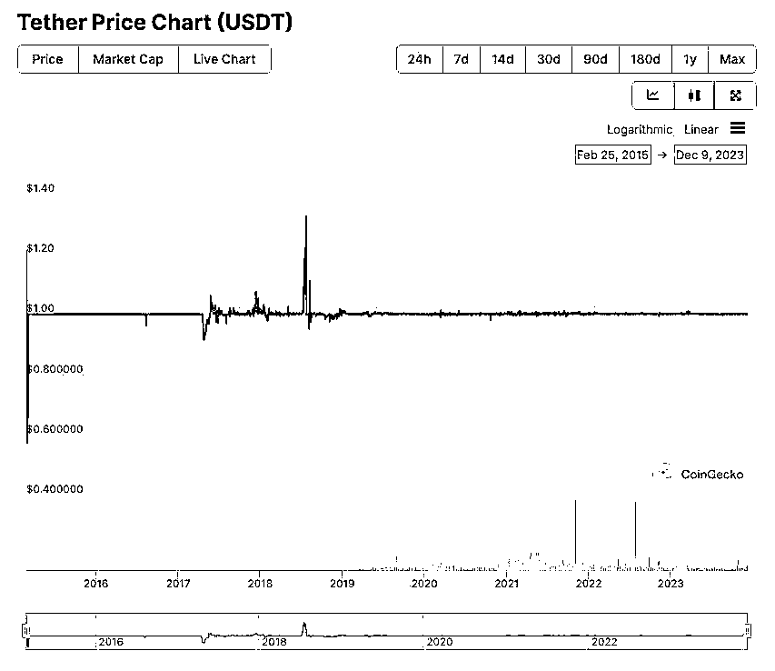

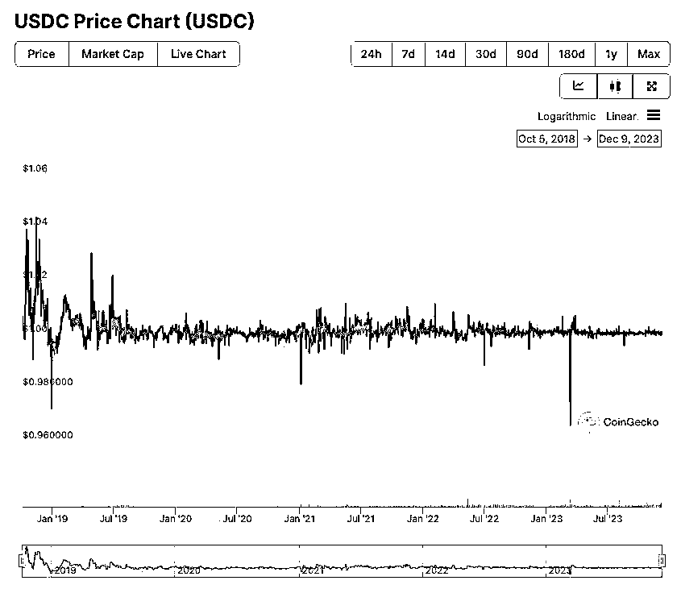

本章节内容不构成任何投资建议。

拓展阅读：

Sector_Terra Ecosystem_Tony_PC_CN-39217846 (1).pdf

# 五、走近 NFT🔥 @可达 Koda @焦波｜水镜

这一节认识加密资产的重要部分：NFT。近一年，各类报道里 NFT 新闻不断，国内数字藏品平台和产品也越来越多。但很多人仍不清楚：它为什么火？价值支撑在哪？和数字藏品有什么区别？对赚钱人来说，最关心的还是有没有赚钱机会。下面会看 NFT 的工具配置、操作流程，以及普通人玩 NFT 的最佳姿势。新兴市场机会大，风险也不小。最低限度：可以不赚钱，但一定不要亏钱。

# 5.1 NFT 到底指什么？

# 5.1.1 NFT 的定义

NFT 完整英文名是 Non-Fungible Token，中文译作非同质化代币。它建立在区块链上，遵循 ERC-721、ERC-1155 等通用标准，是一种不能复制、无法篡改、也不可拆分的加密数字权益凭证。每枚 NFT 对应一份独有的数字资料，相当于数字商品所有权的电子认证或证书；画作、艺术品、音乐、视频、游戏项目以及其他创意作品，都能以它为载体。作品内容当然可被无限复制，但与之绑定的 NFT 会在底层链上留下完整记录，买家因此能拿到所有权证明。通俗地说，NFT 像一份去中心化的数字权益凭证，用来登记数字资产或实物资产的归属；放到链上，它相当于区块链世界的房产证。区块链记录难以篡改，NFT 作为数字资产或权益，把所有权登记其中；链上信息公开透明、可追溯，而且这份归属独一无二。由此，NFT 有两个明显长处：第一，每枚 NFT 都绑定持有者的某类收藏品，且不能被复制，稀缺性自然成立；第二，它像一份公共账本，任何人都能核验资产真伪和所有权归属。

# 5.1.2 NFT 真的具备价值吗？

很多人会追问：NFT 算资产吗？它究竟有没有价值？市场其实已经用行动给出直接回答。NFT 本质上是一种带特殊属性的 Token，也就是代币。在区块链诞生前，还没有哪个不可篡改的平台能全天候、跨地域、零门槛地完成交易，这一点非常关键。正是这种流动性，让全球参与者随时能进场，有限资金和资产在同一市场里定价博弈，NFT 因而带上了金融资产属性。外行常拿“右键保存”开玩笑：库里花 18 万美元买下无聊猿，有人说我也能右键存图当头像。确实，你能轻易拿到一部分使用权；但存下来的图片并不是 NFT，只是完整 NFT 资产里的一部分信息。你拿不到所有权，也拿不到所有权带来的收益。你能把右键保存的小图拿去卖吗？不能，没人会买。所以库里买的不是小图的使用价值，而是资产所有权。他花 18 万买，若以后市场价到 180 万，很多人仍能右键存图，但只有他能卖出并拿到这 180 万。NFT 的核心是把数字内容资产化，关键理念是使用权与所有权分离。无聊猿可以被无数人复制，真正拥有的人全球只有几千个。想想房产：作为典型资产，房产最重要的不是使用权。你可以自住，也可以空着，还可以出租让别人使用；真正关键的是你拥有所有权。在区块链世界，数字资产的所有权被清晰记录，公开透明可追溯。只有真正所有者才能交易这份资产并获取收益。理解越深，越会发现这种理念更接近资产本质。最后，NFT 有没有价值，你可以自己判断。今天仍有很多人怀疑，但现实是 NFT 已是百亿美元市场，正被越来越多人认可。作为投资者，值得关注。

# 5.2 NFT 交易市场与藏品

这一节带你看 NFT 交易市场长什么样，再拿具体藏品拆解关键信息。这些是了解 NFT 最基础、也最必备的知识。目前全球最大 NFT 交易市场是 OpenSea，入门阶段知道它就够用。网址：https://opensea.io/ 。进入首页，每天会展示一些 NFT 项目，顶部是搜索框，可搜想找的 NFT。点右侧“STATS”按钮，会进入 NFT 排名列表；OpenSea 按交易额、销售增长、地板价等指标持续更新排名。排第一的是 Bored Ape Yach Club，也就是著名的无聊猿，前面提到库里花 18 万美元买的就是它。

点开后有一些投资 NFT 必须关注的关键数据：Items 10K，说明无聊猿系列共 10000 枚 NFT；Creator fee 2.5%，即创作者收益 2.5%，你每卖一次，创作者都会抽 2.5%；Total Volume，是该系列截至当前的累计交易额；Floor price，即地板价，指当前上架可交易藏品中的最低报价，也就是最便宜那枚 NFT 的出价。现在地板价是 XX 个以太坊，约 XXX 美元。无聊猿已是 NFT 市场的大蓝筹，不少明星持有，价格相当高。2021 年 5 月首次铸造时价格是 0.08 个以太坊，按当前地板价算，涨幅接近 1000 倍。Listed，上架比例 7%，即 10000 枚无聊猿里，目前上架可交易的约占 7%，约 700 枚。上架比例能在一定程度上反映持有人的价格信心：比例高，说明不少持有者想卖；比例低，说明多数人愿意继续拿着，价格可能更坚挺。当然这只是参考指标之一，NFT 价格还受很多因素影响。Owners，代表独立持有者数量。通常持有人越多，说明认可度越高，相对也更有价值。

1）若项目方此前做过不错的项目，后续 NFT 系列数量越少，越可能出现超额利润。

2）总量低于 10000 枚，才适合批量参与；超过 10000 枚，散户可能更多，开盘就抛的压力更大（纸手多）。

3）Total Volume 能看出项目当天热度、买卖盘和换手率。比如总量 10000 枚、地板价 0.1 BTC、当天 TV 为 30；买卖交替超过 300 次，按 300/24 算，大约每小时十多张。

4）挂单率 5%，约 500 个卖盘，每天动态成交约 300 个。上架比率也透露市场预期：看好就继续持有；觉得项目要凉，就挂单卖出，锁定利润或及时止损。

5）卖飞几乎无人能免——刚卖完，它就起飞。

6）持有人数在 2k—3k 之间相对健康。人数过多，抛压增加；人数过少，可能有庄家控盘：好处是庄家可能拉盘，坏处是也可能砸盘。

点开某枚具体 NFT，也有重要信息。想买 NFT，这些必须知道。比如某只编号 XXX 的无聊猿，当前价格是 XX 个以太坊。往下看，能看到它在 OpenSea 的历史成交价格走势；下面的 offers 是市场上其他人给出的报价。如果这枚 NFT 属于你，你可以选择接受某个报价并完成交易。重点看 Properties，也就是 NFT 的特征。每枚 NFT 都有独一无二的特征组合，不同组合构成稀有度，通常越稀有越值钱。无聊猿有背景、衣服、耳环、眼睛、毛发、帽子等特征，每个特征下有百分比，表示具备该特征的无聊猿在总数 10000 枚中的占比。比例越小，越稀有。问题来了：不同特征稀有度不同，怎么综合所有特征评估整体稀有度？有办法：NFTGO 可查询 NFT，信息比 OpenSea 更全面，比如能看无聊猿系列自创建以来的全部价格走势，这在 OpenSea 上做不到；BlockProbe 可查具体 NFT 的稀有度排名等信息，也常用。再往下 Details 模块，是 NFT 在链上最关键的信息：合约地址、Token ID（这枚 NFT 的编号）以及协议标准 ERC-721。继续往下是历史交易记录，你能看到谁给过什么报价、何时以何价成交、从哪个钱包转到哪个钱包……这也是链上资产的重要特点：公开可溯源、不可篡改，资产过去的每一步变化都清晰可见，人人都能查看。以上就是在全球最大 NFT 市场 OpenSea 上体验真实 NFT 市场和具体藏品的过程。

NFT 和国内数字藏品并不相同。海外 NFT 多搭建在以太坊等公链上，能用虚拟货币在二级市场交易，带有一定金融属性。国内数字藏品更像是 NFT 的“阉割版”，通常发行在联盟链上，例如腾讯幻核的作品基于至信链；这些作品目前无法转送到其他平台，不同平台铸造的数字藏品之间也还不能流转。并且，国内数字藏品不支持二次交易，多用于收藏或转赠，金融属性较弱。因此，当前国内数字藏品的二级交易，要么不合规，要么是偷换概念。另一个明显差异是：国内数字藏品常常同一张图发行几百份、几千份；海外 NFT 除 PASS 卡类别外，大多形象各不相同。总体看，NFT 的机会更多仍在海外原生市场；国内数字藏品并非完全没有空间，但后续要看政策方向、正规军打法以及实际落地方式。

# 5.3 NFT 的盈利路径

目前 NFT 项目最常见的获利方式，是在一级市场铸造，并在开盲盒前择机卖出。这很像港股打新：每个 NFT 项目像一只待上市股票，先拿白名单获得购买资格，上市阶段抛出赚收益。多数好项目在一级市场的胜率不错，收益相对确定。因此，围绕好项目的购买资格——白名单，大家都很拼。

最早靠时间和精力去“肝”白名单。热门项目门槛高，比如要求邀请足够人数，或服务器聊天达到一定等级，可能花几天，热门项目甚至要几周。达标后向官方申请，审核通过才有白名单。后来方式演变，部分转为抽奖为主，部分为填表申请为主。抽奖平台有 Premint、Alphabot、Superful 等，绑定 Discord、推特和钱包，完成特定交互条件后抽取白名单。填表申请常见于热门项目，官方可通过审核机制控制白名单质量。

也有人雇人完成繁琐耗精力的工作，常见于经济水平较低地区，雇佣时薪不高又能完成任务的兼职人员。还有一种路径是成为项目方半官方人员，比如 Discord 管理员，通常基本肯定能拿到白名单奖励。最后是收购别人获得的白名单资格，从而取得购买权。这种方式风险最大：收购价格、对方是否履约、中途突发情况，都会影响最终收益。

预售阶段拿到白名单，可进可退。此时官方一般会在 NFT 二级市场 Opensea 公开对应 NFT 合集，大家可以买卖。如果市场价格扣掉手续费后高于铸造价，就有盈利空间。比如市场价 1 以太，铸造价 0.3 以太，Opensea 税费假设 10%，获利为 1×0.9−0.3=0.6 以太，约 400 美元。拿到白名单，也可以转卖给想要的人。热门项目白名单价值可观，比如前一个月的 KPR 白名单值 1000 美元，明天要发售的公鸡 NFT 也能卖到 300 美元以上。只要白名单有价值，出售就是稳赚方案，当然也可能失去博取更大收益的机会。

如果市场价扣掉手续费后低于铸造价，项目就进入“破发”阶段，港股打新也有类似情况。破发可能持续，也可能随市场价格回升而摆脱。和港股打新一样，选对项目、投入后获得较好收益，是共同目标。因此，NFT 项目的标的选择很重要，这里存在巨大信息差。很多热门项目白名单获取成本太高，最后收益可能一般；一些人气没那么高的项目，白名单更容易拿，只要市场价差足够，反而可能获得不错收益。超额收益往往来自非共识。

NFT 还有哪些衍生赚钱机会？

第一，二级市场买卖。总有些 NFT 可能被低估。比如开盲盒后，有些稀有度不错的 NFT，卖家不了解价值，可能低价出售；你低价买入再转手，可能赚到价差。牛熊转换时，一些蓝筹 NFT 也会被低估，熊市买入、牛市卖出，也可能获得可观收益。

第二，信息差机会。某个项目可能很好，但知道的人不多，或坚定看好的人不多，你可以通过大量投入资金或成本，获得较大收益。

第三，劳力差机会。前面说的白名单获取，就是可通过劳动力差规模放大的机会。圈内人时间普遍宝贵，比起自己花时间邀请人、聊天、画画，他们更愿意请人代做。这些基础工作门槛不高，于是诞生了代肝、代邀请等衍生产业链。包括 Discord 账号、推特账号，也能批量生产并出售。一些项目为提高门槛会限时开放 Discord 服务器，甚至进入这些 Discord 的账号也能卖几百元。

第四，流量机会。这个领域的流量很有价值，精准流量更值钱。所以有人专门做获取 NFT 用户的生意，比如在推特上运营 NFT 项目推广账号，以此获利。

第五，社群机会。提供项目资讯、分析等，帮助参与者提高命中率，也很有价值。这个领域项目太多，每天都有十几个新项目冒出来；哪些值得投入、怎么投入性价比高，都是大家关心的问题。另外，为了提高在这些项目中的收益，如何批量做号也很关键。社群若能提供这些价值，就会受到认可和欢迎。

最后，还有 NFT 项目方的机会。当然，这主要以海外市场为前提，目前先不展开。

# 5.4 NFT 市场的七类风险

NFT 赛道并非遍地黄金，进场前先把下面这些坑看清楚。

第一，安全漏洞。这个圈子黑客多、骗局也多，警惕性不够就容易被割。有些项目方自身防护薄弱，Discord 服务器被攻破后，粉丝往往跟着遭殃。我身边就有赚了不少钱、却因安全问题一夜归零的例子，这一点必须重视。

第二，二级市场追高风险。很多人像炒股一样追涨杀跌，可 NFT 波动更猛，短时间翻倍或腰斩都不稀奇。高位接盘的人，最后大多只能割肉离场。

第三，流动性枯竭。价格再低也没人接盘，就会陷入有价无市。那些缺乏价值的 NFT，最终只是砸在手里、卖不出去的图片。

第四，摩擦成本。玩以太坊项目时，铸造费之外还要付 GAS；赶上拥堵时段，可能多掏几十甚至几百美元。频繁操作未必能提高收益，成本倒是实实在在往上走。

第五，项目方作恶。发行门槛不高，有人只想圈一波就走，并不打算长期建设。虚假承诺、夸大宣传之后，买家拿到的往往只是没有价值的图片。

第六，缺乏项目判断力。看不懂项目，别人说好就跟着冲，既不了解也不判断。差项目自然没收益；好项目一有风吹草动就恐慌抛售，也很容易亏钱。

第七，假货风险。人人都能铸造、上架，Opensea 上假 NFT 不少。分辨不出真假，就可能花大价钱买回一个假货。

所以说，这个领域不是谁都能玩得转。哪些人不太适合？

一是幻想一夜暴富的人。市场里确实有暴富故事，但要看到幸存者偏差：赚钱的人愿意发声，亏钱的人往往沉默。别天天指望暴富，也别看到别人赚钱就心态失衡；持续升级认知，才更可能抓住真正的机会。

二是只看不做的人。信息刷了不少，实操却很少，嫌这个麻烦、那个麻烦，不愿琢磨。等机会来了，往往因为没经验、没准备而接不住。

三是缺乏独立思考的人。听风就是雨，别人说什么就信什么，不研究背后的逻辑，也不深入了解项目。一有风吹草动，就容易恐慌放弃。

四是基础问题解决能力弱的人。很多问题搜一下、多试几次就能解决；总等着别人来答，效率低，自己也成长得慢。

五是安全意识薄弱的人。不做安全防护，遇到高风险项目也不用小号钱包去试。

六是分辨能力不足的人。明显的骗局也看不出来，容易被利益诱惑，一冲动就上头。

七是赌性太强的人。不做分析就把资金全压到某个项目上，指望运气带来高收益。

反过来，学习能力强、执行力好、能在实践中复盘迭代、不断提升认知的人，更容易在这个领域提高胜率。

# 六、GameFi 入门 @可达 Koda

# 6.1 GameFi 是什么

把 GameFi 拆开看，就是 Game 加 Fi，其中 Fi 来自 DeFi，也就是去中心化金融。它诞生在价值网络之上，天生带着金融属性。

当下 Web3 里的 GameFi，大致有两个特征：一是 DeFi 被包装成游戏场景；二是游戏装备以 NFT 形式存在。

先说 DeFi 游戏化。现在多数链游，本质是把质押代币、质押 NFT、买入 NFT 获取收益等金融动作，设计进游戏流程里。玩家看似在玩，底层仍是通过游戏形式完成 DeFi 行为。

再说装备 NFT 化。传统游戏里，装备归公司，公司封号、收回道具甚至跑路，玩家的资产就可能消失，谈不上真正产权。Web3 链游则不同：装备是 NFT，放在玩家自己的钱包里，归属权在用户手中，即使项目方倒闭也不影响。

# 6.2 传统游戏与 GameFi 的五个差异

第一，资产归属。传统游戏归公司；GameFi 归玩家。

第二，购买方式。传统游戏用法币换游戏币、充值或其它方式，交易在游戏内闭环；GameFi 用加密货币买装备，而且 NFT 或游戏代币在链上通用，可以全网流通。只要有平台、有人愿意买，装备和代币就能变成加密资产。

第三，规则制定。传统游戏由公司定规则；GameFi 由玩家和治理参与者共同迭代、共同制定，体现去中心化理念。

第四，用户心智。这是两者最不一样的地方。传统游戏商业模式成熟，玩家为快乐、心流、升级和成就感付费；GameFi 目前的用户主力仍是赚钱群体，和 DeFi 玩家高度重合——投入一笔钱，想着回本、盈利，并不是冲着玩。至少到现在，纯为娱乐来玩链游的用户还很少见。

第五，商业模式。传统游戏赚用户的钱，提供娱乐和成就感，用户愿意买装备；GameFi 也赚用户的钱，但方式是通过 NFT 和游戏代币，让用户相信自己能在游戏中获利。两种模式哪种更好，后面会用两个案例继续讨论。

# 七、DAO 入门 @可达 Koda

# 7.1 DAO 是什么

DAO 最早由 V 神在 2013 年以太坊白皮书中提出。它的英文由三个词组成：Decentralised（去中心化）、Autonomous（自治）、Organisation（组织），中文常译作“去中心化自治组织”。

有意思的是，DAO 的发音接近中文“道”。V 神对中国文化有研究，他在《去中心化社会：寻找 Web3 的灵魂》里引用过老子的话：“道者，万物之奥，善人之宝，不善人之所宝。”西方的 DAO 与东方的道，似乎有种微妙呼应。

组织通常有共同目标，因此每种 DAO 理论上也应有共同目的。目前可归纳为四个特点：

其一，免信任。DAO 基于区块链、智能合约和数字钱包运行，信息记录在链上。成员之间不必相互信任，信任代码即可。

其二，透明。链上信息开放，真实性、全面性和数量级都比传统组织有明显提升。

其三，使用权。加入即拥有使用权。这里没有公司老板，只有发起人；发起人有影响力和号召力，但并不拥有这个网络。

其四，无需许可。加入或退出由本人决定，不需要向谁申请。

# 7.2 去中心化组织与传统组织的区别

第一，去中心化组织更平等、更民主；传统组织通常等级分明。

第二，去中心化组织任何变更都要成员投票；传统组织可能少数人拍板，也可能投票，取决于组织结构。

第三，去中心化组织不依赖可信中间人，可自动计票并执行结果；传统组织若投票，多在内部人工计票处理。

第四，去中心化组织能以去中心化方式自动提供服务，比如慈善基金分配；传统组织靠人工或集中控制，容易被操纵。

第五，去中心化组织活动公开透明；传统组织通常私密，不向公众开放。

# 7.3 第一个 DAO

理论上，满足上述四个特征的组织都可称为 DAO。比特币、以太坊都可以视作 DAO；未来任何由社区自治管理的去中心化组织，也可以叫 DAO。

2016 年，以太坊社区发起全球首个 DAO，名字很直接，就叫 The DAO。它是投资型 DAO，持币者可参与投资决策和分红。项目推出后 28 天募得 1270 万枚 ETH，约合 1.5 亿美元。但不久便遭黑客攻击，360 多万枚 ETH 被盗，最终导致以太坊硬分叉。

# 7.4 DAO 的价值承载：NFT 与 token

万象区块链董事长曾判断，DAO 会成为区块链应用大爆发时期非常重要的商业组织形式。

DAO 中应有两个价值标志物：NFT 用来记录成员行为、贡献和产权；在此基础上发行 token 做经济激励。概括就是：用 NFT 赚 token，Play NFT Earn Token。

# 八、Web3 监管 @可达 Koda

# 8.1 Web3 的监管逻辑

合规是任何行业都绕不开的问题，Web3 在金融领域搞创新、增长又快，更不可能例外。这一章聊监管逻辑、各国政策以及相关公司。

政府为什么要监管？主要看三点：金融管控、民众维权、税收。

金融管控方面，比特币和区块链解决的是去中心化、点对点支付。可一旦点对点支付，就会碰到监管盲区，比如洗钱、赌博、黑市交易、传销。这些本来就在传统金融监管范围内，无论 Web 几都应受管。对此 Web3 有两派：一派强调完全去中心化，个人产权和隐私优先；另一派主张合规约束。

民众维权方面，Web3 自带货币系统，参与者自然关心资产安全。UST 曾被当成美元使用，归零后大量民众找政府维权；Luna 崩盘后，韩国也对 Terra 展开调查。所以有些公司一开始就做合规，例如 USDC 在监管背书下开展业务。

税收方面，DAO 里通常流通加密货币，会涉及基于法币体系的税收。各国政策不同，有的征税，有的免税。

先看全球加密货币监管地图：红色表示禁止，橙色表示敌对，黄色表示中立，浅绿色表示支持，深绿色表示全球领导者。这样能形成全局视角。

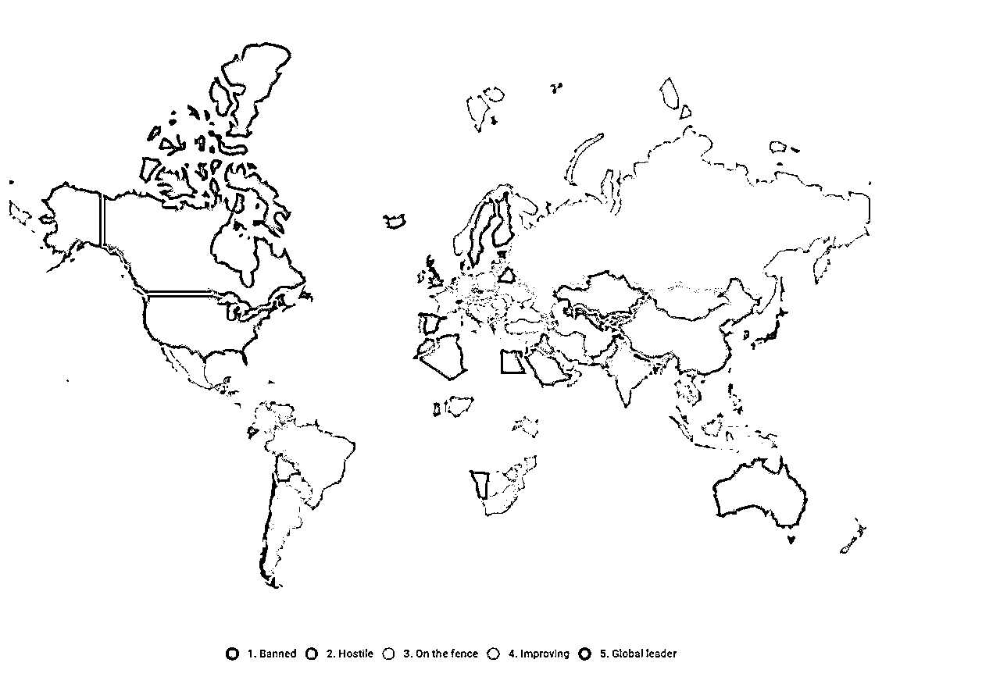

# 8.2 各国监管政策

# 美国：多头监管快步跟进，鼓励创新并保持领先【新】

今年，美国议员一篇“确保 Web3 革命发生在美国”的文章在圈内流传，后来还出现“确保 Web3 发生在湾区”“发生在大理”“发生在 XX”等变体。背后逻辑是创新驱动：鼓励各类创新，同时让法规快速跟进，服务产业。

拜登 2022 年 3 月签署《关于确保负责任地发展数字资产的行政命令》，强调负责任创新，用监管引导加密行业良性发展，以保持美国领先。

美国从联邦到地方推进很快：国会、证监会等先后推出多部 Web3 相关法条；科罗拉多、怀俄明、得克萨斯、加利福尼亚、俄亥俄等州立法较友好；传统证券交易所也推出加密基金。

2023 年继续加速。6 月，SEC 起诉 Coinbase、Binance，把“什么加密资产算证券”这个争议推到司法和立法机构面前。SEC 认为 95%～98% 的 Token 属于证券，即 Security Token；以保护投资者为由执法，想给行业清晰指引，释放信号：欺诈、洗钱、滥用美国金融体系都不会被允许。

随着市场规范、比特币商品属性明确和价值获得认可，华尔街资本也在入场。大量法币资金有望合规进入 Web3，可能成为下一轮牛市的催化剂。灰度、贝莱德等头部基金已就比特币现货 ETF 与 SEC 多轮沟通，获批将是一个冲锋标志，值得关注。

落地执行可从“定性”和“创新监管”来看。传统监管问题，如赌博、金融诈骗、传销等，这里不展开。创新部分主要看金融和税收。

Token 定性：非货币化财产商品。

金融方面：ICO 受 SEC 监管；财政部下属 FinCEN 跟踪加密交易，重点反洗钱和反恐融资；CFTC 对未注册加密期货进行调查处罚；各州从事相关交易需持有金钱服务牌照。

税收方面：2021 年起数字资产在税收上按证券定性，交易者应主动申报；IRS 会收集链上交易信息，打击逃税。

其他方面：美联储通常不承认加密资产是货币；财政部海外资产控制办公室会把制裁对象钱包列入黑名单，违反制裁可能面临民事或刑事责任。

# 中国：去币存链

中国政策很清晰：区块链大力支持，去中心化金融全面禁止。

区块链方面，十四五规划将区块链列为七大数字经济重点产业之一，成为数字经济和数字中国的重要载体。方向包括技术创新、平台创新、应用创新、监管创新，推动智能合约、共识算法、加密算法、分布式系统等技术。各部委发文也鼓励拥抱区块链、元宇宙等，赋能产业升级和数字化转型。落地形式有联盟链、数字人民币。

创新相关法规行动如下：

Token 定性：不是货币，不具备法定货币同等法律地位。

金融监管：交易、ICO 属非法金融活动，相关业务全面禁止；挖矿不符合节能减排、碳中和战略，全面禁止；主体在境外、但在境内开展相关业务的，可依法追责。

先看法律边界：自然人参与加密资产买卖，一旦出问题，财产权益很难得到司法兜底。有人借Web3之名搞洗钱、赌博、传销、非法集资、电信网络诈骗等，仍会按传统金融违法处理。还有一点，token的法律属性至今没有统一说法，涉链上资产纠纷的判例里，有法院认可它可作为合法标的，也有法院否定其合法性。

【税收监管】眼下重点在联盟链，加密代币尚未纳入。

# 欧盟：鼓励创新，环境宽松

2020年9月，瑞士议会通过《区块链法》。按瑞士法律，买卖加密资产、经营交易所等Web3业务属于合法经营。卢加诺市更进一步，比特币、USDT等稳定币和本地发行的代币，都能像法币一样用于日常消费。瑞士起了示范作用，欧盟整体对Web3和链上资产持开放态度，规则也偏友好。

欧盟当前做法：

【定性】token被视作合法财产。

【金融监管】链上资产可能归入证券、货币、基金、虚拟货币四类，每类都有对应法规；不同国家与地区还会要求持相应金融牌照。

【税收监管】代币与法币兑换原则上要课税，眼下按免税优惠处理；挖矿等服务各成员国有差异。

# 韩国：为数字资产立规矩

韩国是全球重要的加密交易市场，参与热度很高。2021年初，韩国拿出2237亿韩元设立元宇宙生态发展基金，用来搭平台、育人才。LUNA、UST这两个全球知名稳定币项目就出自韩国。连续爆雷之后，政府开始收紧监管。尹锡悦新政府计划2023年推出《数字资产基本法》，对链上资产统一管理。

【定性】属于虚拟资产，不是法定货币，可合法持有和交易。

【金融监管】ICO被禁；交易所可合法经营，但须经政府审批注册，用户要实名认证，便于监管。

【税收监管】2023年1月1日起，开征20%资本利得税。

# 新加坡：规则清晰，态度开放

新加坡对区块链和链上资产的规则比较明确，对Web3持欢迎态度，是行业探路者，吸引全球创业者，不少中国创业者也在当地聚集。2022年4月，新加坡金融管理局局长表示，希望把新加坡建成负责任的全球加密中心：既欢迎创新参与者，也要求有强风险管理，后续还会加强风险管控。

【定性】按数字资产类型分为证券型、支付型、实用型代币。

【金融监管】金管局向符合条件的企业发牌，允许合规链上业务开展。

【税收】免征商品和服务税。

# 东南亚：态度冷热不均

东南亚各国态度分化：泰国、马来西亚、菲律宾比较积极；印度、越南在观望；印度尼西亚偏保守。全球爆火的AXIE项目发起于越南，落地在菲律宾。

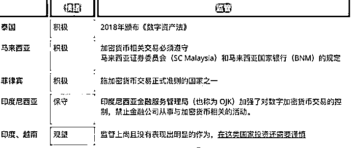

# 南美与非洲：把币视为突破口

南美和非洲整体对Web3、链上资产比较积极。原因在于部分国家本币不稳定、严重依赖美元，链上资产被看成摆脱被动局面的工具。萨尔瓦多在2021年9月把比特币定为法定货币，与美元地位相同。实行之后，2021年GDP增长10.3%，旅游业增长30%。今年，多米尼克也赋予链上资产法定货币地位，并与波场达成战略合作，波场网络成为该国指定区块链设施。

# 8.3 Web3数据安全公司：两条路线

面对合规，Web3出现两派。一派主张彻底去中心化，认为任何资产都能自由流转，个人产权和隐私优先；另一派是合规派，认为去中心化也要受监管约束。由此衍生两类公司：一类强调隐私与去中心化，保护个人隐私和资产安全；另一类服务监管，帮政府解决合规难题。

隐私派代表是Tornado，产品是链上资金混合器：用户把资金存进去后，第三方很难追踪相关交易，转账等金融行为的隐私得到保护。以太坊创始人V神给乌克兰捐款时用过它。但2022年8月，美国对Tornado实施制裁，禁止美国个人或实体为其协议提供服务，也禁止与相关以太坊钱包地址交互。美国制裁通常针对涉及外国政权、恐怖分子、国际毒品走私、大规模杀伤性武器扩散，或威胁美国国家安全、外交政策、经济的行为。可见这类隐私工具很容易触碰主权政府的监管边界。制裁后，相关Web2和Web3公司也停止与Tornado往来。

监管派则直接服务政府需求。比如Elliptic（https://www.elliptic.co/）做链上反洗钱与制裁合规分析，提供钱包扫描、交易监控、调查等服务，Coinbase这类大型交易所是典型客户，其他需配合各国监管的项目也是主要服务对象。国内代表欧科云链提供“链上天眼”方案，配合公安侦破案件。希望这部分能帮你初步了解各国监管，并形成自己的独立思考。

# 九、普通人的Web3机会清单

本章看个体在Web3的可能机会。Web3增长空间大，感兴趣可按兴趣和擅长加入。但行业镰刀多，尤其二级市场和所谓KOL，必须独立思考。新人若入场，把“在不确定中找确定”当核心原则。基于确定性，可赚钱方式先记下：一是在空投交互、新币申购、境外平台推广分成中选一个适合自己的，确定性高，本质是提供流动性赚项目推广预算，与互联网淘客逻辑相近，只是行业不卷、钱多。二是龙哥说新人是猎物，主要指散户在二级市场没有确定性，四处是镰刀；不建议参与二级市场，除非投资经验丰富。目前二级市场确定性较高的只有比特币和以太坊。三是在行业拿工资也有确定性，比如打工。接下来从创业、打工、投资三个角度展开。

# 9.1 先弄清：钱从哪来

做买卖或投资，先得知道利润从哪来；否则亏了也只能怪自己。参与Web3，钱大致来自两块：金融端的先发认知，以及商业端的增长红利。

金融端，很多人觉得比特币、以太坊难懂，其实是价值与金融的基本概念没打通。可以拿六个问题自测：货币为何存在？黄金凭什么值钱？金融的功能是什么？现代货币有哪些用途？Web2时代赚的是什么钱？比特币、以太坊分别解决什么难题？

我的理解是，货币出现前，价值没有统一尺度；一旦货币能给万物标价，有形无形、有用无用都能被定价。有趣的是，人们对无形、无用之物反而更容易形成共识。黄金在没有货币的年代承担交换媒介，解决的是以物易物中“对方不需要我的货”的尴尬。它之所以胜出，是因为稀缺、总量有限、稳定、耐久、便携、可拆分，符合人的偏好。

资产又是什么？货币自己变成商品，就形成资本；把货币视为稀缺资源，就能派生金融产品。风险有价，便有保险、期货；企业有价，便有股票、债券；房子有价，便成房产。定价之后，稀缺资源变成资产。金融靠借本生息提升资源配置效率：闲钱进机构，机构放贷收息。这个循环一旦成立，很难退回。

货币发行权归政府后，除了定价，任期约束也容易让政策偏向通胀刺激。新钱流入市场，先拿到的人占便宜，后拿到的人吃亏，普通人往往无感。通胀两面性明显：经济可能跑得快，劳动价值却被稀释。按货币定义，你原有1000元，印钞后多给你100元，直觉是赚，实际相反。上一轮互联网热潮中，美元从美联储流出，经华尔街分发全球；不少互联网公司不盈利也能高估值上市，本质是钱多之后的击鼓传花，这也是后来垃圾概念股暴跌的根子。

Web3.0的起点是比特币和区块链，点对点电子支付要解决的正是主权货币的毛病；以太坊则把金融思路扩展到其他体系。若把比特币类比黄金，当它的总市值追平黄金，价格会是多少？有文章估算约50万美元一枚，现价不到2万美元，约25倍空间。若按美元M2类比：世界银行2021年统计全球GDP接近100万亿美元。

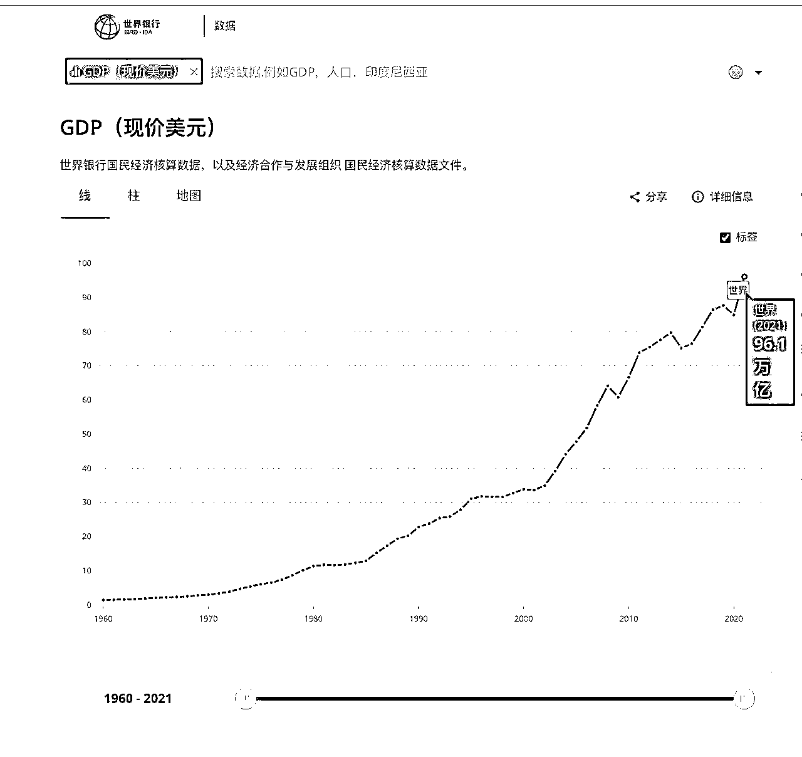

2020年各国广义货币约为GDP的1.4倍；考虑疫情放水，实际可能到2倍，即200万亿美元。

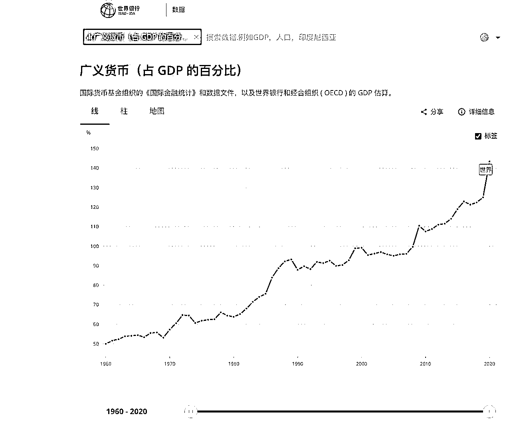

如果加密资产最终占广义货币30%，当前市值1万亿美元，大盘还有60倍空间。这里赚的是认知先发优势：先形成共识的人赚后形成共识者的钱。Web3和crypto让普通人有成为最初货币使用者的机会。

商业端，赚的是Web3生态中快速增长、持续产生利润的公司的增长回报。生产和创造之所以有价值，是因为解决人类问题、提高效率。互联网把信息流动成本压到近乎为零；Web3.0把资产信息成本压到近乎为零，是互联网变革的最后板块。至今互联网主要提升信息网络效率，价值网络效率还没真正提升。这样的赛道里，细分领域出现百倍增长并不奇怪。价值创造后，货币会标记价值，表征就是盈利。

判断公司，可问：它服务哪类人、卖什么、向谁收费、单价多少；再看单客收入、覆盖人数、成交转化、回头购买、老客带新、毛利水平有没有长期优势。答得清，无论在Web几都是好公司；答不清，在Web几都难成气候。比如币安，虽是交易所，本质和腾讯没区别（赌场和游戏运营本质相近，结果都是高毛利润）。毛利润高，做平台，更多用户使用，更多项目在平台发售，形成生态垄断，并投资更多生态初创企业；其商业模式是典型双边市场。活动上得到数据：Web3全球开发者月活不到2万；国内投资活跃用户估计不到20万；全球用户几百万（从V神粉丝数也能看出）。相对全球互联网用户，增长空间巨大。像币安这类模式跑通的公司以后一定出现。这类公司不发股票，只有Web3世界自己共识的token，即加密资产。目前Web3仍非常早期。

# 9.2 路径一：创业

想做大的互联网创业者，最好参考VC判断：VC看赛道，创业者做经营，专业人做专业事。VC视角里，Web3.0是重点关注方向之一，要在有钱的地方创业。具体切入点要结合兴趣和比较优势，因人而异。从Web3演进架构看，与Web2无差别：底层公链网络、基建、应用层；技术型或市场型创业者都能找到位置。

我自己对投资感兴趣且有积累，长期理想是做一家Web3的伯克希尔；短期在内容营销和知识付费社群有积累，就从Web3投资社群起步，解决大家入门Web3的痛点，把Web3社区RichDAO的投资入门训练营和投资俱乐部变现跑起来。小伙伴可能没意识到，我们在龙哥盟里已潜移默化积累了一套知识付费商业技能，这是比较优势。在Web3，我发现赚钱伙伴商业化和社群运营能力很强，这是龙哥盟给的优势。对各类从业者赚钱方法感兴趣，可看文档《币圈赚钱的十八般武艺.pdf》，基本概括目前Web3主流赚钱方式。

真正适合创业的人极少，可能由基因决定。喜欢创业的人，往往有冒险、不循规蹈矩、不安于现状的基因。马云给湖畔大学第一期创业者上的第一课是如何面对失败；优衣库创始人写过《一胜九败》。创业本身就是不断失败构成的商业活动，与Web几无关。创业者天生有面对失败的乐观精神。因此要不断审视、识别自己属于哪类人。

Web3创业机会：每个发展阶段都有阶段机会。Web3从比特币、区块链技术诞生，到以太坊去中心化应用平台，再到最近公链、游戏、NFT等大爆发，某种程度是时代产物。万象区块链董事长最近演讲判断：基建层逐步完善，应用层将迎来大爆发。我比较认同。这个阶段，底层公链网络和交易平台已形成垄断效应，头部梯队手握大量资金，新入局者只要冒头就可能被收购；头部公司已做得很好。底层网络搭好后，基础建设层和应用层都有机会拿到大结果。去年公链和游戏赛道爆发的团队并非一蹴而就，而是提前埋伏深耕两三年；同理，现阶段各类基建和应用有非常多创业机会。后来者完全可能通过现象级应用切入，甚至因手握流量反攻底层公链、进行颠覆。到目前为止，Web3网络演进与Web1、Web2无差别：从底层协议到基础设施，后来Web2借移动互联网迎来应用层大爆发。Web3会被什么引爆应用层大爆发？价值网络能力百倍提升？VR、AR还是其他？不知道。从人性底层看，社交、游戏是刚需，任何时代都需要，但以什么形式颠覆，不知道。这正是增长中行业的魅力，让人期待。

# 9.3 路径二：打工

Web2增长已到天花板，有人问Web3有哪些岗位？Web3门槛没想象中高。很多Web2人觉得Web3目前产品、市场都被Web2碾压。对打工人来说，无论Web2还是Web3，任何工作底层能力不会有差别。对应岗位与Web2相比也不会有很大区别，主要包括投资、技术开发、产品、数据分析、运营、设计等。获取Web3招聘信息主要有渠道：项目官网、Web3招聘网站、社交媒体、Web3猎头。

# 9.3.1 渠道一：项目官网

发现某个Web3项目不错，顺藤摸瓜去官网找招聘信息即可。

# 9.3.2 渠道二：招聘聚合站

聚合类Web3网站也是高效渠道。以Web3.career（https://Web3.career/）为例，主页能看到最新工作信息，很多支持远程办公。

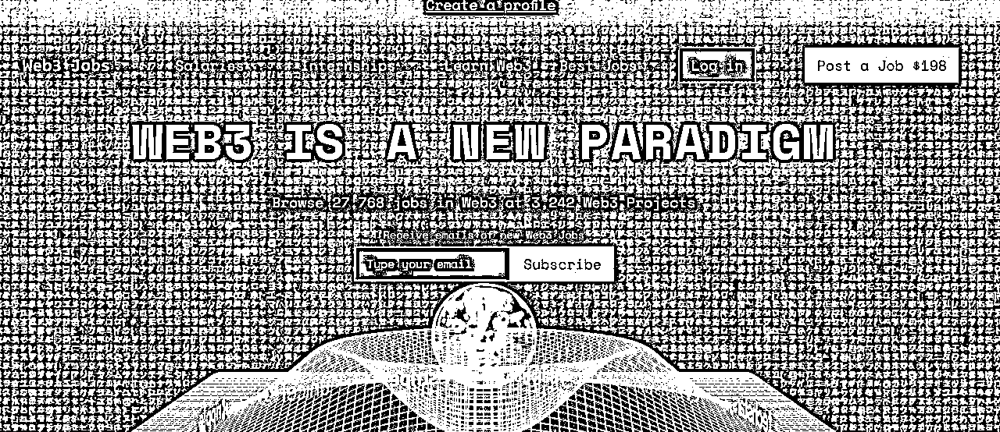

岗位分技术岗、非技术岗和兼职岗，可看到高薪或热门岗位。比如第一个开发岗年薪可达70万—75万美元，水平很高。非技术岗包括市场拓展、社群运营、增长、HR、战略、营销等，年薪从十几万到几十万美元不等。设计师包含产品设计、基金设计等岗位，很多支持远程办公，年薪几万到20万美元不等。岗位要求可概括为两点：岗位能力和行业能力。

所谓岗位能力，其实就是一个人最底层的基本功。它跟你做的是Web2还是Web3没有关系，也不管你负责商务、增长、产品、运营还是营销，这些能力都能在不同领域之间直接迁移。行业认知则是另一项关键。学完本手册，你应该已经对Web3有了基础认识。这个领域仍处于早期，门槛并没有外界说的那么高；只要学习能力在线，入行速度可以很快。我认识一位朋友，2021年才入行，到2022年他所在的Web3项目就已经上市。这种机会正是行业高速成长给个人带来的红利。后续通过加入团队、参与实际项目、持续学习，行业认知会一步步加深。

# 9.3.3 渠道 3：社媒阵地

社交媒体同样是求职的优质渠道。Twitter、各类Discord群（务必防骗）、🛰️群，都有可能让你直接接触到项目团队的核心成员，在交流中获得工作机会。

不少项目创始人会亲自打理Twitter，他们本来也需要人手。如果你看中某个项目，完全可以大胆私信。我认识的一个朋友，就是靠Twitter私信联系上创始人，最终拿到了offer。

# 9.3.4 渠道 4：猎头机构

如今市场上也出现了专门聚焦Web3的猎头，不过这类服务大多面向高薪职位。原因很简单：企业通常只在自招困难时，才会把岗位交给第三方猎头。

# 9.3.5 找工作的「道」

上面聊的是方法、技巧，下面再补充几点关于求职的“道”。

我个人觉得，不管Web几，查理·芒格的这几条原则都通用：
1. 不要推销自己没兴趣的东西。
2. 别跟不喜欢的人共事。
3. 别为不佩服的老板卖命。

如果搞不清自己的兴趣点，可以先列一列“肯定不感兴趣”的事，逐一排除；如果觉得上班只是为了赚钱、兴趣无所谓，那就从自己擅长的事入手。连擅长什么也拿不准，不妨让身边熟悉你的人来帮你判断。

按这个框架走，你离理想工作的距离会更近。

最后附上我们整理的Web3招聘资源，共8个常用网站：

https://Web3.career/

https://cryptocurrencyjobs.co/

https://cryptojobslist.com/

https://crypto.jobs/

https://abetterWeb3.notion.site/

https://pompcryptojobs.com/

https://fintechgl.com/jobshttps://consensys.net/

https://www.paradigm.xyz/opportunities

# 9.4 入局方式三：投资

先说明：本文所有内容均不构成投资建议，这一点请务必牢记。

开头提到过，这个赛道存在10倍、百倍回报的可能性，但能否抓住，最终取决于个人能力。

这里的“投资”，既可以是时间和精力，也可以是金钱。

没有本金也没关系，Web3里大量项目需要用户花时间参与交互，交互后能获得一些代币，这些代币日后可能有变现空间。从本质看，这和送外卖差不多，但性价比高得多。

如果选择投入资金，前提就很关键：你得具备真正的投资能力。

# 十、资产安全与投资理念🔥@可达 Koda @温格区块链

任何行业都会经历从混乱到有序、再到混乱的循环，这是世间万物的共同规律。

Web3的早期阶段也不例外，各种乱象频发。这个领域离钱太近，而监管又没能在第一时间跟上，作恶一度几乎没有代价。放眼全球，每天都有大量盗窃和诈骗在发生。

# 10.1 为什么资产安全是底线

根据《区块链日报》记者的不完全统计，截至2022年，仅交易所层面就已发生28起比特币失窃事件，累计损失约120万枚BTC。按每枚2万美元估算，失窃金额超过240亿美元，而这还不包括个人钱包被盗的情况。

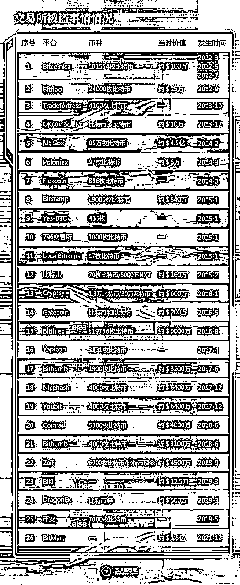

除了被黑，用户自身管理不善导致的资产遗失同样严重。

Chainalysis在2020年的一份报告指出，至少370万枚BTC已有超过五年未被移动；加密数据机构Glassnode则估算，约有300万枚比特币将永久消失（延伸阅读：《加密交易所历年被盗情况：超120万枚比特币、530亿美元被盗》）。丢失的常见原因，要么是私钥被遗忘，要么是私钥的物理载体遗失，最终资产永远无法找回，沦为沉默资产。

在Web3的历史中，大型黑客窃案每隔一阵就会出现一次，例如门头沟（Mt. Gox）事件、以太坊DAO硬分叉风波。

我认识的人里，有不少都因操作失误或流程不规范而丢过资产，轻则损失几千万把块钱，重则几千万打了水漂。

打个比方，资产就像数字“10000”，安全就是最前面的那个“1”；缺少安全保障的投资，随时可能让自己落得一场空。

我常讲的案例是：一位老板在低位囤了几十个比特币，一拿就是好几年。后来币价冲到6万美元（约合人民币40多万元）一枚时，他却因为把助记词存进线上笔记，资产一夜归零，几千万瞬间蒸发，实在令人唏嘘。

接下来，我们重点讨论怎样防范Web3里的资产风险，尽量减少踩坑和损失的概率。

# 🏆10.2 去中心化钱包的安全防线

学习之前，先搞清楚骗子和黑客的作案逻辑。前面章节已经讲过：Web3资产完全由私钥控制，想盗走你的东西，最终都得从私钥下手。

围绕私钥，作案手法大致分两类：

第一种：把私钥直接骗走。

比如你把助记词存在线上记事本，或手机/电脑中毒，私钥信息就可能泄露给他人。任何正规项目方，都永远不会向你要私钥或助记词。这两样东西相当于银行卡号+密码+短信验证码，一旦落入他人之手，对方就能未经你同意转走所有资产。还有一种套路是诱导你把私钥导入某个陌生网站去“打新”，打完新立刻把你的钱提走，并把代币转移到新钱包。

第二种：借智能合约诱导你授权。

骗子会想方设法让用户在钱包里稀里糊涂地完成一笔授权，从而获得动用你资产的权限，然后把钱转空。所以，不要随手点开不明地址，尤其是不认识的人发来的；即便是熟人发来的，也务必去官方网站交叉核实。

基于这些，我们总结了五条去中心化钱包安全心法，请务必记住：

1. 私钥和助记词永远不要接触网络，不要存到桌面、Excel、飞书、印象笔记等地方。
2. 别乱点不明链接，别随便连接钱包，更不要贪小便宜，天上不会掉馅饼。
3. Discord、Twitter、Telegram里的陌生私信要高度警惕，里面的链接大多是钓鱼。
4. 不要把自己封闭起来，遇到问题第一时间找朋友或社群核实。
5. 主钱包的助记词最好用物理形式备份并妥善保管。

下面用几个真实案例帮你在不同场景中防雷。

# 10.2.1 案例一：假蓝V钓鱼

人们对权威的天然信任，是心理层面的底层机制。在Web3世界里，这种倾向常表现为对大V言听计从、懒得动脑。下面就是一例：一个骗子买来大量僵尸粉，把自己伪装成推特大V，再在推文里埋入钓鱼网站。不少人因此中招，钱包里的资产被洗劫一空。

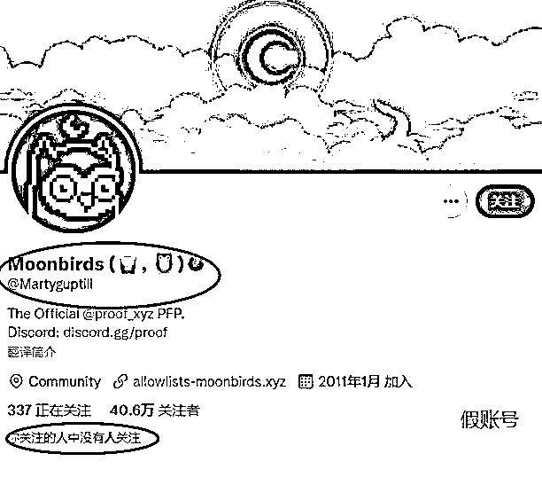

大家需要记住三点：

1. 有蓝V不代表可信。
2. 粉丝量跟骗子没有必然关系。Twitter的粉丝数极容易造假、成本极低，判断账号更应该看历史内容和真实互动，粉丝数并不重要。
3. 来源不明的网站一律不要点。

# 10.2.2 案例二：周杰伦的无聊猿失窃

2022年4月，周杰伦在Instagram上透露，朋友送他的无聊猿BAYC #3738不见了。事情的经过是：4月1日，周杰伦把钱包交给朋友，让对方去参与一个当时很热的项目交互，结果朋友碰到了钓鱼链接，钱包资产因此受损。

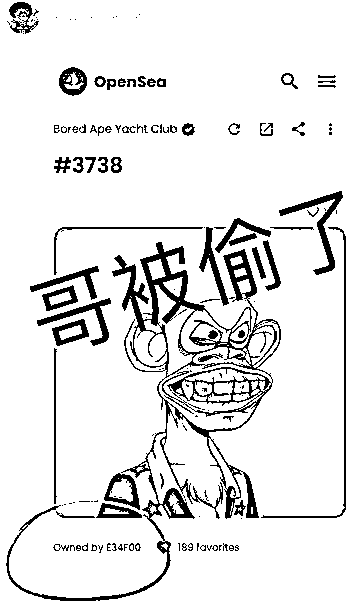

专业团队分析后发现，问题出在朋友操作钱包时，批准了“set approval for all”（设置全部授权）。这意味着一旦确认，对方就拥有转移你钱包内所有资产的权限，相当于拿到了保险柜钥匙。在OpenSea交易时，平台也需要类似授权，买卖双方才能顺利通过市场完成交易。因此，不想被盗的话，使用钱包时务必仔细看弹窗里的每一行提示；遇到这种会授权转走全部资产的指令，必须格外慎重。

除了set approval for all，还有几个常见指令也值得了解：

- MINT：铸造一个NFT。

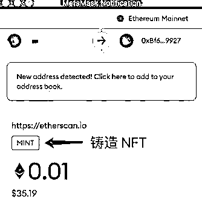

- 发送代币，例如sending ETH就是转出ETH：

- 授权某个地址管理某类NFT：确认后，该地址有权转走你这类NFT的全部。骗子的钓鱼交易中经常出现此类授权，一旦误点，资产可能全数被清空。

- 转移某个NFT：确认后，你钱包里对应的那个NFT就会被划走。

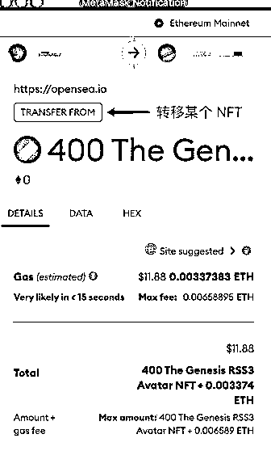

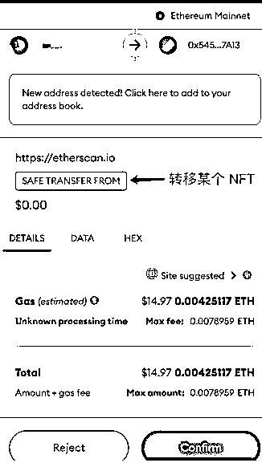

# 10.2.3 案例三：Discord骗局

Discord里聚集了大量骗子，专门盯Web3新手。常见套路有两种：

第一种，你加入的群本身就是假冒项目方搭建的，群里所有内容都在为骗局服务。有人曾花重金买下一堆假NFT，就是掉进了这口井。

第二种，你确实加入了真项目方的群，但有骗子冒充群管理给你发私信。

应对方法：始终通过官方渠道获取Discord入口，确保进的是真群。获取官方信息时也要留个心眼，骗子能做出假官网、假OpenSea认证，甚至连蓝V都是自己P在头像上的，并非真正的官方认证。

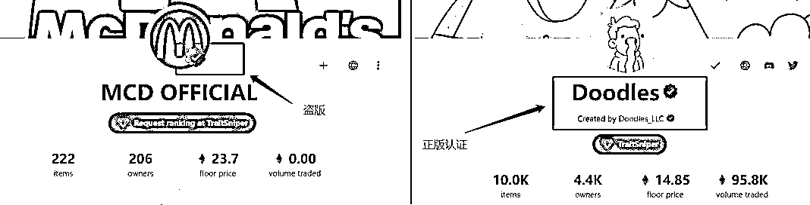

对付第二种情况，最简单的心态是：主动私信你的，一律当骗子处理。

另外，Discord有“安全私信”设置，建议开启，可以过滤掉不少主动来骚扰你的骗子账号。

# 10.2.4 案例四：假官网诱导输入助记词

这个坑我自己也踩过，幸好当时钱包里空空如也。

很多人习惯用搜索引擎找网站，比如在Google搜OpenSea，看到第一位就直接点进去。进站后，页面会要求你输入助记词。不少人在话术诱导下想都没想就照办了。请记住：助记词就等同于你的资产，一旦交出去，对方就能把你的全部数字货币转走。大量用户正是因为这条路径而破产。

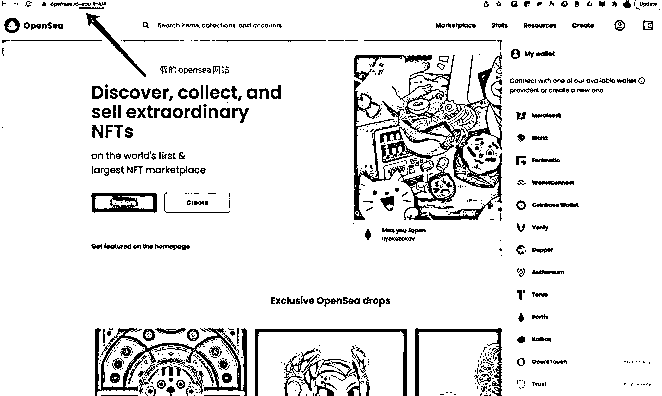

目前市面上仿冒官网的钓鱼站极多，它们高度还原页面，再用谷歌广告投放、SEO优化等手段让自己排在前面，新手很容易入局。

这里的关键认知是：任何正规网站，都不会在任何场景下索要你的助记词。

# 10.3 中心化交易所的安全

中心化交易所相对封闭，平时不需要频繁做链上交互，风险要低不少。方法很简单：把交易所里提供的安全设置全部开启。特别提醒：Google验证器如果弄丢会非常麻烦，最好准备一台备用手机，两台设备都装好验证器并保持同步，形成安全冗余。

# 10.4 三条 Web3 资产安全锦囊 @温格区块链

# 第一条：只从官网下载

Web3应用，只从官网下载。

你可能会觉得这是句废话。但过去一年里，我认识的人中就有好几个因为没从官网下载，最终丢了资产。

举个例子：去年8月的一天，社群里有位学员告诉我，他的三个钱包从来没有领过空投、也没有授权过任何应用，却在8月5日莫名被盗走15个ETH和0.1个BTC，当时折合人民币约34万元。

我问他，会不会是之前把私钥或助记词的截图存到了相册，或者在社交工具里发过这些信息？

他说绝无可能。因为上一次丢以太坊，就是他把钱包导入了一个冷门小钱包，结果被盗。自那以后他格外小心，还专门下了一个新钱包来存资产。

我也觉得奇怪，就让他把被盗钱包的转出地址发过来。他那边有两个以太坊地址和一个比特币地址。我打开区块链浏览器查看，发现资金基本都在8月5日当天多次转入，随后骗子把所有转入资产通过Uniswap兑换成了ETH。那两个以太坊地址分别有134个ETH和96个ETH；另一个比特币地址里的钱，也已经全部被转走。

如果钱包没被篡改、没有做过授权、私钥助记词也没外泄，怎么可能平白无故被盗？我当时想不通，就建议他把情况邮件发给imToken官方。

官方回复后，真相才浮出水面。

问题正出在他用了第三方渠道下载的imToken App。他看到邮件才想起来，6月份确实重新下载过一次imToken，当时是在“非小号”上下载的。

后来我劝他报警——虽然我心里清楚追回概率很低，但至少可以试一试。他真去了，结果正如所料，当地警方既不受理，也不立案。

非小号是什么？它是加密中文圈里最大的行情数据平台。连这种平台都出幺蛾子，可见下载渠道的水有多深。很多人冲着对非小号的信任，直接在站内下载应用，没想到仍然下载到了假冒版本，最终没能躲过这一劫。

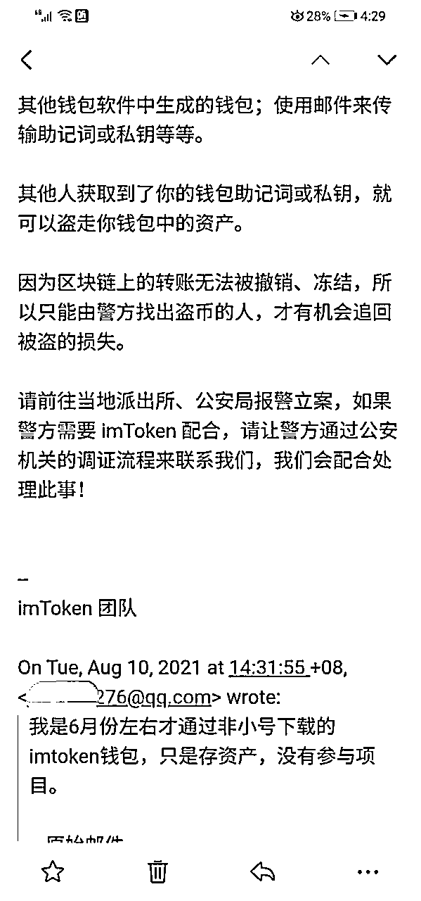

类似的案例还有很多。比如下面这位，已经是在圈里摸爬滚打四年的老手，仍然犯了一个低级失误——57个ETH就此丢失，当时价值148万元。

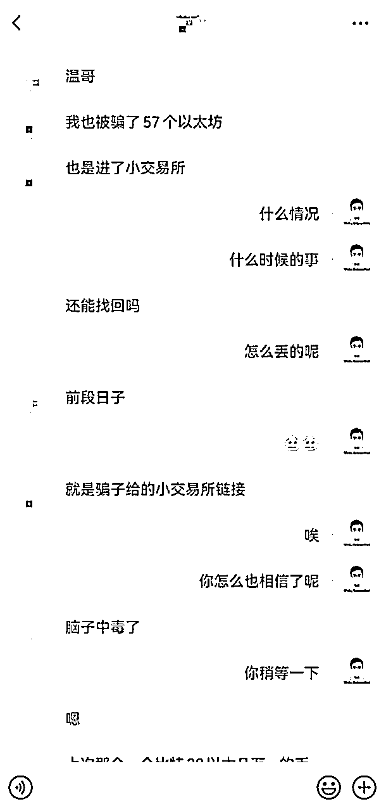

# 第二条：分散存放，把风控放前面

这一条，圈内人应该都不陌生。去年11月，行业内最大的新闻莫过于全球排名前三的交易所FTX崩塌。崩盘原因很多，根本问题在于创始人SBF挪用了用户资金。

事件的导火索是Coindesk的一篇报道，文章指出FTX与Alameda的资产负债表存在异常，市场开始出现“大厦将倾”的迹象。随后，全球最大交易所币安的创始人CZ发推称，将抛售所持有的全部FTT代币以规避风险。

本就千疮百孔的FTX，在CZ发文后更加恐慌，平台代币FTT在两天内从20美元暴跌到2美元。中间还有许多波折，这里就不展开了。

在那场风波里，风控意识强的人听到消息会立刻提币；风控意识差或反应慢的，则很可能被埋。我自己就是被埋的一员——当时账户里只剩不到1000美元的山寨币，于是没太当回事，等意识到情况不妙时，提币通道已经关闭。

和我类似的人还有很多，论金额我这点实在微不足道。在我认识的几个社群里，被埋超过50万的就有不少。

那些没有及时提币的朋友，理由大概能归成几类：

- 有人在FTX打新时赚过小几十万，觉得这家平台很靠谱，倒掉概率极低；
- 有人几美元买的FTT大赚过一笔，因此坚信平台没问题；
- 有人觉得FTX深受美国两党青睐，不可能倒（创始人给两党捐了不少钱）。
……

归根结底一句话：大家都以为这个交易所不会出问题。

可结果偏偏出了问题，而且是大问题。下图是某个电报群群主的截图，看了非常惋惜。

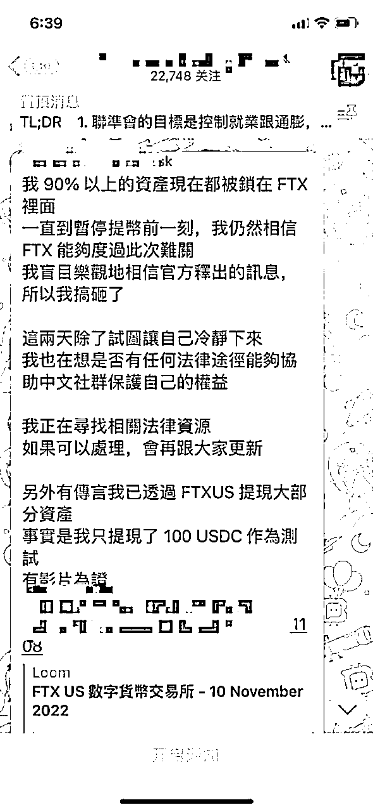

这件事给我最大的提醒是：交易所的数据一旦出现一丁点异常，第一反应应该是提币，而不是本能地安慰自己“这么大的平台不可能吧”“别被FUD吓到”“创始人那么厉害”。这些都不能构成平台不倒的充分条件。提币只需要几分钟，即使最后证实平台没问题，再把币提回来，又会有什么损失？

另外，还有一点很关键：资产最好大部分放在自己钱包，小部分放在常使用的大交易所，既方便又分散。我个人的习惯是，交易所内存放的资产通常不超过三分之一。

# 第三条：授权用完，及时撤销

钱包做过链上交互的话，授权用完记得及时撤销。

自2020年以来，链上生态快速膨胀，交易行为也随之增多。为了避免某些协议暴露合约漏洞而引发资产风险，凡是参与过链上活动的钱包，都应该定期清理授权。

这里提供两个撤销授权的常用工具，建议收藏：

https://revoke.cash/

https://etherscan.io/tokenapprovalchecker

除上述高频风险外，还有一些细节值得留意：

- 不要用钱包去扫陌生二维码。
- 来路不明、完全不了解的空投不要领取。
- App Store里也可能混入假钱包。

很多人会觉得App Store审核严格，应该不存在假App。但在加密领域，TokenPocket（TP钱包）的假版本甚至比正版做工更精良，大家可以看下图。

更离谱的是，当前阶段，正版TokenPocket在App Store中搜不到……

此外，YouTube上也存在一些骗局，比如类资金盘的项目。前几天，我的一位社群成员就遇到了：

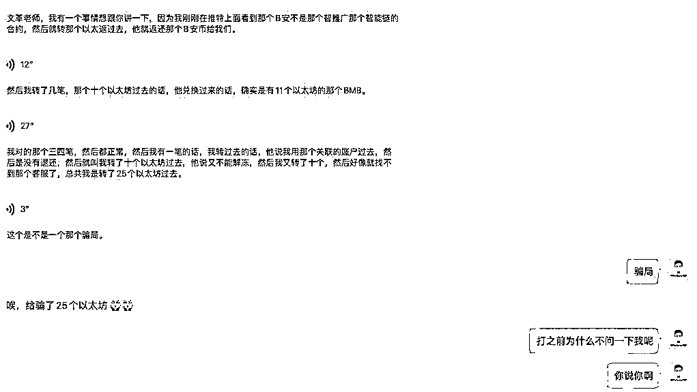

# 10.5 写在最后

最后想说几句心法：希望每个进入Web3的人，都能逐渐培养出从容稳定的心态。

1. 做正确的事，并把事情做对。

段永平最打动我的一句话是：先做正确的事，再把事做对。翻译成日常表达，就是选择比努力更决定结果。可现实里，大多数人沉迷于埋头干活，很少认真做选择，把事情主次弄反了。

那怎么把选择做好？第一步其实是搞清楚自己面前到底有哪些选项。这就需要大脑保持极度开放，大量接触新东西、获取新信息。

2.

教别人就是最好的学

想真正掌握一个知识，最高效的路径是把它讲出来。费曼那个方法就是这个道理——如果连8岁小孩都能听明白你的解释，才算真的懂了。希望大家多表达、多跟人交流。这个动作本身就在帮你巩固和消化所学。

3.

看空的人可能更“对”，但做多的人赢

一谈Web3，很多人第一反应就是风险大、不确定。可哪一样新生事物不是这样？而且这些客观因素，个人本来就改变不了。我们能改变的只有自己的认识水平，尽量避开能避的坑，然后在好赛道上找属于自己的增长机会。悲观者的判断或许正确，但最终成事的多是乐观者。

# 十一、新手上路指南 🔥@阿布 Abo

这一部分，我们来看Web3里有名的“低成本、高回报”三件套：撸毛、打新、套利。但世上不存在十全十美的事——如果把“时间、资金、赔率”放到一起衡量，你会发现没有哪个玩法能同时做到占用时间少、入门资金低、回报倍数高。别指望找到完美方案，只能挑一条适合自身条件的方向去走。

好在撸毛、打新、套利有个共同特点：都是用时间去换资金和赔率。操作思路大致是：先通过信息搜集决定参与哪些项目交互或打新，以此拿到项目团队早期发放的一级筹码，再结合项目基本面、大盘走势、市场情绪等因素，在交易所分批卖出，实现盈利。对普通散户来说，这几乎是难得能以小额成本拿到优质项目早期筹码的机会。

接下来，我们会围绕「撸毛」「打新」「套利」分别讲清楚它们各自是什么、入场时要注意些什么。为了让各位面对行情起伏时心态更稳，这一章还加了「11.4 心态建设」这部分内容，哪怕你现在不下场，也建议读一读。

⚠️先说在前面⚠️

下文所有内容都不构成任何投资建议。真要动手之前，请务必先建立资产安全意识；如果觉得自己心态还不稳，建议返回上一节「十、资产安全与投资理念」再复习一遍。

因为实操环节比较敏感，所以本章不会提具体项目的操作教程，也不会做项目推荐。

如果遇到看不懂的名词或经历，不用着急，可以先记下来，之后随时回来翻。

# 11.1 方向一：撸毛（Airdrop）

# 11.1.1 空投到底是什么？

撸空投，圈里也叫“撸毛”，英文叫 Airdrop。通俗地讲，空投就是项目团队把代币（Token）打到你钱包里，或者让你自己上网站去领。一般来说，这是项目方回馈早期参与者的方式。拿“吃鸡”游戏来类比：每隔一阵，系统会安排飞机往指定区域扔装备和物资，谁捡到就是谁的，就像游戏里免费的物资包。

不过在Web3世界里，想拿到空投是有门槛的——你得符合项目方事先设定的一系列条件，相当于被圈进它画好的“投喂区”。比如：

加分条件：有交易次数（transaction/tx）、有交易金额、有交易时间…等等。

减分甚至归零条件：短期内频繁交互同一个项目，有薅空投的嫌疑；多个账号操作轨迹高度雷同；交互间隔太短；快照时间之后才入手……等等。

而且每个项目团队都有自己的判定规则，有些会用IP来识别女巫。打个比方，如果你在一台电脑上、同一个IP下操控多个账户，很可能被归为“恶意刷奖励”而不算真实用户。

# 11.1.2 项目方凭什么白送代币给你？

看到这里你可能想问：项目方怎么那么好心，平白无故给人发钱？游戏中掉装备可以理解为拉人气的套路，但Web3项目方发的可是真金白银的项目代币，看起来明显是亏本买卖，怎么还会有人做？

答案要从Web2和Web3的商业模式差异说起。

传统互联网时代，一家公司做推广，得投放广告给电视台或者媒体、自媒体，以此换取曝光和声量。比如这样一条链路：有个卖枕头的厂商A，它想把产品推广给你（也就是用户C），就得向电视台B支付广告费；结果厂商A换来知名度，电视台B收到广告费，而你作为消费者也知道了这个枕头品牌，甚至可能下单。

到Web3这里，电视台这种中间商被直接省掉了。项目方想要的是「知名度、用户参与数、交易金额」这类活跃指标，而这些指标必须靠真实用户来亲身体验它的生态、为生态贡献真实行为数据。为什么项目方那么在意这些数据？因为综合数据越好看，它越有可能拿到更多融资，估值也随之水涨船高。

想要得到，就得先付出。项目方付出的那部分，相当于传统意义上的广告预算——空投就是广告预算中的一项，用来换取它需要的数据和热度。恰好，加密货币钱包天然支持项目方到用户之间直接发币，这一点为空投模式提供了基础设施。

所以，与其说我们是冲着“薅空投”来的，不如说是来做项目体验员的。

当然，上面这套说法是为了让你容易理解。还有一个更接地气的解释：屁股决定脑袋。Web3远没到成熟的阶段，空投规则基本由项目方自己定，这就给了内部人操作的空间——团队里有人提前拿到低价筹码，也就是俗称的“老鼠仓”。这种事摆上台面不好听，但人性如此。当你手握内部消息，又没有监管约束，很容易就会靠信息差套利，因为它同时踩中了“成本低、风险低、收益高”这个不可能三角。

# 11.1.3 这笔生意划算吗？

先看账面数据：从2023年初到2024年3月，整个市场通过空投发放的价值累计接近百亿美元。

Arbitrum：基于以太坊的L2网络，空投总额19亿美元，有62万个钱包达标；

Blur：NFT市场平台，空投总额10亿美元，很多玩家靠买卖刷积分赚了几十万甚至上百万；

Celestia：模块化区块链，空投总额10亿美元，58万个钱包达标；

Strk：基于以太坊的L2网络，空投总额14亿美元，129万个钱包达标；

Wormhole：跨链通信协议，空投总额15亿美元，40万个钱包达标。

上述案例中，基本上每个号分到的收益都有上万人民币，而单号参与成本通常只有几百块。对于刚进场的新人来说，一级市场的撸毛路径确实相对友好。

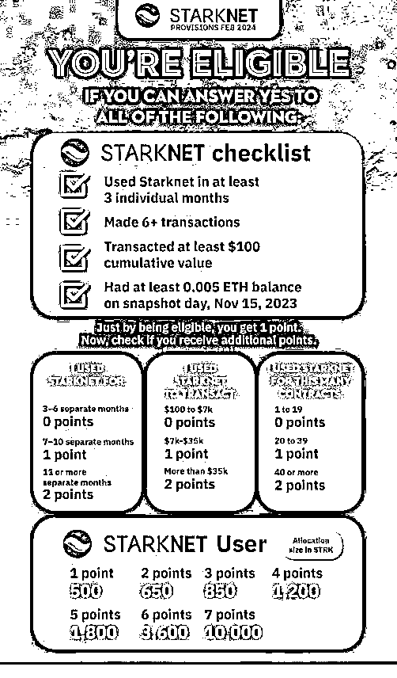

# 11.1.4 女巫是什么？项目方为何要清剿？

前面讲了空投是什么、项目方为什么爱发空投，接下来聊另一个关键概念：女巫，以及项目方为什么抓到女巫就封杀。

还记得项目方发空投的初衷吗？它期待的是真实用户来体验产品，为此用户会花gas费参与交互，帮项目方积累用户量和交易流水。既然“只要交互就可能领奖励”，那必然有人会想办法用「批量注册一批号、同时操作」来薅项目方的羊毛，而且这样的投产比很不错。

那女巫到底是什么？它的学名叫女巫攻击（Sybil Attack）。“Sybil”这个词来源于一位名叫Shirley Ardell Mason的艺术家，据说她被诊断出多重人格障碍。换句话说，女巫攻击就是一个真实用户借助多个虚拟身份去干扰网络或试图控制网络，像极了“一个人分饰多角”。

所以项目方发空投时，会通过各种规则尽可能把女巫钱包筛掉。

所谓查女巫，本质上就是项目方为了公平，设定标准把来薅羊毛的账号过滤掉。举例来说：短时间内多个账号的操作高度一致——比如金额一致、时间一致、交互的子项目一致；或者其子项目已经在查IP，项目方查女巫时直接调用了子项目的女巫名单等等。

再补充一个具体例子：刚发完空投的Starknet，官方公布的领取资格为：

1. 交易时间跨度超过3个月；（周末swap nft
2. 交易总额超过100美元；（30u、25u，swap进去+出来就算2次
3. 交易笔数不少于6次；（比如你把一笔资金swap进去再出来，会有2-3次记录
4. 钱包余额不低于0.005 ETH；（大概十几u

另外，快照时间设在2023年11月15日。

什么是快照？你可以理解成项目方挑一个时间点拍了张照，把你当时跟它的交互数据定格下来。也就是说，你的交互记录必须在2023年11月15日之前已经达到上面4条标准，钱包才有资格领空投。

有减分项自然也有加分项，比如交易笔数超过多少笔、持有交互时间超过多少个月、累计交易金额超过多少美元等。

注意：不同发行方对“达标”和“女巫”的定义差异不小。

# 11.1.5 怎么避免被当成“女巫”？

前面说过，项目方查女巫就是为了让奖励流向真实用户，而不是职业空投猎人。那想避开女巫判定，重点不该放在“怎么藏”，而应放在“怎么让自己的行为更像真人”。

查理·芒格有句话很妙：“如果我知道我将来会死在哪儿，我一定不会去那个地方。”

真用户通常不会干这些事：多个账号同时去交互同一个子项目；每个号转账金额都完全一样；在一台电脑上操控大几十上百个号；用一个钱包给若干钱包批量分钱；领完空投后统一把资产打给同一个提币地址——这些行为一看就有问题。

反过来，可以这样防女巫：

动手前：注册多个钱包时，别把时间、IP都弄成一样的；从交易所提现到钱包，每个号的金额稍微错开，比如你预计单号投入30-35u，A号放32.53u、B号放34.2u。

交互中：优先用指纹浏览器把每个号隔离在不同IP下，别用同步器；有意打乱不同子项目的体验顺序；用Excel、飞书、Notion等工具维护一份进度表，跟踪每个号的交互情况。

交互后：钱包之间别互转，免得一个号出了问题，项目方顺着关联钱包把其他号也端了；想归集收益，可以在OKX开个子账户专门接收资金。

几个容易踩雷的细节：

1）从交易所提现到钱包，可以多账户直接分发；但从钱包往交易所汇集时，务必用OKX子账户中转，否则很容易被判女巫。

原理是这样的：提现的时候，是交易所的公共热钱包在给你转账，项目方会把交易所的热钱包地址默认为安全地址。如果不这么做，几乎所有用户都会变成女巫，空投根本发不出去，项目方还会被用户和社区骂惨，口碑又会反过来影响投资人对项目的评估，所以项目方不会做这种砸自己招牌的事。但如果你把钱包里的钱转到自己的交易所账户，那就暴露了一个固定地址。假如有多个地址都在给你这个地址打钱，等于告诉别人“我在批量操作”，不判你女巫判谁。

2）指纹浏览器和IP是两个配合使用的工具：指纹浏览器的作用是伪装成一台电脑的硬件配置，IP的作用是伪装地理位置。两者叠加，你就能在一台真电脑上同时操控“位于不同地区、配置各不相同”的多个虚拟电脑，这样就不太容易因IP维度被识别成女巫。记得选靠谱的指纹浏览器，并且千万别开数据同步。

3）别去网购IP。一来价格不便宜（中文IP站尤其），二来很多商家把同一个IP卖给好几个人，你根本猜不到里面有多少雷，网速和连接稳定性也会让你崩溃。

4）🪜和IP也别乱挂到敏感地区，像美国、韩国、俄罗斯、古巴这些，很容易导致空投领不到。我自己用得比较多的是荷兰和日本的节点。conlist

# 11.1.6 撸毛前要留意的几件事

刚开始玩，优先挑成本极低或者干脆零成本的测试网项目来练手，等熟悉了流程再考虑拿真金白银上阵。

不用有“准备完全”的执念，判断一个方向可行就去试，先用小成本把全流程跑通，再考虑加注。

撸毛时记得做项目管理表，记清楚自己交互过哪些项目、手里有哪些NFT，这些都有可能在后面的空投权重中派上用场。

用ads指纹浏览器的话，建议在“全局管理-多开模式”里勾选只保存标签页和cookie，其余的缓存选项最好都关掉。

眼看行情火起来，很多人直接拿指纹浏览器批量开钱包，遇到0成本项目就几十上百个号一起冲。

去年闪电网络发白名单时，只要备齐三件套基建就能申请，纯零成本。最初一个号能拿300u，后来一度涨到1000u。我当时觉得“零撸不靠谱”，没放心上；结果朋友一口气搞了50个号，分批出货，一波下来赚了几十万人民币。（当时不少人嫌麻烦，看都没看。）

# 11.1.7 普通人靠撸毛赚钱要闯哪些关？

# 11.1.7.1 卡点与窗口期

新人做撸毛会遇到不少障碍，常见的有：三件套怎么搞到手并安全使用；指纹浏览器和IP怎么搭、怎么用；各条链之间的资金怎么来回切换；如何识别安全靠谱的交互网站；以及怎么找到值得交互的潜力项目…...等等。

现在处于牛市前段，大量项目方都赶着这波好行情发币，想卖个更高的价格，顺便蹭一波市场热度。说白了，现在是“弯腰捡钱”的时候。你能不能快速解决上面那些问题，解决得好不好，直接关系到这轮牛市你能在撸毛上带走多少收益。

# 11.1.7.2 新手最难迈过去的坎

新手最容易卡住的地方是：钱也花了、力也出了，却没有快速看到回报。这背后其实是“先信后做”与“先见后信”的差别。前面一种人，看到机会就敢上，哪怕周围人还在犹豫，他已经进场拿结果；后面一种人，非要亲眼见到收益，才肯下更多成本和精力。按常理说，后一种更稳健，但在牛市初期的窗口里，过度谨慎容易错过赚钱节奏。

从成本投入和反馈周期来考量，分享几个小建议：

1）把“刷信息”变成习惯

先试着在空闲时用刷推特替代刷🧣、📕、抖音（我手机里根本没装后面三个App）。说到底都是娱乐，但前者是在“养鱼”，后者大多是在消磨时光。上班摸鱼时翻翻项目动态，晚上或者有空且电脑在手边时顺手交互一下项目，把经验值一点点攒起来。

2）靠近有结果的人

主动去结识那些亲自跑过项目、已经拿到结果的人，向他们请教。把这个过程当作一笔必要的时间和金钱投入。我进场至今一直这么干，这也是我能认识一些撸毛KOL、撸毛大户和撸毛工作室，并从他们那里获得优质项目线索的原因。这个行业，信息差和认知差永远都在，持续学习和优化信息源，才能提高赚钱概率。

想找信息入口的话，在Web3社群里翻聊天记录，搜关键词“信息源”，那就是阿布Abo（开船第一课）。

3）付费社群值不值得进？

付费社群最核心的价值不是帮你找信息——所谓一手信息在推特上项目方官推自己就会发——而是帮你筛选信息。这里面的难点从来不是“找到”，而是“挑出真正能吃到肉、且确定性较高的机会”。这也是我近一年来加了大量付费社群后最重要的体会——

如果你确认自己能捕捉到某一领域的优质情报，并且能快速做判断，还能在价格回调时拿得住，最终交出不错的结果（通常意味着你以前就靠这种方式赚过钱），那就没必要花钱进社群。但如果你和我刚进场时一样，既需要有人带一带、又缺少信息渠道，那走这条路也不亏。

拿一个模型来解释：市面上有A、B、C、D、E五个标的，你研究后觉得A、C、E都不错，于是各投三分之一的仓位，也就是33%、33%、33%。另一家付费社群经过深度调研后，认为只有C值得重仓，于是你跟着投70%的仓位进去。到了结算那天，A、C、E的收益倍数分别是5倍、10倍和归零。按100元本金计算，你自己选的组合：A赚165元、C赚330元、E分文不剩，合计495元，接近5倍回报；而跟着社群重仓C，70元本金直接翻到700元，也就是10倍回报。两者付出的时间、资金以及最终结果，差距一目了然。

从后视镜里看，我能在好几个优质标的上放手重仓、吃到完整红利，“有人指路”贡献最大。有时候你明明知道那是个好项目，但因为掌握的信息不够全面、判断不够客观，心里就没底，自然不敢上仓位。等项目真正起飞，大多数人只会来一句：“我当时也参与了，早知道就多买点。”

粤语里有句老话：“早知就没乞丐。”现实里根本没有“早知道”这回事。所谓的“早知道”，本质上是靠充足的信息支撑你做决策，让你对项目的判断更清晰，进而该止损时果断止损，该加码埋伏时敢于重仓等待爆发。

# 11.2 方向二：打新

# 11.2.1 打新和撸毛有啥不一样？

打新，就是抢在项目很早期就参与进去，从而拿到项目团队的低成本筹码，这也是拿一级筹码的重要途径之一。

你可能想问：打新不也是做一级吗？它和撸毛有什么差别？

共同点是：两个玩法都讲究“早下场”，最终目的都是锁定项目方的一级筹码。

不同点可以从几个层面来对比：

成本：打新比撸毛高
风险：打新比撸毛高
胜率：打新比撸毛低
赔率：打新比撸毛低
反馈速度：打新比撸毛快

撸毛的逻辑，是通过消耗gas费和投入时间，把生态里的子项目都体验一遍，从而等来项目方发空投。除了三件套「指纹浏览器、IP、电报」这些基础设施外，日常主要支出就是交互时的gas费（除非你参与质押类项目——前几天就有个项目被黑客盗走了2000wu）。空投什么时候落地没有规律，有的项目一两个月就发，有的拖上一两年。换句话说，撸毛是一个低支出、高赔率的玩法。

说到打新，流程其实不复杂：盯住项目方公布的规则，在指定时间赶到对应页面，把NFT或铭文mint下来。麻烦的地方在于，链上gas会随行情起伏，每次实际要花多少，事先很难给出精确数字。选对目标时，一晚上翻出数倍并不罕见；可一旦看错，亏损也会来得很快。

想把NFT打新做好，往往绕不开这几项本事：

1. 投研功课要扎实
2. 仓位得管得住
3. 对图片有审美判断
4. 出货节点抓得准
5. 能预判项目后续走向

打新还可以和空投形成配合。Runestone计划面向比特币网络上mint过至少3张NFT的11万多个地址发放空投，同时项目方把父铭文转进了中本聪地址，这意味着没有人还能控制它，后续增发这条路被堵死，通胀风险也就不存在了。该空投单号价格是0.0422 BTC，折成USDT超过2800，等于市场白送两万元人民币，而且这还没算后面可能继续来的空投。

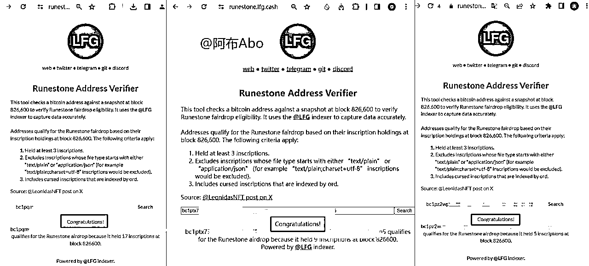

# 11.2.2 打新分几类，成本怎么算

目前常见的打新主要有两类：NFT打新，以及铭文、符文、分形BTC打新。

按出现时间排，NFT打新早于铭文打新。

按回报看，要分行情讨论：NFT打新如果目标选得准（这是大前提），刚出市场就有3到5倍回报；铭文处在爆发阶段时，一天十倍也不算稀奇。

按风险看，两者大体相当。真正决定风险高低的，是你对项目的筛选判断，以及出货策略、仓位管理这些动作执行得如何。

NFT打新通常分为白名单轮和公开销售轮。

白名单轮：项目方一般会把一部分份额分给两类地址——之前参加过其项目的用户，或者持有知名项目NFT的玩家。白名单价格低于公售，还能提前mint，免得这些人在公开轮抢不到。

公开销售轮：顾名思义就是面向市场开放。到了这个时段，任何人都可以公平参与mint。

以眼下链上热度估算，mint一张NFT的开销大约在30到60U（以海外项目为例），折人民币约200到400元。看着不算低，但开销本来就和回报预期绑在一起。

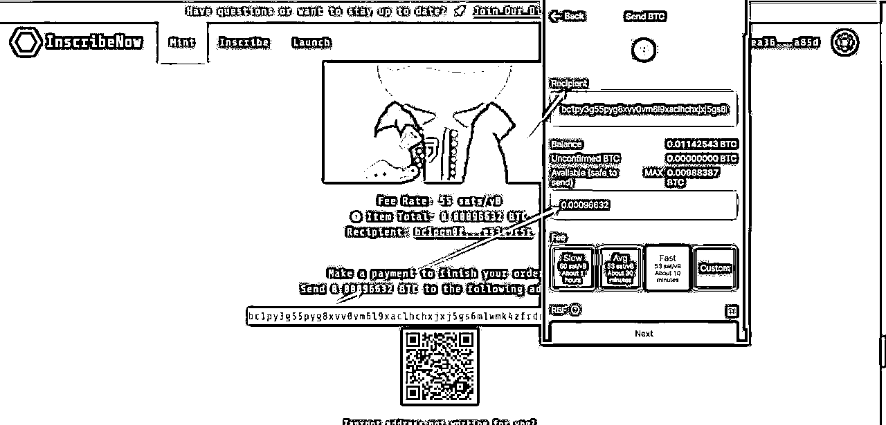

上周我刚打过一张图，mint成本0.001 BTC，按当时市价约60U。晚上23点完成mint，第二天早上8点出市场，最高冲到250U，一晚就是4倍多。那会儿我人在外面，回家后才挂单，最后在成本价1.5倍的位置卖出。

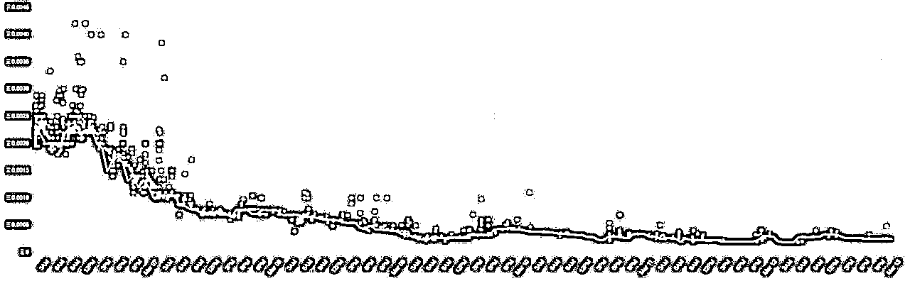

当时打这个项目，主要是带朋友走一遍流程、做个示范，所以没怎么上仓位。正常情况下，类似项目只要成本控制和卖出策略到位，赚个四位数到五位数并不难。

# 11.2.3 打新前要留意哪些点？

刚开始别贪多，先打一张图，把流程完整跑通，再逐步增加数量。

别忘了目的：你是来获利，不是来囤货的。别把图当藏品一样死攥着。

看到觉得靠谱的目标再出手，别见到一张图就无脑冲，那样很容易交学费。

把自己的信息源搭起来并持续完善，不断拿到高质量信息，比如小圈子、KOL朋友、项目方朋友、付费社群、关系好的同行。

同时持续打磨成本控制、仓位管理和出货策略，这几项能力需要慢慢练。

# 11.3 版块三：套利

# 11.3.1 套利到底指什么？

套利可以拆成两层理解：

1. 在A市场买入代币，随后迅速到B市场用更高价格卖出；
2. 在同一市场里，针对同一标的，借助工具低买高卖，赚取差价。

也可以把它压缩成八个字：低买高卖，赚取差价。

那它和打新、撸空投有什么不同？

套利，是在市场上发现相对低风险的机会后做低买高卖，利润来自价差；打新，是通过投研找到优质一级标的后参与发行，再在二级市场卖出低价筹码；空投，则是你交互项目方生态项目后获得的激励，本质也是低成本拿一级筹码、再到二级市场变现。

一句话区分：打新和空投属于一级市场动作，套利属于二级市场动作。前者是把一级筹码搬到二级市场卖出获利，后者是在二级市场来回搬砖吃差价。

# 11.3.2 哪些人适合套利？

套利这件事，说难不算特别难，说简单也真不简单。

关键看三点：你有没有二级交易经验，你的性格适不适合，以及执行力够不够。

二级交易经验：如果你做过短期二级，比如看得懂K线，能判断某段时间价格大致往上还是往下，顺着趋势做波段，这也是一种玩法。

性格：套利往往要求快进快出。有人性格偏慢、做事求稳，那可能就不太适合。你是快还是慢，得结合自己的经历判断。

执行力：说白了就是——看到一条信息，你会不会马上判断里面有没有潜在机会；发现机会后，能不能立刻动手。

# 11.3.3 套利常见的几种类型

我认为目前比较容易上手的套利有三类。这里主要聊操作思路，具体实操会受实际情况影响，暂不展开。

# 类型一：交易所新币套利

说套利之前，先提流动性。流动性是套利的第一原则。没有流动性，价差再大也没人接盘，那不过是两个不同的数字，账面好看，实际换不出钱。

新币上所后，通常会迎来一段流动性高峰。原因在于Web3里很多人并不会链上操作，他们下载交易所主要是为了炒币，而不是去做链上交互。别觉得这反常识，想想身边亲友有多少了解Web3、又有多少会链上操作，大致就能明白。

有了交易所流量加持，新币关注度会上升，流动性也会跟着改善。

以我最近在币安套利NOT为例，说说当时的操作和事前判断。

（注：仅作演示，不做投资建议）

我的操作是：开盘前10秒买入，然后按现价卖出，15秒赚了20%，先用小资金把流程跑通。

动手前，我把币安新币榜上所有新币的走势规律和操作思路梳理了一遍，发现：

1. 新上所币种通常先急跌，随后一小时内逐步冲到ATH（上市后新高），再慢慢回落。大体是这个节奏，但具体情况仍需具体分析。

2. 相对确定的做法是：极早期买入（我是在前十秒进的），再挂20%到30%的止盈单。但实盘中往往没时间精算卖点，只能靠盘感或市值大致估价格，或者直接现价进、现价出。

3. 共性规律：币安任何新币，一小时后大概率跌掉几十个点。原因包括大盘走弱、做市商洗盘吸筹等。后面也许还能涨回来，但那和当下这轮套利关系不大了。

4. 冲币安新币套利有点像冲土狗，有几十个点甚至几个点利润就该撤，别老想着翻倍回本。

5. 事后看K线会丢掉一些真相。你事后只盯分线，容易忽略秒线；而秒线里其实有足够时间窗口去现价买入，或在相对高点卖出。我盯盘时看到NOT最低到0.0086，但5月17日早上回看分线，最低显示0.0098，说明分线数据存在失真。

6. 每个标的背后的做市商都不同，别指望一招鲜吃遍天。要在实操里总结，找到共性后再想办法放大规模。

# 类型二：机器人策略套利

机器人套利，就是你选好标的、设好参数，让程序自动低买高卖赚差价。

这种方式更适合行情波动较大的阶段，比如大饼横盘、山寨币起伏较大时使用。

按目前趋势看，这个策略大概还有6个月窗口。我自己实盘下来收益还可以，标的和参数选得好的话，单月收益率有机会超过5%。

重点是风险相对较低——注意，风险低不等于没风险。高收益的事情不可能没风险，想清楚再决策。

我目前开了2个策略（本节写稿时间：2024年6月6日）：一个是1月26日设置的，收益率28.15%；另一个是5月23日设置的，收益率0.55%。

# 类型三：CEX/CEX、CEX/DEX、DEX/DEX 套利

CEX指中心化交易所，比如币安、OKX；DEX指去中心化交易所，比如Uniswap。

币安和OKX之间可能存在价差。如果你手里有空投得来的一级筹码，放到币安卖出可能更划算。

CEX到CEX：两个中心化交易所价格不同，在低处买入、高处卖出。

DEX到CEX：去中心化交易所和中心化交易所存在价差，同样低买高卖。

DEX到DEX：两个去中心化交易所价格有差异，操作逻辑一样。

还有三角套利法：当CEX和DEX之间出现价差时，就可以套利。原理就是看两边价格差，便宜处买入、贵处卖出。

风险在于可能被拔网线：新币上所时，CEX可能暂停提币。

# 11.3.4 套利时的注意事项

1. 套利对象、参数、平台切换，都要提前分析，测试后再定策略；
2. 止盈点和止损点设好，到了就执行，别犹豫，严格按策略走；
3. 不用机器人而手动操作时，要在几分钟甚至几十秒内完成；
4. 参考平台过往上币数据，预估它短期走势，列客观数据即可；
5. 结合代币经济模型（项目融资情况、FDV、初始流通量、竞品）预估上所价格；
6. 卖飞是常态。定策略和交易前就要接受这个前提；
7. 套利本身是短线动作，别把套利标的当成长期持有标的。

另外，跨平台才需要重点考虑手续费，单平台内的手续费磨损基本可以忽略。比如单平台看K线，按趋势挂买卖单赚差价；跨平台则要看购买和提现手续费高低，甚至转账到账时间。建议先小资金试一两次，确认有利润后再加大操作。

# 11.3.5 我怎么挖掘潜在机会？

这个点是我后来加的，想分享下：我在套利NOT之前，先赚到了什么钱、抓住了哪些机会，才最终发现交易所新币这个套利口子。整条逻辑链都摊开讲。

# 1）赚钱的逻辑

想赚到钱，核心在三个差：信息差、认知差、执行差。

信息差：你能不能拿到别人拿不到的信息？

认知差：你能不能在同一信息里看到别人看不见的点？

执行差：你看到机会后，能不能立刻冲上去参与？

对应的提升方向：

信息差，需要优质信息渠道。这个我在《开船第一课：新人如何入场Web3（9月航海更新）》里讲过，这里不重复。另外官网也是很好的信息差来源，具体用法后续看版块五：官方信息。

认知差，要靠自己在事上练，或者有前人指路，教你判断一条信息背后的价值。

执行差，认知到位后执行通常不会差。如果认知到了却没动，那要解决的是时间精力管理和拖延问题。

很多人所谓的执行力不够，本质上是对事情看得不够清楚。如果一位拿过结果的前辈把投研数据摆在你面前，再告诉你这个项目单号能赚多少，你还会犹豫吗？不会，因为你知道这是确定性较高的机会。

实际做项目时，没人能保证每个项目都有确定结果。但有些项目，结合内外部信息和各方利益点思考后，确实存在这样的机会。归根到底，看你能不能找到，找到后能不能判断它的价值。

# 2）利益分析法

大家来Web3都是为了赚钱。可如果所有人都赚，谁在亏？我们要争取成为赚钱的那部分人，而不是亏钱的那批。

这就要求尽量把各方利益点捋清楚，再针对性考虑自己能赚哪部分钱。

举个例子，上个月币安搞了第一期Megadrop，会上一个新币，即BounceBit的代币，简称BB。

我从币安交易所、项目方、做市商、散户四个角度做了分析：

① 币安交易所：为什么搞Megadrop？

币安想推动市场增长。起因是竞争对手OKX的Web3钱包做得很好，铭文那一波吸引大量新人使用OKX Web3钱包。从便利性看，这些新人习惯了OKX钱包，自然也更倾向用OKX交易所，手机端交易所和钱包切换很顺。

要吸引人来场子玩，得先让散户尝到甜头，把名声打出去，才有人愿意继续进来。所以币安的活动不会找太差的项目，那等于砸自己招牌。

② 项目方：BounceBit为什么愿意拿份额给交易所做活动？

因为币安有足够流量。跟头部交易所合作，牺牲一点代币换名声和流量，这笔账很划算。

③ 做市商/投资机构：上大所有什么好处？

同样，上了大所就有足够流动性，做市商发挥空间更大。有流量，钱涌入，流动性高，市值更高，做市商、项目方、投资机构都满意。

④ 散户：散户赚的是什么钱？

散户赚的其实是交易所推广费用。不理解可以回看前文《11.1.2 项目方为什么要发空投？》。交易所要推广，需要散户发动身边人操作，这给交易所带来流量，空投的钱相当于交易所给的推广费。

很多人想到这一步就停了，所以只上自己的号。但认知差异往往导致账号数量不同，最终结果也不同。

比如我会从这些角度分析：①项目简介 ②融资金额 ③投资机构 ④TVL数据 ⑤代币经济模型 ⑥初始流通比例 ⑦代币发行时间 ⑧活动积分计算 ⑨过往新币市值 ⑩预估整体收益。

做完分析后，我把占用成本、磨损成本、利润率都算清楚，量化数据告诉我：这个活动必须参与。

# 3）实操中发现新机会

我最初发现了Megadrop信息，分析判断后认定是机会点。随后在卖出时观察到新币上所后存在套利空间，再延伸到CEX/DEX之间的套利机会。

也就是说，这个板块的套利操作，其实是从最初一个空投项目引申出来的。但大多数人看不到其中机会，这恰好是我的机会。信息差和认知差都有了，赚钱就是大概率事件。

挖掘机会是一回事，把机会和实操转化成真金白银又是另一回事。同时把经验记下来，方便下一次复制、拿到更大结果。这些就是我在做的事。

以上，是我从币安第一期Megadrop中引申挖掘出的几个机会，包括但不限于：

1. 币安新币开盘极短期套利机会；
2. 流动性较高时段的套利机会；
3. CEX/DEX之间的套利机会。

看到机会、抓住机会，这件事也需要锻炼。希望大家通过项目分析判断和实操，不断提升自己抓住机会的能力。

# 11.4 版块四：心态建设

# 11.4.1 心态建设为什么重要？

接到赚钱邀请写这个板块时，我犹豫了很久。站在读者角度，谁愿意听别人唠叨心态呢？

因为心态建设不像撸空投、打新、套利那样“看得见摸得着”，说白了就是没那么快给正反馈。没法直接带来收益的事，自然容易被低估。

但实际上，心态建设对你做决策的帮助或阻碍，大到超出想象。

一般做项目的逻辑链是：广泛获取信息 → 判断信息可靠性和项目含金量 → 预估收益 → 执行端操作。

正常逻辑是这样，但心态在其中其实一直跟着。

以我自己和对身边人的观察，赚到钱和没赚到钱，很大一个区别是：

同一个项目，获取的信息不同、自身经验不同、对板块了解不同，会做出截然相反的动作。

你可能以为我要讲认知，但不是。我想聊的是性格和心态对做项目的影响。这部分，才是同一项目里不同人赚多赚少、甚至有人赚有人亏的原因。

前两天我在书店偶然看到乐嘉的《性格色彩原理》，里面讲到不同人都有自己的优势，但优势过度就会变劣势。

比如一个人分析能力很强，可能执行力不太行；而一个人执行力很强，则可能思考不够全面，有些潜在风险没看到。

这就像硬币的两面。也是为什么心态建设说到底跟性格息息相关。背后的思维方式是连着的。表面上，心态和操作没有直接关系，但如果没有好心态，资源再丰富、信息再多，也没法真正为你所用。

# 11.4.2 不同行情下的心态变化与应对

# 1）疯狂上涨期

每天不是这个币新高，就是那个币几十上百倍，主流币、山寨币、meme币都在疯涨，就自己的持仓不涨。

这时候你会听到各种暴富故事，有人今天赚几十上百万，有人财务自由想退圈，等等。

再看自己手上的筹码，账面价值水涨船高。看到热度好，哪怕到了目标收益，也总想卖在更高位置。结果等着等着，泡沫被戳破，利润回吐，竹篮打水一场空。

疯狂上涨期要做的是，把“行情震荡期”和“行情平淡期”攒下的筹码，逐步卖给那些跟着热度进来的机构或散户接盘，而不是傻傻死握在手里（这里不指BTC和ETH）。

没有兑换成BTC或USDT的，都不算真实收益。

“无人问津时买入，人声鼎沸时卖出”——这话被反复念叨到耳朵起茧。可真到了没人搭理的时候，大家又总觉得还会继续往下掉，手就缩回去了；等所有人都抢着进场，又认定还能再冲一冲，攥着不肯松手。说到底，人性就这样。

于是不管账面上赚了多少，心里那道坎始终过不去。

碰到这种局面，最管用的法子是先把周围的杂音关掉，问自己一句：眼下这收益，我满意了吗？满意的话，就可以分步落袋，一点点撤了。

# 2）震荡行情怎么办

大饼一上一下，整个大盘也跟着晃荡。最磨人的就是这种卡在中间的状态——往后看不明白，往前不知道该加还是该减。

震荡得拆成两类看：一类是往上走的趋势，一类是往下走的趋势。

要是上涨方向比较确定，那当下随便什么价位拿一点主流品种（公链/头部币），结果一般不会糟。无非是短线回撤的时候，心里会有点不舒服。

方向一旦清楚了，仓位就可以一点点铺出去，同时用各种手段给自己减负。

比方说挂个机器人跑跑套利，或者干脆把注意力挪开——去撸铁、去跑步、去写点东西。扛一扛，这段就翻篇了；真正要命的是在回撤里把筹码交出去。

# 3）行情平淡的时候

链上没什么造富故事，大家就在无聊的盘面里围观八卦、做做撸毛任务，顺便补补课。

行情平淡，操作越少越好，这时候往往动得越多、错得越多。

Web3这行当，说白了是看天收成：天好的时候什么妖魔鬼怪都出来蹦跶，天差的时候真金也会被当成黄铜。

这种时候不如去学点新东西，给自己的竞争力加点码。比如一级玩家去补二级的课——怎么读K线、怎么扒数据；或者试试学点编程，让自己干活快一点。

行情冷的时候，恰恰是你容易找到还过得去的标的、慢慢定投的窗口。

我前几天翻到一张去年的截图，某个公链币那会儿大概0.25，现在已经0.87了，一年光景涨了350%。这涨幅搁传统金融市场里想都不敢想，可在Web3里就是能发生。

可惜大多数人既不敢也不肯在冷清时捡好货，反而更乐意在热闹时加价去买一堆没谱的东西。人嘛，一边怕风险，一边又惦记高回报，挺矛盾的。

# 11.4.3 心态这件事，怎么左右你的盈亏

这个板块，我想聊聊前阵子特别困扰我、让我很焦躁的一件事。

那段时间我焦得很，是一种莫名其妙的攀比式焦虑。老拿自己跟身边赚得更多的朋友比，比完就嫌自己挣得少，纯粹是自找不痛快。

后来我琢磨明白了几层道理：

1.山外有山，人外有人

只要你还在往上爬，就一定会遇到更厉害的人。只要你动了比较的念头，这种焦虑就甩不掉——因为总有人比你更能赚。

2.你只顾着抬头，忘了低头看看

真要客观地比，你会发现总有人在你前头，也总有人在你后头。可你的视线偏偏只落在跑得比你快的那批人身上。

3.把噪音关掉

你焦虑，多半是在推特上或者身边听了太多“谁谁又暴富了”的故事。

可那些故事跟你有什么关系？人家赚的钱不会分你一分，人家亏的钱也不用你填。为八竿子打不着的人折腾自己，纯属浪费精力。

时间全耗在内耗上，哪还有心思做投研、跑项目？

所以，推特上那些“永远在赚”的博主，该取关就取关；无聊又没营养的群，该退就退。记住，时间才是最贵的本钱。

4.站在自己的位置上想问题，别往外求

上个月跟一位前辈聊天，我说起自己的焦虑。他丢给我两个问题：

“你现在的资产，比去年多吗？”

“你现在的经验、技能、人脉，比去年少吗？”

刚听完我没太大感觉，后来把数字一列，心里咯噔一下。

我自己在心里回答了：

阿布，你现在的资产是去年的好多倍了，而且你原本计划达成这个目标的时间还要更晚，现在提前做到了，你反而不高兴。归根结底，是贪心和攀比在捣鬼。其实你已经比过去的自己强出一大截了。

再说，你从只会撸毛，到现在会打铭文、符文、打新、套利、冲土狗，每个板块都能捞到钱。你对信息越来越敏感，也懂得怎么把信息变成机会、变成收益。

这些都是你的收获啊。

干吗只盯着别人，把自己手里的优势当空气呢？

我知道，眼下这行情，大家都觉得自己赚得不够。可“够”这个字，到底怎么算？

絮叨了这么多，看着跟心态建设不沾边，其实句句都在讲心态的利害。把思路落到纸上之后，我发现自己平静了不少。而心态稳了，才可能赚到钱。因为你的决策不再是看见别人赚钱就眼红去抄（那种FOMO，十有八九是进去接盘），而是冷静分析信息之后做出的判断。

“钱，会从心急的人手里，流到心定的人手里。”

赚钱是为了把日子过好。

祝各位都能找到适合自己的赚钱路子，把生活经营好，自洽最要紧～

# 11.4.4 给新人的心态功课

# 1）心态稳住，用小成本去试

这一节是专门写给刚入门的朋友的。

大家一听到比特币，脑子里蹦出来的就是暴富神话，身边好像总有人在币圈赚了几百万几千万，动辄几十倍上百倍，听得人心痒。但我还是想给这股热乎劲儿泼点凉水。

币圈是个7×24小时连轴转的国际市场。你能听到有人短时间赚到大钱，根子上是因为它比传统金融效率高——效率高，来钱快；可反过来，效率高也意味着亏起来更快。

Web3是有前景的赛道，这是客观事实。但认知不到位、操作不规范，照样会亏钱。

刚进场的时候，建议只拿那些亏光了也不影响生活的钱去试，告诉自己这是学费钱，重点是跑流程、熟悉项目，是以后赚钱的跳板。心态放平。

另外，要趁热打铁，在一段不太长的时间里连续做项目，这样拿到好结果的可能性会大不少。

第一次尝到甜头之后，回头复盘：哪些操作带来了盈利，哪些操作导致了亏损，把这些写进自己的复盘笔记里。这能帮你在Web3里走得更稳。

同时，也给自己和市场一点耐心。天天都有暴富故事不假，但你得有一定的项目阅历和认知，在这市场里摸爬滚打过一阵子，才能摸清它的脾气。这种事没法一夜起飞，得靠时间慢慢熬。

如果你学习能力和信息搜集能力比较强，可以自己去扒项目资料，判断筛选之后再下手，结果一般不会差。要是觉得自己这块还欠火候，可以考虑进一些付费社群，多拿点信息。

# 2）别老想着拿100分

带人的时候我有个特别明显的体会：有些人做事，一上来就要求自己做到满分。

但说真的，这大概率是做不成的。

一个新手刚踏进新领域，想把一个项目做到100分，难度太大了。

目标定在100分，哪怕你做到了95分，照样开心不起来，因为没够着预期。

可要是把目标定在60分，只要把整个项目闭环跑完，哪怕磕磕绊绊、做得一般，结果也比那些一开始就奔着满分去的人强。因为预期低，拿到65分的时候你会觉得是白捡的惊喜。

所以，一开始把目标设在60分就好。实际做的过程中慢慢往上调，65分、70分、90分，都是一步一个脚印踩出来的。别跟别人比，只要比昨天的自己有长进就行。

先动起来，再一点点往深里走。

挑软柿子捏，从简单的项目里把正反馈拿到手。

而不是一上来就追求完美、非要搞懂所有原理。那些只会拖慢甚至挡死你拿到正反馈的路。

很多时候，想得越多，做得越差。

# 3）成年人的学习，得集中火力打歼灭战

成年人学东西，一定要把长期主义和短期冲刺捏到一块儿。

长期主义，是你认准了这是条好赛道，所以愿意往里投时间和心思，靠时间攒经验，最终在这条赛道里拿到大结果——这是方向上的指南针。没有时间就没有积累，没有积累就做不成事。

短期冲刺，是你在比较短的时间段里干掉一个任务，然后拿到反馈，好坏都算。

为什么要提这个？因为成年人的时间都是碎的，真正能留给你完整做项目的整块时间并不多。所以做某个项目的时候，必须集中火力一口气突破。

你回想一下自己以往的成功经历，有没有一个共同点：都是在不长的时间里完成了一个既定任务。

比如，公司突然甩给你一个从没接触过的活儿，你集中学几天，交了个60分的方案上去。

比如，你考驾照，科一科四前一两天集中刷题，最后拿了个够用的成绩。

你做成的事，是不是基本都是靠短期冲刺拿下的，而不是长期平均使力？

所以我希望大家明白：成年人的进步，往往需要在开头集中火力干一波。要用短周期的目标来牵引自己的行动（借用张君老师的话）。

新人想在Web3里赚到钱，最好的办法就是先找一个难度中等的项目当靶子。

首要目标是把项目流程跑完，先别管收益，也别管别的。只要项目跑下来了，你就已经拿到了一次正反馈，因为你实打实地把这件事做成了。

这也是为什么之前有赚钱的小伙伴让我带他们做项目，我没从理论一点点讲起，而是在讲完最基础的概念和演示之后（比如钱包、交易所怎么注册），直接甩一个项目给他们。

因为概念性的东西学得越多，越拖累你执行。

概念学得再溜，也不如你亲手跑过一遍项目来得深刻。

当然，跑流程时卡住的地方，得你自己解决或者找懂行的人请教。这个阶段还不用去啃项目投研那种太深的东西。先跟在有结果的人后面，把他喂到嘴边的饭咽下去。多吃几顿，再琢磨自己下厨的事。

小结一下：想在一个领域拿到结果，

第一，找到一条能靠经验积累、有复利效应的赛道；

第二，不断小步快跑，完成短期小目标，用源源不断的正反馈给自己打气、加动力。

这些方法不光在Web3管用，放到任何商业领域都一样。底层逻辑是通的：人都是尝到甜头之后，才更有劲头往深里钻。要是一直苦哈哈挣不到钱，那多半是做事的路子出了问题。

祝大家在Web3里都能早点尝到甜头～

# 11.5 版块五：官方信息，必须盯紧的情报源🔥

# 11.5.1 官方信息为什么值得看

# 1）第一时间拿到进展和公告

官方的Twitter、官网、文档、DC、TG，是拿项目最新进展、版本更新、合作动态和重要公告的最佳渠道。比如新的协议升级、关键战略合作或者变更，都可能影响项目的走向和价值。

拿unisat的pizza空投和价格波动来说，大家买卖pizza，本质上是在赌自己看不看好unisat。当unisat拿到BN融资的消息一放出来，利好落地，大家自然更倾向买入，因为预期它会涨。

详细内容见后面“如何把官方信息变成有价值的情报”那一节。

# 2）摸清项目的愿景和目标

官方信息能帮你更透地理解项目的愿景、使命和长期目标。这些一般写在白皮书或者项目官网上，能帮你判断这项目跟自己的兴趣、价值观合不合拍。

不同类型的项目，阿布的尺子也不一样。拿NFT项目来说，他主要看热度、图片质量、Roadmap（路线图）、背景、总量、价格、初始市值这七个维度，要是好几个都踩中他的标准，大概率就会下手。

得说明的是，不同阶段标准也会变。行情热的时候，可能烂图也能卖出金价；行情一般的时候，好图的赔率也未必高——还得把总量、价格这些因素放一块儿综合掂量。

# 3）保安全，躲骗局

Web3里骗局和假信息一抓一大把。走官方渠道拿信息，至少能保证内容是靠谱的，不容易被钓鱼网站或者高仿社交账号带偏。

阿布之前跟一位投资人G聊过，G同时也是个KOL。有个人在推特上跟他聊得火热，加了🛰️聊了几个月，信任建立起来之后说想合作、给项目做推广。后来发过来一个文件，G的大额资产都在电脑上，出于谨慎，他用家里的备用电脑下载了但没打开——一看是.exe结尾，立马明白是黑客在钓鱼。

所有你在公域（TG/TW/DC）认识的人，都得多留个心眼，谨慎点总没坏处。

这部分详细内容放在下一章了，跳转链接：版块六：资产安全。

# 4）混社区，拿支持

官方信息通常还包括社区活动（DC/TG居多）、开发者会议、AMA（Ask Me Anything，一般在TW上开space）等等。参与这些能帮你更深入地理解项目、了解团队动向、和其他社区成员搭上线。

一个优质项目，不会是一个人拍板说了算。决策者会顾及社区建设者和参与者的感受，所以会广泛收集意见。归根到底是为了项目推得更顺。这对参与者也是好事：盘子做大了，进场的人多了，早期玩家分到的蛋糕自然也大。

另外，要重点盯一个项目的潜在购买力来自哪类人群，这跟你最后能拿到多少收益直接挂钩。

就Web3而言，老外的盘子质量整体更好一些（从概率上讲），不管从胜率还是赔率看都是。

# 5）当作投资决策的依据

对投资者来说，官方信息是评估项目潜力和风险的重要参考。开发进度（有没有按规划走）、团队变动（有没有高管出走）、市场策略（token怎么分配）等等，都可能影响项目的价值和发展方向。

这些一般是深度参与项目的玩家或者建设者要重点盯的。我们参与项目，说到底还是为了赚钱。

如果你在极早期就看中一个项目，可以从阿布上面提的那几个平台（TW/TG/DC/官网/官方文档/白皮书）去跟踪它，看项目有没有按路线图推进，项目方或者社区是不是在持续做事。

然后再从中找到自己的生态位，想清楚自己要赚的是哪份钱。从这个角度去想，你已经比很多人强了。

# 11.5.2 去哪找靠谱的官方信息

前面讲了官方信息有多重要，这部分说说怎么避开钓鱼网站和骗局。

我一般是几种方法搭着用，做交叉验证。

# 方法一：双C对照（CMC和CG）

CMC，全称Coinmarket
coinmarketcap.com

CG，全称CoinGecko
coingecko.com

这两个站能看币价实时变动和项目的各类数据，比如价格涨跌、智能合约地址、行情分析、相关新闻、官方入口（官方推特、官网、官方电报）等等。

这里统一拿FTM这个币举例（非投资建议，仅作参考！！）

这两个站上的官网链接是官方自己提交的，基本不会出错。进到TW之后，一般官方账号顶部会挂一个官方信息汇总的链接，点进去，里面汇集了一堆官方入口，方便你按需跳转到对应网站。

比如Twitter是官方发消息的地方；TG和DC一般是项目方发公告、凝聚社区共识、接收用户反馈的地方；官方文档类似说明书；领英则是看团队背景的窗口，等等。

再从这个页面里点开TW，可能又跳到另一个TW，同样是官方推特。就这样一层一层往下扒，就能摸到你想要的一手信息。

# 方法二：Rootdata

rootdata.com/zh

我主要拿它看项目方的融资金额、团队背景，还有近期动作和官方信息。

注意：

1. Rootdata更新比较快，FTM已经换成Sonic链了，所以它给的推特也是Sonic的。

2. 不过在Sonic推特的置顶链接里，linktr的网站汇总跟前面双C是一致的。

# 方法三：ChatGPT

chatgpt.com

注意：

1. 推荐用GPT-4o，准确率更高，信息时效性也更好。

2. GPT给的信息大部分是对的，但太细的地方也可能翻车，所以要结合多个渠道综合判断。

# 方法四：找熟人把关

如果上面三种法子都找不到你要的答案，或者你觉得答案有点不对劲。

那我建议你：去问问身边玩Web3的老手，尽量问赚钱的小伙伴。

教练、领队、志愿者都是可以请教的对象。有时候多问两句，说不定就帮你避掉一个坑。

# 11.5.3 怎么把官方信息变成值钱的情报

大交易所和项目方在官方渠道放出来的消息，往往是普通玩家为数不多能摸到的一手信息。

交易所在官方渠道发消息，很可能牵动某个币种的价格走势。提前看到的人，实际上就吃到了信息差。

举个近期的例子：7月4号晚上20点，上演了一出梦幻联动。BN和unisat公布了一项融资动作，pizza应声而起。pizza是unisat空投给BTC生态玩家的铭文，低保一个号100个，历史高点$8/个，现价$4/个。取个中间值，相当于一个低保号白送$600，折人民币约4500块/号。

到7月24号晚上20:07，pizza价格是$3.1，两个小时后蹿到$3.67，两小时涨了20%。第二天情绪继续发酵，又冲到短期高点$6，相比消息刚出时几乎翻倍——而这还不到24小时。

靠信息差和情绪发酵赚钱，这种机会市场上从来不缺。

# 11.6 版块六：资产安全，不能破的底线🔥

# 11.6.1 资产安全为什么值得重视？

这问题乍一听像废话：资产安全，不就是别让钱被偷走吗？

在币圈待得越久，越容易产生一种错觉：自己对安全问题已经很上心了。可真出事的时候才发现，黑客根本不会提前打招呼。说白了，不把资产安全当回事，钱包里的钱早晚会变成别人的。阿布这次就是活生生的例子——5000 美金，说没就没了。

这也是为什么我要专门开一个板块来聊资产安全。在 Web3 里，信息安全是“1”，其他一切积累都是后面的“0”；少了这个“1”，后面挂再多“0”都归零。哪怕像我这种入圈好几年、平时自认对资产安全够敏感的老韭菜，也照样被上了一课。天天在河边走，哪有不湿鞋的？

好在出事那阵子我刚换了台 Win 系统的新电脑不久，链上的大头资产根本没导进去，所以被划走的钱还在承受范围之内。但借着这个机会，我把资产安全从头到尾重新捋了一遍，感触比以前深得多。被盗之后的几天，我就下单了 M3 芯片的 MacBook，从此正式养成“双套使用”的习惯（具体方案放在后面）。设备安全上的投入，真的一分都不能省。

# 11.6.2 资产安全做到极致，靠什么？

# 11.6.2.1 先从软硬件说起

# 建议一：设备选型

硬件这块，阿布只有一个建议：条件允许，优先上苹果。苹果“封闭”的生态加上它在信息安全领域砸下的资源，让它的产品几乎就是为 Web3 用户量身定做的。顺嘴提醒一句：以上只谈产品使用感受，不涉及任何立场问题！！

之前我的主力机一直是华为 Mate 系列，哪怕是商务旗舰，用起来也还是有挺多限制，特别是升级鸿蒙之后……这个我不展开说，有鸿蒙和苹果双持的朋友，自己对比一下就能体会到了。

用苹果不止要保持常规警惕，还有一个容易被忽略的坑：别什么插件都往浏览器里塞。真要装插件，最好像我一样做浏览器隔离。比如浏览器 A 是你的高频主力，多装几个工具插件没问题，但上面绝对不能放大额资产，重要信息比如邮箱也要尽量分开。再单独开一个浏览器 B，Chrome 多开一个 profile 就几秒钟的事。就是这个小习惯，关键时刻帮你挡掉的可能是一笔大损失。

要是想再加一道保险，就直接跟我一样做设备隔离：Win 电脑处理日常交互，Mac 只用来做交易。

# 建议二：软件安装

苹果用户请记住：凡是 Web3 相关的软件，一律去非大陆区的 App Store 下载（比如港区）。大陆区商店里你能搜到的交易所和所谓的 Web3 软件，基本可以全部判为假冒。

我现在的配置是两个 Apple ID，港区一个，美区一个。港区 ID 专门用来下 Web3 应用，App Store 里的交易所基本都是正规的；不放心的话，可以从交易所官推点进去下载，只要它能自动跳到 App Store 对应页面，就说明这个渠道是安全的。美区 ID 我主要拿来续费 GPT-4o——真的很推荐搞一个。它也能下 Web3 应用，但美国对加密货币有政策限制，比如美区 BN 和其他区的 BN 就是两套版本，注意别下成美区版。

安卓用户要小心：交易所的下载别走百度/Google 这些公开搜索渠道，用前面 11.5.2 里的几招找到交易所官推，从置顶首页进去。另一个靠谱路线是找信得过的人要官方邀请链接，安全性同样很高——前提是你真的信得过对方。阿布第一次下交易所，就是在付费群里找老大哥要的邀请码。

# 建议三：双套方案

阿布现在的使用习惯：两个账户、两部手机、两台电脑、两个邮箱、两个浏览器。凡是跟链上资产沾边的，大头全部放苹果设备。

盯盘和交易也分开：Win 电脑拿来看盘、做项目，Mac 笔记本专门负责交易操作。邮箱方面，除了开启多重因素保护，我还会把绑定重要软件推送的邮箱和日常邮箱完全区分开。在 Chrome 上同样做隔离：日常使用频率最高的浏览器，只登小额资产的钱包，非必要插件一概不装；放重要信息的浏览器，插件则几乎不碰。

# 11.6.2.2 资产安全四条心法

# 心法一：警惕主动找上门的消息

我在 Web3 里有一条铁律：凡是主动找上门的消息，默认先打问号。唯一例外是 alpha 好友或者大佬主动私聊我谈项目，这种我会认真对待、去跟进研究。除此之外，任何 tw/tg/dc 上私信我的人——尤其是陌生人——我一律保持高度警惕。

下面这五种套路，是圈里最常见的诈骗姿势，务必记牢：

第一，不要在 Google/百度等公开搜索渠道下载任何 Web3 软件。我朋友的哥哥在百度做搜索平台审核，他说很多骗子把网站 UI 包装一下，再交点营销费给大公司，就能跑起来，赚的就是那种什么都靠搜索的人。

第二，Twitter 上有人艾特你或者说私信领空投，直接拉黑。空投都是自己去领的，没有人会好心到主动给你送钱还专门提醒你。

第三，Discord 私信你“帮忙解决问题”的，拉黑。哪怕是项目方的 mod 和大使，也是你主动去找他们才帮你。正常流程是先在 DC 里开票，开票页面就有项目方的人答复你。别信任何私信，现实点讲，没人会无缘无故帮你。

第四，电报机器人工作人员私信你“可以帮你解决”，也是骗子，拉黑。最近土狗赚钱效应不错，交易 bot 大多都在电报上，哪怕是官方答疑群里也容易混进骗子。你说一句有问题，马上有人私信说帮你解决，折腾到最后无非就是要你的私钥或者助记词。还是那句话：官方人员基本都是“不告不理”的原则，你出问题还要人家主动贴上来？不存在的。换个场景想想，你在网上买了件商品出了问题，商家客服会主动私聊你吗？每天要处理的事情堆成山，哪有空 24 小时盯着群聊专门找人帮忙？除非是企业给高客单价客户配的一对一售后群，否则都需要你主动反馈。

关于电报 bot，给两个建议：一是单独建一个文件，把常用 bot 都放进去或者置顶，看到不是置顶的就知道是假货；二是想用 bot 不知道去哪找，就从官方推特的置顶链接进，坚决不碰未知链接。

那有人要问了：出了问题又找不到官网，在群里说又怕被骗子盯上，怎么办？最简单的答案：不懂就问。航海群里的教练、领队、志愿者、群友，大多都是 Web3 老手，一个不行就问两个。赚钱圈子的利他氛围是大家有目共睹的，只要你表达清楚，会的人没理由不帮你。

关于怎么把问题说清楚，分享一个模板。不管是在 DC 反馈问题还是找群友帮忙，都建议先理顺自己的思路，尊重对方的时间。表达简洁高效，绝对是加分项。四个要点：一是说清你的问题；二是说清你的诉求；三是给出证据（交易截图、交易哈希、付款地址等）来证明诉求合理；四是表达感谢。

拿我自己举例：去年底我打了一张图，叫 fuzzy foxes，单张成本 20 多 U。因为新平台的机制跟以前用的网站不一样，我打完之后图没到账，但钱已经付出去了。我去项目方 DC 开票沟通，把问题、诉求、证据、感谢四项都写明，最后项目方全额退款了。（DC 开票退款的操作我写在了打新板块的“NFT 打废/打重 退钱”里，有需要自己去翻，不懂再问。）

后来项目起飞，我只卖了一张，410U 出手，20 多倍收益。最高好像涨到 800 多 U，可惜手里已经没筹码，不然这个项目能让我赚到 5000U——当然，这些都是后话了。

项目方的 mod 也是普通人，高效沟通本身就是一种能力。你能帮对方节省时间，对方看你也舒服，自然更愿意先处理你的问题。对比一下：“我付款多了，把钱退我”和“这是我的问题、我的诉求、我的证据，麻烦您看一下，谢谢”——如果你是 mod，你会优先解决谁？

我当时在 DC 开票的信息大概是这样的：先说明我在两小时前锻造了 10 只 fuzzy foxes，因为对平台规则不熟，转账后没有在铭文中看到对应的 10 个 NFT；然后提出我的推测，可能 NFT 被解锁并被别人铸造了；附上四张截图——哈希记录、铸造时的照片、支付页面和价格、支付后跳转的页面；最后说明希望退款到我的付款地址，并附上地址和转账哈希，用了很客气的表达。Mod 的回复也很干脆：“是的，它们过期了，我们已退款。”

再说第五种：凡是开口要你输入助记词或私钥的人/网站，一律拉黑，无一例外。不管参与什么项目遇到问题，你只需要提供四样东西：钱包地址、交易哈希、因为什么原因导致了什么情况、你的诉求是什么。这四点写清楚，项目方完全能帮你解决。

刚好有小伙伴同时中了第四和第五种套路，已经拿他截图当反面教材了。两个坑：一是群里自称工作人员主动私信“帮忙解决问题”；二是要你输入私钥。永远记住：任何跟你要私钥和助记词的，都是骗子！

# 心法二：多渠道交叉验证

光知道官网还不够，你得能每次都进对门。要反复强调的是：通过多渠道的交叉验证，确保自己进入的是真正的官网。具体怎么找官网，看章节 11.5.2；软件怎么安全下载，看章节 11.6.2.1。我把官方信息单独拎出来写一整个板块，就是因为这件事太容易被忽略了——官方信息的护城河再强，你进错了门，一样白搭。

# 心法三：给账号上多重锁

多重因素保护，阿布主要讲两种情况。

第一，中心化交易所要开双重验证。BN 用 Binance Authenticator，OKX 用 Google Authenticator。OKX 是最近才加上 Google Authenticator 的，起因是之前有 OKX 用户因为个人原因导致账号信息泄露、资产被盗；而它以前的双重验证多是 SIM 卡和邮箱验证，这两者在我眼里都不如 Authenticator 稳。

第二，主号的邮箱和 Discord 都开双重认证。Gmail、🐧 邮箱、Outlook 等等，云安全能力其实都不弱，但保险起见还是把双因素验证打开，比如密码验证一次、再用短信验证一次。别嫌麻烦，你每多一道锁，黑客要付出的成本就高一分。

# 心法四：不贪心，不着急

Web3 是个很矛盾又很神奇的地方：做项目时你需要激进一点去博高收益，但在资产安全上又得放慢节奏、多一点细心，才能避免踩进大坑里。

最近推特上兴起一种骗局，说有一个“无损套利”的方法，只需要你连接一个带 ETH 的钱包去参与，按日结算高回报。我看了 YouTube 视频，第一反应就是不对：我所了解的那些机器人夹子都是极其赚钱的，这种技术垄断型、能带来持续收入的东西，凭什么有人免费分享到公域，还到处艾特人？这个骗子甚至艾特到我的推文通知区来了。后来我请教了懂技术的朋友，又在推上搜了一圈，发现中招的人不在少数。背后的逻辑很简单：用“无损高收益套利”做诱饵，让你把钱放进小狐狸钱包，然后连上他们部署的合约。而黑客早就提前在合约里留了后门，能看到你的助记词或私钥，下一步就是把钱转走。

无门槛、高收益、低风险，这是一个不可能三角。只要有人跟你说某个项目/产品完美满足这三个条件，直接拉黑准没错。只要守住“不贪不急”这四个字，对公域平台上那些所谓的机会先保持一份警惕，再找几个经验丰富的老玩家问问，就能绕开绝大多数坑。别人免费喂到你嘴里的“机会”，本来就该打个大大的问号。

真有机会往上走，你会发现顶级玩家对信息的保密程度高得离谱，不管是现实生活还是 Web3 都是一样。那些极度吃信息差的项目或标的，根本不会出现在公域——如果有一天你看到了，可能只是人家故意让你看到罢了。

Web3 就是一座黑暗森林，需要你自己去学的东西太多了：资产安全、项目交互、信息体系、alpha 好友、交易体系、决策思维、批判性思维……一样都不能少。Web3 赚钱比传统行业更快，本质是它的运转效率更高，所以它对你的学习能力和迭代速度提出了极高的要求，而这恰恰是决定你能走多远的分水岭。

# 选修篇：Web3 进阶

# 十二、【项目拓展】认识一个更真实的 Web3

# 12.1 Web3 的骨架：公链、私链与联盟链 @可达 Koda

前面聊过，区块链网络按去中心化程度可以分成三类：公链、联盟链和私链。这一节我们展开讲讲，它们分别是什么。

公链，理论上被认为是完全去中心化的网络，任何人都可以自由参与。最具代表性的就是比特币网络——世界上第一条公链。任何人都能使用它、参与建设它，链上数据一旦生成就不可篡改，而且对全网所有人公开。

受比特币以及其他区块链技术的启发，一些组织和机构也基于自己的理解对这项技术做了改造。比如私链：和公链相比，它是完全中心化的，只服务于某个组织内部，本质上只借用了区块链的记账技术，但把中心化的权力保留了下来。

还有一种介于两者之间：联盟链。联盟链顾名思义，是由若干组织或机构组成一个联盟，共同维护一条区块链，联盟内的成员被允许参与网络维护，也就是“部分允许”。

打个比方帮助理解：如果比特币是一家去中心化的银行，那么私链就是工商银行内部用的记账网络；而联盟链，就像工商银行联合花旗、德意志银行、北欧银行等组成的跨行联网系统。数字人民币网络，实际上就可以归入联盟链的范畴。

把这三类链放到一起做对比：从去中心化程度看，公链完全去中心化，联盟链是多中心组合，私链是中心化；从准入条件看，公链无需许可、自由进出，联盟链由联盟决定谁能进，私链只限组织内部人员；从记账人看，公链是所有参与者，联盟链和私链则分别由联盟和组织来定义；从激励机制看，公链用代币激励，联盟链和私链用工资或其他形式；从共识机制看，公链用工作量证明、质押证明等，联盟链和私链用自制算法。典型场景上，公链的代表是比特币、以太坊网络，联盟链的典型是数字人民币，私链的典型则是各公司内部的记账审计系统。

# 12.2 再来聊聊 DeFi @可达 Koda

# 12.2.1 Web3 金融图景

# 12.2.1.1 几个反直觉的金融事实

之前的讨论里有一个问题：有哪些事是 Web3 能解决、Web2 解决不了的？这个提问方式，说白了还是把 Web3 局限在互联网的框框里看。我觉得格局可以再大一点。

Web3 到目前为止，主要撬动的是金融的效率。这个基础盘，跟不碰金融的互联网根本不在一个量级。世界银行 2021 年统计的全球 GDP，接近 100 万亿美元。互联网的产值，在不触碰金融领域的前提下，绝对超不过这个数字——实际上，要小得多。

再看货币端：各国政府广义发行的货币，2020 年大概是 GDP 的 1.4 倍；经历过这两年的疫情大放水，我估计实际数据可能已经接近 GDP 的 2 倍，假设大约 200 万亿美元。

看到这两组数字，就会明白一个世界的真相：只要有金融体系在，资本收益就一定大于劳动收益。《21 世纪资本论》整本书，其实就是围绕这一句话展开的。

全球还有 17 亿人没有银行账户。许多第三世界国家的金融体系脆弱得不堪一击，货币汇率的波动幅度比我们国家的股市还大，常年恶性通胀。全球几十亿居民，根本享受不到可靠、方便、便宜的金融服务。全球外汇交易每年是几十万亿美元级别的大市场，而跨境现金汇款、转账加外汇兑换的摩擦损耗接近 10%，在一些不发达地区，甚至要好几个工作日才能到账。

这些问题，都是等待被解决的金融问题。

拓展阅读：《新形式的数字货币：对货币和金融稳定的影响》

# 12.2.1.2 那到底什么是金融？

“金融”这个词，其实是从外文概念译过来的。我查到一段解释，大意是：Finance 指对资金作出安排，涉及投资、融资、放贷、预算、储蓄和预测，通常分成个人、企业、政府/公共三类。定义当然不止这一种，大家也可以自行检索比对。

在我看来，金融产品虽然花样繁多，但把外壳剥掉，它仍属于买卖的一种，只不过柜台里摆的商品换成了钱。常见路数无非是先发现价差或利差，再把做法批量复制。

下面这套提问方式，也能拿来拆解各种金融产品：替谁办事？办什么事、解哪类痛点？从谁身上挣钱？单价怎么定？

各位不妨带着这几个问题去看这本手册里提到的产品，只作理解素材，不构成推荐或暗示。

# 12.2.1.3 金融到底补什么缺口？

先看传统金融。它覆盖的场景大致有结算、存钱、借钱、投钱、投保和换汇；对应产品包括现金类工具、股权凭证、债券、保单、金条以及其他带金融属性的资产；参与方则有商业银行、证券交易场所、险企、资管公司、第三方收付服务商等。

我个人更愿意把它理解成：金融真正处理的，是社会资源怎样更顺畅地流向更需要的地方。

不过，钱能流通，靠的是群体共同相信。于是围绕钱设计出来的产品，也离不开共识这根底座。

这一点和实业不太一样。实业常常留下实体成果，楼宇、设备、飞行器、火箭都看得见；金融更多是在信任与预期层面做文章。

也正因为它顺着人的天性，这个行当一旦成形，就很难退场。

判断一个行业能不能长久，我建议盯住一条：它顺着人性，还是逆着人性。

烟酒抓住人的偏好，所以生命力很强，政策能阶段收紧，却难以把行业抹掉。

教育则逆着天性，缺少考试约束，主动学习的人并不多。做这类生意，政策变量必须放在前面。

多数互联网提效工具也不是硬需求。人本能图省事，也怕改变。

到了 Web3，金融被叫作去中心化金融，英文 DeFi，展开是 Decentralized Finance。

对大多数人来说，眼下中心化金融已经够顺手，银行信用卡、支付宝、🛰️都很方便。

这里我不打算重复那个常被引用的数字：全球约 17 亿成年人没有银行账户，享受不到传统银行服务；但加密资产能让其中多数有手机的人接入现代金融。

当然，这也是正在发生的事实。加密资产在第三世界国家、跨境支付以及某些特殊场合的支付中，确实有真实需求，而且需求还在增长。

# 12.2.2 案例拆解

# 案例一：UST 归零与 Luna 的 40 亿美元套利

先回看背景。上一节把锚定币分成法币抵押、质押型和算法型。其中算法型最大的软肋，就是价格可能守不住。

下面这个例子，正是算法型锚定币失稳的典型。素材所讲的那年 5 月，一场足以写进 Web3 历史的 UST 归零事件上演：一个市值 400 多亿美元的公链项目，三天内灰飞烟灭。

2021 年公链行情爆发，不少公链几十倍到上千倍地涨。Terra 就是其中一条很特别的链，靠算法型锚定币加双币设计出圈，一度挤进 Web3 市值前十。

这个网络使用生态代币 LUNA 和锚定美元的 UST。Luna 从 2021 年约 1 美元冲到 100 多美元；到 5 月峰值后，三天崩盘。两种代币合计近 400 亿美元，几乎清零。

UST 在 5 月 10 日开始脱锚，5 月 14 日跌到 0.17 美元，随后一路滑向零。这里要强调：LUNA 归零，还能用高波动解释；但 UST 被大家当作美元使用。换句话说，若有人这几天没看加密市场，账户里仿佛存着 1000 万美元，五天只剩 100 多万美元，这非常夸张。

币价崩盘背后，到底发生了什么？为什么会崩？

起源：一位福布斯 30 under 30 精英再创业，瞄准 Web3 基础设施。

Terra 于 2018 年成立，创始人是韩国 90 后创业者 Do Kwon，斯坦福毕业，进过福布斯 30 位 30 岁以下商业精英榜。项目最初想做的是：与一系列法币挂钩，提供区块链算法型锚定币支付方案。

发展初期，Terra 先深耕韩国，再往东南亚走。它一度成为韩国国民级锚定币平台，移动支付应用 Chai 类似支付宝，在韩国监管下接入了 15 家大型银行。

一番运作后，Terra 生态市值排名进过 Web3 前十，链上锁定资金达到 181 亿美元。生态里最核心的代币，是 UST。

围绕 UST，团队做了支付应用 Chai，对标支付宝；储蓄协议 Anchor，对标银行；合成股票市场 Mirror，对标股市；再加上这些金融底座衍生出的各类应用。它像一家超级金融公司，而流通媒介都使用 UST。

Terra 生态为何能一年市值涨 100 多倍？市场运作上，创始人履历亮眼，此前又有成功创业经历，资源容易到位，这是一面。

另一面，机制设计精准借用了人性贪婪。拆开看，上一节讲过，算法型锚定币靠供需把价格拉回 1 美元。Terra 用的是双币销毁铸造。

UST 目标锚定 1 美元，Luna 是 UST 的项目币，自由波动，不需要锚定。UST 通过和 Luna 的“双向销毁铸造”来贴近 1 美元。

怎么理解双向铸造？当 UST 高于 1 美元，例如 1.01 美元，可以销毁价值 1 美元的 Luna，换到 1 个 UST，再卖出 UST 得到 1.01 美元，赚 0.01 美元。

反过来，当 UST 低于 1 美元，例如 0.99 美元，可以用 0.99 美元买入 1 个 UST，销毁 1 个 UST，换到价值 1 美元的 Luna，再卖出 Luna 得到 1 美元，同样赚 0.01 美元。

所以，只要套利者反复操作，且 Luna 总市值健康，UST 就能贴近 1 美元。UST 生态繁荣后，交易费、手续费等利润又会回流 Luna——Luna 可视为这套系统的股权——从而推高 Luna 市值。

UST 生态靠什么快速发展？靠 20% 的存款利率。一个锚定币给出 20% 存款收益，这在 Web2 难以想象。人们争相把真金白银换成这种算法型锚定币。当时我身边不少人也把钱抵押进去；消息灵通的老玩家见势不妙，会第一时间撤退。

经过：为什么会崩盘？

随着 UST 用户增多，Luna 币价也水涨船高。脱锚前，Luna 最高到过 400 亿美元总市值。5 月 9 日脱锚前，UST 总市值 187 亿美元，Luna 总市值 204 亿美元。

看到这里，双币模型的漏洞就露出来了：Luna 的市值并不等于真有这么多现金，但 UST 和美元挂钩，可以 1:1 兑付。204 亿美元的 Luna，实际能换出多少钱？市场快速上涨时，可能全部兑现；快速下跌时，也许只能换出两亿美元。

这个道理和股市、楼市市值一样。一个小区 100 套房，有 10 套在卖。第一套卖了 1000 万元，整个小区业主便觉得自家房子也值 1000 万元，于是市值成了 10 亿元。但真要兑现这 10 亿元，得让所有房子都按 1000 万元完成换手。

行情好时可能是这样：第二套卖了 1200 万元，买家一看一周涨了 100 万元，也想进场。极端情况下，100 套全部卖出，价格越卖越高。

行情差时，1000 万元就是顶。剩下 9 套想卖的人挂 900 万元，一个月没人接，再挂 800 万、700 万、600 万，最终成交价可能是 500 万元，整个小区市值就变成 5 亿元。

房子流通数量少、流动性差，更容易理解；股票和加密货币同理，把小区房子的套数换成股数或币数即可。

当 UST 和 LUNA 达到这种比例，Luna 显然兜不住 UST。行情一旦转差，204 亿美元的 Luna 实际可能只换出 20 亿美元甚至更少的真金白银去接 UST，但 UST 市值却有 187 亿美元。用户把这里当银行，发现取不出钱，信任崩塌，UST 被大量抛售，价格脱锚。

这期间，Terra 创始人在 Luna 市值高点用假币换真币，套出 40 亿美元，买了硬通货比特币，也兑换成了其他锚定币。

复盘 Luna 事件：它在素材所指的上半年出圈，过程跌宕。创始人假币换真币、套利 40 亿美元；有人投资 Luna 赚了百倍后高位离场；有人参与死亡螺旋、加百倍杠杆一夜暴富；也有人资产归零或只剩 1，抄底一夜破产。事件背后确实引发很多思考：从创始人、投资者、项目机制设计等角度，大家应该都有观点想表达。

作为讨论题留给大家：Luna 事件，引发了你哪些思考？

附 1 篇 Web3 专业机构头等舱关于 Terra 的付费研报：

Terra生态赛道解析.pdf

# 案例二：Uniswap 与 Aave 的 DeFi 实验

说到 DeFi，就绕不开 Uniswap。它长期是全球最大的去中心化交易场所，对传统交易所形成了真正冲击。

为了更好理解 Uniswap，先简单看看中心化平台。全球最受关注的两家，是 Coinbase 和 Binance（币安）。Coinbase 已于去年 4 月在纳斯达克挂牌，是首个登陆证券市场的加密交易所；Binance 则是目前交易量最大、用户数最多的交易所。

这类平台统称中心化交易所，由中心化团队或组织运营。用户把资产放在那里，相当于托付保管。传统平台买卖还需要做市商，做市商除手续费外，也会赚取价差。

了解这些后，再看 Uniswap。它被称为把做市自动化（AMM）的去中心化交易所。Uniswap 是以太坊上的流动性协议，支持免信任的代币兑换。交易由智能合约自动执行，用户不用依靠中介，也不必信任某个第三方；传统平台则要靠做市商提供流动性。

那买卖双方怎么成交？这里有个角色叫 liquidity provider，流动性提供者，简称 LP。我们可以把代币存入 Uniswap 提供流动性。人人都能做 LP，做 LP 还能赚 0.3% 的交易手续费。过去这部分收益归中心化平台的做市商，如今在 Uniswap 上人人都能分到。

传统平台有订单薄系统，资产价格由最高买价和最低卖价碰出来。Uniswap 里，买卖供求由一套数学公式代替：x*y=K。x 和 y 是池中两种代币的数量，K 是恒定值。公式细节这里不展开，感兴趣可以看 B 站关于 AMM、流动池类型、无常损失以及 Uniswap、Curve、Balancer、Bancor 的讲解视频。

也是因为 AMM 机制，Uniswap 成为行业至今交易量最大的去中心化交易所。

去中心化平台的优势在于：用户不必太担心资产安全，所以对安全要求高的用户偏爱 Uniswap 这类场所。另一个优势是，任何人都能在 Uniswap 上线任意代币交易对，这是很多平台不具备的。中心化交易所上线交易对要较严格审查和上币费，Uniswap 全不需要。

近期一周左右，全球前三的中心化交易所 FTX 暴雷，传统平台出现巨大信任危机；与此同时，去中心化平台得到更多用户青睐。截至发稿时，Uniswap 用户再次突破前高。

接下来是 DeFi 中另一个重要应用：借贷协议。

借贷协议在 2020—2021 这轮牛市中大放异彩。原因不复杂：机制简易，让更多有资金需求、有杠杆需求的投资者用平台做抵押借贷。以太坊生态中，目前较知名的借贷协议有 MakerDAO、Compound 和 Aave。这里以 Aave 为例。

Aave 是去中心化借贷系统，允许用户在没有中间人的情况下借入、借出并赚取加密资产利息。它运行在以太坊上，通过智能合约自动化执行。因此，用户不必信任某个机构或个人来处理自己的资金。

用一个生活场景举例更容易懂。需要一笔较大额度贷款时，人们一般会找银行或贷款机构，提供房产证等证件；对方根据房子价值评估额度。假设房子市场价值 100 万元，银行一般批不超过房子价值 70% 的贷款，也就是 70 万元。从贷款日开始计息，假设借一年、利率 10%，年底连本带息要还 70+7=77 万元。这是传统机构的一般流程。

Aave 的流程则不同。在去中心化世界，有了 Aave 这样的工具，借贷会简单很多。不同的是，我们抵押的是 Web3 中可抵押的资产；可抵押资产有限定，只有部分数字资产能抵押。

比如我手里有 10 个 BTC，但着急用现金。现在去二级市场卖，价格只有 16500 美元，太便宜，我觉得不划算；我认为 3 年后一枚至少能到 10 万美元，不想这么早卖。这时 Aave 就能帮忙：把 BTC 换成 wBTC（与 BTC 1:1 兑换），再将 10 个 wBTC 通过 Aave 抵押，就可以借出超过 80% 抵押额度的 USDT。甚至可以超过 80%，只是为避免被轻易清算，一般会控制在 80% 以下。

从我借贷那一刻开始，系统开始计息。一般来说没有借贷时间要求，什么时候还都可以；还的时候系统自动结算利息。利息可通过平台币或 USDT 结算，可自由选择。

那如果抵押品因市场下跌，不够覆盖借出金额会怎样？会触发清算。通常抵押品达到借贷金额的 95% 时，系统会提醒你：要么增加抵押品，要么归还借贷金额。如果没来得及增加抵押品或还款，系统就会清算，平台自动把抵押品在系统里卖出。因为清算金额会低于抵押金额，还会收取较高手续费，所以一般不会主动等到抵押品被清算。

那借贷资金是谁的？这是一个借贷平台，可以理解为借贷撮合平台，也可以看作 P2P。只是这个 P2P 平台由智能合约运行，自动执行借贷双方的合同。

你可能听过一句话：Web3 中有些钱是大风刮来的。这个梗在 Web3 世界经常被提起，DeFi 里也确实有不少实际案例。2020 年，很多借贷协议还不被大众了解，这些平台为了让更多用户知道，设计了代币经济模型。这些模型让很多人感受到什么叫“钱是大风刮来的”：无论是 MakerDAO、Aave 还是 Compound，刚开始时，你借贷的金额不仅不用付利息，还会给你奖励。

先别急着摇头——平台倒贴你，并非天方夜谭。准确说，利息还在，只是常常低于平台回赠的代币。比如在 Compound 借钱，利息照算，可协议会因为你使用它而发放 $COMP；换到 Aave，回赠的是 $AAVE。2020 至 2021 那轮行情里，这类代币有的翻了数十倍，极端的甚至涨过百倍。等奖励到手，价值早已覆盖借款成本，甚至还有富余。类似玩法，在 DeFi 借贷里并不稀奇。

借贷协议先聊到这。DeFi 的版图当然更宽，YFI、LINK 等名字也曾各领风骚。想继续追，可自行用 Google 搜资料；这里篇幅有限，不展开。

友情链接：

Uniswap 官网：https://uniswap.org/

Aave 官网：https://aave.com/

# 案例三：RWA 登场【新】

前面已经聊过 DeFi 是什么、为何重要，也复盘了 LUNA 暴雷、Uniswap、AAVE 等例子。这一节换条线，看 2023 年声量渐起的 RWA。

多数 DeFi 协议的回报来自链上业务：交易抽成、借贷息差、质押奖励、通胀激励等。行情火热时，链上动作频繁、币价抬升，参与者收益变厚，又会把利润投回协议，形成正反馈。2023 年三、四季度那波行情就是例子：比特币从 25000 美元冲向 44000 美元上方，背后有质押 BTC 借出 U、再买 BTC 的循环。BTC 涨价后，同一批抵押品能借出更多 U，新增资金继续买 BTC、继续质押，价格被推着走。反过来，熊市里链上冷清、币价下滑，清算增多，死亡螺旋出现，场内互相收割，DeFi 的吸引力就大打折扣。RWA 正是在这种冷热交替中被人重新看见。

**RWA 到底是什么？**

RWA 全称 Real World Assets，中文常叫真实世界资产或现实世界资产。它指链外真实存在、能衡量价值的资产，如房产、债券、大宗商品等。Web3 说 RWA，多半指把这些资产代币化或 NFT 化：把房产、债券、股票等映射成链上代币，持币者在现实里对应相应权益，可做抵押、租赁、买卖。USDT、USDC 就是常见样本——美元被做成链上凭证，所以也归在 RWA 思路里。

2023 年上半年，机构和大公司开始密集落子。高盛的数字资产平台 GS DAP 上线，并协助欧洲投资银行 EIB 完成 1 亿欧元、两年期数字债券发行。管理资产逾千亿美元的 Hamilton Lane 在 Polygon 上，把旗下 21 亿美元旗舰股权基金的一部分做成代币卖给投资人。西门子也首次在链上发债，规模 6000 万欧元。新加坡金管局 MAS 则准备联合摩根大通、星展银行试水。

为什么传统金融、产业巨头甚至公共部门都愿意拥抱 RWA？关键在它能搭桥：链下金融资产被引到链上，RWA 代币又能赎回线下权益，现实资产与 DeFi 之间有了双向通道，流动性和市场效率随之提高。传统金融靠中间人、尽调、法规来维持秩序，安全有了，但效率、机会和成本也被拖累。资产持有人若不想付中介费，可能连市场门都进不去。DeFi 曾砍掉不少限制，让散户碰到原本高门槛的资产，也点燃上一轮牛市；但它仍偏封闭，收益主要来自系统内部循环。RWA 把标的物扩到现实世界，甚至可以是任意物品，也会催生新玩法。

**RWA 怎么运作？**

潜力虽大，真实资产究竟怎么上链？可拆成三步：（1）链外规范化；（2）信息桥接；（3）RWA 协议的需求与供应。下面分开说。

**（1）链外规范化：先把资产底子摸清**

要把现实资产带进 DeFi，第一步得在链外把价值、权属和法律安排确认清楚。经济价值可参照传统市场公允价、近期数据或其他指标，关键是可信。所有权要靠合同、发票或其他持有证明来落实。法律程序则覆盖资产清算、争议处理、强制执行等可能后果。

**（2）信息桥接：让链上看得见**

规范化后的信息会被搬上链，写进区块链。这里有几个环节：

代币化：信息先转成代码，再以数字代币的元数据形式表达（可理解成一种编码）。链上访问这些元数据，资产价值与权属就能透明呈现。下图里已有不少提案在尝试给资产代币化定标准。

监管：有些资产需要监督，或可能被认定为证券，因此代币化过程要由不同机构提供技术协作，确保合规上链。持牌证券代币发行商、加密 KYC 服务商等都在提供这类能力。

Oracles（神谕）：RWA 要准确映射真实价值，离不开外部数据。但智能合约只能读自身网络里的数据。Oracles 像通信工具（本质是数据库），把外部信息转成合约能识别的数字值，保证代币化顺利。

（想深入神谕，可拓展阅读：Oracle Problem。）

**（3）RWA 协议的需求和供应：把买卖两端接起来**

第三步是找到或搭一个 DeFi 协议，连接供需、促成交易，并贯穿 RWA 产品全流程。供应端，协议盯着 RWA 的发起；需求端，协议又放大投资者对 RWA 的兴趣。于是，多数专做 RWA 的 DeFi 协议，既在 RWA 雏形起点，也站在产品终端市场。

**RWA 生态代表项目**

（以下项目内容不构成任何投资建议）

**（1）RealIT 不动产房地产**

RealT 把房产搬上链。过去买房常要整套交易，如今可切成小份，普通投资者也能持有部分权益。买入 RealToken，相当于对应一份房产资产，还会拿到权利证明。就算 RealT 停止运营，RealToken 的效力仍在，持有人利益不受损。相关证明文件由技术长期保存，不可篡改，也不再依赖第三方托管。资产证明和数据存好后，房价信息也会上链；RealT 用 Oracle 抓取市场评估值，尽量让房产价格客观、公开、透明。

**（2）MakerDAO 债券**

MakerDAO 在以太坊上做抵押债务，是 RWA 落地进度最靠前的项目之一。它 2014 年上线，属于开源 DAO，MKR 持有者能参与治理；其稳定币 DAI 的市值在稳定币中排第三。MakerDAO 发行了首笔基于 DeFi 的现实资产贷款，很早就押注 RWA。2020 年，它把 RWA 列入战略重点，并发布引入指南和计划。除了发行 DAI，它还通过提案，把代币化房地产、发票、应收账款等 RWA 作为抵押品，以扩大 DAI 供给。借款人把抵押资产放进“保险库”，就能借出以 DAI 计价的债务。“保险库”本质是智能合约，在借款人还清 DAI 前一直保管其以太坊抵押品。只要抵押品价值高于设定阈值，借款人可完全控制；若跌到抵押不足，保险库会通过拍卖自动变现抵押品，以无需信任的方式收回贷款。2022 年，MakerDAO 联合 BlockTower Credit 设立基金，规模 2.2 亿美元，投向现实世界资产。其 RWA 业务规模超过 6.8 亿美元，其中 5 亿美元抵押品是美国国债；法国兴业银行从 MakerDAO 借了 700 万美元，由 4000 万欧元 AAA 级债券作为 OFH 代币支持。到 2022 年 12 月，RWA 贡献了其收入约六成。MakerDAO 算早期入场者，但 RWA 概念此前反应平淡，一直不温不火，缺少爆点。直到 2023 年 DeFi 规模回升、传统巨头入局，RWA 才重回视野并迎来关注。早早布局的 MakerDAO 因此经验更足：既有合作积累，也有 DAI 经济价值支撑和发币经验，市场普遍看好它。

**（3）Centrifuge 私人信贷**

Centrifuge 2017 年推出，是第一个在 MakerDAO 上做 RWA 的项目。它做结构化信贷的链上生态，专注把流动性较差的债务证券化、代币化，既帮中小企业更低门槛融资，也让投资者从真实资产里拿收入。它大体照搬传统企业信贷流程，只是用 DeFi+NFT 去掉部分中介和链下繁琐环节。融资流程可概括为：借款人把链下真实资产打包上传，生成有法律效力的 NFT 作抵押，并获得带息 ERC20 代币；投资者用 DAI 买入这些带息代币；发起人拿到融资，到期赎回，投资人收收益。带息 ERC20 代币形成的资金池分初级和高级：初级池收益高、风险也高；高级池收益和风险相对低。官网此前披露，Centrifuge 融资超过 3.85 亿美金，TVL 比去年翻倍。其代币化资产已接入整个 DeFi，包括 MakerDAO 上 2.2 亿美元风险加权资产。

**（4）Ondo Finance 公共债券**

Ondo Finance 的创始团队来自高盛：Nathan Allman 曾在高盛数字资产团队，Pinku Surana 曾任高盛技术团队副总裁。这个 DeFi 协议已拿到 3400 万美元融资，背后有 Pantera Capital、Coinbase Ventures、Tiger Global、Wintermute 等。Ondo 借助贝莱德、太平洋投资管理公司（PIMCO）等管理的大型高流动性 ETF，推出四类代币化基金：美国货币市场基金（OMMF）、美国国债（OUSG）、短期债券（OSTB）、高收益债券（OHYG），再把基金做成代币。用户要通过白名单、KYC 和筛选，签署认购文件后，才可用稳定币或美元交易基金代币，并在许可的 DeFi 协议里使用；Ondo 每年收 0.15% 管理费。它值得注意，是因为属于少数搭建公共信贷 RWA 市场的协议。链上公共信贷意味着，手里有大量资金的链上用户不必把资金转出，也能在加密资产之外，用相对更安全的固定收益产品赚回报。随着实际 DeFi 收益率走低、公共信贷利率走高，这种链上现金管理手段的需求越来越强。

RWA 延伸阅读：

RWA币安研报.pdf

# 12.2.3 DeFi 数据工具 @馋嘴猫

最后给几个看 DeFi 数据的入口。用它们能观察链上在忙什么、哪些项目领跑、参与者靠什么获利。Web3 当前隐私计算还在早期，很多数据公开可查，值得慢慢翻。

DeFiLlama https://defillama.com/

Dune https://dune.com/browse/dashboards?tags=DeFi

Nansen 擅长追踪巨鲸，价格不低；只想粗略看看，Debank 更友好。

Debank https://debank.com/

出处：12 月 2 日《聊聊 Web3 世界最重要的应用——DeFi》@馋嘴猫

# 12.3 走近 NFT

# 12.3.1 NFT 市场一瞥 @可达 Koda

2021 年常被叫作 NFT 元年。那年 3 月，佳士得拍场上，数字艺术家 Beeple 的一件 NFT 以 6025 万美元落槌，创下纪录，也把 NFT 推向聚光灯。此后，它成了加密资产领域最热的赛道之一。若还没接触过 NFT，先看一组数字。Nonfungible.com 的统计显示，2021 年 NFT 全球成交规模为 176 亿美元，已经是百亿美金级市场。其中，OpenSea 一年成交 140 亿美元，相比上一年的 2170 万美元，放大了 646 倍。OpenSea 对每笔买卖抽 2.5%，仅这一项一年就收 3.5 亿美金，折合 20 多亿人民币。资金涌入后，明星也下场。2022 年 8 月，NBA 球星库里花 55 个以太坊买下一个无聊猿，当时约 18 万美金。很多新流量正是被 NFT 带进加密世界的，关注度一路走高。

2023 年一季度 NFT 市场情况，用数据说话：

1、一季度 NFT 成交额跨过 600 亿美元，增量约 67.9 亿美元。Ethereum 仍是大本营，583.8 亿美元成交额拿走 96.7% 份额；日均成交 648.6 万美元排第一，Solana 为 126.3 万美元，Polygon 51.4 万美元，BNB Chain 只有 43.3 万美元。

2、市场新增项目超过 46.4 万个，Polygon 的新项目占 74.5%。

3、截至一季度，NFT 累计铸造量超过 1 亿个。Polygon 和 BNB Chain 新铸造数量合计占 76.7%，Ethereum 和 Solana 的日均新铸造量低于平均。

4、一季度与 NFT 交互的钱包地址超过 9272.4 万个；BNB Chain 和 Polygon 地址分别增长 31.8% 和 21.8%，两者合计占总地址 83.2%。

5、蓝筹项目市值和均价一起下滑，且分化明显，但仍受资金关注，整体成交量平均涨 14.7%。

6、Blur 在成交额、销量和用户规模上爆发式增长；活跃用户量方面，OpenSea 仍以绝对优势稳坐龙头。

整体看，无论资产规模还是用户规模，NFT 市场仍在快速扩张。但近期也出现不少恐慌声音：几个蓝筹项目（Moonbirds、CloneX、Doodles）持续走低，还被不断做空。市场缺少新故事，赚钱效应很差，于是“NFT 是否已到末日”的讨论此起彼伏。抛开情绪，这些事件留下哪些思考？

# 12.3.2 NFT 还能做什么 @可达 Koda

NFT 最出名的用法是当头像，也就是 PFP（Profile Picture），挂在社交页面展示。但换头像之外，NFT 还有什么用？

1）游戏。NFT 最早落地的方向就是游戏。基于区块链，NFT 能记录玩家状态、成就，保存游戏物品清单。记录不可篡改，也能无缝转移，游戏物品的所有权和真实性因此可验证。经过设计，游戏物品还能跨游戏使用，或具备一定兑换价值。传统游戏通常不让转让物品，允许交易或出售收集品的都少，更别说跨游戏。NFT 给出了解法：游戏内资产可以转到别的游戏里。

## 2）艺术品上链：确权、防伪、创作者多分账

NFT 在艺术赛道里越来越常见。作品铸成链上资产后，创作者对版权归属更有掌控力，买家也能查清来源，盗版和伪造不容易混进来。所有权证明交给区块链完成，艺术家不用再靠第三方机构护着作品，中间商少了，创作者拿到的分成自然更可观。数字作品一旦代币化，创作、转手和后续版税结算都会顺很多。海外原生加密艺术平台里，Art Blocks 是常被提到的一个。

## 3）音乐上链：播放收益不再糊涂

音乐人长期卡在一个痛点上：歌被播放了，钱却难以及时、足额到手。前些年非法下载泛滥，后来流媒体又把播放门槛降得很低，整个行业每年因此蒸发数百万收入。很多音乐人靠现场演出的票款吃饭，疫情一来，这条路也更难走。链接区块链后，听众使用或收听艺人在链上发布的音乐，付款由加密、安全、难以篡改的智能合约执行。链上账本公开透明，一首歌的每笔交易和流向都能被追踪；在公共区块链上，艺人和粉丝都能查到这首歌在什么时间、什么地点被播放。

## 4）门票上链：假票和囤票难钻空

假票和疯狂囤票一直让人头疼。NFT 记录在分布式账本上，改不了，所以票据可以在链上单独核验、认证，作弊空间被压缩。想拦住大批量扫票，还能把购票资格与链上特定身份绑定，给销售设置上限。

## 5）域名：地址变好记

ENS（以太坊名称服务）做的事情，是把人容易读的名称对应到区块链或非区块链资源中机器能识别的标识，比如以太坊地址。说得直白些，.eth 域名会被解析成以太坊地址，原本难记的地址因此好记不少。ENS 域名也能在二级市场转手。如今 DID 方向还长出了 .bnb、.bit、.sol、.nft 等类似玩法。

## 6）身份验证：数据归自己

NFT 里可以装特定商品或资产的独有信息，所以它很适合做区块链上的识别与认证。每个人的属性和身份信息都不一样，病例、个人档案、教育信息、地址等都可以借 NFT 数字化，数据由用户自己掌握。区块链应用越铺越开，拿 NFT 存个人数据的人也会增多。

## 7）实体资产上链：房产证也能流转

现实中的资产和证明，比如房产、股票、文件、资质、执照、病历、出生和死亡证明，都能通过 NFT 代币化。拿房地产来说，传统土地所有权和财产登记要堆很多文书，流程繁琐；NFT 可以把这套流程搬到线上。房产在链上变成可交易代币后，能在二级市场轻松转手，经纪人、银行、代理商和律师等中间环节也就省掉了。

## 8）DAO 权益：NFT 当成员证

社区越做越大，不少传统运营方式开始转向完全去中心化的自治组织，也就是 DAO。NFT 可以充当 DAO 或社群的成员凭证，持有者能进入私密信息区、参与互动，还可能拿到收益分红。

# 12.3.3 发售节奏：从预热到开图 @可达 Koda

项目还没开卖，通常先靠推特造势：放预览图、办白名单活动。白名单相当于优先购票权，拿到后基本能锁定一份 NFT，部分还附赠免费铸造或折扣。这个机制和港股打新拿到申购资格有点像。

随后项目会建 Discord。它像🛰️群加论坛的混合体，一个服务器里分出多个频道，是海外 NFT 运营的常见阵地。综合聊天、公告、灌水、粉丝作品、多语言交流等频道都会有。想进白名单，就在里面做任务：拉新、刷聊天等级、交画作等。

再往后是预售和公售。预售只对白名单开放，数量一般占发行量八分之一到四分之一；一万个发行量，常放两千个以上白名单。预售结束，通常一天内甚至更短就转公售，所有人可买。热门盘可能几万人抢几百份，纯拼手速。市面项目多卖盲盒 NFT，过段时间官方公布开图时间。稀有度决定价值，越稀有越像限量款，价格越容易冲高。开图日交易量常到峰值，普通款被挂出，鲸鱼玩家扫稀有款。之后看官方路线图，项目可能价格跳水，也可能做成新一代蓝筹。

# 12.3.4 工具与动作：钱包、Discord 和账号矩阵 @焦波｜水镜

工具清单：

钱包先备好，以太坊和 BSC 常用小狐狸；Discord 账号是硬门槛；再配推特和邮箱：

这些齐了算一组号。想多赚，往往要开几十组甚至几百组。

操作上，先在 Discord、Premint 或推特做官方白名单任务；拿到资格后，预售时看市场，有确定收益就 mint，钱包付铸造费和 GAS，再去二级市场等高点卖；公售若在以太坊，通常要加 GAS 抢矿工打包，争取早点成交。

这里有一份 @陳拾柒｜Roy 在航行期的群内分享，用模拟环境走了一遍 NFT 交易实战：

12 月 9 日《NFT 交易在模拟环境下实战操作》@陳拾柒｜Roy

# 12.3.5 术语小抄 @焦波｜水镜

MINT——把作品“铸”成链上 NFT 的动作；机翻常出现“薄荷”，别误会，就是铸造。

FREE MINT——免铸造费，只给网络一点 GAS；成本低，热度稳时胜率更高。

PFP——头像类 NFT，社交平台头像常用，CryptoPunk、BoredApe 是代表。

ETH——以太坊原生币，简称以太；主流 NFT 多在以太坊发行。素材时点 1 ETH≈1250 美元≈8500 元人民币。

Alpha 社区——专门找“稳赚机会”的圈子；Alpha 指不受行情影响的那部分收益，机会多在早期白名单。

Scam——坑人项目，可能骗钱或盗钱包。

Rug——Rug Pull，抽地毯，项目方卷款跑路。

Opensea——常用交易市场，简称 OS。

蓝筹项目——认可度高、总量通常一万以上、地板价长期高于 5 ETH 的 NFT。

空投——Airdrop，给指定人群发 NFT 或代币；BAYC 母公司曾给持有人发土地和 Ape 代币，约值 100 万美元。

MOD——Discord 社区或频道管理员。

开票——Ticket/support，在 Discord 专门频道找项目方单独处理技术或特殊问题。

版税——平台每笔交易按发行方设定比例抽成，通常 5%—10%。

LFG——Let's fxxking go，Discord 里的冲锋式打气。

FOMO——Fear of Missing Out，怕错过行情而冲动下单。

Diamond Hand——钻石手，长期拿住；Paper Hand 纸手，有利润就跑。

DYOR——Do Your Own Research，自己做研究。

# 12.3.6 普通人的稳妥玩法 @焦波｜水镜

普通人资金有限，频繁交易的手续费也磨人，所以别一上来追高风险。更稳的是打一级市场：挑好项目，早点拿白名单，等铸造阶段看到确定收益再卖。

练手阶段选 ETH 链免费 mint 的项目，GAS 通常 1—5 美元，多走几遍流程，经验涨得快。也可以白名单到手后直接转卖，安全但可能少赚；若项目短期极热、溢价高，直接出也合理。

遇到确定性机会就多参与。以太坊可以用失败不扣 GAS 的方式试；BSC、SOL 手续费低，更敢上。零成本机会也别放过：填表、玩游戏、解谜都可能换白名单，限制少就多填多试。英文和时间允许，可以去应聘 Discord 管理员，通常拿白名单当回报；好项目收益不差。不想直接下场，就做“卖水人”：批量账号、代做邀请、聊天、画画等任务，也能挣钱。

# 12.3.7 经典项目速览 @可达 Koda @焦波｜水镜

先看几个绕不过去的经典项目，建立基本盘感。

《Everydays: The First 5000 Days》常被拿来当 NFT 艺术的标志。2007 年 5 月起，Beeple 给自己定了个日更任务，一天一幅，连续 5000 多天，最后把 5000 张图拼成一件作品。2021 年 3 月，佳士得拍卖行以 6934 万美元成交，约合人民币 4.5 亿元。它被视为首件在传统拍卖行卖出的纯数字作品，也是 NFT 历史上的里程碑，并带起了后续热潮。

截至 2022 年 10 月 15 日，NFTGO 列出的 NFT 市场 Top10 项目，按历史累计交易额排名。股票市场有蓝筹股，指业绩良好、长期稳定增长、占据行业领先地位的公司股票，投资者通常认为这类股票更有价值。NFT 市场也有类似的蓝筹 NFT：价格通常坚挺，经过相对长时间考验，也被投资者广泛认可。

下面挑出 2 个很有代表性的蓝筹 NFT 项目分享。

# 案例一：CryptoPunks

CryptoPunks 在 NFT 圈子里地位特殊，很多人把它看作首个真正成系列的 NFT 项目。OpenSea 页面上是一排排像素头像。

这批头像 2017 年 6 月登陆以太坊，总共一万个，每个由不同特征组合而成，男女、僵尸、猿猴、外星人等分类共同构成稀缺度阶梯。靠着“最早”这层光环，它一直有市场追捧，持有者常被叫作加密圈 OG。行情最热时，地板价到过 100 ETH；最便宜的头像也要 40 万美元，折合 200 多万元人民币。CryptoPunk #3100 曾以 4200 ETH 成交，约 1600 万美元，人民币接近一亿，买家显然不是普通玩家。编号 5822 的外星人 Punk 是目前成交纪录保持者。

2022 年 2 月 12 日，它换手价 8000 ETH，约 2300 万美元；而五年前首次转手只要 8 ETH，按美元算涨幅超过 14000 倍。

# 案例二：Bored Ape Yacht Club 无聊猿

无聊猿的母公司 Yuga Labs 是 NFT 头部玩家，CryptoPunks 也被它收入囊中。素材对上线时间的记录有出入：一处写 2017 年 4 月登陆以太坊，后文又提到 2021 年首发价，这里照原素材保留。项目总量一万个猿猴 NFT，7 类特征组合出不同稀有度。

它早就不只是收藏品，而是围绕持有者长成了一个俱乐部，NFT 像 VIP 门卡。库里花 55 ETH（约 18 万美元）买过穿粗花西装的猿；吉米·法伦在去年 12 月以近 22 万美元入手条纹 T 恤配心形墨镜的款式；Eminem 则花近 46 万美元买了一只神似自己的猿。持有名单里还有内马尔、贾斯丁·比伯、麦当娜、周杰伦、林俊杰、余文乐、陈柏霖、吴建豪等。

无聊猿持有者还能不断收到新权益。2022 年 3 月，母公司推出 APE 代币，流通市值一上来就是几十亿美元；发币时每个持有者都拿到空投，能直接卖掉，有人调侃像白捡一辆保时捷。BAYC 后来与阿迪达斯合作元宇宙入场券，把触角伸向影视、音乐、游戏；环球音乐还组了 Kingship 虚拟乐队，成员是一名变异猿加三名无聊猿。多数新项目也会给 BAYC 持有人白名单，含金量可见一斑。

2022 年 4 月，李宁买下 4102 号无聊猿，花费 120 ETH，约 240 万元人民币，并围绕它做产品设计和宣传，走出一条 IP 运营新路。可见 NFT 不只是小图片。

2021 年刚发行时，无聊猿标价 0.08 ETH，约 190 美元；如今地板价约 80 ETH，资产价格涨了 500 多倍。

它火起来，社群共识是关键。猿猴头像成了社交身份标签，持有者会互相关注、抱团，网上突然冒出大量猴子头像并不奇怪。同一圈层的人聚在一起，也容易碰出新玩法。

不同特征的猴子还分出小圈子，Discord 里频道按类别拆得很细，非官方社区也各自生长。对加密玩家来说，活跃社区很难得，无聊猿几乎把这种氛围拉满。更关键的是，BAYC 把版权交给社区，持有人可以做二次创作、衣服、扑克牌等周边，卖的钱归自己，不必上交项目方。

# 其他被广泛认可的蓝筹 NFT

除了上面两个，市场里还有不少被广泛认可的蓝筹项目：红豆 Azuki（圈友 @温虾米 的头像就是稀有款，价值不菲）、MAYC（变异猿，无聊猿衍生系列）、CLONEX（RTFKT 旗下 3D NFT，已被耐克收购）、Doodles（卡通风格）、Moonbirds（像素风格，俗称月鸟）等：

# NFT、链游与DAO：增量未止

国际大牌正把 NFT 视作触达新受众的抓手。耐克借收购 CLONEX 系列继续铺开 Web3 运动品牌矩阵；阿迪达斯发行三万枚「Into the metaverse」NFT，定价不低仍很快卖空；Gucci 与 Crypto Janky NFT 联名，推出限量系列；星巴克打算让会员体系同 NFT 深度衔接，以 Web3 放大品牌价值；保时捷、雷诺等车企的 NFT 计划也在推进，后续会逐步公开。国内方面，一些 Web2 公司选择出海切入 Web3，并把 NFT 当起点：B 站、映客动手较早，王老吉随后加入，近期百度旗下 Crypto Simeji、Dudulabs 和爱奇艺也在跟进。以明星为标签的项目同样不少，周杰伦的 Phanta Bear、伊能静的 Theirsverse 都是例子。

看空者常说，NFT 满是虚火，早晚会破。短期炒作确实让这个领域堆起不少水分；可互联网、移动互联网早期，也曾被同样质疑。通常只有增速够快的赛道，才会先冒出泡沫；经过反复出清，NFT 的真实价值会逐步显形。纯靠快钱、没有共识支撑的项目将被洗掉，具备长期价值的蓝筹 NFT 更容易沉淀，并聚成稳定的共识圈层。

到 2022 年，全球平均有 4.2% 的人持有加密资产，用户规模超过 3.2 亿。可这部分人里，真正接触过 NFT 的仅约 1%。NFT 的天然属性让它比加密货币更容易破圈，也更能承载多样价值。由此看，增量空间依旧可观，接下来几年大概率是 NFT 加速扩张的阶段。

元宇宙听上去仍悬空，但 NFT 构成其底座与关键拼图，这点争议不大。数字资产所有权由 NFT 确认，不可被随意剥夺；也只有这类资产，才可能充当穿越不同平行元宇宙的凭证。

品牌和公司正加速借 NFT 做声量、扩影响、养社群共识。往后，NFT 发行与运营很可能成为多数组织的标配能力。不少 Web3 项目，包括公链、DAPP，也会用 NFT 做冷启动；后期空投时，NFT 持有者往往也能分到收益。GAL 银河女孩 NFT、Aptos 测试网 NFT、Hashflow NFT 等此前都给出过不错回报，这也是值得重点挖掘的方向。

进入 2023 年，NFT 又演化出新范式，行业理解也更细。想深入可参考 @焦波｜水镜 老师在 5 月高手分享中的内容：6 月 8 日《NFT 市场：PFP 已死？新的范式和机会展望》@焦波｜水镜。部分内容来源：12 月 7 日《聊聊 Web3.0 里 NFT 的机会》@焦波｜水镜、6 月 8 日《NFT 市场：PFP 已死？新的范式和机会展望》@焦波｜水镜。

# 12.4 走近 GameFi @可达 Koda

# 12.4.1 先看工具 @可达 Koda

先推荐两个工具。CoinGecko 适合查游戏榜单与市值排序；Footprint 更侧重观察项目走势、活跃用户等。后者并非只服务游戏，它本质是综合数据平台，NFT 和其他数据也能拆解。以链游为例，熊市时日成交额约三百多万美元，日交易笔数约两千万；每日玩家数指标显示约 88 万。对比传统游戏，这个体量对应的想象空间仍然很大。整个板块在牛市膨胀、熊市收缩，跟外部行情关联很强。

链游活跃项目分布也有看点。去中心化公链中，以太坊的共识最强；币安智能链流量大，且在链游项目上占据头号份额。原因大概两点：游戏极度看重效率，手续费、确认速度、链容量与性能都不能拖后腿。BNB 链整体性能占优，但去中心化程度未必胜过以太坊。按公链看，BNB 链上游戏用户超 800 万，以太坊约 70 多万；这与以太坊手续费高、速度偏慢关系很大。

GameFi 位于 Web3 应用层，眼下两大特征：其一，道具以 NFT 确权。传统游戏道具实际归发行方，平台能封装备，平台消失道具也归零；链游里 NFT 产权在用户手中。其二，DeFi 被游戏化。多数 Web3 游戏内核仍是 DeFi，只是把金融产品嵌入游戏场景，让玩家在娱乐过程中获得收益。

# 12.4.2 经典案例 @可达 Koda

# 案例一：2021 年涨幅逾千倍的链游 AXIE

这一节聚焦 2021 年现象级链游 AXIE（中文常称阿谢）。它经历过暴涨暴跌，却仍在运行。

从行情看，2020 年 4 月约 0.146 美元，2021 年 11 月最高见 160 美元，一年多翻了一千倍以上，幅度惊人。后来币价回落到峰值的二十分之一，项目依旧没有停摆。单看曲线，甚至强于中概股：即便都含泡沫，加密市场用一年多走完一轮，涨超千倍，回撤幅度与中概股相近，龙头跌得还少些。这也侧面说明，Web3 这个全天候金融市场运转效率极高。

AXIE 是什么？按官方说法，玩家拥有一只宠物 NFT，宠物可养成、繁衍、对战、建国，社区开放，并采用边玩边赚的经济设计。项目使命是立足社区与 player-owned，做出好玩的体验；愿景是让全球玩家在此游玩、获利、生活，形成一个数字国度。通俗点说，接近 🐧 宠物与宝可梦的结合。商业模式也直白：先购入宠物取得参与资格，再让宠物在游戏里替你产出收益。

治理代币体系里，系统由游戏、玩家、社区、持币者构成，可用国家、百姓、政治家、资本家作比。规则端：进入需先花代币买三只宠物当门票，繁殖另付费，场内交易抽 4.25% 税。代币用于奖励百姓劳作；资本家锁仓可拿利息，从而推升代币价格，形成价值正循环。资产所有权归百姓，社区治理权也归百姓。国库账目公开，按截图日其持仓账面价值已达 13.6 亿美元。

技术层面，AXIE 借助自建以太坊侧链 Ronin 改善体验，解决当时主网性能撑不起游戏的问题。以上信息整理自官方白皮书。想研究 Web3 项目，官方白皮书很值得翻，经典项目尤其如此；靠谱项目的白皮书通常条理清楚。阿谢白皮书让人印象深刻的一点，是连玩法灵感来源都写明，团队风格显得坦诚。读者也可以从文字里感受项目方的成色。

它为何能坐上头把交椅？可归为三点。

第一，赛道本身留出十倍以上空间。个体爆发离不开大势：全球传统游戏玩家接近 30 亿，而链游在 2021 年升温前，全球玩家或许只有几万。从人数看，这不是十倍，而是万倍级空间。Axie 是基本面扎实的排头兵；2021 年那轮行情也带出多个经济模型实现几十倍甚至上百倍增长的链游。

第二，团队价值观正，且执行力强。有投资人认为，投任何标的，团队都是第一要素；创业公司尤其如此。什么样的团队胜率更高？概括即价值观正、能落地。价值观正可从团队氛围与做事方式感知。阿谢并非一夜起势：2018 年就启动，2020 年初连 100 万美元融资都难拿，团队在熊市坚持做事，熬过冬天才等到春天。能落地看基本面、基本功与素质，可通过核心成员在相关领域是否拿过结果来判断。

第三，切中副业收入需求，游戏公会迅速起盘。疫情冲击下，菲律宾不少民众失业、收入断档。有人告诉他们，打游戏一个月能挣几百美元，比当地工资高 2 至 3 倍。各类公会因此冒起，团长组织众人一起靠游戏创收。这个阶段靠打游戏赚钱的人，模式有点像滴滴司机或美团骑手。

这对筛选其他链游有何借鉴？复盘看，2018 年项目起盘后，头部媒体与投资机构的线上内容都出现过它。怎样从一堆项目里挑出最头部？可尝试：先用头部机构与媒体筛出首批候选，结合文章与当面沟通形成排序；再查官网与白皮书，看框架内问题是否答清、信息来源是否严谨；随后进入社区和产品长期观察。不能加入团队时，社区就是最好的接触面，甚至可做社群早期 KOL，借此触达核心团队并作判断。早期进社区，优于游戏规模做大后再进。以理解经济模型为目标去玩，更容易看懂设计；还可翻团队核心成员尤其 CEO 的历史发言或视频，判断团队质量。

# 案例二：2022 年涨幅逾百倍的 STEPN

上一节讲了开创链游、涨超千倍的 AXIE，这一节看 2022 年上半年走红的 STEPN。它把 Move to Earn 带火，吸引大量新人进入 Web3。通俗解释：手机装应用，记录每日步数；先花钱买虚拟 NFT 鞋，之后靠走路产出收益。刚上线时，一双鞋一周左右即可回本。知名投资人朱啸虎也试过，他当时评价：经济模型设计尚可，有跑通机会，未必是庞氏，值得体验学习。它类似健身房：买鞋款像会员费，运动多的人让健身房亏，运动少的大多数让健身房赚，比例还能动态调。可惜这类模式在中国有监管风险。朱啸虎买入不久，项目崩盘，导火索正是国内被禁。

价格上，STEPN 代币 2022 年 3 月约 0.15 美元，仅三个月冲至近 4 美元，二级市场涨幅几十倍。一级市场币安开盘价 0.01 美元。鞋子 NFT 也一路炒高，一双曾达上万元。行情最快时，买鞋几天就能回本。人们蜂拥而入，一些此前不懂 Web3 的老板直接砸几十万甚至上百万，还催生代走服务：有人像美团骑手一样替人走路，一天赚几百元。可在最热时进场的人，结局不难想象：模式变成“给你利息、盯你本金”。回本周期从一周，两天后变一个月；有人想再熬一个月，又拖成一年，越拉越长。

团队与运作看，STEPN 成功并非偶然。按选项目视角，创始人 Jerry 是游戏赛道连续创业者，已拿到结果，移民澳洲，基本财务自由，却又二次创业；这类背景成功率通常不低。为何做 STEPN？另一位创始人 Yawn 在采访里回忆：Jerry 2020 年左右搬到同街成为邻居。Yawn 见他车牌写着 crypto，便知他混币圈，于是结识。彼时 Jerry 的游戏公司已能自转，不太需要他操心。两个财务基本自由的人，日常喝酒、晒太阳、闲聊，一起做 Web3 投资，过了一年多惬意日子。后来某天，两人聊到 2020 年大热的 AXIE，越聊越兴奋，聊出了 STEPN，也找回创业初的激情，随即拍板。2021 年 8 月有想法，9 月立项，10 月内测版就出来了。

若没有两位创始人在游戏与 Web3 的深厚积累，项目不可能推进这么快。产品有了，第一批用户怎么来？参加公链创业大赛，先吸引不到 3000 名早期用户。随后团队持续发福利、做活动，送 STEPN 代币、抽 iPhone，用一系列回馈做留存。由此也能看出，Web3 当前人数仍少。深度用户更像散户投资人兼产品体验官：遇到好项目，愿意投入时间，用资金投票支持。这也印证前文一点：有格局的 Web3 项目，早期通常会让首批用户赚到足够丰厚的回报。拓展阅读：《朱啸虎买的虚拟球鞋 StepN，是不是庞氏骗局？》

# 12.4.3 延伸阅读 @可达 Koda

深度阅读推荐：Axie 白皮书：https://whitepaper.axieinfinity.com/；Axie 研报。

Axie研报.pdf

stepn 研报

Stepn研报.pdf

stepn 创始人访谈：https://foresightnews.pro/article/detail/5503；STEPN 项目拆解：https://www.geekpark.net/news/303753。

思考题：未来还可能长出哪些链游形态？眼下 Web3 中大致有三类：

1. 把 DeFi 包装成游戏；
2. 强调可玩性，只将资产与游戏币 NFT 化、代币化，但这类产品与传统游戏差距仍大；
3. STEPN 式 X to Earn。STEPN 走红后，汽车 to earn、跳绳 to earn、唱歌 to earn，甚至睡觉 to earn 等概念接连出现，却都没跑成。

大家可以想想原因，也不妨推演：下一类链游会是什么样？

# 12.5 认识 DAO @可达 Koda

# 12.5.1 DAO 的生态与类型

Web3 发展到今天，出于不同目的，衍生出多种 DAO。按用途梳理，有运营型、投资型、社交型、媒体型、NFT 收藏型，以及服务型。理论上，Web2 的各类组织都能借区块链技术转成 DAO，即去中心化组织。当前多数 DAO 围绕某个具体问题聚人，只是组织框架交给自动化程序，资金换成加密货币。规则越简单，越容易程序化；规则越复杂，程序化难题越多。

Web3 里有哪些经典 DAO？先看 The LAO，方向为投融资。

# 项目一：The LAO——投融资

网址：https://www.thelao.io/

The LAO 可视为一个小型私募，面向 Web3 项目提供投资与融资服务。

有一种 DAO，表面打着去中心化旗号，实际背后却是一家公司。它在 Web3 世界里被称为 DAO，但真正操盘的主体注册于美国特拉华州，因此一切经营行为都要纳入当地监管框架，并非真正游离于法律之外。这个组织的会员人数有硬上限：99 人。想入会，必须先向共同投资池注入 310 ETH，按彼时行情大概值 300 多万美元；这笔钱换来的，是发起提案和参与投票的资格。310 ETH 约等于 0.9% 的治理权或股权，投入越高，表决权重和最终分成也越高。需要钱的项目方，可以把项目资料递上来，由会员们投票决定要不要投。官方入口：https://docs.thelao.io/

# 项目二：PleasrDAO——为经典 NFT 而生的收藏联盟

官网：https://pleasr.org/#

上面那个 DAO 投的是 Web3 创业项目，PleasrDAO 则把目光聚焦在数字艺术品上。成员大多是 Web3 早期玩家和 NFT 收藏者，大家凑钱收下一些有代表性的 NFT。最近，这个组织还在尝试把所购 NFT 的产权拆分给社区，让更多人共同持有。

# 项目三：CityDAO——众筹买地，链上造城

官网：https://www.citydao.io/

CityDAO 要做的事很纯粹：通过众筹买下一块真实土地，再在上面建设一座 Web3 城市。这事之所以能落地，源于美国怀俄明州在 2021 年 4 月通过的地方立法——该法案承认 DAO 可以作为有限责任公司存在。随后，一位互联网创业者发了条 Twitter，提议成立 DAO 去该州买地，再把地权上链、铸造成 NFT。想法一出，响应者纷至沓来，项目用售卖 NFT 的方式募资，不到一个月就募集超过 25 万美元；两个月后，第一块地被正式拿下。

# 项目四：PartyDAO——小资金也能团购 NFT

官网：https://www.partybid.app/

如果你资金不多，却看上了一件价值不菲的 NFT，PartyDAO 可能正好解忧。它的逻辑很简单：一批人共同出钱、共同持有某个 NFT，很像拼单团购。比如无聊猿，一个就要近 100 万美元，个人确实难以下手；那就换成 1000 个人，每人出资 1000 美元，瞬间把门槛拉了下来。

# 项目五：MakerDAO——让持有代币的人参与治理

这一类 DAO，藏在很多我们常打交道的 Web3 应用背后。比较知名的有 MakerDAO——稳定币 DAI 的发行方，它发行了治理代币 MKR，持有者可以参与社区投票。另外，最大的去中心化交易所 UNI 也做了类似安排，通过治理代币 UNI 搭建起自己的 DAO 治理体系。

# 项目六：BanklessDAO——内容订阅跑出来的商业闭环

BanklessDAO 是一个相当经典的样本。它从付费订阅出发，打通了商业闭环，再借“去中心化银行”的理念，把内容付费模式延续到 DAO 里，既做大了社区，也帮助不少人获得收入。RichDAO 在运营上就借鉴过它。想看更完整的介绍，可以读这篇：《进化速度恐怖，社区规模最大的 DAO：BanklessDAO》。

# 12.5.2 关于 DAO 的延伸思考

上面这些只是冰山一角。事实上，还有大量围绕具体问题、兴趣爱好而成立的 DAO。在 Web3 里，任何组织形式都可以自称 DAO，甚至政府，理论上也能 DAO 化。DAO 正是 Web3 最底层的建设单元。

组织机制很少天生完美，大多是在实践中不断迭代出来的，商业组织尤其明显。公司从初创到壮大，本来就是一个机制持续升级的过程。多数企业在早期阶段，通常是创始人一个人拍板；等规模变大，才开始搭建组织架构、沉淀组织能力，这时候才可能真正走向去中心化。

上一章提到的 Axie、StepN 等热门链游，白皮书里也写过类似安排：社区早期由项目团队主导，等项目逐步稳定后，所有权将全部移交给社区。

这里抛一道思考题：一个商业组织，是一开始就去中心化更好，还是先中心化再慢慢过渡更好？又或者，一直保持中心化更好？

# 十三、【案例分享】圈友实操经验🔥

接下来是几位圈友的真实故事。他们在 Web3 世界里浮浮沉沉，赚过也亏过，如今总算找到更适合自己的那条路。这些近在身边的案例，一方面是想给新人一些入门思路，另一方面也是希望大家能避开他们走过的弯路。部分术语和经历现在看不懂没关系，可以先记下来，以后回头再看。

👉再次强调：以下内容不构成任何投资建议。

# 13.1 空投与打新，是最容易上手的赚钱方式 @Start | 9527

在我能看到的范围内，Web3 赛道里“零成本搏万倍”的机会并不少见：远一点有大饼、以太；中间有狗狗、Shib；近一点有 brc20、Pepe。它们都曾创造过万倍神话的窗口期。

但真正需要面对的只有两个问题：① 机会来的时候，你抓到了吗？② 你赚到钱了吗？

下面我用自己做过的项目来讲，带大家看一看玩家在 Web3 里的真实起落，顺便感受这个世界的不可预测。

Babylon 是我亏得比较冤的一个项目，前前后后投入接近一万元，现在已经归零，项目方也彻底没了声音。单看当年配置，团队、机构、玩法几乎都是顶配，可就是这么个好牌，最终让大多数人亏损离场。

GMR 是我当年特别 Fomo 的项目，早期在北京 Web3 活动上认识我的人都知道我有多死忠。然而它的代币和 NFT 双双阴跌，亏损非常惨重。

Flow 是我以大使身份参与的公链项目。我常和社区成员开玩笑说：想听 Flow 的故事吗？一句话就能讲完——价格从 18 跌到 3，再到现在 0.7 U，已经亏麻了。

Gdx 是今年依然让我交学费的项目，属于 Arb 生态，玩法类似 Dydx。其实我在它身上先赚过一波，但没及时套现，最后又全套了回去。

这些亏损，有的源于信仰，有的源于运气，有的是靠运气赚来的钱又凭实力亏掉，还有的纯粹是被假象蒙住了眼。我相信我踩过的坑，你们大概率也会遇到。

当然，在经历连续亏损之后，我也做对了一些事，比如下面这些赚钱案例：

右上角是去年八九月的 APT 空投，零成本，单号一万块；中间是今年一月的 Blur 空投，小成本，单号一万块；右下是今年三月的 Arb 空投，小成本，单号一万五；上方中间是今年三月的 SpaceID 空投，小成本，单号七百；左下是今年四月的 Aidoge 空投，零成本，单号一万；左上则是今年五月的 Sui 打新，小成本，单号一万……另外还攒了不少零零散散的小运气。

归纳起来，它们都属于 Web3 里最基础、最简单的赚钱类别：空投和打新。对绝大多数普通人来说，这种机会是够得着的。反倒是我一度自认为稳赚的投资，常常成了亏大钱的坑。这句话，建议多看几遍。

这个赛道里还有一些已经被验证过的低风险参与方式，这里只当参考，简单拆一下：

门槛最低的是撸空投、打新。这也是整个行业最有持续性的故事线。远的有 UNI、ENS、Flow、Imx，近的有 APT、Blur、Arb、Sui、CC 等，都在空投和打新的板块里造出过不少暴富案例。

稍高一些的是 DeFi、NFT、链游。这个板块叙事性强，也有创造力。老的有 Crv、BAYC、Axie，新的有 GMX、小企鹅、Magic，一边给行业创造故事，一边也批量生产财富神话。

再往上，就是量化、工作室这类相对隐秘的玩家。个人暴富的故事更容易被看见，所以这个圈子显得低调，但它恰恰是行业里比较稳的造钱机器。量化团队的盈利能力常常超出普通人的认知，就算熊市也可能持续产出。工作室更是神秘，偶尔露出几块群控屏幕，就足以让人震撼。当然，门槛高，雷也多，入场要谨慎。

不过，所有投资操作最后都离不开对 Web3 生态的盘感。盘感不是天生的，得靠你亲历市场、慢慢建立自己的投资纪律，才会真正长出来。你得慢慢形成一种直觉：什么值得投，什么天花板更高，什么可能十年后还存在。用投资人的视角看行业，往往比纯玩家视角更容易获得回报。

可盘感这东西实在太难。无论是拿二十年前的互联网对照今天的 Web3，还是拿 2013 年 BTC 诞生后的牛熊周期来推演，甚至跳回人类几千年文明史去寻找规律，都很难精确预测下一步的机会。所以唯一靠谱的办法，就是不下牌桌。

你必须去参与各种项目，去感受 Discord 里的社区文化、Twitter 的发文方式和 Space 的讨论氛围，去看白皮书、经济模型，去熟悉钱包助记词，再一步步完成链上交互。这个过程里，要善于用小成本试错：先在测试网把流程练熟，再拿真金白银上主网；先给某个钱包转一点钱试路，没问题再操作大额；先拿少量资金跑一个项目的 ROI，划算再批量上号。

既然进了这个赛道，就好好去了解它、参与它。无论你最后的结论是庞氏骗局，还是财富机会，只有亲身经历过，你的判断才有分量。自己什么都没做过，就张口闭口说这行是骗局、某个项目是垃圾，这种结论说服不了任何人。当你在这个行业里获得真实反馈，不管是赚到钱还是亏掉钱，那才算真正踏进了 Web3 的门。

内容来源：5 月 25 日《我所理解的 Web3》@Start | 9527

# 13.2 从 L2 链上数据入手，看懂项目再参与 @阿布 Abo

我是在 2022 年 12 月入场的，进场半年，投入大概 5000 元，目前回报已经超过五倍。算上可以预见的分红和其他权益，一年内预期能到 8—10 万人民币。这还没把未来二层两个大项目可能的空投算进去，整体看，后面的收益相当可观。

因为资金量不大，我只挑确定性高、门槛相对低、回报率又不错的领域做。在买过 NFT、炒过二级代币，做了一堆小成本试错之后，我发现自己最合适的路线还是撸毛。

不管大家选哪个方向，都一定要先结合自己的真实情况，把【投入资金】【固定成本】【可投入时间/精力】【预估收益】【能否承担极端风险】这几项算清楚，然后再定具体执行方案。打个比方：如果你刚毕业，钱不多但时间大把，那“低成本、高收益”的撸毛值得考虑；如果你有资金但时间宝贵，那批量买入 NFT、囤币可能更适合；如果你有钱又有时间，还是个程序员，那完全可以自己写脚本撸毛，或者做机器人套利。

现在新老玩家都在撸 zkSync 和 StarkNet，这也是当下在下一轮牛市前拿到一级筹码的低成本方式。下面我就以 L2 链上数据为切入点，说说怎么了解和参与合适的项目。

# 13.2.1 常用插件

MetaMask（小狐狸）是 Web3 圈子里使用人数最多的钱包，对新人很友好：https://metamask.io/

配合 Chainlist 网站，可以往小狐狸里添加其他链：https://chainlist.org/

也可以用 OKX 钱包，它会省掉手动加链的麻烦。相比小狐狸，OKX 能直接看到并复制各链的资产和公钥地址，缺点是部分冷门链不支持。下载地址：https://chrome.google.com/webstore/detail/okx-wallet/mcohilncbfahbmgdjkbpemcciiolgcge?hl=zh-CN

如果只做二层项目交互，OKX 钱包体验不错；当然，两个都装上试试，看哪个更顺手也可以。

Gas 费查询：凡是在链上操作，比如挖矿、买卖 NFT、跨链，绝大多数都要付手续费。推荐一个实时 Gas 插件：https://www.blocknative.com/gas-estimator?utm_campaign=Gas%20Platform&utm_source=share-extension 以及一个网页版工具，手机电脑都能用：https://mct.xyz/gasnow

# 13.2.2 常用网站

查项目融资：https://cryptorank.io/

这个网站能直接看到项目拿了多少钱、有哪些投资方，用来判断项目方“口袋深不深”。比如一个项目团队以前做出过成绩，市场口碑不错，融资又是由头部机构领投、金额可观，那大概率值得重点跟踪。

查币价：https://www.coingecko.com/ 和 https://coinmarketcap.com/ 二选一即可。以 CoinMarketCap 为例，重点看币价、官网、Twitter、Discord、白皮书、合约地址、市值、FDV、24 小时成交量、流通量等。

Layer 2 研究网站：https://l2beat.com/scaling/tvl

这个网站能帮你快速了解热门 L2 项目的进展情况，包括它和以太坊主网的交易数据对比、月度交易量、官网和社交媒体入口、背后的技术差异等，方便做综合判断。

各链活跃度数据：https://app.artemis.xyz/dashboard

这里能看到不同链上的活跃用户数和交易量，从而判断项目热度，也可以拿来和已经发币的 OP、Arbitrum 日活做对比。举个例子，有人好奇 Sui 到底发展得怎么样——Sui 当初可是顶着 130 亿美元 FDV 的光环上线。你猜它现在日活有多少？5 月 28 日的数据是 333，对，没有“k”。这个数字本身，就已经回答了很多人心里的疑问。

如果你想知道已发币 L2 项目的日活，这里也能一目了然。当然，单纯拿活跃数据对比未必全面，但至少能形成一个大致的印象。

查 IP 质量：https://whoer.net/zh#

关于要不要养 IP、配指纹浏览器，圈子里一直有争议。有人觉得，OP 和 Arbitrum 发空投时都没查 IP，没必要花钱去搞这些东西；也有人认为，宁可稳一点，免得万一被查。有 IP 和三件套需要的，可以私我，哈哈。

我的建议是：如果只做两个二层项目，其他小项目都能忍住不碰；或者账号很少，只有三五个，那 IP 和指纹浏览器暂时不在你的优先考虑范围内。直接用 Chrome 多开就行：打开 Chrome，点右上角三个点旁边的 Google 账号头像，然后在下拉列表里选择“其他个人资料”并点击“添加”。

用 Chrome 多开做二层项目，影响不大。且多开状态下也能挂不同地区的 IP，不一定要用到指纹浏览器。考虑到今天内容已经很长，细节我就不展开了。

取消授权：https://revoke.cash/zh

Web3 里最需要重视的，永远是资金安全。我常说的原则是：君子不立于危墙之下。账户安全永远是第一位，否则你赚再多，也可能只是帮黑客打工。尤其是交互过不知名项目、做过一些来路不明的空投之后，都建议顺手把授权取消掉。

公链数据看板：

链上交互离不开看数据，比如总交易量多少、某一时段的交易笔数多少，能反映出大家对某个项目是看多还是看空，竞争是不是已经很卷了。

zkSync 整体数据：https://www.oklink.com/cn/zksync

这个页面可以看到 zkSync 的总交易数、地址总数、活跃地址等。如果想知道当前做 zk 号的人均交互量，用总 tx 除以地址总数就能估个大概。

zkSync Era 看板：https://dune.com/gm365/era

zk 号同步工具（来自 KOL 北北）：https://bitboxtools.github.io/#/zksync

StarkNet 看板：https://dune.com/chaininsight/starknet-overview

LayerZero 看板：https://dune.com/kosk/stargate-amount-of-tx

L2 四大天王对比看板：https://dune.com/gm365/L2

# 13.2.3 怎么用上述网站研究并参与项目

工具都齐了，关键是怎么用。假设你想从零开始了解 StarkNet，并着手做交互，可以参考下面的步骤：

第一步：先打开 https://cryptorank.io/ 查它的融资额。通常来说，融资数字越好看，说明项目方手里越有钱，未来给用户发空投的可能性也越高。

① 在右上角搜索框输入“starknet”：

② 进入详情页后，就能看到它的融资情况、官方 Twitter、Discord、白皮书等资料。

第二步，打开 StarkNet 的数据面板 https://dune.com/chaininsight/starknet-overview 。这个页面汇总了当前网络的活跃地址量、交易笔数等关键指标，能帮你快速建立对项目基本盘的直观认识。

接着访问 https://foresightnews.pro/search/result?search=%20&search_type=mirror¶ms_type=article ，在搜索栏里输入"starknet 项目"，尽量把能翻到的相关材料都过一遍：

第三步，先挑几份研报或深度分析读一读。等对这个项目形成整体框架之后，若想进一步弄明白实际操作与交互流程，就回到刚才的搜索页面，把关键词替换成"starknet 教程"。

这里要特别提醒：查项目背景时无需设定日期范围；但检索教程内容时应把时间窗口收窄到近六个月，若能控制在三个月以内更为保险。原因在于项目迭代速度快，部分子项目的前端展示也会更新，旧版教程很可能与现行界面脱节，学起来容易卡壳。

第四步，到推特搜索框中输入"starknet 教程"，留意各路 KOL 近期分享的交互心得、整理的项目信息汇总等内容。

# 13.2.4 自主检索教程的方法

给鱼不如教钓鱼。下面这几个我日常查找教程与项目常用的搜索入口，供你参考：

https://foresightnews.pro/search/result?search=%20&search_type=mirror¶ms_type=article

https://askmirror.xyz/

举例来说，想学智能合约，搜"合约+教程"即可；想研究 zksync 项目，搜"zksync 项目"，检索出的 mirror 文章你可以自行判断取舍。

借助前人已经沉淀的内容来观察整个领域，比独自摸索的效率高得多。

但有一条必须留个心眼：mirror 平台上的内容不能照单全收。那里面的文章是用户或博主自行发布的，只要出自人手，就存在刻意误导甚至使坏的空间。

因此我建议，把 mirror 上相关的项目教程尽量都浏览一遍，涵盖的范围包括项目方背景、子项目情况、融资规模、投资方名单等。若想追踪官方推特、Discord 等渠道，直接去 https://cryptorank.io/ 查询即可。

当项目基础认知建立起来后，遇到看不明白的概念不妨向 GPT 请教。例如前面提到的两个 Layer2 项目，你想弄清 starknet 与 starkware 的关系，或者 Zksync era 和 zksync lite 的差异，直接把问题抛给它就行：

对一个项目形成大致判断之后，不妨再去找身边实际参与过该项目的人聊聊，问问他们的看法、平时如何操作交互等。说到底，如果你的人脉积累到一定规模，哪怕上面这些方法全都不碰，照样可能获得大量优质情报。所以在这个圈子里多结识一些人，对自身成长绝对有好处。

内容来自 5 月 30 日《手把手教你找 L2 链上数据及交互教程》@阿布 Abo

# 13.3 BRC20 红利窗口，三个月入账 300 万 @路遥知马力

2023 年 2 月 7 日，我正式踏入这个圈子。靠着 BRC20 这一波行情，三个月内落袋三百万。接下来我想分享的是：身为 Web3 圈子的新手，面对 BRC20 这样的机会时，我具体做了哪些动作、又有哪些复盘与思考。

# 13.3.1 两个多月的演变：BRC20 经过了哪些阶段

# 13.3.1.1 拓荒起步阶段

在推特上 BitCloutCat、eth520eth 等 KOL 的造势以及社群的推动下，一批先行者以每张 2 美元的成本入场，只用一天时间就把 ordi 铸造一空。接下来的日子里，meme、pepe、punk、shib 等老牌 BRC20 代币也相继被铸完。

这一阶段我的做法与心得：「去有钱流动的地方，跟着拿到结果的人学做事。」

所谓有钱流动的地方，指的就是 Web3。今年 2 月入圈后，我一口气加入了四个付费社群（赚钱是其中之一），因为我笃信有价值的情报需要用真金白银去换。

其中一个社群恰好有 brc20 的相关信息，我跟着指引 Mint 了 75 张 pepe、50 张 meme 铭文。

说实话，那时我根本判断不了 brc20 到底有长期价值还是纯投机。但我的策略很简单——跟在已经跑出成绩的人后面，大胆去试。

# 13.3.1.2 场外撮合阶段

市场上从来不缺敢冒险的玩家。面对这些新冒出来的无主代币，不少人跃跃欲试，场外撮合的需求随之出现。

到四月中旬，场外需求越来越旺盛，ordi 的市价已经到每张 50 美元。OTC 生态迅速壮大，🛰️端的头部玩家 @Ca1aba93 和 Discord 上的 @ordswap 为市场注入了大量流动性。

这个时期，新的 BRC20 无主代币仍在陆续部署和铸造。当时只花 2 聪，半小时内就能铸完 100 张 rssc。

这一阶段我的做法与心得：「信息差加上执行力。」

项目早期信息不对称极为严重，我借助推特、社群和 Discord 攫取了不少信息差。渠道越多，手里的赚钱工具就越多。

* 比如以每张 5 美元从社群里收来的 wzrd，转手以 80 美元卖给 Discord 上的法国玩家；
* 又如从 Discord 以每张 5 美元入手的 shib，以 20 美元价格卖给社群里的国内朋友。

这类转手交易，状态好的时候一天能做上十笔。

# 13.3.1.3 恶庄搅局阶段

新的叙事加上财富效应，一边吸引新人不断涌入，一边也把豺狼招来了。随着 unisat 二级市场开放交易，这种局面愈发明显。

那些豺狼看到动辄十倍以上的利润空间，专挑名字方便炒作的代币下手，联合社区提前铸造几千张。接着利用社群资源，配合文案故事、图片、表情包等物料喊单，吸引流量进场抬价，最后在高位抛售套现。

这一阶段，经验丰富的猎手会盯上庄家入场的币种，顺势 Mint 这些炒作标的，再到二级市场卖出变现，然后加仓 ordi 等老牌资产。而刚入场的新人往往因 FOMO 情绪冲动，在二级市场高位接盘。

几个庄家联手喊单，气势就能营造出千军万马的效果。于是恶庄、猎手、新人全部卷入 FOMO 驱动的 gas 大战，把费率推上 200 聪以上。

这一阶段我的做法与反思：「先放下傲慢与偏见。」

早期 nals 铸造时，我追踪过它的 mint 地址，发现最后 20 页全是极小额的内部仓位；再看大额买单地址，发现大部分是新币，画像基本就是"新人 FOMO 追入"。

当时碍于偏见没有参与 Mint，结果错失了一个百倍级别的炒作标的。

后来我调整了策略：遇到热点炒作币，直接把 gas 拉到 50～100 去抢，成交后立刻在二级市场脱手，锁定十倍以上的利润。方法换过来之后，靠着 insc 打新 500 美元，最终变现 1 万美元。

# 13.3.1.4 Gate 交易所登台期

五月初，Gate 宣布将 ordi、pepe、meme 等主流币种上线。BRC20 的散户一度欢欣鼓舞，以为终于等来了正规军进场。

ordi 上线前夜，Uni 二级市场和场外交易进入极度亢奋状态，meme 一度以每张 1000 美元成交。ordi 上线之后市场确实给力，短短半天内单张价格最高触及 29000 美元。

但 Gate 紧接着上线了一批垃圾币种，大家才反应过来：来的不是正规军，而是比豺狼还狠的家伙。质疑声浪逐步升温，加上提现受限、疯狂上币等一连串操作，Gate 在圈子里的口碑五天内跌到冰点，甚至有人组建了"反 Gate 联盟"逐一列举其问题。Gate 与链上价格之间的价差一度拉大到 20～30%。

链上 gas 费率，向来是检验 FOMO 情绪最诚实的镜子。

被这一轮折腾搞亏的人，不再执念于打新和二级接盘，gas 慢慢回落到 30 聪。恶庄、狠角、猎手、新人们似乎都安静下来，等待下一次出手时机。

这一阶段我的做法与心得：「从市场情绪中找机会。」

* 守住初心，该变现就变现；
* 行情上行是卖方市场，优先囤货；
* 行情下行是买方市场，优先保现金。

我自己的操作是：ordi 涨到 28 美元时卖出半仓，之后在 7～13 美元区间买入 ordi；同时零成本拿到了 100 张 pepe 和 300 张 meme。

当市场情绪把 Uni 和 Gate 的价差拉到 30% 时，我通过搬砖投入了两万美元，吃到了 30% 的收益。

# 13.3.1.5 杂币泛滥阶段

到了五月中旬，各种项目蜂拥而出。

新的协议接连出现，orc20、ltc20、drc20、brc721 等纷纷登场；新项目方也大量涌入，圈内大咖、精英创业者、群友自发创业等现象比比皆是。

机会多到让人眼花缭乱，面对成倍增长的新标的，很多人一时不知道从哪里切入。

神奇的是，brc20 让推特上的大 V 们多了一条喊单就能变现的通路。常常一个热点刚冒出来，经过大 V 喊单和社群扩散，新项目半小时内就被抢光。面对质量参差的大 V 推荐和信息源，不少人开始无脑跟风。

这一阶段我的做法与心得：「观察情绪、评估项目、总结打法。」

市场情绪方面：社群情绪是很好的反向指标，在骂声四起时买入，在人声鼎沸时卖出；市场注意力方面，一旦缺乏热点项目，矮子里的将军也能冒头。

项目评估方面：只参与头矿，每个概念中的第一个标的往往胜率更高；项目方的海外参与者要多、关注人数要多、大 V 喊单要多、Mint 成本要低、运营节奏要顺畅、叙事要有记忆点。

这一阶段我把重心放在头矿上，坚决不在二级市场接盘。通过 ltc、orc、brc721 等头矿打新，以及 oxbt 等优质新币，拿到了多个百倍回报。

# 13.3.2 新币与老币的买入逻辑（DYOR）

下面我们来聊聊，brc20 现阶段新人应该具备哪些基础认知，才能用小成本撬动大收益。

老币方面，我的仓位分配如下（DYOR！）：

一梯队：ordi

二梯队：pepe、meme、OG

三梯队：SHIB、wzrd、domo、rssc、vmpx

四梯队：其他币种，高位套现后换入前三梯队

牢记你的目标：

1）该变现时果断变现，改善生活质量；
2）先收回本金，用利润去博弈，不要影响正常生活。

新币 Mint 时，重点看以下几个维度（DYOR！）：

1）部署时间越早越占优；
2）海外用户占比越高越好；
3）有项目方背景的越强越好，例如 rssc、wzrd、vmpx；
4）持币人数越多越好，最低门槛 1000 人；
5）代币分配数量，按当前流量来看最低门槛约 2.1 万份；
6）是否有庄家运作、是否存在热点炒作，如 OXBT、nals、piza。

# 13.3.3 新人入场的推荐路线

1）熟练操作 unisat 与 xverse 钱包，能接收和发送 BTC 以及铭文；
2）掌握至少两种 Mint 工具的使用，亲手走完一次完整的 Mint 流程；
3）学会查看链上 gas 费率，根据网络拥堵程度合理设置 gas，并能在链上确认交易状态；
4）结合自身情况选择：配置老币、等待打新、参与游戏项目，或者参与推特上的代币抽奖；
5）路径再多，安全永远排第一。

务必确保钱包安全；尽量通过市场内渠道完成交易；没有人能预判 BRC20 的故事还能延续多久，用你能承受归零的金额参与；守住初心，卖飞也是赚，该落袋就落袋，不要影响正常生活。

内容来自 6 月 1 日《BRC20，新人现阶段如何轻装上阵，以小博大？》@路遥知马力

# 十四、【实用工具】附加资料包

# 14.1 外部学习资料

以太坊创始人 Vitalik 的最新文章《My techno-optimism》：https://vitalik.eth.limo/general/2023/11/27/techno_optimism.html

精选 22 本投资理财经典书目：

【总览导读】

投资学经典 30 部

【价值投资流派】

聪明的投资者（格雷厄姆）

证券分析（格雷厄姆）

怎样选择成长股（费雪）

滚雪球（巴菲特传记）

巴菲特致股东的信（巴菲特）附：巴菲特致股东信 1957-2019（中英版）

穷查理宝典（查理芒格）

成功的投资（彼得林奇）

战胜华尔街（彼得林奇）

教你理财（彼得林奇）

时间的玫瑰（但斌）

投资最中简单的事（邱国鹭）

投资中不简单的事（邱国鹭）

现代化价值投资与中国（李录）

价值（张磊）

段永平投资问答录（段永平）

【非价值投资流派】

金融炼金术（索罗斯）

华尔街 45 年（江恩）

股票作手回忆录（利弗莫尔）

黑天鹅：如何应对不可知的未来（塔勒布）

反脆弱：从不确定性中获益（塔勒布）

随机漫步的傻瓜（塔勒布）

交易类必读 40 本｜快速归零书单：

【新手推荐 4 本】

股票作手回忆录（彼得·林奇点评版）

海龟交易法则（高清）

裸 K 线交易法

威科夫操盘法（新）-孟洪涛

A-E 类

澄明之境

聪明的投资者

定本酒田战法

洞见从科学到哲学打开人类的认知直相

短线交易秘诀原书第 2 版

断舍离 2019 年新版

F-J 类

非对称风险

高级波段技术分析_价格行为交易系统之区间分析。zip01

高级波段技术分析_价格行为交易系统之区间分析。zip02

高盛帝国套装上下册

How to DeFi（中文）

海龟交易法则 珍藏版

黑天鹅如何应对不可预知的未来升级版

灰犀牛如何应对大概率危机

K-U 类

纪律交易者

交易心理分析

克罗谈期货交易策略

量价分析：量价分析创始人威科夫的盘口解读方法

洛氏霍克交易法（清晰版）

期货交易的绝招：行情规模与标志性 K 线！

W-X 类

威科夫操盘法（新）-孟洪涛

威科夫操盘法

威科夫图表分析。zip01

威科夫图表分析。zip02

我靠吸引力法则赚到三千万

无止之境中国平安成长之路

香帅的北大金融学课

新金融怪杰华尔街精英访谈录（舵手经典）

薛兆丰经济学讲义

Y-Z 类

亚当理论

一个农民的亿万传奇

一个期货老人的苦口忠告

一个投机者的告白：安德烈·科斯托兰尼

原则

原则 2 应对变化中的世界秩序

止损

自律的交易者

其他渠道整理的 Web3 学习材料，也许能给你更多启发：

《Web3 通识课》

《Web3 监督学习小组：入门指南》

【火币报告】2022-2023全球区块链产业全景与趋势.pdf

Layered Money_ From Gold and Do - Nik Bhatia zh.pdf

# 14.2 航海进阶加餐

航海实战｜高手分享集锦：

在航海过程中，我们请来多位老师分享他们在 Web3 领域的经验与思考。其中一部分已经融入上面的正文中。由于篇幅限制，其余内容无法在此逐一展开，有兴趣的可以通过下面的链接查看对应主题。

23 年 8 月航海专场：

9 月 21 日《Web3 撸空投打造精品号》@阿曾

9 月 14 日《Web3 链上套利与免代码套利工具》@青+五

9 月 13 日《龙哥盟 Web3 入门航海答疑专场》@焦波｜水镜

9 月 12 日《如何在 Web3 里面 work to earn》@饭先生

9 月 7 日《穿越 Web3 牛熊，这几个基础操作你必须知道》@Start| 9527

9 月 5 日《Web3 生存指南》@可达 Koda

23 年 5 月航海专场：

5 月 23 日《为什么 Web3 值得关注》@可达 Koda

5 月 25 日《我所理解的 Web3》@Start | 9527

5 月 30 日《手把手教你找 L2 链上数据及交互教程》@阿布 Abo

6 月 1 日《BRC20，新人现阶段如何轻装上阵，以小博大？》@路遥知马力

6 月 8 日《NFT 市场：PFP 已死？新的范式和机会展望》@焦波｜水镜

23 年 2 月航海专场：

3 月 3 日《如何在 Web3 领域寻找我们的机会？》@可达 Koda

3 月 6 日《新人进入 Web3 的正确姿势》@Start | 9527

3 月 8 日《普通人参与 Web3 的低门槛方式》@kangkang

3 月 10 日《NFT 打新的玩法》 @焦波｜水镜

3 月 13 日《Web3 空投研究》@温虾米

3 月 15 日《从技术的角度看币圈的一些赚钱机会》@子布

3 月 17 日《Web3 资产安全篇》@张秋兴

3 月 20 日《加密行业投资规律，交易所/钱包选择注意事项和建议》@Frank Lee #孔明

3 月 22 日《我的 Web3 入门之路》@邓皆斌

22 年 11 月航海专场：

12 月 2 日《聊聊 Web3 世界最重要的应用——DeFi》@馋嘴猫

12 月 5 日《我们在 Web3.0 的赚钱机会》@可达 Koda

12 月 7 日《聊聊 Web3.0 里 NFT 的机会》@焦波｜水镜

12 月 9 日《NFT 交易在模拟环境下实战操作》@陳拾柒｜Roy

12 月 12 日《Web3 新人如何更快的参与到 Web3 的建设》@Start | 9527

12 月 14 日《利用赚钱思维迅速在 Web3 掘金》@紫菜

12 月 16 日《Web3 套利最重要的事》@俊一

12 月 19 日《Web3 入门到职业玩家的个人心法》@kangkang

12 月 21 日《价值百万的三条 Web3 资产安全锦囊》@温格区块链