# 202409 航海｜闲鱼蓝海上手指南

防失联 + MM188166M（李李）长期更新

出品方：龙哥盟团队  
出品时间：2024 年 9 月 6 日  
使用说明：内容出品人排名不分先后。本文旨在展示一个项目的更多可能性，帮你理解得更透、上手得更快。  
快速定位：用快捷键 Ctrl + F / command + F 输入关键词，就能直接跳到想看的段落。

# 写在开头

欢迎加入 9 月航海｜闲鱼蓝海这条航线。接下来的日子里，我们会在手册里反复碰面。

正式动手之前，先把三个问题聊明白：

1）闲鱼蓝海到底是什么项目？现在入场，还有机会吗？

闲鱼卖货的链路并不复杂：把合作商家（比如拼多多的店铺）在售的商品，同步挂到闲鱼上；等闲鱼这边有人拍下，你再去合作商家那儿补单。全程不碰库存，赚的是中间差价，典型的一件代发。

但问题在于：闲鱼赛道已经有不少玩家了。新人要是继续往红海里冲，跟人硬拼价格，很难换来正反馈。

所以这一期航海，我们把重心放在两件事上：【蓝海选品＋内容打磨】。用选品策略找到利润空间更大的蓝海市场，再用内容优化把蓝海里的主要份额抓在手里。

为了让你更快赚到第一块钱，这次航海也准备了福利：航海群里会直接放出靠谱的二手手机货源。

选品的大方向，依然锁在【高客单】上。比起低客单玩法，它的特点很不一样：

✅ 利润厚，花的时间精力反而更少。  
✅ 对货源要求苛刻，货源可不可靠、价格有没有优势，会直接决定你能走多远。

闲鱼虽然是个老项目，但疫情之后经济下行，大家的消费心态变成了“能省就省，能不花就不花”，这反而让二手市场迎来了新一轮增长。

2023 年 11 月，闲鱼被淘天集团提级为一级业务。眼下闲鱼用户规模已经超过 5 亿，二手电商整体都在往上走。所以这个赛道，依然有故事可讲。

2）什么样的人适合做闲鱼蓝海带货？

✅ 想找第一份副业的新手可以试试；如果你手里有优质货源，更容易拿到结果。  
✅ 想全职投入也完全可行：多开几家店铺，矩阵化运营，把规模做起来。

当然，闲鱼电商有红利，也有边界。动手之前，心里得有数：

1、天花板是看得见的，别期待一夜暴富；  
2、商品要手动上架，客服也得随时在线回复买家，时间占用不小，整体效率不会太高。

最后，希望大家在这一次航行里，既收获结果，也交到一群能一起打仗的朋友。

以下内容由龙哥盟联合圈友制作，仅供航海船员以及龙哥盟星球圈友学习使用。

# 【更新提示】手册的正确打开方式

开工之前，先弄清楚这本手册的结构，方便你按自己的节奏来读。

整本手册的顺序，是按照“从 0 到 1 跑通闲鱼蓝海带货项目”来设计的。你可以跟着航线图按顺序操作，也可以根据自己的情况，挑重点章节来看。

特别提醒：这次手册和以往航海相比，做了很大的改版。以前会尽可能把各种玩法都铺开，让你自由选择；这次直接砍成两大块：必修篇和选修篇。

必修篇：给你一条从 0 到 1 跑通最小 MVP 的完整路径，也就是航线图上对应的行动路线。如果你还在摸索阶段，想先把整个流程走一遍，那就沉下心从必修篇开始，别在玩法选择上反复纠结。

选修篇：收纳了更多玩法、案例和放大的思路。如果你已经跑通最小 MVP，想看看项目还有哪些新可能、找点灵感，选修篇值得仔细翻。

📌 如果你还完全没接触过闲鱼蓝海带货：  
正式实操前，建议先把项目全貌看一遍👇  
✅【项目概述】了解闲鱼蓝海项目

📌 如果你已经对项目有大致的了解：  
可以进入航线图第一阶段，从手册第二章开始👇  
✅【实操1/3】完成项目准备工作

准备工作收尾后，进入第二阶段，正式上架开卖👇  
✅【实操2/3】选品&上架运营  
✅【实操 3/3】商品销售和发货

熟悉整个流程之后，再推进到第三阶段，学学怎么把成绩做得更好👇  
✅【复盘优化】如何持续提高曝光和出单率

📌 如果你已经跑通 MVP，想放大项目：  
重点关注这几块内容👇  
✅更多选品方法  
✅放大生意的方法  
✅热门赛道案例拆解

本航海项目的航线图如下：

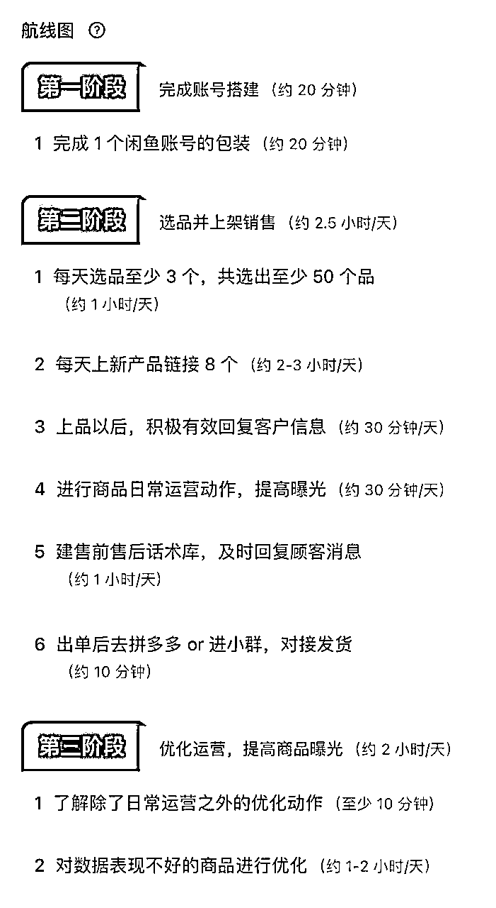

航线图和手册的关联度很高。你现在处在哪个环节，就对应去学哪块内容。

上面这些航线图动作，建议尽量在航海前两周内完成。全部跑完之后，重心要转回实践：多选品、多上架、多运营，把出单的概率撑起来。

# 必修篇：跑通最小 MVP

# 💡 章节概要

这一章，我们会从认识闲鱼平台开始，一步步陪你走完闲鱼蓝海带货的全部流程。按本章的节奏来，就能跑通闲鱼蓝海带货的最小 MVP。

如果你是新手，建议实操之前先看项目全貌：  
✅【项目概述】了解闲鱼蓝海项目

如果整体情况你已经心里有数，直接按核心步骤往下走：  
✅【实操1/3】完成项目准备工作  
✅【实操2/3】选品&上架运营  
✅【实操3/3】商品销售和发货

在必修篇里，航线图和手册的顺序是一一对应的。跟着手册顺序走，就能把航线图上的任务逐项消灭。

后续每一个关键步骤的章节概要里，我们也会标出对应航线图，提醒你别漏了实操。

准备就绪，那就正式开始。

# 一、【项目概述】把闲鱼蓝海项目看清楚 @凌心 @陈不胖

# 💡 章节概要

本章，我们一起来认识闲鱼蓝海项目。

闲鱼现在发展得怎么样？平台有哪些特点？新手想入门闲鱼电商，该从哪儿下手？为什么要在闲鱼上做蓝海高客单？……这些问题，都会在接下来的内容里给出答案。

这次航海的核心，是带你从 0 到 1 跑通闲鱼蓝海项目。既然要跑通，先搞懂项目概况就是必修课。来，一起看看。

# 1.1 认识闲鱼平台

# 1.1.1 闲鱼的市场趋势

疫情过后，经济压力变大，消费降级的趋势很明显。大家的心态是：能少花钱就少花钱，能不花钱就不花钱。这种心态，正好推动二手市场往前走了一大步。

2023 年 11 月，1688 和闲鱼一起升为淘天集团的一级业务。目前闲鱼用户规模已经突破 5 亿。闲鱼的🛰️小程序也支持买家直接🛰️支付，官方还在继续探索更多支付方式。

用户基数 5 亿以上，二手电商全面起势。所以 2024 年的闲鱼电商，依然充满想象空间。

# 1.1.2 各电商平台放在一起比一比

闲鱼本身就是电商平台。和主流电商平台做对比，闲鱼的优势很明确：操作更简单、不用刷单、竞争也没那么卷，还不需要保证金。下面这张对比表，可以帮你更直观地理解各家平台的差异：

闲鱼 VS 其他电商主流电商对比图：

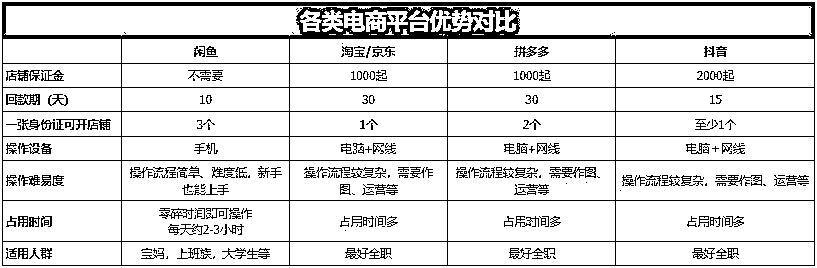

# 1.2 闲鱼高排名、高曝光的底层逻辑

不管是闲鱼、📕还是抖音，背后都是机器算法在分发内容。想在平台上拿到好结果，就要顺着平台的算法规则来。按照规则操作，系统会给你推流和曝光，反馈自然不错；反过来，推流和曝光就会很有限。

做平台允许的事，做平台喜欢的事。把产品的曝光、点击、转化各个环节做好，店铺权重拉升，闲鱼上的排名和曝光自然差不了。

流量＝一个个用户汇成的一片海。  
内容＝我们跟用户对话的桥梁。

现在几乎所有公域平台都靠系统推送流量，人工分配流量的时代基本结束了。

系统凭什么给你流量？就看数据。系统用赛马机制来评判数据的好坏。数据越漂亮，流量越倾斜。

那数据从哪来？从内容来。主图做得好，“浏览”数据就高；文案和配图到位，“想要”数据就高；话术真诚，“下单”数据就高。

所以，与其每天盯着流量焦虑，不如沉下心打磨内容，也就是商品链接里的图片和文案。内容吸引来的，是有真实需求的客户；客户产生真实数据，流量自然会水涨船高。

落到日常操作上：

- 上架用户真正需要的产品  
- 按照平台用户的使用习惯去编辑和上传产品  
- 用户的咨询，第一时间回复  
- 订单来了，及时处理  
- 保证产品质量，让好评持续累积  
- 售后第一时间响应，并尽量减少售后

# 1.3 为什么偏要做蓝海高客单？

闲鱼赛道已经挤进来很多人。作为新人，如果还在红海里面打价格战，想拿到正反馈很难。

所以这次航海，我们重点钻研【蓝海选品＋内容打磨】：用选品策略找到蓝海市场、把利润握在手里；用内容优化去占领蓝海市场的大部分份额。

为什么偏偏选高客单？

卖低客单产品，出单确实容易，但利润薄，买家也容易计较，售后跟着变多。一单赚个三五块钱，哪怕一天出一百单，利润也就三五百。人还得一直守在手机前：回复消息、下单、传单号，时间被切割得稀碎。把闲鱼当副业的人，这样耗下去并不划算。

再看高客单产品：出单频率会低一些，但每单的利润非常可观。一单赚三位数、四位数，甚至五位数都可能。折算成时间成本，性价比高多了。就算一天只出 1 单，三位数利润落袋，这对副业玩家来说已经相当不错。

# 1.4 为什么建议做垂直店铺？

垂直店铺最大的价值，在于它能把店铺里其他商品的数据一起带动起来，让流量在店铺内部完成循环，实现多次复用。

平台的流量分配逻辑是赛马机制，核心指标就是数据。你的数据好，系统就推你进更大的流量池。垂直店铺的厉害之处，是让店铺里的其他链接也能共享数据红利，一起跑赢同行。

举一个例子：

户外场景里，桌子和椅子经常是搭着卖的。桌子的链接爆了，里面一定会有部分买家顺带要看椅子，椅子的数据就会被带起来。

这时候从数据上看椅子的链接：平台没有给它额外流量，但数据自己涨了。平台拿椅子的数据去参与赛马，椅子链接跑赢同行的概率就非常大，紧接着椅子也可能爆。

等椅子的链接爆了，买椅子的客户里又会有人需要桌子，桌子的数据被反向喂一口。相当于桌子的流量生命周期被延长了。

这里需要特别说明：垂直店铺不是垂直产品，也不是垂直材料，而是垂直“场景”。只有处在同一个场景里，流量才可能发生二次转、三次转。

怎么判断产品属于什么场景？可以去看其他电商平台的商品标题，判断这个产品有哪些使用场景；再顺着场景往下想，里面还可能牵扯出哪些产品。核心原则是：一家店，专心吃透一个场景，让客户尽量一次买齐。

# 二、【实操1/3】完成项目准备工作 @凌心

# 💡 章节概要

项目总体情况了解完了，接下来就要真正动手。闲鱼卖货的第一步，是把账号准备好。

闲鱼电商一般不涉及资质类目，所以前期筹备比较简单，主要就是以下几件事：

✅ 一部手机  
✅ 一个正常使用的淘宝/支付宝账号  
✅ 下载闲鱼 APP、拼多多  
✅ 完成闲鱼 APP 的权限设置  
✅ 完成闲鱼账号注册与资料完善

账号搭建好以后，可以多逛逛同行的店铺，摸摸各个高客单赛道的情况。

# 💡 本章航线图

学完并实操作完本章内容，就能完成航线图第一阶段：账号搭建（约 20 分钟）

1. 完成 1 个闲鱼账号的包装（约 20 分钟）

筹备任务不复杂，现在就可以动手。

# 2.1 基本软件/工具准备

1. 需要的设备：一部手机（坚持一机一卡一号）  
2. 需要下载的软件：闲鱼 APP、拼多多  
3. 一个正常使用的淘宝或支付宝账号，用来注册闲鱼店铺

# 2.2 闲鱼 APP 的权限设置

下面以安卓手机举例，苹果手机按照系统提示操作即可。

1. 开放“关注、粉丝列表”查看权限  
打开闲鱼 APP，点右下角“我的”，再点右上角“设置”，往下拉找到“隐私设置”。这个选项建议拉成灰色，把自己的客户资源保护起来。

2. 设置动态可见范围  
还是在隐私设置里，建议选择“不可见”。这样顾客看不到你的上货动态和销售状态，也能避免同行来研究你的爆款。

3. 打开闲鱼消息通知  
这一点非常重要，务必开启。前期消息要及时回复，错过一条可能就错过一单。  
路径：我的 → 设置 → 消息通知 → 打开闲鱼消息通知

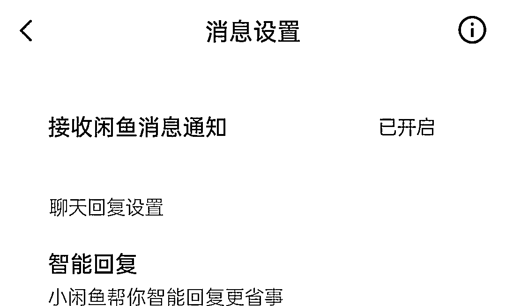

4. 在手机设置里给闲鱼开专属通知  
路径：手机设置 → 通知与状态栏 → 应用通知设置 → 找到闲鱼 → 打开允许通知 → 在消息通知里设置闲鱼的专属铃声，以及其他重要项，比如“免打扰时允许通知提醒”等。

# 2.3 闲鱼账号信息完善

路径：我的 → 设置 → 个人资料

信息完整度尽量做到百分之八九十以上，能填的项都建议填上。具体这样做：

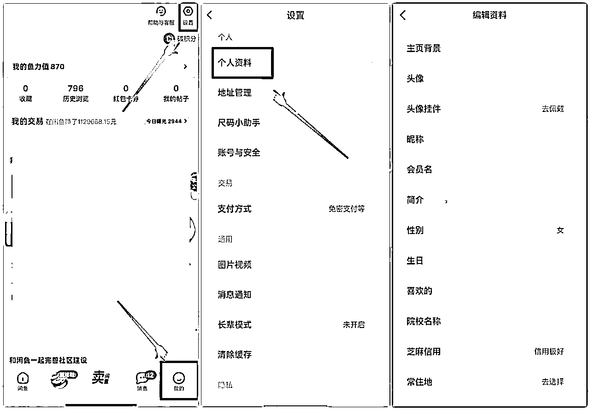

1. 主页背景  
杂货铺对背景图没有硬性要求，可以不改，也可以换成一句自己喜欢的正能量的话。

2. 头像  
优先考虑女性头像。测试下来，女性头像更容易获得信任，也更容易出单。

3. 昵称  
可以用女性化的名字，也可以按照店铺属性来起，比如“某某小铺”“某某厂家”，没有统一标准。  
注意：如果你还没定下要做哪个垂直赛道，昵称先别急着改——闲鱼昵称 30 天内只能修改一次。

4. 简介  
简介可以写自己的经营理念，也可以写店铺介绍。示例：  
厂家直营：专卖各类商用配套设备，包括平冷操作台、饮料柜、鲜花柜、麻辣烫柜等，有需要直接咨询店主；  
主营工厂门店清仓特价促销产品，品质放心有保障；  
诚信经营，芝麻信用极好，放心购买；  
认识就是缘分，也希望能成为朋友，坦诚相待，用心服务和经营，欢迎前来咨询下单！  
……可以根据自己的情况自由发挥。

# 三、【实操2/3】选品&上架运营 @千城 @陈不胖

# 3.1 如何快速选品

# 💡 章节概要

账号搞定之后，就进入上架环节了。怎么选出好卖的商品？

这里从 2 个维度来说：

一、蓝海选品思路  
对新手而言，在红海里拼价格，赚不到钱还白费力气，不如把时间花在蓝海选品上。本章会分享 3 个方法：蓝海选品参考标准、异常值、闲鱼榜单，帮你把选品能力提上来。

二、高客单选品方法  
高客单选品其实没那么高深。最常用的办法就是：把自己当成买二手商品的用户，想一想自己会搜什么关键词；或者平时看到什么高客单的东西，立刻掏出闲鱼验证一下。把选品融入生活，养成选品的习惯。  
具体怎么在闲鱼上验证一个品，本章给出了 5 个判断维度：  
应季  
卡价格  
想要数  
同行动态  
多家情况  

选品时还要注意：不碰违禁商品，避免封号；高客单的售后很容易出问题，货源质量必须严格把关。

# 💡 本章航线图

完成 3.1 的学习和实操，即可完成航线图第二阶段：选品并上架销售（约 4 天）

1. 每天选品至少 3 个，累计选出至少 50 个品（约 1 小时/天）  

接下来，就开始挑选你要上架的高客单商品。

# 3.1.1 蓝海选品思路

# 3.1.1.1 蓝海选品的 3 个参考标准

1. 这个产品最高的“想要数”  
买家点“想要”，说明他至少动了想看看价格的念头，这类客户意愿比较强。所以看“想要数”，基本就能估算出这个产品市场有多大。

2. 最近一周内还有留言的爆款链接，说明内容还没被做透，有机会  
市场一直在竞争，链接内容也在被不断迭代，用户的偏好是会变化的。  
有些爆款数据很好看，但可能是很久以前的爆款，放到当下的市场已经不太适用。最直观的特征是：它最新的留言，停留在一个月前甚至更久。  
所以，我们要重点看这个爆款链接【一周内有没有留言】，来判断它最近是否还在推流；然后再看这个链接还有没有优化空间。内容质量决定流量高度，你觉得还有优化空间，那就意味着机会还在；你觉得已经做到顶了，那这个机会对你就等于零。

3. 链接的标价，是否已经低于卖价的 50%？  
点击是一切开端的起点，决定买家点不点进来的，是点击四要素。同行之间通常先卷主图，再卷价格，最后才会卷标价。当标价已经低于实际卖价的 50% 时，说明这个品类的竞争已经非常惨烈。  
是蓝海还是红海，把上面几个问题对照一下，答案就有了。

# 3.1.1.2 用异常值来选品

面对红海的激烈竞争，硬碰硬不如绕道走，最好的方式是大差异化竞争。只要是成功的差异化，数据表现一定会偏高，呈现出来就是“异常值”。

所以：同一个产品出现异常值，说明它是一个成功的差异化案例；不同产品出现异常值，说明这个方向的市场需求很旺。

不同产品示例：

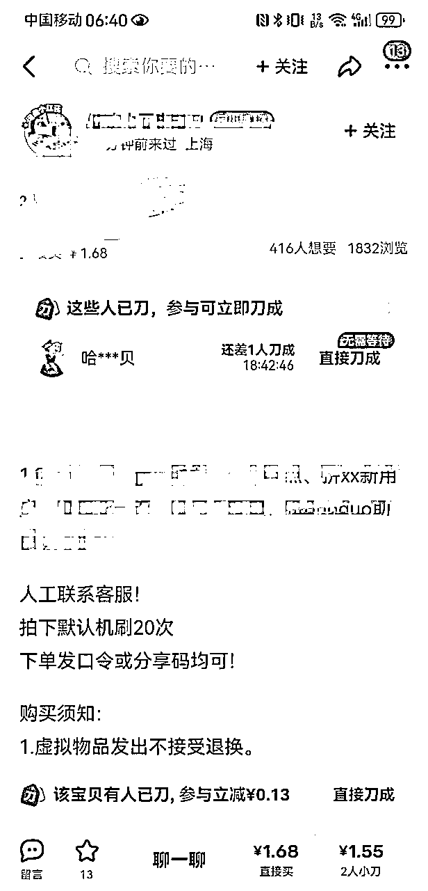

做实体产品的，一般比较不错的链接，浏览和想要的转化大概在 10% 左右，也就是 10 个浏览，能换 1 个想要。

但像拼多多的砍一刀，浏览到想要的转化率可以去到 20% 以上，说明它的市场需求明显更旺盛。

同类产品示例：

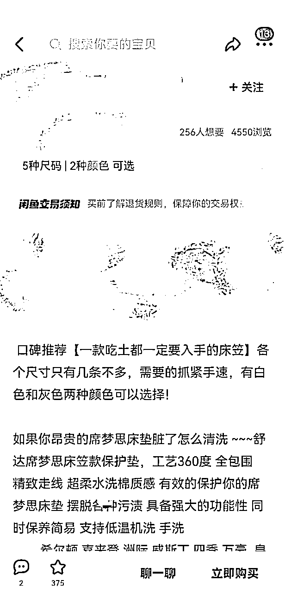

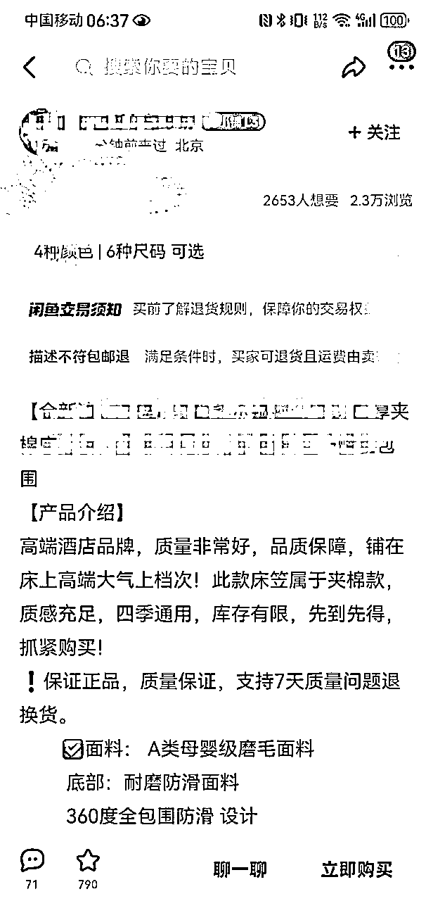

这种明显高于同类产品基准线的数据，就是异常值。找到异常值之后，一定要从多个维度去拆解。  
从主图、标题、营销词、文案、配图等角度，分析出异常值究竟是怎么来的，然后试着把这套打法移植到自己的实物产品上。

如果说成功有捷径，那大概率是异常值。

异常值背后藏着巨大机会，原因无非两条：

1、从数据维度看，异常值意味着这个案例已经被市场和用户认可过了，是验证过的成功样本。  
2、从时间维度看，它是刚出炉的新机会。任何差异化都会被同行疯狂模仿，一旦被抄成常态，数据上就不会再出现异常值。所以每一次异常值，都是最新鲜的机会。

抢不到头啖汤也没关系，做个稳当的第二波跟进者，一样有肉吃，还能少踩坑。

# 3.1.1.3 读懂闲鱼排行榜

榜单里那些卖家，往往只深耕一个细分方向，而且做得相当出色，几乎把这个方向里的大多数商品都铺齐了。你刚定下赛道、还没想好进哪些货时，多翻翻这些榜，能很快在脑子里搭起这个赛道的品类地图。

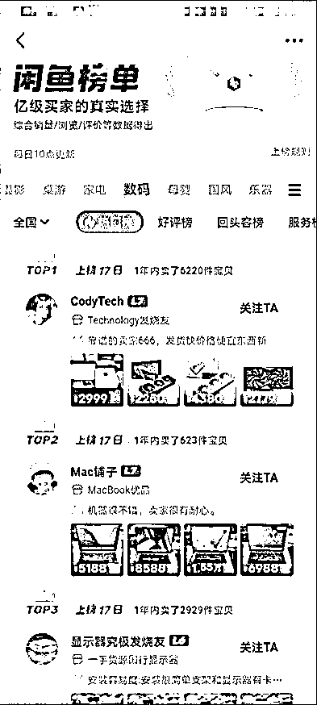

缺货排行和新人排行也值得一看。闲鱼如今的商品排序规则，已经会把缺货榜里的货一并算进去；而新人榜里藏着不少竞争偏弱的款，属于蓝海集中地，新店拿来起步很合适。

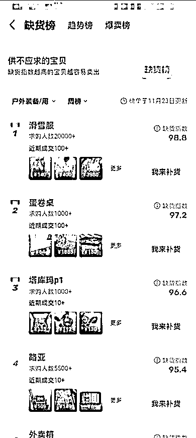

# 3.1.1 蓝海高价位商品怎么挑

这轮闲鱼活动主推的是客单价偏高的商品，所以重点讲讲这类怎么挑。思路跟普通挑货差不太多，只有两处微调：

1. 先把价格区间框住，单价过低（例如不到一百元）的直接跳过；
2. 判断某个款值不值得跟时，同行日成交件数、点了“想要”的人数等门槛可以放宽，毕竟高价位商品天然走量就比低价款少。

挑货时先换位成买家：设想自己会搜什么词、留意什么货。平时刷到单价偏高的东西，顺手掏手机用闲鱼查一查，把挑货练成日常习惯。

接着拿平台呈现的信息来验证，决定要不要挂出去。闲鱼没有淘宝那种生意参谋，也没有📕、抖音的蝉妈妈一类分析工具，所以只能依据平台展示的信息来推断。常看的维度有这几项：是否当季、价格区间、点了“想要”的人数、对手近况、多家对照。

先聊聊什么样的候选算靠谱：

# 3.1.1.1 是否当季

这是头一个要过的关：先站在大盘上看，这款货眼下的需求对不对节令。像露营车，年初到盛夏都吃香，一入秋冬季走量就往下掉；反过来，大夏天推电热毯、暖风机，或者寒冬卖落地扇、吊扇、空调扇，显然不合拍。当然，电脑显示屏、货架之类一年四季都走得动的不在此列。

# 3.1.1.2 框住价格

既然锁定的是高价位，价格这道筛子就不能省。露营车、空调扇这类一眼便能看出是大件的除外，还得从跑量的商品里把高价位的规格挑出来。搜索时点开“筛选”，找到“价格”一栏，填上你认为合适的下限，再看结果。拿手机壳来说，通常几元到几十元不等，把价格抬上去一筛，就能筛出若干单价偏高的具体规格。

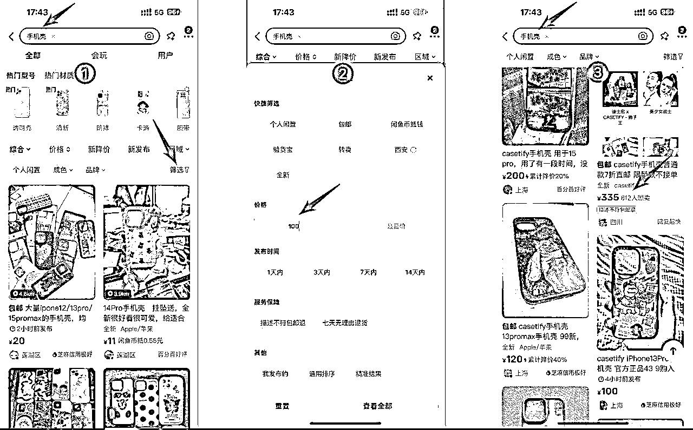

筛完再配合是否当季、点了“想要”的人数、对手近况、多家对照一起评估。

# 3.1.1.2 “想要”人数怎么看

这个数字体现市场热度——有多少人主动咨询过。数值越高，代表需求旺盛。但单看它还不够，得配合下面两条一起判断。另外补一句：有些商品页面不直接露这个数字，可能和主图好看、平台提示或闲鱼币抵扣有关，因而被藏起来了，点进详情就能看到。

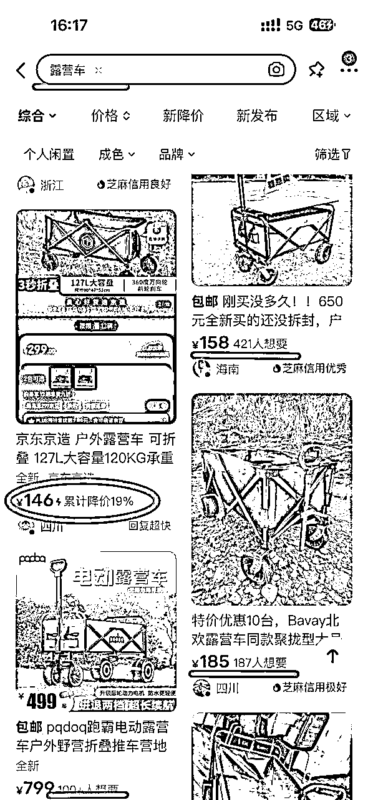

每十个浏览者里至少有一个点了“想要”

进详情页后，若“想要”人数与浏览量的比值达到或接近 1:10，说明需求相对旺盛，可发挥的余地也更大。换算一下，十个人来看就有一个开口问，其中还可能有人真掏钱。

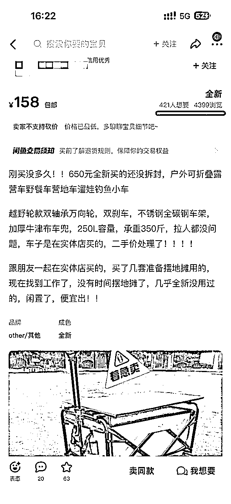

这时一定要配合它的动态成交记录。若这段时间走货顺，这款属于蓝海的可能就大。再叠加多家对照——少量满足、比例达标、成交动态也稳，基本就能锁定成蓝海货，优先安排。

# 3.1.1.3 摸清同行的出货节奏

同行的出货节奏看的是近期转手频率，也就是成交表现。最近卖得越频，参考价值越大。

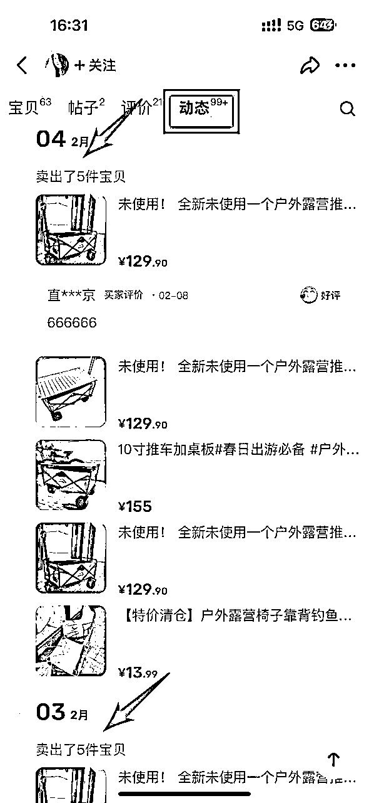

同行日成交三件起步

判断市场行不行，通常对手能连着两三天做到每天三件以上，就算及格，当然越多越好。但还要过下一关——多家对照。若起码有两三家同样做到每日三件以上，这款就值得选。若一天连两件都卖不动，翻几家都是这光景，基本就甭考虑了。

对手把动态藏起来怎么办？

有些店“想要”人数挺高，动态却设成隐藏状态，这时可以借店铺露出的其他信息补判，按顺序来：

1）鱼小铺评级到 L3 或更高：这个等级靠买家好评累积而来，通常说明这段日子出货不少、口碑也过得去，可作第一项参考。没开鱼小铺、但余下几项表现不差的，同样值得放进备选。

2）页面下方留言的最新日期：能反映近期咨询热度。七天里新冒出至少两条留言，说明近期还行。

3）回复比例高于九成：回复越勤，一般说明店铺运转越健康，值得投入精力。低于八成则直接略过。

4）已售出的件数：自然多多益善。若数字停在个位、翻同行也是这般，说明这款大概没什么市场。不过也保不齐新链接一挂就爆单，这时需要综合着判断。

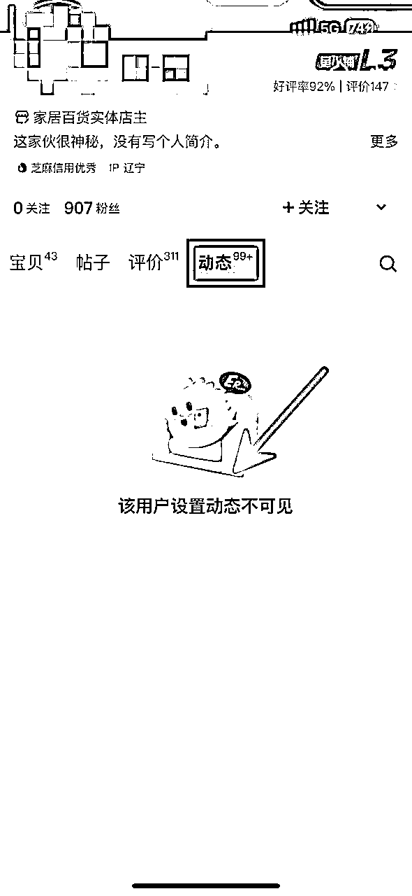

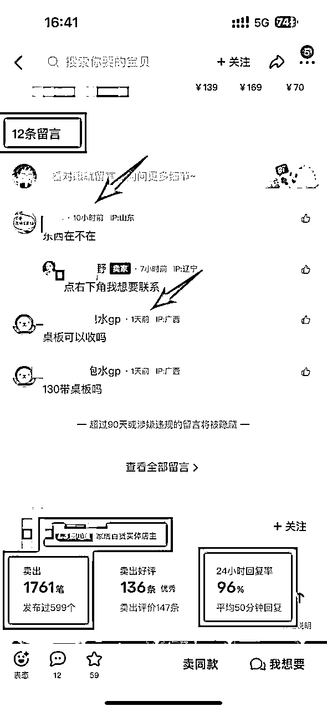

# 3.1.1.4 多家对照

只看一家容易碰上偶然，于是把前文那些标准组合起来，横向比对几家：看它们的“想要”人数都不差、成交动态也稳。

两三家对手日销都在三件以上

只要有两三家符合前文说的那条标准——两三家每天都能成交三件以上，这个款就可以选。

上面聊的，就是挑选闲鱼高价位商品的思路。思路说完，怎么判断一件货值不值得上，大家心里基本有谱了。

# 3.1.2 闲鱼高价位热门类目推荐

闲鱼平台能做的高价位方向不少，这里整理了一份目前相对好上手的类目。刚入局的话，可以从这些方向切进去。具体挑什么货，仍要依照前文标准来筛。

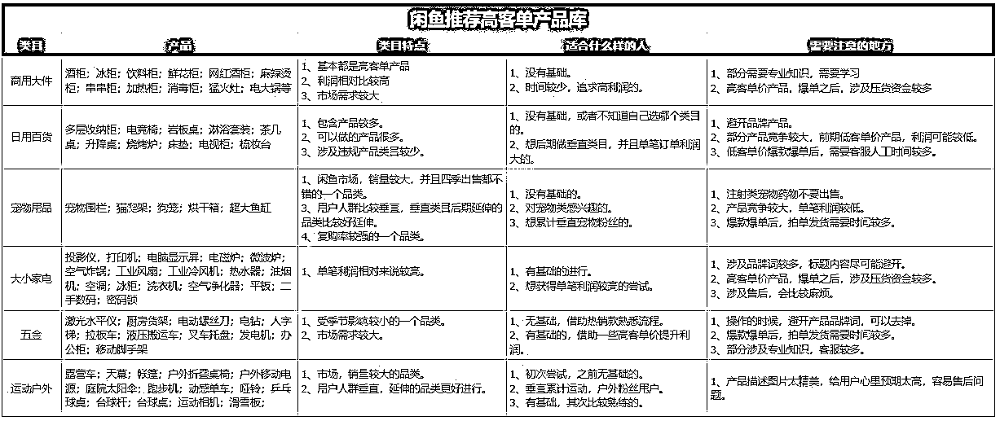

# 3.1.3 挑货时别碰的违规品类

学会快速挑货法后先别急着动手，先记牢几类常见违规品，免得实操时账号被罚甚至封掉：虚拟商品类——会员、卡券、课程讲义这些（其中一部分能按平台规定来做，具体看附录）；带牌子的货品——完美日记、古驰之类的品牌；食品类——各种加工零食（像花生、大蒜、柿子、水果这类没经过加工的农产品，不算在内）。完整名单放在附录里：千城《闲鱼社区信息发布规范详情》。

# 3.2 怎样把商品挂上闲鱼

# 💡

# 章节概要

高价位的上架手法跟普通品类一致。上架前，先到拼多多把供货方定下来，确保一有订单就能发货，同时也能借商家的标题与图片，再顺着闲鱼平台的特点优化。上架环节，核心只有一条：让有需求的买家都能逛到咱店，最后完成付款。

那怎么让挂出去的商品获得更高的曝光量，买家更容易刷到，也更愿意下单？重点落在编辑上架这一环。最要紧的四项是：标题、主图、介绍文案、定价。此外还收了些编辑上的小窍门和注意事项，帮你少踩坑。这些模块分别怎么带来流量？继续往下看。

# 💡

# 本章行程图

学完本章并动手做完，就能走完这份行程图的第二关：选品并上架销售（每天约四小时）。

1. 每天挂出新链接八个（约两三个小时一天）
2. 挂完之后多回复买家消息（每天再花半小时回消息）

现在就把挑好的商品编辑上架吧。

# 3.2.1 先到拼多多锁定供货方

挂商品之前，建议先去拼多多找到目标货源，确保一有订单就能发货，同时也能借商家的标题、图片用于上架。（拼多多最常用也方便，淘特、1688流程一样）

怎么判断商家靠不靠谱？看四点：

1. 销量——过千即可（部分新店几十、几百也行）
2. 好评——看最近评价，十条中有七条以上夸好，就挺好了
3. 赚头——起初有赚头就能选；等流程熟了、日销稳定六单以上，再看利润率两成及以上的商家
4. 商家挂着的商品个数——少于一百个（正规商家往往就几个或几十个）；成千上万的很可能是别处搞无货源代发的

怎样麻利地在拼多多挖到低价好货？推荐两条最直白的路径：

方法一：借搜索框，用图片找货源
方法二：看平台的推荐，顺藤摸瓜

以“滚轴”为例，看看我如何在拼多多挖到好货源（原理相通）：

# 3.2.1.1 借搜索框，用图片找货源

第一步：照 3.3.1 的高价位挑货思路，去闲鱼筛出“滚轴”里成交动态活跃的商品，点进链接，把主图存下来。

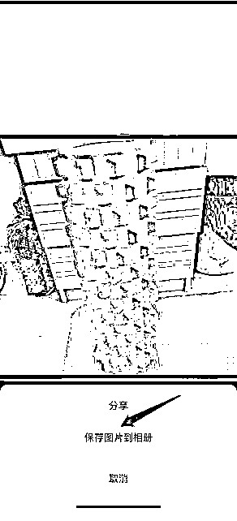

第二步：进入拼多多，点击界面右上方的相机图标，选取刚存的图片。

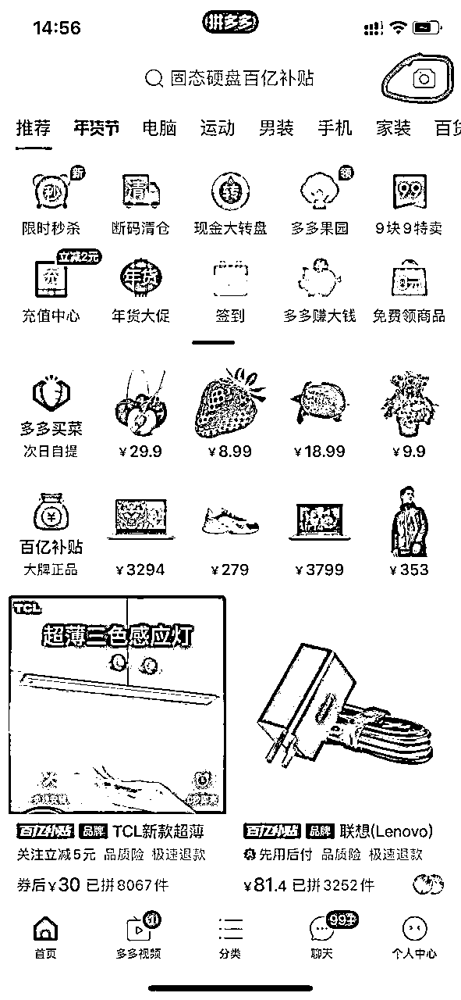

第三步：在结果页按销量排序，挑销量靠前的几家店（万一系统认出的不是你要的款，就按截图里的类型标签筛一下，或回第一步换一张图再来）。

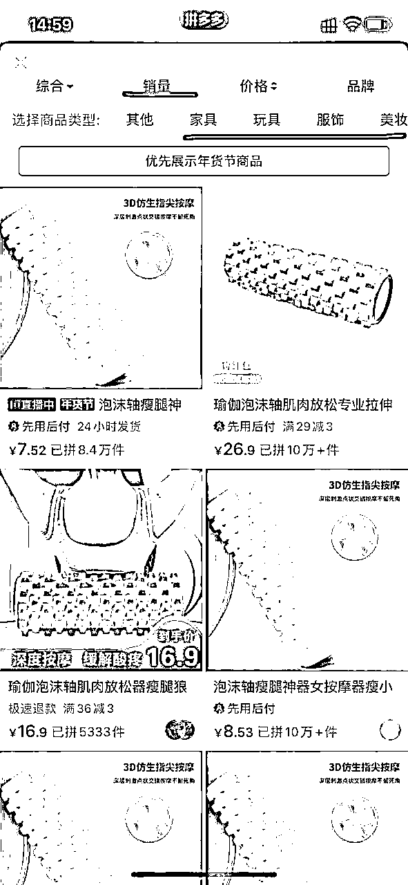

第四步：回到刚才那个闲鱼店铺，把这家店各档规格滚轴的卖价，与拼多多同款做对比。

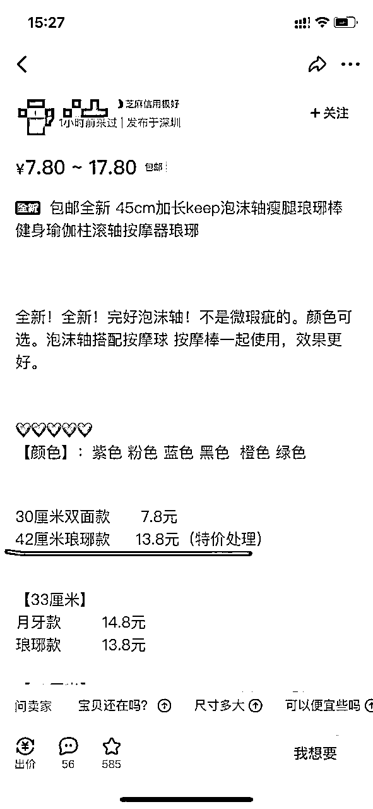

第五步：只要拼多多那边价格更低，就能当候选供货方。多看几家后，照前文列的那套标准筛，就能定下合适的。

# 3.2.1.2 看平台的推荐，顺藤摸瓜

第一步：流程相同，先以图搜货，但这次多借平台的算法——在结果页底部找到“相似商品”“猜你喜欢”（各平台名字不一样，意思相同），都是与你刚搜的东西强关联的相似款。

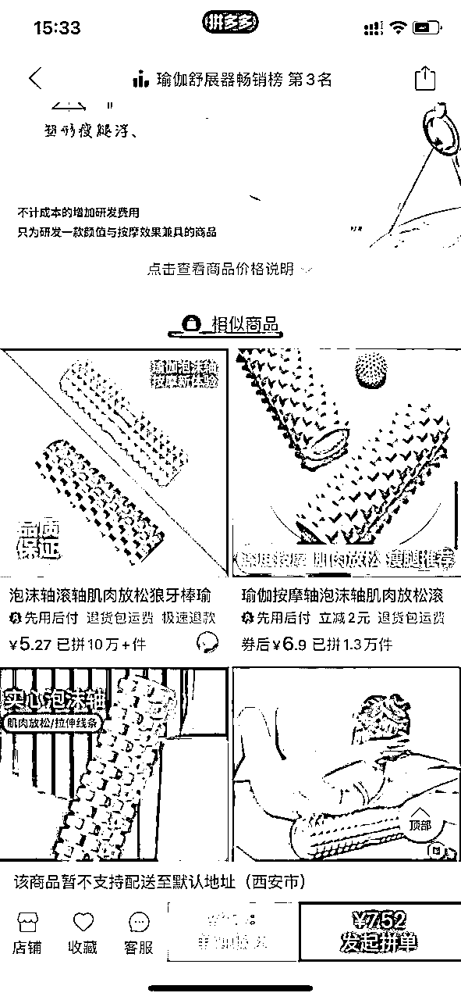

第二步：逐一查看这些推荐品的规格与价格，看是否达到前文那套选货标准，反复这个动作，直到筛出合适的货源。

找货的路子就这些，操作简单、找起来也快，换成淘特、1688这些平台也通用。

# 3.2.1.3 价格上的几个提醒

不论以图搜还是顺着推荐找，对照前面那套选货标准，最终都会圈出一批候选。初步定下来后，价格上有两处得格外留心：

1. 比行情价便宜的那类商家，起码备两家，免得某一家突然涨价就手忙脚乱。
2. 若平台上同行挂的规格很多，对应的货源难寻，怎么办？

对手规格一多，就只盯它最基础那档的最便宜标价，保证咱的进价能压过平台上卖得最火的那家即可。其余档位，单个商品挂三到五个就行，价格和平台行情持平或略有浮动都行。

例如这款滚轴：

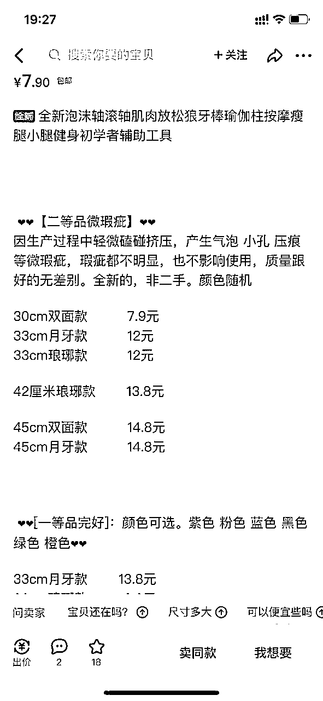

如上，行情里最基础那档标 7.9，我们把最基础那档定在 6.8；剩下的档位挑三到五个挂上就行，用户挑起来方便，也更容易促成成交。具体规格与定价如下：

30厘米双面款 6.8元

33厘米月牙款 14.8元

45厘米月牙款 18.6元

在拼多多挑供货方，是个逐步筛选的过程。某个款出了单之后，可以分散在若干个店铺下单，每家只下一单（别总在同一家），这样方便比较售后服务和物流表现，再敲定一家信得过的作为主力下单店铺，等单量起来还能谈长期协作。

# 3.2.2 编辑并挂出商品

# 3.2.2.1 上架时抓住这几点，出单更快

编辑上架，核心只有一条：让有需求的买家都能走进咱的店，最后完成付款。说白了，就是让商品多露脸，买家更容易刷到并下单。

上架这一步很关键，重中之重有三样：

标题：借用拼多多或淘宝商品的标题，但务必调整词语顺序，三十个字，版面占到一行半那么长。
主图：选 1:1 或 3:4 比例的真实拍摄图，照片可以从买家秀里翻找，拼多多和淘宝都行。
内容：把转卖缘由、产品卖点、价格、发货安排和售后补充完整即可。

另外，照单款的规范来，标题做调整、主图换一换、多挂几条链接，提升单款的露脸概率，争取更多流量（单款挂四条上下的链接就行）。

# 3.2.2.2 一张好主图从哪来

好主图得让闲鱼买家第一秒就被吸住，特点无非两点：画面清爽、背景干净，能把卖点亮出来，让人一眼知道你在卖什么。

假如做二手手机，商品照片直接翻产品相册拿，每条链接放八九张。要先装好微商相册 APP，然后扫码查看。二手手机各台成色不一，照片得把外观的细节拍清楚，比如划痕、碰伤、透图之类。头一张主图通常选屏幕点亮、进入系统后呈现的主页面。

怎样的主图算好？拿“商用冰柜”举例，排头几位的商品主图，通常产品居中、款式和细节都突出，让人忍不住点进去。而“想要”人数偏少的主图，往往模糊，观感差，两边一对比，买家自然先点上面那种。所以主图尽量照前文的要求做。内容里的其他照片，参照成交动态好的商品图即可。

好主图上哪儿找？有个低成本办法：直接去淘宝、1688、拼多多、淘特搜商品，从商品详情和买家评价里挑符合要求的。

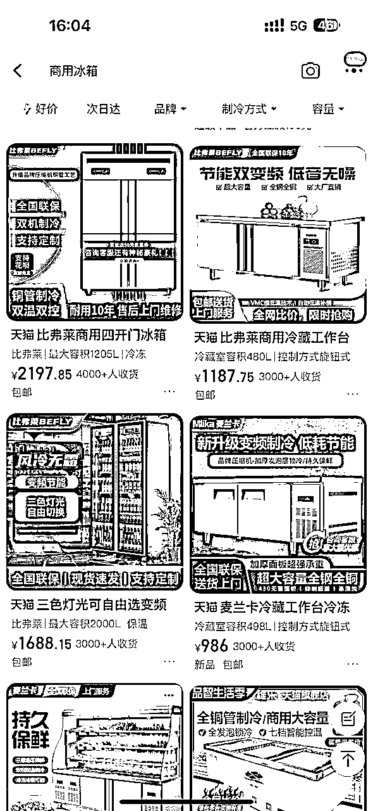

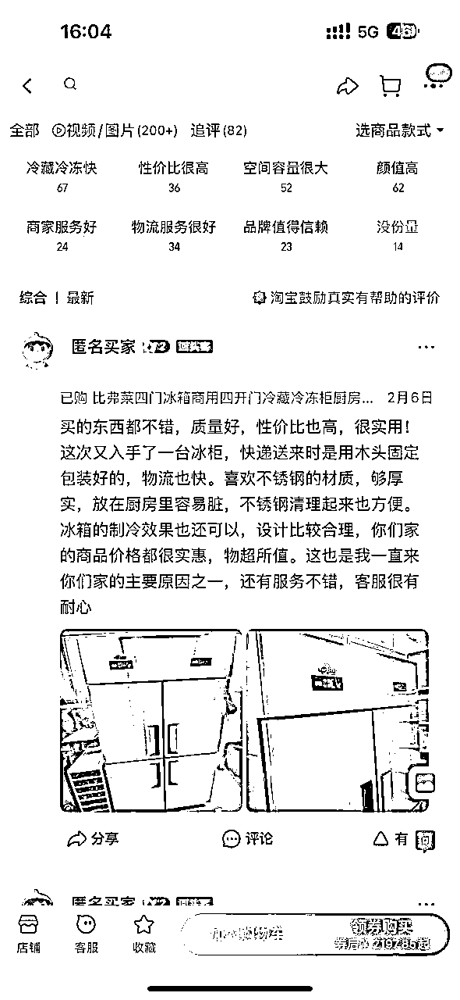

这当然只是最基础的做法，当一个闲鱼小卖家，够用了。若想做出自己的特色，能拿原图做二次加工，例如做点特效、拼图，用市面上普通的修图工具就能搞定，这篇就不细说了。

# 3.2.2.3 一条好标题从哪来

好标题通常靠大量关键词堆出来，让买家不管搜哪个叫法，都能刷到你的店。

比如“商用冰箱”，有时也喊冰柜、冷藏冰柜、卧式冰柜，把这些词，加上买家可能搜的“厂家直发”“厨房自用”“私人闲置”“商超关门”“全新未拆”等词组合到一起。标题参考：全新包邮商用冰柜冷藏冰箱厂家直发厨房商超使用卧式冰柜大容量（尽量把三十个字符占满）。

二手手机也是同理，买家最关心型号、颜色、运存、成色，把这些关键词卡进去，简明扼要。一开始找不到感觉，最省事的办法就是照着同行的标题改，把型号和配置改一改再直接用。

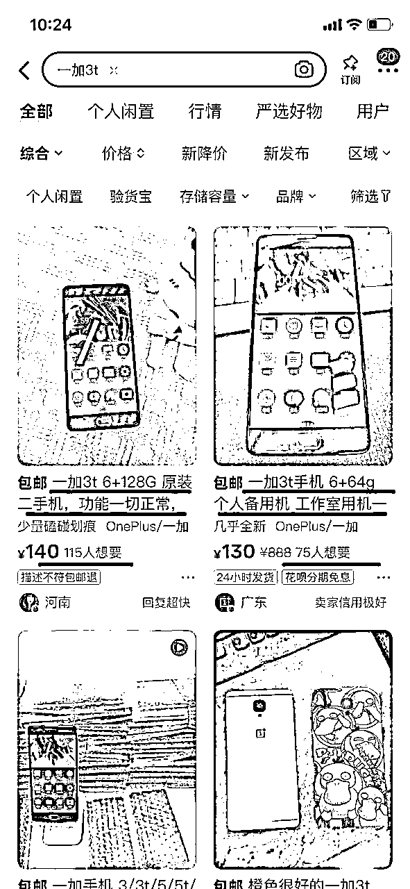

怎样又快又好地做标题？最省事的路径，是翻闲鱼平台上同类卖得火的标题，再叠加淘宝同类里卖得火的标题——卖得顺的标题，大多被反复打磨过，拿过来稍作改动，就成了自家标题。

# 3.2.2.4 一段好产品介绍该怎么写

图片怎么放前面讲过，参照成交动态好的来。这里只聊文字部分该怎么写。

一份好介绍该有哪些内容？先交代出手缘由，捎带说下这件货的长处；接着标明各档规格及对应价钱；末尾说明售后怎么处理。

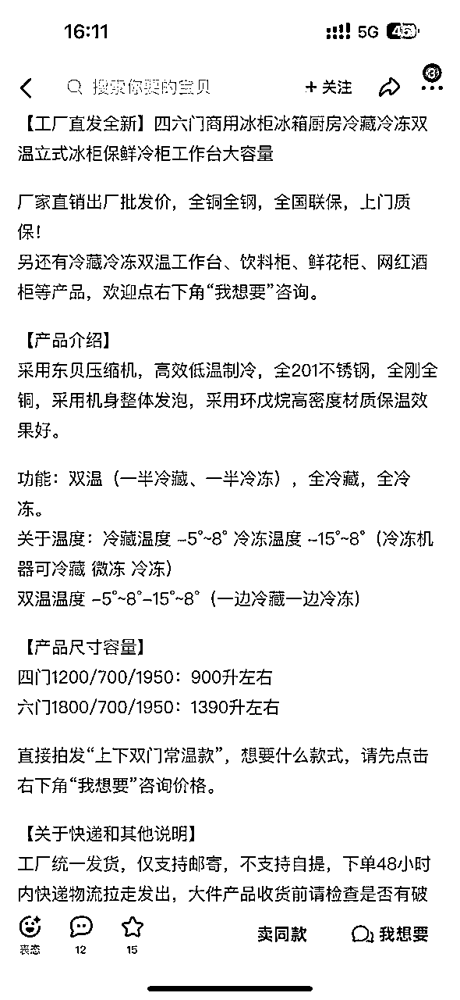

写文案有一套通用模板：

头一段：说清出手这件货的缘由，捎带提提它的长处
中间一段：写明各档规格及对应售价
末一段：交代什么时候发、走哪家快递、售后如何处理

介绍写得足够细，买家想问的都能一眼看到，客服这边自然省力，把时间省下来。同时介绍简明扼要，买家一眼扫到关键信息，决策成本降低，成交率也就跟着涨。

像下图这样即可，规格按三到五个来，别让客户选项过多，免得对方纠结到最后跑单。（确实需要多档规格的，精简一下就好）

# 3.2.2.5 怎样把商品发出去

照前文的要求备齐照片、标题、介绍，就能挂出去了。

1. 进入闲鱼首页，点屏幕中间的“卖闲置”按钮。

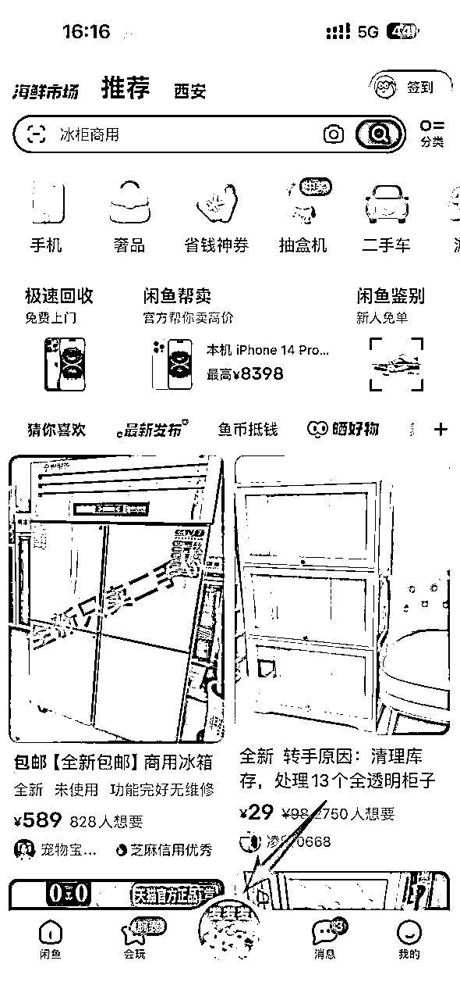

### 1. 发布入口在这里

打开页面，最底端有个“发闲置”按钮，戳它就能开张。

### 2. 图片顺序别搞反

素材先备齐，图序排好了再上传，直接影响点击率：

首图必须是实物拍摄，尺寸优先调成1:1或3:4，画面干净、主体完整；

接下来第2到第7张，把整体外观、细节特写、使用场景轮流放；

末尾两张（第8、9张）建议塞品牌资料或仓库实景，买家看到这些会更踏实。

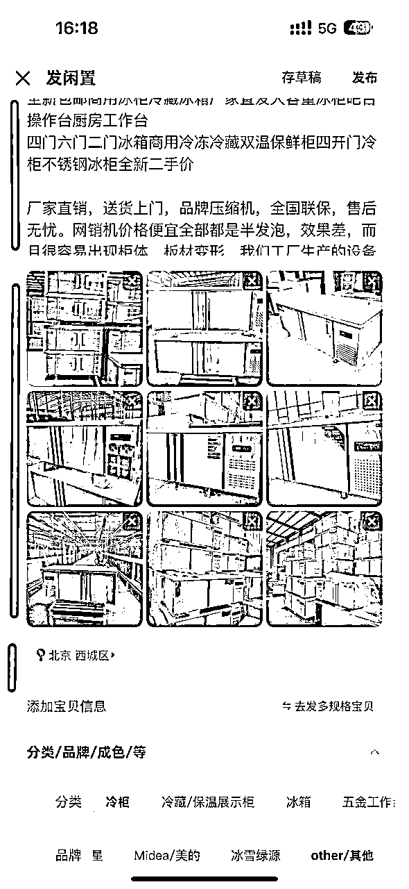

### 3. 商品信息逐项过一遍

**位置**：填你真实所在地当然行，但更推荐挑人流量大的核心城市——比如北上广深杭，小地方曝光量差一截。

**类目**：卖的啥就归到啥类目里去。

**品牌栏**：勾“其他”最省事。

**新旧程度**：照实选，多数情况选“全新”。

**标价**：挂最低配那个版本的金额就行；不同配置怎么下单，正文里得写明白；参考价可以按行情填，空着也没事（详细规则翻到3.2.1.3看）。

**邮费**：大多数直接设包邮。

**24小时发货/描述不符包邮退**：大件商品通常不开，当然也看你自己的承受能力来定。

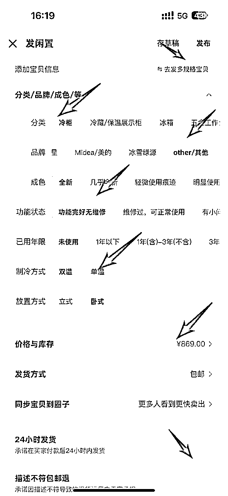

另外，如果账号里冒出“发布多规格宝贝”“价格与库存”这类按钮，那就是【鱼小铺】才有的权限。一般跑出几单之后，系统就会主动抛邀请过来。

### 4. 确认没问题，右上角“发布”走起

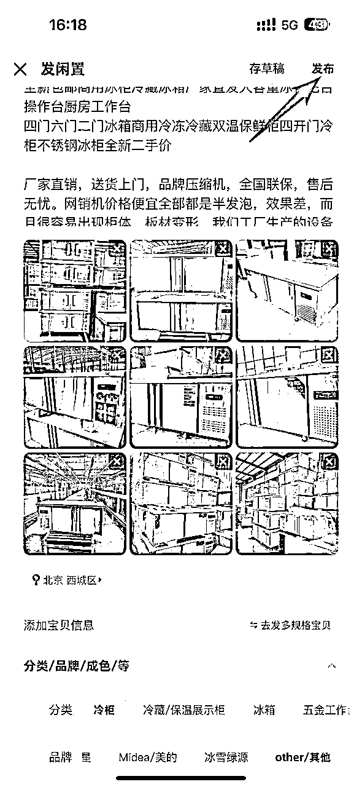

# 3.2.3 巧用编辑，出单提速

核心逻辑一句话：盯紧闲鱼上走得俏的货，把价位压出优势，稍作改动搬进自己店里。

落地步骤看这里：

先锁定市场上动销表现好的链接；

顺着去拼多多搜同款商家，把进货成本摸清楚；

留足利润空间的前提下，把入门款价格往下调；

标题首尾动一动，核心词别换；

首图裁一刀，md5值就变了（图片的专属指纹）；

详情页和其余配图能照搬，也能微调；

改完直接发布。

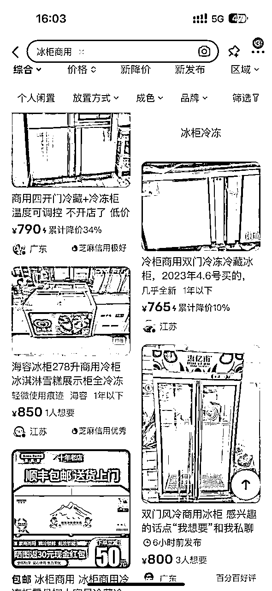

这路子操作轻、上手快，转化节奏也更利索。

# 3.2.4 上架时容易踩的坑

一、品牌名别往标题里塞，图片上也尽量避开logo。

二、标题和正文绕开“无添加”“联系”“🛰️”这类往站外引的词。

三、发布城市优先选人口密集的一线或强二线。

四、上传时间窗口：早上8点前后最优，晚上8点次之，实在不行挑中午11点半左右。

五、一天铺5条左右就够了，铺太猛容易被系统盯上当成营销号。

内容来源：闲鱼电商 | 小航海学习手册

# 3.3 链接上架后怎么养

# 💡

# 本节要点

货发出去只是开始。想让更多对口买家刷到你并掏钱，链接得持续打理——每天擦亮、消息秒回、压住售后和差评，每个环节都可能是转化率的开关。文末还整理了长期干这行的避坑心得，别错过。

# 💡

# 行动地图

学完并动手，路线图第二阶段就打通了：选品上架销售（约4小时/天）。

一、日常维护拉曝光（约30分钟/天）。

# 3.3.1 擦亮这件小事

凌晨0点干也行，起床后补也行。

入口：闲鱼“我的”→“我发布的”→左上角“一键擦亮”。

# 3.3.2 消息别晾着

买家来问，能秒回就秒回。闲鱼App和手机通知权限提前调好，具体步骤翻【章节2.2 闲鱼APP的权限设置】。

碰上答不上来的问题，跑去淘宝或别家闲鱼店找同款问一嘴，答案就有了——同行免费当你的客服顾问。

# 3.3.3 日常运营避雷清单

一、上架动作要规范：标题、正文、所在地、标签，一个都别马虎。

二、每天擦亮别偷懒。

三、咨询回复要快，起步阶段尤其关键，通知必须打开。

四、卖掉一个立刻补一个。

五、拍下5分钟没付款的，果断关单，用话术以退为进。

六、评论区、留言板及时互动，让围观买家觉得你靠谱。

七、订单处理不拖沓。

八、售后和差评要压住，质量盯紧；差评冒头就换供应商，售后纠纷尽早妥协处理。

**封号高危区**

违禁品别碰（参考【3.1.3 闲鱼选品 违禁注意品】）；

一台手机登多个号，或者频繁切号；

聊天里蹦出违禁词、同一句反复刷屏——像“转账多次”“一单一结”“皇”“🛰️”“联系”“加”“原味”这些容易忽略的雷；

纠纷堆太多，多次拒绝后买家点小二介入。

# 四、【实操3/3】卖出去和发出去 @凌心

# 💡

# 本节要点

买家来问就得接住，别让人溜了；成交后抓紧发货，等待时间越短，好评率越高。

这节聊两块：售前售后怎么回，发货怎么走——

✅客服：秒回、跟紧售后

✅发货：出单马上去货源平台下单，单号及时回填

往下看细节。

# 💡

# 行动地图

学完动手，路线图第二阶段打通：选品上架销售（约4小时/天）。

一、搭好话术库，消息秒回（约1小时/天）。

二、出单后奔拼多多或进群对接发货（约10分钟）。

# 4.1 客服话术怎么练

闲鱼上卖高客单，话术就是转化率的闸门。下面列的是高频场景和参考答法，重点揣摩思路，别死记硬背。

# 4.1.1 高客单售前应答（通用版）

买家：“在吗？”

答：在的在的，刚忙着敲键盘呢，让您久等了。您看中哪款了？

买家：“能自提不？”

答法一：老板，咱是厂家直营不是门店，不接散客哈，但售后比门店还稳。给您包邮到家，一般三天上下到，您拍下我就安排。

答法二：老板急用不？这边暂时没现货，您下单我立刻从最近的仓调，三天左右能到，需要就直接拍。

买家：“是不是全新没拆的？”

答：对，全是新货。厂里直发所以价格压得低，质量和售后都兜得住。看中了拍下，我尽快给您安排。

买家：“留个电话，电话聊。”

答：老板，您把号码发我就行。

⚠️ 闲鱼上往外丢电话或🛰️有封号风险，别主动给，让对方发过来。

买家：“你标郑州，怎么江苏发货？”

答法一：老板，咱是厂家直销，郑州老客户多、反馈好，所以发布地挂的郑州。货您放心，包邮到家，基本三天到。

答法二：老板，咱全国多仓联动，郑州这边没现货，从江苏调过来，您要的话直接拍，我给您加急。

答法三：老板，发布地是系统随机滚的，实际仓在江苏。

买家：“某某款什么价？”

答：老板，这款（一句话点出卖点+售后），报价是XX。

买家：“最低多少能拿？”

答：老板，您要多大规格、什么配置、拿几台？收货地址发我一下——先摸清需求再报价，留够利润的前提下能让一点，哪怕只拿一台也有得赚。

买家：“有淘宝店吗？别的店有吗？”

答：老板，厂里早不搞淘宝了，平台抽成太狠，羊毛出在羊身上，成本一高售价就下不来。咱主做批发走量，质量把住的同时价格有优势；闲鱼开店零成本，省下来的都让给您。用得好帮忙介绍朋友哈。

买家：“哪款更好用？”（选择困难）

答：先把TA纠结的A、B两款各自优劣摆出来，再帮TA拍板。A款选的人也不少，价格友好；追求体验就上B款，老客户反馈很稳。您看中哪款？拍下我改价，早排单早发。

（款式卖点去拼多多详情页扒，套进话术里就行）

买家：“你家比别家贵。”

答法一：老板，啥产品都有高有低。咱是厂里直发，按实体店品质做，用料扎实、质量兜底，不是网红噱头款，您放心拍。

答法二：老板，有些同行确实卷得狠，拿瑕疵品充正品卖，售后一塌糊涂，时间长了出问题您找谁去？咱是实体店直供厂家，用料和售后您放一百个心。

买家：“我再想想。”

答：老板，理解，挑东西慎重是应该的。我相信您聊这么久肯定是喜欢咱家产品的，方便说说还在犹豫哪块吗？是产品本身还是价格？

买家：“怎么拍？价格不对啊。”

答：
① 右上角戳“立即购买”
② 确认购买
③ 弹出支付密码——别输，直接退回来
④ 等我改好价，您再付。

催单：

答法一：老板，看中了就直接拍，这款走得快，您早拍我早安排。

答法二：老板眼光真准，这款是厂里销冠，经常断货，现在就剩两三台了，怕等会儿没了，您拍下我马上安排。

拍下没付款咋整？

下午发货前一两小时发一句：老板，这款还要吗？今天拍的话我好安排打包。

买家砍价怎么接？（思路参考）

一、先夸对方选的款有眼光；

二、问清楚拿几个、发哪里；

三、回：咱这是大件，物流费不便宜（或者说批发为主、单件利薄），给您包邮过去已经是薄利多销了，价格到底了；

四、再补一个好评返现+复购优惠券，金额看利润定。

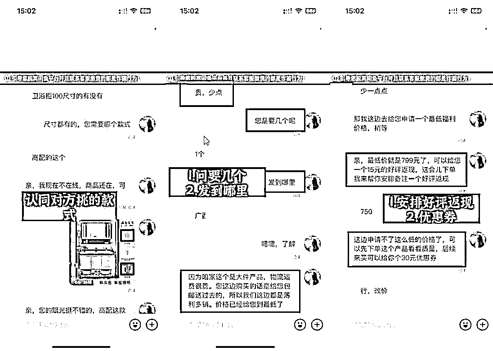

买家犹豫不决怎么推一把？（思路参考）

一、先问要哪款，顺嘴夸眼光；

二、问需求、给建议，别急着逼单；

三、需求摸清、购买信号出来了，价格环节别让TA一直纠结，可以上小赠品或者说“今天下单是福利价”。

# 4.1.2 二手机售前话术

本期航海给的二手货源是自建库存、现货直发，带售后，支持三天无理由，主板问题一年保修。

二手能做成这样售后算硬气，买家要实拍图或视频，直接找团队客服拿。机况真实、瑕疵如实说，问啥答啥。

转化率全靠话术撑。

拿小号多撩同行，把买家问你的问题原样抛给同行，慢慢磨出自己的套路。

框架参考：

买家：在吗

答：在的，要多大内存？（先锁内存，直接报价，省来回）

买家：128G

答：XX元。

能接受就往下聊，接受不了就不回了，换下一个。

买家：256G多少钱

答：要成色一般的还是好点的？成色不同价不同。

买家：好点的

答：XX元，成色不错……

买家问机况，对着产品相册里的描述如实转述，措辞委婉点。

比如：

相册写：内屏老化发黄

你回：屏幕有点泛黄，但触控一切正常，日常用没影响。（“内”字别提）

话术没定式，多和同行唠。

⚠️ 聊天里违禁词千万别碰，轻则扣分限流，重则封号。🛰️、WX等任何淘系外平台都算，谐音也不行；手机号别主动发；分身、多开、位置穿越也别用。

# 4.1.3 售后应答话术

售后比售前省心，核心就一个身份——“传声筒”：买家说啥，复制粘贴给拼多多客服就行。

几个常用场景：

**显示派送中**

答：老板您好，刚帮您查了物流，宝贝已经到您所在城市了，快递小哥近期派送，留意下信息哈。有问题找我，或者直接打快递员电话XXXX。

**显示已签收**

答：老板您好，宝贝显示签收了，还满意吗？满意的话求个好评哈，多谢多谢。

**要求验货再签**

答：亲，咱送了运损险。大件运输难免小磕碰，请见谅。有大破损别签收，留好凭据马上找我；签收后就默认完好，再出破损物流不赔了哈。

**改价（示例）**

实际价和标价对不上要改，这样引导：

① 右上角“立即购买”
② 确认购买
③ 支付密码别输，直接返回
④ 稍等，我改价。

更多售后场景翻【4.3 售后处理流程】。

以上是闲鱼最高频的问答。

还有拿不准的，两条路：

一、去淘宝或别家闲鱼店找同款问，同行就是你免费的客服导师；

二、航海群里吼一嗓子。

# 4.2 出单后的发货动作

# 4.2.1 卖出去第一件事：重新上架

宝贝卖掉后，第一动作是重新上架：闲鱼“我的”→“我发布的”→右上角“已下架宝贝”→重新发布。秒上架，流量能吃一大波。

这招适合没开鱼小铺的新手；开了鱼小铺的不用手动折腾。

**鱼小铺是啥？**

卖家运营工具，功能更全，目前系统定向邀请，出个几单基本就会收到。

开通后身份从“出闲置的个人”变成“专业卖家”，进的是鱼小铺商家池，流量竞争规则会变。不少人反馈刚开通流量反而掉了——根子还是在链接质量没磨到位。

但开了之后确实方便：

一、单品库存能加量，不用被拍完再手动补；

二、多规格直接上，成交不用手动改价，少流失客户；

三、带数据分析功能；

四、能挂500个品。

开不开、啥时候开，看自己节奏。

# 4.2.2 发货怎么走

**一、拼多多代发流程**

闲鱼带货本质就是一件代发吃差价，出单后得赶紧去货源地下单，拼多多相对顺手也好控。

步骤：

1. 闲鱼出单后，去拼多多下同款，收货地址填买家的，收货电话填你自己的。

2. 拼多多商家发货后，把单号搬回闲鱼填上。

路径：闲鱼“我的”→“我卖出的”→找到订单→“去发货”→“我已寄出”→填单号提交。

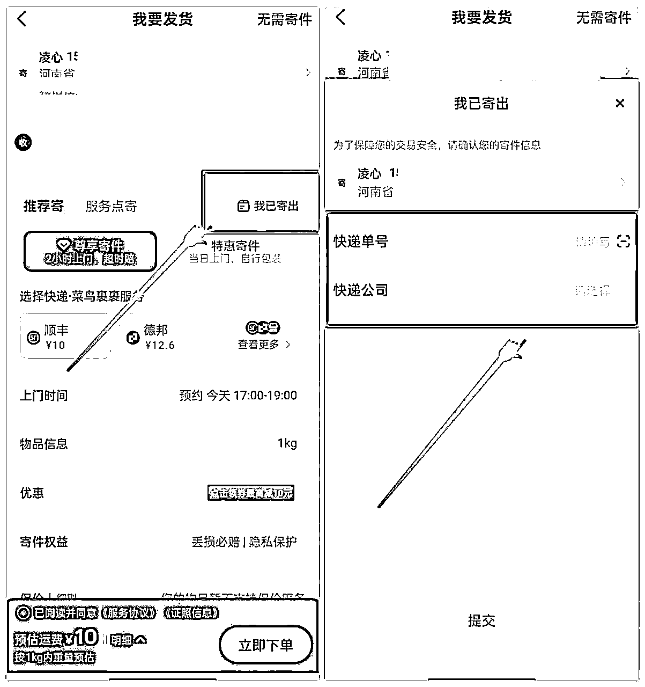

⚠️ 这里有个坑：拼多多可能给买家发短信。解法：

下单时先填自己号码付款；付完联系拼多多客服改成买家电话，短信就没了。

最稳妥是全程用自己的号，跟买家这么解释：亲，为保护您的隐私，包裹走隐私号码发货，目前查件尾号XXXX；快递到了主动把取件码发过去：您的快件已送达，取件码XX。

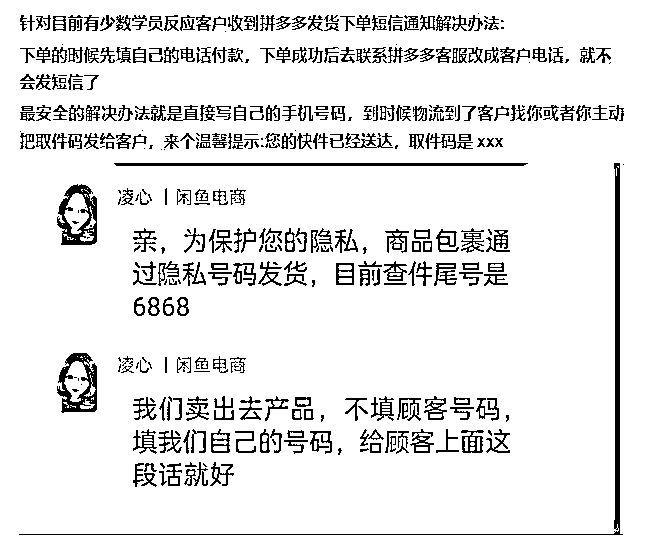

**二、二手机发货流程**

用本期航海二手货源的，直接找志愿者申请进【二手机发货群】，对接货源老师。

步骤：

1、首单出了之后，私聊志愿者进群；

2、群里@售后老师，报相册里的产品编号，确认货源；

3、确认无误后扫群公告里的收款码付款；

4、付款截图+买家收件信息发群里，@售后老师；

5、售后老师安排发货后把单号甩群里（18:00前当天发，18:00后次日发）；

6、回闲鱼填单号完成发货；

7、买家确认收货，钱到账。

⚠️ 售后问题别憋着，群里问老师，及时解决。

# 4.3 售后怎么处理

售后情况五花八门，碰上哪种处理哪种。不管哪种，定位不变——中间人，把买家的问题转给对应商家就完事。

附表格源文件：闲鱼高客单带货 | 售后问题一览表 | 3月航海

# 五、【复盘优化】曝光和出单怎么往上拉 @凌心 @老瞿

# 💡

# 本节要点

让已上架的链接吃到更多曝光、被更多对口买家刷到，这节讲两件事：

✅ 拉曝光的关键动作

✅ 复盘时该盯什么

文末照例附上项目实操心得，希望对你有用。

# 💡

# 行动地图

学完动手，路线图第三阶段打通：运营优化拉曝光（约2小时/天）。

一、搞懂日常维护之外的优化手段（至少10分钟）。

二、对数据拉胯的链接动手优化（约1—2小时/天）。

曝光不理想？开始记数据，动手调。

# 5.1 优化拉高曝光

这几招下去，曝光能往上顶一顶：

一、每天至少铺3个品，新手先把50个品的池子填满。

二、图片清晰度拉满，比例优先1:1或3:4。

三、标题打磨到位。

四、打开闲鱼币抵扣——允许买家拿闲鱼币抵5%或10%货款，能换额外曝光。

五、急速卖：花闲鱼币推宝贝，成交概率往上提；一般砸在已经跑爆的款上效果更明显。

六、剩下的优化动作，对着自己的数据慢慢补。

数据反馈不理想时，先别急着换方向：展现量不足、私信稀少，优先把商品描述回炉重写；改完再观察两三天，若仍无改善，再考虑更换发布位置。

7.

货盘别只摆一种角色：用一件门槛极低的商品当钩子，把流量带进来，再让利润款负责成交。

钩子价怎么理解？你在拼多多、淘宝搜索时，首页常出现一个特别扎眼的数字；点进去才明白，那个数字对应的并不是你真正想买的版本。这种玩法很普遍，不必有心理包袱，照着流程做即可。

搜“360n7”时，系统会推一串商品，低标价天然更吸引点击，这就是钩子价要的效果。访客进来先产生浏览，再咨询就留下“想要”信号，对链接表现有加分。

看图一第二个价格：挂的是165元，标题写6+128。被吸引进图二后，价格框下方注明“拍下默认64G，需要128G请私聊”。也可换成瑕疵机等说明，按相册里机器的真实情况写。多数买家不会细读这段，而是直接来问；关键是我们写明了，被问到时能解释。

做钩子价要心脏够强：有时来一百个咨询，才换一单。

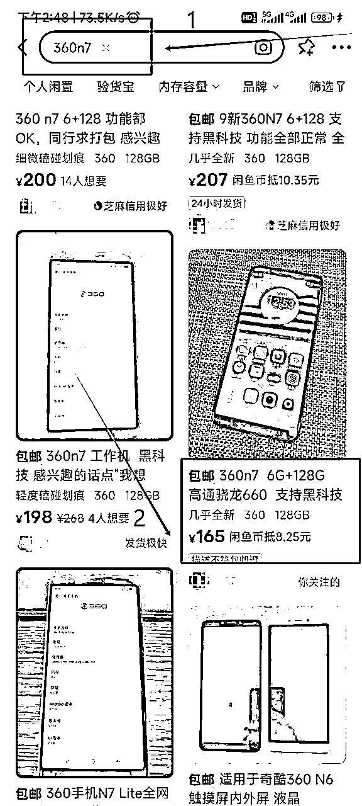

图一

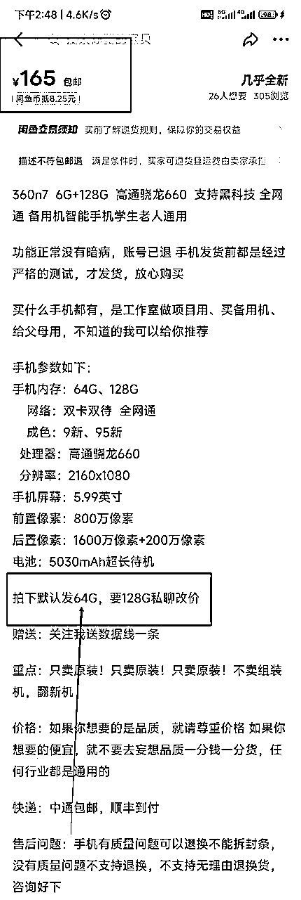

图二

但别玩过头：标价压得过低，或和实货差距太大，转化会被拖累，尺度要拿捏。

# 5.2 复盘阶段的关键提醒 @老瞿 @凌心

# 5.2.1 先接受前期可能没单

预期没搭好，把项目看轻，撑十来天没见到想要的结果，很容易收手。闲鱼卖货的节奏因人而异：上货速度、执行细节、选品、店铺推荐都不同，开单自然有快慢。圈友实操中，常见3～10天出首单，也有拖到30天左右才破零的。但有一点确定：只要按方法执行，开单变现迟早会来。

# 5.2.2 把平台规则当回事

信息过载的年代，急躁的人不少，总想找捷径。比如有人做闲鱼高客单，嫌手动上货慢，买软件多店批量堆链接，一天堆很多商品，结果展现没起色，有的被限流甚至封号。没有正反馈，自然就退出。其实稳一点反而更快。成熟平台都在清理粗暴玩法，只有守规矩，平台才愿意让你挣钱。

# 5.2.3 进店的人为何没下单（转化率）

顾客已经点进来，却一句话不问就离开，问题出在哪？

多数买家前期只能靠【描述+图片】判断。大脑天生不愿费劲，描述太省，他就得自己补：有没有某功能？材质是什么？疑问一多，很可能转去别家，而不是来问你。

描述写足，他至少不用猜，知道某些点具备，只是还想确认，于是才会开口。（也常遇到：详情里明明写了，顾客仍来问一遍——不是没看，而是看过想确认。）

提升转化主要抓两块，见图：左侧反例，右侧正例。

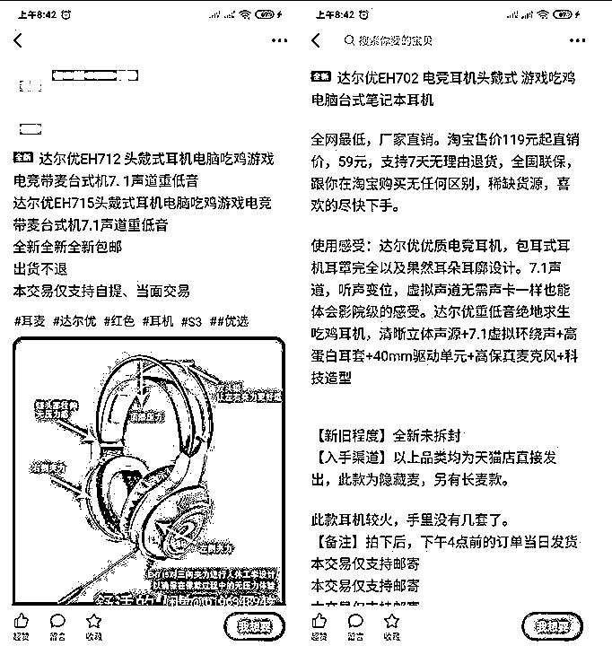

一，描述尽量细。不会写就看同行，再看淘宝的“问大家”和评价。“问大家”能看出买家下单前在意什么，评价能反映用后感受。

二，图片尽量九张，且要有实拍。做久就懂：前面图再精美，顾客仍想确认实物。去拼多多或淘宝评价里挑几张顺眼的实拍补上。

这两步到位，顾客先被留住。若详情写明“货还在，可直接拍”，甚至有人会直接下单。

还有一个关键：询单转化率。

顾客来问，说明意向不低，能否成交看接待。刚开始聊崩几次很正常，慢慢复盘。话术提升慢是正常的，多在群里交流，我也会给建议。

但有些基础动作能立刻做好：

第一，回复要快。换位想：两家货差不多，一家秒回，一家半天没动静，你更可能在哪家买？空闲时多刷闲鱼，忙就排好时间，比如晚上多守一会儿。

第二，提前熟悉商品。前面详情写得好，大部分问题你心里有数，甚至已写进描述。比如卖拖把，顾客常问多少厘米，你提前知道就能直接答，成交概率更高。

不可能预判所有问题，但开头至少把最基础的搞清楚：拖把长度、水杯容量、哪天发、从哪发。后续再按咨询逐步补。遇到不懂的，直接去淘宝或拼多多店铺客服那里问。

以上就是闲鱼交易全链路：从顾客能否看到你的货，到最后拍板，每一环都做到位，出单才顺。任何一个环节掉链子，闲鱼都难做好。

# 5.2.4 别迷信实体，别轻易转有货源

有人刚入门就想囤货、自己发、再招下级经销，愿景很美。但实业虽重要，等能力够了再碰不迟，前期先做轻资产。我那1000平方米仓库，收益还不如在小区开工作室运营30个闲鱼号。实体投入重、人累、成本高、利润薄。

# 5.2.5 项目的负责人是你自己

不少人爱问老手：一个闲鱼店月入多少？做几个号能过万？辞职干闲鱼电商行不行？刚起步就开工作室年赚30万现不现实？……这些都没有固定答案，因为项目本身充满变数。与其花时间找答案，不如先动手：注册账号、上架商品，做着做着，掌控感会越来越强。

素材出处：《聊聊你做闲鱼二手书项目失败的 100 种可能性》《闲鱼二手书无货源模式拆解（精细化运营）》

# 5.4 项目防坑清单

1.  多个闲鱼号在同一台设备上反复切

两个以上账号在同一设备频繁切换，系统容易识别，轻则降权，重则封号。

1.  出单后再动发布位置、一口价或标题

店铺有成交，或展现不错、正在进咨询时，发布地和标题都别改。一动，链接权重基本归零。

打个比方：你叫张三、住北京，周围人都知道“张三在北京”；忽然改叫李四、搬去上海，之前积累的认知就断了，逻辑类似。

1.  不要直接改一口价，应让顾客提交订单后再改价

新手常碰到：同一商品有不同规格、不同价格，顾客问的时候标价100，他要的规格150。有人直接编辑商品改价再让顾客拍。这一单成了，但之后这条链接大概率没咨询也没单。

店铺有个指标叫动销率：出单会抬动销率，链接权重也会涨；你重新编辑价格再发，等于权重从零开始。

关于权重再补一句：商品被拍下会自动变“已下架”，此时点重新上架即可，权重不受影响。

1.  只敢上几块、几十块的低价货

这也是误区。很多新手以为便宜好出单，却忘了根本问题：做闲鱼图利润还是图单量？

一单赚5元，一天100单利润500，人还忙得团团转；另一单一单赚200，三单利润600，轻松很多——你选哪个？

1.  上了几个链接没动静就放弃

常有人问我：教练，我闲鱼上了几个商品，展现少也没人问，怎么回事？我问：上了几个？挂了多久？对方答：5个，一个月了。

这很正常。刚开始别想太多，按方法上满50个品，很可能很快就开单。

1.  在闲鱼做站外导流

市面上有种项目，教新手从闲鱼引流粉丝再卖粉。记住：任何平台做站外导流都违规。逻辑不复杂，谁都不愿自家流量白跑到别处。

1.  直接卖假货

之前有位伙伴找我，说他付费的闲鱼团队让他卖高仿。起初出单很猛，不到半个月就违规，流量一落千丈。

我不评价别人的做法，但我一直跟伙伴讲：做长期合法的事，做细水长流的生意。各平台对假货打击都严，别贪一时爽。

# 选修篇：进阶玩法与赛道一览

# 💡

章节概要

把项目最小MVP跑通、基本掌握流程后，可以翻选修篇。

想放大项目，或找新玩法，这章都值得看：

✅ 更多选品方法：拓宽品类与货源

✅ 放大生意的方法：了解怎样把生意做大

✅ 热门赛道案例拆解：看看当下哪些赛道热

现在，去发掘项目的更多可能~

# 六、更多选品方法 @千城

# 💡

章节概要

必修篇给的是最省力的高效选品法，这里再补几种：

✅日常选品法

✅产品分类选品法

✅市场热销法

✅参考同行，源源不断选品法

跑通0-1后，再来试这些新方法。若发现新思路，欢迎在航海群分享。

# 6.1 日常选品法（零门槛）

把自己当成二手买家，想想你会搜什么、留意什么；生活里看到、想到的商品；逛超市、五金店时注意到的物件……

碰到这些场景，随手打开闲鱼，按选品判断标准（参考【3.1.1 蓝海高客单选品方法】）过一遍。对生活保持好奇，把每件看到的商品都当成潜在爆款来琢磨。让选品进入日常，变成习惯。

“日常选品法”上手简单，可以优先用。

注意：别只靠这一种，否则容易钻进去、效率不高。平时看到或想到就随手记，之后再去验证。

# 6.2 按平台类目拆选品法（零基础和有基础都适用）

从闲鱼自带的类目里找。

闲鱼有分类入口，点右上角进去，能看到类目和其下商品。页面只露出一部分，还有一部分没展示。

顺着大类联想：日常生活里这个类目下还有哪些具体商品？想好后，按3.1节的判断标准去搜、去筛，挑出符合要求的再操作。

另外，淘宝官方公布过TOP20万无线端流量词表，能看具体类目下近期热销、搜索量大的商品，也可作参考。

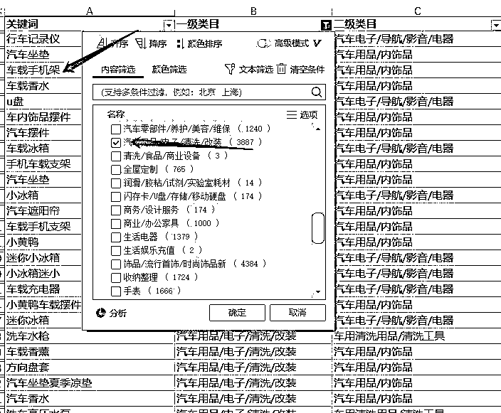

（使用时先选一个类目，系统会自动列出该类目下的具体商品，再去验证。）

其他可参考类目：机动车周边、电脑手机相机周边、数码配件、家纺布艺、绿植及周边、收纳整理、饰品、箱包、玩具、婴童用品、家具饰品、智能设备、灯具、厨房用品。

附件：淘宝TOP20万词汇下载

可以按兴趣去搜、去验证。

# 6.2.1 大类词拆选品法（零门槛）

搜一个大类词，例如“运动用品”，该类目下的商品会铺出来。此时看“想要数”，或换位思考：如果我是买家，会不会搜这些具体商品？然后逐个搜索验证。

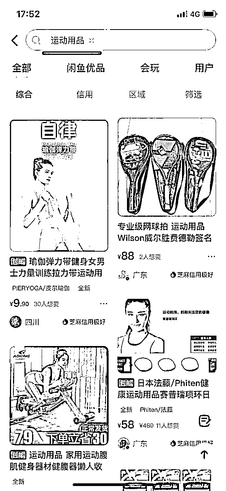

这类大类很多：厨房用品、酒店用品、母婴用品等，换一个词就冒出一批，能挖出不少平时想不到的品。

举两个例子，搜索后往下翻，看出现的商品即可：

厨房用品会出：夹缝收纳置物架、懒人抹布、不锈钢厨房置物架……

酒店用品会出：枕头、三件套、床单……

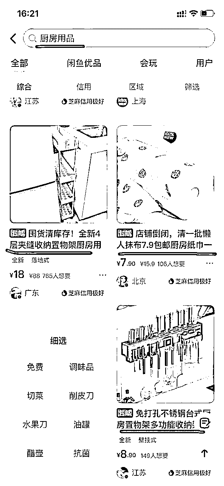

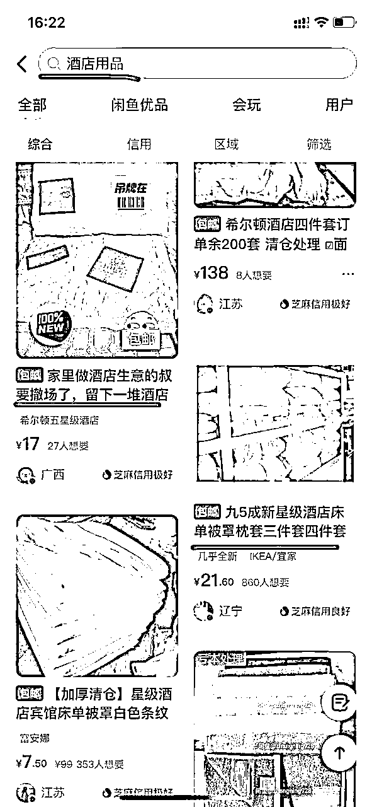

把出现的商品依次记下，再回首页逐个搜，按判断标准具体看。

此法稍难，但可选类目更多，能筛出的商品也更多，很值得推荐。

注意：挑到好品尽量马上记录，否则容易忘。

# 6.3 借市场热销选品

也可看其他主流平台，例如：

拼多多

淘特

淘宝

京东

抖音、📕等短视频社交平台

……

借它们近期热销的商品，到闲鱼做验证。

热销品会随市场热度更新，过段时间又换一批。

以拼多多为例：

首页点进一个大类，下方会出现排行榜，点进去能看到该类目近期热销商品，榜单按热度持续更新，过阵子又是一批。

在拼多多上近期搜索多、购买多的热销品，拿到闲鱼按标准验证，符合条件就能直接上架。

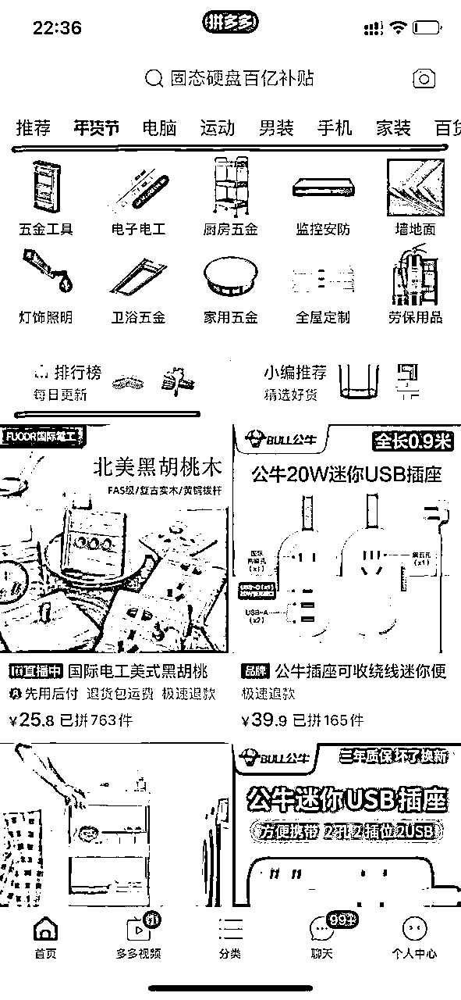

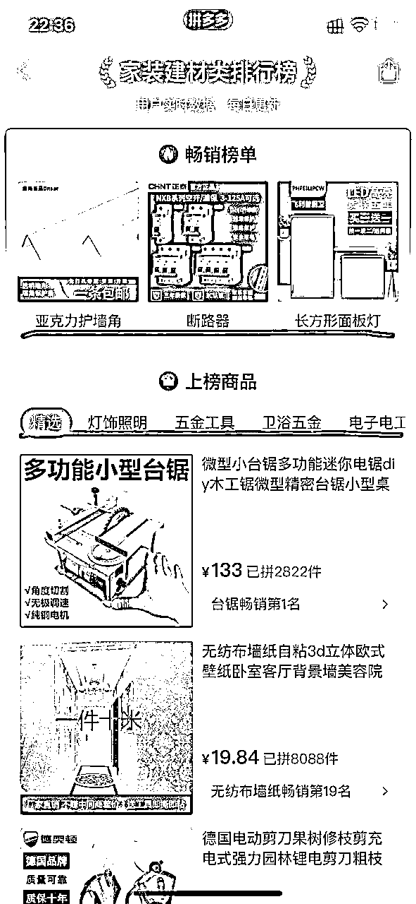

淘特和拼多多的入口路径相同：

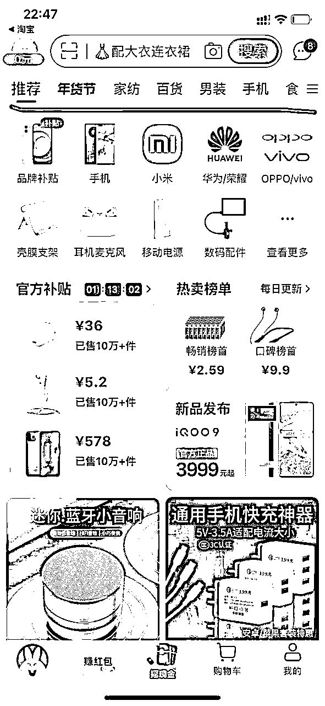

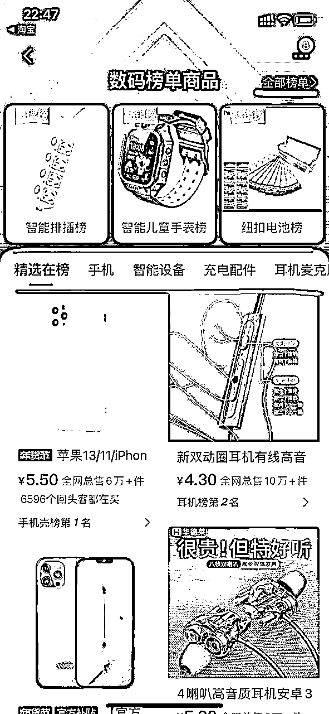

其他平台也可看各自首页，或用专门的数据工具，比如淘宝生意参谋，或第三方商品查询工具。

第三方工具如抖查查、飞瓜、蝉妈妈等，自己搜一下就有。

闲鱼爆款验证——还能借闲鱼助手采集爆款。

例如翼闲鱼助手会按玩法每天采集闲鱼市场爆款，能按时间、想要数、价格筛选，也可作选品参考。

这个有费用，看个人情况；不过上面几种方法已经够用。

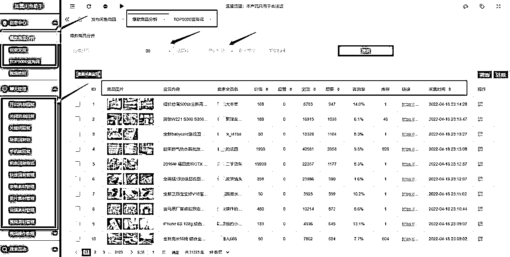

附件：闲鱼放大必备软件：单人最多同时操作100台闲鱼店铺视频介绍 副本

# 6.4 跟同行挖品，源源不断

此法可与前面三种任意搭配。先用上面的方法找到同行，再顺着同行的选品快速挖周边不错的品，补充自己的选品库。

具体以“滚轴”为例：搜“滚轴”并按验证方法操作，看同行动态时发现，同行卖滚轴出得不错（单天6单以上），“弹力带”和“瑜伽垫”也有起色。

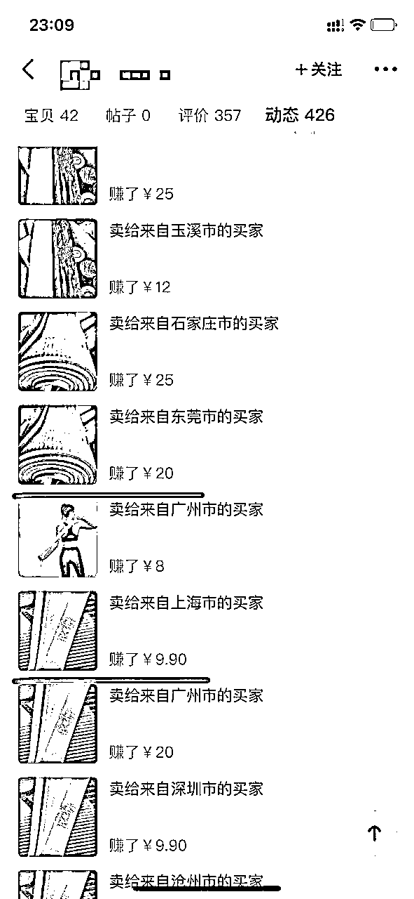

发现新品就及时记录、验证，再继续发现。你看，本来只找到一个品，转眼又冒出两个新品；记录完再验证，验证时又能在新的同行动态里发现其他卖得好的品。

就这样不断找到周边不错的品，同时用闲鱼选品标准验证，持续补进选品库。时间一长，选品库越来越大，你对闲鱼适合什么品的判断也会越来越准。

此法较简单，可与上面任意一种结合用。通常找到一个好品，就很容易顺藤摸瓜找到周边多个不错的品。

# 6.5 四套选品法总结

四种方法的难易程度：

1.  换位思考的日常选品法——简单，零门槛

2.  按平台类目拆选品法——稍难，适合零基础和有基础的人

3.  参考其他平台热销——难度适中，适合有基础的人

4.  跟同行挖品，源源不断——简单，零门槛

第4种可与上面任意一种搭配。找到一个好品后，很容易带出一串不错的品。

没接触过的建议先练1、2、4；有部分经验的可以加上3一起练。最后找到一两种最适合自己的方法，就能持续选出闲鱼上不错的品。

5.

选品方法

拼多多找对标店铺的爆款（目前用不到付费工具）——已包含在上面方法里，这部分可以不用写。

# 七、放大生意的方法 @凌心

# 💡

# 章节概要

如果你已经能稳定变现，就该考虑放大项目、增加收益。放大方式主要有三种：

多账号运营

多平台运营

转有货源玩法（对资金链和体量要求较高）

下面看具体怎么做。

# 7.1 多账号运营

做高客单价产品，精细化运营时，单账号一个月能到几千到一万多；也可按自己的时间和精力多开账号，一个人上限大概7到8个号（一台设备、一张卡、一条网络），这是实战数据。操作上没有本质区别，只是多花精力。

# 7.2 多平台运营

1.  转转

转转是目前排第二的二手交易平台，实测流量大约是闲鱼的三到五分之一。如果不想多开闲鱼号，可以同步发到转转，进一步提升销量。

1.  淘宝和拼多多

这两个平台比较考验运营能力，没有给力货源的话不太建议。

# 7.3 转有货源模式

想转有货源，最关键的是优化供应链：和供应商建立稳定合作，保证货源充足、质量可靠。

# 八、热门赛道案例拆解 @千城

# 💡

# 章节概要

最后这一章，教练们提供了几个目前常见、相对优质的客单价偏高赛道：

✅运动户外

✅宠物用品

✅日用百货

✅大小家电

✅五金

不同类目之间的玩法差异并不大，所以这一章对这几个赛道只做简单说明和案例展示，希望能给大家一些参考。

# 案例一：运营户外

户外产品5月正好是春季应季，销量会往上走；但秋冬之后销量会回落，属于季节性产品。建议多拓展品类，比如围炉煮茶的炉子，也看看同行淡季在卖什么。

1.  需要资质

户外类目能做的产品不少，其中有不少客单价偏高的商品，而且不需要任何资质。

# 闲鱼新手选品：五个容易起步的方向

想在闲鱼开个小店，又不想一上来就被资质、售后这些问题困住？下面这五个方向，实操门槛相对低，适合先试水。每个类目我都整理了店铺样本、成交与利润情况、热销商品和货源渠道，方便你对照参考。

## 户外装备：露营车、帐篷与天幕

帐篷、露营车、天幕这类出行装备，在闲鱼一直有比较稳定的需求。

2. 案例信息

- 店铺名称：魔豆户外工厂
- 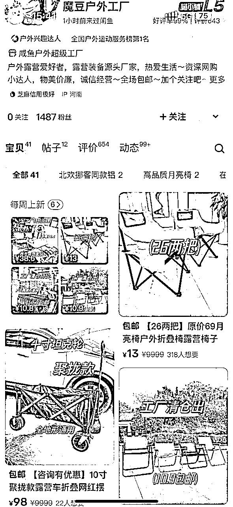
- 店铺入口：【闲鱼】https://m.tb.cn/h.gVLIzQs?tk=oFr7WxzBIc7 CZ3456 「魔豆户外工厂的闲鱼号，快来关注TA吧～」
- 点开链接即可查看
- 单笔成交约50元
- 单笔利润大约10元
- 利润率区间约10%-30%，具体看商品类型和拿货成本

3. 常见热门产品

户外折叠桌、睡袋、登山杖、天幕、帐篷

4. 供应商来源

拼多多、1688

## 案例二：宠物用品

宠物生意没有明显的季节限制，全年都能做。猫砂、尿垫属于高频消耗品，走量机会大；猫笼、狗笼以及部分狗粮客单价更高，但同行竞争也更明显。更稳妥的路径是先用猫砂、猫粮这类复购率强的低客单商品练手，跑顺之后再考虑高客单产品。

1. 操作门槛

注射类之外的宠物食品和日用品，一般不用额外办资质。

2. 案例信息

- 店铺名称：天魔星乖乖的青果
- 店铺入口：【闲鱼】https://m.tb.cn/h.gf1vGxn?tk=Zxw0WxzBoBX CZ0016 「天魔星乖乖的青果的闲鱼号，快来关注TA吧～」
- 点开链接即可查看
- 单笔成交约50元
- 单笔利润约10元

3. 常见热门产品

猫爬架、猫笼、狗笼、鱼缸、乌龟、水泵；银渐层猫、缅因猫这类偏贵的活体宠物也有市场

4. 供应商来源

拼多多、1688

## 案例三：日用百货

日用百货覆盖面很广，但上架前别着急。规格、质量、材质和收货地址都要先核验清楚，尤其大件商品，售后处理更麻烦，发出前检查一遍更稳妥。

1. 操作门槛

这是电商里品类最庞杂的板块之一。医疗机械类建议避开，其余像电竞椅等商品可以正常操作，通常不需要资质。

2. 案例信息

- 店铺名称：工厂源头家具直销
- 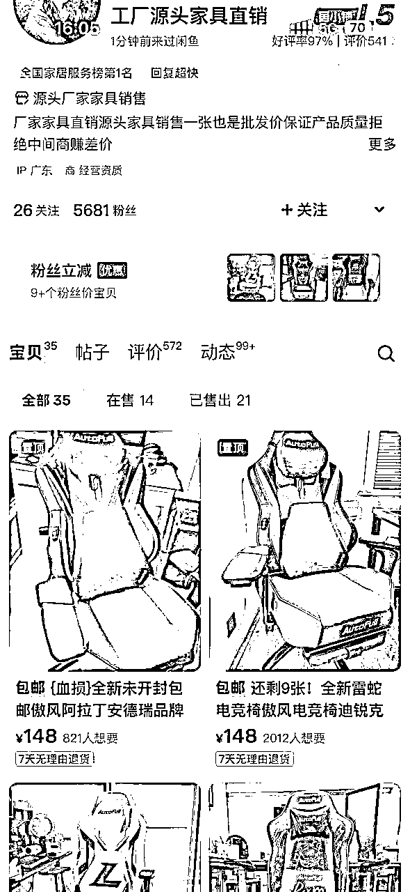
- 店铺入口：【闲鱼】https://m.tb.cn/h.gf1CYdV?tk=bKYpWxAa35L CZ3460 「工厂源头家具直销的闲鱼号，快来关注TA吧～」
- 点开链接即可查看
- 单笔成交约150元
- 每单利润从10元起

3. 常见热门产品

电竞椅、货架、遮阳窗帘、岩板桌、床垫、升降写字桌、吸顶灯、卫浴

4. 供应商来源

拼多多、1688

## 案例四：大小家电

和日用百货类似，家电要先核对尺寸与材质，并持续留意最新评价，尽早发现质量波动。客单价高意味着备货资金占用更多，不过利润回报通常也更可观。

1. 操作门槛

闲鱼不要求3C证书等材料。比如风扇，直接就能上架操作。

2. 案例信息

- 店铺名称：中华小家电
- 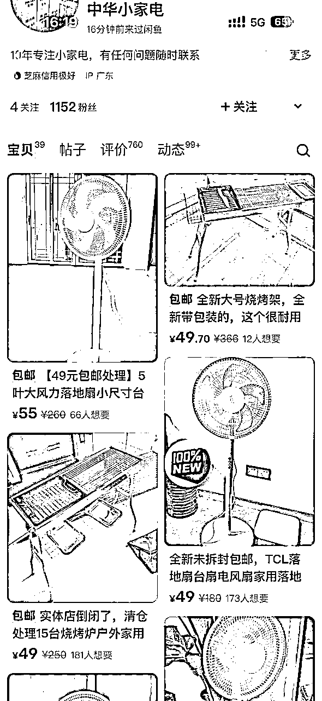
- 店铺入口：【闲鱼】https://m.tb.cn/h.g40Y6Hl?tk=GgB2WxzA8wS HU7632 「中华小家电的闲鱼号，快来关注TA吧～」
- 点开链接即可查看
- 单笔成交约50元
- 每单利润10元起

3. 常见热门产品

显示屏、电视机、电磁炉、微波炉、空调、冰箱、热水器

4. 供应商来源

拼多多、1688

## 案例五：五金

五金全年都能卖。想经营得久，重点是把品质守住：产品质量盯紧，售后自然少，店铺口碑和经营周期才稳。

1. 操作门槛

这个品类关注度不算高，但里面不少商品值得做，也没有资质限制。

2. 案例信息

- 店铺名称：拍卖各种二手工具
- 
- 店铺入口：【闲鱼】https://m.tb.cn/h.gf1CF5i?tk=8UX2WxAZ9pr CZ0015 「拍卖各种二手工具的闲鱼号，快来关注TA吧～」
- 点开链接即可查看
- 单笔成交约300元
- 每单利润20元起

3. 常见热门产品

电钻、切割机、水平仪、电动扳手

4. 供应商来源

拼多多、1688、淘宝

## 📌附：高客单选品风向参考（闲鱼）

| 选品 | 方向 | 收益概况 | 参考链接 | 发布日 |
|------|------|----------|----------|--------|
| 工地用品 | 百货 | 每单利润可达数百元，售后由厂家承担 | https://wx.zsxq.com/dweb2/index/topic_detail/5122428584421824 | 2024.06.05 |
| 收录机 | 数码 | 客单价从几百到小几千，成交量不低 | https://wx.zsxq.com/dweb2/index/topic_detail/2855455211211821 | 2024.06.03 |
| 大板桌 | 百货 | 常见单价1200上下，单笔利润300+，一年可做到几十万 | https://wx.zsxq.com/dweb2/index/topic_detail/4844244512224528 | 2024.06.03 |
| 蛋糕店礼品卡 | 虚拟产品 | 客单100-1000，节庆期间走量，适合长期做 | https://wx.zsxq.com/dweb2/index/topic_detail/4844511554542218 | 2024.05.30 |
| 国产跑鞋 | 鞋服 | 客单100-500，需求旺盛，热门款经常供不上 | https://wx.zsxq.com/dweb2/index/topic_detail/4844511185858418 | 2024.05.24 |
| 自选零食 | 百货 | 非标品居多，利润空间大，单店销量能过万件 | https://wx.zsxq.com/dweb2/index/topic_detail/5122584121154144 | 2024.05.24 |
| 电子显微镜 | 百货 | 客单100-200，学校学生做实验需求大，货源可在拼多多找，利润尚可 | https://wx.zsxq.com/dweb2/index/topic_detail/1522481281542822 | 2024.05.24 |
| 商用冷柜 | 百货 | 单价偏高，持续出单，几个月卖出279件 | https://wx.zsxq.com/dweb2/index/topic_detail/4844515222522228 | 2024.05.23 |
| 防晒雨伞 | 百货 | 每单赚20多，一天10单，日利润200+ | https://wx.zsxq.com/dweb2/index/topic_detail/2855212814242181 | 2024.05.22 |
| 夏季床笠 | 百货 | 每单利润30，单店一天10单，日利润300 | https://wx.zsxq.com/dweb2/index/topic_detail/2855212814242181 | 2024.05.22 |
| 餐饮二手设备 | 餐饮 | 单价几百到几千，单笔利润上百，月均营收过万 | https://wx.zsxq.com/dweb2/index/topic_detail/1522451545814522 | 2024.04.24 |
| 各地旅游卡 | 旅游 | 单价约200-700，单日最高25件，日营收约7000 | https://wx.zsxq.com/dweb2/index/topic_detail/1522412554144112 | 2024.05.08 |
| 抽水泵 | 农业用品 | 客单300-600，夏季走俏，建议提前备货 | https://wx.zsxq.com/dweb2/index/topic_detail/1522448242821422 | 2024.05.04 |
| 漫展门票 | 二次元 | 客单100-400，单日能出约15单 | https://wx.zsxq.com/dweb2/index/topic_detail/8855224428124112 | 2024.05.02 |
| 商用空调扇 | 百货 | 客单300-900，夏季热门，宜早做准备 | https://wx.zsxq.com/dweb2/index/topic_detail/4844552451521158 | 2024.04.29 |
| 拉步架 | 百货 | 客单300-800，竞争较小，属于蓝海品 | https://wx.zsxq.com/dweb2/index/topic_detail/8855811451852412 | 2024.04.07 |
| 化粪池塑料桶 | 百货 | 客单300-500，月入几千不难 | https://wx.zsxq.com/dweb2/index/topic_detail/2855824114451211 | 2024.03.13 |