# 9月航海：女装店铺实操手册

出品时间：2024年9月6日  
长期更新微信：6326696

手册说明：这份资料由多位创作者共同完成，署名顺序不代表主次。我们不打算给出唯一答案，而是把项目的可操作空间尽量摊开，帮助你看懂、上手。若想迅速找到某个模块，可用 Ctrl+F（Windows）或 command+F（Mac）搜索关键词定位。

# 开篇

欢迎来到本期航海——女装店铺实操手册。接下来的日子里，我们会在这里反复碰面。

在正式研究“女装店铺怎么跑”之前，先把三个高频疑问说透：

1）这个项目是什么？空间有多大？

2024年，这个平台的电商板块正处在红利上行期，下半年释放速度还会更快。平台已经积累了一批会主动搜索、愿意下单的优质用户，电商业务也在被持续加码，对普通人而言，窗口期比较明确。

女装是站内最热门的赛道之一，利润空间可观，消费人群与平台画像贴合度高。再加上9月进入换季节点，秋冬款即将接棒，通常比夏款更有赚头。

按教练给出的打法执行，本期退货率有望压在40%-60%区间；女装供应端选择多，一件代发也能明显减轻启动压力。

2）店铺项目有哪几种模式？

有产品的人可以做自营；没有产品的人可以找货源方合作。但不建议做没有合作关系的“无货源代拍”，平台对这类模式已有明确处罚规则。

无货源的好处是投入低、转身灵活；隐患是笔记一旦爆单，合作方可能供不上货。因此走这条路的人，平时要多储备几家备选供应商。

❗注意：平台已开始专项治理无货源代拍，具体可查官方公告《关于无货源代拍的专项治理公告》，建议认真看一遍。

3）哪些人适合做女装店铺？

和多数电商项目类似，这条路也有基础门槛，比如手里有产品，或者能对接有产品的合作方。若你具备一定审美，会拍照、会制图，跑通概率会更高。

由于本期聚焦女装，我们在往期内容基础上重点增补了：

✅ 2.2 女装赛道如何选品  
✅ 2.3 下单样品（物流1-4天）  
✅ 三、【实操2/4】制作爆款图文带货笔记  
✅ 6.1 如何降低女装退货率  

最后，希望这趟航行里，大家既能拿到结果，也能结识一群能一起往前走的伙伴。

以下内容由生财有术与圈内伙伴共同打磨，仅面向本期船员及生财有术星球成员作学习用途。实践中欢迎持续反馈，帮助我们继续完善；有修改建议可联系鱼丸（yuwan387）。

# 【更新提示】新版手册使用说明

开始之前，先花一分钟弄清手册的打开方式，方便按自己的节奏推进。

整本手册按照“从0到1跑通一个小红书店铺项目”的顺序编排。你可以顺着航线图逐步操作，也可以按实际需要挑章节阅读。

需要说明的是，本次相较过往航海做了较大调整。过去我们尽量铺开各种玩法供自由选择，现在则分成“必修篇”和“选修篇”：

必修篇：覆盖从0到1跑通最小MVP所需动作，也就是航线图对应路径。若你仍处于前期摸索，想先跟着步骤走一遍，建议从必修篇认真读起、直接实操，不必在玩法选择上反复纠结。

选修篇：收纳更多玩法、案例等内容。若你已经跑通最小MVP，想继续挖掘可能性、寻找灵感，这部分值得重点看。

📌如果完全没接触过这个项目：  
建议先了解产品本身与最新动态👇  
✅【项目概述】了解小红书店铺（女装）项目

📌如果已有大致认识：  
从航线图第一阶段开始实操，对应手册第二章，逐步完成整个项目👇  
✅【实操 1/4】准备店铺并选品上架  
✅【实操 2/4】制作爆款图文带货笔记，获取流量  
✅【实操 3/4】找到优质稳定的供应商  
✅【实操 4/4】店铺的售前、售中、售后管理  
✅【复盘优化】运营优化，工具提效

📌如果已跑通最小MVP，想放大规模：  
可重点阅读以下板块，拓展更多玩法👇  
✅【选品拓展】更多选品方法  
✅【项目放大】小红书SEO  
✅【项目放大】矩阵

本航次航线图如下：

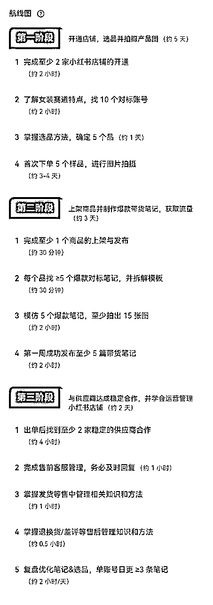

航线图与手册内容高度对应，可依据自己所处环节选择学习。第一、第二阶段建议在航海前两周完成；之后把重心放在复盘、优化、提效上，持续发布优质带货笔记，提升爆款率与出单概率。

# 必修篇：先跑通最小可交付闭环

# 一、【项目概览】看懂女装店铺这条路

# 本章要点

如今，这个平台已成为不少人购物前搜索、做决策的重要入口，电商生态也在加速完善。对普通人来说，机会确实存在。

本章从平台与赛道两个角度，说明女装店铺为何值得长期做，同时带你认识项目玩法和内容分发逻辑，为后续制作爆款笔记打底。

# 1.1 当前局面与未来空间

# 1.1.1 电商板块现状

平台用户以18-34岁为主，女性约七成，集中在一线和新一线，多是都市白领、职场精英。“年轻”“女性”“有消费力”仍是明显标签。31-40岁群体也在逐年扩大，他们更看重品质生活，乐于分享购物心得。用户主要分布在经济较发达的一二线城市，消费水平更高，对品质与体验也更敏感。

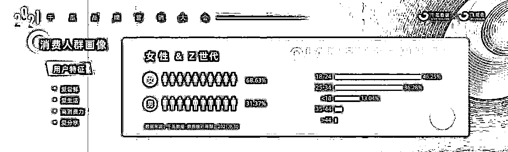

（数据来源：千瓜数据）

当前热门类目包括女装、饰品、女鞋、食品、家居百货、美妆工具。女装体量大、款式丰富、爆款属性强。平台正鼓励原创内容、扶持种草账号；低质量混剪商家被逐步清退，坚持原创素材的账号更容易获得官方曝光与流量倾斜。

# 1.1.2 为何选择女装实拍

平台月活3亿，男女比例3:7，95后占50%，00后占35%，二线城市用户占50%。社区分享者超过8000万，日均搜索渗透60%，UGC内容占比90%。“年轻有活力”“国民生活指南”“社区生态独特”这些标签，使其具备较强人群穿透力和品牌普适性，适合做消费渗透。

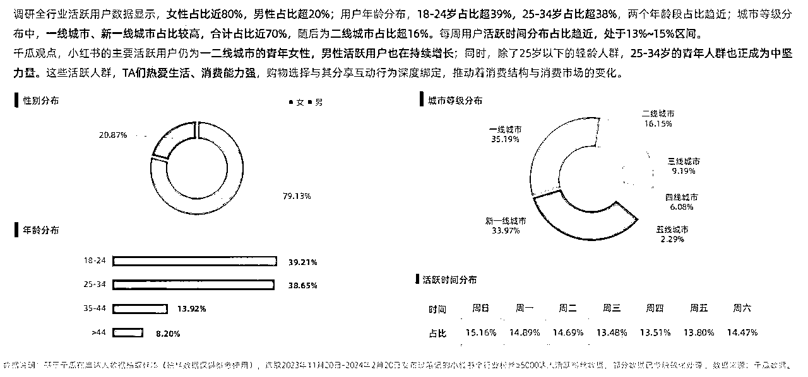

站内用户画像个性鲜明且高度细分，为女装提供了精准市场。穿搭人群最关注身材与风格，“通勤、复古、休闲、显瘦、梨形”等词热度持续。

例如，某款裤子单篇爆款笔记卖出3000多单，单件利润39元，利润率接近48.8%。

再看一款牛仔裤：单篇爆款一周卖出600多单，每单利润27元，利润率51.2%，一周进账16200元。

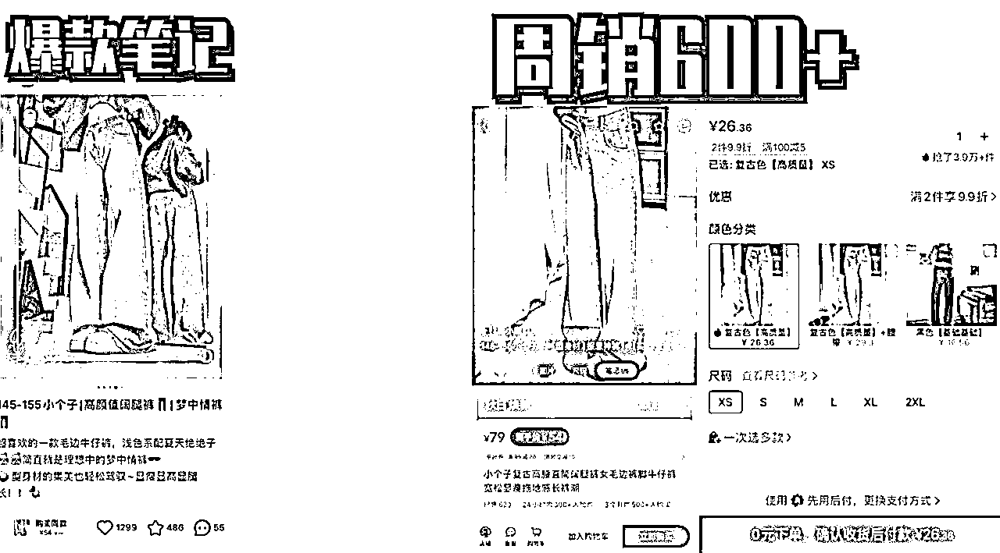

还有一款衬衫，单篇爆款卖出2万单以上，单件利润39元，利润率55.4%，累计赚了78万元。

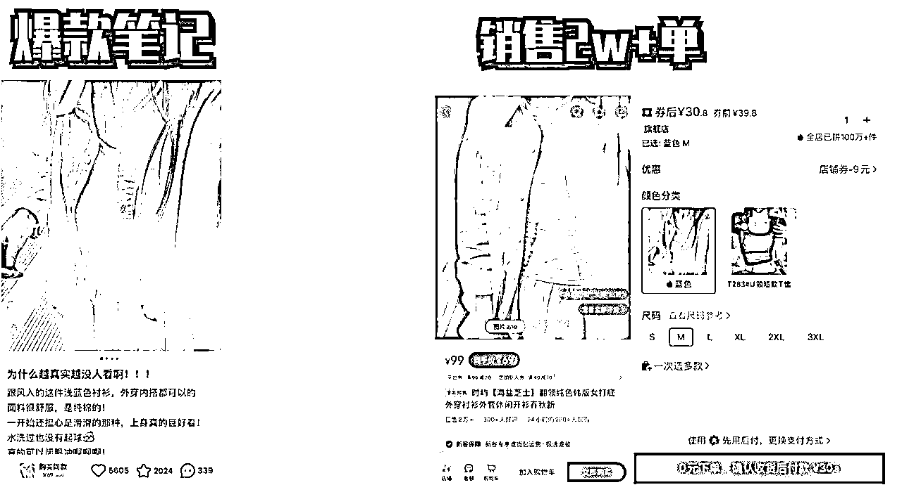

整体看，平台女性用户多、女装款式多、爆款频出、利润空间可观，百元以内单品利润可超过50%。

但女装有通病：售前售后咨询频繁，消息要及时回；遇到售后，客服态度要好，可准备优惠券安抚；退换货需沟通清楚理由，避免店铺负反馈被限流。

笔记形式方面，本期主做【实拍】：图片实拍简单高效，实况照片流量更大；更换场景与拍摄模板后不易违规或被举报限流，长尾流量更持久，更容易出爆款。

# 1.2 核心打法

女装店铺从0到1的新手最小MVP，可归纳为：

注册账号开店 → 选品 → 下单样品 → 上架商品 → 拍摄并发布笔记 → 出单后找供应商 → 管理店铺 → 做好售后

其中，选品、发笔记、售后是关键动作。具体来说：

1. 注册账号开店：新手建议至少开2个账号和店铺，老手可用7个号轮动。起步先定细分人群，如小个子、微胖，或确定细分类目，如毛衣、衬衫、外套，这样能更快抓住细分流量与长尾流量。开店一天内可完成。

2. 选品：店铺开通后按定位选品，优先测试近期销量高、评价低的产品。本期也准备了女装选品清单（航海期间持续更新），可供参考。

3. 发布笔记：发之前先搜集同品类对标账号，拆解并模仿爆款，更容易出成绩。制作上，实拍是长期首选，有条件尽量拍实况照片，流量更佳。

4. 售后：女装售前售后问题多，要熟悉常用话术，及时回复，主动推荐合适码数以提升转化；售后快速处理，维护店铺评分，避免负反馈引发限流。

# 1.3 内容分发逻辑

# 1.3.1 审核环节

笔记发布后，会先经历“黑盒审核”。系统按规则（可参考官方号“薯管家”）检查敏感词、违规词与低质量图片。

若检测到违规，笔记直接审核失败，无法曝光。机器难以判断的内容会被判为疑似违规，转人工审核。未通过的笔记会表现为限流——其他用户在主页看不到，可尝试分享到微信等平台测试。通常审核需几分钟到十几分钟；若逢发布高峰变长，可能正在人工审核。

# 1.3.2 推送逻辑

审核通过后，系统依据初始点赞、收藏、评论、转发分享、转粉数据打分，其中评论、转发、转粉权重较高。

同时，算法会拆分内容，用于分类、打兴趣标签并收录关键词。这里有两个核心流量入口：【推荐流量】与【搜索流量】。

1）推荐流量

笔记会被推送到粉丝和其他用户首页。平台内部评分可理解为：点赞计1分、收藏计1分、评论计4分、关注计8分，四项相加得到CSS值。它衡量互动与转化，并持续影响首页推荐频次。分数升高后，系统会把笔记逐级推入更大流量池，成为爆文（小爆款互动1000+，大爆款10000+，不同类目有差异）。

因此，前100个精准用户的点击或互动很关键；发布后18-24小时内的互动情况，也会影响后续流量。爆文还能带动账号其他笔记数据增长，但需满足几个前提：

① 笔记审核通过，无违规，未被系统删除，也未被自己删除或隐藏；  
② 笔记含关键词（如穿搭、衬衫），能对应垂直标签，被系统识别收录并推给目标人群；  
③ 内容质量本身过关，能吸引用户点赞、收藏、评论。

特别提醒：0基础新手很难第一篇就成大爆款。运营7-15天时，阅读量停在200-1000属正常。80%新手在第二或第三个月才迎来爆发，中间有酝酿期，不必焦虑，耐心打磨内容。

2）搜索流量

用户除了逛首页，也会搜索所需内容，比如买口红会搜攻略，出行会搜旅游攻略。搜索结果中排名靠前的笔记能获得更多曝光与关注，这部分流量近乎占总流量50%以上，不可忽视。

想获得搜索流量，笔记要含有效关键词并被系统成功收录；想让排名靠前，账号权重与笔记权重都需持续提升。

内容来源：《初阶 | 小红书-爆款笔记｜航海实战手册》

# 1.3.3 笔记权重

笔记权重可归为三点：

1. 原创度：低于60%会降权，还可能被限流。  
2. 转化率：即曝光与互动的比值。互动权重排序为转发＞评论＞收藏＞点赞。  
3. 内容：关键词标签与内容关联度要强；关联太弱可能被判定恶意引流，从而降权。

# 1.3.4 排名逻辑

笔记排名，指用户搜索某关键词后，结果页中的展示顺序。排名越靠前，被点击概率越大。

谈排名前要先懂“收录”：搜索引擎抓取笔记内容并存入数据库。一般审核通过会被收录，但以下情况可能导致无法收录：

1. 账号问题：多次违规后账号受限，笔记也无法收录。  
2. 抄袭问题：被检测出高重复或非原创，平台不支持。  
3. 营销问题：广告或营销用语过多，会被识别为推广笔记。  
4. 多次修改：每次修改都会重新审核，反复改动容易失去收录。

# 二、【实操1/4】店铺准备与选品上架

# 本章要点

了解整体情况后，正式启动。做电商的前提是完成店铺准备与选品。本章整理项目初期事项，包括：

✅ 准备手机号与手机  
✅ 开通适合自己的店铺  
✅ 完成女装账号包装  
✅ 尝试首次选品并了解测品方法  
✅ 下单样品  
✅ 将选到的品上架

不同店铺入驻门槛不同，可结合自身情况了解后进入流程。

选品是本章重点技能，下单样品是重要任务。女装最实用的选品方法，是在站内找爆款对标。选品时主动避开高退货率品类，从源头降低退货率。选好后尽快下单样品，用于拍摄实拍图。

# 本章航线图

完成本章学习与实操，即可完成航线图的：

第一阶段：开通店铺、选品并拍摄产品图（约5天）

1. 完成至少2家店铺开通（约2小时）  
2. 了解女装特点，找到10个对标账号（约2小时）  
3. 掌握选品方法，确定5个品（约1天）  
4. 首次下单5个样品，并进行图片拍摄（约3-4天）  

第二阶段：上架商品并制作爆款带货笔记，获取流量（约3天）

5. 完成至少1个商品的上架与发布（约30分钟）

# 2.1 账号准备

# 2.1.1 至少准备两个账号

新手一般建议开个人店铺。两家个人店对应两个账号，具体需要：

1. 至少2部手机（不建议一部手机多开，可能被限流）  
2. 至少2张电话卡（两个号需两个实名，对应两张卡）  
3. 至少2张身份证（可用家人的）

电话卡建议：

三家运营商都能办副卡，一人最多注册认证5个号码，即一拖四，副号月租10元。

- 移动万能副卡：月租10元，一张身份证可领2张副卡，第一张与第二张需相隔90天。营业厅或App均可办理，营业厅有时可免首年月租。  
- 中国电信App搜“无忧卡”，5元/月，通常次日送上门。  
- 移动还可办8元保号套餐。

各地区可能有差异，办理前建议在App查看最新条件，或咨询客服。

手机建议：

手机除登录账号，还要用于拍图。实况照片流量更好，有条件建议用苹果手机拍摄；为保证清晰度，一般建议iPhone 11及以上机型。

# 2.1.2 账号登录与养号 @渡

# 2.1.2.1 登录

同时运营两个账号，能否用一部手机登录？可以，但有风险。

若手机自带应用分身（部分安卓机有，如红米），可一机登两号。我目前这样操作，账号尚未出问题。

若手机没有该功能，不要下载第三方分身工具，容易被封号；此时应另备一部手机，可在闲鱼或拼多多买二手机，三四百元即可满足日常使用。

# 2.1.2.2 实名认证

注意：一张身份证只能认证一个账号，认证成功后只有注销账号才能解绑。

认证路径：我 → 左上角三条杠 → 创作中心 → 创作服务中的更多服务 → 开通专业号 → 成为专业号 → 选择个人并点击立刻申请 → 填写实名信息即可完成。

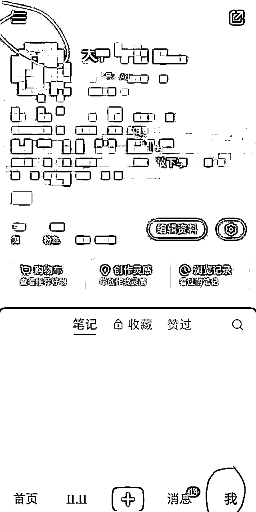

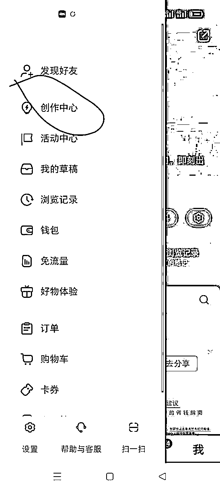

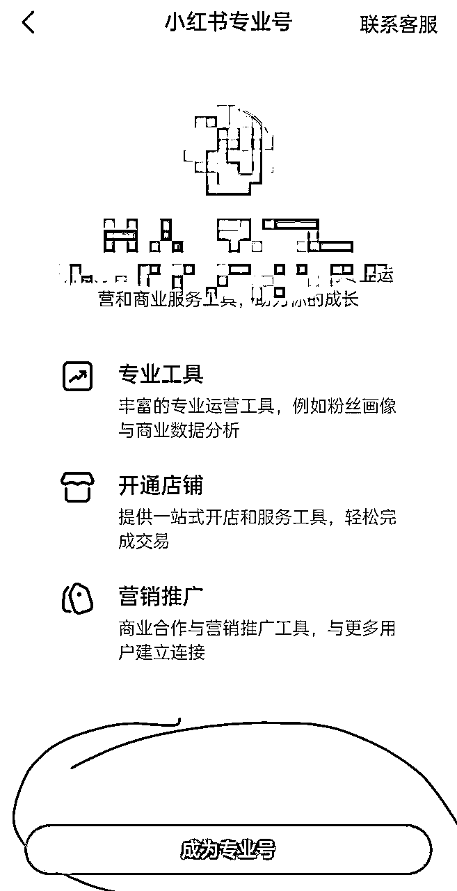

# 2.1.2.3 先让新号“活”起来

号刚注册好，别急着发内容。先把它当普通用户养几天：每天刷不低于三十分钟，持续一到三天，权重会慢慢往上走。刷的时候别乱逛，盯紧自己打算做的赛道，重点看同行的标杆账号和笔记。

# 2.1.3 开店之前，先把店型想清楚

先说结论：刚上手，个人性质的店最省事；后面打算复制项目、多店并行的，可以走个体工商户店；本身有品牌或企业资质的，再考虑企业店。

下面把个人店、个体店与企业店的差别拆开讲，看完再按自己情况定。

# 2.1.3.1 店型先分清

入驻之前，先弄懂店型，因为不同店型拿到的权益不一样。

大类就两种：个人店铺、企业店铺。

不管开哪种，前提都是账号通过专业认证。新号默认不是专业号，没这个身份，商业动作都做不了，薯条投放和开店都不行。所以想在小红书变现，第一步就是升级成专业号。专业号同样分个人与企业两类。

个人专业号

身份标识通常显示为某领域博主，比如时尚、美食等兴趣类博主。申请门槛不高，基本提交就能过，而且不收费。

操作路径：创作中心—更多服务—开通专业号—我是个人—实名认证—选择身份证并填写资料。

医生、律师等特殊职业，需要额外上传资质，并支付300元：

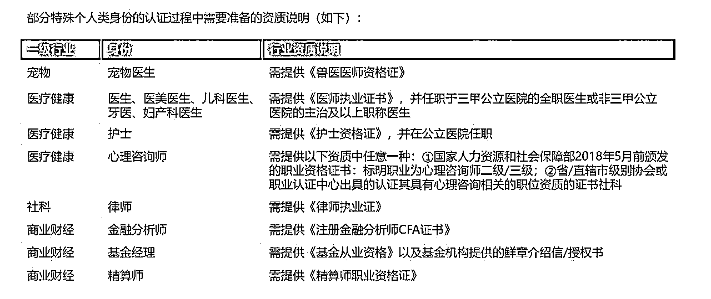

拿到个人专业号后，可以申请个人店或个体工商户店。

店铺名：昵称加“的店”；

保证金最低1000元；

技术服务费：每成交一单，按对应类目费率扣。费率见《2024小红书基础技术服务费费率标准》；计算方式见修订《小红书技术服务费规则》的公告第四条。

企业专业号

申请时要提交营业执照，支付600元，身份标识为某品牌。

流程：创作中心—更多服务—开通专业号—我是企业—填基础信息—填主体信息—上传资质公函—填运营人信息—缴600元—等待审核。

填写要点见图：

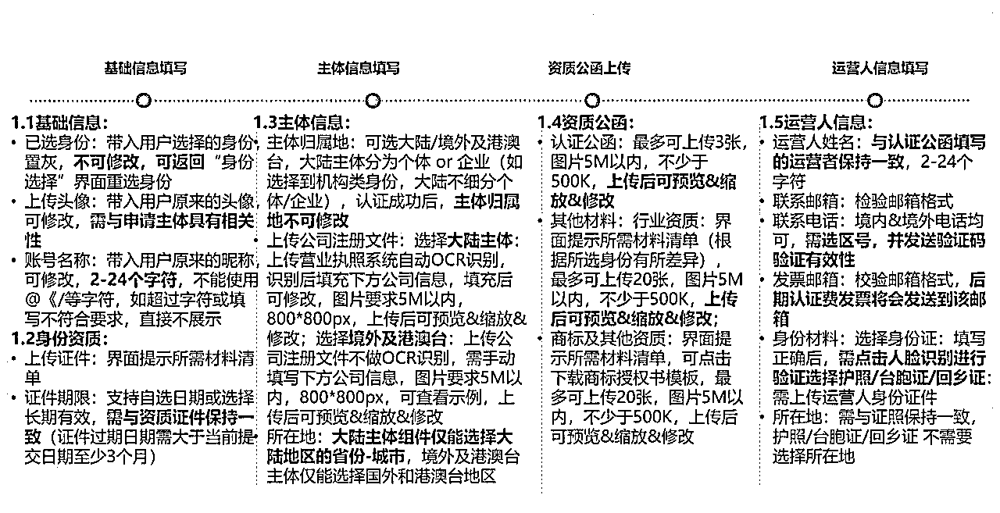

提交后要盯紧：申请有效期为30天，30天内没走完流程，费用不退。通过后每年年审，并续费600元。

企业专业号可以开普通企业店、专卖店或旗舰店。

名称：品牌名加专卖店/旗舰店；

保证金：境内最低2万元，境外3500美金；

技术服务费同样按类目逐单扣，费率和算法同上。

2023年9月10日起，一张营业执照最多申请2个专业号、2家店铺。

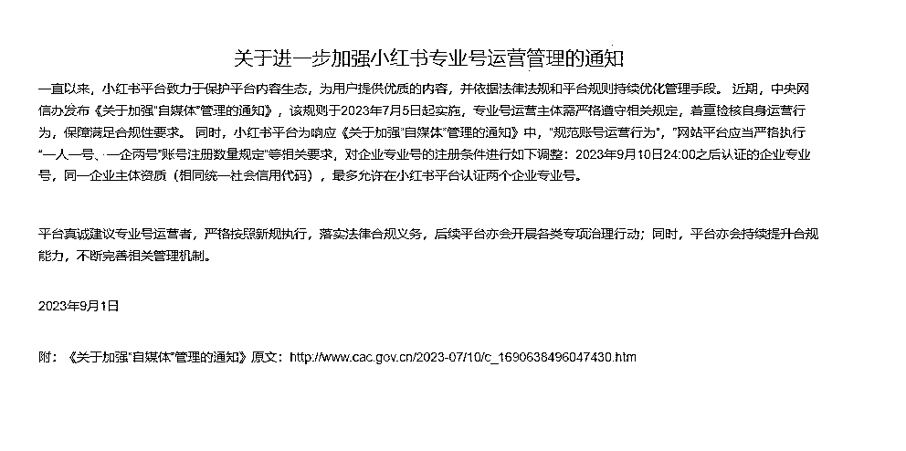

同一品牌只能开一家旗舰店，但可以同时开不同店型，比如旗舰店加专卖店，或者旗舰店加普通企业店。

企业专业号的营销权益通常更多，但和个人专业号只能二选一。新手一般先开个人店，门槛低；企业店多用于矩阵放大，平台对账号的宽容度也更高。

# 2.1.3.2 个人店：门槛与步骤

入驻门槛

个人性质店铺分个人店、个体工商户店。个人店只支持服装、百货等常见类目；个体工商户店除常见类目外，还支持奢侈品、珠宝等。不同店型可经营类目不同，打勾项就是可经营类目，具体到小红书学习中心里的规则中心—经营总览查看：

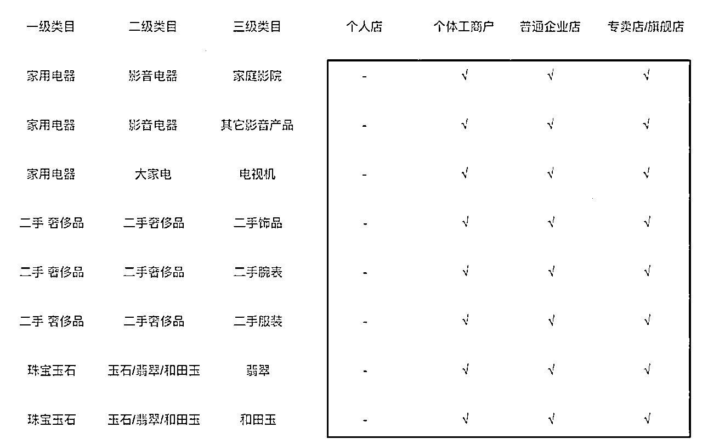

开店要交保证金：个人店和个体工商户店均为1000元；保健品、奢侈品等特殊类目会更高。

客服接待可选平台代运营或自主客服，平台代运营收费，按自身情况选。

平台佣金即技术服务费：每单按类目费率扣，费率与算法同上。

目前为减轻开店负担，个人店和个体工商户店入驻后可不交保证金先发布商品上架销售；累计交易额超过1万元后，7天内补缴保证金，相当于“无门槛”先把店开起来。

入驻流程

个人店：选店型后选经营类目，提供姓名、身份证号、手机号，完成人脸识别，验证通过即开通。

个体工商户店需提前准备：

（1）营业执照照片、公司名称、统一社会信用代码、经营地址、执照有效期；

（2）店铺运营授权书。

注意：一张营业执照若要开两个个体工商户店，需先建两个号并升级专业号后再开店，直接开不了两家。

随后同样先选经营类目，按提示上传资料。

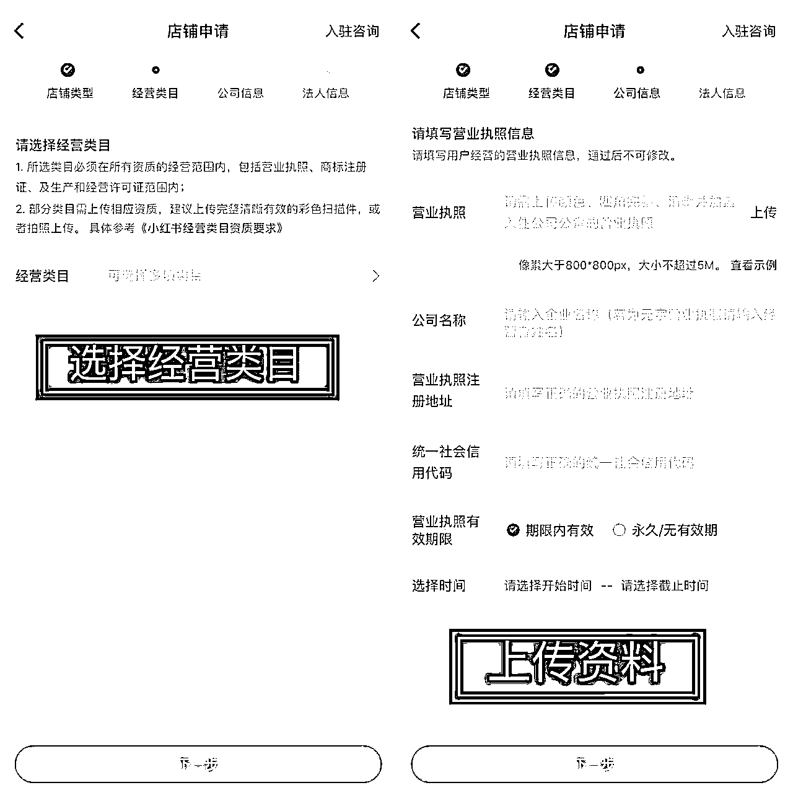

个体户店审核一般2到3天。审核期间可登录入驻系统查询。过程中有问题，9点到24点可联系人工客服。

# 2.1.3.3 企业店：材料与流程

入驻门槛

企业型店铺分普通企业店、旗舰店、专卖店、集合店。

普通企业店命名与个人店类似：“专业号账号名称+的店”。注意企业专业号取名要和商标对应，否则可能开不了店。

旗舰店名称：品牌名加旗舰店；专卖店：品牌名加专卖店；集合店：某某的海外店。

企业型店铺支持大部分类目，包括保健品、医药等特殊类目。

平台佣金同个人店：1万元以下不收费，超过部分按5%收。

保证金按类目略有差异，一般境内最低2万元，境外3500美金。

不会选可看下图快速判断：

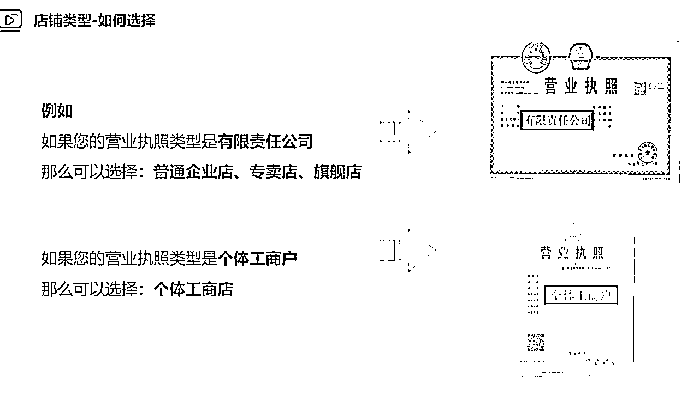

入驻流程

企业店材料较多，建议电脑端操作：gaia.xiaohongshu.com。

【普通企业店入驻流程】

大致六步。

第一步，店铺类型选普通企业店。

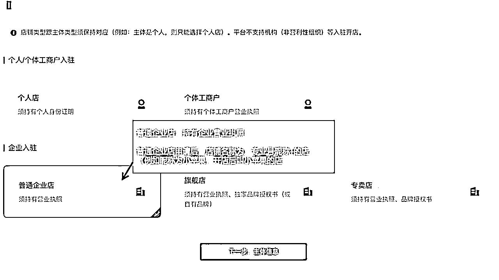

第二步，填公司信息，上传营业执照。执照要拍清晰完整，避免扫描错误。再填法人或店铺运营人信息，联系人须与营业执照法人一致。

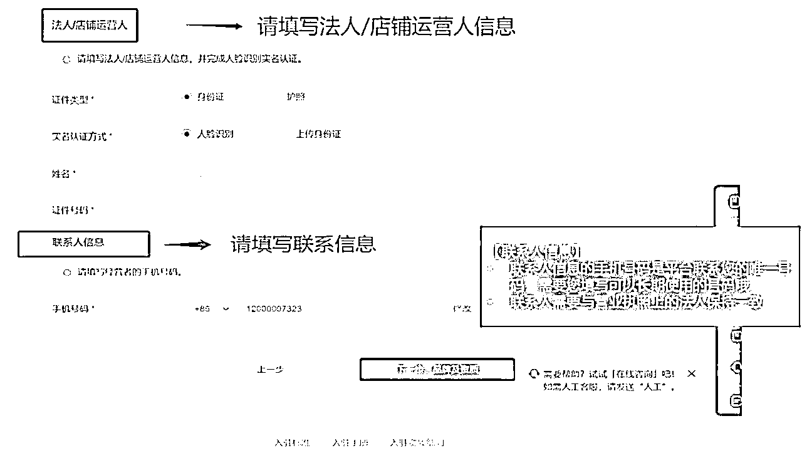

第三步，填店铺名称。系统会自动抓取，命名形式为“昵称+的店”，与昵称挂钩；要改需去专业号中心改昵称。

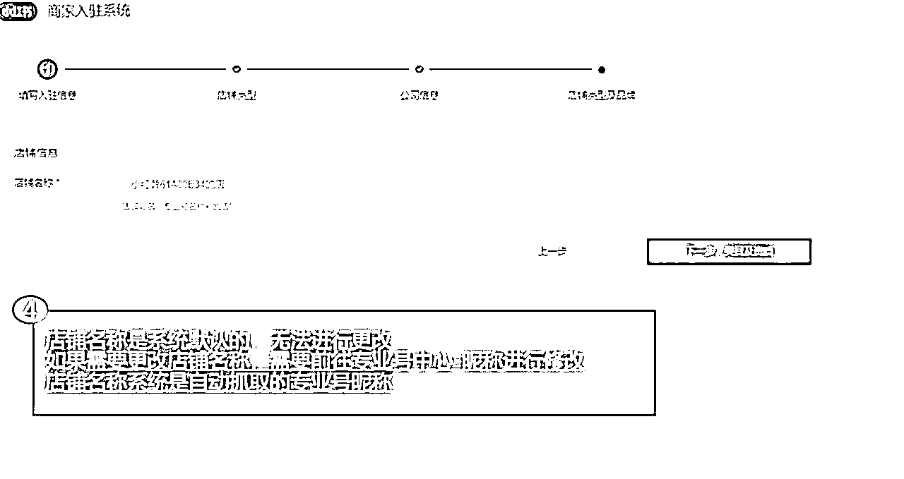

第四步，选经营类目。类目必须在商标注册证范围内。

第五步，等审核。一般3个工作日内。失败会电话或邮件通知，期间可联系在线客服。

审核通过后，最后缴店铺保证金。注意开卡账户为对公账户，开户人须与入驻时填写的经营人姓名一致。

【旗舰店/专卖店入驻流程】

大体同普通企业店，重点注意四点：

1. 填品牌信息。系统没有品牌就点“新增品牌”，上传logo须与商标注册证完全一致。

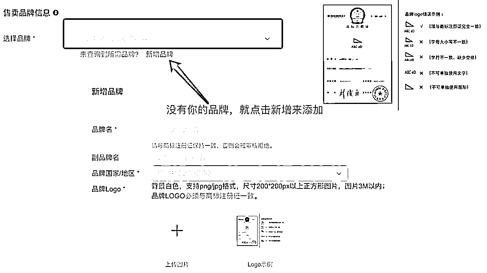

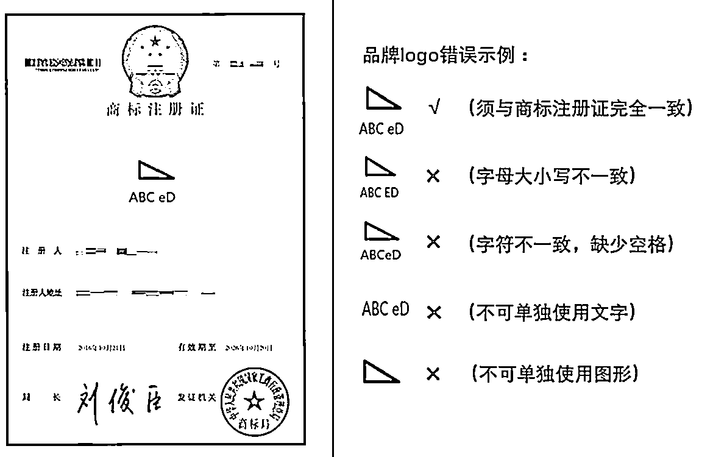

2. 区分自有品牌和代理品牌。代理品牌要有完整授权链路，公司名称选营业执照上的名称。

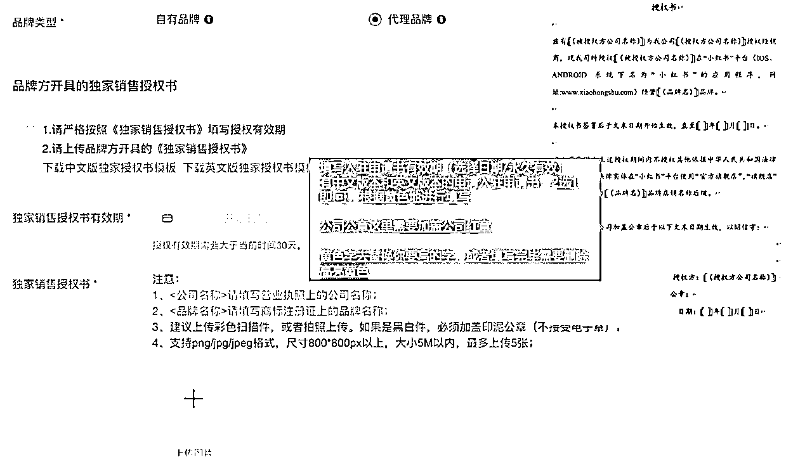

自有品牌指商标持有人是自己公司或法人；注册类型分R标、TM标，R标是注册商标，TM标是商标注册申请受理通知书。

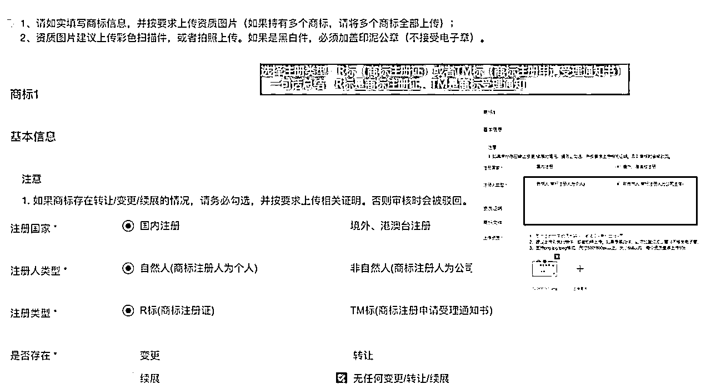

如果商标注册类型为个人型R标，需上传商标注册证，以及商标权利人身份证或护照复印件/扫描件。

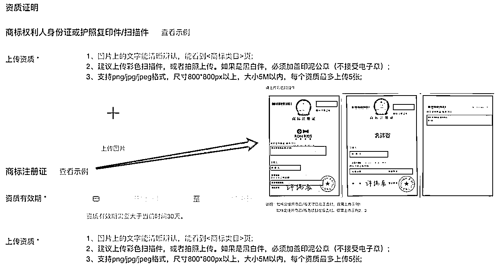

同样，个人型TM标需上传商标注册申请受理通知书，以及权利人身份证或护照复印件/扫描件。

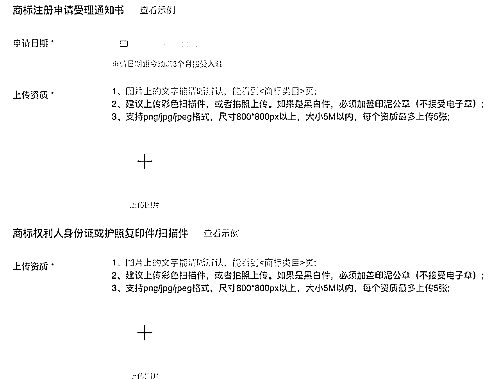

企业型R标或TM标，只需商标注册证或商标受理通知书。

3. 选售卖品类时，谨慎选“定制”品类。

4. 审核通过后要签合同。合同以线上邮件形式，通过电话或验证码确认签署。

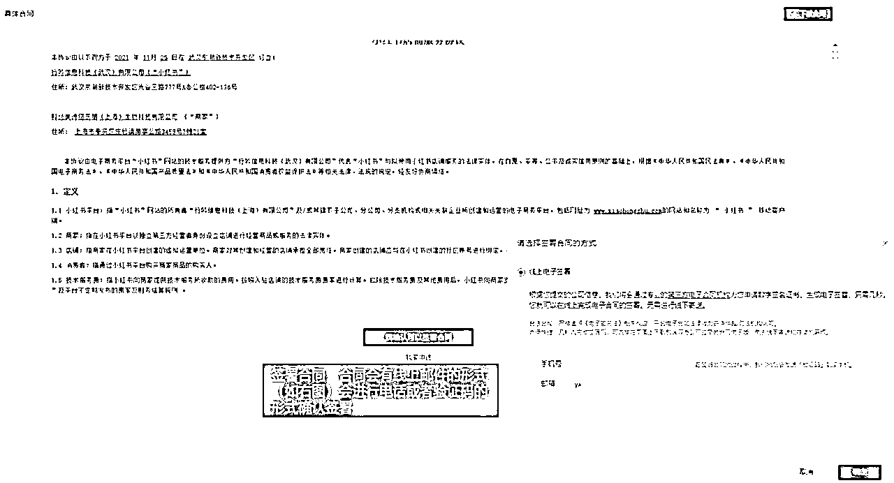

接着缴保证金，注意事项同普通企业店。

集合店只有平台邀约才能入驻。收到邀约后，入驻流程与旗舰店、专卖店相同。

全部申请通过后，就能上传商品开店，账号首页会直接显示店铺和商品入口。

总体看，企业店商业权益更多，但维护费用也更高，按自身情况选。

入驻类目、审核等不懂，建议第一时间联系“人工服务”，商家客服回复较及时，能快速解决。

更多入驻信息可去小红书电商学习中心查：

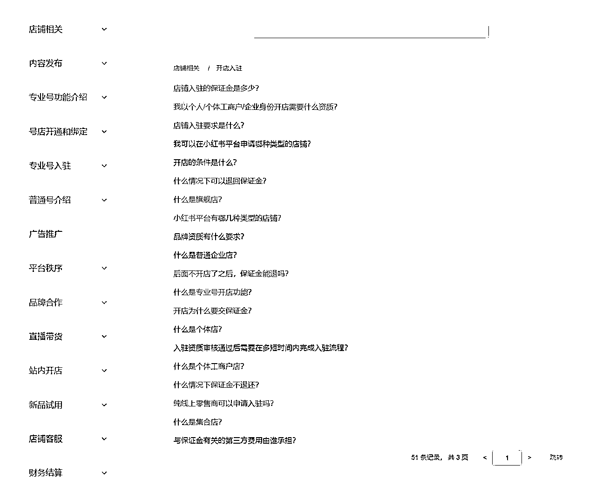

# 2.1.4 账号形象怎么立

小红书店铺账号包装不复杂，通常选好赛道再设置。本次以女装赛道为例：

第一步：找对标账号

小红书商城搜赛道关键词（如“打底衫”）→点高销量产品→点左下角头像进主页。

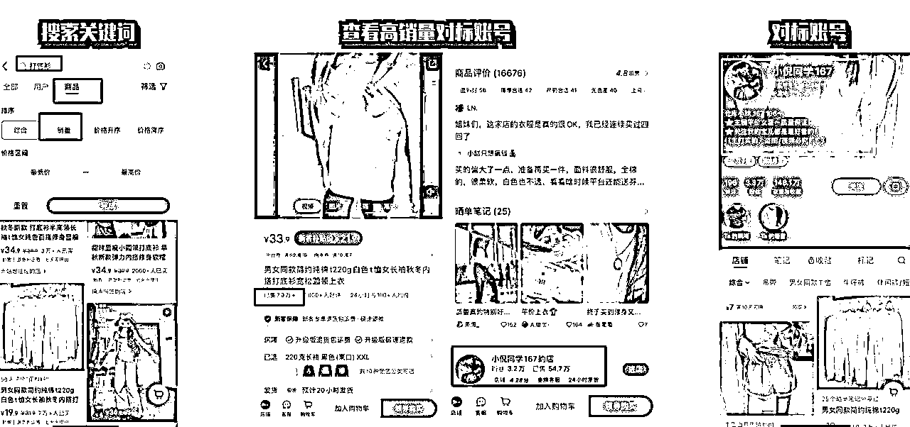

第二步：模仿并完成定位包装

比如对标账号是“我是杨十七穿搭”，可模仿设置为“我是十一穿搭”。

# 2.2 女装选品从哪入手

# 2.2.1 女装选品两条线

小红书女装选品主要看两点：

1. 找对标爆款；

2. 找退货率低的。

如何通过对标爆款选品？

小红书女装选品较简单，主要来自站内：

低粉爆款对标笔记，跟款；

及时看对标账号爆款笔记，并跟款；

没挂链接的笔记，评论区求购多、蹲链接多（说明需求多，及时找到款式上架就可能出单）。

注意：小红书女装爆款很大程度受“季节性”影响，要及时关注行业风向或对标账号。

比如去微博、抖音等热门平台看热点；当天出现爆款产品，及时到小红书发笔记跟款，更容易做出爆款笔记。

如何筛退货率低的品？

女装别选特别挑身材的，最好通版。

新手不建议选新中式、国风、连衣裙等。虽然这些在小红书较火，但不是大部分人都能穿，很多人自我感觉好看就下单，退货率非常高。

推荐方向：开衫、衬衫、裤子、背心、外套、打底衣等，退货率相对低。

# 2.2.2 选品实操两法

# 方法一：跟对标账号抓热款

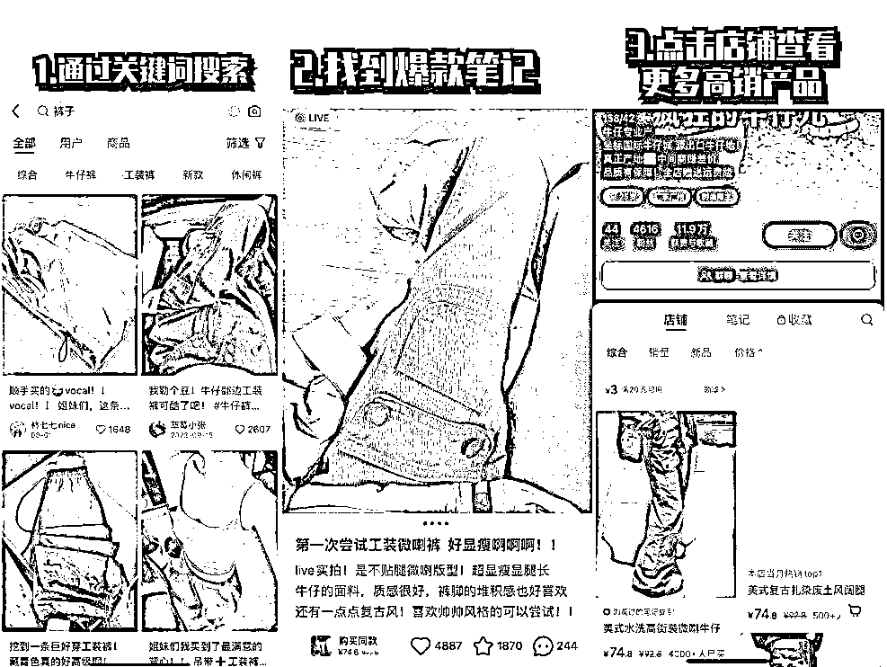

第一步：搜关键词

搜垂直关键词，如裤子、衬衫、背心等。

第二步：收集爆款对标

找爆款对标账号、高销笔记，做对标记录。

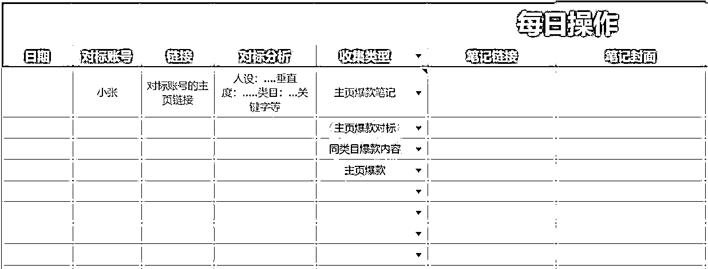

记得关注对标账号，日常监控其爆款笔记；当天出现爆款可及时买样实拍跟款，抓住机会。

第三步：判断能不能跟

检查对标账号爆款笔记是否符合“7-15天内爆款、高销低评价”。符合可视为近期爆款，能跟款。

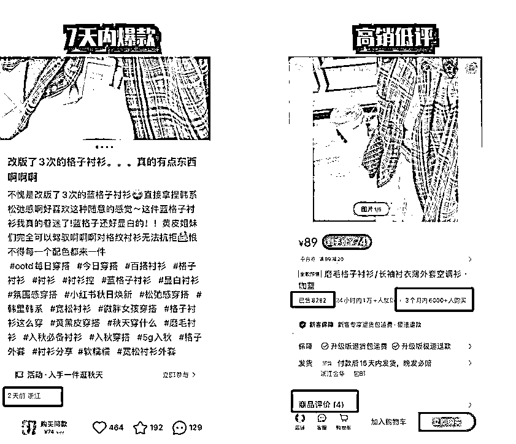

# 方法二：从商城购物入口找热卖

账号确定垂直类目并逐渐养成垂直账号后，主页购物入口会推荐很多近期热卖商品链接，可在这里筛出符合爆款标准的商品。

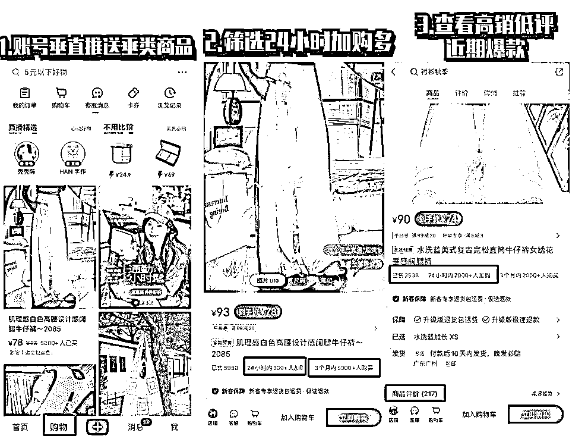

# 附：选品记录表模板

新手可参考这个选品记录模板，建自己的选品记录表，把爆款对标记下来。

可参考模板（共三个表），也可按需求收集：小红书选品记录-模板

表1：记录发现页实时推送的爆款（包括爆款低粉账号的爆款笔记）：

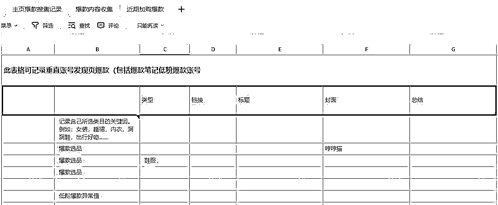

表2：记录对标账号爆款笔记，作为爆款内容参考：

表3：记录商品链接近期24小时高加购爆款：

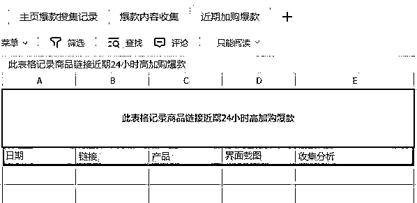

# 2.2.3 选品避坑清单

1. 尽量避开货源稀缺的款式。笔记爆单时，慎重让厂家生产，因为自主生产无法退货；

2. 避开特定人群款式，如新中式、国风，挑人穿的款式退货率可达70%-80%甚至更高；

3. 产品低于市场平均价要慎重拿货，容易出现质量差、退货率高、店铺负反馈严重；

4. 选品前让商家发产品实拍图、细节图，直观判断质量，避免货不对板；

5. 看商品评价，网图评价多于客户真实评价，考虑刷单做评价，质量要检查核对。

# 2.2.4 女装选品清单

为降低项目难度，本期航海请教练提供女装选品清单，航海期间每日更新，可作选品参考：女装选品清单

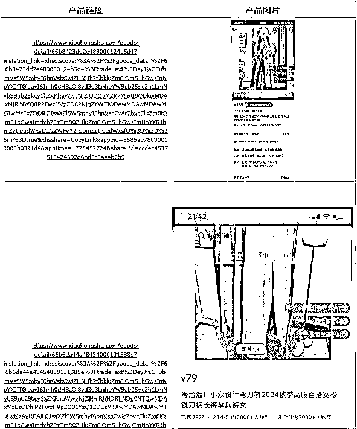

# 2.3 先买样品，物流约1-4天

选完品后，建议新手第一批下3到5个品的样品，用来拍产品实拍图。

注意：这个环节先不谈代发，等出单再谈。

下单样品步骤：

第一步：确定要下单的选品，保存产品图片；

第二步：用拼多多、1688、以图搜图找供货商，查看材质描述，款式是否和爆款商品描述一致；（找供应商方法详见【章节四：找到优质稳定的供应商】）

第三步：点销量高的店铺，价格有30%-50%或以上利润空间即可。（比如小红书卖78，拿货39，利润率50%）

注意事项：

1. 查看商品描述，材质和规格是否与爆款一致，并咨询是否24小时内可发货；

2. 普通快递一般3到4天到货，同省一般1到2天；

3. 样品下单直接在店铺拍单即可；后续想长期合作，可和供应商确认对接流程，是加微信下单还是走ERP下单。

补充两种下单方式区别：

微信下单是为了避免二次面单被平台判无货源；

ERP下单是为了单量多时，商家能看到我们店铺后台订单直接发货；

建议新手前期单量少时直接走微信下单。

# 2.4 商品上架收尾

# 2.4.1 主图与详情页

千万别做淘宝那种特别专业的美工图、详情图。主图最好都是小红书风格图片，更真实。如果是实拍图或视频，建议详情图也换成笔记里实拍风格，让用户有“所见即所得”的感觉。

比如下面这个账号，详情页和视频是同一种风格。

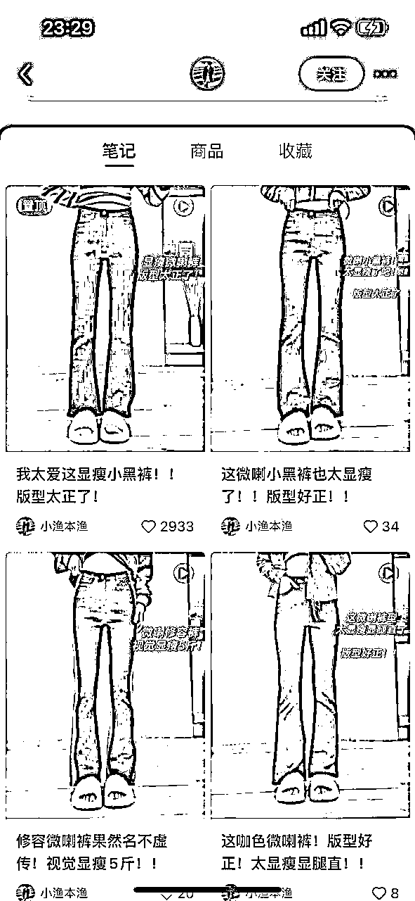

还有下方这个，详情图直接用主页笔记图片，用户一看就知道是实拍。

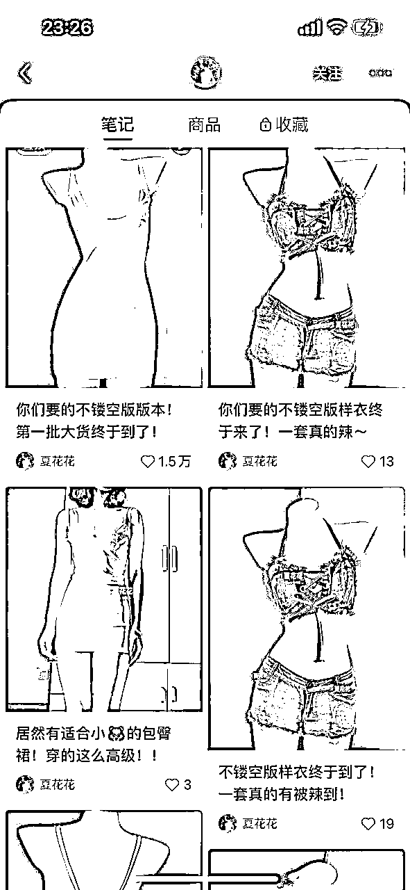

# 2.4.2 定价别拍脑袋

别以为把拼多多商品搬到小红书翻三倍还能卖，小红书用户没那么傻。我问过50多个女大学生，大部分人还是在淘宝、拼多多、得物下单，而且现在大学生很多会比价。

产品定价我会搜淘宝和拼多多销量靠前的店铺，定价在这两个平台区间内。很多用户即使比价后发现比淘宝略便宜，考虑到我们图片是原创拍摄，主打“所见即所得”，基本不会再去其他平台下单。

比如随便在拼多多榜单看到一条牛仔裤价格39，去搜同款在淘宝按销量排序，月销1000+的基本在70到90区间，当然也有40多的。这时我可能定价59到69，具体算自己的利润率。

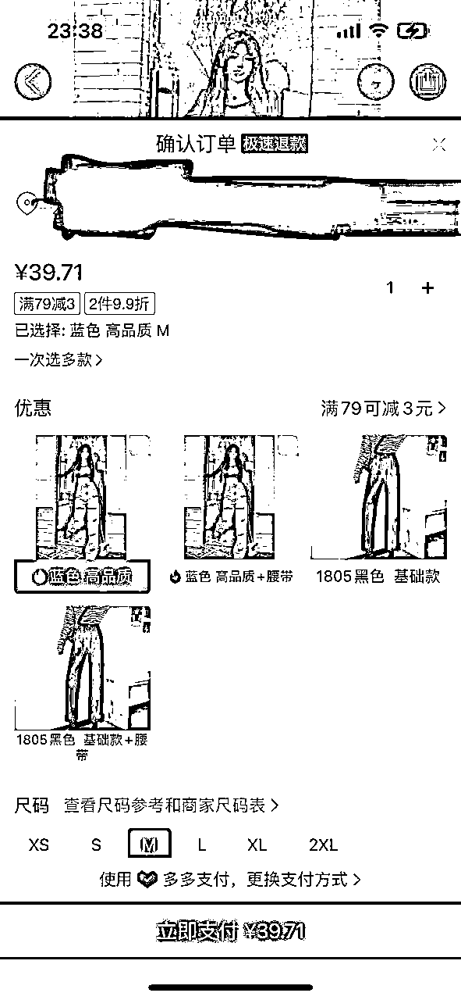

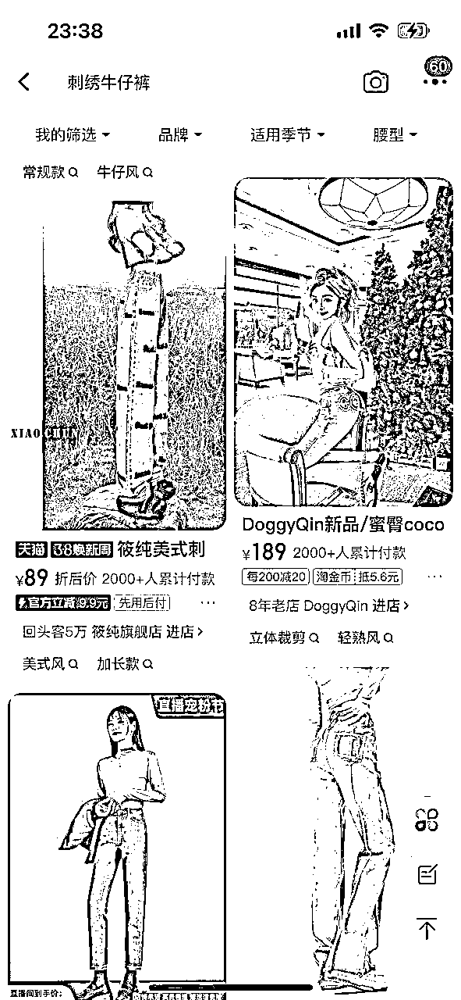

我们做女装类目商品浏览到下单的转化率一般4%-7%，低于4%可考虑调整定价。

或定价前先去小红书多刷，观察同行爆文左下角挂的商品的累计销量。

实操中，定价非常非常重要！！！特别是低客单价商品，很多伙伴有两个定价误区：

1.

# 定价的两个误区

有些商家认定小红书客单价高，于是不停往上加价；另一种做法是照搬其他平台的标价，不结合平台实际做调整。@V小刀 在星球社区帖里把商品定价拆得更细，下面分享给大家：小红书电商细节篇。

# 2.4.3 买家秀铺得足，成交更顺

小红书不靠刷单起量，但晒单内容铺垫到位，会进一步推动用户下单，服装、首饰、鞋包等类目尤其明显。操作不复杂：先让几个账号在店内下单，再请他们发布晒单笔记。

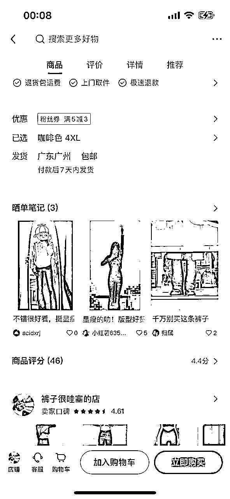

资料出处：《小红书店铺如何 1 个月做到月流水破 50w+》

# 2.4.4 商品上架流程

# 2.4.4.1 手机端上架

小红书 App 与商家版 App 的上架逻辑接近，页面提示也清楚，照着操作即可。

具体步骤如下：

1）进入商品编辑

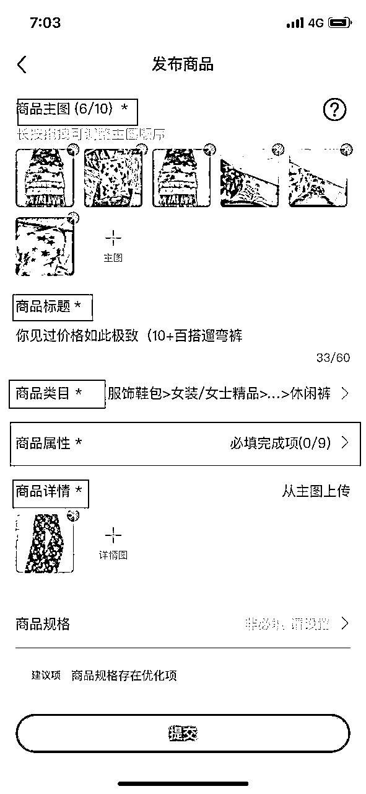

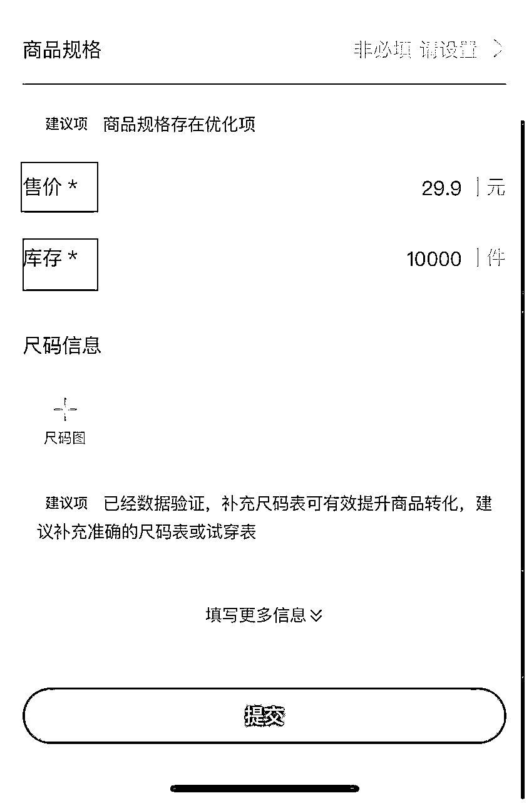

注意：

标题和主图两项必须填。

官方对主图规格有要求，画面干净些，别堆太多文字标签。

首图不合规会导致上架不成功；未达到首页推荐标准的，商城首页也不会展示。

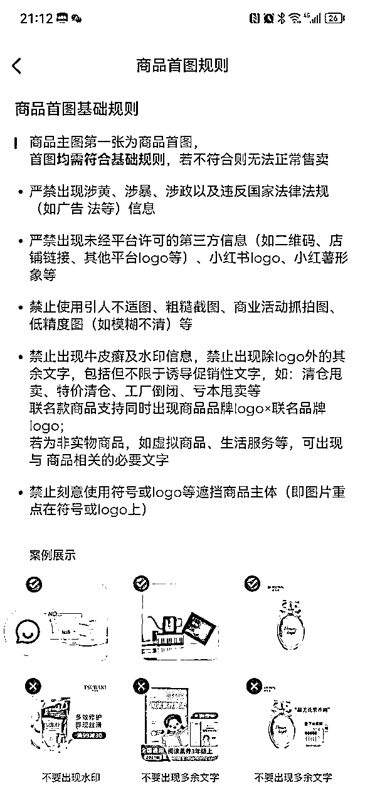

2）选择商品类目

页面列出的是个人店可售类目，也可在搜索栏输入“服饰鞋包 - 女装”直接定位。

3）填写商品规格

同一链接含多个型号才需配置；只有单一款式可跳过。

4）设置商品售价

按要上架的商品填写价格。

5）设置库存数量

填实际可售数量。

6）填写商品属性

依商品情况补全。

7）填写商品详情

上传详情页图片。

商品描述非必填，可留空。

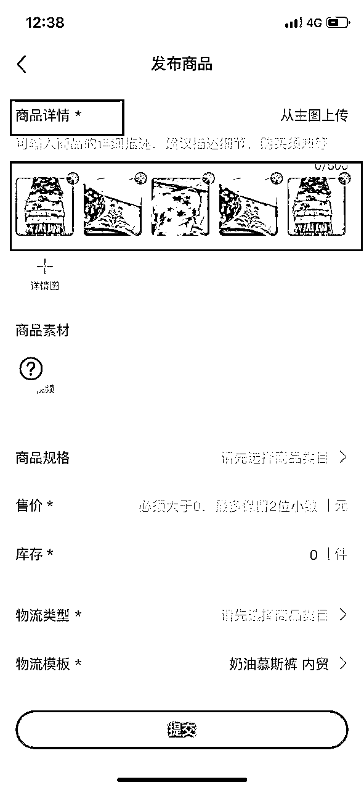

8）选择是否包邮

视商品情况而定。系统默认两种：

全国包邮；

偏远地区不包邮（包括新疆、西藏、宁夏、青海、海南、内蒙古、甘肃）。

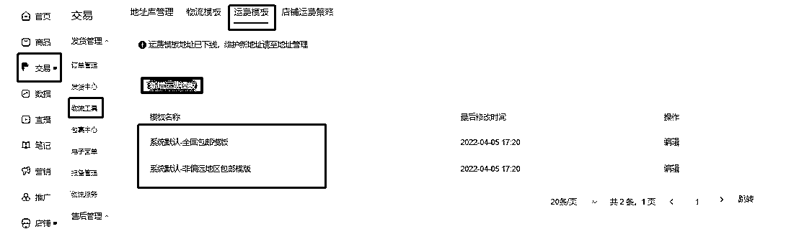

也可自建运费模板，设定运费金额并按地区区分（仅电脑端商家后台可操作）。

先填默认运费，再设特殊区域价格，可按件计费，也可按重量计费。

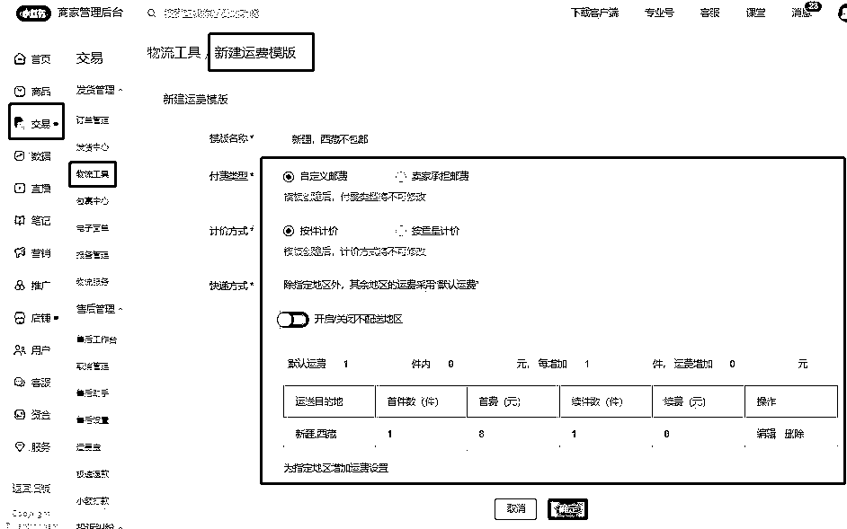

9）设置发货时间

发货时间自行设定，建议填 48—72 小时；若非现货在手，不要选 24 小时发货。

上架后点立即发货即可。

平台采用机器审核，通常很快，无异常发布后即可上架。

# 2.4.4.2 电脑端上架

网页版商家助手地址：https://ark.xiaohongshu.com

电脑端有两条路：软件一键搬家，或手动发布。新手先试手动，量大再上工具。

1）后台手动上架

在小红书商家管理后台手动发布，步骤如下：

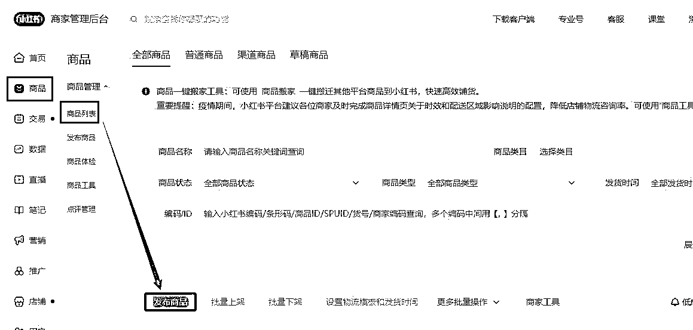

① 按产品类目选准类目，点下一步：

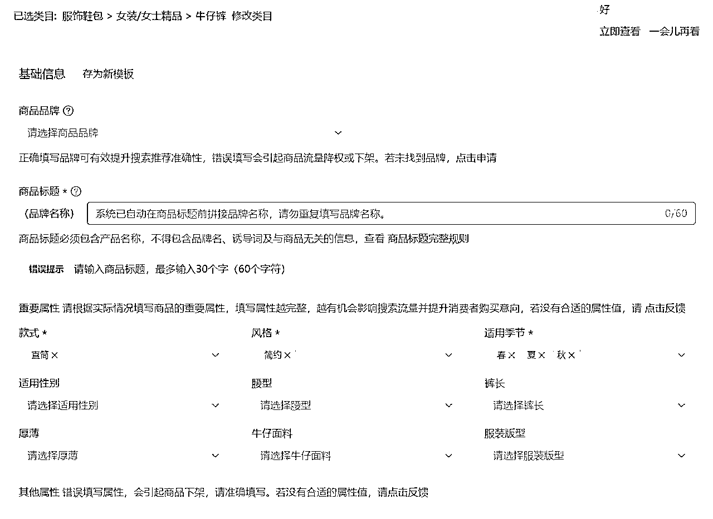

② 按属性填写，带 * 的必填，其余选填：

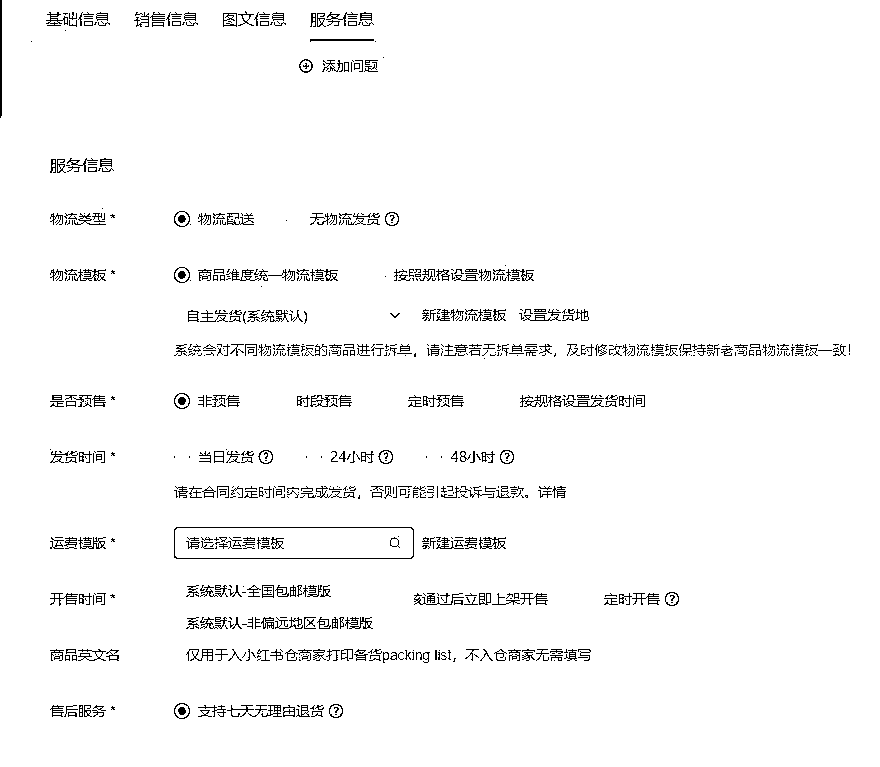

③ 信息填完，提交审核即可。

2）一键搬家软件

在店铺后台进入服务，从服务市场挑一款搬家工具。后台一般可试用，选合用的即可。

① 入口：【小红书千帆】→【服务】→【服务市场】→【前往服务市场】

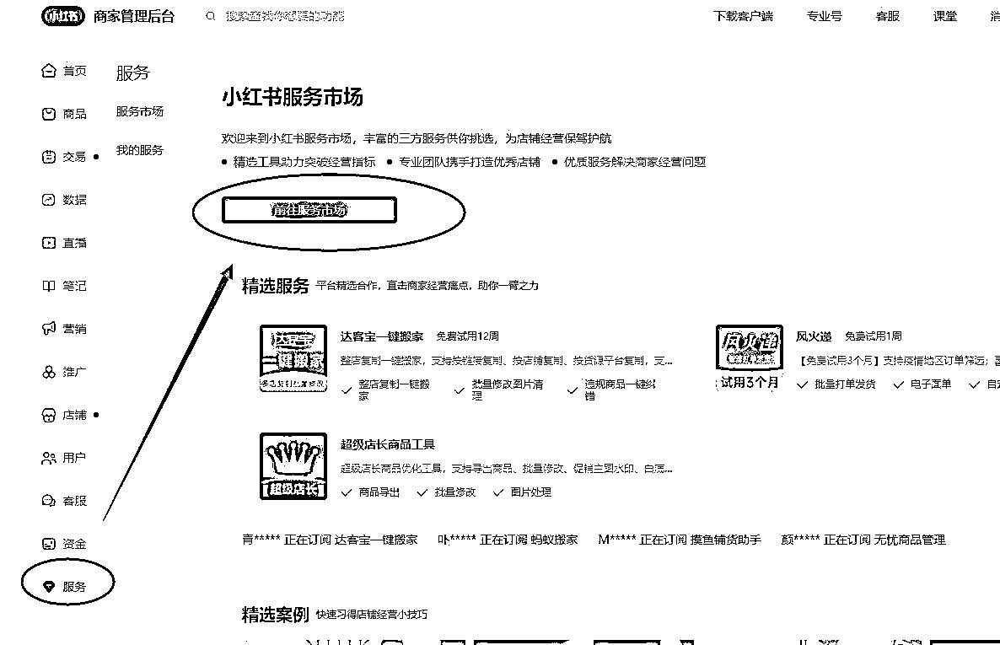

② 点妙手商品上货

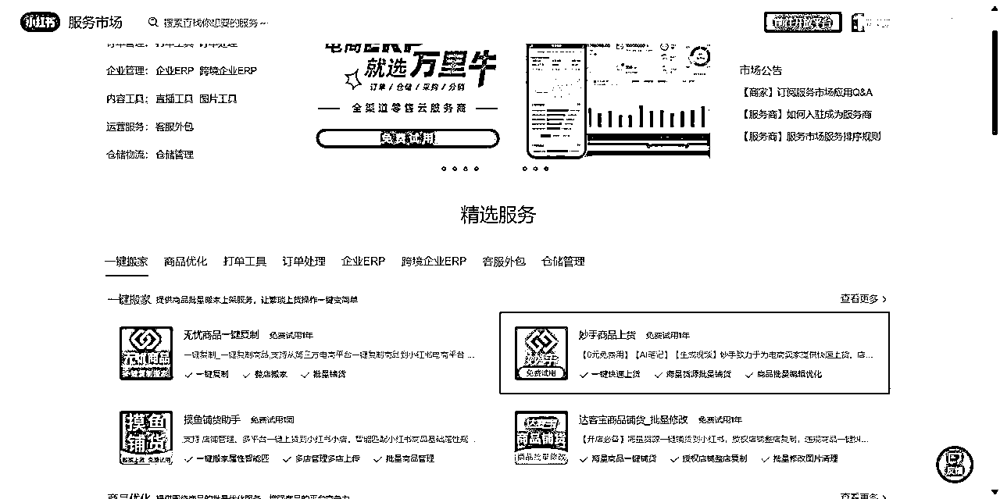

③ 点商品上架

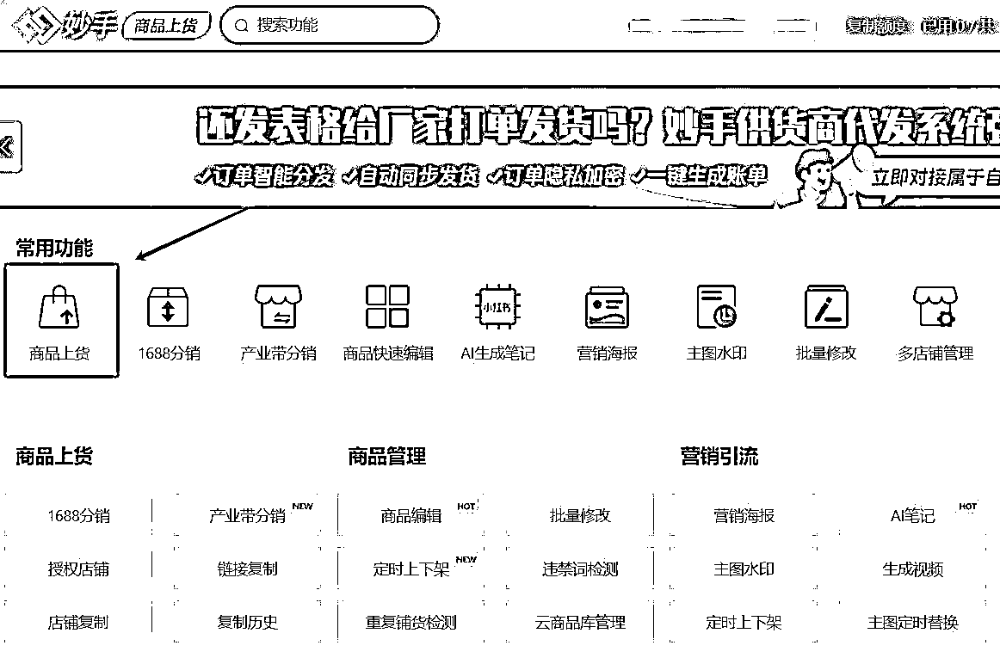

④ 把商品链接粘进输入框，点【开始抓取商品】；货源可来自 1688，也可粘贴对标店铺链接。

⑤ 抓取后界面信息较多，点下方【商品信息】：

⑥ 商品信息设置

1-物流模板：先新建，地址可先随意填或填所在地；出单后向厂家索取发货地址，再回后台修改，能降低被判定“无货源代发”的风险；

2-运费模板先选【非偏远地区包邮】；出单后再确认厂家加运费或不发货区域，再做调整；

3-品牌处有叉号，多数商品无需品牌；鼠标移到箭头处出现叉号，删掉品牌名即可；

4-发货时限选 48 小时，留出缓冲，减少超时违规；

5-类目选合适，系统会自动识别；识别不到且无法选择时再手动调整；

6-点【SKU信息】

⑦ 点“开始搬家”，上架完成。

# 2.4.5 优惠券这样设，转化更高

优惠券能提升商品转化率。

用户下单时看到折扣，且带时间限制，会感觉商品更值。

如何设置商品优惠券？

① 先上架一款商品

在【商品列表】找到刚搬来的商品，点【上架】，店铺主页显示后才能设券。

② 创建优惠券

回到主页，点【营销】→【优惠券中心】→【创建】

③ 设置优惠券信息

1-推广渠道选【全网自动推广券】

2-券名写产品名，便于以后识别

3-选择商品

4-点添加商品，勾选要设券的商品

5-领取时间从当天开始，结束可设一年或更久

④ 设置优惠券规则

按产品设大额券促转化（先把售价调高，再设券），发行量不限，每人领取次数不限，点创建。

拓展资料：更多上架相关内容，可到小红书商家课堂学习：

https://school.xiaohongshu.com/course/list?jumpFrom=school&categoryNo=20210515002

# 2.5 女装如何测款

图片拍完，就进入测款阶段。

# 2.5.1 测款究竟测什么

先把定义说清。

很多人把测品理解成判断这款行不行。可按前面的选品逻辑筛出的货，通常产品本身问题不大。

小红书靠内容带货，货与内容是一体的。

因此测品实际看的是：当下这个节点，凭你的内容制作水平，能否把这款推爆。

相同能力，在款刚起势时做可能起；热度过一阵再做可能就难。相同时间与货，内容更强的人能跑出来，别人未必。

这就是测品的价值。

# 2.5.2 女装测款方法

女装类目建议至少起 2 个号；每个号在内容质量有保证的前提下，每款至少发 3—5 篇笔记。

每篇按收集到的爆款封面和内页图来测。

多找几组爆款封面加标题做组合，一款产品测 5 篇，场景、角度、风格灵活换。

例：

假设模板 A—E，产品 1—5，可交叉搭配：

测产品：1-A、2-A、3-A、4-A、5-A；

测模板：1-A、1-B、1-C、1-D、1-E。

测款时要重点做好这些细节：

1. 封面与脚本要用站内近期跑得好的。

若你的品还没有爆过的封面脚本，就参考同类、同功能旧爆款。

2. 看数据。

同账号 A 产品发 2 篇、B 产品发 2 篇，次日 B 明显好，后续资源向 B 倾斜。

同一产品，A 封面优于 B 封面，后面多做 A 方向。

很多人问：一款测多少条不行就放弃？

理想是近期爆款封面、脚本、素材都试过仍不起量，才算测全，通常 5 条以上。

实际看反馈，10 条还没出单就该舍弃。

每篇笔记都是资源位，测试就是找出更优笔记（封面、选品等）并给更多资源，长期无价值就停。

更多测款细节，可看 @V小刀 分享的星球帖：《小红书电商测品方法解析》。

资料出处：《小红书电商测品方法解析》、《小红书上日入过万的那些爆款单品，到底要如何跟品测品呢！？》

# 三、【实操2/4】图文带货笔记：做出爆款、拿到流量

# 章节概要

前文提到项目两大关键：选品与创作带货笔记。上一章解决选品，这一章基于已选商品做笔记。

女装赛道适合新手且可持续的形式是产品实拍图文。因此重点讲实拍图文制作：

✅ 找对标爆款 - 拆解爆款笔记 - 实拍图片素材 - 图片后期制作 - 发布笔记

除方法外，本章附教练整理的《女装爆款文案/图片库》供参考。

希望帮大家完成关键一步。

# 本章航线图

学完并实操，可完成路线图第二阶段：上架商品并制作爆款带货笔记，获取流量（约 3 天）。

1. 每款找至少 5 个爆款对标并拆模板（约 30 分钟）

2. 模仿 5 个爆款，至少拍 15 张图（约 2 小时）

3. 首周发布至少 5 篇带货笔记（约 2 小时）

# 3.1 第一步：锁定对标爆款

做小红书带货，选完品后，比起先找对标账号，更建议直接找对标笔记。

本期航海靠图文笔记拿流量，所以对标也看图文。目的是参考爆款的主题与文字（标题、正文）。

筛选原则是“近期低粉爆款”，三个要素：近期、低粉、爆款；其中近期和爆款优先于低粉。意思是近期刚起势的内容，只要产品合适，即便账号粉丝不少，也可模仿测试。

具体步骤：

1. 用产品词（如“裤子”）搜最热视频。

搜索后点最热，并筛选图文视频：

关键词可看搜索下拉词。

注意：

氛围感门槛太高或模特露脸类难复制，跳过；只爆 2—3 条的账号也不适合长期参考。

2. 记录爆款。

点赞 1000+、评论区求购 50+，且主图风格自己能拍。

# 3.2 第二步：拆解爆款元素

图文笔记重点拆标题与图片。

# 3.2.1 标题拆解

标题作用：在双瀑布流里用有限几个字让用户迅速认出你。

目的：戳痛点、爽点，引发好奇与共鸣，提高点击。

要点：关键词要醒目，让人一眼看懂内容或产品；关键词也有助于算法识别。

高赞公式：

（1）数字戳痛点。数字增强辨识度，让价值更直观。如“49 元开衫一次买 3 件”“反季 59 元 bm 外套入手 2 件”。

（2）噱头式。用夸张形容，如“秋天的氛围感神器”“狠狠期待秋外套”。

（3）对号入座。加人群标签，如“方圆脸人生打底衫，显瘦”。

# 3.2.2 图片拆解

图片形式：

常用平铺（不同部位/角度、搭配、折叠）与人台展示（不同部位/角度）。

平铺：

人台展示：

图片数量：

一般 5 张：整体、上身（不出镜可省）、细节、口袋、缝线。

# 3.3 第三步：实拍图片

新手初期可 1:1 复刻对标图，少走弯路。

有经验、能复刻对标图后，可试“进阶版 live”，提升审美与技术。

实拍教程如下：

# 3.3.1 场地布置

服装用户偏爱柔软舒适面料，布景要干净和谐，便于呈现质感细节。可用纯色地板、软沙发、暖色床品、毛绒地毯等。

# 3.3.2 光源选择

选窗边自然光、顺光（人面向光源），避免过曝或发黑，成片更清晰、还原度高。

# 3.3.3 拍摄工具

优先苹果手机，自动美颜少、还原好。以下以苹果参数为例。

# 3.3.4 角度与构图

依据衣服大小款式决定放大或缩小。

大衣、长开衫放进大环境；吊带、T 恤等小件放大 1.2—1.5 倍呈现质感。

# 3.3.5 四个注意点

1. 清晰度：实拍高清是关键。苹果可按上文调参；非苹果关闭自动美颜。清晰度达标时不必迷信模板，女装图文越简洁往往出货越好，花哨模板反而拖累。

2. 功能性：解决穿搭痛点，如梨形身材的裤裙要收腰、增臀放量、裆部回落防翘。突出功能可提升专业感与信任。

（裤子细节可参考，笔记可附版型说明）

3. 打光：让成片接近肉眼效果，别过度美化色彩；窗边自然光最舒服，也能减少货不对板。

阴天可补光。

4. 风格：按衣服风格与目标人群定实拍调性。学生党偏清新简约，熟女偏大气利落。

# 3.4 第四步：图片后期

后期不复杂：

1. 调色：和打光目的一致，还原肉眼色彩，无统一参数，可搜攻略多试，调到接近真实即可。

2. 磨皮/锐化：一般少加；手机美颜或锐化过头时适当调整，如苹果某些型号锐化重，可用磨皮缓和。

1. 花字：少加为妙，别让文字抢了服装风头

实拍画面上的装饰文字，能省则省；实在需要，挑一个或两个短词就够了。文字一旦过强，视线就会被带走，大图真正该突出的是衣服本身。

# 3.5 第五步：把笔记发出去

笔记做好后，可以先放进草稿箱备用；但不建议用定时发布，免得流量受牵连。真正发出时，从平台认可的多个官方入口进入，或许能多拿一些曝光。活动淡季没有特别活动，直接发也没问题。以下五条路径都可用。

路径一：借【创作灵感】发图文

路径二：盯平台官方账号，跟着活动走

像美妆薯、家居薯这类账号会不定期办活动，参与后可能获得官方资源；一旦被他们转发，曝光量会很可观。

路径三：蹭热门活动，挑热门话题发

路径四：从千帆后台发商品笔记

每周任务按时完成，可领到流量券。

路径五：别漏平台隐藏福利

生日券、站内消息等，记得在有效期内用掉。

# 3.6 女装类目出爆款笔记的要点

1. 别死守一个爆款框架。同一套模板用上五次左右就该换，反复套用，平台可能给限流。

2. 找实拍灵感时，可以参考对标账号，但背景、陈列别照搬。重点做出自己的风格，这样更容易勾起购买欲，也能让粉丝更黏。

3. 女装用户先看画面。图必须清晰，第一眼才抓得住人；最好用光线好的 live 图，真实感和质感都更强。

4. 若笔记里有真人出镜，需警惕虚假氛围过浓。有人物的种草内容，别从头到尾都在凹造型，例如夸张顶胯、刻意叉腰。更推荐用【衣服的平铺图】、【普通姿势的试穿效果图】、【版型优势展示图】等直观方式。氛围感拉得过满，是如今女装退货率居高不下的重要原因之一：很多衣服只在某种场景或颜值加持下才显得合适，而大多数普通人难以营造那种氛围，于是陷入衣服不服务于人的误区。

5. 文字部分要提前排雷。平台基础规则：标题不超过20字（一个表情按2字计）；正文不超过1000字。敏感词可到零克查询（http://ci.lingke.pro/）或句无忧（https://www.check51.com/）自查。

# 3.7 附：女装爆款文案与图片参考库

为让新手更快上手，这里汇总了女装类目常用的爆款文案和图片，供参考。女装爆款文案图片库（建议收藏，会时常更新）

# 四、【实操3/4】锁定长期可靠的供货方

# 内容速览

笔记开始有流量、有人来问单，就可以回头找之前拿过样的供货方谈货源合作。若你本身有货源，直接对接相应厂商即可；若没有，本章会从以下角度给出完整经验：

✅ 挑供货方要看哪些条件
✅ 怎样又快又准找到生产商
✅ 如何筛选候选供货方
✅ 与供货方沟通的技巧
✅ 对接工具
✅ 供应链避坑

希望这些内容能帮你补齐后端，把电商变现闭环跑通。

# 本章路线图

学完并动手做完本章，就能走完路线图第三阶段：与供货方建立稳定合作，同时学会运营管理店铺（约2天）。

1. 出单后至少谈成2家稳定供货方（约4小时）

# 4.1 挑女装供货方，先看哪些条件

拿样品那一步，其实已经接触过供货方。等出单后再找对方细谈代发即可。下面把找供货方的方法和注意事项补全。

1. 价格空间

供货价和你的上架价之间要留出利润；报价太高，与同行相比就没优势，转化也会被拖累。

2. 款式与品质

可让商家拍照确认，也可自己买样回来判断。货够优质，后续长期合作才稳。

3. 单量大时能否接 ERP

订单到100+后可以上 ERP，发货效率更高。不用再导单给商家，对方在 ERP 里直接看订单、打单发货，既少一道环节，也能降低系统判定店铺无货源的风险，还能打印平台面单。具体用法见4.5对接工具。

4. 能否打手工单、避开第三方平台面单

前期单量少可以不上 ERP，但必须和商家确认走手工单，防止被平台识别成无货源，保住店铺安全。咨询前先说明自己做电商、能长期合作，也可以多聊几家，让对方感觉你会持续下单，而不是只问不买。

5. 货期与退换

先问清楚是否接受退换货，避免部分供货方只退40%—80%的货。

# 4.2 怎样又快又准找到供货方

1）以图搜图。多数情况下好用。若搜不到，可能是图片边缘太糊，或者产品由常规 A+B 组合而成，1688 难以识别；若只需要其中 A 或 B，可以拆开分别搜。

2）关键词搜索。从品名、款式、功能等角度输入。

3）去对手链接的页面介绍和评论区找线索。页面通常有尺寸、材质、颜色；评论里常出现更真实、更细节、能放大的图片。

# 4.3 对候选供货方做筛选

做无货源，核心在于筛商家、建长期合作、慢慢积累自己的供应链。怎么筛？

1. 用多多平台判断合理货源价

上一步找到的供货方报价不一。把商品放到多多搜，观察各价格档位里被设置数量最多的那个，再乘以0.9，可视为较合理的拿货价。

2. 在多多筛出【能手工打单且没有卡片】的商家

手工单与非手工单的示例见下：

3. 筛选时让对方出示打包发货图片

若卖家来咨询，可提供图片避免被判定无货源；通过前面给的微信号转到私域，再让对方补实拍单号，证明是自家仓库发货，并非无货源。

4. 初次交易可走平台；转到微信下单时，让对方给金额链接拍单

前期先建立信任，后期可直接微信下单；大额交易走订单发微信，整体交易额按多多下单总金额计。还可以让已加微信的商家提供近期热销款。

按上述方式操作，能和商家建立长期合作。拿货价通常比平台略低，商家也愿意给热销款；如果日订单不多，微信直接下单，商家一般也接受代发。这个过程中要筛出合适的代发商家和产品质量，可以自己在多多拍单回来验货，平台有运费险，质量好就长期合作。注意：发货地址要和卖家发货地址一致。

# 4.4 与供货方沟通的门道

尽量把 1688 上的沟通转到微信，能电话就电话；感觉不靠谱就别勉强合作；多从工厂角度想问题，别轻易指责；认清自己的位置，小单量先找中小型厂家。

# 4.5 对接供货方用的工具

对接供货方 ERP，主要图两点：

1. 避免二次物流被平台识别成无货源发货，导致店铺被冻结；平台对无货源的管控日趋严格。

2. 大幅缩短下单时间，结算金额更方便；商家后台能直接看到订单数量，打单也更顺手。

常用店管家来关联供货方店铺 ERP，下面展示关联步骤：把供货方的店记为 A，把自家店记为 B。店管家 ERP 工具链接：http://www.dgjapp.com/

① 先用店管家登录 B 店（子店铺）--->点关联店铺--->复制关联代码

② 让供货方登录店管家，打开 A 店的关联店铺--->立即关联--->选关联平台--->粘贴 B 店关联代码--->完成添加

③ 关联成功后，A 店能看到 B 店订单数量，供货方可直接打平台面单发货

附：店管家 ERP 对接教程

商家对接教程：https://docs.qq.com/doc/DU0pySmR2WVRhakFs?&u=3d93683801c64dc5b28bfb3c55e94430

厂家对接教程：https://docs.qq.com/doc/DU1ZLVEJmbFFxdkZ1?&u=3d93683801c64dc5b28bfb3c55e94430

# 4.6 供货方避坑指南

如果你还在做无货源，尚未完全转成货源合作或自有货源模式，下面几个避坑点能帮你少走弯路。

1）怎样避免淘宝或拼多多给客户发短信

常用应对：

① 收件手机号不填真实号码，在地址后面补真实电话。例如收件人写张三1894263109，地址为四川省成都市武侯区玉林路88号小酒馆；拍单时改成张三18900001339，同一地址，并备注“到了打1894263109”。单量大时客户仍可能收到短信，那就换第二种。

② 把数字替换成字母，做一点障眼法。在手机号里挑一个或两个数字改掉，例如1写成I、2写成z、6写成b，平台识别不出完整号码，快递员仍能看懂。最终大致是：张三18900001339，同一地址，备注“到了打I8942b3I09”。

③ 走中转仓。上架下单时地址填中转仓，中转仓会做二次面单，二次面单写客户真实地址后再发出。这样能彻底避开客户收短信，只是中间会多耗些时间，大约一两日。

2）遇到商家不发货，或货品质量很差怎么办？

拼多多这边做无货源的商家最多，原因就是成本低，不少人一人铺几十甚至几百家店。你下单后，对方可能找不到货，或觉得会亏，于是拖着不发、以次充好。去多多进货（其他平台同理），要会看：

① 成交件数别当唯一依据，尤其10W+成交的不看；重点看评论数和最近评论数。

② 看发货时效，页面前面标了“多少小时发货”的商家，通常出货更快。

③ 看店铺产品数量，若产品极多（图书、食品类目除外），尽量避开，多数是无货源或经销商。

④ 看店铺爆款和评分，四星半以下尽量不选。

⑤ 看店铺资质，点店铺首图能看到开店主体；如果产品打假风险高，尽量只选公司主体店铺。

内容参考：《月销百万选品宝典》及供应链避坑、打假人辨别相关资料

# 五、【实操4/4】店铺服务全链路：售前、售中、售后

# 内容速览

在电商链路里，售前与售后分量很重，大部分成交和复购都由此产生；同时它也会影响店铺权重，并牵涉一些风险。女装尤其如此，服务做得好，退货率有机会降下来。本章按售前、售中、售后三块，给出可落地的方法与话术，另附销售过程中的提醒，目标是帮店铺把销售效果做上去。

# 本章路线图

学完并做完本章，就能走完路线图第三阶段：与供货方稳定合作，同时学会运营管理店铺（约2天）。

1. 做完售前客服管理，务必及时回复（约1小时）

2. 掌握发货等售中管理知识和方法（约1小时）

3. 掌握退换货、差评等售后管理知识和方法（约0.5小时）

# 5.1 售前客服管理（关键）

客户咨询一定要快速响应。产品参数、规格，以及身高体重对应的尺码，最好提前吃透，这样推荐尺码更准，后续退换也会少。女装被问最多的通常是尺码，其次才是发哪家快递；把常见问题做成话术，回复会快不少。若某款没货，尽快通知客户取消订单，免得被罚。

在商家 App 里打开声音提醒，有客户来问就能收到提示。平台会考核客服回复率（需≥80%），回得不及时，店铺评分会被拉低。考核详情见下表：

处罚结果是店铺及专业号公域流量被限制3天，且不可申诉。平台会在每个自然周周二，通过商家运营系统站内信、商家版App消息、用户版App消息这三处推送通知。客服考核之外，官方还会抽检服务行为；若服务中出现违规，也会被处理。具体违规情形和处罚见链接第七条：小红书商家自主客服服务管理规则。

提高回复率可以这样做：

1）团队共用话术

平台用户关注量大、加群多，你回复稍慢，消息就可能被淹没，因此要尽量快。把高频回复整理成话术，下次直接调用，免去重复打字。比如发货、库存这类物料问题，提前写好答案；再用快捷编码命名为“物流问题”，后续一键带出。若回完客户迟迟没反应，可记下昵称，到评论区或新增关注中找人，也可搜私信；不过平台昵称重复率高，找到的希望不大，且很耗时间。

2）把回复率刷起来

手上账号多，可以用另一个号假装客户来提问，回得快，回复率自然上升；若只有一个号，就请社群朋友互相来问。提醒：爆款出现后，当天必须持续盯回复。时效很要紧，若爆款当天有10条咨询没回，拖到第二天才处理，第二天流量就可能被限。不建议临时招客服，客服情绪一差，负反馈变多，账号风险很大。也不建议开自动回复，平台审核偏严，人工回复更不容易被扣分。

# 5.2 售中环节管理

# 5.2.1 女装发货时效标准

现货女装通常给48—72小时的发货窗口；手里没现货，就不要把24小时发货挂上去。没有库存时，先与供货方谈妥备货周期；若是爆款缺货，可设为预售15天发出。

# 5.2.2 发货超期：报备与触发

所谓超期发货，就是商家没有在向买家承诺的时效内发出，并且没有把真实可查的物流单号回传到平台。若因不可抗力造成超期，商家可在商家管理后台提交延迟发货报备。需要说明：平台按事实判断；除非法律法规和平台规则明确列出的免责情形，商家不能拿“自己没犯错”当理由来否认违规。

若超期还不报备，会带来这些后果：

① 店铺服务分受损，跌破警戒线后，平台可单方终止合作；

② 流量与积分双扣，平台视情节轻重削减店铺及专业号流量，同时扣违规积分；

③ 触发订单赔付，平台从结算款、保证金等里面划扣相应金额，赔给买家。

# 5.2.3 接物流、打单与发货

自有货源时，接物流、打包、发货这三件事很关键。

接物流有两条路：

第一，自己与顺丰、中通、圆通等快递公司谈，谈妥后在千帆把对应快递开通，之后直接打单，单号会自动回到订单里，省去手动录入。

第二，使用在线寄件：下单快、自动发，不用先充值，系统会结算。路径是【在线寄件】→填写【寄件地址】和【预估重量】→点【快递公司】进入物流选择页；页面会列出可选【物流公司】和【预估价格】，选定公司、取件时间后点【确认发货】。提醒：快递员会上门取件，地址要准确。

发出后，订单会进入【首页】→【全部订单】→【已发货】，点【查看物流】就能追踪。

打单流程：先在千帆后台进入订单—电子面单。

① 申请电子面单，选已谈好的合作网点或已开通的官方快递；

② 配置面单模板，下载并运行平台打印组件（免费）；

③ 选择订单打印。

1. 第一步：把物流合作搭起来。进订单页 → 点“物流服务” → 选“新增合作”，从列表里挑出事先谈妥的快递网点，也可以直接选平台已接通的官方快递。如果渠道是自己找的，务必先把运费价格谈定，再回到千帆平台把对应网点加进去。

2. 第二步：配置面单模板。把小红书打印组件装上并启动，这一步免费。

3. 第三步：挑出要发的订单，点打印。

4. 第四步：单号不用手敲。走完上面几步，刚打出的物流单号会被系统自动回写到对应订单里。

5. 第五步：揽收当面点清。最好请快递员当场把所有包裹收走，并当面核对件数，确认揽收数量与打单数量一致；一旦对不上，立刻查明原因。若让他先拉回站点再统一打包，件数很容易出现偏差，后续配合也容易别扭。

内容来源：《小红书店铺运营——有货源模式的玩法》、《Jing 的第 13 天航海日志》

# 5.3 售后管理

# 5.3.1 退换货

买家若把退货理由勾成“质量差”，别拖着，尽快联系对方，送一张优惠券做补偿，请她把理由改掉——否则店铺容易吃限流。

# 5.3.2 差评

现阶段，差评直接算进店铺服务分：分值高，流量上会有加成；分值太低，甚至可能被清退。

但更需要注意的是它对转化的拖累。小红书的用户跟别的平台不一样，收货之后除非东西有质量问题，否则很少主动评价。有时卖出几百单，也未必能收到一条评价。而差评一旦带图，那张图会直接展示在商品购买页上。所以打爆款的时候更要把售后做扎实，尽量把差评风险压下去。（亲测卖出 500+ 单，零评价）

平台还会盯点评回复率：以两个自然周为一个考核周期，若周期内负面点评的回复率低于 80%，每出现一次就扣一般违规积分 2 分。建议在消费者点评后 24 小时内认真回应，并切实解决对方反馈的问题。

差评已经产生，可以试试下面几种止损方式：

1）去后台提交申诉。找到申诉入口，按自己实际遇到的问题填写内容。

一般违规，商家须在平台发出违规通知当天起 7 天内确认调查单，或者发起申诉。超过 7 天没有动作，就默认商家认可处理结果，处罚自动生效。同一项违规处理，线上申诉机会最多三次。想提高成功率，就要按平台要求把证明材料准备得完整、真实、有效，比如聊天记录、截图、链接、照片、录音、快递单凭证等。详细内容见：小红书违规申诉管理规则。

2）别把商品宣传说得太满。

3）可以打电话给消费者，请对方补删评论。

# 5.4 女装店铺其他注意事项

官方文档《小红书服饰行业商品笔记运营手册》可以作为参考。

# 六、复盘优化与提效

章节概要

笔记数据起不来、销量不达预期、退货率居高不下怎么办？这几乎是每个开店的人都会碰到的坎，也值得我们花心思钻研。

对小红书店铺来说，需要重点做的复盘动作包括：

✅笔记&选品的自检

✅笔记&选品的数据分析与优化

✅优化店铺引流方式

✅提升内容创作效率

女装这条线，主要盯的是：

✅降低女装退货率

笔记发出去只是开始，数据要记下来，定期回看，持续调整。

另外，借助工具把内容产出的速度提上去，测品效率也会跟着提高。

下面整理了一些可落地的思路，也欢迎大家把各自的经验分享出来，帮到更多人。

# 本章航线图

学完并实操这一章，第三阶段就算走完了：与供应商建立稳定合作，同时掌握小红书店铺的日常运营（约 2 天）。

1.

复盘并优化笔记与选品，单账号每天更新不少于 3 条（约 2 小时/天）

# 6.1 如何降低女装退货率？

1.

选品：别碰人群指向太强的款，比如新中式、国风这类，挑人的款式退回来能到 70-80%，甚至更高（可回看【2.2.1 女装赛道选品思路】）

2.

运费险：这个选项会推高退货比例。新手前期不妨先不开，看咨询情况再决定；一旦开了，就要盯紧退货率，超过 40% 就赶紧停掉，止损。

3.

售后：客人来问售后问题，第一时间回，必要时发店铺优惠券做补偿。（可回看【5.3.1 退换货】）

# 6.2 笔记&选品的自检与复盘

# 6.2.1 内容复盘

# 6.2.1.1 看笔记数据

1.

阅读量

通常发布后 2-3 小时，如果阅读量就很平，或者长期卡在 100-200、甚至掉到三位数以下，多半是下面几种情况：

- 账号还在冷启动，权重低，属于正常阶段；
- 笔记被判定违规、踩了敏感词，或者内容本身就是平台不爱推的；
- 选题、标题文案或首图不够抓人——重点回头查选题角度和首图。

2.

赞藏和评论

1）点赞加收藏超过 10，评论却是 0，或者只有点赞、没有收藏和评论

说明这篇还在被推送，但转化跟不上，可以在评论区做引导，把人往下单推。

评论区怎么优化：

用小号带节奏，比如留一句“惊喜盒子”，或者留言“已买”并附上购买截图。

2）收藏数高于点赞数

意味着内容偏干货，种草属性太弱，得往产品方向调。

怎么调：

做产品使用场景的优化，或者用文字补上产品的相关信息。

数据看完如果觉得不理想，接着逐项排查：

# 6.2.1.2 检查笔记整体内容

- 有没有做到跟爆款笔记 1:1？（可对照【章节 3.2】里爆款笔记的部分自查）
- 有没有违禁词？（可以用工具零克查词：http://ci.lingke.pro/）
- 同一款产品的多条测品笔记，内容差异够不够？一般 5 条为一轮分析，这 5 条的选题和标题文案要有区别；如果 5 条内容高度雷同，就必须调整。

# 6.2.1.3 检查笔记封面、标题

看看有没有参照爆款去优化。

先回忆爆款的判断标准：

评论数与点赞数大致在 1:1～1:2 之间，评论越多越好，而且评论里求购的意向要明显。

再拿封面和标题去对照爆款：

结论很清楚：爆过的封面和标题还能再爆。做法就是把标题里的关键词拆出来，封面照着 1:1 模仿。

拆的时候，把产品关键词、应季属性，加上热门词组合起来：

例：夏季或秋冬，衬衫，牛仔裤或（产品亮点）

这样就能用这几个核心词拼出更多有爆款相的标题。

# 6.2.1.4 看发送时间

不同品类要分别测时段。

比如早上发数据一般，改到晚上发明显起量，就把晚上这个时间点记下来，再用多篇笔记去验证。

# 6.2.2 选品复盘

# 6.2.2.1 先看选品是否符合爆品标准

第一步：看销量

月销过万，而且多家店铺同时在卖，基本可以判定是爆品，相关的爆款笔记也会很多。

近期销量 100-500，在售店铺不到 5 家，属于近期爆品——进场商家还不多，发笔记比较容易吃到流量。

月销 1000-3000，在售店铺不超过 3 家，这种是少量自有货源品，或者投流产品。

拿裤子举例：

在商城搜“裤子”，把销量高的产品筛出来，点“同款”进到对标账号的店铺，看笔记发布时间，再进主页看爆款笔记的时间周期，做进一步分析。

第二步：分析这个品的笔记数据

按上面的标准筛完，点进店铺，再看账号的笔记数据。下面这组是选品实测的参考：

近 7 天发笔记、销量 1000+，爆品率 80%；

近 30 天发笔记、销量 10000+，爆品率 50%；

近 90 天发笔记、销量 10000+，爆品率 20%。

那爆品怎么找、怎么跟？还是以裤子为例：

在小红书商城搜“裤子”，看到店铺销量 1w+，且近期加购 1000+（最好看 24 小时加购），这种就可以跟品发笔记，出单概率比较大。

# 6.2.2.2 结合对标账号爆款进行选品分析

找对标账号时，重点是看它的选品周期——落在周期内（3-90 天）的爆款，及时跟上。

什么是选品周期？

3-7 天内在对标账号跑出高销量的，是实时爆品；

30-90 天内在对标账号跑出高销量的，属于小红书上的真实需求品，生命周期更长，还能再爆一轮。

（如果做的是应季产品，参考周期要相应压缩）

# 6.2.2.3 分析垂直账号发现页爆款

账号内容垂直之后，发现页会主动给你推同赛道的爆款。点进去看一眼发布日期，是否落在 3-90 天这个周期内。

在周期内的，再去小红书搜同款，看有多少人在做。

如果做的人还不多，说明还有机会；接着去淘宝等平台查同款，若别的平台销量高、评论区里求链接的留言又多，这个品就可以直接跟。

# 6.2.2.4 分析电商高销量款

淘宝、抖音、拼多多这些平台，挑销量高、评价好的，我一般直接照着店铺里卖得最好的那款。

然后回头查小红书这边，如果没人上、或者上的很少，就可以抢先上架，同时把素材搜集起来做笔记。

# 6.3 整体数据分析与优化

整体运营优化的记录，可以参考这张表：

自检动作都做完了，接下来聊怎么用数据指导优化：

笔记发出后 24 小时是测试期，主要看曝光量：

小眼睛在 300-500 之间打转，或者掉到 200 以下，考虑换品再测；

小眼睛 500-1000，把 5 条测满再看；

小眼睛过 1000，就继续打磨标题和主图，直到跑出爆款；

小眼睛 5000+，基本可以说有爆款苗头了，加大笔记数量，紧跟热门选题，爆款就出来了。

如果数据在往上走，却出现访客多、转化少的情况，可以：

1.

上一个高额单品券，把转化拉起来

比如原价 59.9，标到 99.9，再发 40 元单品券，用价差刺激下单；

2.

或者直接把价格调低，先把转化做起来

等每天单量稳步涨了，再小幅回调价格，把利润找回来。

# 6.4 其他获取店铺流量小技巧

# 6.4.1 评论区小号互动晒图

评论区比较常见的做法，就是用小号留言“已买”，再配上购买截图。

# 6.4.2 参加官方活动

平台在不同阶段都会做促销活动。跟着官方推荐的活动走，发对应的商品笔记，曝光会更容易起来，销售额也能带一带。

最新活动入口就在小红书商家版后台首页。

点“立即报名”，把商品提报上去即可。

# 6.4.3 抓近期爆款关键词、跟进热门标题

# 6.4.4 爆款产品带动其他产品

一款真正爆了之后，是能带着其他款一起走的。

比如店里目前铺了 400 件商品，除了那个爆单款，另外出单的还有 7-8 款，合计 30 件左右，其中一款出了 10 多件（评论区常有人问有没有类似的款）。这时候相似款的价值就体现出来了，稍微引导一下，转化会更容易做上去。

具体的铺品节奏，可以参考圈友 @月月的每日实操流程：

内容来源：《小红书店铺，月 GMV10w+的方法总结与复盘》、《新手 15 天突破 300 多单，当日纯利润💰2000＋的经验分享》

# 6.5 如何提升内容创作效率

# 6.5.1 搭建项目记录表 @曜文

拿我自己的记录表举个例子：

表 1：记当天做的事，便于把选品和内容方向定清楚

表 2：同样记执行内容，方便阶段复盘

表 3&4：存爆款标题文案和关键词，写标题时直接取用

表 4：记操作层面的复盘，便于归纳

表 5：存爆款封面，作图时参考

# 6.5.2 小红书内容创作工具

# 1. 官方店铺运营课程

店铺基础运营：

小红书商家课堂 （xiaohongshu.com）

店铺遇到问题时，在这里输入关键词就能查到对应解答。

1. 提取标题核心词 @吴一村

攒了一大堆爆款选题，却提炼不出核心词、吸引词？推荐一个小工具：https://fenci.weiciyun.com/cn/（微词云）。把几百个标题一起丢进去，它会自动分词并显示各词频次。

关键词提出来之后，再结合选题拼成自己的标题。

1. 批量采集爆款封面 @吴一村

不同赛道的封面路数不一样：职场类偏干货密集、减肥类爱用对比出镜、情感类走微信聊天截图风，等等。

下面分享两种批量采集的思路，帮你把本赛道的爆款封面库建起来，找灵感也更快。

1）用 Fatkun 插件批量采集

先分享一村的《小红书各行业内容数据库》：

（新）一村小红书爆款选题库

接着在浏览器里装上 Fatkun 插件。它自带小红书图片下载脚本，可以批量抓取封面和内容。插件在这里：

Fatkun图批量下载v5.7.7.crx

具体怎么采：

把爆款选题库里的笔记链接批量复制出来，在浏览器中打开 Fatkun 图标，选择打开多个页面，把链接粘进去。

再点一次插件图标，选择下载所有页面，就会出现右侧图示的效果。此时这些笔记的图片已经全部拿到，可以全选后统一下载（不想要的也可以先删掉）。

2）再说一个效率更高的方法，要用新红数据平台

地址：https://xh.newrank.cn/ ，新注册用户可领 7 天免费会员（纯推荐，不是广告）。领完之后，进到笔记搜索页，选好自己的分类，再按时间和排序条件把结果导出。

打开会发现文件不是图片格式——这是小红书的反爬机制改了图片后缀。接下来用几行代码批量改回 jpg 就行。

先在文件夹里新建一个文本文档，输入：ren * *.jpg，保存后退出，把文件后缀名改成 .bat，弹窗点“是”：

最后双击这个 bat 文件，下载下来的图片就全部转成 jpg 了。

示例：职场类爆款笔记的封面与内页库。建好之后随时能翻出来研究，在模仿中练手，是做出爆款比较快的路径。

封面制作工具可以试试：

稿定设计 https://www.gaoding.com/

创客贴 https://www.chuangkit.com/

黄油相机 APP

醒图 APP

Canva 可画 APP

Picsart APP

PPT

1. 敏感词检查工具 @吴一村

零克查词：http://ci.lingke.pro/

1. 常用 Emoji 工具 @云端行走

下载地址：https://emojixd.com/

复制地址：

https://www.xiaohongshu.com/discovery/item/61a0eb760000000001027ef3

https://www.xiaohongshu.com/discovery/item/6249d070000000002103d271

快捷键：按【Win+；】或【Win+。】 就能唤出表情面板。

面板里有三大类：表情符号、颜文字、符号。每一类下面还有细分，比如符号里分人、食品植物、庆祝物品等，按需取用即可。

1. 标题内容创作工具 @曜文

链接：https://xiezuocat.com/

点开“AI 写作”：

选“小红书种草文案”：

把产品名称和描述关键词填进去：

标题顺眼就点，进入下一步。

出文案时，条数、语气都能调，参考选项也更多。生成后，把关键词和热门笔记拿来润色，语句会更顺；基础编辑时间就这么省下来了。内容取自《在小红书如何系统化做商业内容？数十位小红书行业博主从零变现 10000+的「小红书内容增长飞轮」帮你找到答案》。

# 选修篇：玩法进阶

# 本章速览

最小 MVP 跑顺、流程摸熟之后，选修篇就该翻开了。想放大项目，或想练选品眼力，这一章都值得细读：

✅ 选品路数再加码：站内、抖音、传统电商三条线

✅ 放大项目之 SEO：拿精准流量、提转化的好抓手

✅ 放大项目之矩阵：批量做号的核心，是低成本快速出笔记

# 七、选品路径再拓展

挑品的方法看着杂，归拢后无非三条：

1、小红书站内找
在平台已有商品里筛出匹配的款。常用灰豚数据法、低粉爆款法等。

2、抖音平台找
抖音同样靠内容卖货，当下建议优先去那边挖品。常用考古加、蝉妈妈、抖音精选联盟创意中心等法子。

3、传统电商平台找
淘宝、拼多多等渠道也能发现合适商品。

必修篇聊过抖音选品，这里补上另外两条：站内选品与传统电商选品。

# 7.1 站内低粉爆款选品法

先拆概念：带货号粉丝不足 200；近 7 天单篇带货笔记点赞破 100；该笔记商品销量也过 100。三条同时满足，才算低粉爆款品。

这么选的真正意图，是揪出站内正在起量、还有潜力的爆品，抢在第一时间跟品截流。与抖音创意中心选品相比，它更值得做女性类目的朋友重视——这类商品常先在红书冒头，像雪莉枚 U 型枕、发箍、帽子，不少爆款素材的首发地就是小红书。

站内找低粉爆款，两条路径：灰豚数据，或手动刷。品类不同，方法要跟着变；起步阶段建议两招并用，多维观察。

# 7.1.1 灰豚数据低粉爆款选品步骤 @书豪

工具只是达成目标的手段，顺手的就用：

第一步：打开灰豚数据

第二步：进入笔记查找，点笔记搜索

第三步：勾选【带货笔记：是】

第四步：勾选【低粉爆文】

第五步：填对标词，想做连衣裙就搜“连衣裙”。

即便用灰豚，对标账号也要卡死条件：粉丝少于 200、笔记 7 天内点赞过 100、带货商品销量超 100，才可入选。低粉爆款的判断逻辑不变。

# 7.1.2 在小红书内手动刷

定下品类后（以帽子为例），开个小号，反复搜帽子相关笔记。系统会把这个号标记为“对帽子感兴趣”，随后不断推帽子内容。

刷到推送时，点进笔记作者主页，看粉丝量是否够低（最好少于 200）。若符合，就关注、点赞、留评。系统会逐渐记住你偏好低粉帽类账号，之后优先送更多帽子的【低粉爆款】。

每天刷小号，最近出了哪些新款式、哪种文案和封面更吃香，你能第一时间知道。看似费时，其实刷的过程就在养品感、练网感。

# 7.2 电商平台选品法：盯原创店铺上新

传统电商选品，就是从淘宝、拼多多等渠道挖潜力爆款。这里最值得掌握的是“原创店铺新品截品”：锁定有原创能力（尤其是产品素材原创）的店铺，盯住上新，素材图可直接取用（用前查重，看是否已被人发过）。

多数人做红书第一步仍是混剪或二创，因此电商平台品再好，没有匹配素材也白搭。若你的品适合图文笔记，能拿商家刚出的商品图做二创，这个法子就值得一试。

我们靠它选过发箍、手串、圣诞香薰等品类。同样的截品逻辑也可搬到抖音：找有原创能力但未做红书的商家，抢先把内容搬到小红书。下图发箍就是案例，用电商平台选品法跑出 4 个号、5 个款式。

# 7.3 对标账号选品法：截品

品类定了后，拿小号关注一批同行账号——同行就是现成的老师。每天抽 20 分钟扫他们当天上新，重点看发布时间相近、数据却更好的品（下图红框）。一旦发现上新数据亮眼，立刻跟进。

# 7.4 不同阶段选手的选品重点

# 7.4.1 新手：追最新爆品

新手别一上来只盯自己想卖的货，先跟近期热度高的品，越新爆越好。1.0 阶段给个基础判断：去抖音创意中心爆款榜上找品（可回看创意中心选品法）。别死磕数据绝对值，比如非销量多少、点赞多少不可；能进那个榜单，本身就说明品不差。

新手期切忌贪多，不必追求复杂方法。创意中心选品法用透，足够跑通正反馈；跑通后再升级选品能力，跟别人拉开差异。

# 7.4.2 进阶型：同步跟红书站内爆品

进阶选手指素材制作强、封面做得好、正反馈已跑通的人。这个阶段可同步盯红书站内爆品（低粉爆款选品）。

与 1.0 阶段的差别在于：若一个品在站内已经爆了，说明它不只在抖音能爆，在红书同样能爆，爆品适配性得到进一步验证。但同步也有代价：别人先爆，站内已有竞争，你跟品速度要更快、素材功夫要更硬，才更容易冒头。

# 7.4.3 天赋型：提前挖需求品 / 高爆品

能力更强、能预判爆品的人，当然要主动挖品。一方面提前卡位：秋冬前布局手膜、脚膜、暖手袋；节假日前布局化妆收纳包、毛毯、U 形枕等出行品；夏天前布局拖鞋、滚腿神器等运动小器材。另一方面在爆品上再加力：爆过的品一定还能再爆。若技能更高，不靠别人的素材和封面，自己造爆款封面与素材，那你就成了别人模仿的对象。每一个爆款，都是天赋选手对过往爆款内容再加工的结果。

# 八、项目扩张：SEO

# 8.2.1 小红书 SEO 的底层逻辑

SEO 全称 Search Engine Optimization，中文叫搜索引擎优化。放到红书，就是优化笔记关键词，让搜索排名往上走。

如今不少人把红书当“百度”使，约七成用户会先搜攻略。比如圣诞想送朋友礼物，我会搜“圣诞礼物”，再依次点开相关笔记，尤其是前排吸引我的那几篇。内容若打动我，我就会跟博主买同款，完成从种草到拔草。

所以搜索入口来的用户，消费意愿通常更强；搜索流量约等于超精准流量，甚至可说是躺着赚钱的流量。某个搜索词下，笔记排名越靠前，产品越容易被看见，也越容易左右用户决策。这就是小红书 SEO 的底层逻辑。

# 8.2.2 SEO 流量的三大好处

底层逻辑清楚后，再看做 SEO 的三个好处。

1）流量精准，转化更高

不管纯博主还是商家博主，关心的无非流量与变现。流量是变现的前提，怎么拿捏流量，是每个博主的必修课。

红书流量主要有三处：推荐页、关注页、搜索页。推荐页默认打开，流量最大，竞争也最凶，普通人想上得靠内容足够硬。关注页打开频率不高，关注多了你很容易被淹没。搜索页更适合普通人突围：只要有一篇笔记靠前，整个账号就能持续来量。

而且搜索流量属于主动种草，用户目的明确，精准度和转化率都更高。我们不少账号，搜索端粉丝占比超过一半。

2）免费流量，不拿白不拿

一篇笔记的自然推荐周期约 3 到 7 天，哪怕爆款，时间一长推荐流量也会下滑。平台要持续补新内容，你想继续占推荐位，只能靠广告投放。

搜索流量却不同：关键词铺对、笔记不违规，它就能一直被搜到。两三个月前、甚至一年前的笔记，仍能给你带用户。这等于在平台放了长期免费广告，不拿白不拿。

3）矩阵运营，占领赛道流量

我常跟学员说，商家博主尤其建议做矩阵号。原因有二：一是降风险。商家博主多有引流需求，而平台禁止导流。常在河边走，难免湿鞋；违规事小，封号事大，全押一个号风险太高。二是多一个号就多一个入口，还能满足用户比价心理。号铺得够多，用户货比三家后进的还是你。当然，前提是关键词铺对；用户搜不到你，号再多也白搭。所以，做 SEO 很有必要。

# 8.2.3 影响排名的因素

讲方法前，先看什么在影响笔记排名。大方向两个：账号权重、笔记权重。

权重常被否认，但它确实存在。账号活跃度、原创率、垂直率影响账号权重；笔记发布时间、点击率、互动率影响笔记权重。权重越高，越容易被搜到。

并且，笔记权重对排名的作用更大。新人账号权重低，但关键词铺对、内容过关，第一篇笔记也可能爆。一旦有笔记爆了，其他笔记会被带动，账号权重也跟着涨。只要账号没有严重违规，正常笔记都能被搜到。当然，前提是笔记里包含用户会搜的词。

那么，哪些词搜的人多？去哪找？

# 8.2.4 挖掘高热度行业搜索词 @谢无敌 @蓝弈

用户搜索虽主观，却有规律。先看搜索词类型。

# 8.2.4.1 选词策略

1）核心关键词（必要项）

核心关键词是产品和笔记的中心，通常是产品词或类目词。以护肤品为例，核心词可为洗面奶、面霜、乳液。写洗面奶种草笔记，标题、图片、脚本或正文至少一处要出现“洗面奶”。

2）蓝海词

蓝海词少量即可，100 个以内。月搜索量平均几万，内容始终围绕它们做。做完一轮，可换号再做一遍，实现关键词霸屏。

3）关联关键词

关联词=核心词+关联标签，也叫长尾词。洗面奶的关联词如：氨基酸洗面奶、敏感肌洗面奶、洗面奶测评等。

4）高转化词

高转化词是购买意向明显的词，比如平价洗面奶推荐、洗面奶怎么买、某品牌洗面奶好不好用。

5）热搜词

热搜词分热点类与行业类。热点类热度高但未必贴合定位，比如“阳了”“小阳人”。通常要找行业热搜词，多与节日、人群、功效相关。仍以洗面奶为例，热搜词可能有学生党洗面奶、某品牌洗面奶。它流量不稳，一直在变。

# 8.2.4.2 关键词挖掘方式

1）聚光平台关键词规划工具

聚光的关键词规划工具很好用，能从笔记推词、以词推词、上下游推词、行业推词等维度选词。以“以词推词”为例，输入关键词后，会出现蓝海词、同行买词、黑马词和高点击词。蓝海词、黑马词往往竞争小、需求大，是值得抓的好词。

作为官方平台，数据相对精准。缺点是只有已认证并开通广告功能的企业号才能登录使用。

2）千瓜数据

千瓜专注小红书数据分析，关键词排名、对比、下载功能都很全。

左侧点“热搜词搜索”，输入关键词，会出现大量关联词，每个词带热度值和笔记数。可以建表，用热度值除以笔记数算比例；比例大的，说明搜的人多、竞争小，适合当目标词。“热搜词榜”还能看热词增量榜、总量榜。

两种方法都能直接导出，整理方便。缺点是收费，会员一个月几千块，普通人成本偏高。

3）小红书平台

这是免费挖词法，但要花时间。主要入口如下：

① 搜索栏下拉框

在红书搜索页输入关键词，如“洗面奶”，下方会弹出一串关联词。这些词由系统按近期搜索频率汇总，挑合适的去铺。有时要取舍：“洗面奶推荐”热度更高，但搜一下会发现笔记数已达 107w+，竞争大；“洗面奶氨基酸”只有 23w+，压力小，更适合布局。

② 搜索结果页面

输入关键词进入搜索结果页，多处会出现关联词。顶部标签栏有一行相关词，左滑能看到更多，可选几个组合使用。继续下划，会出现“大家都在搜”，这栏既能当关键词，也能做笔记选题。

③ 标签浏览量

笔记正文通常会加话题标签，点进话题可看浏览量和相关笔记。去同行笔记页统计收集即可。

④ 笔记灵感

路径：我 -> 创作中心 -> 下滑“笔记灵感”。每个灵感对应一个领域，在适合的领域里挑发布量高的词。比如上班早餐、通勤穿搭、闺蜜的冰激凌、本地美食、本地人爱吃的店。

⑤ 社区热搜词

路径：小红书商家版首页下滑到“社区热搜词”。

⑥ 爆款笔记评论区/用户私信咨询问题

案例：北京落户。需求热度看评论区点赞量。需求 1：父母投靠子女需要哪些材料；需求 2：北京落户+必须无业或农户；需求 3：北京落户多久审批下来。

以上就是常用挖词法。这些词经过实际验证，比闭门造词却没人搜强得多。

# 8.2.4.3 如何批量挖掘关键词

上面列了不少关键词来源，但逐个手工整理效率太低。好在红书生态里工具不少，这里用我最熟的 5118 举例：

1）行业关键词挖掘：https://www.5118.com/ciku/index

2）流量关键词挖掘：https://www.5118.com/traffic

3、下拉词查询工具：https://yx.5118.com/suggestdig

4、长尾词查询工具：https://www.5118.com/ci/xhs

5、下拉联想词查询工具：https://www.5118.com/suggest

以上几个工具各有侧重，适合挖掘不同类别的词。按需挑选，筛出跟账号匹配的那一批就好。词到手后，真正的重头戏还在后头——怎么把词放到对的地方。

内容参考：《如何做好小红书 SEO 》

# 8.2.5 关键词怎么摆才不浪费流量 @谢无敌 @月月

不少人觉得关键词嘛，标题和正文里塞进去就行了。实际上能承载关键词的位置，远比想象中多。

# 8.2.5.1 昵称与简介：让名字自己会搜索

行业词叠加IP，是目前最主流的起名套路。取名时避开生僻字、绕口英文，原则就一条：好记、好认、好搜，同时别撞名撞得太狠。

性别栏建议填女性，闺蜜型人设对姐妹们的购买决策更友好。名字里能塞进产品信息就别浪费，这类名字天生带搜索流量——卖水果的起个“xx果园水果”，做服装的起个“xxx穿搭服饰”，方向一目了然。

拿“化妆师Sisi”举例：用户搜化妆类博主时，只要粉丝基数和近期互动过得去，她的账号很容易出现在结果前列。

开店铺之前，先在小红书搜一遍用户名。尽量避开重名；万一撞上了，得确认对方有没有开店。如果同名者已经开了店铺，这个名字你就用不了。而且改名要等7天，时间成本很高。

# 8.2.5.2 图片文字：系统也认字

图片上出现的文字，系统同样能抓取识别，这个通道别白白浪费。

常规做法是“核心关键词+关联词”搭配，比如图示中的“养生零食”“营养师补充剂”。

# 8.2.5.3 评论区：文字同样计入权重

评论区里的文字也参与搜索权重计算。用千瓜找热门笔记时，就提供了按评论搜索的专项入口。

# 8.2.5.4 话题标签：精准比数量重要

每篇笔记末尾挂上相关话题标签，以关联关键词为主。数量控制在10个以内，别硬塞八竿子打不着的话题。

# 8.2.5.5 笔记内容：铺词要分层，忌堆砌

正文铺关键词就记一条：分层铺设，别扎堆。同一个词要拆开、隔行、分段出现，参考下面这篇笔记👇👇

一篇笔记中，核心词、关联词、高转化词、热搜词可以混搭使用。但前提是自然，堆得太密阅读体验就崩，完读率一跌，笔记数据和权重全跟着遭殃。

# 8.2.5.6 标题：压轴的重头戏

标题放最后讲，因为它分量最重。它扛着三个任务：

其一，提炼笔记内容，帮用户秒抓重点；
其二，拉动点击率，好标题能精准戳中需求、勾住点击；
其三，助推搜索，关键词布局到位，系统更容易给笔记归类，推给对的人。

标题用词上，四类搜索词至少得占一类，例如：

核心词：迷你披萨❤️君君辅食记
转化词：闭口黑头怎么办？看看李佳琦是怎么做的吧
热搜词：小🐑人亲测有效！！喉咙的刀片取出来了！！
关联词：不夸张的彩色睫毛大测评！心机又特别！

也能拿核心词跟其他词组合，例如：

场景词：提升幸福感❗️100 个办公室养生好物🌟
人群词：梨形👭进｜请收下今日份敷衍痩腿运动✅
价格词：均 10💰好物合集‼️清洁/提亮/润唇/卸妆
品牌词：MAC 眼影盘平替！天王老子来了都说是亲姐妹，
功效词：10 元冬季国货护手霜太🐂了！保湿防开裂！
本地词：杭州拱墅店的小猫求抱抱太可爱了

但有一条红线：别为了蹭搜索量、博眼球，硬塞跟产品或笔记无关的词。题文对不上，用户觉得被忽悠，平台也不待见。

前期的挖词和布词确实要投入些时间精力，但做扎实了，小红书的免费流量就能被你吃干榨净，客户自己会循着搜索找过来。

内容参考：《做对小红书关键词布局，拿捏消息 99+的流量密码！》

# 8.2.5.7 账号矩阵@蓝弈：多号卡位抢排名

用多个账号去卡关键词排名。单账号能占的坑位有限，多号齐上能抬高排名命中率和被搜到的几率。

矩阵打法：
1）同一品类拆给多个账号铺；
2）核心关键词交给专属账号卡位。

内容参考：《如何做好小红书 SEO 》

# 8.2.6 店铺 SEO 实战拆解 @蓝弈

第一步：小红书的店铺名跟账号名是绑定的，所以账号名里布好关键词，店铺名顺带就完成了布局（账号名的布词思路前面已经聊过）。

第二步：商品名里嵌入对应关键词，拉升商品被搜到的几率。比如：

第三步：写商品名时，品牌名打头；品牌名之外，紧跟着的前10个字要优先留给核心关键词。

下面几个实例可供参考：

【案例一】

商品：美甲；核心关键词：2023 年夏季新款

优化后的商品名：
奕妃 · 2023 年夏季新款夏日美甲多巴胺女孩组合显白爆款糖果爆闪网红美甲 · 夏日美甲-多巴胺女孩组合

这里还藏了个“多关键词布局”的巧思。该案例涵盖了：2023 年夏季新款、夏日美甲、多巴胺女孩、显白爆款、糖果爆闪网红美甲、网红美甲、多巴胺女孩组合。

【案例二】

商品：折叠衣架；核心关键词：旅游出行

优化后的商品名：
宜洁· 旅游出行 便携旅行折叠衣架（带夹）旅行出游 x 3

同样塞进了多组关键词：旅游出行、便携旅行、折叠衣架、旅行出游、带夹折叠衣架。

【案例三】

商品：夏天男装；核心关键词：夏季男生穿搭

优化后的商品名：
L-jrun · 男生穿搭夏季男装搭配男士衬衫条纹外套 ins 百搭港风衬衣套装男潮 · 套装一（不含鞋子）L [165 穿搭夏季/小个子衣服一套夏/成熟气质夏天/夏裤子]

这个案例在多关键词之外，还叠了产品特性关键词：
1、多关键词：男生穿搭、夏季男装搭配、男士衬衫条纹外套、ins 百搭、港风衬衣套装、男潮
2、产品特点：套装一（不含鞋子）L [165 穿搭夏季/小个子衣服一套夏/成熟气质夏天/夏裤子]

内容参考：《如何做好小红书 SEO 》

# 九、项目放大：矩阵

# 8.3.1 一人管多号：先把隔离做扎实

自己搭矩阵号，收益能成倍放大。起步建议直接注册3个企业号。

划个重点：务必守住“一机一卡一网络”的底线，防止账号被关联——一个号出事，全盘皆输。矩阵号之间也别互相点赞，隔离工作要做足。

走批量矩阵路线，就得把“生产”成本压到最低，因为后期要的是“放大”。所以内容创作的形式必须够“轻”，这中间需要些运营门道。

但别搞反了：内容质量仍是笔记有没有阅读量的地基。不是说要数量就可以牺牲质量。

# 8.3.2 批量出内容：低成本跑量打法

低成本产出优质内容，核心动作是找对标：拆封面形式，囤爆款选题和标题。锁定你的参考账号，看人家哪类选题跑出了爆款，照着方向做新内容。

先列选题计划：

锁定3～5个参考号，粉丝量都在3-5万以下；每个号筛出3-5个爆款选题，凑一凑差不多10-20个题目。再汇总成自己的选题、标题库，随时取用。

选题方向定了，再解决批量产出。

先说个关键认知：各平台规则不一样，小红书对内容重合和查重的尺度相对宽松。所以可以去各大平台、论坛找垂直领域的优质或爆款内容，拼合一下就是一篇“新”内容。

大致流程是：定好选题关键词后，去各渠道搜。碰到高赞视频，用视频转文字工具扒出文稿，再按自己的口语习惯改一遍。

搜索渠道包括但不限于：
抖音搜
小红书站搜
知乎搜
5118搜
百度搜
微信搜
必应搜
垂直领域网站/论坛搜
……

也可以借ChatGPT的力，把优质或爆款内容改写成多个相似版本，再做人工调整。（小红书对ChatGPT直出的内容可能限流，务必人工过一遍。）

掌握这个思路，写什么基本不用犯愁。甚至可以拉大学生实习生来写，哪怕对方不是这个专业出身，照样能出内容。

封面模板准备：

写完一篇文章，就只能发一次笔记？当然不是。一篇笔记完成后，还能套不同风格的小红书封面再发。如果这篇笔记爆了，说明选题和内容都经得起检验，那就换不同的“展现风格”，大概率能再爆一轮。

方法一：

在小红书搜你所在类目的关键词，多搜几个，点“最热”，再切到“图文”，翻点赞高的笔记。挑几个你能模仿的封面样式，留意发布时间，尽量选近期的；再进主页看整个账号是不是都用同一套封面风格。如果是，存下来，作为一个参考模板，派给一个企业号去测。再用同样思路给其余企业号找封面模板。

如果你的类目词太小，“最热”下笔记数据都平平，可以换相近行业的词试试。这里门槛不高，类似行业的爆款封面同样有参考意义。照样挑数据好、你又模仿得来的，拿去当封面模板测试。

方法二：

用工具或手工收集，导出类目关键词的笔记Excel表，按点赞数和时间排序，挑近期点赞高的笔记，点链接收封面，再按前面的路子找参考模板。

方法三：

在小红书搜类目词，切到“用户”tab，只盯粉丝量高的企业号。进主页翻一翻，看有没有成规律的封面样式；没有也无妨，看高赞笔记，如果多篇高赞封面长得类似，这套样式同样值得借鉴。

一个账号的封面模板定好后，用同样方式给另外2个号定模板，不同矩阵号走不同排版风格。这样同一选题能分给3个号复用，实现低成本复制的矩阵操作，拉高爆文命中率。每个号单独做封面、单独挑标题。平台对图片内容的查重没那么严，标题和正文稍作调整，一般不会出问题。

所以很多爆款内容，本质是重复加工的段落拼合。把原本三四篇文章拆拆改改，扩成10多篇笔记，流量照样有，也不会踩违规线。

注意：不是叫你一个号频繁换封面风格，而是一篇内容换不同风格分发到不同号上。有时候这个号没起量，另一个号就爆了。

持续增加笔记数量：

等所有企业号都配好了各自的爆文封面模板，用近期爆款选题做封面，再照标题库里的参考拟标题，这条笔记的基础数据不会差到哪去，具备爆文潜力。

只要保持更新，一天2-3条，不出几天大概率有一个账号能跑出爆文，引流数据应该也拿得出手。所以这个阶段，就是在完成前面两步后，坚持每天铺量、不断更，再根据每天每篇笔记的数据反馈，打磨封面和内容。

还能在原封面基础上吸收其他优秀封面的长处来迭代，再结合数据反馈和近期平台热门动向调整、跟进选题。

企业号起号是有成功率的，同行经验值在50%，供你参考。所以别苛求每个号数据都漂亮，3个号里跑出1个数据能打的就算赢。数据好的账号多倾斜精力优化，日更数量也可以加；数据弱的账号维持更新、持续打磨就行。

如果1-2个月数据还是没起色，就注销重来，注册新的企业号，重复上面的流程。

所以，一个运转良好的企业号矩阵，就是不断起号、测新号、注销重来、循环往复的过程，也是持续积累成功账号的过程。只要起号链路跑得顺，不断有新号冒头，就不怕违规封号和数据波动了。

