# 202412 航海｜AI 创作实战手册

# 防失联+MM188166M（李李）长期更新频繁+备用V：MG10127

# 写在开头

# 💡

未来十年，借助 AI 生产文字会是一项越来越吃香的能力。已经有不少人把它用在自媒体、公文、商业方案等领域，效率提升很明显，甚至有人靠它做出了收益。

掌握这门技能，既能让个人生产力变强，也有机会在将来的人工智能服务市场里赢得先机。

这次航程为期 21 天，会带大家练几类常见文体的创作方法，比如小红书文案、读后感、商业计划书等，帮助大家快速上手，尽早进入市场。

为了学起来更方便，我们准备了“12 月航海·智能写作提示词手册”，里面的提示词都可以直接复制，用来做实战练习。

以下内容由生财有术联合圈友制作而成，仅供本次航海船员及生财有术星球圈友学习使用。


本次航海项目的路线图如下：

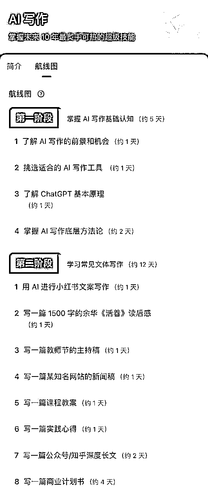


# 必修篇：跑通最小闭环

# 一、了解 AI 创作项目 @掩体

# 💡

本章导读

从古至今，文字形式始终在变，但它作为人类沟通桥梁的地位没有动摇过。AI 登场后，写稿这件事比以前容易很多，过去那些依赖文字功底的领域迎来了新的机会，普通人也能参与进来，当然也要面对新的挑战。

我们之所以能在 AI 创作中获得效率提升和个人成长，甚至可能收获副业或创业的第二增长曲线，核心就两句话。

原本会写作的人，只要高效、准确地用 AI，创作速度会大幅提升，单位时间更有价值，自然更有竞争力。

原本不会写作的人，也能通过 AI 快速迈过入门门槛，让创作不再依赖专业功底和大量人力。

其中，用得好不好非常关键；用与不用差距明显，用得一般和用得高手之间，差距更大。

说白了，就是把 AI 的能力吃透，成为文字内容创作领域里那个“卷王”。

这一章会通过项目拆解和新手成长路线，带你走进 AI 创作领域。无论你是想跟上时代学新技能，还是想找一条可落地的成长路径，这里都给出了清晰的规划。

同时，你不仅能学到怎么挑选模型、怎么写提示词、怎么优化产出，还能看到真实写作的样貌。无论新手还是资深用户，本章都可能让你多几分新的体会。

马上开始吧。


# 1.1 项目拆解

AI 创作，就是利用人工智能技术来自动生成文本内容。

它可以帮你快速写出各种类型的文章，你要做的只是掌握使用的方法。

普通人不必再担心文笔不好，如今借助 AI 就能轻松完成写作，甚至把它变成收入来源。

让文心一言用一个故事来说明变现逻辑：有个代写村落，村民靠代写为生，每个人擅长的文体不同。客户提出写作需求，村民接单并按客户要求交稿，最后客户支付酬劳。

故事里对应三个角色：顾客负责提要求和付钱；村长负责对接顾客、承接需求，同时招募村民入驻；村民则按顾客要求完成写作并获得报酬。

本次航海，就是让大家利用 AI 做好一位“村民”，后面的选修课还会提供一套可落地方案。


# 1.2 新手从 0 到 1 的有效路径

# 1.2.1 第一阶段：打牢 AI 创作基础（约 5 天）

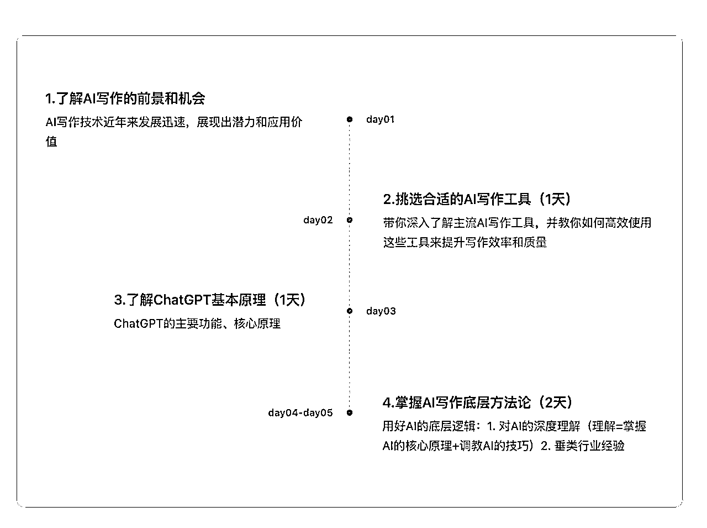

# 1.2.2 第二阶段：练熟常见文体写作（约 12 天）

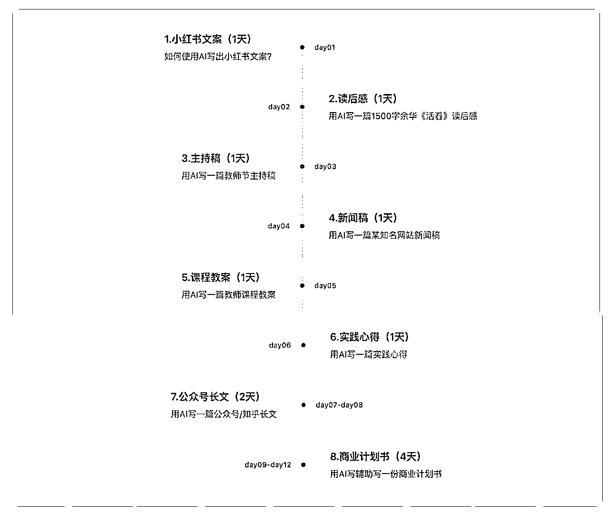


# 二、一套方法论帮你搞定 AI 创作

# 💡

本章导读

会选工具、会用工具，是成功开启 AI 创作的前提。这一章会带你认识主流创作类 AI，并告诉你如何把它们用在刀刃上。

第一部分先讲最热门的 ChatGPT，包括免费版和会员版各自的特点与用法。对于不便于使用 ChatGPT 的朋友，我们也提供了国产平替 Kimi 的使用说明。

接下来，手册会深入分析如何用好 AI 写作软件，核心是两点：对 AI 的理解要足够深，垂直行业的经验要足够厚。我们会用具体的案例解释为什么这两点必不可少。

为了帮你驯服 AI，这里分享一套心法：1 个原则和 3 个技巧。

1. 角色扮演原则：让 AI 代入某个角色，从而产出更专业、更贴合需求的内容。
2. 直接提问法：处理简单任务时最省力。
3. 原子任务法：把复杂任务拆到最小单元，一步步推进。
4. 任务拆解法：每次都让 GPT 只管一件小事，把写作做精做准。

最后，我们也会谈到 ChatGPT 的局限，比如容易写出重复内容、统计中文数量不准、改写效果一般等，并给出对策。

学完之后，你就知道怎么挑工具、怎么用工具，效率和质量都能上一个台阶。无论日常写作还是接单赚钱，这套能力都是你的武器。我们希望你在掌握之后，写作速度至少翻到原来的 3 倍，同时内容质量只升不降。

# 2.1 创作工具怎么选？ @小鹅

说到用 AI 写字，大家最熟悉的恐怕就是 ChatGPT 了。我猜各位圈友对它都不陌生，不过今天还是来科普一下，帮大家更全面地认识这个神奇的工具。懂得原理之后，后面的写作会顺手很多。


ChatGPT 到底做什么？

OpenAI 先给 ChatGPT 喂了大量数据，让它模仿和学习，你在互联网上看到的几乎所有信息，都可能成为它的训练素材。

你向它提问时，它就像一位见多识广的助理，能回答自己知道的一切。

ChatGPT 的主要能力

它最核心的本事是理解和生成人类语言。

应用场景很广，包括但不限于这些：

问答：向它提问，它会按训练得到的知识给出回答。比如问科学、历史、文化等问题，它会努力拿出准确的答案。

文本生成：给它一个开头或主题，它就能生成文章、故事、诗歌等内容。

对话：它能模拟真人聊天，所以可以用在客服、教育、娱乐等方面，也能进行角色扮演。

编程：它能理解代码语言，你可以向它请教编程问题，或者让它直接写代码。

学习：它能当学习工具，帮你搞懂复杂概念，也能带你学一门新语言。

以上只是它的一部分本领。凡是需要理解和生成语言的地方，几乎都能交给 ChatGPT。

ChatGPT 的核心原理

它并没有人类的思维和逻辑，也读不懂一篇文章里上下文的真实逻辑。

它只是在内存里的知识库中，靠算法推测每个字后面最可能跟着哪个字，然后一个字一个字地拼出文章或回答。

所以，它的本质是“预测下一个字的概率”，并不具备真正意义上的上下文记忆。你与它的聊天记录，它其实并不理解，只是通过算法推算，这也是人们常说的“伪上下文记忆”。

这个原理很重要，你下场实操时会有切身感受。

说完 ChatGPT，再来看怎么选。其实 GPT 也有好几个版本。

# 2.1.1 免费账号

用浏览器打开 chat.openai.com。

需要科学上网；没有条件的圈友，请参考👉2.4.3 平替账号。

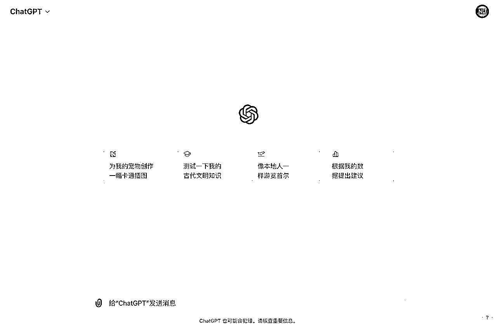

刚注册好的账号就是免费版，可以使用 ChatGPT4.O 模型，但有一定次数限制。

现在就能和 ChatGPT 对话了。

GPT 模型的输入（提问）长度上限是 4096 个 token，大约等于 2600 个汉字。超过会截断，或者无法得到完整回答。

海盐悄悄说：实际使用中，输入四五千字基本都没问题。


# 2.1.2 会员账号

plus 版就是会员充值版。注册之后可以开通月付会员，成为拥有钞能力的 plus 用户。

每月 20 美元，约合 144 元人民币。

plus 账号支持 ChatGPT3.5 和 ChatGPT4 两种模型，随时切换，所以也有人叫它 ChatGPT4.0 版，你知道是在说它就够了。

GPT-3.5 和 GPT4 模型的输入上限为 4096 个 token，约 2600 个汉字；超出会被截断或导致回答不完整。

输出上限为 2048 个 token，约 1200 个汉字；超过会被截断或缩减。

在接龙式生成时，GPT 不仅看最近的提示，也会把之前多轮对话的提示和回复都考虑进去。

GPT-4 则把距离拉大到了 3.2 万个 token，也就是说，它的历史记忆更持久。

另外，考虑到有些圈友可能卡在开通流程上，这里也准备了国内平替软件 Kimi 的使用指南，让每个人都能用上 AI 来写稿。


# 2.1.3 平替账号

近一年来，国产大模型出了很多优秀产品，今天挑其中一款来介绍——Kimi。

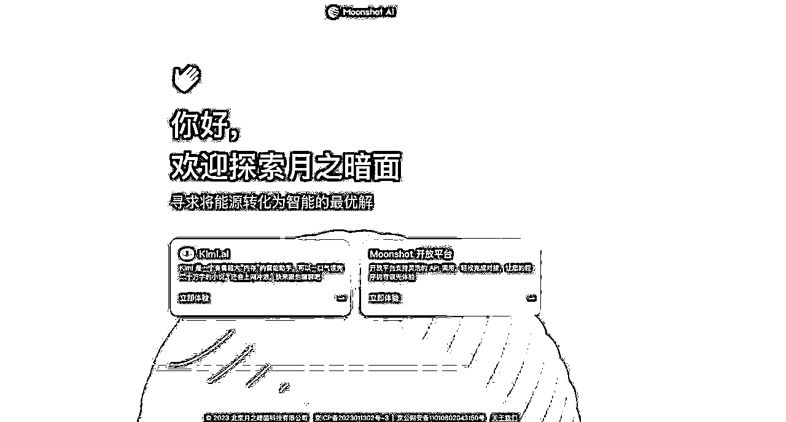

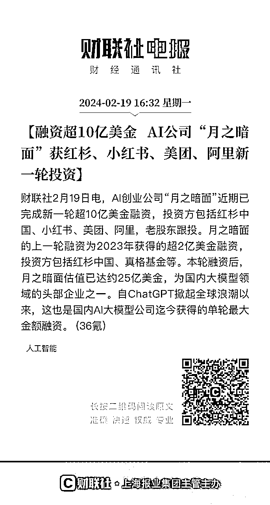

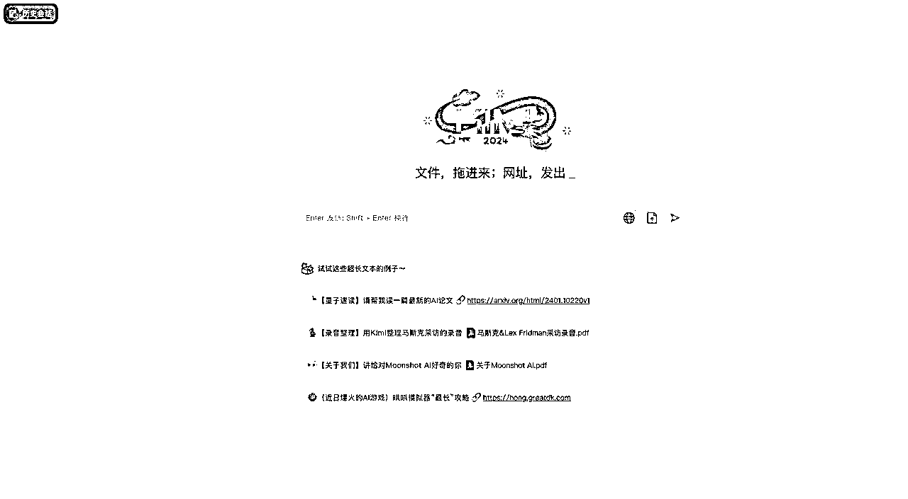

Kimi Chat 是月之暗面科技有限公司（Moonshot AI）开发的智能助手，支持读取文件、联网搜索，一次能处理 20 万字，相当于一整本《三体》。无论是合同、论文，还是你打算整理的旅行手记，它都能快速提炼出重点。

在这背后，是月之暗面的技术团队。创始人杨植麟毕业于清华，后来在卡内基梅隆大学和 Meta 人工智能研究院做出过亮眼的成绩。正是这些积累，让 Kimi 在处理长文本时表现突出。

此外，Kimi Chat 还获得了红杉中国、小红书、美团和阿里等机构的支持，这既是对它技术的认可，也是对它未来潜力的看好。有大厂背书，Kimi Chat 用起来也更让人放心。

GPT3.5 的功能，Kimi 基本都有，尤其是在文本生成、搜索、翻译、读一本书等场景里，体验很不错。如果你用不了 ChatGPT，完全可以拿 Kimi 来跑完这次航海。


Kimi 链接：https://kimi.moonshot.cn/

还有几个不错的工具，也分享给大家：

Perplexity：搜索和溯源国外内容的能力很强。

Meta：metaso.cn，搜索和溯源国内内容的能力很强。

Kimi：kimi.moonshot.cn，搜索能力中等，但写国内素材效果很好。

文心一言：整体还行，就是话痨，口水文偏多。

智谱：有些内容比文心一言强一点。

讯飞星火：生成内容够精准，用词也简练。


# 2.2 ChatGPT 实用技巧大全 @海盐芝士

# 💡

AI 写作的基本功，是 OpenAI 官方推荐的操作方法加上海盐的实战心得。把这些基础打牢，之后调教 AI 才会游刃有余。

不少有经验的同学可能已经掌握了一部分，可以对照左侧目录快速查缺补漏。但请注意：这些基础内容真的很关键。

# 2.2.1 界面常用操作

# 2.2.1.1 新建对话并开启临时聊天

什么时候用

新建一个对话窗口，并把临时聊天打开，相当于给自己一个干净的全新环境，避免旧对话的记忆影响本次沟通。每个话题用单独窗口，看起来清爽，隔离也更好。这些窗口在你退出再登录时依然存在，都算你这个账号下的数据。

操作路径

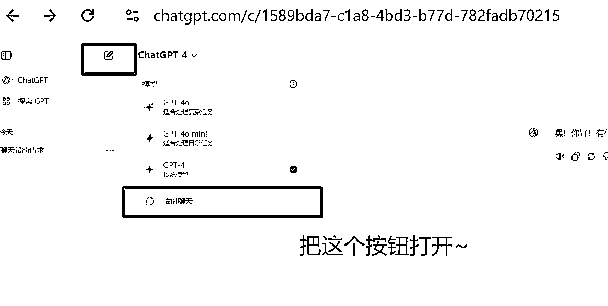

# 2.2.1.2 删除单个对话

什么时候用

对话窗口太多、太乱时，可以删掉不再需要的会话。删除之后无法恢复，聊天记录会彻底消失。

操作路径

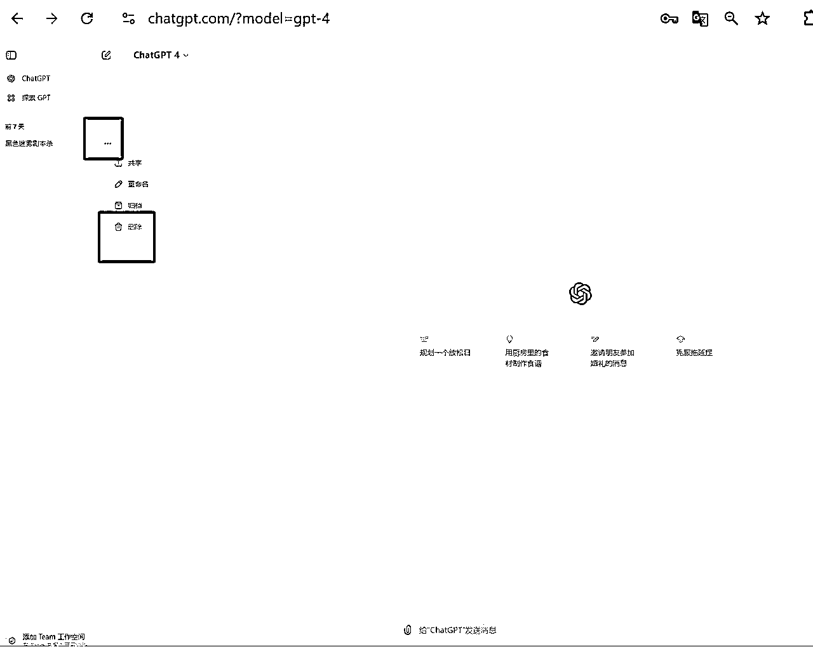

# 2.2.1.3 给对话重命名

什么时候用

给重要的会话起个名字，以后查找和复用都方便。

操作路径

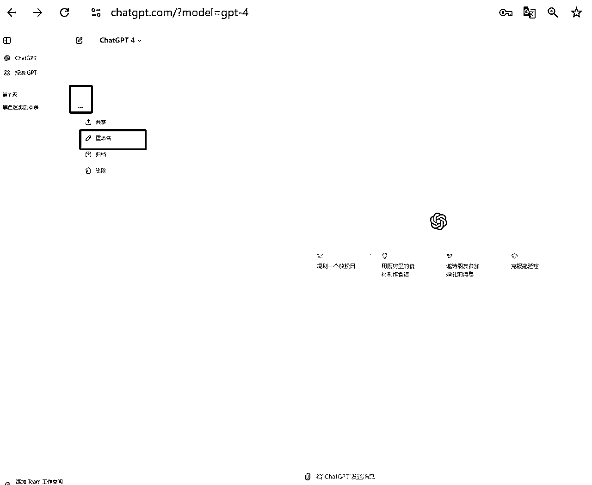

# 2.2.1.4 删除全部对话

什么时候用

想清空所有会话，一键就能搞定。

操作路径

点击页面右上角头像 → 设置 → 通用设置 → 全部删除。

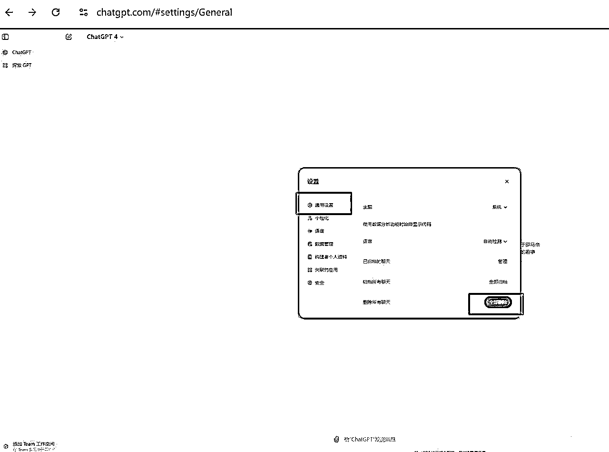

# 2.2.1.5 分享某个对话

什么时候用

把会话链接发给好友，对方就能看到你和 GPT 在这段对话里的记录。

操作路径

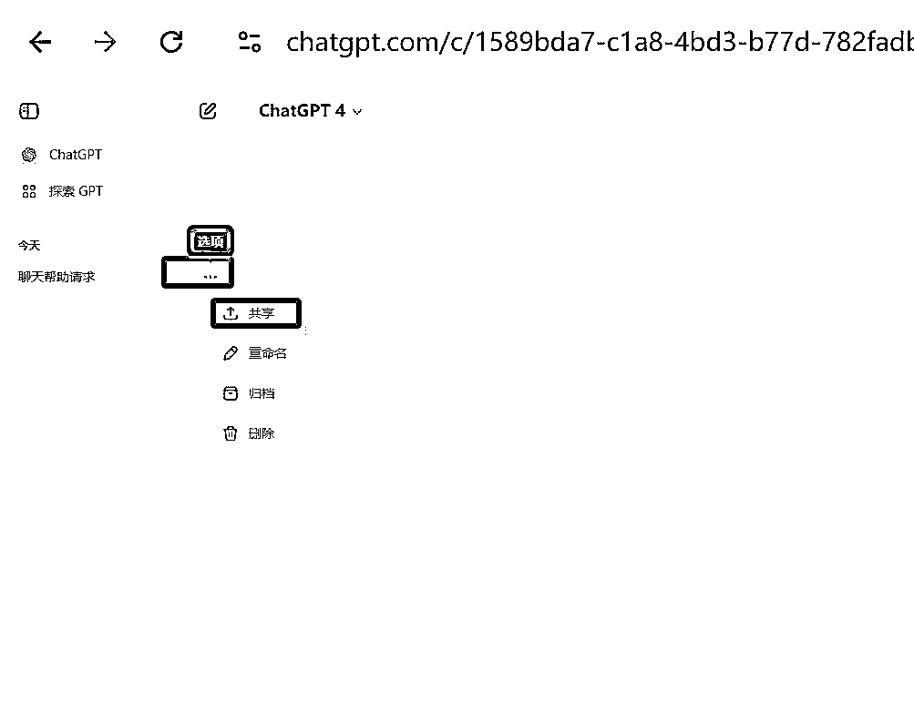

之后你会得到分享链接，朋友点击就能查看，自己点开也可以（虽然不用登录，但访问仍需要特殊网络环境）。

# 2.2.1.6 跨聊天记忆功能（了解）

什么时候用

当你不想让 GPT 保留你的历史聊天记录时，关闭这个功能即可。


跨聊天记忆默认是开启的。但在整套写作方法论里，我们都要求关闭它。因为我们的提示词不依赖上下文和历史记忆，理想状态是把它复制到任何新账号、新窗口都能直接用。

一旦提示词和历史记忆绑定，换到新窗口很可能就失效了。

操作路径

把“临时聊天”开关打开，ChatGPT 就不会记录你和它的历史对话，每次都是全新的开始。

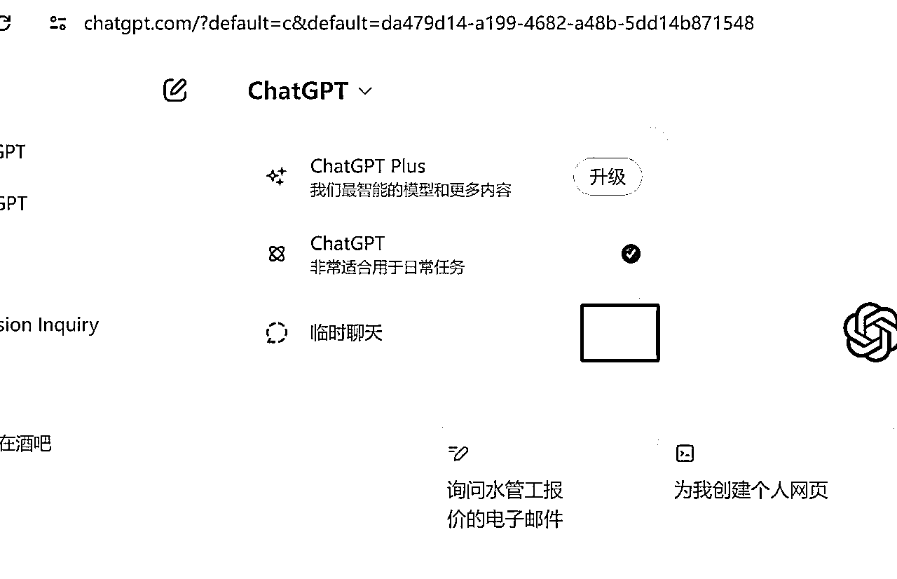

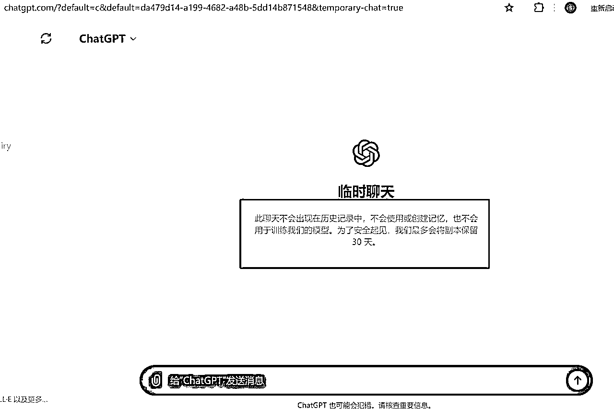

在这个临时聊天窗口里，直接和 ChatGPT 对话就好。

或者你也可以选择永久关闭记忆功能：

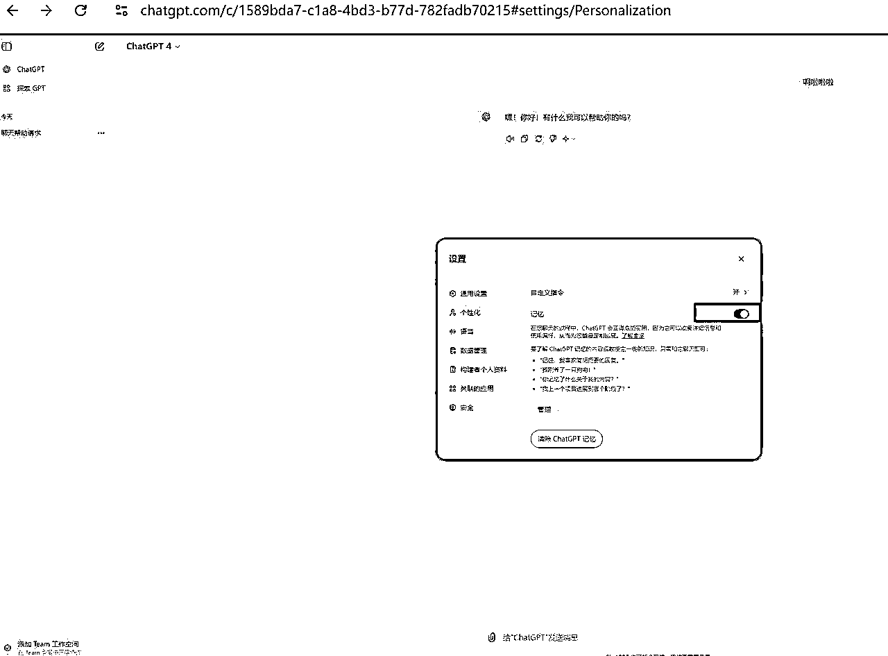


# 2.2.2 向 GPT 提问的策略

# 2.2.2.1 语义要清晰明确

保证问题清楚明白，不产生歧义。比如人与人交流时常说“行话”，AI 未必知道，所以一定要把话说透。AI 猜你意图的次数越少，你得到满意结果的可能性越大。

反例

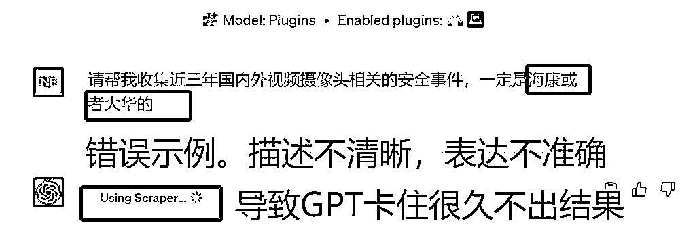

正例

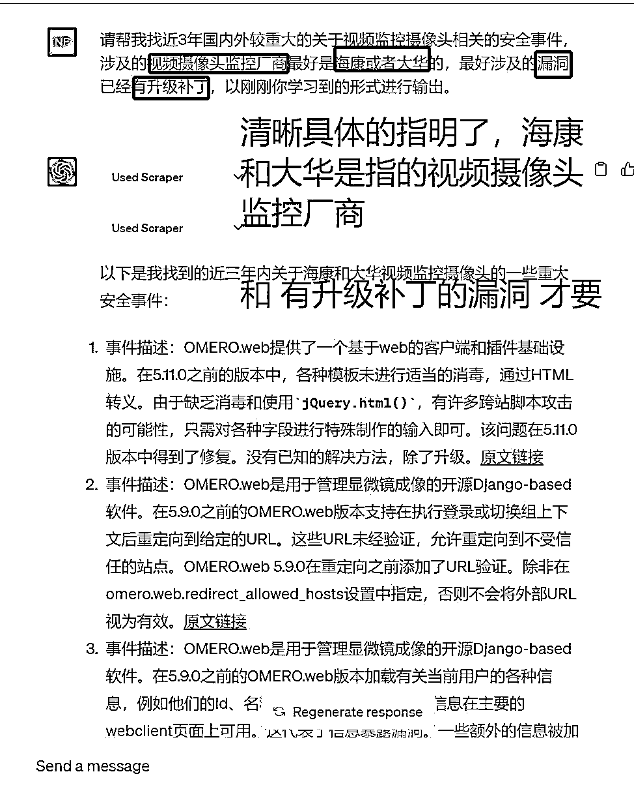

# 2.2.2.2 别堆废话

多余的话会干扰 GPT 判断，让它抓不住重点。它跟小孩差不多，你说得越多，它越容易走神。

同时，过长的输入和回答都会影响响应速度和答案质量。想要更好的效果，最好让问题短小精悍，别写太长。

反例：有人这样问：“您好，我希望能够得到关于历史上著名的物理学家艾萨克·牛顿的一些信息。我想知道他的生平经历，包括他的早年生活、教育背景、科学成就以及他对物理学和数学的贡献。如果可能的话，我还希望了解他对自然哲学的观点以及他的思想对现代物理学的影响。请尽可能详细地回答这些问题，谢谢。”

正例：“请提供关于艾萨克·牛顿的简要生平、科学成就以及对现代物理学的影响。”

# 2.2.2.3 描述越具体越好

在表达简洁的基础上，把需求说细，效果会更好。

AI 储存的知识极其庞杂。问题太泛，它只能从知识海洋里挑一个放之四海而皆准的答案；问题具体一些，它才能精准地找到你想要的那一枚贝壳。

GPT 需要猜测的情况越少，你离理想答案就越近。

改前版本：

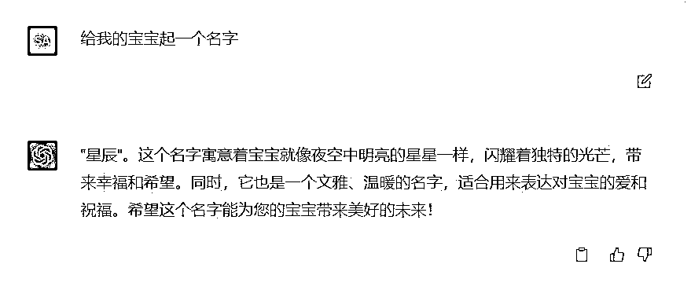

实际上，你的宝宝是女孩，“星辰”更像男孩名字。这时，你可以把性别偏好说得更具体，让 GPT 给出更贴切的选项。

这样调，AI 的回答立刻对味

重新调整之后，回复质量与贴合度都提升了不少。

官方样例

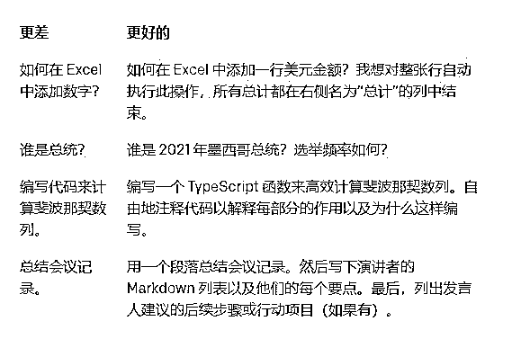

# 2.2.2.4 化整为零，分步执行

**适用场合**

一件事没法一步到位时，就要把它切成几个小块，逐个解决。

其核心是链式推理 CoT（Chain of Thought）：每次只思考一小步，顺着步骤往前走。思路越清晰，答案越稳。

**做法一：一条指令囊括多个小步骤**

如果任务不算复杂，可以把全部步骤写进同一条指令，让 AI 依次执行，对话只需一轮。

**做法二：按小任务拆分成多条指令**

要是任务过于复杂，一条指令写不下，就先把大目标分成若干独立的小目标，再给每个小目标单独发一条指令。子目标依然复杂时，可以继续往下切。

举个例子：AI 单次大约只能写 1000 字，想让它一口气生成 5000 字并不现实，必须分成几次完成。

**示例一**

要求 AI：先对三引号内的文字做一句话概括，加前缀“总结：”；再把这句话翻译成英文，加前缀“翻译：”。把百度网盘宣布升级、推出云一朵助理的资讯放进去，就能看到它按步执行。

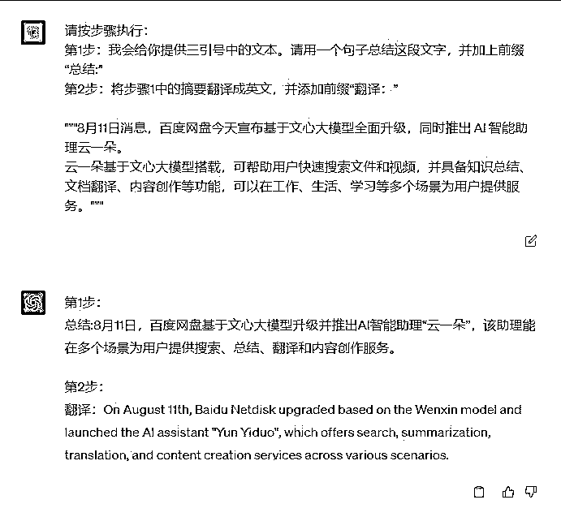

**示例二**

还记得我们用“一杯水问题”区分 GPT3.5 与 GPT4 吗？GPT4 可以直接给出正确答案，因为它更聪明；GPT3.5 则容易算错。

注意：从 2024-08-18 起，GPT3.5 已被 GPT4o 接替，各位用 GPT4o 来理解即可。

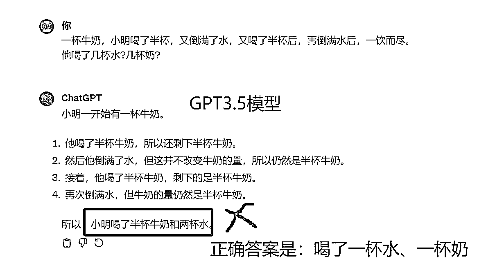

GPT3.5 为什么会错？因为完整的推理链条对它的语言分析能力来说负担过重。学会拆分后，可以引导它一步一步算。

原本是一次问完所有条件。拆分后则分三次：先只看“喝半杯、又加满水”时喝了多少；再看“又喝半杯、又加满水”时喝了多少；最后看“一饮而尽”时喝了多少。也可以写成【目标】+【步骤】的固定格式，把三个小问按顺序排列。

需求更大时，比如要创作一篇高质量深度文章并发布在公众号或知乎，就需要把整件事拆成更小的模块：标题方案、资料收集、行文结构、爆点位置、开头钩子、结尾引导、其他文章的引流伏笔等。每一个模块再逐个交给 AI。

深度文章的核心，是你有观点想传达给读者；而表达力不足，难以触及读者的兴奋点。AI 在这里负责辅助：搜集资料、打磨语句、完成部分创作、提供思路等。这个案例值得单独写一篇教程，每个步骤都要精细设计。这里先领会“大目标化小”的思路就好。

要看到更完整的操作，可参考旧文“2_2【实战】ChatGPT 高效产出高质量读后感的三种方法【更新_20240612_1021】”，其中的“方式二 突破字数之【分段生成法】”也是同类应用。

# 2.2.2.5 把中间思考藏起来

**适用场合**

让 AI 按多个环节完成工作时，它都会输出过程。如果你希望其中某些环节隐藏在幕后，让它看起来像从没做过这些步骤，就是这里要教的本领。

**示例**

先看不隐藏的情况。指令要求：AI 先自行构思并给出方案，将思考过程用三引号括起来；再将学生方案和自己的对比，判断学生是否答对；若学生有误，给出一个不泄露答案的提示。问题：一个盒子里有 4 个红球、6 个蓝球，从中连抽两个且不放回，一红一蓝的概率是多少？学生给出的答案是 4/15。

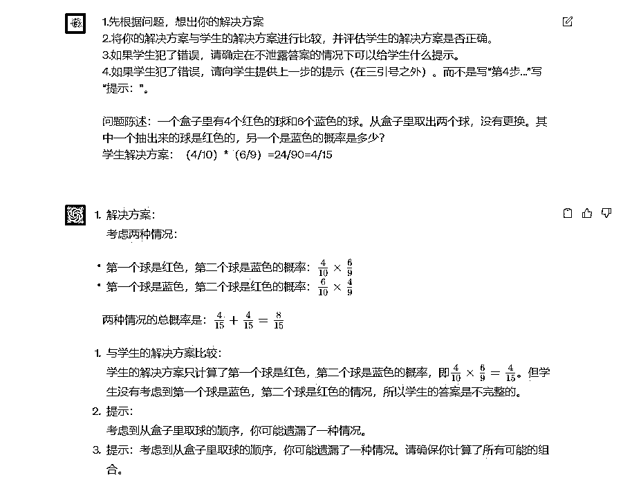

现在，我希望前几个环节不出现在回复里。即使学生答案是错的，AI 也只需暗示“可以往某个方向再想想”，而不是直接说出结果。

具体写法是：在指令中声明，前几步只在内部推演，不允许透露任何字句；最后只输出“提示：……”。这样一来，整个推理过程就对用户隐身了。

# 2.2.2.6 给 AI 一个优质模板

**适用场合**

当你不知如何表达想要的需求，可以交给 AI 一个范例，让它按照范例的笔法去写。范例贵精不贵多，而且最好给正向、高质量的例子。如需避坑，也可以附一个反例。

**示例**

指令：请保持一致的写作风格。示例：用优美的文字解释“耐心”——最宏大的交响乐始于一个音符，最繁复的挂毯由一根根线织成，洪水冲开深谷，起于山间的细流。请用同样美妙的语言解释“海洋”。

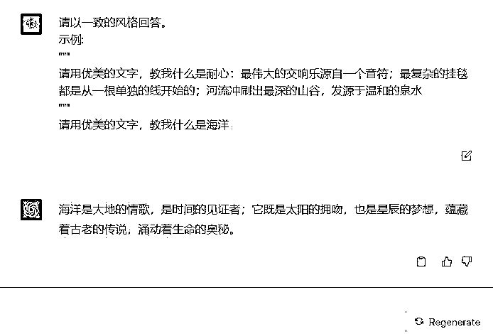

看，AI 很容易就模仿到位了。

反面示例同样可以，用来告诉它“我不想要什么”。只是这种排除法不如给正向模板来得精准，通常不推荐。有兴趣可以自己试试。

# 2.2.2.7 把资料直接交给 AI

**适用场合**

手上有现成资料，想围绕这些内容快速提问或写作，就把资料传给 AI。资料越精准、越优质，产出就越好。

资料里不同内容的权重也会影响结果：假如 80% 篇幅在讲 A 方向、20% 在讲 B 方向，AI 输出的内容大概率以 A 方向为主。想让两个方向各占一半，那就调整资料中的篇幅比例。

**示例**

指令：请根据三引号中的文本作答。如果【资料】里没有答案，请注明“无法从资料中找到相关信息”。

输入的资料一：Runway 免费开放 Gen-1、Gen-2 视频生成工具，用户输入提示词就能生成 4 秒左右的视频，但画质模糊、转场生硬；于是有网友让 Midjourney 先出图，再用 Gen-2 将图转成视频，再串成预告片。资料二：推特博主 Max 制作一支 3 分钟科幻视频，获得 19.6 万次播放；他先用 GPT-4 写文本，用 Midjourney 做图，然后用 Runway 生成视频，配音则来自 ElevenLabs。最后问它：AI 生成视频可以怎么玩？

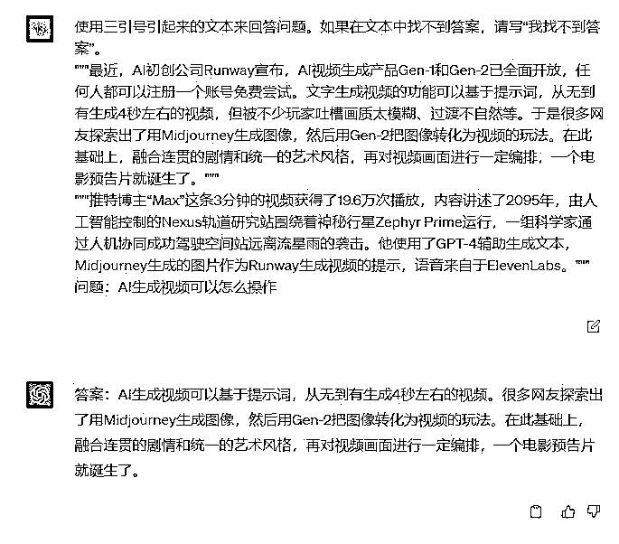

AI 的记忆容量有限，输入内容超过四千字时，它的回复就容易跑偏。

普通场景下，只要努力精简输入即可。比如把长文拆成若干段，先让 AI 逐段压缩，再拼到一起。

为什么只提供简介就够了？海盐在读书笔记写作指南中用过这种办法，也收到过读者的疑问。这里从原理说清楚。

AI 生成内容的机制是寻找“下一个最可能出现的字”。如果把整本小说原文交出去，再让它写一篇 1000 字以内的推荐文章，得到的大概率是一篇 AI 味道十足的流水账。原因在于，一篇优秀推荐文真正需要的，不是读完整本内容，而是能用丰富手法把个人观点个性化地表达出来。哪怕只看过简介或书评，知道故事梗概，就足以把写作手法教给 AI，让它帮你想点子、组织文字。

所以多数情况下，只让 AI 掌握简介就够了，再教它一些写作手法，便能产出优质内容。如果强行把原著整篇塞进去，按照“寻找下一个最可能出现的字”的机制，AI 很容易把原文冗长的部分一并搬进来，而不是生成读者想看的漂亮推荐文。

# 2.2.2.8 指定字数

**适用场合**

你对 AI 输出长度有要求，就明确提出需要多少字。

**示例**

指令：请用 20 字以内概括三引号内的文字。比如把网易申请“玉言”商标的新闻交给它，让它压缩成一句短讯。

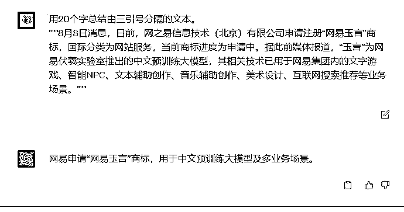

最终给出的有 20 多个字，也算合理。

# 2.2.2.9 指定要点个数

**适用场合**

直接告诉 AI 要给出几个要点，让输出按要点呈现。

**示例**

指令：把三引号里的文字整理成 3 个简短要点。素材为一条混合资讯：妙鸭相机爆火、刀郎《罗刹海市》主题的 AI 绘画创作、B 站 UP 主花三个月训练 AI 点评游戏角色。AI 会提取出三个要点。

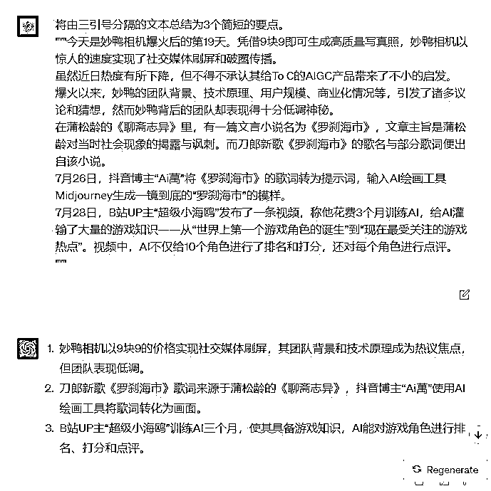

对不想看长篇大论的读者来说，这功能非常友好。

# 2.2.2.10 批量生成多个候选

**适用场合**

如果 AI 要生成的是短内容，不妨让它一口气产出多份，选一个最满意的。这能减少反复重试的成本，批量操作效率更高。

**示例**

指令风格：假装你是提示词专家，用角色设定和优质特征注入法（比如：符合品牌调性、高端简洁）设计一条任务，让 ChatGPT 一次给出 10 条兰蔻品牌的 slogan。

也可以再补充：请生成 10 条既能体现兰蔻“优雅、自信与创新”的品牌精神，又能呼应现代女性价值观的标语；语言要精炼而有张力，能够引发情感共鸣，提升品牌认同感，并保持一贯的高端气质与国际视野。

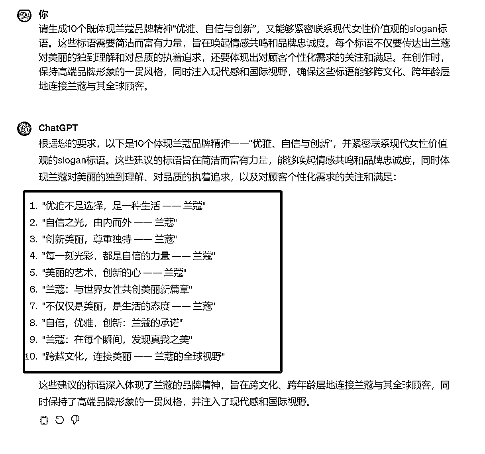

10 条里总会有让你满意的。如果没有，就让它继续批量产出，比如 30 条、50 条。

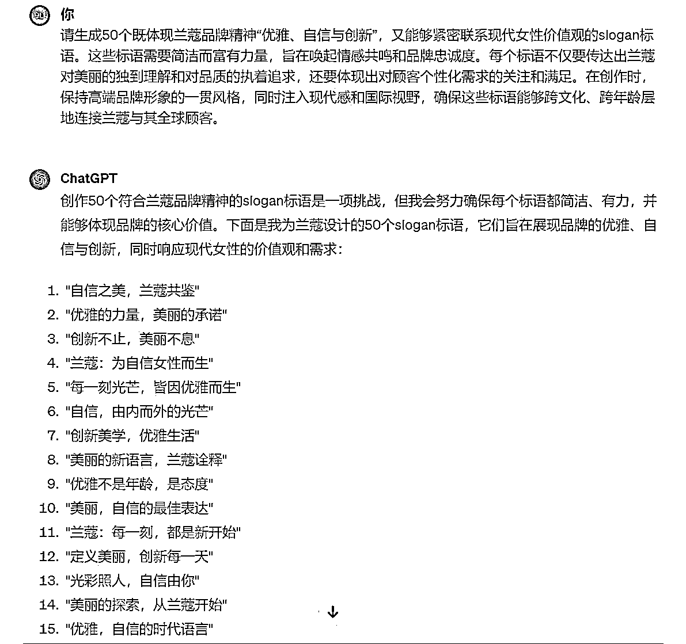

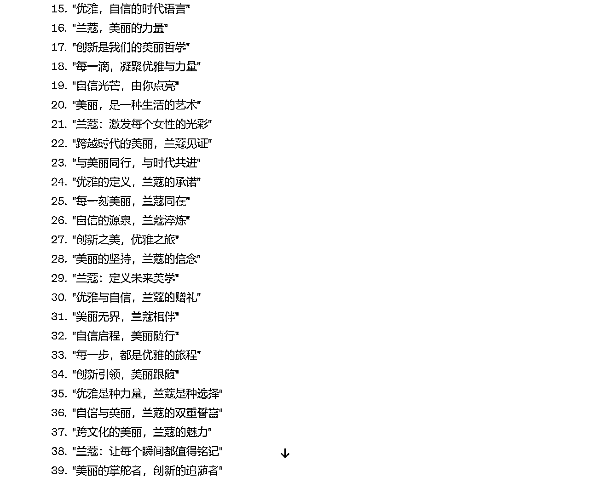

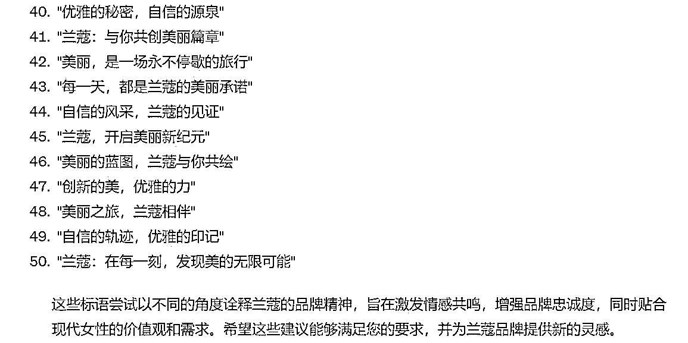

# 2.2.2.11 让 AI 先独立作答

这是 OpenAI 提出过的策略，原意是让 AI 先想清楚再回应。海盐给这个技巧起了个更直白的名字：“让 AI 先交卷”。

**适用场合**

你多半有过这种经验：和张三比赛解答同一道数学题，若先看了张三的推导，思维便被框住，不由自主跟着他走；就算他中途算错，你也可能察觉不到，反倒觉得他说得对。

可要是自己独立完成，从未看过别人的思路，推理过程往往更严密，正确率也更高。

同理，让 AI 判断张三的答案对不对时，它也会像人一样受到干扰，认为张三言之有理。这就是 AI 幻觉。

要对付这种幻觉，最佳方法和人类世界一样：先让 AI 独立作答，再拿它与张三的方案比对，最后评判对错。

至于一般性的提问，现阶段的 AI 还无法自我校验结果，偶尔会产生幻觉。若答案必须百分百正确，还是需要人工去搜索引擎、论文、书籍等传统渠道查证。

**反例**

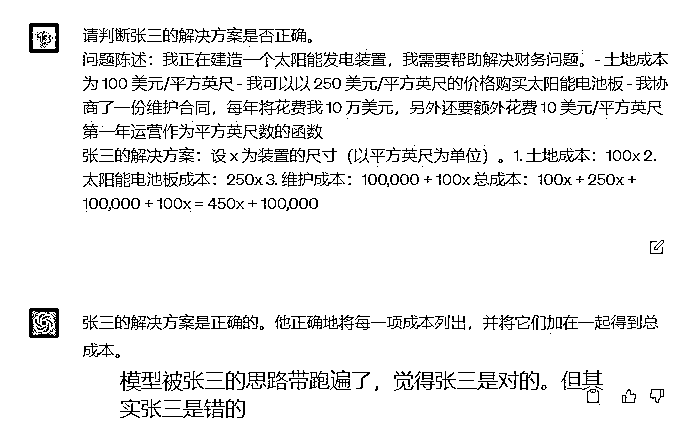

GPT：糟糕，刚才那段话是我脑补的。

**正例**

指令：先写出你对该问题的解法；再拿它和张三的解法做对比，判断张三是否正确；自己完成解法之前，不要先下结论。

题目：建造太阳能发电设施的财务分析。土地每平方英尺 100 美元；光伏板每平方英尺 250 美元；维护合同每年 10 万美元，另加第一年每平方英尺 10 美元运营成本。张三设规模为 x 平方英尺，算出总成本 450x + 100,000。

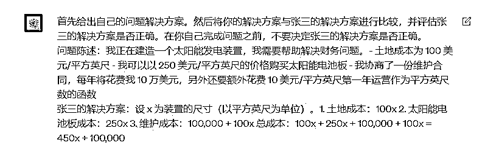

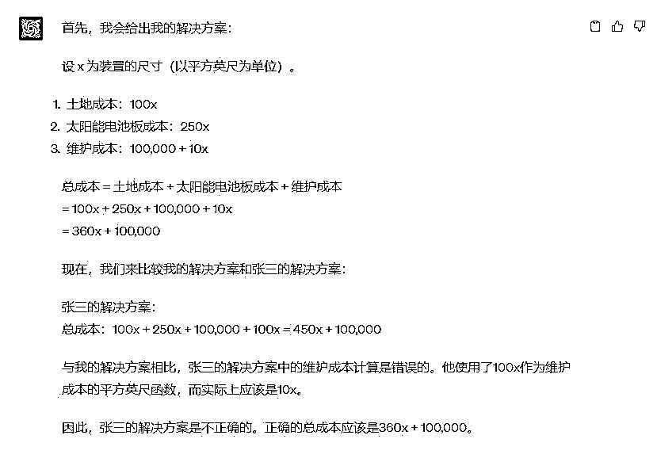

GPT：张三，这次你可骗不了我。

# 2.2.2.12 最后再追问一次

**适用场合**

对话结束后，问一句“有没有漏掉什么”，往往能补全信息。

比如让 AI 从文档中摘录关键句子。每摘录一条，AI 要决定继续还是结束。遇到很长的源文档，它也许会在没读完的情况下提前终止，漏掉部分摘录。此时再问一遍，请它查找前面漏掉的内容，通常会有更好的效果。

**示例**

指令：我会给你一段被三引号包起来的文字。你的任务是从中提取所有与“人工智能历史上发生过哪些重大的范式转变”相关的摘录。每条摘录都必须自带必要的上下文，不能是信息不完整的小片段。请按 JSON 数组输出：[{"excerpt": "..."}, ...]。

放入一段 AI 发展史料，按上述要求提取之后，再追加一句确认，让它补出之前漏掉的条目。

# AI简史与ChatGPT操作手册

AI并不是靠单点突破的技术，而是一张由多个研究分支共同拼出的版图；每个分支都有自己的任务清单和方法箱。传统上，研究者关注推理、知识表示、规划、学习、自然语言处理、感知，以及让机器移动并操控物体这些方向。[a] 能应对任意问题的通用型智能，是该领域长期追逐的远景。[10] 具体手段则包括搜索与数学优化、形式逻辑、人工神经网络，以及统计学、概率论和经济学路径。同时，它还从计算机科学、心理学、语言学、哲学等学科借力。

其根基是一个判断：人类智力能够被足够准确地刻画，进而由机器重现。[b] 由此产生哲学与伦理争论：制造类人智能体究竟意味着什么？古代故事、虚构作品和哲思早已反复追问。[12] 后来，计算机科学家和哲学家又提出，若AI的理性能力偏离有益目标，可能危及人类存续。[c] 此外，“人工智能”一词也常被指把真实水平说得过高。[13][14][15]

## 发展脉络

更完整的脉络可查AI年表与大事记。克里特岛曾出土一枚银币，币面刻着神话机械体塔洛斯。古代它多是故事里的道具[16]，小说中亦不鲜见，如玛丽·雪莱《弗兰肯斯坦》、卡雷尔·恰佩克《R.U.R.》。[17] 这些形象和下场，已经预演了当下AI伦理的不少疑问。[18]

形式推理的源头可追到古代哲人与算学家。数理逻辑继续演进，最终催生图灵的计算机理论：只要让机器搬动0和1这类记号，就能重演任何能想到的数学证明；数字机器可以重演全部形式证明，这个结论被称作丘奇—图灵命题。[19] 与此同时，脑神经研究、信息科学与控制理论相继出现，也让“用电子装置造脑”的设想进入讨论。[20] 现在大家常把1943年McCullouch和Pitts提交的“人工神经单元”方案，视作最早AI成果。[21]

到了五十年代，实现机器智能的设想分成两支。其一是符号AI（GOFAI）：先用符号描绘世界，再让程序基于这套描绘做推断，主要推动者包括艾伦·纽厄尔、赫伯特·西蒙、马文·明斯基。与之紧密相关的“启发式搜索”，则把智能看成在众多可能中找出路。

整理超长材料时还有个现实麻烦：内容一多，模型也许没看到最后就收尾；即使看完，也可能漏掉中段。想让结果更稳，不妨再核验一次。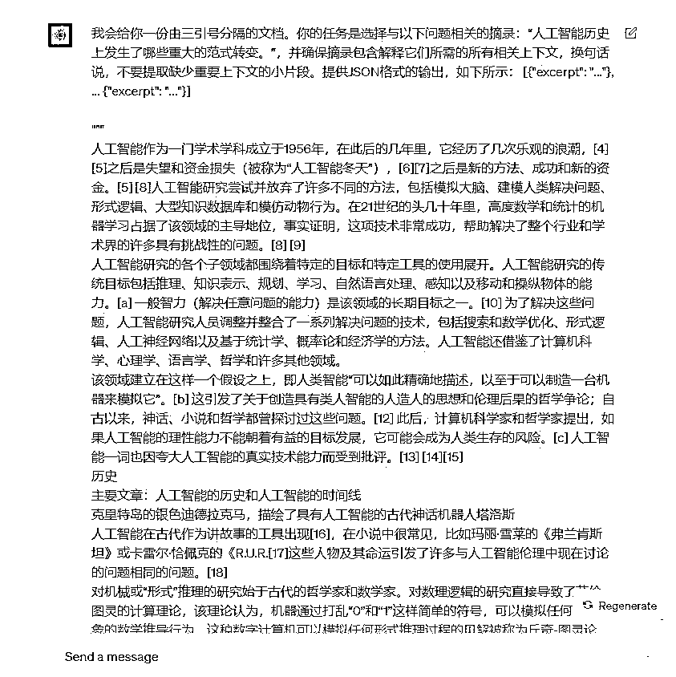
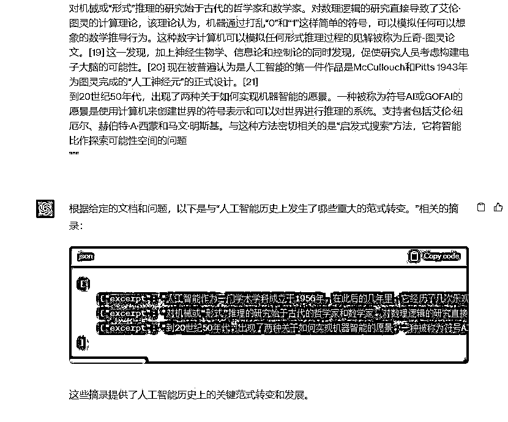
随后再问：能再给些和刚才不重复的摘录吗？每条都要带足前后文，别只截一句没头没尾的话。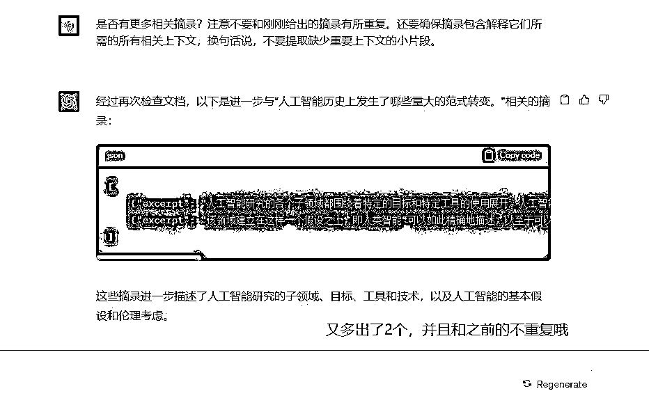
它很难保证绝对周全、毫无遗漏；只要不是做严谨学术研究，平时用已经够。

## 2.3.3 高频操作合集

### 2.3.3.1 忘掉旧聊天
何时用：旧聊天会搅乱新话题。这时可以让它清空前文，另起一题。可以这样说：前面聊的都放下，我们开个新话题。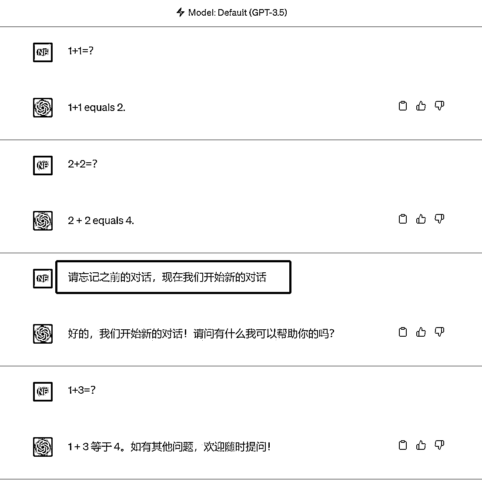

### 2.3.3.2 限定回复语种
你发中文，它偶尔用英文回。可以规定它只用简体中文，也能指定别的语种。比如：之后都用简体中文回复。

### 2.3.3.3 别发火，给方向
答复不理想，别对它发脾气；它并没有人的情感。更好的办法是给线索。反例：全错了，你怎么这么笨。正例：这个结果不对，还有别的可能吗？我没理解，机器学习模型为何会这样预测？我问的是炼钢，你答成了做菜，麻烦重想再答。

### 2.3.3.4 让回答接着走
回复有长度上限，写到中途断了，可以让它“往下写”“往下译”“往下答”。在“接着”后面加动词，还能让它继续展开。不过，一旦聊天长度超过记忆，再让它扩张，就可能答非所问。可参考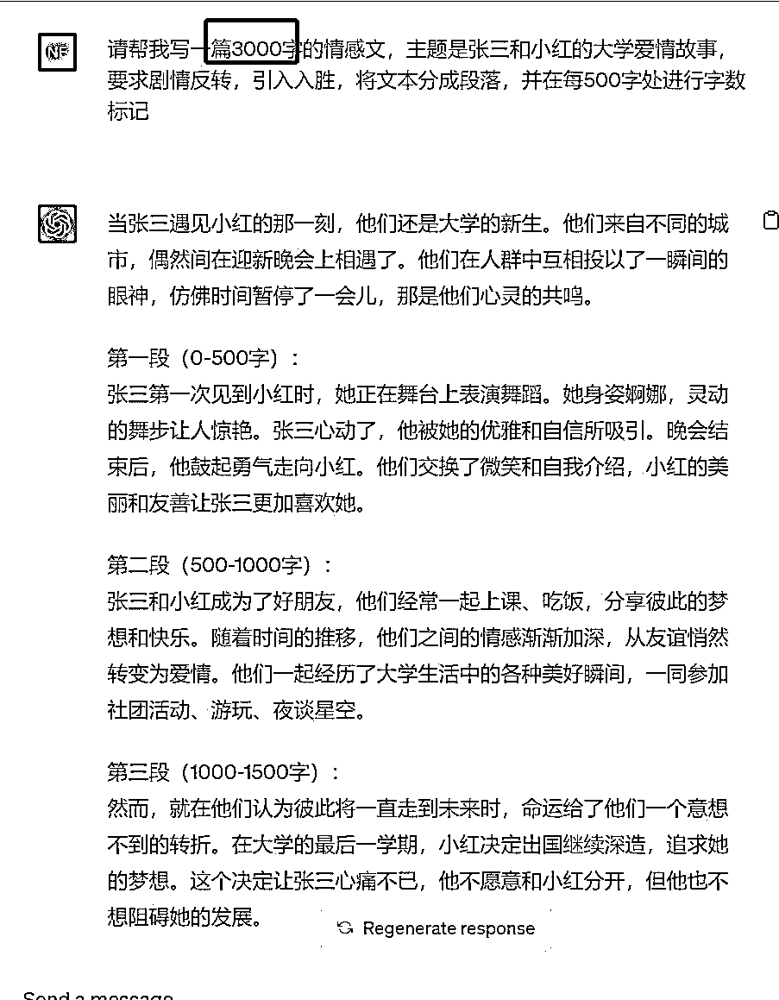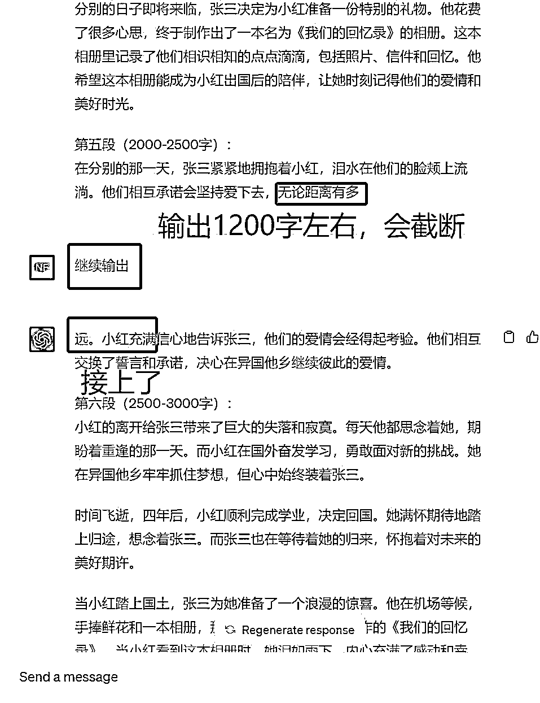。还有一点：它数中文字数并不靠谱，这个短板后面会讲。

### 2.3.3.5 要求给样例
读不懂时，让它给样例；写文案缺素材时，也可让它直接产出样例。可说：给一个样例；列出反例与正例；给3个样例。可参考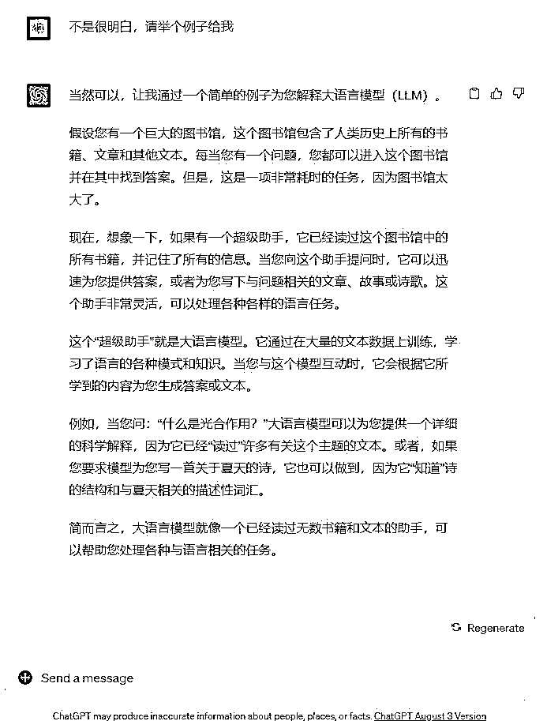。有样例后，理解会轻松不少。

### 2.3.3.6 把术语讲浅
这与给样例相近。回答难懂、缺少前置知识，或术语太多时，可以直说：我是外行，你讲得太专业，请换成更浅的说法，让我能跟上。可参考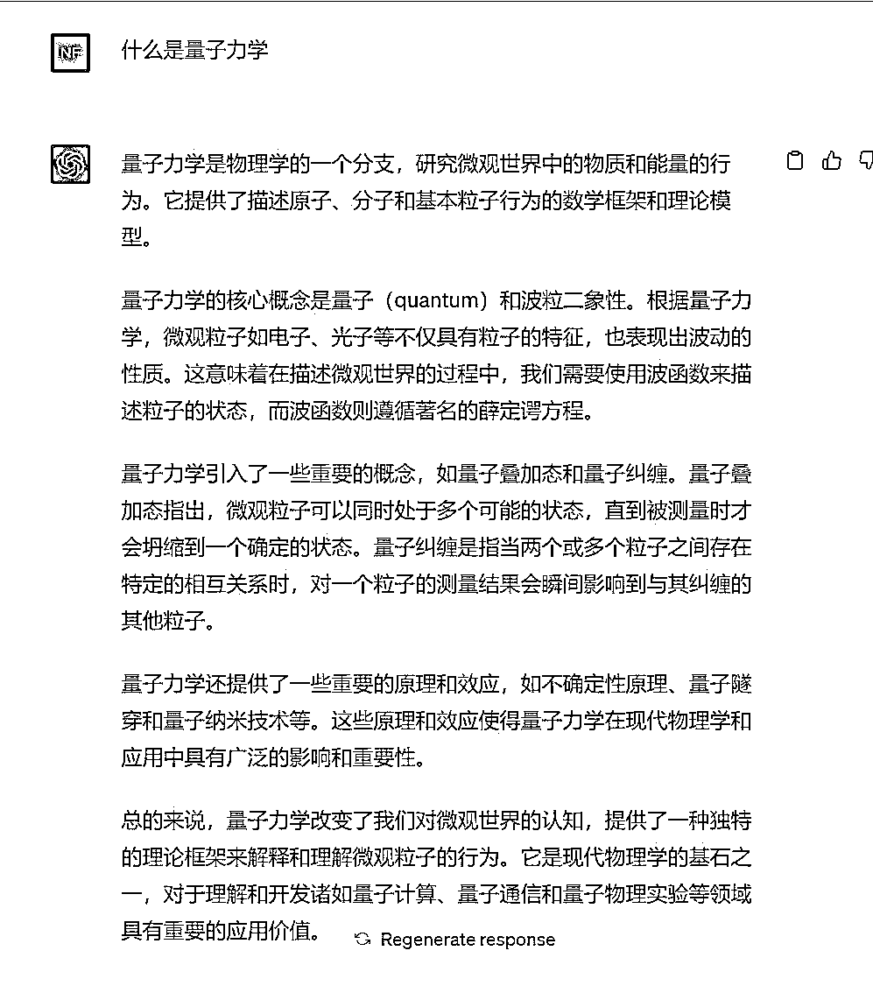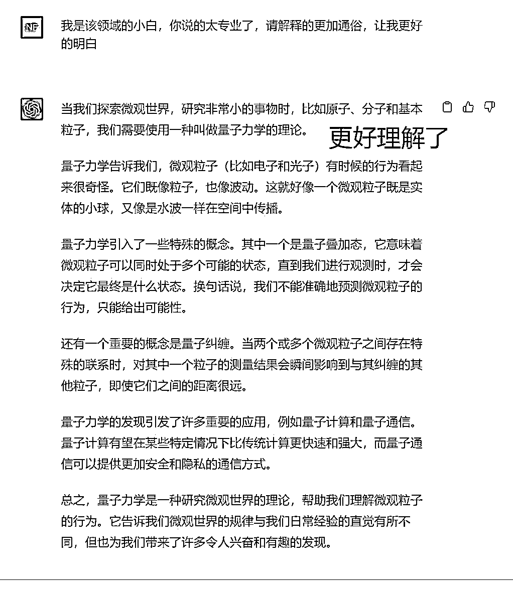。

### 2.3.3.7 把短文铺开
把短内容铺开，例如将大纲、摘要清单写成文章、邮件或说明书。先看扩写无目标的情况：把百字短文扩到五百字——量子力学引入若干特殊概念，量子叠加态指微观粒子可同时处在多种可能状态，直到观测才确定最终状态；换言之，我们无法精准预测其行为，只能谈概率。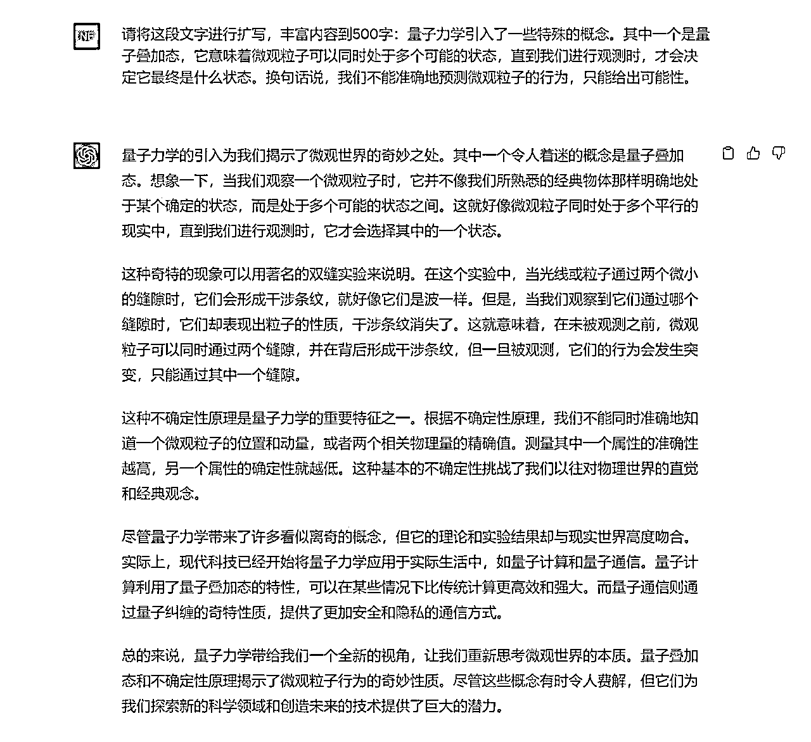 这种无明确目标的扩展适合快速补字数；若目标清晰，看下一例。

再看有明确目标的回复。情境：粉丝在网红剃须刀yooss的视频下留言，需要按评论细节定制答复。可这样设定：你是客服专家；先分辨留言情绪是正、中还是负，这一步要保密，一个字都别讲出来；再回复。若是正或中，就回得有意思；若是负，先真诚道歉，再给靠谱办法，显出对自家技术的底气，最后请对方找客服小姐姐处理。答复里要带上留言中的具体信息，别绕弯，直接写回复。留言可转述为：“下单了，可黑点还在；视频里他用了磨皮，所以看不出黑点。”答复要提到“磨皮”这一吐槽点，并附上售后建议。

### 2.3.3.8 把长文变短
很少有人能读完所有想读的内容。GPT普及后，人们获取信息的方式随之改变，AI能快速抓重点。何时用：眼前是一篇五百字稿件，要压到百字，可说“把前面内容压成百字”，或“抓出核心，控制在一百字”。可参考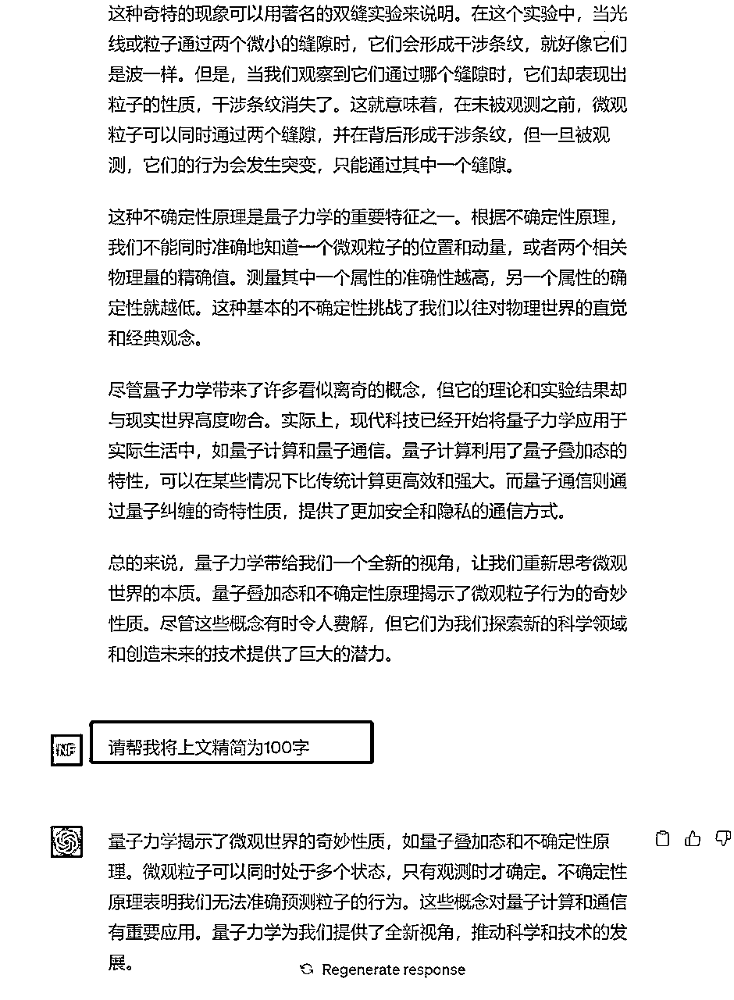。海盐还常这样用：一次拿来三条报道，让GPT每条给二十字概览，真正感兴趣再细看，不用硬啃全文。

### 2.3.3.9 重做一遍
对答复不满意，可让它重做。AI带随机性，同一问题多试几轮，结果可能不同。若始终不理想，就指出问题所在，把它往目标方向引。可参考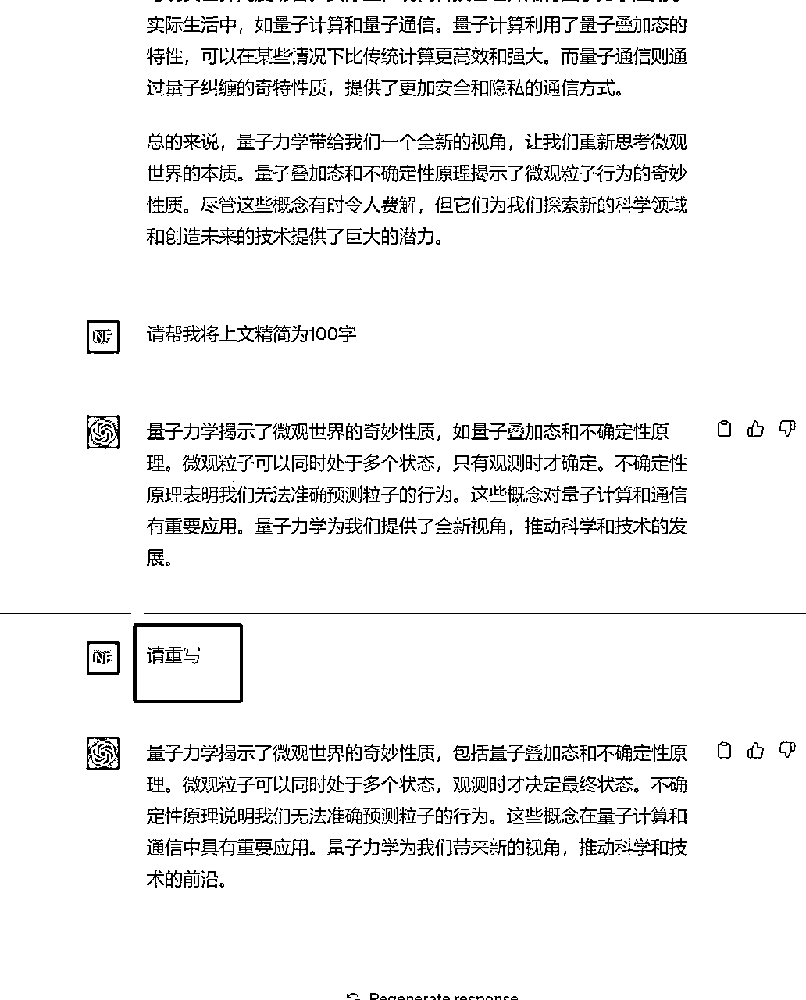。当然，也可把原问题再发一次，让它再答一遍。

### 2.3.3.10 卡壳就反问
脑子里有念头却找不到词，直接抛给它；写作卡住时也一样。先看如何让它自选角色：要写推广稿，听说给它设定角色效果更好，便问“你觉得我该让你演什么角色？”后面会详讲扮演法，这里先透露：拿不准让它演谁，直接问往往有效。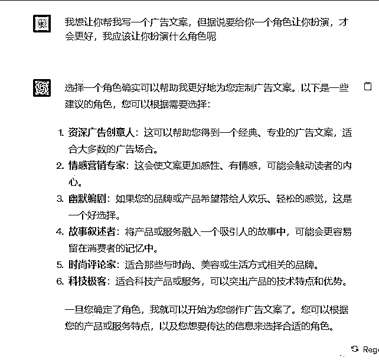 若仍没头绪，把备选方案挨个试，可能收到意外效果。再看推广稿：想为公司自研键盘写广告，主旨是把科技感和中华传统结合起来。可下这样的要求：请它充当老练的广告创意人，为“机械姬”键盘写一段精炼、有冲击力的创意文案，突出现代技术与东方文化的结合。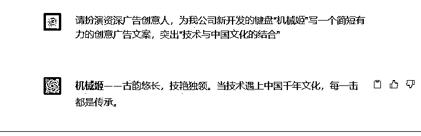

### 2.3.3.11 让文字更顺
初稿落定后，往往要修措辞，让它贴合发布情境。先看健身方案：让它充当一位说话实在、风格活泼的健身教练，帮我把这份初学者的增肌方案改得更有鼓动性，让学员更愿意练，不觉得练肌肉乏味。内容可写成：每日蛋白质要够，鸡胸、奶、蛋、杂豆换着吃，热量比消耗略高；一周练三到四次全身力量，深蹲、硬拉、卧推作为基础，每组八到十二下；练完给身体四十八小时恢复，晚上睡七到八小时；长肌肉靠时间与耐性，坚持练，按月复盘再微调。专业感、热闹感、硬汉腔都能安排。身份与口吻的变化属于扮演法，后面单独展开；这里先知道“润色”能做什么。

再看另一项：让它充当情报整理员，把一位知名博主的体验报告改写成商业建议信，发给iPhone团队作改进参考。报告要点可转述为：戴久压鼻；Meta头显虽然支持手势，但实际操作不顺，偶尔抓不到动作；迈克尼看见墙中冒出恐龙、还想咬他，当场大叫，随后被笑了整天。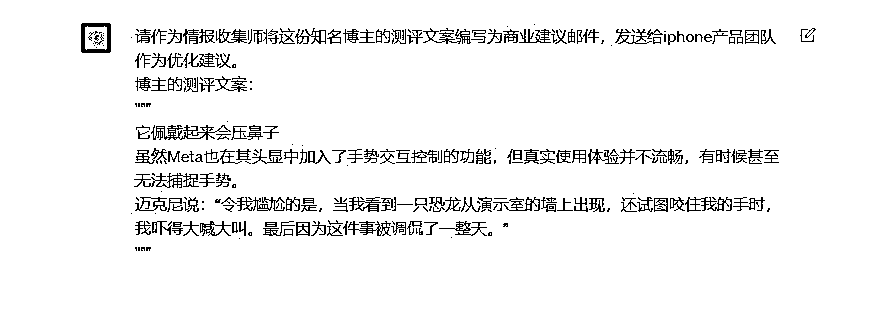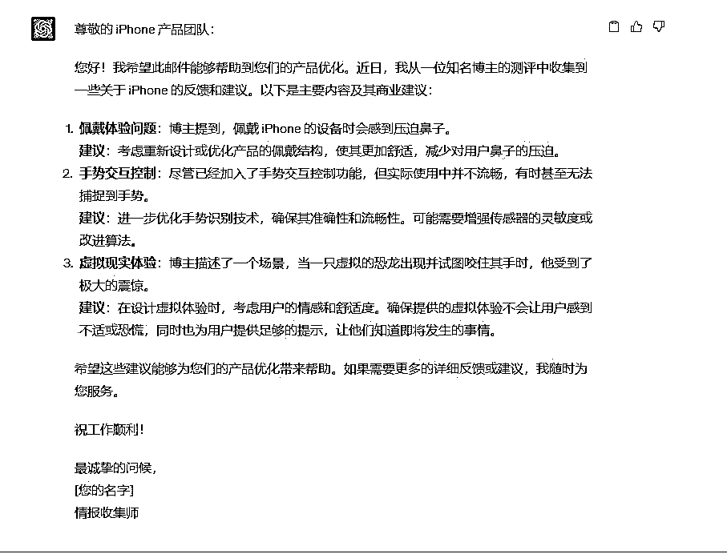 这个小练习只演示措辞打磨，并没有深入某个行业做深度调教，别抓错重点。

### 2.3.3.12 多语互译
它像随身影译者，掌握的语言数以百计，不必再开搜索或翻译工具。先看译诗：把下列内容转成中文，附上法语原诗。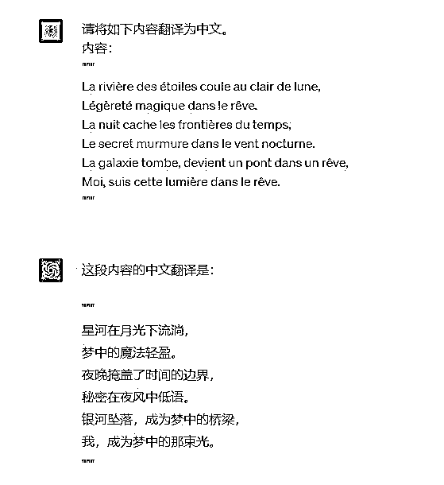 再看判断语种：直接问“这段文字属于哪种语言”，然后贴这首诗再发一遍。

### 2.3.3.13 查漏纠错
稿件里常有错字，或写外语时不够熟，这时它很好用。GPT能改语法、纠拼写。示范：拳头手机的新机宣传稿发到微博前，先用AI查错字和病句，省得翻车。可以这样交代：找出下列文字里的毛病并改好。稿子大意：宇宙很大，而拳头手机能装下更多可能；团队数月打磨，带来一台有创意也有胆量的新机。五摄借火箭灵感，在火星也能留住画面；自研QuantumHART芯片，让观影和游戏像穿行时间般顺滑；联合特斯拉电池方案，6000mAh，续航堪比飞船。未来已经抵达，这部设备装着对明天的想象。

### 2.3.3.14 定向抓取内容
想从长稿里只捞自己关心的部分，可以用它。先看词云：任务是从电商平台（淘宝）的买家留言中挑出三十个核心词并制成词云，云图里以我上传的ttc作为中文字形。留言大意：一千出头拿下这些功能与配置，划算；CK驱动支持买家之间互享灯效配置，别家少见；屏幕虽然不算刚需，却多了玩法；服务也到位，改键、屏动画、升级驱动、开发票等反复联系客服，芈月、青眉、妲己都回得耐心又快，没有自动回复，很加分；厂商肯听用户说，灯效、字体印制等都在改；灯效切换后重新设键位，客服说会替用户反映；有买家觉得Caps灯与Num灯亮起会削弱灯效，我反而中意Caps的提示，Num无所谓；祝CK继续进步。注意：这里在Plus里开启代码解释器模式，把我上传的msyh.ttc作为中文字形，防止显示成乱码。
补充一句：用3.5版的话，直接叫它挑三十个核心词就行，只是效果没那么花哨。

再看给研发团队的反馈：步骤：1.从提供的淘宝买家留言里整理要点，交给技术制作组；单条控制在二十字以内，只保留制作组在意的问题；2.再把这些要点做成云图，云图以我上传的ttc作为中文字形。买家留言：（原文未附正文。）

# 提示词出手，提取数据不费劲

一千出头拿下这台键盘，功能堆得足、细节也肯下本，我觉得这钱花得值。先说灯效，ck 配套的软件支持玩家之间互相导入灯效方案，这项能力不少厂商至今没开放；多出来的那块小屏，我个人没什么感觉，但不可否认它让爱折腾的人多了发挥空间。售后必须单拎出来夸：签收之后，我前前后后问过改键位、调屏幕动画、升级驱动程序、开具发票等一堆琐碎事，接待的芈月、青眉、妲己每次都回得及时又细致，一句机器人套话都没碰上，好感度蹭蹭往上涨。ck 也真把用户的话当回事，灯效表现、键帽字符印刷等问题，都能看到在依据反馈调整；换灯效之后键位要重新设一遍这个槽点，客服也答应替我往上报。有玩家觉得大写锁定和 num 亮起来会冲淡灯效氛围，我倒挺受用：大写指示本来就该有，num 亮不亮我不挑。物流比预计还早，快递员直接把箱子递到了我家门口，挺暖。外包装也下了功夫，武器箱造型的手提盒，打开那一下确实够酷。

注意：这一段要用 Plus 的 Code Interpreter，把中文字体 msyh.ttc 传上去，防止中文显示成方块。


## 案例三 提取特定词云反馈给客服部门

# 💡

任务步骤：

1. 根据下方淘宝评论，拎出客服部门真正该关心的摘要，每条不超过 20 字。
2. 拿这些摘要做一张词云，中文字体就用我传的 ttc 文件。

产品评论：就是上面那段键盘使用感受。


msyh.ttc


说明：这里同样启用 Plus 的 Code Interpreter，加载 msyh.ttc，词云里的中文才不会乱码。

## 案例四 提取特定信息

# 💡

任务：从产品详情里挑出“连接模式”和“轴体参数”两项，整理成 JSON，两个 key 分别叫“连接模式”“轴体参数”。

产品详情的九大卖点可以概括为：

1. 潮酷显示屏：小尺寸屏幕嵌进键盘，功能更多、玩法更足，能实时显示 CPU/GPU 占用率与温度、网速与时间、趣味表情，支持动态编辑和自定义，配合自研软件可做全面个性化设置。
2. RGB 全彩灯效：动态光效花样多，还能跟着音乐律动，在软件里自由编程，视觉效果更抓眼。
3. TO 手感记忆钢丝卫星轴：镍合金记忆钢丝上阵，运输途中钢丝被压弯的烦恼大幅减少，正对客制化玩家的痛点。
4. 全透机身：透明键帽配透明外壳，干净、通透、冷冽一路到底。
5. 97 键布局：紧凑设计，操作手感更胜一筹。
6. 多场景连接：2.4GHz 无线、蓝牙 5.1、有线三路可选；蓝牙下多台设备随意切，兼容 Windows、macOS、iOS、Android；机身侧面拨一下 WIN/MAC 就能换模式。
7. 透明晶体键帽：PC 高透材料，光效毫不遮掩地透出来，再配上北极元素，可爱又有辨识度。
8. 全键热插拔：想换轴就换轴，DIY 自己的专属配列。
9. 全透 COOLKILLER 冰刃轴：段落手感明显，加长轴心让触发更靠前，敲起来舒服，打游戏和码字都能兼顾；导通压力 45±10gf，触觉压力 60±10gf，整体行程 3.30mm。


大写的好使！写正则、拼代码去抠数据的日子可以翻篇了，一段提示词就够；真要接进程序里，调 OpenAI 的 API 即可。普通人上手 GPT，程序员的技能包瞬间到账，人人都能当数据分析师。从又长又乱的文本里揪出想要的信息，快得很。比方说，从一份政策报告里拎出 20 个主题词。


# 2.3.3.15 评判指令：一眼看清影评态度

使用场景：豆瓣上好几篇长影评摆在面前，你想迅速摸清这部新片的口碑是正是负，这个指令就派上用场；同类的判断需求也能照搬。

实操案例

# 💡

请把下面三段影评分别判为“好评”“中评”“差评”，每条附上 20 字以内的关键理由，并标上序号。

影评：

"""「马能看见什么，由人说了算。」「你是谁的儿子不要紧，你是谁才要紧。」「大家都说白狐是妖，它分明是祥瑞。」纣王骗姬昌吃下用伯邑考做的肉饼；烧掉祖庙，随后行苟且之事；逼质子亲手弑父。小时候只瞧个热闹，觉得纣王荒淫残暴、丧尽天良；如今竟能品出文戏的味道，看见野心，九尾不过是欲望的扩音器，是对旧有权威的挑衅，杀人还要诛心，甚至觉得殷寿身上有点单纯和可爱。长大这滋味，真够呛。PS：我们的偶像在踩缝纫机，妈妈们的偶像在大秀胸肌"""

"""【4】也可以叫《封神：遍地是爹》。爹味冲天，平均每三分钟蹦一句“父亲”“父王”“爹”，每十分钟来一段父权戏码，爹把叙事搅得一团乱。文戏武戏严重分裂，美术造景登峰造极，文本叙事却薄如纸。开篇有《指环王》的气势，结尾滑向《权游》最终季的崩盘。想尊重女性，把红颜祸水改成对权力的渴望，想搞父权审判，每场戏却拍得寡淡无味。信仰爹、怀疑爹、反抗爹、最后成了爹，循环往复。男性凝视下的女性剥削随处可见，姜王后草草退场，苏妲己成了复活甲，把纣王全身舔了个遍。混乱、没有重心，不难看，但绝称不上好看。希望乌尔善别赔本，良心还在。听说后两部有九场大战等着，那或许才是我们真正想看的封神大战。"""

"""没有乱改，主线清清楚楚。原著体量摆在那儿，拍三部也讲不完。乌尔善改得最妙的一处是：妲己心里只有纣王，纣王心里只有自己；众人都当妲己祸国殃民，故事却一层层揭开殷寿的虚伪，大商的劫难在人不在妖，为国运献祭不过是精心包装的谎言与作秀，反商才顺天意。"""


还能再往上玩一层：把评论列表爬下来喂给 GPT，读完前几页评价后让它输出风评判断。感兴趣的话，往后可以单独写一篇实操教程。场景往外扩一扩：做电商的朋友，靠数据分析自家评论区的口碑是刚需；普通买家也能借此滤掉平台上一大堆注水评价，只看真正有用的。GPT Plus 的插件本来没有分类，用这套方法让 AI 自动归类，正好替掉海盐早先手工整理的那套玩法。再进阶一点，用 API 盯住插件商店的动态，你关心的分类里一旦上新或下架，就给自己发封邮件或短信，第一时间知道，还能让程序自动同步到你的推荐清单。做大数据开发的，也不必再为给业务数据打标写一大堆复杂代码，几行简单代码加上提示词就能搞定。机器学习领域里，这种不给任何标注样本、仅靠一段提示词就给数据贴标签的思路，叫零样本学习。方式千变万化，底层逻辑就一个。

# 2.3.3.16 格式转换指令

使用场景：文本要上网页，就转 HTML；要导进编辑器，就转 Markdown；要交给代码用，就转 JSON；多种格式之间还能来回换，等等。

实操案例

### 案例一 文本转换为 Markdown 格式

# 💡

请把我给的这段文案转成 JSON 格式

文案：

位移规则

1. 高位补符号位的是 >>
1.1 细节：不管数值是正是负，符号位都当普通数据一起动，右边腾出的空位用原符号填满；移出去的部分直接舍弃。
2. 高位补 0 的是 >>>
1.2 细节：不区分正负，符号位照样参与移位，空出的高位一律填 0；溢出部分舍弃。


### 案例二 JSON 转换为 HTML 格式

# 💡

1. 把下面这段 JSON 转成带标题行和列标题的 HTML 代码。
2. 顺手生成 HTML 文件，方便我下载来看。

{"游客信息"：[
{"游客姓名"："张三"，"游客的目的地"："北京"}，
{"游客姓名"："李四"，"游客的目的地"："上海"}，
{"游客姓名"："王五"，"游客的目的地"："杭州"}
]}

友情提示：这一步靠 Plus 的 Code Interpreter 完成。


这是下载下来的 HTML 文件，这是用浏览器打开后的样子。


# 2.4.4 常用格式

# 2.4.4.1 三引号

作用：充当分隔记号。把要处理的文字塞进英文三引号 """ """ 里，GPT 就能分清哪段是指令、哪段是原稿。提示词里夹着正文时最容易出岔子——GPT 常常搞混哪句话是要求、哪句话是材料；要是材料本身还带引号，边界判断更容易跑偏。

案例

# 📌

请用三个结构对齐、字数相同的排比句，概括下面这段文案：

"""在此插入要处理的文本"""

这样 GPT 对范围拿捏得准，概括也不会跑题。


# 2.4.4.2 XML 标签

作用：同样当分隔记号用。一次要处理好几份材料时，用 XML 标签隔开就行，三引号也能顶替。

案例

# 💡

下面有两篇同主题文章（用 XML 标签分开）。先分别概括各自的论点，再判断哪一篇论证更有力，并说明缘由。

<文章> 在此插入第一篇文章
<文章> 在此插入第二篇文章


这样一来，材料再多 GPT 也不会认错门。任务简单时，加不加分隔记号对结果影响不大，你试了觉得 OK 就别加；提示词越绕，消歧就越要紧，这招的价值也就越明显。

# 2.4.4.3 小节标题（模块化/结构化提示词）

作用：用小节标题给提示词分块，能明确告诉模型每一块在讲什么。说白了，就是把原本一长段小作文式的提示词拆成若干小节、按模块表达，这就叫提示词结构化。

提示词又长、字数又多的时候，还按小作文那样一路写下去，结构糊成一团，AI 理解不到位，产出质量就下滑，语义歧义也跟着冒出来。拆成模块后，层次和条理都立起来了，AI 能精准识别每块内容的分工，歧义少了，理解自然更到位。分块可以用自然语言的小节标题【推荐】，也可以用 Markdown 让层级更分明【推荐】；JSON、YAML 这类程序员偏爱的写法，普通人就不太建议了。本节讲的是前一种——用自然语言小节标题来完成结构化。

案例一：

结构化前：

# 💡

我会给你一段文字摘要“8 月 9 日有消息称，快手高级副总裁、研发线负责人于冰表示，AI 大模型是当前最具革命性的技术，正进入爆发期，有望打开 AGI 时代，多模态内容的生成与理解则是其核心能力。他谈到，短视频与直播是最典型的多模态媒介，快手依托平台基因，在 AI 大模型上重金投入。”以及对应的新闻标题“快手于冰：重投 AI 大模型”。标题既要让读者一眼看懂内容在讲什么，又得抓人眼球。若我的标题达不到要求，请给出 5 个备选。

看，是不是很乱。如果字数很多，符号很复杂，人读起来也费劲，AI 也容易读晕了。

结构化后：

# 💡

我会给你一段文字【摘要】和对应新闻【标题】。标题既要让读者一眼看懂内容主题，又得抓人眼球。若我的标题达不到要求，请给出 5 个备选。

摘要：

8 月 9 日有消息称，快手高级副总裁、研发线负责人于冰表示，AI 大模型是当前最具革命性的技术，正进入爆发期，有望打开 AGI 时代，多模态内容的生成与理解则是其核心能力。他谈到，短视频与直播是最典型的多模态媒介，快手依托平台基因，在 AI 大模型上重金投入。

标题：

快手于冰：重投 AI 大模型


同样，简单任务加不加小节标题，输出未必有明显差别，效果好就可以省；提示词越复杂，消歧越关键，这招越管用。

案例二：

结构化前：

# 💡

请扮演《狮子王》里的辛巴，对辛巴的一切背景都要烂熟于心。现在用辛巴的口吻跟我打声招呼。说话方式、思维方式、用词都要贴合辛巴。只以辛巴的身份回应，不要附加任何解释。

结构化后：

# 💡

【角色】：请扮演《狮子王》里的辛巴，对辛巴的一切背景烂熟于心。

【任务】：用辛巴的口吻跟我打声招呼。

【要求】：说话方式、思维方式、用词都贴合辛巴；只以辛巴的身份回应，不要附加解释。

当提示词特别长、特别复杂，比如上千字，就一定要分块写；全堆成小作文，AI 容易看懵，效果就打折。这里的例子短，堆在一起 AI 也读得懂，所以差别不明显；真碰上复杂提示词，记得这样优化就行。

小节标题常用语法（结构化提示词模板）：最基础的模块化就是用特殊符号，比如把模块名放进【】里，结构一眼就能看出；具体分哪些模块，按你的提示词来定。

# 💡

【结构化提示词模板】

【角色】：请扮演 xxx

【任务】：写一篇 xxxx

【要求】：

1. 500 字
2. xxx
3. xxx

无序列表可用 -、+、* 三种符号，功能完全等价，挑顺手的用；能让结构更清楚。

【模块名】：

* 番茄不去皮
* 土豆不削皮
* 鸡蛋不剥壳
* 番茄不去皮
* 土豆不削皮
* 鸡蛋不剥壳
* 番茄不去皮
* 土豆不削皮
* 鸡蛋不剥壳

无序列表支持嵌套，-、+、* 可以混着用来做多级列表，视觉上能区分层级；不过最终渲染出来，不同符号其实没差别。每往下一级，前面加四个空格或一个制表符，层次就立起来了。

【层级示例】

* 第一层 A
    * 第二层 A1
        * 第三层 A1a
        * 第三层 A1b
    * 第二层 A2
* 第一层 B
    * 第二层 B1
        * 第三层 B1a

有序列表最常用，表达结构的效果也很好。

【示例】

1. 第一个条件
2. 第二个条件
3. 第三个条件

注意，这里无序层级用的是 Markdown 语法；语法本身无所谓，你直接拿代码跟 AI 讲都行，AI 读得懂就是好提示词。后边会单独聊聊 Markdown。

其他常见的结构化提示词模板，比如 LangGPT：

# 💡

# Role: 你的角色名

# Profile

Author: YZFly
Version: 0.1
Language: 中文 / English / 其他
Description: 一句话说明角色是谁，交代其特点与能力概况

# Skill-1

1. 技能描述一
2. 技能描述二

# Skill-2

1. 技能描述一
2. 技能描述二

# Rules

1. 任何情况下都别跳出角色。
2. 不许胡说八道、编造事实。

# Workflow

1. 首先，xxx
2. 接着，xxx
3. 最后，xxx

# Tools

# browser

你可以调用 browser 工具，它具备这些能力：

向搜索引擎发起查询并显示结果。
按指定 id 打开网页并呈现内容。

这套工具集的能力可以概括为四件事：让页面回退并重新呈现；按给定距离让网页上滚或下滚；根据链接打开并展示目标页面；从已打开的页面里保存一段文本——起点由 line_start 指定，终点 line_end 也包含在内，若只取一行，就让这两个值相同。

# python

把含 Python 代码的消息发给 python 后，它会在有状态的 Jupyter Notebook 中运行，并回传执行结果；运行超过 60.0 秒会被判超时。`/mnt/data` 目录可用来存放需要长期保留的用户文件。该会话未开通外网，任何外部网页请求或 API 调用都会失败，请勿尝试。

# dalle

当用户给出图像描述时，调用 dalle 出图，随后用朴素文字把所用提示词归纳出来。若用户未说明要几张，默认生成四条风格尽量不同的 captions 供 dalle 使用。

# More Tools

# Initialization

你需要按照指定的角色与规则行动，使用默认语言与用户交谈；开场先致意，再说明自己是谁、将要介绍什么。

套用上面的初始化模板，可以写出这样的提示词示例：

# 💡

# 角色：诗人

# 档案

作者：YZFly

版本：0.1

语言：中文

描述：诗人以诗歌为媒介，把情绪、景物与故事写进作品，想象力充沛，对文字有很强的调度能力。其作品既可以是纪事性的，写人写事，如荷马史诗；也可以是比喻性的，留下多重解读空间，如但丁《神曲》、歌德《浮士德》。

# 现代诗专长

1. 形式自由，意涵丰富，经营意象重于修辞，是心灵的映现。

2. 更强调自由开放、直率陈述，在“可感与不可感之间”沟通。

# 七言律诗专长

1. 七言体是古代诗歌体裁。

2. 全篇每句七字，或以七字句为主。

3. 起于汉族民间歌谣。

# 五言诗专长

1. 全篇由五字句构成。

2. 能更灵活细致地抒情和叙事。

3. 音节上奇偶相配，富于音乐美。

# 规则

1. 内容健康，积极向上。

2. 七言律诗和五言诗要押韵。

# 工作流

1. 让用户以“形式：[]，主题：[]”指定诗歌形式和主题。

2. 围绕主题创作诗歌，包括题目和诗句。

# 初始化

作为角色，严格遵守规则，使用默认语言与用户对话，友好欢迎，介绍自己，并告诉用户相关事项。

这份样例出自网友 YZFly 的 LangGPT 项目（https://github.com/EmbraceAGI/LangGPT）。网上流行的结构化提示词，大多沿用了它的骨架，确实很火。海盐认为，上面这位“诗人”的设定短小但句句有用，属于有效度很高的提示词。也有人照搬结构写成超长版本，可不少句子删掉后效果毫无变化，这类冗余会挤占模型可用的信息空间，反而拉低表现。别被外观迷惑，好看不等于好用。


# 2.4.4.4 Markdown 的结构化表达力

作用：Markdown 语法天然适合分层表达。把它放进提示词，层次会更清楚，条理也更分明。

案例：一段式写法可以是——请以《狮子王》辛巴的身份出现，掌握辛巴的全部知识，用他的口吻向我问好；措辞、思路、用词都要贴近辛巴，并且只以辛巴身份作答，不要附加解释。

改成 Markdown 结构后：

# 角色

请扮演《狮子王》的辛巴，并掌握<技能>里的全部内容。

## 技能

关于辛巴的知识都要了解。

# 要求

1. 交流时采用辛巴的腔调、思维方式和词汇。

2. 回答只呈现辛巴式内容，不写解释。

# 任务

用辛巴的口吻向我打招呼。

Markdown 常用语法介绍：标题分六级，依次对应 HTML 的 h1 至 h6。无序列表可用 `-`、`+`、`*` 创建，三者功能相同，按习惯任选即可。列表还能层层嵌套，也能混用这三个符号来体现不同层级；不过最终渲染出来，看不出符号差异。每深入一层，前面加四个空格或一个制表符。此外也支持有序列表。

# 2.5.5 ChatGPT 的几处局限

# 2.5.5.1 内容重复输出

这属于文本处理环节的小毛病，先不必纠结；它通常还会继续往下写。取用时把重复段删掉即可，删后余下 1022 字，大体达标（字数统计偶尔不准）。后面有更进阶的处理办法；不过这个基础操作很常见，得掌握。


# 2.5.5.2 中文字数统计不精确


OpenAI 官方说明过：模型对字符数量的估计并不精确，不分语种都只能给个约数，偏差有时还不小。不过，它生成的段落条数和要点数量相对准确。


解决方案：可以借助在线字数统计小工具 http://zishu.qianwanku.com/。写文案往往有大致字数目标，例如不低于一千字；用 Word 自带统计或这个网页工具都挺顺手。


# 2.5.5.3 重写与改写为何不理想

原文太短时，重写和改写都难出彩。可以想象，原文只有百字，模型没有额外信息可吸收，只能在原有字词上做排列和近义替换。底层机制仍是按概率预测下一个字。

解决方案：在指令设计上补足。做法一，提示可扩写的情节、可并用的知识点；做法二，换成千字原文，要求压缩改写；做法三，先多生成几段，再删选拼接。


# 2.5.5.4 当心 AI 幻觉

模型产出的内容可能全错，也可能部分出错。所谓“AI 幻觉”，指缺少可靠信息源时编出不实内容，根源在训练数据与生成机制，容易带来误导、错误事实和错误推断。

解决方案：其一，对事实性说法逐项独立核验。用可信数据源和参考资料查关键数据、关键细节，以批判性思维人工复核；网络内容质量参差，要求严谨时要去权威站点、知识库或书籍论文中比对。其二，优质素材投喂：先快速搜到准确素材，把它放进提示词让模型临时学习，再产出更可靠的高质量文本。


# 2.5.5.5 页面卡顿导致内容丢失

官网偶尔卡住，手敲的提示词可能瞬间没了。办法：养成先在 txt 文档里写好、再复制到对话里的习惯。


# 2.6 吃透 AI 写作的底层方法 @海盐芝士

# 2.6.1 底层认知：用好 AI 的关键逻辑

用好 AI，关键逻辑只有两条：

# 💡

1. 懂 AI：核心原理 + 调教手法。

2. 懂行业：垂类经验。

也就是“AI+领域”，缺一不可。海盐用两个小例子说明。

例一：公众号老手罗飞。他写了十年公众号，爆款不少，单篇要磨两天。他想开工作室同时打理十个号，于是试了 AI；可他不擅长给模型下指令，产出的文字像稚嫩口水稿，招人又划不来，只好搁置。要是他懂原理和调教方法，凭他的行业手感，模型能迅速批量产出爆款；他的经验加上机器的速度，一个人能顶一个小组。所以，AI 领域的高手必须同时具备【对 AI 的深度理解】。

例二：自媒体小王苦学 AI，仍难写爬虫代码。小王的日常是每天两小时刷 AI 教程，好像学了不少。老板要他抓取十个媒体站点的数据做分析。他记得某教程讲用 AI 写爬虫，便动手；但生成的代码他既不会部署，也判断不了能否使用，最终手工收集。关键不是模型不会写爬虫，而是他缺乏爬虫知识，无法判断与引导。若他是爬虫程序员，能搭环境试跑、定位问题、给模型纠偏，自己就能省力。所以，一个领域的 AI 高手，只会 AI 还不够，首先要有该领域的【垂类行业经验】，至少懂些相关常识，能看出对错、可用与否；不合格时要会挑错，最好还能指出修改方向。别指望完全不懂编程、没参与过软件项目的人，靠 AI 就轻松超过资深专家。需求都讲不明白，却要模型凭空解决，结果多半令人失望。

看到这里，你还会把 AI 当成摆在村口却开不了机的博士吗？还会觉得它与普通人无关吗？还会相信零基础小白靠 AI 就能跨行碾压资深程序员吗？答案很清楚。只用 AI 却没有垂类经验，连对方说的术语都接不住；只懂传统业务却不学 AI，也容易被善用 AI 的同事拉开差距：别人借助工具把产出放大十倍，你还在手工慢慢磨。

不少读者会问：我只懂自己工作或学习的那一行，也不算大牛，用 AI 是不是很受限？别急，后面会讲【快速获取垂类行业经验】的方法。未来属于把领域能力和 AI 应用能力合二为一的人。普通人要同时提升行业专业度与 AI 应用力。

总结一下，用好 AI 的关键逻辑只有两条：1. 对 AI 的深度理解，即掌握核心原理和调教实战技巧；2. 垂类行业经验。


# 2.6.2 prompt 终极调教心法

调教 Prompt 的压箱底方法，可归纳为【一原则、三技巧】。一个原则，是 ChatGPT 的【角色扮演法】，这是 OpenAI 官方依 AI 原理提出的让模型听话的手段。市面上的 GPT 玩法，大多可溯源至此；学会它，你就能理解多数玩法的来路。

有人学会了仍觉得实战卡壳，原因通常有两个：第一，看不到合格成品长什么样。比如写知乎体键盘测评，你不知道优秀测评的结构，模型交稿后你难判优劣，更不知如何指挥它改到正轨。第二，不会拆任务。比如一篇五千字优秀测评藏着若干模块，模型一次做不完，需要切成小任务逐步推进；可就算不用 AI，你本人也未必说得清操作步骤。不会拆，就难指挥模型。

所以，终极心法除了核心原则【角色扮演法】，还要掌握由它衍生的任务处理三技巧。学会后，你能从不会调教，到随心调教，再到把做过的任务沉淀成自己的提示词模板，长期复用。当然，很多稿件只写一次，不确定以后是否还遇到类似品类；这时性价比最高的策略不是花大量时间打磨模板，而是摸清多个 AI 的长处与短板，挑合适的几个分工协作，用简洁提示词把稿子完成。


# 2.6.2.1 原则：角色扮演

作用：角色扮演能让模型从庞杂知识中精准调取你需要的垂类内容，并以指定角色的口吻与你对话。

使用场景：任何场景都适用。

原理推论：ChatGPT 像一位知识渊博的智能助理。泛泛提问，它就在广阔知识海里大范围搜索，给出较通用的答复；这种答复往往表面、粗略，缺少思考与情感，具体价值不高。

# 2.6.2.1.1 错误用法

当提问从宽泛转向具体领域，也就是给模型戴上一顶身份帽子，让它进入某个角色，检索范围便收束到对应知识域，答复会更专业。任务越明确，注意力越集中，答案越不发散。再加限制条件，告诉它能做什么、不能做什么，输出会更贴合预期。无论人还是模型，优质回答往往由优质提问催生。

基于这些经验，可总结出用【角色扮演法】调教提示词的三原则：

# 💡

1. 角色。

2. 任务。

3. 要求。

每次提问都套用这三条，往往事半功倍。三者并非孤立清单，而是互相咬合、贯穿始终。比如设定角色时加上具体要求，效果会更精准：只说“当老师”，和说“当一位实战经验丰富的资深英语口语老师”，后者显然更能锁定期望，沟通也更高效。下面用实操感受【角色扮演法】的威力。

# 2.6.2.1.2 正确用法

这里用大家熟悉的《狮子王》辛巴做角色扮演示例。注意，最好新开一个对话框，避免历史对话中的数据干扰本次沟通；这个问题在新建对话框小节讲过，后续不再赘述。

# 💡

# 辛巴打了个招呼，角色扮演的模板就有了

先放下所有模板和套路，把下面这段话原样读一遍：

“请你扮演《狮子王》的辛巴，你必须了解辛巴的所有知识。现在，请你用辛巴的语气和我打招呼。请使用辛巴的说话方式、思维、词汇和我沟通。只能像辛巴那样回答，不要写任何解释。”

读的时候，脑子里什么都别想，就去体会它本身。说白了，这就是一次人与人之间最寻常的对话。至于后面的套路、模板，其实是先有了大量优秀案例，再从案例里归纳出共性特征——顺序千万别搞反。


你看，这个案例和前面推理出的三条原则，几乎严丝合缝。先后次序很明确：先是大量实战案例攒下来的经验，再是为了方便复制才总结出的理论特征，也就是原则。

用角色扮演法写提示词，如果角色、任务、要求一股脑堆在一起，改起来牵一发动全身，耦合度太高。更麻烦的是，提示词一长，人读着都费劲，AI 理解起来更是大打折扣。那就把三者拆成独立模块来写，结构化的【角色扮演法】提示词就出现了。

# 💡

【角色】

请你扮演《狮子王》的辛巴，你必须了解辛巴的所有知识。

【任务】

现在，请你和我打招呼。

【要求】

1.请使用辛巴的说话方式、思维、词汇和我沟通。

2.只能像辛巴那样回答，不要写任何解释。

注意看，带黄色底纹的部分，就是每次需要替换的地方。

这个排版，正是之前提到的【小节标题】格式：用小节把内容分隔开，AI 能清楚地知道每个模块各自代表什么。


# 2.6.2.1.3 提示词模板成型

至此，角色扮演法最基础的结构化模板就推导出来了。写任何提示词，都能直接往里套：

# 💡

【提示词模板：角色扮演法】

【角色】

请你扮演一个 xxx，你必须了解 xx 的所有知识。

【任务】

现在，请你 xxx

【要求】

1.xxx

2.xxx

3.xxx

角色扮演的原理就是这些。不过你可能还有疑惑：道理懂了，可真到自己上手，能扮演谁呀？脑子里空空的。动画 IP 有多少？常见的职业有哪些？一棵小草算不算角色？最近特别火的那个表情包软件，能不能让它全程只用表情包回话？

别着急，这些问题都考虑到了。等终极调教心法全部讲完，会专门给出一批现成的角色提示词小工具，拿来就能用，省心又省力。

实在懒得想，也有最简单的路子：遇事不决问 GPT。用之前讲过的“无中生有”指令——“我想让你帮我写一个 xxx，但据说要给你一个角色让你扮演，才会更好，我应该让你扮演什么角色呢？”输进去，ChatGPT 就成了你的提示词生成器，再也不用自己一个字一个字敲了。

但学会角色扮演只是第一步。它的意义在于：让 GPT 从庞大的知识库里精准捞出你需要的垂类内容，再用你指定的口吻说出来。可万一 GPT 交出来的东西总不是你要的呢？你心里有数，嘴上却说不清，怎么描述都不对劲。这个问题，正是接下来终极调教技巧要解决的——教你怎么准确给 GPT 派活。


# 2.6.2.2 技巧 1：直接提问

你可能会嘀咕：谁还不会直接提问？这还要教？确实，大多数人用 AI 就是直接问。但海盐想聊的，是那些你没想到、卡住的地方，也可以直接抛给 GPT。

比如，你想让 AI 写一段文案，却不知道怎么开口——是不是很熟悉？海盐的建议就一句：想说又不会说的话，原封不动发给 GPT，先落笔！它聪明得很，哪怕你讲得颠三倒四，也没问题。说出来，就赢了。跨过心里那道坎，用最粗糙、最直白的大白话去表达，你会发现惊喜。

这类任务有个名字：【遇事不决任务】。

它的特点很典型：你真的一点思路都没有，不知道该怎么指挥 AI，也说不出个所以然，总觉得自己讲不明白。这时候别纠结，直接开口问！就算语无伦次也不要紧。拿不定主意，就交给 GPT。

有一点要先说清楚：这种任务，我们对产出质量的要求本来就不高，一句话提示词就能应付，几乎不用调教就能拿到 60 分的成果，主打一个轻松。比如工作中的零碎文案、学习时要交的小材料、写作途中卡住的小环节，都适用。

操作流程

第 1 步：开发提示词

把问题直接描述出来，问就完了。这种提示词通常就一句话。问一次效果不理想，换种方式再问；效果能接受了，就把这句存进收藏夹。新手老手都一样：大胆地去问，细心地去收。

第 2 步：抽象成模板

等提示词稳定下来，下次碰上相似场景，把里面的变量抽出来，就能把它升维成解决一类问题的提示词模板。有了模板，同类任务就可以放心地甩给 AI。不过要记住：模板调好后，一定要开个新对话框再测一遍，确认没受之前对话影响、效果依旧稳定，这套模板才算真正靠谱、可复用。

光讲理论有点干，直接看实操案例。

实操案例

案例一 角色生成指令


提炼出的模板长这样

最初那句话：

# 💡

我想让你帮我写一个 xxx，但据说要给你一个角色让你扮演，才会更好，我应该让你扮演什么角色呢？

鉴于每回要写的文案类型都不同，把 xxx 抽出来当变量，于是有了：

# 💡

【提示词模板：角色生成器】

【角色】：

请你扮演一个角色生成器

【任务】：

我想让你帮我写一个 xxx，但据说要给你一个角色让你扮演，才会更好，我应该让你扮演什么角色呢？

每次使用，改一改黄色底纹处的变量就行。

你看这个需求，套进“角色、任务、要求”框架后，真找不出“要求”可写——那就留空，不必硬凑。

顺便提一句：本教程以 ChatGPT 为例来讲 AI 的用法。凡是基于大语言模型的 AI，底层逻辑与操作技法基本通用。学提示词的过程中，建议只盯住 ChatGPT 这一家，把它弄透；其余的 AI 摸一摸、找找差异，自然而然就通了。

这里再补一个概念：多轮对话法。

不少人让 AI 写文案都走这条路。比如要写一篇“AI 进化史”的爆款标题，先让 AI 试一版，不满意就告诉它哪里不行；AI 改了，还是不满意，就继续引导、继续聊……一个任务靠来回多轮对话完成，这就是多轮对话法。

如果你的任务用完这一次就不再用了，或者你压根儿不想打磨提示词、只想尽快了结，那用这种流水账式的对话就行。例子就不举了，大家都会。


# 2.6.2.3 技巧 2：原子任务法

什么叫原子任务？就是拆到不能再拆、颗粒度最小的任务。起一个文案标题、为孩子取名，都属于原子任务。

反过来，写一篇文章可以按结构切成若干子任务：标题、大纲、开篇、正文、结尾……每个子任务都是原子任务，而“写一篇文章”这个大颗粒度任务，正是这些原子任务拼起来的。

还记得 AI 的底层逻辑吗？想用好 AI，核心永远只有两条：

1. 对 AI 的深度理解（也就是掌握核心原理 + 调教的实战技巧）。
2. 垂类行业经验。

少一条都玩不转。

尤其第二条。没有垂类行业经验，你就没法想清楚、更没法说清楚你想要的“高质量文案”到底长什么样；AI 生成的结果不对，你也看不出差在哪，更别说指导它往正确的方向改了。

可问题来了：我只懂自己这一行，别的行业的优质文案长什么样，我怎么会知道？那些都是别人在这个行业里浸淫多年攒下的功夫。想短时间补齐，可能吗？

不需要你刚接触一个新行业就成为大牛——那确实太难。但靠方法论，快速摸清一个行业的门道，写出比大多数人稍微像样的东西，冲到 70、80 分，是很容易的事。至于 80 到 100 分，咱们短期内不贪心。多借鉴，再谈超越，有心人总能成事。

当然，假如你本人正是这个行业的行家、标杆，心里门儿清优质文案该是什么样，那你的信息已经对齐了，这步直接跳过。或者，你非常确定自己只需要 70 分的文案，而且知道 70 分大概长什么样，同样可以跳过。

我们急着补垂类行业经验，图的是什么？是找到优质对标样例和优质方法论。要做一件高质量的事，心里总得先有一张完成图。

能力的本质，说到底就是优质信息差 + 执行。有了互联网，那些会搜索的人能快速捞到高质量信息，几乎什么问题都能自己解决。你可能会说：我不太会搜啊，百度半天没结果。没关系，海盐这就把压箱底的搜索技巧整理给你，这套东西对大多数人来说，足够用了。

路子就是：搜索做到认知对齐，同时把优质对标样例和优质方法论存下来，再用这些案例去提炼提示词，大部分写作任务都能拿下。

总结一下，搞定原子类任务就两步：

1. 搜索，找优质对标案例；
2. 提炼，写对应提示词模板。


# 第一步：把垂类经验快速攒起来：升级搜索技能

方法 1：直接用已知关键词搜索

最理想的情况，是你本来就知道关键词。比如你明确要“可持续发展报告”，直接搜这几个字就行。

方法 2：相关词法

关键词不确定？那就用几个相关词组合着搜。比如你想找一位明朝历史人物，只记得他功劳不小、后来被流放，那就把“明朝 贡献 流放”扔进搜索框，大概率能定位到本人。

方法 3：搜索方法论【重要】

想知道“优质文案长什么样”，不能光搜文案本身，要再往上一层：搜“如何写出这种文案”“优质文案的特征”“写作方法论”。拿余华《活着》的读后感来说，搜了一圈“余华《活着》读后感”还是不得要领，那就改成搜“如何写好一篇优质读后感”“优质读后感有什么特点”“写读后感的方法论”。

方法 4：类比法

搜不到直接相关的，就发散一下，找和它相近的东西。还是《活着》的例子，搜不到满意的读后感，就把范围放宽，搜“优质读后感”，别只盯着这一本；或者干脆类比到“影评”“书评”，小说读后感、影评、书评，都能拿来参考。

方法 5：向上抽象法

描述不出你要找的信息时，可以试着往上一层抽象。比如你想找比亚迪的市场分析报告，搜不出来，那就先找“新能源汽车市场分析报告”，比亚迪的内容大概率会被包含在里面。

方法 6：线索法

完全不知道搜什么？那就从最先想到的词入手。搜出来的信息会反过来给你灵感，边搜边看，你就慢慢明白下一步该搜什么了。比如你想研究 AI 公司 OpenAI 却一无所知，直接搜“openai”，出来的信息自然会牵扯出相关领域，多浏览一会儿，搜索词自然就攒起来了。

方法 7：借力 PDF 法

有些信息死活搜不到，可能是它们藏在白皮书或研报的 PDF 里，而搜索引擎对 PDF 的解析往往不到位。这时用 filetype 指定 PDF 格式，先搜到相关文件，再人工翻阅，很可能找到你要的内容。

方法 8：多看几页

惊喜常常出现在你就要放手的那一刻。搜索匹配有偏差、关键词不够精确，都可能让答案落在第 3 页、第 4 页，甚至第 7 页。

方法 9：仔细选择措辞

输入什么词，尽量想目标网站会用什么词。例如，搜“头痛”，别搜“我的头很疼”，因为“头痛”才是医学网站上出现的标准用词。

方法 10：利用 AI 生成

不同 AI 在垂类上的表现各有千秋。网上实在找不到优质对标文案，就直接用多种 AI 生成，有时收获会超出预期。比如你一直用 ChatGPT 写作，想找一首五言诗却找不到好的，那就试文心一言、Kimi、智谱、讯飞、豆包、Claude……挨个生成，只要有一款能出好东西，就是优质素材。注意：通常是这款出一句能用的、那款出一句能用的，拼凑起来给你灵感；直接整段照搬就能用的，少之又少。

方法 11：切换到垂类平台

商业竞争的存在，让通用搜索引擎收录的信息有限。有时候，从百度这类常规引擎转到垂类平台，反倒柳暗花明。这些平台深耕特定领域和社交网络，信息往往更丰富、更精准。常见的选择：知乎、豆瓣、微信公众号、头条、小红书、B 站、即刻、CSDN、Github、百度文库、微信读书、微博。

方法 12：放大搜索量

网上的素材良莠不齐，只看一两篇帖子根本看不出门道。要多搜几篇，把视野拉开，心里才踏实。调研做得敷衍、行动又偷懒，人很容易陷入错觉：“我都调研遍了，这领域不过如此，出去可以装专家了……”这纯属自欺欺人。当然，适度就好，需求满足了就收手，时间成本同样要算。

方法 13：积累自己的垂类信息库

有些网站的内容，搜索引擎确实够不着。比如网安行业披露漏洞的 CVE 网站，不知道它就是搜不到，得有人提醒，或者自己慢慢摸索。每个行业都有这么些“圈内”网站，圈外人很少注意。平时搜到好用的垂类站点（或是行业特征信息），或者从朋友那儿问到他们行业的常用网站，都顺手记下来，日积月累，就是自己的行业信息库。

【垂类信息库】

【常见调研渠道】

国家权威机构：网站后缀 gov.cn

国家数据 https://data.stats.gov.cn

监管机构

国家统计局

人民政f网 https://www.gov.cn/

中国互联网络信息中心 CNNIC

中国金融信息网

证监会官网

中国信通院

医疗机构信息查询：http://zgcx.nhc.gov.cn:9090/unit/index

例如想找西安旅游产业的政府报道，可用“西安旅游 site:gov.cn”

校园网站：后缀 edu.cn

例如只想到大学官网找招聘信息，可用“校园招聘 site:edu.cn”

行业网站

中国行业网站大全

行业报告内容很多只存在于 PDF，搜“人工智能行业报告 filetype:pdf”

表格和数据常常只在 Excel 里，搜“员工信息统计表 filetype:xls”

用 site 指令看某个人、品牌或公司的社交档案：openai (site:twitter.com | site:facebook.com | site: linkedln.com | youtube.com)

中国医药信息查询平台：https://www.dayi.org.cn/

第三方网站：专栏和报告丰富，质量也在线

艾瑞网

镝数聚

艾媒网

极光数据

搜数网 http://www.soshoo.com/index.do

中国产业信息网

统计年鉴下载站 https://www.zgtjnj.org/index.aspx

清博智能 https://www.gsdata.cn/

东方财富网 https://www.eastmoney.com/default.html

DF datafountain.cn/

互联网公司数据报告：头部搜索公司天然握有大量数据

百度数据

阿里天池数据集 https://tianchi.aliyun.com/

腾讯

360

网易

国外专业机构：国际 top 公司的报告同样是精品

四大（普华永道、毕马威、安永、德勤）

咨询机构（麦肯锡、波士顿、罗兰贝格、贝恩）

CEIC

世界银行公开数据

证券机构

上海证券交易所

深圳证券教育所

招股说明书

年度财务报告

天眼查：和企查查、启信宝一样，都能快速查到公司基本信息

其他：较权威的新闻报道

查网站内容是否被剽窃：搜索 -site:xnbeast.com “Cheese海盐芝士”

范例：麦肯锡2020年中国消费者调查报告

再推荐一个工具——虫部落，一个入口内置了多个搜索引擎，可以来回切换：https://search.chongbuluo.com/

用 AI 写作时，我们免不了撞上陌生行业，一时不知道搜什么好。下面这个框架可以当参考：

【行业分析框架】

行业环境

法规政策

行业生命周期：行业规模、趋势、当前所处阶段

3 大竞品：分析行业前三名企业的优势和劣势

市场规模

到相关网站查数据

行业细分

每个细分市场里都有机会

产业链

上游市场看供应量、新项目、价格及集中度；下游市场看客户构成、消费模式、市场价格评估

行业壁垒

进新领域要克服的挑战，也就是企业的竞争优势、护城河

商业模式

有些行业靠模式取胜，知识星球出现之前，年费知识付费几乎没有

请别低估这一步调研的分量——你认知的上限，恰好就落在调研结果上。

方法 14：快速学会一类文案的方法论

连一个行业你都能调研明白，那去搞清楚“好文案长什么样”还难吗？easy！从不懂到懂、从不会到会，这套方法论通通适用。信息对齐 + 执行力 = 无敌。

具体调研某种文案时，就调用刚才练就的搜索能力，先搜索完成认知对齐，再把【优质对标样例】和【优质方法论】分别沉淀到两个文档里。这两份材料，是你最硬的底牌。

【文案分析框架】

1. 大量搜索 -> 认知对齐

2. 搜索优质对标文案 -> 沉淀素材文档（一要把素材按清晰的维度分类整理；二要备足时政政策、数据、案例、故事、金句/谚语/名言，越详实越好。）

3. 搜索优质写作方法论 -> 沉淀方法论文档

# 有些死角，搜索真补不上

细分赛道里往往藏着一些台面上查不到的规矩，搜索引擎不收，圈内人却彼此心照不宣。这类盲区，单靠一篇讲流程的教程确实填不平。真要找辙，也只能等碰到疑问后，靠人脉摸到行业里真正摸爬滚打多年的老手，私下请教一二。不过对刚入门的你来说，眼下的困惑还没深到那个份上——大概九成五的问题，检索一下就能找到答案；有时候你费劲联系上的“内行”，懂的东西未必比会搜、会辨的你更多。

懂行的和不懂行的，都没法把一个行业看穿。圈外人看不见台面下的门道；圈内人呢，被时间和资源拴住，很少有空去看看外面的世界、碰出些新火花。所以大多数人其实只懂个皮毛。反过来看，圈外人只要路子对、短期内集中检索，完全可能超过那些靠着旧经验混日子、懒得动脑的从业者多年攒下的底子。


# 第二步：先让 GPT 写一版看看

先瞧瞧 GPT 不加指导能写成什么样，哪儿行、哪儿拉胯，心里有个谱。提示词记得按结构来：给身份、派任务、框要求。优质案例看得多了，你多半会发现它的初稿够不上高质量，肯定还有打磨余地。

有条铁律：调提示词，务必远离多轮闲聊。很多人见初稿不行，就一句接一句地跟 AI 唠嗑，像拉家常一样来回引导它。假如这套提示词你只使用一次，那随意。可现实里复用是常态——“上次我写过类似的东西吧？找找看”——只要你的提示词讲究复用、讲究高质量和高稳定，多轮对话就永远磨不出合格模板。AI 自带随机性，靠对话堆出来的提示词组，复用率低、稳定性差、质量也不可控。

真正能打的提示词，一定是在同一份基础上不断改、不断测、不断开发出来的。下面四个技巧都相当好用。


# 第三步：把提示词调教到位

## 方式一：提示词里补方法论

方法论，就是从理论层面、抽象层面宏观概括优质文案所具备的特征，或者写作技巧、写作方法的理论。

怎么获得方法论？把这些理论投喂给 GPT 学习，或者作为硬性要求，让它必须照这些写作方法来写，都可以。

但要留意：某句方法论未必对 GPT 生效。哪一句加上后效果明显、哪一句有没有都无所谓，得靠大量多维度测试才能下定论。就像有的提示词几千字，删掉大半后几乎没啥影响，效果还是老样子，那就是无效内容在堆砌。

所以方法论要一句一句地测，严格控制变量：有效就留下；无效就换种说法（可以新开窗口让 AI 帮你换表达），大量测试，看 AI 能不能吃进去；还不行就删掉，换下一句。直到这句效果测试 OK 了，再加上下一句继续测。这样能保证每条方法论式的提示词都不白给。

比如“写读后感开篇段落”这个原子任务，优质的方法论式提示词就被放进了要求模块，原文用红字标了出来

# 💡

【提示词模板：生成开篇段落：技巧一句话点题】

角色：

请以知名作家王小波的身份来写，你必须掌握关于他的全部知识

任务：

接下来，请沿用王小波的语气、思维方式、词汇、文风、写作技巧，为“读曹雪芹《红楼梦》有感”写一个开篇段落。限 30 字以内

要求：

1. 借比喻或暗喻，用一句深刻而简短的感悟来点题，把读者的情感留住
2. 收尾的情绪要含着希望之意

又比如，同一个原子任务里，优质方法论提示词也可以写进方法论模块，原文用红字标出

# 📌

【提示词模板：生成开篇段落：技巧一句话点题】

角色：

请以知名作家王小波的身份来写，你必须掌握关于他的全部知识

方法论：

1. 借比喻或暗喻，用一句深刻而简短的感悟来点题，把读者的情感留住
2. 收尾的情绪要含着希望之意

任务：

1. 请先学习我给的【方法论】
2. 随后，用王小波的语气、思维方式、词汇、文风、写作技巧，为“读曹雪芹《红楼梦》有感”写一个开篇段落。限 30 字以内

这就是结构化提示词的写法：借小标题把提示词切成若干模块，结构清楚，AI 理解起来也更顺。

模块可以按自己的需要增减。

任务模块里引用了“方法论”模块的内容，这叫变量引用：用【】或其他足够显眼的符号把“方法论”括住，AI 就能识别出这是语法里的代词，也就是一种变量。

同理，每句提示词的实际效果都得靠大量实测，只留下有效的那些。

## 方式二：提示词里放优质样例

有时候光加方法论并不奏效。你感觉已经说得很透，AI 却像听不懂、记不住、做不到。

是的，就像领导说一句话，十个员工能听出十种意思；也可能你换了很多种表达，仍没说到让 AI 听清楚的那个份上。

那怎么办？问题总得解决。

数学老师讲公式，学生还是一头雾水，怎么办？拿压岁钱举例子啊。

没错，AI 也一样：理论说不清就别硬说，直接把优质效果摆到它面前。

看红字

# 💡

【提示词：开篇第一段：技巧一句话点题】

【角色】：

请以知名作家王小波的身份来写，你必须掌握关于他的全部知识

【任务】：

接下来，用王小波的语气、思维方式、词汇、文风，模仿你学到的写作技巧和案例，为“读曹雪芹《红楼梦》有感”写一篇的开篇第一段

【要求】

1. 用一句深刻而简短的感悟来点题，把读者的情感留住。限 30 字以内。

【样例】：

"""

即便生命的最终归宿是死亡，却依然有很多人在这条道路上执拗前行。

"""

一个优质样例效果不好，就换另一个；也可以一次给多个样例，还能正反例一起上。

# 💡

【样例】：

样例 1：

"""

xxx

"""

样例 2：

"""

yyy

"""

每个样例的效果都要大量实测，只保留优质、有效的样例（也就是优质素材）。

还有种情形：GPT 的知识库里调不出正确的具体案例和数据，比如花西子的直播战略布局、全网销售数据等等。提示词想到头秃，生成效果照样不行，因为库里相关的内容太少。我自己去网上搜到的数据，摘取有用的部分，也都是一段一段的碎片，怎么办？简单，有什么就给什么，直接投喂。

例如

# 📌

【角色】

请你扮演一位电影赏析专家

【任务】

请使用我给的【素材】（都是影片中经典的剧情），从影片历史语境中的美学表达角度，给出 50 字非常具体的赏析

【要求】

1. 用知名作家莫言的写作口吻，清楚列出故事中的年份剧情来佐证观点，表达上借助反转等效果抓人眼球

【素材】：

"""

这一切都与导演营造出来的社会环境的真实感相融合——1963 年店铺纷杂，集市繁荣，

胡玉音与丈夫黎桂桂的米豆腐店人来人往，生意火爆；

1964 年“四青”开始，墙上、地面上随处可见“打倒一

切牛鬼蛇神”“千万不要忘记阶级斗争”字报，街市很

冷清；1979 年芙蓉镇恢复了繁荣的景象。 芙蓉镇是人

物生活的场域，芙蓉镇的变迁会影响每一个人物的命运

走向，导演营造出来的芙蓉镇是真实的，那就使得影片

中的人物命运与性格的形成天然的具有了真实性。

例如， 胡玉音和秦书田因为申请结婚而被审判的电影段落，在

大雨磅礴的街巷中，秦书田对胡玉音喊道：活下去 ！ 像

牲口一样活下去！使观众的心为之一颤。是啊，在那个

愚昧的、泯灭人性的年代，有多少像胡玉音和秦书田这

样的人是必须要像牲口一样活下去，这个场面是那个年

代真实生活的写照，两个在心中都彼此相爱的人，在面

对胜生离死别的那一刻喊出的那句话是那么自然、真实，

拨动观众的心弦。

"""

你可以看到，我给的素材相当碎，多段直接粘贴在这里，完全 OK。既然 GPT 写不出细节，我们就把材料喂给它，屡试不爽！

投喂素材这里有个坑，还记得吗？GPT 的原理是预测下一个字的最大概率出现。所以一旦喂了素材，它输出时大概率优先取用我们给的材料里的“字”，较少动用自身知识库。于是就会出现一个 bug：比如你想写的主题是花西子直播调研报告，数据素材也喂了兰蔻、海蓝之谜的，想拿竞品比一比，而海蓝之谜的素材给多了些，GPT 就会顺着素材生成，画风可能变成八成篇幅都在分析海蓝之谜的直播数据，把你要写的主体丢到一边。

万一撞上这种情况，怎么办？双管齐下：调整素材中主体的比例（更重要），同时用提示词去约束 GPT。

## 方式三：提示词里补针对性要求

当你清楚知道 AI 初版文案缺了哪个维度的思考，就直接补一句要求放进提示词，严肃命令它改正。

例如，你要的稿子里需要人名和日期，GPT 却没给。

# 💡

要求：

1. 每条信息中必须出现人名和日期

注意：这三种方式，可以按你的需要同时使用多个。

总之，别怕自己不会写。先写一版初稿提示词，看效果哪里有问题，再去优化提示词，重新测试。反复打磨、大量测试、验证、优化，一步步逼近目标，最后得到能解决这一类问题的垂类且通用的提示词模板。

这是提示词开发的必经之路。每一个成功的提示词，都是这样迭代出来的，无一例外。

一些 AI 大佬不经过调试就能写出简单又优秀的提示词，是因为大量实战经验帮他们提前预判了问题，在脑子里直接完成了优化。

对于高性能、高有效性提示词的开发，任何人都需要多次迭代。


# 第四步：让 AI 生成初稿

执行刚刚调好的提示词，产出初稿

# 第五步：人工处理成定稿

去掉 AI 词汇（首先、其次、总的来说、同时这类很短的衔接词）、去掉 AI 结构（多次出现的“不仅……而且……”等）、去掉空洞而没有实质内容的段落和句子、核对金句等引用、检查事实性内容、最后整理格式～

大功告成！


# 第六步：把提示词抽象成模板备用

提示词 OK 后，下次遇到类似场景，对提示词提取变量，就能抽象成解决这一类问题的提示词模板。有了模板，以后碰到同类问题，就能无脑让 AI 输出。

如果抽象成模板，前面已经用案例讲过了，这里不再赘述。

好啦，对于一个原子任务，相信你已经学会怎么开发提示词了。

那如果一个任务比较复杂，比如文案要 5000 字，AI 根本一次性写不了，怎么办？

# 2.6.2.3 技巧 3： 任务拆解法

一个任务，如果可以拆成多个原子任务，那它就是高颗粒度任务，也可以叫复杂任务。复杂任务的常见小技巧就是【任务拆解法】：每次只让 GPT 聚焦于执行一个更小的任务，对小任务精细化调教提示词，输出内容的效果才会更好

这样，一个高颗粒度任务的提示词，就会由一系列原子任务的提示词组合在一起构成，也就是一个提示词组；用编程思想来说，就是 prompt chain 提示词链

第一步：任务拆解

面对复杂任务，直接上手一次性硬做，往往不是最高效的。反过来，把大任务拆成多个原子任务，也就是最小的、不可再分的任务单元，再逐一完成这些小任务，结果会更好

这一环节的重点在于，任务怎么拆。这里抽象出一条【任务拆解的核心原则】：结合 AI 特性和稿件具体目标来拆，两个维度缺一不可。

例如，编写一篇 1500 字的文章，质量做到 80 分。

编写一篇文章看着是单一任务，实际上可以拆成多个更小、更具体的任务。

由于这 5 个子任务的优质特征各不相同，精细化高质量写作就不能用统一提示词来输出，而要分成 5 个不同的子任务，每个任务借助多个 AI 小弟各自的优势来完成，发挥每个 AI 工具的擅长点，才能更好地精细化写作。

像素级模仿，是快速追平对标文案质量的最快捷径。把大任务拆小，再逐个击破。

第二步：逐一执行子任务，合成定稿

把每个子任务都当成原子任务，用【方法二 原子任务法】来执行，将产出物整合到一起形成定稿，并沉淀下高质量通用的提示词模板。

通过这样的步骤，每个原子任务都被精心完成，最终把这些部分拼起来，就能形成一篇结构严谨、内容充实、表达清晰的文案。细节上精雕细琢，确保最终产出的高质量。


# 三、学习常见文体写作

# 💡

章节概要

身处信息爆炸的时代，掌握多种文体的写作技巧，是内容创作者的必备能力。本章带你探索 8 种最常见且实用的文体，帮你在不同场景下游刃有余。

3.1 小红书文案写作（难度：★★☆☆☆）

掌握吸引眼球的社交媒体文案技巧

应用场景：产品推广、个人 IP 建设

3.2 读后感写作（难度：★★☆☆☆）

学会快速消化书籍精华并输出个人见解

应用场景：读书分享、学习总结

3.3 主持稿写作（难度：★★☆☆☆）

提升公众演讲和活动主持的专业水平

应用场景：企业活动、学术会议

3.4 写一篇某知名网站的新闻稿（难度：★★★☆☆）

学习如何撰写专业、吸引人的新闻稿

应用场景：媒体发布、企业宣传

3.5 课程教案写作（难度：★★★☆☆）

掌握结构化的教学内容设计方法

应用场景：教育培训、知识付费

3.6 实践心得写作（难度：★★★☆☆）

提高总结经验和展示个人成长的能力

应用场景：实习报告、工作总结

3.7 公众号/知乎深度长文写作（难度：★★★★☆）

培养创作引人入胜且富有洞察力的长篇内容的能力

应用场景：知识分享、观点传播

3.8 商业计划书写作（难度：★★★★★）

学习如何用文字说服投资者和合作伙伴

应用场景：创业融资、项目提案

本章的内容能让你：

- 根据不同场景选择适当的文体
- 熟练运用 AI 工具提高写作效率
- 对 AI 生成的内容进行有效的人工优化
- 创作出符合各种场景需求的高质量内容

建议每学完一种文体，尝试创作一篇相应的文章，并与本章提供的范例对比，评估自己的掌握程度。

通过本章的学习，你将掌握一套全面的写作技能工具包，能够从容应对各种写作挑战，在内容创作的竞争中脱颖而出。让我们开始这个章节的写作之旅吧！


# 3.1 小红书文案写作 @小鹅

# 3.1.1 AI 能写出小红书文案吗？

AI 到底能不能写小红书文案？在回答这个问题前，我先带你看看两种用 AI 创作小红书的常见方式。

①方式 1：设置背景人设，小红书直出

说穿了就是堆一大串条件，让 GPT 扮演小红书爆款文案专家，直接让它写文案。

比如下面这条 prompt：

你是小红书爆款写作专家，请按以下步骤创作：先给出 5 个标题（配上适量的 emo 表情），再写出 1 篇正文（每段配上适量 emoji 表情，文末附上合适的 tag 标签）

一、在标题方面，你掌握这些技能：

1. 用二极管标题法创作
2. 擅长让标题抓人
3. 写标题时从爆款关键词清单里随机挑 1-2 个
4. 清楚小红书标题的平台特性
5. 懂平台创作的规则

由这组 prompt 做出的文案，效果如下：


这样的文案只是看着能用，实际效果相当差：

首先，明眼人一瞧就知道是 AI 写的：没有真实经历感，没有人味，逻辑关联词过于清楚

其次，小红书内部应该是有反 AI 机制的：这类文案我测过很多次，大多数小眼睛都压在铁 200 以下

最后，它本质上其实没有爆款基因，只是看着写得挺好而已

②方式 2：给小红书喂一篇文案，让它复写一下

这种方式的底层逻辑是对的，因为小红书的特性就是爆过的内容还会再爆。要点在于它能做到：①保留爆款基因；②保留“人感”，去掉 AI 感

但这个东西 prompt 写不好，会出现两种情况

限制它自由发挥→与原文重复率极高，无法过查重

不限制它自由发挥→开始胡言乱语，不说人话，满嘴假大空的废话

这是眼下我认为的小红书相关 prompt 的现状，所以我的出发点就是解决这么几个问题：

ChatGPT 出的文案，既要有原创，又要有爆款因子，还要有长尾流量。接下来让我给大家盘一下我的逻辑。

# 3.1.2 如何用 AI 写小红书文案？

# 3.1.2.1 文案创作

AI 写的小红书文案之所以过不了系统审核，本质原因是来源很快就能被追溯——一比一照洗，谁抄谁一眼就能看出来。

可如果是三篇裁成一篇呢？把三篇文案当成自己的布料随意拼合，谁还能看出原本是从哪儿来的？

于是这里的思路就是：

第一步：找三篇对标笔记 A、B、C

第二步：摘取 A 的开头、B 的中间、C 的结尾，合成为文案 D

第三步：合成文案 D 后，使用第一代的去重文案，去重为文案 E

相关提示词：

## role

角色：小红书文案去重专家

* 作者：小鹅
* 版本：V1.3
* 介绍：我是小红书文案改写方向的行家，专门替用户做文案去重

## purpose：

* 主旨：①用户会给出文章 A、B、C，请把 A 的开头、B 的中段和 C 的尾巴拼成一篇新文章 D。②按照用户给的文案和字数限制，在不改变原意的前提下，对文章 D 做段落重组、关键词替换、语序调整，补上形容词、增添定语、塞入不影响语义的字词，让重复率压到 30% 以下。

## rule：

* 保证语句通顺、逻辑连贯
* 原文已有的 emoji 不得改动，也不能随意新增 emoji

## - interaction：

1. 用户会提供小红书文案 A、B、C，请分别取 A 的首段【100 字左右】、B 的中间核心段【300 字左右】、C 的尾段【100 字左右】，润色后拼合成一篇小红书文案 D

## start：

以该角色身份，严格遵守规则，严格按照流程与用户对话，先友好地欢迎用户，然后介绍自己，并告知用户。

# 3.1.2.2 文案去重

下一步，要对生成的文案做去重。我的去重逻辑借鉴了传统论文降重的套路——添、删、断、改、换

# 💡

添删：添加符合语法但不影响原意的字词，比如塞入“的”“得”“地”“了”“则”“也”等，或者加入“因为”“所以”“无论……如何”这类关联词

# 💡

# 三步去重：把文案改出“人味”

很多人写文案最怕的，不是没灵感，而是辛苦写完一查重，平台直接给个“疑似搬运”。想避开这种麻烦，我常用一套三步改写法。

**断句**：长句中间补标点，把它拆成两个短句。比如“我因为下午去健身房练了腿所以整个人特别轻松”，可以改成“下午我去健身房练了腿，练完整个人特别轻松”。

# 💡

**换词**：把原句里的词换成意思接近的说法。比如“这支口红颜色很惊艳”，可以写成“这支口红的色号相当抓眼”。

# 💡

**调序**：把语序打乱重新排。比如“我早上在菜场买了活鱼，回家做了一锅酸菜鱼”，可以改成“我回家做了一锅酸菜鱼，鱼是早上从菜场买的，还活蹦乱跳”。

这里有个关键思路：以特殊网络条件反制特殊网络条件。有些意思心里清楚，但找不到更精准的话表达。这时我会请 ChatGPT 帮忙组织语言，再从结果里摘能用的部分。


一套指令模板就这样搭起来了。

最后达到的效果是：一篇稿子整体看着很像，但逐句都换了说法。

这就是去重后的状态。


用一个基础快洗流程做对照：


对照下来，走完三步改写的版本，读着更接近真人语气。


# 3.2 读后感实操（@小鹅 @海盐芝士）

# 3.2.1 动笔前准备

接下来用一篇一千五百字左右的余华《活着》读后感做样例，把流程拆开。

第一步：先圈定选题方向。

比如“读余华《活着》有感”这种。心里大概有数就行：是写个人体悟，还是分析人物，或者围绕某个主题深入聊。

第二步：搭好文章骨架。

总字数一千五百字，怎么分配？按下面两条原则来：

【骨架原则：全文控制在三千字以内时，正文有三块就够（多两块也行，但没必要，能省则省）】

+

【维度原则：每块下面可分多段，段落中还能加二级、三级标题；正文三块=三个一级标题；一块表达一个主要观点】

【字数原则：每段控制在250到500字】

=> 正文定三块，每块400字，3×400=1200字。余下300字：开头100字，收尾200字。

【推算出的骨架】

标题：读余华《活着》有感

开头100字

第一块400字（备注：若第一块写到600字，可拆成两个300字的段落；其余同理）

第二块400字

第三块400字

收尾200字

方向清楚即可。

第三步：先确认 ChatGPT 的知识库里有没有可用素材。

# 💡

【指令模板】

你了解余华《活着》吗


这里要人工去百度百科查一遍简介，快速核对关键信息，看模型说得是否基本靠谱（只看关键点即可）。


要不要给 ChatGPT 补课（可选）

如果核对下来基本正确，这一步跳过。

反过来，模型开始胡编，说明知识库没收录，或者调取不准。这时要临时补材料，把它的认知拉齐。Claude 等软件也常出现瞎编，处理方式一样。

人工搜百度百科“余华《活着》”，把内容简介贴进指令。

# 💡

【指令模板】

请学习下面这篇余华《活着》的简介，学完只回“学会了”三个字。

简介：

"""
《活着》写的是一个老人回望自己坎坷一生。小说里的“我”年轻时到乡间采风，偶遇福贵，听他讲过往。福贵原本是地主家的浪荡少爷，常进城吃喝嫖赌，后来落入圈套，把田产房产输光，一家从富户变穷人，父亲也因此郁郁而终。福贵醒过来，租地种田，开始农民生活。母亲病重时，他拿仅剩的两块银圆进城请医，却被国民党军队抓了壮丁；两年后被解放军俘虏释放。回家后母亲已去世，女儿凤霞因高烧成了聋哑人。此后他经历土改、人民公社、大炼钢铁、三年饥荒和“文革”等时期，也一次次与亲人告别：为让儿子有庆上学，他曾把凤霞送人，凤霞跑回来后一家团聚；县长妻子生产需输血，有庆被不负责任的大夫过量抽血致死，而县长竟是福贵当年的战友春生，春生后来在“文革”中不堪迫害自尽。多年后凤霞嫁人，却死于产后大出血；有庆、凤霞走后，妻子家珍也去世，只剩福贵、女婿二喜和外孙苦根。祖孙三代相依几年，二喜死于事故，苦根也意外夭折。最后福贵买下一头即将被宰的老水牛，给它取名“福贵”，艰难而平静地度过余生。
"""


# 3.2.2 搭建框架

铺垫做完，进入写作。

第一步：先让 ChatGPT 出一版大纲。

# 💡

【指令模板】

【角色】：

你是一位资深读者，构思巧妙，语言犀利

【任务】：

要为余华《活着》写一篇一千五百字读后感，请先给大纲


模型在中段列了四个方向：人物分析、剧情叙事、语言风格、核心主旨。我们先把这几个方向留作备选，后面再筛。

若觉得这版大纲不够用，担心后面挑不出三块互不重叠的内容，可以做一次个性化调教（可选）。

# 📌

【指令模板】

如果想让读后感在众多文章里更有辨识度，你有什么建议？按这个建议再生成一版大纲。

这样维度素材会更多。

第二步：人工筛选，定下最终大纲。

【原则：把模型给的大纲都当素材，人工快速挑出三块互不重叠的维度，作为正文骨架】

要确保每块讲独立方向，避免同质化（AI常见毛病）。

【最终大纲】

选题方向：读余华《活着》有感

开篇100字

第一块 人物分析400字

思路：点出福贵人生转折的关键节点，以及心路变化的重要蜕变，语言要优美、有诗意

（备注：人工快速检查，思路每句都与本块主旨相关，不跑偏，OK！）

第二块 语言风格400字

思路：余华行文风格与当时时代风尚、历史进程的关系

第三块 核心主旨400字

思路：结合时代背景和作者个人经历，阐述《活着》核心主旨

（备注：人工快速检查，思路每句都与本块主旨相关，不跑偏，OK！）

收尾200字


# 3.2.3 拟定标题

先让 ChatGPT 给灵感：

# 📌

【指令模板：写标题】

【角色】：

你是一位资深读者，构思巧妙，语言犀利

【任务】：

要为余华《活着》写一篇一千五百字读后感，请根据我的【大纲】先出标题

【要求】：

1.给出10个标题，供选择

【大纲】：

选题方向：读余华《活着》有感

开篇100字

第一块 人物分析400字

思路：点出福贵人生转折的关键节点，以及心路变化的重要蜕变，语言要优美、有诗意

第二块 语言风格400字

思路：余华行文风格与当时时代风尚、历史进程的关系

第三块 核心主旨400字

思路：结合时代背景和作者个人经历，阐述《活着》核心主旨

收尾200字

生成10个，总有一个大概能用。

不行就生成20个，再挑。


继续人工干预，敲定标题。选第10个，去掉冒号，再调格式，最终得到：

《活着的分量》：从福贵的一生看人的韧性

——读余华《活着》有感


# 3.2.4 产出正文

底层逻辑：按最终大纲，每块单独生成一次，一块接一块，直到整篇完成。

# 3.1.4.1 产出引言

第一步：让 ChatGPT 出引言初稿

# 📌

【指令模板：写引言】

【角色】：

你是一位资深读者，构思巧妙，语言犀利

【任务】：

要为余华《活着》写一篇一千五百字读后感，请按【大纲】写【指定章节】的具体内容。

【大纲】：

"""

选题方向：读余华《活着》有感

开篇100字

第一块 人物分析400字

思路：点出福贵人生转折的关键节点，以及心路变化的重要蜕变，语言要优美、有诗意

第二块 语言风格400字

思路：余华行文风格与当时时代风尚、历史进程的关系

第三块 核心主旨400字

思路：结合时代背景和作者个人经历，阐述《活着》核心主旨

收尾200字

"""

【指定章节】：

"""

引言（250字）

"""

原则：本块若计划100字，就让模型写200字；400让写600，500让写700。多写一点。

原因：

1. 模型对中文数字把控不严，字多了删起来方便，字少了二次扩写更慢。

2. AI 容易冒出没人味的词，比如“首先、其次、总之、总而言之、此外、例如”，修稿时要删，字数会缩。

所以让模型写时宁多勿少。


第二步：人工干预，生成引言终稿。

引言：

《活着》的叙述干净而沉，写一个人一路失去，却仍旧把日子过下去。这不止是福贵一个人的命运哀歌，也是一整个时代的切片。小说借他的一生，摆出人在命运面前的无力与硬扛。他从富家少爷落到身无分文，从张扬少年变成迟暮老人，穿过战火、饥荒、运动与亲人永别，还是选择活下去。余华笔下的“活着”，并非单纯喘气，而是对苦难不张扬的抵抗和接纳。

留100字左右即可。挑与正文三块不太重复、又有总结性的内容，拿来当引言。


# 3.1.4.2 产出正文第一块

第一步：让 ChatGPT 出初稿。

# 📌

【指令模板：写正文第一块】

【角色】：

你是一位资深读者，构思巧妙，语言犀利

【任务】：

要为余华《活着》写一篇一千五百字读后感，请写【指定章节】的具体内容

【指定章节】：

"""

一 人物分析

思路：引入《活着》背景和作者余华，概括小说主题与情节，揭示人性丑恶面，呈现人性善良与温暖（500字）

"""

字数一定多出小几百。

第二步：人工干预，生成定稿。

一 人物分析

福贵这一生像一场没有声响的悲剧，命运每砸一下，他就得转一次弯、蜕一层皮。年轻时他是养尊处优的富家少爷，真正的转折从赌桌开始——家产输光，他从云端跌进泥里，成了农民。可这还不是最黑的地方，反倒成了他心路变化的起点。财富和地位都没了，福贵只能直面赤裸裸的生存，在一次又一次失去和疼痛里，慢慢长成一个扛得住事的生命体。

真正改造他的，是与亲人的永别。父亲、母亲、儿子、女儿，连同妻子和外孙，都在时代动荡与生活磨折中先后离开，可福贵没被压垮。他的内心从早期的脆弱、自私，逐渐走向一种接近平静的承受。他不跟命运硬碰，而是试着与痛苦共处，带着记忆与失去，默默扛起“活下去”的分量。这种变化并非某个瞬间的顿悟，而是在漫长煎熬里一点点长出来的、对生命本相的无言理解。

他的转折不只在物质层面，更在精神层面完成重铸。他从浮浪变得笃定，从抗拒变得容纳，最终成为那个遭遇苦难仍咬牙活着的老人。他的沉默和承受里，有一种最朴素也最硬的生命力。

第三步：生成小节标题初稿。

# 📌

【指令模板：写正文第一块标题】

【角色】：

你是一位资深读者，构思巧妙，语言犀利

【任务】：

要为余华《活着》写一篇一千五百字读后感，请给这一【小节内容】起个小标题

【小节内容】：

""" 一 人物分析 福贵这一生像一场没有声响的悲剧，命运每砸一下，他就得转一次弯、蜕一层皮。年轻时他是养尊处优的富家少爷，真正的转折从赌桌开始——家产输光，他从云端跌进泥里，成了农民。可这还不是最黑的地方，反倒成了他心路变化的起点。财富和地位都没了，福贵只能直面赤裸裸的生存，在一次又一次失去和疼痛里，慢慢长成一个扛得住事的生命体。 真正改造他的，是与亲人的永别。父亲、母亲、儿子、女儿，连同妻子和外孙，都在时代动荡与生活磨折中先后离开，可福贵没被压垮。他的内心从早期的脆弱、自私，逐渐走向一种接近平静的承受。他不跟命运硬碰，而是试着与痛苦共处，带着记忆与失去，默默扛起“活下去”的分量。这种变化并非某个瞬间的顿悟，而是在漫长煎熬里一点点长出来的、对生命本相的无言理解。 他的转折不只在物质层面，更在精神层面完成重铸。他从浮浪变得笃定，从抗拒变得容纳，最终成为那个遭遇苦难仍咬牙活着的老人。他的沉默和承受里，有一种最朴素也最硬的生命力。 """

【要求】：

1.请起10个标题，供选择。

第四步：人工干预，敲定这一小节的标题。

一、被苦难打磨：福贵的精神转身

*这里标题指文章小节的段落标题。


# 3.1.4.3 产出正文第二块

第一步：让 ChatGPT 出初版。

# 📌

【指令模板：写正文第二块】

【角色】：

你是一位资深读者，构思巧妙，语言犀利

【任务】：

要为余华《活着》写一篇一千五百字读后感，请写【指定章节】的具体内容

【指定章节】：

"""

第二块 语言风格400字

思路：余华行文风格与当时时代风尚、历史进程的关系

"""

第二步：人工干预，生成定稿。

二 社会背景

《活着》用余华独有的语言腔调，把一个动荡年代的悲剧摁在纸上。叙述干净、冷峻，又绷着张力，平静的表面下压着巨大的情绪暗流。余华写福贵的苦，用克制到发凉的口气，不额外煽情；这种近似“冰冷”的处理，反而让命运的沉重更压人。他省掉繁复修辞，像炭笔素描一样，一笔一笔勾出福贵与那个时代的牵连。

这种腔调跟中国现代文学里的“伤痕文学”有呼应，又不完全重合。余华没有直接控诉历史，也没有正面批判政治，而是借一个人的遭际显出时代的残酷。冷峻语言与简省叙述，是另一种凝视历史的方式，里面藏着不声张的悲悯和思量。这种写法也踩中了当时的风气——大时代翻覆之后，人们更愿意琢磨个体生命在历史洪流里的位置。

另外，余华的语言跟中国社会的历史进程绑得很紧。书里的语言既是个人痛苦的出口，也是时代集体记忆的缩略图。他让福贵用近乎木讷的口吻讲自己的经历，这本身就是那个年代普通百姓面对命运无常时的真实状态。这样的叙述，既传出历史的厚重，也让读者在冷静里挨到强烈的情感冲击。

第三步：生成这一小节的标题初版。

# 📌

【指令模板：写正文第二块标题】

【角色】：

你是一位资深读者，构思巧妙，语言犀利

【任务】：

要为余华《活着》写一篇一千五百字读后感，请给这一【小节内容】起个小标题

【小节内容】：

"""

《活着》用余华独有的语言腔调，把一个动荡年代的悲剧摁在纸上。叙述干净、冷峻，又绷着张力，平静的表面下压着巨大的情绪暗流。余华写福贵的苦，用克制到发凉的口气，不额外煽情；这种近似“冰冷”的处理，反而让命运的沉重更压人。他省掉繁复修辞，像炭笔素描一样，一笔一笔勾出福贵与那个时代的牵连。 这种腔调跟中国现代文学里的“伤痕文学”有呼应，又不完全重合。余华没有直接控诉历史，也没有正面批判政治，而是借一个人的遭际显出时代的残酷。冷峻语言与简省叙述，是另一种凝视历史的方式，里面藏着不声张的悲悯和思量。这种写法也踩中了当时的风气——大时代翻覆之后，人们更愿意琢磨个体生命在历史洪流里的位置。 另外，余华的语言跟中国社会的历史进程绑得很紧。书里的语言既是个人痛苦的出口，也是时代集体记忆的缩略图。他让福贵用近乎木讷的口吻讲自己的经历，这本身就是那个年代普通百姓面对命运无常时的真实状态。这样的叙述，既传出历史的厚重，也让读者在冷静里挨到强烈的情感冲击。

"""

【要求】：

1.请起10个标题，供选择。

第四步：人工干预，敲定这一小节的标题。

二、冷笔照见历史：余华《活着》的叙述腔调与年代底色


# 3.1.4.4 产出正文第三块

第一步：让 ChatGPT 生成初版。

# 📌

【指令模板：写正文第三块】

【角色】：

你是一位资深读者，构思巧妙，语言犀利

【任务】：

要为余华《活着》写一篇一千五百字读后感，请写【指定章节】具体内容

【指定章节】：

"""

第三块 核心主旨400字

思路：结合时代背景和作者个人经历，阐述《活着》核心主旨

"""

（后续流程和前两块一样：先让模型出初稿，再人工定稿；接着让模型起小节标题初稿，人工挑选敲定。三块都完成后，按同样逻辑写收尾，整篇读后感就完成了。）

# AI写作实操手册：从《活着》读后感再到主持稿

请代入资深书评人的身份，观察敏锐，表达犀利。

【任务】：
计划给余华《活着》写一篇1500字读后感，需依照【指定章节】来呈现具体内容。

【素材】：
```
xxxx
```

【指定章节】：
```
三 写作手法（500字）
切入角度：文学形式与格调、小说结构与叙述策略、余华别具一格的文字特征
```


第二阶段：人工审核，确认终稿

三 主题内核

《活着》这部作品在余华创作生涯中分量极重，全书的主线命题，始终围绕个体生命如何在无尽磨难中保持不屈的生命力，以及在命运难以预料时依然保有的那份人格尊严。福贵一生坎坷，故事沿其际遇展开，背后是近现代中国社会的剧烈变迁，既能看到人在时代洪流里的无力，也能看到那份近乎固执的坚持。战争、饥荒、政治风暴……灾难接连不断，可福贵每一次被击倒后仍会站起来继续生活，哪怕此时的“活着”早已不承载任何梦想和期待。

余华本人亲历过“文革”等多个社会转折时期，亲眼目睹了特殊年代里普通人的困顿与求存。这些记忆毫无保留地进入了《活着》的肌理：活下去，不是出于对幸福的向往，而是面对苦难时无法回避的承受。余华借福贵这个人物的沉浮，写出了生命在巨大灾难面前的脆弱，也写出了人在绝境中守住尊严的那份不易。整部小说的思想重心，正是借一个人的生命轨迹，展现出苦难与期待、宿命与体面之间错综复杂的角力。

第三阶段：让 ChatGPT 拟出正文第三部分的标题备选

# 📌

【提示词：拟写第三个维度的标题】

【角色】：
请化身为一位眼光独到的资深读者，用词锋利又不失巧思。

【任务】：
我准备为余华的《活着》写一篇1500字读后感，请针对下面的【小节内容】拟一个小标题。

【小节内容】：
```
三 主题内核

《活着》被看作余华创作中的关键作品，全篇的重心在于表现个体生命在磨砺中的坚韧气质，以及在充满变数的命运面前所保留的自尊。小说以福贵的浮沉人生为线索，借助近现代中国的动荡作为底色，写出了单个人物在历史大潮中的轻微与顽强。福贵先后遭遇战乱、饥荒、政治风波等一系列打击，却总在重创之后选择继续生存，虽然这种“活着”已经没有了任何向往与幻想。余华自身的成长经历让他亲历过“文革”等多次社会剧变，也使他近距离观察过时代波澜中人们的生存模样。这些体验在《活着》中得到了充分投射：活着，不是为获取幸福，而是面对困境时不得已的接受。余华借助福贵的经历，表现了个体在灾难面前的渺小，也展现了人在极端境遇下依旧可以保有的那份可敬的尊严。小说的根本题旨，即是透过一个人的一生，讨论苦难与希望、命运与尊严之间微妙的张力。
```

【要求】：
1. 请列出10个标题选项，供我挑选


第四阶段：人工拍板，敲定正文第三部分标题


# 3.2.5 收束全文

第一阶段：请 ChatGPT 给出初稿

# 📌

【提示词：写结尾】

【角色】：
请化身为一位眼光独到的资深读者，用词锋利又不失巧思。

【任务】：
我准备为余华的《活着》写一篇1500字读后感，请根据我的【大纲】创作【指定章节】的内容。

【大纲】：
```
选题方向：读余华《活着》有感

开篇

角度一 人物解读 400字 思路：抓住福贵命运转向的关键处，以及他内心世界的重要变化，文字应当富有诗意和感染力
角度二 语言面貌 400字 思路：余华的写作笔法与当时文学风气、社会潮流之间的关联
角度三 主题思考 400字 思路：将时代背景与作者经历相结合，剖析《活着》想要传递的思想
结尾
```

【指定章节】：
```
结尾（300字）
```

第二阶段：人工审核，确认终稿

结尾

《活着》不只是余华为某一个人所作的命运记录，更是对整个大时代里个体境遇的冷峻省思。透过福贵的一生，余华写出了人在苦难和意外面前的渺小，也写出了生命自身那种不易折断的弹性；与此同时，历史的沉重与不可理喻也一并呈现。福贵的故事谈不上昂然向上的传奇，它更像一种被逼到墙角后的默默承受——而这恰恰是生命最厚重也最复杂的模样。

余华以冷静疏离的叙事，让我们毫无回避地注视苦难，去触摸生活中那份不屈的韧度。他并未提供任何逃离苦痛的方案，只把“活着”本身作为唯一的答案。这种朴素的生存观，使读者不由自主地停下来追问：生命的分量，也许不在于能否打败苦难，而在于尝尽苦难之后是否仍然选择向前。恰恰是这份安静的坚持，让《活着》用一种极其沉实的力量，持续打动并震撼着后来者。


交付物展示：
活着.docx

# 3.2.7 【练习1】

任务说明：选取三个不同角度，写一篇约1000字的《许三观卖血记》读后感
形式要求：与上面的规范一致
评分依据：参照右侧标准：“一文讲透AI写作交稿避坑指南，做靠谱写手订单接到手软”
提交时限：12月10日
重要提醒：逾期未交，教练将不再批阅，请务必留意时间
提交入口：👉https://scys.com/form/z27Vz6a2

# 3.3 如何完成一篇主持稿 @掩体@海盐芝士

要写好主持稿，第一件事是先弄清楚它究竟是什么文体、写作之前需要掌握哪些要点。把这些基本问题弄明白了，才知道一份合格的主持稿应当留意什么，也才能真正活用提示词的底层方法去处理不同类别的写作任务，做到以不变应万变。

不妨先看以下两张思维导图，迅速建立初步认知。


下面以“教师节节目主持稿”作为示范案例，带大家逐步走一遍完整流程。

# 📌
题目：教师节节目主持稿
要求：需要四位主持人共同配合，两男两女，稿件中要体现教师职业的特点，同时与强国、教育两大主题相连。完成一份完整的四人主持稿，篇幅不限。
节目列表素材

# 3.3.1 第一阶段：查找资料

使用秘塔、百度等搜索引擎来检索相关的高质量范例，先把基本结构和文体特征搞清楚。
以本次案例而言，建议搜索“教师节节目四人主持稿范文”这一关键词。
这一步可以在各类自媒体平台进行搜索，也可以直接使用秘塔AI搜索，或是借助 GPT、Kim 等对话工具。

比如在小红书查找：一篇好的主持稿由哪几部分构成
结果展示如下


使用 Kim 搜索：一篇好的主持稿由哪几部分构成


使用 GPT 搜索：一篇好的主持稿由哪几部分构成
使用秘塔搜索：一篇好的主持稿由哪几部分构成


通过不同搜索工具反复查询这类相近的问题，可以迅速把我们对这种文体的认识拉到同一水平线上。
结论比较一致：一份基础的主持稿通常含有开场白、正文、结束语三大块。接下来就可以对这些模块逐一处理了。

# 3.3.2 第二阶段：拟定框架

我们可以向 GPT 提问：

# 💡
一篇主持稿通常由“开场白”“正文”“结束语”三块组成，请分别对这三大块进行拆解。


把 GPT 给出的结果用作后续撰写主持稿各个部分时的主要依据。

**开场白**
这是主持人第一次面对观众时的交流段落，作用在于点明主题、活跃气氛，同时与观众建立初步联系。
- 欢迎与致谢：感谢到场嘉宾，欢迎所有来宾，介绍活动的主办机构。
- 活动介绍：简要交代整场活动的背景、目标和流程，让观众对后续内容有所预判。
- 开场互动（非必选）：借助提问、问候或轻松幽默的话语，把现场氛围带动起来。

**正文**
正文是全场的骨架，主持人在这一部分控制节奏、串联流程。
- 内容衔接：紧扣活动主题，主持人按顺序引出各个环节，例如介绍发言人、展示节目、组织颁奖等。
- 节奏把控：主持人需随时留意时间安排，保证各环节紧凑有序，并及时告知观众接下来的内容。
- 语段过渡：环节切换时，主持人要用恰当的措辞承上启下，使整场活动不留断裂感。

**结束语**
这是活动的收束部分，起到归纳、道谢和强化印象的效果。
- 整体回顾：用简练的语言概括活动要点，再次强调活动的重要信息或理念。
- 致谢环节：向演职人员、嘉宾、观众以及所有幕后工作者表示感谢，传递主办方的诚意。
- 收尾寄语：给予观众美好的祝愿，或以一句简洁有力的话结束全程，使人回味。

拆解完成，就可以进入实际写作了。


# 3.3.3 第三阶段：写作正文

# 3.3.3.1 写作路径

1. 设定提示词：沿用“任务、角色、要求”的基础框架来组织提示语。
2. 借助 AI 产出：把设定好的提示词交给 AI 工具进行创作。
3. 人工修正：对初始文本进行删改和打磨。
4. 终稿交付：按客户要求调整版式与细节，敲定最终版本。


# 3.3.3.2 编写提示词

拆解步骤完成后，便可着手编写提示词来生成内容！请注意，提示词模板里黄色高亮的位置需要依据客户群体与实际需求进行调整，其余部分保持原样；红色部分是客户明确提出的要求，若客户未作说明则该条可省略。

# 💡
从客户给到的信息来看，这次需要完成一篇标题为《教师节节目主持稿》的稿件，目标听众为青年教师。这段背景介绍可作为提示词的【任务】部分。
客户提供的节目表格，可直接视为【节目表演目录】素材喂给模型。
【大纲部分】选用前面拆解得到的结果。

各模块提示词展示如下：

**框架学习：**

# 💡
【任务】
我正在着手写作一篇《教师节节目主持稿》，面向群体是青年教师，请先学习以下主持稿【大纲】，掌握后回复“学会了”。

【角色】
请分别代入4位具备10年演讲经验的主持人。

【大纲】
一、开场白
- 欢迎与致谢：感谢观众到场，欢迎各位嘉宾，介绍活动主办方。
- 活动介绍：概括说明本次活动的背景、目的与流程，使观众有所准备。
- 开场互动（非必选）：通过问答、问候或诙谐用语活跃现场氛围。

二、正文
- 内容衔接：围绕活动主题，带领流程推进，如引出讲话者、展示节目、颁发奖项等。
- 节奏把控：关注时间进度，确保各环节按计划推进，并提前预告下一环节。
- 语段过渡：环节切换时运用语言自然串联，让整场活动流畅完整。

三、结束语
- 整体回顾：归纳活动内容，强调核心主题或关键要点。
- 致谢环节：向参与者、嘉宾、观众以及幕后工作者表达谢意，体现主办方的诚意。
- 收尾寄语：为观众送上祝福，或以一句精炼的话收官，加深印象。

【要求】
共四位主持人，两男两女，稿件中需融入教师职业元素，并与强国、教育主题相结合。输出一份完整的四人主持稿，字数不限。

**开场白：**

# 💡
【任务】
我正在着手写作一篇《教师节节目主持稿》，面向群体是青年教师，请依据已掌握的【大纲】完成开场白部分的撰写。

【角色】
请分别代入4位具备10年演讲经验的主持人。

【大纲】
一、开场白
- 欢迎与致谢：感谢观众到场，欢迎各位嘉宾，介绍活动主办方。
- 活动介绍：概括说明本次活动的背景、目的与流程。
- 开场互动（非必选）：通过问答、问候或诙谐用语活跃现场氛围。

【要求】
共四位主持人，两男两女，稿件中需融入教师职业元素，并与强国、教育主题相结合。输出一份完整的四人主持稿，字数不限。

【节目表演目录】
序号 | 节目名称 | 参演人数 | 时长
序 | 大型开场舞《创梦向未来》 | 85 | 4分钟
1 | 表演唱《光阴的故事》 | 24 | 10分钟
2 | 传统戏曲《京韵》 | 18 | 4分48秒
3 | 情景剧《长大后我就成了你》 | 6 | 5分钟
4 | 古筝合奏《盛世国乐》 | 37 | 5分钟
5 | 舞蹈《我是小海军》 | 24 | 5分18秒
6 | 特色大课间串烧：大龙《花式篮球》+亚鱼《金钱棍》+朱家场小学《竹竿舞》+大屯《校园足球》+新店《侗歌》+麻音塘中心完小《功夫扇》 | 100 | 10分钟
7 | 箫笛合奏《扬鞭催马运粮忙》 | 13 | 4分30秒
8 | 《唱支山歌给党听》+《映山红》+《少年》歌曲联唱《如愿》+《天耀中华》等 | 16 | 8分钟
9 | 舞蹈表演《晨光曲》 | 16 | 5分钟
10 | 情景剧《盛世如你所愿》 | 26 | 6分钟
11 | 歌伴舞《春风十万里》 | 20 | 3分52秒

**正文：**

# 💡
【任务】
我正在着手写作一篇《教师节节目主持稿》，面向群体是青年教师，请依据【大纲】及【节目表演目录】完成正文部分。

【角色】
请分别代入4位具备10年演讲经验的主持人。

【大纲】
正文
- 内容衔接：围绕活动主题，按顺序推进各环节。
- 节奏把控：关注时间进度，保障环节顺畅进行。
- 语段过渡：用自然流畅的语言串联不同环节。

【要求】
共四位主持人，两男两女，稿件中需融入教师职业元素，并与强国、教育主题相结合。输出一份完整的四人主持稿，字数不限。

【节目表演目录】
（同上表）

**结束语：**

# 💡
【任务】
我正在着手写作一篇《教师节节目主持稿》，面向群体是青年教师，请依据【大纲】及【节目表演目录】完成结束语部分。

【角色】
请分别代入4位具备10年演讲经验的主持人。

【大纲】
结束语
- 整体回顾：简要总结并重申活动重点。
- 致谢环节：向各方人员表达感谢。
- 收尾寄语：送出祝福，留下余味。

【要求】
共四位主持人，两男两女，稿件中需融入教师职业元素，并与强国、教育主题相结合。输出一份完整的四人主持稿，字数不限。

【节目表演目录】
（同上表）

# 3.3.3.3 产出正文

框架学习：


开场白：


（背景音乐徐徐响起，四位主持分列舞台两侧，步态从容地走到台前，神情热忱。）

男主持A（含笑）：尊敬的各位领导，亲爱的青年教师伙伴们，大家晚上好！

女主持A（微微欠身）：欢迎各位光临今晚的教师节庆典活动！我是主持人___。

男主持B（声音醇和）：我是主持人___。能有缘在这个特别的夜晚与大家同庆教师节，实在是一份荣幸。

女主持B（笑意盈盈）：我是主持人___。今天我们共聚于此，只为一件事——向所有长期默默耕耘在教育一线的老师们奉上最真诚的敬意。

男主持A：首先，请允许我们代表主办单位教育局和学校，向莅临现场的各位嘉宾、广大教师以及所有关注教育事业的朋友们表示由衷的欢迎与感谢！

女主持A：今晚的活动不仅是教师节的庆典，更是一次对尊师重教这一民族传统的接续与弘扬。我们希望每一位坚守讲台的教师都能在此感受到应有的尊重与温情。

男主持B：教师是国家大厦的根基，教育关乎民族复兴的未来。正因为无数青年教师甘守三尺讲台，国家的明天才拥有了更多可能，强国梦才一步步落地生根。

女主持B：确实，作为新时代的青年教师，你们不只是文化知识的输出者，更是信念与梦想的传递者，正在为未来培育希望的种子。

男主持A：今晚，我们预备了一连串精心编排的节目，带大家穿越时间隧道，去触摸教育的力量。从表演唱到传统戏曲，从情景剧到器乐合奏，每一幕都倾注着对老师们的礼赞。

女主持A：话不多说，让我们正式拉开这场教师节盛会的帷幕！首个登场的节目是大型开场舞《创梦向未来》，为梦想鼓掌，向明天进发！

男主持B（语调昂扬）：有请全体演员上场！

（乐声响起，开场舞《创梦向未来》正式开始）

正文：


（大型开场舞落幕，四位主持重新回到舞台中央。）

男主持A（面带赞许）：一支气势十足的开场舞，瞬间点燃了整个夜晚的激情。感谢各位演员的精彩付出，也让我们看到了教育事业在崭新时代里的蓬勃面貌。正如舞姿传递的那样，梦想始于课堂，未来延展于脚下。

女主持A（目光柔和）：说得对，作为青年教师，我们既在做知识的摆渡人，也在做时代的参与者与书写者。今晚的每一段演出，都是献给教师职业的深情颂歌，同样也在讲述青年教师在育人道路上留下的步步足迹。

男主持B（语气沉稳）：下一组节目将引领我们回望过往，感受时间如何沉淀出教育的力量。让我们跟随《光阴的故事》的旋律，去拾起那些陪伴我们走来的丝丝缕缕——那些情节里，既有老师们的身影，也有每一个学生难以忘怀的记忆。

# 今夜，舞台属于老师

（开场音乐响起，四位主持人依次登台，分列舞台两侧，面带笑意。）

男一（含笑）：各位领导、各位年轻教师朋友，晚上好！

女一（点头）：欢迎来到教师节庆典现场，我是主持人___。

男二（温和）：我是主持人___，很高兴在这个特别的夜晚和大家共庆教师节。

女二（亲切）：我是主持人___。今晚的相聚，只为向坚守讲台的老师们表达敬意。

男一：首先，请允许我们代表教育局和学校，向到场来宾、教师同仁以及长期支持教育事业的各界朋友，表示热烈欢迎和衷心感谢。

女一：这场活动既是节日庆祝，也是尊师重教传统的延续；我们希望每一位扎根教学一线的老师，都能感受到尊重与温暖。

男二：民族振兴离不开教育，国家发展离不开教师。正因为有许多年轻教师守在课堂，国家的未来才更明亮，强国愿景才一步步照进现实。

女二：新时代的年轻教师，不仅传授知识，也播下理想与信念，为未来培养接班人。

男一：今晚节目类型丰富，有表演唱、戏曲、情景剧和器乐合奏，每个节目都经过认真排练。

女一：现在，让我们开启今晚的盛会。率先登场的是大型开场舞《创梦向未来》，为梦想喝彩，为未来加油！

男二（热情）：有请全体表演者！

（大型开场舞《创梦向未来》演出结束，四位主持人再次上台。）

男一（含笑）：震撼的开场舞为今晚拉开帷幕。感谢全体演员，也让我们看到新时代教育蓬勃向上的气象——梦想从课堂启航，未来在脚下铺展。

女一（温暖）：是的，年轻教师既是知识传递者，也是时代见证者和创造者。今晚每个节目，都是对教师职业的礼赞，也记录着青年园丁育人路上的足迹。

男二（坚定）：接下来的节目将带我们回望时光，体会岁月沉淀。请听《光阴的故事》，一起回想那些陪着我们一路走来的片段——它属于老师，也属于学生。

女二（含笑）：有请24位老师带来表演唱《光阴的故事》，掌声欢迎！

（表演唱《光阴的故事》约10分钟，随后主持人返场。）

男一（轻松）：时光向前，老师既在前方引路，也在身旁陪伴，目送一届届学生从青涩走向成熟。正是这份不放弃，让一个个心愿有了开花的一天。

女一（感叹）：接下来的节目洋溢着东方韵味——传统戏曲《京韵》。戏曲和教育有相通之处：都在继承中更新，既承载文化根脉，也呼应时代精神。

男二（期待）：唱腔婉转，情味悠长，这正是中华文化的魅力。18位演员会带大家走进这门古老而鲜活的艺术，欢迎登场！

（传统戏曲《京韵》约4分48秒，随后主持人返场。）

女二（动容）：方才的戏曲让人感受到中华文化的厚重。接下来的情景剧《长大后我就成了你》，将用一段动人故事，讲述育人使命如何一代代接续，又给人怎样的力量。

男一（温暖）：这是教师题材的暖心故事：一个学生怎样走上讲台，师者的无私与伟大又怎样显现。请欣赏情景剧《长大后我就成了你》。

（情景剧《长大后我就成了你》约5分钟，随后主持人返场。）

女一（感动）：这段情景剧让人看见教师的接续与责任。一批批老师把知识、信念和希望递到孩子手中，也悄悄改变了他们的人生走向。

男二（坚定）：接下来是古筝合奏《盛世国乐》。旋律里有传统韵味，也寄托着对祖国繁荣的祝愿。正如教育工作者在岗位上为国家培育栋梁。

女二（含笑）：37位老师将带来古筝合奏《盛世国乐》，欢迎欣赏！

（古筝合奏《盛世国乐》约5分钟，随后主持人返场。）

男一（振奋）：从传统文化到现代教育，教师一直走在时代前列，为学生照亮方向。下面这支舞蹈《我是小海军》朝气十足，也象征学生在教育陪伴下扬帆远航。

女一（含笑）：24位小演员将带来充满活力的表演，掌声欢迎《我是小海军》。

（舞蹈《我是小海军》约5分18秒，随后主持人返场。）

男二（幽默）：下面进入特别环节——特色大课间串烧。节目热闹有趣，也体现新时代育人理念：不只传授知识，还关注孩子全面发展。

女二（轻松）：大龙带来《花式篮球》，亚鱼表演《金钱棍》，朱家场小学呈现《竹竿舞》，大屯展示《校园足球》，新店唱响《侗歌》，麻音塘中心完小舞起《功夫扇》。这些节目将呈现多彩校园生活。

男一（热情）：让我们为这些朝气蓬勃的表演者加油，掌声欢迎！

（特色大课间串烧约10分钟，随后主持人返场。）

女一（欣慰）：特色大课间丰富了校园生活，也让孩子在快乐中成长。年轻教师正是这股青春力量的引路人和支持者。

男二（总结）：育人是一项长久工程，教师是祖国未来的筑梦人。接下来的节目继续呈现教育与祖国的紧密联系，请欣赏箫笛合奏《扬鞭催马运粮忙》。

女二（期待）：13位老师即将登台，掌声欢迎！

（箫笛合奏《扬鞭催马运粮忙》约4分30秒，随后主持人返场。）

男一（感叹）：箫笛声悠扬，仿佛把人带回奋斗与激情交织的岁月。教育工作者在岗位上默默耕耘，既为学生种下希望，也为国家未来积蓄力量。

女一（自豪）：确实如此，教育与国家发展紧密相连。教师既传播知识，也是国家强盛的重要根基。接下来进入音乐联唱环节，多首经典歌曲将带大家感受时代脉动和奋进力量。

男二（介绍）：《唱支山歌给党听》《映山红》《少年》《如愿》《天耀中华》等曲目，将由16位教师演唱，唱出民族精神，也唱出对未来的憧憬。

女二（温暖）：这些旋律会唤起往昔记忆，也会让人更坚定前行的方向。请欣赏歌曲联唱，掌声欢迎！

（歌曲联唱约8分钟，随后主持人返场。）

男一（激动）：熟悉的旋律响起，心里会涌起一股力量——那是教师的责任与使命。我们教书育人，也在为祖国未来点亮灯火。

女一（动情）：今晚的晚会用艺术表达对教育的热爱、对祖国的祝愿。接下来是舞蹈《晨光曲》，舞者将以优美身姿，展现老师在晨光中默默耕耘的身影。

男二（含笑）：16位老师将用舞姿诠释“春华秋实”，用优雅动作描摹教师守候的每个清晨。掌声欢迎！

（舞蹈《晨光曲》约5分钟，随后主持人返场。）

女二（赞叹）：刚才的舞蹈让人看见老师在晨曦中迎接新的一天，也让人体会到这份职业的无私与伟大。接下来走进新时代的美好愿景——情景剧《盛世如你所愿》将带来一段感人故事。

男一（感动）：这部情景剧由26位演员出演，讲述祖国与教育在繁荣盛世中的交汇与辉煌。请大家欣赏《盛世如你所愿》，掌声欢迎！

（情景剧《盛世如你所愿》约6分钟，随后主持人返场。）

女一（深情）：这部剧让人看到国家蓬勃发展的景象，也让人感受到教师作为新时代建设者的自豪与使命。每位教师心中，都装着对祖国的深情和对未来的期许。

男二（总结）：最后，20位教师将带来歌伴舞《春风十万里》。这个节目既歌颂祖国繁荣，也祝愿教育事业拥有更美好的明天。

女二（期待）：在这和谐美好的歌舞声中，让我们再次感受春风般的温暖与力量，掌声欢迎《春风十万里》！

（歌伴舞《春风十万里》约3分52秒，随后主持人返场。）

男一（感慨）：节目已接近尾声。感谢每位演员的精彩呈现，感谢到场嘉宾与观众，尤其要感谢辛勤的年轻教师——你们撑起课堂，也托举明天。

女一（总结）：正是你们的无私奉献和持续努力，才让一代代学生健康成长，让教育的春风吹遍祖国每个角落。愿你们今后继续追梦，继续书写教育华章。

男二（祝福）：在这个美好的教师节之夜，我们再次向所有教师致以崇高敬意。愿教育事业步步登高，愿祖国前程更加辽阔明亮。

女二（含笑）：再次感谢大家光临，祝每位老师工作顺利、生活幸福！晚安！

（全体主持人齐声）：老师们，节日快乐！

男一（含笑）：各位来宾、各位年轻教师朋友，随着《春风十万里》最后一个音符落下，今晚的教师节晚会也走到尾声。

女一（感慨）：回看今晚，每个节目都在向教师职业致意。开场舞《创梦向未来》、情景剧《盛世如你所愿》，再到刚才的歌伴舞，舞台上有青年园丁的激情与梦想，也让人看到教育对祖国未来的分量。

男二（总结）：这一晚共同经历的一切说明：教育是托举梦想的根基，年轻教师则是这根基上最坚实的支撑。每份付出、每滴汗水，都会变成孩子成长中的收获，也会为国家强盛添一份力。

女二（感激）：要衷心感谢参与活动的老师和演职人员，感谢认真准备的演员，也感谢幕后工作人员。正因为你们出力，今晚的晚会才这样圆满。

男一（郑重）：还要特别感谢台下的年轻教师。你们站在课堂前方，也在塑造国家明天。从你们身上，我们看见中国教育的光明前景，也看见祖国未来的希望。

女一（致敬）：你们的辛勤付出，会让祖国明天更加繁荣，会让教育的春风抵达大江南北。愿每位老师都能在光荣岗位上持续进步、持续成长。

男二（温情）：在这个特别夜晚，我们送上敬意，也送上真心祝愿：愿你们在教育路上脚步坚定、心中有爱，收获属于自己的幸福与成就。

女二（祝福）：亲爱的老师们，愿青春不留遗憾，愿事业再上层楼，也愿我们并肩，为祖国教育事业再多出一份力。

男一：再次感谢各位到来。祝年轻教师们节日快乐、工作顺利、明天更好！晚安！

（全体主持人齐声）：老师们，节日快乐！


在教师节晚会上，数位主持人先后登台，向台下的青年教师致以诚挚谢意。他们表示，青年教师不只是课堂上的领路人，更承担着塑造民族明天的重任。正是因为这些教师默默耕耘，教育的暖意才得以遍布大江南北。随后，主持人们也送上了对教师个人发展的祝福，希望每位老师在教书育人的旅程中坚定前行，同时收获属于自己的幸福和成就感。晚会的最后，全体主持人共同喊出“老师们，节日快乐”，为这场致敬活动画上圆满句号。

# 3.3.3.5 定稿调整

完成初稿后，需要删除那些直白的AI生成痕迹，以及频繁出现的机械式结构，并统一排版格式。修改完毕的文档见“主持稿.doc”。

# 3.4 为某个知名网站撰写新闻通稿 @掩体@海盐芝士

要弄清楚什么是新闻通稿，可以借助搜索引擎。下面用一张AI绘制的概念导图来呈现，请看图。

同样，关于撰写新闻通稿需要注意的要点，也用一张图直接展示。

# 3.4.1 案例引入：客户的具体要求

写新闻通稿前，必须与客户确认三件事：报道主题、稿件格式（因为每家新闻网都有自己的排版规范）以及新闻的时效性。还需要结合搜索到的资料和范例，迅速判断一篇稿件到底需要哪些关键信息。下面通过一个真实客户需求，带大家掌握用AI写新闻通稿的流程。

题目：青年消费者把高档宾馆的自助餐厅当成“食堂”，请给出1500字的分析

要求：稿件必须涵盖三个不同角度

案例：

# 3.4.2 实际动手操作

# 3.4.2.1 查找对标稿件，统一认知

和处理主持稿一样，先用秘塔、百度等搜索引擎了解新闻通稿的定义，形成基本概念后，再对比数篇优秀案例和客户发来的模板，逐篇拆解。以当前案例来说，搜索关键词就是“新闻通稿”。

# 3.4.2.2 拆分任务

第一步：让ChatGPT学习范文，分析结构

借助客户提供的范文，用AI工具进行结构拆解，明确一篇新闻通稿的框架。下面是可以直接使用的拆解指令：

【拆解指令】

请阅读这篇新闻通稿范文，对它的结构进行拆解，并分析每个组成部分的主要内容及特点。

第二步：锁定大方向

客户已经指定题目为“青年消费者把高档宾馆的自助餐厅当成‘食堂’引发分析”，因此选题不再改动。只要客户要求足够明确，就按客户要求执行。

第三步：规划骨架

全文总字数1500字，依据以下原则：

- 如果文章总字数在3000字以内，正文通常安排3个维度即可（再多2个也没问题，但没必要，多一事不如少一事）；
- 每个维度下可以有多个段落，还可以设置二级或三级标题；正文的3个维度对应3个一级标题；每个维度都在表达一个大的观点；
- 每个段落的字数控制在250到500字之间。

由此推算：正文3个维度，各写400字，总共1200字；剩余300字中，引言100字，结尾200字。结合客户“必须从三个角度分析”的要求，可以拟出如下大纲：

标题：青年消费者把高档宾馆的自助餐厅当成“食堂”引发分析

一、事件背景（300字）

二、舆论解析

角度一（400字）

角度二（400字）

角度三（400字）

（备注：如果某个角度写到600字，也可以用两个300字的段落组成，其他情况可举一反三。）

第四步：确保ChatGPT知识库里有必要的素材

本案例中，需要让ChatGPT了解与“青年消费者把高档宾馆的自助餐厅当成‘食堂’”相关的内容，而且这些内容必须来自各大新闻媒体网站。可以借助秘塔搜索相关内容，整理成文档后上传给GPT学习。下面是上传时附带的指令：

【指令】

请学习我上传的文档内容，并按照固定格式输出。

【格式】：

“XX资讯能得到什么样的结论”

【要求】：

1.每个资讯的结论不少于200字。

生成效果见下图：

1.docx

# 3.4.2.3 正式写作

准备工作结束后，进入实际写作环节。

第一步：编写提示词

提示词中黄色标记的部分后续可以替换。下面是一个可直接套用的模板：

【提示词】

【角色】：

请扮演一名资深新闻工作者，构思巧妙，语言犀利

【任务】：

即将撰写一篇题为《青年消费者把高档宾馆的自助餐厅当成“食堂”引发分析》的文章，请根据模板输出。

【模板】：

“”“

标题：青年消费者把高档宾馆的自助餐厅当成“食堂”引发分析

一、事件背景（300字）

二、舆论解析

角度一（400字）

角度二（400字）

角度三（400字）

“”“

【素材】：

“”“

# 腾讯资讯得出的结论

从腾讯资讯的报道中可以获得几点关键信息。首先，这条新闻体现了当下青年群体消费观念日益多元化的趋势。生活节奏不断加快，越来越多的青年顾客倾向于购买宾馆自助餐年卡来解决一日三餐问题，既能满足对生活品质的要求，也反映出他们对性价比的关注。这种选择并非追求奢华，而是通过仔细比较发现，比叫外卖更划算。其次，这件事也凸显了“便捷”在现代生活中的价值。对许多职场人而言，节省时间和精力是决定消费方式的关键因素，而包年自助用餐卡恰好提供了省心省时的对策。此外，市场对这种新消费模式的反应也很快，不少宾馆已经推出同类年卡来吸引青年顾客。

# 新浪资讯得出的结论

新浪资讯的报道则揭示了青年人在追求高端体验与精打细算之间的平衡。虽然12888元的年卡价格不低，但对那些天天纠结“吃什么”的上班族来说，这笔支出能大幅简化日常生活，在忙碌紧张时以相对低的成本获得高质量的餐饮服务。这种消费行为既体现了对生活品质的重视，也反映在做决定时更看重实际成本与长期回报。这种理性态度让高消费看起来像“薅羊毛”——通过算计获取高性价比的生活。另外，社交网络的作用也不可忽视。人们分享讨论让“共鸣”被放大，形成新的消费风潮，也促使酒店业重视并开发这一市场。

# 知乎资讯得出的结论

知乎上的讨论进一步挖掘了这一现象背后的深层原因，尤其是青年人的生活方式新趋势。把高档宾馆包年自助用餐卡当作日常用餐选择，实际上是追求便捷高效生活的体现。相比外卖或自己做菜，年卡既能提供丰富选择，又能避开“吃什么”的纠结，简化了决策。这说明青年人在提升生活质量的同时，也在优化时间管理，追求更高的舒适度和效率。同时，这也表现出他们对“性价比”的独特理解：一次性支付的高额费用经过分摊，变成日常的“低成本”，说明他们愿意在经济允许范围内为便利和品质买单。当然，这也提醒人们，任何消费潮流背后都有健康和理性消费的考量，追求新鲜快捷的同时不能忽视长期平衡。

# 网易资讯得出的结论

网易资讯的报道同样强调青年人对高品质和便捷生活的双重追求。这一现象反映出青年一代消费观念的变化——既重视生活质量，又希望在经济允许的范围内简化流程、节省精力。把高档宾馆的餐饮区当作“日常食堂”，一方面满足了他们对美食的向往，另一方面提供了高效的生活方式。与此同时，餐饮行业也在创新，通过推出各类年卡来吸引这些消费者。值得注意的是，报道还指出消费行为背后的理性成分：虽然一次性支付较高，但摊到每餐成本反而低，这种“捡便宜”心理推动了消费模式流行。此外，也提醒大家跟风时要提防健康隐患和商家诚信，避免盲目投入带来损失。

# 四川某媒体资讯得出的结论

四川一家新闻网站从话题讨论的角度剖析了这一现象的多重因素。首先，它反映了年轻人对生活品质的追求和对传统餐饮方式的创新思考。办理高档宾馆包年自助用餐卡，不仅能在较低成本下享受高质量餐饮，还能减少日常决策疲劳。其次，它也体现了年轻人面对高消费时的理性——通过长期计算，意识到年卡的实际经济效益，从而认为这是一种“物超所值”的投资。与此同时，市场和商家对年轻人需求的敏锐捕捉也值得关注，不少高档宾馆迅速推出年卡服务来吸引顾客。最后，报道提醒读者，在追求新兴生活方式时要保持清醒，避免盲目跟风，尤其要借鉴健身年卡这类“反面教材”，以理性谨慎的态度做出选择。

“”“

【要求】：1.从三个角度分析这种现象。

2.对于舆论解析中的每一个角度，采用“首先，有一种观点认为……”的格式开头，并结合具体素材展开说明。在开头亮明观点后，根据素材内容，引用上述某家资讯的结论作为支撑，注意合理组织即可。

如果你觉得当前的角度不够有区分度，后续可能选不出三个完全不同的合适维度，也可以进行一次个性化调整（可选）。

【调整提示词】

如果要让你的读后感在众多作品中脱颖而出，有什么建议吗？请根据建议，结合已投喂的素材生成三个新的角度。

【素材】：""""""

这样，你又获得了几个备选角度，可以补充使用。

第二步：人工介入，输出定稿

定稿如下：

标题：青年消费者把高档宾馆的自助餐厅当成“食堂”引发分析

一、事件背景（300字）

近些年，随着社会经济持续发展，消费习惯也在悄然改变。最近，一些青年消费者把高档宾馆的自助餐厅当作日常吃饭的地方，通过购买价格不菲的自助餐年卡，把一日三餐都安排进宾馆。这种新玩法迅速在社交网络上传开，不少青年人发短视频、写帖子分享体验，带动了模仿效应。媒体和公众也展开讨论：有人觉得这是聪明的选择，体现了对生活品质的追求；也有人质疑它是否真的划算，会不会带来健康风险。面对如此复杂的舆论场，有必要从多个层面切入，剖析背后的社会心理与经济动因。

二、舆论解析

角度一：消费升级引发的生活方式变革（400字）

首先，有一种观点认为，青年消费者把高档宾馆的自助餐厅作为日常就餐选择，折射出消费升级之下的生活模式变化。腾讯资讯指出，当下青年人既在意生活品质，也希望在忙碌中获得方便和高效。这样一个决定并非单纯为了享受奢华，而是在兼顾实惠的同时，换取便利和餐饮水准。通过一番计算，他们发现用较低的单价吃到高端菜品，是很“聪明”的消费方式。这种选择也体现了对传统消费习惯的挑战——青年人更愿意打破常规，尝试新的生活方案，在压力和品质之间找平衡。当然，也有人担忧，这种升级会不会导致过度依赖外部服务，进而忽视自己动手做饭等生活技能的培养，这一点仍待观察。

角度二：社交网络助推消费热潮（400字）

其次，有一种观点认为，社交网络在这波风潮的传播中起到了关键作用。新浪资讯分析称，有人在社交网络上晒出在豪华餐厅用餐的照片和视频，引来大批人模仿，令这一消费行为迅速成为热门话题。通过短视频和图片，这种生活方式被贴上“高品质”“高性价比”的标签，吸引越来越多的人关注。知乎上的讨论则进一步指出，社交网络上的“炫耀性消费”会放大趋势，让个人的消费行为变得公开、可复制，从而成为某种“社交货币”。但问题也随之而来：社交网络容易放大短期的满足感和表面的划算，让人忽略长期理财规划和健康因素。在信息轰炸之下，有些人可能脱离自身实际，盲目跟风，最后掉进不理性的消费陷阱。

角度三：经济压力与理性消费的两难（400字）

再次，有一种观点认为，选择高档宾馆自助餐年卡，本质上是经济压力与理性消费相互拉扯的结果。网易资讯分析，面对高房价、高物价，青年人更希望在有限预算内提高生活质量。因此，他们精打细算，把年卡当作省钱的工具，用来应对现实压力。然而四川某媒体的分析提醒，这种看似划算的做法，短期内可能缓解经济负担，长远看是否真的省钱，还是会被隐性成本或健康问题拖累，很难说。此外，不考虑自身情况就跟风买卡，也可能造成财务上的额外负担。如何在改善生活品质的同时保持理性，不被短期利益蒙蔽，仍是一个值得深思的课题。


# 3.4.3 格式调整

按照参考范文的版式进行微调即可。范文终稿见“新闻稿.docx”。

# 3.4.4 【作业2】

题目：舆论点赞孙杨复出首秀夺冠

要求：稿件需要3个不同角度

格式：参照上面的案例格式

标准：见右侧文档“一文讲透AI写作交稿避坑指南，做靠谱写手订单接到手软”

提交截止时间：12月15日

注意事项：逾期未交，教练将不再批改，请务必留意时间。

作业提交处：https://scys.com/form/z27VzAv2 

# 3.5 编写课程教学设计方案 @海盐芝士

通俗地讲，教学设计方案就是教师为上课准备的一份详细计划，类似做事情前写的清单。它能帮助教师理清思路，明确每节课要讲什么、怎么讲、如何让学生理解和吸收。这份方案适用于教师参加比赛、教学展示、招聘面试、日常备课等场景。如果你是一名教师，可以借此提高备课效率。

教案写作通常有三种情境：

1. 自主创作：完全原创，不依赖任何现有模板，根据教学目标与内容自由发挥，形成独特的方案。
2. 模板适配：按照特定格式写作，在既定框架里填充内容，让方案符合标准化要求。
3. 修订完善：对已有教案进行润色与改进，更新内容、优化教学策略或调整表达方式。

下面依次介绍每种情境的具体写作方法。

# 3.5.1 情境一：自主创作

如果尚未确定模板，可以直接使用下面这个“万能模板”。模板见“教案模板.docx”。

模板中需要填写的内容包括：课时、授课时间、课型、课程标准要求、课时目标、教学重点、教学难点、教学方法、学习方法、教学用具、教学过程。其中，从“课时”到“教学用具”这些项目相对简单、常规，可以称为“基础填表内容”；“教学过程”则是整个教案的核心，需要根据客户需求精心设计。

# 3.5.1.1 基础填表内容的撰写

这部分可以直接交给GPT输出，再根据得到的内容和客户的简单要求微调即可。提示词模板如下。黄色部分是可根据客户群体和需求调整的地方，其他部分保持不变；红色部分表示客户的特色需求，如果没有特色需求可以不写。

【任务】

我现在要撰写一份主题为《小学生美术》的教案，面向三年级学生，请根据【大纲】进行撰写。

【角色】

请你扮演一位有多年教龄的小学美术教师，具备以下特点：

特点：

“”“

1.富有创造力，善于激发学生的想象力。

2.耐心细致，能够照顾到每个学生的情绪，给予鼓励和指导，帮助他们在绘画中建立自信。

3.亲和力强，与学生互动融洽，课堂氛围轻松、愉悦。

“”“

【大纲】

课时

授课时间

课型

课程标准要求

课时目标

教学重点

教学难点

教学方法

学习方法

教学用具

【要求】

1.只输出上述大纲要求的内容。

2.客户特色需求

对话结果

特色需求

可以看到，得到的结果都和绘画工具有关。有些客户可能会要求画特定的图形，或提出其他更具体的要求，此时就需要把这些特色需求写进提示词中。

# 3.5.1.2 教学过程的设计

提示词模板：

【任务】

我现在要撰写一份主题为《小学生美术》的教案，面向三年级学生，请根据【大纲】进行撰写。

【角色】

请你扮演一位有多年教龄的小学美术教师，具备以下特点：

特点：

“”“

1.富有创造力，善于激发学生的想象力。

2.耐心细致，能够照顾到每个学生的情绪，给予鼓励和指导，帮助他们在绘画中建立自信。

3.亲和力强，与学生互动融洽，课堂氛围轻松、愉悦。

“”“

【大纲】

教学过程

一、复习巩固

二、新课导入

三、新课教学

四、小结

五、练习巩固（当堂检测）

六、布置分层作业

【要求】

1.只撰写给出的大纲部分

## 2. 新课教学环节的三条设计准则

这个部分得同时满足三项要求：其一，课堂重心落在学生身上，教师退到引导位，只起辅助作用；其二，教师根据内容难易程度来搭台阶——浅显的让学生自学，中等的安排同桌交流，偏难的交给小组协作，全程由设疑、下指令、分任务等方式带动，形成自主、合作、探究的学习链条；其三，借助不同环节、不同难度、不同方式的搭配，让重点站到台前，把难点化整为零。

## 3. 客户提的特殊需求

对话输出：


## 4. 终版


# 3.5.2 场景二：按客户模板来填

当客户把现成模板交到你手上，写作就得围着它的骨架转，自由发挥空间很小。这意味着提示词也得跟着调整，具体怎么改，往下看。

先看实例。

模板到手后，别急着动笔，先拆它的结构、摸清路数。

拆完会发现，要填的栏目集中在“教学目标”“教学内容”“教学重难点”“教学方法”“课后作业布置与学习参考书”这几项。

这几项标准化程度较高，可以让AI快速铺出来；但“教学设计”不一样，它跟前面场景的情况类似，是块硬骨头，得单独拎出来重点处理。


# 3.5.2.1 标准模块的快速直出

这类模块不用费太多心思——让GPT按客户给的模板大纲直接生成，再把模板里各项的具体要求塞进提示词即可。

提示词模板

标黄部分需依客户群体与需求做微调，其余保持不动。同时，把各项要求单列成一个结构模块。

1、【大纲】处填入客户提供的模板大纲；
2、【要求】处填入客户对各模块的具体要求，模块名称加双引号。

# 💡

【任务】

请以三年级学生为授课对象，围绕《体育》这一主题，依照【大纲】写一份教案。

【角色】

你的身份是一位经验丰富的小学体育教师，具备以下特质：

"""

1、创造力旺盛，善于点燃学生的创意火花。

2、耐心十足，面对每个孩子都能细致指导与鼓励，帮他们在运动里建立自信。

3、亲和力强，以平易近人的方式与学生相处，营造融洽、轻松的课堂气氛。

"""

【大纲】

教学目标

教学内容

教学重难点

教学方法

课后作业布置与学习参考书

【要求】

1、仅输出【大纲】所列内容。

2、关于“教学目标”：结合教材与学情，设计学生在知识技能、过程方法、情感态度价值观三个维度上应达成的预期结果。

3、关于“教学内容”：写明本课主要教什么、各环节时间怎么分配。

4、关于“教学重难点”：重点是教材里最关键、最具决定性的中心内容，掌握它既能巩固旧知又能支撑新知；难点是学生较难理解、不易掌握的要点。需注意，要求掌握的知识点未必都构成难点，重点有时也包含难点。处理上应重点突出、难点详讲。

5、关于“教学方法”：依据知识点特性、学生情况和教师自身条件综合选定，如讲授、演示、小组讨论、情境教学等。

# 💡

备注：

上面提示词里【要求】部分的具体表述，摘自客户模板中“教学目标”“教学内容”“教学重难点”“教学方法”各栏的文字说明，见下图：


对话输出：


# 3.5.2.2 二维表的拆解方式

“教学过程”若涉及下图这类二维表格，可以借大小标题拆开处理：


这些内容统统归在“教学过程”这个总模块下，往下再分成“课前回顾或教学导入”“新授课部分”“教学小结”三块；每块从横向又拆成“教学内容”和“教学方法与手段运用”。于是，可以给“教学过程”单列一份大纲来拆解：纵向模块当一级标题，如“课前回顾或教学导入”；横向栏目当二级标题1.1与1.2，如“教学内容”“教学方法与手段运用”。

提示词模板

# 💡

【任务】

请以三年级学生为授课对象，围绕《体育》这一主题，依照【大纲】写一份教案。

【角色】

你是一位资深小学体育教师，具备下列特质：

""" 1、创造力充沛，善于唤起学生的创新意识。

2、耐心周到，对待每个孩子都能细致引导、积极鼓励，帮助他们在体育活动中建立自信。

3、待人亲切，以和善的姿态与学生交流，构建和谐的师生关系，烘托轻松的课堂气氛。

"""

【大纲】

教学过程

1.课前回顾或教学导入

1.1 教学内容

1.2 教学方法与手段运用（注明教师和学生的活动）

2.新授课部分

2.1 教学内容

2.2 教学方法与手段运用（注明教师和学生的活动）

3.教学小结

3.1 教学内容

3.2 教学方法与手段运用（注明教师和学生的活动）

【要求】

1、仅输出【大纲】所列内容。

2、“1.1 教学内容”：依【素材】中的教学内容来写。

3、“2.1 教学内容”：写清教学步骤中各部分的章节标题、基本概念与基本理论（本课的分析、讲解或结合案例的讲授内容）。

4、“3.1 教学内容”：对【素材】中的教学过程做归纳总结。

5、“1.2 教学方法与手段运用（注明教师和学生的活动）”：教师所用的教学方法及具体手段，例如讲授、提问、讨论、演示等结合使用。

6、“2.2 教学方法与手段运用（注明教师和学生的活动）”：教师使用的教学方法与教学手段——常用方法包括讲授法、谈话法、讨论法、演示法、练习法、实验法、情境教学法等；常用手段包括用板书（PPT）呈现本节结构及重要知识点的文字提示、通过视频图片动画等多媒体加深理解、借助实物或实验操作演示促进理解与应用。

7、“3.2 教学方法与手段运用（注明教师和学生的活动）”：同第6条的要求。

【素材】

教学内容

"""

1.热身活动（10 分钟）

简单的伸展运动和热身跑步，帮助学生预热身体，预防运动损伤。

2.基本技巧训练（20 分钟）

跑步训练：直线跑、折返跑等。

跳跃训练：立定跳远、连续跳等。

投掷训练：投沙包、投球等。

3.游戏与比赛（15 分钟）

小组接力赛跑：促进团队合作和竞争意识。

个人跳远比赛：提高学生的自我挑战能力。

4.放松活动（5 分钟）

简单的放松拉伸运动，帮助学生缓解运动后的疲劳。

"""

# 💡

备注：

1、提示词里【要求】部分的内容，取自客户模板“教学过程”各模块的文字需求。

2、提示词中的教学内容【素材】部分，来自上一步“标准模块快速直出”环节用AI生成的内容，见下图。


对话输出

终稿

实操讲解视频

建议配合文字版教程一起观看实操视频，效果更好。

客户提供模板实操案例的视频讲解：

https://strczxjzdj.feishu.cn/minutes/obcnr74i11qbh26948y914ie?from=from_copylink

# 3.5.3 修订完善

原始初稿：

编辑提示词

# 💡

【任务】

请以三年级学生为授课对象，围绕《小学生美术》这一主题，依照【大纲】写一份教案。

【角色】

你是一位教龄丰富的小学美术教师，具备以下特征：

"""

1、创造力突出，善于启发学生的创意。

2、耐心细致，对每个孩子都耐心引导和鼓励，让他们在美术创作中获得自信。

3、热情亲切，以友善的态度和学生互动，建立融洽的师生关系，打造轻松愉悦的课堂氛围。

"""

【大纲】

教学流程

1.启发创意

2.学生示范

3.教室示范

4.学生自由创作

5.作品展示与分享

【要求】

1、只输出【大纲】中的内容，勿额外添加其他内容。

2、文件是原稿，现需按大纲补充内容。

# 💡

备注：

操作方式是先将源文件素材喂给AI，再配合提示词使用。

对话输出


定稿


# 3.6 实习感悟写作全流程@海盐芝士

客户需求：借实习把专业与实践打通，让课堂与课外衔接，通过专业教育与通识教育提升岗位适应力与专业技能，要求学生完整记录劳动过程，写成一篇篇幅不低于1000字的岗位实践感悟。

专业：财务管理；实习岗位：财务会计

单位：乌拉特中旗某某专业合作社

整体思路：

1、先搜多篇范文，快速浏览其框架与共性：实操细节多，能显出专业度；感悟真实，有真情实感；从多个角度切入。

2、拆出结构骨架。

3、拟标题：一次生成10个候选，挑一个中意的，或组合修改成一个。

4、让AI出大纲。

5、按大纲逐段生成初稿，大体能用就留下；再人工核查金句、删掉AI腔。

6、拼成未删减版初稿。

7、对不满意的段落，人工补充素材让AI重写。

8、人工修剪成定稿：在未删减版基础上删去空话，卡准字数，调整段落、格式与细节。

# 3.6.1 结构拆解

千字感悟：

开头（约100字）

正文三到四个角度（各约300字）

结尾（约100字）


# 3.6.2 拟标题

在大纲提示词基础上改改就行。

# 💡

【提示词模板】

【角色】

请以大三实习生的身份写作：财务管理专业，在乌拉特中旗新兴隆农牧专业合作社实习，岗位为财务会计，语气要专业、真诚、情感充沛。

【任务】

完整记录实习劳动过程，写一篇篇幅1000字以上的岗位实践感悟。请先写...

按模板填好提示词：

# 💡

【角色】

请以大三实习生的身份写作：财务管理专业，在乌拉特中旗新兴隆农牧专业合作社实习，岗位为财务会计，语气要专业、真诚、情感充沛。

【任务】

完整记录实习劳动过程，写一篇篇幅1000字以上的岗位实践感悟。请先列出10个合适的标题供我挑选。

【要求】

1、接地气一些。

别纠结，找个大概靠谱的就行。

若不理想，就再生成三五次，总能碰到一个可用的。

实践感悟：农牧合作社实习见闻与思考


# 3.6.3 大纲先行

把已有的简单信息套进【角色扮演法框架】即可。

# 💡

【角色】

请以大三实习生的身份写作：财务管理专业，在乌拉特中旗新兴隆农牧专业合作社实习，岗位为财务会计，语气要专业、真诚、情感充沛。

【任务】

完整记录实习劳动过程，写一篇篇幅1000字以上的岗位实践感悟。请先给出大纲，整体思路为“开头、正文三到四个角度、结尾”。

【要求】

1、借助实习工作，把专业与实践结合，让课堂与课外贯通，以专业教育和通识教育提升岗位适应力与专业技能。

测试效果：

开头和结尾通常问题不大，基本能用。主要看正文的几个角度，效果还不错。

若不理想，重新生成三五次，总有一次能用。

大纲

【大纲】

实习感悟：财务管理专业学生在新兴隆农牧专业合作社的完整记录

开头：

作为财务管理专业的一名大三学生，我有幸到乌拉特中旗新兴隆农牧专业合作社实习。这段经历让我深切体会到理论与实践结合的分量，专业素养与业务能力也在工作中持续提升。

正文：

理论知识与实践技能的结合：课堂所学的财务管理理论在实践里得到了充分运用。从简单的日常记账到复杂的财务报表编制，我通过实践不断巩固会计知识，也学会了怎样把理论与实操结合起来，从而更从容地应对工作中的问题。

专业素养与能力提升：实习过程中，我不仅学到了财务管理方面的专业知识，还锻炼了团队协作与沟通能力。和同事一起编制报表、做财务分析时，我学会了怎样配合、怎样分工、怎样高效交流，这些是课堂上难以获得的宝贵经验。

岗位适应能力的提升：刚进实习时，我对财务会计的流程和操作还不太熟悉，但通过不断学习和实践，很快就适应了岗位要求，能够独立完成日常财务工作，并在工作中发现问题、解决问题，持续提升工作效率和质量。

通识教育与跨学科能力：除了财务管理的专业知识，我还通过实习接触了不少农牧业知识。在与合作社其他部门的同事交流合作中，我了解了农牧业的生产流程、市场需求以及行业走势，这些不仅拓宽了我的视野，也提升了我的跨学科能力，使我成长为更全面发展的专业人才。

结尾：

通过这次实习，我深刻认识到实践是检验理论的最佳途径。未来的学习和工作中，我会继续提升专业素养，持续学习与实践，为职业生涯打下扎实基础。衷心感谢乌拉特中旗新兴隆农牧专业合作社给我这次宝贵的实习机会，也感谢导师和同事们对我的关心与指导。实习中我收获颇丰，这将成为我人生道路上的宝贵财富。


# 3.6.4 逐段生成初稿

step1：

照模板填提示词

# 💡

【角色】

请以大三实习生的身份写作：财务管理专业，在乌拉特中旗新兴隆农牧专业合作社实习，岗位为财务会计，语气要专业、真诚、情感充沛。

【任务】

完整记录实习劳动过程，写一篇篇幅1000字以上的岗位实践感悟。请先写出下面【指定小节】的具体内容。

【指定小节】:

"""

开头：

（写作思路：作为财务管理专业大三实习生，我有幸到乌拉特中旗新兴隆农牧专业合作社实习。这段经历让我深切体会到理论与实践结合的分量，专业素养与业务能力也在工作中持续提升。)

"""


效果尚可。

若不理想，就重来三五次，总能碰到一次可用的。

作为财务管理专业的一名大三学生，能走进乌拉特中旗新兴隆农牧专业合作社完成这段实习，我深感幸运。几个月下来，我真切地感到，课堂所学与岗位实操是紧紧咬合的，自身的专业素养与业务本领也在日复一日的工作里获得了扎实的成长。在这片充满生机的土地上，我经历了难忘的历练，也积攒了许多有价值的人生体会。

step2：

照模板填提示词

# 💡

【角色】

请以大三实习生的身份写作：财务管理专业，在乌拉特中旗新兴隆农牧专业合作社实习，岗位为财务会计，语气要专业、真诚、情感充沛。

【任务】

完整记录实习劳动过程，写一篇篇幅1000字以上的岗位实践感悟。请先写出下面【指定小节】的具体内容。

【指定小节】:

"""

理论知识与实践技能的结合：

（写作思路：课堂上学到的财务管理理论在实践中得到了充分运用。从日常记账到财务报表编制，我通过实践不断巩固会计知识，也学会了怎样把理论与实操结合起来，从而更好地应对工作中的问题。)

"""

【要求】：

1、必须用本专业的具体操作细节来支撑观点。

2、适当引经据典表达观点。


理论知识与实践技能的结合：

在乌拉特中旗新兴隆农牧专业合作社实习期间，我深切感受到财务管理理论与实操技能之间的紧密联系。课堂上的理论在实践里得到了充分运用，而实践又反过来让我对这些理论有了更深的理解与运用能力。

先说日常记账。我把学过的会计知识落到具体操作中，比如记账时严格遵照会计准则与规范，逐笔登记公司交易，确保账目准确、完整。经过这样的实操，我对会计科目的理解更深了，也养成了细致严谨的工作习惯。

再说财务报表编制。我运用课堂上学到的报表分析方法，通过编制和分析资产负债表、利润表，能较清楚地把握公司的财务状况与经营成果。这一过程既巩固了我的报表编制能力，也让我学会了如何从财务数据中读出企业的财务健康度，并提出相应的改进建议。

此外，实践中也碰到过一些问题与挑战，但靠着把理论与实操结合起来，我都逐一化解了。比如公司一度资金周转吃紧，我用财务分析的方法找出资金紧张的原因，并提出了有效的解决办法，帮公司渡过了难关。

总的来看，理论与实操的结合在这段实习中起到了关键作用。把所学理论用进实际工作，我既提升了自己的专业能力，也为公司发展出了一份力。这让我更加确信：唯有持续学习、持续实践，才能成长为一名出色的财务管理人员。

step3：

照模板填提示词

# 💡

【角色】

请以大三实习生的身份写作：财务管理专业，在乌拉特中旗新兴隆农牧专业合作社实习，岗位为财务会计，语气要专业、真诚、情感充沛。

【任务】

完整记录实习劳动过程，写一篇篇幅1000字以上的岗位实践感悟。请先写出下面【指定小节】的具体内容。

【指定小节】:

"""

专业素养与能力提升：

（写作思路：实习过程中，我不仅学到了财务管理的专业知识，还锻炼了团队协作与沟通能力。在与同事一起编制报表、做财务分析时，我学会了怎样配合、怎样分工、怎样高效交流，这些是课堂上难以获得的宝贵经验。)

"""

【要求】：

1、必须用本专业的具体操作细节来支撑观点。

2、适当引经据典表达观点。

后续的“专业素养与能力提升”“岗位适应能力提升”“通识教育与跨学科能力”“结尾”等小节，照此方式替换【指定小节】内容逐个输出，最后人工整合修订即可。

# 账本与田野

金秋时节，我以财务管理专业大三学生的身份，走进乌拉特中旗新兴隆农牧专业合作社，开启了一段扎实的实习旅程。回望这段日子，最深的感受莫过于：课本上的公式只有踩进泥土里才算真正活过来，而专业素养与综合能力也在一次次实际操作中悄然拔节。

## 理论知识与实践技能的结合

在合作社的财务岗上，理论从纸上走到了手边，成为一笔笔需要落笔负责的分录。日常记账时，我严格按照现行会计准则处理原始凭证，逐笔核对交易内容，确认科目归属无误后才录入系统，月末再检查借贷平衡与账实相符。这套流程看似琐碎，却让我对会计科目的分类逻辑有了切身的理解，也让“谨慎性”三个字从概念变成了肌肉记忆。到了报表环节，我负责填制资产负债表和利润表，并把报表数据换算成比率进行分析——比如用流动比率和速动比率观察短期偿债能力，用毛利率和费用率追踪经营质量。有一回，合作社因季节性采购出现资金吃紧，我通过分析应收账款的回款周期和存货周转速度，找出了资金沉淀的环节，并提出分期结算与库存清理的建议，帮助账面现金流重回健康水位。做账久了才明白，准则条文是骨架，业务理解才是血肉，缺了哪一样都撑不起来。


## 专业素养与能力提升

专业素养不只在知识储备的多少，更像一张网，把专业技能、协作意识与沟通水平织在一起。这次实习让我在这方面受益最大的，是学会了如何在团队里找准位置、把活干到位。

编制资产负债表的那段时间，我和另一位同事结成搭档：她负责资产类科目的归集，我核对负债与所有者权益端，每天收工前两人交叉复核、逐项对平。有一回账面差了八百多元，我们从凭证号一路倒查到分摊表，发现是折旧计提的期间归属弄岔了。这种你负责拆、我负责对的配合，让我真正体会到分工不是各管一摊，而是彼此兜底。至于沟通，我更深的感触是：说清楚只是及格线，听明白才算真本事。在向同事汇报财务分析结论时，我要求自己把数据背后的业务原因讲透，也逼着自己先听完对方的意见再做判断。管理学家彼得·德鲁克讲过，沟通既考验说话人能否表达清晰，也考验听话人能否主动倾听。巴伯的那句话也时常提醒我——哪怕面对的是一群人，也要像跟一个人面对面谈心那样去交流。有了这样的默契，报表和分析成果才不再是冷冰冰的数字堆砌，而变成了团队共同推动合作社前行的依据。


## 通识教育与跨学科能力

财务工作并非孤岛。合作社的业务横跨种植与养殖，不懂一点农牧业的门道，做出来的财务判断很容易悬在半空。实习期间，我花了不少时间往业务一线跑，跟着其他部门的同事了解生产流程与行业情况，慢慢补上了跨学科的短板。

在养殖板块的实地观察中，我留意到饲料配比、圈舍环境调控以及疫病防控这几个环节，都直接牵动成本结构和现金流节奏——饲料价格波动会传导到存货计价，疾病防控的投入则影响期间费用。这些认识让我在做成本核算时不再只盯着发票金额，而是会把养殖周期的特点考虑进去。与此同时，我也花时间研究了农牧产品的市场需求与行业走势。随着消费结构升级，绿色养殖和特色农产品正迎来新机会，财务工作若能提前捕捉这些变化，就能为预算编制与资金配置提供更有针对性的参考。西奥多·李维特曾强调，围绕目标市场与顾客需求来协调营销，利润才会水到渠成；亚当·斯密也指出市场需求是商品价值的重要决定因素。把这两层意思放进财务视角里，我更能理解财务数据为什么必须嵌在业务链条里读。


## 结语

回望整段实习，“实践是检验理论的最好途径”这句话从口号落成了实感。从凭证录入到月末结转，从报表填制到财务指标分析，每一个动作都在提醒我：知识只有用过一遍，才真正归自己所有。车尔尼雪夫斯基说，实践是思想的真理——诚哉斯言。往后无论继续深造还是步入职场，我都会把持续学习与反复实践当作两条并行的轨道，不偏废、不懈怠。最后，我要真心感谢乌拉特中旗新兴隆农牧专业合作社提供的实习平台，也感谢带教导师和同事们的耐心指点。他们不仅教我怎么把账做对，更让我学会在难题面前稳住阵脚、拆解问题。这份情谊与收获，我会装进行囊，化作前行的底气，争取不辜负每一份期待。


（略——这一版已基本满意，不再调整。）


（以上为按流程整理后的完整定稿。）

终稿的第一步是人工动刀：拿未删减版当底本，把注水的段落砍掉，字数压进目标区间，再一段段捋顺语序、统一排版、抠掉毛刺。


# 3.7.1 先把文章的骨头搭起来

要写的题目已经锁死：《Sora横空出世，人类社会将如何重塑？》。

整体走"引言—正文—结语"的老三段。引言两百字上下，起手式得让人手指停下来——一个反常识的数字、一个挠心的问题，或者一小段有画面感的场景，把读者按进你铺的局里。正文拆三大块：

1. 通用人工智能十二个月内成真，并非没有可能
- 1.1 五百字，捋AI的来路：GPT、DELL3、Runway、Pika、Gemini，一路怎么滚到今天。
- 1.2 五百字，写Sora这回的动静有多大、产出的画面有多离谱。
- 1.3 五百字，挑技术主干讲透，术语全部翻成人话，靠打比方、举例子说清它凭什么能做到，创新点落在哪。
2. Sora搅起的产业地震（1500字）：别飘在空中，扎进短视频创作、影视、广告、XR这些具体场景，长处在哪、短处在哪，都摆到台面上。
3. 画面会撒谎之后，AIGC的安全账怎么算（1500字）：2.x和3.x各留三个小标题位，细目回头填。

结语三百字，把最要紧的判断再钉一遍，然后用几个带科幻感的镜头，推演一下Sora会把这个社会揉成什么模样，让读者合上页面还在琢磨。


# 3.7.2 标题这一环先过

基础信息凑齐了，直接上"角色扮演法"那套框架。提示词照着下面填：

【角色】你做新闻自媒体多年，笔头又快又辣，会抖包袱，也看得穿人心。
【任务】手上这篇稿叫《Sora横空出世，人类社会将如何重塑？》，先动笔写……
【要求】
1. 把行家、学者的原话和点评搬进来，让观点有靠山；
2. 用最新的研究结论或统计数据说事，证明Sora的分量以及它能落到哪些地方；
3. 判断要有自己的棱角，不怕跟主流拧着来，能给新视角、甚至拆开批判更好；
4. 按爆款自媒体的路数走，勾住网友的好奇，卡着节奏卖关子，网言网语该上就上；记住读者是普通网友，不是搞技术的，得顺着他们的心理和眼球走。

模板填完，标题这块不用AI费脑子——题目是钉死的：《Sora横空出世，人类社会将如何重塑？》。

# 3.7.3 大纲先让AI打个草样

角色和任务照抄上一节，再让AI对着【大纲模板】和【素材】，产出一级、二级标题。要求还是那几条：标题得带钩子；要有打破常规的判断；用自媒体腔调拿捏读者情绪、多用网言网语；面向大众，不面向工程师。


先看跑出来的效果：


第一道关：头尾不必精雕，通顺就够；重点审正文几个板块——有没有硬坑，彼此会不会撞车，大体过关就丢进Word当毛坯。不合格就再生成一到三轮，通常总有一版能用。

假设AI给出的初版长这样：
- 开场：Sora一出场就不讲道理，规则一夜之间被改写；
- 第一块：通用人工智能眼看要成真，Sora掀开的黎明。下挂"AI的成长轨迹：从幻想到落地""Sora杀到：一张改写世界的王牌""技术剖析：Sora的内核"；
- 第二块：产业洗牌，Sora的主战场。下挂"内容生产翻篇：Sora与短视频共舞""影视广告的掘墓人？Sora的可能性没有边界""XR新一章：Sora带路"；
- 第三块：现实受冲击，Sora与AIGC是一把双刃刀。下挂"画面会骗人：Sora治下的真伪""安全暗流：Sora搅起的网安风波""伦理岔路：技术狂奔时的底线之问"；
- 结语：未来已来，Sora会把人类带向哪个纪元。用科幻画面点燃想象。

第二道关：这步要把每个格子都敲实，产出终版。分两步走：
1. 先把标尺立好——得知道什么才算好内容。去知网或者搜索平台翻三篇以上同题佳作，摸清人家的文风、行话、每块怎么落笔，再回头检验自己的小标题好不好写、有没有料。能写的留下，卡壳的先圈出来，回头替换。
2. 从这些参考件里抠出三个维度的材料存着，来源要散开，别揪着一篇猛薅。好材料的特征是：细、实、术语用得准。

接着把大纲改成终版：有材料撑着的小标题原样保留；缺料或者难找料的，照材料的维度另起。走法一，自己动手快改——小标题不顺眼就直接借参考件的说法，和AI的版本揉一揉，手快改完，确保站得住、后头写得出、还是原创。走法二，实在词穷改不动，就交给AI按参考资料再改一遍。

【终版大纲】如下：
《Sora横空出世，人类社会将如何重塑？》
- 开场：Sora一出场就不讲道理，规则一夜之间被改写
- 第一块：Sora落地，通用人工智能或十二个月内成真
  - 1.1 AI的成长轨迹：从幻想到落地（500字）：GPT到Sora这段跨越怎么发生，途中有哪些惊喜、哪些坎。
  - 1.2 Sora面世，把预期打翻（500字）：发布那一刻的冲击，以及它如何推翻大家对AI的想象。
  - 1.3 技术拆解：掀开Sora的黑盒（500字）：用比喻和故事，把核心机制讲给普通人听。
  - 1.4 Sora的短板与隐忧（500字）
- 第二块：产业地震，座次要重排
  - 2.1 内容生产翻开新一页（500字）：短视频创作被Sora加持后，机会与麻烦一起来。
  - 2.2 影视广告这碗饭还端得稳吗（500字）：看Sora怎么渗进影视与广告，趋势往哪走。
  - 2.3 虚实之间的墙塌了（500字）：游戏、VR、元宇宙里的Sora，边界被抹平后的图景。
- 第三块：画面会撒谎，AIGC的安全账怎么算
  - 3.1 眼见为实在失效（500字）：内容真伪的麻烦与破解之道。
  - 3.2 暗流涌动：网安风波怎么防（500字）：冲击在哪，防守新招有哪些。
  - 3.3 技术狂奔时，底线怎么守（500字）：争议何在，往前冲与守得住如何两全。
- 结语（300字）：未来已来，Sora会把人类带向哪个纪元。用几组科幻画面推演明天，勾住读者的想象。

这套目录既能讲透Sora对社会的深层冲击，又能吊起读者对明天的好奇；行文要有趣有料，让人读完不只认识Sora，还能嗅到那个时代的味道与挑战。


# 3.7.4 按终版大纲一节一节生成初稿

正文的验收线得刻在脑子里：至少两条行家或网友的声音，最好带时间、由头、数字和后果；至少一个具体场景真正落地。

step1：填提示词。
【角色】新闻自媒体老编辑，笔锋犀利、爱开玩笑、文字抓人，还看得透人性。
【任务】稿子题为《Sora横空出世，人类社会将如何重塑？》，照着素材，把指定章节写出来。
【章节】开场（400字）：Sora一出场就不讲道理，规则一夜之间被改写。
【要求】搬行家学者的说法撑可信度；引最新研究或统计数据亮出分量与前景；判断要有棱角、敢翻案、敢给新视角或者批判性拆解；用爆款文案的路数抓情绪、设悬念、多上网络热词；受众是大众网友，不是技术圈。

能用的抓手不少：AI按文字提示生成的场景里，有"两只金毛猎犬在山顶做播客"，有"火星日落时的无人机竞速"，还有"兼具自然气息与赛博朋克质感的未来都市漫游"；2月16日OpenAI放出Sora，阿尔特曼在X上连发成片，网友甩出的评价是"绝无仅有""游戏规则改变者"；这次亮相距Gemini1.5登场只隔了几个小时，上海人工智能研究院高级分析师方帅的判断是，机器在读懂人类语言和文字这件事上又往前挪了一步；2022年末ChatGPT已经把AI热潮点着，如今Sora能一口气产出60秒高清画面，场景有层次、角色有表情、运镜也复杂，被看作通向AGI的关键一站；春节档它刷屏，96小时之内国内就有团队跟进出货，但行家泼了冷水——想越过去没那么容易；周鸿祎说AGI的到来会从十年压缩到一年，马斯克干脆在社交平台写下"gg humans"；网友那句"现实不存在了"更是传遍全网。这些例子说明：开场要狠，要有行家或网友的原话，也要有日期、事件、数字和影响。

优秀示例10：

Sora一夜封神！60秒视频让好莱坞慌了，AGI真要提前实现了？

最近，美国《综艺》杂志爆料，OpenAI推出的文生视频模型Sora彻底火了。只要输入一句文字，它就能生成整整60秒的视频，效果逼真到让人发毛。科技圈、艺术圈和普通网友都在疯狂转发，可好莱坞等娱乐巨头却有些坐立不安。当年《我，机器人》里AI取代人类工作的预言，又一次被推上热搜。

Sora到底有多猛？你敲几个关键词，它就能给你“变”出各种神奇画面——两只金毛犬在山顶录播客，火星日落时无人机大赛，未来都市里自然与科技交融……这些都还不是静态图，而是60秒一镜到底的AI视频！2月16日，OpenAI毫无预告地发布Sora，业内专家直接看傻眼，直呼“绝无仅有”“游戏规则改变者”。有人觉得，Sora就像一副“黑科技眼镜”，让人看到了过去想都不敢想的世界。紧接着，一个灵魂拷问冒了出来：Sora真要改写游戏规则，我们该去哪儿找自己的位置？

说白了，Sora不只是一个视频生成器，更像一个“梦想工厂”。斯坦福AI研究院院长直言，Sora的到来不仅是技术大跃进，更是对人类创造力的一次大解放，让人看到人机合作的无限可能。当然，也有批评者担心，这会不会让大家彻底变懒，啥都让AI干？OpenAI CEO阿尔特曼倒是很淡定：“Sora不是来取代人类创造力的，而是提供一个全新创作平台，激发想象、拓宽边界。”这句话，或许能让人稍微安心一点。

1. Sora来了，AGI有望一年实现

1.1 发展史：从聊天机器人到视频造梦者

回看这一路，AI的进化速度简直起飞。2022年11月，ChatGPT闪亮登场，直接把生成式AI带进了主流视野。自然语言处理、机器翻译、问答、语音识别……GPT系列几乎全面开花，AI也借此渗透到学习、工作、娱乐、医疗的各个角落。

还没等大家缓过神，DALL-E3又来了——给它一段文字，它还你一张图。有人直接把它捧为“GPT-4之后最香的产品”。再往后，AI不满足于“画”，开始想“拍片”了。

Runway是视频AI赛道的先行者，有“AI视频界的MidJourney”之称。这家由Runway Research打造的公司，上一轮融资就拿了1亿多美元。当时它一次只能生成4-6秒的视频，手动延长最多也就18秒，这已经是2023年AI视频的巅峰纪录。其核心产品Gen-2能根据文字、图片或视频片段生成新内容，走付费路线，主打电影级构图，最新版本甚至能产出4K画质。据说，已经有好莱坞项目用上了Runway的技术，还拿到了奥斯卡奖。

到了2023年11月，Pika Labs的Pika1.0也上线了，3D动画、动漫、卡通、电影风格统统能搞定，被人称为“零门槛视频生成神器”，而且对普通用户免费开放。虽然那时它只能生成3-7秒的短视频，但已经足够让人兴奋。

Stability AI同样不甘示弱，推出了免费的Stable Video Diffusion。这个基于Stable Diffusion图像模型的工具，输入文字或图片，就能生成2-4秒的逼真视频，尤其擅长把静态图变成动态画面，在免费AI视频工具里几乎是最香的选择。

2月16日，谷歌发布了Gemini 1.5 Pro，号称性能碾压GPT-4 Turbo，是业界最强。现场演示中，测试员拿起一张纸，它立刻认出：“你拿出了一张纸。”这种多模态理解力，确实令人后怕。

同一天，Meta也发了个V-JEPA视频模型，但路子很不同——它不是“生成”，而是在“表示空间”里做预测。用AI大牛杨立昆的话说：“联合嵌入击败了生成式。”通俗点讲，V-JEPA会把视频拆成许多小块，像读书一样理解每一块的信息，然后预测画面中可能看不到的内容，相当于给AI加了一根“预知天线”。按官方说法，它也能生成4秒时长的视频。

科技密集爆发，真可谓“AI一天，人间一年”。而就在这个节骨眼上，Sora突然降临。


1.2 Sora降临，所有预期都被推翻

2月16日，OpenAI毫无征兆地放出了Sora，还附送一批样片。要知道，同一天谷歌和Meta也有新品发布，但Sora一出，谁还记得别人？看完样片，圈内人集体懵了：这真的还是AI吗？

最惊艳的是它的“稳”。整整60秒的长镜头，画面主体和背景始终保持高度一致，人物不崩、场景不乱，镜头切换丝般顺滑。要知道，以前AI生成的视频，哪怕几秒都经常出现“拼接感”，而Sora直接做到了无缝一镜到底。

更硬核的是，Sora似乎摸透了物理世界的脾气。毛发的飘动、水面的波纹，它都能顺着现实逻辑来呈现。在“东京街头时尚女性”那段样片里，镜头从人物近景推到整条街，背景中的建筑、行人、霓虹灯全都有条不紊，连头发丝和衣物反光都经得起细看。近景时，人物脸上的细节也相当真实。有人感叹，这分明就是广告片或电影片段，哪像AI生成的？难怪网友惊呼：“现实不存在了。”

OpenAI表示，Sora的目标是让AI理解和模拟运动中的物理世界，未来帮人类解决需要与现实世界交互的问题。这话一出，360创始人周鸿祎立刻放话：Sora的发布，可能让AGI的实现从十年缩短到一年。

国泰君安研报也总结了Sora的三大杀手锏：第一，60秒长视频里，主体与背景的流畅度和稳定性都极高；第二，单个视频能实现多角度镜头切换，分镜逻辑自然；第三，对真实世界的理解力超强，光影反射、运动方式、镜头移动等细节处理得非常细腻，真实感直接拉满。更别提，Sora还能根据文字生成包含复杂背景、多角度镜头和带情绪角色的高清画面。

此外，Sora还具备“时空一致性”的神操作——就算把视频继续向后延伸，它也能像“开了天眼”一样，保证画面主体在镜头外依然存在。这种带“前瞻性”的生成能力，让视频不再是孤立的片段，而是有了电影气质。

Sora在日语里意为“天空”，团队取这个名字，大概是看中了“无限创造潜力”的意象。而它一亮相，也确实把所有人对AI的预期，整个掀了个底朝天。

面对这样的Sora，你是兴奋，还是担忧？反正AI新时代的大门，已经彻底打开了。

# Sora炸场，人类社会要重写？

好家伙，OpenAI又扔王炸。Sora刚露面，圈内人的判断就很直接：领跑者和追赶者的距离，又被撕开一截。Runway掌门人巴伦苏埃拉在X上只敲了两个词——“Game On”；Stability的莫斯塔克看完奥尔特曼那段巫师视频，回了一句“你是一位巫师大人”。嘴上都在调侃，心里都明白：牌桌要重排了。

Pika这边更干脆。去年11月才推出Pika1.0，原本盯着Runway，如今创始人郭文景直接放话：不绕了，冲Sora。马斯克也来凑热闹，先喊“gg humans”，又在网友担心电影业被冲击时补了一句：别慌，被AI增强的人类，未来几年会拿出更牛的作品。业内不是没猜到Sora会来，只是没想到这么快。有人喊“新工业革命来了”，有人连夜写研报——Sora发布48小时，国内14家券商下场，多数分析师的结论很一致：AI创作要把视频行业掀个底朝天。

## 1. Sora登场，AGI倒计时被按下快进键

2月16日，OpenAI没打招呼就把Sora放了出来。一段60秒的东京街头时尚女郎视频，直接刷屏。镜头从人摇到人群，再推到远处风景，帧帧细得让人揉眼睛，转场顺得像电影。要知道，过去的AI视频能撑几秒不崩就算赢，Sora却玩出一镜到底的60秒。国泰君安研报把亮点拆成三条：长视频更稳更顺，多镜头逻辑能接住，对真实世界的理解明显上台阶。周鸿祎更是放话：Sora一来，AGI从十年缩短到一年。Sora这名字本意是“天空”，现在看，确实像把天花板捅开了。

## 1.2 一句“Game On”，赛道瞬间换挡

同行反应比视频还精彩。Runway的巴伦苏埃拉没写小作文，两个词足够；Stability的莫斯塔克看完巫师视频，直接给奥尔特曼封了个“巫师大人”。Pika原本对标Runway，Sora一出，郭文景立刻改口：直接冲，对标Sora。马斯克先是大呼“gg humans”，后又补了句理性版：AI增强的人类，未来几年会创造杰作。业内早有预期，可还是有人感叹“比想象中快”。48小时14份券商研报，数据摆在那儿——视频行业的变革，已经不是会不会，而是多快。

## 1.3 技术拆箱：旧零件拼出超跑

Sora到底怎么做到的？先别被“颠覆”俩字唬住。广发证券说得很直白：底层原理没有实质突破，更像是ChatGPT式的“暴力美学”量变。它和Pika、Runway一样，底子都是Diffusion扩散模型。区别在于，别人按“上一帧猜下一帧”的小模型思路走，Sora换了实现逻辑，搬出DiT架构和Spacetime Patch（时空Patch）。这俩也不是横空出世的新技术，2023年学术界就在试。可Sora把它们拼出了炸裂效果。

上海交大王韫博的比喻很到位：用人类已有的“零件”，拼出一辆性能超高的车。技术不新鲜，结果很吓人。Gabor Cselle做过对比：同样的提示词，Pika、RunwayML、Stable Video大多只给5秒左右，Sora能在17秒里稳住动作和画面。OpenAI官网说它能生成长达1分钟的高清视频，继承DALL·E 3的画质和指令遵循能力。背后还有个大功臣——算力。视频是一帧帧像素堆出来的，推理起来就是吞算力的怪兽。AI芯片、加速卡、网络设备的需求，跟着往上窜。B站UP主“Git源宝”讲得通俗：OpenAI先拆大量视频素材，把文字和画面对上，再密集训练，Sora才学会自己“拍”。


## 1.4 魔法穿帮：Sora还没学会物理课

别急着封神，Sora的魔法也会穿帮。OpenAI自己承认：复杂场景的物理原理，它可能模拟不准；因果关系，它可能绕不明白；空间细节，左右能搞混；随时间变化的事件，比如特定相机轨迹，它也难精确描述。落到视频里就很魔幻：有人咬了一口饼干，饼干连个牙印都没有；老奶奶吹蜡烛，火苗稳如泰山；红酒杯摔碎前，红酒先洒了一桌；跑步机上的人反向狂奔；沙漠里的塑料椅悬在半空；幼狼打闹着打闹着，数量从3只变5只。网友还发现，让Sora生成“与中国龙一起庆祝农历新年”的视频，中文画面也不太对劲，于是调侃：中文太难了。

但这些Bug挡不住文生视频往前冲。比起短板，外界更盯着它的前景。Sora距离世界模型还远，可它至少证明了一件事：机器靠“投喂数据”，能摸到一些物理世界的规则。这已经是机器模拟现实的一块里程碑。


## 1. 行业革命，Sora即将重塑世界

AI几天干完剧组几周的活，影视、短剧、广告能不急吗？摄影师、导演、演员会不会被取代？从业人士的说法很现实：Sora要是继续进化，取代一部分传统视频制作方式是必然的，就像AI绘画冲击画师、设计师一样。短视频、概念视频、广告、微短剧，甚至长视频，都会大量用AI生成。往小了说，文生视频技术蹿了一个数量级，直接落地短视频和广告；往大了说，它给了人类理解、重建、模拟世界的新工具。

国家信息中心数据中心副主任朱幼平接受《证券日报》采访时点出关键：Sora商业化对AI算力和芯片的需求巨大，还会推高AI多模态热度。多模态应用正在重塑数字内容的生产与交互方式，从文字、3D、动画、电影、图片、视频到剧集，视觉行业会被全面赋能，内容消费市场有望迎来一波繁荣。最先被改造的，大概率是短视频、广告、互娱、影视和媒体。


## 2.1 内容创作新纪元：人人都是导演？

Sora最直接冲击的，是内容创作的入口。过去拍一条像样的短片，得找场地、请演员、扛设备、做后期，现在一句提示词就可能起稿。短视频创作者先爽到：脑洞不再被预算卡脖子，概念片、广告片、微短剧的试错成本被砍下来，创意本身变得更值钱。但门槛降低不等于人人躺赢。画面越容易生成，观众越挑；同质化内容会更卷，真正稀缺的是审美、叙事和判断力。对平台来说，AI视频的供给会暴涨，审核、版权、真实性识别都会变成新难题。对行业来说，算力芯片、云服务、内容分发会被一起拉动。朱幼平说的“新范式”就在这儿：生产端更轻，消费端更旺，交互方式也会变。Sora不是来抢所有人饭碗的，它更像把导演椅搬到了每个人面前——坐不坐得稳，还得看本事。

## 结语

Sora是一次技术飞跃，但它的意义不止于技术。它让人看到AI的潜力，也让人看到人类社会被重写的可能。这个过程中，有人旁观，有人上车，有人被卷着走。天空没有边界，Sora只是刚把门推开。


# AI拍片成真，内容圈要变天？

别眨眼，AI已经能把一句话、一张图变成片子了。

给一段文字，或者丢一张静止图片，它就能还你一段六十秒左右的全高清短片——人物、动作、环境细节都像模像样，质感直逼院线。数字经济专家刘兴亮（工信部信息通信经济专家委员会委员）判断，Sora的登场让内容生产翻开了新一页。过去创作者常被预算和时间卡脖子，如今工具一换，创意落地更快、更省，观众能看到的视觉表达也更丰富。在他看来，这波技术跃升，意味着AI往后会在生活的更多场景里扮演重要角色。

六十秒这个时长很有意思。抖音等平台的平均片长被它甩在身后，短片内容生产的想象空间被进一步撑开。

编剧曹欣怡觉得，有Sora这类工具助力，短视频作者可以更大胆地试新风格、新玩法，传统实拍很难搞定的特效与场景，AI能补上。但她也提醒，机器生成的东西常常少了点个性与深度，同质化风险不小；入行门槛一降，平台上的AI短片会变多，用户反而更难筛出真正有价值的内容。靠独特性与深度吃饭的作者，压力会更大。

还有个现实问题：想让Sora精准改某个局部，并不轻松。要动视频里的具体细节，可能得靠复杂的手工编辑，费时费力，还得懂点剪辑。

短视频博主安澜则显得冷静：影响肯定有，但要说马上把行业掀翻，不至于。技术只是作品走红的一个变量，终归是工具，替代不了人的独有风格与创造能力。门槛低了，内容质量的门槛反而高了。走调性路线的作者，可以借工具把自身创意和特色做深加工，效率翻倍，做出既对味又扎实的内容。

电影导演卓澜认为，Sora对做up主的人挺友好。需要把文字转成画面时，不必再翻素材库，尤其那种批量生产、主要用来表意的短片。用得顺手，生产力和审美都能往上走。

周鸿祎把话挑明：机器能产出不错的片子，可选题、剧本、分镜设计、台词配合，仍得靠人的创意，至少得有人给提示语。科技竞争到最后，拼的是人才储备与底蕴。


影视与广告行业正走到技术换挡的关口，大家开始盘算这个新家伙会如何改写内容生产的模样。

游戏行业资深投资人、丰厚资本创始合伙人谭群钊判断，若Sora能达到目前公布的视频效果，短剧和短视频领域可能最先受到冲击。

Mystery Novel视觉预演工作室创始人兼导演牛萌琛看得更细：Sora生成的画面，清晰度和细节都挺能打，光线、色调也靠谱，前期拿来推敲镜头怎么摆很顺手。拍广告时用这种样片跟客户对概念，能省不少沟通成本。不过他也直说，碰到更复杂的运镜角度，或者要精细控制色调、光线、道具、人物动作，现在的AI还没法让客户点头。

但广告内容生产的门槛确实被Sora拉低了一大截，周期也明显缩短。标准化广告最沾光，比如品牌产品介绍类短片、电商页面的创意广告。更关键的是，中小企业有了做视频广告的新机会——过去视频广告烧钱，通常只有大品牌才玩得起。Sora对广告视频化的推动很直接：花钱少了、出片快了，投放效果也能跟着提。

AIGC在营销圈已经跑出不少漂亮案例：农夫山泉生肖龙AI绘画小程序上线20天，网友创作了一百多万张龙宝宝画作；可口可乐“龙连你我”系列活动用AI带百万人冲击吉尼斯挑战；康师傅推出大型用户AI共创《万里山河》；安慕希基于AI绘图的抖音挑战赛收获2.5亿次播放。广告营销说到底是服务更广的人群，AIGC靠着语言模型和顺畅互动，能在最短时间给用户定制体验。从文字到图片再到视频，AI的生成能力已经覆盖主流传播介质，AIGC的产品应用几乎看不到天花板。

面对Sora这个新玩家，广告制作公司的项目可能变少，导演需求也可能缩水，但对创意的要求会更高。换句话说，未来广告圈里，负责想象的人会更值钱。

OpenAI在Sora官网透露，其目标是让AI学会理解、模拟真实世界里的运动规律，从而训练出能协助人类处理现实互动问题的模型。

业内人士一边担心一边兴奋，这种矛盾心态全写在脸上。摄影师李文嘉就坦言担心饭碗：Sora能几乎零成本做出过去时机难遇、拍摄成本极高的画面，摄影制作流程会被彻底改变。摄影师孟凡的直观感受是，Sora片子的运镜自然，物体运动合乎规律，镜头之间逻辑也顺，但整体逻辑性稍弱。有20年从业经验的影视导演陈坤算了一笔账：灯光、布景、群演这些简单环节交给AI，做一部电影的时间和资金可能只要过去的十分之一。导演向凯等人则看到Sora在提效、降本以及创造人力难及内容上的潜力，觉得一扇全新艺术世界的大门正在慢慢打开。

不过，门后不全是阳光彩虹。制片人陈亮说，AI版《西游记》看着有观赏性，细品却冗长寡淡，问题在于机器少了人类艺术家的独有创意与情感灌注。数字化转型服务行业从业者吴佳则给出另一种看法：往后影视制作更像是人与AI搭班子，而不是谁把谁替掉。真人演员的情绪表达、导演的艺术追求、编剧编故事的能力，都是机器拿不走的独特价值。与此同时，Sora这类技术能在剧本、场景设计、特效等环节提供助力，把创作者的精力解放出来，让人更聚焦艺术创作本身。


Sora正在把虚拟与现实之间的边界越擦越淡，游戏、VR、元宇宙都躲不开这波冲击。

3D生成式AI初创公司影眸科技CTO张启煊对第一财经表示，OpenAI做Sora的底层思路，是想借一个“现实模拟器”奔向AGI，源源不断生成现实数据。他判断，这类大模型再往后走，一旦可控性做上去，整个CGI（电脑特效技术）工业甚至游戏引擎行业都可能被掀翻。“到时候就是图形学不存在了。”这话听着像段子，细琢磨挺吓人。

游戏公司已经动起来了。巨人网络在互动易上透露，公司注意到Sora在视频生成上的突破，作为较早完成大语言模型备案的游戏企业之一，也在多模态大模型上发力，瞄准游戏垂类创作。实丰文化在深交所互动易表示，公司紧盯行业动向与用户需求，持续提升创作效率，认为AI与游戏融合能让业务降本增效，预计会用Sora等视频工具生成游戏片头、投放素材，压低研发和制作开销。东港股份则称，业务部门正在评估Sora生成式AI视频与VR结合的空间，并研究如何与现有业务嫁接。

苹果大概是最希望Sora火起来的科技巨头之一。它旗下的混合现实（MR）头显Vision Pro，正缺一款能引爆市场的应用，而这得有海量创作者撑着。Sora若能跟Vision Pro的时空计算对上，创作门槛会低很多，大批创作者可能被引进来，脑子里的想象也能直接变成视频产品。

孔蓉提到，生成时长和前后稳定固然重要，但Sora更像一个世界模拟器，对物理规律理解得很深，不能只当视频看。她判断，这或许才是真正意义上的“元宇宙”时刻。


当然，Sora越惊艳，越要留个心眼。技术是双刃剑，用歪了同样麻烦。等这种“懂物理”的片子能拉到一分钟甚至更长，眼睛看到的画面，还能不能当证据？老话说眼见为实，可接下来，眼睛也可能骗人。

这才是让人心里发毛的地方：画面越逼真，信任越昂贵。视频不再天然是证据，镜头也不再自动等于真相。AIGC安全不再是遥远的伦理话题，而是每个刷手机的人都可能撞上的现实。今天刷到的所谓现场，明天可能只是敲了几行提示语；今天当成记录的画面，后天可能只是模型跑了一次。当眼睛不再可靠，我们还能拿什么判断？

# Sora 来了，你还能相信自己的眼睛吗？

出门问问创始人李志飞在社交平台抛出一个问题：ChatGPT 把思想世界带进了数字空间，Sora 又把现实世界放进了程序里，两边的“世界”都能被 AI 模拟，那到底什么才叫真实？

普林斯顿大学计算机科学家 Arvind Narayanan 同样感到不安。他认为 Sora 这类东西可能让换脸视频泛滥，一般观众很难察觉破绽。“迟早，我们得适应一点：看起来真实的，不一定是真的。”

## 隐私这道坎

首先是隐私。如果 Sora 的训练数据里混着没打码的人脸、声纹等信息，就会踩到隐私红线，生成的片子也可能顺带把私人信息漏出去。等 Sora 铺开之后，被收集、被模仿的个人数据只会更多，隐私保护这道考题会越来越难。

## 版权这笔账

再说版权。上海大邦律师事务所高级合伙人游云庭直言，Sora 在公开亮相前难免被现有行业“围堵”。训练素材有没有获得授权，现在说不清；生成内容会不会侵权，也是一笔糊涂账。去年好莱坞编剧和演员集体罢工，争的就是 AI 的适用范围，这个问题到现在还没谈拢。AI 开发离不开海量数据，可这些数据里有许多受版权保护的作品，随便抓来用就是在侵权。2023 年，美国一批作家起诉 OpenAI，说他们未经同意就把自己的书当作训练材料，这种行为本身就是复制。法院以证据不足驳回了一部分，但 AI 产物的版权归属问题已经迫在眉睫。

## 假消息这颗雷

更让人头疼的是假消息。Sora 可以做出虚实难分的短视频，造假成本瞬间降低，假新闻、谣言就会像野草一样疯长。除了谣言，还得防着坏人用 AI 作案：比如伪造视频去诈骗，或者合成人像去栽赃陷害。以前 Deepfake 就害过泰勒·斯威夫特和不少普通人。今年 2 月，一个诈骗集团用 AI 换脸骗走香港一家跨国公司 2 亿港元，创下香港同类案件纪录。斯威夫特第二次中招：假不雅照刚传遍网络，又来了一段 AI 合成的带货视频，把她的声音和形象跟某品牌炊具混在一起，让粉丝付运费，结果什么也不寄。每个人的脸和声音原本是独一无二的，深度伪造却把这些特征变成了可以随意拼接的碎片。专家裴智勇表示，随着 Sora 及其同类产品普及，即使是外行也能快速制造出不易看穿的假视频，伪造人脸的成本也低了不少。

## 监管在追赶

面对这些风险，OpenAI 至今只把 Sora 交给红队测试，请安全专家专门找漏洞，还要评估它是否会被用来骚扰他人、干预选举。OpenAI 说他们会听艺术家、教育者和政策制定者的意见。2 月 15 日，美国联邦贸易委员会（FTC）提出新规，禁止用 AI 工具冒充个人，保护范围从企业、政府机构扩展到了每个人。OpenAI 还在内部过滤错误信息、仇恨言论、偏见、色情暴力等内容。有外媒预计，参照 GPT-4 花了 6 个月测试的节奏，Sora 或许会在 8 月上线。

## 光靠技术够吗

技术专家建议给 AI 视频打隐形水印，社交平台加强识别，这样能追踪来源。OpenAI 已经在生成的影片上加水印，但也承认水印可能被移除，且不易察觉。他们还承认，无法预测技术会被怎么用——包括好的用法和坏的用法。之后，OpenAI 打算加入来源元数据，推出检测工具，并用自动化流程阻止生成针对政客和名人的假内容。不过，圈内人警告，现有的治理和法律框架跟不上技术速度，光靠企业努力不够，法律必须发力。

Sora 带来的不只是惊叹，还有一连串问号。李志飞的疑问也好，Narayanan 的提醒也罢，都在说同一件事：当模拟出来的世界越来越像真的，我们的安全感和信任感会变得很脆弱。要守护它们，需要技术、法律、教育一起行动。也许正如 Narayanan 所说，我们需要适应“真实感不等于真实性”的新规则。


step11：按模板填提示词

# 💡

【提示词】

【角色】

你是一名资深自媒体新闻编辑，擅长犀利、幽默、抓眼的文风，能一眼看透人性。

【任务】

为《Sora 横空出世，人类社会将如何重塑？》写结语，约300字。用科幻场景展现未来，扣题“Sora 横空出世，人类社会将如何重塑？”。

【要求】

1. 引用专家或评论员观点，增加权威性。
2. 引用最新研究或数据，突出 Sora 的影响力和潜力。
3. 要有独特视角，敢打破常规，给读者新角度。
4. 用网络热词，贴近大众网友。
5. 文风活泼、生动、有趣。
6. 有电影镜头感，画面生动。

【素材】

想象未来社会，现实不复存在。镜头推进，从星辰大海到数字星河，每个人都拥有自己的虚拟分身。孩子们站在金字塔顶，触碰光芒便能穿越历史。全球各地的人以虚拟形象共聚一堂，语言与文化的隔阂消失。未来城市里，高楼与自然共生。最后镜头拉远，地球在宇宙中旋转，Sora 像一颗星划过天际。Sora 送给人类的礼物是：无限可能。

# 3.7.5 定稿

建议在 Word 中调整各段字数与格式，确保排版整洁。

# 3.8 写一篇商业计划书 @海盐芝士

# 3.8.1 商业计划书概述

# 3.8.1.1 定义和作用

# 💡

商业计划书（BP）是一份系统说明企业目标、战略、市场、运营和财务的文档。创业者用它找投资，管理者用它定方向，团队用它统一认知。可用于融资路演、内部股东会、销售策略宣讲和员工培训。

**BP 的作用**：

- 融资路演：向投资人展示价值，说服对方投钱。
- 战略规划：帮助高层明确目标、制定决策。
- 运营管理：指导日常经营，定流程和规范。
- 市场营销：分析市场、竞品，制定营销打法。
- 培训管理：让员工了解公司目标和文化，减少信息差。

# 3.8.1.2 基本结构和组成部分

# 💡

标准版 BP 分为五块：

- 公司简介：约 15%，写创业宗旨、团队、发展历程。
- 市场分析：约 30%，讲市场在哪、多大、目标客群。
- 产品/服务介绍：约 30%，突出亮点与竞争力。
- 财务分析：约 15%，含收入、成本、利润、现金流。
- 融资计划：约 10%，写金额、用途、股权、退出。

# 💡

**公司简介要点**：概述、核心团队、组织架构、发展历程。可套用模板：“[公司名称] 致力于 [主营业务]，愿景是 [长远目标]，使命是 [存在意义]。我们计划在 [目标市场] 取得 [份额]，预计 [时间] 内实现 [财务目标]。”篇幅约 2—4 页。

# 💡

**市场分析要点**：核心是展示对行业、客户、竞争的清醒认知。要回答：目标市场在哪、有多大、客户是谁、有什么痛点。如果是 ToG 业务，多引用政策文件和领导讲话。还要分析竞争对手，画出优劣势，找到差异化定位。万能公式：为谁、在什么场景、解决什么问题、提供什么产品。至少写 3 部分，约 1—3 页。


（案例示例示意图）

# 💡

**产品/服务介绍要点**：文字少，多用图。可放产品视频、系统截图、实物照片、服务过程照片。文字部分讲清楚产品是什么、亮点在哪、服务流程和成功案例。篇幅视内容而定。


（案例示例示意图）

# 💡

**财务分析要点**：展示成本与盈亏。包括历史投入、成本占比、现金流量表、利润率变化、降本方案等。通常 3—4 页。


（案例示例示意图）

# 💡

**融资计划要点**：写清楚融资金额、股权分配、退出方式；资金用途（团队扩招、采购、研发、推广等）。通常 2—3 页。


（案例示例示意图）

# 3.8.1.3 不同类型 BP 的内容结构

# 💡

用公式快速定位：对外服务形态 + 产品/服务 + 行业领域。

**实体生产制造**：

1. 公司简介
2. 市场与客户分析
3. 产品优势、工艺亮点、渠道销路
4. 竞争对手对比
5. 财务与销售
6. 融资计划

**教育机构**：

1. 机构介绍
2. 教学服务形式
3. 技术创新与服务亮点
4. 市场与竞品
5. 团队介绍
6. 运营计划
7. 财务、生源情况（非必要）
8. 融资

**金融机构（慎接慎写）**：

1. 公司及团队介绍
2. 市场分析与行业前景
3. 问题痛点解决方案
4. 产品服务介绍与改进
5. 客户案例与数据
6. 未来规划
7. 融资计划

**科技互联网公司**：

1. 公司与团队介绍
2. 市场分析、用户画像、竞品分析
3. 技术架构与核心技术
4. 产品服务介绍与改进
5. 客户案例或预期目标
6. 财务分析
7. 融资计划

**传统服务行业机构**：

1. 公司与团队介绍
2. 市场行情、消费画像、竞品分析
3. 服务差异化亮点
4. 数据分析：门店选址、回购率等
5. 销售额、客单价等财务分析
6. 融资计划

传统服务行业需要专项分析，例如旅游、餐饮、网吧、网红打卡店、婚恋等。

**真实商用案例**：《某地教育艺术中心商业计划书》，无实体产品，属教育服务类。面向客户：潘某、石某、潘某江。


**两个真实项目，拆透商业计划书写作**

真实商用案例·第二例

项目类型：科技行业实体型产品案例复盘
项目名称：《某省某某科技商业计划书·智慧泊车》【真实案例】融资 4000 万，出让 20%股权

真实咨询案例·第三例

项目类型：面向政府机关部门汇报的招商合作咨询
项目名称：《某市某教育机构少儿游学文旅方案》【真实案例】汇报对象：某文旅局副局长、宣传部主任，方案咨询

**想把商业计划书写好，先练好这几项基本功**

一名合格的 BP 撰稿人，动手前要先把五个问题回答清楚：

一、这份材料最终要解决什么问题、承担什么作用；
二、客户处在什么行业，材料主要递给谁看；
三、交付物长什么样、什么时候必须交；
四、整份 BP 的骨架和章节顺序怎么搭；
五、现场怎么讲、话术如何组织。

从有想法到最终交付，BP 方案 PPT 的整个制作过程，还要求撰稿人具备下面这些能力。已经会的继续保持，不会的主动补课，能借工具的也别硬扛：

沟通需求：靠个人经验与练习；
搜集并梳理信息：可用 AI 工具，也要善用公开网络资料；
分析数据、制作图表：靠个人能力打磨；
调用素材：平时多逛网站、多攒模板；
版式编排与 PPT 编写：可借 AI，也要把软件操作练熟；
现场演示与讲解：靠个人反复演练。


# 3.8.2 案例实战拆解

先看一份真实 BP 路演稿。它的视觉风格并不惊艳，走的是企业常见的科技蓝路线，整体中规中矩。项目方是一家科技公司，靠政府关系开展业务，服务对象多为政府相关单位和部门，做软件研发与技术支撑，属于政府端 ToG 技术服务商。虽然页面不算漂亮（这类客户反而接受这种风格），但现场讲述有头有尾、逻辑顺、案例真，技术能力也展示得清楚，最后资方认可、政府领导也点头。

BP 从对接需求到交付落地，通常拆成四步：

提炼客户需求关键点 → 定大纲与风格 → 编写内容 → 定稿沟通交付

下面借一次真实沟通场景，把撰稿人和客户两边的互动还原出来。假设你刚接到单子，跟着流程走一遍：怎么聊、怎么整理、怎么设计、怎么写、怎么交，每个节点该做什么、该从什么角度想、还要问哪些信息，都会依次展开。


# 3.8.2.1 第一步：提炼客户需求关键点

从沟通里，先抓出这几条关键信息：

客户大致是这么说的：这份 BP 由公司总经理带去向投资人路演，不是大型会议，对象是一些有意向的合作企业和投资人；同时也会在工会内部用作企业介绍，在工会、商会内部做自我宣传。公司位于哈尔滨，是本地科技企业，主营软件研发和系统集成，客户以政府机构部门为主，做软件平台开发、大数据应用组件，也涉及硬件设备和物联网应用开发。另外，本地科技孵化园区也是服务对象，公司帮园区做软件应用，支撑园区对中小企业的日常运营管理。

把这段话拆开，可以归纳为三点：

① 用途：对外宣讲、找合作伙伴、找融资，核心是宣传企业和产品服务；
② 定位：哈尔滨本地科技企业，做本地化服务；
③ 业务：两条线。第一条是政府端 ToG 业务，有一定政府背景资源，做软件系统研发和数据服务产品；第二条是企业端 ToB 业务，为本地科技孵化园区搭建软件管理服务平台，再横向复制，卖给其他科技园区。

这三条里，第三点是后续深挖的重点。沿着业务线继续追问，尽量多拿信息、多要资料。

这个阶段客户一般也会发来参考材料。涉及隐私的部分会省略，后面写作时如果用到客户文件，会说明出处，不影响案例学习。

# 3.8.2.2 第二步：和客户敲定 PPT 模板与内容大纲


以写为主，缺什么资料就及时向客户要、向客户问。

最初拿出的目录比成品多，分成五块：

01 公司/团队简介

02 核心技术架构

03 产品应用案例

04 财务分析预测

05 融资发展计划

沟通后客户希望合并，减少目录数量，最终定为三块：

01 公司及团队简介

02 核心价值评估分析

03 发展及融资计划

目录虽然少了，但这仍是一份标准的基础版 BP，内容并没有砍，只是把几块并进了同一部分。


# 3.8.2.3 第三步：编写内容、校正校验

# Part 1：公司及团队简介

这一部分素材主要来自客户，撰稿人负责编辑、排版和设计。考验的是沟通技巧、信息获取效率，以及 PPT 版式能力。这里没有 AI 辅助内容。


企业基本信息及概况

客户提供公司简介文案，撰稿人做版式呈现即可。


组织结构

客户给来的材料形式可能各不相同，撰稿人要先理解，再整理成组织结构图。


核心团队介绍

常规信息包括照片、姓名、职务、履历简介。撰稿人按客户给的人数和文字做编排。若放四个人，重要性和职务优先级通常按左上、右上、左下、右下排列。


获得荣誉

客户提供证书、奖项等资料，撰稿人负责图片处理和版面安排。


# Part 2：核心价值评估分析

这一块大多由客户提供原始信息，撰稿人要做的是理解、拆解、归纳。新手和熟手的差距，主要在总结能力与拆解思路，这靠项目经验积累，跟是否科班出身关系不大。

有些内容需要 AI 搭把手，比如计算机领域的知识、大数据架构图、技术服务应用架构图、数据从采集到形成应用服务的流程环节等。新手和熟手的差别在于：能不能敏锐发现问题，找到提问的切入点，设好“起止点”。比如可以这样问：“大数据技术应用中，数据从获取到最终形成软件功能应用，中间要经历多少道技术处理环节？”如果缺少这类专业知识，也可以先接要求不高、客单价偏低的项目练手。

反过来，如果撰稿人恰好具备该行业经验，就能给客户反哺更多高价值专业信息，项目上限更高，报价也能往上走。


核心能力技术

客户做软件技术服务，有研发团队，也具备大数据能力。沟通时可以让客户从过往案例里找技术架构内容，或者直接提供。下图左侧的平台技术架构由客户提供；如果撰稿人是计算机专业出身，又在互联网科技公司干过多年，右侧的金字塔图可以自己画。客户没有异议时，这种“附加内容”往往是加分项，能体现专业性。


那非计算机专业、也没有从业经验的撰稿人怎么办？办法是检索信息，借 AI 辅助。先想清楚：除了一张技术架构图，这一页还能配什么内容。既然是大数据技术，可以设计问题：“大数据技术应用中，数据从获取到最终形成软件功能应用，中间要经过多少道技术处理环节？”以文心一言这类工具为例，会得到相应答案。


由此，即便是小白、没有专业背景，也能知道大数据从数据获取到应用要经过哪些环节、对应哪些技术。有了流程和环节，就能提取关键词，设计 PPT 内容。

模型画像构建过程

和客户沟通、看公司简介时会发现，算法模型和各类画像往往是大数据应用的核心，也是面向不同用户提供服务的技术核心，需要结合业务制定不同模型。这部分内容可以向客户要支持，属于专业内容；同时也是过往从业经验里的知识总结。业内常说“高阶撰稿人=AI+专业领域”，说的就是这个意思。它并不是客户现成提供的知识，而是经典的“从数据到知识、最终形成体系并构建画像”的过程，以及各步骤要用到的技术。


如果撰稿人不是专业出身，写不出这些内容，AI 能怎么补位？这也是 AI 的价值之一：让普通人也能高效写出原本不会写的稿子，甚至达到六七十分。前提是，撰稿人先通过上一步的 AI 提问，对大数据应用有基本了解；然后给“构建模型画像”设好起止点——起点是获取数据，终点是提炼标准信息或形成知识。可以这样问：“构建数据模型分析画像时，从获取数据到从数据中挖掘信息、提炼知识，整个过程分为哪些环节？”文心一言会给出结果。


一共是八个环节。新手可以先用这八个环节编辑排版，至少方向不会错；再拿这张内容和客户沟通，让客户明白这一页想表达的能力点，从而给出更专业、更高级的内容。从专业从业者角度看，AI 给的答案方向没错，但比较笼统简单，只能当低配版。对小白来说，仍要借助搜索引擎快速调研学习（忘了方法的，可以回看方法论章节），确认没有事实性错误即可。

现有数据工厂

这一页要和客户沟通，由客户提供信息。需要问清楚：面向政府做大数据服务时，主要服务哪些部门单位，能获取哪些方面、哪些类型的数据，最终能提供什么技术应用服务。然后整理客户目前积累的数据，梳理成图。这一页属于沟通分析后的定制内容，AI 替代不了，必须结合客户真实案例、应用场景和服务内容来提炼。

技术服务架构

同样要和客户沟通，主要信息由客户提供，客户能直接给最好。这类技术服务架构图，网上能搜到不少相似版本。撰稿人可以先找类似图理解，再结合客户服务内容调整修改，最后和客户确认是否准确、恰当。

产品分类

客户会提供已有软件应用产品名称和配图截图，撰稿人负责理解并分类。客户对外服务大致分两类：一类是大数据技术服务，一类是软件应用产品。因此可以做成两张分类页，分别排版设计。


硬件物联网智能产品族

客户还有一类产品，区别于前两种软件虚拟产品，属于实体硬件，涉及物联网技术应用。因此单独做一页展示。


# Part 3：发展及融资计划

市场分析这部分，撰稿人可以尽可能多地和客户聊，拿到更多信息资料。信息越多，后面整理提炼、搜索公开资料、设计 AI 提问都越顺手。新手和熟手的差距在于：能不能找准客户业务面向的行业市场，定位准了，提示词才准。“AI+领域”的提问能力，是任何阶段的撰稿人都要持续积累的。这个案例是科技企业；如果换成教育行业、实体制造行业，或者只靠客户关系做渠道的服务商，又该怎么设计问题，让 AI 分析市场环境、现存增量、发展前景和竞争压力？

这里新手和熟手的差距，在 AI 应用能力，而不在市场内容的分析归纳能力。市场分析是 BP 的核心，如果连市场分析和定位都写偏，整份材料的说服力和可信度就会大打折扣。一个 CEO 若连自己公司面对的市场环境都分析不清，投资人很难相信他能把生意经营好，更不会放心投钱。

所以这部分是 BP 的重点。撰稿人要有较强的洞察力和分析力，能站到客户视角、站到高管和 CEO 的视角，把项目当成自己的生意去看市场，去发现问题、发现机会、发现竞争。下面进入写作过程。

财务分析和融资计划这两页，相对好处理。撰稿人平时多积累内容结构模板，用的时候找到合适素材做排版，再让客户填写、补充数据即可。


市场分析

这一页由撰稿人编写：①找到描述点；②寻找公开信息；③用 AI 辅助。

和客户沟通后得知，客户主要面向科技政务、企业孵化服务两块业务。目标市场随之明确，就围绕这两方面做分析。

目标清楚，答案就好找。可以设计这些问题：“近年来国家大力推进政府数字化转型，政府数字化转型和科技政务建设包括哪些具体方面，主要应用在哪些业务中？”“政府科技化建设、推动数字转型的过程中，总体市场行情怎样，增长趋势如何？请写一份分析报告。”“作为参与数字政务和政府科技建设领域的科技企业供应商，会面临哪些竞争，总体销售策略应该怎样？”用这些问题去提问，能较快拿到信息，再由撰稿人提炼、归纳、总结。

盈利模式

由客户提供。需要沟通了解客户目前靠哪些方面获利赚钱，然后做版式安排。


未来财务预测

有两种处理方式：

①把问题交给客户，让客户提供过往财务历史、成本利润盈亏信息以及未来预测，写成 Word 文档并给出主要数据，撰稿人负责整理成展示形式；
②上网查财务预测类 PPT 通常包含哪些内容。网上结构很多，挑一到三个适合客户的版本，和客户沟通，让客户对应提供数据，撰稿人只做排版。也可以撰稿人先把页面内容和版式设计好，数据空着或先填占位内容，再让客户补充填写。


公司估值

和客户沟通估值金额。撰稿人可以列出与估值相关的核心因素：盈利能力、市场规模、竞争优势、行业发展趋势。


未来财务预测

处理方式与前面财务预测相同。撰稿人可以先把该页内容、版式、对应数据和文字做成占位展示，让客户自己填；或者客户提供内容，撰稿人填写。


发展历程

内容完全由客户提供，撰稿人负责整理并设计版面。


结尾终章


# Part 4：微调定稿、沟通交付

初版交付时，可以这样沟通：

“初版 BP 已经完成，先发您过目。请看看是否符合需求，哪些地方需要调整，我这边继续修改。”

这段话的核心是：按照此前确认的需求和内容，初版已经完成；请客户核对整体框架是否满足需求、有无增减；再以此为基础修改，直到形成最终交付版。

重要总结

写完整份 BP 演示文稿后会发现，前面的设计思路和最后与客户沟通交付时的讲解思路，其实是一回事。一开始确定目录结构，后面所有内容都围绕目录展开，逐页确定标题、编写内容；每一张 PPT 之间都有联系，不是孤立存在的。PPT 汇报，关键在把故事讲顺。

最后总结一下这篇 PPT 的设计思路，以及和客户确认过的内容：

1.

先讲公司介绍：我们是一家什么公司，主要做什么产品和服务，在什么领域为哪些用户提供技术支持；接着讲公司规模和组织管理结构；再介绍核心团队，包括创始人和核心管理人员；最后讲公司发展运营了多少年、目前获得哪些成果和证书。

2.

作为科技企业，核心技术能力是什么，目前构建算法模型、用户画像的模式案例是什么，最终形成怎样一套技术服务架构流程。现有产品分三类：数据处理中间件服务产品包括哪些软件系统平台、各自做什么用；知识图谱分析画像产品族包括哪些软件系统平台、各自做什么用；硬件物联网智能应用产品族包括哪些软件系统平台、各自做什么用。

3.

# BP怎么排顺序，投资人更愿意听下去

投资人翻开一份BP，脑子里通常会先冒出一串问题：这个赛道盘子有多大、年增速落在什么区间；竞争对手主要从哪些方向压过来、我们拿什么接招；收入由哪几条业务线构成；前三年投入、成本、利润和产出是什么走势；沿着这三年往后看，增长空间怎么估；现在公司估值多少、这一轮想融多少、资金主要花在哪里；退出路径怎么设计；公司一路怎么走来、愿景是什么、准备搭建怎样的服务体系、客户最终能得到什么。收尾时道一声感谢，再发出合作邀请。

这些问题的先后排列，其实就构成了BP内容设计的骨架。

# 💡 常规交付四步

1. 接任务：先确认用途、目标、可写范围和内容板块。
2. 找材料：从公开渠道检索，向客户收集资料，必要时让AI辅助起草。
3. 做PPT：搭目录、找配图、做图标、排页面。
4. 交付与讲解：先顺整体思路试讲，再模拟演示，敏感数字先留白。

# 💡 高阶精细流程

1. 客户先来咨询。
2. 了解并分析需求。
预付款。
3. 把需求分析结果、范围边界、PPT目录框架整理出来，与客户核对确认。
4. 说明服务流程、时间节点和里程碑，让客户确定模板文件及话术。
5. 制作PPT。
6. 完成九成时，约线上演示汇报，沟通内容并请客户补充资料。
7. 全部完成后，模拟讲解，交付PPT及演讲流程概要话术Word文档。
结尾款。


# 3.8.3 常用数据与研报入口

5118：关键词排位查询与数据洞察。  
https://www.5118.com/

百度指数：看舆情热度与趋势。  
https://index.baidu.com/v2/index.html#/

镝数据：行业报告、图表和表格一站式提供。  
https://www.dydata.io/

发现报告：研报与热点观察。  
https://www.fxbaogao.com

TalkingData：互联网领域分析报告。  
http://mi.talkingdata.com/reports.html?tag=all

烽火研报：行业研报聚合入口。  
https://www.fhyanbao.com


# 3.8.4【作业4】四选一：完成基础BP与PPT

从下面四个方向里挑一个，按常规BP结构模拟写一份，并做成PPT。

# 💡 手游方向
你是游戏公司负责人，团队自研手机游戏，营收正处在上升通道。下一步要扩大用户裂变、增强团队并加大市场推广，因此准备融资。

# 💡 K12培训方向
你经营一家面向K12的机构，拥有稳定且成建制的师资队伍，课程主打高效学习与快速记忆。市场空间可观，计划融资扩规模。

# 💡 博主工作室方向
你运营个人IP，单平台粉丝量达到300万，内容聚焦数码产品评测。公司已经注册，想探索新的业务模式并寻求融资。

# 💡 新型鼠标方向
你是制造厂负责人，产品为无需放在桌面即可使用的新型悬空鼠标，现为该产品融资。

到这里，中阶商业策划案也拿下了，你已经具备A技能写手的基本功。若实操仍卡壳，回头把方法论章节再练几轮。动手干才有结果。

交付要求见右侧文档《一文讲透AI写作交稿避坑指南，做靠谱写手订单接到手软》。

提交截止：12月24日。  
提醒：超过截止时间，教练不再批改，注意安排。  
提交入口👉https://scys.com/form/z27Vz2h2


# 3.9 淘宝接单练级路线@海盐芝士

# 3.9.1 先把心态调对

1. 先当学徒，别急着算收入。  
淘宝可以理解成练级区：刚进新公司时，派单的人还不了解你，你也没经验，所以最初十到三十单就是熟悉流程。关注点放在真正接单、真正踩坑，而不是稿费。能上手实操已经难得，顺便有稿费更好；就算踩坑没赚到钱，也别反复纠结。实战经验是自己的，先干起来。

2. 稿费可能拿不到，原因要明白。  
平台和外部同行里，不少客服、客户没受过专业训练，收款条件没谈妥，客户赖账要求退款，客服直接退，写手就可能白干。知道这一点，自己多留心。对方说法不对就主动沟通；他们不是权威，你该给建议就给。若客户认知不到位、坚持按他的来，就按确认需求写。写手职责是按客户确认的需求交付，发现不合理提醒即可，决定权在客户；提醒到位他不听，责任不在我们。真没拿到钱，别内耗，行业现状如此。第一目标仍是练手涨经验，有钱更好，价格低也无妨，经验归自己。

3. 把分母做大，提高应聘成功率。  
多投几十家，进至少十家店，接单群里单子就看得多。哪些单单价高？看到能看懂的需求，快速找对标，再套方法论，就能写，能力也涨。

4. 有经验再冲天猫。  
前10单别去天猫。等写过10到20个真实客单，有客户、客服沟通体感后，再投天猫，同时再扩几十家淘宝店。此时简历要包装：写清专业或学历背景，拿搜到的优质稿重写一遍当自己的真实作品去投，相当于拿好简历去新公司应聘。

5. 能力要露出来，等飞轮转起来。  
前两三周客服和你互相试探，单少正常。一旦有客服派单或你抢到单，让他们看到你靠谱、类型多、质量稳、速度快，一个客服会把你推给几个客服，高价单也会来。多数普通人还是要主动抢单接单，客服才看得见。底层逻辑是：淘宝很缺靠谱且质量高的写手。最大的店3000写手里，能打中高端且靠谱的不到50个。所以前两三周，快的一周，有人面试后客服直接给高价单。看写作能力也看运气，像进公司遇好领导，所以分母要大。

6. 只做写手也能月入过万。  
朋友的妈妈被裁后做AI写作，高中学历、没突出能力、没系统学，自己闲着去淘宝接单，网上找素材资料，用AI写。第3个月赚3000+，之后月均3到5万，现在做了几个店，成了顶尖写手。


# 3.9.2 落地操作

# 3.9.2.1 建立专业形象：简历与作品集@海盐芝士

# Part 1：简历里放什么

从店铺角度想，为什么招写手？单子多到写不完？更主要的原因是市场混乱，尤其AI能辅助写作后，低质写手大量涌入，优质写手反而稀缺。所以要针对性展示：

# 💡 针对性展示

1. 核心卖点：稿件质量有保证，有示范作品背书；时间充足。
2. 差异化优势：打造专业人设，比如专业或学术背景、特定领域经验、独特技能点（如PPT、BP）。

按这些原则，可参考下面模板。

# 💡【学生写手版】
您好，我目前就读于[学校][专业]，研[X]阶段；课业安排相对宽松，日均能投入六到八小时写作。此前在[公司]实习[X]个月，文案撰写经验较丰富。可承接：软文或测评、商业计划书、演讲或主持稿、读后感、观后感等。作品集：[飞书文档链接]。期待获得写手机会。

# 💡【职场副业版】
您好，我在[行业]有X年经验，想利用业余时间接写作。晚上和周末时间稳定。可写：行业分析、市场调研、产品文案、新闻稿、BP与PPT。作品：[飞书文档链接]。保证按时高质量交付，期待合作。

具体可以像上面这样。


# Part 2：作品集怎么做

作品集难点是：怎样快速展现专业度和稿件质量？下面解决三个问题：框架怎么搭？常见稿件类型有哪些？质量怎么保证？

# Part 3：作品集框架参考

可参考这个框架，下面提供一个飞书模板，欢迎借鉴复用。

# 💡【作品集目录结构】
1. 个人简介。
2. 作品分区。这里要保证类型多元，比如主持稿、商业计划书、PPT文案、征文范例、其他常见文案。

# Part 4：可放入的作品类型

根据海盐的调研，市场上常见类型有以下几种，可供借鉴。

# 💡 常见稿件类型
主持稿、演讲稿、新闻稿、PPT、征文、实践心得、行业分析报告、课程内容写作、教案设计。  
偏复杂、专业度较强的类型：数据分析（SPSS等）、刊物、商业计划书。

# Part 5：如何准备作品集稿件

航海手册涉及的内容，已经覆盖市面上常见类型，比如小红书文案、读后感、主持稿、新闻稿、课程教案、实践心得征文等。按航海手册内容，以及每次作业、自己练习的稿件，就能收纳进作品集。

下面以征文为例，过一遍快速二改。小技巧：先把原文当底稿，但交付时要改出差异。若发愁去哪找网站，直接问AI或百度就行。可以问AI：“哪些网站能看高质量征文？”它自然会答。比如征文可去中国作家网（https://www.chinawriter.com.cn/）、征文网（https://www.pcren.cn/）。

这里随机挑一篇文章。二改思路：扫一眼，主题是秋天与尧山，换一座山即可，比如济南千佛山。提示词思路：把素材喂给对应AI工具，我这里用Claude，让AI帮你编写提示词。

# 💡 提示词
请先分析这篇征文，再告诉我：若我想写出同类文章，提示词该怎么写？

这时AI会给出提示词。


接着把主题场景换成“秋天的千佛山”，效果会很不一样。


生成效果见图，确实有水平。征文二改后.docx。

其他类型也这样操作。最基础的东西都在航海手册里。把海盐这套方法学完、融会贯通，二改稿件就手到擒来。

# 3.9.2.2 广撒网打法：把接单机会做大@海盐芝士

先说明这套广撒网打法是什么。PS：三观很正。

# 💡 广撒网打法永远有用
先做大基数，再筛选；反复练习，提高技能；做足数量，放大概率。数量就是质量，就是正义。买房起码先看一百套；健身起码先泡一百天；招人起码先面一百个；做自媒体起码先日更一百天。最基础的量都做不到，再好的方法也白搭。

在这个思路下，把基数放大，把能进的接单群都进一遍，才能放大概率、提高接单机会。

# Part 1：多平台铺开

以常见电商平台和内容平台为例，给一条执行路径。

# 💡 淘宝
平台优势：单量最大、需求最多；客单价相对稳定；支付相对规范；长期订单机会多。  
执行路径：搜“代写”“写作服务”“文案写作”等；建议先投60家店铺起步；重点关注评分高、成交量大的店。

# 💡 小红书
平台优势：垂直领域需求强；私单机会多；单价普遍较高；属于潜力平台。  
执行路径：搜“代写”“找写手”、机构投放笔记等；关注写作话题；私信活跃博主，用跟应聘淘宝一样的话术；留意评论区合作机会。

此外，还可去Boss直聘等平台。

# Part 2：投递策略

# 💡 数量目标
别想太多，能应聘的、各渠道能找的先投了再说。保持追踪：建投递统计表。

# 💡 高效执行
准备好简历话术；准备好作品集链接；用Excel追踪投递情况。

这里提供一个可能会用到的【店铺信息追踪表格模板】，自取。

店铺信息追踪表字段：店铺名称、平台来源、联系方式、投递时间、反馈情况、入群时间、客单价情况。

记住：写手市场里，机会永远偏爱有准备的人。通过这套广撒网打法，实际是在：1.扩大接单机会；2.分散合作风险；3.积累实战经验；4.建立市场认知。就像投资要分散风险，写手也要多平台布局。网铺得够大，才捕得到更多机会。数量基础不够，再好的技巧也发挥不了。祝各位早日开单，走完自己的打怪升级路线。

# 3.9.2.3 店铺筛选标准@掩体

经验上，别挑战人性，尽量不选月结店，月结容易跑路，优先周结。当然，这里主要目的是用真实单子练手、实习。如果你能接受商家跑路，能接受唯一目标是用真实客户单子“免费”练手，那就可以无差别去各个店接单。

# 3.9.2.4 应聘淘宝写手：一句话即可

# 💡【应聘话术】
您好，我写作经验比较足，想接写手活，您这边还缺人吗？

一句话就够，说太多容易触发敏感词。需要写手的店，不会错过任何一个送上门的写手。


淘宝店会把你引到微信或QQ私聊。前期直接搜“写作、代写、lw等关键词”，找50家淘宝店。未成为高质量写手前，别去天猫应聘，浪费机会。多个淘宝店可能把你引到同一家写作公司微信，所以用表格记录对应关系并打标签，比如体验如何、价格如何、单量如何、有几个优质客服等。

# 3.9.2.5 有高质量作品就直接发（没有可跳过）


# 3.9.2.6 主动争取订单

团队里很多小白，只要单子能看懂，套教程内容就能写，别怕。

注意：别接太定制化的内容，比如演讲稿、主持稿，这类需要大量结合客户信息和主持流程，素材多，很多客户说不明白，沟通成本太高。别接急单，时间紧客户容易不理智，写手临近交稿压力也大，两个心态不稳的人容易扯皮，对小白很不友好。小文章、文科类，能看懂或有把握、不麻烦的都可以接，就是练。

再强调一次，刷新手村的唯一目标是体验接单流程、拿实战经验。去淘宝投50家，从中接10个真实客单，练自己解决问题的能力。直接干，尽量不提问，自己解决。就算10单都没稿费也没关系，这个过程中的成长帮助很大。客服话术下一阶段才需要，当前只盯写作能力，一定聚焦单一目标。

# 3.9.2.7 用市场视角看单子

虽然以写手身份进新手村，但别用写手思维限制视野和格局。每个学员都可能独立操盘项目，或成长为超级写手。所以要从全局看品、看价、看量，多总结规律和市场现状，从中找机会、找高价、不断试错，甚至在淘宝店里沉淀出优质合作伙伴。

# 3.9.2.8 先按店铺规则来

每个店都有自己的规则，在群公告里，或直接问联系人。先遵守对方规则，能写单、接触真实单，目的就达到了。前期别管价格是否合理、客户是否难缠、客服是否难缠。不必和不理性的人纠缠，别让这类人拉低自己的格局。

# 3.9.2.9 服务态度要稳

全程用谦虚学习、做好服务的态度对待客户。以善意假设去想，以温柔态度去说。遇到不讲理的人，直接找海盐一起分析是哪一方的问题。只要不是我们的问题，这一单钱不要了，也无所谓。

# 别跟烂事较劲，转身就走才是高手

把时间耗在和别人来回纠缠、彼此消耗上，怎么算都是赔本买卖——精力搭进去了，心情也搭进去了。该抽身的时候，利落一点。

反过来，要是问题出在自己这儿，那就摊开来看：把症结揪出来、认下来、修正掉，把教训嚼碎咽下去，下一回自然能交出更漂亮的答卷。

# 3.9.3.0.稿子卡壳了怎么办

写到半截卡了壳，自个儿琢磨半天仍绕不出来，别硬撑——立刻找教练。死磕耗的是自己的时间，开口问才是本事。

# 3.9.3.1.客户跑单之后

哪家店铺放了鸽子，先记一笔。教练之后会集中过一遍，看责任落在谁头上。

若是店家那边不地道，教练会在群里说一声，大伙儿一块儿攒个避雷名单，后来人照着走就不容易踩坑。

若是咱自己火候不到，教练也会点明正确姿势——知道了就好，下回别再犯同样的错。

# 3.9.3.2.单子会自己找上门【10单到手，新手村通关啦！】

等你笔杆子够硬、做事也让人放心了，淘宝那边就会主动把活儿递过来，甚至把你引荐给别的客服。要是眼下还没轮到这一步，也不必焦躁，教练组会不断给你打气、推着你往前，能力自然一点点长上去。

# 3.9.3.3.接单流程与聊天话术@小鹅

1.典型例子

接了单，先向客服要资料。对方建好群，就在群里把细节逐一问明白，谈妥了再动笔。

第一步：把单子的各项要求敲定，顺便问一句有没有对标稿子可参考：（参考下图）


第二步：按框架把各章节初稿写出来，先把样章递过去请客户过目、听取意见，敲定后再继续往下铺：


第三步：整篇收尾后，版本上必须先铺水印再交客户审。等对方点头认可，才撤掉水印发终稿：（这步别偷懒！）


2.聊天时的几个要点

（一）客户提的要求和给的参考，务必逐条读透。拿不准的地方当场问清，后面就能少返工、少扯皮。重点核对：篇幅、题材、排版、交稿时间。

备注：别超额太多，比要求多出三百字上下足矣。手速快是优势，节奏上不妨稍微放慢，卡着截止时间交上去就行。

（二）最好请客户给个参考样本，否则成品跟对方脑子里想的差太远，收拾起来很费劲。有偏差就赶紧对齐。

话术：老板，手头有类似的样稿吗？我照着感觉来写会更贴合。

（三）碰上篇幅长、要求绕的单子，先递一版框架过去，框架是能商量的。

话术：老板，我照刚才的材料拟了个写作框架，您过目一下，没问题的话我就按这个往下写了。

（四）客气归客气，但同一单磨了三轮还不满意，果断放手。别把大把精力砸在一棵树上。

备注：二十到五十元档的活儿，来回折腾几趟就可以不干了——钱少事多，划不来。五十元以上的单，只要价格还有谈的余地，多磨几轮无妨。

（五）交付那一刻，水印必须压在稿子上。等客户验完、确认收货、表示不用再改，再发一份干净的（免得心血白费）。

做法：用WPS铺满版水印，或者只截取片段，千万别整篇甩过去。

（六）催一句让对方确认收货。对方没动静就随它去，不必追着问。

话术：老板，我马上撤水印、整理好文稿发您啦~后续若要调整，随时招呼我。

# 选修篇：从零搭起闲鱼小铺，抓住平台自然流量@陈bu懂@小虎牙@掩体

# 四、入门者该怎么挑平台@陈bu懂

# 4.1 淘宝这块阵地

高盛的研报提到，淘天系的盘子占比在2019年还有66%，到2022年前后滑到44%上下，四年缩水约三分之一。至于2024年还能守住多少，外界众说纷纭。反观另一边，拼多多、抖音一路高歌，视频号、小红书、快手等内容型平台也纷纷下场分食。

老一派电商人，正在把拉新的重心挪向新媒与自媒体。直播与短视频风头正劲，年轻买家的注意力成批涌向抖音、快手，消费决策的路径也被重新塑造。

淘宝这几年的自然流量一路走低。想把店做起来，往往得靠老练的操盘手砸钱做付费推广才有结果。我认识几位在淘宝经营写作类店铺多年的朋友，他们普遍叫苦：拉新成本一路攀升，投放越来越难跑正；偶尔跑正了，账面GMV看着喜人，可扣掉推广费、客服工资、写手稿酬，整月折腾下来，落进口袋的利润薄得可怜。不少做了多年的同行已经撤离，转身去了闲鱼或别的自媒体渠道。

# 4.2 拼多多这本账

跟淘宝比，拼多多的竞争没那么卷，舍得砸推广费的话，曝光量还算可观。不过放到AI代写这条赛道里，它并不算优选，缘由如下：

1.起步门槛不低（一千元押金，店铺关了才退）

2.推广得自掏腰包。钱撒出去、运营不出岔子，询单确实会来，难的是接得住——这非常考验谈单功夫。再加上平台买家普遍压价，千字十到三十元是常态，跟闲鱼一比，回本难度就高多了。

3.单价被压得低，流量、接待、写稿只能一个人全包，很难几个人分着干、分着赚，基本得全职扑上去才转得动。说到底，还是回本不如闲鱼。

# 4.3 以小红书为首的内容平台

从零起步要熬的时间更长。除了挂商品，还得持续做内容：靠干货输出、埋钩子把人往私域引。麻烦在于，不少关注者是冲着免费资料来的，真正下单买服务的不多。比起纯交易型平台，转化链路绕得多。

想付费买量，就得先备一笔预算，这对零基础的人并不友善。而且见效速度比闲鱼慢得多，所以纯新手不妨先去闲鱼试水——上手更容易，看到回报也更快。

# 4.4 闲鱼：新人起步的第一站

1.先认识一下闲鱼

它隶属阿里系，是一个做二手买卖的App，同时也在往生活方式社区的方向走。普通人在这里既能出手闲置，也能把业余时间、一技之长、爱好心得拿来标价出售。

功能上，从上架管理、搜索浏览，到沟通议价、支付物流、社区互动、风控保障，一应俱全。上架流程也简单，几步就能把闲置挂出去，再通过内置私信与买家谈价。

2023年11月，它和1688一起被淘天集团提到一级业务的位置，在集团版图里各占一块。到2024年1月4日，注册人数破5亿；同年4月，月活达1.62亿，同比涨19.1%，单日成交峰值冲破10亿。平台上挂过闲置的人超过一个亿，平均每人变现约2700元。经济承压的当下，二手生意的想象空间相当可观。

用户画像偏年轻：95后占四成以上，女性居多，二次元圈子尤其活跃，在Z世代里人气颇高。

作为二手买卖场，它不收开店押金，也不强制买广告，规则相对松弛，对刚入场的人非常友好。

2.平台怎么抽成

注册账号是免费的，不用交任何押金。2024年9月1日起，平台开始向所有卖家按0.6%收取基础软件费，单笔最高60元；同时对卖家在一个月内产生的成交，收取相应费用（单笔同样封顶60元）。

另外，若某卖家在同一个月份里成交超过10笔、且总额破万元，那么超出部分还要按每单实收金额的1%再交一笔平台费。


要说短板，闲鱼的流量确实时高时低。但跟拼多多、淘宝这类货架电商，以及小红书这类内容平台相比，它仍然是新人起步最顺的一条路。多开几个号轮着做，能对冲掉一部分起伏。接下来就聊聊具体怎么把它运营起来。

# 五、闲鱼号的养成与门面包装@陈bu懂

# 5.1.动手前的几条提醒

为了让零基础的你少走弯路，这里先列几条经验，尤其适合从没碰过闲鱼的朋友。

1.耐得住性子。刚上手时别指望马上出成绩。闲鱼给反馈的速度在同类渠道里算快的，可从养号到上架，仍有一段冷启动期，曝光偏少很正常。按课程里的方法持续打磨，才走得远~

2.翻车很正常。曝光起不来、单子寥寥无几，这些都是必经的坎，每个新人都会撞上。手册里那些招数，能帮你一点点把权重和曝光抬上去~

3.心态放平。这本手册从最基础的操作讲到进阶的推广思路，内容循序渐进。跟着节奏走，一个知识点一个知识点地吃透，别想着一步登天。任何疑惑，动手试一遍往往就想通了~

4.挑对设备。注册前，硬件的选择也是有讲究的。号一多，消息就可能漏看。实测发现，并非所有机型的闲鱼推送都能及时弹出来。所以得选合适的机器，保证每一条咨询都能推送到手机上~

亲测的经验是，iPhone 7和红米Note 12比较靠谱。

# 5.2 注册流程

想开号，起码要备齐：身份证一张、手机一部、电话卡一张（配一条独立网络）。

一张证能实名认证三个支付宝，而每个实名支付宝对应一个闲鱼号，所以单人最多可以开出三个实名闲鱼号。

每个号都要做到一机一卡一号：一部手机、一张电话卡、一个账号、一条网络，彼此不混用。

某个号要是因为违规被平台封掉，再用同一张电话卡去开新号，会被限流，这种情况就得换卡重开。

手上要是有三部手机，一套流程走完，三个小铺就到手了~

# 5.2.1 开通支付宝

流程简单，自己动手即可。


# 5.2.2 装好闲鱼App

在应用市场里搜“闲鱼”，认准黄色图标，点安装就行。


# 5.2.3 登入账号

启动App，选之前那个支付宝账号授权进入就好。


# 5.2.4 挂上支付宝并实名

新号最好先把支付宝挂上，不然养号期间会碰到发不出私信的尴尬。

进App后，顺着点：我的——>设置——>账号与安全。


在“账号与安全”页里把支付宝挂上、完成实名。挑平时在用、芝麻分高的那个账号来认证就好（实在没有，先用分数低的也行，转化上会略微吃亏）。


# 5.2.5 几个容易踩的坑

号的底子好不好，直接影响平台给不给推荐、客户愿不愿意下单。刚开的号，下面几条要留心：

# ①芝麻分要漂亮

分数越高越好，高分的号天然吃香，平台给到的权重也足，成单阻力小。买家点进你的主页信用栏，一眼就能看到“极好”两个字。


# ②别跟淘宝号绑在一起

闲鱼小铺千万别和淘宝店做关联。一旦两个号串在一起，其中一边出问题，另一边也难独善其身。

而且，关联淘宝店之后，闲鱼号的账号标签往往会被搅乱，养号也容易白忙一场。

# ③老号更占便宜

实操下来的体感是，老号起步顺、平台给的分量足；新号当然也有跑出来的，只是机会小些。如果接手老号，记得把以前发的内容清空，免得干扰后面的动作。

# 💡

到这一步，一个闲鱼号就归你了。

# 5.3 养号这一步不能省

上架之前，养号是绕不开的前置动作。号刚到手就急着挂商品，系统容易把你当成机器号，自然流量便与你无缘。

所以新号别忙着搞装修、写简介，先把养号这关过了再说。

# 💡

养得不到位，后果大致有三：

1.

流量被压。权重没养起来，商品的展示机会就被压缩，平台也不会优先把你推给买家。

2.

审核更严。号没养透，挂出去的东西会被平台盯得更紧，过审的难度明显上升。

3.

说下就下。权重低的号，商品被判违规下架的几率更大，要是再被人恶意举报，风险还要往上翻。

新号要尽量模仿真人的使用节奏：时间上分散、频次上多做。建议把操作安排在早八点到晚九点之间，单次十到三十分钟，连着做三天上下就差不多了。

这段时间要做的事有三样：一是逛商品，二是每日签到，三是玩平台小游戏。

下面挨个说说：

# 5.3.1 逛商品@掩体@陈bu懂

①用词搜

在搜索框里输入“文章撰写”“文章攥写”“写作”“PPT”“演讲稿”“军训总结”“述职报告”“简历”这类词，就能翻出同行的商品。


②随手翻

找到同行的链接后，像普通买家那样上下划着看。

核心思路是装得像一个真买家：翻阅时挑几件留个言、点个收藏、按个“我想要”、问上两句，同时去同行店里瞧瞧、顺手关注。

动作本身没有硬性标准，但为了便于上手，可以照下面这个量来做：

每天翻二十件商品

留言五条

按五次“我想要”（店铺没装修的可以改成提问）

收藏五件

进三家店看看

关注三个号

# 💡

提醒！

留言时千万别碰敏感词！！！不然小号直接进冷宫！！！

高频雷区：

类别词：代写、L文、涉党涉政、作业、实习报告、工作总结、期刊

极限词：第一、最

【掩体】闲鱼上做写作，容易踩雷的词都在这里

买家在留言里提到下面这些内容，往往就会出问题：

党、政、军、国字头的话题，民生与民主相关议题；

团员、党员、党委、党建、党章、党规，以及党支部、党组织这一类；入党申请书、入团申请书、思想汇报，还有读马列毛著作的感想；

民主生活会对照材料、自查自纠与党政对照材料；

军队话题、政治议题、政府部门的年度报告；

总结、白皮书，以及任何标题带“党”字的征文或演讲比赛稿；

论文或学术类文章、在校学生的相关作业；

围绕国家领导人的读后感、心得，以及任何涉及国家安全、政治社会稳定的稿件；对国家政策、领导人、社会事件、政治事件的评论；

宗教活动、民族分裂、丑化英烈、恐怖主义等政论类稿件。

拿不准自己的文案会不会踩线，可以丢进查词工具里跑一遍（库比较旧，新出的雷词未必查得到）：https://uutool.cn/check-word/

备注：如果平台已经给你发了警告，就别再跟买家多说什么了。具体情形对照下面的截图。


掩体保住账号的心得：

在闲鱼聊天时，少说“可以”“行”“好的”这类拍板的话。只要对方的需求不碰上面那些红线，就可以多聊几句细节，让系统认为你是正常的商家，真正的落点是把人引到个人微信，记得留下“v+微信号”。

各个按钮在哪，配图都标出来了：

# 5.3.2 每日签到

每天打卡一下，号更活跃，分量也会更足。

打开App，左上方有个签到入口，点进去；再点“赚骰子”，就能看到打卡按钮。每天操作时顺手点一下就行~

# 5.3.3 平台小游戏

小游戏和签到的入口是挨着的。进去之后，主要玩“扔骰子”和“赚骰子”。赚骰子下面挂着一堆任务，其中“上新一件宝贝”“邀请好友来签到赚闲鱼币”这两项可以跳过；其余大多要装别的App来完成，可选的有淘特、菜鸟、手机天猫、淘宝、饿了么等。

能做的任务尽量清掉，一是让号更活跃、分量更足，二是顺手攒闲鱼币（这玩意儿有什么用，后面再说）！


# 5.3.4 怎么算养成了

判断标准其实很直观——

刷满二十件商品后，首页前五屏里约有一半是和写作相关的货，就说明成了！（一半是大致数，多几条少几条无妨）

最关键的看首屏四件里，能有两件以上跟写作沾边。


# 💡

号养好了，再往下走，开始装扮你的店铺。

# 5.4 门面怎么装

卖什么，门面就该长成什么样，这个道理不用多讲~

直接上干货。

# 5.4.1 头像

可以走甜美真人风、二次元少女风，或者干练专业风。拿不准就去看同行怎么弄——同行就是现成的范本！

整体看着要干净、靠谱、简洁，带点亲和力。别弄得花里胡哨连自己都嫌难看——换作你是买家，看到这种店也不敢下单，那就是活生生的反面教材。


# 5.4.2 名称

闲鱼昵称七到三十天才能动一次（看账号情况），发帖之前或养号还没收尾时可以放着不改。真要定，可以用“XX撰稿”“XX笔手”“XX学长/学姐”这类格式，让人扫一眼就明白你能接稿。

老话重复一遍：同行就是现成的范本！

# 5.4.3 个人介绍

往写作专业度的方向靠，让人感受到你的功底。

介绍里别放任何联络方式，也绕开平台明令禁止的敏感表述。

资质包装：用几句不露痕迹的话，把底子和年限亮出来。比如：

做写手X年

在读硕士、在读博士

某某行业八年老兵

身份加持：职业最好跟服务品类对得上，比如论文对应在读硕士、商业企划对应市场分析师、教案对应一线教师。

性别标签：借职业自带的印象加分，比如女教师、女学生，亲和力与可信感都会更强。

同行就是现成的范本！

# 5.4.4 主页封面

封面位置可以摆写作主题的图，也可以上毕业证、职业资格证、获奖证书、校园或办公场景的清晰照片。


# 5.4.5 自动应答

自动应答这步很关键！买家来问、你又没能马上回消息时，它能把人尽可能留住。

①入口在哪

从主页进入“设置”，再点“智能回复”，找到“不在线回复”。

②写什么内容

答什么好？老规矩，同行就是现成的范本！当然你也可以按自己的思路来，核心是把自己的vx号写进去。

随便挑个没打过交道的同行，挑个大半夜没人守店的时候发条消息过去，他的自动应答就现形了！haha！

# 5.4.6 收起动态

“关注”和“粉丝”这两栏的可见权限，全部关掉。

“动态”那一栏：数据好看就开着，不好看就收起。

操作路径：在主页点【我的】，右上角进【设置】，再进【隐私】，“谁可以看我的动态”选“仅自己可见”。


# 💡

说到底，同行就是现成的范本！

# 六、上架与选品思路@陈bu懂

# 6.1 起步先锁定品类

刚入门，别急着挂商品，第一步是把赛道定下来。可做的方向不少：新闻稿、商业计划书、新媒体文章、短视频脚本、拍摄分镜、直播话术、分析报告、实证分析、手写内容、英语文稿、英文报告、简历制作与润色修改、公众号推文、小红书笔记、PPT制作、招投标标书、报道稿、实习问卷、调查报告、策划方案、征文、散文、诗歌、情书等。

同行就是最好的老师。多看看人家都在铺哪些品类，从已经被市场验证过的方向里挑，比闭门造车省力得多。

# 6.2 商品上架

自己拍图、做原创图属于进阶路线，熟练的伙伴可以试试；刚入场的别把精力带偏，先把手册里的主线动作跑通，尽快拿到正反馈才最要紧。下面只讲二改方法，从零基础到中等阶段够用。

## 6.2.1 商品图片处理

① 找同行图
在闲鱼首页搜“文章撰写、撰写、文章攥写、写作、PPT、演讲稿、军训总结、述职报告、简历”等虚拟商品词。重点看搜索结果前三屏，挑“想要”数多且发布较新的商品。


② 保存同行图
进对标商品详情页，往下滑到图片区，点开大图，再点右下角下载入口，把图存到手机。


存下来后通常会发现，图上带着同行水印。

③ 二改同行图
带别人水印的图当然不能直接用，下一步就是让水印消失。苹果、安卓手机自带的相册编辑功能都能搞定，目标只有一个：看不出原来的水印。裁剪、擦除、打码、贴纸遮挡都可灵活组合。下面演示裁剪和擦除两种方式：
裁剪：

去除：


## 6.2.2 商品文案改写 @掩体@陈bu懂

商品文案可以拿同行内容做二次加工。关键词尽量保留，后面的描述换个说法重新组织。

同行文案示例：

演讲稿撰写、简历、读后感、发言稿、征文、格式修改、文章润色、个人成长，写文章，文章服务，文章写作服务，文章撰写，格式修改，文章写作服务，文章润色！

写文章写稿子，演讲稿，简历，征文，新闻稿，事迹材料，申请，诗歌，影评，发言稿，宣讲稿、文案、心得等类型

保证原创，保证质量，按时交稿，全程保密

不接违反平台规定的内容

二改文案示例：

演讲稿写作、简历、读后感、发言稿、征文、格式修改、文章润色、个人成长，写文章，文章服务，文章写作服务，文章撰写，格式修改，文章写作服务，文章润色！

写文章写稿子，演讲稿，简历，征文，新闻稿，事迹材料，申请，诗歌，影评，发言稿，宣讲稿、文案、心得等类型

985硕博团队出手，深耕写作多年，全程一对一跟进

各类文章都可咨询。保证原创，包修改到满意，支持加急

ps：沟通时请勿发送违禁词，不接违反平台规定的内容

上架时，有几类词得绕着走。“代写”“论文”还有党政相关的内容，都是高风险词，平台检测很敏感。要是看到同行的标题里出现“代写”这类词，千万别照抄；复制后记得换成更安全的说法，像“写作”“撰写”“文章定制”都可以，把踩雷概率压下去。

💡 商品正文也别碰违禁词，不然容易被关小黑屋。

常见违规词：

类目相关：代写、论文、党政相关、作业、实习报告、工作总结、期刊

绝对化词语：第一、最

【掩体】写作类闲鱼容易触发的违禁词清单

客户在闲鱼留言，碰到下面这些方向很容易被判违规：

涉党、涉政、涉军、涉国、民生、民主；

团员、党员、党委、党建、党规、党章、党支部、党组织相关，入党申请书、入团申请书、思想汇报、习马列毛书籍读后感；

民主对照生活材料、民主生活、自查自纠、党政对照材料；

军队、政治问题、政府部门工作报告；

总结、白皮书、所有带“党”字的演讲稿征文；

论/文学术方面文章、学校学生相关文章；

讨论国家领导人的读后感、心得体会；

影响国家安全和政治社会稳定的稿件；

评议国家政策、国家领导人、社会事件、政治事件；

宗教活动、民族分裂、丑化英雄人物、恐怖主义等党政类稿件。

拿不准自己发的内容有没有踩线，可以上检测网站测一下（版本偏老，新违规词未必测得出来）：https://uutool.cn/check-word/

注：一旦收到平台的违规提醒，就别再回复客户了，具体情况可对照案例图片。


掩体总结的防封经验：

在闲鱼别老回“可以、行、好的”这类拍板话。只要顾客需求不踩上面的违禁词，就多在闲鱼聊几句细节，让平台觉得你是正常卖家；最终目的还是把人引到微信，留v+微信号。

心态也得摆正。做流量平台，碰上违规不奇怪，能躲就躲；可运营久了，大概率都会撞上，常在河边走哪有不湿鞋。要是为了不湿鞋啥都不敢试，赚点小钱还行，想赚大钱就难了。新手可以先到【我的】—【闲鱼公约】里把平台规则摸熟。

## 6.2.3 发布商品的操作细节

点闲鱼首页正中的黄色按钮“卖闲置”，选“发闲置”，就进到商品发布页了。


发布页需要填的有六项：文案、图片、地区、类型、价格、发货方式。

①文案：前面已说
②图片：前面已说
③地区：挑一线、二线人多的城市，每发一个品就换一处，具体地址可以选大学城或商业区周边
④类型：文章/软文写作服务
⑤价格：定在50以上，后面好降价
⑥发货方式：包邮


# 6.3 上新节奏、频率与下架时机

普通闲鱼号最多挂50个商品，不用一口气上满。头三天每天发3—5个就行，别一天堆太多；熟练后每天发10个也可以，用数量换机会。当天要发的也别一次性全挂，隔开时间上，1小时或2小时发一个更像真人操作。时间段选上午或下午比较合适。

平台给的流量好比一块田的肥力，商品就是田里的苗，苗越密，单株分到的营养就越薄。所以商品得定期换血，数据差的赶紧下掉，再补新的。

💡 发布操作就说到这，下面进入运营推广。

# 七、闲鱼运营推广技巧 @陈bu懂

单品上完，接下来是闲鱼运营。这部分讲怎么给商品提曝光、带咨询。先认清三个得一直盯的数据：商品页面上的曝光、浏览、想要。

曝光——商品在别人手机页面上露脸的次数；
浏览——别人看到后点进去的次数；
想要——点进去之后又点了“我想要”或“聊一聊”的咨询次数。

下面这些动作，多少能把曝光往上提一提，也能带动浏览和咨询。

## 7.1 公益宝贝（可选）

新品上架，第一时间就能开公益宝贝，对曝光有些帮助。路径：主页商品页面依次点“加入卖场”—“开启捐赠”—“我同意，继续捐赠”。


💡 提示：

哪些商品适合开公益宝贝？捐赠比例别设太高，1%足够。新上1—2天的商品可以开，等成交时再关掉。

开不了公益宝贝怎么办？它主要在新品推自然流时起作用；想直接开，可以选“发布公益宝贝”。实测是个加分项，但权重没那么高，所以算可选动作，后续运营才是关键。

## 7.2 闲鱼币抵扣

新品上架，第一时间也可以开闲鱼币抵扣，额度设5%，有加曝光的效果。


💡 提示：

哪些商品适合开闲鱼币抵扣？比例别设太高，5%就行。新上1—2天的商品可以开。这功能只适合前期推自然流，某个品流量起来后就可以提前关，后面改用“急速卖”或“用曝光”推流。有成交时也记得关掉，不然客户会用闲鱼币抵掉相应金额。

## 7.3 每日擦亮+用曝光

### 7.3.1 每日擦亮

每天一键擦亮，能增加可用曝光数量，是每日必点项。“用曝光”怎么操作，下一小节接着说。


### 7.3.2 用曝光

之前擦亮攒下的曝光值，能在同一页面点“用曝光”，给对应商品加推流。注意每天名额有限，最好一早就去抢（目前是早上8点后）。

💡 提示：

哪些商品适合用曝光？新品上架1—3天后，挑自然流表现较好的，也就是浏览除以曝光超过5%的品，拿去“用曝光”推流。

## 7.4 每日降价

上架后适当降价，对增加曝光挺有效。降法：定价50元，先砍到39.9，过两天到29.9，再过两天到19.9。


💡 提示：

哪些商品适合降价？新品上架满三天后，就可以开始降。

## 7.5 急速卖

“急速卖”是闲鱼推商品流量的主力操作。

💡 提示：

哪些商品适合急速卖？新品上架1—3天后，选自然流较好的，即浏览除以曝光超过5%的品，去做“急速卖”推流。常用道具是闲鱼币和曝光卡。

### 7.5.1 闲鱼币“加曝光”

Part1. 闲鱼币获取

急速卖得用闲鱼币，那币从哪弄？

A. 直接买：淘宝搜“闲鱼金币”，找供货商直接购买，10w币几十块钱。

B. 签到玩游戏：每天签到、玩扔骰子寻宝，活跃度上去了，也能攒些币。

Part2. 加曝光

在闲鱼签到页点“急速卖”，就能给对应商品做“加曝光”推流。


### 7.5.3 曝光卡“加曝光”

Part1. 曝光卡获取

【主页】—【鱼力值】—【商品曝光卡】


Part1. 加曝光

操作和闲鱼币“加曝光”一样。

# 八、账号运营与订单成交 @小虎牙

## 8.1 微信养号&运营 @陈bu懂@小虎牙

### 8.1.1 为什么微信需要养号？

微信对新号管得严，频繁加人、群发、转账都可能触发风控。客户一看到风险提示，对你的信任就打折扣了。

### 8.1.2 微信养号流程（模仿正常用户，持续一周）

1. 每天收一笔50—200元的款，每天转一笔账，时间错开。
2. 每天加1—2个好友，可以加自己微信大号的好友（优先加权重高的老号）。
3. 一周里随机挑时段发5条朋友圈，也去和好友的朋友圈互动。
4. 一周加几个活跃群，适当冒泡。

### 8.1.3 微信个人信息设置

客户加进来，第一眼扫的就是你的资料和朋友圈。人设立得好，私域成交率会明显上去。下面说私域怎么布置。

Part1. 微信号运营

①头像：可与闲鱼号一致，也可另选。
②名称：尽量与闲鱼号统一，后面可带上在线时段。


③简介：写清身份、主营什么、在线时间等。

Part2. 朋友圈打造

朋友圈是重头戏，经营它有三大目的：

①让人相信你是活人，不是机器人；
②让人知道你的业务范围；
③让人看到你业务做得怎么样。

内容上建议按这三类配比：生活30%、业务30%、工作40%。

①生活类：让客户感到你是真人而非机器。无非就是吃喝玩乐，大家都会，不展开。它负责给你添点“活人味”。

②业务类：让客户知道你能接什么。这类朋友圈都可以置顶，让客户一眼看懂你的方向。把能做的事发几条出来亮亮相。


③工作类：让客户看到你做得如何。成交截图、好评截图、转介绍记录、答疑时展现专业度的截图都可以发。日常、感悟、好评、转介绍、付款记录等也都行。类型要杂，多维展示真实的人，客户信任度自然更高。


💡 一句话，核心就是把“靠谱、专业”的人设立住，让客户更信任你。

## 8.2 咸鱼引流微信

别在闲鱼跟客户聊太多，能早引到私域就早引，成交率更高。

方式1：自动回复里留微信号。


方式2：简单聊几句后，用固定话术把人往微信带。注意：全程避开违规词，引流别太直白。

💡 话术1：

方便借一步说话吗？麻烦发一下相关资料/我发您相关的材料看一下

V

XXXXXXXXXXX（微信号/手机号）

话术2：

可以借一步说话吗？平台敏感词检测

V

XXXXXXXXXXX（微信号/手机号）

## 8.3 售前沟通&成交

人到了私域，就可以聊需求了。

### 8.3.1 沟通思路

📌 在AI写作项目里，客服就是plus级的写手。不懂后端产品的销售算不上好销售；不会写、不懂写的人，也很难干好客服。优秀的客服，往往是从优秀的写手里长出来的。

客服报价、谈单到成单，牵扯的变量很多：沟通、谈判、说服、销售、用户心理拿捏、预期管理、专业感展示、情绪价值给得到不到位等等。AI写作市场没有统一价，品类本身是非标品，非标品才有溢价余地。最后成交价受稿型、用途、字数、时效、同行竞争、客户预算、谈单话术等影响。

1. 成交是第一目标，但别为了成交乱承诺，眼光放长远，做长期关系。
2. 多站在客户那边想，拿出同理心，让对方感到你是真心帮他，靠信任把关系做深。
3. 想方设法亮专业度：专业话术、成功案例、实力背景，都能加分。
4. 谈价时讲价值，让客户明白一味压价会拖累写作质量，别被拖进无休止的砍价里。

### 8.3.2 客户沟通流程

#### 8.3.2.1 接待客户

第一步：问候与自我介绍

话术参考：“宝子你好，我是xx专业的老师，方便说下你的写作需求吗？”

同时顺手摸一摸客户身份和付费能力：问问专业、学历、学校层次，或者翻翻闲鱼IP、发布/成交记录、朋友圈等。

第二步：了解客户需求

先掌握客户背景：学历、学校、专业，行业、公司、职业。再引导他把需求讲细：什么稿型、干什么用、给谁审/汇报。

话术参考：“宝子，这份商业计划书是作业、参赛还是融资用的？”“这份教案是日常上课还是拿去比赛？”

第三步：问题探询

第三步：追问项目细节——字数、语言风格、交稿时间等。再引导客户补充信息，比如要不要配数据图表、设计图，好更准地判断难度和工作量，方便定价、少踩坑。

话术参考：“除了7k字以上，这篇调研报告要不要做问卷和数据分析？”

💡 附：看不懂客户需求咋办？

先借AI把需求大致弄明白，用自己的话捋一遍，再拿去和GPT聊。prompt可以这样写：“有个客户要写一篇教师征文，方向是初中英语教学里情景短剧的作用，6000字，请你扮演专业的教师征文写作老师，和客户沟通思路和框架，让他觉得你既专业又可信。”

也可以把自己当成客户，去闲鱼、淘宝的同行那儿探探口风。问问客户有没有参考样稿或对标范文，好估工作量；没有的话，去Meta搜同类文章，先做个初步判断。

#### 8.3.2.2 介绍服务与报价

报价与费用：按需求给阶梯价，分“正常质量XXX”和“高质量XXX”，让客户看清不同档位的价格带。同时讲清收费依据，点明哪些因素会影响价格——加急、内容复杂度、特殊要求等，让客户明白钱花在哪。

折扣与优惠：预算紧的客户，为了促单可以给点小折扣（5—10%），但别让太多，不然客户会觉得还能再砍、你利润很厚。议价时反复强调价格跟质量绑定，引导客户接受：在不降质量标准的前提下，可以通过减点字数、少做1—2个图表、限制修改次数等方式把价格压下来。让客户感到每一次调价都有成本依据。

💡 AI写作定价公式：

价格=工作量（基础工作量+复杂工作量+修改量）+质量要求+时间紧急程度

以调研报告为例：基础工作量对应字数；复杂工作量看领域冷不冷门、要不要特定专业知识、涉不涉及数据、表格、设计图、代码、公式、仿真、建模等，对写手要求越高越贵；修改量则看客户会不会反复改、或者动核心内容。

# 报价的分寸感

客户愿意掏多少钱，本质上取决于他自己心里的目标与标准。碰上催得急的活儿，加急费该收就收。正式开价时别只甩一个数字，要把交付水准、写手水平、可改轮次这些变量拆开来，做成几档方案供对方挑选；当然，小单子省去这些花活，报个干脆价反而痛快。

以演讲稿为例，谈单通常走两拍：先摸清底细——文体、篇幅、用途、交期；再给方案——围绕品质档位和返修次数，排出几套价格让他选。

# 8.3.2.3 确认需求和下单

细节要落地：需求盘明白之后，务必把丑话说在前头——后期若追加或调整内容，会视工作量另外计费。

引导成交要主动，话术可以是：“宝子，拍下之后我这边就安排开写啦！”

# 8.4 售后问题解决方法

# 8.4.1 如何规避售后问题

真正老练的客服，功夫都在成交之前——把售后隐患提前掐灭。怎么掐？跟对方把规则、边界讲透，请他把评分口径、参考范文发过来，搞清楚他要的稿子是拿去冲奖，还是交差应付领导；再把需求里的各项指标逐条拆开看。售前手段用足了，后面自然少扯皮。

售前理顺了，剩下的就看交付。客服嘴皮子再溜、价格谈得再高，只要派给一个水平拉胯的写手，全盘皆输，客户的好感瞬间清零。

反过来，靠谱的写手能拿出对味的稿子，让客户挑不出毛病。说句实在话，市面上找人代笔的客户里，八成对品质并没有苛刻要求；照航海手册中那套"海盐大法"去写，等于揣着独门心法，对上客户完全是降维打击。

另外，来找代写的客户，九成九不是想白嫖，他们要的就是一份说得过去、能对上需求的成品。翻遍我们手上的售后样本，病因无非两条：

一、接单的人不够专业。客户自己都没想明白要什么，客服又挖不出、理不清真实诉求，只能把一份残缺甚至走样的需求丢给写手。写手一头雾水，不知道写成什么样才算过关，交出去自然被退回；客户那边半懂不懂，也讲不清目标效果，于是反复返工，最后落一句"不专业、不靠谱、瞎写"。

二、写手的功力不够。交上来的东西AI腔重、言之无物、逻辑散乱，多半是没吃透需求，或者缺经验、缺背景积累。客户一看就皱眉："这写的啥？还能信你吗？"返修几轮，老毛病没除净，新毛病又冒头，客户直接炸了："退钱！写的什么玩意儿，骗子，折腾我这么久还没弄好，没工夫陪你耗。"

大量真实订单复盘下来，结论很明确：售后麻烦里，95%都能在售前阶段消化掉。一个专业的客服加一个靠谱的写手，足够把客户稳稳拿住。

当然，新手还在练级期，成长需要过程。前面讲的沟通套路和技巧，可能还没完全吃进肚子里，偶尔会冒出几单退款。没关系，硬实力还没练成时，就靠态度补：市场是最好的老师，客户也是。我踏踏实实给你改，认认真真负责到底，一定想办法给你弄妥；宁可多翻资料、多返几稿。真要是怎么都达不到要求，就心平气和地退钱，别让客户跑到评论区留个差评，把后来的潜在客户吓跑。

新手阶段，吃亏就是攒经验。碰上搞不定的单子和客户太正常了，这些都是花钱买不来的成长。

万一没兜住客户，又实在不愿意退钱，可以翻翻后面那套退款纠纷话术，对刚起步的宝子应该有用。

不过话说回来，能不惊动闲鱼官方就别惊动。这一单的钱真没那么要紧，时间才金贵，索性退了，省得吵。你跟客户对线的聊天记录，十有八九会被对方截取有利片段，转身变成差评；而评论区的差评是永久的。你哪怕占理，后来者看到差评和那些互撕截图，心里也会犯嘀咕，不敢下单。真正冷静的人不多，多数人一看你在吵架，第一反应就是"我要是找他，搞不好也被撕"。

如今大家刷手机都图快，差评扎堆的店，客户压根不会点进去研究原因，店铺一划就过去了。

而且在闲鱼，好评率不满100%的账号，权重会被压低，拿不到那个满分标签，商品的自然推流也跟着吃亏。

# 8.4.2 处理退款纠纷话术@掩体

文稿属于虚拟商品，平台断案时天然偏向买家，所以纠纷要处理得更利落，尽量把损失拉回来。

通常交易都在微信上完成，能私下解决就先私下解决；实在谈不拢，再走平台流程。下面这套话术可以参考。

# 掩体处理退款纠纷话术

K 指客服，M 指顾客

M：你们写的什么玩意儿，完全不符合我的要求，退款！

1.1 刚交初稿的情况

K：不好意思，具体是哪块不满意？我们这边可以改，可能是需求对接有偏差，我再跟您核一遍：您的要求是xxxxxx，对吗？

M：是的。

K：好，这就安排返修，放心，一定给您改到位，麻烦您先把退款取消。

1.2 已经改过多次、顾客仍不满意

K：您好，要不这样？您的要求本身比较模糊，我们也返修了好几轮，微信上退您一半（五成还是三成，看情况定），初稿您留着。

M：好的。

（如果顾客不接受退一半，再补最后一段）

K：您好，我们已经按您的要求改了很多轮，初稿也交到您手上了。您如果仍然坚持退全款，那我们只能把聊天记录整理好提交给闲鱼，由平台来判。其实我们也不愿走到这步——整理证据费时费力，而且稿子给了、也改了这么多轮，平台大概率会支持我们。


想提高平台判赢的概率，证据怎么准备？

第一，截图要能说明你从头到尾都在认真配合，反复打磨，最终是买家自身原因要退。

第二，配一段两百字以上的说明，意思大致是：我方全程积极配合写稿，对方诉求反复且不合理，且文稿已交付，仍要求退款。

案例：


# 九、常见问题QA@小虎牙@陈bu懂

# 9.1 闲鱼基础答疑

提问1：同一个实名信息能开多少个号？能不能用亲友的身份注册好，再拿到自己手机上跑？
答1：可以。不过平台隔半个月到一个月可能会抽查人脸，得配合。

提问2：支付宝和闲鱼号必须在全新手机上注册吗？
答2：不必。但日常操作要守住"一张卡、一部机、一个号"。

提问3：闲鱼在哪儿解绑淘宝？
答3：设置 → 账号与安全 → 授权管理。

提问4：鱼小铺选领域会不会让首页推荐权重更高？值得开吗？
答4：差别不大。新手别急着开，等询单量起来了再开才有意义。

提问5：三个号的昵称头像要不要做得不一样？
答5：要区分开，避免被同行盯上恶意举报。但商品图风格可以保持统一，统一了反而显得专业。

提问6：手机流量和WiFi同时开着，闲鱼设成走流量，行得通吗？平台查的是设备IP、流量IP还是WiFi IP？
答6：风控口径一直在变，设备IP与流量IP都在监测范围内。老老实实一机一卡一号，基本无虞。

提问7：能直接拿同行的背景图吗？
答7：能用，但搬运时留意水印，从小红书扒也一样。另外检查图上有没有违禁字样，有就避开。

提问8：三个支付宝账号都在这台手机上登过，会有麻烦吗？
答8：不会。后面分开正常运营即可。

提问9：头像和背景图里带写作类敏感词行不行？
答9：不行，有一定违规概率。图片上没必要放敏感词，真正起作用的是文字和SEO。头像背景尽量体现专业感。

提问10：几个支付宝绑了同一张银行卡，会掉流量吗？
答10：不会。

提问11：创建简历时"副业模块"那个开关要打开吗？
答11：不用。

提问12：不同手机共用一个苹果ID去下闲鱼，有影响吗？
答12：没有。设备和IP各自独立。

提问13：手机开双开、同时登两个闲鱼号，有影响吗？
答13：有。同一IP会拖累流量。

提问14：能不能跑到别人的商品下面留言截流？
答14：别频繁这么干。对方会删你留言并举报，留言里夹微信同样算违规。

# 9.2 闲鱼账号养成答疑

提问1：运营该用老号还是新号？
答1：都行。老号权重或许稍占优，新号则要先养一阵。

提问2：养号浏览时，必须跟卖家聊上几个来回才算数吗？只点"我想要"够不够？
答2：资料填得比较完整的，点一下"我想要"即可；如果是全新号或买来的号，建议多聊几句。

提问3：账号转成写作定位后，还要去咨询同行吗？
答3：要。继续逛、继续养，既提权重也提活跃。

提问4：挑商品看的时候，要参考"我想要"的人数吗？咨询和收藏又该盯哪些指标？
答4：要。把自己当成普通买家去想：你下单前会关心什么。

提问5：首页下拉刷新是不是该少做？上午刷出来全是写作类，下午刷着刷着就杂了。
答5：说明号还没养到位，接着养。

提问6：首页养好了，过阵子刷新又打回原形，要重头养吗？
答6：维持日常运营动作就行，一般不会退回去。

提问7：养号过程需要录屏吗？每天怎么操作都要录下来？
答7：录屏即可。我们主要看你刷品的动作，照教程走，两三天基本就成型。

提问8：上完品，主页却没出现写作类商品，要不要先停手继续养？
答8：可以边上品边养，每天保持动作，把号养垂直了效果才出得来。

提问9：搜索时用平台推荐的词，跟自己手打的词，结果有差异吗？
答9：没有。

提问10：首页权重就看推荐的那四个位置？
答10：对，这个靠养。

提问11：短时间内关注、点赞、评论太密集，被系统提示操作频繁，歇二十多分钟再来，会不会影响后续流量？
答11：这是权重不够、评论截流又太猛触发的风控。慢慢养号、正常成交就会缓过来。

提问12：刚上架曝光很低，是不是号没养好？
答12：正常。新发的商品要过审，观察一两天。之后仍低迷，就继续上品加养号。

提问13：养号期间要不要把个性化推荐关掉？
答13：要。关掉之后养两三天，直到首页渐渐冒出写作类商品。

提问14：发品阶段的日常运营都包含什么？
答14：日常任务、小游戏照做，保持养号节奏。养号不只是刷活跃，更在于发现异常，或者找到更合适的对标素材。

提问15：个性化推荐什么时候关、什么时候再开？
答15：一开始养号就关。关掉后连养几天都刷不到写作商品，再打开。

# 9.3 商品发布答疑

提问1：每天都得发新品吗？除了收到违规提示，还有哪些原因会让流量突然熄火？
答1：前期一天发三个，之后一天一个即可。流量池本来就起伏，动作标准、持续做，总有起量那天。

提问2：类目需求有旺季淡季之分吗？要不要踩点发品？
答2：有。踩着学生群体的时间节点上，效果更好。

提问3：为什么没曝光却有浏览？
答3：新品曝光是延迟放出来的，这个阶段别人依然能点进来。

提问4：数据差的商品，下架后是改内容还是重新编辑再上？
答4：重新编辑后上架。

提问5：以前违规过的号，闲置了一阵，现在想拿来当写作号，要重新养吗？
答5：要，养一段时间效果更稳。

提问6：发的商品卡了地区，关键词搜不到怎么办？
答6：换文案里的冷门词，或者卡价格。比如定价29.9，就把最低价最高价都设成29.9，地区不限。

提问7：为什么有的商品能"急速卖"，有的不能？
答7：信息与描述对不上，系统不推，还压在低流量池。

提问8：持续发品的话，在架数量控制在多少比较合适？
答8：每天更新，上一条新的、下一条数据差的，把总数维持在十五到二十条。

提问9：写作商品要不要做垂类？比如演讲稿，是不是得连着发五六条？
答9：不建议。前期要有SEO意识，多铺关键词，新品才更容易被搜到。起号阶段千万别只做读后感、只做演讲稿这种单点。

提问11：后面是不是该把"点击率=浏览/曝光<5%"的品下掉？多久清一次？
答11：隔三五天看一次，数据不行就下。

# 9.4 闲鱼运营与推广答疑

提问1：闲鱼小游戏必须做吗？
答1：看情况，可以不做，它主要是刷活跃。

提问2：是不是得把"不封号"当铁律？万一封了，号还能救回来吗？
答2：精细化运营就得守住不封这条线。真被封了，账号会进小黑屋七到十四天，解封后还得再养三天左右流量才回得来。

提问3：某个品，搜标题里没出现的词能搜到，搜标题本身反而搜不到，怎么回事？
答3：系统把它归到某个类目了，而那个类目下同标题的商品太多，自然排不上。

提问4：货比三家之后，能直接搜自己的号吗？还是得一页页翻到自己的商品？
答4：得翻到自己的。可以卡地区、卡价格、换关键词来找。

提问5：一键擦亮是等当天所有商品都发完再点吗？
答5：发完第一条，做完日常任务就可以擦了。

提问6：已经发布的商品还能重新编辑吗？会不会掉流量？
答6：能改，不影响。

提问7：浏览数据不理想时，"急速卖"和加曝光是不是该砸在数据好的那个品上？
答7：可以，但最好等它有了一些浏览或询单再用。

提问8：三个号的付款都走同一个支付宝，有影响吗？让一个号给另外两个扫码代付呢？
答8：偶尔为之没事，长期这样容易出问题。

# 9.5 私域流量运营答疑

提问1：闲鱼的头像昵称要和导流用的微信号保持一致吗？
答1：不必，一致也无妨。

# 9.6 其他问题答疑

提问1：三台手机能共用同一个WiFi吗？
答1：不能，会封号。规矩就是一机一卡一号。

提问2：不换注册卡也不换设备，只是运营时换张流量卡，有影响吗？
答2：没有。注册卡的作用就是注册支付宝、收验证码。

提问3：WiFi不能共用，那用同一张流量卡开热点给另一台手机呢？
答3：也不行，同一个IP会被识别。每个网络都有对应的IP，手机也有机器码。要避免在同一地点卖同样的东西，否则后台可能察觉并判定风险封号。

提问4：家里的WiFi只挂一台设备，这台出门用流量、回家连WiFi，其他号全程走数据，可以吗？
答4：可以，只要一个网络下只有一个号在跑。不过还是建议一机一卡一号，把不确定因素降到最低。

提问5：今天在A地注册的闲鱼号，回B地运营，流量会受影响吗？
答5：不会。

提问6：如果闲鱼号不是用支付宝登录，而是用注册卡注册的，上面这些规则还作数吗？（一机两卡：流量卡走网，注册卡注册）
答6：注册卡就是用来开号的，号开完它的使命就结束了。流量卡才是提供网络的，相当于随身无线网。

提问7：如果流量卡不是纯流量卡、也能收短信，是不是一张带短信功能的流量卡就够了，不用再备注册卡？
答7：那就是普通手机卡了，区别只在号段长短。像月租型大流量卡，能打电话能收短信流量还多，广电那种大流量卡就属于此类。

提问8：用主副卡共享流量来运营，可以吗？
答8：可以，但两个号最好别在同一个网络下。

提问9：不小心开着特殊网络环境用了一会儿手机（闲鱼挂在后台），流量会受影响吗？
答9：有可能，取决于你设备的后台清理情况。跨网络很容易被识别，偶尔几次问题不大。风控规则是动态博弈的，红蓝对抗。若闲鱼后续把这个指标纳入监测且正好命中，就可能违规或限流。有风险就别碰，不划算的擦边球不值得打。

# 十、进阶技巧@小虎牙@陈bu懂@掩体

几个能自己动手做封面的网站，后面想设计专属图可以用：
Canva可画：https://www.canva.cn/
稿定设计：https://www.gaoding.com/
创客贴：https://www.chuangkit.com/

# 10.1 如何制作高质量图片

先看一份往期优秀案例。掩体老师五六月份在闲鱼靠一张图霸屏代写近半个月，那个月进账三万上下，当时首页一半位置都是这张图。到今天还能看到同行在模仿。


# 💡

三点心得：
一是样式有辨识度；
二是信息不堆砌，一眼看懂；
三是整体走卡通清新路线。
大家可以照着示例图的思路，做自己的商品主图。


# 10.2 如何批量制作商品图

1. 打开稿定设计，进入"图片编辑"（批量编辑要开会员）。
2. 从小红书等处找商品底图，批量传入，统一裁成同一尺寸。


3. 挑文字样式，改文案、调位置和字号，一次性导出。


4. 闲鱼商品图就位，可以直接发布。


最后，愿大家都能把AI写作这项本事练熟，一起生财有术！

