# 202412 航海 | 玩转 ComfyUI 工作流

> 原文档地址：[https://ocn93f5d9olj.feishu.cn/docx/SCuMdKtDBosm8sxdOYlcRRWonkb](https://ocn93f5d9olj.feishu.cn/docx/SCuMdKtDBosm8sxdOYlcRRWonkb)

加V防走丢：MM188166M（李李），更新频繁；备用号 MG10127

手册由龙哥盟团队制作
定稿日期：2024 年 12 月 3 日
阅读提示：本手册用于呈现该项目的多种可能性，协助你理解并落地实操。
小技巧：若想精准跳转，按 Ctrl+F（Mac 用 Command+F）检索词句即可。


# 写在前面

💡

许多人对 AI 绘画心生向往，却因入门成本偏高而止步。ComfyUI 这款工具问世之后，上手难度被大幅削减，普通人也能无负担地体验 AI 绘画的乐趣。

它不要求本地环境，即便电脑性能平平，也能在网页端流畅操作。同时也不需要你一步步配置流程——我们会放出若干现成好用的工作流，比如给模特换装、借提示词生成质感真实的人像、成批产出 AI 视频等。这些玩法都无需自己搭建，拿航海提供的工作流一键启动即可。

假如你想往更专业的方向走，我们同样会教你怎么自己搭 ComfyUI 工作流，让你在这期训练营里真正掌握 AI 绘画的实操技能。准备好了就一起进入正题。


# 必修篇

# 一、ComfyUI 项目介绍 @来来

# 1.1 ComfyUI 是什么？

聊 ComfyUI，先得说它的“前辈”Stable Diffusion。龙哥盟此前办过 AI 绘画航海，选修章节里对 Stable Diffusion 有详细拆解——它的全名是 Stable Diffusion WebUI，简称 WEBUI 或 SD，界面采用选项卡布局，由 AUTOMATIC1111 开发，初衷是让 Stable Diffusion 用起来更省心。

下载链接：https://github.com/AUTOMATIC1111/stable-diffusion-webui
安装教程：第五章-ComfyUI 安装与使用

这期要学的 ComfyUI，走的是“节点＋工作流”路线。早期它常被看作 Stable Diffusion 换了个节点式外壳，但发展至今，其能力已远超图形界面的 WebUI——除了 AI 绘画，它还覆盖 AI 视频、AI 音频、AI 3D、AI 文本等大量方向。它出自 Comfyanonymous 等开发者之手，目标是降低使用 AI 的门槛。ComfyUI 把操作拆解成工作流，因此定制更精准、复现也更完整。

下载链接：https://github.com/comfyanonymous/ComfyUI

今天的 ComfyUI 除了能跑 Stability（Stable Diffusion 的研发方）的一众模型，也接入了别家公司的开源模型，像腾讯混元、快手可图、Mochi、智谱 CogVideoX 等都不在话下。

ComfyUI 的工作界面：

WebUI 的工作界面：

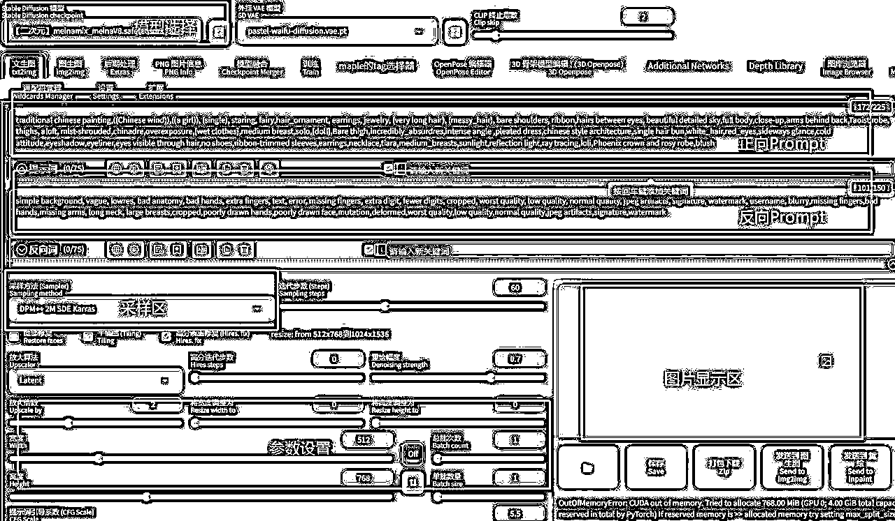

📌

# 两图对照，可以看出

1.

操作底层相似：两者都设有模型选择、提示词输入、参数调节和出图区域

2.

ComfyUI 界面精简：一张空白画布，工作流靠节点自行搭建，当然也能直接套用他人现成的，整体门槛偏高。

3.

WebUI 图形化界面：点点选选就能操作，新手更容易上手。

# 1.2 ComfyUI 能做什么？

# 💡

ComfyUI 是一个多面手式的 AI 工具箱，绘画只是其中一环，视频、音频、3D 模型等各类 AI 任务都能承接，为用户搭起一个功能相当全面的创意平台。

1.

AI 绘画：给一段描述文本，ComfyUI 便产出与之呼应的画面。它同样能拿已有图片当底子，转成别的风格。红箭头指的是生图提示词，绿箭头则是 AI 输出的画面。

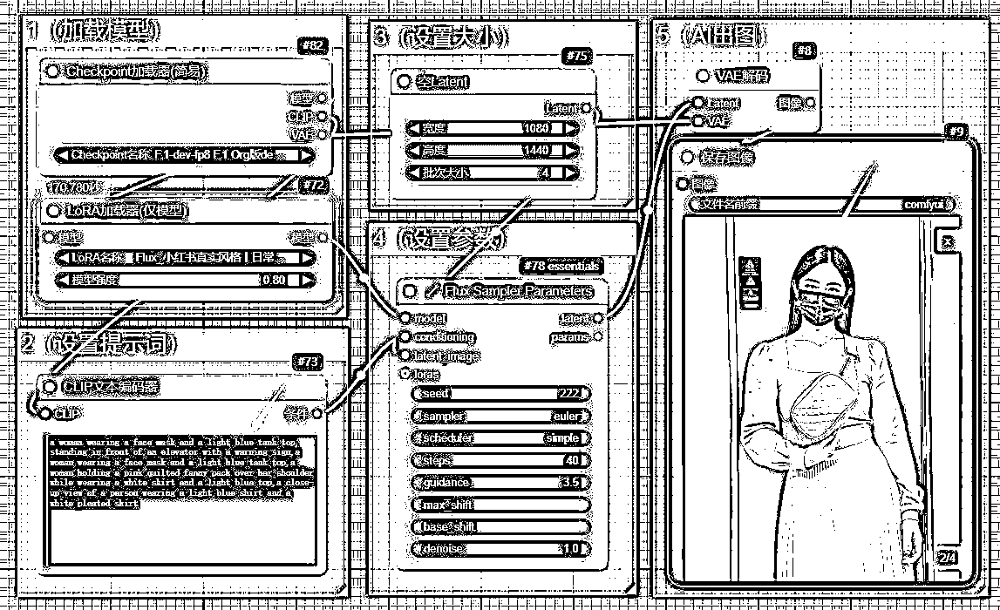

2.

AI 视频：ComfyUI 可以拿图片当起点生成视频，背后用的是 SVD（Stable Video Diffusion）模型——以静帧作为条件帧，再推演出动态片段。另外它也兼容不少其他视频模型，并支持视频转视频，也就是把一个视频改造成另一种风格或内容。红箭头是生成视频的参考图，绿箭头是 AI 输出的视频。

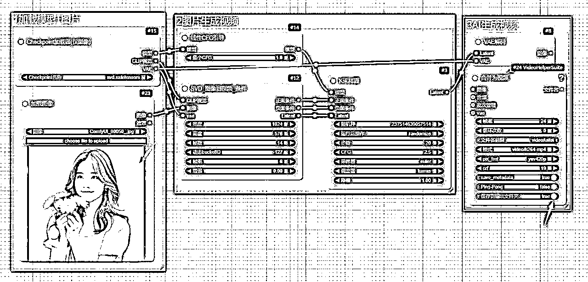

3.

AI 音频：ComfyUI 内置 Stable Audio Open 模型，能用文字提示生出立体声。音效、音乐都能做，各种曲风和文化味道都可以试着玩。红箭头是声音提示词，绿箭头是生成的声音。

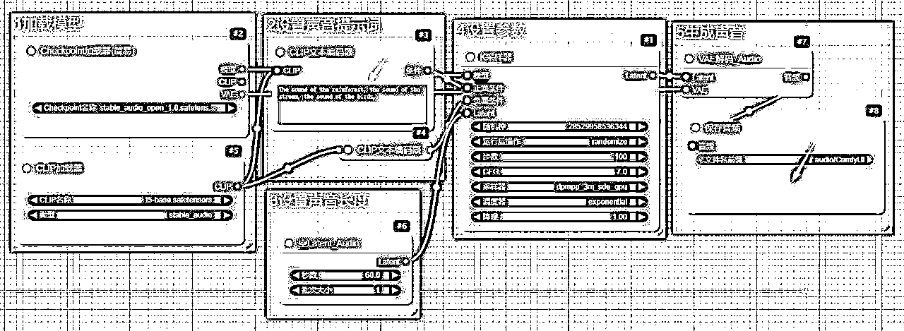

4.

AI 3D：ComfyUI 能把 2D 图片转成 3D 模型，部分工作流里管这叫“二渲三”，即从二维图像生出三维模型。红箭头是生成 3D 文件的参考图，绿箭头是 AI 输出的 3D 文件。


# 1.3 ComfyUI 与 WebUI 的优劣势对比

ComfyUI 和 WebUI 优劣势对比

优势

显存占用小：比起 WEBUI，ComfyUI 吃显存更少，启动和运行都更轻，硬件条件不佳的用户也能玩转 AI。

自由度更高：工作流程可自行定义，节点连接随心调整，功能与效果更灵活。

流程更完整：文生图与图生视频可以在 ComfyUI 里一气呵成，形成闭环。WebUI 则要在不同界面来回切换，先把图生出来，再去做视频。

模型可共享：ComfyUI 和 WebUI 能共用环境与模型，两者可并行使用。

工作流可复现：自己搭好的 ComfyUI 工作流，存成文件后分享给别人很方便，对方套用即可复刻同样的功能。

图像可还原工作流：ComfyUI 出的图能反推出整套工作流，连模型选择都一并留着。

插件丰富性：ComfyUI 的节点相当于 WebUI 的插件，而节点开发相对简单，于是生态格外繁荣，各种特殊功能都能实现。

劣势

操作门槛较高：只拿别人做好的工作流来用，门槛并不高；若要从零自己搭，就得有清晰的逻辑和动手能力，学习成本不低。

用户体验一般：空白画布的界面对普通用户不算友好；WEBUI 的图形化操作更亲切，插件也能快速找到，用起来顺手。

出错概率高：用 ComfyUI 常会碰上节点缺失、模型缺失、运行报错等情况，很考验耐心和排障能力。


# 1.4 ComfyUI 的应用领域与变现方式

# 1.4.1 应用领域

# 💡

1.

批量图片创作：ComfyUI 能成批产出内容各异的图像。借助 Batch Prompt Schedule 节点，一次填入多条不同描述，它就会按这些描述批量出图。

2.

批量视频创作：ComfyUI 搭配 SVD（Stable Video Diffusion）等视频模型，可由图片生成视频。SVD 以静帧为条件帧推演视频，分辨率和时长都有多种选择。

3.

批量音频创作：ComfyUI 搭配 SAO（Stable Audio Open）音频模型，能按文字提示产出音频。

4.

电商企业用图：ComfyUI 在电商海报、产品背景图等场景用得很多，能提升产品展示效果，帮电商企业做出高质量产品图。

5.

艺术创作领域：ComfyUI 给艺术家带来源源不断的灵感，助其摆脱传统束缚、拓宽思维边界，做出别具一格、冲击力强的作品。

6.

设计领域：平面设计、产品设计、室内设计等细分方向都能见到 ComfyUI 的身影，它已是设计师离不开的帮手。

7.

教育领域：ComfyUI 能为学生定制学习资料，也能帮教师做出更生动有趣的课件。

8.

娱乐领域：游戏开发、影视制作中，ComfyUI 都能参与，带来更丰富独特的娱乐体验。

9.

建筑领域：ComfyUI 帮建筑师迅速出建筑方案、模拟不同效果，让设计效率和质量都提上去。

# 1.4.2 变现方式

# 📌

1.

出售定制工作流：ComfyUI 工作流能按需实现特定功能，用户愿意花钱买来提效。

2.

付费解答群：建一个付费答疑群，提供 ComfyUI 的专业指导和技术支持。

3.

陪伴督学群：开设陪学群，给 ComfyUI 学习者提供陪伴与督促，帮他们更快掌握。

4.

收徒：以收徒形式传授 ComfyUI 技巧与创作心得，把知识变成收入。

5.

分销课程/产品：分销 ComfyUI 相关课程与产品，既帮用户学会使用，也能拿到分销回报。

# 二、ComfyUI 基础工作流 @来来

# 💡

# 温馨提醒

1.

这期 ComfyUI 航海，为了让大家省事，我们尽量安排在线版 ComfyUI 来跑工作流，不必另买高配电脑。

2.

不过在线 ComfyUI 平台调用的是云端显卡，需要开通 36 元/月的付费会员。

# 2.1 掌握文生图：批量创作📕超逼真美女图（直播）

# 2.1.1 预览结果

# 💡

我们的目标是借工作流成批产出逼真美女图，发到各个社交平台。


# 2.1.2 必要操作

1.

打开在线工作流，https://www.liblib.art/modelinfo/883f870ed05a4b178f39c89b5ee4947b，左侧点第 1 个选项卡“1 文生图”，右侧按“在线运行工作流”即可；想在本地跑就点下载（前提是本地装好了 ComfyUI）。


2.

在红箭头所指处填入提示词，左边备了两条示范可直接复制。不会写提示词的话，可以参考龙哥盟 AI 绘画航海手册的提示词章节。其余参数维持默认，不用改。

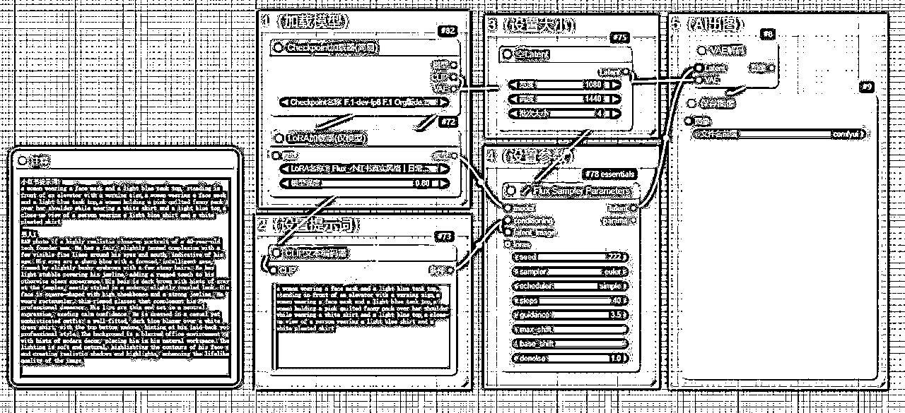

3.

点右侧的“开始生图”，图片就会生成。


# 2.1.3 实操步骤

# 💡

如果你不关心工作流里每步的逻辑、每个节点怎么用，这部分可以跳过。

1.

这个节点负责挑大模型，我们用的是 FLUX。


2.

这个节点负责挑 LORA 模型，需要与 FLUX 配套。

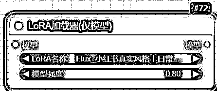

3.

这个节点用来写提示词。

一个戴着口罩和浅蓝色背心的女人，站在有警告标志的电梯前，一个戴口罩和淡蓝色背心的妇女，一个肩上扛着粉红色绗缝腰包、穿着白色裙子和浅蓝色上衣的女人，一个穿着浅蓝色衬衫和白色百褶裙的人的特写。

a woman wearing a face mask and a light blue tank top, standing in front of an elevator with a warning sign,a woman wearing a face mask and a light blue tank top,a woman holding a pink quilted fanny pack over her shoulder while wearing a white skirt and a light blue top,a close-up view of a person wearing a light blue shirt and a white pleated skirt

# 💡

# 提示词示例

1.

picture of one lady,IMG_2222.HEIC,beautiful,reversal film photography,xhs,LTFGR,

2.

picture of one lady,IMG_2222.HEIC,reversal film photography,xhs,LTFGR,LLL,1girl black hair bottle box chair computer desk indoors leaning forward long hair mirror realistic shirt short shorts shorts signature sitting socks solo white shirt window

3.

XS, masterpiece:1.2),best quality,high resolution,unity 8k wallpaper,(illustration:1),perfect lighting,extremely detailed CG,finely detail,large breasts,sexy,extremely detailed,soft lighting and shadow,soft yet striking lighting,film grain:1.2,(skin pores:1.2),(detailed skin texture:1),((solo:1.5)),Detailed face,(see-through:1.1),misty,Low Key:1.1,depth of field,(big breast:1.3), A young woman with dark hair and a Sexy top,sitting on what appears to be an armchair or sofa in her home.

4.

XS, masterpiece:1.2),best quality,high resolution,unity 8k wallpaper,(illustration:1),perfect lighting,extremely detailed CG,finely detail,extremely detailed,soft lighting and shadow,soft yet striking lighting,film grain:1.2,(skin pores:1.2),(detailed skin texture:1),((solo:1.5)),Detailed face,(see-through:1.1),misty,Low Key:1.1,depth of field, A woman posing on a bed with her back to us,showcasing an off-the shoulder top and denim shorts.,


4.

这个节点设定画幅尺寸和出图张数。1080*1440 是📕封面比例，一次出图建议不超过 8 张。

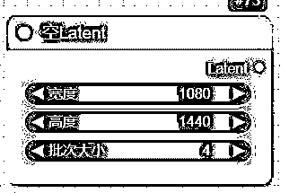

5.

这个节点调参数：steps（步数）、sampler（采样器）、scheduler（调度器）设好就行，别的不用动。

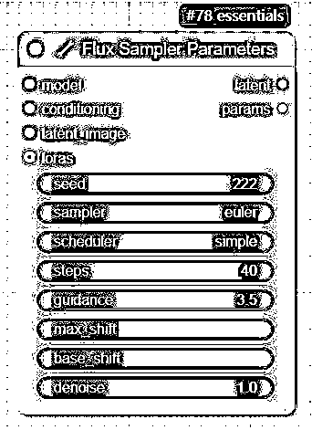

6.

这个节点负责解码，让 AI 输出清晰的图。


7.

这个节点管保存。右键就能把图存下来。

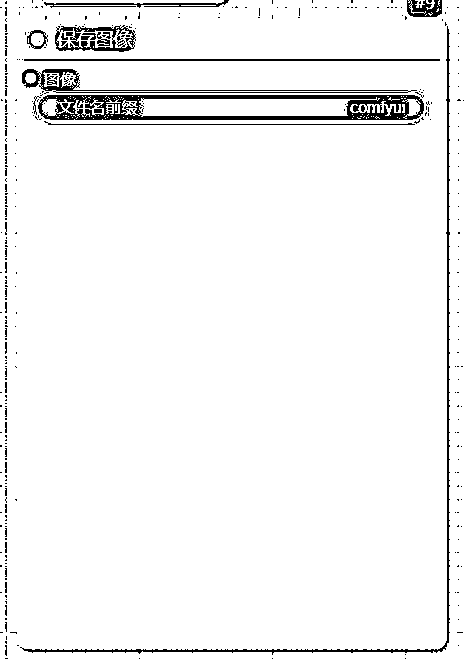

# 2.2 掌握图像放大：批量放大📕写实美女图

# 2.2.1 预览结果

# 💡

目标是把工作流批量产出的逼真美女图，放大到可印刷的尺寸，并顺带把面部细节修细。左边是放大前，右边是放大后。


# 2.2.2 必要操作

1.

打开在线工作流，https://www.liblib.art/modelinfo/883f870ed05a4b178f39c89b5ee4947b，左侧点第 2 个选项卡“2 放大图片”，右侧按“在线运行工作流”即可；本地运行就点下载（前提是装好了 ComfyUI）。


2.

在红箭头处填入所需提示词，绿箭头处改放大倍率。其余参数保持默认，无需改动。

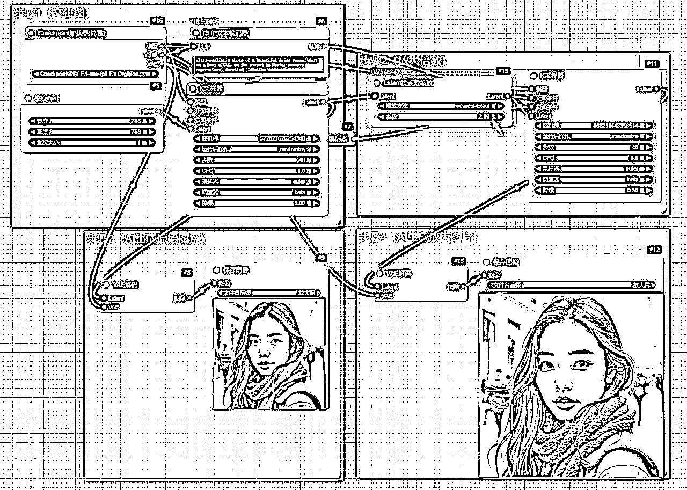

3.

点右侧“开始生图”，放大前后的对比图就会出来。

# 2.2.3 实操步骤

# 💡

# ComfyUI 五类图像实战：基础流程与进阶玩法

只想快速跑通、不打算深究节点原理的读者，实操拆解部分可以跳过。

## 基础流程：模型、提示词与出图保存

1. 此节点承担大模型选择，本次使用 FLUX。
2. 此节点负责提示词输入。示例可写成：一位美丽的亚洲女性在巴黎街头用索尼a7III拍摄的超现实照片，情感表达细腻逼真；对应英文为：ultra-realistic photo of a beautiful Asian woman, shot on a Sony a7III, on the street in Paris, emotive expressions, detailed, lifelike。
3. 此节点配置画布尺寸与出图张数。
4. 参数建议：steps 设为 40，采样器选 euler，调度器选 beta。右侧是上一课用过的采样器节点，功能一致。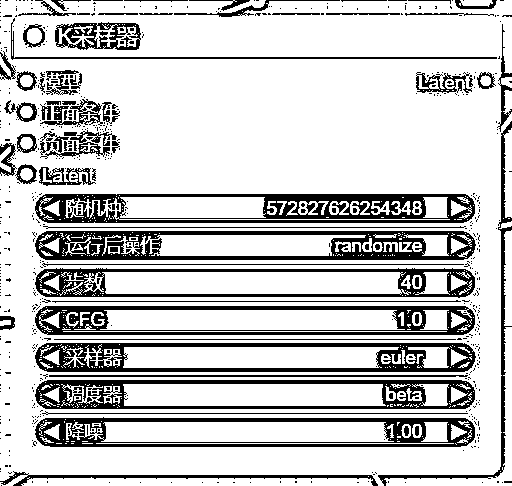
5. 原图的 LATENT 潜空间数据经 VAE 解码后，就能保存成原图。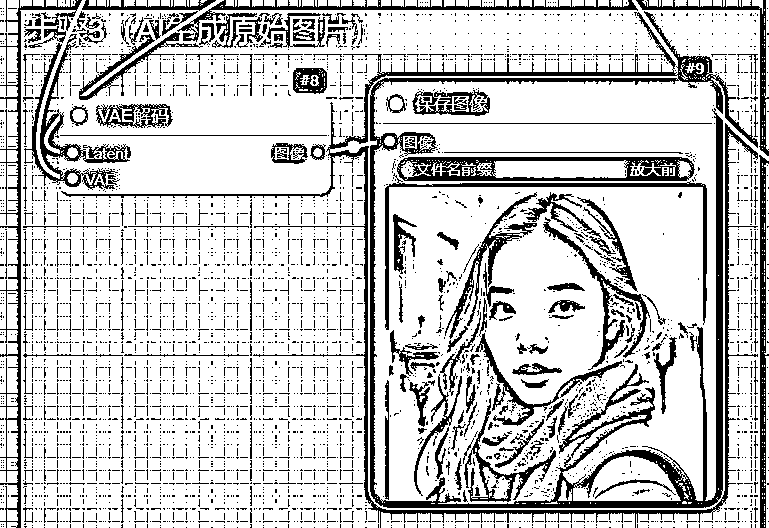
6. 原图信息进入 LATENT 潜空间；左侧节点从潜空间放大图像，系数即放大倍数。显存充足可拉到 6~8 倍，8G 显存建议 2~4 倍。放大后的潜空间数据还要交给第二个 K 采样器继续处理。

# 💡
可以把潜空间理解为高维数据的“摘要容器”：它把像素级信息压到更低维，只保留辨识度最高的特征。图像由成千上万个像素组成，但并非每一项都关键；压缩后，相似图像会靠得更近，差异大的则相距更远。落地用途包括数据压缩与表示、生成新样本、异常检测、缺失数据补全；在图像场景中可降低存储和算力开销，还能通过插值得到带过渡感的样本，这对深度生成模型尤其关键。

7. 放大图的 LATENT 数据同样经 VAE 解码，然后保存放大图。
8. 对比原图与放大图，会发现细微差异，通常来自随机种不同。将种子设为 fixed 固定，其余参数完全一致，并把放大后 K 采样器的降噪压到 0.5 或更低，前后结果就能保持高度一致。

# 2.3 人像精修：批量提升脸部细节

# 2.3.1 先看效果

左边是优化前，右边是精修后，肤色更透亮。

# 2.3.2 上手路径

1. 进入在线工作流：https://www.liblib.art/modelinfo/883f870ed05a4b178f39c89b5ee4947b ，左侧点第 3 个标签“3 放细化面部”，右侧执行“在线运行工作流”；本地运行需先下载，并确认装好 ComfyUI。
2. 红箭头位置放图，绿箭头位置写提示词，其余参数不动。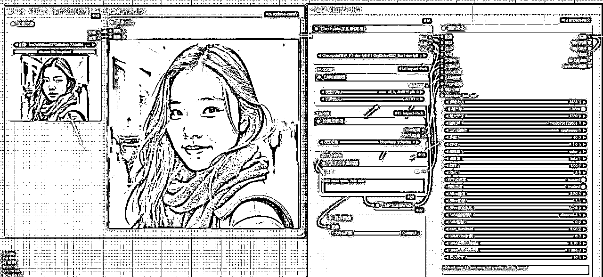
3. 点右侧“开始生图”出图。

# 2.3.3 节点拆解

# 💡
不关心节点原理和逐步逻辑的读者，可直接跳过本节。

1. 此节点接收待精修的人脸图。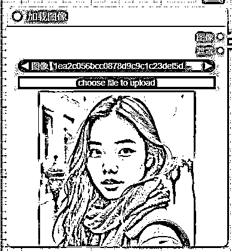
2. 大模型选择节点，仍用 FLUX。
3. SAM 检测模型选择节点：设备格式选 auto；列表越靠前的模型，检测精度通常越高。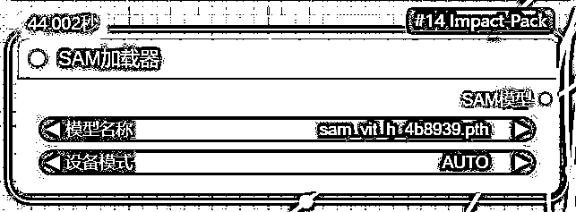
4. BBOX 检测模型选择节点：第 1 项识别人脸，第 2 项识别手部，第 3 项识别全身。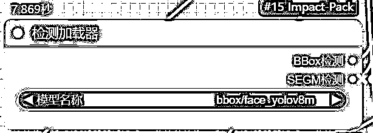
5. 提示词节点。
ASIA young woman, fair skin
亚洲女孩，白皙皮肤
这里补充几条肤色相关提示词思路。
6. 面部细化参数节点较复杂，拆成输入侧、输出侧、参数区三块。输入侧共 11 项，其中 4 个空心项可留空。
7. 图像：待增强的单张输入图，也是面部细节处理的主来源；原图质量越好，结果越稳。
8. 模型：面部增强所用算法或网络，不同模型在细节与风格上表现不同。
9. CLIP：负责额外处理与细化，让增强后的脸部整体更协调。
10. vae：增强流程中的变分自动编码器，参与图像编码/解码，影响最终画质。
11. 正面条件：正面提示词。
12. 负面条件：负面提示词。
13. BBOX检测：加载检测模型，推荐 FACE_YOLOV8M，专注人脸。
14. Seam检测：加载检测模型，推荐 sam_vit_h_4h8939，精度较稳。
输出侧：图像为必接输出，连到保存图像节点即可。
节点参数：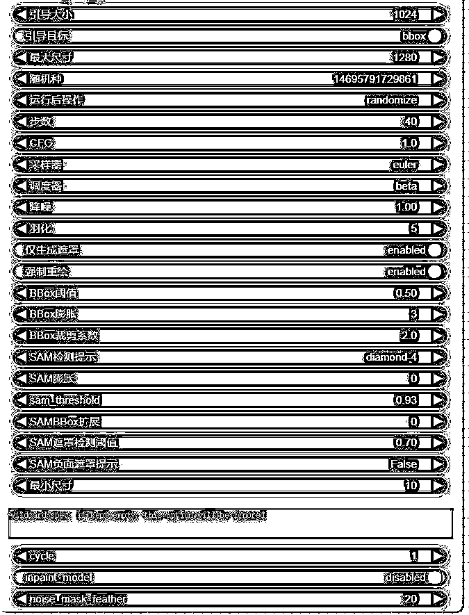

# 💡
参数共 27 项，首次使用先默认；效果不理想再逐项微调。引导大小控制参与增强的面部范围，范围变化会影响细节与精度；引导目标把 BBOX 检测结果当作优化对象；最大尺寸限制处理分辨率，防止系统过载并守住画质；随机种决定增强中的随机性，便于复现；运行后操作指定种子变化方式，可选随机、固定、减少、增加；步数是迭代次数，通常越多越细；CFG 可理解为与提示词的贴合度，FLUX 默认 1；采样器决定采样技术，影响风格与质量；调度器负责组织步骤与资源；降噪控制去噪强度，影响清晰与平滑；羽化让增强区域边缘与周围过渡自然；仅生产遮罩建议选是；强制重绘建议选是；bbox阈值控制人脸检测灵敏度，影响增强区域隔离准确度；bbox膨胀扩大检测框，避免漏掉面部；bbox裁剪系数决定周围上下文保留多少，影响融合；SAM检测提示为检测补充信息，提高人脸定位准确度；sam膨胀扩大 SAM 检测范围，提升覆盖；sam阈值控制 SAM 敏感度，影响识别准确率；sam_bbox扩展在脸部周围多留背景，便于增强；sam遮罩检测阈值控制掩码提示敏感度，影响质量；sam负面遮罩提示用于压制不需要的特征或伪影；最小尺寸影响部分操作的尺度，从而影响细节与精度；通配符框包含通配符输入的相关配置；循环决定增强重复次数，通常越多效果越好；修复模型用于补齐面部缺失或损坏区域；噪声蒙版羽化让降噪与画面其余部分平滑衔接。

15. 对比节点，鼠标滑动查看精修前后差异。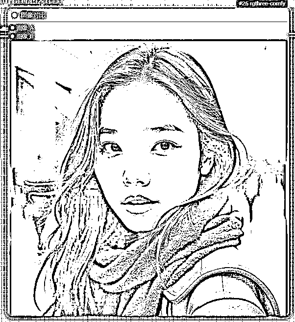
16. 保存最终精修图。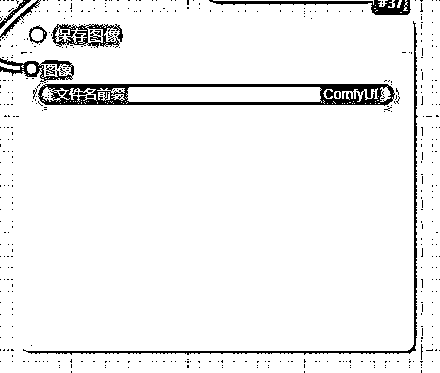

# 2.4 图生图：批量把真人照转成动漫风

# 2.4.1 先看效果

左边是真人照片，右边是转换后的动漫风照片。

# 💡
图生图可能改动原图内容；若只想换风格而保持画面结构，需要 Controlnet，但流程更繁琐，本节不展开。

# 2.4.2 上手路径

1. 进入在线工作流：https://www.liblib.art/modelinfo/883f870ed05a4b178f39c89b5ee4947b ，左侧点第 4 个标签“4 图生图”，右侧执行“在线运行工作流”；本地运行先下载并装好 ComfyUI。
2. 红箭头位置放图，绿箭头位置写提示词，其余保持默认。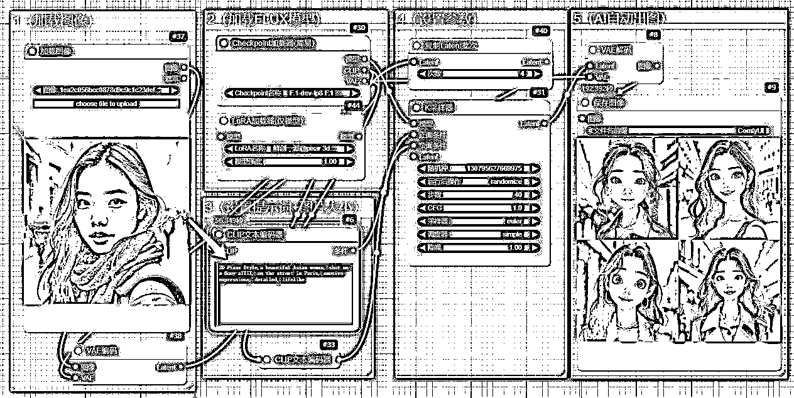
3. 点右侧“开始生图”出图。

# 2.4.3 节点拆解

# 💡
不关心节点原理和逐步逻辑的读者，可直接跳过本节。

1. 上传图节点。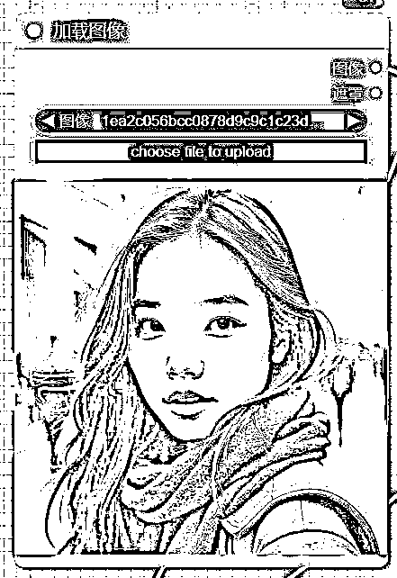
2. 大模型节点，用 FLUX。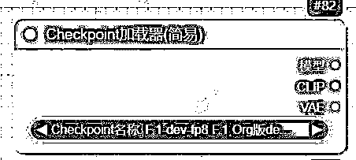
3. LORA 节点，要选 FLUX 配套 LORA；此处用 PIXAR 风格模型：https://www.liblib.art/modelinfo/1d307e042b004ad5b969eed5c5f6517b
4. 提示词节点。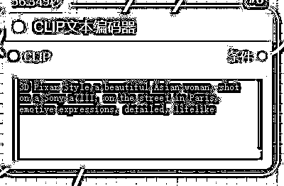
3D皮克斯风格，一位美丽的亚洲女性，在巴黎街头的索尼a7III上拍摄，情感表达细腻逼真
3D Pixar Style,a beautiful Asian woman, shot on a Sony a7III, on the street in Paris, emotive expressions, detailed, lifelike
5. 出图数量节点。
6. 参数节点。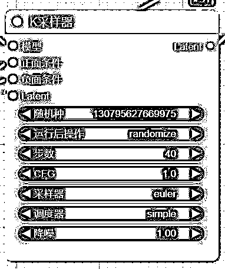
7. 解码节点，让 AI 输出清晰图。
8. 保存节点，右键下载。
9. 若想让画面结构不变、仅换风格，必须上 Controlnet；下方是保持画面并改风格的工作流，可自行搭建。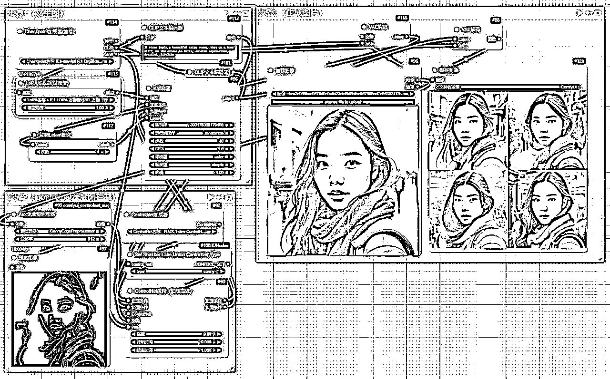

# 2.5 老照片修复：批量焕新与上色

# 💡
# 修复的两条路线

1. 整体修复：如老照片修复，本文只讲这类。
2. 局部修复：修脸、修手、修脚，以及局部重绘（蓝眼变黑眼、无帽变有帽、无领带变有领带、无手表变有手表、纯白底换火星场景等）。

# 2.5.1 先看效果

左侧第 1 张是老照片，右侧 2 张是修复上色后的老照片。

# 2.5.2 上手路径

1. 进入在线工作流：https://www.liblib.art/modelinfo/883f870ed05a4b178f39c89b5ee4947b ，左侧点第 5 个标签“5 修复老照片”，右侧执行“在线运行工作流”；本地运行先下载并装好 ComfyUI。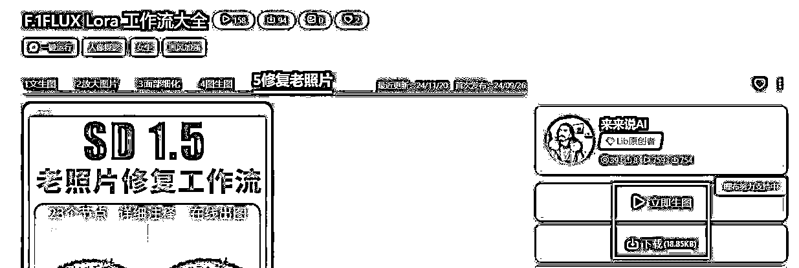
2. 红箭头位置传老照片，绿箭头位置写颜色提示词（如黑发、蓝衣），其余默认。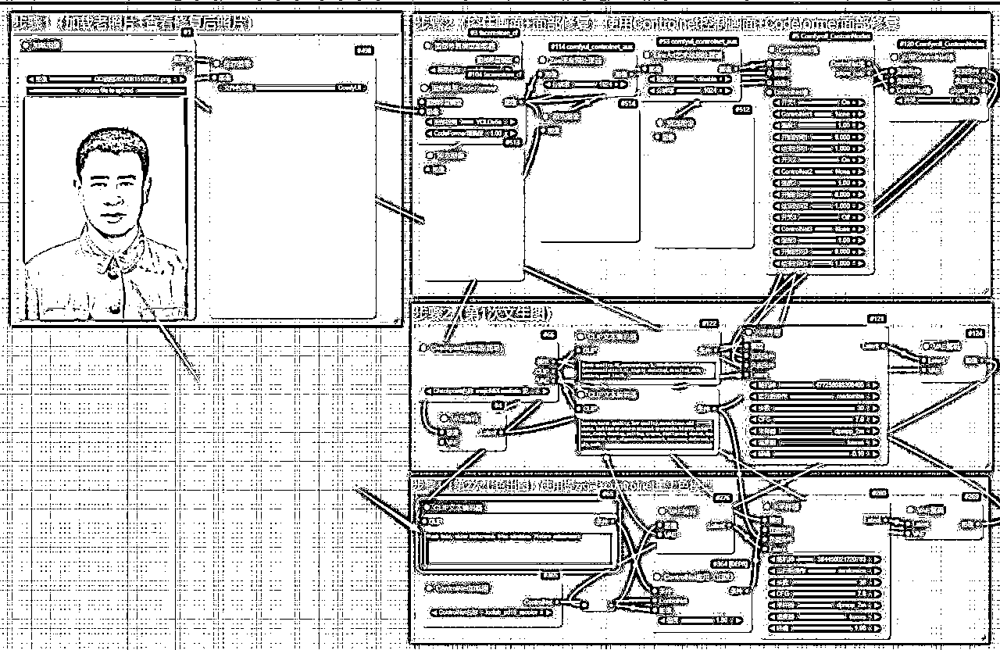
3. 点右侧“开始生图”出图。

# 2.5.3 节点拆解

# 💡
不关心节点原理和逐步逻辑的读者，可直接跳过本节。

1. 左节点上传老照片，右节点查看修复结果。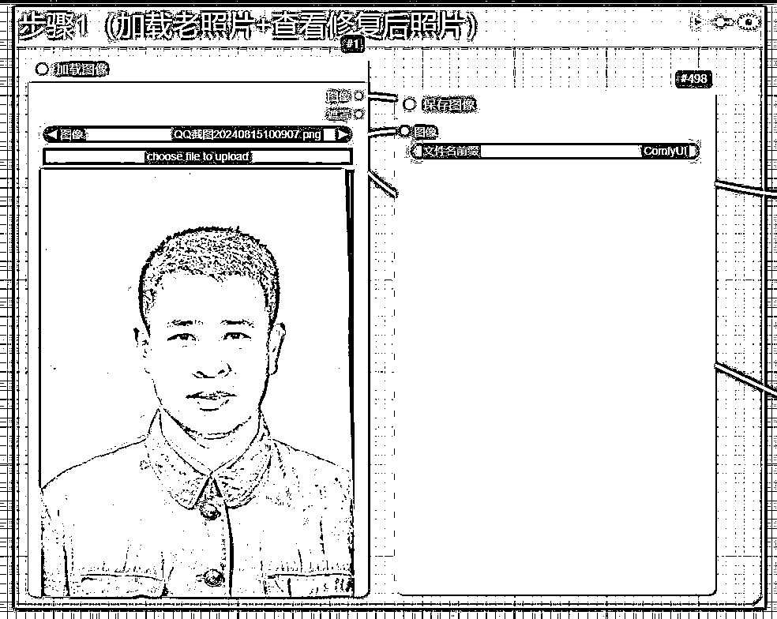
2. 此步负责画面控制与面部修复：Controlnet 控画面，Codeformer 修脸；核心节点注释见图，参数全默认。
3. 第一次出图。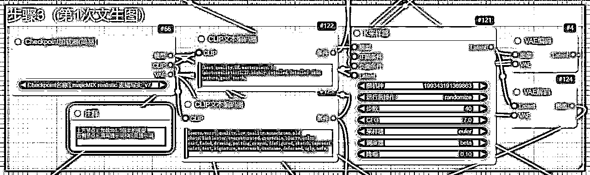
a. 点模型名打开选择窗，默认已选好，保持默认。

# 💡
# 大模型小知识

1. 前四个工作流用的是 Flux（图中基础算法 F.1），这次改用 SD1.5（基础算法 1.5），让模型库更丰富。
2. 右侧算法对应不同厂商；前六个基础算法来自 Stability 开源的 Stable Diffusion；后面的 3.5L、3.5M、1.5、2.1、XL、V3 是版本号，发布时间大致为 3.5→3→XL→2.1→1.5。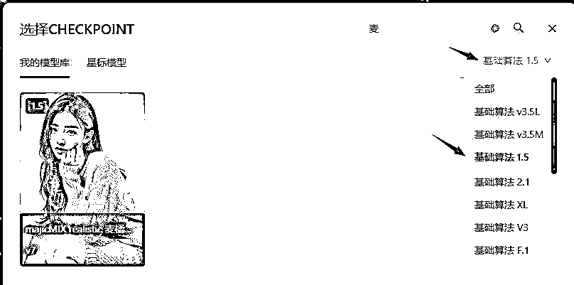
b. 填写提示词，默认已填好，保持默认。
提示词：(best quality,8K,masterpiece,),(photorealistic:1.2),highly detailed,detailed skin texture,good teeth
负面提示词：lowres,worst quality,low quality,monochrome,old photo,lackluster,oversaturated,grayscale,blurry,color
cast,faded,drawing,paiting,crayon,disfigured,sketch,impressionist,text,signature,watermark,username,deformed,ugly,nsfw
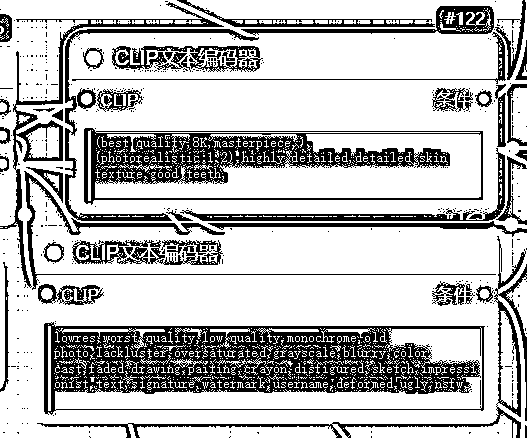
c. 最后三个节点之前多次讲过，默认即可。
4. 第二次上色出图：核心是提示词 + controlnet 重上色模型；可改提示词为 Black hair, white background，blue clothing，Picture enhancement，中文黑色头发、白色背景、蓝色衣服、图像增强。核心节点注释见图，其他默认。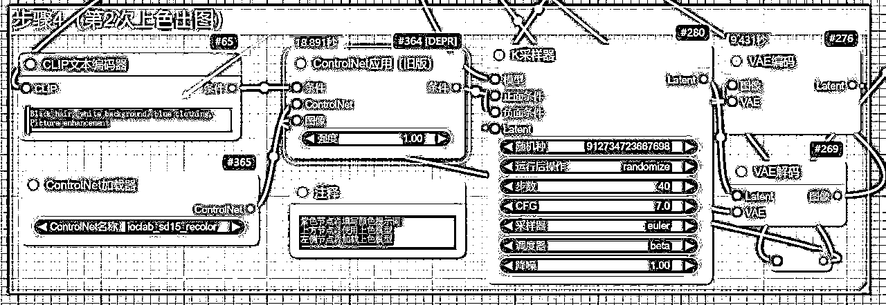

# 2.6 画面外扩：批量拓展图像边界

# 2.6.1 先看效果

左侧是扩图前，右侧是扩图后，图片的上、下部分执行了外扩。

# 2.6.2 上手路径

1. 打开同一个在线工作流，左侧选第 6 个标签“6 图像外扩”，上传图片并按需填写提示词，其余默认，点右侧“在线运行工作流”；本地运行先下载并确认装好 ComfyUI。

先进入这个在线页面：https://www.liblib.art/modelinfo/883f870ed05a4b178f39c89b5ee4947b。在左边栏点开编号 6 的“扩图”页签，再到右边按下“在线运行工作流”就能跑。想把流程搬到本机，就点下载；前提是 ComfyUI 已经装好。


2.

红标处放你要处理的图，绿标处补上这张图原先用的提示词。别处的值统统不动。

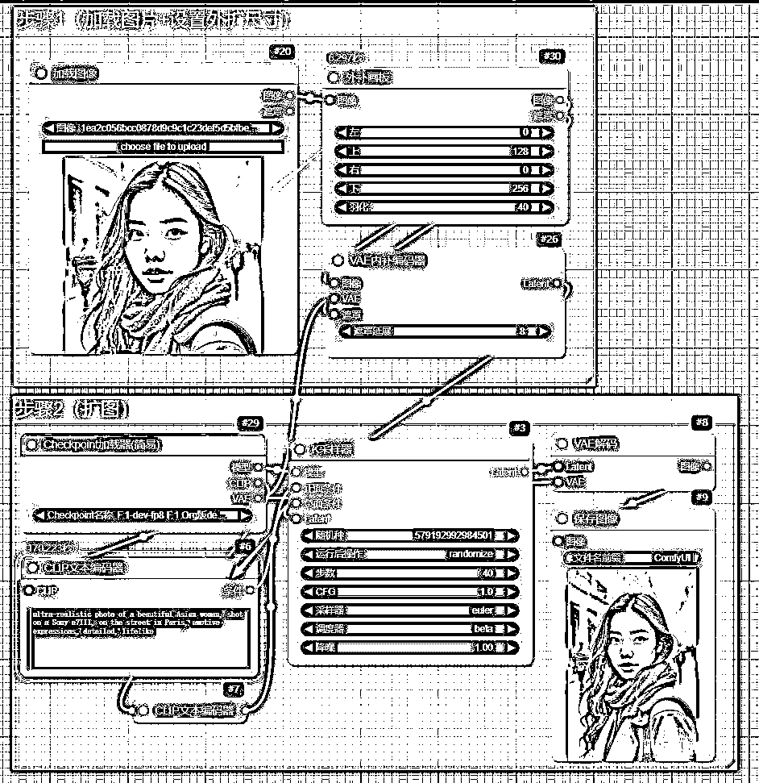

3.

接着按右边“开始生图”，成品就会出现。


# 2.6.3 上手

# 💡

若只想快速跑通，不想研究节点逻辑，本节可整段略过。

1.

第1步：读图并定外扩范围

红框处读入照片；绿框处调外扩大小，横竖上下四个方向能一起扩大。

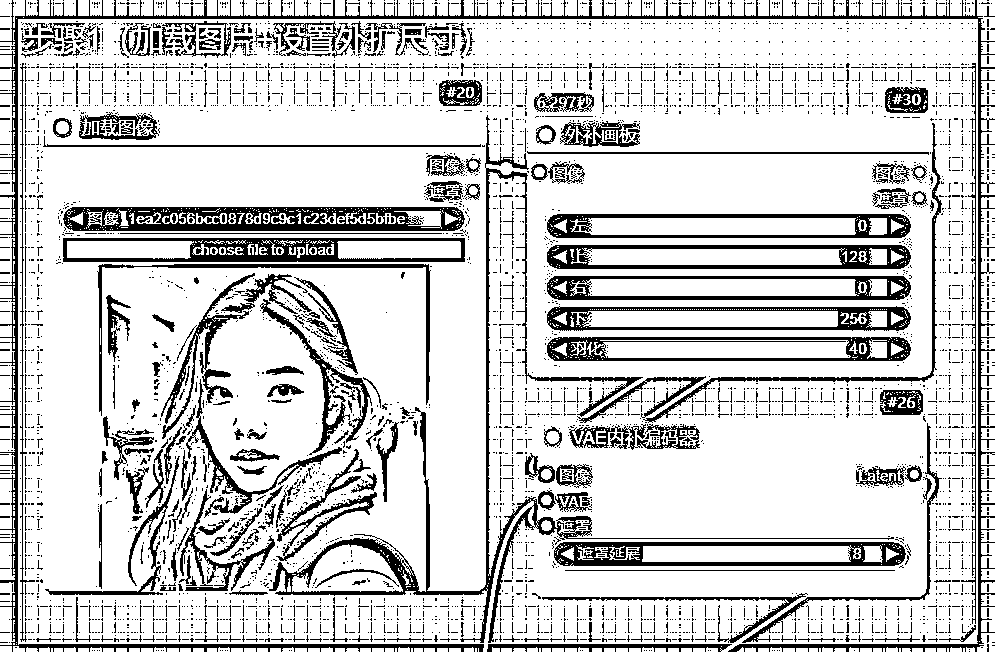

2.

第2步：执行扩图

红框里挂上 Flux 大模型；绿框填提示词（ultra-realistic photo of a beautiful Asian woman, shot on a Sony a7III, on the street in Paris, emotive expressions, detailed, lifelike ）；黄框设步数，CFG 一定填 1，采样器与调度器按你的习惯挑。

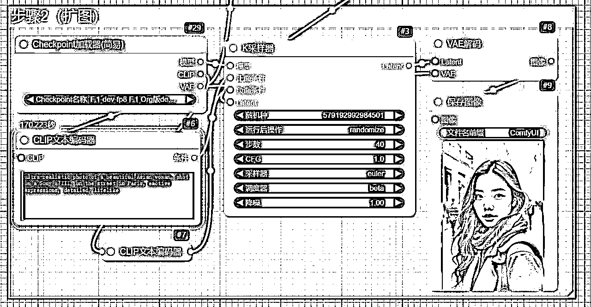

# 2.7 梵高画风批量迁移

# 2.7.1 效果先览

左边摆的是梵高《星空》当参照，右边则是模型吸收这种笔触后产出的画面。


# 2.7.2 必做几步

1.

进入同一个在线页面：https://www.liblib.art/modelinfo/883f870ed05a4b178f39c89b5ee4947b。左边挑第 7 个页签“7风格迁移”，右边按“在线运行工作流”开跑。要放本地跑，点下载即可；同样得先有 ComfyUI。

2.

红标处放图，绿标处填原图提示词；其余选项照旧。

3.

右边按“开始生图”，结果就出来了。


# 2.7.3 试跑

# 💡

不研究每步逻辑也能用，直接跳过这段。

1.

第1步：放参考图、接风格迁移模型

红框：载入风格参照图；绿框：接 IP-Adapter 风格迁移模型。

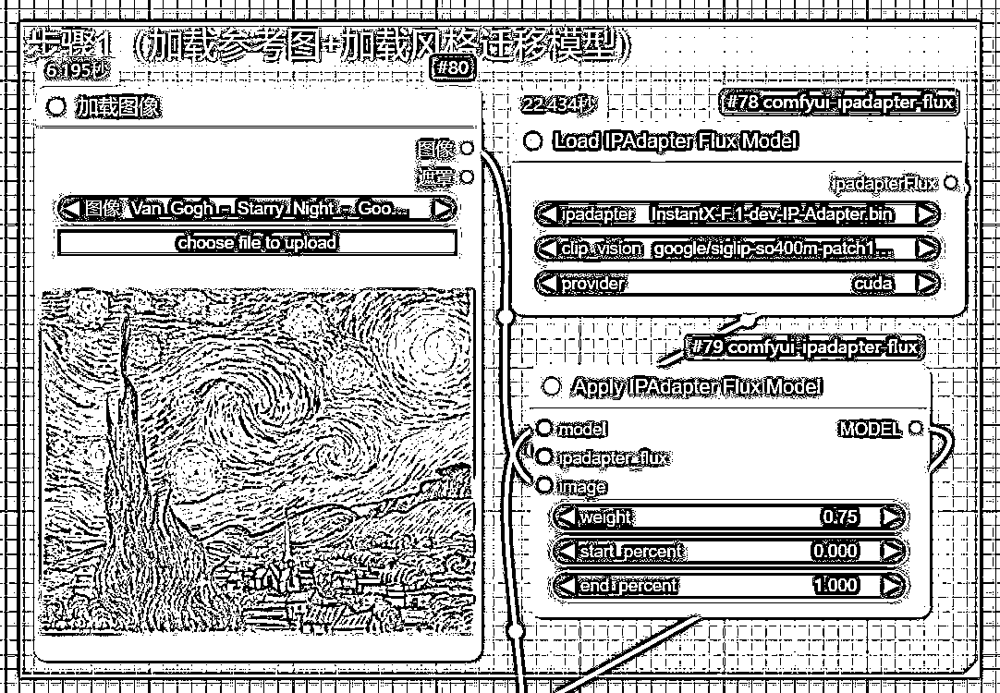

2.

第2步：按参考风格加提示词出图

红框：挂 Flux 大模型；绿框：写提示词（A blue tree in the foreground, a person walking on a grassy hill with trees in the background ）；紫框：补一个能加细节的 FLUX lora。

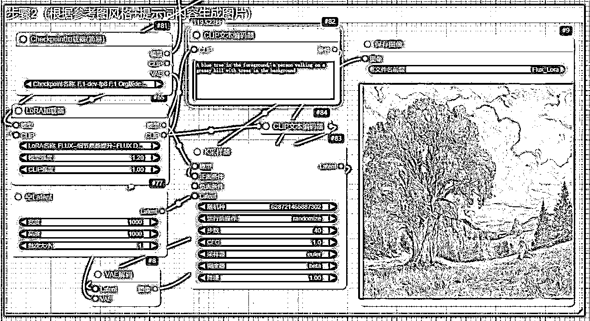


# 三、ComfyUI 电商场景实战 @来来

# 3.1 直播换装

# 3.1.1 成品速览

左边是模特原片，右边三张为换装后的样子。


# 3.1.2 核心操作

1.

打开 https://www.liblib.art/modelinfo/12653535ec184723841183e6546e1d3e，左栏点第 1 个页签“一键换装”，右边按“在线运行工作流”。本地跑就先下载（需 ComfyUI）。

2.

红标处放模特图，绿标处放服装图。别的设置原样。

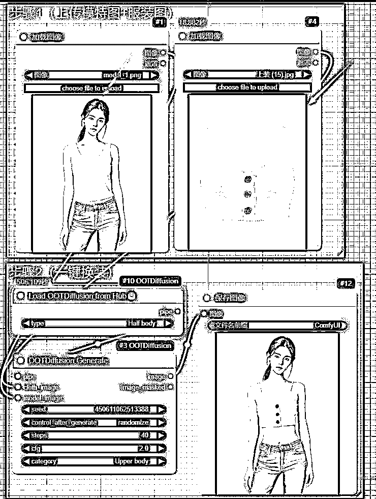

3.

右边按“开始生图”，换装结果就生成。


# 3.1.3 操作

# 💡

不想懂内部机制，可直接略过。

1.

第1步（模特图+服装图）

红框：传模特；绿框：传衣服。

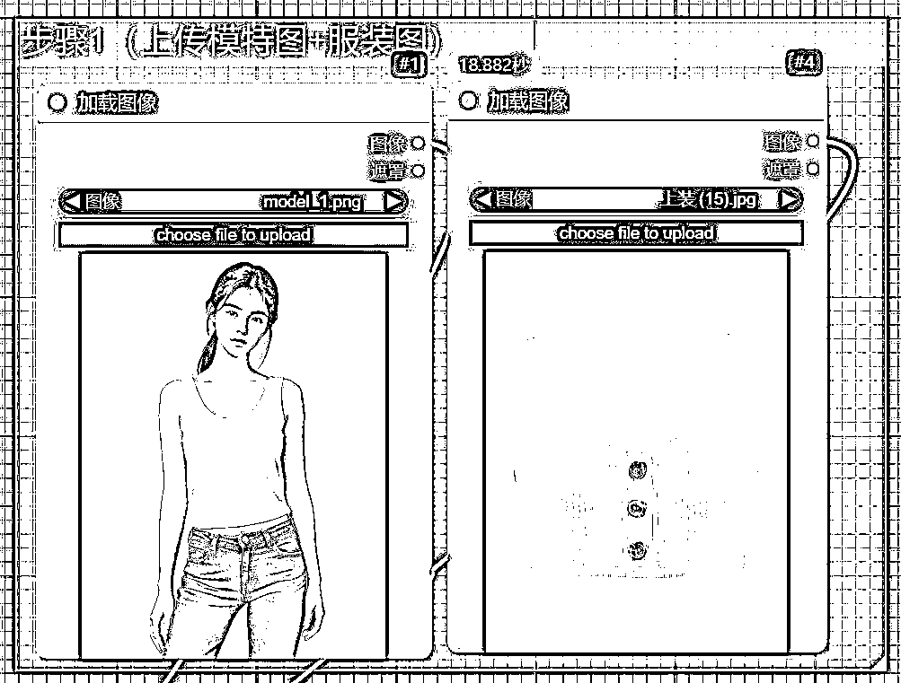

2.

第2步（执行换装）

红框：选半身或全身；绿框：category 处选上装/下装/连衣裙，其余照旧。

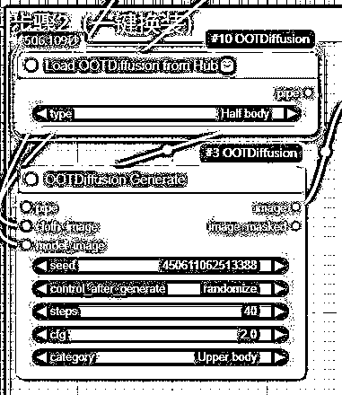

# 💡

模特和衣服类型得对得上，半身模特换不了下装。

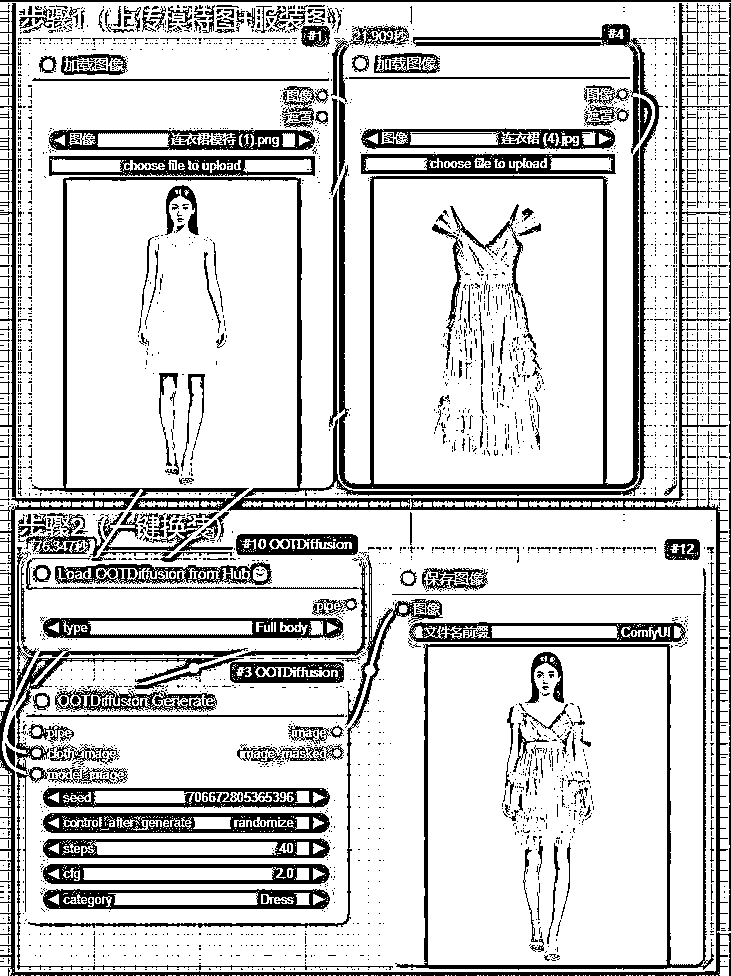

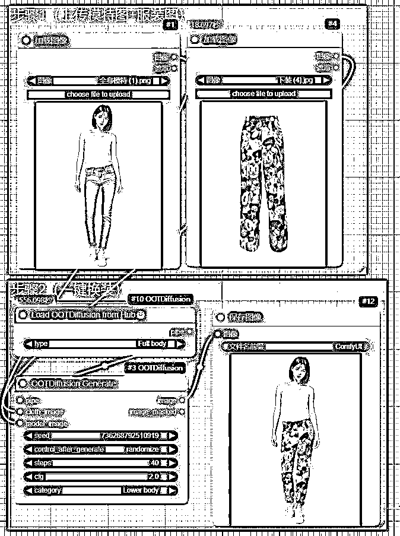


# 3.2 快速换背景

# 3.2.1 效果一览

左边产品原片，右边是一口气替换 30 种背景后的成品。

# 3.2.2 关键几步

1.

打开 https://www.liblib.art/modelinfo/c916e597148c41ea808a6440d9d4c4f4，左栏选第 1 个页签“一键换背景”，右边按“在线运行工作流”。本地跑先下载（需 ComfyUI）。


2.

红标处传图，绿标处等图片自己生成。别的值不动。

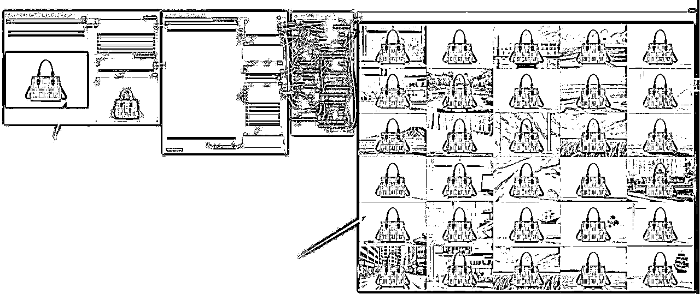

3.

右边按“开始生图”，完成。


# 3.2.3 动手做

# 💡

不想深究节点，直接跳过。

1.

第1步：传图并自动抠图

绿框：放产品白底图或透明 PNG，系统会自己抠。

2.

第2步：改提示词或沿用默认都行

红框：可传提示词文件，也可保留默认。

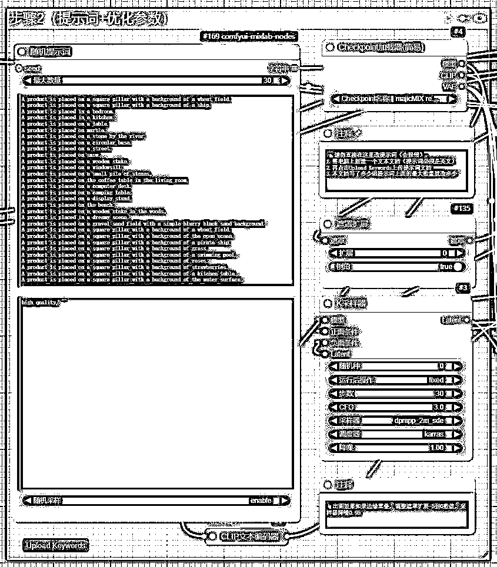

3.

第3步：参数全不用改，等右边出图即可。


# 3.3 模特快速替换

# 3.3.1 对比看看

左为原模特，右为只改年龄后的样子。

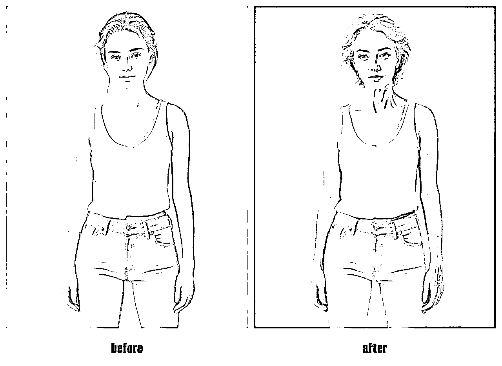

左边中国模特，右边是国籍与年龄一起变后的结果。

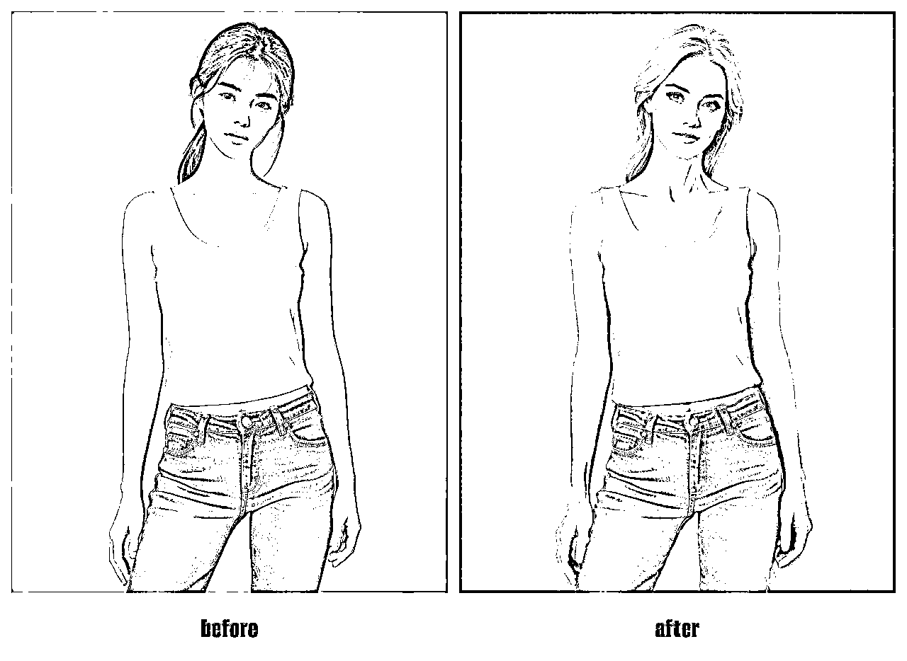

左边中国模特，右边是仅改国籍后的结果。

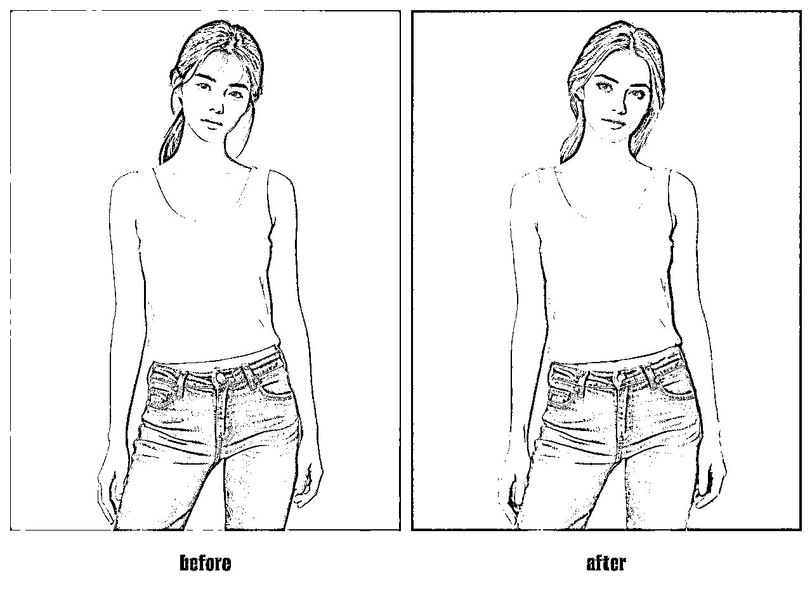

# 3.3.2 必做设置

1.

打开 https://www.liblib.art/modelinfo/20126fa0c72c4e9d9ce12d4b5989f729，左栏点第 1 个页签“一键换模特”，右边按“在线运行工作流”。本地跑先下载（需 ComfyUI）。

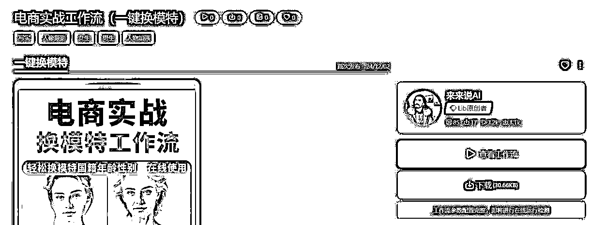

2.

红标处上传模特照（默认已放一位中国模特），绿标处等出图。别的设置别动。

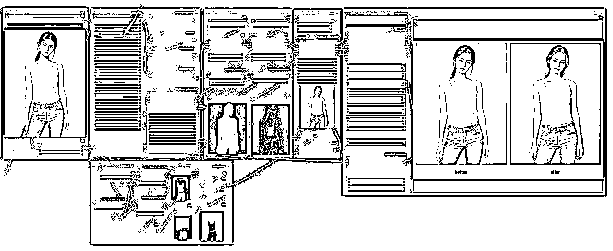

3.

右边按“开始生图”即可。


# 3.3.3 跑通

# 💡

不关心细节可跳过。

1.

第1步（传模特图）

红框：放模特照片。

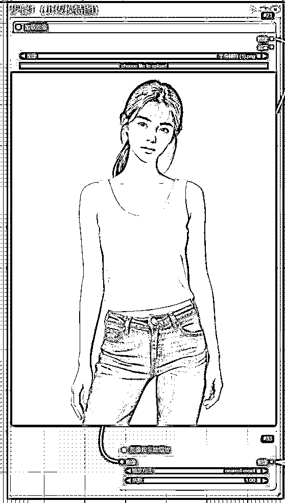

2.

第2步（改提示词）

红框：在肖像大师里调国籍、年龄等，模特就会变。绿框：挑 SDXL 或 FLUX 模型。

3.

第3步（生成遮罩）

不用管，AI 自己出遮罩。


4.

第4步（ControlNet 控制）

红框：确认选的是图示 ControlNet 模型。若大模型用 FLUX，所有 ControlNet 都得切到 FLUX 类型，否则出不了正常图。

5.

第5步（第一次出图）

不用调，AI 先跑一版。不满意就改 K 采样器参数。


6.

第6步（二次细化+对比）

不用动，AI 会再精修面部并出图。


# 四、ComfyUI 文字特效玩法 @来来

# 4.1 直播特效字

# 4.1.1 成品预览

左边原文字，右边是 AI 做出的特效字，也就是常说的 AI 艺术字。


# 4.1.2 核心步骤

1.

打开 https://www.liblib.art/modelinfo/919a758162b04bcaac3c85ffe479eb55，左栏选第 1 个页签“一键特效文字”，右边按“查看工作流”。本地跑先下载（需 ComfyUI）。


2.

红标处传白底黑字图（默认已放），绿标处可改提示词来控制效果。别的照旧。

3.

右边按“开始生图”就能出。

# 4.1.3 分步做

# 💡

不想懂节点原理可略过。

1.

第1步（传白底黑字艺术字）

要传白底黑字的艺术字，可用下面说的美图秀秀来做。

1.

打开 https://www.designkit.com/editor，点“新建画布”，选竖版主图，背景用白色。

2.

选文字、调时间节点，做出想要的字即可。


1.

第2步（挂模型）

不用改，自动加载各类模型。


2.

第3步（提示词+ControlNet 控边缘）

红框：想改效果就改这里提示词，不改就留默认；

绿框：确认选的是图示 ControlNet 模型。若大模型选 FLUX，ControlNet 要换成 FLUX 类型，否则出图不正常。

3.

第4步（设参数+第一次出图）

不用动，AI 先出一版。


4.

第5步（二次高清放大）

不用动，AI 再细化一次出图。


5.

举一反三

这套流程不只能做中文字，也能做 LOGO 符号；字写得粗一点，效果更明显。


# 4.2 超级符号速成

# 4.2.1 效果速看

左边原 LOGO，右边是 AI 做出的超级符号。


换个黑底 LOGO，结果也差不多。


# 4.2.2 关键设置

1.

打开 https://www.liblib.art/modelinfo/919a758162b04bcaac3c85ffe479eb55，左栏选第 2 个页签“一键超级符号”，右边按“查看工作流”。本地跑先下载（需 ComfyUI）。


2.

红标处传 LOGO 图（默认已放），绿标处提示词可改来控制效果。别的别动。

3.

右边按“开始生图”出图。


# 4.2.3 走一遍

# 💡

不想逐节点理解可跳过。

1.

第1步（传 logo 图）

传 LOGO 图，白底黑底都行。


2.

第2步（挂模型）

不用调，自动加载各种模型。若只想让 1 个 LORA 生效，用 Lora 加载器的 CTRL+B 忽略该节点，再改生效 Lora 的强度值。


3.

第3步（提示词）

绿框：想改效果就改红框里的提示词，不改就留默认。


4.

第4步（ControlNet 控边缘+深度）

这套流程前 3 步和特效字一样，第 4 步多加了 ControlNet 控深度。深度表示物体前后关系，靠前为白，靠后为黑。绿框：确认选的是图示 ControlNet 模型。若大模型用 FLUX，ControlNet 必须切到 FLUX 类型才能正常出图。


5.

第5步（输出放大图）

不用调。

6.

举一反三

这套流程不只能做 LOGO 符号，也能做中文字；字粗一点，效果更好。


# 选修篇

# 五、ComfyUI 部署与上手 @来来

# 5.1 云端路线（不想本地部署的人看）

# 📌

云端优点：普通办公电脑就能跑，不用另买高端显卡，也不用装 ComfyUI；内置大量模型和节点，省去下载安装。

云端缺点：缺失节点和模型不能自己补，本地文件夹也读不到。

# 5.1.1 LibLib

打开 https://www.liblib.art/comfy，一步就能用，页面默认载入文生图流程。


# 5.1.2 吐司 Tusiart

1.

打开 https://tusiart.com/workflow


2.

点“新建工作流”会看到一些模板：第 1 个是文生图，第 2 个是图生图，点使用就能进 ComfyUI。


# 5.2 Win 本地路线（需要本地环境再看）

# 💡

本地优点：缺失节点能自己装，模型随便用，本地文件夹也能识别。

本地缺点：要买高端显卡，要装 ComfyUI，还要下模型、装节点。

ComfyUI 安装包分 4 种，挑 1 种装就行，大致分官方版和整合版两类。

装之前先看存储空间，再按需求在四个版本里挑一个：
- 想省事：官方桌面版，仅 105M，装完后模型和外部节点会自动补齐。
- 存储偏紧：官方纯净版，约 1.46G，不带模型，也不含外部节点。
- 存储一般：Liblib 整合版，2.84G 左右，预置了部分模型与外部节点。
- 存储充裕：秋叶整合版，3.7G，模型、外部节点和工作流打包较多。

# 5.2.1 硬件门槛与配置建议

系统：Windows10/11 优先；不建议在 MAC 上做本地安装。
内存：至少 6G，8G 或 16G 更从容。
显卡：显存不低于 4G；NVIDIA 独显最低 10 系，30/40 系更合适。
显卡品牌表现：NVIDIA 最佳，AMD 次之，Intel 支持偏弱。
硬盘：可用空间不少于 100G，越大越稳妥。
电源：400~600W 即可。
CPU 与主板：无特殊要求。

# 5.2.2【推荐】部署官方桌面版ComfyUI

1. 打开 GitHub 下载页（需外网）https://github.com/Comfy-Org/desktop ，页面拉到最下方，Windows 选红色箭头标注的 EXE，MAC 选绿色箭头标注的 DMG。
2. 双击安装文件，引导页出现后点 get started。

3. 指定安装目录。

4. 若电脑里没有旧版 COMFYUI，直接下一步；若已装过，就选中原来的 COMFYUI 文件夹，工作流与模型会迁移到新位置。

5. 打开自动升级与错误上报开关，然后开始安装。

6. 安装会自动推进（保持外网连接），大约半小时结束，随后 ComfyUI 窗口自动出现。


# 5.2.3 部署官方纯净版ComfyUI

1. 访问 https://github.com/comfyanonymous/ComfyUI 的 Releases 页（需外网）。

2. 在 Releases 里挑最新压缩包下载：
https://github.com/comfyanonymous/ComfyUI/releases

3. 把压缩包解压到不含中文、没有空格的路径；进入目录后双击 run_nvidia_gpu 即可启动。
run_cpu.bat 走 CPU 模式，没有独显，或使用 A 卡、I 卡时可以试；代价是出图慢，部分插件不可用。
run_nvidia_gpu.bat 走 GPU 模式，显卡越强，生成速度越快。
4. 安装完成后浏览器会自动打开访问地址，并载入默认文生图工作流。运行期间那个命令窗口别关。


# 5.2.4 部署Liblib整合版ComfyUI

1. 进入 https://www.liblib.art/ ，在右上角获取 Liblib 客户端。它只支持 Win10 及以上，Mac 用不了。客户端可让 WebUI 与 ComfyUI 在本地并存，也能下载模型/工作流、安装 WebUI 插件和 ComfyUI 节点。这里以 ComfyUI 为例，WebUI 的装法相近。

2. 装好后登录账号，会出现图示界面。点“ComfyUI 生图 一键启动”，安装包会自动下载。
3. Liblib 本地版解决了在线版的几个短板：不能自己装节点、不能装特殊模型、不能操作本地文件夹。平时留意更新即可。顶部箭头同样能一键启动 ComfyUI。高级设置里建议指定显卡，其余保持默认。

4. 打开后的界面如图。这个包有几项便利：① ComfyUI 与 WebUI 可同时免费使用；② 下载 Liblib 的模型与工作流更快捷；③ 模型和工作流可集中管理；④ 不用额外配置，ComfyUI 与 WebUI 会自动共享模型。


# 5.2.5【推荐】部署秋叶整合版ComfyUI

1. 下载页：https://pan.quark.cn/s/64b808baa960
2. 获取 comfyui-aki-v1.5.7z，解压到不含中文、无空格的路径，再打开 A 绘世启动器。

3. 点“一键启动”，等一会儿浏览器会打开 ComfyUI。


# 5.3 Mac系统本地安装（面向有本地使用需求的MAC用户）

# 5.3.1 准备硬件

# 5.3.2 简易安装方法

# 💡

方法链接：https://comfyui-wiki.com/zh-CN/install/install-comfyui/install-comfyui-on-mac

原作者：comfyui-wiki.com

1. 使用 DiffusionBee

DiffusionBee 面向 Mac 用户，能较轻松地跑 Stable Diffusion 模型，省去繁琐安装与配置。官网下载：https://diffusionbee.com/

# 💡

DiffusionBee 的主要特点：
1. 安装省事：下载后直接运行。
2. 界面友好：图形化操作，技术背景少也能用。
3. 兼容多种 Stable Diffusion 模型。
4. 本地处理：隐私更稳，网络延迟更低。
5. 针对 Apple Silicon（M1、M2）做了性能优化。
6. 持续更新：新功能与性能改进会跟进。
7. 免费：想零成本尝试 AI 绘图的用户可以选。

2. 使用 ComfyUI-Mac-Installer

该工具用脚本自动完成 ComfyUI 与全部依赖的安装。

安装步骤：
1. 获取 ComfyUI-Mac-installer apps.zip，里面有 InstallComfyUI.app 与 ComfyUI Starter.app；解压后把两者放到同一文件夹。
2. 在 Finder 里定位 InstallComfyUI.app，右键选“打开”，借此绕开 macOS 安全限制（首次运行必须）。
3. 应用会调起终端，装依赖、配置环境、启动服务，并打开默认浏览器（若未打开可手动刷新）。

3. 使用 Comflowyspace

整合包获取：https://github.com/6174/comflowyspace/releases


# 5.3.3 手动安装方法

# 💡

方法链接：https://zhuanlan.zhihu.com/p/666047912

原作者：MarKA

以下流程面向 Apple Silicon Mac（M1/M2/M3），步骤已精简，不需要 conda。

1. 按 Shift + Cmd + U 打开“实用工具”，再启动“终端”。

2. 环境准备（Homebrew 与相关依赖）

```bash
cd ~
/bin/bash -c "$(curl -fsSL https://raw.githubusercontent.com/Homebrew/install/HEAD/install.sh)"
brew install cmake protobuf rust python@3.10 git wget
```

3. 生成安装脚本（把下面命令粘贴到终端并回车）

```bash
cat > cfinstall.sh << 'EOF'
{
#!/bin/bash
cd ~
python3 -m venv cf
source cf/bin/activate
pip install --upgrade pip
pip install torch torchvision torchaudio
git clone https://github.com/comfyanonymous/ComfyUI
cd ComfyUI
pip install -r requirements.txt
pip uninstall numpy
pip install numpy==1.26.4
cd ~/ComfyUI/custom_nodes
git clone https://github.com/ltdrdata/ComfyUI-Manager.git
cd ComfyUI-Manager && pip install -r requirements.txt
pip install setuptools
cd ..
git clone https://github.com/AIGODLIKE/AIGODLIKE-COMFYUI-TRANSLATION.git
echo "ComfyUI部署完成!"
}
EOF
```

4. 执行脚本开始安装：

```bash
bash cfinstall.sh
```


5. 下载模型（国内网络可用镜像站）

```bash
wget -P ~/ComfyUI/models/checkpoints https://hf-mirror.com/LarryAIDraw/v1-5-pruned-emaonly/resolve/main/v1-5-pruned-emaonly.ckpt
```


补充：如果此前装过 SD-WebUI，模型不必重复下载；可用下面命令让 ComfyUI 读取 SD-WebUI 的模型库（前提是 stable-diffusion-webui 位于 home 目录）：

```bash
mv ~/ComfyUI/extra_model_paths.yaml.example extra_model_paths.yaml
sed -i '' 's#path/to/stable-diffusion-webui#~/stable-diffusion-webui#g' ~/ComfyUI/extra_model_paths.yaml
```

6. 启动 ComfyUI（该命令会自动打开浏览器，并把输出目录改到桌面）：

```bash
cd ~
source cf/bin/activate && cd ComfyUI && python main.py --auto-launch --listen --dont-upcast-attention --output-directory ~/Desktop
```

7. 退出：回到终端，按 Ctrl+C。
8. 界面汉化设置。


# 5.4 Linux系统本地安装（面向有本地使用需求的Linux用户）

# 💡

Linux 更适合 AMD GPU、Intel GPU、Mac M1/M2 芯片用户。

方法链接：https://comfyui-wiki.com/zh-CN/install/install-comfyui/install-comfyui-on-linux

原作者：comfyui-wiki.com

1. 克隆仓库

用 Git 把 ComfyUI 仓库拉到本地，终端执行：

```bash
git clone https://github.com/comfyanonymous/ComfyUI.git
```

2. 放模型文件

把 Stable Diffusion 模型（ckpt/safetensors）放进 models/checkpoints。

3. 安装 PyTorch

按 GPU 类型选择命令。

AMD GPU：稳定版或 nightly 版都可，命令如下：

```bash
pip install torch torchvision torchaudio --index-url https://download.pytorch.org/whl/rocm6.0
pip install --pre torch torchvision torchaudio --index-url https://download.pytorch.org/whl/nightly/rocm6.1
```

NVIDIA GPU：稳定版或 nightly 版命令如下：

```bash
pip install torch torchvision torchaudio --extra-index-url https://download.pytorch.org/whl/cu121
pip install --pre torch torchvision torchaudio --index-url https://download.pytorch.org/whl/nightly/cu124
```

4. 安装依赖

在 ComfyUI 目录下执行：

```bash
pip install -r requirements.txt
```

5. 运行 ComfyUI

安装完成后执行：

```bash
python main.py
```

6. AMD GPU 用户

若显卡不在 ROCm 官方支持列表，可用环境变量覆盖 GPU 版本：

```bash
HSA_OVERRIDE_GFX_VERSION=10.3.0 python main.py
```

RDNA3 架构的卡（例如 7600）执行：

```bash
HSA_OVERRIDE_GFX_VERSION=11.0.0 python main.py
```

7. Intel GPU 用户

按 Intel Extension for PyTorch（IPEX）安装页准备驱动、Basekit 与 IPEX 包，再按 Linux 手动安装说明运行。

8. Mac M1/M2 用户

安装最新 PyTorch nightly，再按 Linux 手动安装说明操作。


# 六、ComfyUI 设置与优化 @来来

# 📌

ComfyUI 报错时，先做四项自检：
1. 程序是不是最新版？
2. 模型版本是否对应？模型有没有放到正确文件夹？
3. 相关节点是否都更新到最新？
4. 工作流里有没有缺节点？节点连线是否正确？

# 6.1 ComfyUI 软件更新

# 📌

四种安装包对应的升级路径并不完全一样。

# 6.1.1 官方桌面版更新ComfyUI

默认会自行升级，基本不用插手。若没有自动更新，在设置里找到左侧 comfyui-desktop，把右侧自动更新开关打开。

# 6.1.2 官方纯净版更新ComfyUI

打开 `ComfyUI_windows_portable\update` 路径，运行 `update_comfyui`；当窗口提示“按任意键继续”时，升级已完成。

# 📌

好处：操作简单。
缺点：
1》仅支持向前升级，不提供回退；万一新版不兼容，只能重新获取旧版安装包再装一次。
2》看不到本次升级的详细信息。


# 6.1.3 Liblib整合版更新ComfyUI

# 📌

好处：
1》简单方便
2》可升级也可降级
缺点：
1》无法直观看到本次升级信息。

1. 打开 ComfyUI 控制台，程序会自动更新到新版本。

2. 点版本信息可快速切换，升级、降级都行。


# 6.1.4 秋叶整合包更新ComfyUI

打开 A 绘世启动器，进入版本管理，点内核，选最新版本更新即可。

# 📌

好处：
1》升级直观又便捷。

ComfyUI 的版本切换有几个实用点：操作路径很直白；既能往新版本走，也能在更新后遇到兼容性问题时快速退回旧版；每次升级涉及的信息会直接展示出来。稳定版对应大版本里较可靠的更新，初学者优先选它；如果想尝鲜，切到开发版就能拿到最新功能。


# 6.2 ComfyUI 模型资源：获取与归位

# 📌

不管装的是哪一种安装包，模型获取和存放的规则都一致。

# 6.2.1 模型获取入口

# 📌

想拿到模型，可以从下面几个站点入手。

**Civitai**

进入 https://civitai.com/models ，注册登录后点右上角的漏斗图标，按类型筛选，挑中后直接获取即可。

**Hugging Face**

打开 https://huggingface.co/stabilityai ，这里能找到多个版本的 Stable Diffusion 官方模型，是拿官方模型的首选地。

**LibLib**

访问 https://www.liblib.art/ 首页，在右侧点筛选，就能按类型浏览并获取模型。

# 6.2.2 模型存放位置

# 📌

不同用途的文件，要归入 ComfyUI 对应的目录：

1. 文生图主模型归到 `ComfyUI\models\checkpoints`
2. ControlNet 相关文件归到 `ComfyUI\models\controlnet`
3. Embedding 嵌入文件归到 `ComfyUI\models\embeddings`
4. 超网络文件归到 `ComfyUI\models\hypernetworks`
5. LoRA 文件归到 `ComfyUI\models\loras`
6. 视频文件归到 `ComfyUI\models\svd`
7. 放大文件归到 `ComfyUI\models\upscale_models`
8. VAE 文件归到 `ComfyUI\models\vae`

# 6.2.3 模型分类方法

# 💡

分类可以走两条路：一条按用途，一条按版本。

**1. 按用途分**

拿 LoRA 举例，在 LoRA 目录下再建若干中文子文件夹，把不同用途的 LoRA 分开收好；别的类型也可以照这个思路做。


**2. 按版本分**

也可以按版本或研发公司来分。不同版本的主模型，对 LoRA、ControlNet、Embedding 等辅助文件的版本要求很严格，所以装的时候最好多建一层文件夹做区分，例如下面这种结构：

📁ComfyUI_windows_portable_nvidia
├── 📁ComfyUI
│   ├──📁 models
│   │   └── 📁 checkpoints
│   │       ├── 📁 SD1.5
│   │       ├── 📁 SD2.0
│   │       ├── 📁 SDXL
│   │       ├── 📁 FLUX
│   │       ├── 📁 可图
│   │       └── 📁 混元

# 6.2.4 让 ComfyUI 读取 WebUI 的模型

# 📌

如果电脑里已经装过 WebUI，模型通常放在 webui 目录下的 models 文件夹里。再复制一份到 ComfyUI 会占掉不少硬盘空间。ComfyUI 作者提供了共享方案，让两边直接读取同一批文件，免去重复拷贝。

没装过 WebUI 的话，这一步可以跳过。

1. 在 ComfyUI 目录里找到 `extra_model_paths.yaml.example`，把后缀 `.example` 去掉。


2. 用记事本打开 `extra_model_paths.yaml`，把 `base_path` 改成你本机 WebUI 的目录，例如 `F:/AIGC/TOOL/SD/`。下面还能把 VAE、LoRA、Embedding 等在 WebUI 中的路径补上，注意路径要用 `/` 斜杠。


3. 重启 ComfyUI，模型栏里就能读到本机模型。


# 6.3 ComfyUI 节点：添加与升级

# 📌

安装包分 4 种，节点的添加和升级方式也会略有差别。

# 6.3.1 添加节点

# 📌

ComfyUI 的节点类似 WebUI 里的插件，每个节点包含若干子节点，用来实现特定功能；工作流就是把子节点串起来形成的。

# 💡

添加节点有五条路：官方原版、手动添加、Manager（推荐）、秋叶启动器（推荐）、Liblib 包（推荐）。

# 6.3.1.1 官方原版添加节点

# 💡

提醒：官方桌面版、秋叶包、Liblib 包都已内置 Manager，这一步可以跳过。官方原版自带的功能模块很有限，只有核心节点；要装第三方节点，第一步得先把 Manager 装好。

1. 打开 Manager 的 GitHub 页面：https://github.com/ltdrdata/ComfyUI-Manager ，页面上通常有安装说明，照着做即可。

2. 安装 Git：https://git-scm.com/downloads/win 。安装时只有一项需要改动，其余默认即可。


3. 下载 `install-manager-for-portable-version.bat`，放到 ComfyUI 安装根目录。


4. 双击这个文件运行。


5. 右侧出现 Manager，说明管理器节点已经装好。

# 6.3.1.2 手动添加节点

部分新出的节点还没被 Manager 收录，或者用 Manager 装不上，这时可以拿压缩包手动添加。不过手动装并非对每个节点都一定有效。

以常用的汉化节点为例，打开：https://github.com/AIGODLIKE/AIGODLIKE-ComfyUI-Translation


1. 点页面上绿色的 `<> Code`，在弹窗里选 `Download ZIP`。

2. 解压后，把文件夹复制到 `comfyui/custom_nodes` 插件目录。


3. 文件夹名里的 `-main` 后缀要删掉，压缩包也可以一并删除。

4. 重启 ComfyUI，右侧队列区域出现中文，就说明汉化节点生效了。

# 6.3.1.3 用 Manager 添加节点（推荐）

先确认 Manager 已经装好。旧版界面点 `Manager` 进入；新版界面点右上角进入。


窗口里能看到两个入口：管理节点、补齐缺失节点。添加新节点选第一项。


搜索或浏览目标节点，按下 `Install` 即可。搜不到时，也能通过 ComfyUI 菜单里的“通过 GIT URL 安装节点”来处理。


# 6.3.1.4 秋叶启动器添加节点（推荐）

进入绘世启动器，在版本管理里点“安装新扩展”，输入关键词后按需选择节点。找不到目标时，把插件地址粘贴到最下方的扩展 URL 栏，就能用 Git 添加。

# 6.3.1.5 Liblib 包添加节点（推荐）

从 ComfyUI 生图进入扩展管理，点“安装新扩展”，在右侧搜索节点名称，按下安装即可。


# 6.3.2 补齐缺失节点

打开别人做好的流程时，经常碰到缺模块的情况。缺失项会被标红，界面同时给出名称，流程也跑不起来，必须先补齐。


1. 在右侧进入管理器。


2. 选择“安装缺失节点”。

3. 系统会自动搜索，随后在界面里点“安装”。


安装中……


装好之后要重启 ComfyUI，节点才会生效。


# 6.3.3 升级节点版本

# 6.3.3.1 官方原版/桌面版升级节点

打开官方原版或桌面版 ComfyUI，点右上角进入管理器。


把筛选切到“更新”，按 `UPDATE` 就能升级；全部升完后重启 ComfyUI。


# 6.3.3.2 秋叶包升级节点

进入绘世启动器，依次点版本管理、扩展、一键更新，就能把所有节点一次升到最新版。

# 📌

好处：操作路径清楚；能升也能退，遇到兼容性问题可快速回退旧版；版本信息直接展示。

# 6.3.3.3 Liblib 包升级节点

从 ComfyUI 生图进入扩展管理，点已安装，再点更新或切换到其他旧版本。个人建议 Liblib 增加一个一键更新按钮。

# 📌

好处同上：操作清楚；可升可退；版本信息一目了然。


# 6.3.4 节点学习资料

# 💡

想系统了解 ComfyUI 内置的全部节点，可参考：https://comfyui-wiki.com/zh-CN/comfyui-nodes


# 6.4 ComfyUI 流程文件：获取与整理

# 📌

同样，安装包分 4 种，但流程文件的获取和存放位置是一致的。

# 6.4.1 获取流程文件

# 📌

下面这些站点都能拿到 JSON 格式的流程文件：

Openart：https://openart.ai/workflows/

ComfyUI workflows：https://comfyworkflows.com/

Esheep：https://www.esheep.com/app

LibLib：https://www.liblib.art/workflows

Tensor：https://tensor.art/

吐司：https://tusiart.com/

ComfyUI 示例工作流：https://comfyanonymous.github.io/ComfyUI_examples/

C站：https://civitai.com/models ，在 models 页里筛 `workflows` 分类。

# 6.4.2 加载流程文件

点“加载默认”会带入默认文生图流程；点“加载”则用来打开你手里的流程文件。

# 6.4.3 整理流程文件

点左上角文件夹图标可打开 `Workspace` 节点，专门用来给流程文件分类。没有这个节点的话，可以装：https://github.com/11cafe/comfyui-workspace-manager


把流程文件按类别收好。


# 6.5 ComfyUI 快捷键

点左下角设置，找到“快捷键绑定”就能自定义键位。建议先熟悉默认快捷键，再考虑修改。下方表格列出快捷键及对应功能；macOS 用户把 `Ctrl` 换成 `Command` 即可。


# 七、拓展资料：用 ComfyUI 免费批量产出 AI 视频（@叉叉敌）

# 7.1 Genmo：Mochi

# 7.1.1 Mochi 模型概览

Mochi 1 预览版是一款开放式先进视频生成模型，运动保真度高，提示词跟随能力也很强，明显拉近了闭源与开源视频生成系统之间的距离，并以 Apache 2.0 许可发布。可在 https://www.genmo.ai/play 免费体验，也能从 Hugging Face 获取：https://huggingface.co/genmo/mochi-1-preview


# 7.1.2 上手操作

如果上面的地址不太好用，也可以试试下面这个站点，但可能需要🪜。

1. 打开：https://www.runninghub.ai/#/post/1853801369940398081

2. 进入页面后，按图示点 `open`。

3. 在指定区域填入提示词，例如 `a cat cook mean with mom`。

经验：提示词用英文通常效果更好；描述时多写画面内容，少写动作过程。像“车左转、车右转”这类动作，AI 可能识别不佳，成品容易惊悚。

4. 点右上角 `RUN`，稍等就能看到结果；状态显示 `running` 表示正在生成。


# 7.2 智谱：CogVideoX

# 7.2.1 CogVideoX 模型介绍

智谱开放平台最近上线了 CogVideoX，这个视频模型覆盖文生视频、图生视频等能力，用户能在开放平台直接调用。体验中心提供文本生成视频、图片生成视频等入口，可服务于广告制作、电影剪辑、短视频创作等场景。

CogVideoX-5B 定位偏高质量，画面和视觉表现更强，适合对成品要求更高的用户；与入门级 CogVideoX-2B 相比，它的体量更大，推理精度和优化空间更高，同时尽量压低资源开销。

内容连贯性方面，智谱 AI 设计了高效三维变分自编码器（3D VAE），把原始视频压到约 2% 大小，训练成本和难度随之下降；再叠加 3D RoPE 位置编码模块，时间维度上的帧间关系更容易被捕捉，视频的长期依赖得以建立。

可控性上，智谱 AI 搭建了端到端视频理解模型，可为海量视频数据生成准确且贴题的描述，从而增强文本理解与指令遵循，生成结果更贴近输入，也能处理超长复杂的 prompt。

架构上，文本、时间、空间三路信息被融合进 Transformer；传统 cross attention 模块被舍弃，改用 Expert Block 完成两种模态的空间对齐，并通过 Full Attention 机制优化交互。

# 7.2.2 实际操作

1. 先把流程文件下载下来。

2. 打开：https://www.liblib.art/comfy

3. 按页面指示点开，导入刚下载的 JSON 文件。


4. 填入提示词，例如 `black dog dirves moto in expressway`。文字太小看不清时，可用鼠标滚轮缩放。如果报错，在左侧换 CLIP 加载器，选好对应名称和类型。

5. 点“开始生图”。


本期航海手册到这里收尾，感谢一路读到终点，给你点个赞。

真心盼望你能够把ComfyUI用得得心应手，让每一个创意都能落地成作品，也让自己的努力兑现成更大的价值。前方的路还远，我们继续并肩同行，在龙哥盟的圈子里一起挖掘更多可能！
