# 12月航海：公众号爆文IP实操手册

# 防走失：MM188166M（李李）高频更新，备用V:MG10127

出品日期：2024年11月29日

# 开篇说明

# 💡

欢迎来到12月航海“公众号爆文（IP）”实战手册。往后这段日子，我们应该会经常碰面。

动手之前，先把大家最关心的几件事聊明白：

公众号爆文创作究竟是什么？眼下再入场，还吃得上这口饭吗？

很多朋友心里犯嘀咕：如今还有谁在读公众号？时间都被短视频、直播间占走了，谁有耐心把一篇文章看到底？我现在做，还能不能见到回头钱？

能。已有不少圈友靠这个项目拿到了实实在在的成果。原因其实不玄乎——早年公众号靠社交链扩散，你得内容能力逆天、粉丝底子厚实、私域流量够用，才有机会做出爆款；如今平台把算法请了进来，传播逻辑变成“社交+算法”两条腿走路。账号粉丝再少，只要手法对路，照样能挤进算法推荐池。夸张点讲，从零粉起步，也可能写出十万加。

公众号爆文创作，什么样的人适合上手？

想找个能长久做的副业，它值得一试；或者你名下有个注册后一直吃灰的公众号，那更别浪费，正好拿来变现。

本期航海依旧以原创手写为核心，同时新增IP方向的内容，目标是帮大家把公众号收益往上抬。选修篇则会介绍如何借ChatGPT等AI工具提效。手册重点补充了：

✅ 第六章：如何打造微信公众号 IP

✅ 第七章：微信公众号爆款 IP 文实操教

# 初阶篇（必修）：先跑通最小闭环

# 💡

# 本节导览

必修篇里，我们先弄清公众号爆文创作是怎么回事，再顺着流程把整个项目走一遍。照着本章的步骤动手，就能跑通变现的最小MVP。

假如你从没碰过公众号，建议实操之前先摸清项目轮廓：

✅【项目概述】了解公众号爆文写作

若你对项目已有基本概念，就按【项目概述】中1.2.3的三种玩法，挑适合自己的内容学：

1、刚入门、手上账号不多、不打算做IP、时间还算宽裕的朋友，重点看：

✅【项目实操 1/3】确定写作方向，开通账号流量主

✅【项目实操 2/3】爆文写作与发布

✅【项目实操 3/3】公众号变现

✅【复盘优化】通过优化与提效，提高爆文数量

2、公众号项目已经跑得比较稳、想立个人IP的，看：

✅ 第六章：如何打造微信公众号 IP

✅ 第七章：微信公众号爆款 IP 文实操教程

必修篇的核心步骤，建议每人都吃透。航线图与手册的编排顺序一致，顺着手册学，航线图上的任务自然一项项落地。

后面每个关键步骤的章节导览里，我们也会点出对应的航线图任务，及时提醒你推进。

好，进入正题。

# 一、【项目概述】了解公众号爆文写作

# 💡

# 本节导览

这一章，咱们把公众号爆文创作项目认个门儿。为让大家拿到更全的项目信息，我们从四个切面来讲：

1、1.1 项目现状与前景

2、1.2 项目核心玩法

3、1.3 推荐机制

4、1.4 运营规范

❗️航海手册每期都会继续打磨。你要是上一期就在船上的老船员，那下面这些新增或改动的地方，更该多看两眼：

1、1.2.3 三种主流玩法

看完这些，你对公众号爆文创作会形成基本判断，也能摸到自己该往哪儿使劲。

# 1.1 项目现状与前景

隔三差五就有人问：公众号这盘棋还有得下吗？值不值得投入？

自23年起，生财有术已经连着开了9期公众号爆文写作航海。规则在变、工具在变，玩法也跟着一路升级——最早纯靠手动敲，后来用AI提效，再往后是自动化放大。一句话，机会仍在。

圈友@安七有句话说得在理：“平台对号的内容依然有需求和渴望，它希望整个生态是良性循环的，做好内容，公众号爆文依然未来可期。”

先看几位船员交出的答卷：

船员@大 何 12月那期航海入局后一直没停，中间挨过算法调整，账号经历了进池、断流、再度入池出池的折腾，累计变现1.5w+；

船员@开卷🌀 6月航海期间同时运营两个账号，主号文章篇篇进池，单篇最高阅读110w+，单篇最高进账6000+，整个航海期单账号变现五位数；

船员@刘志军 参加公众号爆文航海，21天拿下350万+阅读，收益1.7W+，涨粉2000+，私域新增好友1600+；

船员@一 ge 不小心 航海两周就收获320万阅读，变现1.3万，十万加连着出；

船员@苓枫 航海期总收益5000+，单篇最高阅读20w；航海结束后仍天天复盘、不断研究、反复测新号，如今已是千万级爆文创作者，月入3w。

这里放几张变现截图，给大家沾沾喜气：

注：以上均为坚持日更的作者收益

眼下公众号的eCPM（每一千次展示可以获得的广告收入）还在往下走，可横向比一比，它给的钱依旧比别的平台厚，加上一些蓝海赛道做的人不多。

对新手而言，当下正是入场的好时候。老老实实把爆文能力练出来，别一头扎进AI依赖里，这条路反而见效更稳，正反馈来得也快。

# 1.2 项目核心玩法

# 1.2.1 最小 MVP 路径 & 关键步骤

说白了，公众号爆文的逻辑不复杂：

粉丝攒到500，就能开流量主变现。往后每发一篇文章，往里塞广告，读者看了广告，微信就把钱打进你绑的那张银行卡。

所以，从0到1的最小MVP可以这样串起来：

定赛道 - 搭账号 - 开流量主 - 找对标（关键） - 写文章（关键） - 插广告拿收益。

这当中，挑准对标账号与文章、再把文章写出水准，是项目成败的两个关键。

当然，MVP跑通只是起点，接下来拼的是写作质量与产出效率，因此素材库也得尽早搭起来。

# 1.2.2 变现方式概要

公众号的变现路子，主要分广告与打赏两条。

广告变现是大头，也是本期航海的重心。

广告变现还能再拆（不过公众号爆文项目用不上这些）：

自主接广告

商家找我们接广告

文内带货

文末贴片广告

私域转高客单变现——微信公众号IP最值钱的地方就在这儿，本期第六、第七章会重点拆解。

打赏变现多见于IP属性强的号（情感陪伴类尤其明显），至少得深耕3个月以上，才有较大概率养出高粘性打赏读者。一般单个读者打赏几十元，一篇稳定下来预估几百元；只有大爆款叠加高粘性，单篇赞赏才可能破千。

# 1.2.3 三种主流玩法

公众号这摊事，各人有各人的打法，连教练之间都未必一样，所以这次专门加了这部分。

# 1.2.3.1 玩法一：基础法

1、基础法讲究人机共创、人工打主力、AI打辅助，适合账号不多、不图IP、时间还算富裕的朋友。

2、它卡在中间档位：学会了再叠RPA，就是速通法；多添几个人手，又成了进阶法。进能攻、退能守。

3、代价是比较费时间，各环节的门道你得心里有数，手册必修内容基本得学完，适合坐得住的人。

4、速通法一旦出岔子，还得回到这套基本功上逐项排查；底子不牢，你连问题出在哪都看不出来。

# 1.2.3.2 玩法二：进阶法 -IP 方向

1、进阶法奔着个人IP去，AI参与度压在20%以下，人力投入占80%以上。不少人都想把自家公众号做成IP号，往私域导流变现。

2、号一旦养起来，基本就不用再受流量主生命周期的束缚。

3、前提是你能长期输出自己的观点。读者愿意追一个IP、认一个IP，多半是被内容里某个点牢牢抓住了。

4、内容质量要靠大量人力堆，变现周期也长，普通人往往得熬3年上下，久的有5年，适合咬得住牙的人。

推荐学习内容：初阶篇（必修）整个章节

# 1.2.3.3 玩法三：速通法-自动化（选修）

1、速通法是当下风头正劲的一路，AI参与度超80%，人力投入不到20%，也就是大家常说的“AI工具+RPA”批量作业。

2、内容成色全看AI工具，所以得铺大量账号、多发文章，赌的就是概率。好处是几乎不用人盯着。

3、人力介入极少，适合手里账号多、又不愿砸时间的人。

4、风险也得说清楚：平台对纯AI产出的东西持打压态度。这套打法本质是用数量撞爆款，10个号里能跑出1到2个已算不错，人一多，这个比例还得往下掉。

推荐学习内容：选修篇 整个章节

# 1.3 推荐机制

# 1.3.1 排序模型

推荐系统会去算用户在某段时间内的累计值。这个累计值由两个要素撑着：一是统计时间周期，也叫时间窗口；二是用户标签。

时间周期随时间推移而变，时间窗口因此是动态的，按变化情况又能切出多种细分窗口，分别应对不同场景。系统模型算出读者与“公众号+文章”之间的契合程度，行话叫排序模型。这套算法看的是近期区间，比如最近x时/天/周/月/年。

近期实时的阅读量、点击率、点赞率等

近期实时的新增用户数、点击率、在看率、完读率等

# 1.3.2 赛马机制

# 1.3.2.1 什么是赛马机制

赛马机制在推荐系统里相当常见，公众号在用，抖音、快手、视频号也在用，值得了解。

1、赛马机制为什么会存在？

公众号、抖音、快手、视频号这类平台，体量都过了亿，每天上传作品的创作者估摸着有几千万，作品良莠不齐。

平台当然盼着优质内容冒出来。

因为好东西能把更多人的时间留在平台上，活跃度上去了，平台才能往良性方向走。

要从每天上亿件作品里挑出好的，平台必须配备各种高效筛选手段，赛马机制便是其中一种，也是自媒体作者普遍认账的一种。

2、赛马机制的底层原理

拿公众号来说，文章发出去后，先去重检测、机审、原创检测。哪个环节卡住，文章就被丢进低流量池，最后可能几十个阅读就趴那儿不动了；检测问题严重的，干脆发都发不出去。

等这些关卡都过了，你的文章开始分发，别人的文章也在分发。赛道相近、目标人群相似——比如都在写情感——平台自然想把更优质的那篇送到用户眼前，这样才留得住注意力。

可大家写的东西差不多，系统凭什么判断谁更好？

办法是把不同文章分别推给目标人群，首轮曝光通常只有几百人，等于让这几百人给文章打分。

分数就写在数据里：完读率、点赞数、转发、评论区讨论等等。

完读率高，说明读者看得细、看得进去。

点赞多，说明吃这套的人不少。

评论区吵得热闹，说明文章有争议、有话题。

数据占优，文章就胜出。胜出的进入更大的流量池，再跟新池子里的文章比一轮：输了，停在当前池；赢了，继续往上走。如此反复推荐，阅读量便能一路冲到5万、10万、100万、1000万。

这过程像一群马同场竞速，于是大家形象地把它叫作赛马机制。

# 1.3.3.1 如何利用赛马机制

机制弄明白了，怎么为自己所用？四个角度。

第一、别扎堆主流，主动去挖蓝海。

小众一点没关系。写的人少，意味着你发出去后对手也少，文章更容易一轮轮赢下去，不断挤进更大的池子。

中国14亿人，再窄的领域背后也是庞大的人群。只要爆一次，十万加不在话下。

第二、挑准发布时间，兴许能帮上忙。

文章发出去就要跟别人同场比，那避开大家的发布高峰，是不是能多几分胜算？

所以找好对标后，把发布时间和对标错开一点就行。比如对标晚8点发，你就晚7点发。

当然也可以换别的时间段测一测，再进微信公众号网页后台的内容分析模块，多看数据、多复盘，摸清自家账号哪个点发更合适。

第三、把完读率这类数据做上去，因为赛马比的就是这些指标。

标题把人吸引进来之后，功夫就得下在数据上。

比方说，960多字打底就能挂两条广告，那就没必要写太长，让读者尽快读完，完读率自然比长文好看。

开头那记“开幕雷击”要用足，文中、结尾也留好钩子，牵着读者一路往下看，完读率就上来了。

另外，文中可以适当引导点赞、收藏、转发，跟短视频博主在片尾喊“点赞收藏”是一个道理。

第四、跟对标爆款做出差异。

既然是赛马，动笔前就得把对标账号的文章拆开看，做到人无我有、人有我优。

具体讲：对标写得笼统，你就写细；对标给的素材含糊，你就理清。

对标论证一个观点只摆三个角度，你就摆五个，每个还写得更鲜活。

对标标题平平却照样爆了，那就把人家起标题的路数借过来，你爆的概率也会跟着涨。

做过视频的朋友会发现，这套路数同样管用——赛马机制本就是最普适的那一套。

# 1.4 运营规范

公众号爆文是个靠时间堆的项目：粉丝越多，阅读越高；反过来，阅读上去了、文章进了池，粉丝也会跟着涨。想长期做下去，合规是底线。不少船员就是因为运营中踩了规则、疏忽了细节，前面白干。这里把官方规范列给大家，务必读一遍。

# 1.4.1 微信公众号平台运营规范 （官方）

点击链接查看：微信公众平台运营规范

# 1.4.2 微信公众号推荐运营规范 （官方）

写文章时拉到页面最底部，会看到“不允许被平台推荐”，旁边有个？号，点开就能看见“推荐规则”四个蓝字，再点即跳转至微信公众号推荐运营规范（官方）。

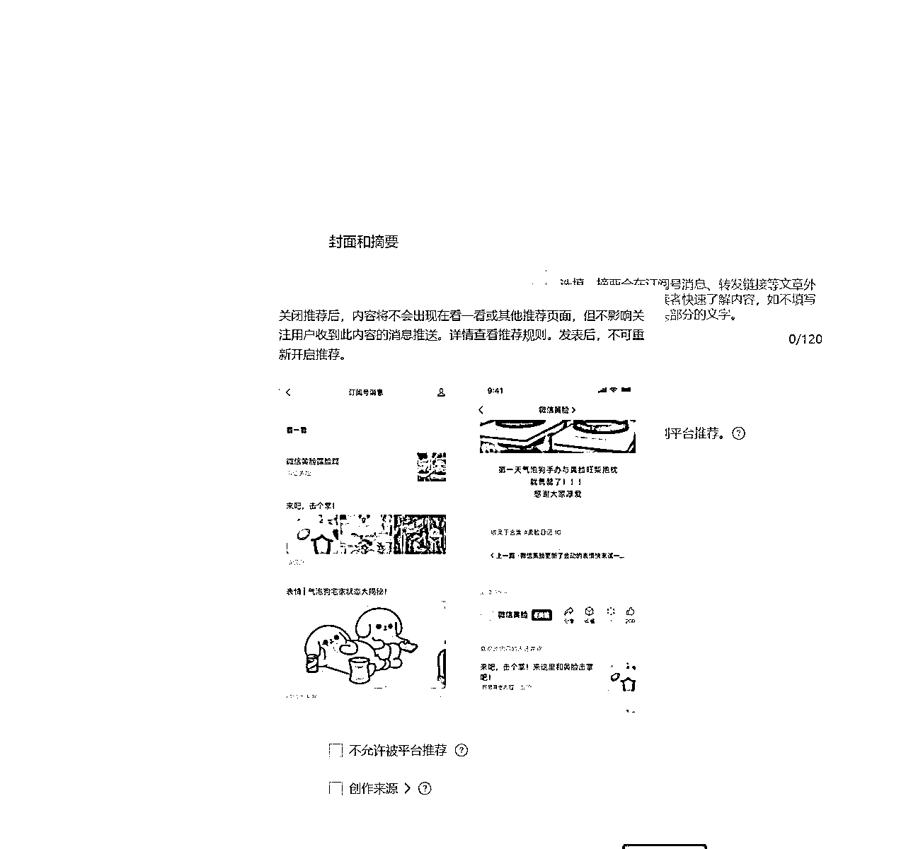

# 收尾提醒

做公众号，底线得守住：不涉党涉政，不造谣诽谤。轻的违规封号，重的就要被请去喝茶了。

一般来说，选定一个领域，照着对标的选题和文风去写，只要自己不作，基本不会撞上严重违规——毕竟人家的选题发出来了、文章也没被删，说明这条路是通的。

新手最容易栽的坑，大概就是滥用原创。这多半是洗稿惹的祸，AI洗稿尤其如此。

建议练出这么一种本事：读懂了原文的意思，再换成自己的话讲出来，而且讲得尽量细，通常就绕开了这个坑。

上面几点守住，违规的概率会小很多。

# 二、【项目实操 1/3】确定写作方向，开通账号流量主

# 💡

# 本节导览

从这一章起，咱们正式上手公众号爆文创作。我猜你心里装着这些疑问：

我以前没碰过公众号，新手适合做哪些方向？

想找不太卷、收益又还可以的方向，有吗？

听说开流量主得500粉，我这是新号，难不成先得去涨粉？

别急，学完本章，这些都不是问题。本节围绕以下几块展开：

确定赛道和写作方向

注册公众号

账号包装

开通流量主

准备妥当，咱们就开始。

# 💡

# 本章航线图

学完本章并动手实操，航线图第一阶段即可完成：确定赛道，准备2个账号（约1天）

1.

确定1个写作赛道，2个细节方向（约1小时）

2.

完成2个公众号搭建（约0.5小时）

3.

每个账号积累500粉丝，开通流量主（约0.5小时）

那现在就动手，把这几步筹备起来吧。

# 2.1 确定赛道和写作方向

# 2.1.1 爆文赛道推荐

眼下在公众号上跑出成绩的赛道，已知的有6个：

热点类——比如吃瓜、民生、影视剧（常年吃香的方向）

历史类——比如朝代、正史与野史、人物（适合长期扎根的方向）

剧评类——比如悬疑、职场、武侠（相对稳当、素材也足）

# 先选方向，再谈爆款

养老金民生这一路，写养老、社会现象、房产，收益上限高，可门槛也不低。
美食一路，家常菜、地方风味都行，原料充足、输出节奏稳，关注者增长也快。
小众专业一路，可写护士、辅警这类岗位，也可写抑郁焦虑、减脂塑形，范围窄，胜在稳定。

刚入门的人，上面六条路径都值得考虑。挑哪条，建议按【章节2.1.2】的打分法筛一遍，再用【章节2.1.3】的办法看看拥挤程度。
学习速度快、愿意接触新玩法的，也可以盯一盯正在升温的新方向，详见【2.1.4 项目拓展：公众号爆文赛道风向标】。
更稳妥的做法是：只选一个方向，再切两个细口子，持续写，结果往往更容易出来。
这次航海会拿三个热门方向、三个往期方向做样本，拆解热门订阅号文章的写法，再教你把套路迁到自己的领域。
这类稿子拆开看，无非是原料、题眼、主体内容、标题几块。因此手册会把不同文体的技巧放进同一章交替讲。比如「3.1.2 六个推荐赛道的选题方法」就会分别说明剧评类、热点类等该从哪里找题。

# 2.1.2 用四维打分挑方向

刚入门时，建议从“愿意写”和“写得动”两个方向找交集，能重合最好：
1. 愿意写：有热情才撑得住天天更新，短期没收入也肯继续。
2. 写得动：靠自己的技能、岗位经历，愿意反复琢磨复盘，越复盘越顺手。
3. 市场要：眼下的需求是供给不足还是供给过剩，拥挤不拥挤，可以自己感受，也可以多刷参照样本。
4. 肯改习惯：过去没有稳定输出的习惯，现在愿不愿意养出来。
四项各25分，逐项给自己打分。
拿我选娱乐领域的剧评举例：兴趣15分，还没到痴迷，带娃写作也没空追剧；技能经验15分，按知道、了解、熟练、精通四档看，从10分提到15分，知道娱乐领域能写，但还要往深里摸，流程熟了才算精通；市场需求20分以上，影视剧评仍是刚需、没饱和；输出习惯20分，习惯很关键，没有就得培养，和写作能力一样。合计80分，可以做。
0到100分：40分以下考虑换；40到60找出四项里要补的短板；60分以上可以入场。分数越高，主动性越强。

# 2.1.3 建立参照样本库

1、建一个样本账户库
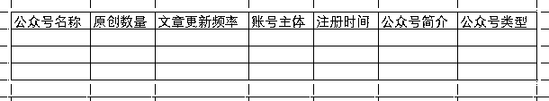
• 单独建资料库，保存参照账户的信息，按注册时间、发文数、更新频率、点赞分享数分成A、B、C、D四档。
• 库内可纳入微博、微信公众号、知乎、头条号、百家号等平台，保证信息面够宽。
2、寻找参照账户
• 在社交平台用关键词或话题搜索，定位同领域热门文章与账户，也可从其他渠道补充。
• 这样能扩充原料来源，持续获得新灵感、新信息。
• 样本库要常更新，留下最有价值的账户。
3、样本要丰富
• A类：领域内关注者多、互动率高。
• B类：短期内出现过十万加高阅读稿。
• C类：数据稳定，如阅读数2w左右。
• D类：长期起不来的账户。
• A、B、C类常发受欢迎内容，可当灵感来源，帮你摸清受众需求与趋势；D类要避开，别重蹈覆辙。
• 关注样本账户，及时查看其最新文章、发布时间、封面呈现和描述写法。
4、刷样本
• 建库后要多读，了解趋势与受众偏好，让内容更有吸引力。
• 刷样本要定期做，持续掌握领域动态。
内容来源：《公众号爆文进阶教程》

# 2.1.4 项目拓展：蓝海方向参考清单

# 💡
若你已掌握热门稿技巧，想试更小众的蓝海方向，下面的推荐可作参考。
我们常在生财星球看到一些细分蓝海方向，如“生僻字”拆解、茅台酒报价、大厂“工资泄密”等，题目虽小，流量却可能出乎意料。
我们把好用的套路与话题方向整理成表，方便找灵感；表会持续更新，尽量不错过有用信息。
蓝海变化快，新方向常冒出来，因此收集部分订阅号高阅读方向的风向标供参考：

| 赛道方向 | 风向标入口 | 发布日 |
|---|---|---|
| 新奇特赛道 | https://t.zsxq.com/qOE1V | 2024/8/19 |
| 图片分享号 | https://t.zsxq.com/Rsw98 | 2024/8/12 |
| 热点赛道 | https://t.zsxq.com/IVtgt | 2024/8/8 |
| 企稳趣事 | https://t.zsxq.com/rl3Hj | 2024/8/1 |
| 图片分享号 | https://t.zsxq.com/Rsw98 | 2024/8/5 |
| MBTI | https://t.zsxq.com/TwcIH | 2024/8/2 |
| 旅游攻略 | https://t.zsxq.com/hEvaK | 2024/7/30 |
| 职场赛道 | https://t.zsxq.com/aV0AX | 2024/7/24 |
| 中老年赛道 | https://t.zsxq.com/i00yL | 2024/7/23 |
| 汽车领域 | https://t.zsxq.com/Py1Tj | 2024/7/22 |
| 公文素材 | https://t.zsxq.com/e813x | 2024/7/15 |
| 教育赛道 | https://t.zsxq.com/87Hv9 | 2024/7/3 |
| 教育赛道 | https://t.zsxq.com/LPums | 2024/7/3 |
| 教育赛道 | https://t.zsxq.com/3TyJ0 | 2024/6/28 |
| 二次元 | https://t.zsxq.com/66cx8 | 2024/6/28 |
| 离职赛道 | https://t.zsxq.com/tF1q8 | 2024/6/24 |
| AI 图片生成赛道 | https://t.zsxq.com/A9PLZ | 2024/6/21 |
| AI 图片生成赛道 | https://t.zsxq.com/AoowB | 2024/6/20 |
| 书籍拆解 | https://t.zsxq.com/iprV5 | 2024/6/19 |
| 社会故事+普法类 | https://t.zsxq.com/EGxhh | 2024/6/18 |
| 教育赛道 | https://t.zsxq.com/BfFCn | 2024/6/17 |
| 职场赛道 | https://t.zsxq.com/blCzA | 2024/6/14 |
| 世界杯 | https://t.zsxq.com/62WMp | 2024/6/12 |
| 中年赛道 | https://t.zsxq.com/EHx45 | 2024/6/11 |
| 国学赛道 | https://t.zsxq.com/TLCAQ | 2024/6/4 |
| 付费软件序列号分享 | https://t.zsxq.com/uq7F6 | 2024/5/31 |
| 国学赛道 | https://t.zsxq.com/vtZrl | 2024/5/31 |
| 游戏赛道 | https://t.zsxq.com/HmOYC | 2024/5/30 |
| 游戏赛道 | https://t.zsxq.com/X9sYc | 2024/5/30 |
| 情感赛道 | https://t.zsxq.com/K4U8u | 2024/5/30 |
| AI 图片生成赛道 | https://t.zsxq.com/MGzyA | 2024/5/28 |

# 2.2 开通订阅号

环节一：身份证和绑定银行卡备好。
刚入门建议开2个号。原因有两个：一是分散违规风险；二是对抗不确定性，某个号长期没起色时，不至于因为只剩一个号而陷入自我怀疑。
注意：一张身份证及其绑定银行卡，只能开1个订阅号。个人只能开1个（个体工商户、企业或其他组织可开2个；政府和媒体可开50个）。想开2个，可借用家人身份证。
环节二：完成开通。
打开微信公众平台 https://mp.weixin.qq.com/ → 点右上角“立即注册” → 选“订阅号” → 按提示填资料。

# 2.3 账号门面设置

订阅号的门面不复杂，核心是名称和简介。刚入门取好记、和领域相关的名字和简介即可。
深耕本方向的圈友还可做公众号SEO，但这次航海重点在热门稿写作，这里不展开。有余力可看圈友@郭耀天 的公众号SEO文章：《最新公众号 SEO 核心玩法，自动引流躺着赚钱》。

# 2.4 拿到流量分成权限

开通订阅号后，需要500关注者才能开流量主。买粉直接开效率最高，也不耽误后期流量。买粉渠道某宝上很多，此处不赘述。
注意：刷粉可能被平台封号。若买粉，要做好封号准备，大不了封号注销重来；平台管控是阶段性的，建议多在航海群交流，及时获取最新信息。
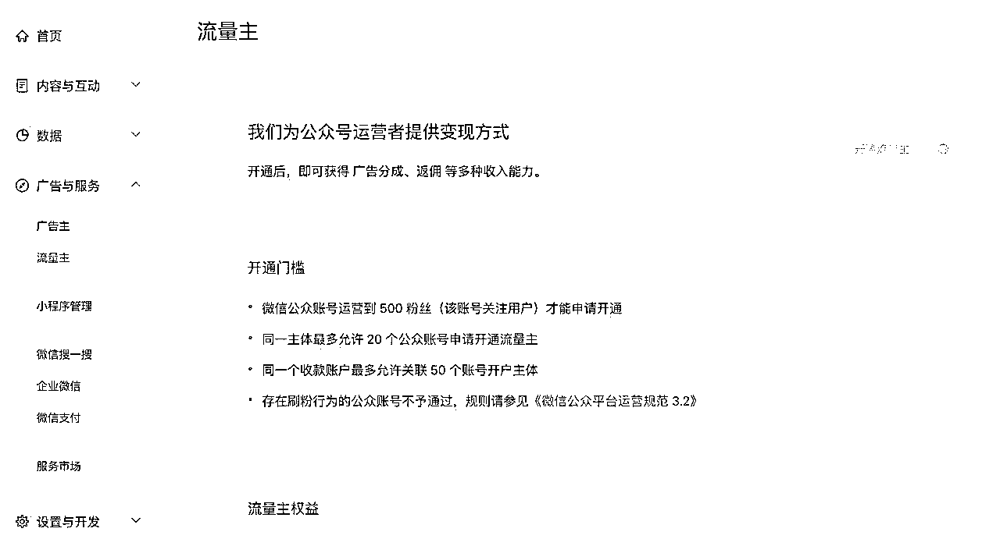
拿到流量分成权限后，先挂原创群发三篇文章，之后可获得打赏权限。账户名字头像与打赏名字头像尽量一致，人设更真实。
到这里，前期准备基本完成。这些细节无需纠结，内容做好才是重点，其他都是细枝末节，别把轻重弄反。

# 三、【项目实操 2/3】热门稿写作与发布

# 💡
# 章节概要
这是本项目最重要的章节，也是大家投入时间最多的部分。
一篇订阅号文章由题眼、主体内容、标题组成。题眼像骨架，决定文章最终形态；主体内容是血肉，填充细节；标题是外衣，决定内容能否在人群中一眼被用户发现。
本章围绕三个元素展开：
第一节：找到适合自己的题眼
第二节：写出让人看完的主体内容
第三节：取出打开率高的标题
❗️每期航海手册都会持续迭代，如果你是本项目上次航海的老船员，以下新增/修改内容更值得关注：
3.1.5 好选题的三大特点
3.3.4 点击率＞70%的标题秘诀
希望大家持续练习，不断提升热门稿能力。
加油，这个阶段结束后，就有机会收到热门稿广告的第一笔收入。
# 💡
# 本章航线图
完成本章学习与实操，即可完成航线图第二阶段：热门稿写作与发布（约5-7天，每天3-5小时）
1. 在“搜一搜”里找低关注高阅读样本，至少锁定3-5个参照账户（约1小时）
2. 参照样本的题眼，写出一篇主体内容（约3小时）
3. 学开幕雷击等手法，处理开头和标题（约1小时）
4. 单号每天至少更新1篇，争取账户入池（每天3-5小时）
现在开始完成这几个步骤吧。

# 3.1 确定合适的题材

# 💡
# 小节概要
微信订阅号领域常有人说，题眼决定成败。这就像卖货选品，选什么品，决定消费人群有多大。
本节梳理快速找题材的方法。
第一部分：只用一个关键词不断发散，找到一周甚至更多题材，适合所有内容方向。
第二部分：围绕订阅号六个方向——职场、热点、剧评、法律、历史、情感，分别说找题小妙招。
最后一部分：聊题材的“坑”。开头说题眼决定成败，不是危言耸听。选到特别危险的题材，可能带来毁灭性打击：轻则文章被封禁，重则整个账户没了。这一部分讲如何规避风险。
准备好了就开始。

# 3.1.1 通用找题法：在微信里搜索高阅读样本 @枫宇翔

刚入门最高效、最快出成绩的找题方式，就是找可参照的高阅读文章。怎么找？最常用的是在微信搜一搜里，用领域关键词找要模仿的文章。用过搜一搜后，微信算法会持续推荐相关文章，文章会越来越多，这是眼下最快的方法。
# 3.1.1.1 第一组关键词怎么定？
看到这里，应该已经看过2.1确定方向和写作方向。
第一，确定第一个关键词。选好方向后，比如三农、军事、情感、法律等，要凭经验和常识想方向第一个关键词。写情感领域，我首先想到婆婆、婆媳，搜一下一定有高阅读稿。之前也推荐过大厂裁员系列，关键词就是裁员、毕业、失业、降薪、减薪等。实在想不到，就把三农、情感等直接当关键词去微信搜一搜，也能找到第一份高阅读稿，只是费点时间；关键词越精准，搜索越快。
例如写这个问题回答时，我在微信搜一搜输入“裁员”两个字。
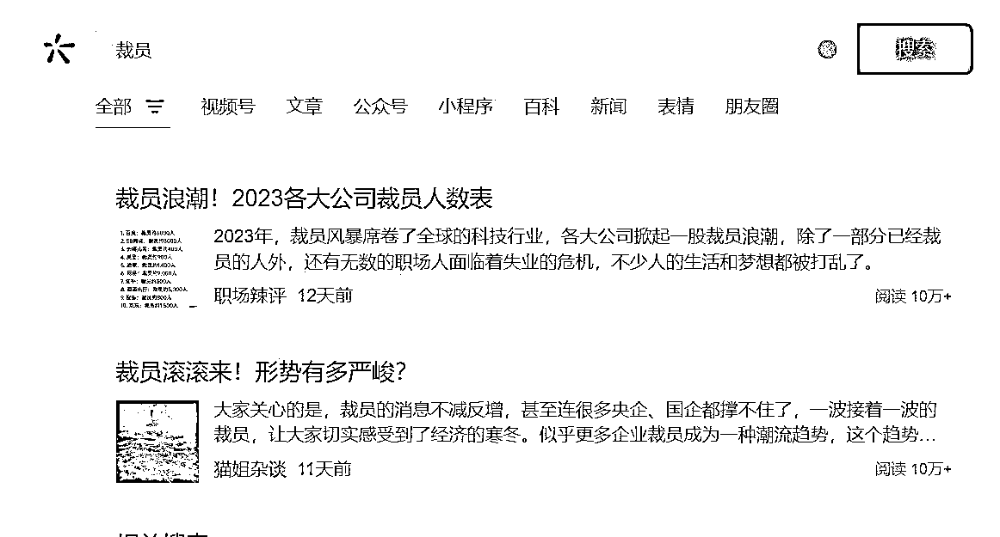
你看，马上能检索到十万加高阅读稿。找到第一份，就能获取第一个参照账户。这一步别偷懒，这是从0到1必须经历的。
通过这种方式找到高阅读样本后，进入下一步：获取更多关键词。
第二，套娃式获取更多关键词。订阅号文章能爆，很大程度在于标题起得好，标题里包含方向有流量的关键词。拿参照账户里几万阅读甚至十万加的文章，把标题扒下来。上面用“裁员”检索，出现“职场辣评”和“猫姐杂谈”两个号，我进入“职场辣评”看了看。标题里的国企央企、欠薪、降薪、亏损等都是关键词，甚至可直接拿这些标题去搜一搜，马上又获取一堆高阅读稿和账户，继续重复，就能源源不断获取关键词，套娃式获取高阅读稿和参照账户。
第三方平台我没用过，太麻烦。我的风格是简单粗暴、见效快。其他平台比如头条有频道分类，写军事就点军事频道，会出来大量文章，那些标题就是关键词，一个个拿出来。也有人说文章里也有关键词，的确有，但我懒得看，直接标题搞起，大家第一眼都是被标题关键词吸引。
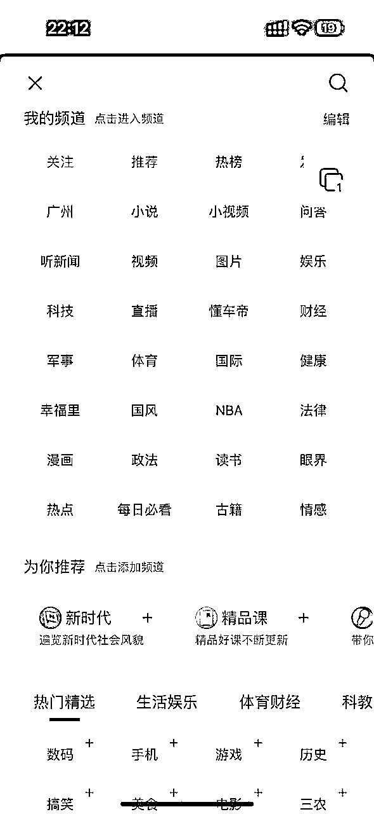

# 3.1.1.2 如何筛选参照样本？

判断哪篇是参照样本，看几个指标即可：
第一，搜一搜搜到文章后，首选十万加，其次七八万阅读数。
第二，发布时间在最近三个月内，越早越好。道理很朴素：爆过的内容还会爆，最近发布且爆了，说明有流量，你写大概率还会爆。
第三，看发布账户最近注册时间，最好也是最近三个月注册。有的账户注册久、关注者多、原创多，高阅读可能是关注者带起的；我们要的是低关注高阅读稿，这些账户和我们同一层次，它爆，你也有很大机会爆。
# 3.1.1.3 怎样拆出文章结构？

很简单：找到样本后通读一遍，确定核心意思，按开头、中间、结尾用自己的话写出来。
比如“职场辣评”号两篇文章：《地产已死，国企央企也逃不过房企大面积裁员，欠薪》《某大厂裁员还在继续，大晚上突然被毕业！》。通读后核心观点就是突然被裁员。模板是：①开头简单介绍这些企业；②深度分析为什么被认为不可能裁员的企业也裁员；③结尾总结并给建议。
通读时注意转折点，比如“但是”“为何、为什么”“不过”“然而”，这些通常表示作者开始转折，下面和上面内容有区别；把上下内容浓缩，就是文章结构。其他领域也有表示递进、深化的词。这也是中国人说话写文章的习惯，要表达另一段内容，需要转折词，不然突兀，读起来难受。
特定领域可能有具体结构，但手册面向所有人，每个人领域不同，结构也不同；掌握这种思考方式，根据自己领域手动分析拆解高阅读稿。参照账户和高阅读稿已提供并做案例分析。如果还不理解，就先抄起来，写着写着自己会开悟。

# 3.1.2 六类方向的找题思路

# 💡

说明：平台规则与外部环境持续变动，眼下有效的赛道过段时间可能就凉了。所以本节不鼓励押注单一赛道，而是拆解方法、讲透底层逻辑，让你换个领域也能照搬。

# 3.1.2.1 职场类：裁员与薪资爆料怎么选 @枫宇翔

职场方向我想讲得更聚焦，重点说“头部公司人员调整、薪水外流”这类题如何找。此前在直播和线下交流中，我多次力荐这条线。道理不复杂：大环境强调控本提效，企业会不断精简编制，于是大量人关心岗位收缩的消息。这群人又爱在职场社区吐槽、晒经历，选题素材就藏在讨论里，脉脉尤其集中。

路径很直接：装好脉脉，注册登录，刷头部公司动态；也能直接搜某家企业，很快翻出大量在职者爆料。只要话题沾上头部公司，关注度通常不低，因为这些企业自带流量。搜到合适内容后，把主题页和留言区截屏放进文章，再结合你的判断解读现象。

其中，人员裁减、薪酬外泄等方向已被市场验证，确实有人写出过爆款。手册7.7“职场裁员&薪资泄露系列”里给过参照样本：该账号从2023年12月19日开始更新职场信息，内容覆盖岗位收缩、薪酬外泄等，至今数据表现都不错。

脉脉里互联网公司偏多，但方法能迁移到公务员、设计师、房地产等行业；去头条、百家号、抖音、快手也能搜到类似消息。要是你本身就在这些行业，更有优势——专业网站或App里往往藏着素材。我是程序员，所以平时更关注互联网企业动态。

这里留三条提醒：
① 人员裁减、薪酬外泄只是众多消息中的一类，顺着脉脉还能挖出更多方向。
② 这类头部公司消息关注度高，也容易引起企业公关注意。落笔时只围绕网友留言展开讨论，别自行脑补，更不能造谣或带节奏攻击公司；保持客观，借信息表达自己的职场态度。多观摩参照样本，看别人怎么处理。
③ 除了脉脉，知乎、豆瓣、BOSS直聘等平台也能获取职场信息；裁员社会新闻、老板公开谈裁员的观点，同样可以写进文章。参照样本的内核是“职场+裁员”，但呈现形式会逐渐变化。

# 3.1.2.2 热点类：从热榜里挑题

热点选题优先看各类榜单。我常用微博热榜和知乎热榜，但热点亚种不同，选题方向也有差别。

“指点江山类”专攻社会不公话题，主力读者是中老年男性。这个方向做选题，知乎榜单明显比微博更合适：知乎对社会负面新闻的曝光力度更大，微博热榜的修饰痕迹较强，力度会弱一些。

还要留意：不少知乎爆款回答有流量，却和热榜没什么缘分。这类内容往往比榜上话题更尖锐，写出来也更容易爆，因为它们是读者一个个赞票选出来的，已经成功挑动情绪。选题要选的，就是这种刀刀见血的内容。因此“指点江山类”的思路是：知乎自然跑出的爆款优先于知乎热榜，知乎热榜又优先于微博热榜。

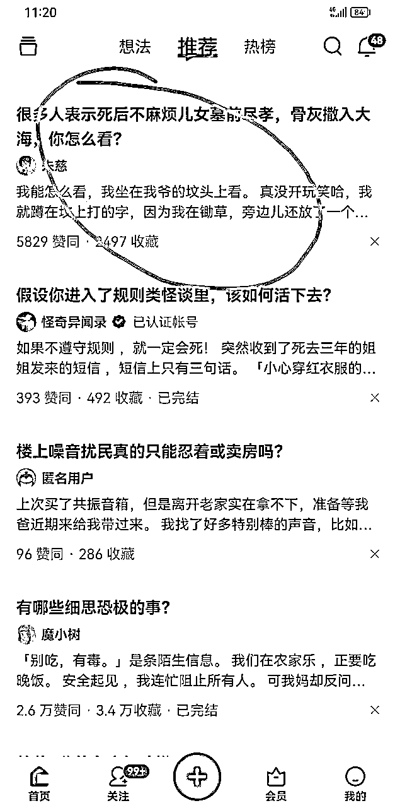

“娱乐热点类”专追当下娱乐热点，主力读者是中青年女性。这个方向对多数作者来说，微博热榜作用最大。一天多刷几次微博，看到“热”字可以挑，有“沸”字优先选，有“爆”字不仅要优先，还要当天尽快出文，否则流量会明显衰减。因此“娱乐热点类”的思路是：饭圈内部消息优先，其次是微博热榜，最后看知乎热榜。

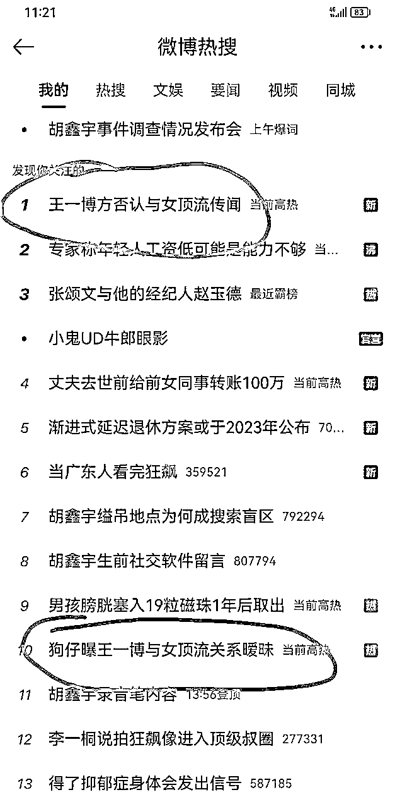

“养生热点类”专门做科普知识，主力读者是不分性别的中老年人。特别提醒：这里的“养生”和通常认知不太一样，多来自老话，比如“立春哪些不吃、哪些不喝”。老年人死亡焦虑、疾病焦虑较重，这类内容容易贡献阅读量。做法是结合农历节气，在榜单里挑健康相关话题，但落笔只能往古代习俗上靠，不要给医学建议，否则容易严重违规。因此“养生热点类”的思路是：节气优先，其次才是微博等平台的健康类选题。

其余热点亚种我接触较少，留待以后探索。

# 3.1.2.3 剧评类：选题的两个入口

剧评选题有两个入口。

一是“热点+剧评”。比如电影《满江红》正火，评价褒贬不一。此时若能写出五六七八篇角度新奇的影评，就能接住它的流量。

二是“经典老剧”向。比如《知否》《甄嬛传》《大明王朝1566》等。老剧本身流量大、信息量足，随便抠一个细节都能延展出很多内容，写来写去不太缺选题。夸张点说，一部剧写出几百篇也不难。两个方向都能作为选题方向。

# 3.1.2.4 法律类：民生新闻怎么选

写新闻尽量选官媒报道过的，被投诉的概率会小很多。要记住：新闻不涉政、不涉军，最好是蹬鞋踩袜子、家常里短之类的民生新闻，与老百姓生活紧密相关。能爆的新闻类内容，几乎都落在这个范围。

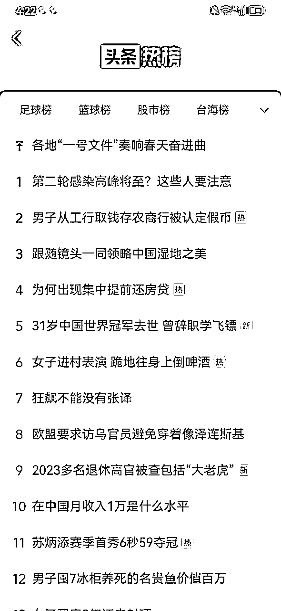

所以这次我没建议去微博、知乎找，原因就在这里。各地新闻节目也能当素材。看到哪条新闻让你血压上来，就选它；没感觉就放弃。理智一点的做法，是对照“开幕雷击七要素”筛选：占2条以上要素的新闻优先用；只占1条不建议；一条都不占绝对不能用。后面的法律条文，用百度检索，关键词抓新闻故事的本质。比如有人把别人头打破，就搜“致人轻伤如何量刑与赔偿”，会得到大量资料，再汇编到对应模块。

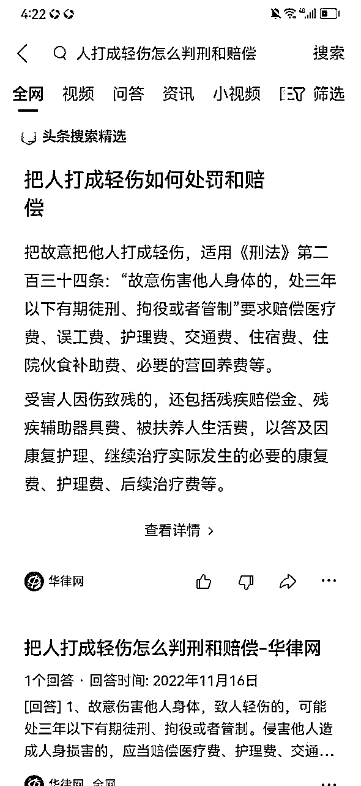

# 3.1.2.5 历史类：历史选题怎么定

历史选题可以追热点，也可以按自己想法中规中矩地写。

1、追热点要时刻盯热点动向。比如“胡歌宣布得女引发热议”，也可以找重要人物出生或生子引发巨大反响的事件。当然，这种热点需要非常高的契合度，经验不足时不建议写。类似的还能借某县长涉贪新闻，写古代官员贪污会受什么处罚；借“明星和粉丝”，写古代追星族的狂热，比如《大宅门》中白玉婷与尚筱菊照片成婚的桥段就有历史原型。

注意：追热点历史必须契合度非常高，而且要从今观古，对作者写作功底要求相对高，可以在以后写作中慢慢给自己加分。

2、中规中矩写作，就是按自己的想法，写自己喜欢的历史人物和事件。写作最重要的是写得高兴，可以选敬佩的人物、讨厌的人物、觉得惋惜的人物、让人落泪的人物。找到人物后确定基调，包括人物事迹，大致给人物一个基本概括：是敬佩、同情、值得肯定，还是毁誉参半？全文按一个基本思想写，就不会有大问题。比如写隋炀帝，基本绕不开劳民伤财、暴政、急躁等缺点；写唐太宗，可以用虚心纳谏、宽厚爱民等角度为他打光。

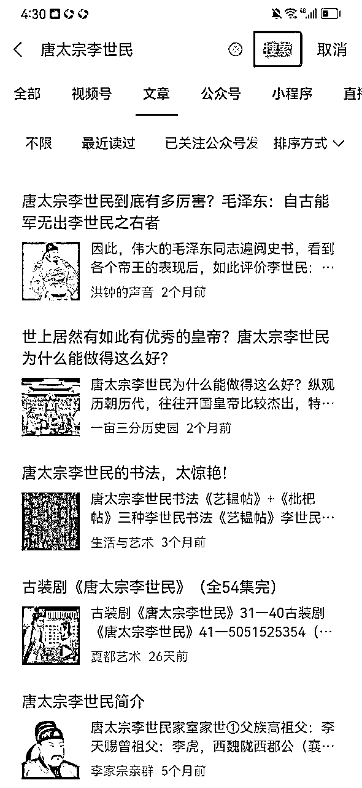

对记载很少但非常喜欢的人物，可以从他的前人、后人、身边人等角度写，也可以适当编撰，但别太虚假，始终保证假故事为真性格服务。

再推荐圈友@一来 试过的近代史领域选题。写历史类可以涉及近代史：这个领域起号相对难，常要一个月，甚至还有不确定因素；但账号进入流量池后，阅读量比较稳定。可参考“飞扬说史”，基本每天都有大小爆款，不好的地方是文中经常没有广告。

内容来源：6月8日《公众号流量主的经验分享》@一来

# 3.1.2.6 情感类：找有爆款相的素材

情感类爆文要挑有爆款潜质的素材。可以去各大平台找灵感。

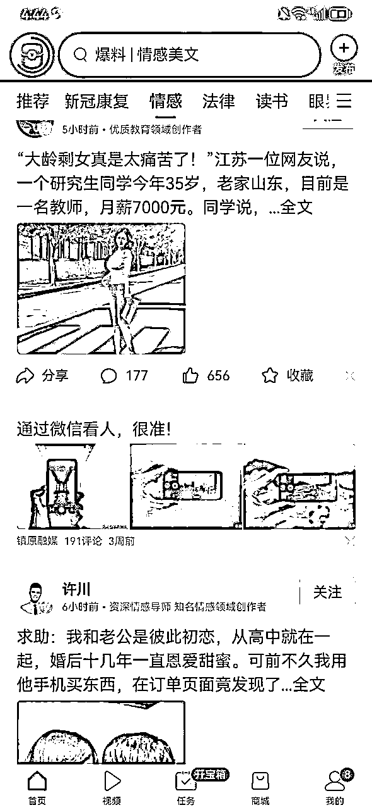

比如能引起共鸣、感人至深、有争议、事出异常的素材。具体包括：
1）有曲折性；
2）有情绪；
3）有信息增量；
4）有关民生问题；
5）明星名人；
6）性；
7）暴力；
8）金钱。
每个故事至少要包含以上8个要素中的3个以上。

# 3.1.3 选题避坑：三类雷区要避开 @半糖梦呓

公众号也是公域流量，措辞必须格外小心。题材踩坑时，写得再好也难爆；有时用了某个违禁词，也会被平台打压。具体要避开三类坑：

# 3.1.3.1 政治红线不能碰

内容平台每月封禁几千上万个账号。这些账号里，大部分是很黄很暴力的号，还有相当一部分踩了政治红线。什么叫政治红线？记住两个词：党史、军史。准备写文史类内容的作者尤其要注意。党和军队都是正面形象，写作时只能选正面内容，其他不要写。想要足够安全，1840年以后与中国有关的任何事情，最好都别写。民国的人物和历史，半糖的建议是慎写，新手最好不碰。文史领域本身敏感，自媒体人更要牢记使命、不忘初心：不该说的话一个字别多说；敏感历史事件、人物一根头发丝都不要提。那喜欢历史怎么办？建议新手从古代史入手，最好是中国古代史：一来安全，二来受众广、话题多，容易出爆款。

# 3.1.3.2 追热点别吃人血馒头

追热点是自媒体人的天职，但有一类热点在公域平台绝对不建议碰，那就是吃人血馒头。什么叫吃人血馒头？第一个例子是二更食堂。这个号曾是百万粉丝大号，如今已被封号。原因是滴滴空姐被害事件后，二更食堂利用大众关注度，编造许多无中生有的情节，用词情色、猥琐，对死者是一种侮辱。这种行为就是吃人血馒头，后果是百万粉丝大号说封就封，一点余地没有。

第二个例子是今夜90后。一个孩子和母亲吵架后跳桥，今夜90后虚构了许多不存在的细节，事后证明是杜撰，只是博主为博眼球。这个账号同样被封禁。

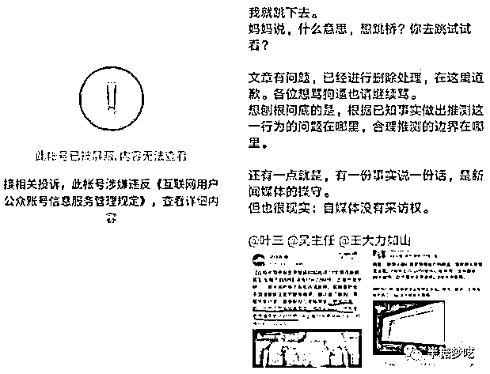

利用逝者大做文章，甚至编造不存在的细节，用夸张、性暗示语言描述事件，吃相实在难看。网络不是法外之地，更不是道德禁区。中国人向来认为死者为大，谁想拿逝者做文章，都会激起众怒。有人会问：碰到这种热点，我不吃人血馒头，也不脑补造谣，就站在小老百姓角度评判社会行不行？不行。因为这样一不小心就会挑起社会对立、煽动仇恨情绪。那么多正面事件看不见，专盯社会负面写，不封你封谁？

# 3.1.3.3 财经、健康要资质

最近有小伙伴问半糖：“我昨天发了个微头条，竟然被官方删除了？”

问清楚后发现，他没有财经资质，却写了财经内容。财经、健康领域都需要完成职业认证才能写。没有认证的作者写这两个领域，要么被限流，要么被删文，总之想做大是万万不能。头条官方对财经和健康领域作者门槛有明确规定，需要职业认证，具体如下：

财经领域——要满足以下22种职业中任意一种并提交证明资料，才可以进行职业认证：注册会计师、注册税务师、精算师、银行行长、交易员、基金经理、投资经理、特许金融分析师、财经/投资分析师、金融风险管理师、特许财富管理师、市场研究员、财经媒体人、财经评论员、经济学者、证券经纪人、证券投资顾问、黄金投资分析师、理财规划师、保险代理人、保险经纪人、私募投资人。

健康领域——以下十种情况中任意一种并提交证明资料进行职业认证：心理咨询师、医药工程师、医药研究员、营养师、医院院长、放射/检验技师、康复治疗师、药剂师、护士、医生。

更具体内容可去头条职业认证的认证标准处查看，此处不赘述。如果以上都不满足，财经和健康这两个领域就别碰，这是非专业人士的禁区。以上三个禁区属于摆在明面上不能写的内容，在任何公域流量平台都共通。

避开违禁内容后，还有一些细节要注意。首先是查询违禁词。关于违禁词，可以用句易网这个公众号，把写好的内容粘贴进去查询，系统会自动过滤出违禁词。查了之后你可能会意外：这不是天天挂嘴上的词吗？怎么也算违禁词？具体大家自己试，半糖不举例。如果没有违禁词却依然被限流，那就要找找是否有标题党嫌疑。怎么找？举个例子：上周，一个小伙伴问半糖老师，这篇微头条被警告了该怎么改。她原来的开头是：“闺蜜和前夫打来电话，要我退还1000000给他，我把他爆骂一顿之后拒绝了。他又发来一张照片和一条信息：晚上8点来我家。我呆呆的看着照片，眼泪夺眶而出，恨不得打死我自己。”系统警告理由是“刻意隐瞒关键信息”。

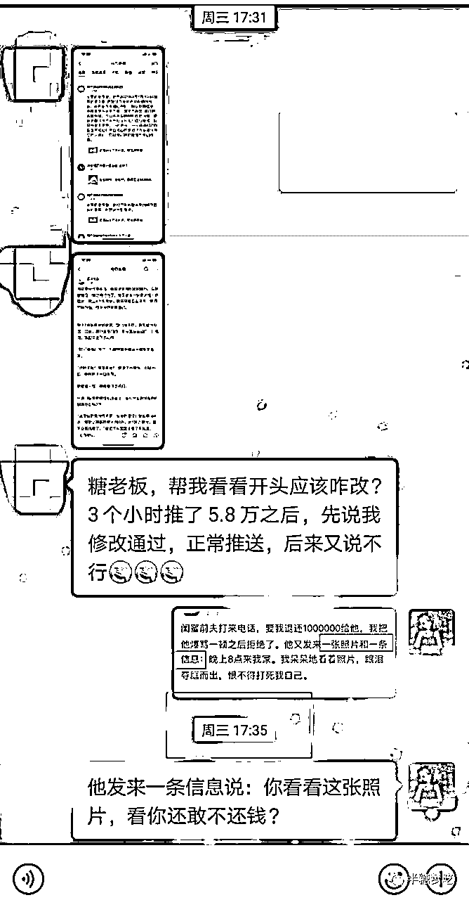

“隐瞒关键信息”通俗讲就是标题党。曾被全网戏谑的UC式震惊标题，就是标题党中的“翘楚”：套路是故弄玄虚、小事夸大、隐藏主语；读者被标题吸引进去后，发现后面的内容简直把智商按在地上摩擦，会有被戏弄的强烈反感。读者纷纷取关、拉黑，连平台也一起骂。平台不傻，有UC的扑街史在前，现在谁还做一锤子买卖？于是加大了对标题党的打压力度。学员这个开头里的“一条信息和一张照片”，就是典型故弄玄虚，也是被限流警告的原因。半糖建议她改成：“他发来一条信息说：你看看这张照片，看你还敢不还钱？”这样改后意思一样，但没有刻意隐瞒关键信息，该表达的都表达了。

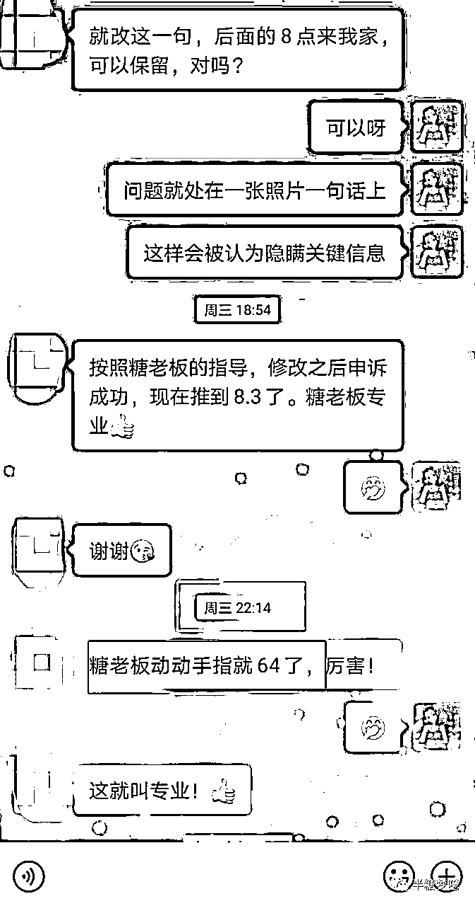

4个小时后，这篇微头条爆了63万+。

很多时候，扑街文改成爆款，就一句话的事。但大部分小伙伴稀里糊涂，文章静悄悄就扑了，想破脑袋也不知道问题出在哪，其实就是某句话甚至某个词踩坑了。给大家总结几类避坑题材：
1. 有关政治的不能写：包括党史军史军、时政热点、国家领导，除非你有互联网新闻信息服务许可证；
2. 追热点不吃人血馒头：就算不造谣，站在小老百姓角度评判社会也不行；
3. 财经、健康需要资质才能写。
其他避坑题材还有：
4. 公务员、体制内题材也不要写，非常容易违规；
5. 黄赌毒一定不要碰；
6. 一些媚外内容也尽量不碰；
7. 娱乐领域一些负能量事件和艺人尽量不碰，除非官方发话。

内容来源：《今日头条七大变现方式，我只用一种，半年赚80000》

# 3.1.4 选题技巧：做出差异化 @张波

选题一定要有差异化。大家内容差异化太低、千篇一律，就很难脱颖而出，拿到较多流量。很多写情感方向的作者还在写那些事，殊不知看这类文章的人，看到以前的所谓爆款已经没新鲜感了，除了自嗨，看的人越来越少。选题一定要分析。下面两个例子可能不太准确，希望能给大家启发：千篇一律的东西看的人越来越少；一个人顿顿大鱼大肉也会吃腻，要学会找差异化。

观点+情绪

分析领域内账号的写作角度。比如以观点+情绪为导向，很多账号写正观点+正情绪；在特别拥挤的情况下，你可以写不同观点+正情绪，也可以写正观点+不同情绪。以2024年养老金话题为例，正向观点配正向情绪，可以起出“退休金新规、工龄超30年上涨10%、年金最高可达8万元”的标题；反向观点配正向情绪，可以换成“多数人还不知道、满30年工龄每年多涨240元、三类人有福”的说法，或者用“坏消息”口吻讲三类人将被取消养老金、社保缴满15年也没用；正向观点配反向情绪，则可写“20连涨”之下，3651元以下按10%上调、6400元以上停涨，问一句这样行不行。

热点+领域

分析领域内账号的写作角度。比如以热点+领域为导向，很多账号写热点+领域；在特别拥挤的情况下，你可以写不太热+领域，也可以写热点+其他领域。以娃哈哈相关热点为例，配娱乐领域，可以写宗庆后逝世众人惋惜、王力宏一句话点破；配情感领域，可以写宗馥莉谈恋爱的热搜与读者反应；配业务领域，可以写不给娃哈哈设计大厦就对不起宗庆后和全国人民的热情；也可以写王力宏被嫌老、百万名表、42岁新掌门等娱乐角度。

引用：一份讲公众号内容质量提升的资料
https://k170ac9yh31.feishu.cn/docx/KbupdqExXo8z9pxL5RqcUzJOnfb

# 3.1.5 好选题的三大特点 @开卷🌀

常见的找选题方法，在航海手册里都有。这里只补充一点：我能把入池率做到100%，在选题上还有另外注意的细节点。

起步那阵子，我翻了不少公众号的选题。时间和精力摆在那里，我得先想明白：什么样的方向更值得做，什么样的方向更容易跑出爆款。这个问题压了我好几天，后来把所有经验盘了一圈，才得出一个判断——那些能稳稳进池子、阅读量也不差的选题，基本占着三条共性。

# 3.1.5.1 选题要埋一点“出人意料”

老话讲：狗咬人，谁都觉得正常；人反过来咬了狗，才会有人围观。

一个选题里若带着这种反常因子，天然就具备新闻感，可以说自带流量开关。只要把它写对路子，阅读量基本不会差。

比如“当博主月入五万，我却想回公司上班”这个方向，就是典型。

有人会说，这跟标题够“开幕雷击”、自带金钱钩子有关。我也认真比对过：聊钱的内容，未必每条都能火；但在我写过的题材里，只要反常点够突出、故事本身有看头、正文又没垮，最后基本都爆了。这就是“异常”的厉害之处。

后来我还注意到，我那篇百万级爆文，也有人跟着仿写过，可数据普遍一般。原因想来也简单：他们把最关键的那层反常拿掉了，文章一下子变得四平八稳，原本带劲的素材，硬是写成了没味道的鸡汤。

不信你看这三个标题，猜猜哪个更容易爆：

1、心凉！男子被狗咬了三回，街上竟没一个人敢帮！
2、看呆！男子被狗咬了三回，突然在街头干出这种事……
3、愤怒！男子被狗咬了三回，狗主人反倒让他赔五千块……

答案我不公布，选题刷得多了，你自己会有感觉。

# 3.1.5.2 一个方向先看到三篇10万+，再写也不急

我跨过百万门槛的那篇，就是因为注意到好几个账号都在写同个题材，而且都跑出了10万+。后来我做的50万+、20万+和10万+文章，选题背后也几乎都有至少三篇爆款作参考。

当然也有例外。有一个选题，我当时只找到两篇10万+，但因为实在喜欢，还是硬写了。最后阅读量停在5万上下，多少有点可惜。

为什么要盯着10万+这个线？

同样一晚上，写一篇10万+，收益和影响差不多顶得上两篇5万+，单位时间产出更值。这也是一批手作内容的人，不拼数量、拼质量也能弯道超车的逻辑所在。

# 3.1.5.3 选题不必端着，能让读者有话接才重要

这套规律，放在抖音、小红书、公众号上都成立。

头部作者能做出百万爆款，靠的往往是独到的观点；普通人做百万爆款，更常见的路数是踩中一个大家都有表达欲的话题。

举个例子：

刚过一本线十来分，是去读个普通一本，还是选个更合适的二本？

手里只有三百万，是拿下市中心的老破小，还是买郊区的宽敞大平层？

这种话题没有标准答案，又贴近普通人的真实纠结，讨论热度一上来，很容易出爆款。

我的公众号航海项目能跑得比较顺，其中一个原因，就是初期我把80%的时间都用在了选题上。

说到找选题，总有人问：数据网站的会员，到底要不要开？

我的体验是，至少在新手阶段，没必要。

不管做哪个平台，新人入场的第一课，都是先把内容生态摸熟。如果这些文章我不亲自刷一遍，心里就没数：哪些算好，哪些一般，哪些很差。

数据工具的优势，是能快速筛出高阅读内容；但它的问题也在这——好坏是相对的。新人要是只看“数据最好”的一批内容，很难判断它究竟强在哪儿，更分不清这种热度是偶然爆发，是账号权重高，还是内容本身真的有分量。

所以我给公众号打基础的那段时间，内容全部是手工写的，选题也全部是一篇篇刷出来的。最后的技巧部分，我会专门写自己平时怎么刷选题。

这是每个想在新平台上走远一点的人，都绕不开的功课。我也相信，真心想在内容上深耕的人，迟早都要具备这种基本功。

以后我会不会用数据平台？说不准，大概率会。因为我已经明显感觉到，纯手工刷题、纯手工写作，就算全职投入，一个人顾五个账号，脑力和精力也快被榨干了。等真正理解平台之后，再想轻松一点、多管几个号，确实得靠外部工具去扩大规模、提升效率。

内容来源：《公众号新手实现百万爆文，单篇收益6000+，单账号变现5位数》

# 3.2 正文：先找到框架，再往里填内容

# 💡

# 小节概要

要说文章正文完全没套路，那不太可能。大多数爆款背后，都有一套能套用的基本盘。我们实际要做的，就是认清这些框架，把相关素材塞进去，再顺手打磨打磨。

这次航海覆盖的五类内容，模板可以这样概括：

职场类：标题开头，故事当主干，插入网友争论，结尾给总结和建议。

热点类：标题、事实概述、作者态度、收尾。

剧评类：标题、剧情、观点或剧情拆解、收尾。

法律类：地名—冲突—新闻—网友—法条—做法—互动。

历史类：提出一个问题，再回答这个问题。

情感类：标题、主人公、故事主线和结尾。

下面按类别逐一说清楚，这些爆款模板到底怎么用。

# 3.2.1 职场类：故事文的常见套路@枫宇翔

职场故事文可以简化成一条链：标题+故事主干+网友争议+总结建议。

按我的说法，职场爆文七成以上的功夫，其实都压在标题上。标题起对了，先迈进流量池；正文只要不太拉胯，阅读量自然会跟上。

如果只保留一个模板，我会这样概括。

第一，定好想写的话题，把主题截图贴在文章顶部，再在正文里针对这个话题展开聊，分析它为什么会变成热点。

第二，把评论区的不同声音搬进文章，最好选那种吵得特别凶的争论，拿出来对比着聊，最后亮出自己的立场。

推荐一个能直接参考的账号，原来叫程序员圈儿，现在叫职场故事荟。它最大的特点就是会讲故事：要么先放一张图，要么偷个懒，攒几张网友评论截图，配合起来讨论。

另外，在分析原因和展开讨论的时候，尽量学会用故事说话。道理讲得再清楚，也不如一个故事来得有温度。把那个账号反复翻几遍，慢慢就会有感觉。

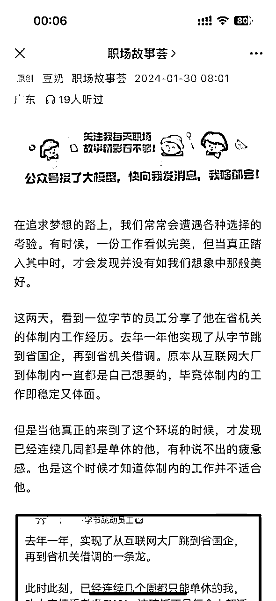

# 3.2.2 热点类：从事实到态度的写法

热点文可以拆成四块：标题、基本事实、态度或观点、结尾。

### 3.2.2.1 案例一：龙骨和龙鳞

拿一条龙来打比方，整篇热点文就像一条龙：最结实的骨架部分叫龙骨，热点文里承担这个角色的是事件本身；贴在龙身上的那些金句、观点、细节和情绪，则是鳞片。

龙骨的任务很简单：把事情讲清楚。如果事件太复杂，讲完整篇会拉得很长，那就只挑一个侧面写透就好，别贪多。写得太满，文章就会变拖，完读率会被狠狠连累。

龙鳞的活，是替你把态度和观点秀出来。以前写故事，鳞片全用在细节上，是为了让内容显得可信；但热点文的素材本来就是真实发生的，没必要再用细节替它增信。加多了，反而容易出现反效果，比如某些翻车账号就是吃在这上面。

所以热点文里的龙鳞，只负责站队、摆态度、给观点，别的都不要掺和。写的时候也不用想得太复杂：事件陈述到一半，情绪上来了，就直接写出来，把这段话当作钩子，去捞那些跟你同频的读者。记住这句，就够用了。

### 3.2.2.2 案例二：两档难度的操作公式@妞妞💋

简单容易上手的写法是：标题+开头+事件陈述+结论。可以参考“泡哥看世界”的风格。

想写得再深一点，则变成：标题+开头+事件陈述+对比论证（可省略）+结论。可以参考“桌子的生活观”。

为什么这么拆？

1）标题：50字以内，最好带一幕“雷击”。

比如：突发！“中石油牵手门”男女主再曝大料，这背后可不简单。

2）开头：100字左右。

可以从自己的直觉感触发散，也可以直接说事。

举几个现成的例子：

① 生活有时候会突然塞给你一个瓜。成都一个摄影小哥只是街边拍了几张照，偏偏就拍出了国企大领导“牵手门”的丑闻。

② 某月某日，“宝妈因孩子吃了同学生日蛋糕发飙”这个标签冲上热搜，网友很快就议论起来。到底发生了什么？

③ 谁也没想到，珠穆朗玛峰上能出这种新闻。近日，#珠峰攀登者放弃登顶救起濒死女子# 的话题冲上热搜第一。

④ 还记得十天前武汉那位被老师碾压的学生吗？更揪心的消息还在后面：孩子去世十天后，他母亲从24楼跳了下去。

模型仅供参考，按自己的习惯取舍即可。

3）事件陈述：500字左右。

把时间、地点、人物、经过按顺序捋一遍，配上能对应上的新闻图片。

4）对比论证：300字左右。

这段可以用，也可以不用。如果热点正处于高峰期，省掉完全没问题；热度稍微退了一点，加上更稳。方法也不难：搜一两个同类型事件，摆在一起对比，补几句自己的评判。

5）给观点，同时把读者情绪点燃：300字左右。

说出对这件事的看法，态度可以鲜明一些，甚至可以带上一点愤怒感。

例文参考：

例文1 那篇写太古里牵手门事件的文章，讲女主素颜照一般、但胜在腿长肤白，走的是没有对比论证、直接下判断的路子。

例文2 则以“我儿子被投毒了”这句家长的怒吼切入，配上“家长群聊天记录流出后，我看得好窒息”的情绪化收尾，内容更有层次，因为多了对比论证。

把例文2往公式里套一下：

① 标题：50字以内，满足雷击式开头的要求。

整篇文章就是从一句家长的怒吼展开：“我儿子被投毒了！”再往下接家长群聊天记录流出后的窒息感。

② 开头：100字左右。

6月6日，一个话题冲上热搜：一位母亲因为孩子吃了同学分享的生日蛋糕而情绪失控。网友议论纷纷，到底是怎么回事？

③ 事件陈述：600字左右。

起点是网友晒出的一段家长群聊天记录：六一儿童节那天，有人带蛋糕到班里分给孩子们；终点是文中最有争议性的一句判断——“再毒的奶油蛋糕，其危害性也比心灵的终极污染小得多”。具体过程，原文里有完整呈现。

④ 对比论证：300字左右。

第一处对比来自知乎作者“一只小仙女”的亲历分享；第二处是网友转述的过激案例——一个同事逼孩子吃下两倍于成人剂量的泻药，只因为孩子偷吃了辣条；第三处是主持人倪萍讲过的一个故事，读后很让人触动。

⑤ 论点+情绪：300字左右。

核心观点可以概括为：内心的渴望曾经被满足过，人才不会一直匮乏；没有谁能一辈子只吃“标准食物”，也没有谁能一辈子完全不跑偏。对孩子和家长来说，多留一点松弛感和容错空间，大家都更轻松一些。

内容来源：《用GPT写热点文&公众号快速入池的方法》@妞妞💋（7月13日）

# 3.2.3 剧评类：用剧情撑起观点

剧评的基本构成不复杂：标题、剧情、观点或剧情解析、结尾，四块拼完就是一篇。

1）观点方向的剧评，剧情和细节都要有一个收口，这个收口就是你的观点。

比如写《知否》：明兰不知道，顾廷烨和贺弘文求娶她，原因居然一样。读者好奇心一下就被勾起来：到底是哪个目的？

拆剧情：顾廷烨早就盘算好要求娶明兰。他知道明兰和贺弘文快订亲了，故意把贺弘文从小一起长大的曹表妹送回京城。曹表妹顺理成章求着给贺弘文做妾，贺弘文也心动了，但就是不开口，等着明兰先妥协。两边僵住的时候，顾廷烨出手求亲。

给观点：这事说到底就是“合适”二字。贺弘文娶明兰，图的是她的家世和办事能力；顾廷烨娶明兰，图的不是家世，而是她的品行和老练——他始终记着父亲说的“娶妻娶贤”。明兰恰好都有：有主意、有手段、还能跟继婆婆周旋。

收尾：婚姻的本质不是爱情，而是合适。两个人能互相托底，往往比只有感情走得更远。

用明兰的话收束也可以：“婚姻里未必一定需要爱情，作为女人也不应该把眼光放在儿女情长上，要实现经济和精神的独立，去看看更广阔的世界。”

那篇阅读量3.8万，收益200多块。

再比如写《知否》：盛家四个女儿，墨兰才是嫁得最好的那个。读者会问，她做了那么不体面的事，凭什么还是嫁得最好？

拆剧情：墨兰作为盛家嫡女，为了往高门里挤，连盛家的脸面都不顾，跟永昌伯爵府的公子发生私情，最后逼着全家帮她嫁进梁家。之所以说她嫁得好，是因为丈夫偏向她、婆婆也算和善，完全符合她对“高嫁”的预期。

给观点：嫁得好，不代表过得好。

细节上，她是正房，却把精力全花在和妾室争风吃醋上，甚至还主动帮丈夫抬妾，把家里搅得一天都不安宁。

收尾：墨兰在四个姐妹里起点最高，最后却把日子过成一地鸡毛。反观其他三姐妹，靠心机也好，靠经营也罢，反而把并不顺遂的婚姻过成了想要的生活。

那篇阅读量4万多，收益280多。

这两条，都是标题、细节、观点、总结的完整组合。

2）另一种思路是放弃观点输出，专心拆剧情：从剧情里挖出暗线，解读主角的命运走向。

比如写《知否》：曹锦绣胸口半敞求欢，才懂贺家为什么不要明兰。

剧情是：曹锦绣终于当了贺弘文的妾，但日子并不好过。吃穿方面不缺，其他的就别想了。贺家祖母时不时敲打她，贺弘文对她也没有多少怜惜。她只好装病把表哥骗来，才有了主动献身的那场戏。

解析：曹锦绣错在没想明白，自己进了贺家当妾，才真正被拿捏住。一来妾室身份低，说白了比大丫鬟强不了多少；二来主母处置妾室天经地义，不需要给谁面子。

收尾：曹锦绣一再得寸进尺，把贺弘文心里仅存的一点旧情和愧疚，全耗干净了。

人啊，做选择时多少会权衡利弊；可一旦付出的感情被欺骗，心也就凉透了。

这种写法的结构是“剧情描述+解析+结尾”，产出效果相当不错：阅读量10万+，收益800多。

最后提个醒：剧情可以解读，观点可以大胆，但千万别自己编造剧情博眼球，那是伤账号的短视行为。

# 3.2.4 法律类：七步讲清一个新闻

法律类新闻爆款的模板，可以用一句口诀概括：地名—冲突—新闻—网友—法条—做法—互动。整篇字数控制在1200—2000字之间，不要超过2000。

接下来一个个拆。

说地名：必须交代出省份和地级市，这是整篇文章的第一处断句。写得简单直接就好，常见格式就是“近日X省X市”。

列冲突：这个位置相当于开篇先朝读者扔一颗雷，放在第一段的前50—100字，紧跟地名。核心任务是让人血压升高。你想想，如果你是读者，看到哪几十个字会立刻上头？把这个感受写出来就对了。

举个千万展现的爆款开头：

就在山东菏泽，有位女士加油时遇上一件怪事：油枪跳枪时表上显示59升，可她的车本身油箱容量只有41升，此前车里还剩着7到10升油。她当场找加油站理论，对方却一口咬定没问题。女子气不过，转身直奔4S店，做了一件让人没想到的事。

除了“近日X省X市”的直接切入，开头也可以先用情绪词吸睛，比如“令人发指”“太残忍了”“必须严惩”“太坑人”“太猖狂”等。

但用“残忍”这类比较重的词，也要注意踩线的风险。

讲新闻：篇幅在400—800字，把事件脉络完整讲出来。这里节奏可以放慢，语言要像聊天，朴实、生活化，千万别弄成官方通报体。

还有一点很重要：这一段别用插叙和倒叙。读者跟着看故事，时间线一乱，人就直接关页了，后面所有内容都白搭。

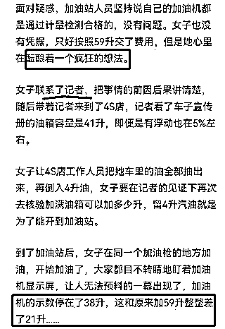

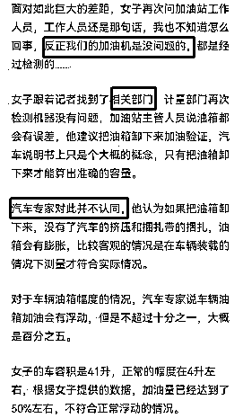

叙述过程中，多放一些能制造波折、抓住眼球的词，让读者的视线舍不得挪开。比如文章里写女子“酝酿着一个疯狂的想法”、在场的加油站员工“目不转睛”，再到女子找记者、找计量部门、咨询汽车专家——每个环节都在把矛盾推高，读者也就顺着你的思路一路看下去。

网友看：篇幅在200—300字。操作不难，去热门新闻账号的评论区翻几条高赞评论放进来就行。

网友观点可以四处收集，比如爆款文章里讨论最热烈的几条；如果你本身写过很多同类内容，心里早就攒了几种常见态度，也可以自己写。反正都叫“网友说的”，作者不用负责查证真伪，只要确保它能代表某个声音就行，正面、反面、中立角度都可以考虑。

最后再补一小段自己的简单看法，既有他者的观点，也有作者本人的态度，这一层就显得完整了。

说法律：再强调一句，写这类型不需要法律从业资格，只要援引的条文没有硬伤，就能支撑起一篇爆款。

平时可以多留意法律常识，刷知乎热榜时尤其方便——热榜问题下面的回答通常会顺手把相关法条列好，省得自己去翻；另外再存一点电子版法律资料，写作时按关键词查对应条文就行。这一步听上去麻烦，但在信息时代，只要会用基础检索，难度已经降到很低。这段的篇幅同样是400—800字。

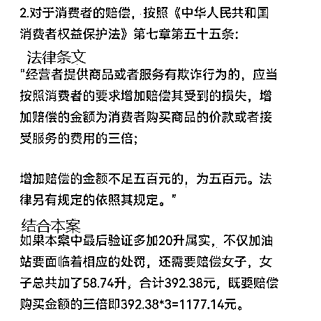

条文讲完后，还要结合本案做具体分析，说明按相关法条应该如何处罚。然后就是“怎么做”，放在倒数第二段，告诉读者遇到类似情况可以采取哪些动作，几句话足矣。

如果前面内容写得不够饱满，或者字数不够，这一段还能扩展成自己的经历：讲讲自己碰上类似事情时是怎么处理的。没经历过也可以合理安排，目的是唤起读者的共鸣。

最后收尾落在“引互动”，放在倒数第一段，抛两三个问题引导大家在留言区聊起来。

# 3.2.5 历史类：抛出问题，再作答

历史类公众号文章的底层逻辑，和头条的微头条、问答、文章完全一致：提出问题，回答问题。

两者最大的差异在题目上。头条的题目讲究深度和高度，要能概括文章、给人启发；公众号的题目则把重点放在视觉冲击和好奇心上，用夸张、勾人的表达制造新鲜感，让读者不点开就难受。

第一种写法：用人物结局的遗憾感或反转感做入口。

顺着人物的人生脉络往后写：出生、青年、中年、晚年，按时间线推进。每个阶段选一两段有代表性的事迹插进去，尤其晚年经历要写得尖锐一些，因为那是点题的部位。

第二种写法：用人物性格和事迹的反差制造惊讶。

主体风格不变，还是讲人物生平，但重点落到一两件具体故事上，聚焦性格的反面。比如人称善人的人做过恶事，一致好评的皇帝也办过糊涂事。读者熟悉的部分可以写，但只用少一半篇幅，把大部分力气留给那个不为人知的反面。

第三种写法：站在总结事件原委的视角，把一段复杂的往事梳理清楚，让读者看完之后生出敬意。

写历史类内容，思路其实和借势热点差不多：围绕一个话题，从多个侧面切进去。比如清代怎么保密，可以换着角度讲；也可以聊历代皇位怎么交接、帝王无嗣时各朝如何挑选接班人、传位给长子还是选贤能、子嗣多究竟利大还是弊大，等等。这些都能把同一个主题讲透。

4）历史文还有一条路，就是做人物盘点。

操作不难：挑那些和大众印象相反、能刷新认知的历史人物；或者罗列有建树的帝王、能征善战的将领、婚姻顺遂的女子、命途多舛的女子等。盘点类文章不讲究高深理论，通常一人配一段小故事，说得通就行。

# 3.2.6 情感类：爆文公式

情感故事类文章，可以套一个固定框架：题目、主角、情节主线、收尾，四块拼起来就是完整一篇。

再拆细一点：主线里得有目标或念想，也要有碰壁、受阻或者突发状况，最后最好再安排惊喜或翻转；收尾则交代结果。

换成大白话：谁，想干什么，为什么干、怎么干，干的过程中撞上了什么，最终落得什么结果。

动笔前先定主题，题目拟好，再顺着主题一路写下去。主角部分，交代清楚身份：叫什么、年龄多大、籍贯在哪、靠什么营生，让读者有个基本印象。然后再带出与主角有关的人或物——彼此什么关系、如何结识、对方是做什么的，也简单交代一下。主线部分，写清主角的诉求、发生了什么、卡在哪里，也就是目标、阻碍、意外这些要素。收尾要落在主角身上：这件事给他带来什么改变，他如何应对或本该如何应对，最后是什么结果。到这一步，故事就成型了。

想做出能爆的优质故事，有几条底线：题目抓人、内容自己写、能给读者新东西、不炒冷饭、不传递负面情绪。这五条都占住，才有机会冲上热门。多数人写故事喜欢用“我”的视角，读者代入感强。当然这不是死规矩，看个人习惯就好。

情节安排要分主次：和主题无关的，几笔带过；能刻画人物、推动剧情发展的，就舍得给篇幅。收尾不妨逆向操作，让读者觉得“没想到，但细想又合理”。举个例子：女方彩礼要得高，男方家闹着退婚——读者多半猜会散伙，我们偏写成两人还是把婚结了。至于为什么能结成，就得靠我们在中间设计一段反转来圆。

题材上，虚构可以，自己或朋友的经历也可以，但价值观必须正，不能踩伦理底线，也别输出负能量。

参考题目：
《除夕夜公公给我们100万，本是高兴的事，可被老公闹得家里鸡飞狗跳》
《我69岁，发现40岁保姆偷我钱，我要求她“肉偿”，她的反应吓傻我》
《我33岁阳了，老公连夜带着孩子逃了，半夜有人压在我身上，睁开眼我吓傻了》
《公公病危，儿媳献身，公公舒服，婆婆支持，老公发飙，结局意外》
《我51岁，二婚老婆夜班，继女爬上我的床，说难受让我帮帮她，我让她愉悦，老婆夸我真棒》

# 3.3 标题决定点击

# 💡

# 本节概要

做内容的人都知道，一篇文能不能被点开，标题占了大头，而点开量又直接牵动收入，所以标题这关绕不过去。

好消息是，起标题有现成的方法，核心叫「开幕雷击」——读者第一眼扫到，就被某句话或某个画面震一下，像被雷劈中，忍不住想点进去看个究竟。

接下来的内容，会用许多实例教你怎么把这个方法用起来。

# 3.3.1 开幕雷击

文章想拿到高阅读、高回报，标题必须能“勾人”，让读者第一眼就被吸住，产生点进去的念头。

要做到这一点，诀窍在于：把读者最关心的东西塞进标题，勾起他的好奇和欲望。

标题如果平平无奇，读者压根没有点开的冲动，那正文写得再漂亮也白搭——没人点，自然没收入。

所以起标题的关键，就是用好“开幕雷击”这个招数。

这个技巧最早是圈友 @半塘梦呓 在星球里分享的，他从微头条切入，讲怎样写出开篇就勾人点击的标题。想看原文的，可以找《半塘梦呓：如何用好开幕雷击》来读。

所谓开幕雷击，说白了就是读者一眼扫过去，看到一句让人吃惊的话，或者一个刺激的画面，像被电了一下。

我反复试下来，把这类标题里管用的元素汇总成七类：

1）钱、数字；

2）两性暗示；

3）暴力；

4）死亡；

5）走捷径；

6）反常、留悬念；

7）民族情绪。

七类里，“反常”最好用，几乎百试百灵。

这七类元素不只公众号能用，短视频、百家号、头条的图文问答和微头条，这些平台同样吃得开。

前提是别踩平台红线，在这个范围内，尽量把多个元素叠进标题。

不少朋友正文功底不差，卡就卡在开场不够“炸”；还有人把雷击误会成狗血、血腥、暴力，这方向就偏了。

那样写只会让读者反感，轻则被限流，重则被投诉举报，平台直接删文封号。

真正的雷击，只要让读者看到反常的言论或画面、心里“咯噔”一下、想探个究竟，就够了，核心是“跟常理拧着来”。

注意，不是直接把“震惊”“吓呆”这类词怼上去，更不能写“一刀下去鲜血四溅”“倒在血泊里”这种，而是绕着说，用含蓄的字眼让读者自己去脑补。

举个例子：某人的亲人去世了，按理该悲痛，他却一脸高兴。这就是反常，读者会忍不住点进去看：他为啥反而开心？

再比如：小店矿泉水单买3元一瓶，10元给3瓶，旁人都笑老板傻，于是都一瓶一瓶买，三瓶花9元。结果老板反而乐了。

这个标题里既有“钱”，也有“反常”。钱是明面上的钩子，反常在于——老板明明亏了，乐什么？换成你，是不是也想点进去弄明白？

记住：暴力、血腥、涉黄的画面别直写，小黄文更不能碰。要像隔层纱，字面上不露，让读者自己联想。别为了流量去试探平台底线，最后吃亏的是自己。

标题里只要凑齐七类元素中的两类，打开率基本就有底了；当然，叠得越多越稳。

# 3.3.2 标题技巧 @张波

a. 能爆的标题，通常具备这几样：
1. 戳情绪：让读者生出高兴、难过、气愤、好奇之类的感受。
2. 带数字：具体的数据显得真实，读者一眼就有概念。
3. 用重词：适度夸张或极端的表达，能把冲击力拉满。
4. 说得直白：重点一眼可见，读者才会迅速点开。

b. 一个常用公式：亮明主题＋制造冲突＋留下悬念。看两个例子：
- 47岁的我，搬进了丈夫的工地宿舍，被一群硬汉包围，晚上燃烧起了期待的火焰。
- 35岁新郎的一番话，让26岁新娘哭了：“你这二手货有什么好疼的？”

c. 润色时可以这么做：
1. 塞进自带流量的词，比如“疲惫不堪”“心满意足”“笑容满面”。
2. 用具体的描写搭出场景、立住人物，再靠反转或悬念把吸引力提上去。例如：
原标题：50岁单身汉，被46岁寡妇骗进家，干完体力活后偷偷跑回了家
改后：50岁单身汉，被46岁寡妇骗进家，干完体力活后寡妇却笑容满面。
又比如：新娘缺席婚宴，丈夫报复性分居十几年，妻子的态度坚定，一直未变
改后：新娘缺席婚宴，丈夫报复性分居十几年，妻子晚上却笑容满面等着隔壁老汉的反击。
再比如：怀孕的妻子被婆婆安排去旅游，丈夫一招架醒她，却引发了一场结局
改后：怀孕了，婆婆安排去旅游，丈夫一巴掌把我扇醒，结局却让我如愿以偿。
还有：45岁美女房东求助28岁小伙修水管，修好后却有了意外收获
改后：45岁美女房东晚上求助28岁小伙修水管，修好后虽疲惫不堪却体验了不寻常的快乐。

内容来源：《GPT辅助公众号矩阵爆文写作，3个月实现收益10万+的复盘》

# 3.3.3 标题示例 @张波

下面归纳几类常见标题模板。

1. 抛问题：人物＋为何＋事件；人物＋经历＋凭什么。比如《千聊，荔枝有那么多的育儿课，凭什么李老师的课卖的最爆？》《14岁辍学，29岁身价过亿，这个90后女孩凭什么》。

2. 把话说到一半，吊胃口：如何／为何＋事实＋反转。例如《如何用10秒钟，把堵塞的鼻子变通畅？用它喷一喷，舒服一整天！》《为什么孩子越大越不愿意和你交流？99%的家长都不知道》。

3. 用数字说话：数字＋事实＋好处。如《我这里有200页重磅PPT，20个压箱底文案小技巧等你来领取》。

4. 借热点：把热话题嵌进标题。《杭州亚运会开幕，但你还记得33年前在北京唱亚洲雄风的刘欢如今苍老成这样？》

5. 做对比：靠反差造张力。《真正聪明的人，往往很少交朋友》《35岁月薪3500，你拿什么安身立命》《为什么方便面就有大品牌，挂面却没有》《总是踩点进入办公司的人，一年后和提前5分钟进入办公司的人差在哪》。

6. 打权威、卖独家：《人民日报》：人之所以要努力，是为了当自己遇到喜欢的人和事的时候，除了一片真心，还有拿得出手的东西；《张小龙首次公开演讲，官方无删减版》；《离职前，我把运营黄埔军校阿狸的干货都供了出来》。一句话，能让人点开的标题往往特别口语、甚至有点“土”，不需要文采，换个说法即可。

7. 钱＋悬念＋反常的组合：
1）《我65岁，再婚老伴每月退休金9000，直到外孙生日，才发现老伴骗了我》——钱和悬念都占，爆了40万+阅读，收益3000多块；发到头条，也有35万。
2）《我63岁，后老伴每月给我5000块零花，3个月后，我一天都不想和他过了》——钱＋反常，公众号20多万阅读，进账2000多块；头条分发也爆了80万。
3）《从负债3000万到百亿富豪，他用同一个套路，骗了我们5次》——钱＋捷径，137万次阅读。
4）《表妹是做电商的，又借助了直播的风口，亲戚们都说她年入1000000，今天我去找她想学学怎么做电商，表妹却对我连连叫苦》——钱＋反常。
5）《年薪80万，坐标北京，金融气质女，29岁，主动表白。竟然被年薪30万的二本男给拒绝了》——钱＋反常。

8. 反常＋悬念：
1）《知否：梁晗娶墨兰为妻，不是盛祖母面子大，而是因把柄太大》——悬念，3.6W阅读，收益180+。
2）《知否：明兰不知，顾廷烨与贺弘文求娶她目的相同》——悬念，3.8W阅读，收益200+。
3）《知否：嫁到齐家做当家主母的盛小六，她才是真正的狠角色》——反常＋悬念，3.7W+阅读，收益190+。

9. 两性暗示＋悬念：
1）《知否：看到曹锦绣胸口半敞求欢，才懂贺家为什么不要明兰》——两性暗示＋悬念，17W+阅读，收益800+。
2）《我33岁阳了，老公连夜带着孩子逃了，半夜有人压在我身上，睁开眼我吓傻了》——150W+阅读，收益11000+。
3）《52岁保姆伺候32岁小伙三个月后，突然怀孕，小伙说不是他的，我大骂：不要脸，结果出乎意料》——1000W+阅读，收益63000+。
4）《24岁保姆伺候59岁老头半年，老头每天摸她脸，得知真相后，保姆说甘愿照顾他一辈子》——800W+阅读，收益32000+。
5）《老公不在家，公公半夜让我满足要求，掏出3万块，结局意外》——45W+阅读，收益6400+。

标题起得好，点进来的人就多；人多了，流量和收益自然跟着涨。

# 3.3.4 点击率>70% 的标题秘诀@开卷🌀

做自媒体，选题决定生死，而打开率的大头则压在标题上。

我自己的主号，爆文点击率能到七成以上，配图多是免费通用图，所以七成这个成绩，功劳基本在标题。

处理爆款标题，我通常两种做法：照搬，或者按经验改造。

# 3.3.4.1 直接拿来用

不少人觉得用别人的标题心里过不去。换个角度想：小时候写命题作文，题目是老师定的，你不也照样写？同理，遇到好选题、对方标题也合适，就把它当成命题作文，围绕同一个话题讲你自己的看法。

小红书上有一些反复被验证的选题，比如：

一个普通女孩的十年

99年自媒体一年，一个人赚了30W

我发现，不上班的出路比你想象的多

这些选题在各平台、各领域都算经典。写它们不等于抄袭——鲁迅写了《纪念刘和珍君》，别人当然也能写《记念刘和珍君》，只要不是照抄或洗稿他的文章，谁都可以动笔。

# 3.3.4.2 按经验改造

上面说“觉得对方标题不错就用”，可新手常常卡在判断上：到底什么算不错？我以前做小红书，见过有人把好好的爆款标题改成白开水，理由是“这样才是原创，跟别人不一样”。

原创没错，但原创也得有思考。我的做法是问自己：这个标题里，有没有踩中“开幕雷击”七要素中的两个？

如果选题本身可以、标题还有提升空间，我就按“开幕雷击元素＋爆款标题套路”重新打磨。

这些经验，来自大量刷对标账号——不只看公众号，抖音、小红书同方向的爆款也值得刷。

还有一个常见误区：既然选题定生死，那标题随便、内容好就行，对吗？

想象一下，面前两位女孩，一位从头到脚收拾得精致，一位头发乱、衣服皱，你会先跟谁搭话？道理一样。

标题和封面是门面，相当于人的外在；选题则是内在灵魂。有句话你应该听过：没人有义务从你随意的外表里，去发现你讲究的灵魂。

标题和配图能有多大威力，刷过小红书的人都有体会——精致、高级，本身就是一种吸引力。

内容来源：《公众号新手实现百万爆文，单篇收益6000+，单账号变现5位数》

# 四、【项目实操 3/3】公众号如何变现

# 💡

# 本章要点

公众号靠阅读量挣钱，说到底做的是流量买卖。它的长尾效应明显，文章发出去很久，仍可能持续带来流量。建议篇幅写到一千二百字以上，这样能放两条广告，收益更可观。

还有一点省心：收益不用手动提现，每月会自动打进你开通流量主时绑定的银行卡，次月1号和15号各到一笔账。哪怕只有一分钱，也照打不误。

眼下公众号爆文的变现路子主要有两条：广告和打赏。广告是大头，打赏更像偶尔加个菜。本章会把这两种方式拆开讲，供各位参考。

另外，本章聚焦变现，所以不安排航线图任务。

# 4.1 收益从哪来

公众号的收入跟阅读量挂钩，也就是大家常说的流量：流量越大，进账越多。而且它的长尾很足，老文章也可能持续贡献流量。

不过单价并不是固定的，广告曝光量、点击量、完读率等都会影响它。

篇幅上有个小技巧：尽量写到一千二百字往上，正文里就能塞两条广告，收益更高；如果只有八百字左右，就只能放一条。

# 4.2 变现的两条路

公众号的变现路子，主要分两类：
1. 广告收入（主要）
2. 打赏收入（次要）

# 4.2.1 广告收入（主要）

所谓广告变现，就是在文章里挂广告——小程序、游戏、电商卡片都算。读者点击，或者点进去后产生消费，你都能分到钱；还有一种情况，整篇文章本身就是软广。具体有四种玩法。

# 方式一：自己接单

先关注“新榜有赚”这个公众号，里面的赚钱门路不少，有分销，也有文案类。像《刘小念》那种号每天发的，就是按阅读量结算，一个阅读大约四毛。投放时长要求不一，有的允许24小时后删，有的能长期挂着。新榜里有教程，可以自己研究。

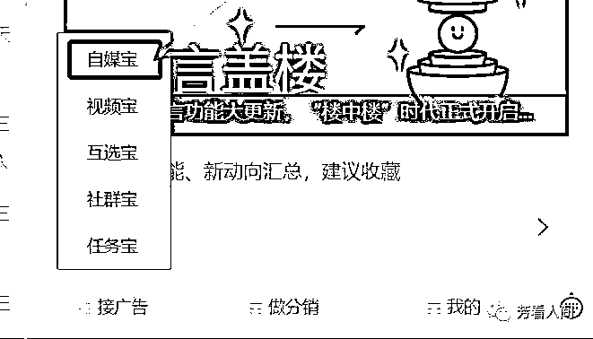

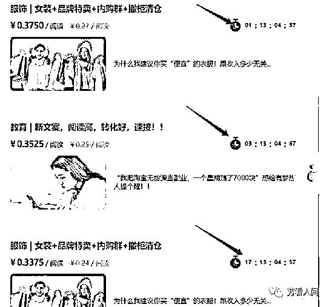

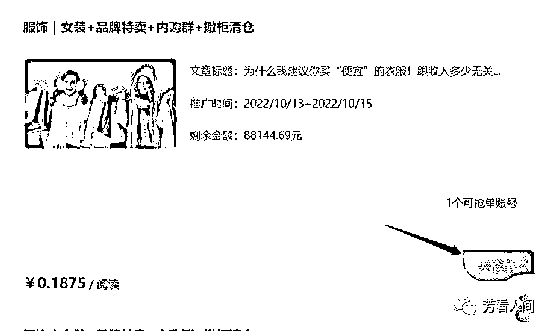

照系统提示，按上面那些图一步步走就行。抢到单后，在商家规定的时间内把文案发到自己的公众号，收益就会慢慢进来。钱到账后能直接提到微信，速度很快，基本秒到。我自己只发过两篇，都是24小时可删的类型，每篇进账八百多。后来觉得有点消耗粉丝，就停了；等粉丝基数再大些，再考虑试试。“新榜有赚”里还有别的赚钱方式，有空可以慢慢琢磨。我亲自试过的就是这种按阅读结算的文案单，其他玩法我没碰过，留给大家自己探索。

# 方式二：商家上门投广

商家通常会在后台留“商务合作”，再加微信议价。一般由我们先报价，对方提供文案，我们复制粘贴发布即可。费用按位置分头条、二条、三条，头条最贵，往往两千以上一篇。这类广告要挑着接。先看对方文案写的是什么，碰到涉黄、涉赌、封建迷信的，坚决不接，免得号被封。价格大致如下表，具体要求和实际报价，以你跟商家谈的结果为准。

# 方式三：文中挂货 @徐胖子

公众号带货十年前火过一阵，这几年短视频带货起来了，纯文字带货的效率确实在降。但也别急着下结论，这条路仍有做头。为什么还能做？至少有四点优势。

第一，流量盘子大。圈友@渭水徐公 的公众号训练营已经办到第七期，十万加爆款累计一千篇以上，阅读过万的小爆款更是不计其数。一个号每天发八篇，每篇最多挂十款产品，八篇就是八十款。只要其中一款卖爆，收入就很可观。

第二，创作自由度高，图文和商品的关联不必太紧。比如你写情感领域，学习类、励志类、文学类、情感类书籍都能带；吃的用的，也照样能挂。

第三，佣金空间大。带什么货可以自己找商家谈，书籍佣金最高能到五成，水果、蜂蜜这类也普遍不低于两成。

# 第四：结算走官方，佣金到账有底

钱的部分先讲。平台官方负责结算，流量主收益有保障，佣金发放节奏也快，不必自己折腾。用户下单并确认收货后，带货佣金进入结算，创作者后台可查明细，最后由官方打款，整条记录在后台都能追溯。

操作顺序可以这样安排：注册公众号并入驻；粉丝数到500以上，核对财务结算资料，提交流量主申请；审核一般3到5个工作日，资料没问题当天通过的情况也常见。流量主开通后，再开返佣商品广告，进入推广商品，把返佣商品广告放进文章，发布并转发，收益就来了。

公众号带货跟头条带货思路一致：正文涉及某类商品关键词，就在相应位置插入对应商品。

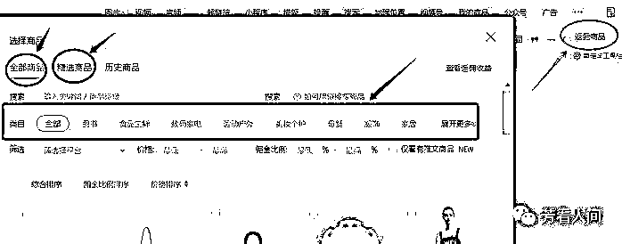

单篇推文最多放10款商品。读者点卡片会进入小程序，直接下单；实际成交后，流量主按销售分成拿钱。

无论何时带货，带书、日用品还是水果，都可以照着这个框架写：开头用故事引入，中段从故事转到话题，再介绍商品，最后引导下单。具体写法可参考3月6日《如何在公众号带货》@徐胖子的分享。

# 方式四：文末贴片广告带货

扫码注册有赞分销商，挑想卖的产品，生成超链接，贴到文章末尾。

超链接不会做，可找客服代做，但要把有赞账户密码告知对方；我这边就是客服帮忙做的。客服微信扫码可加。

注意：账号未起量前，发文页面尽量干净，别堆太多花活。等粉丝多了，再按受众年龄调整：年轻读者可稍微活泼些，年长读者保持清爽。常见做法是头图一张，甚至不放图，正文用分隔符隔开。分隔符别太密，大约两三百字一个，少于200字或多于300字都不合适。

# 4.2.2 打赏变现（次要）

流量主开通后，先以原创形式群发3篇文章，打赏权限就会开放。账号名、头像与打赏入口的名称、头像尽量统一，人设会更可信。

打赏收入通常出现在IP感强、人设稳的账号里，个别文章下可能出现较高金额。它更适合作为补充渠道，不是主力变现方式；开通后偶尔添点零花也不错。

# 4.3 公众号提现

公众号收益不用手动提现。系统会按月打入开通流量主时绑定的银行卡，每月两次，分别是1号和15号，本月结算上月。

哪怕只有一分钱，也会按时到账。每月1号、15号可打开手机银行查看，偶尔有延迟，但不会缺席。到账为税后金额，已扣除20%个税。

# 五、复盘优化：降本增效，把爆款做成连续剧

# 💡

# 本章要讲什么

前面解决的是单篇爆款怎么写。这里要解决的是：怎样一篇接一篇地持续产出。

公众号爆文既考验文案，也考验体力。只有不断拿出具备爆款潜力的内容，收入才可能稳定。

办法就是降本增效：压低创作成本，提高创作效率。本章围绕这两件事展开。

降成本：第一节讲素材库，通过平时记录，让写作提速，也让选题不断供。

提效率：第二节自检与复盘，靠迭代增强爆款能力；第三节快速入池技巧，用验证过的方法增加被算法推进流量池的机会；第四节写作避坑指南，提前熟悉规则，避免爆款中途折掉，减少浪费。

好，进入本章。

# 💡

# 本章路线

学完并实操本章，可完成路线图第三阶段：复盘&优化，约1小时。

1. 复盘并优化已发文章，约1小时。

# 5.1 素材库怎么搭，写作才能快

做自媒体想日更，绕不开一个问题：天天写，素材从哪里来？没有素材库的人，写一篇故事就要想半天，连续更新一个月更吃力。

素材库既给灵感，也明显提速。这里讲渠道和搭建方式。

# 5.1.1 职场类素材怎么找@枫宇翔

职场内容渠道不少，最值得刷的是脉脉。它是职场向APP，职场人会在里面吐槽、分享，容易引发共鸣，多刷有收获。

比如“入职SHEIN后，终于知道大家为什么劝退”这一类内容，一眼就能抓人。除了吐槽，也有人发争议话题，讨论往往很热。

脉脉之外，BOSS直聘等招聘APP的评论区，豆瓣、知乎、微头条等平台，都有职场内容可挖。抖音、快手的高赞职场视频，评论区也常藏着素材。公众号里同样有大量信息，搜“职场”这个关键词即可。

某个素材要不要用，看点赞、评论等数据。数据好就写；自己没感觉也可以写，数据经过市场验证，比个人喜好更可靠。

# 5.1.2 热点类：热榜之外也有金矿

热点通常来自微博热榜、今日头条热榜、知乎热榜等，可选题目很多。

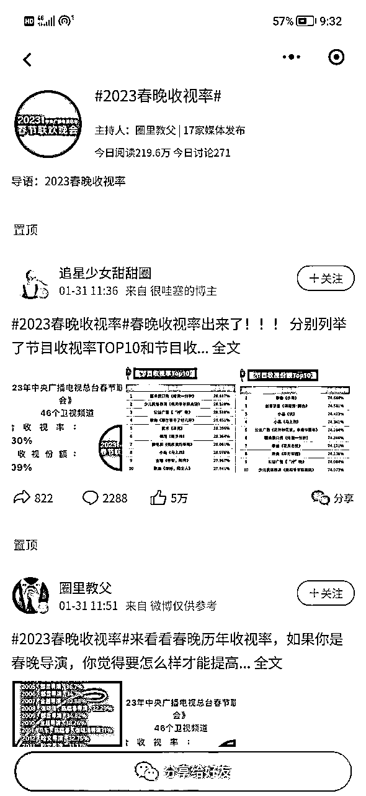

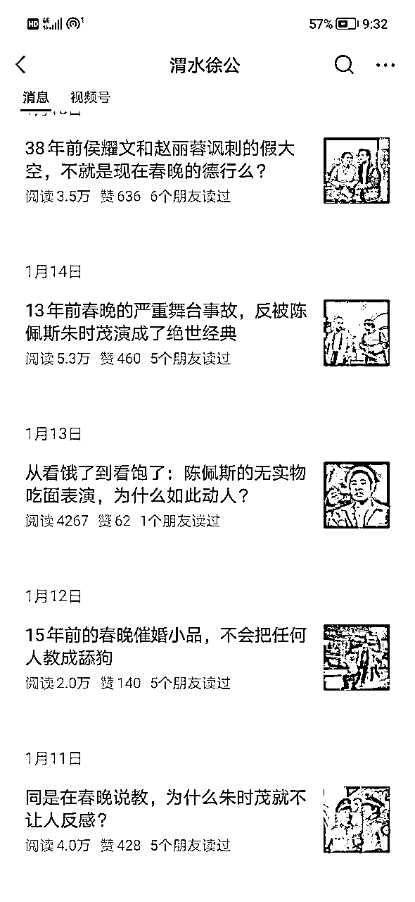

不过热榜内容常被修饰过，不能照单全收，要判断大众真正关心什么。有些知乎高赞回答流量很好，却未必上热榜；这类内容反而更值得写，出爆款概率也更高。它们是一个赞一个赞顶出来的，没有热榜加持仍有人关注，说明需求真实。选素材就该选这种有痛感、有讨论度的内容。

# 5.1.3 剧评类：一部剧能拆出多篇

剧评的好处是选题不缺，只要做三件事：

1）看剧时把打动自己的片段、台词截图，存进素材库；
2）找电视剧的高光情节；
3）拿剧和原著对照，把差异、冲突和狗血点写出来。

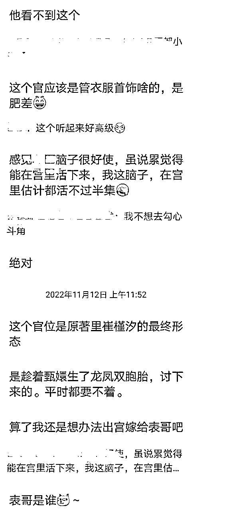

以《知否》或《甄嬛传》为例，这两部剧热度和口碑都在线。盛祖母对明兰的教导、明兰对生活的感慨，都能延伸出不少角度。

《知否》里淑兰和离那场戏，至少能拆出三篇甚至更多。

先交代背景：淑兰出自经商的盛家大房，带着厚嫁妆嫁给穷秀才孙志高。婚后婆家花她的嫁妆，还百般刁难。后来孙志高要带风尘女子回家做妾，盛家大房震怒，和离才被摆上台面。

三个切入方向：

①淑兰为什么能离成？古代男权社会里，孙志高没有做出太出格的事，淑兰其实不占优势。可以深挖娘家支持：他们不在乎名声受损，只想让淑兰脱身；也可以写女性自身立不起来的代价——淑兰有丰厚嫁妆，养着孙家，却被磨得像老妪，根子在她太软弱。

②孙志高凭什么敢和盛家叫板？根本在于经商之家在当时不如读书人家庭地位高；孙家一无所有，真撕破脸，光脚的不怕穿鞋的；再者，两家翻脸不只是两个家庭的事，而是两个家族交恶。家族至上的环境里，盛家即便和离，也得顾及孙家宗族。

③明兰帮淑兰和离后，祖母那番话暗示了她和小公爷的结局。这条线可写更多：齐衡与明兰私下有情，却注定走不到一起。家世上，齐家是国公府，齐衡又是独子，背负平宁郡主的期望；盛家只是五品小官，明兰还是庶女。齐衡喜欢明兰，却没有为感情争取的魄力，不敢违逆母亲。平宁郡主也看不上明兰，真要出手，办法很多。

一场高光戏就能写出三篇以上，爱看剧的人做剧评，选题确实不缺。

# 5.1.4 法律类：从官媒、热榜到裁判文书

新闻渠道之一：北青网、1818黄金眼等官媒，信息相对可靠，也适合改写。

渠道之二：头条新闻热榜和地方热榜。

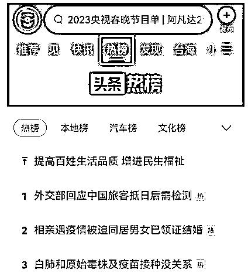

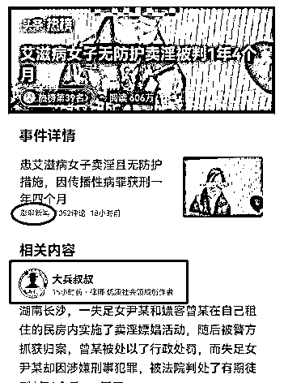

点开热榜详情，通常能看到官方媒体报道。例如“艾滋病女子卖淫无防护被判刑”这条，来源是澎湃新闻。可以顺带关注澎湃新闻，其他热点也点进去看源头媒体。久而久之，相关媒体资源就攒起来了，查资料更方便。热榜下方还有不少法律人写的同题文章，可作参考。

有些律师账号会标注“抄袭必究”，比如大兵叔叔。可以学他的结构，但不能照搬，否则头条可能判为相似作品，只推荐给粉丝，甚至招来投诉，不划算。

渠道之三：裁判文书网。

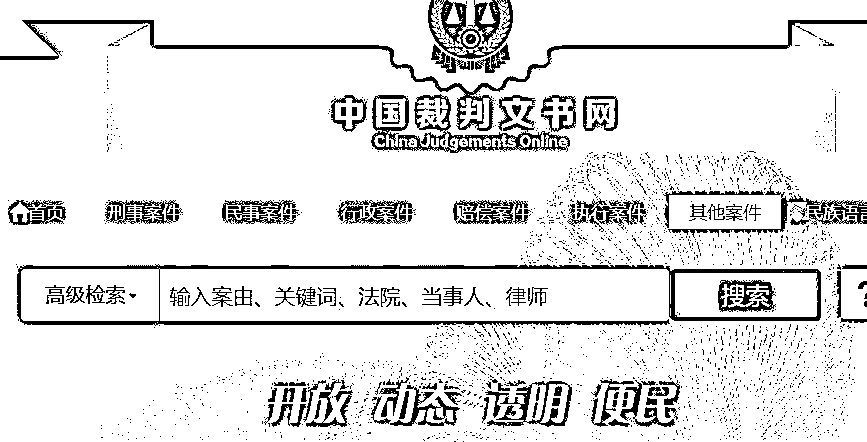

上面有大量已判决案件，可以当写作资料。注意把涉案人姓名做模糊处理，不能直接写真名：一是保护当事人，二是避免投诉。

# 5.1.5 历史类：故事感就是流量

历史素材不难找。大家从小读历史，新奇故事很多；帝王将相、平民百姓，将军出征、女子出嫁，都能写。人天生爱听故事，用惊险、紧张、圆满、愤怒或搞笑的情节抓人，是很好的方向。

来源也广：影视剧、百家讲坛、历史大V讲解都可以。看到某个人物素材，还能继续追他后来的命运——观众只看到历史一瞬，我们能把完整人生铺开。

刷头条、百家号时也会碰到历史小故事，都能进素材库。B站有几位历史老师值得看：文大郎讲三国很稳，正直讲史擅长清朝，直男文史课用漫画讲历史，轻松有趣，御史房做综合分享，分析周全。

重点推荐喜马拉雅，上面几乎收全了百家讲坛。写故事先要理解故事，通勤或无聊时点开一集，老师会用通俗方式讲清一段历史，素材来源靠谱，思想也有深度，写起来顺手。

我常听百家讲坛，分享几个常听的节目。

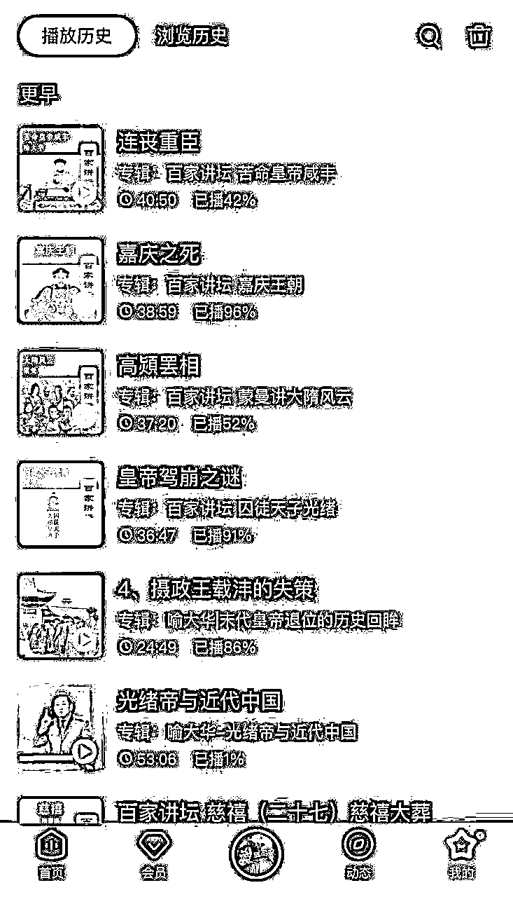

# 5.1.6 情感类：身边事和评论区都能挖

情感素材的渠道很多：自己身边、亲戚朋友、邻居的经历；网络上的知乎、抖音、百度、头条等。生活中遇到触动你的事或话，网上刷到有意思的片段，随手记下来。读者积累到一定数量后，可以设置自动回复留下微信号，让读者来倾诉，素材也会源源不断。平时读书看报遇到好词好句、新奇故事，影视剧和小说情节，也都能入库。宝藏到处有，关键是会不会发现。

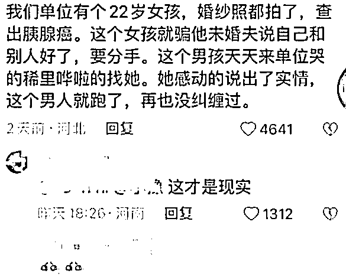

这里重点讲两条路：亲友讲述和短视频平台@Ray。

1）亲友讲述

故事常常就在生活里。前阵子和亲戚吃饭，我发现二姨很爱聊村里的事，而且知道得细。她说村里有个已婚妇女，两个孩子，为了生计去大城市打工，后来跟别人在一起，还生了孩子，逢年过节不回家。最后和原配离婚，两个孩子留在老家由老人带，父母都不管，挺可怜。

要不是亲戚亲口说，我很难相信。以前总觉得这种情节只存在于电视剧、小说或新闻里，没想到离自己这么近。于是我想到，抖音上情感纠纷新闻的评论区，常有人讲自己的经历或身边故事，能不能拿来用？这就是第二条路。

2）短视频平台与评论区

核心做法是：用关键词搜各平台情感故事，同时追后续、翻评论区引申故事，把素材库撑大。

步骤可以这样：先按关键词搜，比如“婆婆”；再筛视频，优先找新闻媒体发的，媒体号自带流量；如果纠纷没结果，就搜“XXX后续”；情感纠纷视频下常有人分享经历，可作参考；情感节目也能用，比如《爱情保卫战》，后面还会提到《老娘舅》；不知道节目名，就搜“情感纠纷节目”。

我的具体做法：在抖音搜关键词。我觉得婆媳关系在情感故事里占比高，就搜“婆婆”，再加情绪词或动词，相关视频很多。

搜到后不能直接用，要筛。个人用户发的很多是剧本演绎，优点是受众明确、已被验证，但素材可能旧，或是别的平台爆文改编，直接照用阅读量未必好。另一类是媒体新闻视频，媒体号常转发视频再加标题，性质和营销号接近，但媒体号有流量，评论区往往很精彩。

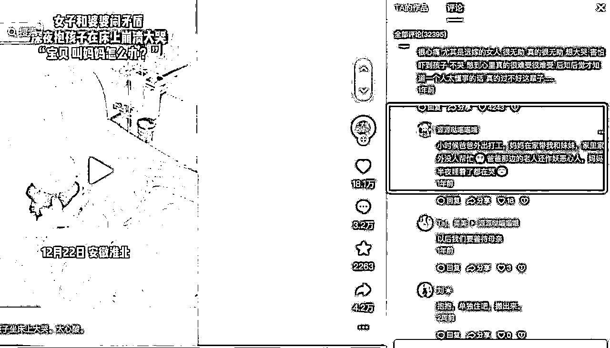

比如大象新闻这条，18万赞，评论区32395条，说明共鸣很强。有网友会讲自己的亲身经历。我图中圈出的评论虽然简单，但已经能当素材。继续搜，又找到前段时间的新闻。

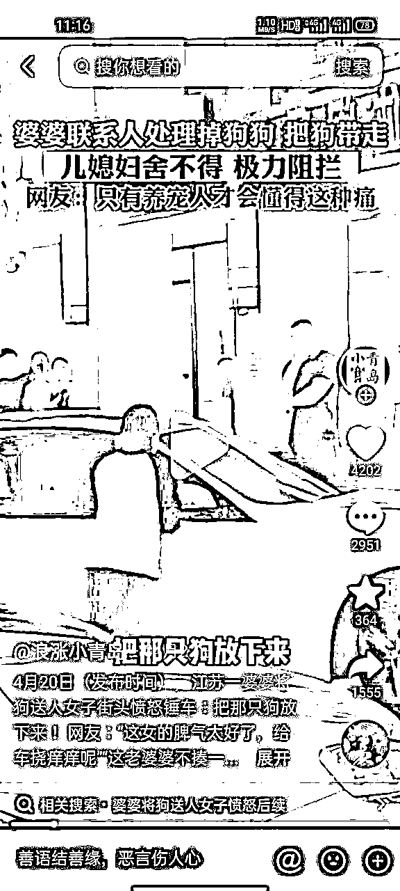

搜索下拉框出现“XXXX事件后续”，说明大家关心结局。我也好奇搜了，没找到后续。老办法，打开评论区，仍有相关评论。这位网友的评论是最新发的，素材同样可用。搜索时很多人提到“曹心柔”，我顺手一搜，内容很精彩。

那是一个情感调解视频：恶婆婆打断儿媳手臂，还和两个女儿把儿媳赶走；后来儿子娶的第二个儿媳很厉害，把两个小姑子赶出家门。后面不展开，可以自己看。视频评论区里，佩服的人不少，也有人分享身边经历。

这条评论是我搜索前20分钟刚发的，仍然需要改编。我在B站搜曹心柔相关内容时，也找到了调解视频的源头，里面故事素材很多。把这类新闻放到抖音搜，再看看视频下有没有网友评论。

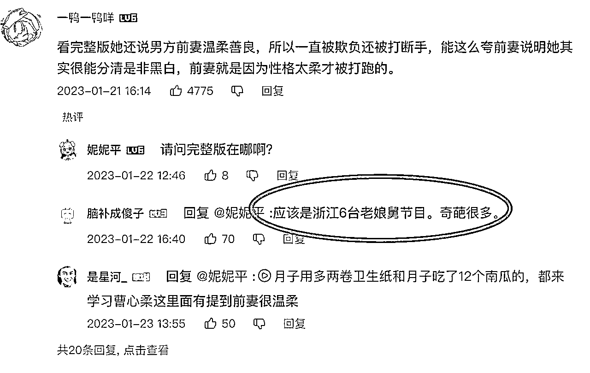

素材到手后，就可以进入故事创作。

内容来源：5月25日《抖音平台挖掘情感素材，网友评论也能出爆文》@Ray。

# 5.1.7 把素材库搭起来

渠道多了，素材就会源源不断。把它们按类别整理成库，写作时直接挑合适的进行整合。

以情感类为例。可参考几个对标号：写故事的刘小念、陈若鱼、猪小浅。她们都写故事，路数略有差异，可以模仿写法，也能从她们账号里找素材和爆款标题。

「3.2.6 情感类：爆文模板」会讲正文框架：一个故事=标题+主人公+故事主干+结局。

展开就是：标题+主人公+主干（梦想或目标、挫折阻碍或意外、惊喜或反转）+结局。

再拆细：谁～想做什么～为什么做或怎么做～过程中遇到什么～结果如何。

动笔前先定主题，再拟标题，然后围绕主题往下写。

主人公部分：我是谁、年龄、籍贯、职业等，简单交代基本情况即可。

# 六库在手，故事不愁

编故事别急着下笔，先搭三层：第一层，配角或关键物件是谁，和主角怎么搭上关系、靠什么吃饭、底细如何；第二层，主线怎么走，主角图什么、路上撞见什么、卡在哪儿，包含愿望、拦路石和突发变故；第三层，收束到哪儿，这件事给主角留下什么、他如何应对或本该如何、最后落到什么结果。照这个路子归置材料，一个可反复调用的库就成型了。

原料并不难找：新闻热点、身边真事、小说与影视、文学读物、各内容平台，都能拿来用。想让同一批材料反复出力，先分六类存放，后面混搭调用，成稿会快很多。

## 1、标题库

看到反常、带悬念、让人手痒想点的题眼，立刻收进去。例如：

1）六十六岁，退休金每月八千，儿孙都在身边，我却动过轻生念头；
2）母亲临终那段话听完，我这一生都没法走进婚姻；
3）我与堂哥偷偷相恋二十年，收场谁也没料到；
4）六十八岁大病一场才懂，有些东西得攥牢，比亲生骨肉更靠得住。

这类题眼共性是反常、冲击强、勾人点击。

## 2、主人公库

从报道、新闻、八卦、小说影视、身边事里抓人物，放进库中待用。例如：

1）小佳，十八岁，没办婚礼先做了母亲；
2）小爱，被不孕困扰；
3）四十岁未婚，身边仍不缺女性主动靠近的单身汉；
4）五十五岁阿姨生下第三个孩子；
5）五十多岁阿姨二婚，开口要百万彩礼。

这些人物带争议、带反常，容易撑起情节。

故事主干可拆成三个子仓：目标仓、挫折意外仓、反转仓。来源同上，把人物想要什么、被什么绊住、哪一刻翻盘分别记下。

## 3、梦想或目标库

比如：盼着添丁的夫妻；为婚房发愁的小两口；想寻晚年伴侣的大爷；二胎非要男孩的家庭；打算盘下美容院的人。

## 4、挫折、阻碍或意外库

比如：多年恩爱却迟迟没有孩子，检查也找不出原因；铺租猛涨；恋爱多年，卡在彩礼或房子上被长辈拦下；跳着舞忽然中风；感情正浓，一方带着钱消失；夫妻相伴多年，对方冷不丁提离婚。

## 5、惊喜或反转库

比如：老家遇拆迁，补了钱和房；女方父母原本要五十万彩礼，忽然降到八万；失散多年的儿子开宝马回来了；多年怀不上的女子三年后有了身孕；房东主动降租。

## 6、结局库

比如：复婚；分开；一家和乐；儿子接去养老；找到合拍老伴度晚年；住进养老机构；夫妻感情更浓。

六类分仓建好，几分钟就能搭出骨架。拿库里的 1、5、2、4、5、3 来组合：小佳十八岁未婚先育（人物 1），心心念念想开美容院（目标 5），手头仅八万，看中月租七万的铺面，房东却抬到九万（意外 2）；她刚想打退堂鼓，房东中风（意外 4），其子女不愿掏医药费，急着把铺子脱手，降到六万租给她（反转 5）。八年后，美容院做成连锁，孩子父亲也回来，一家团圆（结局 3）。这样初稿就有一波三折，还带真实感，容易让人共鸣。

若不想写故事，想写观点鸡汤文，可以用三个小故事，每个故事后面接观点、名言或金句；再设一个观点名言金句仓即可。

有了骨架，再补细节、对话、动作和心理活动，就能写成有血有肉的文章。情节要曲折，起承转合要清楚；仓里的人物、目标、挫折、反转、结局可以打乱重组，稍作调整就是新故事。比如小佳用了 1、5、2、4、5、3，也可以换其他组合，只需微调。

再举个简单例子：主角小爱二十六岁，做财务；小王二十九岁，跑业务，两人是夫妻。目标 1：想生个孩子；挫折 1：婚后三年没怀上，看医生、吃药都没用，后来认命停治；反转 4：一年后意外有孕；结局 7：夫妻更恩爱。串起来就是雏形：

我叫小爱，二十六岁，做财务；丈夫小王二十九岁，跑业务。我们婚后三年多一直盼孩子，没避孕也没动静。医院跑了不少，药也吃了不少，仍无结果。后来我们不再折腾，谁知一年后竟怀上了。

这样字数少，不够吸引人，要往里填细节、对话、动作、心理，情节越曲折越好。成稿后 @自己，补上总结观点或感悟，再向读者抛一个问题：可以问读者认不认同你的观点，也可以问对故事里的事怎么看。这个观点、感悟和问题不能省。比如小爱这个故事，可以给观点：备孕受阻的夫妻别灰心，配合治疗、心态放松，转机仍可能出现。再问读者：你周围有没有类似夫妻？他们后来如愿了吗？如果能引用鸡汤、名人名言、影视或书里的金句，就更好了。

以后看电影、看新闻、看书、刷剧、刷视频时，把抓眼球的题眼、核心人物、欲望、拦路石、翻盘点、最终归宿这六类要素提取出来，分类放进仓里，要用时直接拿，就不怕没素材。

说白了，采买像逛超市，合眼缘就丢进购物车；归档像回家把菜分装进冷藏格，要煮时随手拿；成文像下厨，食材可自由搭配。至于大家爱吃什么菜、喝什么汤，众口难调，多试几回才知道。

注意：故事主干和情节要详略得当。与主题无关的略写；能体现人物性格、推动故事的详写。结尾尽量反着来，让读者产生意料之外、情理之中的感受。主干多用动词、大白话，形容词能省则省；用连续动作制造画面感和代入感，让读者感同身受、产生共鸣。语言要简练，比如“月工资一百元”“一个月挣一百块”；带入场景，多用动词加名词，穿插转折词和连接词。

还有，别抄袭，别抄袭，别抄袭——标题也一样。可以模仿思路，不能照搬文字，一定自己动脑改。内容尽量贴近生活、温情、正能量，别太狗血、太暴力；有违公序良俗、乱伦、色情的内容千万别碰。

我用 Excel 建仓，再导入印象笔记，因为表格看着直观；大家用什么顺手就用什么。

上面这张图就是我的素材仓。里面的材料互相交叉、搭配，能写出很多不同故事。六十个素材一年都写不完，当然收集得越多越好。

# 5.2 发文前后：自检清单与数据复盘

# 5.2.1 发布前先过一遍自检关

1）文章尽量快短平：尽快入题，句子短，最好平叙。
2）读者多在休闲中想学点东西，不愿费脑，偏爱浅白文字；太文绉绉反而不讨喜，用大白话写就好。
3）单句尽量不超过十五个字，段落里别堆太多话，两三句即可。
4）检查病句，主谓宾是否齐全；段尾和下一段开头是否承接。做到这些，阅读体验会更顺。
5）要有避坑意识，知道什么能写、什么不能写。写了违禁内容，时间花了没收益，还可能封号，白忙一场。政治相关别碰，记住“党史”“军史”两个词；黄赌毒也不能写。
6）最后看开头有没有“开幕雷击”，冲击力、画面感够不够；不够就优化到 OK。

打开爆款之路后，粉丝和收益会慢慢来；能举一反三，在其他平台也可能有惊喜，一份内容多平台吃。

# 5.2.2 复盘怎么看数据 @枫宇翔

文章复盘主要看完读率、渠道构成、用户画像、数据趋势，这些是微信公众平台后台给的数据。

电脑打开微信公众平台后台，点“数据=>内容分析”，就能看到已发文章；点详情可看各项数据。

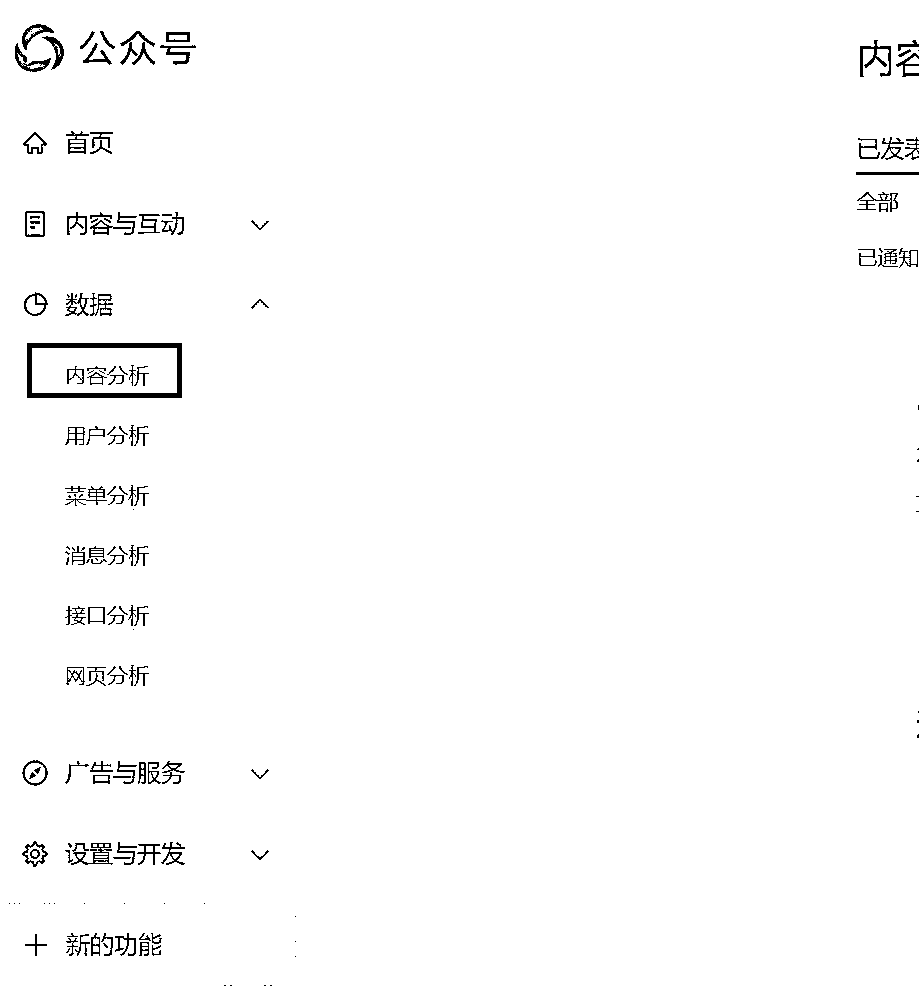

第一，完读率。这个指标很重要。我有一篇阅读二十万，收益六百多；另一个人同样阅读量，收益三百多，差别就在完读率。读者读完，才能拿到文中两个广告和底部一个广告的收益；读完的人越多，完读率越高，收益也越高。比如浏览到百分之百时跳出比例是百分之五十二，完读率就是百分之五十二，约一半人没看完，说明内容还不够吸引人。我会把精彩内容放在后面，前面做引导，比如“详细数据在文末，感兴趣可到文末查看”；字数太多就有意识压缩，提高完读率。若阅读量高，但用户在浏览百分之三十至四十处跳出比例约一半，等于一半人只看了一个广告就走，很少看完三个广告，阅读再高收益也少，下篇要及时调整。

第二，渠道构成。看用户主要从哪来。推荐多，说明文章进了流量池，不错；搜一搜多，说明没进推荐池，可能碰到某个节点，热度过了会断崖式下跌。这时别急躁，继续日更。朋友圈、公众号消息占比通常不大，我不太关注。

第三，用户画像。包括性别、年龄、地域分布。性别看男粉多还是女粉多；年龄看哪个年龄段多。比如我的数据是三十六岁以上男粉居多，内容就更偏向这个群体，游戏、时尚之类不放。也会有意识地按赛道和用户了解去测试相关选题，看能否提高阅读。地域能看出哪里爱看你的文章，广东居多就多写广东内容，增加爆款概率。

第四，数据趋势。这个也稍微关注。

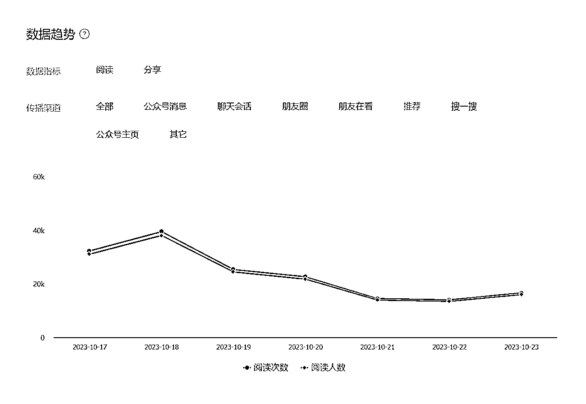

选推荐时看趋势是否上升；若在上升且曲线陡峭，说明文章还有流量，一直在推流。这时先别收工，赶紧按这篇再写一篇类似的，很可能再爆。除了这些，还有送达转化、分享转化等指标，我关注不多，占比也少。复盘主要看上面几个，尤其完读率要重点看。

# 5.2.3 流量主收益怎么拿双份 @枫宇翔

过去发公众号文章，只靠文中广告拿收益。其实还有一种方式：开通后发一篇文章，能拿两处流量分成，那就是腾讯内容创作平台。

https://om.qq.com/

注册账号，开通分成权益。然后在侧边栏选“我的主页=>内容同步”，按提示绑定自己的公众号。

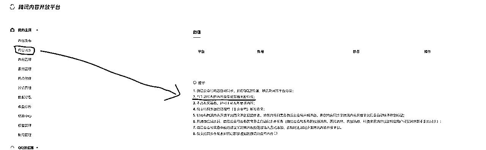

这样只管发文章，既能拿微信公众平台流量收益，也能拿企鹅号收益。

# 5.2.4 提高推荐率的几个小动作 @枫宇翔

① 合集推荐。文章放进合集，合集也能被推荐和订阅。但记得进合集设置里关闭连续阅读，避免底部占太多空间。后台侧边栏=>合集标签=>编辑其中一个合集=>关闭连续阅读。

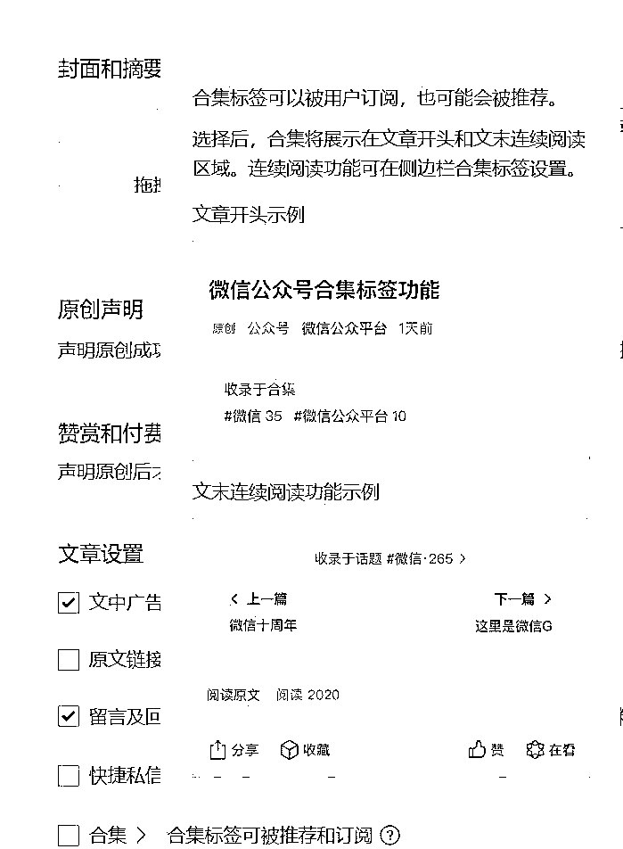

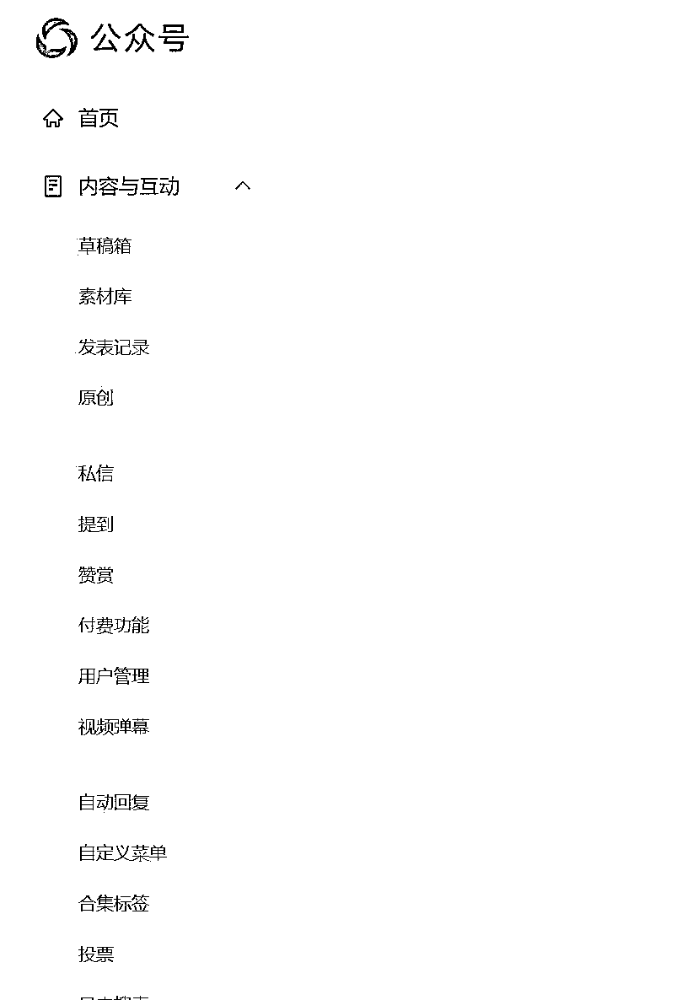

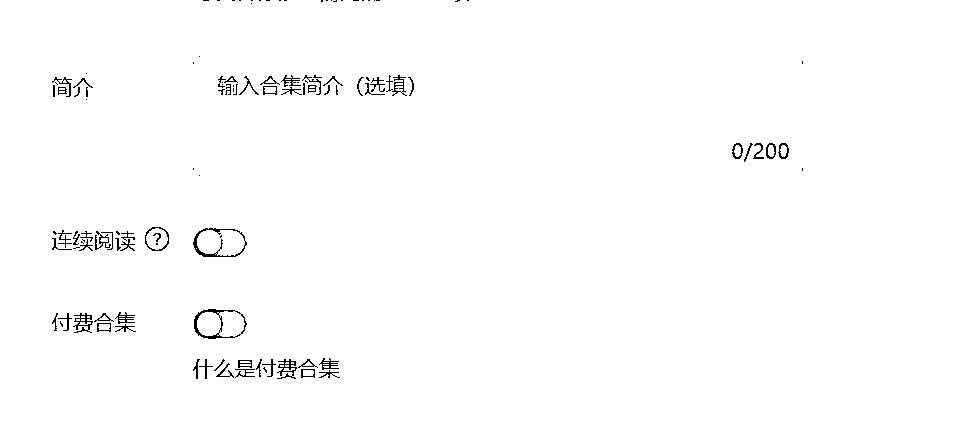

② 小绿书。如果写文章一直找不到感觉，可以试小绿书，类似小红书，直接发图，部分内容流量挺高。

② 划线推荐。对文章里的金句划线，这些句子有机会在订阅号信息流再推荐，给文章带来曝光。情感文可以把婆媳争吵等精彩情感段落划出来，被推荐到信息流时可能吸引用户。划线功能是文章发布后，自己打开公众号那篇文章，在任意位置长按才会出现。

③ 小绿书再提一次：找不到文章感觉时可以直接发图，类似小红书，有些流量不错，可以试试。

# 5.3 账号快速入池的实操技巧

进流量池没有确定时间：有账号一天就进，有账号半年也进不了，有点玄学。但多数情况下，七到二十一天坚持写，基本都能进。换句话说，持续更新、标题有戏、内容垂直，早晚能进。注册满一年的旧号，通常有一定权重，入池更快；我们做过不少测试，旧号确实有优势。没有旧号，可以发朋友圈问问身边人有没有注册较久的公众号，拿来实操。新号先选领域，定好后找对标账号，按对标账号的爆款选题和内容二次创作，每天更两到三篇，不断更，也能较快入池。

进了流量池，就意味着开始赚钱。若一直没进，要想想自己花了多少时间、投入多少精力、有没有研究标题。付出和回报大致对等：一天写一篇和一天更两篇、做一个号和做两个号，测试效果自然不同。

# 5.3.1 怎样判断账号已进流量池 @一来

微信公众号规则也在变。以前单篇文章阅读从个位数变成三位数、四位数，有了“看一看”流量，账号基本就算入池，第二天再发阅读往往会上来。但这一段时间似乎有调整：单篇进了“看一看”，第二天再发流量仍可能很少，甚至只有个位数，那就继续更新，直到账号入池。最直接的变化是阅读突破一千甚至上万；若只从个位数变成两位数、三位数，不一定，因为流量可能来自搜一搜。所以观察和持续更新很重要。

内容来源：6月8日《公众号流量主的经验分享》@一来

# 5.3.2 入池技巧一：文章改视频文案 @亦小亮

选题选完、文章写好、公众号也发了，就能拿到结果吗？当然不是。接下来可以试试：用写好的文章内容延伸出两到三篇视频文案，甚至五篇，在视频号发视频，看看怎样快速把文章阅读推到一万。

# 一稿三用：视频文案与入池实操

视频端文案不必独立另写。省事的路径有两条：从正文开头截一段直接用；或者把正文里的小标题串成一条。也可以反向来：先出视频脚本或提纲，再回填正文，衔接会更顺。

呈现形态有三类：图片主导、图文加视频混合、视频主导。新手或剪辑底子薄，先选单一形态——全图或全视频，别急着混搭，省时间；过原创后，混合形态推荐可能更佳，可以后面再升级。全图路线靠视觉渲染和展示，娱乐赛道拿明星图做短片，剪映“图文成片”就能完成。

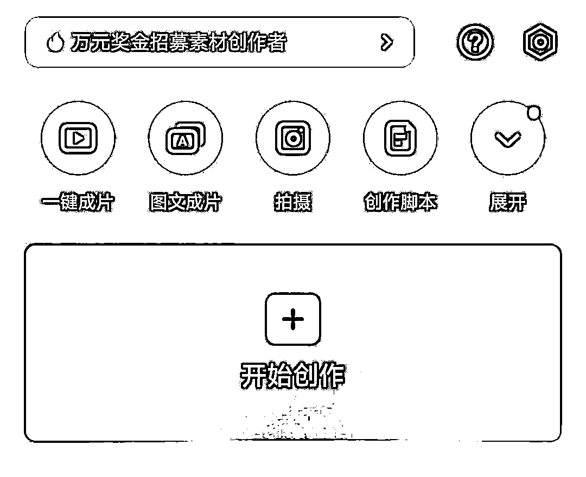

视频素材可选治愈、解压类内容，比如洗车解压片段，配生活情感文案。门槛不高，剪映可做；平时多刷视频端和抖音，素材很多。成片后，在视频下方挂文章链接。注意：文章发布后7天内阅读破万，才允许挂链。

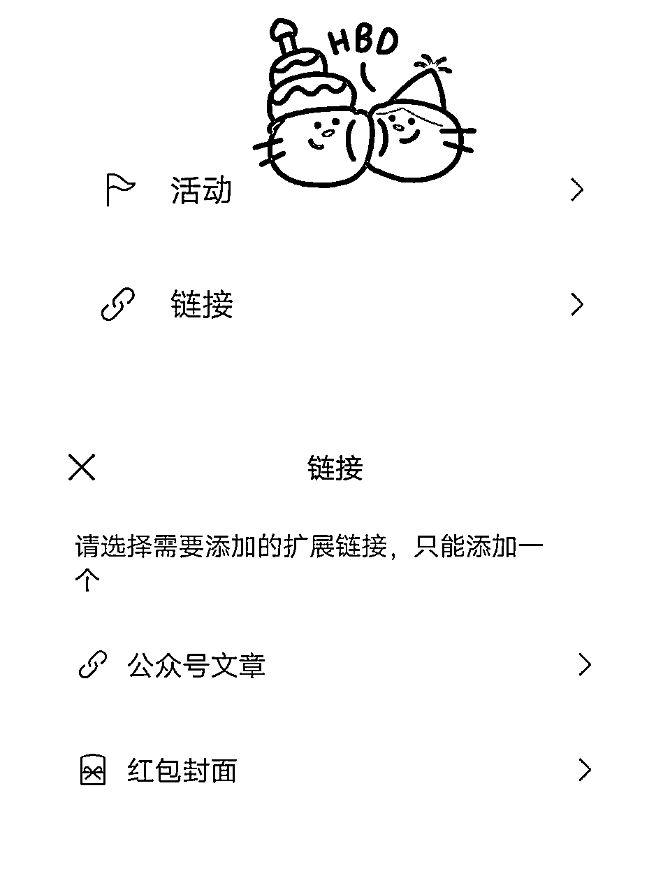

我估算过，视频端每1000次播放，文章打开率超10%，还有长尾。之前写王宝强与《八角笼中》，如今每天仍几百阅读。热点退潮不代表流量断，下面才是重点：微信问一问可用视频作答；没有合适问题，就一号发问、另一号回应。作答身份只能是视频端账号，所以可把视频端昵称改成公号名，一份内容三处吃。选题选得好，公号、视频端、问一问能互导，三者都可变现，不限于流量主。副业、旅游等领域适配。入口在搜一搜，点开可见。

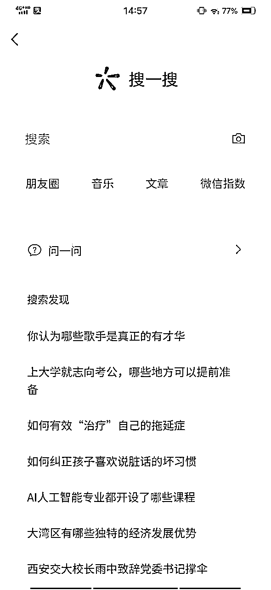

创业、副业方向已有人吃到问一问红利；这才刚开始，空白领域多，值得深耕。

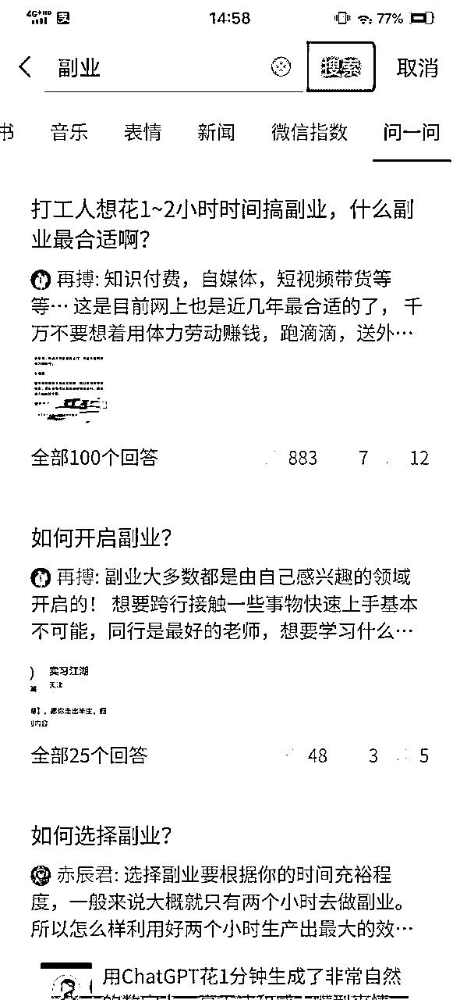

内容来源：7月4日《如何迅速把一篇文章的阅读量提高到 1 万+》@亦小亮

### 5.3.3 入池技巧二：用已入池账号给新号导流 @妞妞💋

已进流量池的号，可帮未进池账号引流。方法一：在已入池文章头部或尾部放未入池号的名片；方法二：同位置插入未入池号的文章超链接。二选一或并用，见图。

操作在后台编辑图文时完成。

（1）放公众号名片流程：

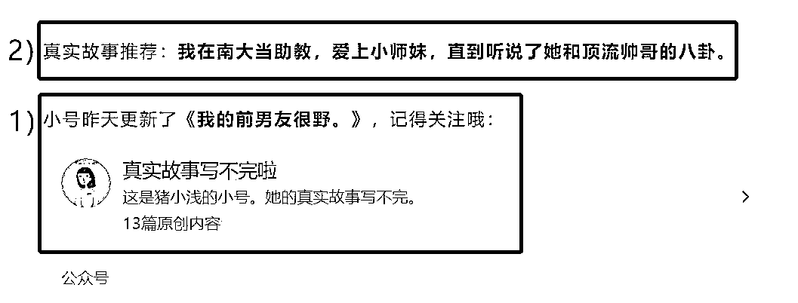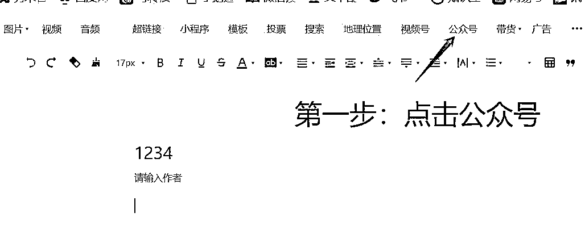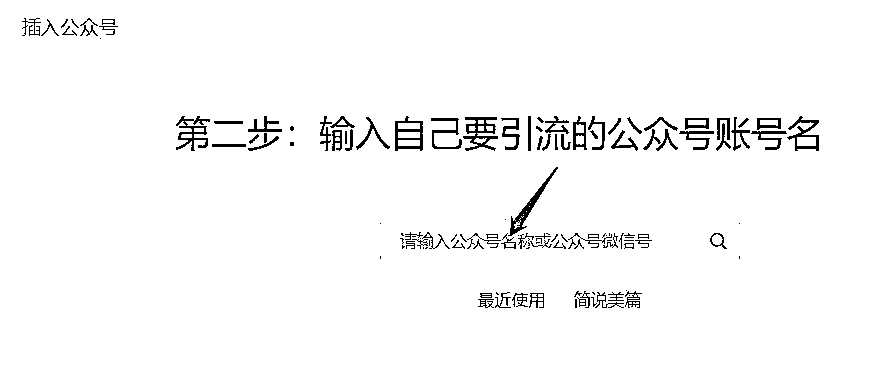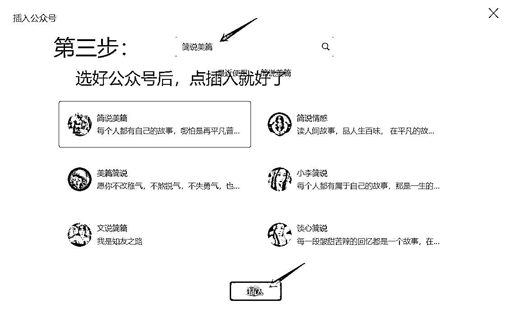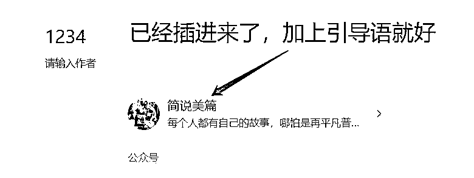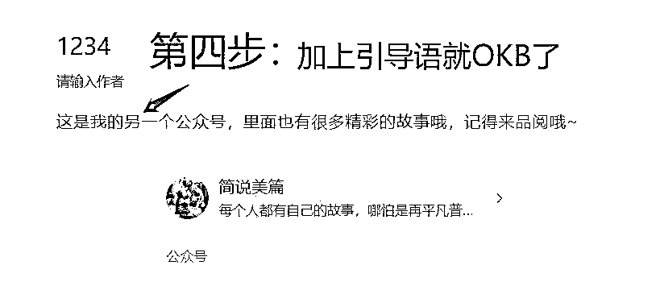

（2）插文章超链接流程：

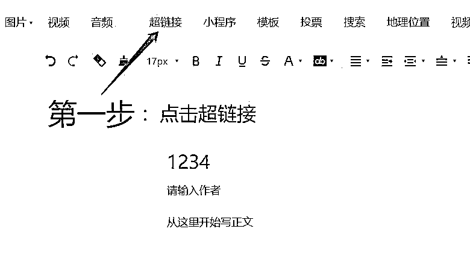

末尾加一句引导语即可。很简单。

自己没有已入池账号？找朋友或同学合作，条件自谈。比如对方帮你挂链接，你把该文收益分给对方，互惠即可。

内容来源：7月13日《用 GPT 写热点文&公众号快速入池的方法》@妞妞💋

### 5.3.4 入池技巧三：让朋友以自然节奏阅读

请5—10位不同地区的熟人，在微信里搜到并关注你的号；让他们从订阅号消息列表点开（不要你转发），按平时速度看，别猛滑；顺手点赞或在看更好。当天没刷到就等下次推送，不必强求。我的后台：每天十多位朋友阅读，约一周进池。

首篇入池数据很直观，阅读常翻几十倍。

### 5.3.5 入池技巧四：自读找问题，逐段对标爆文

未入池时，自己先完整读一遍，记下感受：版式别扭？字号偏小？开篇拖沓？后文乏力？记下问题，再把文章切三段，与10万+爆文逐一对照。看：主角何时登场、第一个坎何时出现、第二个坎何时出现、标题悬念在第几段揭晓等。逐项抄录核对，找差距再改。例：那篇10万+开篇埋钩子、条理清楚、转折不生硬，读者会追着猜“妻子怎样拆散”；我写的则转折硬、脉络乱，读者一眼猜到“妻子拆散我和初恋”，后文不想看。优化方向：故事顺、逻辑清，前五句交代人物、职业、关系并抛悬念，再铺细节。用GPT扩写可下指令：请扩写指定段落，加入具体细节、对话、动作神态、情绪，并说明需求。

### 5.3.6 入池技巧五：用数量与质量对冲随机性

常有人问：更了一个月、两个月还没进池怎么办？我的答案：多号并行，多发高质量内容；矩阵是对抗不确定性的办法。账号有随机性：同一家庭三个孩子，同吃同住，也可能只有一个常生病，父母难定先天体质。账号同理：同一作者、同一手法，有的两天进池，有的十五天，有的一直不进。所以建议两个号起步；基本发文能力掌握后，有余力再加。若两个号都不进池，就回头查内容质量，补质量。为何多发？多练熟能生巧，写得多提升快，也能快速摸熟领域；多写多看、多踩坑成长快。

内容来源：5月30日《情感类公号如何从 0-1 起号，拿到第一个 100 元》@Adrian、6月29日《公众号文章如何快速入池》@Beverly、6月8日《公众号流量主的经验分享》@一来

## 5.4 写作防坑清单 @半塘梦呓

以下摘自微头条老师@半塘梦呓。虽针对今日头条，但内容平台创作逻辑相通。这里摘常见坑，更多看原帖《微头条踩坑经验》。

### 5.4.1 措辞雷区

不少作者发文前会查违禁词，但还有细节要留心。

#### 5.4.1.1 为躲违禁词把文字改坏

有些违禁词出人意料，但平台规则严。有人用空格隔开、拼音或错别字替代，少量可以，不建议放开头，全文也别反复用。

#### 5.4.1.2 竞品平台字眼别带

写作时别顺手写“还花呗”“看微博”等；措辞太营销也易被限流。

#### 5.4.1.3 企业名要隐去

故事里别直写去中国移动上班、去电信营业厅办事、去中石化加油等；确需提就用某通讯公司、某银行等。引用名言也别写某企业CEO说。主角取名要小心：有同学主角叫大华，大华是知名企业且上美国制裁名单；叫小米也危险；连“叮咚”都最好避开，因为叮咚买菜。

#### 5.4.1.4 主角取名别踩雷

以为王强像人名？句易网里也可能是敏感词；大众名字可能撞官员或罪犯。可叫小王、小强、阿强、强强，但“小王刚刚吃好饭”里的王刚也敏感，“小李刚刚洗好澡”里的李刚也敏感。发文前过句易网要记牢。

#### 5.4.1.5 标点别走极端

别全篇逗号一逗到底，也别满屏感叹号，否则像马景涛体，显得低质；读者和审核都不喜欢。

#### 5.4.1.6 专业词别乱用

没有医学资质，就别写主人公急出乳腺增生；增生、结节属医学用语，可能被认定误导。

#### 5.4.1.7 句易网查不到的暗雷

暴力血腥如割腕、脑浆；封建色彩如占卜、卜卦、风水、当铺；性暗示如小姨子（姐夫敏感）、黑丝（蕾丝敏感）、情趣、袭胸，句易网可能查不出，要日常积累。建议收藏隐形雷区：1 渣男、渣女、高富帅、白富美、富二代、官二代、男神、情侣套房、打情骂俏、试管婴儿、代孕；2 首付、房住不炒、宣扬房价上涨会被打压；3 支付宝、信用卡、保险、银行卡；4 投资、炒房、炒股、赌博；5 人格侮辱、干了见不得人的事、好吃懒做、三观不合；6 辞职、离职、资料、空降、投资；7 奥运、抗洪、三胎话题受限；8 热点别瞎蹭，很多是坑，舆论不可测会被限，没金V就写稳妥内容才能长久；9 叮咚买菜是品牌名，“叮咚”最好不用；10 涉及其他软件、商品品牌基本别提最保险。规律不明显，靠敏感度和日常积累。

### 5.4.2 图片陷阱

查违禁词已熟练，图片问题也常导致限流，配图要谨慎。

#### 5.4.2.1 别暴露个人信息

生活场景尽量不露脸，露脸要打码，尤其小孩；手机号、车牌号要打码；明星图慎用，尤其有负面新闻的。

#### 5.4.2.2 别带营销信息

品牌logo、公司名都敏感；品牌标识和文化也易忽略：苹果电脑标识、美团外卖即使袋鼠打码，黄色头盔和工作服也能认出；育儿领域拍到奶粉罐，罐上logo会出问题；支付宝微信二维码要打码。

#### 5.4.2.3 别放负面敏感图

抽烟酗酒、娱乐场所偏负面；大面积裸露肉体敏感，如光膀子袒胸露乳的大爷、给宝宝洗澡、小孩大面积裸露。

#### 5.4.2.4 别引起他人不适

恐怖图、车祸现场、被打得鼻青脸肿都不行；有学员写蛇放真实蛇图也不行，最后换卡通蛇。

#### 5.4.2.5 图片别与内容不符

文中中国人配外国人；文中婆婆配去超市做饭却是两个人；文中车头相撞配车尾被撞；写别人的事却用明星照片（除非剧照或追娱乐热点）。

### 5.4.3 运营坑位 @Nicole·纯

#### 5.4.3.1 排版别花里胡哨

用秀米简单排版即可；情感文中老年受众，越简单越好，内容才是主角。

#### 5.4.3.2 尽量别重复发表

重复发表只能发一两个月前的文章，且不能常用。

目前见过三种情况：1 经常发旧文被限流，比新号还惨，每天收入个位数；2 发旧文被摘原创1到3天；3 也有人每天发旧文，一天七八篇里有一篇前期文章，总数没问题。账号情况不同，仅供参考。

#### 5.4.3.3 原创要开，快捷转载别开

原创一定开，否则影响单价和推荐；开通赞赏需3篇原创。快捷转载切记不能开，开了别人可随意转载，流量被分走。

发表前检查广告插入，出现对应字样就没问题。

发表后用自己的微信看一遍错别字（公众号只能改20个字符且一次，标题不能改），可给自己点赞和在看；但别点广告，别转发朋友圈和群，也别让别人点广告。相同用户长期点赞、点广告，账号容易出事，甚至进不了流量池。

内容来源：3月13日《避开这些坑，你也能写出爆款文章》@Nicole·纯

# 六、如何做出微信公号 IP@贝拉

💡 章节概要：大家都想打造个人IP，在私域转化成交，但小红书、B站等平台个人引流越来越难；微信公号目前不用金钱投流或学复杂玩法，就能让用户顺滑进入私域。尤其有私域积累的人，不管做哪个行业，都可以做好微信公号放大利润。如果你有项目，不靠流量主收益，而想用微信公号IP放大项目、引流私域、提高写作并解决信任和成交，本章可帮你更深入了解。

## 6.1 IP写作和传统爆文的思路差异

传统爆文依赖大量流量和浏览，目标让尽量多用户点击阅读，靠广告收入；追求点击率，短时间吸引大量读者，常选受众广的热点。写法是抓兴趣点，让用户点进来滑到底，再用广告等变现。

微信公号IP写作则围绕个人品牌和业务，讲个人经历、专业见解和产品内容，吸引兴趣和信任；更重长期积累和稳定，而非一次性大流量。传统写作核心是用户爱看什么就产什么；IP写作核心是塑造IP形象和行业专业度去吸引用户。差异就是从流量追求转向稳定转化。运营也从单纯追流量转向稳定转化；流量仍重要，但更靠优质内容逐步积累稳定粉丝读者。稳定阅读量才是长期成功关键，不必追求大量10万+；高价值产品用户日常阅读几千几万即可，付费转化才是重点。

## 6.2 新人入场与IP博主转型的挑战

### 6.2.1 纯新人的第一道坎

素材在这里展开到挑战一：内容与网感的不足。

刚入行的创作者常犯一个毛病：选选题时全凭自己喜好，对读者到底想看什么却不够敏锐。要记住，打动你的内容，未必能打动你的读者。

第二关：找准自己的市场坐标

不少新手在“我是谁”这件事上含糊其辞，介绍起自己来只有一句“我教英语挺多年了”。这样的描述抓不住用户，原因是它缺少辨识度，看不出你与同行的差别。所以，务必在目标人群中找到那个只属于你的位置。

以考研赛道为例，几位排头部的老师，简介里直接把硬实力摆出来，专业底气一目了然；而账号置顶的两篇高阅读文章，则借“感情”这个话题给个人IP添了一层独特记忆。

第三关：变现路径想不清

不少人没想过，写字这件事迟早要和收入打通。方向一旦缺失，内容就容易散，读者看完也不知道下一步该做什么。

手上暂时没有自家货，多数人会先靠分销拿提成。可要是今天推这个、明天换那个，内容基调又飘忽不定，账号人设很快就会糊成一团。

我的建议是：把你要深耕的那块细分领域，和具体产品（或服务）捆在一起，让每篇内容都朝着变现这个终点走。下面的例子说明，哪怕只是替别人卖货，也得靠对味的内容把人吸过来，而不是生硬地甩个链接或二维码了事。

再看一例。她拿来成交的，是一门教人怎么在职场上把话说好的课。于是标题、正文乃至结尾的往期推荐，全都在暗示同一件事——“这行我摸爬滚打多年，再棘手的情况也接得住”；连免费送的那份资料，主题也扣得死死的。

# 6.2.2 转型做公众号，IP 博主会撞上哪些坎

第一关：从镜头前转到纸面上

时长几十秒的画面讲究短、快、猛，靠配乐、表情、动作这些视听冲击抓人；可一旦换成图文，就得撑出厚度和骨架。博主得写出有层次、经得起读的文字，光靠煽动情绪那几句是不行的。

读者往往是带着明确目的来快速浏览的，他们想要看到观点和思考。所以篇幅和深度都得撑住，才能让人读下去。下面这张图里的例子，从整体骨架看，各节题目彼此之间要么层层推进，要么并列铺开；再落到每一节的正文里，段落内部的逻辑同样咬得很紧。

“以前我总觉得……”接上“而现在我……”——先埋个引子，再说缘由；硬核的专业内容和柔软的私人故事穿插着来。

想驾驭长句、写透内容，只能靠反复练笔；如果你习惯用嘴创作，那就多做口头表达的训练。读起来的层次、抓人的力道，都是这样一点点磨出来的。

# 6.3 让公众号 IP 和爆款文互相借力

图文号的 IP 写作和爆款文写作，乍看是两套打法，其实完全可以彼此成全。等你把个人IP立稳了，爆款文依旧是件好用的家伙什，能帮你把声量推得更大。

行业里冒出热点、发生大事时，第一时间跟上，用话题把流量引过来，顺手把自己的品牌与产品亮个相。

打个比方，某条娱乐八卦或社会话题突然炸开，你就可以把观点和产品揉进同一篇，借这波热度做出爆款，再用观点的输出给自己贴上“够专业”的标签。

假如你卖的东西能帮夫妻把日子过顺，就拿前段时间讨论度很高的《再见爱人》里“麦玲熏鸡”那一幕来说，你完全可以拆解这类刷屏级话题，把潜在买家的目光勾过来。

这篇东西不能只停留在聊八卦，得让读者看见你的本事。要是你做的就是婚姻调解，那就在行文中自然地带出“怎样读懂全职太太的心思，把日子过得更顺”，临近收尾时再不动声色地引出产品。

这么一组合，来的几乎都是对口的潜在买家——比如在家庭财务上有话语权、买得起高价位服务的女性。她们有实力为婚姻调解或情感咨询掏钱，转化也就水到渠成。

# 6.4 公众号 IP 靠什么赚钱

要点：这条路回本慢，钱多半来自后面挂的产品。

好处：号一旦做起来，收入既持久又丰厚，平台政策怎么改，对它的冲击也有限。

1. 后端产品

起步阶段手里没货，不妨长期只做同一类分销，比如教人写东西的课程、讲两性情感的课程，或者付费社群之类。

若想攒出自己的东西，最轻的起点是单次单独咨询，或者小报童那种专栏。

2. 读者打赏

这一项得等账号的阅读数稳下来、铁杆粉丝攒够，才会有相对固定的进账，通常也就几千块，很难破万。

# 七、公众号爆款 IP 文实战教程 @贝拉

# 7.1 这类文章的根子在哪

# 7.1.1 用产品思路经营 IP 和写作

# 7.1.1.1 把每篇稿子当作产品反复打磨

做图文号，脑子里得装着一根弦：你和你写的字，都是待打磨、待运营的商品。举个例子，假设你教的是托福作文，这门“商品”能解决什么？可以说“七天让分数涨十分”。那它凭什么叫得响？

头一条，是你这个人。学生凭什么挑你？也许你当年成绩垫底，硬是靠一股劲儿翻了身，托福拿到 110 分，写作单项还是满分。这段来路，就是你的招牌。

另一条，是你交付的东西。你卖的显然不只是几节课：或许有一套自己琢磨出来的门道，配上 AI 自动批阅系统做帮手；还附带保障条款——分数不到线，退钱，或者让你再学一轮不收费。

# 7.1.1.2 立住人设，也给文章添点脾气

每篇稿子都该带点自己的味道。跟商品一个道理，有辨识度才勾得住人，读者才乐意一直追着你。

假如你给自己定的是“会讲段子的码农”，那么账号调性与每篇稿子——题目、正文都算——都得透出这个意思：技术讲得明白，情绪也给得足。下图里那份自我简介就是个标杆，性格和本事一眼看全。

# 7.1.2 盘一盘自己的长板

要领：所谓优势，是“你身上有的”撞上“市场正缺的”。

# 7.1.2.1 用亲身经历做招牌

亲身走过的路，是撑起你自身招牌的一根柱子。不妨回头翻翻，哪些往事一讲出来，就能让人瞪大眼睛或心生佩服。

整理时可以照着这个模子：哪一年、在什么场合、聊了哪件事，被谁怎样称赞。

每次你抛出这类故事，听的人多半会冒出一句：你居然还有这一出。这些片段，恰恰是品牌的地基。

比如你年轻时嘴不饶人，到处结梁子，后来硬是把自己练成了人际场上的高手，还靠这层本事掘到第一笔金。这块招牌很硬——那些同样不擅开口的读者，很可能就愿意为你掏钱。

# 7.1.2.2 亮出你的看法

经历之外，观点也顶要紧。落笔时得挖出你那套与众不同的思路，给出让人眼前一亮的判断。

想最快抓住眼球，法子之一就是站在主流声音的对面。当时铺天盖地都是“杨子操控黄圣依、她该离”，你偏写一篇“其实没有人比黄圣依更爱杨子”，好奇心立刻被勾起来。

再比如你专攻商业账号孵化，碰上“曲曲大女人”全平台被封那件事，完全可以下笔写“从感情上说，我不喜欢她；从做事上看，我服她”。

但有一条红线：为了流量去写背离社会主义核心价值观的东西，账号会当场被封，别拿这个开玩笑。

# 7.1.3 找准市场位置，读懂你的读者

# 7.1.3.1 读者优先，按需供给

写图文号，选题必须贴着受众的胃口走。你也许对某个话题特别上头，可它要是不合读者的胃口，笔下功夫再深也白搭。

选题怎么定？拿各个题目的热度数据当尺子量。

比方说，你前脚离了阿里，自己出来干，头一阵就亏掉 80 万，想起来心口还疼。这故事当然能讲，但怎么讲有讲究。

可别写得像个糊涂蛋，也别让读者觉得你亏钱全因倒霉或本事不济。换个讲法：当时大环境低迷，线下买卖被疫情拖累。这样一塑造，你就成了“脑子够用、只是时运不济”的人，亏损有了说得通的解释，读者也更容易共情。

# 7.1.3.2 把人物的轮廓和招牌都立起来

落笔时，除了倒出知识与心得，还得让一个清晰的形象立起来。情形一：你给自己定的是“天生脑子灵光的军师型”。那内容就围着“怎样一次次踩准风口、不必苦哈哈也能赚到钱”来铺。

情形二：你走的是“由笨到精”的逆袭路线。那就先讲自己当年一意孤行、不按生意场上的规矩出牌，赔掉上百万；再讲怎样从坑里爬出来，靠刻意训练把认知拉高，最后逮住机会翻盘。

# 7.2.1 元素拆解法：让灵感不再断供

要解决的问题：一篇东西从哪儿想起、每一段具体怎么落笔。

7.2.1.1 两个基本筐子

动笔时的各种念头与设计，最终都能塞进两个筐：一个是“自己走过的、悟到的”，一个是“所在细分领域的硬知识”。

7.2.1.2 怎么把料挖出来

把自己的半辈子当小说来讲，一边讲一边记。

首先，顺着年头捋：哪一年进的大学，那几年是混日子还是琢磨挣钱；哪件事让你突然醒了（比如被男友甩了）；醒过来以后怎么一路猛追，进了哪家大厂，遭了什么排挤，最后怎么辞职单干。

接着，把这些统统写下来，再从里面挑能用的料。比如“我教过新东方的英语”“靠录网课拿下了晋升”“我出来开了家餐馆”“门店扩张太猛，亏了一百万”“踩中跨境电商，进账三百万”“让男友甩了以后，我把体制内的饭碗扔了”——每一条都是独立的料，挑完分门别类放好。

最后，各归其位，为后面的成文铺路。归到“自己走过的”那一筐：“我教过新东方的英语”“靠录网课拿下了晋升”“让男友甩了以后，我把体制内的饭碗扔了”；归到“行业硬知识”那一筐：“我出来开了家餐馆”“门店扩张太猛，亏了一百万”“踩中跨境电商，进账三百万”。

7.2.1.3 挖出来的料太少？八成是方法不对

为什么非得用对方法？方法对了，灵感才不会见底，可写的东西才会一茬接一茬。

假设你的底子是：教过高中英语，待过新东方。

挖错的方式：写“新东方老师”。这么挖，顶多写出一节。

挖对的方式：“在大厂新东方做一颗螺丝钉”——暗指薪水与上升都摸得到顶；“在机构里对着面上课，时间全不由自己”——暗指只有跳出打工的框，才有空闲去闯。这么一拆，能撑起两节，还能对应两种调性。

落到笔下：“在大厂新东方做一颗螺丝钉”——层层流程压着，本事施展不开，守着固定工资，离财务自由遥遥无期，想换种活法，于是递了辞呈去创业。

“在机构里对着面上课，时间全不由自己”——同一段时间，只够换回几个学生的钱。我索性调头扑向风口，转做线上，收入成倍往上翻。财富重新洗牌的当口，看准新一波机会的人才冒得出头。

# 7.2 手把手练：公众号 IP 落地

# 7.2.1 篇幅怎么定

7.2.1.1 不多不少最好

我的建议：想做出高质量爆款，篇幅落在 2500 到 3500 字比较稳。

理由如下：

太短——只有 500 到 1500 字的话，你的故事讲不出彩，干货也挖不深。短文转发确实快，可招来的读者黏性和质量，常常比不上篇幅长一些的。

太长——字数一多，读的人越看越累，转发效率明显下滑；信息一股脑堆上去，重点反而模糊，文章的分量也跟着被稀释。

篇幅可以变通

要是你主营的是客单价极高的服务，像军贸咨询、移民规划之类，写长些也无妨，8000 到 10000 字都行。这类客户年纪偏长、掏的钱也多，文章的逻辑必须完整贯通，千万别写得零碎寒酸！！！

反过来，如果你的客户偏年轻，篇幅压到 1500 到 2000 字更讨喜，语气轻松点，句子短一点，别让人读着读着冒出“这啥意思”的困惑。

# 7.2.2 怎么把料拼成文

用多少料

一篇里放三到四个核心料块就够，别堆得又杂又乱。常用的两类料，无非“自己的故事”和“行业的门道”。

原因在于

一个人的专注力就那么点，塞得太满，信息一股脑砸过来，读者只会发懵、不知从哪儿看起。文章效果打折不说，读起来的感受也跟着变差。

配比怎么调

故事与硬货如何平衡

建议一比一对开，或者六四、七三都行。

自己的故事

文中适度露几手独一份的过往——“二十几岁就管一支销售队”“被同一个男友甩了六次”这类，一下就能勾起兴趣、拉来共情，读者也更愿意往下掺和。

行业里的真本事

给出能直接上手的实操门道，文章才值钱。读者一边被情绪照顾到，一边还能真学到东西。

# 7.2.3 拆成五节搭骨架

# 7.2.3.1 第一节：开头

目标：用尽可能少的字，最快让人对“你”起兴致。

亮经历、摆成绩：把过往或成果一句话砸出来，迅速抓住目光，让人对你的来路产生好奇。所谓精准，就是——想让人服你的创业本事，就一句“三十年沉沉浮浮，第一个八位数总算进账——扶我起来的是电商，掀我翻的也是电商”；别絮絮叨叨写“这一路多苦，我心里如何，某位大哥哪句话点醒了我，要谢家人谢朋友，对电商今后怎么走的判断……”。其实那一长串里的每个短句都是一块料，每块料拎出来都能单独撑起一节。

再聊共情这件事。它不是要读者百分百点头。比如你的核心论点是“女人一旦做了全职主妇、丢了经济权，男人变心几乎是必然”，读者合上文章时想的不是“她说得对”，而是“这论证够扎实，说不定真有几分道理”。

下图这个案例，卖的是这样一个形象：“擅长替人挑准赛道，别让认知拖后腿、把机会放跑”。

第一节其实分两块。前一块（开头三段）：先抛出一个大家都有的思维盲区；后一块（后面四段）：讲自己的真事，证明这个盲区不是虚的，而作者本人也正因如此跟一波红利擦肩；这就为下文铺好路——如何跳出盲区、翻盘，以及能卖给读者什么样的“认知升级”内容。

# 7.2.3.2 中段（第 2～4 节）

中段的任务：把专业底子铺足，多上干货，再撒一点情感与观点作调剂，别让整篇干巴巴。

各节安排的样例：

第二节：先浅说几句行业常识，再搭一点自己的体悟。别一开场就端出硬核分析——刚讲完故事立刻切进严肃论述，脑子容易发胀。

第三节：挑一桩事例细细剖开，让人看见你的功力。这一节可以纯用硬知识，自己的情绪一点不掺。

第四节：读者啃完第三节多少有点累，这时候插一段聊感受的内容进去，松一松、提提神。

下面这些例子都是中段的实际写法，可作参照：有细密的理论推演，有分条归类，有硬知识配少量亲身心得，也有短促有力的点评。

# 7.2.2.3 第五节：收尾

要诀：收尾时得把情绪喂饱读者，写他们心里想听的那几句。哪怕读者心里明白自己未必站得住，也希望你递上一点认同。

举例来说，你的主旨是“女性不该困在家里，得出去闯出自己的一摊事”，收尾却仍可以写：“把家打理得妥妥帖帖的全职妈妈，同样配得上掌声……”

还得短、还得狠。最好甩出几句能被记住的话，直戳目标买家的心口。比如“婚书埋了恋爱，日子埋在亲情里”“本事跑过欲望，人才松得下来”“孩子不看你怎么说，只看你怎么做”“老天若让我此刻看见一件该做的事，那就是让我此刻动手——这叫使命”。

情绪这块，尽量去碰读者不理性的那一面。比如用带命令感的句子：“别坐着，先迈出一步，你就已经比昨天那个自己强。”让人读完觉得有收获——就像付完课程的钱，便当自己已经学成了。

下图这些例子，值得瞧一瞧。

# 选修篇：把项目做大，还有哪些招

# 💡

# 本篇速览

当一个项目的雏形 MVP 走通，或你把基本流程摸熟了，就可以翻到选修篇来看看。

不管你是想往深里做、把盘子放大，还是想找出新花样多赚一点，这部分都值得细读：

【第八章】借 AI 让出稿更快

【第九章】自动化，让项目跑得更顺

【第十章】ChatGPT 配 RPA，怎么把流程自动跑起来

【第十一章】流量主的钱，怎样走个体户的对公账户结算

另外，圈友近期做公众号爆文项目的复盘帖我们也整理了一批，精力够的话可以翻翻【第十二章】里那些赚钱的例子，少踩几个坑。

闲话到此，咱们开始。

# 八、AI 如何帮我们把稿子写快

# 💡

AI 一登场，内容行业那两个老毛病——抄来抄去的多、出活又慢——被解决了一大半。有了它，一篇稿子从想选题到发出去，也许几分钟就够。把前面讲的那些写法与工具配合起来用，效率还能再往上提，爆款自然也能多产几篇。

# AI写公众号：三条路子，哪种适合你？

聊到AI，每个人都有自己的一套用法。但有一件事谁也拦不住：大势永远朝前走。就像汽车最终换掉了马车——当年汽车刚冒头时，多少人觉得不可思议，马车夫更是打心眼里抗拒，可结局呢？该来的照来。

下面围绕工具使用，给出三条不同侧重的路径，主力是 ChatGPT 和 Claude。

✅路径一：ChatGPT 帮你写，你做主编
按这套分工，成品里人的工作量约占四成，AI 承担六成。人这边要做的是：定选题、设计情节框架、把AI生成的初稿改顺、写标题、负责上传发布。落到文字层面，ChatGPT 能包揽八成以上，人主要是删掉啰嗦的、把句子捋光溜。

✅路径二：ChatGPT 接上 RPA，批量跑自动化
这条是在 ChatGPT 的基础上再加一个 RPA 工具，把那些重复性的操作全交给脚本，比如自动生成稿子、自动推送到公众号后台，前提是把流程提前配置好。不过批量生产的稿子质量通常参差不齐，教程里也附了对应的优化法子。

✅路径三：用 Claude 直接写原创
这条路的亮点是：不需要去钻研什么高深复杂的提示词，只需找几篇质量上乘的范文丢给 AI 学习，就能快速出稿，甚至一条指令就够。配上最新的 Claude3-Opus 模型，出稿质量非常稳，人工几乎不用回炉重造。

注意一个区别：ChatGPT 4.0 和 Claude 可以直接读取链接，ChatGPT 3.5 只能识别文本内容，用的时候要分清。

ChatGPT 账号的问题得自己搞定，这里只聊用法。想学更细的操作，可以翻手册「12 月航海 | ChatGPT | 实战手册」。Claude 的账号同理，本文也不展开，获取途径可参考【获取 Claude3 的几种途径】。

❗️每一期航海手册都会持续更新。如果你是上一期就上过船的老船员，下面两块新增内容更值得看一眼：

✅ 7.4 Python+公众号爆文全自动化

✅ 7.5 多账户运营：AI 辅助手搓

把上面这些玩法捋一遍，你对 AI+公众号的理解会深一层，也更容易挑到趁手的工具。

# 8.1 用 Claude 写出原创文章@猫哥

# 8.1.1 先搞懂 Claude 是什么

在正式用 Claude 之前，要是你从没碰过别的 AI 工具，我得先带你弄明白它的工作原理。

我对 AI 的看法是这样的：千万别把它当成一个简单的应答机器，它内部是有“大脑”的。AI 的设计灵感本来就来自人脑的神经网络，靠构造大量参数来模拟神经结构，所以它确实具备一定的思考、学习和理解能力。你大可以把它当作一个随叫随到的移动助理，随时帮你解决问题。

想体会指令措辞的分量，我们设个场景：你让 AI 写一篇情感文，下面三种说法，哪种更贴近你的真实需求？

A：「给我写一篇情感文。」

B：「给我写一篇情感故事，语言要幽默、生动，字数2000字以上，主题是：XXXX。」

C：「这是一组样例文章，按这个风格来写。写一篇情感故事，语言要幽默、生动，情节要跌宕起伏，人物刻画入木三分，2000字以上，主题是：XXXX。」

你来判断，A、B、C 哪个写出来的成品最接近你心里那篇？

A 只说了文体，主题都没给，AI 大概率是在盲猜，根本打不中你的点。B 虽然给了要求和主题，但“幽默”和“生动”的尺度很难拿捏，AI 不知道你要的是哪种幽默，成品经常差口气。C 直接甩出参考样文，明确告诉它“照着这个风格来”，再加上对情节和人物的具体要求，这样写出来的东西大概率能让你满意，至少文风不会跑偏太多。

# 8.1.2 怎么搞到 Claude

工欲善其事，必先利其器。AI 发轫以来，我上手对比过不少模型：ChatGPT、New Bing、Claude、Gemini，国内还有文心一言、讯飞星火、Kimi，等等。

最后得出的判断是：中文创作这块，Claude 的表现最出众。去年 7 月 Claude2 一发布，我就从 ChatGPT4 换过来了，一直用到现在。今年 Claude 又推出 Claude3 系列，包含三款：opus、sonnet、Haiku，其中 opus 最强。没过多久，Claude 又发布了 Claude-3.5-sonnet，这模型既便宜出文又好，响应速度还比 opus 快得多。

你有没有发现，市面上聊 ChatGPT 的内容铺天盖地，讲 Claude 的却寥寥无几？原因很简单：Claude 的风控比 ChatGPT 严格得多，一不小心就撞上封号。去年 9 月、10 月那一轮大清洗，差点把 Claude 的路给堵死。下面分享几个目前还能体验 Claude 的渠道。

官方 Claude：https://claude.ai——封号风险最高，但可以去淘宝买账号试水。月费 19.9 美元，最大的好处是封号就退全款。

Poe 平台：https://poe.com——一个集成多种 AI 的平台，除了 Claude 还有 ChatGPT。同样 19.9 美元一个月，走积分制：每月送 100 万积分，不同模型消耗不同，Claude-3-opus 一次 2000 积分，Claude-3.5-sonnet 一次 295 积分。

You 平台：https://you.com/——和 Poe 一样是集成平台。它是新面孔，价格便宜，而且不限对话次数，唯一的感受是模型效果似乎有点水。

这几个平台都要求特殊网络环境，麻烦自行搞定。

# 8.1.3 一条指令，产出原创文章

前文已经提到，Claude 的学习模仿能力很强。对新手来说，与其绞尽脑汁去琢磨提示词怎么写，不如反过来——找几篇写得漂亮的范文让它去学，更实在。

第一步，挑质量过关的范文。最好出自同一位作者，因为个人的文风往往比较固定，语气、惯用词、文章结构都有迹可循。

我们最终目的就是让 AI 学习文风，所以范文的成色至关重要。你不能随手抓几篇，尤其是那种一眼就能看出是 AI 写的，拿这种当范本，出来效果必然不理想。

所以第一步，去找 3-5 篇好文章，风格尽量统一，复制到 word 里，pdf、txt 都行。比如我整理过的那些公众号情感文，笔触细腻、人物刻画立体，整体质量很高，拿来做参考正合适。

有了范文，风格就有了根。接下来就能直接动笔了。创作分两种情况。

第一种：给 AI 一个故事大纲，让它照着写。适合你撞见某个特别动人的故事，情节本身够好、够吸引人，可以随手用任何一个 AI 先把大纲提取出来，再照着大纲展开。

第二种：直接甩个标题过去。这条路在情感赛道特别好用：AI 顺着标题写，基本跟“标题党”不沾边；同时因为是 AI 自由发挥，读者看到的也是一个新故事。读者被标题勾进来，只要故事说得通，主角叫张三还是李四根本不重要，重要的是能让人看完。

特别注意：Claude 的道德约束比较强，凡是违反公序良俗的标题——比如涉及暴力、性暗示之类——它直接拒写。这时候改用大纲的方式来绕过去就行。

下面是具体的指令。指令的作用是防止 AI 跑偏，提高出稿成功率。

指令一：基础版

这组指令很朴素，只提了基本的情感文要求。标题和大纲可以同时给，也可以只给其中一样。

比如，我拿上面那个标题直接试：

标题：奶奶去世，大伯让我出 12 万丧葬费，我：你还活着，凭什么让我这个孙女出？

下面就是完整的响应过程——一条指令下去，一篇原创文章直接出来了，而且几乎闻不到 AI 味。

Claude 对字数并不敏感，它一般会照着范文的长度写。我给的这几篇范文字数都在 3000 上下，它写出来的也差不多是这个体量。

# 💡

效果汇总：

成品在文风和结构上都紧贴范文：范文里大量使用 1、2、3 式的小标题，出文也一模一样地延续了这个习惯，连篇幅都跟范文相当。

这条指令几乎不需要背，手头有好的范文就能直接开工，对新手相当友好。

指令二：进阶版

上面那条指令比较简单，没对文风做什么限制，但依然能出不错的稿子。下面这条更复杂，出文效果也更好，主要是加了各种要求，帮 AI 搞清楚我们究竟想要什么。

我希望你扮演一位善于捕捉内心情感的小说家。你笔下的故事往往充满了悲欢离合、爱恨情仇，能带领读者走进人物的内心世界。

在写作之前，先思考确定主要人物和情感主线。然后围绕主线展开情节，适时穿插一些戏剧性的冲突和转折，推动情感的变化和升华。

在塑造人物时，要深入他们的内心，细致描写他们的喜怒哀乐、心理活动。不同的遭遇会在人物心中激起怎样的涟漪？他们会如何自我怀疑、挣扎、成长？这些都是需要着重刻画的。要让读者能切身体会到人物的情感变化，产生共鸣。

为了增强故事的真实感，可以适当加入一些细节描写，比如人物的小动作、表情变化，或是周遭环境的烘托渲染。这些细节能让场景更加立体生动。但也要注意避免过度堆砌细节而影响情节的流畅度。

在语言风格方面，要做到细腻委婉，能准确传达人物的情感。可以适当运用一些比喻、拟人等修辞手法，让感情更形象生动。但也不要过于华丽，以免喧宾夺主。

你要努力营造一种“身临其境”的阅读体验，让读者仿佛置身于故事中，与人物一起悲伤、一起欢喜。故事的情感应当是真挚动人的，能引发读者的共情和思考。

模拟真人写作中的随意与粗糙。适度引用流行语、典故、梗等，合适地引用一些时下流行语、文化典故、网络梗等，能增强文本的时代感和真实感

要开幕雷击，在开头能立马吸引读者，勾起读者的阅读欲望。

按照上面要求创作 1 篇文章，字数 2000 字以上，主题：

# 💡

指令拆解：

这套指令先设定了创作角色——写情感故事的小说家；然后在文风和内容上做了不少限制：先构思再动笔、人物往深处刻、补上细节描写。语言层面，还鼓励用修辞让文章更生动。

这几条，本质上都是一篇优秀情感故事文必备的素质。真正打动人的不单是故事本身，更多是细节；细节一到位，真实感就出来了，读者才容易陷进去。

下面针对同一个主题，换不同的指令方式看看效果。

方式一：范文喂饱再写

方式二：纯靠指令硬写

# 💡

效果对比

同样有范文打底，指令越精细，成品越出彩。方式一那篇，开头不绕弯子，一个电话就把读者拽进现场，代入感极强；全篇起伏不断，对人物的刻画非常细，动作、对话都写得很有画面，是一篇能打动人的稿子。

再看同样指令、但没喂范文的那篇：整体效果其实也不差。但没有范文“扶一把”，AI 偶尔会跑偏。可见一条好用的指令，价值依然不小。

# 8.1.4 不同赛道怎么各写各的

赛道不同，写法自然不一样。但从创作逻辑上分，也就两大类：时事类和非时事类。

什么叫时事类？指的是近期刚发生、AI 数据库里还没收录的信息，比如某款新车的参数、突发战争、明星八卦等等。这类题材如果直接套用前面的“模仿范文法”，稿子虽然写得出来，但内容跟事实大概率对不上，一旦发出去就可能变成造谣、捏造事实。所以这类题材不能靠模仿来写。

非时事类就好懂了：AI 库里本来就有，或者根本不需要新鲜素材就能写的内容，比如情感故事、心灵疗愈、职场心得、生肖星座。这些赛道完全可以走模仿范文的路子，因为它们的内容要么是虚构的，要么是文化常识的沉淀，不掺和时事信息。

那时事类怎么写？其实很简单——AI 不知道，就告诉它呗。这就涉及素材整理了。你想写《全红婵夺冠》，AI 不知道这件事，就得先去搜相关内容：按标题搜几篇信息全、彼此有差异、有增量的文章，整理到一个文档里，直接丢给 AI。这样一来，AI 就算“学过”了。注意，要是写有争议的内容，一定要把来龙去脉摸透，评论区的声音也可以一并收进来，让 AI 看清全貌，写出来才够客观。

接下来照着之前的办法继续写就行。不过不同赛道需要的文风不一样，最好按自己的喜好来调。指令重点从两个方向下手：一是写作风格，即语言表达的路子，比如风趣、通俗、犀利、口语化；二是文章结构，开头放什么、正文说什么、结尾收什么，一一讲明白。把这两条卡住，产出的文章基本不会歪，而且长在你的审美上。

# 📌

总结：

利用 AI 的模仿和学习能力，找几篇优质文章当范文喂进去，就能快速写出像样的稿子。再配一条好指令，质量还能往上拔一截。

这个方法不用事先调教，新建一个对话就能直接开写，做一篇稿子的时间被压得很短。

遇到复杂赛道——比如社会热点、娱乐八卦——除了好指令，还得把事件资料先喂给 AI 学一轮，再让它动笔，出来的东西才靠谱。

# 8.2 用 ChatGPT 产出公众号文章 @木白 @袁永兵 @妞妞💋 @小浩哥

# 8.2.1 先让 ChatGPT 写正文

# 8.2.1.1 教出你要的文风

从手册里把「3.2 制作文章正文」的爆文模板找出来，再把「3.3.2 实战案例」里的爆文案例也翻出来，一股脑全塞给 ChatGPT。

也可以去公众号上再找几篇好文当范文丢进去，让它学。

prompt:

把下面这篇文章的写作特点提炼出来，给它安个名字，就叫“风格 A”

text: """

这里放文章内容

"""

注意，用「text: """ """」把文章内容包起来，这是 OpenAI 官方推荐的做法，作用是把给 ChatGPT 的指令和需要它处理的数据清楚地区分开。

还有个小提醒：正文别太长，太长 ChatGPT 容易报错。公众号爆文一般 1200 字上下，基本不会出问题。

等它提炼出风格之后，再让 ChatGPT 把这套风格吃透，完成调教：

prompt:

把刚才学的内容继续消化，和“风格 A”熔在一起，作为之后写稿的底子。现在先不用写。

# 8.2.1.2 主题从哪里来

找一篇跑出过数据的爆文，把它的情节抽出来喂给 ChatGPT，以这个为种子，让它多生成几个选题。不满意就提具体修改意见，接着生成，直到看到相对中意的。最后人工再打磨一下，敲定主题。

这套流程熟了以后，故事基本不用自己蹲在电脑前憋，素材取之不尽。

1）选题案例

选题的选择，直接参考前文 ⌈3.1 找到合适的选题⌋ 里的爆文库、榜单，以及⌈3.2 制作文章正文⌋的例文就行，这里不多啰嗦。

2）情节怎么提取

有两条路子。

① 直接抠原文。有些文章开头几句话就把主要情节讲明白了，有的干脆在标题里写清楚了，直接拿来用就好。

② 让 ChatGPT 来提炼。要是原文没有直接交代情节，我们也可以丢给 ChatGPT 处理。

prompt:

请你以情感文作者的视角，用不超过 50 个字把下面这篇压缩出来，冲突、悬念、转折都要突出，结尾一句带过。

text: """

文章内容

"""

3）敲定主题

拿上一步提取出的主要情节打底，再让 ChatGPT 铺几个选项出来，挑一个最顺眼的定稿。

prompt:

“主要情节”

# AI写爆文：把脑力用在刀刃上

想让故事读起来像真事，可以先让AI照着一小段样文仿写五段。关键不是辞藻，而是每段都有转折、有生活气，能从邻里琐事、婆媳摩擦、家庭伦理里抓矛盾，开头就把人拽住。所谓“开屏雷击”，不是硬编狗血，而是把普通人身边的冲突写得集中、可信、让人停不下来。

# 8.2.1.3 先搭故事骨架

题目定下来后，先让AI出故事大纲，不满意就反复改，直到结构顺了再动笔。提示词可以这样下：给一个选题，要求写1500字左右的短篇，按时间顺序推进；风格偏现实，语言平实鲜活，读者容易代入；情节要真、要有波折，开头有冲击力，素材取自日常生活里的家长里短、婆媳关系和家庭伦理；先交故事大纲。这里要记住，大纲不是摆设，它是后面分段写作的路线图。

这里有个提高效率的小办法：别只用一种指令。多建几套大纲模板，等于给自己准备多个“创作模具”。以后写到某类题材，直接套对应模型，省去重新想结构的时间。

可以先拿不同模型各写一版，比较哪版更顺手，再固定用那个模型持续产出。用模板时也别偷懒，把自己的剧情、人物关系、想突出的冲突加进去，AI才不会写得太像标准答案。比如指令一可以设定：28岁男子杰克，父亲开出租车，母亲做医务工作，他在小公司做市场专员；房东艾米49岁，离异多年，儿子在外地，她做会计。故事写两人从房东房客到互生情愫，杰克表白被拒后尴尬矛盾，后来电视机故障让两人感到彼此的关心陪伴，艾米在酒意下接受感情，最后提出结婚，虽双方家人反对仍领证。全篇第一人称，开头介绍家庭背景和个人简介，人物要取名，让读者感同身受，字数控制在1300字以内，重点展现爱情的力量和年龄无关。

再比如指令二，主题是“爱情迷阵：丈夫异地工作，我却无法抵挡公司领导的温柔陷阱”。先交代女主的职业与家庭背景、她和丈夫的关系、丈夫为什么调去异地，以及她和公司领导最初的接触；再写丈夫离开后她的生活变化、与领导逐渐越界、内心的挣扎内疚和恐惧；然后安排危机，比如丈夫突然回家或同事发现秘密，逼她反思；最后做反转，或坦白忏悔，或接受自己的选择并承担后果。仍然用第一人称，开头介绍背景和人物，给角色取名，控制在1300字以内，让读者能代入并思考类似处境。

# 8.2.1.4 分段写正文，别让AI一口气包圆

AI直接产出的整篇稿，常常一股“机器味”：不是“1、2、3”，就是“首先、其次、然后”，结构僵、语言硬。所以别指望它全自动批量生成，质量很难稳。更靠谱的做法是：把文章拆成几个部分，分别告诉AI这一部分要写什么、重点描写什么、字数多少、有哪些限制，写完再合并。这样拼出来的内容，原创度大概能到六成。

比如事件开端占全文约三成，控制在400字以内。提示词里要说明：沿用风格A，用第一人称口述，语言平实；多写动作、行为和对话，少写内心独白；不要自行扩展其他情节。

# 8.2.1.5 人工润色才是分水岭

AI给的是标准答案，冷静、工整，却常常缺少人情味和情绪价值。这样的稿子数据往往一般。人工润色这一步不能省：调整语气，补上引文，处理好段与段之间的起承转合，结尾再做一点升华。一篇千字文改下来，原创度能到七成以上，主流平台基本能过。

先改衔接处。AI分段写出来的内容，接缝处容易重复或啰嗦，该删就删，该改就改。比如前后两部分讲的是同一件事，留一处就够。

再精简结尾。AI收尾经常绕圈，空话多。

通常挑其中两三段保留，段落之间不顺就稍微补一句，几分钟就能收好。删完也别怕字数不够，一般不会低于1200字。比如原本写“经过这次风波，我和老板更珍惜友谊，不实传言澄清后松了口气，也明白真正的友谊要经得起考验；回想那个难忘的晚上，误会让我们找到彼此，也懂得珍惜现在，曲折经历成了宝贵财富”，精简时留下核心意思即可。

# 8.2.2 标题得人来定

标题这一关，人工把关最稳。AI可以给灵感，但别直接复制。

# 8.2.2.1 先学爆款，再出候选

先喂给AI几个爆文标题，再让它围绕你的文章生成五个备选。提示词可以写成：爆文标题1、2、3、4、5，参考这些标题，为下面这篇文章提供5个吸引人的标题，正文是“文章内容”。

如果都不满意，就加要求：再戏剧化一点，更标题党一点，甚至更狗血一点；或者加入异常、反转、数字、冲突这些元素再写一轮。

# 8.2.2.2 标题模板怎么套

想批量取标题，可以准备一个通用指令：让AI扮演一个熟悉社会生活的写作者，为公众号生成一组能引发关注和讨论的标题。要点有三：第一，简洁直接，直击要害，留悬念，让人想点；第二，多用“崩溃”“反击”“震惊”这类有情绪和画面感的词；第三，标题里带人物角色、情感冲突、生活挑战和悬念设计。

第一种用法是直接给关键词，比如工作、恋爱、婚姻、人际关系，或者老板、男友、男同事、老公这些角色主题。

不满意就让它继续写。

第二种用法是给它一批爆款标题，让它照着同类风格生成。

生成后挑一个最顺眼的，稍作优化就能用。

# 8.2.3 要快出稿，就把条件给全

如果追求速度，或者需要大量产出，可以参考@妞妞💋老师的做法：先有选题和大纲，再结合平时积累的素材库，把选题、大纲和具体要求一起交给ChatGPT。提示词里写清楚描写细节、气氛、叙事人称、背景、角色、情节和结局，最后加一句“你是个讲故事的大师，请根据以上内容写一篇1200字的故事”。

# 8.2.4 用ChatGPT写稿的几条心得

第一，一篇文章从构思到发布大约要1到2小时。GPT-4速度偏慢，晚上更慢，还常遇到网络问题，所以尽量别把急稿留到深夜。

第二，按这套方法调教好之后，写五篇左右最好重新调教一遍。因为按GPT-4 API的输入限制推测，它能记住约25000个token的上下文；1000个token大致相当于750个英文单词，或者400到500个汉字。五篇文章加上调教内容，差不多一万字，再往后它可能就忘了最初的要求。

第三，如果用GPT-3.5，更要多调教。它的上下文是4096个token，几乎写一篇就得重新交代一次；而且它记不住上下文，逻辑容易断，有时还会胡扯。有条件还是用GPT-4，它更能接住前后文，也更有逻辑和人情味，相当于替我们多走了一步。

内容来源包括《ChatGPT + 公众号爆文写作，从 0 开始，7 天达成阅读 10W+，方法全分享，毫无保留》《大杀器 ChatGPT 问世 135 天，一篇公众号爆文 10 分钟搞定，千元收益唾手可得！》，以及6月1日《公众号 AI 写作分享》@小浩。

# 8.5 多账号运营：AI 打辅助，人做掌舵人@开卷🌀

到目前，我很少用国外AI工具，所以这里只聊国内工具。结合写文案的实际场景，说说怎么把国内AI当写作小助理，把流程重新排一遍。

项目做久了会发现，人的脑力特别值钱。把脑力用在关键判断上，让AI去完成那些“60分就够”的部分，既能出成绩，也能让人喘口气，再用省下来的精力赚更多收益，幸福感会高很多。具体来说，一篇1200字的公众号文章，我可能只亲手写300字左右，就像手机内存占用从100%降到25%，不卡、不发烫，脑子也一样。

拿观点文举例，纯手搓和AI辅助手搓的差别很直观：找选题都是10分钟，拆结构都是3分钟；纯手搓要写开头3分钟、三个分论点15分钟、结尾3分钟，再花6分钟找金句润色，半小时疯狂输出，还不算找选题，脑子已经被掏空。AI辅助版则是AI写初稿3分钟，手动改稿5到10分钟，半小时能搞定，还包含选题，细节也有空完善。

# 8.5.1 国内 AI 工具实测，选顺手的

工欲善其事，必先利其器。没有批量做号的需求，就不需要太复杂的方法。下面三个是我日常用得比较多的平替。先说清楚：不是拉踩，纯属个人习惯和写作状态的实际体验；如果你觉得不对，那以你为准。

# 8.5.1.1 文心一言：文气更足

这是我比较早能接受、也真正常用的国内工具，今年上半年用到现在还算满意。它的特点是适合对语言讲究的文本，遣词造句比较专业，又不是机械堆词。写文艺、精致的表达时，优势比较明显。一开始我只是让它辅助写文学评论和书评，本来只想拿点思路，结果发现语言也不错，就一直在用。现在遇到稍微深度或专业一点的内容，我会优先想到它。

举个例子：用简单提示词让AI写《乌合之众》拆书稿，在没投喂多少资料的情况下，我测了几个工具，只有文心一言写得比较像样。下图是24年3月左右测试的结果。

所以，写书评类文章，或者你的读者、客户偏“文化人”，又或者文章需要专业术语而不是大白话时，文心一言很好用。

# 8.5.1.2 Kimi：外出应急方便

5月左右很多人推荐用Kimi写公众号、头条号，我也测了一段时间。说实话有用，但没到惊艳的程度。即使套了别人分享的提示词，我也没太抓到它的优势点。现在我主要在两种情况下用它：一是外出时处理简单问题，它的APP界面比较友好；二是其他AI绕进死胡同时，拿它临时过渡一下，因为文本处理速度比较快。如果能忍受AI味偏重、套话废话偏多，它也能用。

感受一下24年6月Kimi和3月文心一言对《乌合之众》拆书稿这个需求的区别：Kimi废话和套话确实多，处理信息也偏机械。所以它可以用，但对我来说不是非用不可。

# 8.5.1.3 橙篇：长文本更稳

这是我在公众号航海末期才发现的工具。和文心一言比语言，它未必有优势；但跟Kimi比，表达成熟不少。这篇复盘文里所有AI工具演示，用的都是橙篇。目前用下来，它的优势是：基本能按要求产出长文本；长文本内部绕圈说废话的情况比较少；对常见的AI辅助写文需求响应度比较高。附上搜索广告页面，这可能是橙篇官方挖掘的它的优势。

虽然我没试过克劳德，但感觉对目前半自动写大白话类文章来说，橙篇已经够了。下面说的AI辅助，也都用橙篇来演示。

# 8.5.2 从鸡肋到效率翻倍，新手怎么用 AI？

国内AI别指望一次就搞定，更别做甩手掌柜。我以前就是这种心态，觉得AI没一个能用。但它也不是彻底没用。现在我用AI主要做三件事：找金句、拆结构、打草稿。下面以橙篇为例。

# 8.5.2.1 找金句

除了去句子网站翻，找金句也可以直接交给AI。比如想找关于“勇敢”的名人名言，直接让它找，它会分好类给你，省下筛选时间。做文案类账号，体验很好。

还有一种情况：记得某位名人说过某个主题的话，但记不清原句，也可以让AI直接找。比如想找张爱玲说过的关于“爱情”的名言、鲁迅说过的关于“人性”的名言，都可以交给它。做名人名言类账号，这个用法也很顺手。

# 8.5.2.2 拆结构

如果你是纯新手，不知道怎么拆结构，或者在拆文时想扩充思路，可以直接让AI给方向建议。

如果想拆一篇具体文章，可以继续提问，要求AI按照它给出的建议，为仿写文章提供思路，并给一篇范文。下图左边是提问，右边是AI针对这篇文章给出的具体仿写建议。

说到底，AI不是替你把文章从头包到尾的“写手”，而是帮你省力气的“小助理”。大纲、初稿、金句、结构、标题灵感，都可以让它先跑一轮；判断、取舍、润色和最后的情绪价值，还是得人来补。把脑力留给关键处，才是这套方法真正值钱的地方。

提笔时脑子一片空白，或者不清楚一篇文章该怎么组织？可以把“搭结构”这件事先交给 AI，让它给出一个框架雏形。不过也要留个心眼：它给出的逻辑未必都站得住；有些问题反复追问下去，回答反而会跑偏，别被它牵着走。

# 8.5.2.3 落笔成稿

骨架有了，就可以让 AI 先写第一版。具体操作路径，会在后面【爆款框架+AI 辅助+手动优化=爆款制造机】里讲清楚，届时能看到从零到成稿的完整链路。

# 8.5.3 框架打底＋AI 协作＋人工精修＝爆款产出线

举个例子：假设要围绕“赚钱”这个关键词做一篇爆款，接下来可以拆成四个动作。

# 8.5.3.1 定方向（10 分钟）

比如检索“赚钱”时，我锁定了一个题目：想赚钱，就把这三样本领天天练。

# 8.5.3.2 拆骨架（3 分钟）

把参考文章的主干和关键论点抽出来。若原文走的是“总—分—总”，就先把三个分论点定下来；这一步其实是在检验你对题目内核有没有吃透。真拆不动，也可以沿用前面的做法，交给 AI 处理。

# 8.5.3.3 让 AI 出首版（3 分钟）

心里有了整体认知，去网上翻几个指令模板，向 AI 下任务。比如——

假设你长期运营一个公众号，现在要完成一篇推文，题目是“想赚钱，就把这三样本领天天练”。读者主要是希望提升收入能力的职场人，请把商业思维与创业心得揉进去，围绕“升级赚钱认知、筛选靠谱项目、在试错中复盘”三条线展开。行文要贴合公众号读者的浏览习惯，去掉机器味，像真人自然表达，可穿插网络热梗和名人金句，让内容有触动、有回味。

把这段话丢给橙篇，会得到什么？

很快，十几秒左右，初稿轮廓就能出来；后面再按你的偏好去修。

第二轮微调也能继续借助 AI。具体指令我不展开，毕竟每人的调整方向不一样；找几个常见模板，把要求替换成你的，再发给它即可。

等它越改越不对味时，就从几个版本里挑一个最顺眼的，作为初稿。

# 8.5.3.4 人工收尾（5—10 分钟）

初稿到手，余下就是留出五到十分钟做最后打磨。

最有效的办法，是把稿子念一遍。一开始默念或出声都无妨。只靠眼睛扫，人容易被长期阅读形成的书面语习惯蒙住，AI 产出的句子似乎也挑不出刺；可一旦读出声，哪里磕绊、哪里拗口，马上就藏不住，那些位置就是要下刀的地方。（流程走顺之后，不必真的朗读，扫一眼发现不自然就改。）

具体怎么动？有个人风格的，按自己的笔感来；没有固定风格的别勉强，用日常口语反而更稳。实在不确定，就想想平时和朋友聊天的语气，照着那个感觉改。

看个例子：

AI 落笔的第一句，常常端着演讲腔，我通常整句删掉。

开头从哪儿切进去，可以研究参考文章，慢慢形成自己的习惯——小故事、金句、场景带入都可以，这里不展开。

进入正文后，我会重点处理 AI 的措辞：把偏公文、偏官方的说法，换成更口语、更落地的表达。

另外需要留意的是案例与金句，既可以自己动手，也能交给前面说过的 AI 协作。

流程熟悉后，一般两轮就能收尾；千把字的稿子，手顺时三五分钟过一遍并不费劲。

小结一下。拿观点文来说，完全手工与借助 AI，耗时差别如下：

- 全手工：选题约 10 分钟，拆结构约 3 分钟；正文开头 3 分钟、三个分论点 15 分钟、收尾 3 分钟、金句打磨 6 分钟。整体约半小时，还没把选题算进去，而且脑力消耗很大。
- 人机协作：选题约 10 分钟，拆结构约 3 分钟；正文由 AI 出首版约 3 分钟，人工修稿 5—10 分钟。同样半小时，选题已包含在内，还能顺手抠细节。

于是，原本需要大脑高速运转的半小时，变成相对松弛的半小时。过去写稿，我得关门、关音乐、关掉微信聊天窗口；现在甚至可以一边写一边听播客。

只要对成稿方向心里有数，手里有一套顺手的指令模板，又能把过于官腔的句子改顺，这篇稿子基本就能交差。

把这套流程吃透，我们就能从苦着脸搬砖的状态，转成给文字点睛的人。

此前我犹豫是否该用 AI，顾虑是成品缺少人味、可能影响推荐；实际按这套方法跑下来，人机协作与完全手写的表现并没有明显差距。

内容来源：《公众号新手实现百万爆文，单篇收益 6000+，单账号变现 5 位数》

# 九、用自动化把项目快速跑通@猫哥@飞天拖鞋板@倚栏听风

# 💡

# 本章提要

做公众号爆文时间一长，就会认清一件事：它终究带有很强的概率色彩。前面手册里的方法，都是尽量把“出结果”的可能性往上抬；但即便是老手，也不敢说每个账号都能做起来。于是，多开几个号来摊薄不确定性，就成了常见选择。而账号一多，矩阵化运营就绕不开自动化。若你在手册前期走的是速通篇路线，也可以借这一章补上新技能，快速搭出一条自动化流程。

本章重点：

1. 自动化基础，以及工具“影刀”的认识；
2. 怎样快速、批量地准备写作素材；
3. 自动写文 RPA 的编写；
4. 文章自动发布。

此外，6.3.2 节给出了批量创作文章的成品程序，照着教程即可完成写作；本章不安排航线图任务。

下面进入正题。

# 9.1 认识自动化

# 9.1.1 自动化是什么

直白地说，让软件替人执行那些反复、乏味的动作，把人从机械劳动里解放出来。它本质上是一段预先写好的脚本，可执行效率通常远胜人工。

能交给自动化的场景不少。落到这个项目上，它可以自动产文、自动启动浏览器、自动填入指令、自动存档，连存稿和发布也能包进去。

# 9.1.2 影刀入门

影刀属于自动化工具里的“低门槛选手”，没有编程底子也能较快上手。搭建流程很像拼积木：把对应指令块放到该放的位置就行。

官网地址：https://www.winrobot360.com

下图是它的代码编辑界面，看上去并没有多复杂。若想系统学习，可在 B 站检索“影刀”，官方教程已经相当细致。

# 9.2 批量准备写作素材

要批量写，先得让素材池够用；素材可以是故事梗概，也可以是现成标题。

以情感赛道为例，故事当然有价值，但标题的权重更高，所以第一步应优先挑一个具备爆款相的题目。

最省事的路径，是批量锁定参考账号，从它们的历史文章里筛出异常值，再把这些标题汇总成库。

这类工作门槛低、重复性强，正好交给 RPA。

# 9.2.1 数据平台选择

数据平台的作用，是辅助筛出热门赛道与话题。

次幂数据：https://www.cimidata.com/dashboard 。它面向公众号场景，数据源也来自公众号，但覆盖并不完整，价格偏高，99 元/月。

易撰平台：https://zmt.yizhuan5.com/ 。除公众号外，多数图文平台都有收录，数据相对齐全，支持标题直接导出；官方价 299 元/两年，闲鱼上约 99 元/年。

# 9.2.2 挑选赛道

不同阶段总会冒出一些更容易起量的方向。比如去年七月文案鸡汤类走热，八月城市往事类抬头，十月职场体质类起势，十二月职场薪资类升温，今年二月又轮到了情感故事。

偶发事件也会改变赛道走势。去年河北极端天气持续，洪水长时间占据关注焦点，天气预报类内容随之突然爆发；有圈友日更都能拿到 10w+，其中一个账号足足享受了三个月红利。再如去年国庆黄金周，有人发布高速路况视频文章，同样篇篇十万加。事件会牵动流量分配，嗅觉灵敏、提前落子的人，往往能拿到不错回报。

多数时候，人会被信息茧房困住；你眼里的热门，你认定的风口，很可能只是自己的错觉。

那怎样判断一个方向是否容易起量？除了和同行互换数据，还有一个办法，精度不算高，却足以看清大致趋势。

具体就是借助次幂数据的公众号排行。（它收录不算完整，但用来判断大方向仍有参考价值。）

进入次幂数据后，打开公众号榜单，在领域筛选里切换不同方向。

重点盯两项指标：

1. 总阅读量。选定方向后，切换不同时间周期做纵向比较，看走势；再固定同一周期，横向比较各方向的流量体量。
2. 新号数量。选定方向后，多换几个时间窗口，观察排名是否频繁变动。若榜单长期纹丝不动，新号的机会通常很小；若排名经常洗牌，且近三个月冒出来的小号频频进入前列，甚至冲到头部，就说明这个方向仍有缝隙。

要提醒的是，次幂对阅读量的统计偏粗：单篇一旦超过 10w，无论实际多少，系统都按 10w 计。

腾讯未开放公众号接口，因此次幂的收录并不齐全，类目也偶有错放，比如把某些方向归进文摘。尽管如此，它仍可用来判断机会：先锁定大方向，再往下细分，寻找蓝海空间。

# 9.2.3 快速抓取参考账号

下面这个 RPA 程序同样由影刀开发，名为“公众号数据采集使用说明”。

借助它，可以迅速抓取一批参考账号的文章数据，再做筛选整理。下图是程序自动存下的 Excel 文件，方便后续过滤。

# 9.3 搭建自动写文 RPA

# 9.3.1 代码分步说明

动手写这类程序前，先把步骤理清楚，再按顺序逐段落地。整体思路拆解如下，下面照着这个顺序写对应代码。

用 ChatGPT 和 Claude 产文、产出提示词范本的做法，可参阅《第七章 利用 AI 提升写作效率的玩法》。

按上面的拆解，最终写出的完整代码如下：

该程序的效果是：先打开 Excel，读取第一列内容；随后访问 Poe 页面，上传事先准备的范文；再把指定指令与读到的数据一并填入，点击发送；待文章生成，自动存入系统下载目录。

做到这里，批量产文就打通了。

# 9.3.2 成品程序

前面说明了自动写文程序怎么编，这里直接给出一个成品，拿到即可使用。

它同样基于影刀，通过模拟人工操作 Poe 来产文；AI 模型可选，范文可投喂，指令也能自行配置。

实际跑一篇，大约两分钟。

访问 Poe 需要特殊网络环境，这部分请自行处理。

# 9.3.2.1 环境准备

1. 影刀
2. WPS 或 Office
3. Chrome 浏览器

程序下载：https://www.123pan.com/s/KtY7Vv-Kyezv

提示：Chrome 请装官方正版，搜索结果里山寨版本不少。

本程序仅支持 Windows 10 及以上系统。

# 9.3.2.2 拿到程序

先访问链接：https://api.winrobot360.com/redirect/robot/share?inviteKey=2fd1ac2b3cc29612

点“立即获取”，登录影刀账号完成领取。之后打开影刀客户端，进入“我获取的应用”即可看到。

# 9.3.2.3 浏览器插件配置

在影刀中，把鼠标移到右上角头像，依次进入“工具”→“自动化插件”→“谷歌浏览器”→“安装”。

接着启动 Chrome，在地址栏输入：chrome://extensions/

找到影刀插件，确认其处于启用状态。

# 9.3.2.4 运行并开始产文

# 💡

请先在 Chrome 中打开 poe.com，并登录 Poe 账号。

各配置项说明如下。

1. AI 模型：可选 Claude-3-Opus、Claude-3.5-sonnet、Claude-3.5-sonnet-200k。
2. 标题文件：存放标题的 Excel。程序凭一个标题就能写出一篇，内容为原创。
3. 范文：供模仿参考的案例文章。
4. 生成篇数：达到设定数量后任务停止。
5. 保存路径：成稿存放位置。
6. 指令：填写你的提示词，不必带标题，程序会自动补全。

注意：此玩法属于速通路线，规则与风险详见“玩法二：速通法”。

# 9.4 发布文章

从某种角度看，RPA 自动化就是替人模拟网页操作。

发布这一步，在公众号工作流里算较轻的一环：把准备好的内容放进后台，点发布即可。它逻辑不复杂，可数量一大就变得极其磨人——这正是自动化工具擅长的场景。

先看看公众号后台页面，梳理发布过程中需要操作哪些元素。

简单过一遍就会发现，多数动作都不难，基本是见按钮就点。

# 9.4.1 封面与配图处理

相对麻烦的是图片插入。

常见做法有两种。

第一种，用 URL 超链接直接插入，这也是不少圈友熟悉的 Json 的做法。优点是快，缺点是水印去不掉，因此图源本身必须干净。

第二种是我目前采用的：本地先备好一个图片文件夹，发布时让 RPA 读取路径再插入。

如果是走怼量路线，一张图同时充当封面和插图往往就够，因此更推荐第二种。

# 9.4.2 文章库怎么设计

每个人的产文习惯和指令不同，因此发布工具所对接的文章库，在格式与内容排列上也不可能统一。

以我为例，我会让自动化工具调用 GPT 分段产文，然后统一汇总到一张 Excel 表里，再由发布工具读取并发出。

也有朋友直接把内容存成 Markdown，那样更省事，粘贴即可。总之，只要贴合自己的使用习惯，并且能接上前端产文工具的输出就行。

把整体流程和关键点理清后，发布工具本身的逻辑就非常直白了。

说白了，就是把 Excel 里的内容送进公众号后台，再按预设格式点击相应按钮，完成类型选择、图片插入、保存等动作，如此循环。

# 9.4.3 发布工具源码

整体界面见上图，具体功能流程可参考下方截图。

# 9.4.3.1 基础起手操作

1. 待发布文章用 Excel 存放，格式可参考前面 2.3 的图。
2. 第 9—12 行除了读取图片路径，还顺带做了判断：若没有配图，就跳过该篇，避免后续卡在封面选择处发不出去。

# 9.4.3.2 发布正文

# 9.4.3.3 格式微调与其他开关

堆量玩法对排版要求不高，因此这里只调用公众号后台自带的字号和行距做了简单处理。像模板导入这类更重的美化，所需插件未必人人都有，此处不展开演示。

摘要直接留空。

开启原创后，分类选择稍显麻烦，需要多试几次；好在那个选择框不必把目标分类滚到可见区域就能点击。另外要留意，“其他”分类没有二级菜单，需单独处理。

最后别忘了存草稿，存草稿，存草稿！

内容来源：《只需 5 分钟，影刀 RPA 搞定公众号自动发布工具》

# 9.5 其他实用工具

# 9.5.1 公众号文章下载工具

这里先提个使用小坑：这款开源工具（GitHub 地址：https://github.com/qiye45/wechatDownloa ）存在一个已知问题——无论你最后想导出哪种格式，都要记得勾上“导出 HTML 文件”的选项，不然文章根本存不下来。

# 9.5.2 标题存档工具

这是个基于影刀开发的 RPA 小工具，具体用法参见《公众号数据采集使用说明》。运行时需要输入暗号：生财有术。

# 9.5.3 半小时配齐 10 条静态 IP 实战指南

如果你在做公众号爆文，且手头账号超过 3 个，要想避免账号间相互干扰，就需要给每个账号准备独立的 IP 环境。大方向是：利用天翼云部署多条 IP，再配合指纹浏览器，确保每个公众号发文时都走自己的专属通道。这里送上 10 条 IP 的完整配置流程：

1、注册天翼云账户并过实名

官网入口：https://www.ctyun.cn/h5/auth/login

完成账号注册后：

进入“基本信息”页面，按页面提示操作即可完成实名认证。

2、关联代理商折扣链接

折扣力度：5.5 折

若账户还没关联代理商，前面截图红框处会显示绑定入口；需要代理商链接可以找我。一旦关联成功，日后采购云主机就能享受 55 折价。觉得折扣无所谓的话，这一步略过即可。

3、选购云主机

先点页面左上角的“控制中心”。

地区务必选直营节点，离你近的优先。怎么分辨直营与否？看 UI 样式即可：直营和非直营的界面布局完全不同。以四川为例，这里有三条线路：成都 3、成都 4、成都 5。

对比上面两张图，成都 3 是直营，成都 5 不是。其他省份也可以照这个思路判断，这里只是拿四川演示。

确定成都 3 后，开始购买弹性云主机。

点右上角“创建弹性云主机”，按下图选配置即可。规格当然能调高，但价格也上去了；我们直接选最低配 1vCPUs+1G。

镜像用 Windows，具体版本随意，这里挑的是 2008 Enterprise R2 64 位中文版；系统盘选高 IO。

这样算下来，最终金额是 31.35；如果没有代理商折扣，原价是 57。接着点右下角“下一步：网络配置”，全部参数保持默认，安全组后面再弄，弹性 IP 暂时先不买。

再点“下一步：高级配置”，自己设一个密码——这就是云电脑的开机密码。注意用户名是 Administrator，密码就是你刚设置的，之后登录云电脑会用到。然后点右下角“下一步：确认配置”并付款。到这里，云主机就采购完成了。

4、购买弹性公网 IP

要买弹性 IP，账户余额得先达到 100，所以先去充值。

从左上角再次进入“控制中心”，在网络分类里找到“弹性公网 IP”，点右上角“购买弹性 IP”，然后按下图设置参数。带宽在 1～300 之间都行，200M 对我们来说已经足够；如果流量特别大，再选包年/包月，不然费用会很贵。购买条数按需来：有 10 个号就买 10 条，5 个号就买 5 条，两个号共用一条 IP 也行。我们这里选 10 条。最下面的“弹性 IP 保有费”不用管，只要绑定了主机就免费。

支付完稍等一分钟，刷新后就能看到刚买的 10 条弹性 IP。打开 ip360.cn，把每条 IP 依次复制进去查询；如果结果显示“xxxxxx 数据中心”，这条 IP 就不可用，从列表删掉并重新申请补上，最终保留 10 条非数据中心的弹性 IP。

5、申请虚拟 IP

点击弹性云主机的名称。

建议让红框中的数字从 1 开始连续编号。因为 10 个弹性 IP 里有 1 个要留给云主机，所以只需再申请 9 个虚拟 IP，比如 192.168.0.1～192.168.0.9。注意：虚拟 IP 不支持批量生成，得手动点 9 次“申请虚拟 IP 地址”，一个个创建。

6、把虚拟 IP 与弹性 IP、云主机关联起来

将每个虚拟 IP 都挂上已购的弹性 IP，顺序随意，挂一个就少一个；接着分别绑定云主机，网卡保持默认就好。

7、设置安全组规则

再次点云主机名，进入“安全组”。

分别添加入方向和出方向规则，参照下图操作。注意要选“新增规则”，别动已有的默认规则。

8、给云主机绑定弹性 IP

10 条弹性 IP 里，9 条已与虚拟 IP 绑定，剩下这最后 1 条就是用来绑云主机的。直接点云主机名称进到详情页，就能在设置里完成绑定。

9、远程连接云主机

本地电脑按下 Win+R，输入 mstsc 并回车。在弹出的远程桌面窗口中，填上刚与云主机绑定的弹性 IP（见下图中），再输入之前购买云主机时设置的密码。

连接成功后，你会看到一台全新的桌面系统——这就是传说中的云电脑。

10、配置云主机内部网络

进入云主机后，按 Win+R，输入 cmd，在弹出的黑色终端里敲 ipconfig 并回车。把红框里显示的内容记下来（不同机器的实际数据可能不同，以你自己看到的为准）。在左下角打开网络设置，找到“以太网”，右键选择“属性”。

双击“Internet 协议版本 4 (IPv4)”。

接着点“高级”，将刚才申请的 9 个虚拟 IP 全部填入；子网掩码要跟前面 ipconfig 查到的一致。最后点确定，网络会断开约 1 分钟，待系统重新配置完成后即可恢复。

11、安装并配置 ccproxy

安装包我放到了网盘，自取：

链接：https://pan.baidu.com/s/1RrVjoLIuZcU9T2qq-qDmKw?pwd=pjq2
提取码：pjq2
--来自百度网盘超级会员 V7 的分享

先把 ccproxy 复制到云主机的桌面（注意是云主机桌面，不是你自己电脑的桌面），然后双击安装，一路“下一步”即可。装完后打开软件，点“设置”。

端口 1080 新手就别动了。接着点“高级”，按图配置后确定。这一步容易被忽略，很多教程故意不讲，好让小白花钱请人远程处理。回到主界面，点“账号”。

点“新建”，只需要填用户名和密码，其他都保持默认。比如用户名 ss001、密码 123123。这组账号密码先记好，后面要用。

到这里，基本配置就告一段落。配置完成之后，千万不能关闭 ccproxy！不能关！不能关！一旦关了，代理立刻失效。云电脑平时不会关机，所以这个软件可以一直挂后台。

还记得前面申请的 10 个弹性 IP 吗？打开记事本，按下面格式把它们整理出来（“/”不能少）：

弹性 IP/端口/用户名/密码

样例：
182.151.1.10/1080/ss001/123123
182.151.1.14/1080/ss002/456456

有没有觉得很眼熟？这 4 个参数里有 3 个（端口、用户名、密码）都是在 ccproxy 里配置的。

然后进行连通性测试。用“老鱼代理工具”，它要装在本地电脑而不是云电脑上，安装包也在上方网盘链接里。（说明：老鱼只是用来验证所申请的 IP 能否连通，之后并不会实际使用。若前面的步骤你都顺利完成了，也可以跳过这个工具，直接拿指纹浏览器来验证连通性。）安装后先更新一下，再打开：

进入“线路设置”，右下角找到“添加线路”，点开后选择“批量添加”，把刚才整理好的 IP/端口/用户名/密码按格式粘贴进去，一行一条。有 10 条 IP 就贴 10 行。

出现绿色 √ 就表示测试通过。要注意，此时云主机里的 ccproxy 必须处于开启状态，并且用户名和密码都已设置好，不然测试会失败。由于 ccproxy 里的端口、用户名、密码都是你自己定义的，外人不知道，所以这些 IP 是独享的。

12、配合指纹浏览器使用

现在手上有了 10 个 IP，相当于有了 10 台独立的电脑；用它们分别登录 10 个公众号，就能避免账号之间相互影响。但随之而来的问题是：每换一个号就要切换一次代理，操作太麻烦。

指纹浏览器正是解决这个痛点的。我选的是 Hubstudio，不用开会员，每天 20 次的免费打开额度也够用。官网在此，自行注册即可：http://suo.im/afqdl

注册后，开始配置：点“新建环境”。

回想一下刚才在 ccproxy 里记录的记事本信息，例如：

182.151.1.10/1080/ss001/123123

点“检查代理”，只要提示“连接测试成功”就行。

再点“打开指定网址”，把公众号的登录地址填进去。每次要发文时，点右侧“打开”即可，一天 20 次机会。

到这里，整套搭建流程就讲完了。

内容来源：《公众号爆文多账号必备：30 分钟搭建 10 条静态 IP 超详细攻略》

# 9.5.4 指纹浏览器怎么挑

指纹浏览器的核心作用是环境隔离。把它和静态 IP 搭配起来，就能保证每个操作环境相互独立、互不牵连。目前市面上这类浏览器有不少，用来做公众号项目都没问题。

ixBrowser：https://www.ixbrowser.com/pricing

比特浏览器：https://www.bitbrowser.cn/price/

Hubstudio 浏览器：https://www.hubstudio.cn/pricing/

这三款都能胜任，操作逻辑也差不多。

另外，关于 AI 写作，这里多提几句：让 AI 帮你创作时，不妨把要求写得更具体、更详细，同时给它几篇范文模仿。别小看 AI 的模仿能力，它的表现经常让人眼前一亮。

Claude 这几年迭代很快。最初它只是 Slack 上的一个小插件，直到去年 7 月 Claude2 正式上线并启用独立网站，才逐渐被大众熟知。和 ChatGPT 相比，Claude 在中文文章创作上更贴合国人的语言习惯，无论是表达方式还是细节处理都略胜一筹。但遇上具体任务，比如写代码、出合同、判断事故责任等，ChatGPT 则更占优。如果说 ChatGPT 是“理科生”，那 Claude 更像是“语文老师”，写文章、文案、剧情时有着天然优势，表达也更符合中文读者的口味。

目前 Claude 主要有这些版本：Claude2、Claude-3-sonnet、Claude-3-Haiku、Claude-3-Opus、Claude-3.5-sonnet。其中 Claude-3-Opus 和 Claude-3.5-sonnet 表现最强，即便你只给一句很简单的提示词，它也能写出高质量的文本，几乎看不出机器生成的痕迹，甚至超过许多人类作者。

ChatGPT 单次回复有长度限制，内容没写完时，可以要求它接着写。prompt 可以这样写：

“前文结尾内容”
刚刚这里没写完，请继续。

那篇《56 岁大妈嫁 63 岁老头，儿子拒认继父，18 年后，儿子抱住继父哭喊爸爸》的标题，就是在 ChatGPT 给出的基础上，结合前面所说的「3.3 如何写好文章标题」手动润色出来的。

正文部分的润色，可以对照「5.2 爆文写作自检方向」来调整段落，把不够口语化的句子改得顺口一些，基本不用动太多就能发布。于是，一个故事就这样成型了。最终效果见下图：

只要素材库里备好情节大纲，一篇文章很快就能产出来，一小时写十几篇并不夸张。当然，每个人的情况不同，不好一概而论——大家调教 AI 的时间不一样，要求自然也不同。平时有空，不妨多和 ChatGPT 互动，多打磨它的输出风格。

# 十、用 ChatGPT 与 RPA 打造自动化内容生产 @春柏

# 10.1 自动化成文的具体步骤

# 第一步：先熟悉工具

要利用 ChatGPT 自动写文章，会涉及这些工具：ChatGPT、影刀 RPA、Python。ChatGPT 的玩法可以参考本手册第五章；影刀 RPA 的官方 B 站账号上有详细教学视频：https://space.bilibili.com/393215006?spm_id_from=333.337.0.0 ；Python 在 B 站也有大量教程，对编程感兴趣的圈友可以学一学，很多重复劳动能因此实现自动化。

拿自动生成一篇情感文来举例：先把 ChatGPT“调教”到位，再准备好故事大纲。接着打开 RPA，搭建下面这套流程：

1. 将光标定位到 ChatGPT 输入框，键入 prompt。
2. 点“发送”按钮，把 prompt 发给 GPT。
3. 等模型返回结果。
4. 取出返回的文字，保存到文件。

循环这套动作，直到整篇文章写完。

prompt 可以参考这个模板：

根据下面由“”“包含的故事大纲，使用“风格 A”，以第一人称写一篇故事。要求：
1. 故事必须分成 9 个段落；
2. 每个段落不少于 130 字。
先写出 1、2、3 段。
text: """
故事大纲...
"""

一次让 ChatGPT 输出太长，模型就容易产生幻觉，文本质量也会明显下滑。所以一篇 1200 字左右的文章，我会分 3 次生成，每次大约 400 字。ChatGPT 对字数不太敏感，因此我改成让它一次输出 3 段，字数控制会更准。写故事推荐用 GPT-4，效果比 3.5 好不少。

prompt 里提到的「风格 A」，是一套已经提前调好的 ChatGPT 写作腔调。具体怎么调、大纲怎么搭，可以去看《ChatGPT + 公众号爆文写作，从 0 开始，7 天达成阅读 10W+》。下面这张图，是 RPA 指挥 ChatGPT 自己写故事的现场。

# 第二步：把成稿送进公众号后台

上一步 ChatGPT 写好的文章会落在文件里。接着轮到 RPA 出手，让它去操作公众号，把「发文章」这件事交给机器。大致走四步：

1. 打开后台并登录。RPA 访问公众号网址，账号密码填进去，自动完成登录。
2. 建一条图文消息，把正文贴进去。文章事先丢到某个目录，RPA 去那里取，再替人粘贴。
3. 套上统一版式。字号 17px、行距 1.75 这类规则可以预设好；因为按钮位置是死的，RPA 操作起来不费劲。
4. 扫码这一步仍需人来。管理员拿手机扫一下才能发布。听说在「安全中心」把扫码关掉，全自动就能跑通。

示意图见下，实际会因每台电脑的设定不同而有出入，此处只是举例：

换句话说，文章放进约定的文件夹，版式提前定好，发布这件事基本能自己跑起来。下面的图展示 RPA 操作公众号自动发布：

# 第三步：两段流程接起来，成批跑

把上面两段一接，就凑成一条流水线：机器写、机器发，人只负责最后扫个码。RPA 反复执行这两段，先攒出一批文章，再统一发出去，成批操作就成立了。

拿个具体例子说：

1. 一份故事梗概拆成 4 段，每段各自存成一个文件。

2. 这些文件集中丢进同一个文件夹。

3. RPA 里设一个循环，逐份读取梗概，再交给 ChatGPT 落笔成故事。

照这个路子，文章就能成批产出。产出物同样归到一个目录，RPA 再循环取件、推送公众号，成批发布也一并解决。

# 10.2 成批量绕不开的两道坎

这条流水线上，有两个地方必须正视：

1. 题材从哪儿来。设想同时养 100 个号，日更一篇，一天就要 100 份故事梗概；纯靠手写，一个人根本扛不住。
2. 成稿不够看。ChatGPT 直出的内容质量还欠火候，车轱辘话、啰嗦段落不少，得人来修。

这两道坎有解吗？有。

# 10.3 两道坎的解法

# 10.3.1 成批造故事梗概

梗概仍旧让 ChatGPT 出，但不能放它自由发挥——那样质量没保证。我的思路是：拿现成的爆文当范本，让它照葫芦画瓢。具体三步：

1. 成批抓取对标账号的文章。
2. 把这些文章喂给 ChatGPT，让它提炼出故事梗概。
3. 再照着提炼结果，仿写新的梗概。

# 10.3.2 成批抓取公众号文章

抓文章这件事我用 Python 做成了。后来琢磨了一下，换成 RPA 应该也能办，只是正文抽取环节会折腾一些。

想成批抓某个号的文章，前提是自己手里有个公众号，操作顺序是：

1. 进后台，点「图文消息」新建。
2. 在顶部那排按钮里找「超链接」。

3. 弹窗里选「选择其他公众号」。
4. 把目标号的名称敲进去。

5. 点搜索，该号的文章列表就出来了。

6. 到这一步，全部文章的链接就都拿到了；有了链接，正文自然也能一篇篇取下来。

上面这套动作，用 Python Selenium 能做得完全不劳人插手。

# 10.3.3 用 ChatGPT 成批提炼文章梗概

文章抓完，先落进本地文件夹。随后 RPA 联手 ChatGPT，把梗概提炼出来。这一步 GPT-3.5 就够使；GPT-4 当然更强，可在这个环节提升有限，况且不走 GPT-4 的 API 还有 3 小时 25 次的限制。3.5 表现不差、跑得更快、花费也低。

prompt 示例

故事大纲格式：

1. 引子：人物背景与人物关系；
2. 冲突：故事开端和冲突；
3. 转折：发生什么样的转折；
4. 解决：最后如何解决冲突。

根据下面"""内包含的内容写一个故事的大纲，要求：

5. 修改故事中的人物名称、年龄；
6. 适当修改故事情节，使故事更加吸引人。
7. 以第一人称书写。
8. 大纲文字简洁明了，不超过 200 字。
9. 按照上面故事大纲格式输出。

text: """

故事内容

"""

照着这个办法，梗概就能成批出来，质量也说得过去。还可以让 ChatGPT 拿已成的梗概再翻写一轮，一次变出更多份。题材来源这道坎，算是迈过去了。

内容来源：6 月 27 日《ChatGPT 自动化生产公众号文章》@春柏

# 10.4 Python + 公众号爆文全自动流水线@毛韩

# 📌

注意

✅ 脚本体量不小，代码堆得也杂（原作者自嘲「屎山」），配置起来挺费工夫。

有编程底子的圈友，整套配完大约 2 小时；

没写过代码的圈友，5 小时往上走。

✅ 整套东西分三块：

1. Python 侧：抓对标号的文章，调 GPT API 生成内容，落到本地文件夹。
2. 飞书侧：相当于总控台，参数调整、收益核算都在这里。
3. 影刀侧：驱动悦互联浏览器，把本地文件推上公众号平台。

# 10.4.1 环境搭建

1. 先下 Python 自动生成脚本。
2. 再下影刀脚本：

公众号自动获取收益.rar

3. 下悦互联浏览器：https://kj.chinafic.com
4. 环境配置：

（1）装 Python（不会就搜）。
（2）把 Python 依赖包装上（装法同上，自行搜索）：

pip install openai
pip install requests
pip install selenium
pip install beautifulsoup4
pip install python-docx
pip install pillow

（3）复制飞书模板：打开「公众号素材库 副本」，右上角点「创建副本」。
（4）建一个飞书应用，把信息填进表格（具体操作自行搜索）。

参考教程：https://open.feishu.cn/community/articles/7298446935350231044

（5）在本地建文件夹，路径要跟 Python -> main.py -> #16 行对上（建议跟我一样用 D:\BaiduSyncdisk\文章存档，出错概率低）。

每个领域文件夹里还要再开三个子目录：爆文文章、待发布、历史文章。

# 10.4.2 参数怎么填

1. Python 文件里搜 Todo，凡带 Todo 标记的参数都换成你自己的（Todo 后头写了该填什么）。

2. 影刀 RPA 脚本同理，搜 Todo 按提示逐个填。

3. 飞书表格 → 账号配置，逐项改：

a. 账号名称：公众号的名称。
b. 平台：默认公众号。
c. 领域：必须跟本地文件夹的领域、以及「素材配置」页里的领域对得上，对不上会报错。
d. 天数：（公式）别动，也别删。
e. 主体：不用管，别删。
f. 启动日期：该号首篇发布的日期，不用管，别删。
g. 更新日期：默认昨天。填今天的话，脚本会判定当天已发过，不再推送；不是今天，才会启动发布。
h. 发布数量：单次推送几篇，上限 8——公众号一次最多 8 条。
i. 发布次数：一天推几轮，没有上限。当天总篇数 = 发布次数 × 发布数量。
j. 爆文重发：默认 1。若该号过去 x 天内有爆文，且命中素材配置里的领域规则，又满足爆文重发=1，脚本会优先把旧爆文再发一遍；爆文数量不够，才补新稿。设为 0 时，表示当天已经发过爆文。
k. 公益广告：配「自动关闭公益广告 RPA」用，关掉后 CPM 会好看些。填 1 表示已关，0 表示没关。
l. 总收益、月度收益、每天收益：用来盯每个号以及整体的进账，可用「自动查询收益」RPA 抓数。

4. 飞书表格 → 素材配置，逐项改：

a. 领域名称：跟账号配置里的领域对应。
b. 排序/阅读量/时间/是否原创/易撰领域等，都是易撰那边的参数；不用易撰素材可以不填。
c. RPAing：填「教育 ing」的表格 ID。
d. Prompt：填「教育 APIpro」的表格 ID。
e. 原创发布分类：发公众号时选的第一分类（现已弃用，但别删）。
f. 原创发布子分类：同上。
g. 素材来源：头条 / 飞书 / 易撰三选一。选头条，会去「对标账号库」里找该领域的号来抓；选飞书，从「教育 ing」取已导入的素材（一般不用）；选易撰，从易撰采当前领域的内容（眼下易撰老要过验证码，容易卡住，能不用就别用）。
h. 发布数量：该领域的默认篇数。账号配置里填了就以账号配置为准，没填才用这里的值。
i. 最早发布时间：单位是小时。有的领域 18 点以后推效果更好，那就填 18。
j. 是否启用：1 开，0 关；填 0 的话，这个领域的文章既不生成也不发。
k. 是否原标题：1 用原标题，0 则听最后一行指令，让 AI 另起一个标题。
l. 分钟内阅读量：筛头条文章用，指 60 分钟内达到 x 阅读量。
m. 小时、小时阅读量：筛头条文章用，指 x 小时内达到 x 阅读量。
n. 大时、大时阅读量：同上，也是 x 小时内达到 x 阅读量。
o. 创造来源：已弃用。
p. 发布次数：含义同发布数量。
q. 昨天阅读量、前天阅读量、10 天量：都是筛头条文章用的。
r. 天数差、天数差阅读量：筛头条文章用，指 x 天内的文章阅读量达到 x。
s. 历史爆文周期：填数字。每天 RPA 抓收益时会顺带统计该领域 x 天内的爆文，写进「爆文记录」文档，发布时取用。热点类一般设 1，即只认 1 天内冒出的爆文，超时就作废；非实时领域可以放宽，比如情感故事类设 30，30 天内的爆文都还能再发一遍。

5. 飞书文档 → key 配置，把 GPT4.0 直连 Key 填进去。

6. 飞书文档 → 教育 APIPro，按行把指令填好。

7. 其余飞书文档不必动。

8. 悦互联这边：

a. 把公众号账号加进悦互联。

b. 打开对应账号的网页，把公众号登录状态挂上。

9. 微信这边：跑脚本之前，先在电脑上登一个微信，并打开跟文件传输助手（或任意好友）的聊天窗。

脚本运行期间，哪个号掉线或没登录，它会自动把号名发到当前聊天窗里提醒你。

上面这些点全部配好，就可以试着跑一次了。

# 10.4.3 常见问题

问：代码里重复的东西一抓一大把，不能精简吗？
答：能，但费神。车能跑就先别动车轱辘；真有兴趣又有时间，自己去折腾。

问：脚本为什么跑不起来？
答：九成是参数填错，半成是飞书配置有毛病。真遇上了，找飞书客服，或者搜一下 Python 怎么连飞书文档。

# 十一、流量主用个体户公户收款的完整流程@大何

# 💡

# 本章要点

如果前面的公众号爆文项目你已经跑通、也拿到钱了，那流量主扣税这道关大概率躲不过。有什么招？有条件的可以办一个个体户公户来收款，既省事又省钱，说不定还能多出一笔进账。下面这套流程来自圈友@大何，有需要的照着学。

# 11.1 哪些情况适合走公户

走公户，核心目的是压税负。个人账户收公众号的钱，扣税下手相当重：月收入过 500 就开始扣，月入 1 万大概扣掉 1600（后文有细算），而且挣得越多扣得越狠，顶格能到 40%。

这笔税在次年个税汇算时或许能退回来一部分，但跟公户收款比，仍是实打实的一大块。反过来，用公户收，只要年流水压在 120 万以内，走核定征收，税负极低（1%），这得益于国家对小规模纳税人的一系列优惠。

个体户既可能是小规模纳税人，也可能是一般纳税人。若按小规模走，按规定：增值税应税销售月合计不超 10 万元（按季纳税的，季销售额不超 30 万元，下同），也就是一年 120 万以内，增值税全免。依据《财政部税务总局关于对增值税小规模纳税人免征增值税的公告》，优惠主体是增值税小规模纳税人，所以企业也好、个体工商户也好，一视同仁。2023 年起，月 10 万以下或季 30 万以下免增值税，超了也只按 1% 征收率计。（注：2023 年该政策为月不超 10 万或季不超 30 万，3% 征收率减按 1%。）

2023 年 1 月 1 日至 2027 年 12 月 31 日，个体工商户年应纳税所得额不超 200 万的部分，个税减半征收；在享受其他现行个税优惠的基础上，这条还能叠加。

走公户收款，腾讯那边要一张增值税专用发票。小微企业税点通常在 1%–3%，我开的是信息服务费，1%。

开公户得先有执照，公司执照、个体户执照都行。公户每年有年费，各行不一。我用的是当地银行，400 元。问过在地税局工作的同学，四大行门槛偏高、管理费也贵些，其余大同小异。具体可以问当地银行。

另外，开了公户之后，开票是需要税务常识的。公司公户的税务账更复杂，一般交给代理记账；我用个体户公户，流程简单，自己摸一摸就把开票搞定了，后续在电子税务局上也能做纳税申报，这笔服务费又省了。

开支粗算一下：个体户执照自己注册，零成本，用自家居住地址就能办，我就是这么干的；嫌折腾可以网上找本地代办，200–300 元左右，主要后面银行开公户要上门拍照核实。开公户得刻章——公章、法人章、发票章，一个 80，共 240；银行公户管理费约 400；电子 Ukey 16 元；短信通知每月 2 元；整体压在一千元以内。

也就是说，年收益至少得过 1 万，折腾公户才划算。

另外，昨天看了曹大的分享，又想到一层：合规。很多时候，钱到你账上只是暂存，并不真属于你。金税四期之下，业务多、收入高的尤其要做规划：该走公户就走公户；做社群的，也可以借知识星球之类，找些低成本又合规的路子。

# 11.1.1 流量主结算规则先了解

温馨提示：

媒体、政府、企业、其他等非个人类型账号，不支持委托个人收款。

个体工商户与已注销企业可以委托个人账户收款：个体工商户由经营者代收，已注销企业由指定权利义务继受人代收。

不同开户主体的账号若委托同一个收款账户，最多关联 50 个开户主体。

# 11.1.2 收款账户怎么改

流量主的收款账户或邮箱要变，可在公众平台自助提交修改申请；提交后经后台审核通过即生效，结算信息页会显示改后的部分信息。

流程是：登录微信公众平台 → 流量主模块 → 「财务管理」–「收入结算」页面 → 「结算信息」板块 → 点「修改」进入变更页。

变更规则：

个人账户收款：可以只换银行账号，也可以改为其他个人账户收款，或改为其他企业账户收款。

企业账户收款：可以只换银行账号，可以改为其他企业账户收款，也可以改为个人账户收款（限个体工商户与已注销企业——个体工商户由经营者代收，已注销企业由指定权利义务继受人代收）。

温馨提示：

个人主体的账号一旦委托企业账户收款，就不能再改回主体收款或其他个人账户收款。

同一结算主体名下的流量主账号，改了其中一个的结算信息，其余账号会跟着同步，系统以最新改动为准。

若委托第三方收款，而该第三方结算主体此前已提交过结算信息，新委托的账号须提交与之完全一致的信息。

委托收款的情形下，银行账户信息一变，就要补交新的委托收款协议。

结算信息要求：

同一结算主体名下的多个流量主账号，需要绑定完全一致的银行账户信息（账户名、开户行、开户支行、开户省市、银行账号），营业执照与结算邮箱也要保持一致。

# 11.2 扣税怎么算

流量主收入到账前，税到底怎么扣，是很多人关心的第一步。下面按个人和企业两种结算方式拆开讲。

# 11.2.1 个人流量主缴税

**1、个税规则**

以个人身份结算的账号，不用寄发票；这笔钱在税务上归为个人劳务报酬。时间节点是2019年11月1日。从那时起，腾讯受税务部门委托，面向个人流量主代征增值税与附加税。依据是《中华人民共和国税收征收管理法》及实施细则等规定。

**2、增值税和附加税怎么算**

单笔劳务报酬达到500元门槛（含500元）时，腾讯会按3%代征增值税；附加税则以增值税额为基数，综合费率6%。这个6%相当于一般综合税率12%减半执行。若税收法规或征管口径发生变化，腾讯会另发通知。

增值税 = 含税劳务报酬 ÷（1+3%）×3%（劳务报酬≥500元）

附加税 = 增值税 × 6%

**3、个税怎么算**

**1）先算应纳税所得额**

同一自然月内、同一项目下的多笔劳务报酬，会合并起来算一次收入；先按定额或定率扣掉规定费用，剩下的就是应纳税所得额。

单次收入≤4000元：固定减800元；
单次收入＞4000元：按20%比例减除费用。

应纳税所得额 = 劳务报酬（≤4000元）−800元

应纳税所得额 = 劳务报酬（＞4000元）×（1−20%）

**2）再算应纳税额**

应纳税额 = 应纳税所得额 × 适用税率 − 速算扣除数

劳务报酬走三级超额累进：应纳税所得额2万元以内部分税率20%；2万到5万元部分30%；5万元以上部分40%。

具体可参考以下税率表：

先看A：当月进账400元。因为不到500元，增值税与附加税均不代征；再减800元费用，应纳税所得额为0，个税也不代扣。

再看A：当月800元。增值税=800÷1.03×3%≈23.3元；附加税=23.3×6%≈1.4元；扣掉这两项和800元后，应纳税所得额还是0。因此只代征23.3元增值税、1.4元附加税，个税不代扣。

B当月3090元。增值税=3090÷1.03×3%=90元；附加税=90×6%=5.4元；应纳税所得额=3090−90−5.4−800=2194.6元；个税=2194.6×20%=438.92元。最终代征增值税90元、附加税5.4元，代扣个税438.92元。

C当月10300元。增值税=10300÷1.03×3%=300元；附加税=300×6%=18元；应纳税所得额=(10300−300−18)×(1−20%)=7985.6元；个税=7985.6×20%=1597.12元。代征增值税300元、附加税18元，代扣个税1597.12元。

D当月82400元。增值税=82400÷1.03×3%=2400元；附加税=2400×6%=144元；应纳税所得额=(82400−2400−144)×(1−20%)=63884.8元；个税=63884.8×40%−7000=18553.92元。代征增值税2400元、附加税144元，代扣个税18553.92元。

注意，腾讯只是预扣。到了年度汇算时，你还要自己完成个税综合申报；最终多缴或少缴的部分，也由你自行承担。

# 11.2.2 企业代收路径

只要个体户有对公账户，后续也能开增值税专票，就可以作为代收主体。

按照现行政策，小规模纳税人在2023年1月1日到2027年12月31日之间发生的应税销售，原本3%征收率的业务，可以选择免征增值税，也可以按1%征收率执行；若放弃免税，则回到3%。

所以，这段时间内开出的发票，腾讯可接收1%或3%税率的增值税专票，也接受免税的增值税普票。收到结算单后，请尽快开票，方便结算。

【温馨提示】

微信广告现在支持在线上传电子发票，不用打印、不用寄送，收款更快。具体看下面第2点“开票信息”。

1.结算单

随附的是腾讯微信广告流量主结算单。若有疑问，可关注“微信广告助手”（微信号 ad_helper），在聊天窗口留言，客服会回复。服务时间是工作日9:00到18:00。

2.开票信息

① 个人结算：不用开票，等腾讯打款就行。

② 公司结算：按结算单金额开增值税专票；结算单用A4纸打印并盖章，再把发票联、抵扣联（盖发票专用章）一起寄到腾讯指定地址。地址和开票资料都在结算单条码页里。

（这种方式得跑当地税局代开纸质发票，还要打印结算单、盖企业公章再寄出，流程偏繁琐。）

③ 电子专票

对公合作方现在可以直接在系统里上传电子发票，结算单不用打印，发票也不用寄。入口链接：

https://mp.weixin.qq.com/s/vPiZtxGVIPkknYzQGiAD1A

3.打款时间

① 个人：结算单发出后15个工作日内，税后金额会自动打到你的收款银行卡。

② 公司：腾讯收到无误的发票和结算单后，30个工作日内把广告款汇入你登记的对公账户。

# 11.3 无纸化结算怎么开

想用电子专票走无纸化结算，需要同时满足下面几个条件，流程也一并列出：

1. 结算主体必须是对公账户。
2. 在当地税务局申请电子发票（注意不是纸质发票的扫描件）。
3. 开通流量主服务助手（开通方式见“开通流量主财务助手”）。
4. 用收款企业法人实名微信号扫码登录微信公众平台，就能看到上传入口。
5. 上传顺序：进上传页→传电子发票→查处理状态→等付款审核（结算单不用传）。
6. 提现：发票审核通过后，登录“流量主服务助手”小程序，自行发起提现。申请后平台一般10个工作日内完成支付。

# 条件一：对公账户是前提

第一步，你得有一个对公账户。主体可以是公司，也可以是个体户。如果收款规模不大，个体户更省事；公司主体的税务处理通常更复杂。

**1、个体户怎么注册**

最省心的办法是找本地代办，费用大约200到300元。为什么强调本地？因为银行开对公户时会上门拍照、核实经营地址；如果地址是网上随便挂的虚拟地址，开公户很可能被卡。

如果你能搞定真实经营地址，也可以自己注册个体户。入口找不到时，可以问kimi要网上注册地址，按页面提示填就行。要留意：营业执照经营范围里的第一个类目就是主类目，后续工商登记一般只展示这一项。

我此前自己注册时踩过一些坑，整理在这里：聊聊注册个体户过程中踩过的坑

个体户还有个好处：还能再开两个订阅号。若注册成公司，并且选择媒体类公司，最多可注册50个公众号。

**2、开基本户**

营业执照到手后，下一步就是开对公户，通常开一个基本户就够用。

个体户开基本户，一般要带这些材料：

1. 营业执照原件
2. 法人身份证原件
3. 经办人身份证原件（如有）
4. 公章、财务章、法人私章

注册个体户时，可以顺便问一句能否同步刻章并邮寄；各地政策不一样。

我当初注册个体户，只是为了多开两个公众号，没把刻章放在心上。后来问kimi要了线上刻章入口，结果发现不能在线办，只好挑了家附近价格合适的线下店去刻。

刻章这块我写过经验：刻公章的经验

公众号有了，接下来就去找银行咨询开户。基本户一般不难开，几大国有银行审核可能更严，建议多问几家，优先选离家近的网点，后面办业务方便。

开户和费用细节，我前几天刚整理过：个体工商户办理银行对公账户经验分享

补充一句：我的执照原本计划开小红书店铺，所以主类目选了“互联网销售”，互联网相关类目也一起勾了。后来登记核定时，系统只显示主经营范围。下面贴我的例子，仅供参照。

# 条件二：税局申请电子发票

公户开好后，还要做税务登记。我一开始在网上找入口，能进去但没法用企业身份登录；后来才知道，新办的个体户如果没做信息确认，是不能直接登录的。问了在税务局工作的同学，对方建议直接跑窗口，我就去了现场。

到窗口把需求讲清楚，工作人员会带你操作。现场人员也说，线上其实能办：先用个人身份登录，绑定企业、同步信息，再切到企业身份。只是入口不太好找；找不到就去窗口问，现场人少，反而快。

第一项和第三项业务，半小时左右就办完了。定期定额核定这项业务，工作人员说15天内出结果，实际审核通过差不多用了两周。

这里补一个关键点。我刚开始也是边做边摸索。最近税务局来电，让我申报并修改报表——其实大厅开户时工作人员提醒过，只是我当时没完全理解。我说明这个个体户主要是用来开增值税专票，对方告诉我：这种情况完全没必要办双定户；而且一旦开了专票，双定户通常会被取消，因为系统没法自动申报，你还得手动改表。

所谓双定户，就是税务局给你估一个低于起征点的销售额。核定后不用反复改报表，可以开免税普票，只要不超限额即可。我的核定结果是每月4万元（依据不清楚，我自己申报时填的是1万元）。这样系统会自动申报，也不用缴税。

我当初还纠结过：30万元免税政策是不是只有双定户才有。后来弄明白，个体户本身就有这个政策。但拿个体户给公众号收款，主要开的是电子专票，这条就不适用——电子专票并非零税率，最低按1%，实际销售额产生后要补这部分税。系统无法自动扣缴，所以不适用。

结论：如果这个个体户只用来收公众号广告款，就别申请双定户，直接按查账征收处理。开了多少专票，就按多少申报。

改报表的路径不太好找，我照着税务工作人员的指导一步步操作，这里也贴出来。

第一步，登录电子税务局，搜“财务报表更正”。

进去后，因为我已经改过这两张表，所以能直接看到记录。第一次操作的话，要按税款所属期去找要修改的申报表。（我是3月底申请的双定户，税局随后审定了我每月的额度。）

找到第11行“未达起征点销售额”，填上正确数字保存即可。税局让我填的是12万元。

**1、电子发票开具步骤**

1. 先用企业身份登录电子税务局，点“蓝字发票开具”。前提是账号已通过定期定额核准；实测核准大约要两周。

2. 进入后就是开票页面，点“立即开票”。常用信息可以存成草稿，填完再确认。

3. 把开票信息填完整，核对无误后开票。

开出来的发票样式如下。

**2、后续税务申报**

核定征收的个体户不用操心成本票。税额已经按月核定，银行会自动扣款。

采用定期定额方式缴纳生产经营个税的，可以登录国家税务总局XX省电子税务局自行申报。

确认申报信息没问题，点“申报”。

**3、税款清缴**

路径是：【我要办税】→【税费申报及缴纳】→【清缴税款】→【立即缴款】。

# 条件三：开通财务助手

第一步先绑定收款账号。下面这段流程参考圈友feng的精华帖，我就不重复写了。

原帖我反复看了几遍，附在这里：公众号爆文变现 6 位数复盘与思考

补充：如果主体是个体户，开户名称里的“（个体户）”括号要用英文半角字符。

审核通过后，再去开通财务助手。

开通路径：流量主→财务管理→财务助手，注册流量主财务助手。审核通过几天后，收入结算页面就会出现“上传发票”入口。

步骤一：进入上传页

登录微信公众平台，在“财务管理-收入结算”里点“上传电子发票”，就会跳到上传页面。

步骤二：上传发票文件

选中对应结算单，点“上传发票”。弹窗里先核对结算单信息，确认后点“上传”，文件支持PDF或JPG。

步骤三：查看处理进度

传完后回到上传页，点“上传记录”就能看处理状态。

步骤四：等待付款审核

电子发票审核通过后，系统会提交平台做付款审核。材料没问题的话，平台会在10到15个工作日内完成支付；材料有误会收到修改提醒，建议多留意审核状态。

内容参考：《公众号流量主委托个体户公户收款流程分享》

# 十二、收益案例参考

# 💡 本章导读

如果你已经把爆文写作逻辑和拓展玩法跑通，也做出了一些成绩；或者你好奇圈友怎么操作，想试试更新、更小众的赛道，下面的案例或许能带来启发。

在生财星球里，经常能看到圈友分享爆文实操经验。比如“新手玩家做公众号一个月赚到10W+”“公众号坚持半年两周变现7W的踩坑之路”这类心得，都挺有参考价值。

我们把6月航海结束到现在，整体表现较好的经验帖整理成了一份清单。希望你能从中找到适合自己的做法，少踩一些坑。这份清单后续还会更新，尽量把有用信息都收进来。

案例清单：

- 《新手玩家公众号如何 1 个月赚到 10w+》｜IIXX。。｜https://t.zsxq.com/EFqA7
- 《毕业 1 年，通过公众号爆文项目赚到 7 位数，公众号爆文还值得做吗》｜安七｜https://t.zsxq.com/q1XVf
- 《细分赛道加关键词，公众号爆文航海 2 周收获 320 万阅读量，变现 1.3 万》｜一 ge 不小心｜https://t.zsxq.com/KSGko
- 《公众号爆文航海，21 天阅读量 350 万+，收益 1.7W+，我做 对了什么？》｜刘志军｜https://t.zsxq.com/R2zKa
- 《公众号坚持半年，5 月底两周变现 7k，拿下 212w 阅读，单篇 89w，分享我的成长和踩坑之路》｜大 何｜https://t.zsxq.com/Tf2Pv
- 《公众号爆文项目，50 篇文章 11 篇 10 万+，一个月收入 2.2 万》｜斌斌｜https://t.zsxq.com/CU4X5
- 《新手单打独斗通过公众号爆文赚了 18w，我的经历及复盘》｜ph｜https://t.zsxq.com/pUeJi
- 《新人做公众号 5 天斩获 64.2w 阅读，我做对了哪些事？》

# 十三、爆文答疑速查

下面几份实战复盘先放这里，原链接照录：
- https://t.zsxq.com/v5j3D
- 一 ge 不小心：公众号爆文全自动化，7 个月收益 37 万复盘
- https://t.zsxq.com/mPcBu
- 毛韩：从项目爆雷到赚到生财百倍门票，我是如何通过公众号爆文矩阵化翻身的？
- https://t.zsxq.com/CcXBs
- 阿泽 kk：公众号新手实现百万爆文，单篇收益 6000+，单账号变现 5 位数
- https://t.zsxq.com/jX1Im
- 开卷🌀

# 💡 本章导读

手册最后，把公众号爆文里大家最常问的问题集中梳理了一遍。平台规则更新快，不同阶段踩到的坑也不一样，所以下面这些内容只作参考，不是绝对标准答案；但每一条都来自实操感受，希望能给你带来一些思路。后续这部分也会跟着航海进程继续补充，争取让大家翻手册就能找到有用信息。

### 起号周期与掉池处理

- 多久能进流量池？通常按 20—30 天一个周期看，也有人坚持到 70 天才起量。更新 30 篇还没流量，可以考虑换领域；再写 15 天仍无起色，第三个领域试两三天还没推荐，就注销或先搁置。
- 掉池后怎么处理？先在原领域继续更 3—5 天，流量没变化就转热点领域测 3—5 天；还是不行，注销重来。若粉丝已过万，且更新起来不累，建议继续在原领域写。
- 易撰检测原创不足怎么办？这类工具结果不必太当真。只要内容是自己写的，直接发即可，不用被检测结果卡住。
- 一天发几篇、什么时候发？每天可群发一次，一次最多 8 篇；发表次数没有限制。具体看时间：起号阶段单号 1—2 篇，多号可 2—4 篇；等权重起来了，一发就有流量，再继续加量。
- 私信广告接不接？粉丝不到 3000，基本意义不大。体彩、理财、APP 类不要接；小红书写作、小说写作之类可考虑；自媒体二维码推广若钱不多，不接。
- 留言要不要放出来？挑质量好的精选展示，负面留言不建议放出。
- 什么时候该注销？流量主被永久封禁；换领域多次仍没有阅读；曾经出过爆款、后来没流量且写了很多篇依然无效，都可以考虑注销。1000 粉以下账号注销确认后约 7 天可再注册；1000 粉以上大约要 15 天。
- 打款和代收怎么弄？绑定银行卡并通过审核后，一般每月自动打款一次；扣掉的税在次年 3 月可申请退税。收益较大时，建议换收款人或用企业对公收款。别人的号可在后台代收，下载协议模板、打印签字后上传即可。因未及时绑卡产生的未结算金额，继续等待就好，打款偏慢，不用催。

### 对标、单价与账号操作

- 对标账号怎么找？拿爆款标题去微信搜一搜，点进文章后选“最热”，观察哪些账号稳定更新、流量不错，且不是文章数量超过 300 篇的大号。
- 单价太低怎么办、哪些领域单价高？先看爆款文章的点赞和在看，两个数据都高，单价通常不差。军事、养老金、民生、美食类表现较好；职场、诗词类偏低。自己单价低，可在后台挑地产、服饰类广告测试。根本上还是受领域影响。
- 收到侵权通知怎么办？个人类账号一般不用过度担心，通常不会有责任。直接删文，等系统判罚即可，不需要承认侵权。
- 原创被限制 1 天影响流量吗？不影响，多组数据验证过，继续更新就行。
- 个体工商户、企业号、个人号有什么区别？目前多数是个人号，较容易进流量池，风险也小；企业号能进池，但容易侵权赔钱，尤其图片侵权；个体工商户账号不建议做，较少见到在流量池里的。
- 每天收益在哪看？小程序搜“流量主助手”，大约早上 7 点出数据，偶尔会晚一点。
- 阅读量和数据怎么看？小程序搜“公众号平台”，点“群发数据”查看昨日阅读量；再点底部某篇文章，下滑能看到流量组成，据此判断单篇是否获得推荐。
- 需要做 IP 隔离吗？有人用指纹浏览器隔离，结果该掉池还是掉池。也有学员的美食号和个人 IP 号同时在池，还有小众领域号和 IP 号同时在池，用的是手机 APP 流量发布。建议账号超过 3 个再做隔离，百度搜“指纹浏览器”自行摸索。
- 发布时显示 2 条广告，后来只有 1 条或没有？发布后有广告消失，多是系统掉广告，正常，不用管；连续几天发布后都没广告，最好手动插入广告；若只在文中看到一条，可用另一台手机微信核对。用 AI 模板批量操作的，发布时有广告、发布后没有，要到程序端检查。
- 自己要点赞、转发朋友圈吗？不需要。文章发出后主要靠系统推荐，自己点赞、转朋友圈没有额外好处，不必做。
- 能自己或让家人点广告吗？千万不要频繁点广告，也别让亲友点，否则可能被限制流量主一个月，甚至永久封禁。
- 掉池后还能再进流量池吗？可以，但时间不确定，有 3 个月的，也有更久一直更新的。粉丝量大、领域熟悉、每天更一篇不费时间，可以继续做。
- 多个账号能写同一领域吗？最好不要。矩阵同领域确实会受到打击，建议做不同领域。
- 怎么增加收益？可以同步头条号：先在头条首发，72 小时后再同步到公众号，并绑定两边账号。有人把 1000 字左右的养老金文章发到头条，单篇收益 100 元；时间多的话值得同步。
- 很多账号都不在流量池怎么办？别同时铺几十篇却没流量、没变现。更好的方式是只运营 2—3 个号，先把系统跑通，再逐步增加。
- 时间很少、一天只能写一篇写什么？如果有一定社会阅历，可以做厚黑学、人性鸡汤类领域。这类粉丝质量较高，后期接广、引流都有优势，潜在价值往往比单纯收益更好。