# Shein带货—全托管实战手册202412

# 防失联｜MM188166M（李李）高频更新｜备用V:MG10127

手册出品：龙哥盟团队  
定稿时间：2024年12月2日

说明：以下内容贡献者排名不分先后。目的不是替你下结论，而是把项目的可行路径摊开，方便你判断和试跑。  
小技巧：想快速跳到某一段，Windows 可按 Ctrl + F，Mac 可按 command + F，再输入关键词。

# 开始前先聊两句

# 💡

欢迎来到12月航海｜Shein带货—全托管｜实战手册。接下来大概率会在这里反复见面。

动手前，先想清楚两件事：

1）这个项目是什么？现在进来还有没有机会？

Shein 是全球快时尚零售里的头部玩家，活跃买家约 8880 万，女性占大头。它靠服装起家，很多非服饰类目还没被填满，整体仍是买家需求多、供给少。

所谓全托管，可以理解成你与平台分工：你在国内组织货源并送进 Shein 仓库，海外运输、客服、发货由平台处理。你盯选品和供货，销售端不必自己扛。

生意面向海外，靠的是中国供应链的性价比，把品质过关、价格有竞争力的货卖到全球。

2）什么人更适合？

底线是：语言障碍能解决（有翻译工具），每天至少拿出 3 小时。

第一类，做过国内电商运营的人，比如淘宝、天猫、京东、拼多多，或店群、闲鱼电商。数据分析这套能力可以迁移，成功率通常更高。

第二类，做过产品经理的人，软件、消费品、硬件都算。用户需求分析是通用本事。

第三类，有海外电商经历的人，比如亚马逊、虾皮、海外拼多多、独立站。他们更懂海外买家，对语言没那么怕，也有一定数据能力。

最后，祝这趟航行不只拿到结果，还能交到一批能并肩做事的伙伴。

以下由龙哥盟和圈友共同完成，仅供航海船员及龙哥盟星球圈友学习。

本航海项目航线图如下：

航线图与手册互相咬合，你在哪个环节，就翻对应步骤。

其中第一、二阶段的航线步骤要在航海第一周做完；之后就是每天选品、上架、优化的循环实操。

# 一、【项目概述】认识Shein全托管

# 💡

本章提要

Shein 电商是个有潜力的海外盘子，增长速度快。

这一章从平台前景和托管式供货两个角度，带你看懂 Shein 电商与全托管玩法。

# 1.1 平台现状与机会

# 1.1.1 今天的Shein

Shein 在 2008 年成立。2023 年销售额 450 亿，业务触达 150 个国家和地区。它最早靠服饰独立站起家，在法国已经超过 H&M 和普力马克，坐上第二大服饰品牌的位置。全球快时尚零售市场预计 2027 年做到 1850 亿美元，Shein 目前处在领先位置。

2023 年活跃用户 8880 万：美国占 40%—50%，加拿大 4.25%，欧洲的意大利 10%、法国 10%、西班牙 5%。女性用户至少七成，男性不到三成。

典型画像：20—35 岁，职场白领居多，收入普通，重视休闲生活，会短途旅行、聚会、过节开派对。推品时把价格带和品类匹配好。

机会在哪？Shein 像一列跑得很快的车，但它从服装起家，其他品类还空着不少，买家需求大于卖家供给。

优势也明显：入驻门槛不高，供应链管理成熟，库存没卖出去的比率只有 2%，行业平均是 30%。而且平台会先审商品能不能卖，这对我们来说能压降库存风险。

# 1.1.2 全托管怎么运转

托管式供货适合两类人：只想专心做产品供应，或者运营经验不多。卖家把货送到国内 Shein 仓即可，新手友好、团队省心、操作链路短。

先提醒：这种合作里，我们是供货商，Shein 才是卖方。后台填的是供货价，不是前台卖价。

好处是运营成本低，推广、海外配送、清关都不用自己琢磨，只要把商品信息和销售计划交上去。

风险点在质检、急采等环节，可能产生罚金。

做 Shein，客单价通常不高，几十元一单；要持续上新、把爆品数量堆起来，销量才起得来。选品到打爆一般要 1—2 个月，前期收入不会太厚，具体看个人经验。

# 1.2 核心打法

1、怎么摸到 Shein 缺的产品？平台对每个上传商品都会审核。小善团队总结出一些规律，能提高推品通过率。

2、用十倍效率挑出既可能爆、供应又稳的货。每个产品都有测试窗口，通常 14 天；到期还卖不动，就会被下架。

# 二、【实操1/3】开店前准备与入驻

# 💡

本章提要

基础情况看明白后，就进入启动阶段。这一章把店铺入驻的材料、登录方式讲清楚，帮你迈出第一步。

# 2.1 入驻平台

# 2.1.1 提交入口与进度

卖家后台入口：https://seller.Sheincorp.cn/

审核进度查询：http://sso.geiwohuo.com

# 2.1.2 要备哪些材料

① 营业执照复印件，盖公章或按手印都行；个体户、工商户类型都可以。文件别超过 10M。

② 实际经营场所照片：公司入口、办公室、车间、尾查、仓库等环节。要实拍、不裁剪的现状图。（现在这项已取消）

③ 产品图和供货报价。提前准备 5 张以上新款、热销款图片，按真实情况报供货价（不是销售定价）。准备 10 张图＋报价。

④ 有电商平台经验的话，提前整理平台名称和店铺链接；不需要提供能证明与你有关的材料。

# 2.1.3 三种模式对照

先说审核：正常 7—14 个工作日，周末和节假日不算。

代运营模式：适合只想供货、运营经验不多的商家。卖家自己拍商品、现货推款、把货备到国内 Shein 仓；营销和履约由平台负责。个体户可入驻，个人账户可收款。入驻费、月租、佣金、广告费都是 0；保证金按销售额收，最高 1 万元，可退。

自主运营模式：适合有运营经验、能往海外备货的商家。卖家独立经营店铺，供货、营销、销售自己管，平台协助运营。货品重量要求 400g 以上，并且要有自有设计开发、自有供应链、自主运营能力、明确品牌调性等。个体工商户和个人不能入驻，个人账户也不能收款。入驻费、营销费、月租为 0，首月免佣金。

半托管模式：适合有运营能力、能在海外本地备货并履约的商家。卖家自己运营店铺，平台协助。需要自主备货、自主拍摄、现货快发。货品 400g 以上，有跨境电商经验，海外本地仓能把货配到消费者手里。广告投放不收费，还能拿平台专属流量扶持。个体工商户和个人不能入驻，个人账户不能收款。入驻费、月租金、佣金、广告费均为 0，保证金按销售额收取。

# 2.2 登录账号

# 1.2.1 个人商家如何登录

登录网址：https://sso.geiwohuo.com/#/login

# 1.2.2 多人共用店铺账号

操作顺序：下载紫鸟浏览器 → 打开 → 点账号 → 按注册完成后通知里的账号信息填入 → 启动店铺。

紫鸟浏览器地址：https://www.ziniao.com/ ，适合多人登录店铺账号。

它只用来登录店铺和在店内操作、选品等。

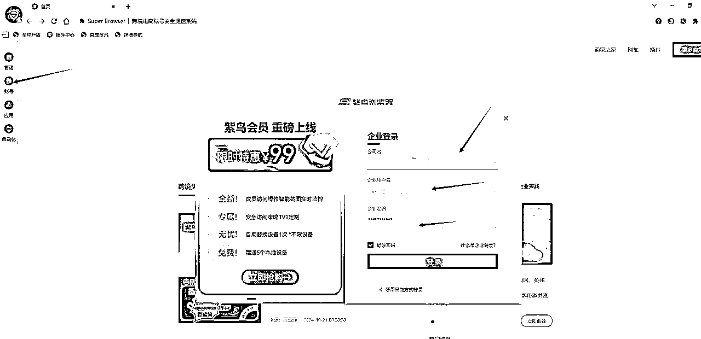

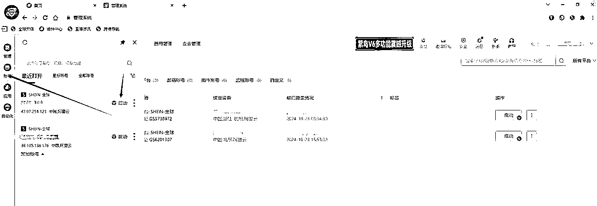

# 三、【实操2/3】选品与货源

# 💡

本章提要

做 Shein 全托管，选品和找货源是绕不开的硬技能。

这一章重点看：

✅ 选品方法论

✅ 新手别碰的 10 类产品

✅ 爆品怎么选

✅ 货源怎么定

# 3.1 选品主线

目标很明确：找平台还缺的空白商品。平台有招商需求，往往就是机会商品、趋势商品冒出来的时候；别的平台卖得动，Shein 上却少有人做，这种更值得看。

建议品类：家用纺织品、家居生活、工具家装、宠物用品、玩具。

这几类对新手相对友好。

# 3.1.2 怎么选

# 3.1.2.1 工具准备

需要 Shein 助手和卖家精灵插件，在浏览器扩展里添加即可。以谷歌浏览器为例，添加插件需要特殊网络环境；这两个插件不要放在紫鸟浏览器里用。

卖家精灵插件地址：https://www.sellersprite.com/v3/knowledge/feature/sellersprite-chrome-extension-download

Shein 选品助手插件地址：https://www.yuque.com/geekbi-com/shein/mbuh4r0n2yynwcf7

① Shein 选品助手安装：打开浏览器右上角菜单 → 扩展程序 → 进入 Chrome 应用商店 → 搜“Shein选品助手” → 按提示安装。

② 卖家精灵安装：同样从右上角菜单进扩展程序 → 打开 Chrome 应用商店 → 搜“卖家精灵” → 按提示安装。

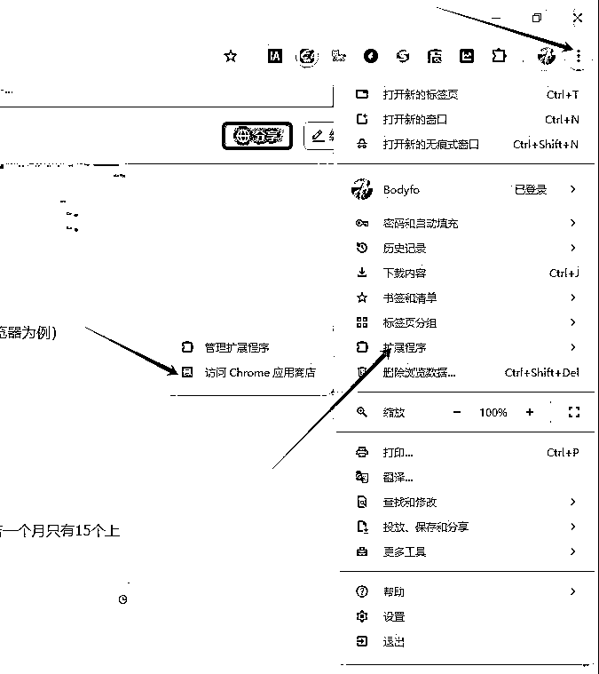

# 3.1.2.2 动手选品

品类还是那几类：家用纺织品、家居生活、工具家装、宠物用品、玩具。

百货类供应链好管，和 Shein 的空白市场贴合，也符合平台当前主推方向，对小白最友好。

方法1：进 Shein 店铺后台 → 商品管理 → 商品发布 → 机会商品 → 选想做的类目和机会类型 → 找到平台发布的类目需求 → 用类目关键词去亚马逊或 temu 搜。关键词可以先用百度翻成英文。

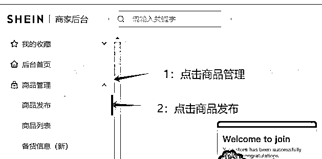

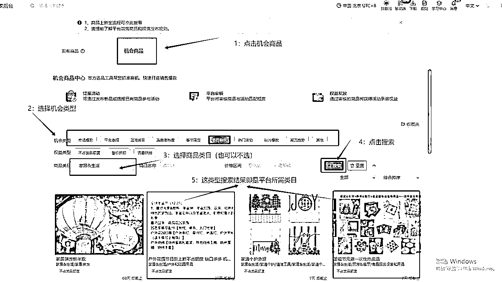

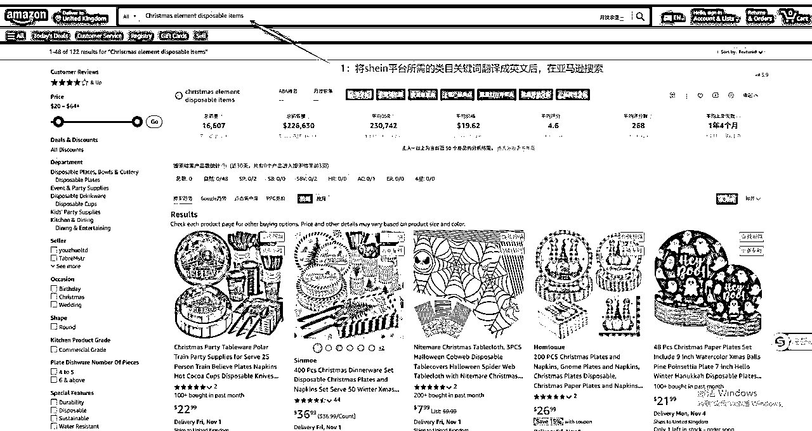

亚马逊、temu 的收货地址设成美国。设置方式如下：

② 在结果页筛选：上架时间半年以内、月销 400—1000 的产品 → 把关键词拿到手机端希音搜 → 希音上没有这类产品，就可以考虑上架；如果已经很多，就放弃。

方法2：进 Shein 店铺后台 → 营销管理 → 机会商品 → 选机会类型 → 找到平台发布的产品需求 → 点查看大图 → 把图片存到本地。

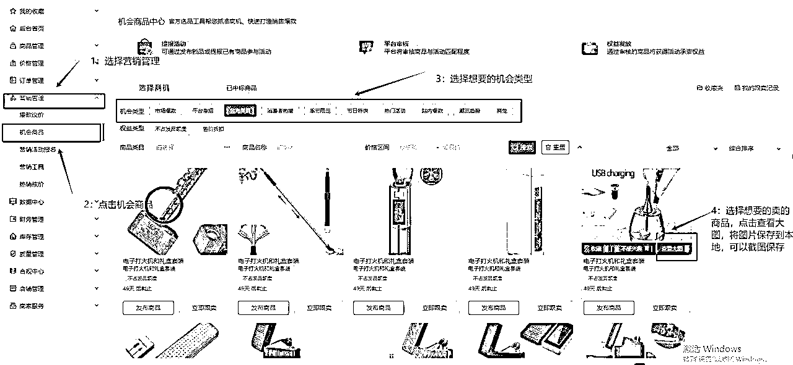

（需要特殊网络环境）打开：https://www.sheinshuju.com/plugin/search-image?url

→ 上传刚存的图片 → 选 Shein，看有没有同款；同款太多就别选 → 如果 Shein 同款不多，再去亚马逊或 temu 看这个品在别的跨境平台能不能卖。

如果 Shein 同图搜款没找到相似产品，再用关键词去 Shein 前台搜一次做测试。有时是没识别到，务必用关键词补搜，能看到更多信息。

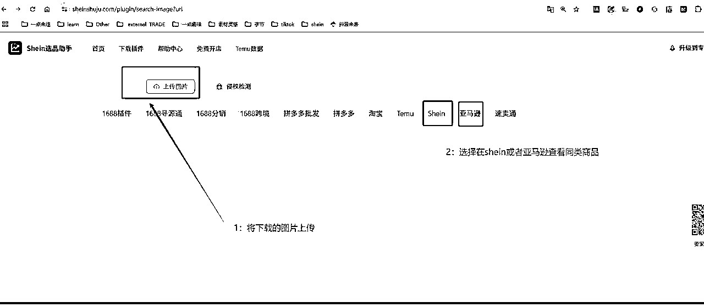

# 3.1.3 新手别碰的10类产品

1. 饱和到极致的“天坑”类目

有些类目已经挤满，新卖家很难插进去：要么审核不过，要么过了也只有约 1% 的起卖概率。比如化妆品收纳盒、鸡蛋收纳盒。

新品核价看 1688 第二档、第三档价格，走机器核价；老款按 1688 最低价×0.8。

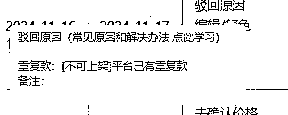

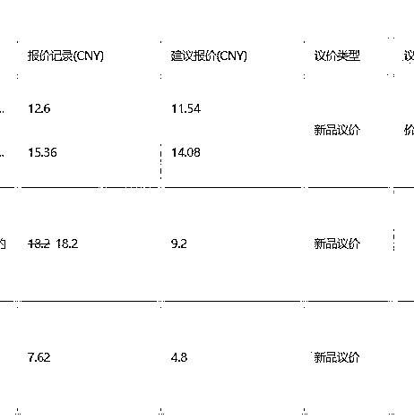

怎么判断是不是天坑？看热卖款评价，大多在 500—1000+，上架时间普遍超过 1 年，近 3 个月上架还能卖起来的同款很少。

可以搜：Transparent Vanity Storage Box

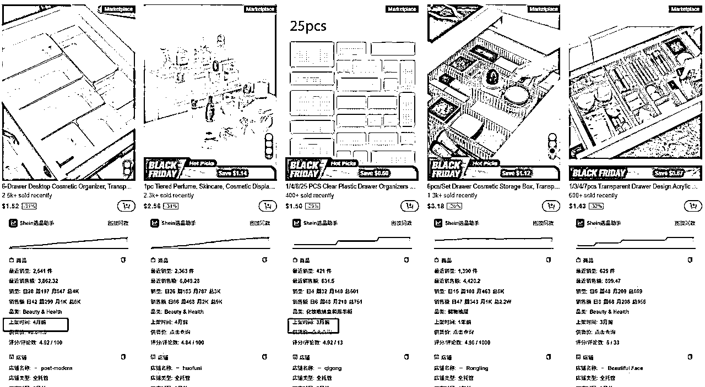

2. 需要资质的敏感货（新手先避开）

有些产品要上传证书，前期别碰，成本太高。

① 餐具类，比如刀叉勺、碗碟、擦餐盘、托盘，凡是会接触食品的，都要欧洲食品接触类检测报告；没有的话欧洲站点会被下架，销量受重创。

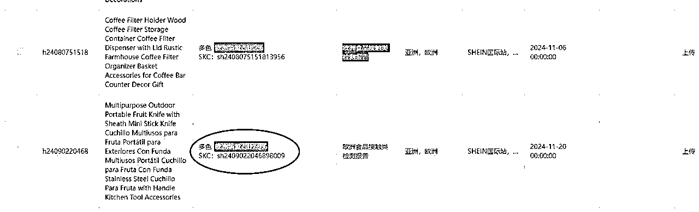

② 带电池或电子类产品，需要一堆证书，例如 MSDS、UN38.3、电子电器产品标签实拍图certificate_type_id308、说明书（五国语言）certificate_type_id310、CE符合声明DoC。

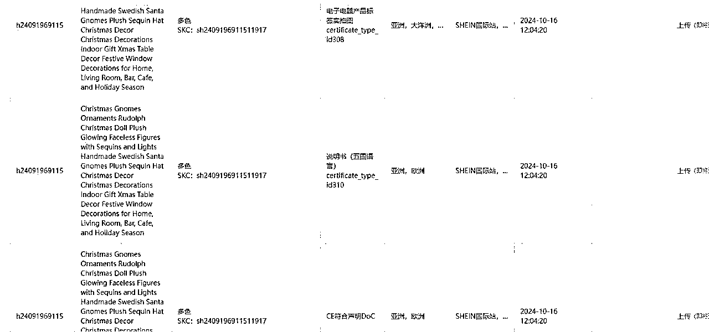

③ 蜡烛、香水、液体、膏体，全部要证书。

3. 别追一年以上的老爆款

同款上架超过 1 年还在热卖的单品，新商家就算把价格压得很低，抢到订单的概率也不高。希音的店铺权重、链接权重，比国内淘宝、京东、抖音高得多。

产品 ＞ 上架时间 ＞ 价格

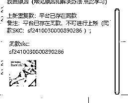

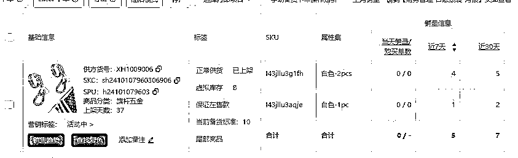

4. 季节品要卡准上架窗口

季节性产品对上架节点极其敏感。别人已经卖起来，你再跟，很难放量。

比如返校季饭盒 9 月大卖，真正卖起来的链接基本是 7 月上架的；9 月平台才发需求，这时再跟，成功概率很低，大势已去。就算平台发了需求，季节品窗口过了，上架也没用（返校季、万圣节 30 个品已测过）。

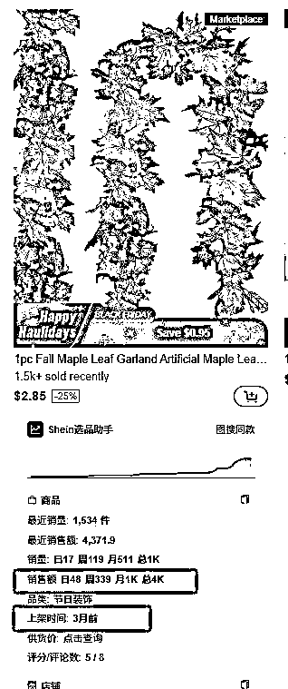

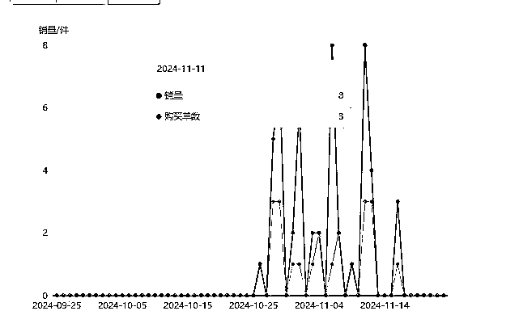

后上架还有断货风险：先上架的人拿得到量，会提前给工厂下单；等你抢到订单，往往只是小单，工厂不会优先给你发，可能长期发不出货。

急采不发货，罚款是售价的 5 倍×订单数。

5. 跨境平台没需求的品别碰

别凭自己感觉，觉得好卖就上。先用特殊网络环境看国外有没有需求。国内外文化差异大，产品需求差得也远。不要“我觉得”，要“平台觉得”（20 个淘宝爆品、30 个抖音爆品已测，全军覆没）。

去亚马逊或 temu 搜同款，看最近销量。

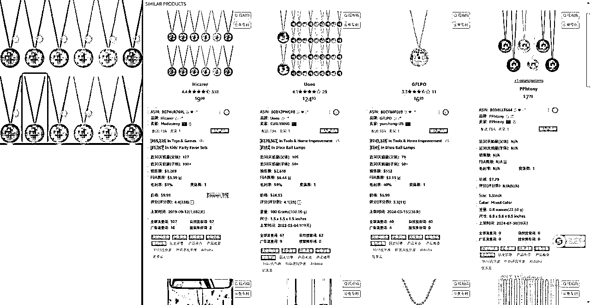

如果是季节品，同款近期销量都不高，就找相对最高的链接看往期销量，可能只是还没到卖的时候。

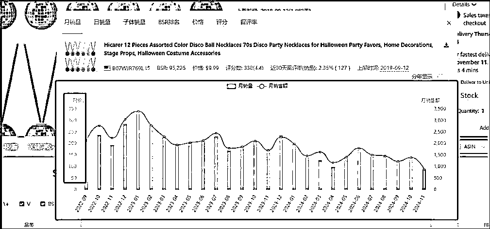

6. 侵权品不碰

上架终审会驳回；没驳回的，被抓到也要罚款。所以明显侵权的产品一律不上，比如迪士尼周边、美国电影周边。专利侵权会罚款，图片侵权会下架，只有一次申诉机会。

侵权品上了也是浪费时间。

7. 毛利过薄、采购价过低的不做

① 亏损或毛利低于 10% 的产品不开发。至少要留 10% 的成本给发货、贴标、运费。最终核价利润不足 10%，甚至亏钱，就别做。钱留着自己花，别给平台做贡献。

② 总采购价低于 3 块，后期优化空间也很小，这种低利润产品不开发。

我们的成本算法：采购价＋运费（1688 显示运费÷3）＋贴标 5 毛。

贴标不一定每家都能贴，要提前问清楚。

8. 易损品与差评同款慎跟

① 易坏、易破损的产品很容易出质量问题。希音会控价格也会控质量，每个产品都有质量评级；等级差会被限流、下架。所以已知有质量风险的，不要开发，卖起来也会被下架。

② 跟卖时，如果同款评分低于 4.0（评论平均数要大于 50；只有一两条评论没有参考意义），不要跟，后期也会被平台下架。

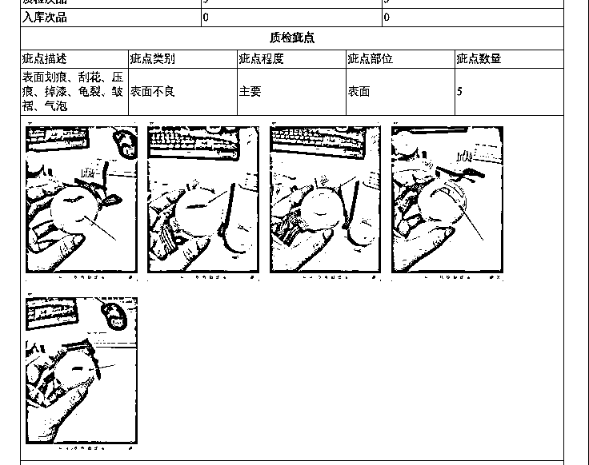

这个产品核价有 6 元利润空间，一天几十单。第二批发货时我加了纸盒，凹陷货损没那么严重了，但还是有污渍。准备明年上黑色，今年已经来不及。

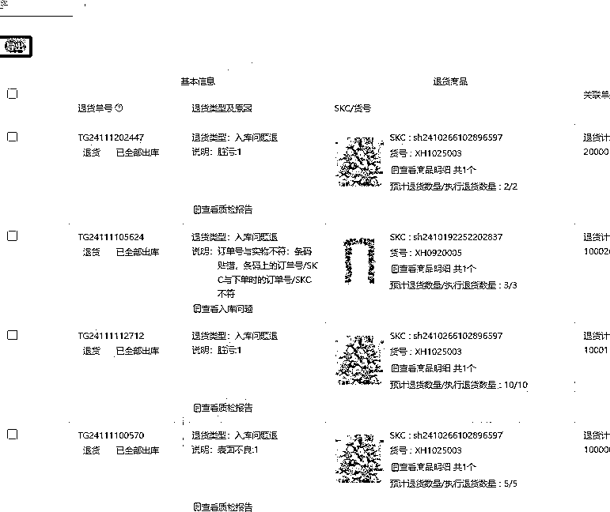

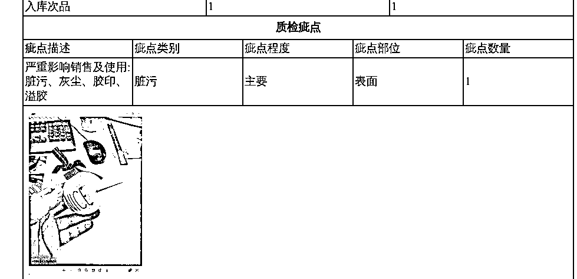

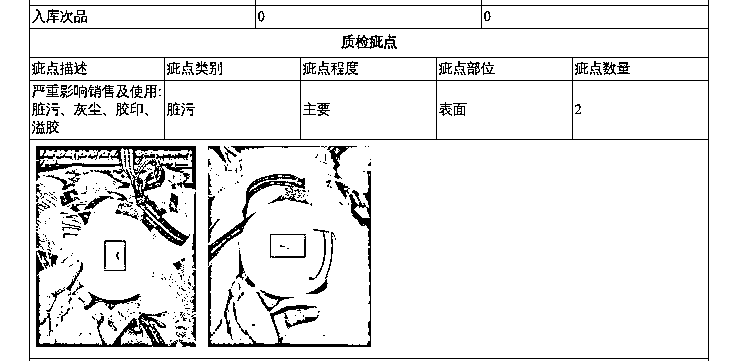

塑料软壳、玻璃如果确实想开发，一定要把包装做好，让厂家提供单个球的 opp 袋子＋纸盒。

注：直接问 1688 供应商加盒子包装多少钱；如果是纸盒包装，一定要在表格里标清楚，方便小善团队采购人员正确下单，因为大部分产品都是 opp 袋子。

9. 高价品小心开发

希音上卖得好的基本是低价。售价高于 30 美金，或采购价高于 30rmb 的产品，开发时要谨慎，风险高、卖出去概率低。

Shein 前端定价由供货价、长宽高、重量、其他平台售价决定×其他未知。

注意：重量超过 1000g、采购价超过 30rmb 的品，谨慎开发。

链接上架完毕，先自己去Shein买家端搜一搜同款。我之前碰到过一款普通香炉，买家端竟标到140美元，这种价位基本没人接。一看不对，就回头查重量字段有没有填错，或者设个低价SKU做引流。

10. 禁售红线别踩
食品、种子、药品、盗版侵权，以及带安拉、天主等宗教图文的内容，都不可发；宗教类信息也避开。

# 3.1.4 爆款筛选思路

# 3.1.4.1 跟平台新品，捞小爆机会
若同款集中出现在最近半年内，并且评价已经积累起来，说明它属于新近跑出的款。抓住上架窗口，就有动销机会。

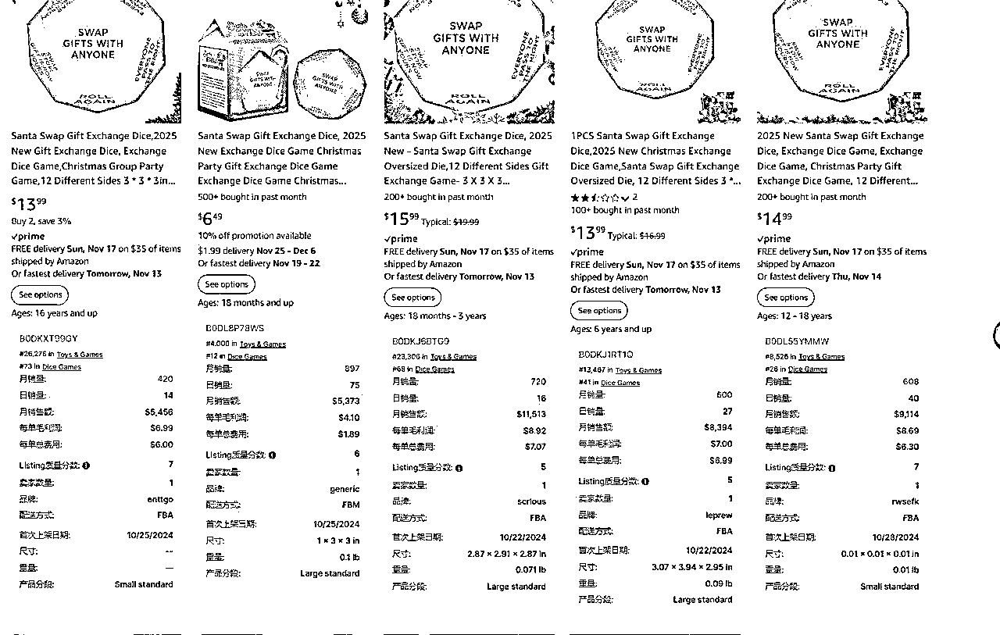

不妨用亚马逊新品榜反查。

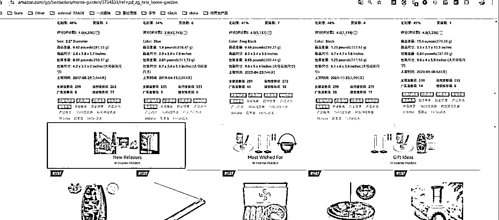

# 3.1.4.2 跨平台热卖，博大的机会
这类款不挑卖家，铺到多个平台都能走。亚马逊、Temu等已热，而Shein尚未起势的，更值得盯。

找法分两种：一是从机会商品池验证；二是反向操作，先锁定热卖款，再回机会商品池匹配。

① 关键词法：例如Shein前端杯垫近期起量，说明平台在推，再去亚马逊、Temu搜同款。

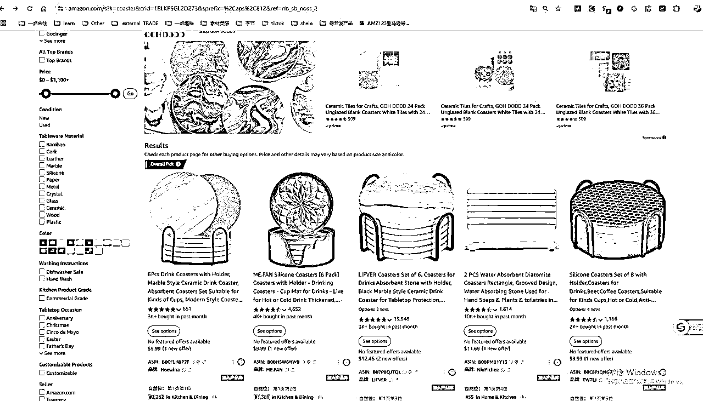

② 榜单法。

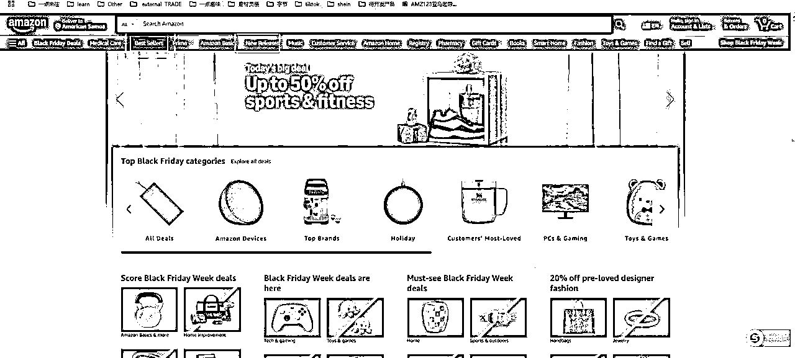

盯热销榜和新品榜。

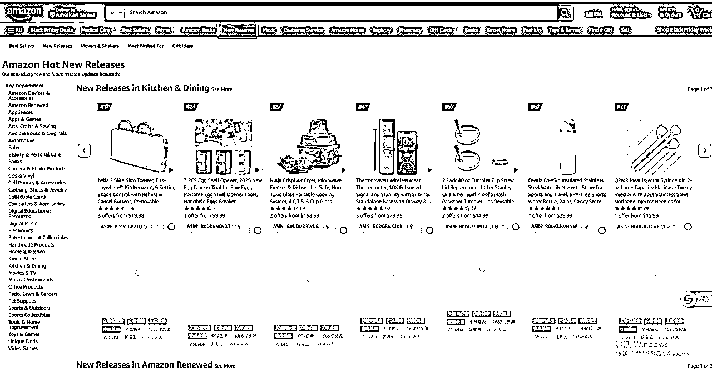

订单真伪要甄别：第一，评论数是否陡然上升；第二，同类老款已长期热卖，而该链接既无价格优势、也无其他亮点却上榜，需存疑。

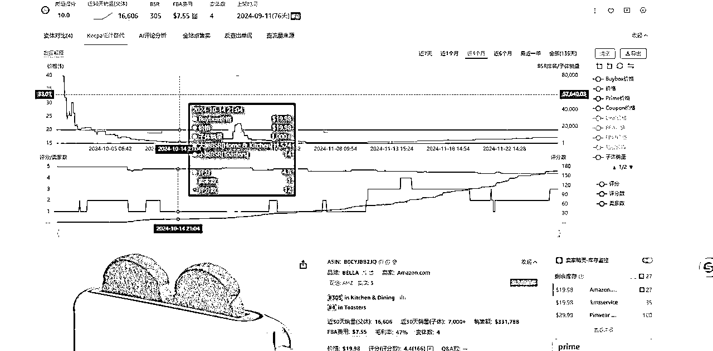

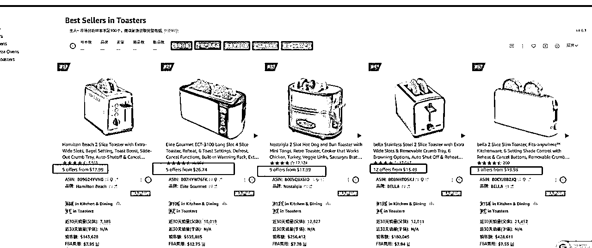

若同类卖了好几年，此款价格上没有明显长处，也要小心。若卖家是亚马逊官方的，销量造假可能性低；非官方卖家则大概率有水分。

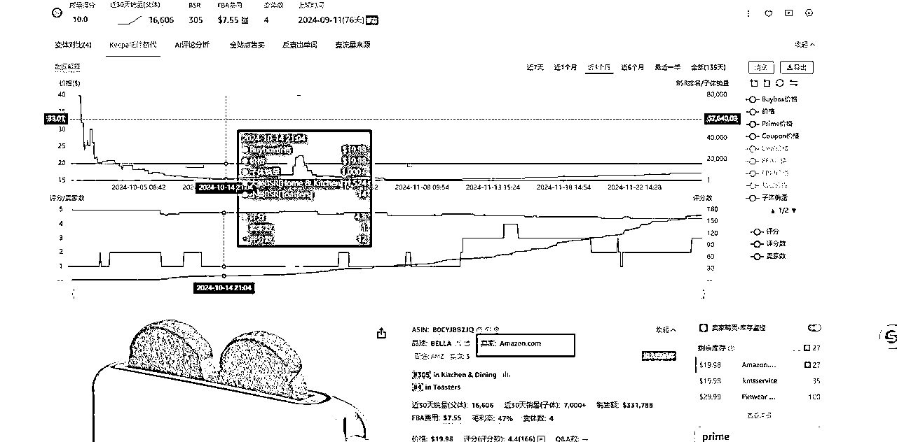

# 3.1.4.3 平台急推品类，先验真伪
买手每周会给需求清单。别急着铺，先到买家端验证。真需求，快速上；伪需求或测试需求，谨慎。已测过20个平台测试需求，发布后平台无反馈。

验证方式：用产品关键词搜Shein前端，看①近一两个月新品多不多；②这些新品上架后是否动销。若新品普遍热卖，就是真需求，速度决定爆单。

举例：Christmas towel。

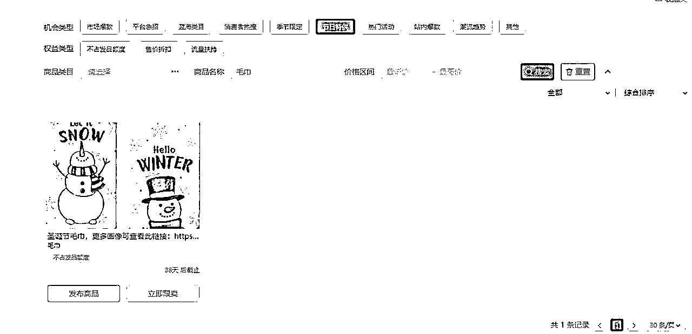

平台验证需求：

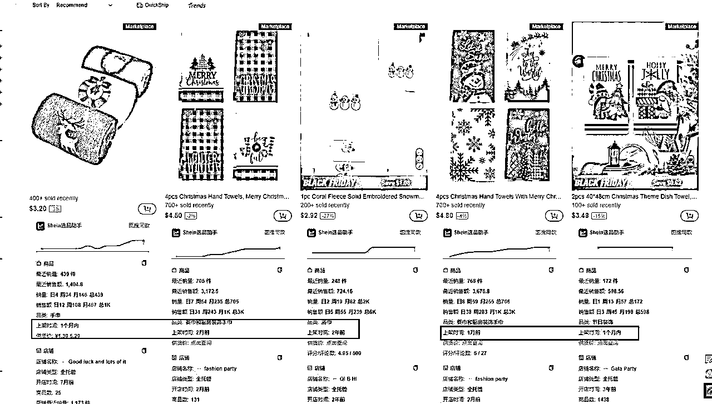

若很多链接是近期上架且销量不错，需求为真，赶紧上。

注意：同款链接若已到6条及以上，别跟，晚了难爆。改做差异化毛巾，只要带圣诞元素都可快上。

拆元素：毛巾+圣诞（驯鹿、雪花、圣诞树、圣诞老人），再回平台搜需求。

# 3.1.4.4 节日与季节品，卡时间
跨境节日多，尤其下半年旺季。节日风格单品可快速开发。

返校季：饭盒、饭袋、文具、书包、派对用品都好卖。

万圣节🎃：核心是cosplay，色调偏黑黄。往年爆的有黑蝙蝠、黑蜘蛛、黑巫师帽、黑纱、枫叶藤条、黄仿真花等。

圣诞节🎄：圣诞树、圣诞老人、麋鹿、红饰（一品红等）、绿饰（藤条等）都可选。

注意：季节品要看往年同期销量，近期好坏不代表全貌，节点要卡准。

# 3.1.4.5 相似款与升级款，藏着爆款相
热卖品若出现功能替代、进价更低、体积更小的版本，上架后往往好走。同一需求下，体积小常带来更低售价；跨境运费高，产品降价和缩小体积都能压成本。

例：徕芬替代戴森，成本约十分之一，体积也更小。

# 3.1.4.6 复制热卖元素，新手先缓
把热卖品中的元素抽出来，平移到别的单品。例如圣诞毛巾就是这种开品法。新手暂不建议。

# 3.2 找合适供应商

# 3.2.1 快速锁定货源
亚马逊页面可用卖家精灵插件点1688货源。

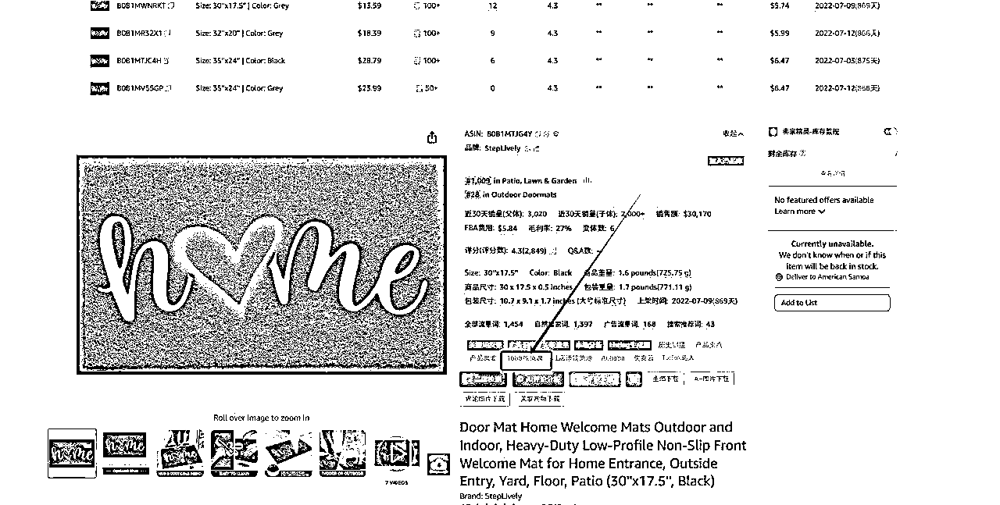

或悬停图片，点图搜同款—选1688寻源。

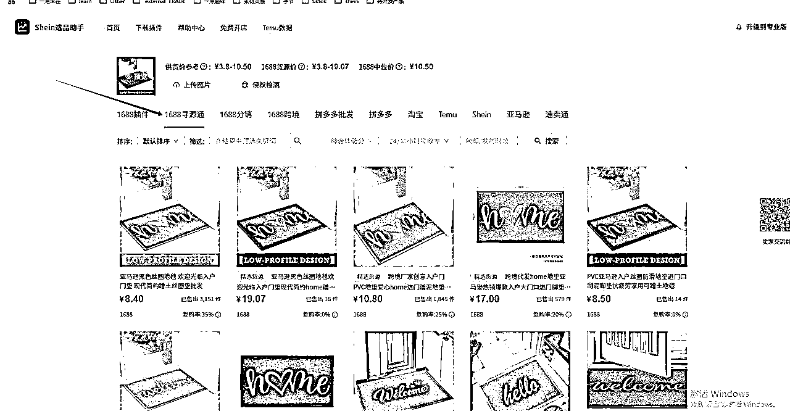

# 3.2.2 筛工厂
结果页按价格升序，会混入无关品，耐心往下翻，别过快；看到相似链接，Ctrl+点击新开，一次比5-6家。

# 3.2.3 关键筛选点
1 起批量低于5个的优先，起批多通常无现货。2 选最低价。3 同价中优先江浙沪、起批小、已售多、复购高。

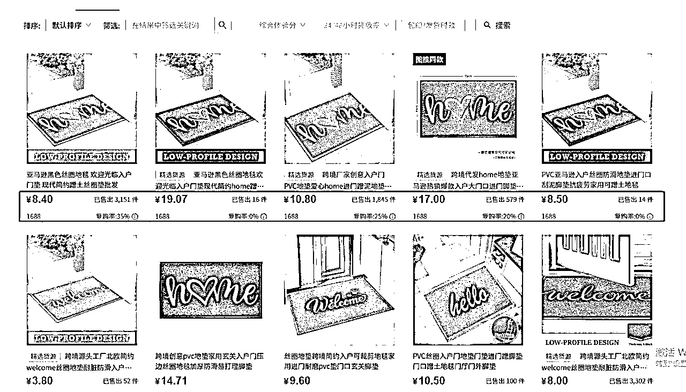

4 页面起批数不可全信，问清多少起批、有无现货。5 包装尺寸和重量务必问，详情页即便填了也要复核，很多是随意填。

# 四、【实操3/3】上架与日常经营

# 💡 本章要点

本章覆盖：

✅ 上新方式
✅ 定价
✅ 店铺运营
✅ 审核常见问题

# 4.1 上新路径选择
上传有两条路。后台直传受额度限制，新店通常每月15个。商品列表页可看可发品数。

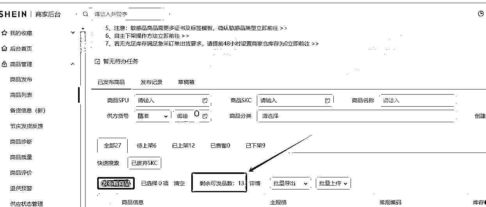

方式一：后台直传。路径：商品管理—商品发布—选分类—发布商品。

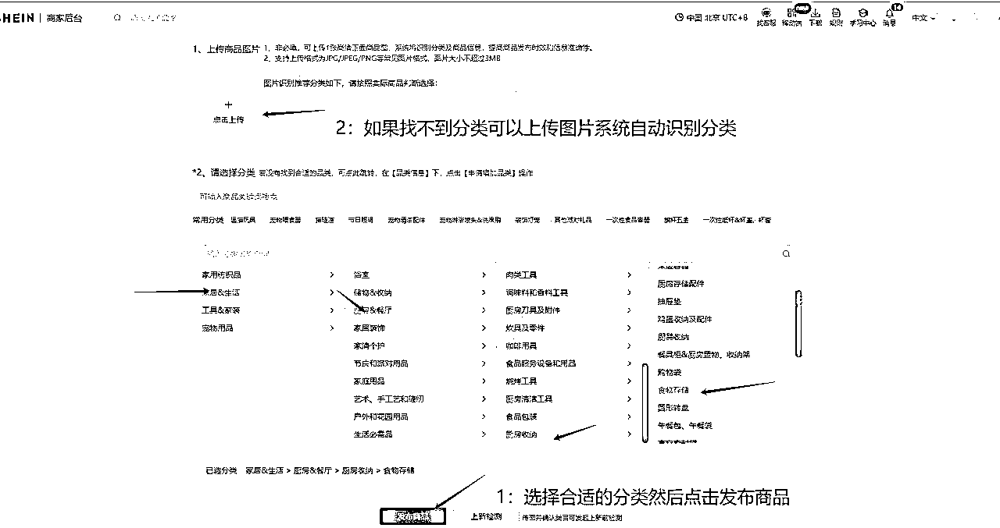

方式二：机会商品通道，不占额度。路径：商品管理—发布商品—机会商品—选机会类型—输入关键词—搜索。

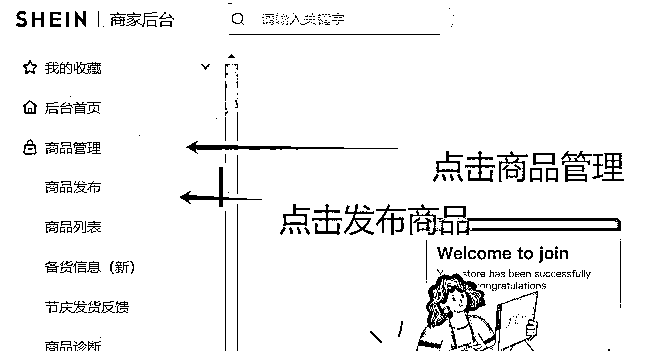

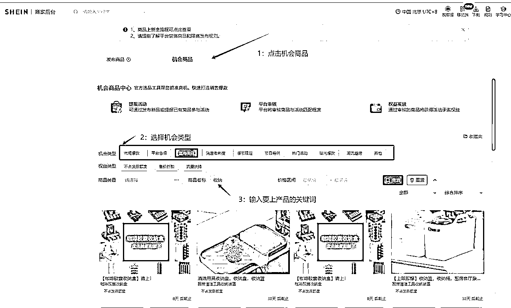

注：

1 搜索结果均为上品通道，在该处发布不占额度。
2 找不到合适通道，换机会类型、关键词，或往后翻页。
3 通道有两种，单品通道要求与图完全同款。
4 圈出的均为单品通道，只能上跟图一致的款。

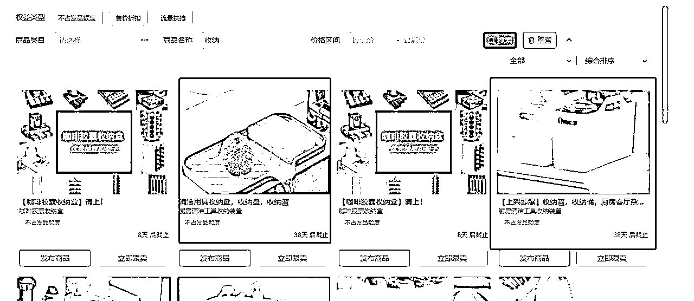

# 💡 另一类是类目通道

只要归入“咖啡胶囊收纳”即可。新手九成选此路，上品机会多，试错空间大。

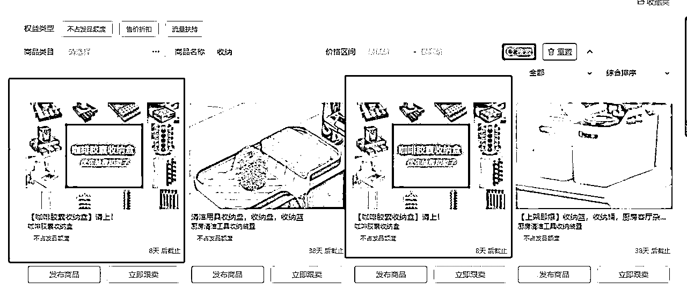

# 4.2 基础信息填写

常规需填：标题、敏感类别、材质、关税种类、数量、规格、图片、供应信息。

# 4.2.1 标题

可参考亚马逊等平台标题，但品牌、规格要核对。示例：Lansinoh Breastmilk Storage Bags 3pcs 500ml。品牌名Lansinoh需删；确认供应商或自家产品是否为3pc 500ml。参考高销量链接。

标题须含核心词、场景词、功能。核心词说明是什么，场景词说明用在哪。如：宠物垃圾袋、宠物用草莓便便袋、防漏。

规格有优势可写；多规格写最大规格。关键词用英文逗号分隔，介词小写。大词靠后，如“宠物垃圾袋”和“便便袋”，前者放后。平台在无销量好评等因素时，会按标题关键词顺序排序。

示例：标题1 加厚大码风衣防风防水风衣；标题2 防水风衣加厚大码风衣防风。搜“防水风衣”时，标题2优先。

标题敏感词见下图：

# 4.2.2 商品属性

带*必填。

（1）标题数量、规格与属性、图片一致。
（2）属性真实，包装规格尤其。
（3）敏感商品属性写清。

电池：MSDS和UN38.3（UNDOT）等认证；包装和操作要求严，选品时确认供应商资质。

食物：CIQ或熏蒸证明。

药品：运输需国家音像出版社证明，生产方或出口方出保函。

粉状、胶体等不稳定品：如化妆品、护肤品、精油、牙膏、口红、防晒霜、饮料、香水等，需MSDS和出发口岸商检报告方可报关。

尖锐类：运输信息真实，包装防护到位。

仿牌：正品或仿牌都涉侵权风险，走敏感货渠道。

# 4.2.3 规格

主规格仅一个子属性。多颜色放尺寸属性里加，属性名备注清楚。

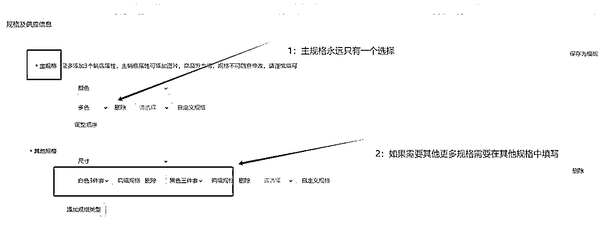

# 4.2.4 图片

（1）最小边900px，所有图同尺寸，如一张900*1210px，其余也需一致。
（2）详情图至少6张。
（3）不得出现中文。
（4）少用白底图，场景图加细节图不少于5张。

（5）背景简洁美观，色系统一，构图突出产品。未聚焦产品、模型失真、背景过暗与产品粘连、拼图抠图、模糊、尺寸图放首屏，均易驳回。

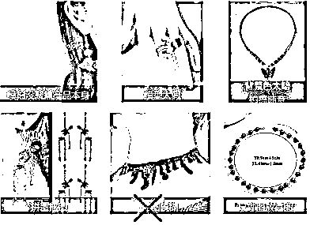

图片收集与处理：工具为浏览器插件图片助手、美图秀秀。

图片助手安装（谷歌为例）：右上角三点—扩展程序—访问应用商店—搜图片助手—安装。

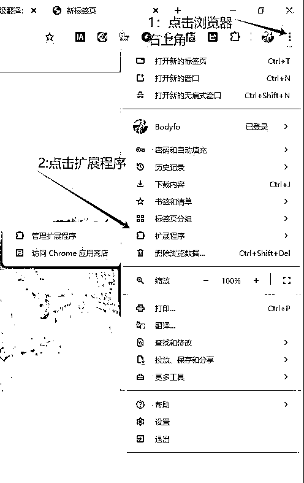

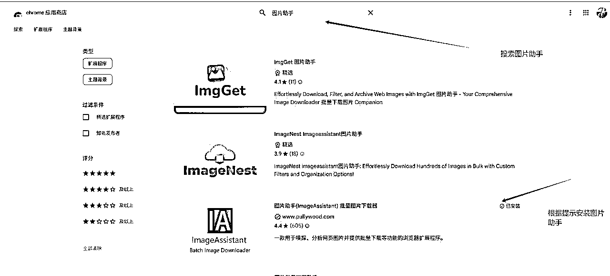

（1）获取：打开目标网页—点右上角图片助手—提取本页图片。

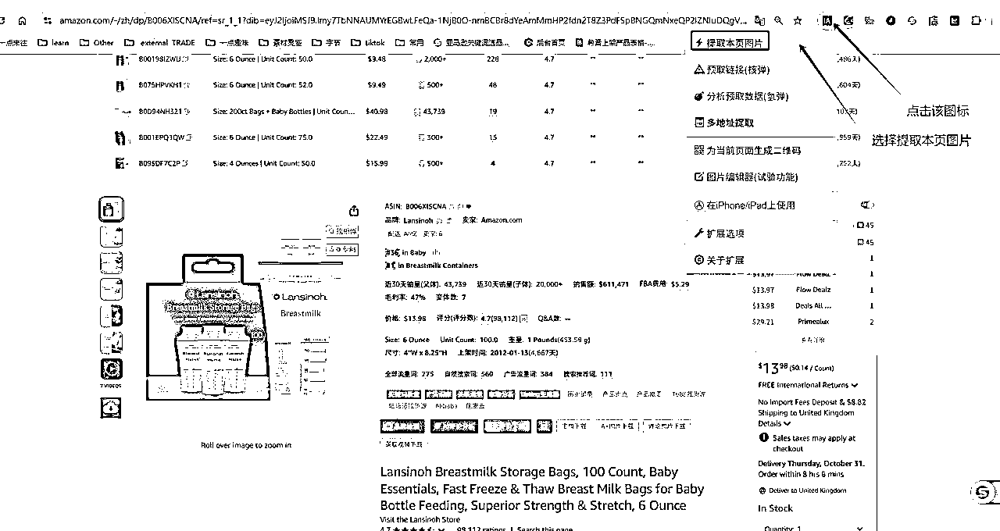

下载1：筛像素不小于400*400或500*500—打开选择—点目标图—下载。下载界面可继续，也可先改下载位置；建议建独立文件夹存放。

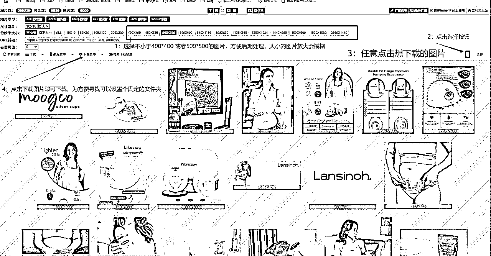

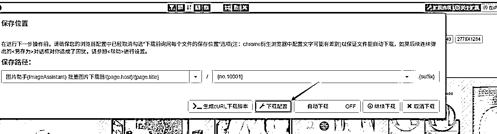

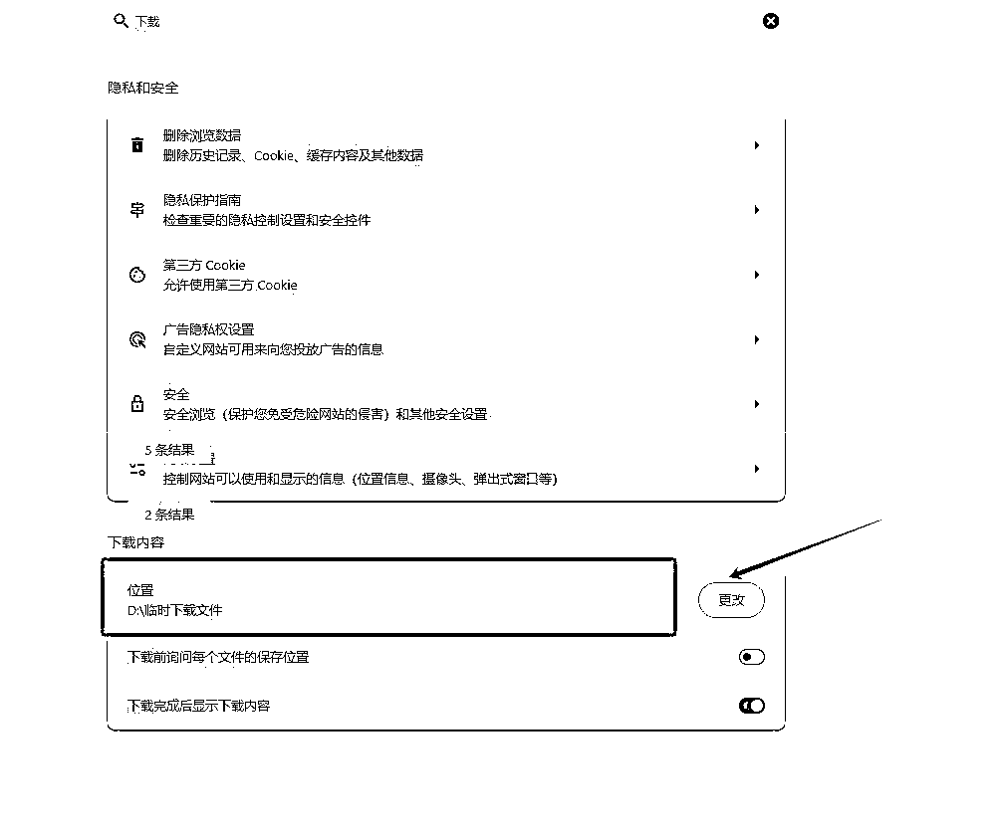

下载2：卖家精灵插件可直接点下载。

（2）处理：图片编辑—新建画布—输入尺寸（最小边900px）—拖图入画布—调至画布大小—保存。

上传时站点选“所有”。

# 4.2.5 供应信息

价格按1688进价加20%-30%利润。含包装尺寸重量在选品时与供应商确认，且与发货信息一致。产品尺寸、含包装尺寸都要记录。

# 4.2.6 货号

上品人缩写+日期+第几个品。例XX1022001=XX在10月22日开发的首个品。商家SKU表示具体规格，如XX1022001S1、XX1022001green，分别指该品S1款、绿色款。填完发布，进入审核。

# 4.2.7 审核

审核约3-7天，通过后约2-3天上架。

# 4.3 定价

通常按进价1.2-1.3倍。若进价极低，乘1.2后仍很低，如1*1.2=1.2，可加2-3元核价；更建议做2pcs、3pcs或规格组合，避免核价不过。

别一上来标高，尤其低价品。标太高，买手核价时会压到最低，且会参考1688。

档位参考：8 9-10 15。新品取第二、第三档最低价；老品按最低档×0.8。

例：1688价6.5，买手可接受7.2-9.6。你报10，可能被议到7.2；报8.3，可能直接过。

# 4.4 店铺运营与上新

1 每天看有无议价待处理。
2 盯审核，通过即采购备货。

航海船员采购备货：店铺—商品管理—备货信息—excel下单—按模板填产品与数量—上传—通知采购同学。采购量：新品首采3个，后续按7天销量下。

普通圈友采购备货：先从1688下单，货放自己处，先质检。1688发货问题多，别让供应商直发Shein仓。一般预采2-3个，后续按7天销量。

出单后再发Shein仓库。Shein验收严，质量、货不对板、唛头、贴标都不能出错。

发货：第一步 查待发货订单（店铺首页或订单管理）。

第二步 勾选订单，点一件发货。

第三步 填发货信息。

第四步 1 打印商品条码及包裹信息（条码、面单）。

2 打印商品包裹信息。

第五步 发货前检查。

# 4.5 常见审核问题与修改

活动已结束；价格无优势导致审核未过、跟卖未中标；季节活动已结束。

侵权、禁忌、禁售、证书驳回。禁忌含政府、宗教、歧视等；宗教、政治、专利、民族歧视、文化等也需避开。国内常说“大码服饰”，国外直接标适合多少斤穿。

图片模糊、有中文。错放类目—问客服或传图识别。重复款—站内同款多。要求聚合上新—主规格只能一个，其他规格自定义区别。非同款—与机会商品不同款。上品成功率低，平台会延迟审核和推款。价格太高—若有相似款低价供应商，可申诉，传对比图说明差异。

最后，愿大家把Shein玩法吃透，选品做稳，早日出单，在龙哥盟拿到结果。