# 202412 实战手册｜AI数字人，视频号带货新解法

> 来源：[https://ocn93f5d9olj.feishu.cn/docx/Q201dLxRCoWpZixbGYZcWZBznMf](https://ocn93f5d9olj.feishu.cn/docx/Q201dLxRCoWpZixbGYZcWZBznMf)

# 备用通道：MM188166M（李李）高频更新 + V：MG10127

# 前言
# 💡

视频号带货的草莽期已经翻篇，搬运混剪的玩法越来越难续命。眼下还能持续出单的内容，几乎都带真人出镜；可不少人一入镜就浑身不自在，表情和说话都发僵。好在AI一路进化，数字人已经能把镜头表现力、情绪传达、语言节奏拿捏得相当稳。这一期航海，就带每个人亲手搭出能卖货的数字人，让变现来得更顺手。

本趟航线的核心玩法：

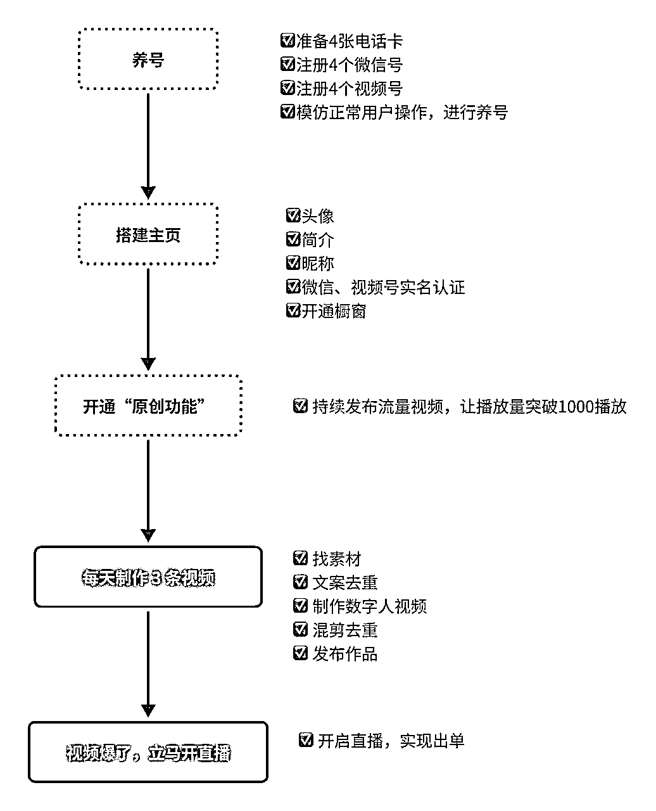

# 一、项目认知：数字人怎么在视频号上带货

所谓数字人和视频号带货的搭配，本质上是让数字人生成带货视频，再借挂车、橱窗、直播完成转化。我们这批样板主打的组合是橱窗自然出单+短视频爆了之后开直播接量。下方案例视频演示了引导到橱窗下单的路径；直播接单的效果可看：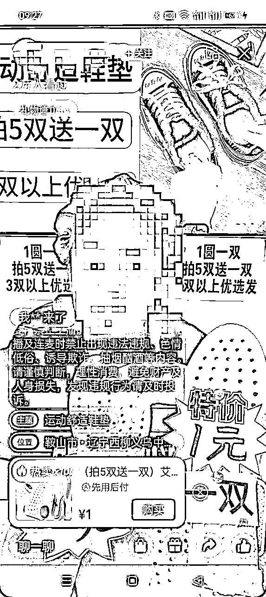

数字人带货主要拆掉两堵墙：

1. 主播表现力。许多人的镜头表现力天生欠缺，短期磨也磨不出来。没表现力？数字人照样能完成口播带货。
2. 内容生产效率。公模数字人、自录数字人都能批量产视频，“大力出奇迹”从此不用靠反复实拍。懂得最基础的剪辑，就能跑通全流程。

挑战也要讲清楚：视频号平台把关比较严，即使文案风险不高，也比较容易吃违规。所以账号至少要备4个，心里还要做好被限流的准备。

整体操作链路看下图，核心就是规模化做“混剪×数字人”带货视频（软件和版本各有差异，视频只为建立整体观感，详细教程在后）：
11月16日.mp4【可在线播放】

# 二、实操第一步（1/3）：备齐 4 组账号

# 2.1 搞定 4 张电话卡 + 配套手机

1. 去线下营业厅开副卡：月租10元，赶时间的现场可秒办2张，与主卡共享流量和话费套餐。
2. 在京东买一张“电信无忧卡”：月租5元，下单时多付30元充值成话费，今天买、明天到，每月限办1张。
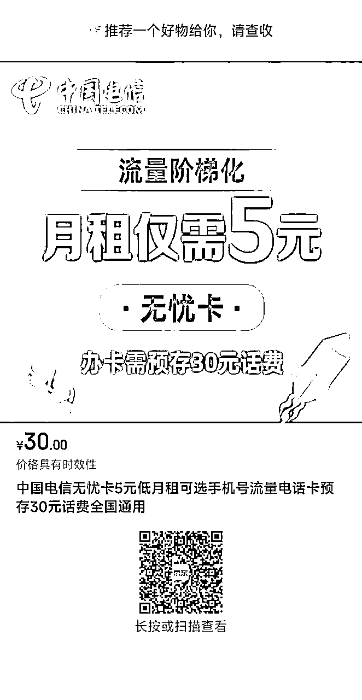
3. 团队低月租卡福利：免费申领、快递到家、激活即用。推荐其中的19元档，就是营业厅同款卡，只是多了个优惠入口：低价三大运营商月租卡。
4. 淘宝还有一类非三大运营商的卡：搜“手机卡”，拍前先问客服，说要用来注册🛰️。卡费几块钱，到手后按说明充几元话费，包年总成本约10元，无月租。保存图片再打开淘宝扫一扫即可下单，每人最多可办70张。注册🛰️优先选三大运营商卡，第三方卡作候补。

5. 手机匹配也讲究：一台手机尽量绑一张卡；系统支持双卡、🛰️双开的部分机型也行。二手手机挑转转买，闲鱼上工作室跑废和拉黑机多，小心踩坑。

# 2.3 注册 4 个🛰️

1. 老号优先。已有🛰️号数量不够再新注册，一张身份证上限5个🛰️号。老号不需要养，跳到下一步直接注册视频号。
2. 新注册的🛰️号要冷上两天再碰视频号。养号动作拆开看：
- 把头像、名称填完整
- 🛰️-我-服务-钱包-实名认证
- 加3个好友，互相聊几条、通1分钟电话，各给对方转一次账
- 关注2个👸号：龙哥盟、龙哥盟服务号
- 每天刷5分钟视频号，挂10分钟直播（挂着就行）
- 发一条朋友圈
3. 实名认证这一步关系到后续提现：带货佣金进的是🛰️零钱，没实名无法提现。一个实名可覆盖5个🛰️号。路径：我-服务-右上角【···】-实名认证。
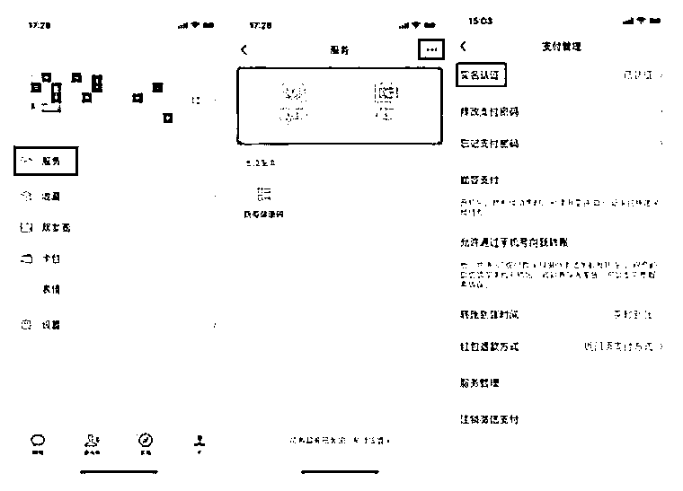

# 2.4 注册 4 个视频号

# 2.4.1 注册视频号

打开🛰️-发现-视频号-右上角小人-发表视频，按提示填资料。名称走中老年用户偏好的路子，如“花开富贵”“上善若水”（仅举例子），其它项随意。
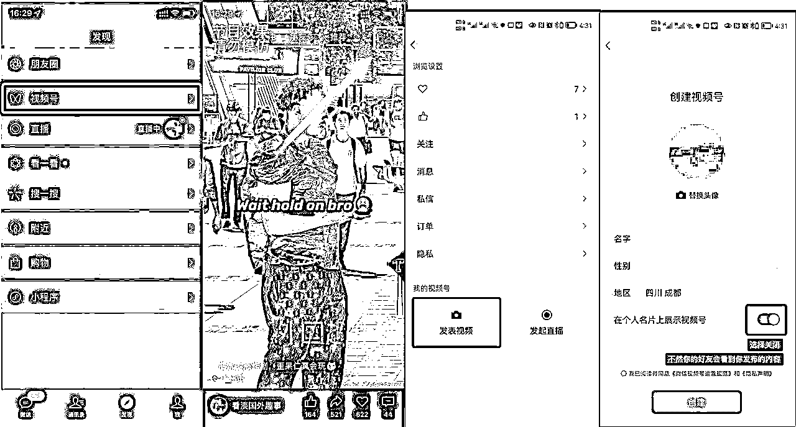

# 2.4.2 设好名字、头像、简介

进入创建好的视频号，打开右上角【···】进入【设置】：
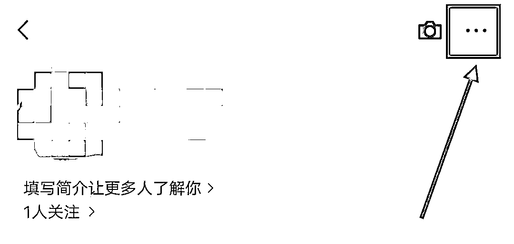
从【设置】里找【资料设置】：

逐一点击【头像】【名字】【简介】完成配置：

# 2.4.2.1 名字

先读一读官方对【账号名称】的规则：
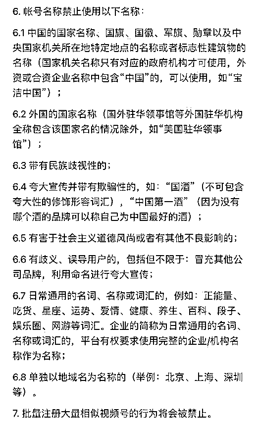
名字直接决定搜索流量。惯用做法是拿赛道关键词叠加，比如国学、书籍、认知。用户搜这些词时，你的号更容易被撞见。如“xx女性思维”“xx智慧说”，看着就像普通用户，而不是营销号；“好物推荐”“好物分享”“**百货”这类名字千万绕开。好听的名字大多被抢注，多准备几个随时换着试。一年有5次改名机会，没灵感就看同类型账号怎么取名，或用【xx-同款在橱窗】这类通用格式。

# 2.4.2.2 头像

头像关系到记忆度。花朵、风景、贴近生活的图都行，妈妈们常用的莲花、荷花也完全在射程内。没有固定标准，但要避开三类：好物推荐图、露身体/胸/背的图、产品主图。头像可以是纯文字（如名字缩写），也能做图文版。没有方向就先搜同赛道视频号大V，看他们头像的风格逻辑。制作可走图怪兽 https://818ps.com/ 、可画 https://canva.com/ 、创客贴 https://www.chuangkit.com/ 。别碰有商标侵权风险的图，也慎用个人照片，否则跟账号定位拧着来。

# 2.4.2.3 简介

简介随时可改，跟着账号定位走即可，成熟大号怎么写就参考着来。千万别出现“点击”“购买”“私信我”这类词。PS：账号初期少做营销动作，等某条视频火了再换头像、铺评论也不迟。

# 2.4.3 实名认证

视频号创建好之后，点🛰️-我-视频号-发起直播，按系统提示完成实名。身份证和视频号绑定比例是1:2，一张证最多给2个视频号实名。
方式一：把脸给家里人扫。先用自己的🛰️注册，再让家人帮着扫脸实名——外人沟通成本高。同时顺手发起第一次直播，并随便添加一件商品到橱窗。
方式二：用别人的🛰️，让对方完成注册+实名+首次直播+橱窗加商品。随后到PC端视频号助手后台，把你绑成运营者。你就能在电脑上发视频、开直播，对方手机盯数据流速，或你直接在电脑看。入口：视频号助手官网-设置-人员设置-绑定运营者。

现在管得比从前严，🛰️实名和视频号实名最好是同一人；如果实在办不了，也别太有压力。

# 开通橱窗带货 @旋子

没有橱窗就无法带货。入口是创作者中心-带货中心，按提示申请商品橱窗。
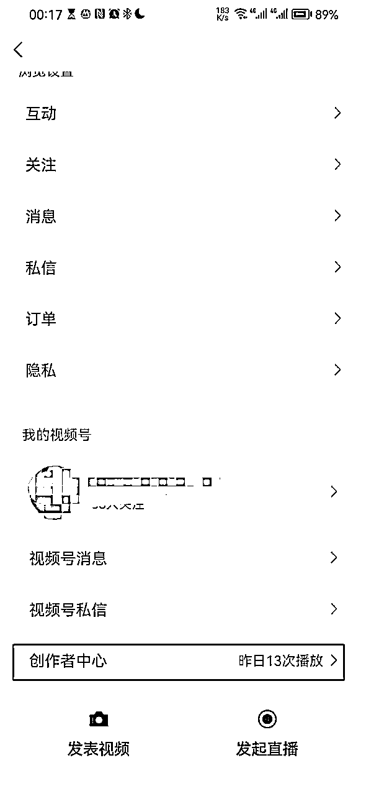
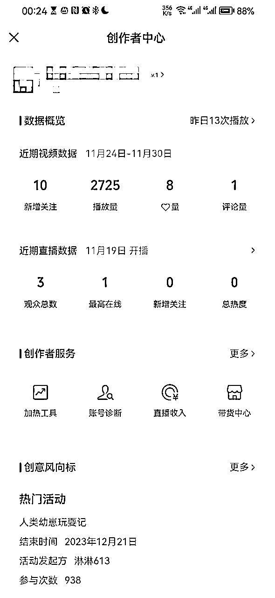
开通时要做橱窗实名并缴纳100元保证金。

# 添加商品 @旋子

从创作者中心-带货中心-选品中心进入，搜索目标商品，点击“加橱窗”。
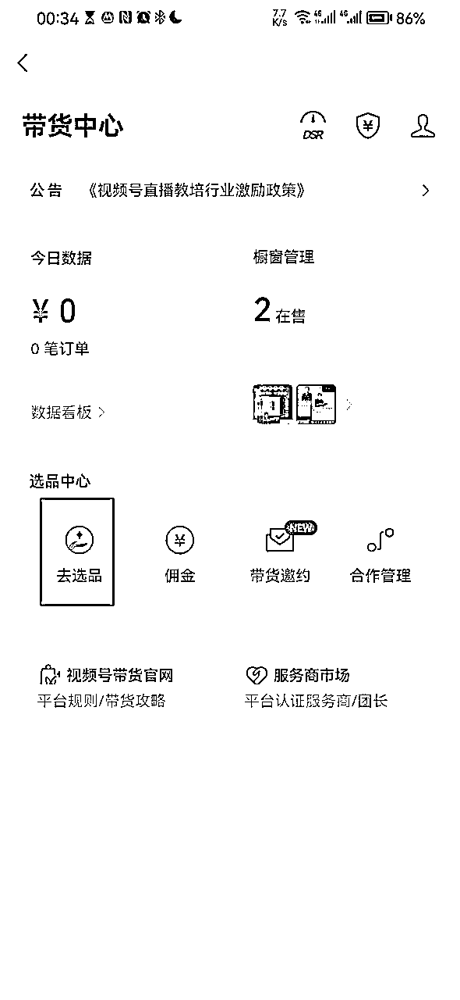
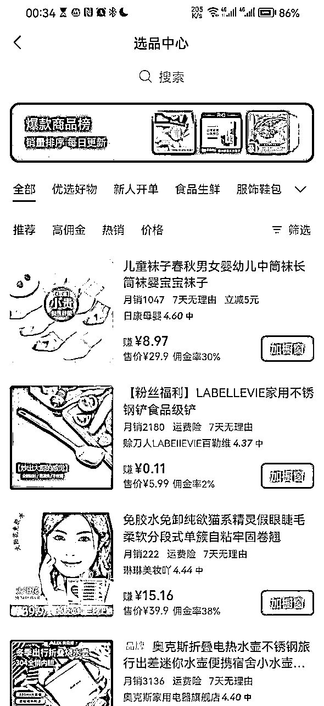
挑品时把佣金率、月销量、店铺评分列成硬指标。商品页一般有商家联系方式，加🛰️谈更高佣金或索要样品都可行。
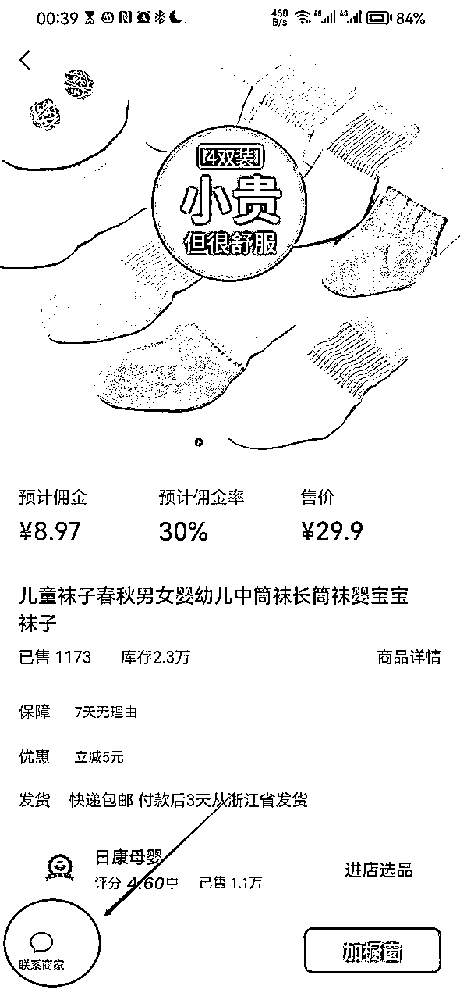

# 视频号带货权限 @旋子

橱窗带货0粉即可开通，它是视频带货和直播带货的共同前置项。直播带货就是直播时挂小黄车，三选一即可：①粉丝达到100；②账号带货身份为商家（开个小店）；③商家授权号（供应链授权，非必要不太建议）。最优先选①，做到100粉真的不难；直播起号的推荐②。视频带货有两个要求：一、有效关注数1000以上，或带货中心账号身份为商家；二、内容合规。
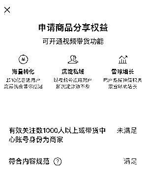
涨到一千粉，通常得靠几个爆款带；想快一点就开小店，直接解锁视频带货资格。只要不发违规内容，权限一般会自动开通。

# 2.4.3 隐私设置

🛰️好友太多、不想让视频号被动曝光的人，关两个开关就行了。操作：🛰️-我-视频号-右上角三个点-隐私设置；“谁可以看我的视频号内容”改成“公开，但不推荐给我的朋友”；“在个人名片上展示视频号”按钮变为灰色即关闭。
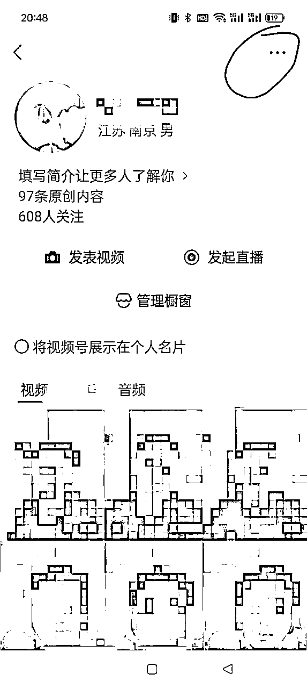
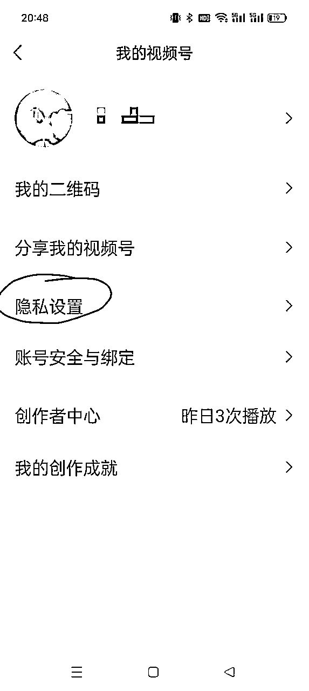
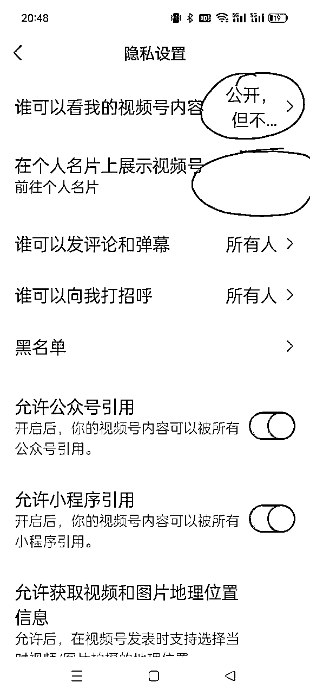

# 2.5 工具准备

# 2.5.1 拍摄设备与软件

主力设备就用手机。今天的手机像素拍短视频绰绰有余，请开后置摄像头，性能更强。怕看不到自己？后面会给镜拍方法，问题不大。有单反当然更好，但大多数人还是手机为主，后文也以手机为主讲。
拍摄软件有硬约束：别装美颜App，别装美颜App，别装美颜App！原相机直出就好。

1.
提词设备与软件：双手机方案最省事，一台拍、一台提词；或手机+电脑组合也行。手机端推荐“提词拍摄”“快题词”，都能直接看字幕；剪映App也集成提词器。下载入口：iOS App Store或安卓应用商店。
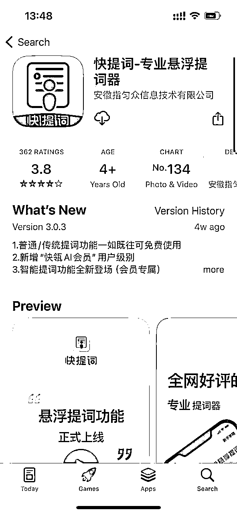
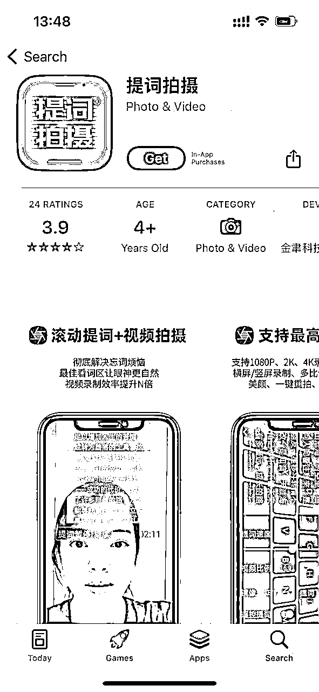
网页端：https://cn.teleprompter-online.com/

2.
收音话筒：声音不好，质感全废。手机直录杂音多，一定得配收音。方案①蓝牙耳机：拍摄时反正会侧身，把耳机藏在镜头看不见的那侧，用耳机麦收音，就省了单独买麦。方案②收音话筒：淘宝或拼多多两三百的足够，初期不必上RODE、大疆这类高价装备。

3.
拍摄支架：买两支平价支架，一个架拍摄机、一个架提词机，稳当又可灵活调节。电脑提词就在家里找个东西垫高。

双机位可调支架也能买，但很多万向软管不牢靠，不推荐。

特别注意：别买那种固定并排的机位——近了拍不到半身，远了又看不见提词器。

4.
补光灯：球形柔光箱更推荐，灯放在左右任意一侧的斜上方；要买三档色温可调的，以便配合不同内容。对侧可以放一支小灯管或挂反光布，具体布光可参考这条视频：https://v.douyin.com/i8jJuV6X/
注意：绕手机的环形灯别考虑，戴眼镜的人会被反光折磨。
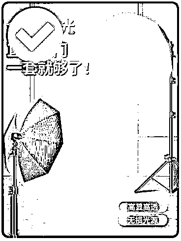

# 2.5.2 剪辑软件

手机端快影、剪映就够，分别是快手和抖音家的产品，覆盖基础剪辑；剪映支持导出60帧。剪映下载：手机版去iOS App Store或安卓应用商店，电脑版 https://www.capcut.cn/ 。有电脑就用电脑版，效率翻倍。
先别追求装备完美。一个小道具从种草到下单再到手试用，时间成本远比想象高——我当初找一支黑板书写顺滑又好看的笔，耗费了大半天。好相机、好灯、好看的服装、好麦克风、精美布景、各种道具，全是加分项，后面慢慢补完全来得及。一开始就把时间砸进去，不如多出几条片子，把劲儿用在创作和运营上。

# 2.5.3 数字人制作工具

- 即创数字人平台：限免，需小额投放抖+并开通权限（详见教程）。直达工具。开通成片教程：4a5dc2010836cc2fa8966061044563e6.mp4（可在线观看）
- 蝉镜数字人平台：注册入口。新手机号必须从上方链接注册，再填群内登记表；本航船员可获赠一个月会员。提醒：非上方链接入口、非未注册手机号、不填登记表都无法计入，登记表发布在航海群。
- A2E数字人平台：访问地址。
- 哼哼猫（全平台批量去水印）：进入工具。
- 豆包大模型声音复刻（试用）：试玩入口。
- 视频去字幕去水印（每天10次免费次数）：每日额度入口。

# 2.6 开通原创功能 @斌斌 @旋子

“原创功能”要靠养。注册之后，每天刷几分钟视频号、用手机发流量视频，一般有两三支片子播放量破千就能开通。发布视频时看到“原创”选项，才算具备一拖五能力。（有些玄学成分：有人一条就通了，有人三五条还不行，多发几条总会来）

1. 老🛰️号开的视频号权重更高、抗违规更强；新号自带平台派发的流量扶持，但权重偏低。各有各的好处，账号总量越大越有优势。
2. 刚注册的视频号先刷10分钟视频、看10分钟直播，隔几小时再发流量视频。一般2-3条播放过千，原创功能就会自动开通。

流量视频怎么做：

# 2.6.1 变老特效流量视频

最好自己口播，找鸡汤、情感、哲理、有趣的话来拍，10-20秒即可，更容易跑量。下面演示完整流程，照抄作业就行；我们还备有流量文案库，直接拿来用。

①找对标账号原素材：视频号里常见的中老年情感、育儿、女性情感、思维认知等赛道，搜对应关键词就能挖出优质账号。比如：
中老年情感赛道：#情感 #亲戚 #婚姻 #兄弟姐妹 #家庭 #人际关系 #情感共鸣
育儿赛道：#育儿 #家庭教育 #智慧父母 #思维认知 #孩子教育
女性情感赛道：#情感 #婚姻 #生活 #夫妻关系 #致男人
思维认知赛道：#认知 #人生感悟 #思维 #智慧人生 #财富 #商业思维
养生赛道：#养生 #中医养生 #汤膳 #食疗
宠物赛道：#萌宠 #猫 #狗 #喵喵 #汪星人 #宠物专家

②拆解文案转文字+内容场景：🛰️搜小程序“语音转文字”。
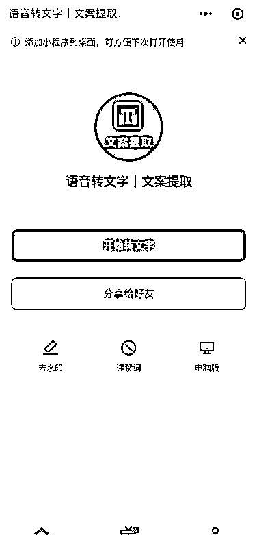

③仿拍配合提词器口播。

④用剪映处理：变老特效+音色调整。
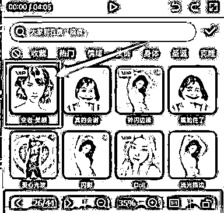

⑤转成字幕，导出并发布。
扩展阅读：https://wx.zsxq.com/dweb2/index/topic_detail/588424284282414

如果真人出镜实在勉强，也可以改用流量短文案+数字人口播的形式获取流量。数字人的制作流程见下方相关章节。

# 2.6.2 生活小妙招

# 2.6.3 爆款文案库录制指南

先补两个找爆款、做去重的小操作。去📕搜“生活小妙招”“手指操”这类短视频，或者哪个内容火就跟着发哪个——只要判断老年人爱看就行。发布前记得处理重复，具体做法看下面视频。去重教程.mp4【在线播放】

剪映里有些快捷键很省时间（选中素材后生效）：
Ctrl 加鼠标滚轮：把时间轴放大或缩小
Alt 加鼠标滚轮：快速把视频往前、往后拖
Ctrl+B：把视频切成两段
Q：从当前位置向前裁
B：从当前位置向后裁
右边中间那个预览轴按钮：快速查看某一帧画面

第3条：从素材群或抖音挑出爆款视频的开头，剪下来发。能爆的开头往往自带吸引力，但同一款用的人也多，所以去重要反复做几次。

下面进入正题。我们手里有一套整理好的爆款短文案脚本，你可以交给数字人工具去录，也可以自己露脸拍。要是第一次碰数字人工具，建议先看后面章节的操作讲解：3.3 第三步：制作数字人视频 @斌斌 @旋子
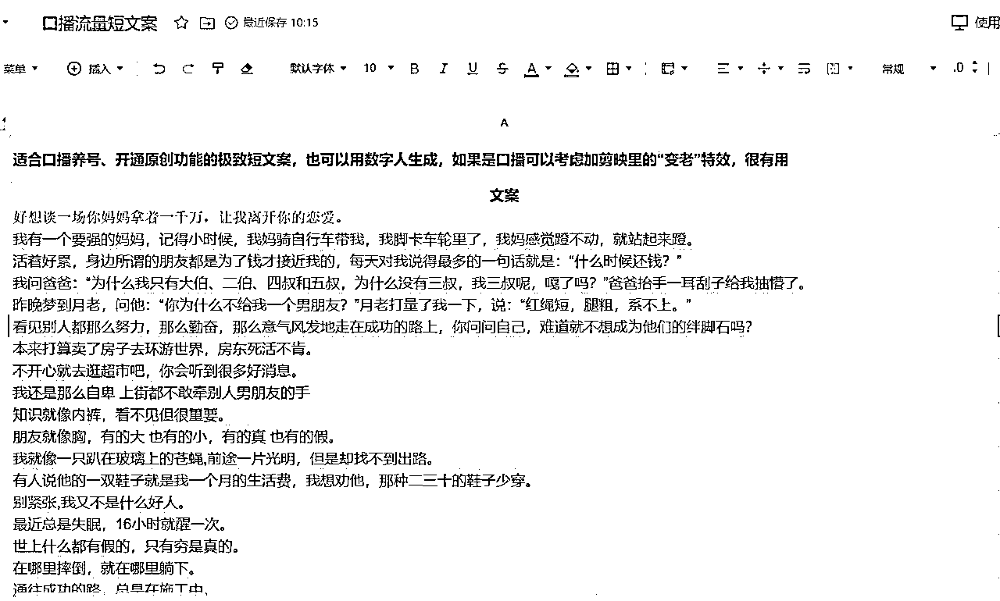

口播流量短文案链接：https://docs.qq.com/sheet/DV3hTaXRxSUFvbWhr

# 三、【项目实操2/3】制作第一条数字人带货视频

# 3.1 第一步：素材从哪来

渠道一：素材群
航海期间，群里会不定时放出眼下正在起量的爆款内容，帮你省掉到处翻爆款的时间。最理想的情况是：群里刚丢出来，你马上剪完就发。原因很简单——这些内容正在广场上跑，时效性特别强，比的就是手速。越早发越容易起量，跟的人一多，爆率自然被摊薄。

有些爆款是短视频直接挂商品的，观众在观看页就能下单，所以原片里不会出现引导去橱窗购买的话。可我们的账号没有1000粉，不能直接短视频挂车，只能把客户往橱窗引，因此得自己补上下单路径的引导话术。

话术参考：
找不到购买入口的话，点左下角我的头像，里面有个商品橱窗，点进去就能看到。
嫌制作麻烦的话，我这边有现成的，点左下角我的头像，商品橱窗里已经备好了。

同一个素材可以交给两个数字人分别拍，背景、声音都换掉，去重措施尽量做足，越彻底越好。
脚本通常由两块构成：流量段和卖货段。不少流量段是通用的，可以拆开重新组合。

渠道二：视频号直播广场
入口：🛰️-发现-直播
多逛直播广场。很多带货主播是短视频爆了之后才开播的。点进主播主页，翻他最近的爆款短视频，把内容拿过来自己用（必须去重，直接搬运容易被限流）。
990144276efa00304efced9e0b19d2f7.mp4【在线播放】

渠道三：刷视频
入口：🛰️-发现-视频号
遇到同类的爆款带货视频，点赞并完整看完，系统之后会更愿意给你推同类内容，看到合适的就能取用。（同样要先去重，直接搬会被限流）
视频号的视频下载不方便怎么办？用“飞书妙记”或其他录音软件录下来，把语音快速转成文字。

渠道四：视频号搜索
入口：🛰️-发现-搜索，筛选“视频”类型和时间范围
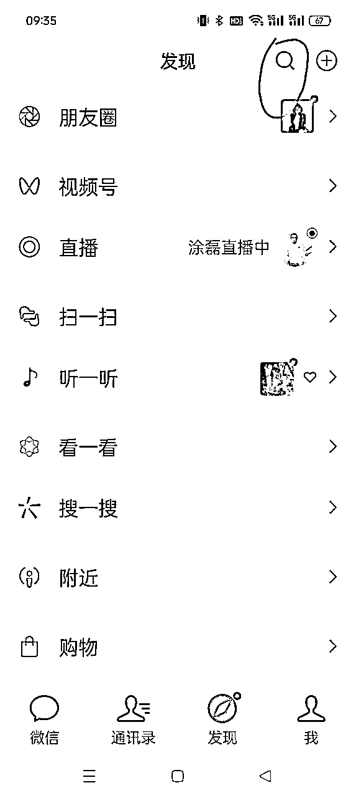
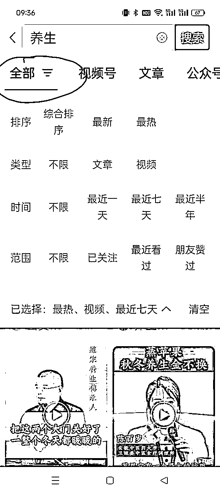

渠道五：其他平台
抖音、📕、快手上的爆款视频都能考虑。搜索词可以是产品名，也可以是素材群相关关键词，比如：健康养生、八珍粉等。
小绿书最近流量不错，有不少适合老年人赛道的脚本素材可用。小绿书在哪看？
1.
🛰️-发现-看一看，在页面顶部切到“图文”功能，部分人有入口，部分人没有。
2.
推荐功能：浏览别人推给你的任意小绿书内容，往下滑推荐内容还能看到更多。
77f0ad939cb0481b249a6995842f4516.mp4【在线播放】

# 3.2 第二步：文案去重优化

找到对标的爆款视频后，先把视频下载下来，再把文案提取出来使用。

# 3.2.1 下载视频

（付费推荐）多平台批量下载软件：哼哼猫，每天有免费额度，批量下载效果好，支持的平台最多。
（付费）批量多平台采集工具：采集指定作者视频。
（免费）单个抖音采集工具：抖音图文无水印下载。
（需要安装与代码）视频号采集工具及教程：《视频号视频下载》
视频号嗅探下载器：
百度网盘下载地址 提取码： mx4v
蓝奏云下载地址 密码：4v6t
（免费）抖音直播录制工具：批量采集抖音工具 密码：2nkd
录屏工具：万彩办公大师、FastStoneCapturecn
去水印小程序（搜索“绿豆工具盒”、“3D 去字幕”）
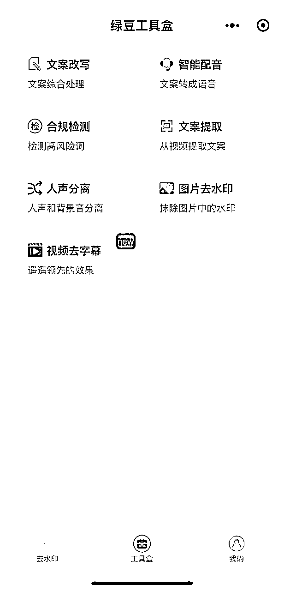
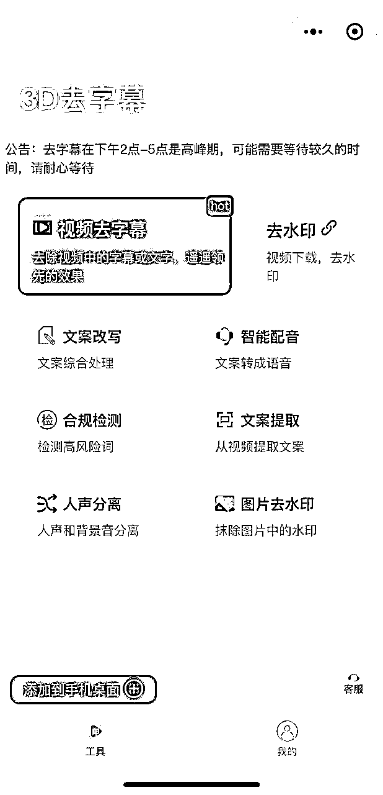

注：【批量采集抖音工具 密码：2nkd】【蓝奏云下载地址 密码：4v6t】这些链接打开后会有风险提示，复制页面里的链接，用浏览器打开，再输入密码就能提取工具。

# 3.2.2 提取文案

视频下载后，上传到讯飞听见或飞书妙记，把文案提取出来。
讯飞听见https://www.iflyrec.com/zhuanwenzi.html
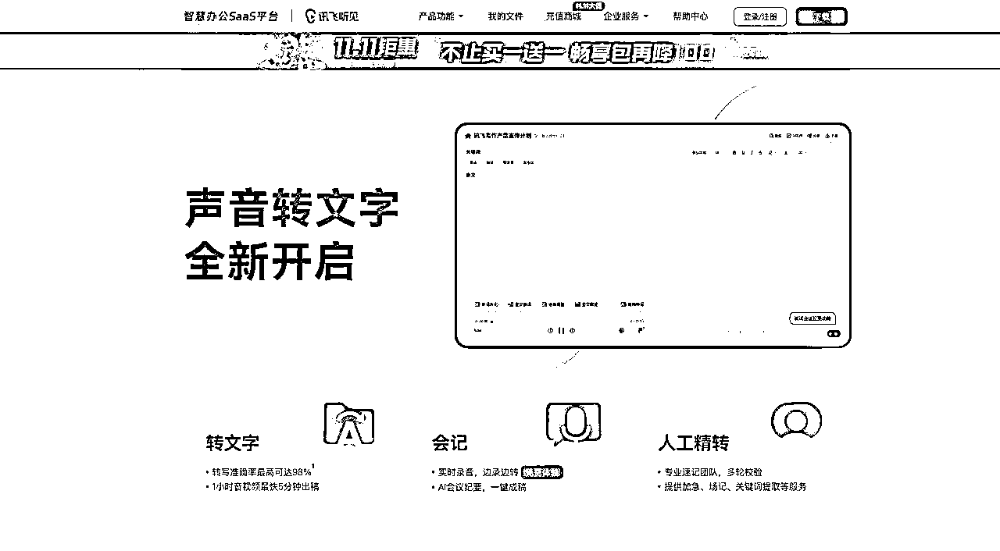
飞书妙记：https://zqqtm0kx8fq.feishu.cn/minutes/home
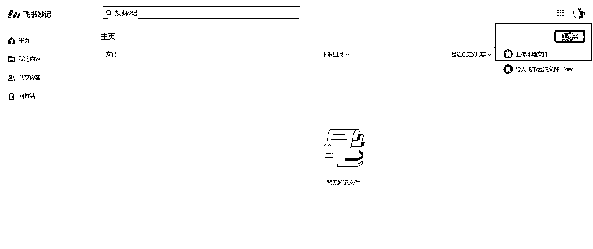

# 3.2.3 简单去重

原片文案不能原样搬，必须做微调，至少改动十几个字。改法可以是换名词、换地点、换称呼，比如把“东边”写成“西边”，把“爷爷”换成“外公”。同时留意前后一致性：稿子里提到年龄，虚拟主播看起来也得对得上；稿子说的是夜晚，画面别拍成白天。

改完后自己读一遍，听一听是否顺口，确认没有明显漏洞再继续。

也可以让AI帮忙润色，常用的有豆包等。关键在提示词，多试几次就能找到感觉。可以让AI做这几类事：
- 把口播稿改得更口语，中心意思保持不变；
- 按照爆款短视频的节奏润色，少讲空话套话，语气接地气；
- 开头加一个能勾住人的引子，让观众愿意往下听，但别夸大、别误导。

当然，自己动手改也完全可行。口播稿是短视频里最值钱的部分，原稿越有吸引力，起量机会越大。优化时可以从这几个方向下手：
1.
换成老年人熟悉的说法。晦涩、文绉绉的表达删掉，改用他们平时挂在嘴边的大白话——面对老年受众，就说老年世界的语言。
2.
啰嗦和重复的内容可以砍掉，帮助提升完播率。不过要分清：有的爆款开头故意反复抛悬念、吊胃口，看着迟迟不进入主题，其实是在做留存设计。
3.
把流量段和卖货段重新拼装。有些爆款流量片段很能抓人，可以单独拆出来，再接上转化效果好的卖货内容。
4.
改完拿给几位老年朋友试看，问问哪里卡顿、哪里别扭。顾客就是最好的老师，营销答案往往藏在潜在顾客的脑子里；多跟一线用户聊，也会越来越懂老年人市场。

# 3.3 第三步：制作数字人视频 @斌斌 @旋子

# 3.3.1 选择一个合适的数字人

前面的章节里已经列过数字人工具，大家可以去挑一个趁手的 👉 2.6.3 数字人制作工具。
优先考虑“蝉镜”和“即创”，这两个平台产出的虚拟形象比较稳。本次航海也把工具权限谈下来了，每位船员送一个月蝉镜会员。

工具选好，接着看形象怎么挑：
这个赛道参与者不少，形象选择很关键。老年人形象本来就稀缺，用的人可能扎堆；平台首页推荐的那些脸，使用率也高，原创审核更容易卡住。真要用，就得多做去重。只有过了原创，后面才能一拖五发布，实现一鱼多吃。

虚拟主播的气质要跟商品对路。养生品配一个18岁小伙来带，显然不搭；当然也可以试试反差路线，最终让数据说话。

某个形象跑出爆款后，可以继续用这张脸拍。即创平台搜姓氏就能找到同一个人，比如刘思远和刘天豪其实是同一个形象。道理跟短视频平台推人一样：你对某张脸感兴趣，不管它是大号、小号还是切片号，平台都会继续把这个人推给你——用户认的就是脸。

直接拿素材群原片里的人脸来用，爆率会更高，但原创更容易过不了，去重步骤必须多做几轮。风险和收益从来成正比。

# 3.3.2 数字人视频制作

做这类视频有三条路：
路子一：真人形象配本人声音。适合镜头表现不错、但时间紧的人，虚拟形象能帮你提效。
路子二：虚拟形象配声音，上手快。不想出镜，或者镜头表现确实弱，可以选平台上表现力好的虚拟主播。

路子三：真人形象配爆款声音。服化道和镜头感都能练，声音却需要长期打磨；而且做个人IP，用自己的脸更合适。好处是声音可以随时换。
下面分别说怎么操作。

# 3.3.2.1 形式一：真人形象配本人声音

① 先备稿
刚入门：直接用群里的爆款稿，或者把刷到的爆款视频文案提出来。
有经验、打算长期做IP：把找到的爆款稿按自己的人设改一改。
拍前必须把稿子读熟，至少看几遍，再快速默读一遍。凡是容易卡壳的错别字、拗口句，提前处理。比如“里面记载着人体的脉象和八卦阴阳五行河图洛书之间的关系”，可以改成“里面记载着脉象和阴阳五行之间的关系”。稿子不熟，拍出来一眼就能看出在念字。

② 提词工具
有提词器就不用死记硬背。剪映、度加剪辑都可以。

③ 灯光和背景
除了刻意营造悬疑、恐怖气氛，口播画面要亮堂，尤其脸部不能暗。整体色调可以后期调，但人脸必须清楚。房间采光好，白天拍最自然；采光差、阴雨天或晚上，最好加一盏补光灯。
背景方面，衣服和墙面要有色差，方便后期抠像。白厨师服就别站在白墙前录，不然抠出来边缘会脏。记住：深色衣服找浅背景，浅色衣服找深背景。

④ 机位和构图
正面机位：人占画面大约三分之二，九宫格辅助线能帮忙定位。上半身露出三分之二到一半比较舒服。离太远脸太小，看不清表情；离太近脸太大，看稿的小动作会被放大。镜头保持平视，仰拍容易显得盛气凌人，口播时身体再前倾，压迫感更强；俯拍画面又很怪。

人放中间、正对镜头，像跟朋友面对面说话，情绪更容易传出去。
侧身机位：身体转10到30度，类似访谈节目，适合情感、知识、干货类内容，也是目前虚拟主播录制常用的角度。

侧身的好处是对表现力要求低，低头看稿、看电脑没那么明显，新手更容易上手。缺点是少了眼神交流，对话感会弱一点。

表现力小技巧：
1.
保持微笑。笑是最好的亲和力，镜头里带点笑意，观众更容易靠近你。
2.
头和眼神别僵住。千万不要演成“念稿机器”，一旦有读稿感，观众对你的信任会迅速掉光。常见的读稿痕迹有：头一动不动、眼睛死盯一个点、眼珠左右扫。可以轻微晃头，缓解一直看提词的僵硬；眼神偶尔移到提词器旁边或后面；在提词器后放个物件，把它当成观众。
3.
手别固定成一个姿势。手里拿个道具，准备两三套自己最顺手的动作，比如摊手、轻晃，隔几秒换一下，提前练熟。

朗读小技巧：
1.
情绪比平时说话抬高一级。日常语气在镜头里会显得平，甚至发闷；稍微带点感情，但别搞成朗诵课文或诗歌。
2.
每句话分出轻重音。觉得自己说话平的，可以刻意把关键词读重、连接词读轻。
比如：“我才敢说出 五星级大厨永远都不会告诉你的 6 大秘密”“第一 不能放生抽，放了生抽以后 会让韭菜变色，影响食欲”。
3.
句子之间要会停。一口气不停顿，情绪很难出来。还是上面那句，在“我才敢说出”后停一下，在“第一”后停一下，在“放了生抽以后”再停一下，味道就不同了。
4.
长稿分段录。说错了不用慌，停一下，把整句重新说完整，后期剪掉错误部分即可。稿子长就分几段拍，能省很多剪辑时间。

⑤ 正式录制
AI虚拟主播需要真人片段当驱动素材，所以前期录制要按真人出镜的标准来，这样生成出来才自然。
录制要点：画面比例照着对标账号的角度一比一复刻最好；拍1到3条，方便同一账号换场景用；单条控制在30秒到1分钟；内容可以自我介绍，也可以背几段古诗，重点是吐字清楚、表达自然、有感情。

特别提醒：现在视频号发虚拟主播视频，有一定概率触发真人出镜或AI数字人验证。为了避免账号验证不过直接废掉，强烈建议用真人出镜素材来驱动数字人视频。

上传到蝉镜数字人平台
PC端网址：https://www.chanjing.cc/?invite_code=tWb6n

第一步：进主页，点“数字人像—创建我的数字人”，上传真人口播视频，再按页面提示上传真人授权视频，完成形象创建。
注意：蝉镜免费账号目前只能定制1个形象。不满意可以删掉重做；想多做几个形象，可以注册多个账号分别克隆，或者开通会员。
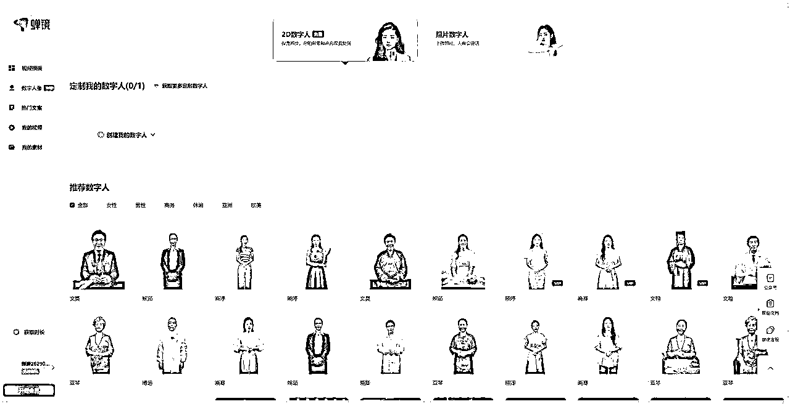
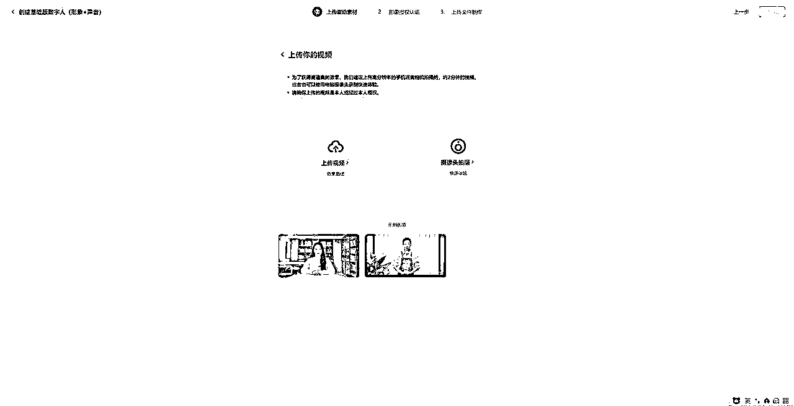

第二步：点开已经建好的形象，选择文本驱动或上传音频驱动。走文本模式的话，可以选公用AI音色，输入文案后先试听，满意再生成视频。生成完回到主页，在“我的视频”里找到成品下载。

# 3.3.2.2 形式二：数字人形象配声音（新手建议）

制作视频教学：
蝉镜平台：
11月15日.mp4【在线播放】
即创平台
11.14数字人生成.mp4【在线播放】

# 3.3.2.3 形式三：自己的人物形象+爆款语音：

第一步：先按前面章节的方法克隆自己的形象，推荐用蝉镜。
第二步：找现成语音库，生成爆款声音。可选工具不少：PC端剪映自带音色；蝉镜也提供多种AI音色；
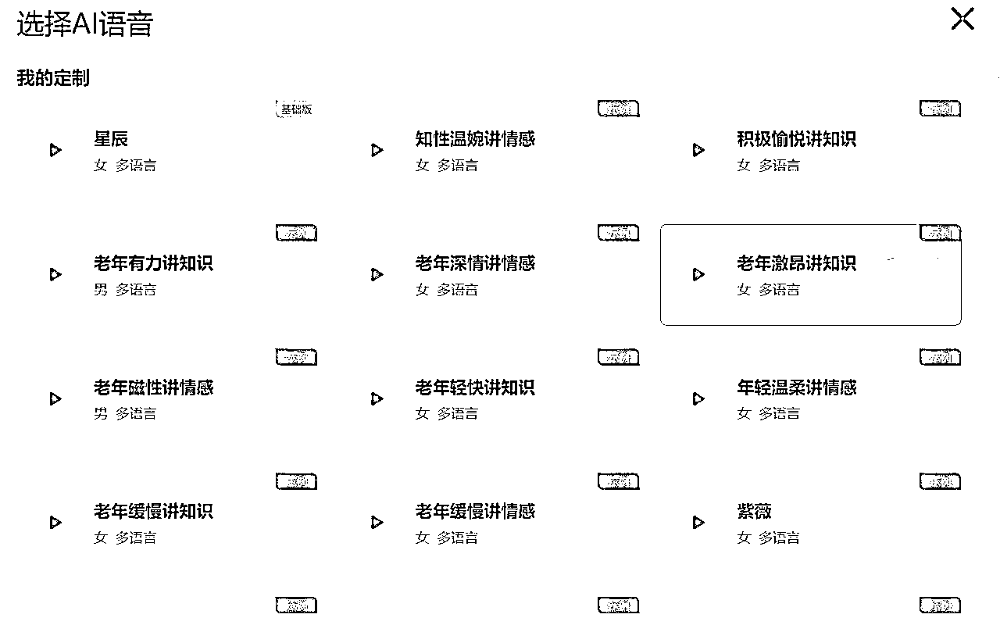
小程序里可以用配音神器；
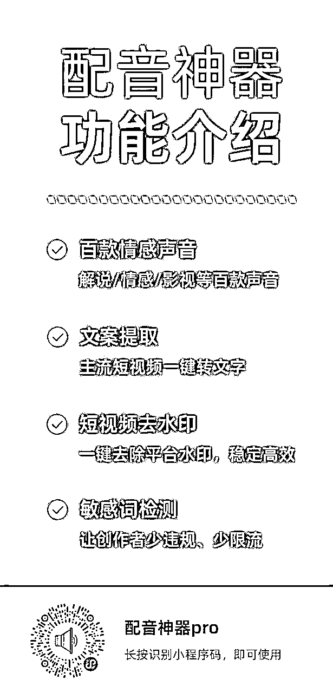
网页端还有腾讯智影；
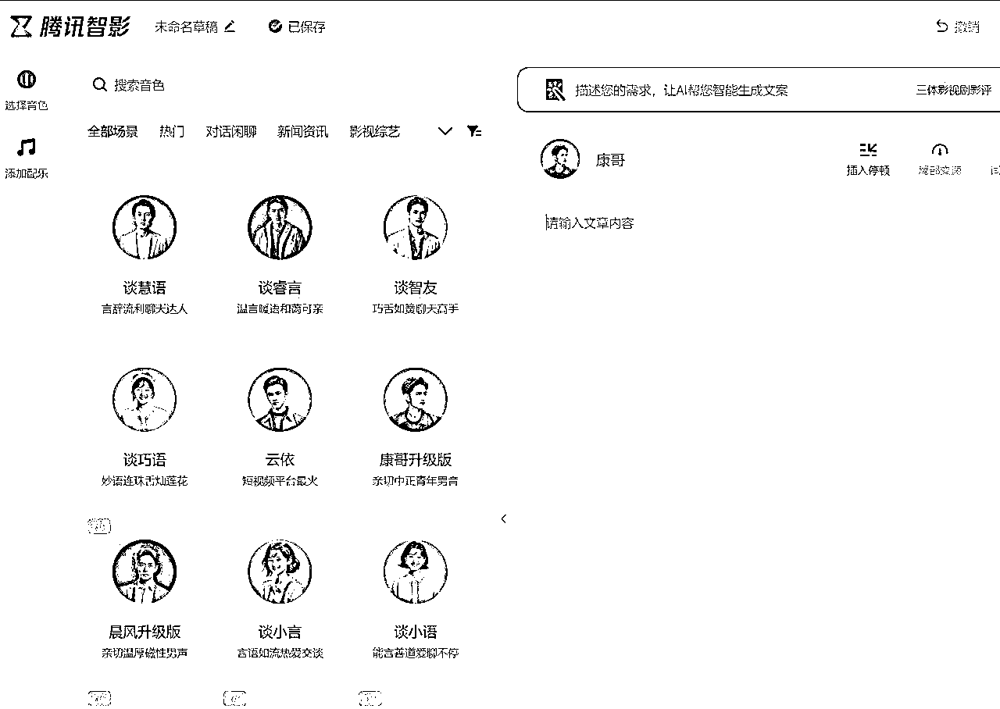
第三步：回到数字人制作环节，选择上传音频，系统会让口型跟着音频自动匹配。

克隆视频号里的爆款声音
视频号上那些长期大爆的口播账号，声音条件往往很出众，而且已经被平台用户验证过，可以直接克隆来用。
第一步：克隆自己的形象，建议用蝉镜，前期花费低。
第二步：处理原始声音。把爆款声音下载下来，放进剪映做降噪和美化；
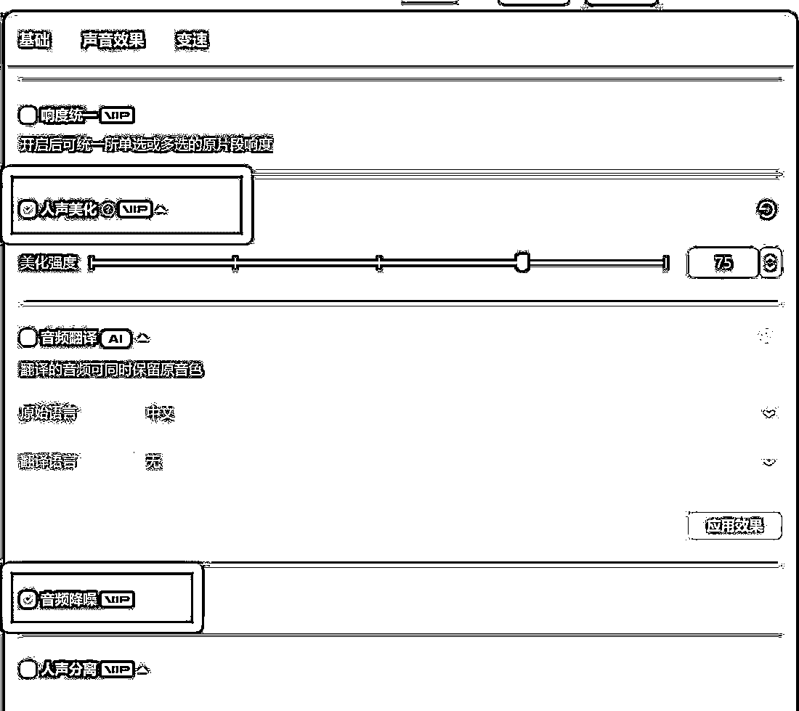
然后导出备用。
第三步：克隆声音。
方法一：飞影，可以单独克隆声音，缺点是要收费。先克隆音色，上传找到的爆款语音；
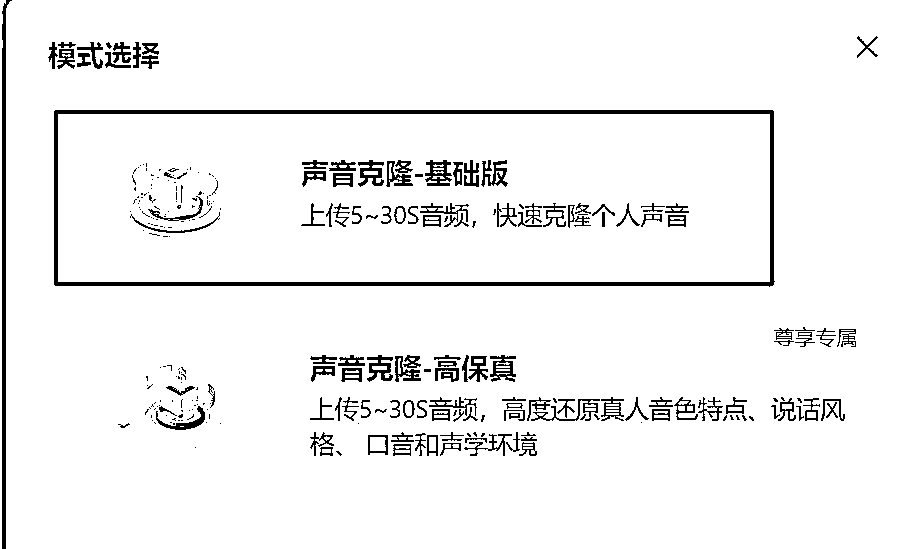
克隆完成后去创作音频，再制作视频。
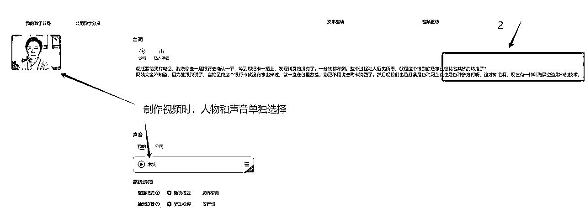
注意：下一行要缩到上一行，不要留空格，否则会出现咯噔的噪音。
方法二：用免费工具，推荐fish audio
https://fish.audio/zh-CN/text-to-speech/
优点是还原度较高、免费；缺点是一次只能生成170字左右，大约30秒，长稿需要分多次生成。平台里也有很多已经配好的真人语音可以直接用。

# 视频号数字人带货：从声音克隆到批量放大

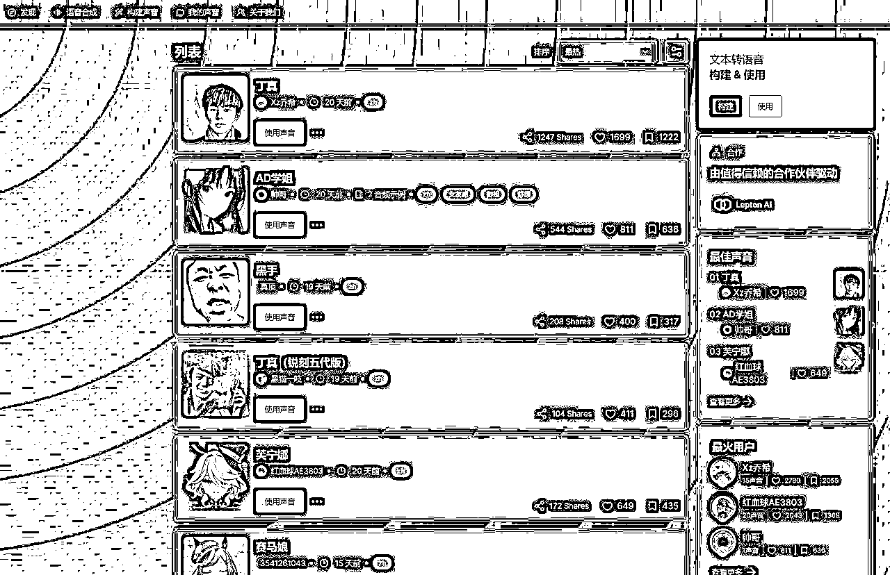

动手前先把账号注册好，用国内邮箱就能完成。

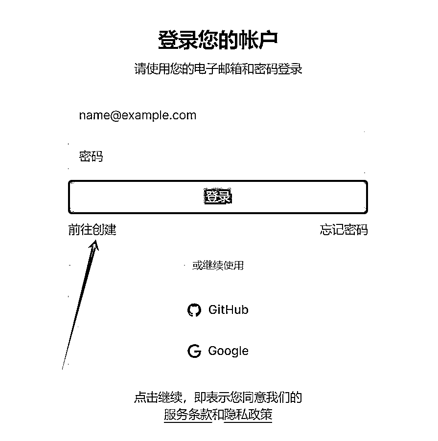

点界面左上角的“构建声音”，给声音起个名，上传录制好的音频，然后点创建。

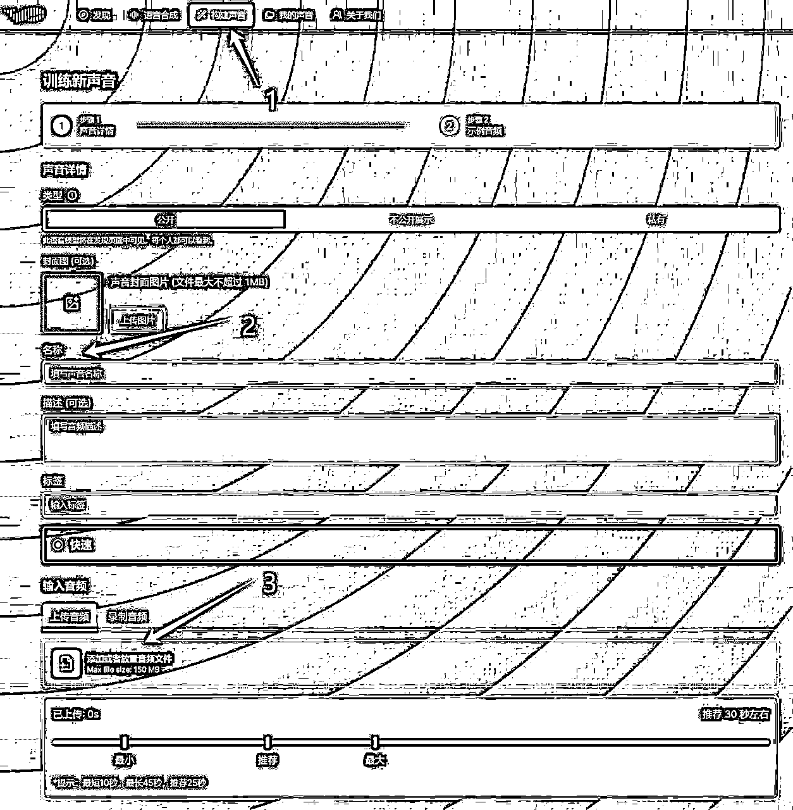

接下来进“语音合成”，把文字内容粘进去，选择刚才做成的声音来朗读，生成后保存到本地即可。

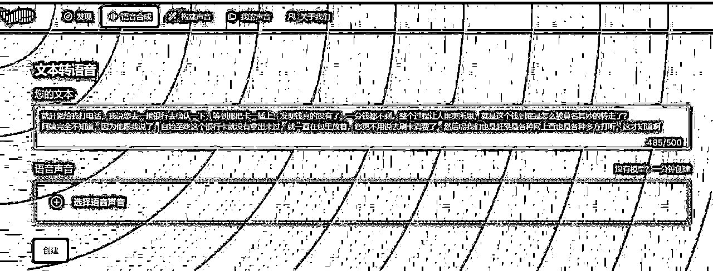

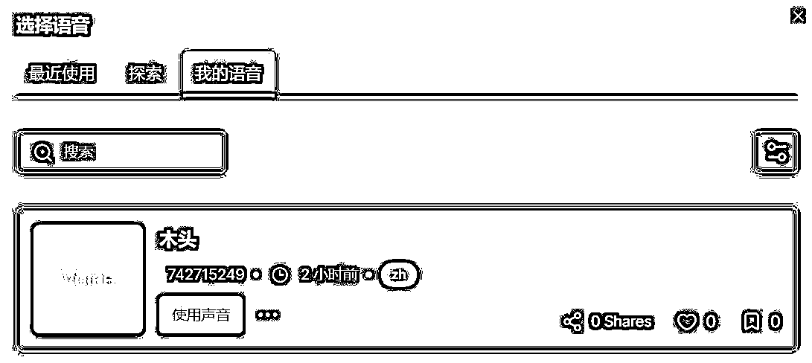

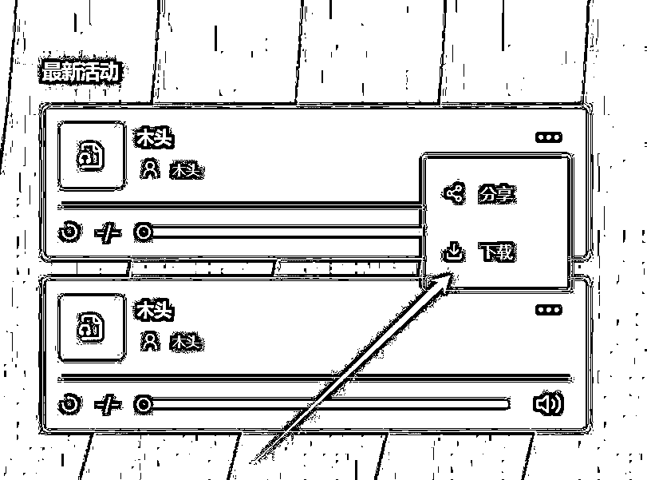

### 第四步：生成数字人形象

做数字人时，选择“上传音频”模式，把音频文件传上去，系统会自动让唇形和声音对得严丝合缝。

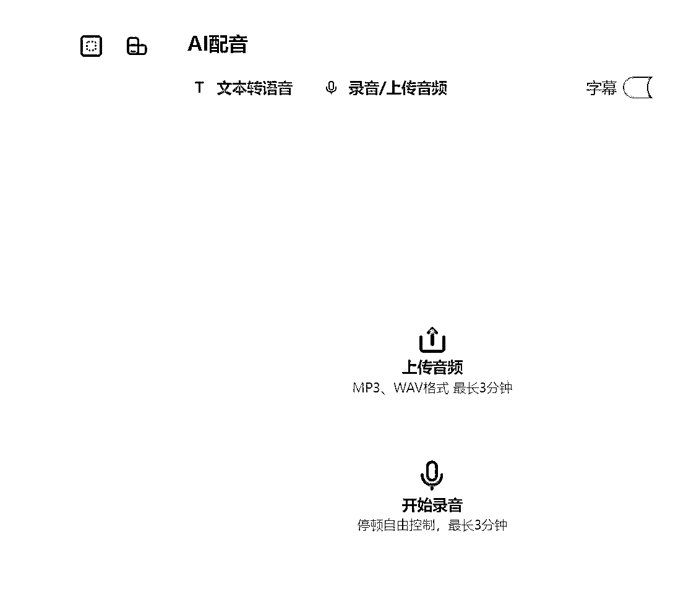

## 3.4 第四步：混合剪辑与内容去重

### 3.4.1 混剪的基本思路

操作逻辑不复杂：把数字人出镜的口播片段和商品展示画面交叉拼在一起，让商品得到更多曝光，进而拉动转化。

11月14日商品混剪.mp4【在线播放】

假如口播字幕和素材自带的字幕叠在一起，看起来会很乱，怎么处理？可以用剪映的“字幕背景”功能，适当放大字号、加上底色条，基本上就能把下层字幕盖住，圆角也顺手调一调会更美观。实在不想动也无妨，多数中老年观众并不会注意这些。

剪映里比较顺手的快捷键（先选中素材再操作）：

- 按住 Ctrl 并滚动鼠标滚轮：缩放时间轴视图
- 按住 Alt 并滚动鼠标滚轮：快速来回拖动时间轴
- Ctrl+B：把一段素材切断
- Q：去掉前边多余部分
- B：裁掉后边多余部分
- 右侧中间那个预览轴按钮：快速跳到想看的画面附近

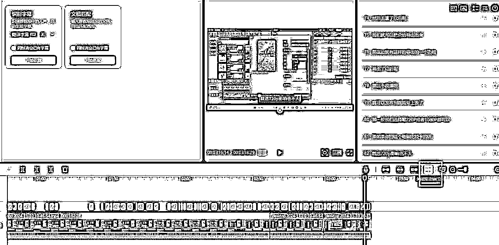

### 3.4.2 去重怎么做

核心目标是让画面的 MD5 值尽量与原素材拉开差距，避免被抓到雷同。

11.14去重操作.mp4【在线播放】

### 3.4.3 抠像技巧

已经跑出过爆款的素材，不妨直接抠像、换背景再发一遍，等于把这条内容的流量上限再一次顶满。绿幕或纯色背景对抠像最友好，背景太乱很难抠干净；自己补拍时也尽量选纯色场景。

抠像功能入口：

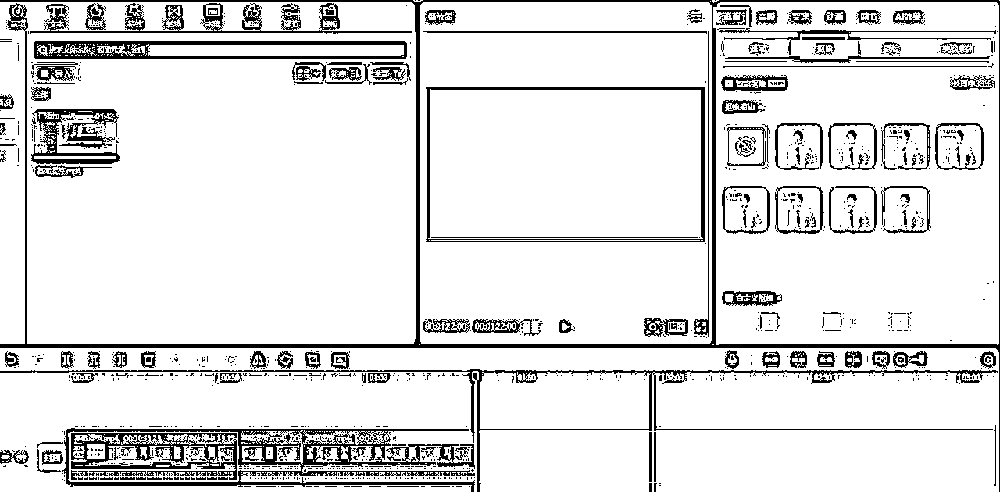

抠完把人物层往上一挪，背景图搁在最底下的封面主轨道就行。背景要找与内容氛围搭的场景：卖调料配厨房，卖种子配花园，看起来就不违和。

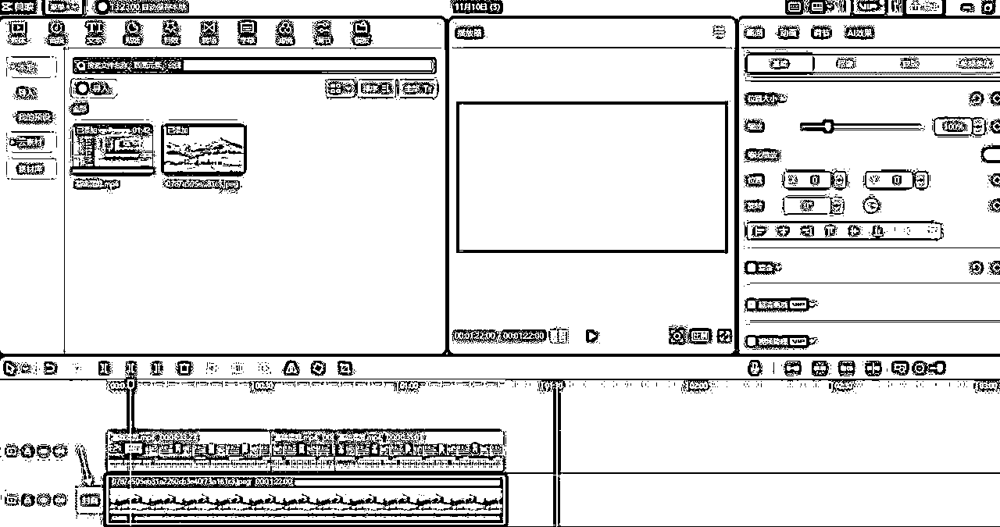

视频教程：

11月16日 (2).mp4【在线播放】

抠像参数参考：

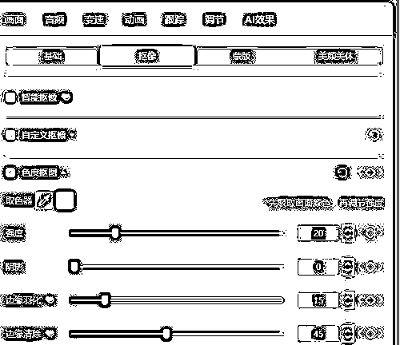

### 3.4.4 素材怎么整理

1. 高点击率的开头片段

最近几天效果好的开头，剪下来存着，可以反复和不同商品素材配对。开头几秒能不能留住人，直接决定了后面有没有人看，同时也会影响系统给不给推流，重要性不能低估。

养生类的爆款开头，可以套这些句式：

- 哪儿有什么XX，今天把XX的底细说清楚（或者说本相）
- 谁说得了XX就得认命，跟谁急（按产品调整），这个句式里“谁说”是灵魂
- 从来就没有什么XX，XX全是在骗人
- 为什么XXX
- 如果XXX

2. 商品素材

2024年6月视频号带货航海手册：5.5目录章节

https://scys.com/view/docx/NLfHd5K54oXv28xibv9cXOOZnsU#F58AdxOgIoQpLOxJxSGcfFjbnYg

3. 背景素材

让 AI 帮你出背景图也行。

示例提示词：干净整洁的办公室，后侧是装满书的架子，整体有进深感

## 3.5 第五步：作品发布与挂链接

### 3.5.1 账号授权：一拖五怎么搞

先把自己的账号之间互相开原创授权，这样同一支片子发到不同号上，被判违规的风险会低很多。

操作路径：🛰️-我-视频号-右上角三个点-创作者中心-创作者服务（更多）-账号管理（原创保护记录）-授权账号

要是找不到原创保护记录，就先发一版视频看看有没有“原创”勾选项；没有勾选项，意味着这项功能还没向你开放。

比较稳的做法：六个号两两互授，原创违规概率会明显下降。一个素材过了原创，就可以一号发完其他五个号跟上，把素材的价值放到最大。组队的人互相发一下授权成功的截图，确认没有绑错号。

务必等主号原创过了再动其他号，号与号之间尽量都做完双向授权。

还没拿到原创权限时，流量片和带货片隔开发；一旦有违规，就发几条真人出镜的口播缓冲一下。

别老拿同一个号发原创内容，换着号发更安全——同一个号多次过不了原创，会被限制一段时间。

### 3.5.2 商品链接怎么挂

用教练给的素材时，“线下结算链接”文档里就是可以直接用的商品链接，复制到视频号选品中心一搜就能添加。

示例：weixinstorehs/12742917423924

PC 和手机都能操作，但发带货片之前得先把商品放进橱窗。

留意别挂错：佣金 0 或 1 的是走线下结算的；不同链接佣金标准不一样，记得挑佣金高的。

想自己选品，也可以直接在选品中心挑好再加。

### 3.5.3 发布流程

先选一个号勾上原创发出去，等原创审核过了，再把同一支视频发往其他号。

PC 端界面上会标出：已声明原创

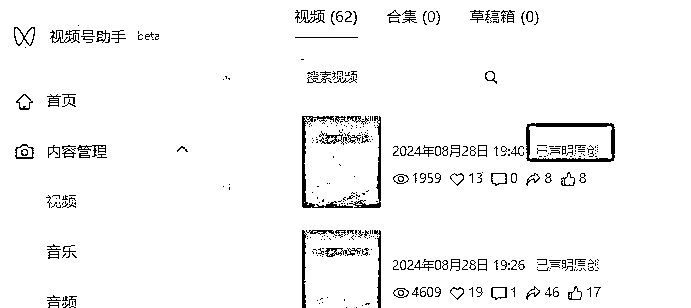

APP 端：一般跑到一两百播放，基本就说明原创过了；也能点进该视频评论区确认。

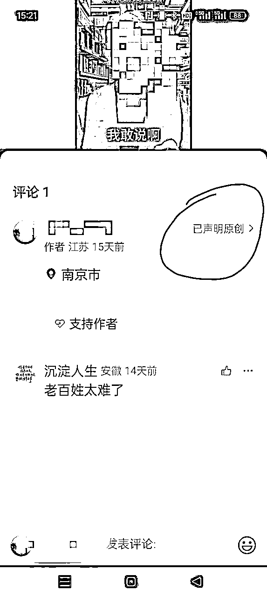

万一发的时候忘勾原创，事后还能补救，按下面路径去补勾就行；播放过了万要看具体数据，也在这里查：

原创保护记录查看路径：🛰️-我-视频号-右上角三个点-创作者中心-创作者服务（更多）-账号管理（原创保护记录）-授权账号：

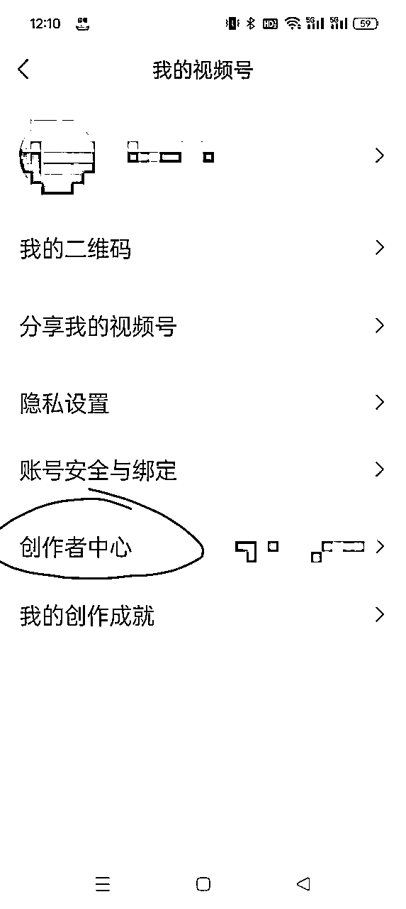

没开原创不耽误带货，流量片和带货片换着发就行。差别只在于：别人没法跟发你的作品，一个爆款没法继续放大；但你依然可以跟发别人的。

六个号两两授权，能有效降低原创违规概率；一份素材过原创，随后一拖五铺开，价值利用率最高。

过了原创的视频，其他号要赶紧跟着发。有些内容发出去几小时，官方就会开始暗中限流；不过只要已经跑出量，平台检测更严的同时也还在继续推，因为数据已经触发了更大范围的审核。

数量控制：24 小时内不超过 10 条，超了就不给推流；每条之间的间隔长短影响不大。比如现在晚上 8 点，往前数 24 小时，发过 10 条以上，就不推了。

发布时间建议：早 5-6 点和晚 8 点左右，中老年用户群在这两个时段最活跃。但这不是决定因素，内容本身才是。

## 四、【项目实操3/3】持续产出和调优

### 4.1 数据怎么看

#### 4.1.1 手机端：发现页小红点

每小时点开“🛰️-发现”扫一眼。要是视频号未读突然比平时多出一截，就要打起精神看数据了：播放量到三五千、大约每分钟有 2 个赞或三五十次观看（这个不用卡太死，主要看每分钟的播放速度，接近就行），马上开直播。

#### 4.1.2 PC 端视频号助手

网址：channels.weixin.qq.com

首页每隔一两分钟刷一次，看到观看速度在三五十左右就说明有点苗头。

留意哪条视频的速度明显压过其他内容。

完播率入口：数据中心-视频数据-单篇视频。看完播率基本能判断爆不爆，20% 以上至少能冲到几大千播放。

账号多的话可以用第三方工具统一管，比如蚁小二、小火花，地址：蚁小二官网 - 帮您管理所有的新媒体账号

### 4.2 开直播收单

#### 4.2.1 为什么要开直播

带货短视频挂购物车审核比较紧，流量很难起来；所以短视頻火了以后，就把人带到直播间去成交。说白了，直播承担的是把短视频流量变现的角色。

收入大头（约 80%）都靠直播完成，因为让用户从短视频翻到橱窗去下单，链路太长也太麻烦。

注意：一个人没法同时开两个号或更多号的直播；但同一个人名下实名过的两个号，可以分别由不同的人去播。

#### 4.2.2 开播准备

从哪里进直播间：

手机端：🛰️-我的-视频号-发起直播

PC 端：视频号助手官网：直播-直播管理-去开播

正式开播之前，先自己完整走一遍直播流程，熟悉每个按钮。

封面不用特意做，默认的山水头像就挺好——额外加封面容易挡脸，带来违规风险。主题也别写营销类的词，选“日常聊天”或“购物”就够。

购物类直播最好有实物在手边演示；没有同款就找类似的顶上，能降低违规可能；连类似的都没有，点个外卖也能快速补上。

带货组件：点底部商品按钮，选好要带的货，按“讲解”，商品就会出现在直播画面里，主播自己也能看到。

手机端入口：

PC 端入口：

几条小经验：

- 粉丝不到 100，直播挂不了商品；到 200 就能用电脑播。可以找群友互关，或者用 chao 能力搞定。
- 播满 2 小时后可以暂停直播，页面保留在那里，方便后来的人直接下单。实测播 2 小时比较合适，因为推流是一阵一阵的；直播间空的时候，每分钟说两三句话就能维持住。
- 备个小铃铛，播到一半偶尔敲一下，能留住注意力。
- 直播间可能会被推给没看过短视频的新用户，他们对产品不了解，成交意愿低；可以引导他们先看短视频，比如插一句：欢迎新来的家人们，还没看过视频的，点我头像，看看最近的作品再来直播间。

#### 4.2.3 直播话术参考

这是通用底稿，讲商品的部分可以直接把短视频里的文案拿进来用。

欢迎刚进直播间的叔叔阿姨，视频里介绍的同款就在下方购物车，点开就能买。

（这里插入两句产品介绍）

咱们是厂家直发，所以价格才能压这么低；中间要是隔了代理商，就不会是这个数了。现在是厂家让利活动，库存清完就回到原价 XXX，我看活动价还剩最后 6 单。

今天刚开播，先给大伙发波福利。大家是从短视频过来的吗？还没看的，点头像去看看产品介绍，再回直播间。

下单的话我建议直接拿 x 盒的，性价比更高，拼手速拼网速，抓紧拍。

点下方购物车就行，原价 xx 一盒，今天新店直播间 xx 还包邮。回去放开了用，不满意就退回来，你没有任何损失。

拿急救毯来举例：

拍过的朋友记得多囤几条——紧急情况下哪有时间翻箱倒柜，得随手就能摸到。阳台放一条，客厅放一条，厨房放一条，车里也放一条。（备注：每次有人下单我就把这段重复一遍，抬高客单价用的。）

直播间的家人们，下方的购物车点开直接拍。平常卖 59.9 一个，今天只要 12.9 还包邮到家。今天是刚开播，给大伙炸福利，趁着还是 12.9，抓紧拼手速，拍完赶紧付款。

急救毯是被国际救援机构认证的通用应急物资，用的是双层面料，披身上能挡雨，铺开能当睡袋，几张拼一拼还能搭个小帐篷，就算在玉龙雪山上过夜也不怕冷。

关键时候它能救命的。遇到危险被困住，最怕什么？没吃没喝、体温往下掉、体力一直在流失。没有人来救的时候，往往扛不过三五个钟头；裹上急救毯把体温锁住，坚持三五十个小时都有希望，获救的概率完全不一样。所以不管环境多恶劣，保住体温是第一位的。

都是从短视频点进来的吗？没看到的话，点我头像翻翻急救毯那条视频再进来。已经下了单的，公屏打“已下单”，优先给你发货。住在低洼地方、容易淹水、常刮台风的朋友，更得赶紧拍、赶紧发。

有人觉得这不就是块塑料布或反光膜吗？这是对急救毯最大的误会。它最早是用在航天项目里的，月球上那么冷，太空里飞那么快，材料质量能差吗？你随便扯、随便拽，都弄不坏它。

它还有个特性：反光。救援人员最难的就是找不到人，有了反光面，定位会容易很多，活下来的几率自然更大。

折起来也就巴掌那么大，揣哪儿都方便。孩子书包里塞一个，老人买菜篮里放一个，自己包里也装一个。

放心买放心冲。给你留了七天无理由，用不惯就退。原价 59.9 的急救毯，现在 12.9 包邮到家，下方链接库存剩最后 5 单了，卖完就调回 59.9。别犹豫，赶紧拍，错过这波就没了。

#### 4.2.4 直播时的观察动作

开播后，拿一个小号进自己直播间看看效果——主播视角和观众视角差异不小，要防着“讲解”没点上、商品显示无货这类情况。

同时可以开 PC 端的数据大屏，实时盯直播数据：

#### 4.2.5 代播安排

粉丝满 200 就能用电脑直播，代播也是这样操作，把直播人添加为运营者就行。

注意：只有 PC 端、而且是视频号管理员本人，才有权绑定运营者。

路径：视频号助手官网-设置-人员设置-绑定运营者。

运营者的权限包括在 PC 端开直播和发视频。

代播过程中，要紧盯商品是否挂好、库存有没有掉，按钮置灰就说明没货了。实时数据大屏也别关。代播可以自己找，也可以联系龙哥盟官方运营，让他们帮你对接。

### 4.3 爆款怎么持续放大

#### 4.3.1 放大背后的逻辑

爆过的内容大概率还会再爆。算法的规则、用户的偏好，短期内都不会大改，因此曾经被验证过的内容，系统还会再给一次流量。

素材爆了，当然要乘胜追击，把这条素材的流量潜力榨干。

最省事的做法是原片无限重发——但平台有同质化审核，这条路走不通。所以要找出那些影响审核的关键变量，做定向去重。

#### 4.3.2 几种放大打法

1. 视频去重配合养号

执行细节：用抠像换背景实现去重，把同一素材重新上架 2 条。这类操作可能给账号带来负面影响，所以养号要跟上，别踩了平台的惩罚线。

核心目标：把素材用满，同时账号保持健康状态。

2. 爆款内容循环使用

执行细节：找到播放表现远超同批作品的视频，把文案微调一下继续发同类内容，既避开同质化判断，又留住原来的吸引力。数字人出镜的脸不要变，再结合平台搜索优化二次创作。

核心目标：把优质内容的剩余价值挖干净，一个素材反复产出效益。

3. 直播与短视频联动

执行细节：开播期间持续补充相关的短视频，靠视频把观众导入直播间。就算一条视频播放不高，量上去了也不一样，比如一下子发 10 条，累计的播放总量就很可观，能高效地把人导向直播间。

核心目标：用矩阵内容给直播间带流量，让直播数据更好看。

4. 爆款文案拼装新素材

执行细节：把转化率高的卖货文案，混搭其他爆款引流文案，合成一条全新的带货文案后再发。

核心目标：借成熟爆款的势能给新品类带货，提高素材生产效率。

### 4.4 爆款的变量在哪里

一条视频要火，主要看账号条件、短视频内容、发布时机这三个方向。

#### 4.4.1 账号

新号：平台会给流量扶持，内容相对容易跑出来；但违规容忍度低。一般先养三四天号再动手；真人口播是平台鼓励的方向，能快速把账号权重拉上来。

老号：权重高，抗违规能力强；同时和粉丝基数、账号垂直度有关联。

账号要多囤，本质上是消耗品。一组 6 个号，随时填缺补位，别让任何一条素材空转。

拿数量去和概率对抗：有的号天生数据差，有的号怎么发怎么有。有人用三四个号做了好几天都没出单，换上两个新号，突然就爆了。

#### 4.4.2 短视频内容

##### 4.4.2.1 前三秒定生死

开头三秒的吸引力决定一切。验证过的爆款开头可以反复利用，它是用户停留时长的关键指标，直接影响系统推流。

抖音、📕、视频号，凡是能看到视频的地方都可以去搜集好开头，慢慢搭起自己的爆款开头素材库。

比如这个开头就挺抓人，可以反复用：

11月21日.mp4【在线播放】

##### 4.4.2.2 真人还是数字人

出镜的人要跟文案气质对得上，让人觉得可信、有说服力、有记忆点。

中老年男性形象普遍流量更好一些；用户认脸，一张脸配上素材火了，就能沿着这条线一直做下去。

真人出镜的优势是可持续产出，永远不存在“旧素材”的问题——同样文案重新录一次就是新内容，适合长期经营。

服装影响很大。穿厨师服、穿劳保服，不用开口，别人已经自动给你贴上了身份标签。你嘴上说的别人未必买账，但他们自己得出的判断，却会深信不疑。

比如下面这张脸，像养生专家、国学大师，让他去卖锅碗瓢盆和酱油调料，显然就不匹配。

##### 4.4.2.3 流量文案的作用

素材结构基本分两段：先把人吸引进来的流量部分，再加上卖货转化的塑品部分。

流量部分不爆，后面卖货再怎么使劲都没人看到。

流量文案要把时长撑起来、把完播率拉上去，这是重中之重。

有些文案看上去前边唠唠叨叨，迟迟不进主题，其实是有意拉时长、拖完播——用户越好奇后面要讲什么，越不容易划走。

# 小雪后，这4样少碰

先分享一个很实用的玩法：引流内容与卖货内容可以拆开重组。假如某条素材今天跑量了，把它前段的引流部分抽出来，接上一条出单率更高的商品解说，效果往往不错。下面这段就是典型示范：前半段是大家爱听的干货引流，后半段是卖货文案。这组流量内容还能灵活替换成八宝茶、七白饮等养生品类，几乎无缝衔接。

小雪节气有个老讲究：四样不碰，一年病不沾。你知道是哪四样吗？往年你尽可以不当回事，但今年这一回，真得留意。要是你滑到这儿直接划走，回头八成要拍大腿。愿意把视频看完的朋友，2024年应该都差不了，先点个爱心、点个关注，咱们慢慢聊。今年小雪交节时间——11月22日凌晨3点56分46秒。老辈人总结：上午小雪冷飕飕，下午小雪暖烘烘。按民间经验，今年正好属于上午小雪，也就意味着这个冬天大概率偏冷。小雪一过，正是“冬藏”的黄金窗口，可下面这四种食物，真不建议再碰，每一样都是大忌。小雪后管住嘴，寒湿才不容易近身。现在很多人一到冬天就喊冷，说到底，是很多老规矩渐渐被丢掉了。家里有老人孩子的务必留心，特别是白天睡不醒、晚上睡不着、上边热下边凉、总也不暖和的人，入冬后很容易留下根子上的问题。再叠加今年是甲辰青龙无春年，小雪之后寒和湿可能格外重，对上了年纪的人可不太友好。老祖宗留下的这套讲究，希望你认真听一听。

第一样，鸭肉、兔肉、海鲜这类寒性肉要避开。天一冷，大家就爱炖点肉暖身子，但这几样偏偏偏寒，吃多了容易让体内寒气越积越深，还会影响脾胃的正常运转。这时候贪嘴，对身体的损伤可能翻倍。实在馋了，尝两口解解馋就行。

第二样，冬瓜别总端上桌。冬瓜是秋冬最常见的蔬菜，营养也不差，但它是典型的凉性菜，冬天经常吃并不妥当，特别是本来就怕冷的朋友，更得少碰。

第三样，太甜的水果和甜品要收敛。秋冬水果大量上市，经过霜打之后糖分沉淀，一口下去格外甜。可甜食容易助长体内湿气的聚集，拖累运化，让湿气赖着不走。

第四样，辣椒能少放就少放。很多人觉得吃辣能驱寒，饭桌上几乎离不开。但辣椒属于辛辣刺激，小雪前后秋燥正冲到顶点，皮肤干、口干舌燥、心气浮躁都容易冒出来，再吃辣无异于火上浇油。这个时候最要紧的是“润”，多吃些滋阴润燥的食物才对路。加上今年冬天大概率又冷又燥，对老年人是一个不小的坎。身体不润，就挡不住外头那层寒和燥；整个人状态不对，就像汽车缺了机油还在干烧，油箱烧到见底，冬天自然容易出问题。小雪过后，阳气一天天往回收，阴气慢慢生发，养生重点就该转向养阴。中医讲“春夏养阳，秋冬养阴”，饮食上多吃润燥养阴的东西，这个冬天能少遭不少罪。

如果家里条件允许，小雪后可以把这8种食物安排起来，给下半年的身体打个好底子。女性朋友尤其要抓住这个时间段，状态会一天天往好的方向走，错过了真会后悔。先讲淮山药。俗话说：立冬多吃山药白，一年安稳祸不来。《本草纲目》直接叫它“神仙之食”。为什么总觉得累的人要多吃淮山药？因为它的钙含量是牛奶的6倍，铁含量是红枣的20倍。可真正能吃到淮山药的人，连1%都不到。多数人买的是菜市场里那种又直又光滑的菜山药，吃下去基本没啥作用。只有产自古代怀庆府——也就是如今河南焦作垆土上的铁棍山药，才配叫“怀山药”，自古就是四大怀药之首，历朝历代都拿它当贡品。再讲茯苓。老话说：少吃鸡鸭少吃糖，多吃茯苓和粗粮。古时讲究的大户人家，包括乾隆和慈禧，立冬后都会把茯苓配上山药、莲子、猴头菇、薏米、芡实、陈皮、白扁豆，八样食材一起磨成粉，这就是老辈人口中的“八珍粉”。当时还有“宁要八珍三克，不要黄金万两”的说法。所以小雪前后，有条件的家庭可以照着做起来，能解决不少实际麻烦。每天早上开水冲三勺，也能倒在汤里一起喝，香味浓，营养足。打成粉后更好吸收，老人孩子都能喝。一口下去，热乎劲儿从里往外透，像整个人被阳光罩住一样，帮着驱驱凉、化化湿，把状态提起来。自己动手当然好，嫌麻烦的话，点我左下角头像进主页橱窗，有我和家人一直在喝的这款八珍粉，配料干净，入口香浓顺滑。从今天开始，用它好好照顾自己和家人。

# 4.4.2.4 带货文案怎么写

卖货文案直接影响成交，关键看“价值塑造”这一段是否打动人，文字和画面都在其中。短视频可以靠混剪、特效来增强冲击力，直播只能靠口播，能发挥的空间相当小。所以直播推流的用户，最好先引导他们看短视频，再回到直播间下单。客单价不高时，引导进橱窗详情页即可；部分商品SKU本身就有升单设计，比如5块钱一个、10块钱三个。限量、促销这类手段也能用，如果点开链接发现活动没了，那就是真结束了，趁库存还在赶紧入手。本质上，就是用文案和画面把产品价值立起来，让人产生购买欲。比如前面4.4.2.3的例子，卖货段先讲天气冷要多准备这8种食物，再逐一塑造价值——钙是牛奶的6倍、铁是红枣的20倍等等。人性就是怕麻烦，不想一样一样到处买，图省事、图划算，直接带走他家的八珍糕就行，一整段卖货非常顺。

# 4.4.2.5 场景

场景选择也很关键：厨房适合卖调味料，园林花园适合卖种子，演播厅适合讲新闻（但新闻口播容易触发资质问题，仅作举例）。画面里的每一个像素、每一处小细节，都可能被观众无意识捕捉，从而影响信任感。那条“锅底清洁剂-好.mp4”的爆款，很多人应该刷到过：厨师服、厨师帽、手里拿勺，背景是厨房，抠像抠得很自然，不仔细看根本看不出是后期合成的。这身服化道和背景，把“专业厨师”的形象立得非常稳。

再看另一个视频，主角穿西装，眼神沉稳、说话专业，左下角直接标出身份，专家感一下就出来了。

# 4.4.3 时机

每个号在不同的阶段，初始流量人群都可能不一样，很容易因为推流不够精准，刚进流量池就死在乱军阵里。应对方法就是多铺号，用数量对冲概率。一拖五的五个号，内容一定要全部发完，基础流量盘越大，其中几个号越容易被系统摸准人群、跑出结果。一将功成万骨枯，这条路上本来就是千军万马过独木桥。爆款素材一出来，必须立刻跟进，晚上一步，人群就会被各团队洗过好几轮，流量和转化都会大打折扣。为了方便查阅，这些变量已经整理成导图。

# 4.5 做不起来的9个共性

这次航海前，在100人左右的小范围测试过，变现率大概30%以上。反推那些没变现的同学，普遍存在下面这些情况，可以对照自查。

1、没能快速拿到正反馈。能坚持到最后的人，多数都在早期尝到过甜头。最好的情况当然是人人都有正反馈，但不现实。所以要把正反馈拆细：不是只有赚大钱才算，原创功能开通、视频数据涨了一点、剪辑速度快了、变现了几块钱，这些都是。小反馈攒起来，大反馈才有落点。想加速反馈？带货视频数据不行，就把引流段单独拆出来发；口播文案配上符合年龄性别气质的数字人；哪怕只开通了原创功能，也是个里程碑。

2、满脑子问题，而不是方案。一种人一遇到事就先列出困难和理由，然后心安理得地放弃；另一种人只想着怎么解决，解决完一个再往前走，才有机会跑通最小闭环。比如A说两个号都停了推荐，做不下去了；B说那就多开几个号，自己当年也是找亲戚朋友借号干的。A马上接一句：人家凭什么帮你？现在人都自私得很。你看，这就是问题思维——一个问题滋生十个问题，唯独不去想怎么解决。别人确实没义务帮你，但用爸妈兄弟姐妹的实名行不行？借朋友的号，分点利润或送点东西行不行？核心是有没有解决问题的意识。还有人习惯性预设困难：违规怎么办？没结果怎么办？被起诉怎么办？问题越想越多，最后把自己吓退。记住，别盯着问题，要盯着解法。

3、预期严重脱离现实。老话说，三年入行十年称王。开实体店不会指望一个月回本，去公司上班也有三到六个月试用期，为什么一做副业、一做项目就恨不得立刻见钱？说到底，预期没调好。大多数人的心气撑不了一个月，毕竟不是打工，没人给你发保底工资，怎么可能一上来就有结果？如果只有三分钟热度，要么三分钟搞定，要么干脆别碰，否则耗的是心力，磨的是行动力。给自己一个合理的期限：每天投多少时间，坚持多少天，到点再看成果。也有人连续几天出单甚至爆单，突然两天没单就焦虑，这也是预期不对。短视频领域，不爆是常态，爆了才是变态。哪怕一场直播赚了三五千，也别只看这一场，把时间拉长到一周、一个月，没有前面几十条素材的铺垫，就没有这一条爆款。不能因为吃第三个馒头饱了，就骂前两个馒头白吃。

4、没有基础执行量。有人一直找捷径，却从不踏实做量。看到广场上一条视频爆了，第一反应是怎么做到的；要么幻想从抖音搬运能省事；要么嫌弃群里素材用的人太多，非要自己“原创”。没按验证过的方法执行，也不去验证自己的想法，天天空想。投机者日复一日找捷径，有结果的人日拱一卒。以前我也觉得“坚持”“长期主义”是成功者编出来敷衍人的话，奇怪的是几乎所有成功者都用这个借口。直到自己带项目才发现，这就是最朴素的真理。先做100条视频再说。任何项目，没有执行量打底，就算成了也是运气，不可持续，反而容易迷失。从0到1这条路，最容易迷茫无助，黑黝黝一片看不见前方，害怕、恐惧都是正常的。李超鹏老师有段话特别有力量：“我带出来的几乎所有口播IP，现在月销几百万的也不少，但成功前都深深怀疑过自己不适合这条路，无一例外。”所以更需要抱团往前走，彼此鼓劲。

5、从不复盘优化。有些人确实执行量很大，但一直没结果，问题往往出在不复盘。每做十几二十条视频还不出单，就该停下来仔细复盘一次，大概率是方向或者内容出了问题。太多人每天都在做同样的事，却期待不同的结果，这不可能。

6、测试量不够。能不能赚钱、内容会不会爆，本质上是不确定的，必须靠大量测试去筛。有人就自己两个号发发，也不做一拖五分发，一天连两条内容都做不出来，没反馈才是正常的。要多铺号、多产素材，把分发拉满，一天不超过10条系统基本都会给推流。大量测号、测素材，没有魔法攻击，全是物理攻击。

7、疑心太重，不愿相信。你跟他说A方法有效，他问B行不行；过两天又问C行不行，再问D、E、F行不行。先抄再超，作业都抄不明白，谈什么创新？也有人总希望别人替自己把路铺好、把所有问题解决掉：到底什么时候能变现？能赚多少？没电脑怎么剪？即创卡了怎么办？平台靠不靠谱？账号从哪来？……这些疑虑可以理解，但前进的动力来自行动。狠狠相信一个有结果、且值得信的人，因为结果不会骗人。感觉项目混沌的时候，一会儿觉得能行，一会儿觉得不行，反复纠结，不如挑一个可信任的人，听话照做、大量执行，比一个人内耗强。

8、忙、没时间。有人确实996，精力被工作耗光，但这也是一种选择，人不能什么都想要。老天唯一公平的是给每个人的时间都有限。你说忙，多半是心里有更重要的优先级；换句话说，忙是因为你觉得这件事没那么重要。为什么2000块押金的航海几乎能100%上岸？因为不打卡押金就没了，能变现最好，就算不变现，也得把2000块拿回来，这一件“正事”会让你的优先级立刻改变。

9、确实不适合。没电脑、年纪大学不会剪辑、一做视频就卡壳……或者网感实在不好，卖货不挂橱窗，哼哧哼哧白忙活；带货视频不引导下单；做出来的视频有噪音、前言不搭后语。没办法，没有一个项目适合所有人，也没有一个人适合所有项目，认清现实，及时换赛道也是一种能力。

# 4.6 违规了怎么处理

# 4.6.1 违规类型与处理原则

短视频本身违规，删掉视频就行；账号违规，比如被暂停推荐，需要走申诉流程。具体场景可以查违规手册。申诉只是提高概率，不是100%成功，把我们该做的动作做到位，万一搞不定就换号，别纠缠。

# 4.6.2 账号状态自查与诊断

播放不正常，可在手机端这样查：🛰️—我的—视频号—右上角三个点—创作者中心—账号诊断。查掉加热，用这个链接：https://channels.weixin.qq.com/pandora/pages/appeal/index#account-detail ，如果提示需要申诉就是掉加热了，没提示就正常。0播放、隐形限流、不能加热，需要自证，一共三次机会。第一次可以在消息通知里按提示申诉；第二个链接是 https://channels.weixin.qq.com/pandora/pages/appeal/index#account-detail ；第三个是 https://channels.weixin.qq.com/pandora/pages/appeal/index#account-detail?appeal_entrance=1 。申诉的实质就是：新手卖惨+承诺不再犯+提交学习平台规范的截图，第一次通常容易过。如果申诉没通过或超时，可以养号解除限流：一次拍15条，每天发2条口播古诗、老人言视频，连续5到7天，等系统自动评估。若第七天还没恢复，到腾讯客服入口申诉：https://6url.cn/xmTNxD

# 4.6.3 具体申诉步骤与方法

案例：编造新闻/采访，煽动情绪，导致账号被减少推荐。

触发原因：短视频内容涉及编造事件、煽动情绪，且新闻严重超过时效。后果：历史作品全部停止推流，新发作品0播放。解决办法：先把所有带货视频隐藏，再拍12个口播视频。拍的时候别敷衍，可以去百度搜古诗、心灵鸡汤或老人言；如果账号一直发垂直类带货内容，拍这个领域的科普知识更好。每条40秒以上，最好一分钟左右，配上字幕和背景音乐，发布时能勾原创就勾原创。每隔30分钟发一条，不建议连怼。发完后去申诉。申诉时，确保截图里没有高危内容；头像别用那种“点击下单”的带货头像；主页简介也不能是引导购买的。申诉话术参考：尊敬的审核老师，我对于账号被认定为“以编造新闻/采访、煽动情绪、编造事件等形式吸引购买、误导用户”感到抱歉，并提出申诉。我已仔细阅读视频号运营规范，认识到之前的作品不合规。为表诚意，我重新发布了十条作品，确保内容符合规范。我会珍惜平台信任，严格提升质量。恳请您重新评估，谢谢。申诉截图需要：账号诊断页（含视频号名）、违规具体内容页（含视频号名）、主页10条原创内容页，确认截屏没有带货高危视频，全是自拍口播，再传几张学习截图，通过率会大增。

# 4.6.4 0播放/限流怎么应对

多数账号24小时内只给10条视频推流，注意这个24小时是滚动计算的——从现在往前推24小时。先数一数自己是不是已经发了超过10条。如果超过10条且还在直播，就把现有视频的流量尽量榨干再下播。如果没超10条，按下面的顺序排查。

1、检查后台私信，看视频号团队有没有发违规通知。有，就按手册申诉。
2、检查是否掉加热。点某条作品的转发按钮，找到“上热门”，如果显示“暂时无法加热视频”，说明掉加热了，去申诉。
3、把下面链接复制给有问题的🛰️号，确认是否被减少推荐：https://channels.weixin.qq.com/pandora/pages/appeal/index#account-detail
4、部分视频文案违规会隐形限流，发布下一条流量恢复正常的，把那条隐形限流的视频删掉即可。

注意：如果截图显示账号正常、只是内容偏少，千万别乱申诉！

如果1、2、3步都查过没问题，就发一条10秒以上的自拍视频，看能不能跑到100—200播放。能跑到，说明账号没问题，问题出在视频内容上——检查有没有敏感词，重新处理再发，或者换一条视频。

# 4.7 真人出镜口播

这个时代，会表达本身就是红利。真人出镜口播一直是平台鼓励的方向，这条路更持久，每一期内容都在为自己的形象做复利积累。难点是对表现力要求高，拍摄费时间，正反馈也没那么快。表现力可以刻意练：找表现力好的同学或教练帮你分析视频，旁观者的角度更容易发现问题；也可以把自己当陌生人，回看自己的口播录像。新手最容易踩的四个表现力坑，可以对照完善。

1、目光呆滞。因为要盯提词器，很多人眼睛一动不动，像在背书。解决：看一会儿提词器，再自然看向别处，模拟平时聊天的状态。

2、面无表情。读稿时注意力都在内容上，顾不上表情管理，于是全程一张脸，全是技巧没有感情。不是自己真正想说的话，念出来自然没有温度。解决：把稿子读到滚瓜烂熟，最好改成自己平时会说的口语，拍摄时像演员一样去演绎。

3、四肢僵硬。身体太紧绷，动作放不开，也会削弱感染力。这些问题都需要刻意练习，口播是长期复利，慢慢把表现力打磨出来。

很多人一站到镜头前就变得拘谨，手脚不知道该怎么摆，动作放不开、显得不够自然。可以给自己安排一些生活化场景，比如边切菜边讲，或者手里握个常用物件，做平时熟悉的动作；遇到关键段落，再配合手势加强表达。

4、口播要有劲

稿子没吃透、说的不是自己真正想表达的内容时，声音发虚、状态提不起来的情况很常见。口播要讲出节奏起伏，关键信息讲得更重、更清楚；把稿子读顺、吃透，演绎时声音有力量、情绪要饱满。更多方法在口播带货航海手册里。

# 4.8 专属数字人

定制自己的数字人，前期只要录制几段基础视频模板，后面就能高效批量产出带货视频。

视频号偶尔会触发人脸核验，需要确认出镜者已获授权；使用本人定制的数字人，这类验证更容易通过。

不少人图省事、求速度，会优先选择公模数字人带货。本人定制数字人的具体做法在航海手册3.3.2章节；持续打磨表现力，沉淀几套贴合自身气质和赛道的模板，再批量做带货视频，效率会更高。

# 4.9 深耕垂直赛道

做垂直内容有利于沉淀粉丝和复利，坚持一段时间后，平台推流会更精准，因为关注你的用户就是冲着这类内容来的，完播率通常也更高，更容易获得推荐。

不足是正反馈来得相对慢，需要耐心坚持。

眼下比较推荐的方向：

1、美食：这类内容不容易踩违规线，利润空间也比较可观。拍摄时可以穿厨师服、把背景布置成酒店厨房，人设往大厨或开餐馆、有祖传配料秘方的方向走。

2、绿植：常见人设是园艺师，同样不太容易违规；喜欢绿植的人会反复购买，有复购空间，是不错的赛道。

3、养生：养生类商品利润率很高，老年群体对养生保健是刚需，兴趣也强；但这类内容较容易违规，常常因为夸大宣传效果踩线，属于风险和收益并存。

本期航海手册到这里就收尾了，为一路坚持到终点的你点个赞。

最后，真心希望你能借助「视频号」搭建起属于自己的卖货军团，拿到更多订单、实现更多变现。一起龙哥盟！

