# 202412 航海丨📕广告接单实战手册

# 防失联+MM188166M（李李）长期更新频繁+备用V:MG10127

出品方：龙哥盟团队  
出品时间：2024 年 11 月 18 日

# 开篇导读

# 💡

欢迎来到 12 月航海的📕商单项目。📕月活达到 2.6 亿，日活超过 1 亿，用户每天平均停留约 55 分钟，海量优质注意力正汇聚在这里。在当下这个注意力稀缺的时代，品牌方越来越倾向于借助博主反复触达用户，把围观者转变为消费者。商单合作，也成为📕上一大主流的变现方式。

内容端，母婴、穿搭、护肤、美食等老牌赛道保持常青，家居、养生、数码、AI 等热门赛道也在持续升温。种草内容的互动属性越来越强，博主和粉丝之间的距离被不断拉近。起号红利虽然有所减弱，但只要能抓住趋势、打造有 IP 感的账号，稳定变现依旧可行。

# 一、【项目概述】认识📕自媒体商单

# 1.1 什么是📕自媒体商单

📕自媒体商单，简单讲就是运营一个普通账号，靠发笔记积累到 1000 以上粉丝，开通蒲公英平台成为达人，随后接受品牌方或广告主的邀约，在笔记中植入付费广告。再直白一点，就是“在📕涨粉，然后接广告赚钱”。

⚠️注意，这个项目和之前的【📕达人变现】有明显差异：

- 运营策略不同：【📕达人变现】可以从外部搬运图片或混剪视频，核心是抢热门赛道、快速涨粉，千粉后接广告；【📕自媒体-商单】则要求创作者结合个人特点，选准细分领域长期深耕，持续产出原创优质内容。
- 收益与价值不同：搬运类账号内容同质化严重、竞争激烈，单价不高也不稳定；商单号因为有人设属性，更容易获得品牌方长期合作，收益持续稳定，发展空间也更大。
- 心态与成长不同：搬运适合短期求快的人，往往忽略内容质量；商单项目要求创作者稳住心态，把自己当成真正的自媒体人，主动学习拍摄、剪辑、文案等技能，持续精进内容。

整个项目的运营路径是：注册账号 → 选择赛道 → 养号 → 参照对标账号做包装 → 持续制作并发布笔记 → 涨粉到 1000 以上 → 实名认证 → 入驻蒲公英 → 接商单变现。

# 1.2 项目现状

📕因为上市推迟，这几年明显加快了商业化探索，普通人也能从中获利。很多人的刻板印象是“广告只属于大博主”，但今年平台已经放宽了广告主入驻和接单条件，千粉就能开通蒲公英，开始对接商业合作。

📕的用户多集中在一二线城市，女性占比超过 70%，受教育程度高、付费意愿强，是公认的优质流量洼地。大批广告主因此涌入平台，📕达人项目也应运而生。动作快的一批人已经通过接单完成了多轮变现，近几年正是这个方向爆发增长的时期，未来潜力十足。

目前，泛领域搬运账号涨粉确实快，但广告单价普遍只有一两百元，多为图文直发，容易伤号、违规，也不可持续；相反，垂直 IP 人设号前期起号需要耐心，后期广告单价可以达到几百上千，还能接软广植入，对账号更友好，适合长期发展。

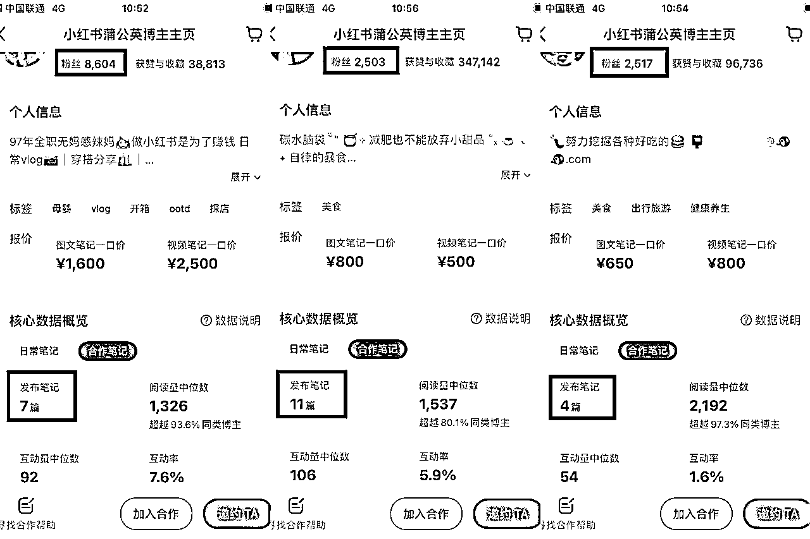

# 1.3 适合人群

「📕自媒体-商单」比较适合两类人：一类是天生网感好的人，随手发一条笔记就能收获大量点赞和评论，说明 TA 与平台生态天然契合；另一类是愿意坚持更新、不断复盘和优化内容的人，通过持续迭代最终也能做出爆款。

项目方向众多，入局门槛不高，适合大多数想创业或做副业的普通人，也适合作为📕入门项目。只要你有点网感、喜欢刷📕、对创作有热情，并且愿意学习拍摄、剪辑和文案，跑通概率会明显更高。

目前入驻蒲公英接商单的硬性条件：
1. 📕账号拥有 1000 以上粉丝；
2. 完成实名认证并年满 18 周岁。

年龄限制基本不是问题，真正的门槛是涨粉。涨粉的前提是持续发布笔记，这要求你明确赛道、找到对标，并且保持耐心和更新节奏。在这个项目里，持续稳定的投入，远比犹豫观望更有价值。哪怕红利消退，坚持行动的人依然能够赚到钱。

# 二、【项目实操 1/3】定好赛道，搭起账号基础

# 💡

# 章节概览

了解完整体情况，下面正式启动实操。项目流程再回顾一遍：注册账号 → 选择赛道 → 养号 → 参考对标账号完成包装 → 对标爆款持续发笔记 → 粉丝破千 → 实名认证 → 入驻蒲公英 → 接单变现。本章先完成前 4 步，把基建打牢。

👉 章节 2.1 赛道选择  
这一节会讲怎么选赛道，并提供 13 个高潜力方向供大家参考。

👉 章节 2.2 注册账号  
注册和选赛道没有先后顺序，可以同时进行。建议一个手机号对应一个📕账号，全程用流量完成。

🔥 章节 2.3 养号流程  
养号是项目关键，通常需要 2.5—3 天。正式发笔记前可以做测试，比如发日常、风景、干货等内容，第二天小眼睛破百就算养号成功。

🔥 章节 2.4 积累对标账号  
这一步同时也是积累爆款素材。可以通过刷📕首页、灰豚数据等工具，收集各领域的对标账号和爆款笔记。

👉 章节 2.5 账号包装  
头像、昵称、简介都可以参考对标账号优化，好的包装有助于提升账号权重，也能加快涨粉速度。

# 💡

# 本章航线图

完成本章学习与实操，即可走完第一阶段。

第一阶段：定位账号并搭建基础（约 3 天）
1. 找热门或合适赛道，了解玩法（每天至少 15 分钟）
2. 用流量注册账号，一机一号（约 15 分钟）
3. 刷同行笔记，模拟真人养号（每天约 1 小时）
4. 参考对标账号，完成包装（约 30 分钟）

那么，现在就开始第一阶段的实操吧。

# 2.1 赛道选择怎么入手 @李子木

# 2.1.1 值得尝试的赛道方向

# 📌

如何使用本章内容

为了降低启动成本，我们结合近期📕各赛道的数据表现和内容创作难度，筛选出 13 个变现潜力较大的方向。大家了解基础玩法后，要多去平台寻找自己感兴趣的领域，大胆测试新玩法。

# 赛道 1：中医养生

推荐理由：环境变化让亚健康人群越来越多，养生正在成为刚需。加上传统文化复兴，中医养生在📕近期爆款率高、商单多、报价高，值得入局。

内容解析：很多人担心自己不是中医专业、没有资质，做不了养生博主。实际上，很多非专业出身的普通人靠自学中医知识，在📕做到了 10 万+粉丝、月入过万。下面用视频和图文两个成功案例，带你看如何入门和起号。

# 案例拆解 & 爆款模板 01

账号：疯狂养生 max  
形式：视频博主

核心设定：“学中医前 xx” vs “学中医后 xx”

这种对比形式对非专业人士特别友好，既绕开太深奥的专业知识，也能降低违规风险。比如“学中医前/后，睡姿会有什么变化”“吃西瓜这件事，学中医前后的看法差异”，用前后差异体现养生带来的变化，比平铺直叙更有吸引力。“打破常识”的设定能激发好奇心，还可以延伸出“甘蔗的 3 种吃法”“1 分钟消气操”等内容，让账号更有系列感。

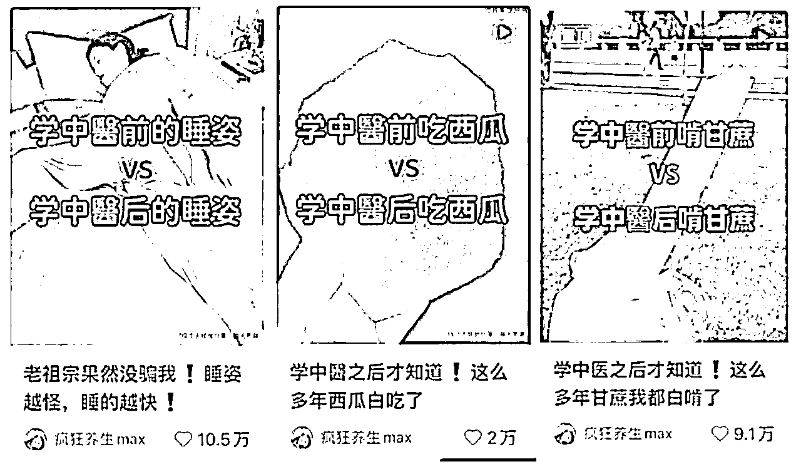

文字标题格式：“学完中医才知道”+ 视频内容概括。标题通常走两个方向：要么制造反常识（比如“多年甘蔗白啃了”“多年苹果白吃了”），要么突出效果（比如“睡姿越怪，睡得越快”“掉秤居然这么容易”）。

视频结构（建议“三段式”）：
开篇：展示学中医前的做法以及危害；
正片：讲学中医后的正确吃法、适合人群、好处与注意事项；
结尾：引导用户点赞收藏，并参与互动。

笔记链接：http://xhslink.com/a/j7HXs0nZGeJZ

# 案例拆解 & 爆款模板 02

账号：图图爱养生  
形式：图文博主

文字标题套路：
图图的内容大量采用“干货合集”。在📕，带数字的标题有天然吸引力，能戳中用户“怕错过”的心理，激发收藏欲。比如“越吃头发越多的8种食物”“黄芪的13种搭配”“身体的7种寒气”，简洁实用，点击率和收藏量都不错。

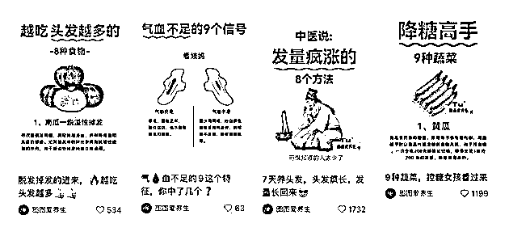

内容结构：
封面：提炼内容亮点，可以用“方法+人群+效果”吸引目标用户，也可以用“干货合集”暗示信息量足够大。
正文：文字部分先写一句背景，再用一句话概括主题，并给出内容大纲；图片部分把知识点详细展开，保持统一排版，让账号显得更系统。

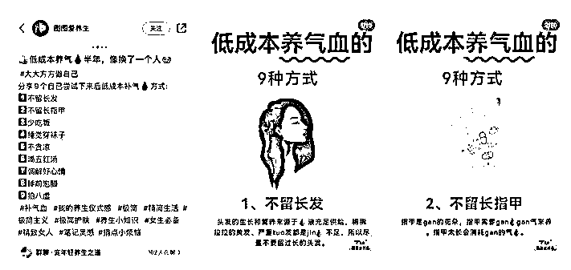

笔记链接：http://xhslink.com/a/QftbRMwnZ4MZ

# 赛道 2：家居

推荐理由：家居是今年📕重点扶持的方向，平台有流量倾斜。从商业合作看，家居品牌方投放意愿强，家居博主报价通常高于同粉丝量的其他类目；从带货角度看，家居品类数据也很能打，变现潜力高。

内容解析：今年家居类很火的玩法是“图文 + Plog”结合，不少博主靠它 7 天涨粉上千甚至上万。这种形式适合本身有文艺气质、热爱文字表达的创作者。如果你喜欢用图片和文字传递情绪，家居赛道值得尝试。

# 案例拆解 & 爆款模板

账号：水北山南  
形式：图文博主

主要内容：以暗调侘寂风家居场景为主，每张配图都搭配诗意文案。

选题思路：内容带有很强的个人情绪，但作者会主动绑定📕热点话题，比如 MBTI 人格、情绪议题、独居生活、反社交等。

实操要点：
1. 画面调性统一：坚持暗色调侘寂风。无论室内还是户外，都使用统一的暖黄或暗色滤镜，让主页看起来和谐，个人辨识度也会更强。
2. 打造“一平米空间”：在家布置一个理想生活角落，空间大小无所谓，关键是能体现生活态度。爱读书的人可以做阅读角，爱植物的人可以做阳台花园。这个角落既是取之不尽的拍摄素材，也是天然的广告位，可以植入家居用品、食品等商品。
3. 用细节讲故事：在配文中描写茶杯、书、小饰品等生活物件，赋予它们情感和故事，让内容更有温度。细节带来的共鸣会转化为更高的互动率和粉丝黏性。

笔记链接：http://xhslink.com/a/LI34WQ4Xv5MZ

# 赛道 3：美食

推荐理由：美食内容受众广、互动性强，天然容易吸引关注，是接商单最好上手的大赛道之一。

内容解析：今年美食赛道冒出了很多新玩法，其中最容易上手、成本最低的组合是“美食 + 新中式审美 + 生活化养生”，做日常健康餐食分享。这种风格符合当下审美，也贴近真实生活，普通人很容易模仿。

# 案例拆解 & 爆款模板

账号：金金狗儿  
形式：图文博主

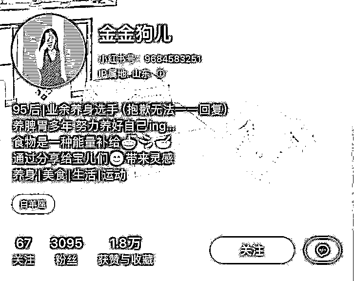

主要内容：围绕一日三餐，用文字加图片分享健康、美味、简单的日常餐食。

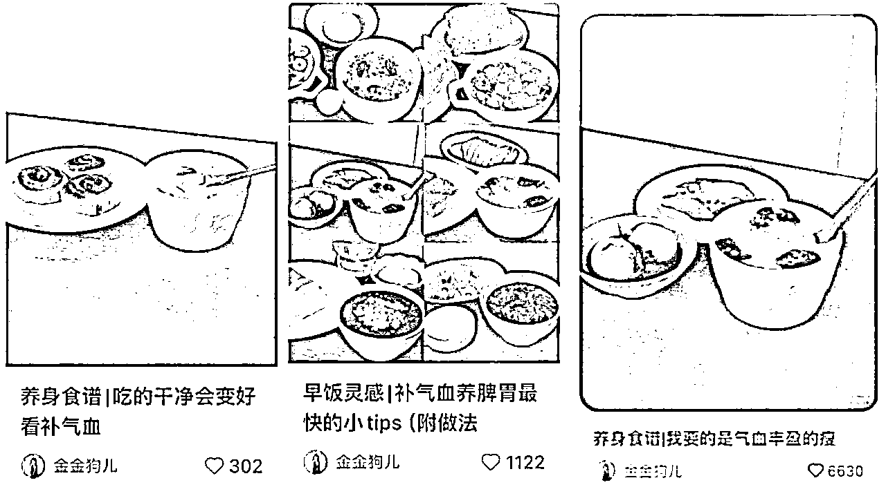

实操要点（以“然宝的日记铺”为例）：
1. 封面贴近新中式审美：拍摄时注意细节质感，选陶瓷碗、木质托盘等有文化感的餐具；食物色彩搭配要丰富但不杂乱。
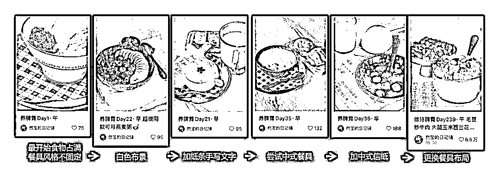
2. 让食物显得饱满、诱人：美食内容的核心是食欲感。饭菜要盛得满，让颗粒细节清晰可见，看起来分量十足。
3. 图文结构参考：
- 图片部分：前 3 张放最有诱惑力的食物，第一张拍整体，第二、三张拍细节；中间 2—3 张展示制作过程，如备菜、炒制等动作；最后一张加入有个人 IP 辨识度的小物件，比如好看的字体、手写便签。
- 文字部分：开头放菜名，中间可以写烹饪步骤，结尾补一句符合账号性格的短句。

笔记链接：http://xhslink.com/a/wDVKD4cZZ5MZ

# 赛道 4：女生独立生活

推荐理由：这个赛道是近两年兴起的，和以年轻女性为主体的📕用户画像很匹配。随着不婚、晚婚趋势上升，女性对独立生活技能的需求越来越强，内容商业价值也在不断释放，尤其是生活技巧类内容。

内容解析：去年，“女生独立指南”类图文在📕批量出爆款，捧出不少大号，但都是图文形态。今年视频版本开始出现，数据表现甚至超过图文，成为新的流量趋势。

# 案例拆解 & 爆款模板

账号：独立女生进阶记  
形式：视频博主

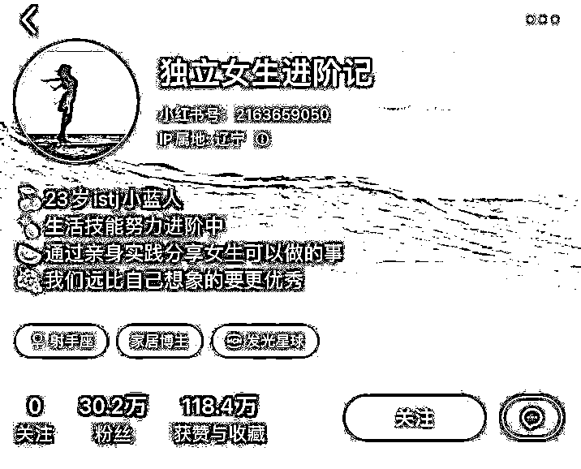

主要内容：类似教学视频，博主不出镜，通过讲解和演示解决日常生活中的真实问题。视频节奏紧凑，直接围绕用户需求展开。

选题思路：从同赛道的图文大号里找已经验证过的爆款选题，把它们重新做成视频，爆款概率会大大提升。

实操要点：
1. 内容精炼，不废话，直接进入主题；
2. 镜头对准问题所在的位置，画面干净不杂乱；
3. 视频结构：开头提出具体生活问题（如“卫生间瓷砖裂开了”“冰箱有异味”）；中间演示解决办法，包括工具、操作步骤和最终效果；结尾总结效果，并引导观众尝试、评论；
4. 从第一条视频起，如果在修理过程中用到产品，可以顺势自然植入，为后期接商单做好准备。

笔记链接：http://xhslink.com/a/uI5PN8VLm7LZ

# 赛道 5：护肤

推荐理由：没有女生能拒绝好皮肤，📕尤其如此。护肤是平台常青赛道，无论接商单、做带货还是当买手，都有很强的变现能力。

内容解析：护肤内容需求大，但竞争也激烈。新手起号的关键是找到差异化切入点。可以走垂直路线，例如专注痘痘肌护理，建立专业认知；也可以做跨赛道结合，比如“中医 + 护肤”，蹭流行趋势增加内容新鲜感。

# 案例拆解 & 爆款模板

账号：小森林的小世界  
形式：视频博主

主要内容：用视频记录护肤过程，尤其是“战痘”前后对比，再展开讲可实操的方法。

选题思路：围绕女性护肤高频痛点，比如油皮护理、痘痘肌改善、去闭口、屏障修复、防晒等，解决用户最容易困扰的问题。

实操要点：
1. 封面标题多用对比，如“烂脸战痘成妈生皮”是文字上的对比，护肤前后照片则是视觉上的对比，双重冲击更容易吸引点击。
2. IP 故事公式：我本来怎样 + 那时的感觉 + 经过努力 + 现在怎样 + 现在的感觉 + 以后会分享我的经验。
3. 重点收集关键词，比如“便宜、有效、真实”。示例：真实有效瘦小腿经验分享。

# 📕起号：赛道选对了，账号就赢了一半

写封面标题没灵感？先存几个能直接套用的公式，省得临时憋：

- 关键词②：照搬就行——比如“练成流利口语（不花钱，照抄）”“北欧风装修干货（直接套模板）”；
- 关键词③：零成本版——比如“马甲线练成注意事项（零成本版）”“三天入门PS（零成本版）”。

还有一个参考方向：“冷白皮养成攻略（便宜、有效）”。

开头提到的这篇灵感笔记在这里：http://xhslink.com/a/yVPcTC5fWOSZ

# 赛道 6：穿搭

📕上的穿搭内容，一直以来都是离变现最近的类型之一。穿搭只要好看，评论区就会有大量用户追问同款商品，带起货来不费劲，广告味儿也不重，商业潜力相当可观。

这个赛道确实很卷，新人有两条入场思路值得记住：

1. 垂直细分：不去和大博主拼主流穿搭方向，选一个有特色的窄切口，案例账号用的就是这一招。
2. 跨赛道组合：让穿搭与另一种内容玩法搭配，比如“穿搭+心情Plog”，内容一下子就有了记忆点。

穿搭号涨粉并不慢，但有个关键提醒——粉丝里如果大部分是男性，商业价值会大打折扣。封面图走裸露、妖媚路线，涨男粉确实快，但广告主看一眼粉丝画像就不投了。所以，性感照那种“速成流量”的诱惑，一定要扛住。下面这类粉丝构成的账号，接广就很费劲：

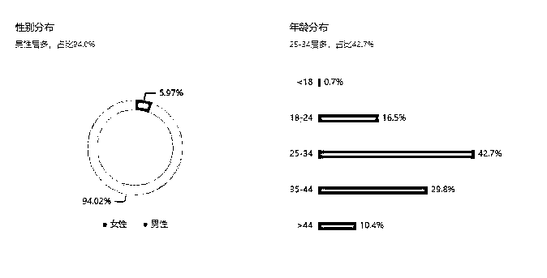

# 账号拆解 & 爆款模板 01

账号：天天明星同款
类型：图文博主

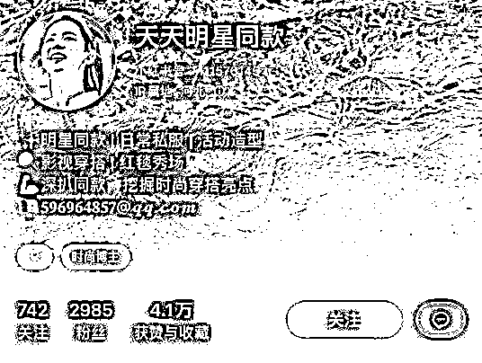

“天天明星同款”做的事很简单：扒明星穿搭的组合逻辑，把明星照片和单品图片放在一起拆解展示。

选题来源主要是热门影视剧里的路透穿搭、机场照穿搭，以及热门综艺中明星的出街造型，这些内容天然不缺关注度。

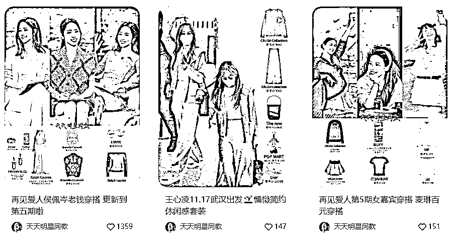

做内容的时候要把握两点：
1. 明星的选择很重要——话题热度和穿搭审美要同时在线上，流量有保障，后面做带货、做植入也会更顺。
2. 笔记的框架可以固定下来：
封面：用字幕标出自己的身材特点（比如“腿围xxcm，有xx缺点”），一句话说清情况，快速锁定注意力；
标题：按“综艺/时间+明星+穿搭风格（价格、风格等）”来搭；
正文：先简单说说综艺或明星最近的热点，再聊这期穿搭的特点。

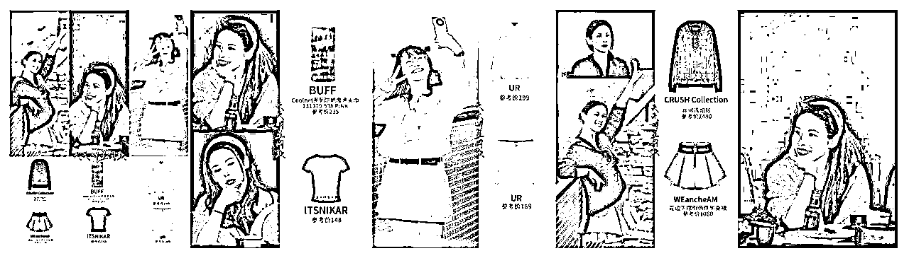

视频链接：http://xhslink.com/a/SueEyhIxWiZZ

# 账号拆解 & 爆款模板 02

账号：拖沓刘天王
类型：视频博主

这个账号用视频展示穿搭的前后变化，前后的差异被清晰放大，评论区经常能刷到“有被戳到”的共鸣留言。

选题聚焦在“适合粗小腿的靴子和鞋子”上。这个切口既能接商单，也特别适合带货。拖沓刘天王靠这些笔记加上直播，拿下了数千万的销售额。

内容上的两个重点：

1. 把身材上的小缺点变成内容特色，专门分享适合小腿粗壮姐妹的靴子、鞋子，反而更容易戳中目标人群的内心。
2. 视频的节奏设计：
开头：用字幕亮出自己的身材特点（比如“腿围xxcm，有xx缺点”），快速交代情况，把人留住；
对比展示：近景镜头下，一只腿穿靴子，另一只腿光着，差别一眼可见；
整体效果：把镜头拉远，呈现整套穿搭，整体风格和上身效果不言自明。

笔记链接：http://xhslink.com/a/SoZgRWW0HRSZ

# 赛道 7：母婴

母婴是📕上经典的不能再经典的赛道，目标人群消费能力扎实、消费意愿又强，品牌方给的商单报价也很可观。

这个赛道的内容如今分几条线：一种是今年很火的“三拼图”Plog，记录日常感悟和孩子的成长；一种是干货类，面向宝妈输出育儿和选购方面的经验；还有一种就是好物测评。三者相比，好物测评的变现方式最直接，带货效果也最突出。

# 账号拆解 & 爆款模板

账号：宝藏麻麻安妮
类型：图文博主

她的选题有三个方向：
1. 母婴居家必备用品的测评；
2. 热门购物节或头部达人的攻略，比如李佳琦双11直播囤货指南、李佳琦母婴节囤货指南；
3. 孩子成长关键节点的养护干货。

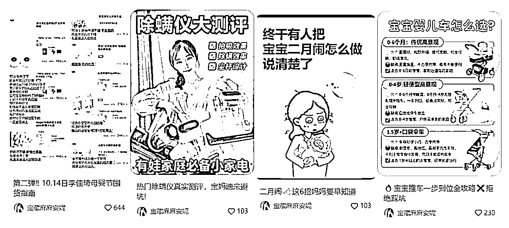

测评笔记的结构可以这样排：
1. 封面图：真人出镜+多个测评产品一起入镜，封面标题写明测什么产品，再用花字把测评维度标出来；
2. 副图：用live图组合，从几个测评重点对比各产品的表现；再分别放产品照片、特点和自己的点评；
3. 正文：先说当初为什么想买这件产品，再说选购时需要留意的几个点，最后逐个点评测评产品。

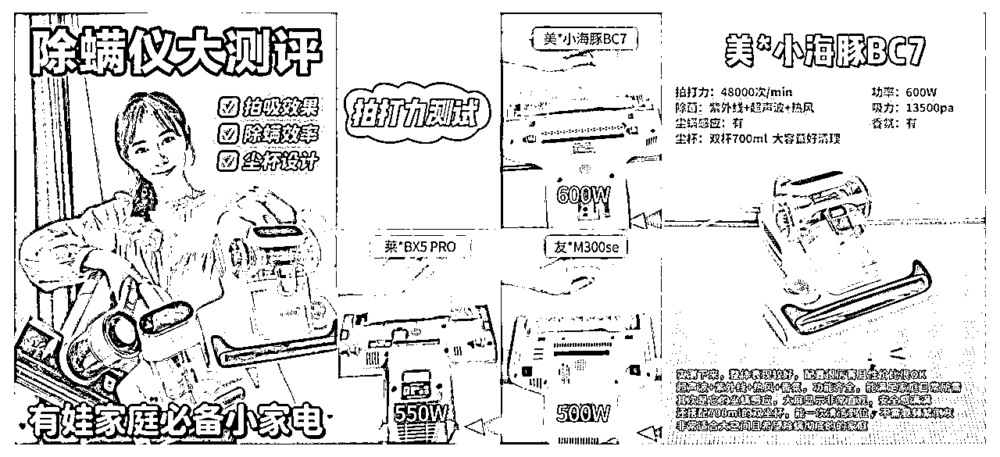

笔记链接：http://xhslink.com/a/0mE1RpaPOiZZ

# 赛道 8：数码

数码赛道在📕算是一直处于“求大于供”的状态，广告主非常认这个品类。同时它也是难得让男生女生都愿意看的赛道，大促节点一来，商业价值更是直接冲高。

内容打法以清单式图文测评为主。如果你之前接触过知乎好物，那做📕数码号会觉得很顺手。

# 账号拆解 & 爆款模板

账号：枫哥评测
类型：图文博主

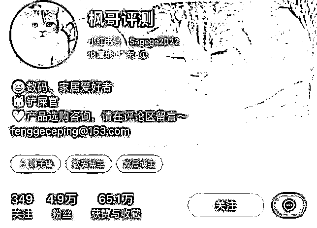

内容就是清单式测评：图片配上有信息量的文字说明。

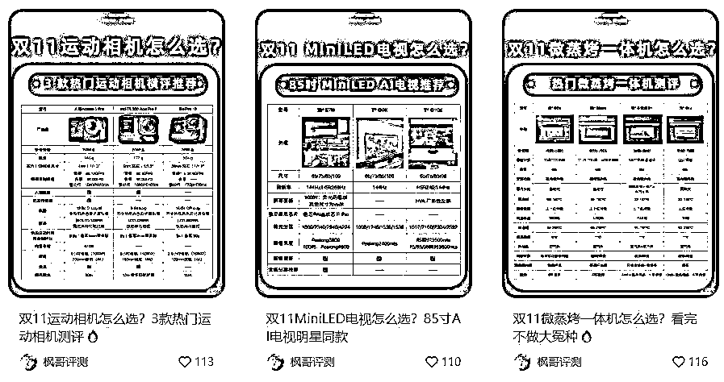

选题方向大概有三块：
家电与数码产品的选购攻略；
多款热门产品的横向对比测评；
双十一、618这类大促节点的必买清单。

制作上要注意：
1. 封面图：标题把测评类目写清楚，核心信息直接甩出来；测评维度用对比表格呈现，读者一眼就能看清测评范围。
2. 副图与内容：把选购指南和测评重点放在靠前的位置，用户扫一眼就能抓到关键信息；每款产品配上参数列表和选购建议，结合真实使用场景来点评。
3. 正文结构：先抛出选购中的难点和痛点，再给选购指南，最后注明“图xx到图xx是产品推荐”。

⚠️提醒：测评多款产品的时候，参考图和信息可以从电商平台（比如京东、淘宝）的产品详情页和用户评论里获取，并不是每一件测评产品都要真的买回来。

视频链接：http://xhslink.com/a/zrKSnCRwKiZZ

# 赛道 9：AI

AI内容是目前📕在重点扶持的赛道，热度也一直没降下来，对新手来说是一个不错的入场选择。

不过有一点要拎清：不要只做AI热点，纯热点内容的变现能力很弱。要把AI和赚钱、AI产品推荐、AI使用场景等内容结合起来，商业上的可能性才会打开。

# 账号拆解 & 爆款模板

账号：马克张的AI宝库
类型：视频博主

选题方向：
1. AI和赚钱结合：分享用AI工具做自媒体、开拓副业的方法，吸引那些想增加收入的人群；
2. 国产AI替代方案：国内用户用GPT等大模型不方便，就推荐好用的国产平替工具；
3. AI重要新闻：跟进并拆解AI领域的大动态，吸引关注新技术的人。

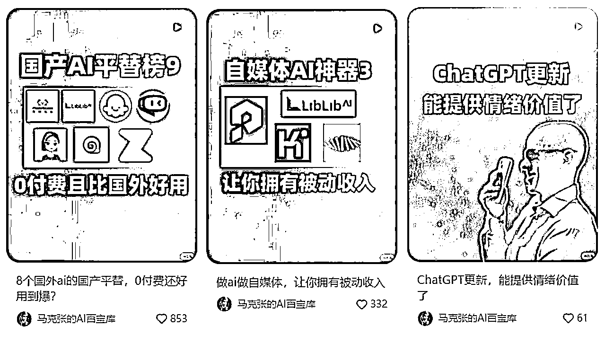

制作的重点：
1. 画面：用找素材+录屏/截图的方式组合，适当加一些文字快闪，让视觉更有冲击力；
2. 配音：用文字生成配音来做解说，保证内容输出的节奏感；
3. 视频结构：
开头：一句话概括整条视频的核心内容，和标题、封面形成呼应，引导用户点进来；
主体：详细讲几款AI工具，或一步步演示用法，给出实用的建议和搞钱思路；
结尾：简单介绍自己，再预告一下后续的内容方向，让用户愿意持续关注。

视频链接：http://xhslink.com/a/55oBf5ImAiZZ

# 赛道 10：美妆

美妆是小红的“本命赛道”，根基深厚，用户基本盘大，需求一直都在。就算竞争激烈，美妆的变现能力依旧排在前列。

美妆和穿搭一样卷得厉害，而且美妆的细分方向比穿搭还要窄，所以想突围，必须靠跨赛道选题和鲜明人设来撑。年轻用户里，大学生是很大的一个群体，这群人消费能力不弱，对美妆的热情也高。因此，一个普通女大学生定位的美妆账号，涨粉和变现都会更容易跑起来。

# 账号拆解 & 爆款模板

账号：是花茶呀
类型：图文博主

这个账号的内容很纯粹——用图片记录普通女大学生自学化妆、护肤的前后变化。

选题方向有两类：
1. 人设类：普通女大学生靠自律、坚持学护肤和化妆，外貌发生了让人眼前一亮的变化；
2. 干货类：适合普通女大学生的护肤品/化妆品测评，还有正确的护肤、化妆方法。

制作上两个关键点：
1. 前后对比要足够强：对比手法在美妆赛道效果最好，护肤或者化妆带来的改变一眼就能看出来。选照片时要挑前后差异大的，同时保证真实感，不能P得不像自己。
2. 爆款选题可以“借”：她第一条拿到1.4w赞的图文，就是参考了另一个博主的爆款选题，换上自己的照片和故事，照样能做出高赞笔记。

笔记链接：http://xhslink.com/a/m81RfdDaiiZZ

# 赛道 11：职场

从“大厂离职”到“发疯工牌”，再到“精神离职”……📕某种程度上成了职场人的情绪出口。越来越多的人在平台里找情绪上的释放，同时也关注兼职、副业、涨工资、情绪稳定等现实话题。

职场内容可以做成两个方向：一个是用职场段子、日常吐槽来引发互动，帮大家缓解情绪；另一个是输出职场提升技巧、工作指南这类知识型内容，既能吸粉，又能给到观众实际有用的建议。

# 账号拆解 & 爆款模板

账号：彤儿学姐
类型：视频博主+图文博主

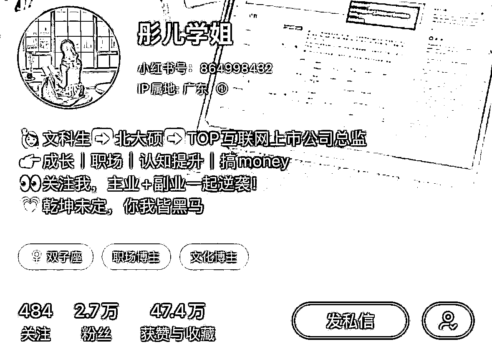

“彤儿学姐”的打法是：先用视频提出一个具体的职场痛点，紧接着分享求职干货。只要痛点找得准、内容讲得有道理，关注就会自然增长。爆款选题是可以反复做的，比如“年薪70w的大厂同事分享求职SOP、面试SOP”，不断的拆解求职细节，慢慢做成一个系列。

选题上，她会借用背书很强的人设，用这些人的口吻去讲求职、升职加薪的干货。

制作上可以借鉴这几点：
1. 把职场痛点抓准：学历不高的人找不到工作、文科生求职困难、面试时答不上来……针对这些具体痛点，给出明确的解决方案。
2. 标题和开头的写法：
a. 直接给结论，比如“我发现找工作的时候胆子越大，收到的Offer越多”，一上来就抛观点，把兴趣勾住；
b. 结果前置+借用背书，比如甩出“大厂工作10年的高管”这样的背景，让内容的可信度立刻拉满。
3. 正文内容：
a. 文案不绕弯子，直接给方法、讲干货，把自己的SOP思维导图或者求职笔记直接摆出来；
b. 视频不需要多精致，只要有背书、有方法，让人觉得讲得有道理、能学到东西，观众就会给点赞。

笔记链接：http://xhslink.com/a/SW7phFKWxlC0

# 赛道 12：文旅

2024年，旅游赛道里的攻略内容已经够多了，但真正稀缺的是有灵魂的文旅IP。把旅行体验、个人观点和故事揉在一起，内容会一下子有自己的辨识度，粉丝粘性和商业价值也会随之上涨。

做这个方向的人，最好创意丰富、感知敏锐，有一定的内容创作经验。把旅行途中的细节和情绪挖出来，打磨成有共鸣的故事，既能打动观众，也能慢慢沉淀下长期的粉丝。

# 账号拆解 & 爆款模板

账号：元莱Yilia
类型：视频博主

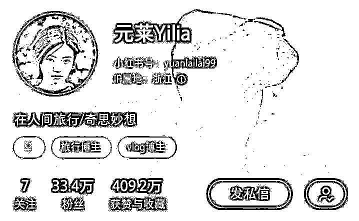

她的视频记录的是旅行中和当地的人、动物甚至植物之间的故事，以及一路上的思考，并不是那种“哪哪打卡”的普通攻略。

选题大多来自旅途中的个人经历，比如她讲环球旅行是自己的梦想，为此放弃了稳定的生活；比如她陪外公一起去完成遗愿清单；比如她讲自己如何一步步走出低谷。

内容制作有三个重点：
1. 主题和观点是灵魂：观点要独特、有新意，还得契合大众的情绪需求，并且能让人看到你的情怀。元莱的“如果你也曾听过，大海的悲鸣”，是用海边风景来谈环保；“我救了一只小鸟，可最后我放弃了它”，把旅途遭遇引向对生命的思考；“这泥泞的小路又短又长，这片麦田通往人世间”，则让眼前的景色和人生感悟相互映照。
2. 文案要精心打磨：把悬念或者金句放在开头，句子要短，不要用长句，多写具体的事物、内心的感受和实际的场景，让观众有“站在旁边”的代入感。
3. 视频节奏：内容从容舒缓，但节奏不能拖。把句子之间的停顿剪短，让视频像一段轻快的旋律一样往前流，观众就会一直想看下去。

笔记链接：http://xhslink.com/a/NFet2M0Ly0SZ

# 赛道 13：留学 / 国外生活 Plog

如果你正在国外留学、工作，或者手里存了一堆国外生活的照片素材，那这个赛道真的别错过。它天然稀缺，比大多数创作者更有内容优势，同时又和生活离得近，商业潜力和变现空间都非常大。

这种内容形式对旅游赛道博主也适用，核心是分享新东西——新事物、新观点、新见解。适合平时爱记录生活、创意丰富的创作者。

下面这个账号，更适合本身有梗、放得开的年轻人。

账号：妈的欧洲账本
类型：图文博主

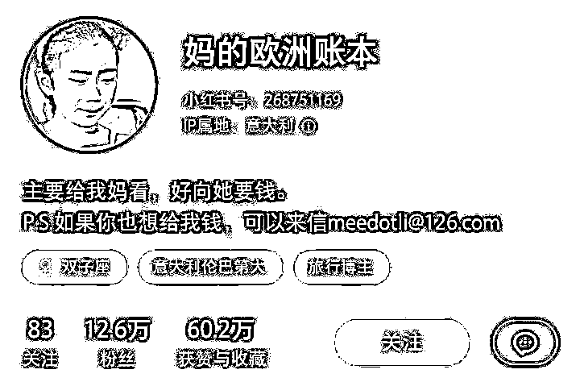

它的内容是用照片+文字组合起来，形成有剧情、带吐槽、偏搞笑的照片故事流。

选题来自留学、旅居过程中那些令人无语的槽点，再用一个很新的角度把它们讲出来。

制作上怎么做出这种效果：
1. 把情绪写进文字里：内容不少是特别生气、觉得离谱的时候记下来的吐槽。那些槽点本身带着强烈的情绪，就像小姐妹当着面跟你碎碎念，让人忍不住想互动。生气的时候、特别想吐槽的时候、特别兴奋的时候，先别憋着，拿起手机一边说一边录下来，这就是最鲜活的素材。之后再转成文字，有空的时候理成一篇有逻辑的笔记，再把关键句子直接写在图上——一条能“抓住人”的情绪化图文就诞生了。
2. 在图上写段子：如果不想露脸，就做图文段子，“一张照片+三段式图文段子”的形式，戏剧效果直接拉满。
3. 用游戏视角打开旅行记录：每张图是一个游戏场景，文案就像游戏旁白——“今天，你踏上了一个人的北欧旅行”“终于，你到达了民宿楼下”，读者很容易就跟着情景走进去。

笔记链接：http://xhslink.com/a/8dkFGTi6g0SZ

# 2.1.2 赛道选择 @梨云

把上面的热门赛道看完，接下来要面对的是一道选择题：自己到底适合做哪个？不同的维度会指向不同的答案，下面这张表格可以帮助你给自己做一次评估。

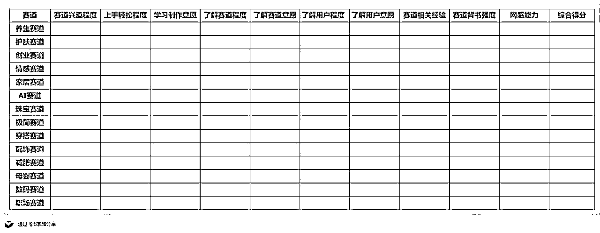

从兴趣、擅长、对赛道和用户的了解、经验积累等方向，一共可以拆成10个维度：
- 赛道兴趣程度：对赛道的兴趣越高，内在驱动力越足；
- 上手轻松程度：越擅长这类内容的制作形式，做笔记就越省力；
- 学习制作意愿：如果还不会做，但学习意愿很强，后面上手也会更轻松；
- 了解赛道程度：对赛道理解越深，写内容的时候就越顺畅；
- 了解赛道意愿：如果还不够了解，强烈的好奇心会帮你越写越顺；
- 了解用户程度：越懂目标用户，做爆款选题就越有感觉；
- 了解用户意愿：就算还没摸透用户，愿意研究也会让你越来越会选；
- 赛道相关经验：相关经验越丰富，切入这个赛道就越不吃力；
- 赛道背书强度：背书越强，越容易获得粉丝的信任；
- 网感能力：网感好，做📕的爆款概率就会明显更高。

每个维度按满分10分来打，觉得自己哪方面强就多给分。最后把分数一加总，排在前三的赛道，大概率就是你最适合起步的方向。

内容出处：《📕越做越没流量？像素级带你高效模仿爆款笔记》

# 2.2 注册账号 @周恩俊

把赛道方向定下来之后，就要开始注册账号了。

# 2.2.1 准备手机号

多数情况下，一个📕账号就对应一个手机号。如果打算铺多个账号，可以用家人的手机号，也可以再多办几张手机卡，线上就能申请。新手阶段其实不用急，先集中精力做一个号，把整个流程跑明白之后，再考虑多账号、多赛道的矩阵测试。

关于电话卡，有几个参考方案：
三家运营商都可以办副卡，一个身份证能注册认证5个号码，一拖4，副号月租只要10元；
移动的“万能副卡”，月租10元，一张身份证能领2张副卡，两张卡必须隔90天才能办。App上能申请，营业厅也可以，不过营业厅可以免第一年的月租；
中国电信App直接搜“无忧卡”，一个月5元，基本第二天就能送上门；
移动还有一个8元的保号套餐。

# 2.2.2 注册账号

注册的时候，全程建议用流量完成操作。注册完成后，直接按下面的流程开始养号。

⚠️这一步先不要做账号的实名认证：一张身份证只能认证一个账号，一旦认证成功，只有注销账号才能解绑。最稳妥的安排是等账号起号成功、粉丝破千之后，再去做实名认证。

# 2.3 养号流程 @周恩俊

第一天：注册账号必须用流量。注册完成后，先不要动包装、头像、昵称和简介，也不要去刷笔记。
第二天：开始养号。刷你准备做的那个领域的笔记，学真人的操作方式。打算做哪个领域，就集中刷哪个领域的内容，看到同行的笔记要点赞、收藏、关注、评论，而且操作之间要间隔20到30秒。每天刷半小时到1小时就行，分时段刷也没问题，比如上午15分钟、下午20分钟、晚上15分钟。有空就多刷多看。
第三天：上午继续接着养号。下午打开发现页检查一下，如果同行的笔记能占到70%，说明号基本养成了。这时候可以去包装账号，把头像、名字和简介都改好。着急的话，改完包装就可以发笔记；不着急就等第二天再发也行。

一个提醒：垂直领域的账号，一般要先试发一篇日常生活、风景或者干货类的笔记测流量。第二天小眼睛能过100，说明账号状态正常，这时候再开始正式发这个领域的笔记。

养号流程走完再发作品，涨粉才会顺畅。这一步千万别省，不然直接发作品，账号没反应、起号起不来，白白浪费时间。

内容出处：《📕达人变现项目，单人月入2W，团队月入10W+保姆级教程详细拆解》@周恩俊

# 2.4 积累对标账号

自己的定位定了之后，找对标账号是绕不开的一步。有对标账号在手，既可以对着打磨自己的IP包装，也能参考对方的内容规划和输出节奏。

# 2.4.1 找对标博主的方法推荐

1）直接搜自己所在领域的关键词（这个方法最好用）

先把自己的领域关键词敲进搜索框，然后分别查看“综合”和“最热”两个排序里排名前 50 的博主，从中筛选合适的对标对象。

2）进入【频道】中对应的类目

📕的二级导航里设有家居、美妆、穿搭等频道入口，点进自己内容所属的那一栏，就能看到同领域创作者发布的笔记，再从中挑出值得参考的账号。

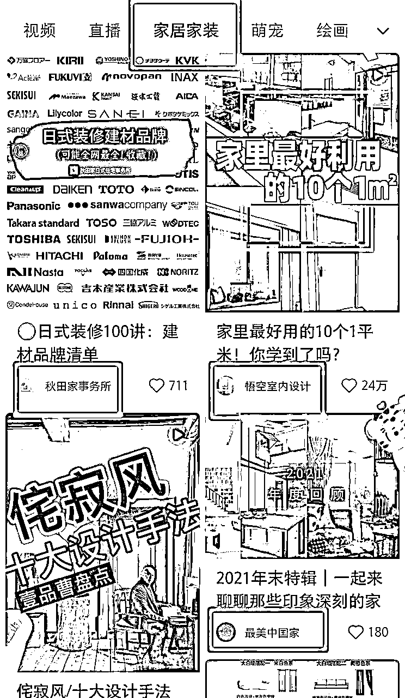

# 2.4.2 对标账号适不适合你，看这几点

找参考对象时，筛选这一步不能省。看到明星或 KOL 就照单全收并不可取，并非人人都值得你模仿。下面几个维度可以作为衡量标准：

1）赛道定位

先确认对方的细分领域与你的重合度。穿搭类账号跑去学美食博主，方向就偏了。如果做的是小众领域，找到一模一样的同行并不现实，这时可以选择相近类目的创作者作为参照。

2）变现路径（效率如何、空间多大、你有没有能力或潜力做到）

只做内容的博主与以精准引流为目的的博主，在选题规划上差别很大。所以研究对标时，要弄清对方的钱从哪里来：靠接广告，还是把人引到私域卖货、卖课？这种路径与你当下或今后的变现设想是否接近？

3）粉丝体量（优先近期涨粉猛的；本身粉丝可观的，腰部比头部更值得学）

粉丝量也是筛选条件，太少或太多都不理想。优先考虑最近涨粉势头猛的，或者起号阶段跑得快的账号。对刚入局📕的人来说，十万粉上下的腰部账号，通常比五十万粉以上的头部大号和明星号更有参考价值。头部大多已签约 MCN，背后有团队操盘包装，普通人很难复制到那个量级。

4）IP 调性是否合拍

浏览对方主页时要快，重点感受整体风格跟自己的 IP 是否合拍，以及自己有没有本事产出类似的东西。如果模仿门槛过高，放弃也不可惜。

5）赞粉比例 @星月

如果一篇笔记的点赞数超过了账号总粉丝量，这样的内容更值得研究。点赞绝对值高，不等于质量好——粉丝基数大的账号，数据天然会被抬高。

刷对标时，别只盯着五千、一万赞的笔记，那些一两百到一千赞左右、看起来不算炸的内容，反而更该点进主页看看对方的粉丝规模。有些笔记挂着一万赞，账号却有八万、十万粉，这种比例参考价值有限。

遇到低粉高赞的笔记，记得收藏，或者单独建一个选题库，它们会成为你取之不尽的爆款灵感来源。

6）同一账号反复出爆款 @星月

爆款这件事，本身就带点运气。

偶尔冒出一篇，可能只是撞上了风口，不能据此判定这个账号值得学。可如果爆款接连不断地出现，说明它掌握了某种“爆款密码”，也许是封面设计，也许是选题角度。

7）时间窗口 @星月

参考近一个月内跑出来的笔记或账号，意义更大。

这里绕不开“热度”二字。在自媒体平台，热度几乎决定一切。冬天羽绒服搜索量猛增，情人节礼物被反复搜索，前阵子甲流、感冒药又成了热词。

不同时期的流量词完全不同，所以对标要挑最近的、正热的账号或笔记。还要说明一点：除了市场本身的反应，平台给热度也有一定的随机偏爱。我们真正要抓的，是近期火起来的内容，尽量顺着平台的推流方向走。

一个月只是大致范围，并非硬性规定，核心原则是越近越好。一周内最佳，三天内更妙，还热乎着呢！

内容来源：《初阶 | 📕-爆款笔记｜航海实战手册》《爆款对标账号 6 要素》

# 2.4.3 找到对标之后，怎么拆？@梨云

锁定对标账号，下一步就是拆开来看。

1）看账号包装

以我自己的号为例。

1.

昵称：云云【个人名】+ 讲学习方法【账号内容方向】

2.

个人介绍

a.

核心标签：学霸&卷王｜深耕学习方法三年｜风格幽默

b.

输出内容：学习干货｜提分技巧｜四六级｜好物推荐

c.

更新节奏：每天 1 条

2）看内容选题

看看这个账号的笔记分类夹。运营得好的创作者，会把主页当成一本杂志来打理，每个分类夹就像杂志里的专栏，一个专栏对应一类主题，并且长期更新。

能留下来的分类，自然是用户买账、数据好看的。某个方向如果只试了一两篇、反响平平，多半就被砍掉了。

这些分类就是你可以照着做的内容方向。

再往下走，不妨把对方的笔记整体翻一遍，按分类梳理每类内容的标题写法、封面样式和表现形式。做完这一步，你就拥有了一个现成的选题库和素材库。

3）看变现模式

变现路径主要有三条：接广告、卖货、做私域。

广告：去数据平台输入账号名找到达人，点开“品牌合作”一栏就能看到投放情况，这类属于硬广。

软广在数据平台上查不到，得自己翻笔记。判断依据是：一条内容里推荐某款产品，视频讲解占了三十秒以上，图文铺了两页以上，那九成是软文。

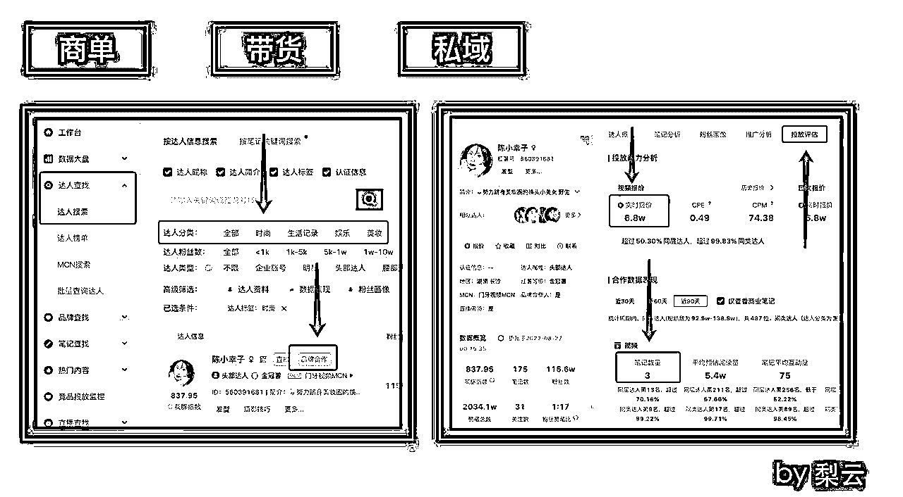

卖货：点进主页的【店铺】或【专栏】，也可以守着对方的直播看，有没有带货一目了然。

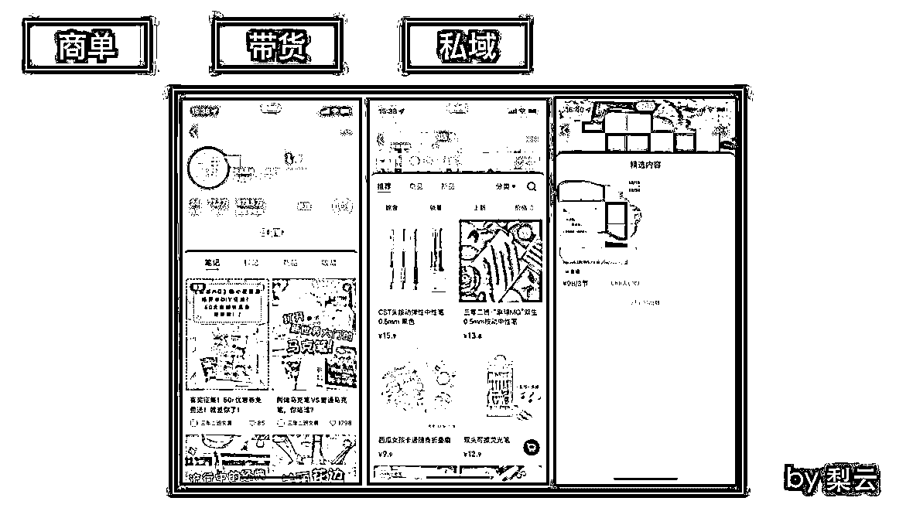

私域：用三个步骤判断对方是否在引流变现。

一看图片，资料是否故意不摆全。比如一份三十页的材料，配图只露出几页，这就是“暗钩”——我手里货很多，想要完整版就来找我。

二看文字，有没有直接点明或者含蓄提示。如图就是“明钩”：电子版我有，拿去就能打印。

三看评论，清一色的留言非常扎眼。你甚至可以假装粉丝去领一份资料，观察对方接下来怎么引导。

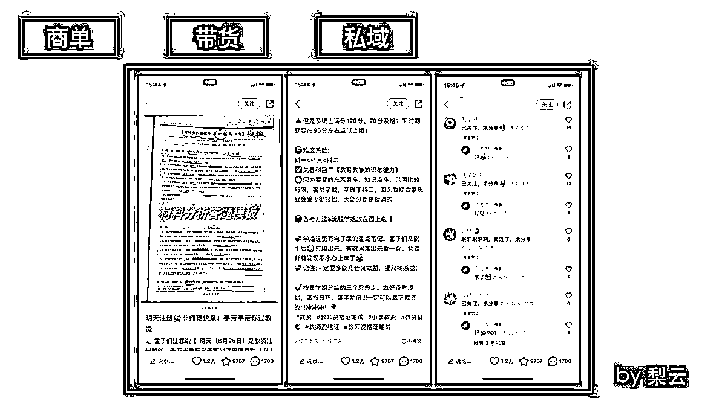

内容来源：《定位一换涨粉过万，如何利用数据分析在📕精准定位》

# 2.5 账号包装怎么做

账号包装好比开店前的门面装修，用户点进主页的第一眼，看到的就是它。

一个人决定关注你，很少只因为某一篇笔记写得好。他往往会先逛一圈主页，看看昵称、头像、简介、背景图，再翻翻过往作品，才按下关注键。

对创作者而言，把资料填完整还有额外好处——提升账号权重。

信息越齐全，平台越容易给账号打上清晰标签。标签明确之后，推过来的流量会更精准；流量精准了，点开笔记的人变多，浏览数据自然往上走，账号权重也就跟着水涨船高。

具体怎么包装？照着前面筛出来的对标账号，结合自己的领域做调整，立起一个领域人设。

# 2.5.1 头像怎么定

整体别太花哨，与账号定位相衬即可。

制作渠道：像图怪兽这类网站就能做图，挑一张满意的裁成头像；也可以去找没有版权限制的素材：

图怪兽：https://818ps.com/

可画：https://canva.com/

创客贴：https://www.chuangkit.com/

⚠️注意事项：商标类图片存在侵权风险，尽量避开。

# 2.5.2 昵称怎么起

名字要容易记、有辨识度，最好还带点趣味。加上领域关键词，辨识度和可信感都会更强。复杂符号、生僻写法尽量避免。

以美食号为例，“小溪教你做美食”这种命名，粉丝扫一眼就明白账号在做什么。

可以参考下面四种组合方式：

昵称 + 个性：大鹅的七七八八

昵称 + 地区：姚老板在北京

昵称 + 专业：跟着拆哥看房

昵称 + 价值观：阿鱼爱学习

# 2.5.3 简介怎么写

简介的作用，是让访客知道关注你能得到什么。穿搭号常见的写法是“小个子穿搭分享|感谢喜欢”。

可以套这个公式：

你是谁

你做成过什么厉害的事（没有就略过）

关注你能得到什么，或者你会分享哪些方向

有些账号单篇点赞破万，粉丝却只有一百来个，问题多半出在内容不够垂直，简介也没写好，等于没给访客一个关注的理由。

所以写简介不必客气。你要是展示不出自己的价值，别人凭什么点关注？

# 三、【项目实操 2/3】做出爆款、攒够千粉、入驻蒲公英

# 💡

# 章节概览

本章要干的事，标题已经说清楚了：持续产出📕笔记，争取做出爆款，一步步把粉丝攒到一千，满足蒲公英的门槛，最终顺利开通。

开通蒲公英需要满足两个前提：

① 完成实名认证，年龄满 18 周岁

② 粉丝数量超过 1000

新手不妨从研究和拆解爆款笔记入手，慢慢找到创作的手感。有了感觉之后，再持续打磨内容、提高产出效率，让数据一点点往上走。

照着本章的方法操作，选对赛道后，一般十天到半个月会看到粉丝开始动起来，一个月上下就能摸到千粉线。

拆开来看，关键动作有这些：

写笔记，图文或视频都算

图文的写法，见👉「3.1 如何创作图文笔记」

视频的拍法，见👉「3.2 如何创作视频笔记」

摸清常见违规情形和应对方式，防止踩线，见👉「3.3 检查笔记内容，避免违规」

攒够一千粉并开通蒲公英，见👉「3.4 达到千粉，入驻蒲公英」

这些关于内容创作和蒲公英入驻的问题，本章都会逐一解决。

# 💡

# 本章路线图

学完并动手做完这一章，航线图的第二阶段就完成了。

第二阶段：做出爆款笔记、积累千粉、开通蒲公英（约 10-30 天）

1.

围绕赛道搭建素材库，每天收集对标爆款（约 1 小时）

2.

拆解 3-5 篇对标爆款图文（每天约 1-1.5 小时）

3.

仿照对标发第一篇图文笔记（约 1 小时）

4.

拆解 3-5 篇对标爆款视频（每天约 1-1.5 小时）

5.

仿照对标发第一条视频笔记（约 2 小时）

6.

保持日更，每天至少一条图文或视频，直到粉丝破千（每天约 1-1.5 小时）

7.

开通蒲公英，完成实名认证并设置报价（约 30 分钟）

现在就动手，进入第二阶段的实操吧。

# 3.1 图文笔记怎么做 @小玲玲

# 3.1.1 操作流程

内容素材来自对标账号，收集对标的过程本身就是囤素材。怎么找对标，可以回头翻翻【2.4 积累对标账号】。

挑素材的标尺是：近期跑出来的图文爆款，点赞至少过百。

锁定目标后，把正文提取出来交给 AI 改写；

做一张背景图，往后固定使用；

把改好的文字放进背景图里完成排版。

具体怎么落地？拿一个赛道来演示。

# 3.1.2 用参考赛道实操图文笔记

# 案例：中医养生赛道

对标笔记链接：http://xhslink.com/a/Ti9KvhPXOMXZ

1）搜索关键词并分析同行爆文

在📕里搜索赛道关键词，比如“中医养生”“养生干货”，把近期热门笔记筛出来。点赞和评论双高的内容要多看几眼，拆解它们的版式、标题和行文风格。

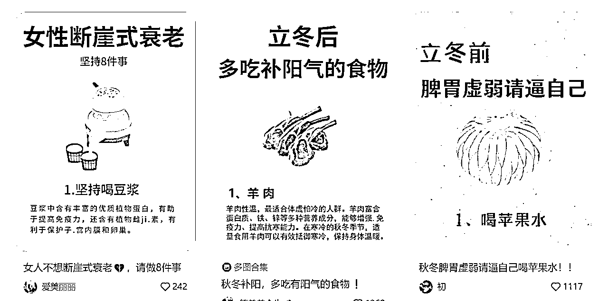

2）用辅助工具锁定优质内容

可以借助灰豚数据这类工具，也可以直接站内搜索，挑出近期点赞表现好的笔记，保证内容踩在当前趋势上，被喜欢的概率会更高。

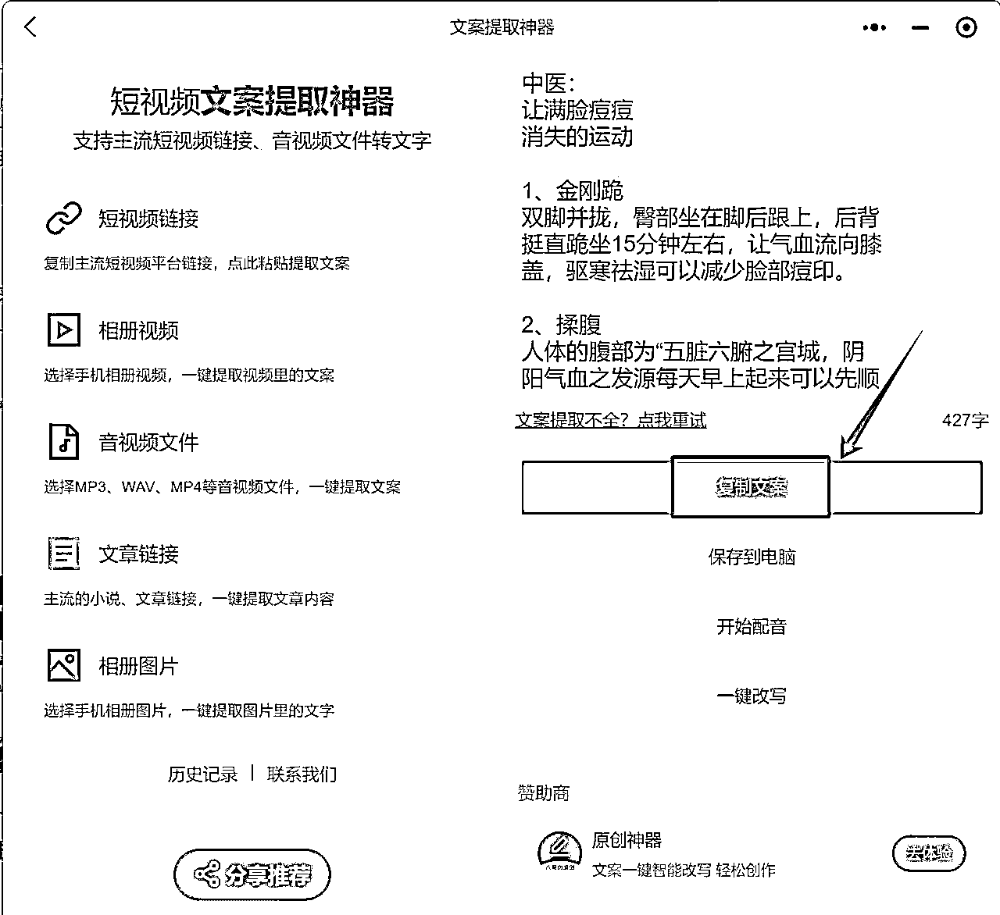

3）提取笔记文案

把选中的笔记链接丢进文案提取小程序，或者用文字识别功能抓取内容，保证拿到的文字完整、清楚。

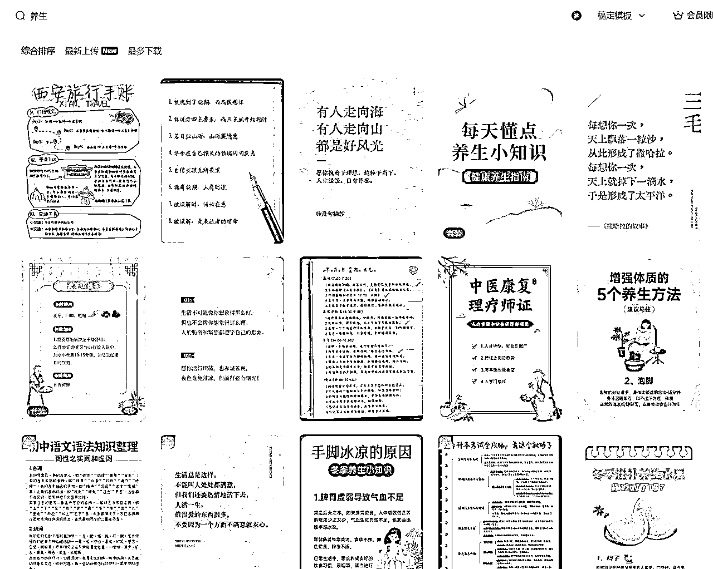

4）设计背景模板

挑一张契合养生调性的背景模板，稿定设计这类工具就能满足。整体要简洁耐看、方便阅读，和主题贴合。

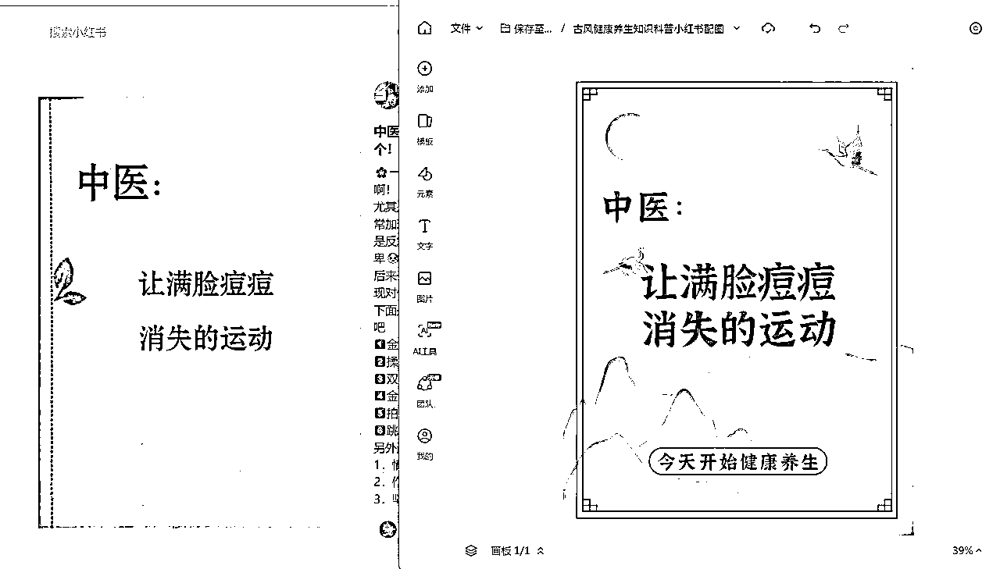

5）模仿优秀排版

参照同行的封面版式来做，布局和内容结构尽量靠拢，这样更容易吸引到同一批目标用户。

6）改写次图内容

借助豆包、文心一言这类 AI 对提取的文字做二次加工，防止被判搬运抄袭。

7）排版与美化

把改好的文案填进模板，再点缀贴纸或装饰。贴纸可以在百度按关键词搜，也能让 AI 生成，或在稿定设计的素材库里挑。

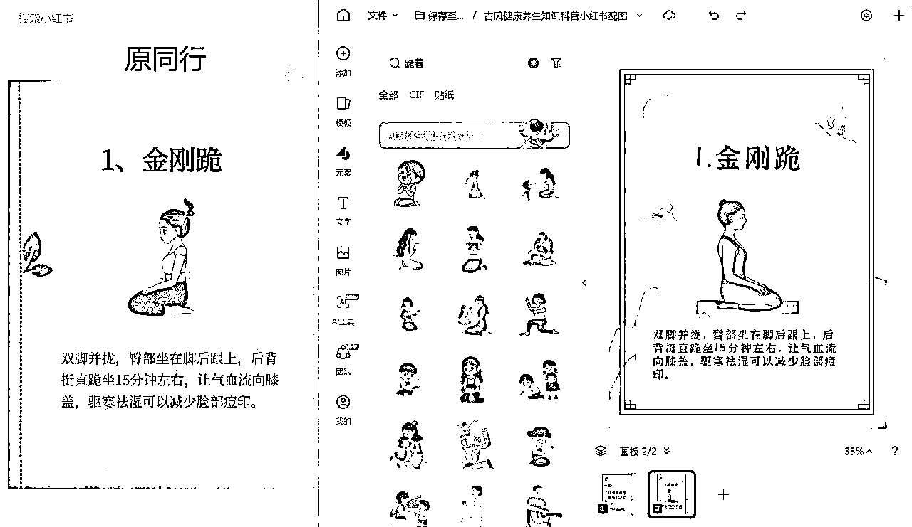

# 3.2 视频笔记怎么做 @小玲玲

# 3.2.1 操作流程

素材来自对标账号，攒对标的过程就是在攒素材。怎么找对标，前面【2.4 积累对标账号】已经讲过。

挑素材的标尺：一个月内跑出来的领域热门视频，点赞至少过百。

先把参考视频里的文字扒出来，改成自己的稿子，再照着拍；

剪辑用剪映，重点调好文字、画面、音乐三块。

这里附上龙哥盟「剪辑特训」的教程，新手友好度很高。上面提到的几种手法，都能在教程里找到对应的教学视频，看视频比看文字直观得多。

剪辑特训航海手册戳👉《3 月航海｜剪辑特训｜实战手册》

视频处理完毕，配上文案和标签，就可以在📕发布了。

具体怎么落地？拿一个参考赛道来演示。

# 3.2.2 用参考赛道实操视频笔记

# 案例：女性成长赛道

对标笔记链接：http://xhslink.com/a/rHpm0gCH9OXZ

1）提取爆文文案

在📕找到爆款后，用小程序把文字内容提取出来，确保拿到完整文案，作为创作底稿。

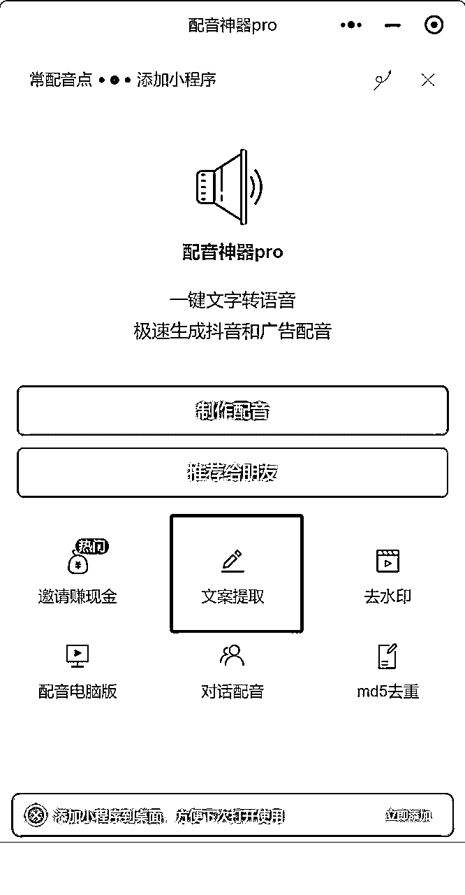

2）用提词工具拍摄视频

拍摄时可以用“灵敢提词器”或剪映自带的提词功能。这类工具部分功能要会员，记得提前开通。

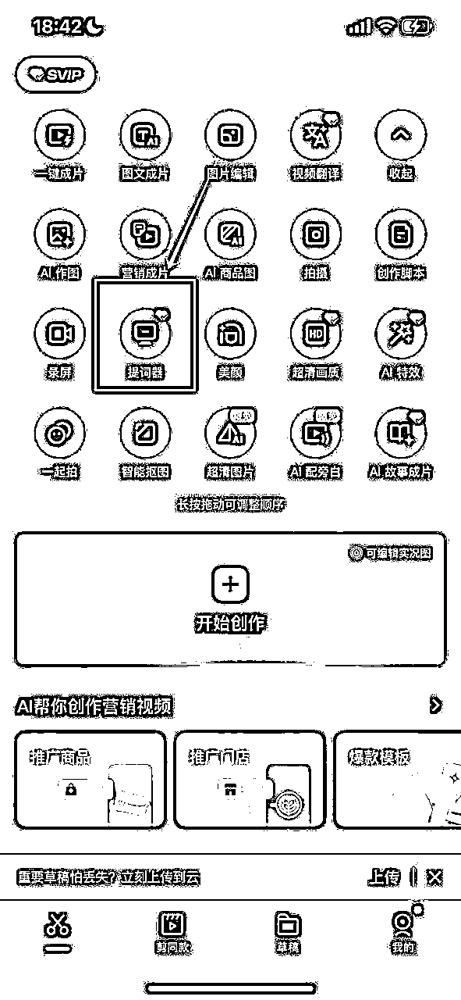

3）粗剪第一版视频

把拍好的素材导进剪映，先掐头去尾，删掉卡顿、不顺畅的部分，然后跑一遍自动识别字幕，观感会好很多。

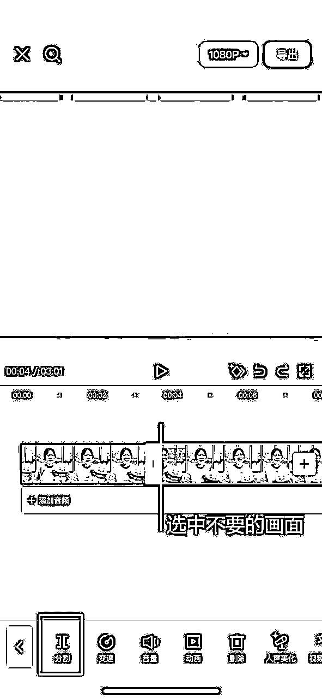

4）字幕检查与修改

识别出来的字幕要逐条核对，把错字改掉。在“编辑字幕”里就能操作，顺手给关键句做标注，调调字号和颜色，画面会更抓眼。

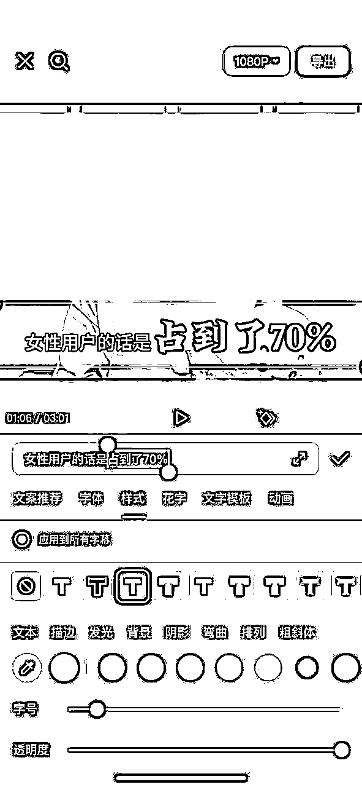

5）调整视频画面质感

再动一动对比度、饱和度、色调和滤镜，把画面质感拉起来，看起来更舒服。

6）添加合适的背景音乐

配乐可以识别同行视频用的 BGM 来对齐，也可以在剪映的 vlog 专辑里挑一首，氛围感立刻就有了。

7）设计封面

画面、字幕、音乐都定下来后，再做封面。照着同行的封面结构来，适度加些表情和装饰，点击率会更好。

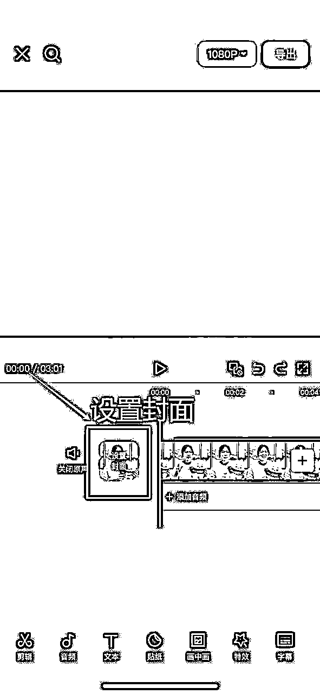

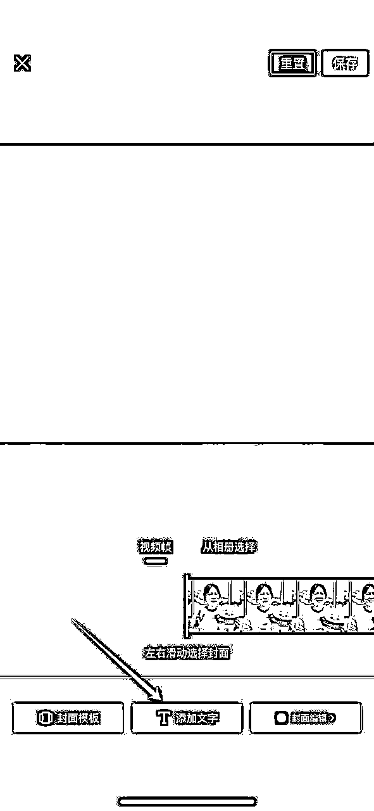

# 3.3 发布前检查，别踩违规线 @周恩俊 @吴小二

笔记做完，发布前过一遍内容，确认不触碰规则，免得影响流量。

# 3.3.1 常见的踩坑类型

视频被判违规，多数是二次创作去重不到位，触发了系统的违规或优化提示，得按要求改完才能继续获得推荐。偶尔一两次问题不大，可要是频繁中招，专业号会掉灰，之后既进不了蒲公英，也接不了商单，麻烦不小。

图文相对安全一些，因为图片通常套用新模板，只是借鉴爆款思路，去重不彻底的风险低。

但情感、正能量、星座这类图文赛道同样容易出问题。有些人栽在敏感词上，比如被判定传播负能量、情绪导向偏激、涉及封建迷信等。系统一般会给出整改提示，照着改完，影响基本就消除了。

下面具体看看后台常见的违规提示有哪些，以及怎么处理。

情况一：搬运抄袭

这是最容易撞上的一条，二次创作没做到位，内容同质化明显，被平台识别出来；

应对办法是加大二创力度：文字重写、图片换模板、视频打乱顺序并混剪多个片段。

情况二：引流违规

不少人以为笔记里没写引流信息就万事大吉，可一旦有粉丝私信要链接、要🛰️，你回复了就会被打上站外导流的标签；

这类消息直接无视即可，必要的时候用小号去应付。

情况三：数据异常

粉丝连续点赞收藏，也可能被系统判成互动异常。可以在简介里注明“请勿连赞”，或者在笔记和评论区提醒一句；

另外，千万别为了涨粉或数据好看去刷量，这属于作弊，严重时直接封号，得不偿失。

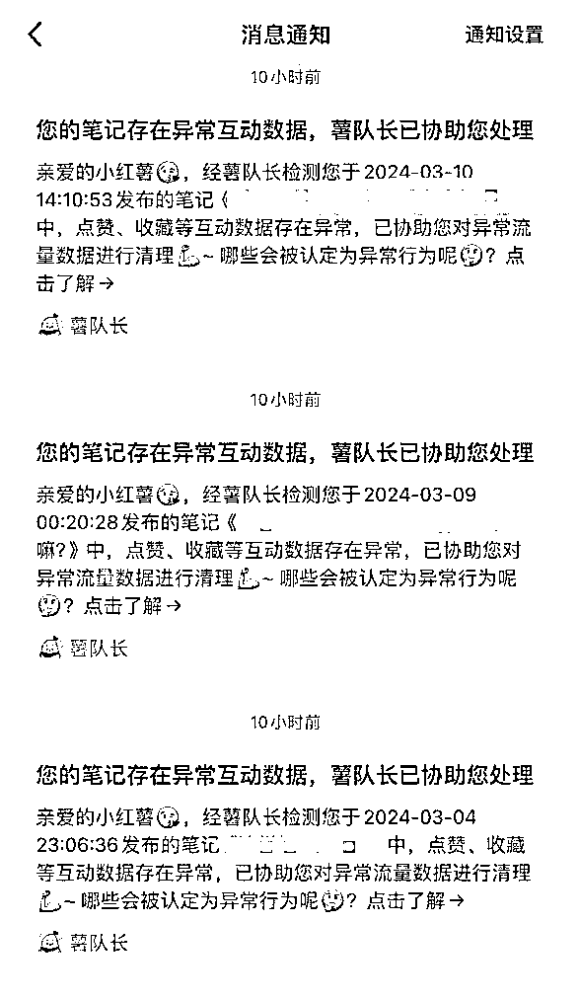

情况四：内容低俗或不宜未成年人

通常是素材或文案里带了敏感内容。发布前自查一遍，看看有没有敏感词、不雅图片。“性”“裸露”“暴力”“SB”“贱人”“垃圾”等都是高频雷区，能避则避。

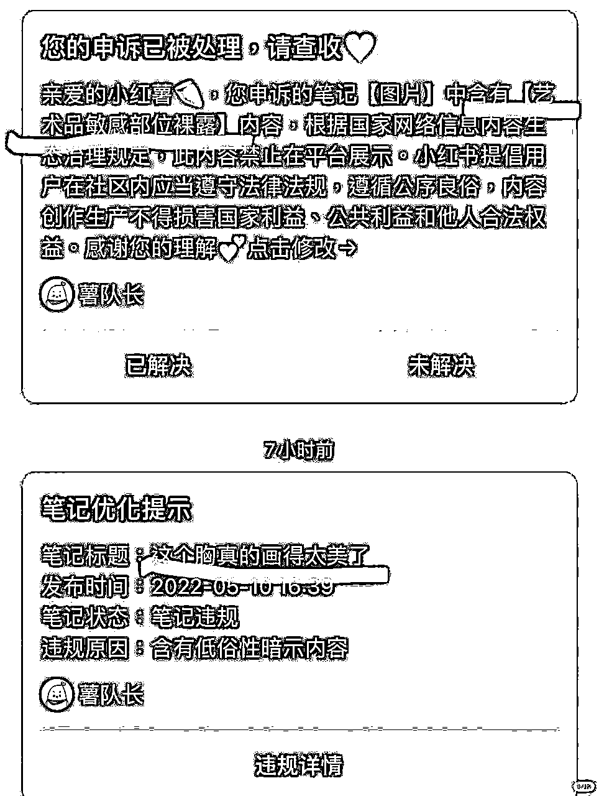

情况五：广告未报备

有些商家想省手续费，绕过蒲公英私下投放。凡是没走蒲公英的商业笔记，都算“非报备笔记”，轻则限流，重则降等级，新手别冒这个险。

如果近期发布的笔记小眼睛一直卡在 20 以下，可以用“账号检测”或“笔记薯条推广”查一查账号或笔记是否出了问题。

01：账号检测

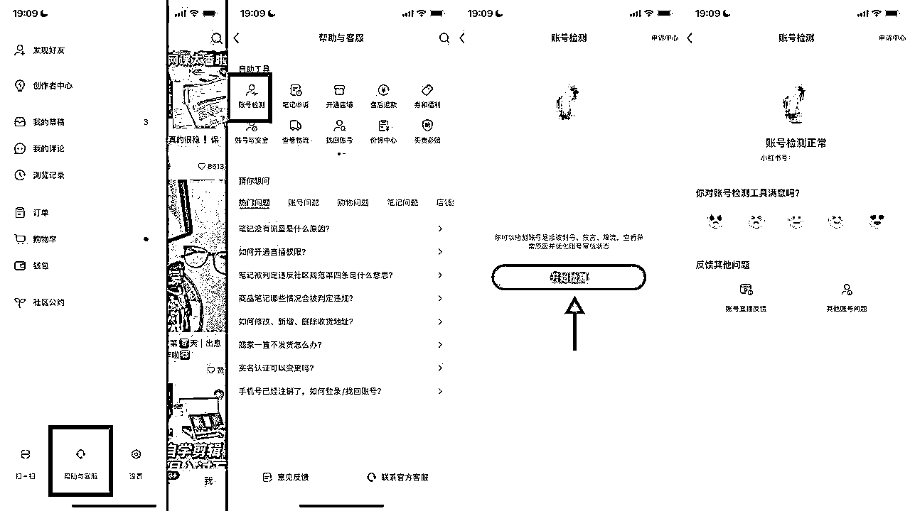

02：笔记薯条推广检测

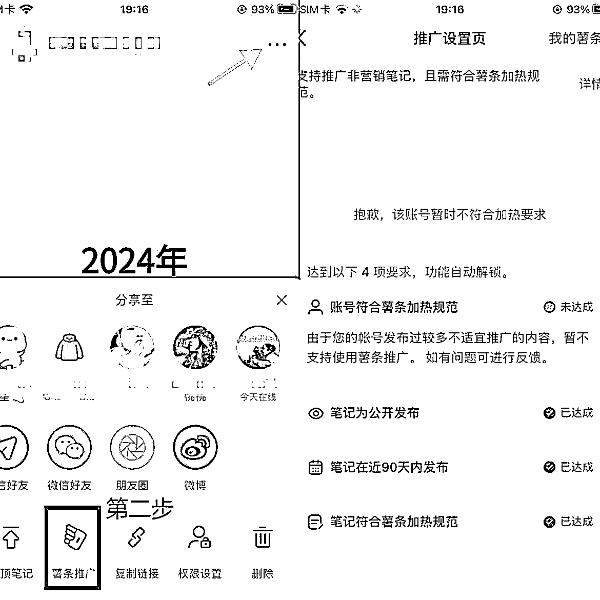

# 3.3.2 违规之后怎么申诉

如果因为违规导致专业号掉灰，要尽快去申诉。若是原创性过低引起的，可以把自己处理视频素材的过程截图留存，作为原创证据提交，说明内容是自己辛苦做出来的，看能不能恢复。能申诉回来当然最好。

最后简单解释一下「专业号掉灰」：

# 入驻前，先确认这个灰标

准备申请蒲公英的账号，建议先做一次资格自检。路径：「我」→「创作中心」→「更多服务」→「开通专业号」。点开后看“成为专业号”是否灰掉；若是灰色，表示账号处于掉灰状态，暂时无法申请蒲公英。

遇到这种情况别急着反复提交，先到主页「信息」查系统通知，违规提示通常会出现在那里。常见类型对照👉「3.3.1 常见违规情况」。确认原因后，按👉「3.3.2 违规后如何申诉」处理，再依照👉「2.3 养号流程」恢复账号；等专业号资格回来，再申请蒲公英。入驻步骤后文再讲👉「3.5 达到千粉，入驻蒲公英」。

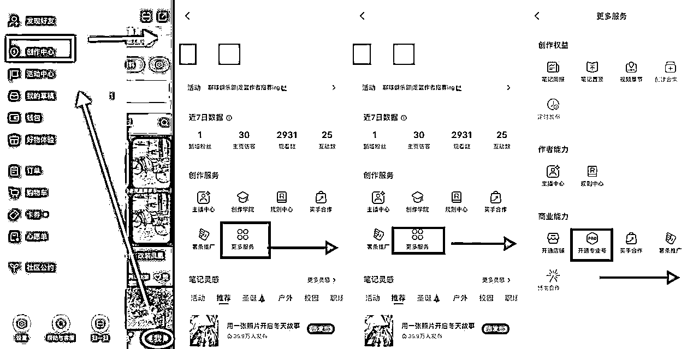

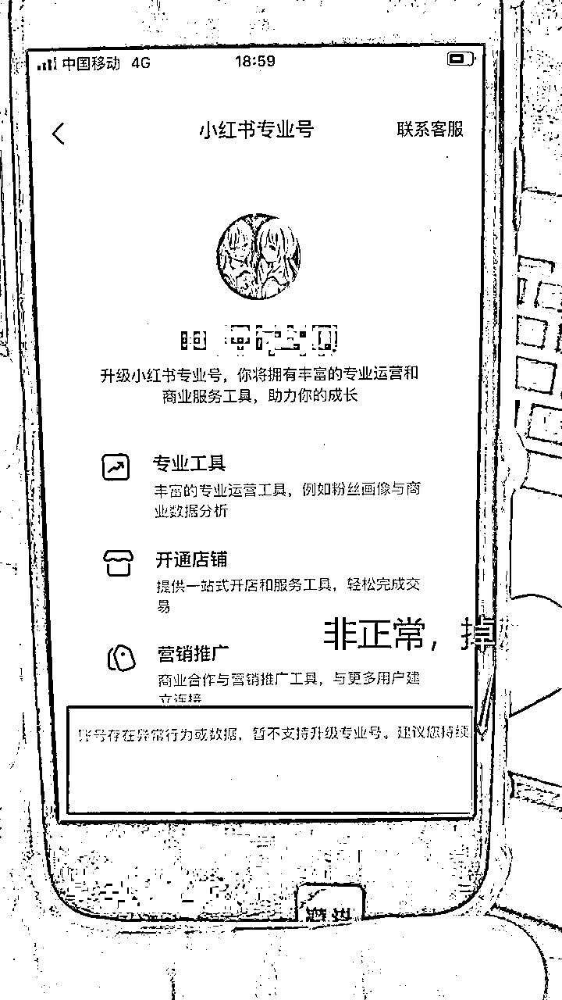

申诉通道有两条：一条从违规笔记提醒页进入，点击提醒即可看到；另一条藏在客服页面，位置见下图。

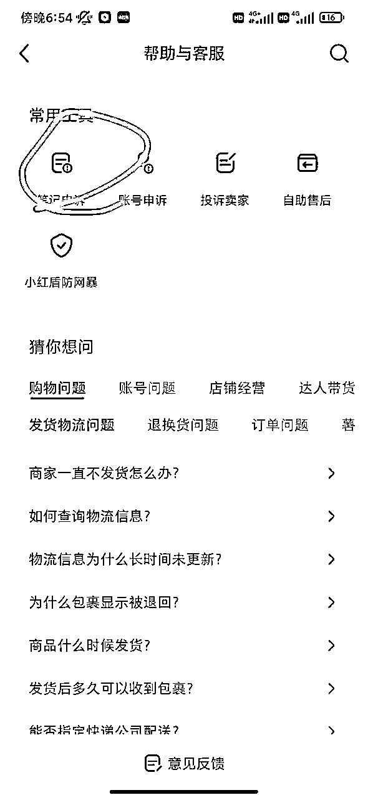

两条通道最好都提交，因为背后审核的人可能不同，判定口径也未必一样。

可参考的话术如下：

薯大大你好，这个号我投入了大量时间，每天做作品已经很累，专业号功能却被限制，实在很受打击。辛苦产出的内容没得到认可，我心情很低落。下面附上剪辑过程的截图，希望你能给我一次机会，解除专业号限制，让我还有继续坚持的动力，跪谢。

以上只是范例。实际申诉时，配上过程截图作证，再适度说明自己的难处，成功率通常会高一些。

# 3.3.3 📕内容红线须知

在笔记出问题之前，平时发布就该熟悉平台的内容要求；发稿前也可以借助检测工具扫一遍敏感词，把风险挡在前面。

下面把📕的内容规则做了归纳，建议认真过一遍，尽量别踩线。

1.

社区公约解读

社区公约解读：笔记内容怎样合规

社区公约解读：商单笔记怎样合规

2.

审核规则解读

审核规则解读：封面、标题怎样规避问题

审核规则解读：水印如何处理

3.

其他：这几个渠道值得常看

规则中心

路径：📕 App - 我 - 左上角图标 - 创作中心 - 规则中心

📕创作学院

薯队长

薯管家

蒲公英小助手

📕生态站

路径：📕 App - 随手举报一篇笔记 - 消息 - 消息通知 - 进入生态站

4.

敏感词/违禁词在线检测工具推荐

稿件完成后，建议用多款不同工具交叉检查敏感词、违禁词，降低审核被拒和笔记违规的概率。

两个常用工具：

句易网：可查违禁词、违规词、敏感词

链接🔗 http://www.ju1.cn/#/

零克查词：可查违禁极限词、禁用词

链接🔗 http://ci.lingke.pro/

资料出处：《📕达人变现项目，单人月入 2W，团队月入 10W+保姆级教程详细拆解》@周恩俊 《📕新手资料引流，涨粉的细节分享》

# 3.4 粉丝破千后，开通蒲公英

# 3.4.1 开通蒲公英的门槛 @周恩俊

条件一：完成实名验证，且年满18周岁

条件二：粉丝量大于1000

选对方向后，通常10至15天会看到粉丝逐步增长，多数账号约1个月能到千粉，随后开通蒲公英并开始接商单。单账号每月平均进账大致在1500-2000元。

刚过1000粉不建议马上申请，怕后续掉粉，最好等到1050粉左右再操作。开通之后要保持更新，尽量日更。单篇阅读最好稳定在1000以上，这样品牌邀约会更多。

⚠️提醒：实名验证可以等千粉后再做，别浪费名额，流程见「3.4.2 入驻流程」。后续也可用家人的身份完成验证。

# 3.4.2 开通步骤 @周恩俊

第 1 步：把账号转为个人专业号

依次点“我”—“创作中心”—“更多服务”—“开通专业号”—“成为专业号”—选“我是个人”—“立即认证”：

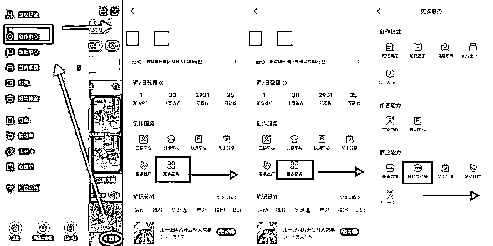

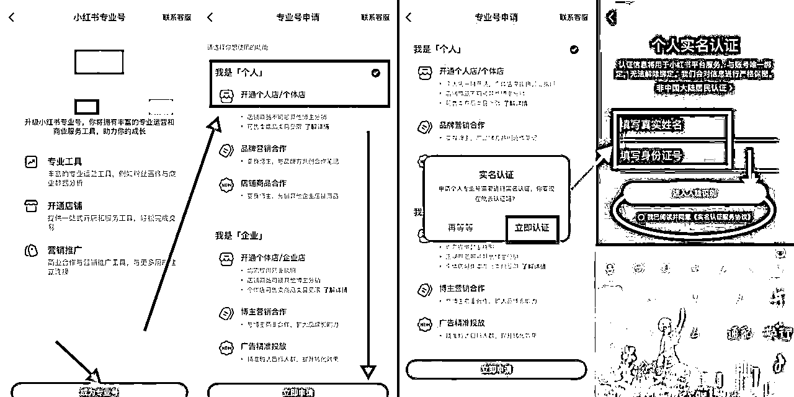

第 2 步：开通蒲公英“内容合作”

进入“合作中心”—“更多服务”—“博主合作”，再按后文「3.4.3 设置报价」填写定价与相关信息。

完成这些，蒲公英就开通好了。

# 3.4.3 定价怎么设 @漫漫mansi

1）结合粉丝消费力与数据表现

定价要参考赛道、粉丝购买力和账号数据。以学习类为例，不足1万粉时大约700-1000元，10万粉可能到1500-2000元；但学习类涨到20万粉后，涨幅会放缓。

美妆、护肤、母婴一般定价更高；数码科技类也不低，值得尝试。

⚠️定价判断逻辑：品牌投放是为了转化，粉丝消费力越强，对品牌越有吸引力，预算也更愿意给。品牌看ROI，花1000元换来2万曝光，显然比花2万元只换2万曝光更划算，这也是不少大博主另做小号接单的原因。

2）借助数据网站看行情

可以用数据网站查行业均价和后台定价，再结合蒲公英平台的价格做调整。

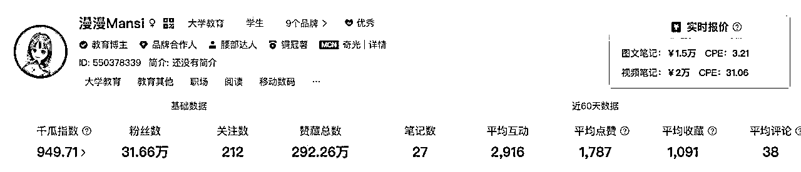

千瓜要求个人或企业认证，个人认证即可；认证时把“博主”视为职业来填就行。

3）根据品牌反应修正定价

谈判过程也能校准价格。若你报完价对方立刻答应，多半是报低了；若对方反复还价，最终谈出的数字往往更接近市场水平。

资料出处：《双十一📕接广策略》

# 四、【项目实操 3/3】持续做内容，接单并变现

# 💡

# 章节概要

借助蒲公英接商单，是本项目变现的关键一环。

前面已经讲过赛道选择、养号、账号包装、笔记制作等内容；把这些动作重复做扎实，账号会逐步达到蒲公英入驻标准，之后就能接合适的商单完成变现。

蒲公英接广具体怎么操作？

先看流程概览👉「4.1 接广流程概述」

每一步做什么，详见👉「4.2 如何完成一次接广」

怎样挑广告才更稳👉「4.3 如何进行广告选择」

最后是注意事项👉「4.4 注意事项」

本章会逐一展开。

# 💡

# 本章航线图

完成本章学习与实操，航线图第三阶段的前半段就打勾了。

第三阶段：持续创作，争取接广告变现（每天 2-4 小时）

1.

接到合适广告，按品牌要求做笔记并提交审核（约 1-3 小时）

2.

发布广告笔记，同时做好评论区维护（约 10 分钟）

下面进入这一阶段的实际操作。

# 4.1 接广流程概览 @周恩俊

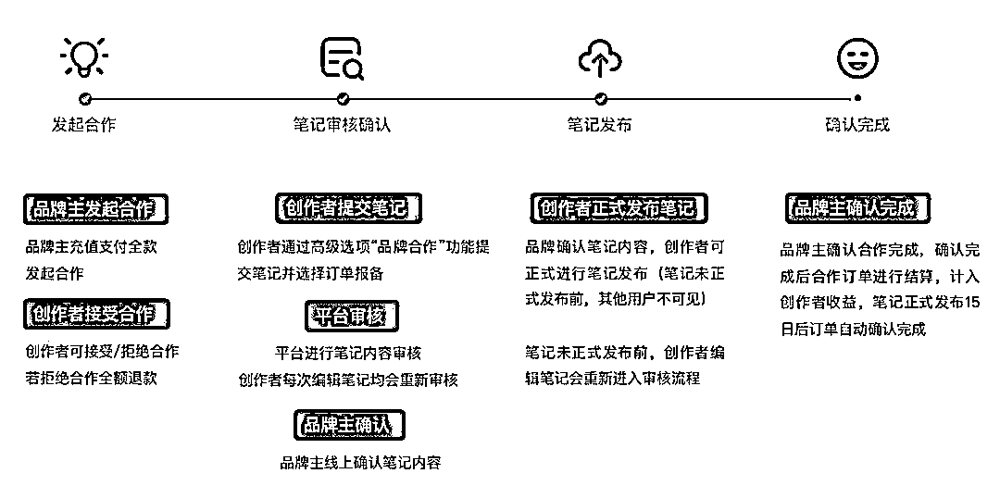

达人端主要做这几件事：

1、粉丝到1000后，开通📕蒲公英内容合作

2、在商业合作通知里接受品牌邀约，或自行去广场报名招募

3、加品牌方🛰️，等对方发图文素材

4、确认订单，提交合作笔记，等待社区审核

5、社区审核通过且品牌确认后，发布合作笔记

6、7天后系统自动确认订单，合作收益到账

7、订单确认满7天，可在📕钱包统一提现

资料出处：《📕达人变现项目，单人月入 2W，团队月入 10W+保姆级教程详细拆解》@周恩俊

# 4.2 一次接广怎么走完

官方视频教程：http://xhslink.com/f3hoBD

📕-蒲公英接广合作流程.mp4【在线播放】

🚪重点传送门：

#00:17#查收合作邀约信息

#00:44#提交合作笔记

#01:16#修改合作笔记

#01:44#正式发布合作笔记

下面把各步骤重点捋一遍。

# 第 1 步：接受合作

品牌方会在蒲公英挑选达人并发出邀约。达人可在 APP 端「消息通知-商业合作」查看，点「感兴趣」后就能与品牌私信沟通，拿到🛰️后详聊合作细节。品牌也可能跳过邀约，直接在后台发起合作，此时 APP 消息通知会收到订单，点开即可查看。

若判断这单适合，就接受合作，进入内容创作。

另外，APP 端与 PC 端蒲公英后台都能管理「待接受」订单。

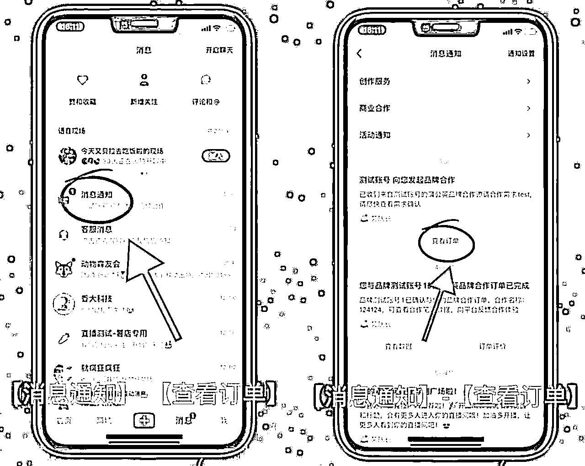

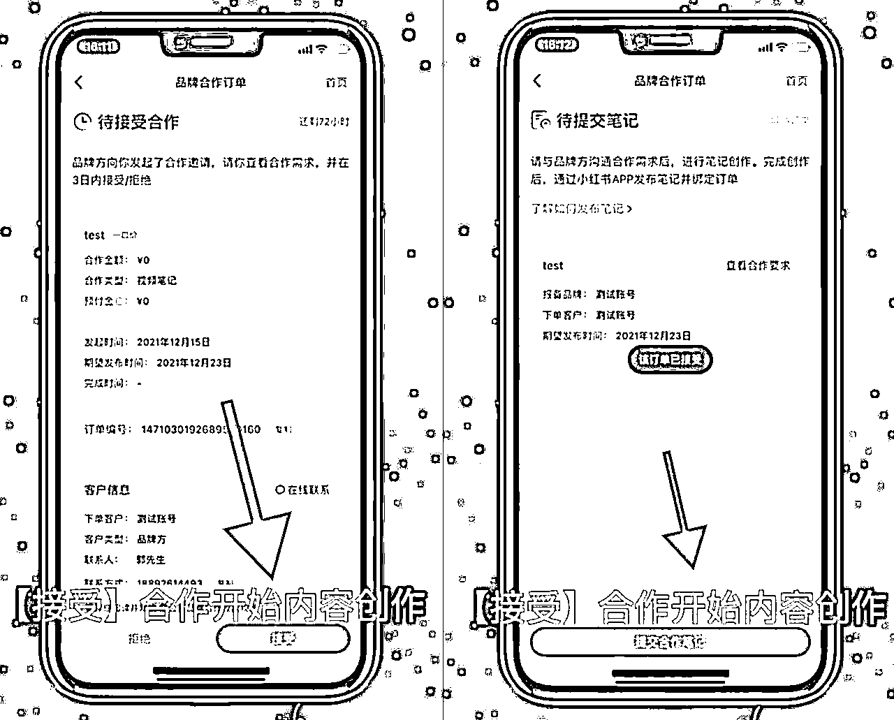

# 第 2 步：创作笔记

加上商家🛰️后（有时对接人是 PR，流程不受影响），对方会发来素材。拿到素材先自查：文案有无敏感词、图片是否合规等。

内容规范可直接参考前文 3.3.3：社区公约（笔记内容、商单笔记）、审核规则（首图封面/标题、水印）、规则中心、📕创作学院、薯队长、薯管家、蒲公英小助手、📕生态站；敏感词检测可用句易网 http://www.ju1.cn/#/ 与零克查词 http://ci.lingke.pro/。

若发现敏感词、图片尺度偏大或表述夸张，先改好再与商家沟通，双方确认后发布笔记并提交审核。

若检查没问题，就直接用商家素材发布并提交审核。

这一步还要约定广告发布时间。

比如同一天来了3个邀约，要不要都发？新号建议一条合作笔记发布后，至少间隔1天再发下一条。商家同时邀约时，可在🛰️里商量好各自发布时间。

# 第 3 步：提交笔记，等待审核通过

合作笔记怎么提交？在 APP 里编辑好内容后，点「高级选项-品牌合作」绑定订单，选中对应合作订单，再返回发布页就能提交。

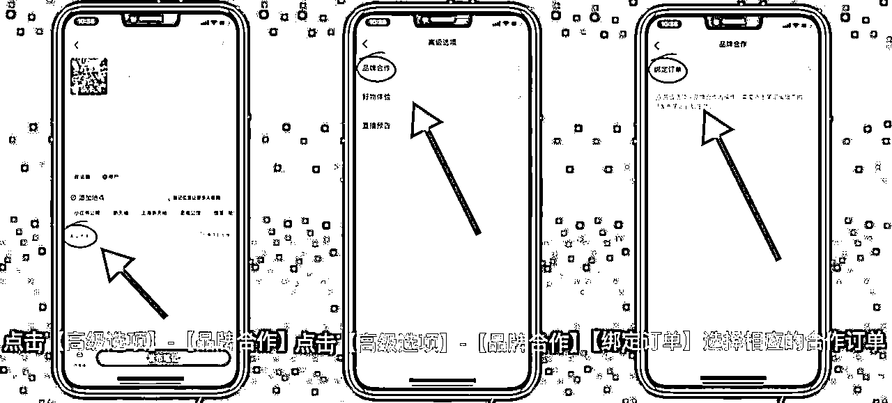

此时笔记尚未公开，其他用户看不到。提交后会进入平台与品牌审核确认。

若审核未通过，消息通知和蒲公英后台都会提示，需按要求修改。

审核没过时，可联系商家重新给素材，再走一遍「第 2 步：创作笔记」。

图文内容可直接在编辑页修改后重新发布合作笔记；

视频内容需先解除笔记与订单的关联：进入编辑页，在高级选项里取消关联，回到发布页重新发布时再绑定订单。

若连续3次审核未过，建议放弃这单并取消合作。后台找到该订单取消即可，平台不会处罚。

不过取消后也要维护好商家或 PR 的关系，后面可能还有合作机会。

# 第 4 步：发布笔记，等待订单完成

审核通过后进入发布环节。到约定时间，点 APP「消息通知」里的前往发布笔记，或点笔记详情页左上角「合作品牌已确认」，就能正式发布。

# 第 5 步：收益到账，完成提现

品牌确认订单后，合作款会到账。若品牌未主动确认，7天后系统也会自动确认。

对接商家时，直接结算订单收益；

对接 PR 时，对方可能要求抽佣。通常加🛰️后，PR 会聊内容与返点，常见返点在20-40元，能接受就合作，不接受可拒绝。并非所有 PR 都抽，只有想自己赚一笔的才会提。后续笔记发布、收益到账后，按约定分佣私下转给 PR 即可。

提现：订单确认7天后，到📕钱包统一提现，平台会扣10%的税。

# 4.3 广告怎么挑 @皮皮酱

我的账号十条里有九条是广告，涨粉和变现却没受影响。原因一是笔记数据稳定，二是我接得很挑。

# 4.3.1 可以接的广告

1.

有投流预算的品牌。可先向 PR 确认，或搜搜该产品已有广告的数据。投流指品牌花钱给笔记加热，效果很实在，数据一般的笔记也可能被推到千赞以上。

2.

大品牌

a.

母婴类如帮宝适、飞鹤

b.

美妆护肤类如欧莱雅、兰蔻

c.

家居类如美的、戴森、3M

大品牌自带流量，既能提高搜索曝光概率，也更容易被其他大牌 PR 注意到。

# 4.3.2 不建议接的广告

一条10000元的广告，价值胜过十条1000元的。下面这些我会直接跳过：

店铺很少的杂牌、小牌子

图文直发（伤账号，易违规）

医药类（专业门槛太高）

不符合自己消费观的（比如十几元一瓶的婴儿水，纯智商税）

差评较多的（容易让路人反感）

日系品牌（个人偏好，不喜欢）

脚本已写好，但品牌方硬要删改其中提到的缺点（看个人接受度）

返点要求离谱的（只有很水的买来号才会给30%-40%甚至50%高返点）。认真做内容的人，宁缺毋滥。

把更多时间放在打磨脚本上，只接自己真正觉得实用、好用的产品，博主路才走得远。

资料出处：《全职妈妈做博主·关于我把50块钱的商单翻了260倍的4年实操经验》

# 4.4 合作前要确认的细节 @虾饼

合作形式分报备笔记和非报备笔记。报备笔记是官方认可的品牌合作，需要交“保护费”；非报备则是私下合作，也就是暗广。

非报备又分单品和合集：单品指一篇笔记只出现一个品的广告；合集指多个品都给广告费，同时出现在一篇笔记里。

单品里还有“伪合集”：笔记里看似出现多个产品，实际只有一家付广告费，这样能尽量避开私自推广判定。

和 PR 沟通时，要确认以下事项：

档期：初稿、终稿和最终发布的时间。

授权转发：是否允许品牌方在电商或内容平台发布，是否免费，授权多久。尾部博主通常免费授权，周期约三个月到半年。

授权投流：是否允许品牌方在📕投流，是否免费，授权多久。投流虽能帮账号涨数据，但品牌若出现负面，笔记继续被投流会影响账号形象。所以最好约定周期，比如一年内免费，一年后再看是否续约、是否加钱。

笔记发布后的保留周期：通常一年或永久。

排竞：发布这篇笔记前若干天到后若干天，不能发该品牌竞品相关内容。

活动出席：美妆、穿搭类品牌可能邀请达人参加新品发布会等活动。

资料出处：《职场小白裸辞做📕宠物博主，一个月收入顶一年工资》

# 五、【复盘优化】修笔记、调账号、抬变现

# 💡

# 章节概要

怎么让每个项目越赚越多？复盘优化不能少。

通过复盘，可以找到数据差的原因并调整；也能发现自己的爆款规律并放大；对本项目而言，还能摸索提升账号变现力的办法。

本章会从这些角度打开思路，帮你放大项目成果：

✅怎样修笔记、改善数据、提高爆文概率👉「5.1 优化笔记，提升数据」

✅怎样用更少时间做更多事👉「5.2 提升内容创作效率」

✅怎样让广告也拿到较好流量👉「5.3 提升广告流量」

✅怎样增加账号商单数量👉「5.4 增加广告数量」

以上内容本章都会讲。

# 💡

# 本章航线图

完成本章学习与实操，航线图第三阶段的后半段就完成了。

第三阶段：持续创作，争取接广告变现（每天 2-4 小时）

1.

复盘账号数据，优化笔记，持续创作（每天约2小时）

2.

搭建 SOP，提高笔记质量与生产效率（约3-4小时）

3.

逐步增强账号变现力，提升变现数据（每天约1-2小时）

下面进入这一阶段的实操。

# 5.1 修笔记，改善数据

# 5.1.1 数据不理想，如何调整？

有人问：浏览量处在100到300、300到500，正常吗？

答案很明确：正常。

新号浏览量不低于50，落在50到500之间，发布内容后观看人数偏少，是普遍现象。

拥有六位数粉丝的博主，每次发内容都有固定读者捧场，阅读量高不稀奇。对还没建立起这种基本盘的你来说，先稳住心态，别让数据把你搞崩。

做对比时也别只盯着别人。先把自己的帖子和自己的帖子比：翻出已经发布的内容，找出数据表现更亮眼的几篇，复盘它们到底赢在哪里。再去跟粉丝体量接近的账号做横向对照——你500粉，对方也500粉，这样的比较才有意义；500粉硬要去够一万粉的号，只会得出没有参考价值的结论。看别人的数据时，别只盯总读数，多看看他们的赞藏和留言区：为什么对方评论特别多？收藏特别高？去拆他们写的内容，留意他们用什么话术引导互动，能学就学。

如果数据确实不理想，分维度找原因。

第一，阅读量（小眼睛）不行。发布两三个小时仍然没有动静，或者长期在100-200甚至不到100，那就照着下面几个方向排查：账号刚起步，权重还没养起来，这是正常现象；帖子踩了敏感词或违规线，或者发的是平台不乐意推荐的内容，比如医美、保险、社会负面、中国负面；选题、标题、首图本身不吸引人，其中选题角度和封面尤其要重点看。

第二，点赞、收藏、评论等互动数据不行。收藏高，说明内容对读者有用，眼下或者以后用得上；点赞评论多，说明内容和读者产生共鸣；因为一条帖子转粉，说明对方不仅认可内容，还认可你这个人，期待你更多好作品。排除违规和那些说不清的运气因素，互动差十有八九是内容质量撑不住：标题跟正文跑偏，点进来发现文不对题；文案营销感太重，整篇都是硬广；读者看完没收获，实用性太低；像随手发的朋友圈，情绪价值和实用价值都没有；全是干巴巴的学术句子或百科科普，读起来没欲望；图片质感或者视频画面不过关，观感太差。

第三，发布之后修改要注意什么。经常有人问：动了已发布的内容会不会被限流？从观察到的数据看，修改后阅读量确实会重新统计，但只要不频繁改动，对单篇影响不大。改动会触发重新审核，平台放出来之前都会再过一遍。有些帖子把敏感词换掉、标题优化之后，数据反而变好；也有本来审核过了、正常推流，改完却被判有问题、开始限制流量的情况。如果一篇帖子已经爆了，忍不住想改，先忍住，别动原文，想补充就写进置顶评论。图文类型可以整体替换内容和图片；视频只能改文字和封面，视频本身换不了。提交后系统会二次审核，没违规的照常通过。爆款还在上升期的话，不建议轻易改，可能会干扰增长。短时间反复修改风险更大，一般改两三次没问题，再多数据可能越改越差。

# 5.1.2 想让爆款更频繁？先抓可控因素 @梨云

把爆款当成概率事件来玩，思路就顺了：你能控制的，只有自己手里的牌。运营端拆开看，是内容、账号、用户、数据四块，四者共同构成爆款的基本盘。想知道自己对这些了解多少，这里有100个📕运营基础问答，飞书链接直达：📕运营实战100问。不过在所有要素里，研究别人的爆款依然是离爆款最近的快车道。找对标不复杂，三个入口就够：顺着搜索框输入，通过对标号摸到账号主页，再去评论区捞真实需求。

1）搜索框

一个关键词可以衍生出一串关键词，业内叫它一生万物式的关键词展开。假设你是养生赛道的新手，脑子里只剩“养生”一个词，怎么破局？直接输入“养生”，看一眼搜索结果，再挑个新词继续搜，一轮一轮往外扩。

这套玩法不只是找对标，还能打开上帝视角，把整个赛道看全。具体怎么用GPT写插件脚本、批量爬取📕内容来提升创作效率，我单独写过一篇帖子讲过。

2）对标号

看见一条爆款，顺着它就能摸到作者的账号，点进主页，满眼都是现成选题。对方一直围绕自己的定位和方向持续输出。那你俩的赛道重合度就很关键：如果完全重合，他跑过的爆款方向你可以再跑一遍；重合度低，就做减法，挑出跟他内容交集大的那一部分去学。

3）评论区

评论区是被严重低估的选题富矿。之前团队跑家电数码赛道，千粉单月做到了2000块商单变现，用的就是评论区选题这套打法。

打开评论区你会发现，用户在这里会讲出最真实的需求；爆款的本质正是切中需求。所以从留言里挖选题完全可行。比如有人留言：8GB够玩原神吗？我玩原神都用了30GB。这句话背后的真实需要是：一台原神流畅、性价比也高的手机。这样就能提炼出一个方向：专为原神而生的手机。

拿这个方向去搜，你会发现真的有人写成了爆款。需求明确且已被验证，你当然可以跟进。又比如评论区有人说：去App水印要交费18元。这背后是对免费去水印的期待。顺着它提炼：免费去水印工具推荐。再去搜，同样是被验证过的高热度选题。

内容出处：一篇讲如何像素级高效模仿爆款笔记的分享。

# 5.1.3 3W1H，让内容长出辨识度 @七天假

只靠借鉴走不远，用户记不住你，自然也不会对你形成清晰印象。想让内容有辨识度，必须靠方法做出原创的、大家愿意看的内容。下面详细拆解3W1H内容框架法，里面也会涉及用户思维、数据分析这些内容。

who：内容是给谁看的？他们是什么样的人？
what：他们在意什么？痛点是什么？
why：这些痛点和需求是怎么来的？
how：用什么方法解决？怎么满足他们？

1）who

先把用户弄清楚。以装修为例，我会上手画两类画像：

一类是25到30岁之间的女性，准备结婚新房，对装修细节和审美要求高，预算普遍偏紧，喜欢搜罗廉价好物和平替。另一类是30到40岁的宝妈，改善型住房，预算宽裕一点，装修时更关注孩子的生活环境，选购会考虑孩子，比如熊孩子在家该怎么挑沙发？乳胶漆刷什么颜色更耐脏？

画像当然不止这些，我只是各举了一个代表。能写多细就写多细，让一类画像真正代表一群真实的人。内容要打动人，前提就是先知道对面坐着谁。

2）what

需求和痛点这一层，反而相对固定。拿装修来说，我会先把用户可能需要了解、可能下单购买的每一样东西全部用穷举法列出来。

列出来的每个点，就是你的选题，可以一个个做成内容系列。那痛点怎么挖？去淘宝的提问区、知乎的专业帖子和高赞评论、📕爆款内容下的热评里翻。以电视为例：在📕搜“电视”，点开排名前二的内容，扫一遍高赞评论，把吐槽和询问的筛掉，你能看到大家反复在提两个词：尺寸、广告。

再打开淘宝搜“电视”，选销量高、评价多的商品，进“问大家”页面，能看到买家真正操心什么；我刷到的高频词是质量和广告。

知乎也一个路子：热门帖子加高赞评论翻一翻，用户买电视前的问题基本就收拢成这几类：电视该怎么选？哪个电视质量好，质量好的电视长什么样？电视广告多不多，怎么选广告少的电视，怎么把广告去掉？问题清楚了，N个选题也就落地了，可以一个个去产出内容。

3）why

到what这一步，选题已经成立。why和who的作用，是帮你理解内容结构、追到问题源头，让成品更贴近用户心理。记得不停追问自己为什么。还用电视的案例：用户为什么烦广告？因为用户对广告没兴趣，只想马上看到想看的东西。既然用户不喜欢，电视厂商为什么还非要放广告？

①想赚钱。但这个理由不够硬，完全可以卖贵一点，用“无广告”做差异化卖点来赚钱。②电视本身没视频资源，内容握在视频网站手里；视频网站要赚钱，广告就成了必然。到这里就像撞上死胡同，问题已经不在电视身上了。那就换个思路：视频网站因为要赚钱才放广告，那能不能找一个不放广告的视频站，让用户不用看广告？能，市面上有不少这种网站，只是知道的人少，大家只记得爱奇艺、腾讯视频。

why这一步的核心，就是用连环追问把现象凿穿，摸到事情的本质，问题才有解。

4）how

到解决方案这步，反而是最简单的。痛点找准了，问题定义对了，答案靠搜索基本都能找到。但记住，搜到的内容不能直接复制粘贴，要先按前面的分析做增删改查，再按你自己的说话方式重新写。

3W1H整体听着不难，真正练起来，难就难在找痛点和挖根源。没人带的时候容易看偏、看浅，只能靠真实项目反复磨，练多了自然能一眼看穿本质。为了更容易理解，我再补一个例子：

按这个流程走，一个需求至少能长出两三个选题；只要你会想，还能继续向外延伸。

内容出处：一篇分享📕半年收入20万、从品牌视角做流量的帖子。

# 5.2 更快地产出好内容

# 5.2.1 定期梳理，把素材攒成库 @子渝

在自媒体上要做到稳定输出干货，一面要持续整理自己的知识体系，一面要边输入边输出。所以强烈建议在内容创作时搭一个自己的素材库，用的时候随时调取。素材从哪里来？来自你日常储备的对标账号、对标内容。怎么储备，可以回看「2.4 积累对标账号」。整理时，把标题、目标群体、正文、图片素材、标签、原文链接这些字段记下来，具体结构可以按自己的需要来调。一个赛道往往会有多个内容方向，因此最好按专栏归类。比如做职场技能号，素材库就能按照「技能提升」「求职面试」「加薪晋升」等几个版块拆分。

内容出处：一位职场博主分享自己从0到1再到变现的完整过程。

# 5.2.2 常看优秀对标，灵感不断档 @子渝

平台上的好内容很多，做得好的人也很多。新手想入局，能做的只有多学、多琢磨、多对标高手，然后把学到的东西用在自己身上。每天花一点时间，泡在自己所在领域的内容里，看看别人正在聊什么、想什么，找到灵感就记下来，整理好，提醒自己之后去完成。

内容出处：来自一篇中年宝妈职场博主讲述📕从0到1变现经历的分享。

# 5.2.3 一套模板，内容批量产出 @梨云

一套能打的模板，既能支撑批量生产，也能换来漂亮的数据。圈友@梨云 原创的一套排版就做到了，靠着它拿到了非常棒的反馈。怎么来的？先跨领域翻了一千多套排版，因为同行已经掏不出新东西了；再运用平面设计的专业底子，自创了一套模板。模板由几个基本要素组成，逐个迭代就行。

1）配色

选了森系绿做主打色，因为太多人看到这套配色就想到我，顺势命名“梨云绿”抢心智；再配阳光暖黄和纯白，整体温馨、沉静、岁月静好。

2）封面

做简单粗暴的大字报，两行字把重点打出来，目的就是把关键词顶到用户眼前，让人一眼知道这篇讲什么，快速决定点不点。

3）内页

不再用之前博主们常用的“封面+文案”排版，改成全图流。纯文字排版结构感弱，看多了也容易视觉疲劳；全图流可以换字体颜色、加贴纸图案，发挥余地更大。我用的结构是：大标题、导语、小标题、内容、底部标题。

大标题：把整页内容做个总结，让读者先有预判；也可以每页统一，用来埋关键词、提升搜索权重，同时它还是广告位，可以写品牌名。

导语：交代这篇内容出现的理由，顺手承担一部分共鸣；也能做行为设计，比如我会写“宝子投稿”，暗示大家积极在评论区留言，用互动数把曝光抬起来。

小标题：把信息压缩成四个字，替读者卸掉阅读负担。

内容：不超过三行，保持轻量，读起来愉快。用词上会选📕女生喜欢的流行语、当下正火的梗，让文案灵动起来，爱看的人就多。

底部标题：这是个经常被模仿者漏掉的细节，也是我实践里试出来的。它的作用是借游戏化的口吻引导翻页——句式是“开始+动词”“马上+动词”，降低读者在这一页失去兴趣就退出的概率。这个技巧很有用，会让人忍不住一直往下翻；内容不垮的话，阅读时长拉长，点赞收藏评论的概率都会上升。

这套模板发出去后，第一篇就破千，后面更是篇篇爆。为了接住这波势头，我开始日更，连续50天做到10万粉，才改成隔日更新，现在已经17万了。

内容出处：一篇复盘三个月涨粉17万、变现10万以上的帖子。

# 5.2.4 把流程交给SOP @杉木

⚠️这一节可以理解为一个SOP思路参考。你可以顺着它，把笔记制作流程一步步标准化，压缩时间成本。想更快的话，很多环节都能流程化。拿拍摄和写稿举例：我会在周末把下一周要发的内容全部备齐；拍摄需要找模特时，提前把拍摄注意事项和案例整理成文档发给对方，免得拍出一堆废片。

内容出处：一篇分享两个月带货营收30万+经验的帖子。

# 5.3 把广告流量做上去 @七天假

# 5.3.1 新奇场景，让广告不像广告

写内容时千万别站在品牌方角度介绍功能卖点，那种写法一眼就是广子，没人爱看。要结合真实的使用场景，把自己当成普通用户，用完再聊感受和效果，最好还能给出一些反常规、有新鲜感的角度。放两个案例：

科沃斯空气净化器的广告，核心卖点是智能移动、哪里有问题净化哪里。作者真实用下来，发现放一个屁，机器会跟着走。这种新奇又真实的使用细节，后面顺势接上使用感受和功能说明，一篇很能种草的广告文就成型了。

总结一下：新奇使用场景+真实使用感受+穿插功能亮点。补充一句：这种新奇怪点也可以靠前面讲的选题方法挖，这位作者就是从淘宝提问里找到灵感的。

# 5.3.2 欲扬先抑，先说缺点

现在的种草和硬广实在太多，用户已经审美疲劳。他们不想听产品多好多好，只想知道这东西哪里不好。那就先把缺点摆出来，再讲优点。这样做既能留住对空气净化器有真实需求的人，也不会真正劝退打算下单的人。这个灵感来自一个好友：他说现在大家想买什么，会先上📕搜“XXX避坑”。

# 5.3.3 合集推荐，单品也能抱团

📕用户对合集有天然好感，这是很多前辈和我实测出来的结论。接到商单后，把要推的产品放进一个合集里，和其他东西一起推荐；金主的产品放在第一位，多写几句。只要不塞竞品，品牌方一般不会介意你顺带推别的品。

内容出处：一篇讲📕半年收入20万、从品牌视角做流量实现爆单的分享。

# 5.4 让广告单子涨起来 @北

# 5.4.1 广告位的边界，比你想的宽 @北

能接到多少广告，取决于广告位的大小。比如我的账号是大学生/高中生干货分享赛道，外人看来最多接点软件、课程推广。但事实上，我接过的品类横跨科技、生活、护肤：电脑、平板、手机、床垫、显示器、眼霜、智能锁、代步车、汽车，样样都有。数量多到这里得放一部分截图证明。

为什么一个不做护肤内容的博主，能接到护肤品合作？为什么一个不聊科技的账号，能接到科技产品推广？关键就是这句话：你能接到的广告数量，取决于你的广告位大小，而不是赛道。

1）什么是广告位？我给出的定义是：产品植入的空间。下面拆成两个方向来讲，主动选择和被动增加。

2）被动增加广告位

接广告这件事，很多时候可以从结果往前推。

印象里有一次和学员交流，她提到想入手 iPad 配件。我劝她别急着花钱：只要发一篇围绕 iPad 展开的内容，把使用场景拍出来，不仅能省下这笔开销，品牌方还会主动找上门来付你广告费。

这个逻辑其实特别简单。比如你原本打算写“不想学习时能做的 x 件事”，改成“用 iPad 能做的 x 件事”，再把相应的画面拍下来就行。

对比下面两张图就很直观：第一种是单纯的背景图配文字，图片来自网络、没有任何场景，纯粹用来当底板；第二种则是实拍的场景图，展示的是 iPad 的真实使用状态。

如果你想接 iPad 配件广告，核心问题只有一个：配件能在哪里植入？

答案显然在 iPad 旁边。那你的广告位就得把这个位置亮出来，让品牌方一眼看到植入的可能性。这么一来，合作自然会找上门。

说得夸张一点，一旦你掌握了“广告位导向”的思路，很多东西根本不用自己掏钱买，完全可以通过合作获得，不但不花钱，还能顺带赚一笔。

3）主动增加广告位

如果暂时没有特定品类的合作意向，日常该怎么给自己增加广告位？

最直接的办法：让场景出现，再把场景放大。

之前我举过反面例子，很多笔记压根没有场景。没有场景，第一步就是补上场景，把简单的制图换成实拍。第二步，继续把场景拓宽。

拿读书博主来举例。

不少人觉得这个赛道广告空间有限，顶多接接图书置换或小额推广费。但实际上，能不能变现更多，取决于你怎么经营账号。

如果账号按这种方式做，广告变现空间自然很有限：

场景里只有一本书，品牌方根本看不到合作的可能。

但稍微拓宽一点呢？把书桌也拍进画面里。

广告空间一下子就被打开了——桌上能放的东西太多了：电子阅读器、显示屏、台灯……这些能出现在桌面的物件，全都可能变成你的广告机会。

之前有位读书博主学员就是靠这个调整，成功接到了显示器和台灯的合作。

所以，想让广告范围变得更大，不妨从扩大拍摄场景入手。

内容来源：《如何提高📕广告变现力，一条合作笔记报价 3-4W》@北

# 5.4.2 提升广告复投率

1）做好品牌方体验

合作过程中，你够不够配合？能不能按时交稿？沟通态度是否让人舒服？这些细节都很重要。如果品牌方感觉跟你合作又顺畅又省心，自然会有下一次。

2）关注投放数据

数据好的合作，品牌方当然愿意继续投。内容层面我们认真打磨就够了，数据有时候难免有玄学成分，沟通上尽量把节奏推进顺畅，尽人事，把自己能掌控的部分做好。

我在朋友圈见过不少 PR 和品牌方挂博主的情况，他们有自己的圈子，会互相交流、避雷不靠谱的博主。如果每次合作都敷衍了事，迟早会被圈子里拉黑。

所以，一定要认真对待每一单合作，爱惜自己的羽毛。讲诚信、负责任，好的合作口碑就是这样一点点攒出来的。

内容来源：《如何提高📕广告变现力，一条合作笔记报价 3-4W》@北

# 【选修篇】解锁更多赛道玩法

# 💡

# 章节导读

当项目的最小 MVP 已经跑通、流程基本熟悉之后，就可以翻翻选修篇了。

如果想探索更多📕变现思路，这一章值得重点阅读：

✅【拓宽变现】解锁更多变现玩法

学有余力的话，选修篇的玩法可以大胆尝试；如果前面的内容还没学完，还是建议先在必修篇把基本功打扎实。

接下来的内容，会帮你走得更远——来吧，开始你的探索。

# 六、【拓宽变现】解锁更多变现方式

⚠️特别提醒：本次航海，最推荐大家优先走常规商单变现路径——粉丝达到 1000 后入驻蒲公英平台接广告。其他变现方式多少都有点门槛或风险，在还没摸透平台规则之前，不建议贸然尝试。

当然，如果读完本章后，你发现某种方式特别适合自己眼下的状态，并且对可能的风险也有心理准备（比如引流导致限流甚至封号），完全可以放手一试。

# 6.1 好物体验玩法 @谢无敌

打开个人主页，左上角有个“好物推荐”入口，申请后如果被选中，只要写一篇试用笔记就能免费拿到该商品。

这个玩法适合粉丝量在几百到几千的博主。账号调性和商品匹配度越高，被选中的几率越大。虽然不算直接变现，但也算实实在在的“薅羊毛”。

# 6.2 知识类内容变现 @谢无敌

这主要面向知识类博主，通常需要你有成型的课程产品，再通过开通专栏来实现变现。

比如 PPT 课程、写作课程、瑜伽课程、育儿课程等。一般情况下，粉丝要到 1 万以上才能开通，几千粉也可以尝试申请，也有一定概率能过。

开通之后，个人主页会多出一个专栏入口。

# 6.3 带货变现：直播或小清单 @谢无敌

📕的带货主要有直播带货和小清单带货两种，本质是卖别人的产品赚佣金。前提是完成专业号认证，并且粉丝量达到 1000 以上。

选品中心里有不同类目的商品，每件商品旁边都标好了佣金比例，点进去可以看到具体的合作细则。

笔记带货玩法 @木子蟹

最近，📕企业认证店铺推出了一个类似抖音精选联盟的功能——邀请达人带货。

这对于有商品网感、擅长写爆文笔记的圈友来说是个好消息。不用自己垫钱进货，也不用处理发货、售后这些麻烦事。

你只需要和商家谈好带货佣金，领取免费样品，等样品到了之后拍摄、拆箱、测试，写好笔记，然后坐等笔记成为爆款、分佣到账。建议用多个账号矩阵起号来带货，佣金收益会更可观。

内容来源：《📕如何"开源节流"运营变现》

# 6.4 📕开店变现 @谢无敌

📕实行“号店一体化”后，0 粉也能开通📕店铺了。不过目前个人店铺对类目的要求比较严格，申请时一定要看清可经营的类目范围。

店铺的具体玩法，可以直接参考「📕店铺」航海手册👉《12月航海｜📕店铺｜实战手册》

# 6.5 引流分销变现路径 @谢无敌

纯博主其实也可以主动选品，去找靠谱商家谈合作。

比如母婴博主看中一款奶瓶，觉得不错，就可以去找卖奶瓶的商家聊分销合作。

谈好之后，博主通过优质种草内容吸引用户。笔记一旦爆了，通常会有很多人在评论区追问购买渠道。这时候，就可以把这些用户引导到你自己或商家的私域里完成转化。

# 6.6 靠直播赚钱 @谢无敌

随着董洁、章小蕙、伊能静等明星先后入驻，📕直播迎来了一波爆发式增长，越来越多的人开始涌入直播间。如果你不是明星也不是达人，还能靠📕直播变现吗？

在我看来，答案是肯定的。

几个月前，📕发布过一组“百大买手”榜单数据。让人意外的是，上榜者中除了少数大牌博主，很多人其实只有千粉甚至万粉级别。

我自己也带过一位烘焙博主，她从去年开始在📕直播，刚起步时粉丝并不多。但靠着坚持和内容优化，慢慢打破了粉丝和观看量的瓶颈。现在她的每场直播人均观看量稳定在 3000+，最近一场的预估销量更是突破了 300+ 份！

这足以说明：📕直播并不是明星和大 V 的专属舞台，任何一个有热情、有内容的普通博主，都有机会靠直播实现商业变现。

内容来源：《直播5小时创收141w！📕卖货指南来啦~》

# 6.7 探店博主或旅行博主变现 @木子蟹

通过线下探店或旅行分享，为实体商家引流，借助同城精准流量推送帮商家带来客流，从而实现流量变现。

那素材从哪来？

答案不难找：打开 BOSS直聘、实习僧、青团社这些平台，上面有针对大学生发布的校内线上兼职，可以按学历、专业筛选，找到摄影专业的大学生。

他们多少都有点审美基础和设计能力，稍微培训一下就能上手。安排他们去现场拍摄探店素材，再根据客户需求写笔记打卡，变现链路就完整了。

内容来源：《📕如何"开源节流"运营变现》

以上，就是📕自媒体商单变现之外，目前主流的 7 种变现玩法。

不管选哪一条路，都需要内容打底。真诚的分享加上有价值的内容，才能打动用户，让用户愿意为你买单。

需要提醒的是：部分带货玩法有平台门槛，比如品牌合作需要粉丝达到 1K 才能申请；知识付费需要有产品、分销货源或者服务。

最后，祝大家在📕自媒体这条路上持续深耕，让收益不断放大，也找到内容创作里的乐趣和意义，一起龙哥盟！

