# 闲鱼虚拟资料实战手册202412

防失联：MM188166M（李李）｜备用🛰️号：MG10127

手册出品：龙哥盟团队　日期：2024年12月2日

阅读提示：手册内各位作者排序无先后。我们希望把项目的多种可能摊开给你看，方便理解与落地。若要快速找内容，按 Ctrl+F 或 command+F 搜关键词即可。

# 开跑之前
💡 欢迎加入12月航海“闲鱼虚拟资料”实战手册。接下来的日子，我们会多次碰面。

动手前，先把几个问题说清楚：

1）这门生意是什么？现在入场还有空间吗？
它卖的是公开、无版权争议、无需物流的电子文件，例如演示文稿模板、图片视频素材、合同范本、学习与备考笔记等。特点是好上手、启动资金少、流程不复杂、回报相对稳定，但收入上限不会特别高。最吸引人的地方在于系统自动交付、售后压力小，每天不必长时间守着。

眼下仍算窗口期。闲鱼正加码电商，虚拟资料又是平台头部品类，需求旺盛，曾在缺货榜排到第二，后续想象空间不小。

2）哪些人适合？
✅ 刚入门、希望尽快看到结果的新手。
✅ 想用业余时间增加零花收入的人。

3）开始前请先接受这些事实：
- 上限摆在那里，别做暴富梦；
- 与实体电商比，单账号收益天花板偏低。按每天投入1–3小时、上架5–10条商品链接测算，目前约1000元/月/账号；
- 工具能自动交付，但订单爆发时仍要盯消息；
- 新手别一上来就琢磨优化，先日更到50条链接再谈调整。上几条没流量就焦虑内耗，没必要——再轻的项目也靠执行。

最后，愿你在这次航行里拿到结果，也交到并肩前行的伙伴。

以下内容由龙哥盟与圈友共同完成，限本次航海成员及龙哥盟星球圈友学习使用。

# 【更新提示】先弄清阅读顺序

开读前，先搞明白这本手册怎么用，才能按自己的情况取舍。

整体编排遵循“从0到1跑通闲鱼蓝海带货”的路径。你可以顺着航线图一步步做，也可以跳读需要的部分。

手册分两块：必修篇、选修篇。

必修篇：覆盖从0到1跑通最小闭环的全部动作，与航线图对应。若你还在摸索，想先完整走一遍流程，建议从必修篇踏实读起，不必在玩法选择上反复纠结。

选修篇：讲更多玩法、案例和放大思路。若最小闭环已经跑通，想继续挖潜力、找灵感，这部分别跳过。

# 📌 还没接触过这个项目？
建议先看项目全貌再动手👇
✅【项目概述】了解闲鱼虚拟资料项目

# 📌 已经知道个大概？
从航线图第一阶段起步，对应手册第二章👇
✅【实操1/3】完成项目准备工作

准备完毕，进入第二阶段，开始上架销售👇
✅【实操2/3】蓝海选品&上架运营
✅【实操 3/3】询单、出单发货、售后

流程熟悉后，进入第三阶段，学习如何做得更好👇
✅【复盘优化】

# 📌 最小闭环已跑通，想放大？
重点看这些内容👇
✅更多选品方法
✅更多变现方式

本项目航线图如下：

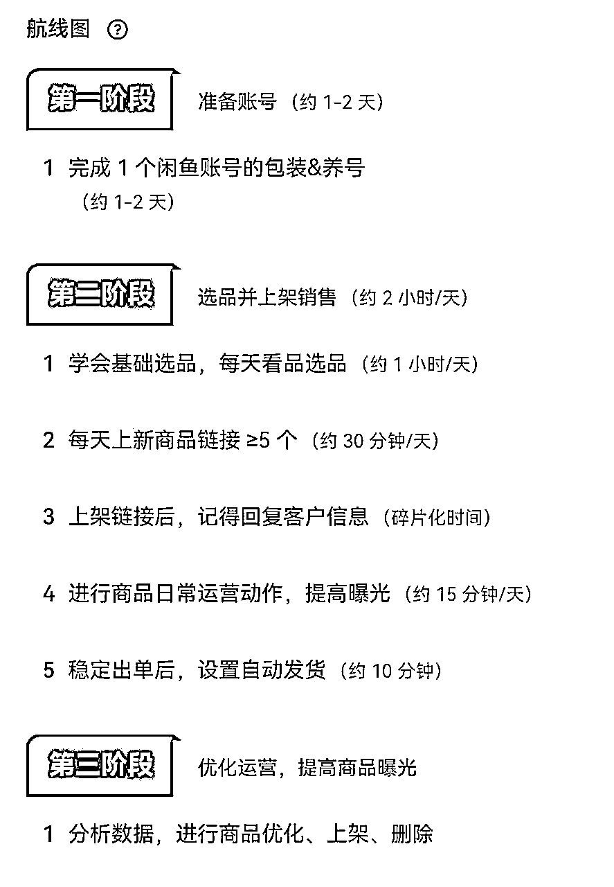

航线图与手册内容彼此对应，可按自己所在环节选读。建议航海前两周把航线图动作走完，之后以实操为主，多选品、多上架，提升出单概率。

# 必修篇：把最小闭环跑起来

# 本节要点
这一章从认识平台开始，带你走完闲鱼虚拟资料项目的完整流程。按步骤实操，就能跑通最小闭环。

新手先建立整体认知：
✅【项目概述】了解闲鱼虚拟资料项目

有谱之后，再按核心动作推进：
✅【实操1/3】完成项目准备工作
✅【实操2/3】蓝海选品&上架运营
✅【实操 3/3】询单、出单发货、售后

必修篇里，航线图与手册顺序对应，顺着读就能逐项完成任务。后面每个关键步骤的要点里，也会提醒对应航线图。

现在开始。

# 一、项目全貌：先摸清闲鱼虚拟资料这门生意

# 本节要点
这一章带你逐步看懂这门生意：平台现状如何、有哪些特点、新手怎么切入。这些都会讲到。

本次航海的核心，是教你把闲鱼虚拟资料从0跑到1，所以先看清全貌很有必要。

# 1.1 这门生意是什么

# 1.1.1 它到底卖什么？
所谓闲鱼虚拟资料，就是把公开、无版权纠纷的电子文件放到闲鱼出售，比如演示文稿模板、图片视频素材、合同范本、学习资料等，不涉及实物发货。

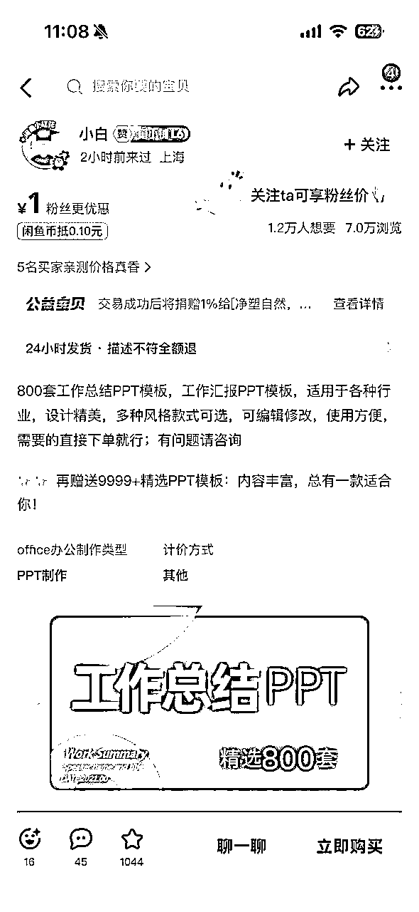

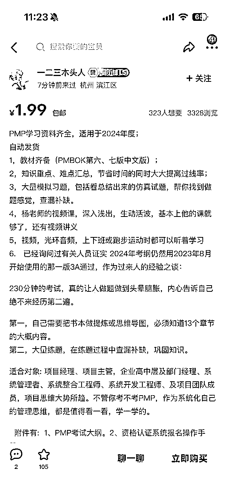

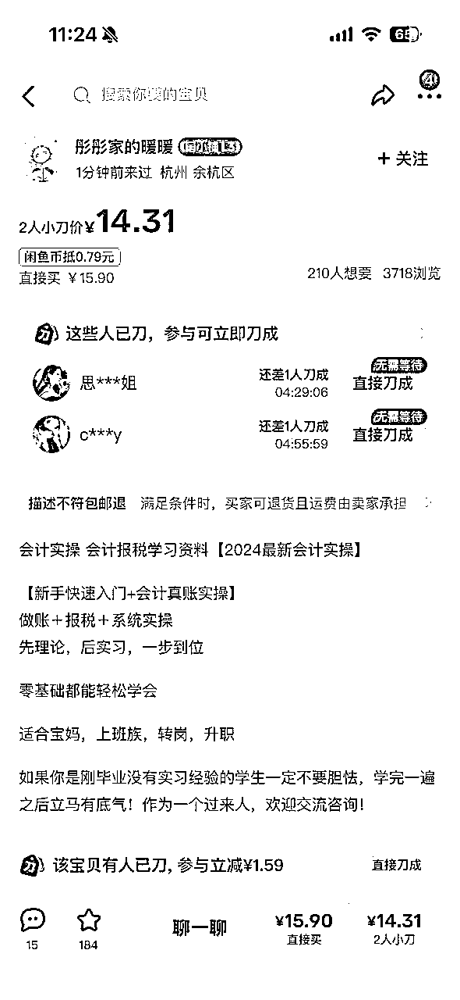

# 1.1.2 为何把阵地放在闲鱼
先看平台现状与走势：

近几年经济承压，消费更谨慎，“能省则省”的心态让二手市场继续扩容，闲鱼也跟着受益。它是淘天集团的一级业务，用户规模已过5亿，今年在电商上投入很重。QuestMobile报告提到，闲鱼与📕、哔哩哔哩同列，是全网高值年轻群体偏爱的APP；在一二线高值年轻人群中，其受青睐程度甚至高过B站。

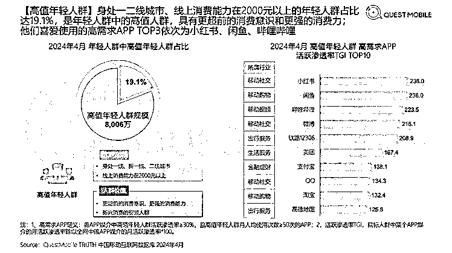

到2024年4月，中国闲置电商行业月活总盘为1.78亿，30岁以下人群接近一半；闲鱼月活1.62亿，同比增19.1%，继续领跑。其用户中，线上消费力超过2000元的高价值群体占52.7%，高于全网平均。

闲鱼天生带交易场景，离成交更近。

那为什么偏偏选它卖虚拟资料？

这类项目本身门槛不高，新手容易获得正反馈。

再看平台：淘系和其他电商做虚拟赛道，通常要交保证金，例如拼多多动辄上千，违规还可能被扣，普通人成本压力不小。闲鱼是二手交易场，注册即可自由买卖。流量分配也相对公平，产品对路就有推流和曝光，不用刷单，也不必投流。

更关键的是，今年4月起，平台对虚拟资料赛道有所放宽，叠加用户增长快，需求很旺。

看几个案例感受一下：

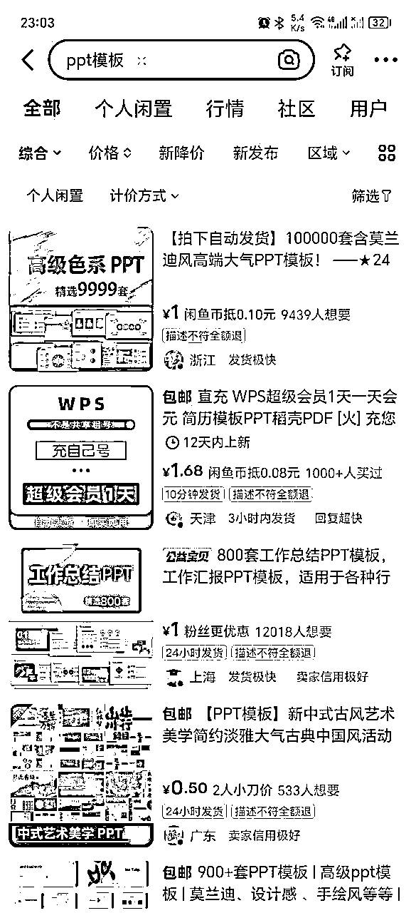

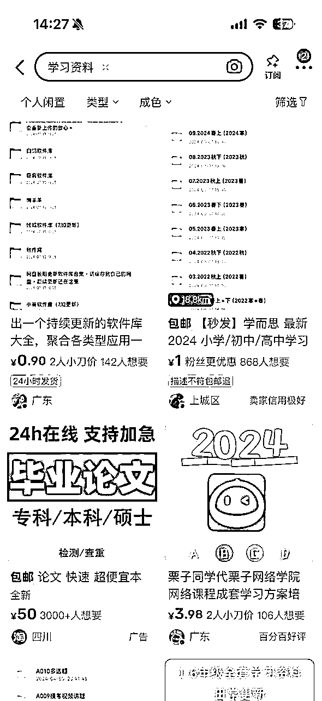

这门生意的机会点可以归纳为：

- 门槛低：没有电商底子也能较快上手；
- 好操作：会手机购物就能学；
- 出单快：实测最快当天成交；
- 成本轻：电子资源几乎无进货成本，每单接近纯利；
- 收入稳：店铺搭好后，平台会持续给流量；
- 省时间：每天1–3小时即可，不必全天在线；
- 可放大：一人可开多个号，做矩阵。

# 1.2 新手最小闭环怎么跑
0–1阶段可拆成这几步：

1. 注册店铺
2. 搭建账号并养号
3. 每天花1小时看品选品（关键）
4. 每天上新不少于5条链接（关键）
5. 优化链接
6. 售前沟通
7. 出单交付与售后

其中，看品选品、每天上新至少5条是关键动作。另外注意：

- 注册店铺：新手先开1个店，有余力再扩店。
- 选品：先挑自己熟悉的领域，对产品价值、定价更有判断。
- 模仿是最快的学习路径，先仿再微调。建议从红海低客单（1–2元）切入，多选多出单，积累网感，先建立信心，再逐步提升选品能力，转向高客单蓝海品类。
- 每天上新不少于5条：新店别急着优化，先坚持上满50个品（未开鱼小铺的新店上限50个），再做调整、上架和删除。每天上架最好不超过10个，过多容易触发违规。

# 1.3 流量分配背后的规则
不管闲鱼、📕还是抖音，背后都是机器算法。操作要顺着算法机制走，才更容易拿到推流和曝光；逆着规则来，流量自然少。

做平台鼓励的事，把曝光、点击、转化做好，店铺权重上去了，排名和曝光也会改善。

流量是用户汇聚的池子，内容是我们与用户之间的桥。

现在公域平台几乎都靠系统分发流量，人工分配流量的平台很少。系统看数据优劣，用赛马机制判断好坏。数据越好，流量越高。

而数据从内容来：主图强，“浏览”高；文案配图强，“想要”高；话术强，“下单”高。

所以别只追流量，先把内容（商品链接的图片与文案）磨好。用内容吸引真实买家，产生真实数据，流量才会滚起来。

落到日常动作：
- 上用户需要的产品；
- 按用户习惯编辑上传；
- 及时回消息；
- 及时处理订单；
- 保证质量，积累好评；
- 及时售后，并减少售后。

~~

# 二、【实操1/3】先把账号备齐

# 本节要点
看懂项目后，就要启动。卖货前，先把账号准备好。

闲鱼虚拟电商通常不涉及资质类目，前期准备不复杂，主要有：

✅ 一部手机
✅ 一个可正常使用的淘宝/支付宝账号
✅ 下载闲鱼 APP、拼多多
✅ 调整闲鱼 APP 权限
✅ 注册并完善闲鱼账号

账号搭好后，多刷同行账号，熟悉各资料赛道。

# 本章航线图
学完本章并实操，即可完成航线图第一阶段：准备账号（约1–2天）

1. 完成1个闲鱼账号的包装与养号（约1–2天）

现在开始做筹备。

# 2.1 设备与软件清单
1. 设备

一部手机，单机单卡单账号。

2. 软件

- 闲鱼：交易实操平台；
- 支付宝：注册店铺用；
- 淘宝、拼多多：货源渠道。

3. 注册闲鱼账号

至少注册1个。注意：单设备单号，不要切号，不要同设备登多个账号。即使用分身工具再开一个闲鱼，也属于同设备多号，容易异常甚至封号。

一个自然人可注册3个支付宝，每个支付宝对应1个闲鱼号。若原手机号曾被闲鱼封禁，可考虑用家人号码再开，或注销重来。注意：开通过鱼小铺的账号注销后，90天内不能再开鱼小铺。

# 2.2 把闲鱼权限调好
以安卓为例，苹果按提示操作。

1. 隐藏关注与粉丝列表

打开闲鱼，点“我的”，右上角“设置”，下拉找到隐私设置，建议把该开关置灰。这样能保护客户资源，避免同行顺着粉丝动态找到你的爆品。

2. 隐藏动态范围

仍在隐私设置中，选择不可见。顾客看不到你的上货动态和销售状态，同行也不容易发现爆款。

路径：我的＞设置＞隐私设置＞允许查看我的动态＞不可见

3. 自动回复

路径：我的＞设置＞消息通知＞智能回复＞不在线回复＞所有宝贝默认回复

（回复话术见【章节4.1 闲鱼客服自动回复话术】）

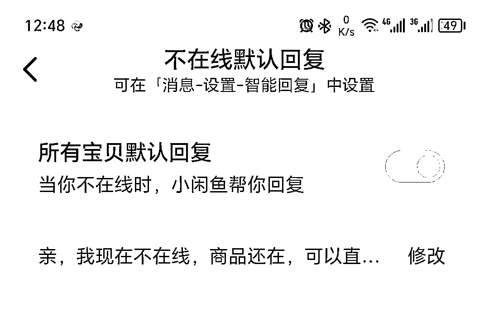

# 2.3 账号资料补齐
路径：我的 -> 设置 -> 个人资料

建议填到80%–90%以上，能补尽补。具体：

1. 主页背景

要求不高，可不换，或放自己喜欢的正能量图片。

2. 头像

要与定位一致。可用美女头像，亲和力强；也可按产品类目选择匹配店铺形象的图片，或用账号名做头像。参考对标账号搭建，可爱风、简约风均可，人物或卡通都行。别太花哨。

3. 昵称

要垂直（重要）。做哪个赛道就取对应名字，例如：

- 赚钱HR
- 赚钱简历定制
- 饭饭职场分享
- 饭饭简历专家

尽量不与他人重名，少用生僻字，免得影响搜索。注意：若还没想好垂直方向，先别改名，闲鱼昵称180天内仅能改一次。

4. 简介

对标同行，学校和职业可写得体面些，其他随意。

总之，设备、手机号、网络都要干净。

# 2.4 新号先养一养
账号注册后，先刷几天闲鱼找感觉。符合虚拟资源方向的都可收藏关注；点赞高、销量好的内容重点标记。

注意：这一步很关键。我们遇到过危险情况——新号刚注册就急着上架、强行干预出单，结果被平台稽查，出现违规不扣分、商品审核、重复铺货、小二下架等问题。这个细节别忽略。

养号成功的标志：推荐页几乎全是虚拟资料产品。

# 养号步骤
【新手照做即可】
1. 补全个人资料（头像、昵称、简介、背景等）
2. 每天签到，领闲鱼币、做任务、浏览、点赞、评论
3. 逛垂直类目的相关商品，随机搜“课程、资源”等关键词，点“我想要”问价
4. 像真实买家一样下1–3单。没有购物需求，就搜“一毛钱壁纸”，找专门养号的玩家买一单，也算有购买记录。

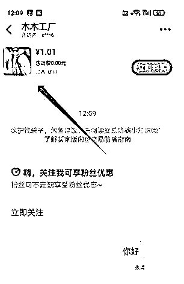

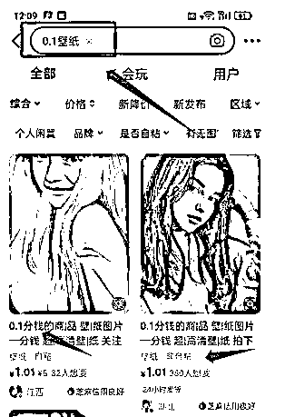

养号时长：3–5天较稳，也可按自身情况缩到1–2天。

养号不足可能带来：
- 上架被平台严管；
- 账号权重低，链接易被下架；
- 权重不够时被同行盯上，举报更容易成功。

养号期间，顺手搭建自己的素材选品库，为后面上品做准备。

全力做项目的人，不能脱离项目本身——一定要花时间刷！

# 三、【实操2/3】选品、上架与日常运营

# 本节要点
账号就绪后，开始选品上架。怎么挑好卖的品？

新手记住两条：
1. 先从红海赛道选品入门，快速跑通出单闭环，再转蓝海；
2. 模仿是最快的学习法，先仿再微创新，最有效。

选好品后，参考对标链接做二创，然后上架发布。

上架不难，真正要花心思的是：
- 商品标题
- 商品主图

注意：选品时别碰违禁商品，避免违规封号。

# 本章航线图
完成3.1的学习与实操，即可完成航线图第二阶段：选品并上架销售（约2小时/天）

1. 学会基础选品，每天看品选品（约1小时/天）
2. 每天上新商品链接不少于5条（约30分钟/天）
3. 上架后记得回复客户（碎片时间）
4. 做日常运营动作，提高曝光（约15分钟/天）

接下来，开始选品、上架你的第一条商品链接吧~

# 3.1 新手挑品的方向

新手挑品，核心就两条：先进热门赛道，再盯住参考对象。这里的热门赛道，就是常说的红海；冷门高价值类目，就是蓝海。

1. 先用热门类目热身，把出单闭环跑通，再碰冷门高价值类目

新人最好从大需求类目里的低价商品入手，单价控制在1~2元。接着就是多挂、多卖，用大量实操把网感练出来。先看到收益、建立信心，然后再慢慢提升挑品能力，去切客单价更高的冷门类目。

热门类目和冷门类目各有优劣：

热门类目：客户基数大，单子来得快，新手容易收到正反馈；单价低、爆款多，可选范围大；跑出爆品的几率也高。但竞争激烈，爆单后客服咨询量大，单个爆品的收入上限不高，大概200-300元。

冷门类目：客单价高，早期竞争者少，单品爆发上限高，通常300-500元，最高能到1000元；代价是找品难度大、对内容认知要求高，一爆单就容易引来低价模仿者，而且高客单价更容易出现仅退款。

低客单价怎么筛：这类品通常没有固定用户画像，直接按照“价格低、想要/浏览≥1:10”的规则批量过滤，效率最高。

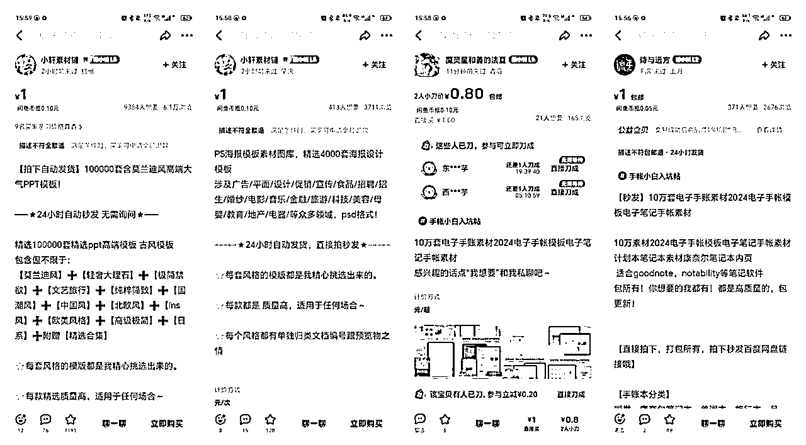

高客单价怎么筛：每个赛道里都有高客单标的，前提是你足够理解该类目的内容；最简单的做法是搜索关键词，专挑竞争少的方向。

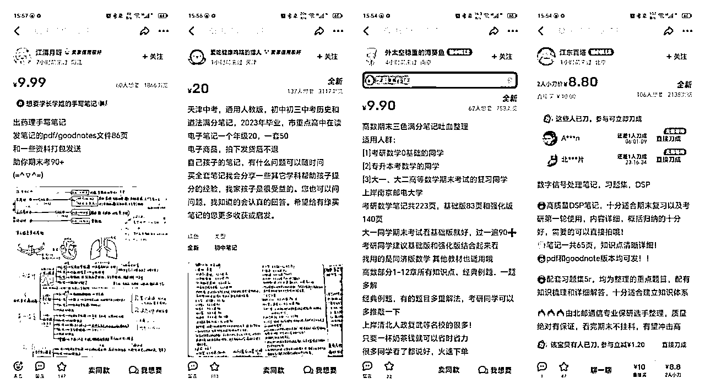

2. 新手的捷径：先抄作业，再谈微创新

模仿不是丢人，而是最有效的起手式。三个步骤：

第一步，找A、B、C三个参考品，拆解它们的买家画像，把共性和差异整理成表。

第二步，把A、B、C忘掉，只看这些共性与成交有没有关系；如果有，就倒推哪些商品也有类似属性。

第三步，回到平台里反复刷商品，看“想要/浏览”，比较同一个单品在不同店铺里的卖法。

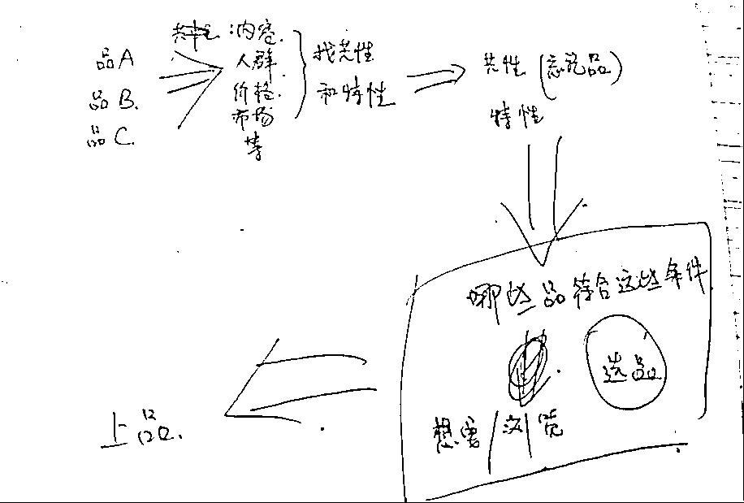

内容来自：单账号收入放大5倍——不做矩阵，闲鱼上卖虚拟资料也能做到！！！

# 3.2 新手怎么找品

正式开始挑品前，先建一个素材池，把自己看中的商品、图片、文案都往里丢。

# 第一步：找参照对象，优先买家画像丰富的品

找参照店铺有两个直接好处：一是挑品时心里有底，二是能跟着好卖的品走。

具体思路：用逆向思维，别再把自己当卖家，而是代入买家身份，想想在不同场景下还有什么需求没被满足，哪些需求是很多人都有的。优先选那些受众跨度大的品。比如PPT素材，学生、老师、文员都会买，覆盖面广，内容需求也多。

参考方法：在闲鱼上搜索下面这些店铺名，点进头像，就能看到它们卖得最好的商品。

# 第二步：看“想要”和浏览

打开平台，在搜索框输入想卖的关键词，比如“工作总结PPT”。如果搜出来的一批商品普遍满足“想要/浏览≥1:10”，说明需求池够大，可以继续判断。

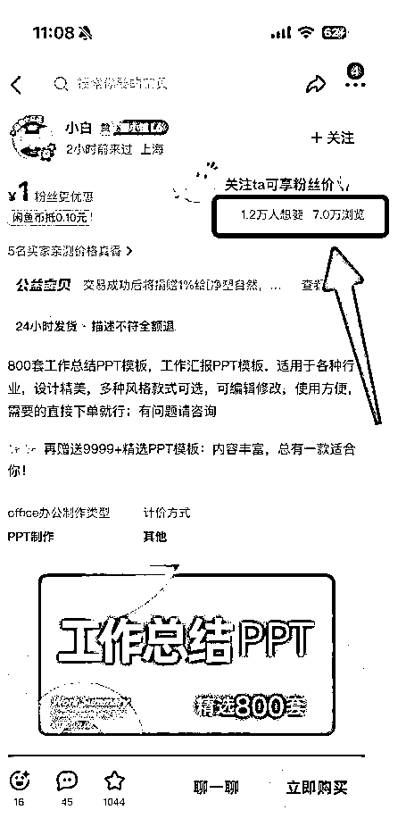

# 第三步：看同行动态

“同行动态”反映的是商品近期的成交热度；近几天卖得越多，转化越好，作判断时权重也越高。

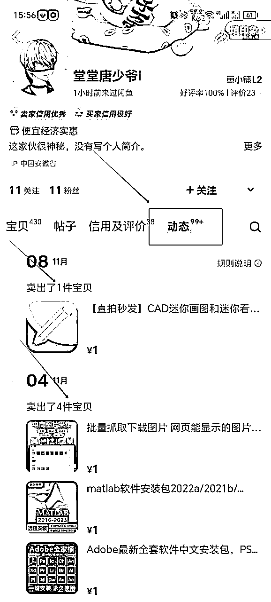

判断标准主要有两条：一是同行是否“连续多天出单”，通常超过3天就算合格，越久越强；二是“出单频率”，10天内至少5天有成交，哪怕每天只有1单，也说明这品有戏。

如果同行动态被隐藏，别慌，可以看这些侧面信息：

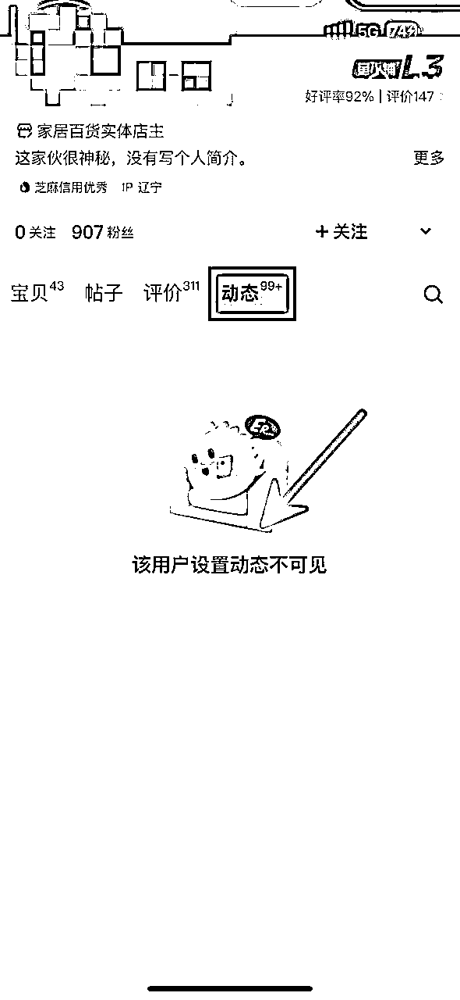

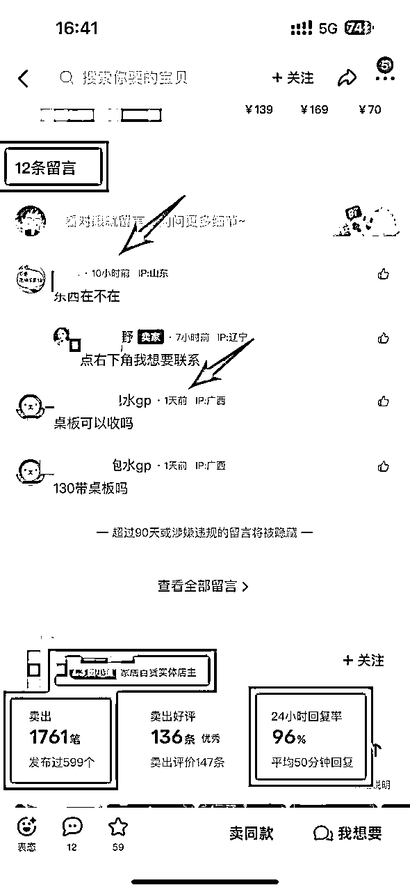

1）鱼小铺等级：这个等级来自买家好评，能侧面证明商家的经营能力，作为第一项参考。没有鱼小铺但其他指标好的店铺，同样可以考虑。

2）留言时间：留言代表近期的咨询热度。7天内有2条以上新咨询，说明关注度不错。

3）回复率：90%以上通常代表店铺整体赚钱能力还行，值得花精力研究；低于80%可以直接跳过。

4）卖出件数：数量越多越好。如果很多家都只有几件成交，这品可能没有市场；当然也有刚上架就爆单的特例，要结合其它指标一起看。

# 第四步：多店交叉验证

单个店的数据容易出现偶然性，所以要多看几家。找到多个“想要”数据不低的店铺，检查它们的出售动态；只要有2、3家都满足上面说的条件，且每家出售超过3件，就可以纳入选择。

# 3.3 闲鱼新手可以从哪些类目做起⭐

下面几个类目比较适合新手入门，每个类目下都有大量单品可以挖。

模板素材：PPT模板、Excel表格、Word模板、PS素材、淘宝店装修素材；适合学生、老师、公司职员；注意Word字体不能违规。

学业文档：各年级的学习资料；适合学生、老师、家长；注意避开版权问题。

协议合同：租房合同、出租转让协议、离婚协议；适合中年人；尽量选功能简单的合同，减少咨询。

三个类目里，更推荐新手前期专注【模板素材】，实测出单更顺。

特别提醒：航海期间我不会给太细的商品清单。闲鱼本质上是一个二手交易平台，热卖品流动性大；用“低价+杂货铺”的方式广撒网，反而能让正反馈来得更快。跟着平台热卖款走，只要满足“想要/浏览≥1:10”，基本可以放心上架。

# 3.4 闲鱼找品避坑（重要）⭐

找品方法练熟后，先别急着铺货，还要知道闲鱼虚拟商品有哪些禁区，避免账号违规封号。

凡是带品牌名、Logo，或者涉及K12教育等强版权内容的商品，一律别碰。被平台发现后，轻则投诉扣分、警告，重则可能吃官司。请仔细阅读下面这份违规案例清单：《关于电商虚拟产品违规案例分析及注意事项》。

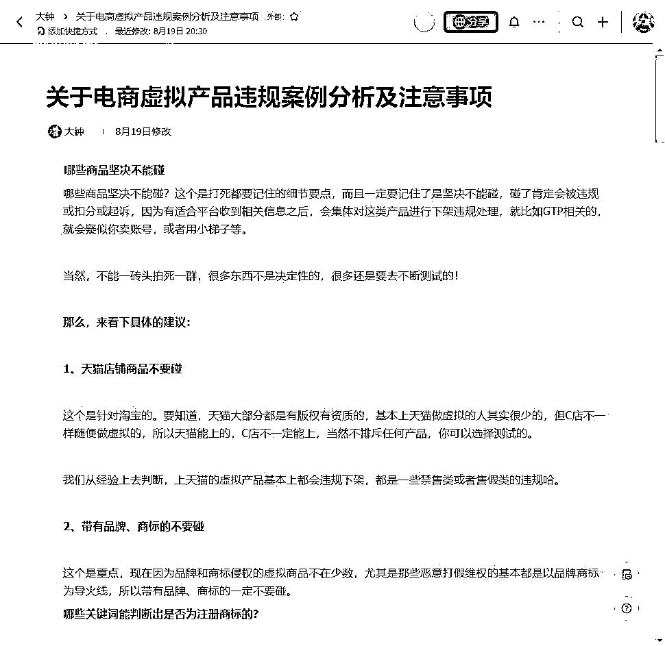

# 3.5 商品怎么发布

做闲鱼虚拟资料的链路很简单：先挂在售链接，等买家咨询并付款，再去买参考店铺的资料，转存后发给买家。所以先完成发布。

# 3.5.1 发布商品的编辑流程

发布不难，找到参照样本的链接，参考它做二次修改，然后挂出去。具体步骤如下：

# 第一步：找参照样本

在闲鱼的搜索框输入产品关键词，比如“PPT模板”，用前面说的“想要/浏览≥1:10”来筛。

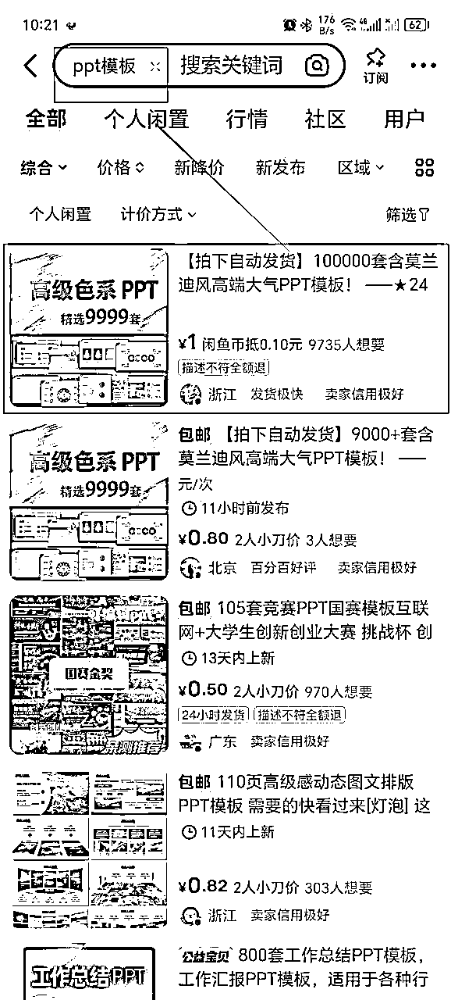

找到后，参考对方的内容做下面的修改，再发布。修改的目的是为了减少同质化，增加吸引力。

# 第二步：写标题

一般以参照店铺的标题为底，改一改就能用。左图是原版，右图是改后版本，可以对照看看。

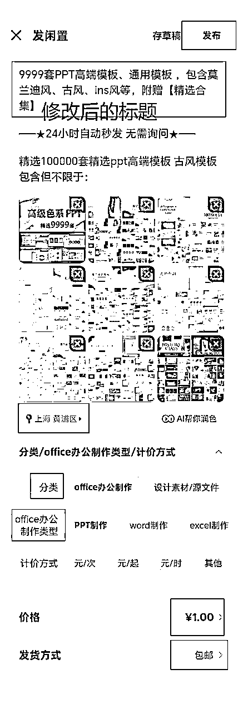

# 【附】标题怎么写出流量？

高流量标题的通用做法，就是把产品关键词尽量堆进标题里，让用户不管搜哪个词都能找到你。比如“ppt模板”可以写成“PPT高端模板、通用模板”。参考格式：9999套PPT高端模板、通用模板，包含莫兰迪、古风、ins风等，尽量写满30个字符。

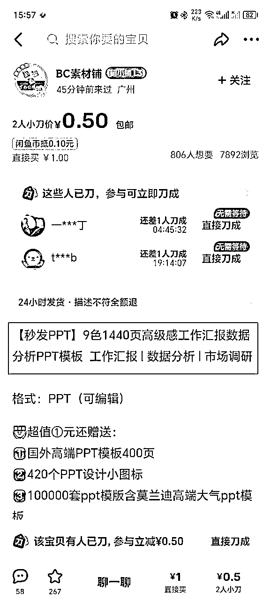

# 第三步：做主图

主图也可以直接搬参照样本。闲鱼目前对搬运管控不严，直接用对方的图问题不大。

# 【附】主图怎么做得更抓人？

好主图的第一任务是抓眼球，做到三点就够：清晰、干净、能看出卖点。拿“小学资料”来说，排在前面的商品图，通常把产品放在正中间，细节和款式都很清楚，让人下意识想点进去。

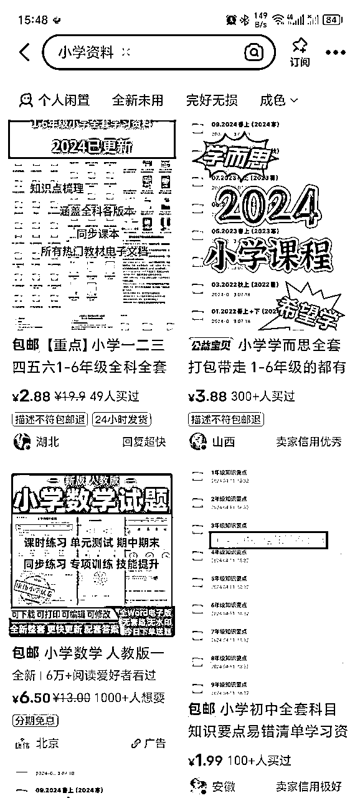

相比之下，一些“想要”数据低的商品图片模糊，观感差，用户自然会倾向点击更清爽的主图。所以主图尽量按这个方向来做。

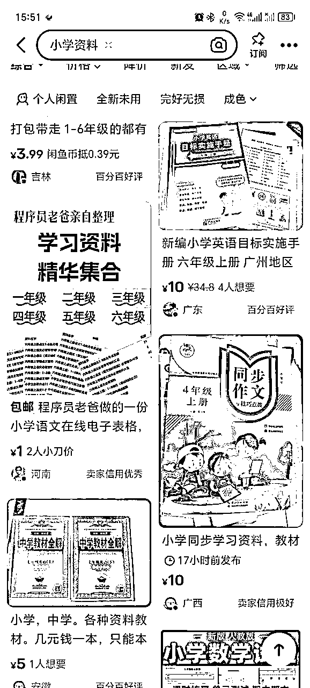

详情页里的其它照片，直接参照出单情况好的卖家即可。

好的主图图源怎么找？低成本方法：去淘宝、1688、拼多多、淘特搜同类产品，从商品详情和买家评价里挑合用的图。

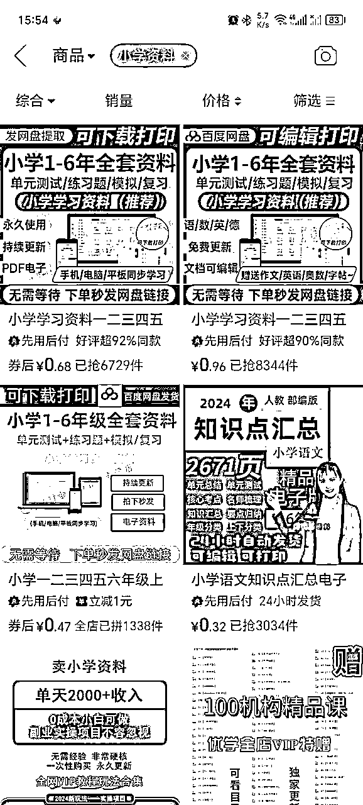

这只是基础操作，做闲鱼已经够用；想做出差异化，可以在原图上做特效、拼接等二次处理，市面上的修图软件都能实现，这里就不展开了。

# 第四步：发布

文案和图片都准备好后，返回主页，点“发布闲置”，按要求填写即可。发布地选一二线人口多的城市；定价可参考同行或略低，但别设0.01元，容易被判定低价引流、扣闲气值；发货方式选“包邮”，发货时再选“无需寄件”。

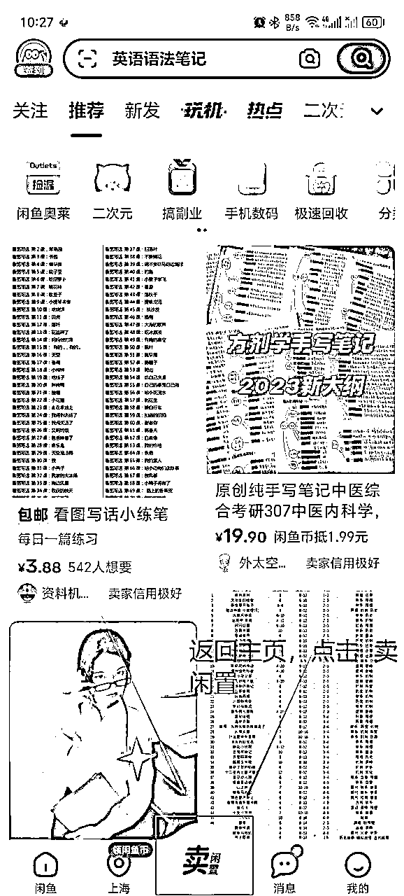

# 3.5.2 发布商品时的注意事项

1. 标题、文案、图片都别出现品牌词。

2. 别写“无添加”“联系”“🛰️”等导流站外的词。

3. 发布地选一线人口多的城市。

4. 发布时间优先早上8点左右，其次晚上8点左右，实在不行中午11点半左右。

5. 每天发5个左右链接就够，别过量，以免被当成营销号。

# 3.6 上架后的日常维护

# 3.6.1 每天做一次擦亮

可以凌晨0点左右擦，也可以早上起来擦。路径：进闲鱼-我的-我发布的-左上角一键擦亮。

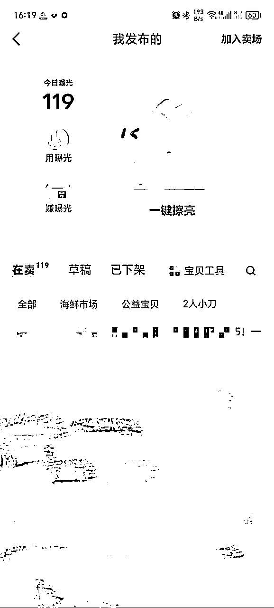

# 3.6.2 出单后及时评价买家（增加鱼力值）

成交后，记得立刻给买家评价。这样既能督促对方也给你好评，还能增加鱼力值；鱼力值越高，信用越好。操作步骤：

# 3.6.3 运营时要避开的坑

运营技巧：

- 发布按规范来，标题、文案、发布地、标签都要检查。
- 每天把商品擦亮一次。
- 及时回复咨询，尤其是前期，消息通知一定打开。
- 卖出一件，马上补上新的链接。
- 拍下5分钟内不付款的订单，直接关闭，按话术“以退为进”。
- 评论和留言也要回，让别的潜在买家看到你的责任心。
- 订单要尽快处理，售后能少则少，多盯商品质量；差评太多就换商家，售后及时让步。

平台违规封号点：

- 选了违禁品（见上面3.4）。
- 一台手机登多个账号，或者在多账号间频繁切换。
- 客服聊天出现违禁词，或同一句话反复用，比如“转账多次”“一单一结”“皇”“🛰️”“联系”“加”“原味”等。
- 售后纠纷太多，多次拒绝退款，买家申请小二介入。

# 四、【实操3/3】咨询、成交、发货、售后

# 💡 章节概要

买家来咨询时，要第一时间回应，避免客户流失；成交后马上安排发货，能提高满意度。这一章会讲客服常用回复和发货流程：

✅ 客服：及时回复、积极处理售后

✅ 发货：及时找到参考商品下单，转存网盘，再发给买家

具体细节往下看。

# 💡 本章行动路线

完成本章的学习和操作，就完成了第二阶段：选品并上架销售（约2小时/天）。

1. 挂上链接后，记得用碎片时间回客户。
2. 稳定出单后，设置自动发货（约10分钟）。

# 4.1 客服回复与话术设置

# 4.1.1 基础话术

虚拟资料客服比普通商品省事，没有物流问题，问来问去大多就是“还能拍吗”“资料怎么发”。最常见问答：

买家：你好/在吗/还有吗/怎么买？

卖家：在的，哥/姐！直接拍就行，百度/夸克网盘发货。

# 4.1.2 客服心得

1. 把买家当上帝，合理要求尽量满足，别起冲突，不划算。

2. 不方便回复时，找个不好拒绝的理由，“在开车”是我常用的。正常买家愿意等；同行或难缠的买家会走，不必纠结，也不用内耗。

# 4.1.3 常见案例

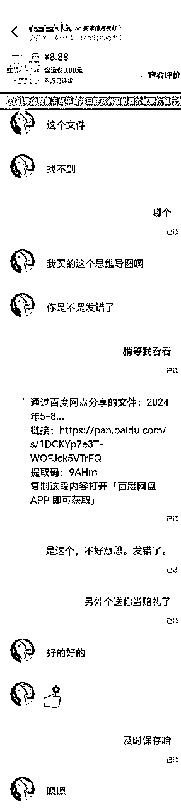

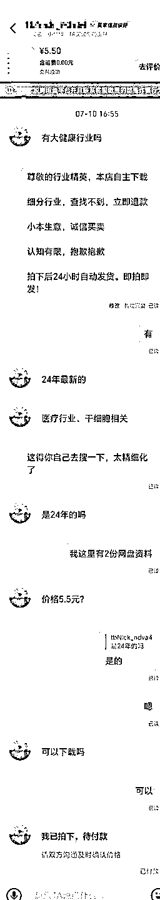

# 4.2 成交后发货流程

# 4.2.1 出单后如何拿到虚拟货源并发货

# 第一步：获取资料

搜索关键词，找到同行下单；复制网盘链接（以百度网盘为例），打开百度网盘App，转存到自己的网盘。

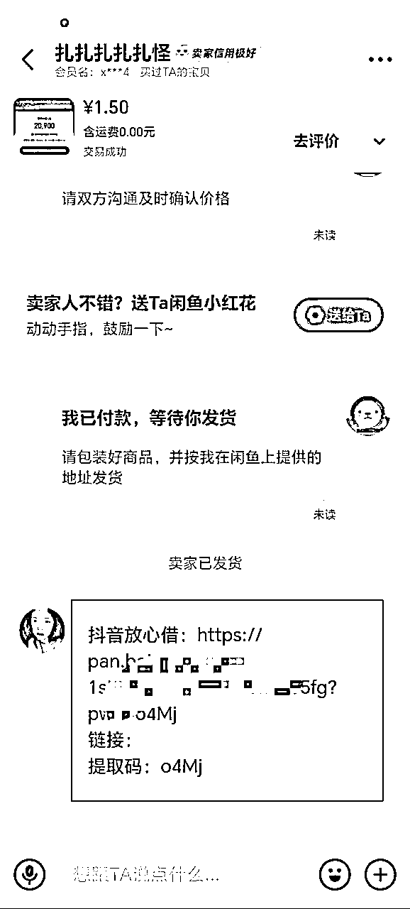

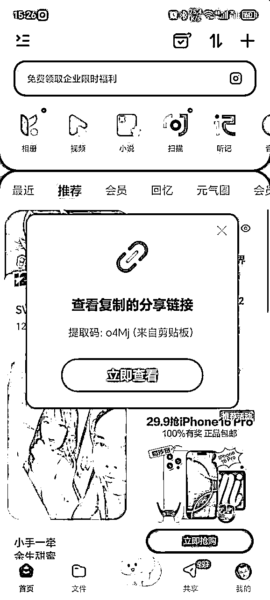

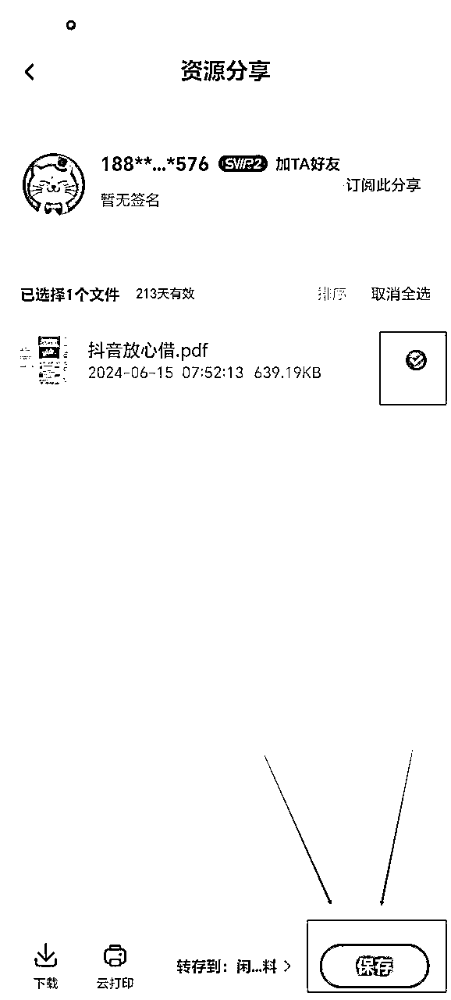

# 第二步：生成自己的网盘链接

从同行那里拍下的资料，一般没有水印或二维码（除非是对方用来引流的），可以直接保存使用；而且大部分资料不能编辑，如果遇到带水印的，建议换一家。

# 第三步：完成发货

生成自己的网盘链接，点“去发货”，选“无需寄件”，把链接发给买家。

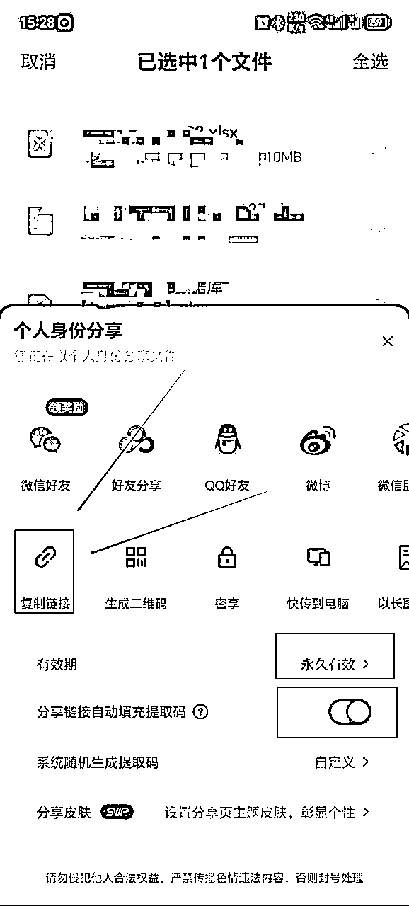

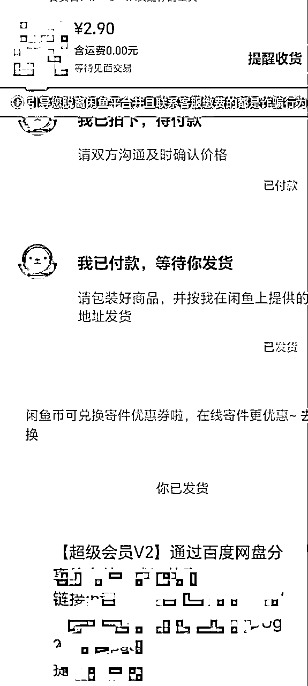

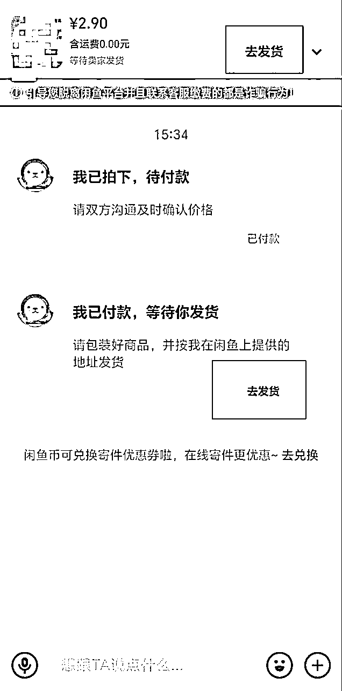

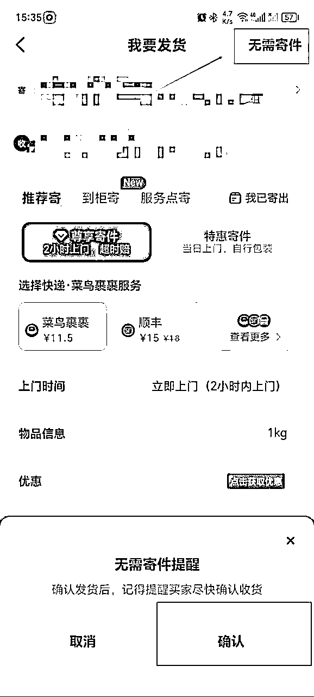

# 4.2.2 发货之后做什么

# 重新上架

出单后第一件事就是重新上架。路径：我的＞我发布的＞右上角已下架宝贝＞重新发布。马上上架，流量会很大。注意：开通鱼小铺的卖家不需要手动上架。

# 提醒收货

可做可不做，影响不大；早点确认，早点落袋为安。

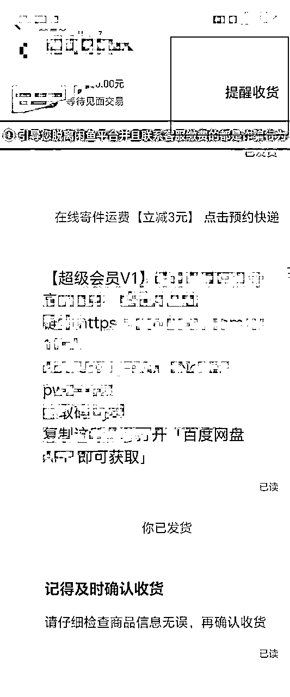

# 4.2.3 稳定出单后设置自动发货

推荐两个工具：阿奇索（鱼店长）和闲管家。

1. 阿奇索（鱼店长）：购买页可以领7天试用。

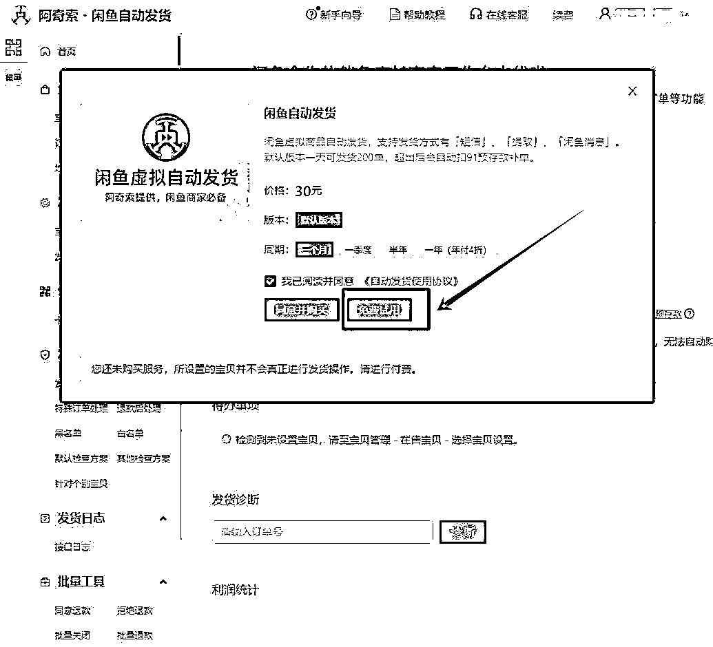

操作很简单，跟着新手向导设置即可。

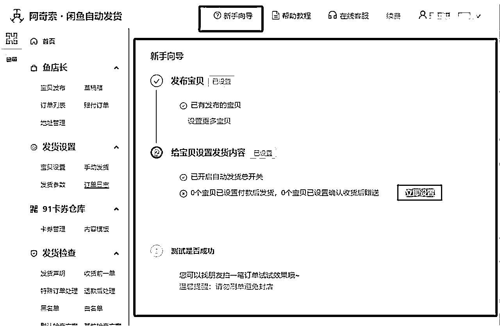

2. 闲管家：有更多附加功能，需付费。

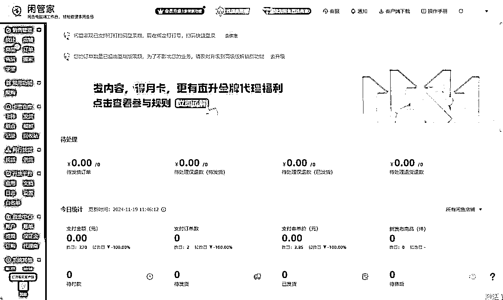

用哪个看个人习惯，我觉得差别不大，这里不做推荐。

# 4.2.4 出单后没有及时找到货源怎么办

偶尔会遇到出单了但找不到货源，或者参照店铺下架的情况，总之发不出货。解决办法：及时告诉买家现在没法发，理由可以用“网盘出了问题”“在开车”。

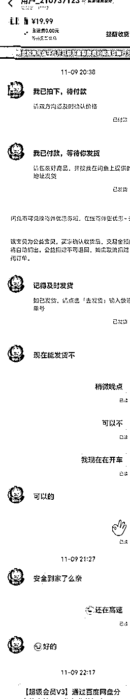

# 4.3 差评和仅退款怎么处理

差评：

1. 恶意差评需要联系平台官方客服，提供材料证明是恶意差评，才能申请删除。

2. 避免差评的方法很简单：售后能退就退，别跟客户争执；个别差评不影响店铺。

仅退款：

3. 虚拟资料一般不退，但如果你没及时发货或资料确实有问题，直接退款即可。话术：“不好意思哥/姐，我现在给你退款。”

# 五、复盘与改进

# 💡 本章行动路线

完成这一章的学习和实操，就到第三阶段：优化运营，提高曝光。

1. 分析数据，对商品进行优化、上架或删除。

# 链接先到50，优化再启动

新店还没起量时，别急着把每个商品都打磨到极致。第一步先把在售链接补到50条，这是打底子必须走的一步。

等店铺里的货盘足够丰富，再回头处理那些表现拖后腿的链接。清理顺序建议这样排：先拿掉完全没有浏览记录的，再处理曝光量偏低的，最后才考虑“想要”数据不理想的。

（优先级口诀：曝光 ＞ 浏览 ＞ 想要）

操作入口：我的 → 我发布的 → 在卖 → 管理 → 下架或删除

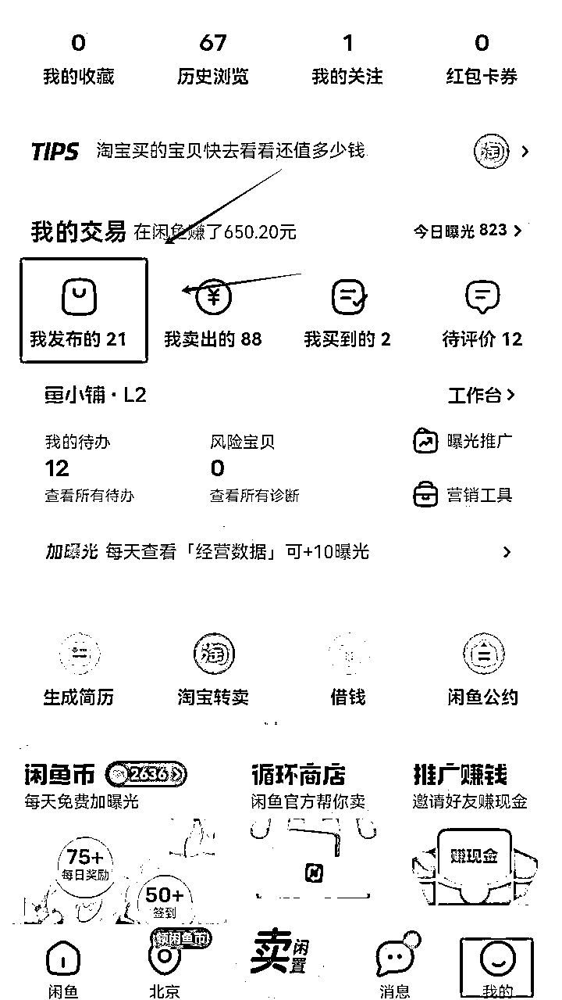

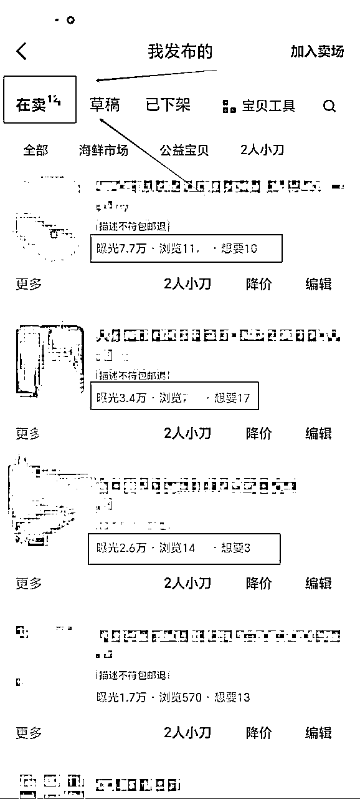

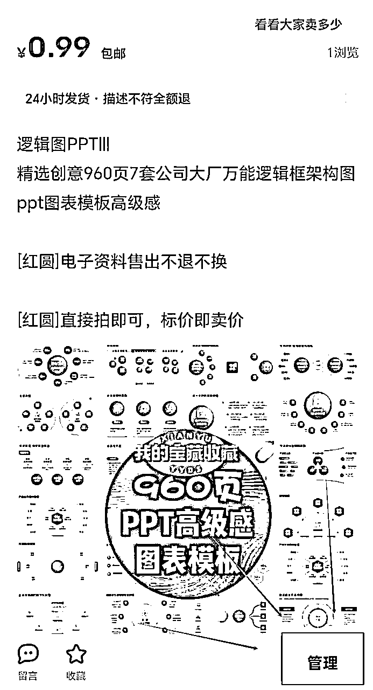

另外要记住：下架并不等于作废，之后还能点“上架”重新发布；但删除是永久动作，无法找回。

# 选修篇：项目精进与放大

# 💡

章节导读

项目的最小MVP跑通、操作流程也大致熟悉之后，就可以进入选修篇。

不管你的目标是继续做大项目，还是寻找额外玩法，这一章都建议重点看：

✅ 选品维度更宽：品类怎么扩、货源怎么找

✅ 变现方式更全：怎样把生意再放大一层

接下来，一起看看还有哪些可能性~

# 六、选品方法的延伸

# 6.1 判断蓝海品的三条参照线

1.  先盯住该品类的“想要”峰值

买家愿意点“想要”，多数情况下至少对价格有兴趣，这类人离成交更近。因此，把“想要”数量当作一把尺子，就能大致判断这个市场有多大的需求盘子。

1.  近期仍有人留言的热销链接，往往还留着改进余地

竞争不会停，商品页的呈现方式也在持续翻新，买家的口味同样会变。

有的链接数字很亮眼，但可能是老早以前跑出来的成绩，放到今天未必吃香；一个直观信号是，最新一条留言已经停在一个月甚至更久之前。

所以，先看热销链接【最近七天有没有新留言】，以此推测它当下是否还在获得平台推流；接着判断页面内容是否还有打磨空间。内容质量往往决定流量上限——你若能看到改进点，就说明还有机会；你若觉得已经无懈可击，那这个机会对你而言就不存在。

1.  观察竞争者数量与售价水平

拿关键词或标题去平台里检索同类卖家，顺便看他们的成交价。假如同行少于十家，且平均售价比同类更高，通常意味着这条赛道还没那么挤。

至于是蓝海还是红海，把前面几条对照一遍，结论基本就浮出来了。

# 方法一：从异常数据里找品

红海拼杀太拥挤，更聪明的打法是绕开正面战场，用差异化切进去。差异化一旦跑通，数据通常会把结果写在脸上，这就是“异常数据”。

换句话说，放在同款商品里，异常数据往往对应一次成功的错位竞争；放到不同商品之间，异常数据则可能暗示一块需求旺盛的市场。

跨品类案例：

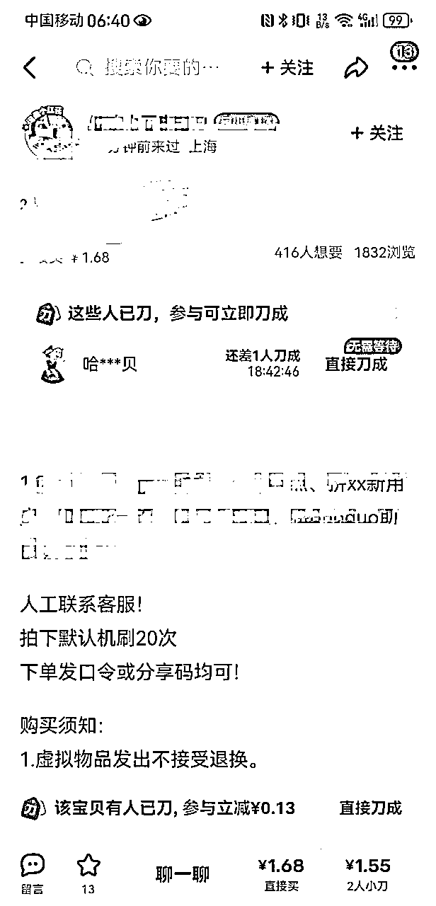

以实物类目为例，一条表现不错的链接，“想要”与“浏览”的比值通常在10%上下——每十次浏览大约换来一个“想要”。

而像pdd砍一刀这种玩法，这个比值能冲到20%以上，说明背后的需求热度更高。

同品类案例：

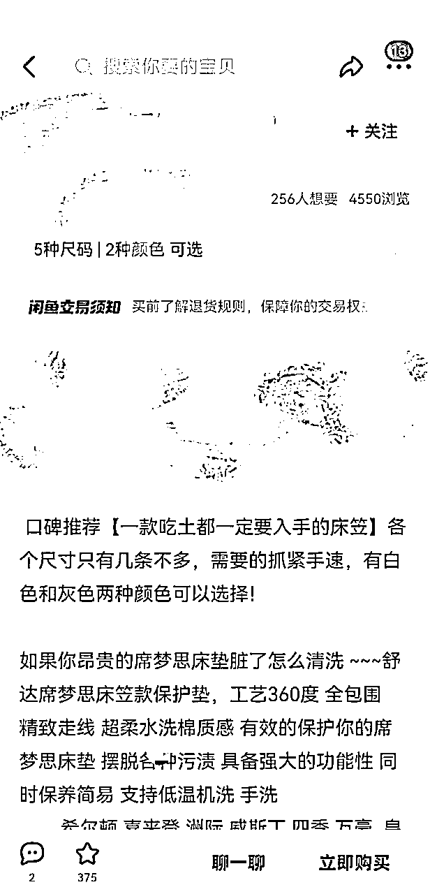

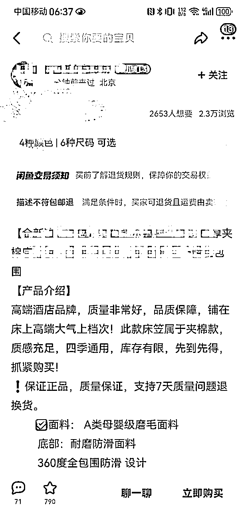

当某条链接的数据显著高出同类平均水平，它就是我们要找的异常数据。发现之后，别只看热闹，要拆开看门道。

主图、标题、卖点词、详情文案、配图……多个角度逐一对照，找出它为什么能跑出异常，再把这套原因迁移到自己的实物商品页上。

若说成功有捷径，那条捷径大概率叫“异常数据”。

它之所以值得追，理由主要有两条：

第一，数据本身已经替市场投了票——用户认可过，说明它是被验证过的成功样本。

第二，时效性强。任何新鲜差异化都会被同行模仿，一旦被抄成常规操作，数据上的异常就会消失。所以每次出现新的异常数据，都是一次短窗口机会。

自己没把握做第一个尝鲜者，那就做第二个跟进者：风险小，收益也实在。

# 方法二：把闲鱼榜单用起来

1.  闲鱼榜单

能上榜的店铺通常在一个细分方向扎得很深，商品覆盖面也广，几乎把一个领域的主要货盘都摆出来了。刚定下赛道、还不清楚该上什么品时，翻榜单能很快帮你搭起“这个领域都卖些什么”的整体框架。

1.  缺货榜与新人榜

平台现在的商品排序逻辑里，缺货榜的商品也已经被纳入计算。

新人榜则藏着不少竞争度较低的商品，属于蓝海货源的集中区，用来冷启动店铺很合适。

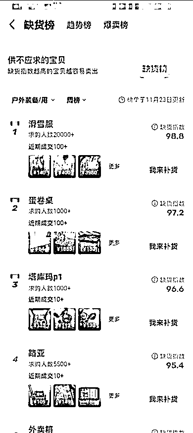

# 方法三：去别的平台淘线索

举个例子：去📕检索相关词。

顺着笔记往下翻，看看这个方向有哪些虚拟资料可以拿来运作。

像下面这个例子，能翻出试题、资料包、表格模板、课程等内容。

把这些素材归拢好，再找对应的商品形态，就可以先小规模试卖。

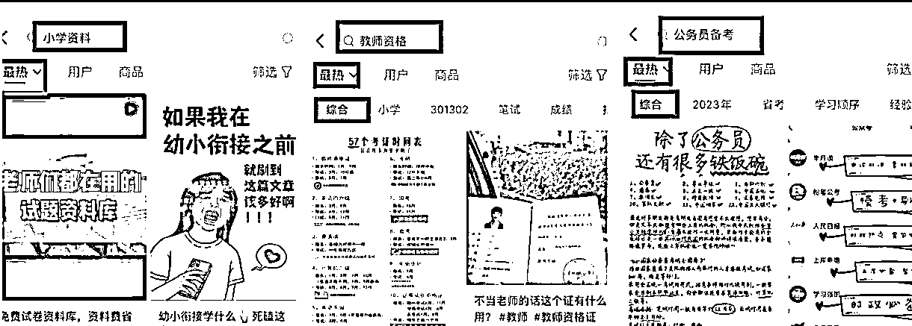

# 方法四：利用首页推荐流

养号期间多搜目标关键词，让平台逐渐摸清你的偏好。

之后首页会不断推送你关注方向的内容。

一旦刷到数据表现好的案例，就可以把它当成模仿样本。

1.  从 主页 ＞ 猜你喜欢/新发 进入，挑最近72小时或48小时内上架的商品，重点看“想要”数据。

2.  同样在 主页 ＞ 猜你喜欢/新发 里，用“卖家信用极好”“回复快”这类标签做筛选。

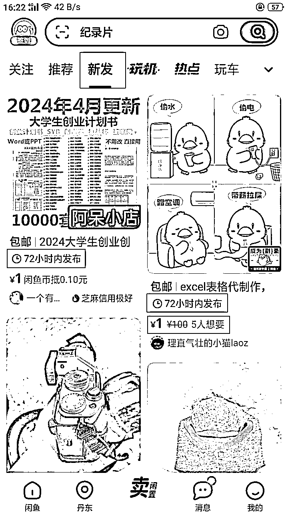

# 方法五：用第三方数据工具检索

常用查数工具有：飞瓜、抖查查、灰豚、考古加、禅妈妈。

# 七、变现路径再拓展

# 7.1 私域引流

核心思路是把公域流量引到自己的私域池，再靠单聊沟通或朋友圈持续转化，抬高客单、卖出更多商品规格。整体照常规上架流程走，只有定价和交付两处要变：

1.  在闲鱼首页检索关键词，例如“副业”“赚钱”。

2.  筛出“想要”人数较多的竞品链接作为参照。

3.  把对方的文案和图片复刻下来。

4.  设定商品价格（这一步最关键）。

引流品的定价有讲究：先把价格挂在2元，之后大约每小时下调0.1元，降到1元就停；即使没人下单，也不必再调回2元。

5.  发布区域：优先选一二线城市，但别频繁更换。

6.  交付环节（同样关键）。

先买一份项目资料存进自己的网盘，再把私域联系方式或二维码放进网盘（转化话术也可以做成图片），生成分享链接。买家下单后，把链接发过去即可。

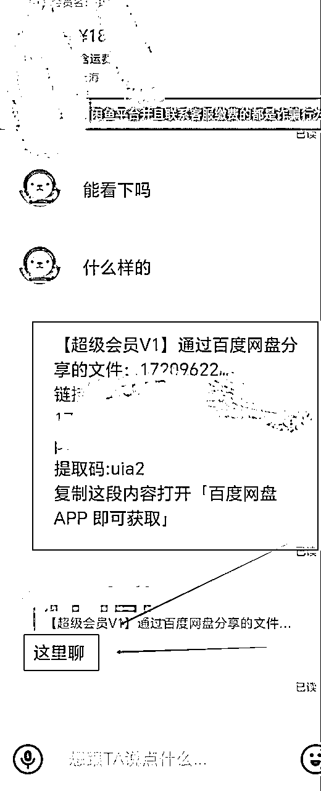

7.  参考话术

亲，新店冲好评，麻烦先拍下但别付款，我这边把价格调到0.1元后您再付；拍完回我一句“已拍”，我马上安排发货。

这会儿客服不在线，稍等片刻哈。收到后如果觉得服务还行，帮忙点个好评；也可以直接点下面的链接自取：「百度网盘完整资料，点击即可查看」

# 7.2 网盘推广返佣

在闲鱼卖虚拟资料时，可以顺手叠加网盘推广返佣，多一份收入。（只要有人通过你的分享链接转存文件或开通会员，你就能获得佣金。）

推广渠道一般分官方与个人两类。

1.

最后，愿每位读者都能锁定适合自己的赛道，把变现跑顺，把收益做大，在龙哥盟的路上越走越稳！

