# 小绿书带货：从0到1实战手册（12月航海版）

> 内容整理自龙哥盟星球内部材料 | 出品方：龙哥盟团队 | 发布于2024年12月2日

使用说明：内容贡献者排名不分先后。这份材料想呈现项目的更多可能性，帮助你更快理解并落地操作。

效率小技巧：想快速跳转，可用 Ctrl+F / Command+F 输入关键词搜索。

# 开篇：先弄清这两件事

# 💡

欢迎加入12月航海·小绿书带货专场，接下来我们会频繁见面。

正式动手前，先把几个关键问题说清楚：

1）小绿书带货到底是什么？现在做还有机会吗？

小绿书是🛰️公众平台提供的一种“图片+文案”内容形态。在公号后台新建内容时，选择“图片/文字”，产出的就是小绿书；再往图文里挂上商品链接，带货链路便成立了。

收入来源不只有卖货佣金：粉丝满500后可以开通流量主，获得广告分成，相当于一条内容吃两份钱；如果手里有私域产品，还能借小绿书做引流。

平台最近对小绿书的动作非常密集，说明它大概率是🛰️生态接下来要重点发力的方向（🛰️想做电商的意图也不算新鲜了）。只不过眼下流量正处在调整期的低谷：有人一篇爆款能赚上千佣金，也有人连续更新一个月毫无波澜，这两种情况都很正常。航海期间没有爆款、没有成交，也完全可以发生。

所以更稳妥的心态是：趁平台调整、项目仍在早期，先把自己放进场，但不把短期出结果当作必然。把它当作长期项目来做，至少日更30天，把内容功底养起来，再等风来。

先进场，扛过周期，之后才有资格谈赚钱。

2）什么样的人适合做这件事？

✅ 有👸号爆文经验，或者做过📕图文带货，更容易跑出成绩；
✅ 想找一份长期副业，并且愿意承受首月没有收益的风险。

愿这次航行，你不仅能带走方法，还能收获一群并肩作战的朋友。

以下内容由龙哥盟与圈友共同整理，仅供本期航海船员和龙哥盟星球圈友学习。小绿书项目变化较快，手册部分信息可能已经滞后，请持续关注最新动态，开船后多在群里同步，紧跟平台节奏。

# 一、项目概述：搞懂小绿书带货

# 💡

这一章的目标，是先把小绿书带货的整体图景梳理清楚。

它本质上是👸号体系里长出来的新形态：眼下发展到什么阶段、前景如何、有哪些特点、新人如何下手，都会在下面展开。

本次航海的重点，就是陪伴大家从0到1跑通这个项目，所以先建立全局认知很有必要。

# 1.1 什么是小绿书？

# 1.1.1 小绿书入门

再精确一点说：小绿书是🛰️公众平台提供的“图片+文字”内容载体。在后台发文时切到“图片/文字”入口，产出的内容就是小绿书；把商品链接嵌进图文里，带货动作就完成了。

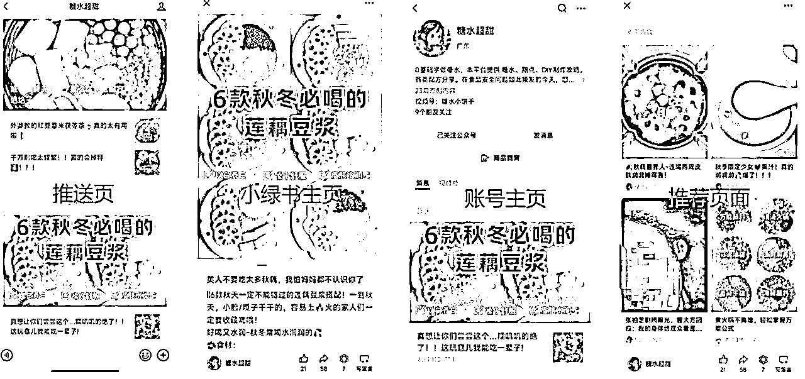

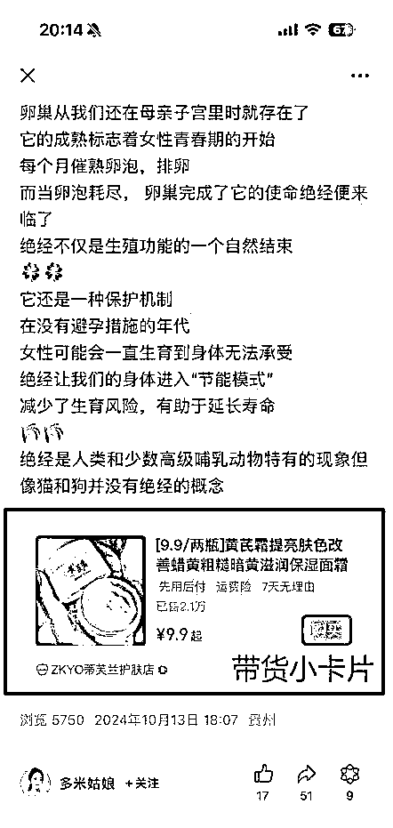

小绿书去哪里刷？目前的入口不算集中：手机端的服务号、小绿书底部推荐流、订阅号信息流里都能碰到。服务号以企业内容为主，也有少量个人主体；底部推荐会给你推送同领域的其他小绿书；订阅号里能看到一部分，但没法主动搜索。服务号和订阅号的本质区别，在于注册方式和流量分发逻辑。

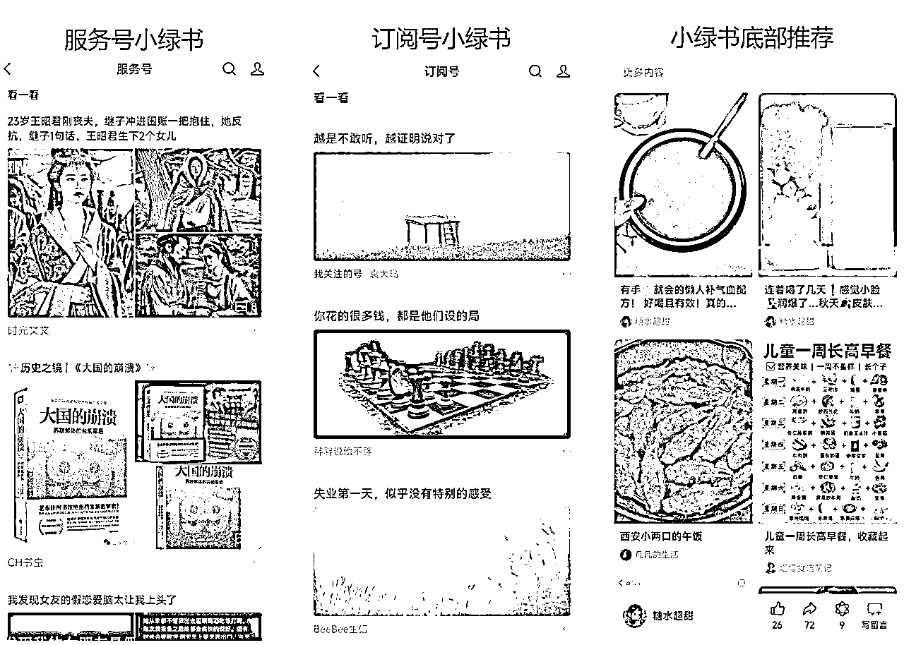

它有三个基础特征值得记住：

1. 流量底盘来自👸号：推荐算法、排版样式、推送机制全都延续公号那套体系。
2. 爆款逻辑也沿用👸号：信息增量+情绪共鸣，依然是运营时最该抓的两条线。
3. 运营规范受👸号约束：相关规则同样管着小绿书，后文会列出常见违规点。

官方规范文档可以在🛰️公众平台后台找到，包括运营规范、推荐运营规范、流量主运营规范、外部平台侵权投诉指引等。

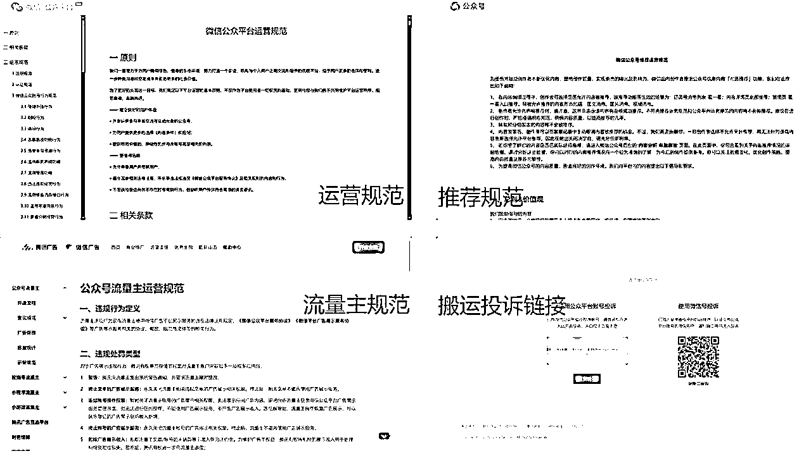

# 💡

再补充几条提醒：

1. 小绿书暂时没有“原创声明”功能，但不代表可以随便用别人的内容，合规运营依然是底线。
2. 《外部平台侵权投诉指引》对它的适用性很强，遇到外站抄袭、搬运，可以直接拿来作为投诉依据。
3. 平台审核并不宽松，违法违规内容坚决不能碰，非官方广告引流也要尽量克制。

# 1.1.2 小绿书和📕有什么区别

两者在呈现方式上很像，先看图：

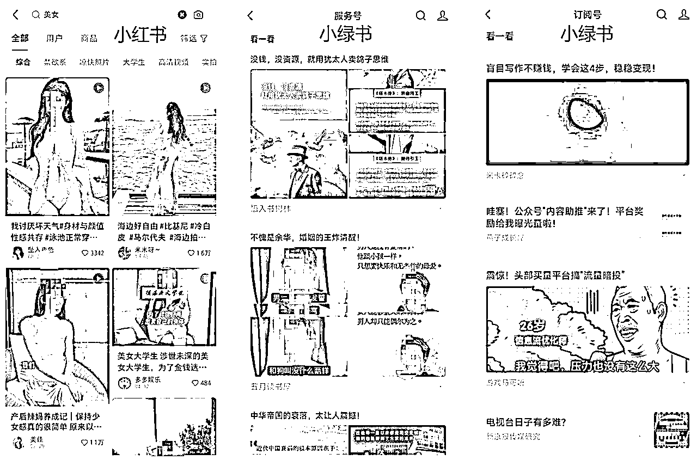

具体差异可以看这张表：

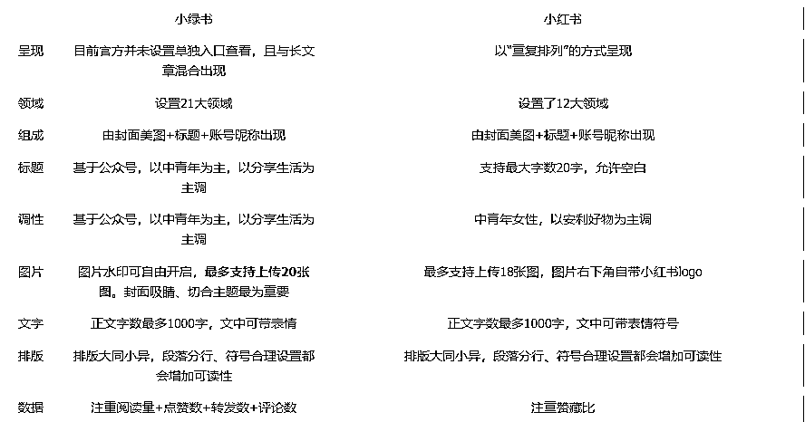

# 1.1.3 平台现状与走势

“小绿书带货”忽然火起来，市面上的培训课也越出越多，根本原因是🛰️从8月开始密集内测：

- 8月：小绿书启动小范围测试；
- 9月：闭门会上重点讨论了小绿书板块；
- 10月：新增“搜一搜”流量入口；
- 10月底：个人主体也能注册服务号；
- 11月：留言区支持插入商品链接。

连续几个动作都在释放同一个信号：小绿书大概率会成为🛰️生态下一阶段的重点方向。短期看，平台调整会带来流量颠簸；长期看，这是一个值得押注的赛道。

跑得快的圈友已经做出成绩，单篇爆款佣金超过1000元。但更常见的情况是，更新一个月也等不来一个爆款。

⚠️ 靠搬运爆款吃红利的草莽期基本结束了，平台正在收紧规则。到12月底前，流量可能都会比较低迷，连更一个月没有起色并不稀奇。

给早期入局者的建议是：把心态放平，先原定日更一个月，重心放在提升内容质量上。熬过这段平台调整期，你为内容下的功夫，之后会以流量和订单的方式还回来。

# 1.2 小绿书的玩法核心

# 1.2.1 有哪些变现路径

小绿书的变现出口目前有四种：

- 底部流量主：粉丝满500可开通，可以和带货同步操作；
- 底部橱窗带货：先在视频号缴纳100元保证金开通橱窗，再让👸号绑定视频号；
- 评论区带货（新功能）：没有粉丝门槛，也不需要视频号橱窗，图文爆了之后直接在留言区放商品链接；
- 引流私域变现：更适合IP型玩家，把内容流量导入私域继续运营。

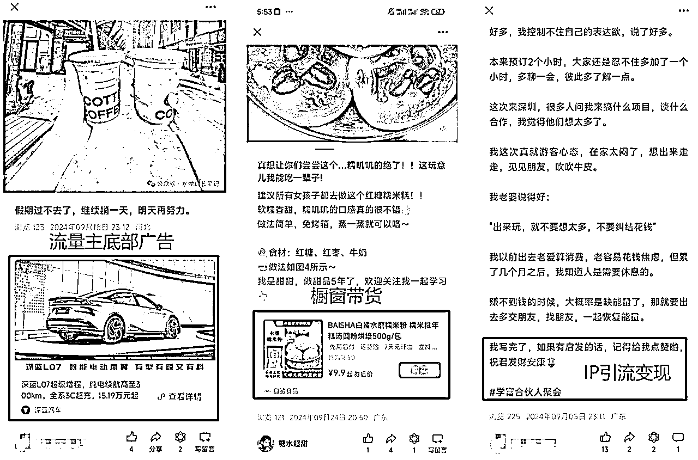

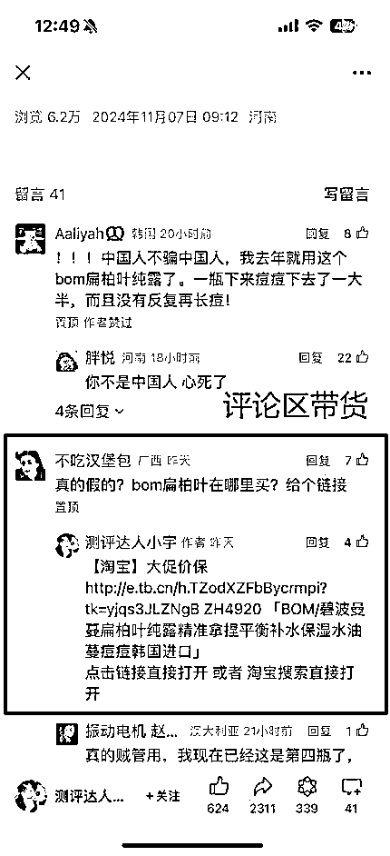

本期航海带大家主攻“橱窗带货玩法”。这套方法跑通后，再开流量主、做私域引流，也都能顺着复用。

# 1.2.2 小绿书带货的具体玩法

小绿书是👸号体系的新功能，天然继承公号的爆款逻辑。但公号内容能不能爆，多少带点玄学：有人日更一个月没动静，有人爆完之后又掉出推荐池。因此，新手建议至少准备2个账号。

从0到1的完整链路是：定赛道 → 建账号 → 开带货权限 → 选品 → 找参考 → 建参考库 → 做图文并发布 → 复盘迭代 → 成交。

日常操作里，最花精力的环节集中在四个地方：选品、找参考、搭素材库、产出带货图文。

第一件事：选品

选品的主阵地是视频号选品中心和🛰️小店。可以对照视频号热卖爆品、中老年热门赛道、📕带货爆品来试，原则是“实用+有特色+有新奇感”。品选得准，阅读量只有个位数也能开单。

第二件事：找参考

赛道选定后，去小绿书和📕里翻爆款，重点拆解小绿书上的参考账号和爆款内容。📕和小绿书的人群画像并不完全重合，直接照搬📕很难复制出爆款。

前期不要怕花时间，每天收集5到10个参考案例，整理数据，并关注这些账号，对方一更新你就能收到提醒。很多自媒体人做不下去，根本原因是缺选题、缺素材。只有保持每天刷参考，才能把握当下什么内容可能爆、什么品能出单，不让自己凭感觉乱跑。

第三件事：制作并发布带货图文

参考爆款但不照搬，尽量原创或二创图片和文案。文字量控制在10到500字之间，太长会影响卖货转化。

也别把AI工具和搬运当捷径。平台已经在打击劣质内容和搬运行为，真正能拉开差距的，还是自己产出内容的能力。

# 1.3 爆款与出单的底层逻辑

# 1.3.1 爆款逻辑：推荐机制怎么运转

小绿书的推荐机制基本沿用👸号爆文逻辑，核心是信息增量+情绪共鸣。落到具体操作上：

- 画面要干净：封面和主图清晰直接，单张图片最好只讲一个观点。
- 重点要突出：用特殊字体、字号、颜色把关键信息标出来。
- 内容要解决痛点：攻略、情感这类贴近日常的领域，更容易和人产生连接。
- 文案要碰痒点：图片、标题、正文尽量和生活、金钱、人性相关。
- 底线要守好：不能出现暴力导流、低俗色情、过度营销等违规内容。

👸号推荐机制的完整拆解，可看《9月航海 | 👸号爆文（自动化原创）| 实战手册》1.3节。

也要提醒：当前小绿书的推荐流量还不稳定，带有随机性。正确打法是广撒网、多发布、多测试，一旦跑出爆款，就集中资源加码。

# 1.3.2 出单逻辑：选品定成败

目前小绿书上卖得好的品类，集中在养生、宝妈育儿、图书、美食等方向，和视频号热门选品有不少重叠。选品的核心依然是实用+特色+猎奇，不建议无脑照搬📕爆款，要跟着👸号推流的方向走。

新手最省力的方法，是参考视频号爆款和小绿书上的优质账号来定品。

小绿书的带货成交还没有形成规模化，整体仍处在很早期。现在多尝试、多测品，反而是积累经验的好时机。

圈里还有一个未必准确的结论，供参考：流量主喜欢的内容定位，和带货喜欢的内容定位并不完全一样，不建议同时硬做，否则两边收益都会被拉低。更顺滑的做法是：先发一条不带商品链接的小绿书图文，等它爆了，再去评论区挂商品链接。

# 二、实操第一步：定赛道、学选品

# 💡

了解完项目整体，现在正式进入动手环节。第一步是选一条适合自己的赛道，同时把选品这门基本功掌握住。

小绿书带货对多数人来说，至少要日更一个月才会慢慢有流量，所以赛道一旦定下，不要轻易切换。

# 💡

本章航线图

学完并做完本章实操，即可完成航线图第一阶段：定好赛道，做好启动准备（约3-5天）。

1. 选1个带货赛道，确认账号定位（约30分钟）
2. 掌握选品思路和技巧，至少挑出2个品（约1天）

现在就可以开始准备了。

# 2.1 选赛道与账号定位

# 2.1.1 赛道怎么选

小绿书和👸号一样是长线项目，选一条适合自己的赛道非常关键。新手建议优先问自己：我对什么感兴趣？我擅长什么？

具体可以参考四条标准：

1. 和自己已有业务相关

如果你在做减脂、国学、美容，可以直接顺着业务延伸。不过有些类目天生很难拿到免费流量——行业卷得太狠，平台只会把曝光卖给付费广告；还有些类目接近灰黑产，比如祛痘、美容、玄学，平台重点打击，做不了。职场规划、学科资料、闲鱼电商这些正规方向，可以结合你的受众和产品端，搜关键词，逐步确立定位。

2. 做自己擅长的事

擅长往往和身份、兴趣、职业有关，比如历史、地理、讲故事、聊家庭。把核心优势找出来，内容支点就有了。

3. 做自己感兴趣的事

不感兴趣很难坚持，素材也攒不起来；感兴趣反而事半功倍。

4. 做足够细分的切口

别一上来就铺一个特别宏大的主题，今天聊这个明天聊那个，账号方向会散。正确做法是先把主题切细、人群切细，再把两者组合起来。

举个例子：上班族可以聚焦“快速做出一顿饭”，减肥人群可以聚焦“低脂健康餐”，宝妈可以聚焦“孩子爱吃的营养搭配”，美食号可以聚焦“地方特色小吃”。

# 2.1.2 账号定位怎么做

前期必须把定位想清楚：这个账号要做什么、垂类选题怎么规划。否则流量突然来了，你都不知道怎么把它变成钱。

美食、养生、家居、运动等方向都能做，但一定要垂直。某个方向先稳定更新半个月以上，才能看到初步结果。

过程中要主动复盘、找问题、及时调整，别每天用低质内容应付更新。👸号的逻辑在这里同样适用：内容质量决定能走多远，及时修正决定能跑多快。

# 2.2 热门赛道参考

以下是大家在测试中验证过、能拿到流量的赛道和品，供参考。新手可以先从养生、美食、读书这几个方向试水。

热门赛道分布

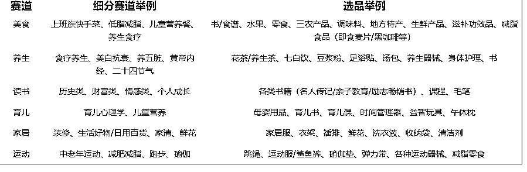

也有圈友在电脑端选品中心导出商品数据，做本地化分析后，得到下面这份排行：

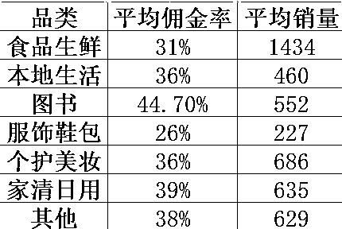

抓取的数据字段包括店铺名称、商品名称、商品价格、佣金金额、佣金比例、商品评分、评分等级和销量。分析结果显示：佣金率最高的是图书，销量最高的是食品生鲜。

再结合次幂数据的爆文类目，按小绿书爆款账号热度排序，排名前六的情况如下。小绿书15类热门账号和内容方向，也一并列在下面：

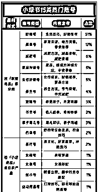

你可以综合以上信息，再结合个人兴趣和特长做决定。选定之后，坚持比什么都重要。

# 2.3 选品的方法

# 2.3.1 选品的核心逻辑

# 找参考，快速跟品

新手最顺的入门方式，是账号定位确定后，去小绿书和📕里找爆款参考账号，然后跟着选品。关键是“多刷”。（参考账号具体怎么找，见【4.1.1 怎么找对标】）

根据前期实验，选择下面这些领域，违规风险相对更低，数据也更容易做起来。

小绿书可选：娱乐、教育、情感、健康、家居、人文、历史、时尚、美食、搞笑、星座、旅游、摄影。
📕可选：教育、美食、穿搭、彩妆、影视、职场、情感、家居、游戏、旅行、健身。

如果还没想好要带什么品，可以打开📕官网，点搜索框下方的“领域”分类，直接看对应领域的帖子。比如你想卖书但不知道卖哪本，发现《遥远的救世主》热度很高，就可以拿它来试。

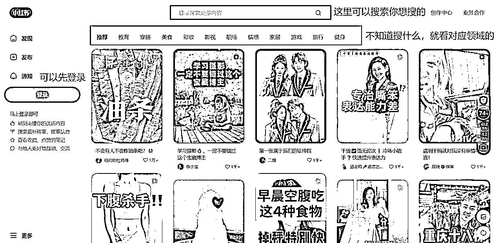

目前小绿书里好出单的品有个共同特点：复购率高、客单价低，价格多在100元以内，比如美食类的红薯、日用好物类的洗衣液。新手从这些常规品切入比较稳妥，再慢慢提升选品眼光，去挖那些兼具“实用、特色、猎奇”的差异化商品。

概括一下就是：复购高、客单低；价格可以多试9.9/19.9~59.9；卖点是性价比和差异化。

再来看几个容易起量的新奇特商品：图中这个品赢在“新奇”，用户很容易被吸引点击，满足猎奇心理，测试期间出了13单。

同样思路的还有这一款，主图和标题本身就足够抓眼球，因此带动流量爆发。

# 吃透选品的底层逻辑

怎么提升选品能力？多做爆款拆解，慢慢就能摸到规律。选品最核心的三要素是：人群、类目、价格。

落到🛰️生态里，选品逻辑是这样的：

先锁定想服务的那群人，再分析这群人的具体需求；需求清晰后，细分商品类目，用各种方法找出匹配度高的产品；最后做差异化选品，比如跳绳、插排、毛笔这类，主打一个“意料之外”。

还可以参考视频号带货的热门选品：

- 食品类：生鲜、地方特产、滋补功效品、俄罗斯食品、梨膏糖
- 书籍类：国学、健康养生、名人传记、婴幼儿绘本
- 服饰类：大码女装、头饰发饰、围巾丝巾、脚链
- 家居百货类：房屋防水材料、面条机、老花眼镜、定时提醒药盒、老人购物车、防走失用品、穿针器、拐杖、广场舞音响、老人收音机
- 绿植类：绿萝、绣球、兰花、营养液、营养土、种植铲、种植围栏
- 百货类：收纳盒、收纳柜、厨房好物、卫生间好物
- 美护类：洗发水、发膜、乳液、洗面奶、面膜
- 运动户外类：拉伸用品、运动汗巾、运动护腕、户外渔具鱼饵鱼钩
- 其他：老人手机、多功能护理床、三农工具

完整的视频号选品方法论，可参考《6月航海 | 视频号带货 | 实战手册》2.1选赛道到2.2选品章节。

# 2.3.2 选品操作流程

想在小绿书带货，第一步不是挑货，而是先把带货权限打开——具体操作看【3.4 开通带货功能】。

# 手机端怎么挑品

操作入口在手机视频号里：点开“管理橱窗”，进“去选品”，看中哪个就点“加橱窗”，完事。

挑品的思路有两条：要么先盯选品中心里的畅销款，再倒推去写匹配的内容；要么反过来，从当下热门的📕笔记里找货。不管走哪条路，都得守住一个底线——笔记和商品必须真正对口，能替读者解决某个具体问题，或者让他们觉得“这钱花得值”。

系统给的筛选项别浪费，按自己的账号方向圈定范围。挑的时候认准几个硬指标：好评率靠前、能七天无理由、卖得多、佣金可观、店铺分高。

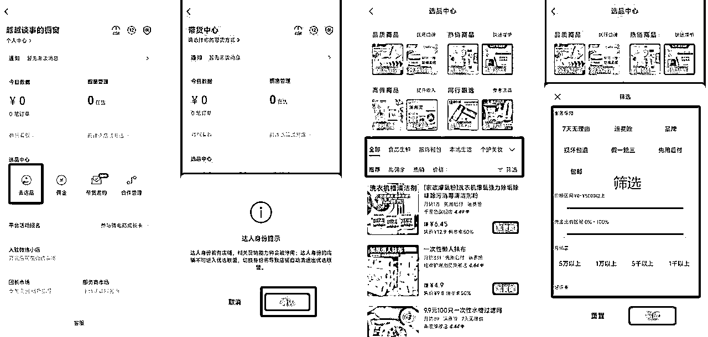

刚开始摸不清门道，最省事的办法就是顺着榜单挑：

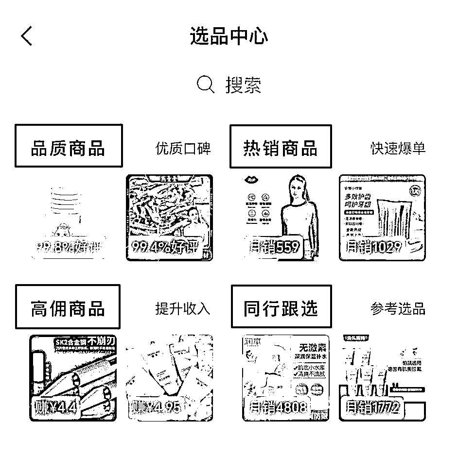

排在前面的类目，基本就是眼下走得动的方向，看中了直接加进橱窗：

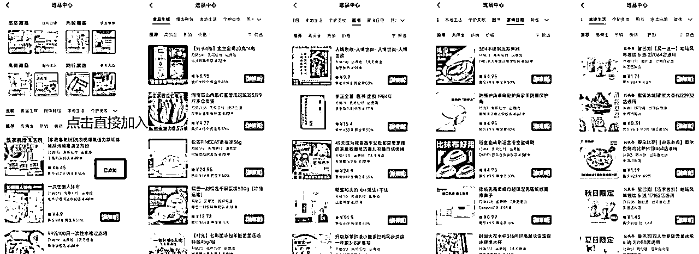

加完之后，日常维护和查看就在下面这个位置：

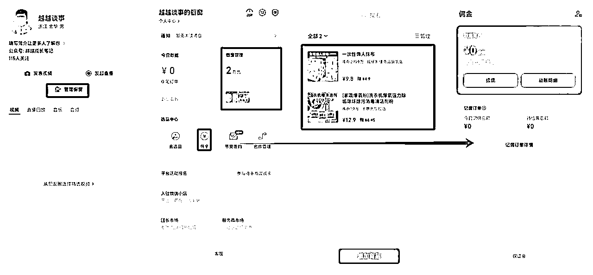

# 电脑端怎么挑品

换成电脑操作也简单：打开视频号助手，用已经具备带货资格的🛰️登录，进选品中心，按自己需要圈条件就行。

（视频号助手入口：https://channels.weixin.qq.com/login.html）

选品的底层逻辑没变——好评率高、支持七天无理由、销量大、佣金高、店铺评分好的商品，天然更容易跑出来。

选品中心本身就带条件筛选，像“高佣金优先”“七天无理由”“运费险”“品牌”“先用后付”“包邮”这些都能勾。

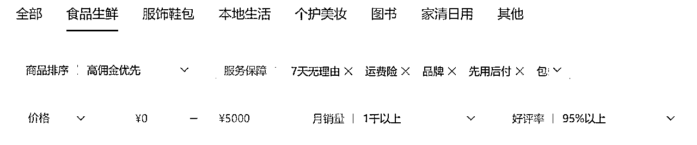

# 2.3.3 选品推荐

次幂数据给过一份爆文品类参考，照它来看，当下走得比较顺的选品大概是这样：

美妆这条线，跑量集中在名气不大的国货品牌，客单价均值在43元上下。

美食、家居百货这类下面的二级类目，暂时看不出特别集中的方向，跟着平台用户的偏好走就行，客单价均值约53元。

当然，你也可以自己动手拆对标、找感觉。

想找👸号对标号，有个小技巧：拿服务号已经被折叠的手机去搜，目前内测阶段主要是安卓设备能操作。

内容来源：小绿书如何写出多篇10w+、不到一个月赚到1万多？

# 2.3.4 选品避坑

挑品的时候，别只看商品本身，背后的商家底细也得摸一摸。碰上不靠谱的卖家，单子出了货却发不出来，那种滋味可不好受。稳妥的做法是挑销量大、评分好、店铺品类做得比较专的。

如果你手头本来就有信得过的货源，直接把对方的🛰️小店商品挂上去，或者搬进自己的🛰️小店，都行。

下面这几条，是🛰️平台上选品必须绕开的坑：

跟中医、医药沾边的品，一律别碰，这类目在哪个平台都是严管区；

低评分商家能躲就躲，这种店往往麻烦一堆，退款率高得吓人，出了单也是给平台打工；

好不容易看中一个品，选品中心里却没有？那就去找做后端店铺的人谈合作。

内容来源：小绿书带货万字精细化操作变现指南

# 三、【实操2/3】搭建至少 2 个👸号

# 💡

# 章节概要

动手之前，除了把赛道定下来，还有两件事得办妥：【准备账号＋开通带货权限】。

新手最好起至少 2 个号，说白了就是给自己留后路——流量这东西太看运气，单号跑不动的时候，不至于一下子就被打击到想放弃。

# 💡

# 本章航线图

把这节学完、练完，航线图的第一段就算走通了：赛道敲定、准备工作收尾（大概 3-5 天）

1. 至少搭好并包装 2 个👸号（约 30 分钟）

2. 把账号的带货功能开通（约 15 分钟）

行，那就动手准备吧。

# 3.1 注册👸号

注册之前先把账号定位想清楚（详见【2.1 选赛道&账号定位】），这一步不能省——注册时要填👸号名称，而个人号一年只有两次改名机会。

# 3.1.1 👸号类型怎么选

眼下👸号分三种：

1. 个人订阅号：个人身份就能开，一天能群发一次通知（发文次数不设限）；

2. 个人服务号（推荐）：10月底新放开的类型，同样是个人就能注册，一个月群发通知上限 4 次（发文次数不设限）；

3. 企业服务号：得有个体工商户或企业资质，一个月也是 4 次群发通知（发文次数不设限）。一个个体户能注册 2 个👸号（订阅号、服务号都行），一个人能办 5 张以上个体户营业执照；企业最多能注册 50 个👸号（两类都可以），不过每次只能提交 5-10 个，想多要得分批申请提额。

有句话得说在前头：不管你用什么主体、开的是哪类号，内容够硬就一定有流量。但要是奔着小绿书带货去的，服务号更值得选——服务号被折叠之后，推荐流会明显往小绿书那边偏。

所以对个人新手来说，个人服务号是比较推荐的选择。再加上 10 月底腾讯放开了个人开服务号的口子，这信号挺明显：平台在降门槛、拉更多人进场做小绿书，咱们顺着这个方向走就行；而且个人服务号不用任何资质认证，开通流程特别轻。

详见：🛰️服务号功能更新及介绍

# 3.1.2 身份证＋配套银行卡要备好

新手的话，两个👸号起步比较稳。

两个号的意义有两层：一层是分散违规风险；另一层是扛住不确定性——一个号迟迟不见流量，你手里还有另一个，不至于钻进自我怀疑的牛角尖。

这里有个硬规矩：一张身份证加上它对应的银行卡，只能注册一个👸号。

换句话说，个人身份只能开一个订阅号或个人服务号（个体工商户、企业或其他组织可以开 2 个；政府和媒体能开 50 个）。

要凑两个号，借家人的身份证来注册就行。

# 3.1.3 把注册走完

注册有两条路：

第一条：🛰️扫「服务号助手」小程序二维码

第二条：🛰️里直接搜「服务号助手」

实名验证：

个人服务号在几个节点上会要求实名验证，比如：

关注用户数到 1 万；

要开通带货、付费、赞赏、流量主这些功能时；

做账号迁移时。

建议注册完顺手就把实名验证做了，免得后面卡功能。

实名验证入口：登录🛰️公众平台 → 账号信息 → 账号详情 → 主体信息 → 详情，位置见下图。

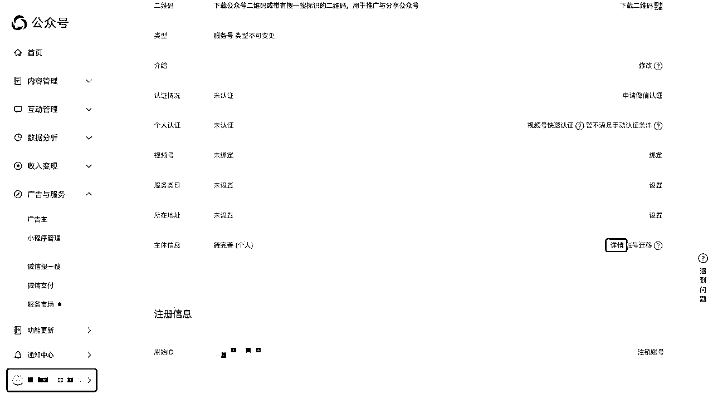

# 3.2 把账号门面装一装

👸号的包装可以照着现成的参考，📕上博主的昵称也能借鉴，其实不费事，主要就是两样：账号名称、简介。

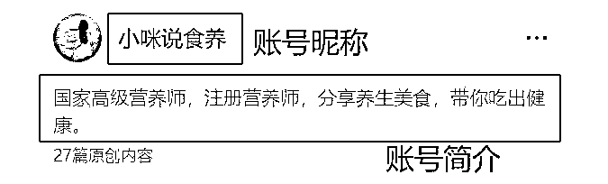

大多数新手做到一点就够了：名字好记，且跟自己做的领域对得上，简介同理。

要是你在这个赛道里已经扎了一阵子，账号包装还可以往👸号 SEO 上靠，不过这不在本次航海的重点里，这儿就不铺开了。

还有余力的圈友，可以去翻翻圈友 @郭耀天 写的这篇👸号 SEO：《最新👸号 SEO 核心玩法，自动引流躺着赚钱》

# 3.3 功能先摸熟

# 3.3.1 编辑页面走一遍

拿管理员🛰️扫码登录后台（后台地址 https://mp.weixin.qq.com/）

在首页找到“图片|文字”入口，点进去就是小绿书编辑页：

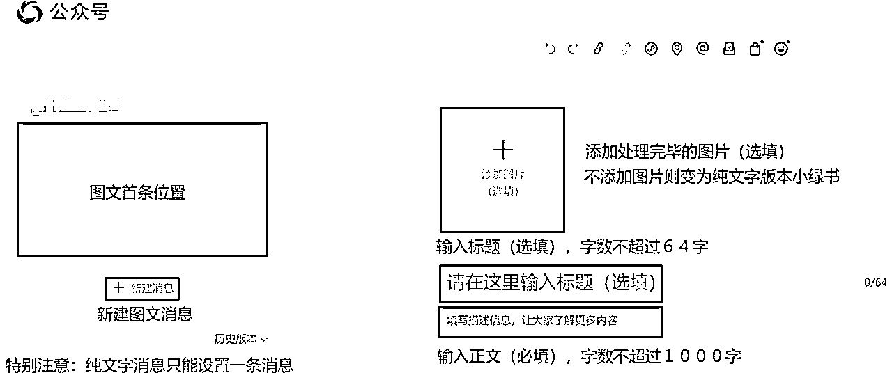

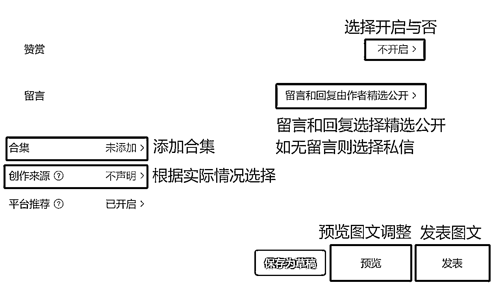

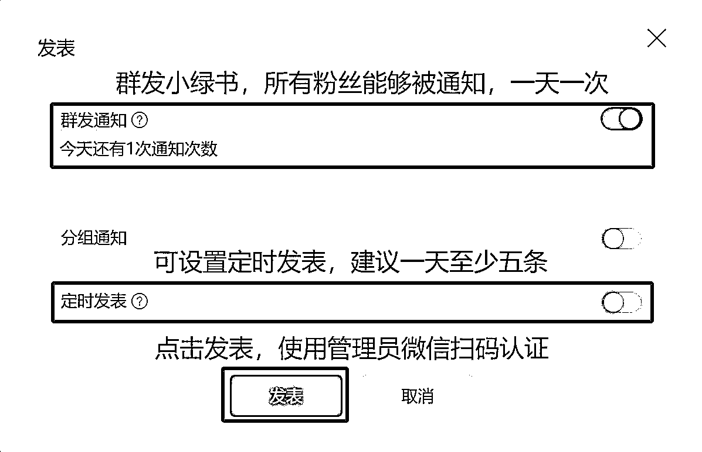

上面这些是小绿书发布内容的部分，下面进入细节操作，建议认真看。

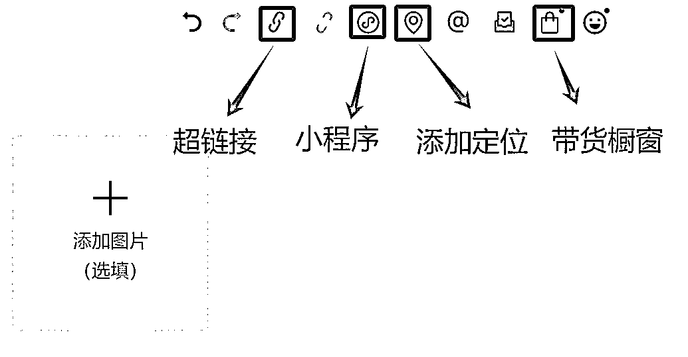

加超链接，这样操作：

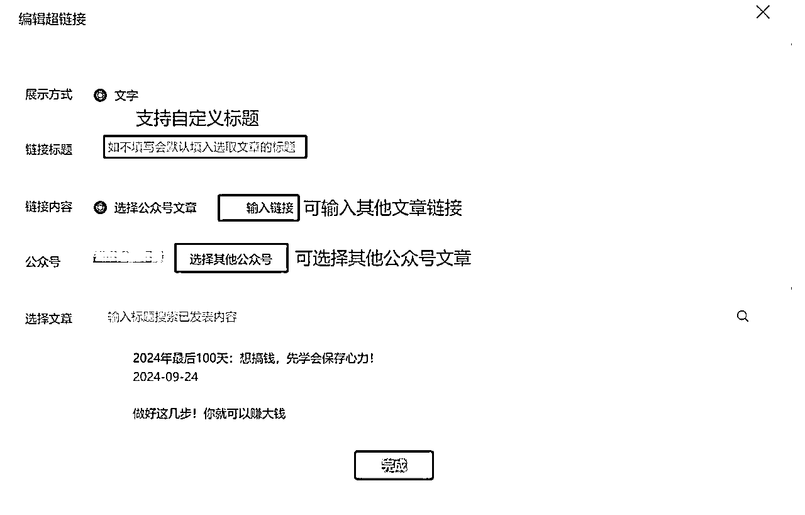

传图片和在线修图都支持多选：

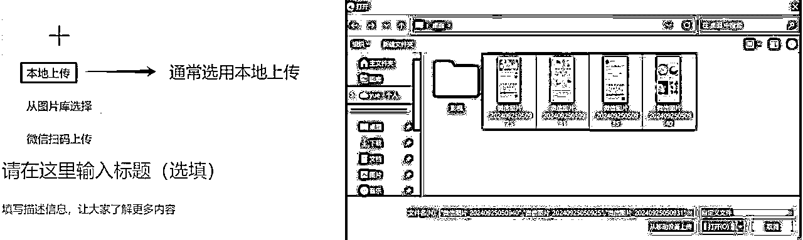

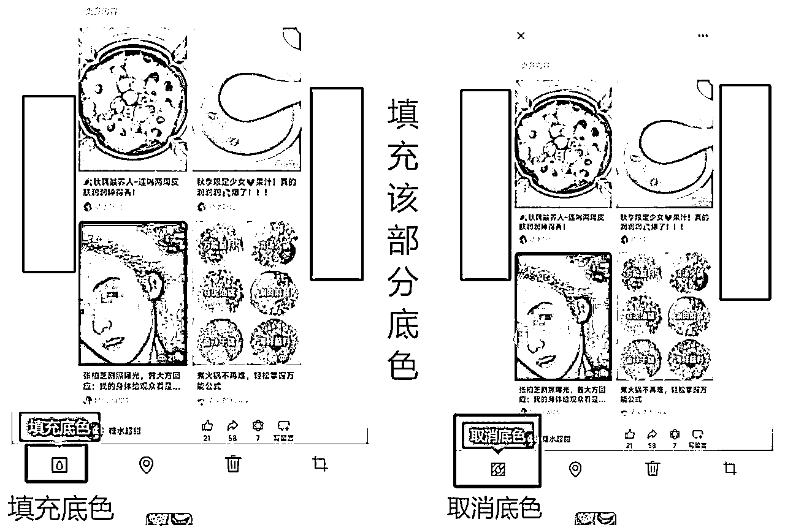

# 3.3.2 图片水印怎么用

🛰️公众平台上传图片时默认会带水印，目的是帮👸号更好地露出、多涨点粉。水印上显示的是👸号🛰️号 ID 或者昵称，显示哪种可以自己定，也能整个关掉。

设置路径：登录👸号，走【设置与开发】→【👸号设置】→【功能设置】→【图片水印】→【设置】

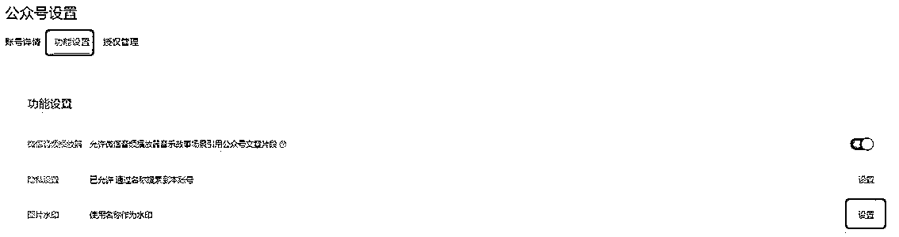

注意，图片得先传到服务器上才会带水印（也就是说要走“图片”按钮上传，见下图）。如果直接把复制来的图片粘进正文，水印是不会出现的。

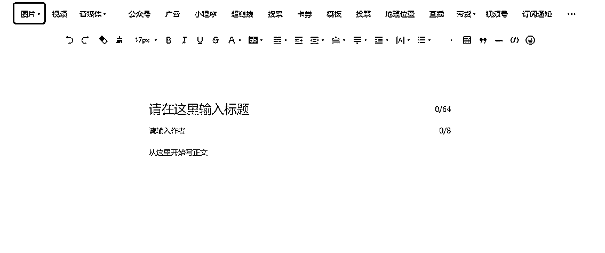

# 3.3.3 隐私设置怎么调

登录👸号后台，依次点【设置与开发】→【👸号设置】→【功能设置】→【隐私设置】，在隐私设置选项卡里点“设置”。

开启“禁止用户通过昵称搜到该账号”之后，粉丝照样能靠🛰️号或扫二维码找到你。

设置完大概半小时生效。

这一招主要是防同行摸过来。

内容来源：小绿书带货万字精细化操作变现指南@越越

# 3.4 开通带货功能

先聊聊开通小绿书达人带货能落什么好处：

店铺不用自己管，挑好品上架就完事。

售后和发货都不用你操心。

客服咨询不用接，质量也不用你把关。

多店铺商品都能上，手机端就能操作。

橱窗带货不看粉丝数，联盟带货则要求👸号有 100 基础粉丝。

背靠🛰️生态，资金、售后、服务都有兜底。

小绿书内容和带货商品可以捆在一起发，流量主收益和卖货佣金钱两头赚。

按🛰️官方的开通指引，得准备一个和👸号账号认证一致的管理员🛰️视频号（所谓认证管理员，就是👸号的注册主体，即👸号主体和视频号主体得是同一个人）。

所以开通达人带货，下面三个条件缺一不可：

注册一个🛰️视频号（跟👸号管理员用同一个🛰️）

把视频号橱窗功能开起来（需 ¥100 保证金）

视频号跟👸号做绑定

具体怎么走：

# 🛰️视频号注册认证

还没注册视频号的，按这个流程来：

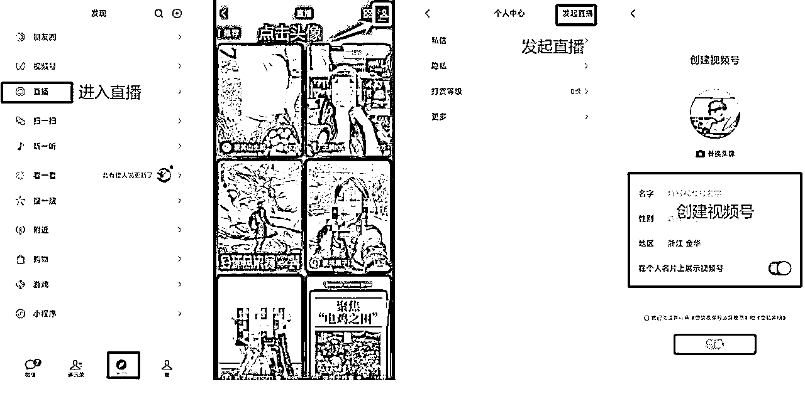

打开🛰️视频号：

把视频号实名认证做掉：

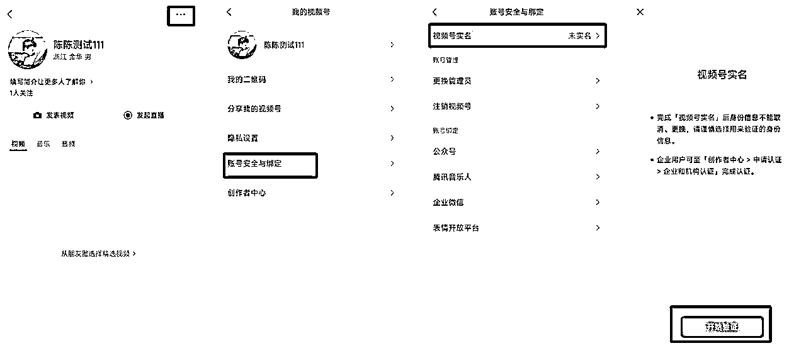

填写时按实际经营主体信息来，这份认证信息后面要用来校验提现账户，也就是说提现绑的银行卡主体得跟这里填的主体对得上，而且认证完信息就不支持改了。

一句话：收款账号的实名信息，必须和视频号认证主体保持一致。

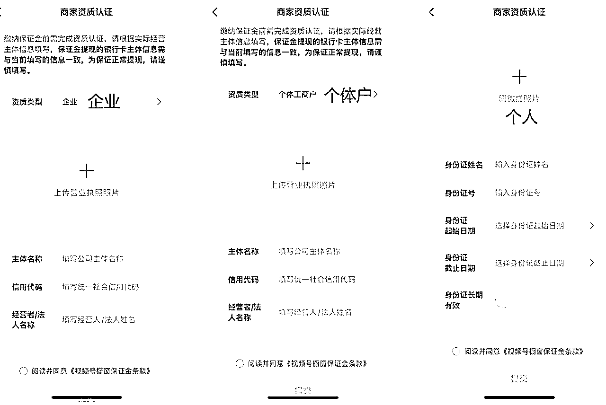

# 开通达人橱窗功能

先到👸号后台的“收入变现 - 带货”里，把联盟商品功能打开：

视频号橱窗带货本身不卡粉丝数，但联盟商品功能可能要求👸号粉丝超过 100

再去视频号的创作者中心，把达人橱窗开通：

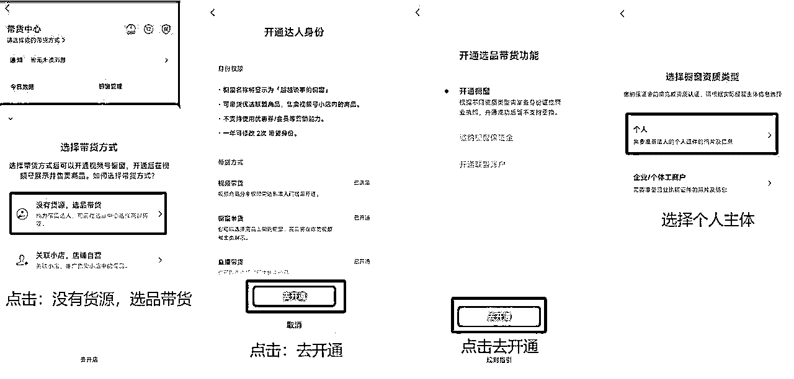

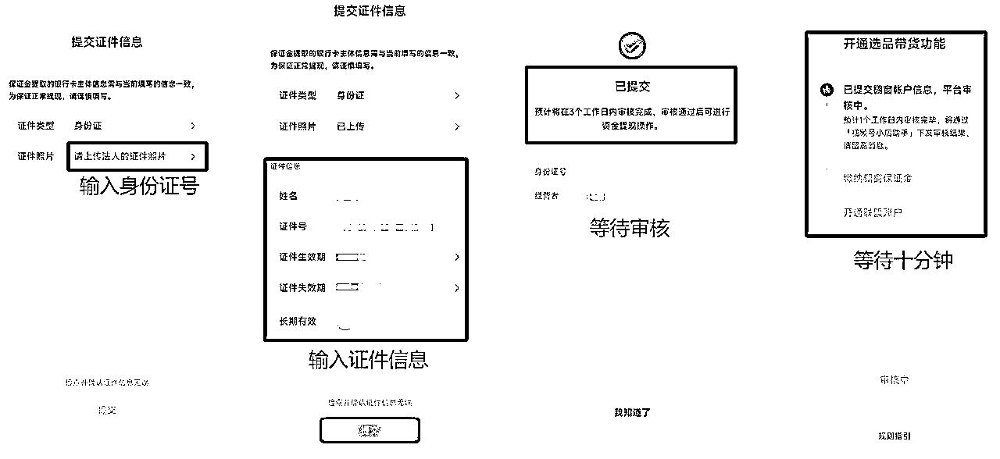

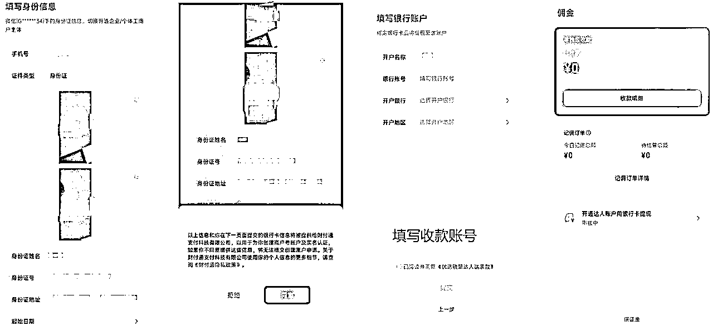

然后重新进选品中心，把橱窗开设流程走完。

联盟账户开好之后，可能会弹出一个粉丝数大于 100 的门槛要求。

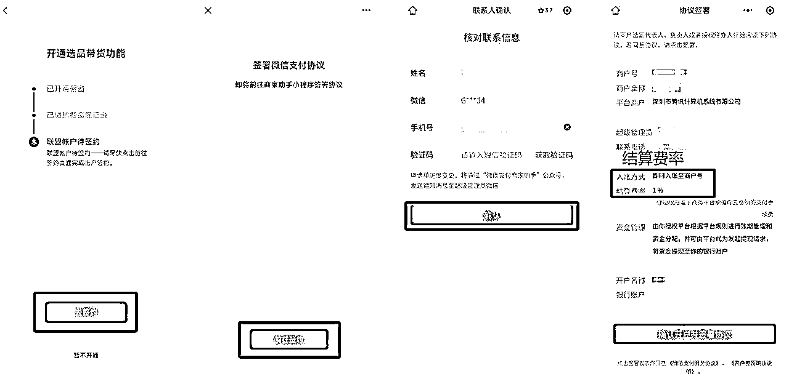

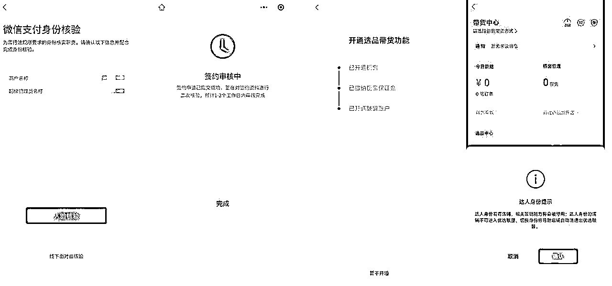

# 账号互绑

👸号和视频号要互相绑上，这里有几件事得特别注意：

绑定的👸号主体必须和视频号主体一致；视频号管理员可以换，一年有五次机会。

一个实名主体能注册两个视频号，前提是两个号对应的🛰️主体一致，也就是得用同一个身份证号注册。

换视频号管理员之前，先把所有资产结清。

绑好之后，就能按选品流程来：在选品中心挑品 → 在文章里插入商品小卡片开始带货。（选品详见【2.3.2 选品操作流程】）

内容来源：小绿书带货万字精细化操作变现指南@越越

# 四、【实操3/3】每天发布 ≥5 条带货图文

# 💡

# 章节概要

准备工作收尾，接下来就学怎么发带货图文。

新手记住三句话：

1. 日更还没撑满一个月，先别纠结流量，也别动不动就怀疑自己被限流。

2. 模仿是新手最快的上手方式，每天记得刷对标。

3. 对标素材库要持续攒，素材源源不断，日更才撑得住。

图文编辑本身不难，真正影响数据的是这三样：

标题

首图

选品

记住：先完成，再完美。作品要尽快发出去，然后再一点点打磨，前期数量比质量更要紧。

# 💡

# 本章航线图

把 3.1 这节学完练完，航线图第二阶段就能拿下：制作并发布带货图文（坚持 ≥1 个月）

1. 找到至少 1 个对标账号（约 0.5 小时）

2. 拆解至少 2 篇对标爆款图文（约 0.5 小时）

3. 按自己选的类目铺一个对标库（约 1-3 小时）

4. 照着对标爆款做二创，发出第一篇图文（约 20 分钟）

5. 借 AI 提效冲量，每天更 >5 篇图文（约 1 小时/天）

好，接下来就把你的第一篇图文做出来发出去~

# 4.1 找爆款对标

# 4.1.1 对标去哪儿找

📕和小绿书都是找对标的好地方。找到了就拿来二创，千万别照搬——平台已经在收拾那些直接搬运的低质内容和账号了。

📕这边怎么找：

目标：锁定低粉爆款账号。

可看类目：教育、美食、穿搭、彩妆、影视、职场、情感、家居、游戏、旅行、健身。

路子一：刷主页

1. 拿类目关键词在📕主页搜（比如“美食”）

2. 挑细分方向（比如“家常”）

3. 找近期发的爆款笔记（点赞过千）

4. 点进主页看看是不是低粉爆款，是的话就值得对标（粉丝量太高的爆款，参考价值反而打折）

5. 同一个类目坚持刷，刷久了主页会自动推这类的最新爆款

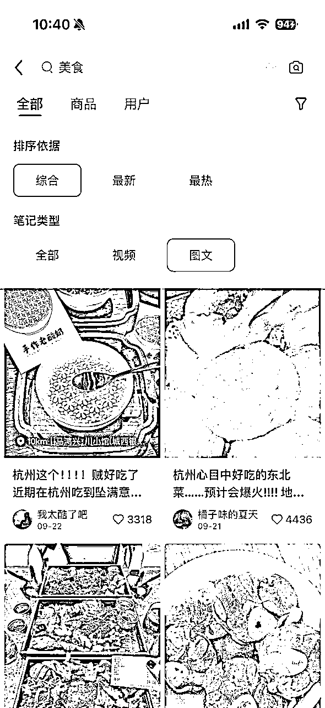

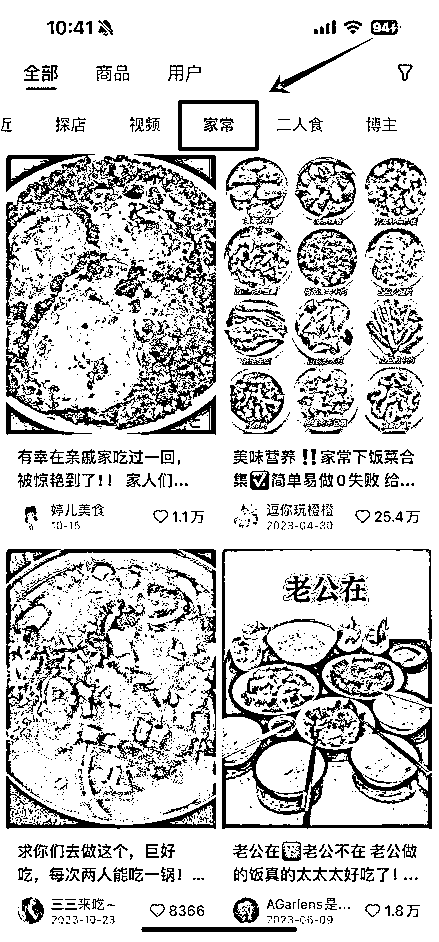

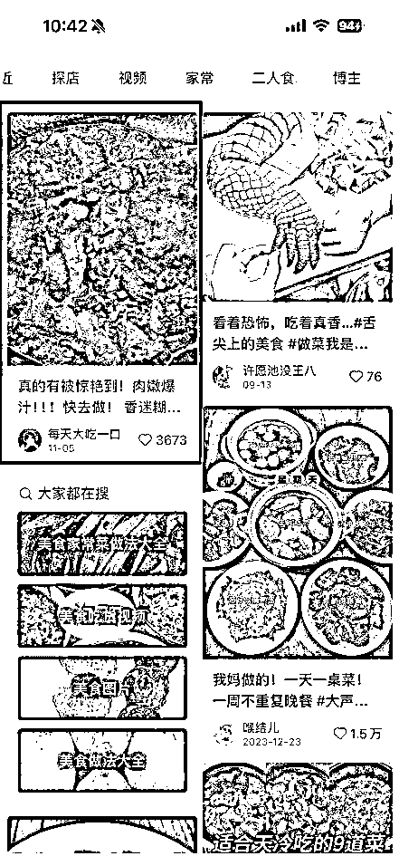

路子二：灰豚数据后台

笔记查找 → 笔记榜单 → 低粉爆文榜 → 美食 → 图文笔记 → 时间选近 24 小时 / 3 天 / 7 天都行。

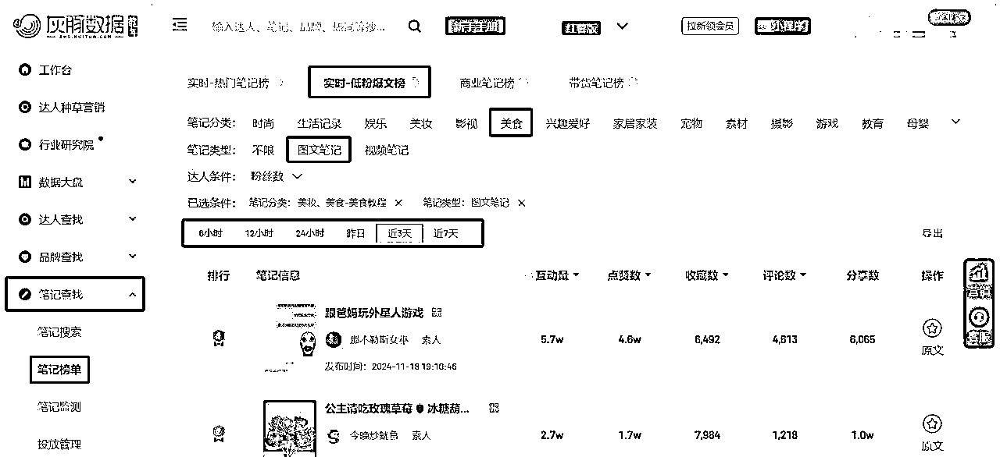

（灰豚要开会员才能用，效率比路子一高，看个人需求选）

小绿书这边怎么找：

目标一样：锁定低粉爆款账号。

可看类目：娱乐、教育、情感、健康、家居、人文、历史、时尚、美食、搞笑、星座、旅游、摄影。

路子一：刷推荐

1. 先把赛道定好，比如美食

2. 🛰️搜“美食”找一篇美食类小绿书，或者自己发一篇，点开往下滑，同类型内容会一串串冒出来 https://mp.weixin.qq.com/s/KzuNahlbDz_Dwz3FbukDRA

3. 挑右下角阅读量高的点进去，再看看这个号的其他内容。如果只有零星几篇数据特别好、大部分平平，那就是低粉爆款，可以对标

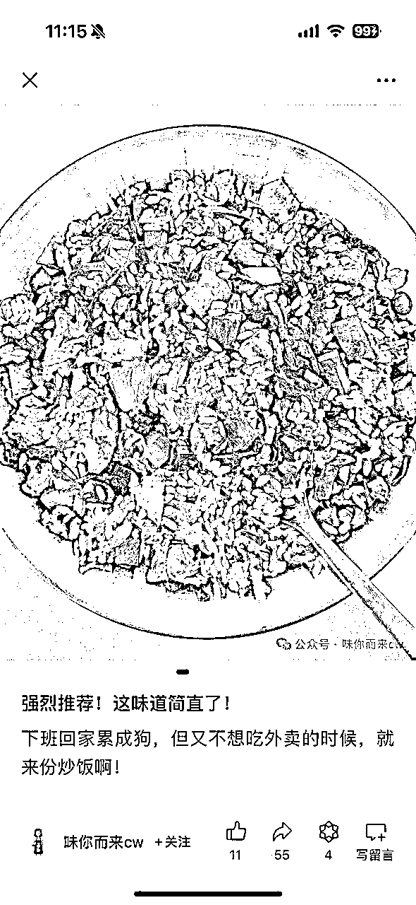

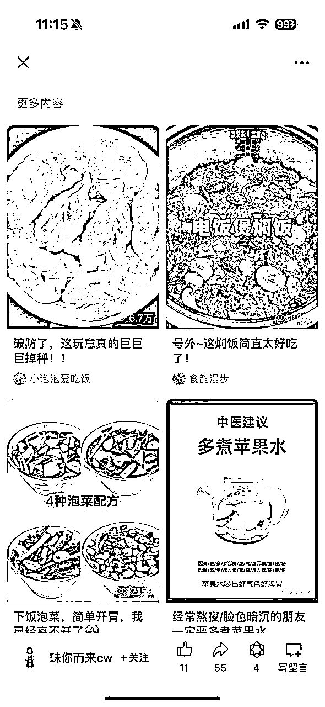

路子二：次幂数据后台

爆文素材 → 低粉爆文 → 领域选小绿书 → 账号注册时间和发布时间选就近。

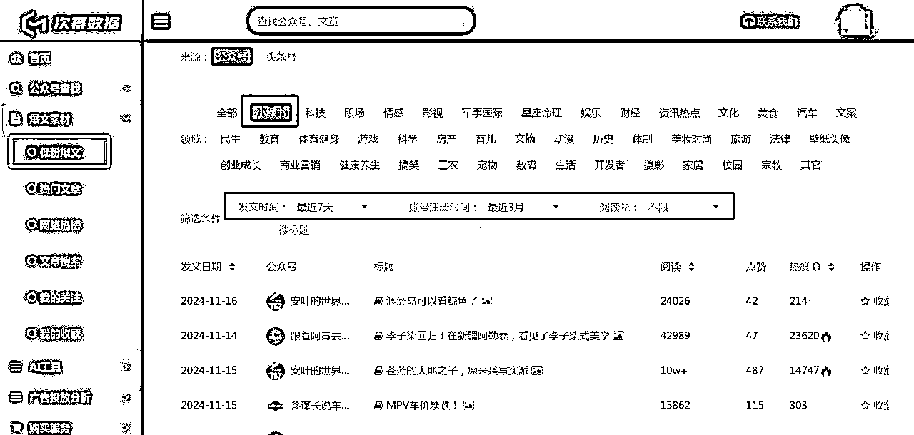

（次幂数据后台得买会员才能用，领域不能多选，也没有导出功能，看个人需求购买）

# 4.1.2 对标爆款怎么拆

小绿书能不能爆，关键看封面和标题，正文反倒排在后面。

# 封面拆解

高点击封面的核心诀窍是什么？

说白了就三条，总得占一条：美到让人挪不开眼、关键词一拳打在心上、或者勾起人强烈的好奇心。

另外，高点击封面还有个共性——素人感。别搞得像在卖货，要像真实用户随手一拍发出来的。有时候糙一点、拿表情包当封面，照样能火。总而言之，看着不像营销，像普通人在分享，就对了。

封面尺寸是 3:4，分无文字和有文字两种：

无文字封面

清晰度得高，颜色要跳，主题明确、跟标题对得上，图要么好看要么够奇特，能勾住好奇心（美食类基本就是放诱人的食物图）。

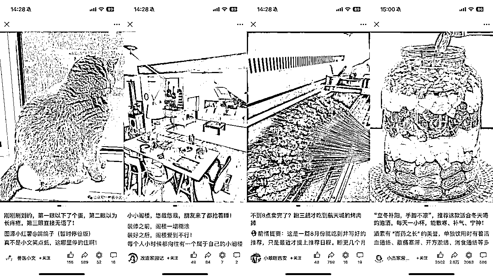

有文字封面

字要少，标题要简单，关键词得清楚，颜色要亮眼，字号要大，一张图里把话说完。

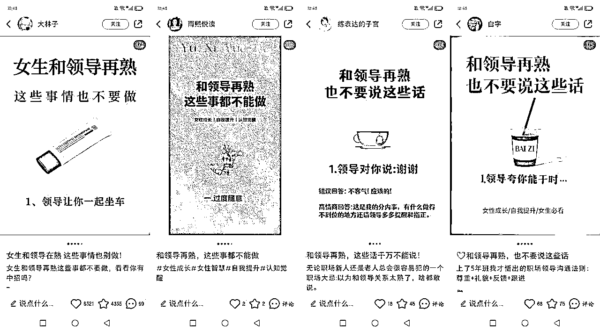

再上几个案例，感受一下：

书籍类：

1. 封面补标题的短板：标题讲的是总结性内容，封面把细节摆得更具体。

2. 给标题再加一层说服力。

3. 封面和标题可以套用那些已经爆过的、宽泛到大多数笔记都能用的文案。

产品-书籍《刚刚说过》

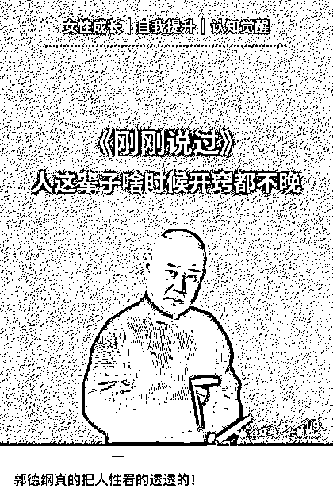

产品-书籍《人间小满》

养生类：

1. 封面补标题的短板：标题讲总结，封面摆具体。

2. 给标题再加一层说服力。

**3、封面标题：借爆款起量，别急着硬原创**

做小绿书，封面和标题不必从零硬憋。更省力的路径，是拿那些已经跑出数据、适用面又宽的现成模板来套——多数笔记能复用，试错成本低，起量也更顺。

前期可拿这些产品做内容测试：泡脚粉 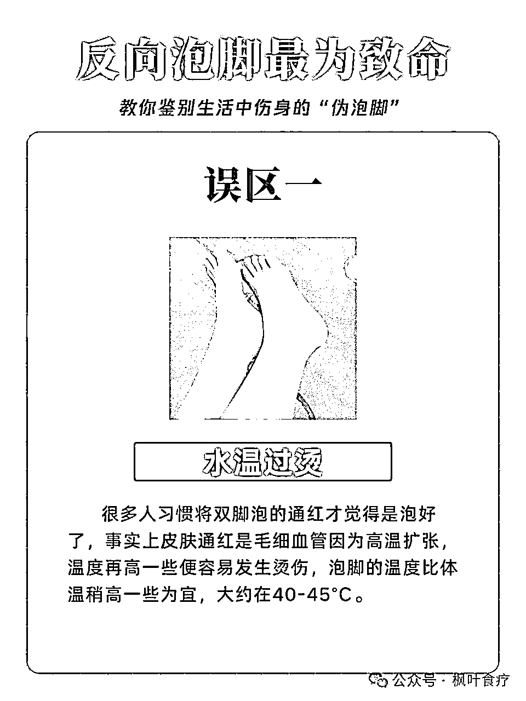；茉莉花茶 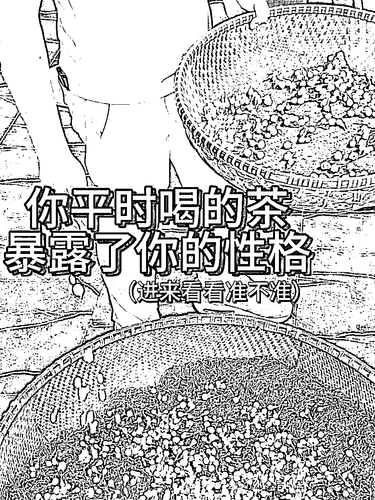；蒲公英菊花决明子茶 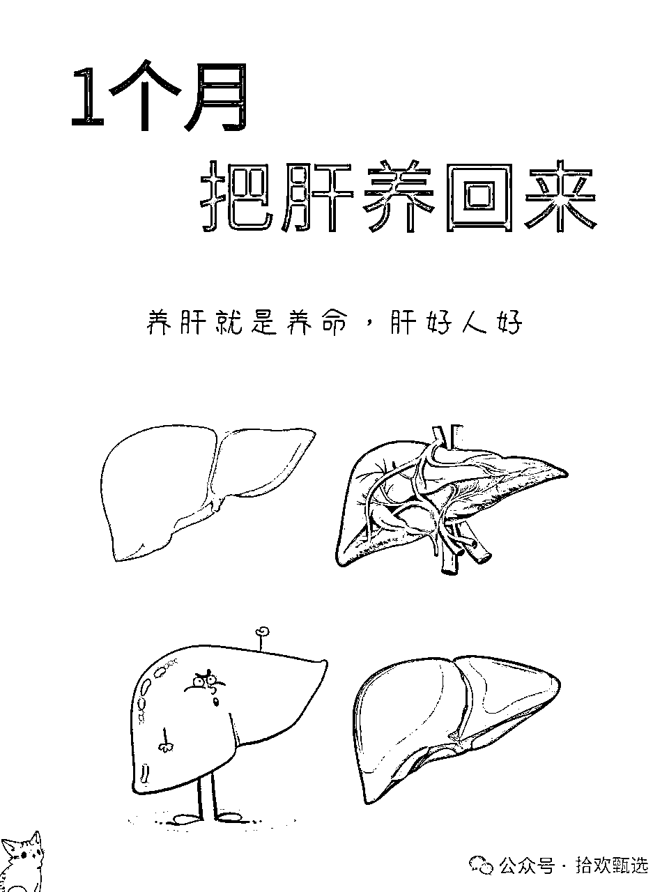；黄芪党参豆浆粉。美食内容则靠视觉取胜：首图要够馋人，画面不配字，用图片把点击率拉起来；可测黄油手抓饼 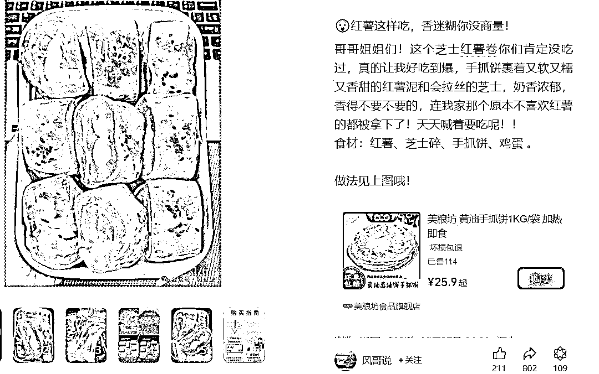、黑猪肉火腿 、红烧肉调味料 。

# 标题的拆法

一条标题能不能让人停下手指，通常取决于它有没有埋进这些钩子：性、金钱、权力、反差、悬念、对比、数字。

常用写法有两种：

**写法A：情绪＋目标人群＋技巧。** 先靠情绪制造冲击，再圈出人群，最后给方法。人越缺什么，越容易被什么吸引。书籍类可写“求求别再对孩子说‘你必须这样’”；美食类可写“讲真，女孩子要多吃这个，巨好吃”；养生类可写“懒的背后是虚，女生要会补气血”。

**写法B：问题＋结果＋解决方案。** 先抛一个带冲击力的问题，让人停下来想；再给结果和方案，但留一点悬念，勾人点开。书籍类如“如果觉得生活熬不下去，就读读这本书”；美食类如“冬天怎么少得了白菜？分享九款白菜做法”；养生类如“早上空腹喝水=吃细菌？这3种喝法真的伤身”。

换个赛道看，爆款标题的切口也各有偏好：文旅爱用“被低估、震撼、小众、免票古村、取景地、仙侠感、一篇攻略、朋友圈刷屏追问”；职场盯晋升真相、说话分寸、领导偏好、挣钱门路；美妆围绕明星新剧、暴汗妆、贵气感、港风、年龄层变美、普通人变美、去黄冷知识、抗老习惯；育儿围绕父亲参与、母亲性格、少吼孩子、陪读后悔、立规矩、夸出内驱力；影视围绕禁播、幕后布景、热剧细节、剧集对比、新剧预告、隐藏渣王；穿搭围绕35+、廉价感、经济下行消费、普通穿出高级、明星职场范本、40+连衣裙；美食围绕万能公式、掉秤、爸爸配方、女生学煮、地方烧烤、立秋少碰；成长情感围绕人性铁律、善待母亲、恋爱观、缺爱表现、治愈、掉价行为、自律管理；知识分享围绕名著金句、名家书单、行业区别、治愈内耗、姓氏起源；热点资讯围绕游戏取景、车企价格、运动员状态、社会事件。

把方法收成几句：

1. 穿搭和美妆标题直接标年龄层，更容易让精准人群对号入座；明星也是常用抓手。
2. 职场切口要够具体，越具体越容易引发共鸣。
3. 知识分享要么内容足够硬核、足够普适，要么借名人的力。
4. 影视类找爆剧，找别人没注意到的细节、切入点和观点。
5. 美食、运动类记住三个关键词：懒人、低脂、场景化。
6. 育儿类经典手法是制造恐惧。
7. 成长情感类的主旋律：自尊、自爱、自律、自信、自强、自愈。
8. 文旅类常用关键词：宝藏、震撼、小众、低估、震惊、崩塌、国家地理、朋友圈刷屏追问。

# 正文结构拆解

正文常见两种结构。

**结构一：先锁定人群，再搭场景，最后亮产品卖点。** 更适合书籍类。先找到目标人群的痛点——一个人越缺什么，就越会关注什么；再把他放进具体场景里，营造氛围和前提条件，需求自然被激发出来。

**结构二：先锁定人群，再给干货知识，最后亮产品卖点。** 更适合美食、减脂、护肤美妆类。这类内容要靠信息量提升可读性，让用户先拿到利益点，再理解产品卖点，最后产生购买动作。

几个示例可以这样拆：

讲人际交往的书，可从“总在沟通里吃亏”入手，把书比作解开关系难题的工具；另一本强调格局决定上限，认知外的钱留不住，格局靠后天修炼，位置决定做事方式。

减脂类里，紫薯内容先强调早餐重要，再给搭配图，提醒少碰高糖高热量，解释睡醒后需补能量、不吃会拖慢代谢，顺带说紫薯比红薯糖低。黄芪党参豆浆粉从“自然变瘦”切入，讲选食、习惯、小妙招和情绪，再落到适合熬夜面色差、手脚凉、气血弱的人，卖点是药食同源、无添加、补气血养颜、口感细滑。无绳跳绳用“间歇跳法跟练一个月变化大”开场，讲燃脂、心肺、代谢和坚持后的线条变化。

美食类里，盐焗粉用“巨好吃，快去做”开场，强调鸡腿做法简单干净，食材只有鸡腿，看图操作，同款挂链接。手抓饼打“十分钟早餐”，给葱花火腿鸡蛋软饼配方和面水比例，提醒下锅快速摊开、中小火、每张约两分钟，给孩子吃可换火腿。

养生类里，黄芪豆浆用“看手掌3秒测健康”开场，手掌红润状态好，苍白可能气血弱，伴随脸白、易累、手脚凉；引倪海厦观点，气血弱适合食补，早餐豆浆加黄芪粉，坚持气色改善；讲黄芪补气升阳、固表止汗、利水消肿，豆浆含蛋白质钙铁，搭配口感好；最后说自己当早餐吃，脸色红润、精力更足。

延伸参考：小绿书补充内容里，还拆过如何连续做出多篇10w+、不到一个月赚到1万多。

# 4.2 建一个对标资料库

选定赛道后，要养成找对标的习惯。前期多花时间，建议每天找大约5个账号＋10篇图文；记得关注对标账号，对方发文能收到通知。资料库模板可参考下图，再结合自己的实际情况调整。

小绿书变化很快，只有每天刷对标，才能及时掌握近期爆款内容和选品，知道什么样的内容可能爆、什么样的品能出单，不至于靠胡思乱想跑偏。

# 4.3 小绿书图文怎么编辑

小绿书图文在哪里编辑，不熟的朋友可以回看【3.3.1 编辑页面学习】，这里不重复。

# 4.3.1 标题怎么写出爆款感

最快的办法，是模仿爆款对标来写。参考【4.1.1 怎么找对标】找到对标后，再做改写。标题字数控制在24字内（含标点），让用户一眼知道是什么，感兴趣就会点进去；最后把多个爆款标题拆开、揉碎、重新组合，不必全部原创。

比如原标题“高情商的女人，从不因为别人感到焦虑”，可以这样改：换形容词，变成“聪明的女人”“高智商的女人”；换谓语，变成“高情商的女人，懂得断舍离”“高情商的女人，比谁都绝情”。

蹭流量也有小技巧：选题和标题能蹭热度就尽量蹭，自带流量的明星、名人、热点事件都能借力。比如减肥内容蹭贾玲、马思纯；养生内容蹭伊能静、曾黎、倪海厦。

# 4.3.2 封面图怎么做

图片里最重要的是封面。封面要让用户看到就想点，吸引力要足够强。快速处理方式是：找到爆款对标后做二创，但不要直接照搬；有能力的话，尽量原创。

**动作A：下载对标图片、去水印。** 一般去📕找对标，下载素材比较方便。工具可以用🛰️小程序【功夫去水印】【图片去水印助手】【清晰度增强】，看广告就能免费使用。以功夫去水印为例：复制笔记链接—解析—保存所有图片。

或者用电脑打开📕下载图片，也没有水印。

**动作B：修改图片MD5值。** 做自媒体的都知道，改MD5值能比较有效地避开平台原创审核。只加滤镜、贴纸、调亮度还不够，有些平台仍能查出来，因为图片MD5变化不大；保险起见，可以用工具批量处理，推荐龙猫工具大师，支持批量导入修改。

**动作C：二创去重。**  
1. 提升清晰度：用美图秀秀APP，或🛰️搜小程序“清晰度增强”。  
2. 裁剪：用手机自带功能。  
3. 加滤镜、加边框、加贴纸：用美图秀秀APP。

**动作D：换背景图，保险起见。**  
在醒图做一张纯色背景图，存成模板，再把搬运的图片导入。

还有一种1:1模仿作图的方式：先保存对标封面图，打开修图软件或PPT；把对标封面当底板，直接调整字体、大小和颜色，直到和对方一样；最后换上自己的背景色，一张“高仿”封面就做好了。这个方法适合简单封面设计，尤其适合账号刚起步阶段。

图片处理还有几个注意点：

4. 保证首图质量。清晰度一定要够，可以用美图秀秀、醒图拉一下清晰度，也能在一定程度上帮助去重。  
5. 带货图文可以在最后一张图加购买引导，因为很多人不会滑到文章最下面，比如这种：

6. 美食封面图要大、要满，颜色要饱和。  
7. 如果觉得单点不够爆，就写合集。单点就是某个单品，比如某款美食、某个星座、某个旅游地。  
8. 发布时封面图很关键，选图片比例时，记得选最吸引人的部分。

# 4.3.3 正文落笔思路

起步阶段，核心就是一个字：量。想保持稳定日更，同时又不把自己耗尽，前提是先拥有做爆款内容的基本功，再借AI把产出效率拉起来。目前圈内高频使用的辅助工具是 Kimi 和白瓜（https://baigua.com/apps/xiaohongshu-gaixie）。

# 玩法一：拿AI改写爆款笔记

把📕上表现不错的笔记全文复制下来，交给AI来做风格转换。参考提示词可以这样给：

这段话请换个口吻重新表达，配合加点emoji和分段，视觉上清爽一些，说话方式贴合30-40岁的女性用户：

“……”

再帮我仿写上面这段，要比原作更有张力、更懂人心、更接地气，读完让人心里痒痒的、有想拥有的感觉，但别出现“买”“下单”这类词：

“……”

等AI给到初稿后，再融入你自己的表达习惯，微调一下收尾。

# 玩法二：让AI从0到1生成文案

提示词示例一：

请帮我写一条跳绳的带货内容，从用户痛点切入，像减脂、瘦大腿、瘦腰都可以，字数控制在500内。

要求：
1. 开场用金句、小故事或痛点直击
2. 语气亲切，多为读者着想，讲人话
3. 给到能直接照做的实用建议，分点列出
4. 尽量有具体数字来支撑观点
5. 收尾用“我”的亲身体验来安利，引导大家下单，但措辞要像是为对方好
6. 别写空洞的大道理，痛点要戳得够疼，让人看完心里想“这说的不就是我”“你懂我”，觉得这篇值得收藏、有实操价值，继而产生购买念头

提示词示例二：

设定你是一位👸号带货作者，有5年写作带货积累，很擅长在👸号产出爆款文章、利他型干货，同时完成转化。

请围绕“……”这个主题，先拟一个标题，再写约300字的短文，做到简短有力度，带货方向指向“……”

要求：
1. 开头用一句简洁且有哲理的话切入，快速点题
2. 用一组形象的意象来对比，巧妙讲出“会说话”的分量，也为后面推荐书做铺垫
3. 把推荐理由讲透，直接点明这本书对提升相关能力有怎样的帮助，尤其针对某一类人群，指向性要足够强
4. 内容层次丰富，列举书的亮点以及对“我”的益处，让读者对书的内容有清晰认知，提升购买意愿
5. 用能唤起情感共鸣的描写，让读者体会到读完这本书自身的改变和底气，情绪被充分调动

# 去除AI味的提示词技巧

补实例：
问题：某段表述只有观点没有案例，难以让人信服。
指令：给这段加一个具体实例，让论证更有说服力。

删废话：
问题：内容里有多余或反复出现的句子，读着累。
指令：清理掉重复信息和不必要的表达，让文字干脆利落。

补充论据：
问题：某个观点支撑不够，显得力度不足。
指令：把该观点进一步展开，补上更多支撑材料，讲得更透。

加对照：
问题：内容只有单一视角，缺少张力。
指令：引入一个相反的观点来做对照，让讨论更有层次。

砍掉冗长开头：
问题：开头铺垫太多，读者容易划走。
指令：把开头压缩精简，让人更快进入核心内容，提升阅读意愿。

重排段落顺序：
问题：段落层级混乱，逻辑欠顺畅。
指令：按重要程度或时间线重新组织段落，让逻辑更通顺。

分段处理：
问题：大段文字叠在一起，信息过密，阅读体验差。
指令：把这个长段落拆成几个短段落，读起来更轻松。

增加小标题：
问题：内容板块多，找不到重点。
指令：为各部分加上小标题，让结构一目了然。

善用比喻和类比：
问题：表达过于直白，缺少形象感。
指令：在合适处加入比喻或类比，让内容更生动。

插入名言：
问题：论述缺少权威感，说服力不足。
指令：在恰当位置引用名言或经典语录，增强文章分量。

打造画面感：
问题：描述偏向抽象，读者脑海里难以成像。
指令：把描写变得更具体可视化，让人一看就能在脑中浮现画面。

增加读趣：
问题：内容偏向枯燥，读者容易走神。
指令：在适当位置加入有趣的细节或轻幽默，让阅读变得更有意思。

# ⚠️正文发布前，四点必须注意：
1. AI产出的内容务必人工过一遍，直接拿来用容易被系统识别，造成流量受限。
2. 发布前先走一遍敏感词检测，用“零克查词”处理一下，确保笔记顺利上线。
3. 正文篇幅建议控制在10-500字之间，太长会影响转化，很少人会划到最后。
4. 排版要分段、加表情，让读者看着不累。

内容来源：小绿书带货【实操手册】安七

# 4.3.4 卖点怎么写才有力

一条能真正变现的小绿书笔记，是“干货+商品”的融合体，不能只图阅读量而忽视成交。卖点设置必须与正文内容紧密相连，如果两者关联度弱，即便做到10w＋曝光，也很难换来订单。这里给大家一个“爆文+出单”的正文结构模板：

# 💡
开头：用金句/痛点/小故事来抓眼球
中间：输出实用干货
结尾：以“我”的视角真诚分享，或讲明产品能给你带来什么帮助

我们拆解一篇实际爆文（10月11日发布，获得9.3万阅读量）：

# 4.3.5 商品链接怎么挂

挂链接有两条路径：一是在正文中插入商品卡片；二是在评论区做引导成交。

之前主流做法是第一种，后来一些圈友发现带商品卡片的图文近期流量不太乐观，于是转向第二种——先做不带货的爆文，等笔记火了之后，再到评论区把购买入口放出来。平台机制随时会变化，建议大家都尝试看看。

第1种：正文带商品链接

结构上：正文+转化引导话术与表情+商品卡片

PC端操作：按【2.2.2 选品操作流程】完成选品后，进入👸号后台的图文发布页面→打开橱窗→选商品→插入正文。

移动端操作：装好“订阅号助手”，登录并绑定👸号，点击“图片|文字”→点“+”→点“商品”→选商品和卡片样式→发送预览→确认效果再发布。

第2种：评论区放商品链接

先把流量主爆文做起来，内容跑出热度后，再去评论区补上购买入口。商城里的产品基本都能卖，比如快团团帮卖的小程序链接、淘宝分销链接等都可以。

# 4.4 怎么安排发布

发布频率：
小绿书目前对发布条数没有限制，不过考虑到内容质量和平台风控，更建议每天至少发5条。写好的内容可以先存到手机APP“订阅号助手”，随时修改发布，也可以启用定时发送功能。千万别一口气连发，每条间隔最好保持在5分钟以上。

发布时段：
有圈友专门分析了近200篇爆款笔记的发布时间，整理如下：

核心高峰：15:00-15:30（重点盯住这个时段）
次高峰：9:00-10:30、11:00-11:30、15:30-18:00、20:00-21:30

发布留意：
如果你的账号是服务号，推送时可以不启用全员通知。服务号每月只有4次全员通知机会，建议留给真正重要的信息。

内容来源：小绿书如何写出多篇10w+、不到一个月赚到1万多？

# 五、【复盘优化】把爆量和出单一起拉高

# 💡
# 章节导读

更新一个月之后流量依然没有起色，不妨从下面几点做排查：

✅日更的数量够不够
✅封面有没有吸引点击的能力
✅完读率表现如何
✅读者停留时长是否理想

也有一些内容跑出热度却迟迟不出单的圈友，这部分会在本章节做专项检查。

# 💡
# 本章路线图

完成本章的学习与实操训练，就完成了整体路线图的第三阶段：复盘调优，增加曝光，向出单靠近（预计1小时）。

先复盘优化内容和选品，然后做变现尝试（约1小时）。已经日更满一个月的伙伴，现在就可以开始优化动作了。

# 5.1 阅读量始终是零或个位数？

流量迟迟起不来，通常绕不开以下原因，可以一个个对照优化：

# 发文数量还不到位
小绿书本身就是用数量对冲运气。如果连一个月（至少150篇）都没发满，先别急着焦虑，继续坚持发下去。

# 封面不够抓人，点开的人自然少
正常情况下，一个号在当前机制下能获得约100到200的初始曝光。但曝光高不等于点开率高，封面如果没吸引力，数据就会很惨淡。
比如下面这篇，初始曝光达到2000多，可点开只有22次（点击率0.81%），问题就出在封面不够吸睛。
这张图本身像素也不够，清晰度直接拖了后腿。

想学封面的优化思路，可以参考【4.1.2-1 封面拆解】。

# 完读率偏低
做过👸号爆文的人都知道，完读率是命门。小绿书同样看这个指标。
润宇老师指出：“它是图文，篇幅本来就不长，完读率基本要拉到40%—50%以上。”
怎么提升完读率？关键是控篇幅。如果只有一张图，正文尽量别超过800字，10-500字比较合适。
小绿书本质是图文而不是长文章，有人一写就停不下来，但真正能读完的人其实少得可怜。
还要提醒一个细节：有的作者为了推商品，在正文里塞了多张商品图，每隔两三段就弹出一个商品卡，这样很容易让人反感，效果适得其反。

# 平均停留时长上不去
出色的爆款笔记，平均停留时长大多能超过1分钟。
怎么把停留时间拉长？有个小技巧：在首图和其他图片右下角加上一句“向右滑，看更多精彩内容”之类的引导语，能推着人一直划下去。

把这些点做到位，接下来就要关注发布后的互动表现。📕的互动数据已经比较透明，小绿书虽然还没完全公开，但润宇老师给过一个参考公式：评论＞分享＞点赞＞在看。

内容来源：如何提高小绿书爆文出单概率？

# 5.2 内容火了却不出单？

遇到这种情况，先检查两个动作：
① 选品环节就没做好，没有按“实用＋特色＋猎奇”的标准筛选商品
② 产品与文案之间没有产生联结，卖点没能自然透出

先看选品。新手最快捷的方式，是参考那些已经被验证过的爆文品类来锁定货品，见【2.3.3 选品推荐】。想长期提升选品能力，可以翻看《6月航海 | 视频号带货 | 实战手册》第2.1节和第2.2节，里面有讲选赛道和选品的方法。

再看产品卖点。不少人直接套用👸号流量主爆文的写法，写完随手挂一个商品，这种基本很难有转化；还有一种情况是产品和内容的场景不一致，卖点都没落到纸面上，同样带不动下单。

来看个反面教材：
该作者选的产品本就缺乏热销基因，加上图文内容和商品使用场景几乎没有关联，卖点也没做任何刻画，用户读完完全没有想买的冲动。

再给一个正面的例子：
这位作者把产品信息巧妙地揉进了图文里，标题和正文都在点明卖点，定价也刚好落在合理区间，对有相关需求的人群来说，看到后很容易就做出下单决定。

# 5.3 让AI进一步帮你提效

AI存在的意义是帮创作者省时间、提效率，但不能让它替你做整个项目。只有先把爆款能力和出单方法吃透，再考虑用AI来放大产能。

具体实操可以对照越越、陈序员大康两位圈友分享的内容来练：

·《十款小绿书必备RPA工具操作合集》
·《借助AI+RPA实现小绿书图片一键生成自动发布，可矩阵（小白级详细讲解，附：影刀脚本）》

# 六、带货佣金去哪提现

在手机端进入创作者中心，就能看到数据看板。要注意，“今日数据”那里展示的是销售额，并不是你能拿到的实际佣金。

点进【带货中心】-【佣金】-【收款明细】，可以查阅待打款和已打款的记录；再点【订单详情】，能看到每一笔订单的状态以及佣金结算情况。佣金可以手动操作提现，但会收取1%的服务费。

在【带货中心】-【佣金】-【订单详情】里，也能看到所有带货订单的汇总，点开任意一单即可查看订单状态和结算状态。

最后，希望各位都能找准自己的赛道，跑通变现路径，把收益持续放大，一起龙哥盟！

