# AI 赋能 IP实战手册202503

# 防失联：MM188166M（李李）高频更新中，备用V:MG10127

本手册由龙哥盟团队出品。

使用说明：内容出品人不分先后。这份手册的价值，是帮你看到同一个项目的更多可能性，方便你理解和上手。

小贴士：想快速定位到具体内容，可按 Ctrl+F / Command+F 输入关键词搜索。

# 必修篇：项目0-1全流程

# 💡

必修篇要解决的，是把这个项目从0到1跑通一个最小MVP，也就是沿着“航线图”上的路径一步步落地。

如果你对AI+IP的应用还不熟，可以先在实操前了解下“零、AI赋能个人IP的大趋势”；如果已经有一定基础，就可以按以下顺序开始动手：一、准备AI工具；二、借助AI梳理个人定位；三、借助AI梳理产品；四、用AI提效内容创作。

必修篇的航线图与手册章节一一对应，按手册顺序学下来，就能逐个完成航线图上的任务。准备好了吗？我们正式开始。

本期航海项目的航线图如下：

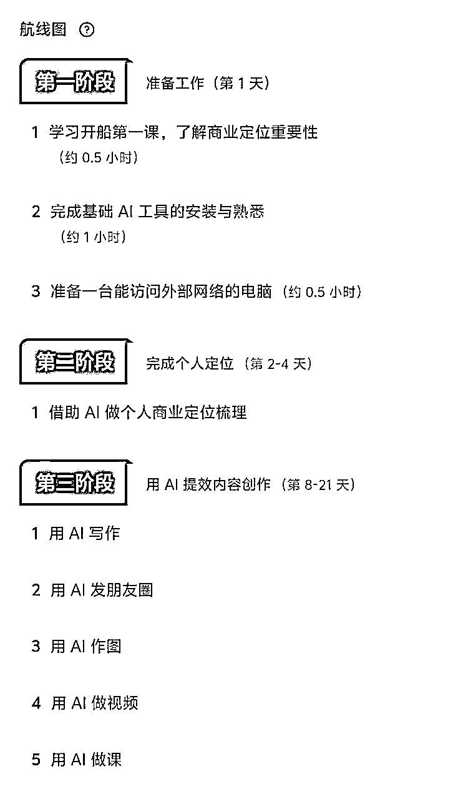

航线图和手册内容紧密绑定，你可以根据自己当前所在的环节，选择对应章节来学。

# 零、AI赋能个人IP的大趋势

# 💡

# 章节要点

AI技术正在重塑个人IP的内容生产方式。DeepSeek出圈之后，普通人做AI自媒体的门槛被大大拉低，AI给IP带来的赋能与提效也越发明显，内容产出效率可提升5到10倍。

这一章会用实际案例告诉大家，AI在自媒体行业里能怎么玩，帮大家建立对AI赋能IP的基本认知。

# 0.1 趋势：AI+IP为何是未来五年红利？

为什么2025年DeepSeek爆火之后，“AI+个人IP”会反复上热搜？为什么那么多IP孵化博主、商业博主都在喊AI+IP？说白了，DeepSeek R1推理模型的登场，把AI文案的水平从60分拉到了80分。只要运用得当，AI写出来的内容已经能胜过不少干了三五年编导的人。最要紧的是，它写出来的东西开始带着“灵魂”。今年过节时，我在📕不止一次刷到AI给困惑网友写的“安慰”，读完还挺触动。

除了DeepSeek，AI图像和视频的升级也让AI做IP这件事变得更可行。去年Flux模型火了以后，AI能生成以假乱真的真人照片，📕颜值区一度被AI内容占领。

AI工具能把内容创作效率抬高5到10倍，AI绘画和AI视频工具则能砍掉80%的制作时间。在知识付费领域，AI能快速搭出课程大纲、辅助产出课程内容，课程开发周期因此缩短50%。

当然，AI在各行各业的应用远不止这些。在这样的前提下，AI+个人IP自然成了一片新可能。

我们团队自己也在用AI写自媒体文案、做👸号内容，还让AI数字人出镜录制，节假日也能照常更新。

有人会疑惑：为什么我让AI写出来的东西总有一股“AI味”？这多半是因为缺少整体框架，提示词也没做优化——这些都是用AI时要避的坑。换句话说，学会AI不保证你能做成IP，但一定能让你做成IP的概率大增。

# 0.2 适用人群与典型场景

围绕个人IP，这里举几个例子，帮你感受一下AI怎么落地：

如果你是宝妈，可以做AI成语故事、AI睡前故事、AI英语启蒙、AI育儿科普、AI家庭教育、AI早教启蒙等方向；如果你是设计师，可以尝试AI室内设计、AI建筑设计、AI家具设计、AI服装设计、AI电商设计、AI创意设计类账号；如果你喜欢宠物，萌宠赛道受众很广，可以做拟人化萌宠视频，或者用AI模仿真人萌宠起号。此外还有疗愈赛道，用AI搭出疗愈场景，再配上治愈系音乐图文视频，等等。

# 0.3 真实案例

光说场景可能还是有点抽象，下面看几个真实账号案例。

AI做IP的变现路子各不相同，但归根结底不外乎流量变现、接商单、橱窗带货、收徒，再进阶一点就是做课程、做付费社群。

# AI壁纸号

账号示例：一可 AI 甜桃（📕）

用AI批量生成头像号、壁纸号。后续可以往AI+设计账号方向走，靠卖AI壁纸/AI头像的知识付费变现，或者接私单定制。

# AI养生图文号

账号示例：百岁老人培养计划（📕）

这种图文账号完全可以用AI复刻，文案由AI生成，封面也能搭工作流做出来。发展路径：成为养生博主，把流量引到私域卖养生产品，或提供养生计划定制服务。

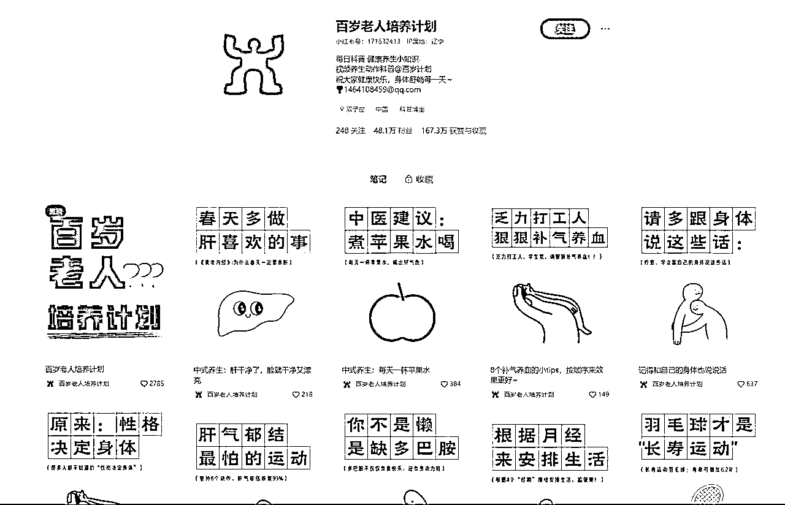

# AI穿搭账号

账号示例：每天都想穿新衣服（📕）

那种看起来像自然电梯摆拍的照片，用Flux模型就能生成；一些OOTD穿搭号还可以通过工作流加换脸来做。后续方向：当穿搭博主，开橱窗带同款衣服，或者收徒教别人用AI复刻这类账号。

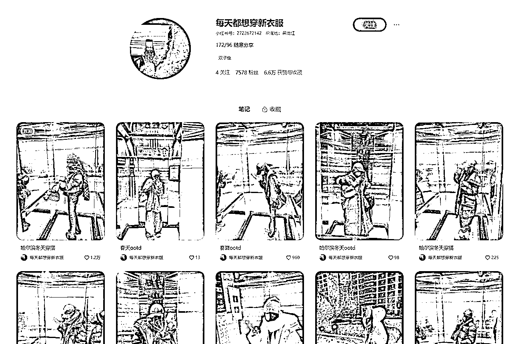

# AI励志治愈账号

账号示例：人间清醒柒奶奶（📕）

用AI生成文案和老奶奶形象，做一个治愈系成长账号。后期可以转向情感咨询，通过给年轻人解答困惑来变现。

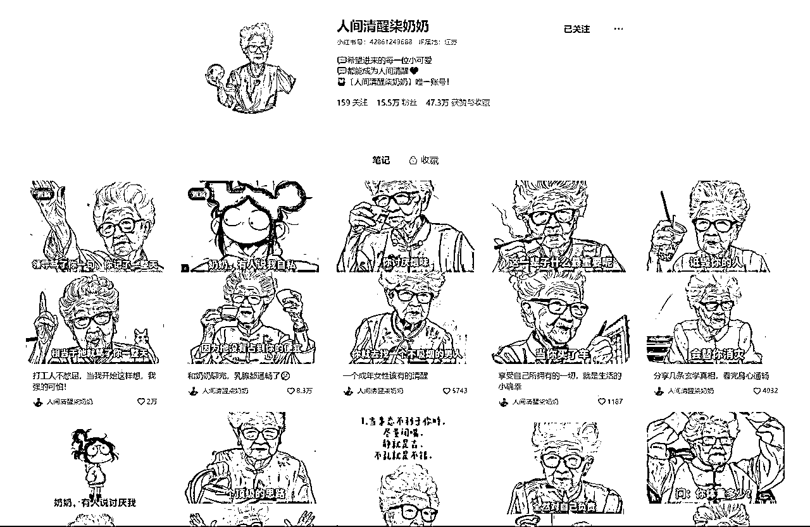

# AI英语教育号

账号示例：贝莉英语阅读（教学）· 📕

用AI生成图片、英语短文和朗读音频，就能撑起一个英语阅读号。发展路径：进入英语教育赛道，后端通过英语私教陪跑这类知识付费产品，教小朋友做英语阅读。

# AI创意设计账号

账号示例：布谷咕咕咕 BUGU（📕）

可以结合热点，比如哪吒，把热门IP套进各种场景，做出IP+火车头、IP+冰淇淋、IP+冰雕、IP+快闪店等一堆图。变现思路：走AI+设计师路线，接AI工具商单，跟品牌/IP联名做AI创意，也能开班收徒。

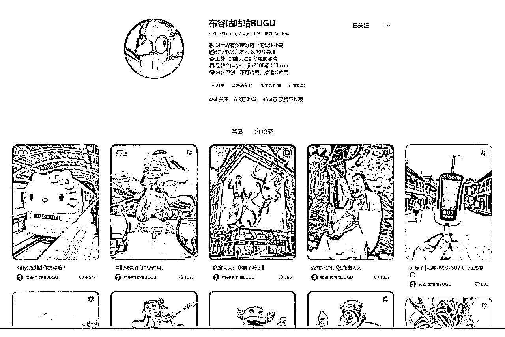

# 一、AI工具准备

# 💡

# 章节速览

看完AI怎么帮IP提效，接下来就要动手了。第一步，把工具备齐。

本阶段会用到的工具如下：DeepSeek（文案，免费）、Recraft（图片，免费）、即梦（图片和视频，付费/有试用）、Monica（文案/图片/视频，付费/有试用）。其中Monica需要🪜。新手可以先只用前三个，如果以后想进一步拔高文案质量，就会用到Claude，这个也需要🪜。

# 💡

# 本章对应的航线图任务

学完这一章并完成实操，你会解锁航线图的第一阶段：准备工作（第1天）。具体包括：学习开船第一课，理解商业定位的重要性，约半小时；安装并熟悉基础AI工具，约1小时；再准备一台能访问外部网络的电脑，约半小时。

下面这些工具既是本期航海会用的，也是自媒体人常用的，跟着提示装好即可。

# DeepSeek：文案助手（新手推荐，免费）

官网：https://www.deepseek.com/

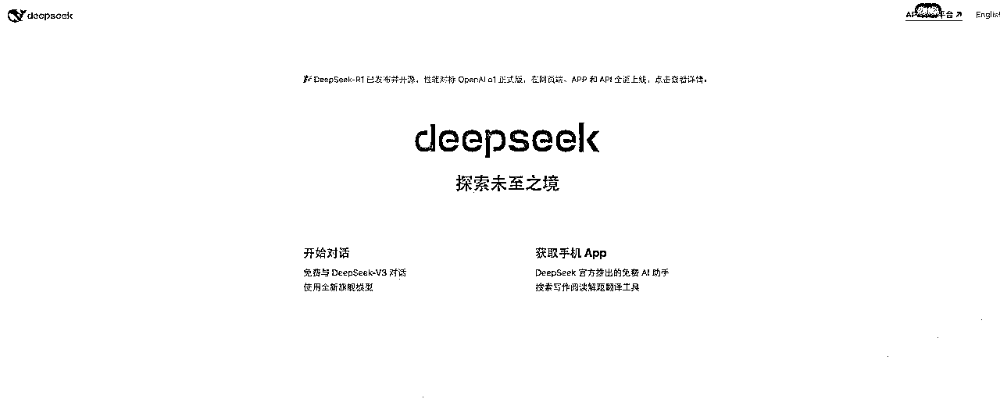

这款不用多说了。前期主要拿来写文章正文、短视频标题，用国内手机号就能注册，操作门槛很低。

# Claude：文案进阶推荐（需国外手机号）

官网：https://claude.ai/

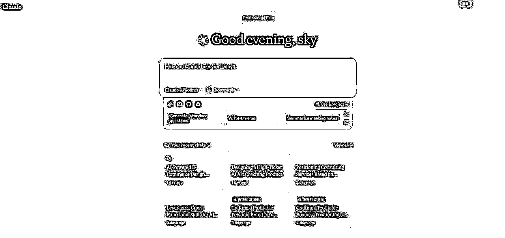

有条件的话，更推荐Claude，它的写作质量是国内工具比不了的。我们团队自己的自媒体内容也一直用Claude写。

不过注册环节比较折腾，得用谷歌浏览器，还要借助第三方接码平台。怕麻烦的话，前期完全可以拿DeepSeek当平替，等后面想冲击爆款了再换Claude。Claude虚拟码教程：https://sms-activate.guru/cn/info/freeprice

# Recraft：图片生成（免费）

官网：https://www.recraft.ai/

这是一款做图工具。和传统AI绘画软件相比，它能批量出图，画质也很能打，特别适合📕和👸号配图。注册很简单，国内邮箱就能搞定。批量做图的操作是这样的：先点Image set按钮，进入提示词页面。

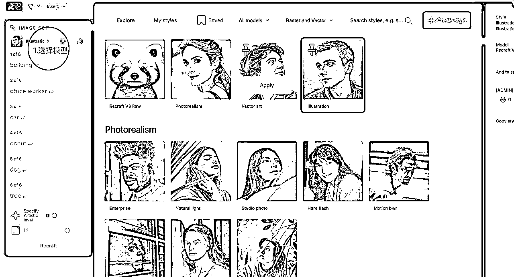

接着选一个喜欢的风格模型，👸号配图建议用插画模型，效果更好。

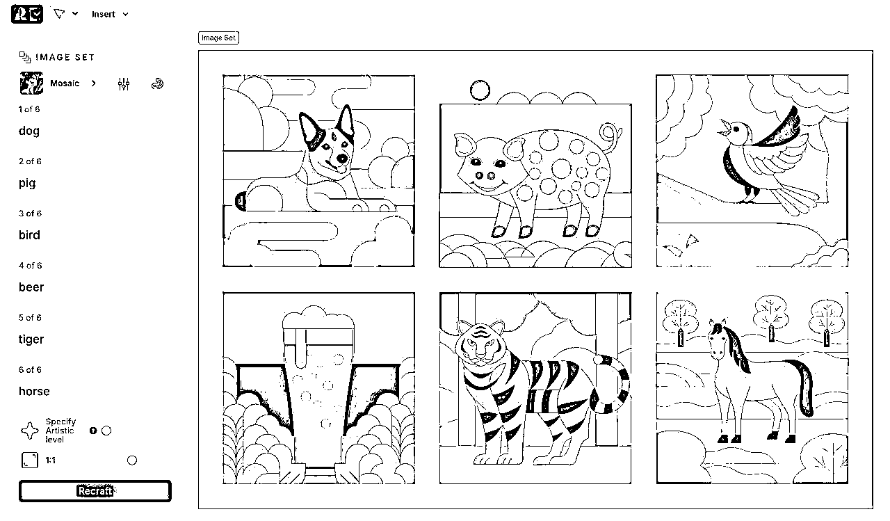

然后在左侧输入6个提示词，一次就能出6张预览图，效果相当惊艳。更细的用法和场景，后面直播里会展开讲。

# 即梦：图片+视频（付费/有试用）

官网：https://jimeng.jianying.com

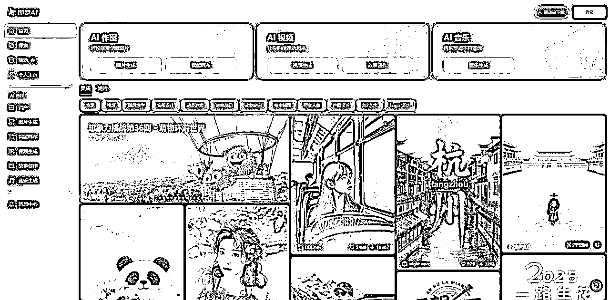

你只需提供一张图和一段音频，它就能生成动作与音频对得上的视频，风格保持得不错，手势崩坏的情况也少了很多。每天都能领免费积分，直接参考或复制其他人的提示词模板，能省下不少试错和生成次数，基本可以免费玩。

# Monica：全能AI集合（付费/有试用）

官网：https://monica.im/bots?tab=my（需🪜）

这是一款聚合型AI工具，里面接入了各大模型，支持手机、网页、本地多个客户端，刘润老师也推荐过，团队用起来很方便。前面提到的文案、图片、视频功能它基本都覆盖，如果你不想装一堆软件，直接上它就行。

# 二、用AI梳理个人定位

# 💡

# 章节要点

做个人IP，第一步永远是梳理定位。不管你现在有没有方向，都建议照着下面的流程，或跟着航海教练直播重新捋一遍，至少认真花1小时来思考。要提醒的是，定位这一步AI的参与度其实不高，别过度依赖它，AI在这里只是参考工具。

# 💡

# 本章对应的航线图任务

学完本章并完成实操，你将完成航线图第二阶段：个人定位（第2-4天），核心就是借助AI做一次个人商业定位梳理。

# 2.1 个人定位怎么做

# 2.1.1 想清楚自己的优势与兴趣

想创业，先找到那个高价值的定位。你可以从四个维度来拆：兴趣领域，也就是你真正热爱的业务方向或行业；内驱动力，是那种让你熬夜也不觉得累、愿意持续投入的劲儿；成果证明，是你过去拿下的成功经验或成绩，无论大小；核心能力，则是别人常来找你帮忙的领域，也就是你的差异化技能。这四个维度的交集，往往就是最有战略价值的定位。定位清晰就像创业路上的指南针：资源不够时，你知道劲儿该往哪使；竞争激烈时，你知道怎么打出差异化；市场变化时，你能守住核心而不是盲目跟风；决策困难时，你有明确的取舍标准。反之，没有定位的创业就像没有目的地的航行，再努力也难到彼岸。

那具体怎么落地？四步走。

第一步，做一次战略资产盘点。拿出纸笔，诚实地写下：我真正喜欢做什么？做什么事会让我觉得时间过得飞快？就算不赚钱，我也愿意长期投入什么？过去我在哪些事上拿过结果？朋友、同事或客户经常因为什么问题来找我？我又解决过哪些别人搞不定的问题？别急着下结论，先把自己手里的牌看清楚。

第二步，找战略交叉点。把第一步收集到的信息可视化，看哪些区域是重叠的：有哪些领域同时能勾起你的兴趣和内驱力？在这些领域里，你已经有了哪些被验证过的成果？你的核心能力能不能跟这些领域匹配上？交叉点越多，定位的潜力通常越大。但要记住，最好的定位不一定是最显眼的那个，而是差异化竞争力最强的那组组合。

第三步，放到市场里去验证。定位再漂亮，也得经得起市场检验。你可以设计一个小规模测试，先给5-10个潜在客户提供服务；然后收回直接反馈——他们愿意为这个价值付费吗？再看看竞争格局——在这条定位上，你比对手强在哪儿？最后评估增长空间——这个定位能不能支撑你长期走下去？根据验证结果，不断调整你的定位表述和价值主张。

第四步，建立动态调整机制。定位不是一锤子买卖，最好搭一个定期评估体系：每季度回顾一下市场反馈是否还支持当前定位；每半年检查核心能力有没有变强；每年评估定位要不要升级或转型；同时持续学习，盯住行业趋势和客户需求的变化。真正成功的创业者，都懂得在大方向不变的前提下，灵活调整打法。

找到定位只是起点，执行同样重要。你需要把80%的时间和精力押在跟定位直接相关的核心活动上；持续加深你在这个领域的专业积累和人脉；用一句简洁有力的话说清你的定位和价值主张；并通过客户反馈和市场数据，反复检验定位是否仍然有效。

创业是场长跑。对的定位不只是帮你赢在起跑线，更能让你在漫长的路上始终有方向、有动力。最有价值的定位从来不是抄别人，而是找到那个只有你能站住的独特位置——在那里，热情、能力、市场需求三者刚好重合，形成别人难以复制的优势。

如果你现在还是觉得定位模糊，也不用急，跟着手册继续往下想，把对应答案写下来，定位会一点点清晰起来。

# 2.1.2 盘点你的身份与标签

问过自己吗？你身上到底有哪些身份和标签？别小看这个问题，理清身份标签，本质上是在挖掘你独特的能力价值。可能你会想：“我一个普通人，有什么特别的？”不对，每个人都是多面体。你也许是某个领域的专业人士，也许是某个爱好的资深玩家，可能有特殊的经历，也可能掌握着独特的技能组合。这些看起来普通的标签，其实就是你能力价值的富矿。

拿出纸笔，试着写全自己的所有身份：职业身份、兴趣身份、经历身份……越具体越好。比如，不要只说“程序员”，而是“有5年电商后端开发经验的Python工程师”；不要只说“妈妈”，而是“养育过敏体质孩子的全职妈妈”。当你真正看清这些标签，会惊讶地发现：原来自己能帮到这么多人、解决这么多问题！

# 2.1.3 你的经历有何不同

你有哪些和别人不太一样的经历？这个问题值得每个人都认真想一想。回头看看自己走过的路，那些看似稀松平常的经历，可能恰恰是你最独特的价值所在。也许你在国外生活过，体会过文化碰撞；也许你转过行，攒下跨领域知识；也许你扛过不小的挫折，练出了超乎常人的韧性；也许你生长在特殊的家庭背景里，因此有了独特的看问题视角。这些经历塑造了现在的你，也是你能力价值的来源。

意识到这些经历后，很多被忽略的能力会浮现出来。比如，照顾生病亲人的经历让你比别人更有同理心；独自旅行让你更擅长解决问题；创业失败的教训让你沉淀出宝贵的商业洞察。所以，别轻视任何一段经历，它们都是你独特价值的一部分。花点时间回想一下那些不寻常的经历吧，你会发现自己其实拥有那么多别人复制不了的能力与价值。找到独特之处，才能真正把价值最大化。

# 2.1.4 听听朋友怎么评价你

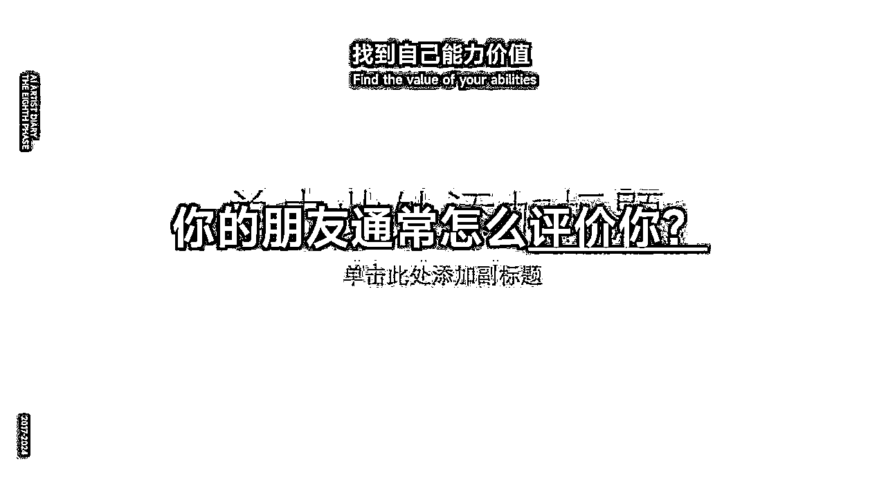

你的朋友一般怎么评价你？这个问题挺有意思，因为别人眼中的我们，往往和自己以为的不太一样。朋友就像一面特殊的镜子，能照出你压根没注意到的特质和能力。我们常常太习惯自己的优点，反而看不见，可这些特质在朋友眼里却非常显眼。也许他们会说你特别靠谱，关键时候靠得住；也许觉得你点子多，总能冒出不一样的想法；也许认为你很会共情，总能第一时间察觉别人情绪的变化。这些评价并不是客套，而是你真实能力的折射。有趣的是，我们总低估这些特质，觉得“这有什么特别的？”，可恰恰是这些被你当成平常的东西，构成了你独特的能力价值。所以，与其瞎猜，不如直接去问身边的朋友，在他们眼里你是什么样的人。你可能会意外发现，自己在某些方面竟然这么出色，而这正是你能为别人创造价值的地方。想找到自己的能力价值，有时就从了解别人眼中的自己开始。

# 2.1.5 你对什么好奇、感兴趣

你对什么感到好奇，又对什么真正感兴趣？这个问题听起来简单，却能照见你内心深处的能力价值。

那些让你忘掉时间的事，常常就是天赋留给你的暗号。一头扎进某个话题或某件活儿，回过神来天都黑了——那种浑然忘我的劲头，正是你天然顺手的领域。

有人对技术风向格外上心，新软件刚冒头就想装上试试；有人天生对气氛敏感，别人脸上掠过的一丝异样，他立刻就能接住；有人偏爱用画笔或旋律说话，情绪总要找个出口才舒坦；有人面对一摊乱麻般的数据反而来劲，越理越有滋味。

这些偏好不是消遣，而是本事的矿脉。偏偏我们常把这份热乎劲当成"人人都这样"，随手搁在一边。可你愿意往里投的心力、你会盯住的那些细节，恰恰是与旁人拉开距离的地方。所以，别急着给自己的爱好打折，它可能正是你手里最值钱的那张牌。

停一停，问问自己：什么能让你忘了吃饭？什么一开口就收不住？顺着这两个答案往回找，本事的价值就藏在那儿。

# 2.1.6 时间流向哪里，本事就长在哪里

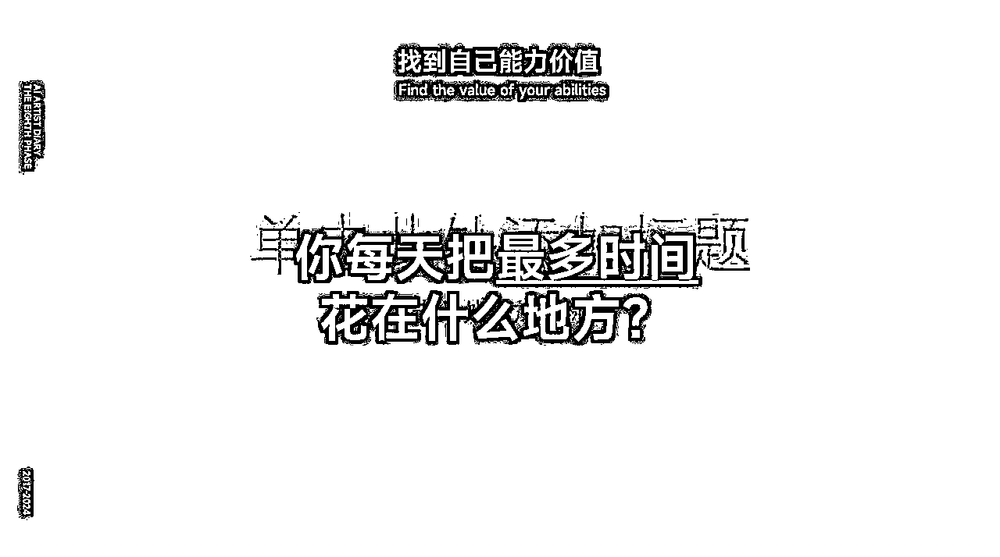

一天里，你的精力主要流向了哪块？这个问题不好糊弄。时间是最不撒谎的资源，你把它押在哪儿，回报就长在哪儿。

留个心，看看日常：那些悄悄吃掉你大把时间的活动，往往藏着你的看家本领。总有人来找你出主意、排故障，说明你脑子清楚、也接得住别人的情绪；一坐下就写、就画、就敲代码，说明创造力需要一个出口；资料总要归归类、流程总想理理顺，说明系统化的脑子是你的底子；看到新玩法就想弄明白，那是学习和应变的能力在发力。

这些动作，我们通常只当"习惯"，很少读懂背后的分量。可恰恰是你不假思索就会投入、累着也不觉得亏的部分，既是你拿手的事，也是你乐意的事。老实翻一翻自己的时间账本吧——那些让你心甘情愿耗着的事，很可能就是你的独家本事。认清它，方向也就跟着清楚了。

# 2.1.7 你想帮的那个人，贴着什么样的标签

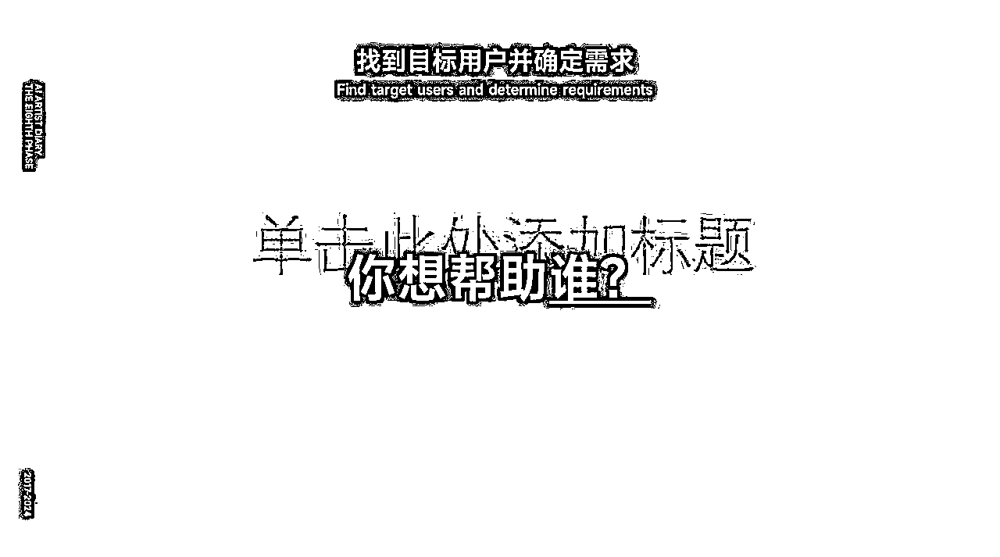

先别急着想方案。真要做产品、做项目，第一块砖是：你到底想帮谁。太多人一上手就忙着设计功能，却把"谁需要"这个起点跳过去了。

世上有的是处境各异的人，各有各的麻烦。带娃的年轻夫妻，盼着家务事能省点心；刚踏入社会的新人，想有人指点专业上的门道；一个人住的老人，希望生活琐事有人搭把手；身体或感官有特殊需要的朋友，等着被更体贴地照顾到。把这群"谁"想清楚了，后面的路会顺很多：你会去听他们的难处、看他们的日子、感受他们的情绪，方案自然也就落到了实处。

说到底，功能最扎眼的产品未必赢，最懂使用者的那一个才会赢。所以在动手之前，先把三个问题答一遍：我要帮的是谁？我真的了解他们吗？他们心里最缺的是什么？答得出来，你做出来的东西才有分量、才有人要。

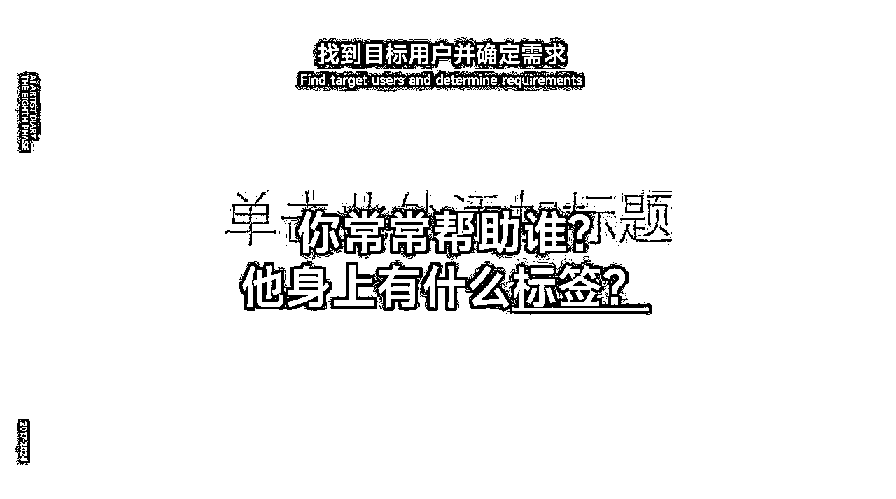

你平时最愿意伸手帮的是哪种人？他们身上挂着什么记号？这两问，问的其实是产品该站在哪个位置。

别停留在"我卖什么功能"这一层，得往下挖：我到底在服务谁。想想看，谁一出问题你就想搭把手？——刚走出校门的学生，记号大概是"没经验、钱不多、想快点长本事"；被工作和家庭两头拉扯的中年人，记号是"时间不够、顾家、只认实用"；讲究生活质感的都市白领，记号是"看重体验、认可价值、爱分享"。

这些记号不是冷冰冰的统计口径，它透露的是活法、是取舍、是真正的缺口。描得越具体，你越能看懂对方的难题，越能设计出对症的办法，说起话来也越容易抵达对方。产品不必讨好所有人，把一类人伺候明白，就已经很了不起。所以，花点时间回答：你常帮的是谁？他们身上写着什么？答案会带你做出真正有人要的东西。

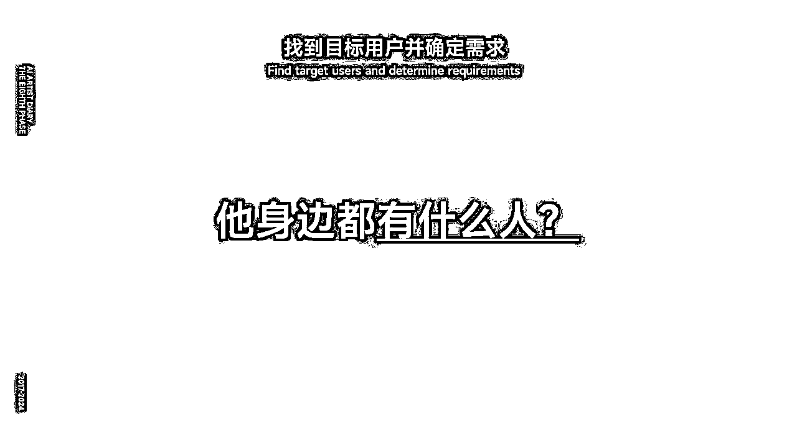

他身边还站着谁？这一问，分量很重。

没有人活在真空里，你的服务对象也一样，他身边是一圈人。是说话有分量的长辈，还是能商量事的另一半？是需要他照顾的孩子，还是需要他牵挂的老人？是办公室里的同事，还是一起玩的朋友？这些人在他的决定里，能起多大作用？

一旦把这张关系网看清楚，很多暗需求、暗机会就冒出来了。举个常见的：年轻妈妈买东西，婆婆一句评价就能改变主意；宿舍里的风气，会悄悄改掉一个大学生的消费方式；中年男人肯去体检，多半是伴侣催出来的。摸清这些牵连，你的东西才能贴着真实生活落地，甚至可以借这些关系把口碑带出去。

所以视线别只锁在一个人身上，要看他所在的那张网：家里人会不会支持他用？朋友看了会不会眼热？同事遇到同类麻烦会不会来问他？真正站得住的产品，服务的常常不是一个人，而是一段关系、一户人家、一个小圈子。

# 2.1.8 懂他的难处，懂他的心情，懂他的期待

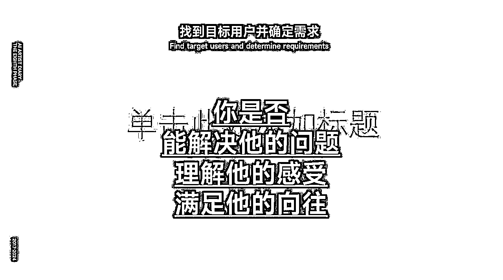

能不能替他解决麻烦、能不能体会他的心情、能不能接住他的期待——这三问，问的是产品到底值不值。

我们太容易迷上"加功能"，加着加着就忘了对方究竟要什么。试想：一个累到没力气的妈妈找育儿办法，她要的是一堆冷数据，还是一句"我懂你"和切实可行的支持？一个刚进公司的年轻人站在陌生环境里，他想要的是厚厚一本操作说明，还是抬脚就能走的指路牌？

解决麻烦，重点不在"给了答案"，而在"给对了答案"。我见过太多看着很齐全、方向却跑偏的东西——人家渴了，你递刀子；人家饿了，你端水。你确定自己戳中的是对方真正疼的地方，而不是你以为他疼的地方？

体会心情要更深一层，得有换位思考的功夫。他用你的东西时，是轻松还是别扭？是有底气还是发懵？是被当回事还是被晾着？往往就是这股感受，决定他下次还来不来。

接住期待是最高一层。人买的不只是当下的方便，还想借它变成一个更好的自己。健身类应用记的不只是步数和热量，是帮人把身体练回来；课程平台卖的不只是知识点，是帮人拿到心仪的职位；聊天软件连的不只是账号，是让人找到"我属于这里"的踏实。

所以，下一次添功能、写推广语、改体验流程之前，先自问三句：他的麻烦我真解决了吗？他的心情我真懂吗？他的期待我真接住了吗？三声"是"都答得干脆，你的产品才会被放进使用者心里，变成他生活里离不开的那一件。这既是做生意的门道，也是对掏钱的人最起码的体面。

# 2.2 一条公式，帮你找准副业落点

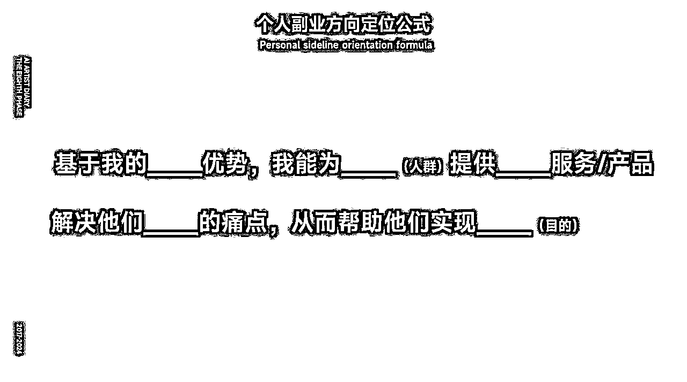

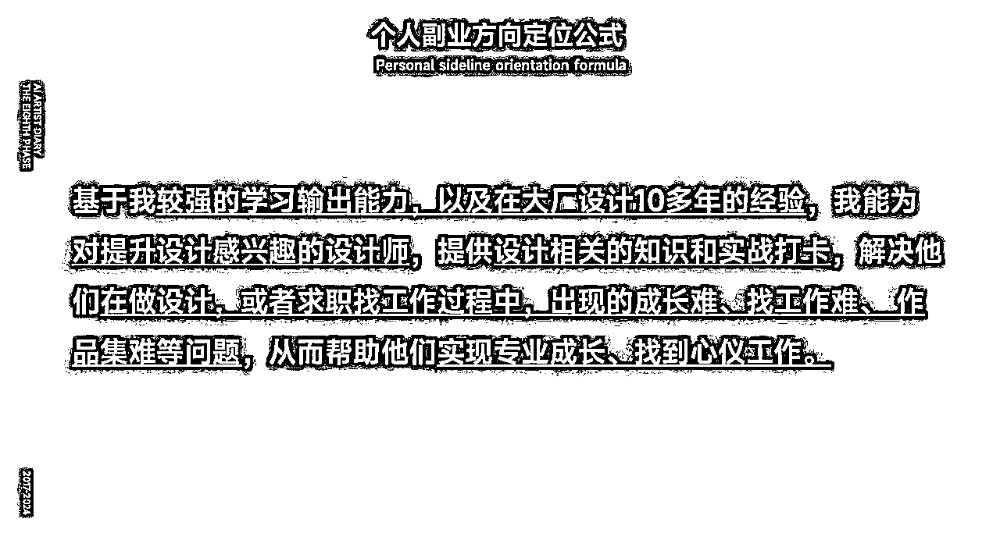

想弄个副业，却不知道脚往哪迈？先别焦虑，几乎人人都是这么开局的。记住一条填空式的公式，定位就能有个着落：凭我在【某领域】的拿手本事，为【某一群人】，提供【某种】服务或产品，替他们搞定【某个】具体的麻烦，帮他们拿到【某个】想要的结果。

公式是填空，但别胡乱填。

第一步，诚实地问：我哪件事是真拿手？不是"凑合能行"，是"敢拿出来给人看"的那种。它可能是你吃饭的专业，也可能是不起眼的爱好，甚至是这些年攒下的生活窍门。

第二步，找对象：谁正好缺这门本事？越具体越好，写成"谁都行"，等于没写。

第三步，想清楚：我具体交付什么？替他挡掉哪个麻烦？把他送到哪个位置？举两个样子——

"凭我英语口语的底子，给准备留学的学生做面签模拟，帮他们克服一开口就结巴的紧张，稳稳拿到签证。"

"凭我烤东西的手艺，给怕胖又嘴馋的上班族做低糖点心，让他们既能解馋，又不用跟体重秤较劲。"

能一句话把自己的副业说清楚，你已经跑在多数人前头了。这不是什么玄乎的理论，只是把脑子里那团雾，捏成一个看得见的形状。位置站对了，路自然好走。

# 2.3 让 AI 当参谋，帮你校准定位

这些材料理完之后，可以丢给 AI，让它帮你归置成条理。也可以让它出一份商业模式的草案，不过那只能算参考。个人 IP 要的是一个立得住的真人形象，最终还是靠你自己往里挖、往外捋，AI 在这件事上只是打下手的。

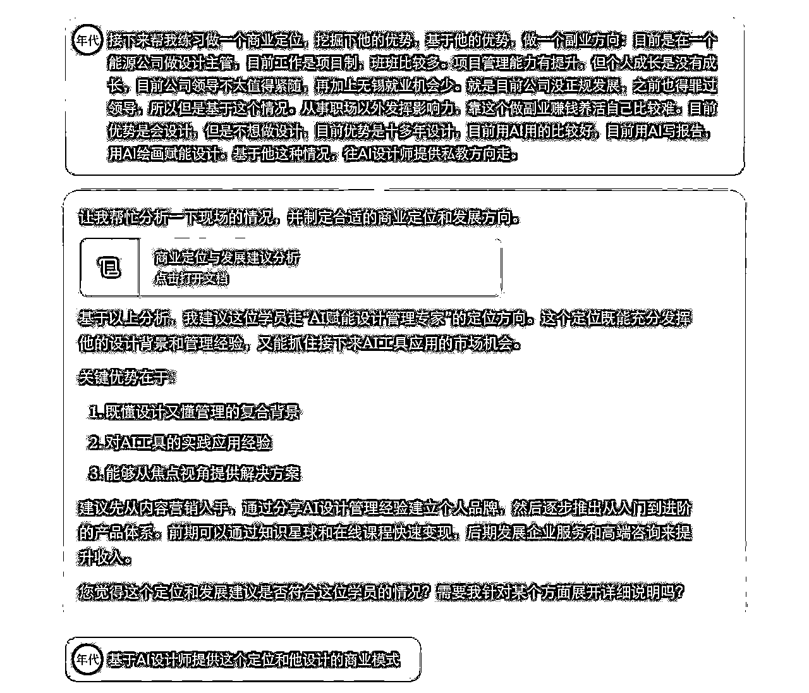

# 三、让 AI 帮你把产品理一遍

# 💡 章节导读

定位清楚了，接下来就该把自己的产品拉个清单了。下面的内容，是把方法和你的实际情况揉在一起做梳理。看完有点晕是正常的，这东西得在动手的过程里一遍遍改。也可以等教练开直播，带着大家一块儿理。

# 💡 本章路线图

学完这一节并动手做完，路线图上的这一格就能打勾：
第三阶段：把产品梳理完（第5-7天）

1. 借 AI 把适合自己做的产品挑出来

# 3.1 先把产品候选列成一张表

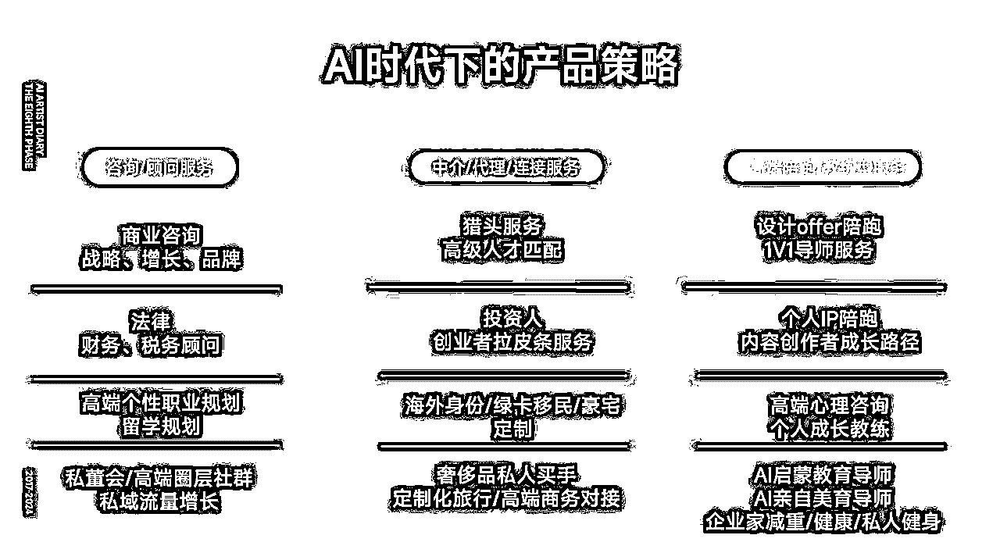

AI 当道的今天怎么做产品？这不只是赶个潮流，而是整盘生意正在被重排。

下面这张图点出了未来的三个高价值走向：做顾问、做撮合、做长期陪伴。这不是谁拍脑袋想出来的，而是技术一起势，市场自然就分出了层次。

1. 咨询 / 顾问

这类服务为什么越来越抢手？因为信息到处都是，真正缺的是有人替你看懂、替你拍板。AI 能把数据堆到你面前，却没法替你承担决策。商业上的判断、法律税务的门道、高端职业的规划，靠的是年头熬出来的经验和眼力，AI 一时半会儿接不过来。

2. 中间人 / 代理 / 撮合

这一行做的是信任。猎头替企业找高管、投资人对接创业者、海外身份的筹划、大牌代买，这些需求都很私人、很微妙。客户付钱，买的不只是流程，更是那份踏实。效率可以交给 AI，可信不可信，还得看人。

3. 长期陪伴 / 陪练

这一块最有嚼头。求职陪着走、个人 IP 孵化、心理咨询、教人用 AI，全都围着"人怎么长起来"打转。越是有 AI 掺和，人越想要真实的接触和量身定制的引导——除了信息，我们还盼着有人懂自己、推自己一把、陪自己走一段。

未来的高端服务不会被 AI 顶掉，而是跟 AI 搭伙。真正的机会在于：让 AI 去扛效率的活，把体贴和洞察留给人。老板圈子式的社群也好，按需定制的旅行、孩子的 AI 启蒙也罢，说到底是把技术和人情两头端平。所以想这一行的产品路子，别只盯着"AI 能干什么"，多想想"AI 干不了什么"。凡是靠信任、靠情感、靠量身定做的领域，才是接下来最肥的那片水。这个年头，技术不缺，缺的是真懂人的服务。

# 3.2 卖货的三个关键动作

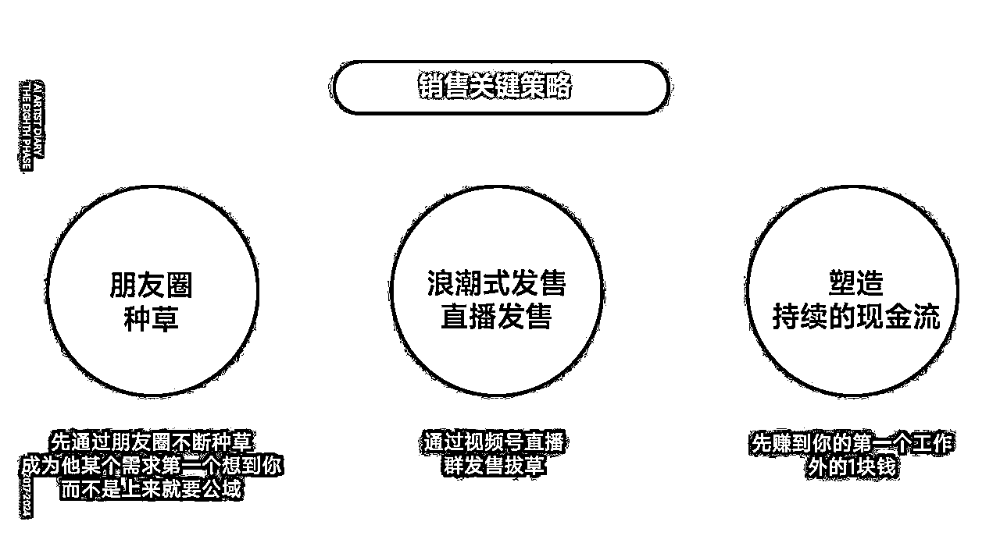

卖东西的章法，说穿了并不玄，就是做生意的常识。

图里给了三条主线：在熟人圈里铺信任、用一波接一波的节奏造势开卖、把进账续上。这不是什么复杂的商业架构，是每个创业者都能照着做的打法。

1. 先在熟人圈里铺信任

这是最底下那层功夫。不少人一开张就想搞大，冲去外面的平台抢热度，钱烧了一堆，单却没几个。生意说到底是信不信你。你得在🛰️好友那边持续给东西——有用的见解、靠谱的案例，让他在遇到某类需求时，脑子里第一个蹦出你。就好比电脑坏了，你会先找谁？多半是那个平时总在群里讲电脑常识的朋友。这就是铺垫的威力：你不是在硬推货，而是在给自己立一个"懂行"的样子。

2. 用一波接一波的节奏开卖

这是借社交平台的特性把气氛烘起来。视频号开播、群里同步发售，你不是一个人干吆喝，而是造出"大家伙儿都在下单"的场面。人都有跟风的本能，看见别人动了，自己也容易跟着动。节奏感一上来，紧迫感和"大家都在买"的认同感就有了，本来还在犹豫的人，手也就点了。

3. 把进账续上

这是生意的命根子。很多人一创业，眼里只有大单子，日常进项反倒不管了。记住：先在工作之外赚到第一笔钱，哪怕只有几十块，那也是往财务自由迈的第一脚。有活水进来，生意转得动，你才有胆量去试更多可能。

三条听着朴素，却是无数做成事的人走过的同一条道。别被花里胡哨的营销说法带跑，回到本质：攒信任、造气氛、保住进账。做咨询的、卖实物的、写内容的，都逃不出这三条。信息多到爆炸的年头，胜负不在谁嗓门大，而在谁能住进对方心里，成为他第一个想到的人。所以，把复杂理论搁一边，从熟人圈那条第一条动态开始，一点点把自己的影响力垒起来。

# 3.3 高客单和低客单，该怎么选

做买卖的人，早晚要在这道题前站一会儿：走大众低价、靠量取胜，还是走小众高价、靠精取胜？题目不复杂，底下却压着一整套商业逻辑。

走大众低价，拼的是规模、是交易频次、是海量的人。阿里、拼多多走的就是这条路，靠人气池和货源成本的精打细算撑起来。代价是厮杀极狠，没有资本和运营的底子，很难站稳。

走小众高价，是另一套活法：只盯一小群人的特定需求，把东西做出别人替代不了的差别。高端大牌、专业服务机构都这么干。单笔利润厚，可盘子小，涨到一定程度就顶到天花板。

这两条其实没有高下。要紧的是看清自己手里捏着什么。你若是擅长把流程跑顺、把成本压住，大众低价可能更趁手；你若有别人做不出的东西，或在某个专业上格外扎实，小众高价往往更舒服。

最常见的翻车，是两条都想要：拿低价勾人，又舍不得放下高毛利。结果顾客不买账，自己还卡在中间难受。我的看法是，刚起步时先走小众高价更稳妥：在小范围里把模式验一遍，攒下口碑和手感，等跑顺了再琢磨要不要往大众市场铺。说到底，走哪条路，取决于你手上有什么、外面是什么行情、你心里图什么。路选定之后，能不能熬住、能不能咬住不放，才是分胜负的地方。生意场上从来没有标准答案，只有合不合你自己的那个答案。

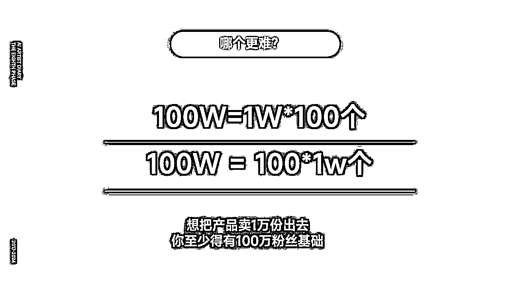

做 IP 的人，不妨算一道题：100 万 = 1 万 ×100，还是 100 万 = 100 ×1 万？看着像个文字游戏，其实戳中了创业最疼的那根神经。

要卖出 1 万份东西，手里少说得有 100 万个关注者。1% 的转化比例，数字听着可怜，放在真实的生意里已经是很好的成绩了。

可很多人一上路就想一步登天，盼着出个爆品，一夜之间卖空几万件。现实是：你能触达多少人，决定你能卖多少。底下没有足够的人托着，货再好也铺不开。我见过不少这样的例子——东西做得不差，就是没有足够的人气托底，最后悄无声息地收了摊。毛病出在哪？把产品的作用想得太高，把"送到人眼前"这件事想得太轻。

那你说哪边更难？显然是攒下那 100 万人更难。打磨一件万元级的东西，几个月也许够了；养出 100 万个真实的活人，可能要按年算。这是慢活，得靠一天天的内容去喂、一点点的价值去换。很多人偏偏在这里走岔：八成力气扑在产品上，只留两成去做推广和拉新。东西是做出来了，门口却没人。

再往深一层看：AI 来了之后，低价货的好日子到头了，高价才是活路。这话听着刺耳，却是正在发生的事。ChatGPT、Claude 这类东西一普及，信息上的不对等被抹得飞快。过去你花钱买的低价课、电子书、模板，如今几秒钟就能让 AI 吐出一份。靠"我知道你不知道"吃饭的人，正被逼到墙角。

AI 会写稿、会做图，还会敲代码、解题、查资料，低端那一块的价值正被它一口口啃掉。你想想，AI 免费就能给到 80 分的答案，谁还掏钱买 60 分的东西？低价货之所以难做，是因为它们卖的多半是"可以复制的知识"，而这恰好是 AI 的主场。往后真正值钱的，是 AI 很难伸手的地方：想得够深、判断够准、情感够真、体验够私人。这些，正是高价产品的骨架。

想在 AI 的牌桌上坐稳，就得往高单价那头挪。也就是说，你得给出更厚的价值、啃下更难的题、造出别人给不了的体验。看看那些顶尖的咨询行、高端大牌、私人订制，它们卖的哪里是货，是感受、是情绪、是"我属于这一类人"的身份感。这些东西，AI 一时半会学不来。

低价那一头只会更挤，利润只会更薄。门槛被 AI 削平了，谁都能眨眼生成一份及格的内容和产品。高价那头正相反：要的是真功夫、是年头、是客户对你的信。这些 AI 拿不走。

所以，如果你手上还在卖几十块的小课、电子书，该认真想想转法子了。往高价走不是"要不要"的问题，是"活不活得下去"的问题。AI 一来，信息上的不对等会越来越淡，可价值上的落差、体验上的落差、情感上的落差，只会越来越显眼。这就是为什么，往后能站住的，是高价那一边。

# 四、靠 AI 提速，让内容产出更轻松

# 💡 章节导读

接下来是本轮航海的重头戏，篇幅也最长。你可以一边看一边上手，门槛不高。

这里挑了几个做 IP 时最常用的 AI 场景：
✅ 写：👸号长文、📕笔记、好友圈动态
✅ 画：文章插图、活动海报、个人形象、红包封面
✅ 剪：脚本、配音与数字人口播、图文转动画

跟着手册练起来吧。

# 💡 本章路线图

学完这一节并动手做完，路线图上的这一格就能打勾：
第四阶段：借 AI 提速内容创作（第 8-21 天）

1. 让 AI 帮你写
2. 让 AI 帮你发圈
3. 让 AI 帮你出图
4. 让 AI 帮你剪片

# 4.1 大模型写作：让 AI 封装你的思考

# 4.1.1 大模型写作实操关键

先解决一个基本问题：写作这件事，为什么需要大模型参与？

做个人品牌的第一步，是完成信息连接；在所有连接方式里，文字的门槛最低、覆盖面最广。很多人觉得 IP 经营需要复杂规划，却忘了最基础的文字表达。你发出的每一条朋友圈、每一篇推文，都是品牌的组成部分。好的文字能把你的想法送到别人心里，也让价值被放大。它不是口号，而是你的专业、认知和思考的清晰呈现。持续输出有温度、有深度的内容，个人品牌会在时间里一点一点长出来。

但最现实的问题是：今天写什么？

为一条内容熬到凌晨，羡慕那些高产且稳定的创作者，自己却总在选题、初稿、修改之间打转。传统写作流程从无到有，每一步都可能变成时间黑洞；好不容易写完，数据却冷冷清清。差别不在天赋，而在思维框架。效率型创作者已经切换到“AI 增强思维”，更多人还停留在“纯手工思维”。

这一章，就是帮你彻底换一种生产方式：掌握“AI 增强创作框架”，把产出效率提升 300%，同时让内容真正打动读者。

PS：本篇不需要智能体，只使用原生模型。实测效果排序：Claude 3.7 最强，DeepSeek 次之，Kimi 靠后。新手建议先用 DeepSeek，上手后再换 Claude。

大模型写作的本质是什么？

写作对很多人来说是折磨：空白页面前不知道如何落笔，写两句又删掉；勉强写完，内容却没有感染力；花了很多时间，结果仍不理想。这些问题的根源，90% 来自一个过时的认知——好内容必须从零原创。

这种想法在当下已经行不通。IP 写作不是一个人硬撑，也不是把写作任务全扔给 AI。真正的公式是：

AI 封装你的思考。

有思考力的你 + 善于表达的 AI = AI 作家

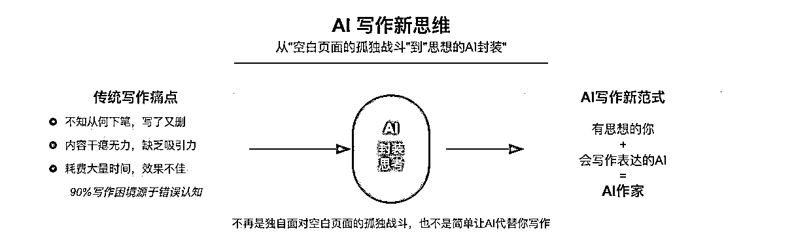

记住这句话，后面所有方法都是从它延伸出来的。

# 4.1.2 👸号推文的大模型写法

# 4.1.2.1 实操步骤：五步创作法

👸号内容竞争激烈，写作者共同的难题是：时间有限，却要交出有深度、有吸引力、符合个人 IP 的稿子。破局方法就是下面这套“五步创作法”。

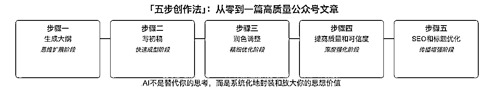

第一步：搭结构，扩展思路

指令模板：

我准备写一篇👸号推文，主题是[主题]，读者是[目标受众]。请先给我一份完整提纲，包括：3-5 个吸引人的标题；一个适合开篇的故事、数据或问题；3-5 个核心论点，每个论点下面配 2-3 个案例或论据；结尾的行动呼吁和互动建议。

这一步的核心，是让模型帮你把思路打开，看到更多可写的角度。

第二步：出初稿，快速成型

指令模板：

根据上面的提纲，写一篇约[字数]字的👸号推文。风格：[风格特点，如专业/幽默/故事化/数据驱动]；语气：[语气特点，如亲切/权威/思考型/激励性]。请确保开头能抓住注意力，观点后面有案例或数据，段落简短，结构清楚，结尾有行动指南和互动引导。

第三步：做润色，精细调整

指令模板：

请润色以下稿件：让开场更有悬念和吸引力；把长段落拆短，让节奏更舒服；加入 2-3 个生动的比喻或类比；多用“你”来制造对话感；检查论点是否连贯；强化结尾的情绪和行动指引。

第四步：加可信度，强化专业感

指令模板：

请提升稿件的专业度：补充 2-3 个有明确出处的数据或研究；在合适位置加入专家观点或行业引用；增加 1-2 个典型案例；对读者可能的质疑提前做出解释；检查专业术语是否准确且易懂。

第五步：做 SEO 和标题优化，提升传播

指令模板：

请从传播角度优化稿件：给我 3-5 个更有吸引力的标题方案；改写前三段，提高留存率；推荐 3-5 个热门关键词；优化小标题；设计一个更有参与感的结尾互动。

这套方法的关键在哪儿？

回头看，哪些环节需要你思考，哪些环节需要你参与？

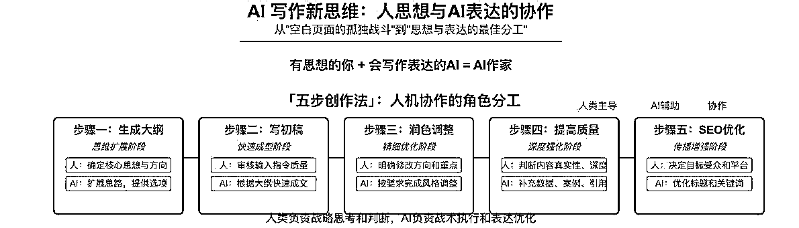

它不是让 AI 替你写，而是让 AI 在你的指挥下写。每走一步，你都要把专业判断和个人洞见放进去，并对结果负责。只有这样，稿子才符合你的专业标准和品牌调性。

# 4.1.2.2 完整案例：一篇爆文的诞生

【案例主题】：不要成为，除了上班，一无所有的人

【第一步：搭结构】

输入精简版指令：

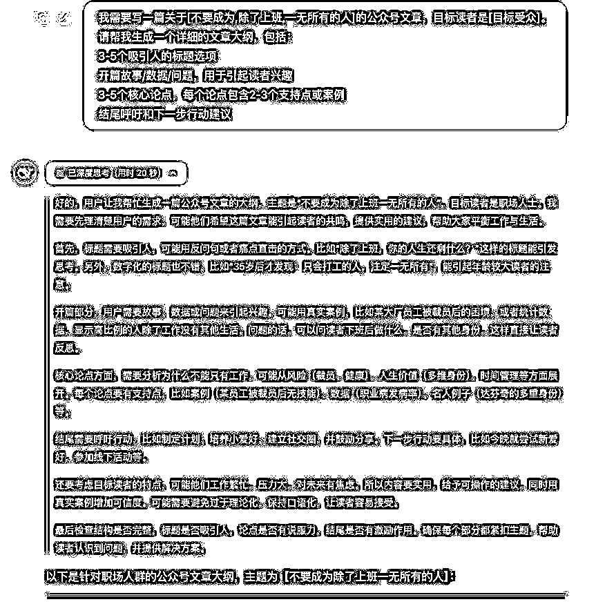

指令：

我想在👸号写一篇关于“不要成为，除了上班，一无所有的人”的文章，读者是职场人。请先给一份详细提纲，包括标题、开篇、核心论点、结尾行动建议。

模型返回的提纲（要点转述）：

标题方向有五个：下班后人生还剩什么；工作填满生活，人却一无所有；35 岁才发现只会打工的人没有退路；别让工资单定义你的全部价值；如何避免从“996 工具人”变成“生活破产者”。

开篇建议用真实场景加数据：2023 年大厂裁员，38 岁程序员老张红着眼说：“除了写代码，我什么都不会，连孩子的家长群都没加过。”某职场平台调查显示，72% 的职场人承认工作之外没有特长、社交或长期兴趣。然后抛出问题：明天失业，简历之外你还剩什么？

核心论点共四个：

1. 单一职场身份是高风险。例证包括：45 岁外企高管被裁后发现技能过时；互联网行业 35 岁以上人群再就业，仅 17% 成功转型。金句：公司买走的不只是时间，还有人生可能性。

2. 人生价值需要多个支点。可用马斯洛需求理论说明自我实现不等于工作；案例有程序员转行插画师、副业收入反超主业，以及日本“退休破产”——离开公司后，社会身份也一同消失。

3. 时间贫困正在毁掉未来。数据是中国职场人日均休闲时间只有 2.27 小时；长期单一信息输入会加速认知退化；拿达芬奇的多重身份和现代打工人对比。

4. 被动生存与主动生活。一类人上班摸鱼、下班报复性熬夜；另一类人每天 30 分钟深耕兴趣，三年后成为领域达人。工具推荐：时间块管理法、微习惯养成体系。

结尾的终极拷问是：把“某公司员工”从简历里删掉，你还剩什么？行动建议三条：每周留 2 小时探索新技能；每天做一个 15 分钟的微行动；建立兴趣社群和行业交流等弱关系网。金句：真正的铁饭碗，不是某个职位，而是离开任何平台都能活得精彩的底气。

传播设计：互动话题“如果明天失业，你的 Plan B 是什么”；配图“人生资产负债表”；转发语“看完默默退掉加班餐，原来我一直在贱卖人生”。整体思路是：制造危机感、升级认知、给出工具。

【第二步：出初稿】

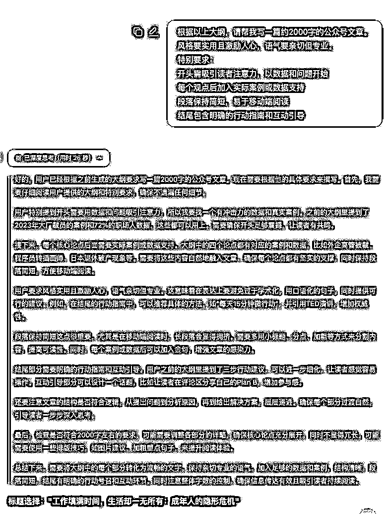

根据确认后的提纲，写入以下指令：

请根据提纲写一篇约 2000 字的👸号推文。风格要实用、激励人心，语气要亲切但专业。开头用数据或问题抓人；每个观点都要有案例；段落要短；结尾要有行动指南和互动。

初稿定题为“工作填满时间，生活却一无所有：成年人的隐形危机”。

开篇三组画面：每天工作 12 小时，余额只够交房租；🛰️好友上千，难过时找不到人聊天；工作 5 年，技能还停留在入职培训。随后引用《2023 中国职场人生活状态白皮书》：72% 的人工作外无特长、无社交、无长期兴趣；89% 的 35 岁以上受访者担心失业即失去社会价值；日均休闲 2.27 小时，其中 63% 用来刷短视频。最后提问：如果明天失业，你的人生还剩什么？

正文第一段讲职场身份陷阱：外企市场总监 Linda 被裁后求职无门，被猎头指出经验停在 2018 年；NHK 纪录片《老后破产》显示，40% 的退休男性出现严重抑郁；哈佛商学院报告警告，完全依附平台的人，本质上和流水线机器一样，磨损到期限就会被替换。

第二段给破局方案：建立反脆弱系统。程序员阿杰白天写代码、晚上学插画，三年后副业超过主业；LinkedIn 调查称 83% 的高薪机会来自三度人脉，金融分析师王敏在户外社群和读书会里找到了合伙人与投资人；每天 15 分钟学 Python，一年后能自动化处理 80% 的重复报表。

第三段谈时间管理：先诊断虚假忙碌和精力黑洞，再用时间块管理法，把一天分成生存时间、赚钱时间、灵魂时间。广告设计师利用午休练板绘，两年后出版画集并转型自由插画师。

第四段给行动指南：用 Notion 画“人生资产负债表”，把技能、存款、人脉、健康列为资产，把房贷、过度消费、信息瘾列为负债；启动每天 15 分钟的微行动；加入副业互助社群或线下 Plan B 沙龙。

结尾回到老张：他用赔偿金开亲子编程教室，终于加上了所有家长的🛰️。他说收入只有过去一半，但终于活得像个正常人了。

【最终成稿】

# 工作之外，你还有多少人生？

你有多久没有在晚上十点之后，做一件和工作无关的事了？

《2023 中国职场人工作与生活平衡状况报告》显示，中国职场人平均每周工作 51.7 小时，比国际劳工组织建议的 40 小时多出近 12 小时；73% 的人承认，工作已经占去了生活的大部分。《经济学人》2024 年全球工作时间调查同样发现，中国在主要经济体中排名第二，仅次于韩国。

我们习惯用时间换收入，却很少问：收入有没有真正服务于生活？

如果你的答案开始模糊，这篇文章不是劝你辞职，而是想帮你把被工作挤掉的生活找回来。

## 一、工作占满生活，代价是隐性的

最先透支的是健康。国家卫健委联合中国疾控中心发布的《中国职场人群健康状况白皮书》指出，30-45 岁职场人中，超过 65% 存在亚健康状态；36.2% 有慢性疲劳综合征，42.8% 有睡眠障碍，28.5% 出现颈椎问题。35 岁的产品经理李明，连续三年高强度工作后，查出严重胃溃疡和中度抑郁。用健康换晋升，真的不是一笔划算的买卖。

其次是关系。成年人通常需要十几个核心社交关系，但许多职场人的朋友圈只剩同事。关系需要时间滋养，长期不管，它就会疏远。一位财务总监妈妈被 8 岁的儿子问：“你爱工作比爱我多吗？”她一时不知怎么回答。孩子的童年、父母的晚年，都经不起“等工作忙完再说”。

最后是身份。当“某公司员工”成为唯一标签，失业就等同于失去自我。一位 50 岁高管被裁后，每天照常 7 点起床、穿好西装，坐在书房里“等待通知”。他害怕的不是没钱，而是不知道没有头衔的自己是谁。

## 二、人生不该只有一种评价标准

收入、职位、房子、车子，这些世俗标准很容易让人只顾低头赶路。但生活是多面的：你还可以是某个领域的深度爱好者，某个社群里的行动者，某个家庭里不可替代的人。把注意力从“职场身份”转向“完整的人”，很多焦虑会自然松动。

人生的路，从来不止一条。

（案例演示到此结束，后续步骤略。）

# 别让工作独占你的人生

社会把“成功”定义成高薪、高职、高曝光，但这是幸福的全部吗？积极心理学研究者马丁·塞利格曼在《真实的幸福》和《繁盛》中提出过一套“PERMA幸福理论”：幸福由五种元素构成——积极情绪、投入感、人际关系、意义与成就。哈佛商学院的一项调查则发现，即使是成就感爆棚的职业，通常也只能满足其中两三样，很难五样兼得。

徐冰的人生转折，恰好印证了这一判断。45岁前，他是一家世界500强企业中国区的营销副总裁，年薪200多万，出入各种光鲜场合。2021年，他辞去职位，成为一名正念瑜伽教练。消息一出，商业圈议论不少，《财经》杂志也专门找他聊过。他坦言，自己遇到了典型的“成功悖论”：位置越高、挣得越多，心里的空洞却越大。长期超负荷工作换来了高血压、脂肪肝，也把家人越推越远。后来他意识到，调整的锚点不是“要不要成功”，而是“用什么标准定义成功”。如今他身体各项指标回归正常，情绪稳定，还能陪伴更多人学习安静下来。在他眼里，这是一种覆盖更全、后劲更足的赢法。

# 完整人生的五个维度

临终关怀护士布罗尼·韦尔在畅销书《临终前的五大遗憾》中，记录了她接触的100多位老人最后的反思。数据很直白：只有不到2%的人后悔“投入工作的时间太少”，却有超过61%的人后悔“都在忙工作，忽略了家庭和健康”。哈佛大学一项长达75年、跟踪724位参与者的研究，也把“高质量关系”推到了长寿与幸福预测因子的首位。

如果把人生看作一辆车，只给“工作”这个轮胎打满气，健康、关系、兴趣、成长全都瘪在原地，这辆车还能稳稳向前吗？

可持续的平衡，可能需要同时关照五个维度：

- 健康：身体和心理都处于有活力的状态  
- 关系：与家人、朋友、社区保持深度联结  
- 兴趣：做那些纯粹让你快乐的事  
- 贡献：为他人和社会创造积极价值  
- 成长：持续学习，不断拓宽能力边界  

有意思的是，那些在多个领域都有自己的投入的人，往往在工作中也展现出更丰富的创造力和适应力。五个维度，你现在各自能给几分？最亏气的那一个，是不是已经很久没被照顾了？

# 慢一点，效率未必会掉线

2019年，微软日本公司试验“每周四天工作制”，结果出人意料：整体生产力反而提升40%，会议效率提高20%，办公楼用电量下降23%。研究刊登在《自然·人类行为》期刊后，被很多人拿来讨论“少即是多”的真实效力。冰岛、新西兰等地随后开展的类似试验，也给出了相近的结果。

大脑和土地一样，需要“休耕”，才不至于让灵感枯竭。连续运转只会把创造力一点点榨干。

“有意留白”正被越来越多创新公司接受。谷歌、脸书等企业都留有员工的自由探索时间，不少关键产品就诞生于这些看似“没有产出”的空隙里。

一位广告创意总监赵女士说得更直白：她真正得意的方案，几乎都不是在办公桌前想出来的，而是在徒步、泡澡、发呆时“自己冒出来的”。大脑松下来了，灵感才愿意现身。

你上一次什么都不干地放空，是什么时候？那种“无所事事”带来的创造力回响，你留意过吗？

# 三、让生活回归的实操方法

## 给工作画一条边界线

从2021年开始，荷兰、法国、比利时、西班牙、葡萄牙等欧洲国家相继出台法律，禁止公司在非工作时间联系员工，也就是“断开连接权”。欧盟就业事务专员尼古拉斯·施密特把它称作“数字时代的基本人权”。中国虽然还没有同类法律，但2021年《最高人民法院关于审理劳动争议案件适用法律问题的解释（五）》已经在讨论“非工作时间劳动者的休息权”，算是给未来开了扇窗。法律尚未覆盖之处，边界只能靠自己去划。

工作像水，没有容器限制，就会漫过房间每一个角落，最后把生活整个淹没。

互联网公司产品经理陈先生的做法很实用：每天18点后关掉工作群提示，手机切到专注模式，并提前和团队约好——非紧急消息次日早上统一处理。刚开始大家有些不适应，等规则稳定下来，协作效率反而更高了。

一些有效的拒绝话术，也可以直接拿来用：

- “这个项目我希望能保证交付质量，所以需要我重新排一下优先级。”
- “我手上已经有A、B、C三个重要任务，如果要插进来，哪一个可以先推迟？”
- “今晚有固定的私人安排，明天早上我会优先处理这件事。”

你今天为自己设了哪些边界？有没有在不经意间，又被自己推倒了？

## 发展工作之外的第二重身份

斯坦福大学心理学教授詹姆斯·格罗斯在《心理学通报》上发表了一项身份弹性研究：当一个人拥有多个身份，在某个领域遇到挫折时，心理弹性会提高76%，抑郁风险下降42%。这种缓冲效应，相当于给内心铺了一张安全网。

身份就像资产组合，把所有筹码押在一只股票上，波动来了就很难扛；分散配置，抗风险能力才足够。

IT工程师刘先生每周都会抽出半天，到社区老年中心教电脑。他说，这份志愿者工作给了他完全不同的社交圈和价值感。工作中遇到不顺时，他会想起：在另一个地方，自己依然被需要、有分量。

培养兴趣不必一步到位，可以从很小的动作开始：通勤路上听一档播客，每周只分配1-2小时，加入一个线上兴趣社群。如果让你介绍自己，且不能提及职位，你怎么说？那个答案，也许就是你第二身份的起跑线。

## 让高质量的社交成为补给

哈佛75年追踪研究给出的结论依旧醒目：长期幸福感的来源，不是存款和名气，而是良好的关系网络。

财务经理周女士每个月都会组织一次“非职场聚会”，主题只有生活、兴趣和成长，不许聊工作。三年下来，这个20人不到的小圈子，成了她生活里最稳固的情感后方，也让她结识了多个领域的朋友。

家庭也需要仪式感来保温：每周固定半天作为家庭日；吃饭时把手机扣在另一个房间；为家庭创建一个小传统，比如季度微旅行、月度新体验。

本周你打算见谁？是围着项目转，还是围着在乎你的人转？比例值得重新调整一下。

# 四、从承受工作，到经营生活

有人会问：在这么卷的环境里，少接一点活、少熬几个夜，真的可行吗？追求工作与生活的平衡，会不会等于自断前程？

心理学家亚当·格兰特认为，这种担心背后是“零和思维”——好像工作投入多了，生活就必然被挤占。但越来越多的证据表明，两者更接近“正和关系”：生活供给能量，工作释放能量。麦肯锡2022年全球人才流动调查覆盖了1000家高绩效企业，数据显示，那些认真支持员工平衡生活的公司，人才保留率高46%，创新产出高37%，长期业绩也领先同行20%以上。

## 别掉进消费主义的下行螺旋

普林斯顿大学经济学家安格斯·迪顿与心理学家丹尼尔·卡尼曼的经典研究发现：收入超过一定阈值后，金钱对日常情绪幸福感的影响会趋于平缓，形成“幸福饱和点”。清华大学中国经济思想与实践研究院2023年发布的报告显示，在中国一线城市，这个阈值大约在税前年薪28万至32万元，折算成月薪约2.3万至2.7万元。

消费一旦变成补偿生活空洞的手段，人就容易走进循环：赚更多→买更多→需要更多钱→更拼命工作→没时间享受→再用消费来安抚自己。

简约生活者林先生对此深有体会。当他不再惦记更大的房子、更新的车和更多奢侈品，他发现自己其实不需要那么高的收入，也不需要一直高速运转。他说，这是自由的味道。

你上一次购物带来的快乐持续了多久？算算为之付出的工作时间，这笔账能帮你重新看待消费与努力的配比。

## 找到内心真正想去的地方

可以试着回答三个问题：

1. 做什么事会让你忘记时间？
2. 如果不再需要为钱发愁，你愿意把时间用在哪里？
3. 你希望别人回忆你时，最先想起什么？

内在动力像可再生能源，越使用越充沛；外在刺激像化石燃料，总有用尽的一天。

黄先生今年40岁，在高压的金融行业工作15年后，用这三问照见了自己对教育的热情。如今他每周都会抽一天去乡村学校做义教，并计划五年内彻底转向教育领域。“知道方向在哪里，连眼前枯燥的工作都变得有意义了。”

今天留5分钟给这些问题，答案也许比你预想的来得更快。

## 让财务目标从“更多”变成“刚好”

财务自由的定义正在更新。《福布斯》专栏作家威廉·阿里达指出，它不必是巨额财富或彻底离场，更现实的标准是“财务充足”：收入足以承载你想要的生活，同时为成长和风险留出空间。凯洛格商学院的研究显示，把财务目标从“更多”转向“足够”的人，工作压力下降了52%，生活满意度提升了40%。

杭州85后夫妻吴琳和张建都身处互联网中层管理岗位。经历多年的“双鸭山”式作息后，他们找了金融规划师，做了一份“财务充足”方案：50-30-20预算法则——50%用于基本开支，30%用于悦己消费，20%用于储蓄和投资；建立六个月应急金；设定合理储蓄目标，再倒推合理收入与工作时长。

吴琳告诉《第一财经周刊》：“知道‘够用’的刻度以后，我们敢拒绝一部分过度加班，每人每周能多出大约10个小时给自己和家庭。结果工作状态更清爽，升职和考核也没有因此受影响。这是一种性价比很高的活法。”

你的“足够”是多少？那个数字可能低于你的想象，而通向它的路径，也比现在更可持续。

# 结语：把方向盘放回自己手里

组织心理学家莎伦·罗斯奇在《哈佛商业评论》中写下一句话：21世纪最重要的职场能力，不是“能熬”，而是“会设界”。能拥有工作之外生活的人，往往也能带出走得远、走得稳的团队。

试着想象80岁的自己坐在摇椅上，回首一生。你更想看到的，是一长串职位和晋升记录，还是那些具体而温暖的片段——孩子第一次喊爸爸妈妈、与爱人看过的日落、深夜畅聊里溢出的笑场，以及一次次让灵魂发光的经历？

工作只是生活的一个章节，不该成为全部。被加班绑架的人生，即使写满绩效，也只是一场无声的亏欠。

行动可以从很小的事开始：

- 今天：下班后关掉工作通知，给自己一小时，做一件不带“用处”却能让你开心的事。
- 本周：翻翻日程表，找一段2小时的空闲，约一个工作之外的朋友，或安排一次家庭活动。
- 本月：开启一个新的兴趣，报名课程、翻开一本书、加入一个社群，走一小步就好。
- 三个月：养成明确的“下班仪式”，换身衣服、冥想5分钟、散步15分钟，告诉大脑：现在切换模式。
- 每季度：做一次生活审计，给工作、家庭、健康、兴趣、社交五张卡打分，再补足最弱的一项。

评论区想听你聊聊：下班后做什么事，让你觉得自己“还在活着”？哪怕只有10分钟。

我们相互借一点力量，把那个被工作埋起来的自己，一步步找回来。重拾生活，不是为了逃离职场，而是让自己在职场里也更鲜活。这不是谁输谁赢的游戏，而是一场彼此成全的长期主义。

人生从来不是待办的清单，今天，就开始夺回自己的时间。

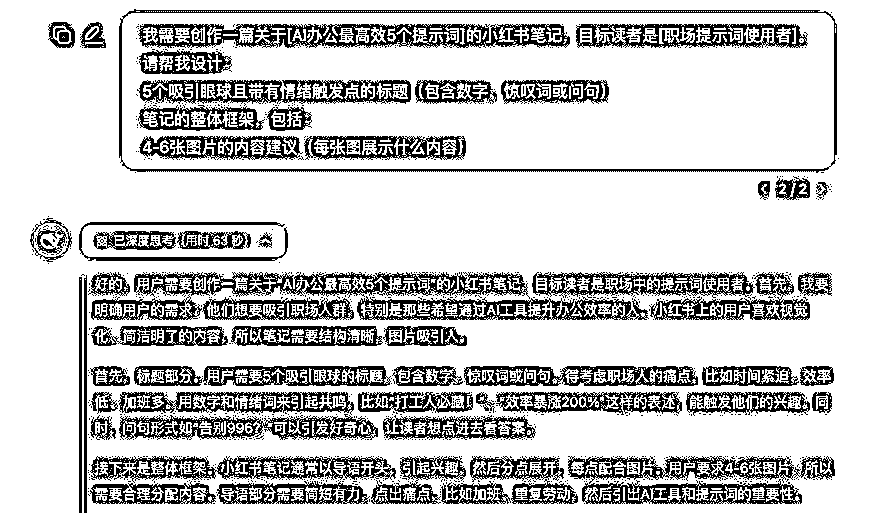

# 5句AI指令，准点下班

说真的，上周我把这5句话丢给AI，老板还以为我背着他加班。其实我每天到点拎包走人。今天把压箱底的模板全掏出来，直接抄，别客气。

开头配图我做了左右对比：左边文件山+苦脸，右边咖啡+AI聊天框，配字“从忙乱到从容，就差这5句指令”。

先记一条：AI不是来抢饭碗的，它是你的第二大脑。别老问“帮我想想”，要直接派活。你越会下命令，它越像随叫随到的助理。配图可以放大脑+机械臂同框的插画，重点句标黄：会用AI的人，都在把它调教成贴身助理。

1️⃣ 开会记录，十分钟收工  
场景：跨部门会、客户沟通。  
指令：“把这段录音变成三列表：决策点、待办动作、风险提醒；哪件最急，用颜色标出来。”  
亲测，两小时的会，整理十分钟搞定。配图：手机录音界面→彩色表格。

2️⃣ 邮件润色，体面又不生硬  
场景：重要邮件、英文邮件。  
指令：“把下面内容改成专业但不冷冰冰的商务邮件，补上数据依据，再给三条跟进说法。”  
草稿和终稿一对比，同事问我是不是偷偷报班了。配图：潦草草稿vs精致邮件拼图。

3️⃣ 周报速成，周五不再抓狂  
场景：周报、季度汇报。  
指令：“根据这些零散笔记，先列量化成果，再拆问题，最后给改进方案，附两个同行案例。”  
碎片便签丢进去，结构化报告出来。配图：便签→报告的过程动图。

4️⃣ 数据翻译，PPT有话说  
场景：数据分析、PPT制作。  
指令：“这份销售数据背后有什么门道？用大白话打比方讲清，再给三条能落地的动作，顺手输出柱状图代码。”  
原始表进去，图表加解读出来，再也不怕被问“所以呢”。配图：数据表→可视化+文字解读。

5️⃣ 待办管家，项目不掉链子  
场景：多人协作、项目管理。  
指令：“让AI建一份动态待办表，按四象限排先后；做完一项就更新进度图，并通知对应同事。”  
谁先干、谁配合，一目了然。配图：手机+电脑多屏任务看板。

执行交给AI，拍板留给自己。先收藏，明天少加一小时班。收尾配图用阶梯成长图：从手忙脚乱到AI指挥官。

配图小抄：Canva/Figma套手机样机；莫兰迪色打底+荧光色高亮；关键指令做荧光笔标注；加手部操作手机/键盘的镜头；关键步骤用箭头或进度条展示变化。

（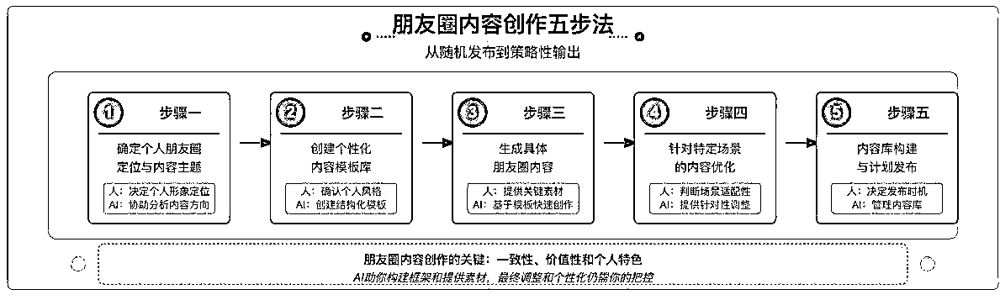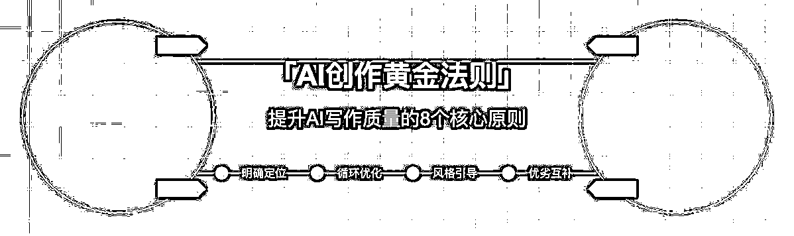）

# AI写作提速指南：观点你负责，表达交给它

想让AI写出真正可用的内容，先得看清它做不到什么：它拿不出独一无二的洞察，追不上最新鲜的行业数据，写不出带有个人体温的情感，也讲不清层层递进的因果。聪明的用法是——你来提供观点和判断，让它去搭框架、磨句子、理逻辑。

# 原则五：提示词工程，值得反复锤炼

提示词怎么写，AI的输出水平就跟着怎么走。这是一项需要刻意练习的核心能力。

一条好用的提示词，通常包含四块内容：

1. 目标和任务：写什么、给谁读、要达到什么效果
2. 背景信息：行业环境、读者画像、发布渠道
3. 约束规则：风格要求、字数限制、格式规范
4. 结构引导：整体框架、段落排布、视觉呈现

记住这条公式：基础指令 + 背景上下文 + 约束条件 + 结构引导 = 高质量输出

# 原则六：用“角色扮演”拉高专业度

给AI安上一个具体的专业身份，内容的说服力会明显增强。

具体做法：

- 让它以某领域资深人士的身份出现，比如“作为拥有二十年经验的营养学专家”
- 同时设定多个专家角色，从不同角度给出看法
- 叠加成熟的分析框架，例如“用SWOT方法分析”

参考模板：

请以[专业角色]的身份，运用[思考框架]，分析[问题/主题]；行文体现[专业特点]，并兼顾[受众需求]。

# 原则七：把指令分成战略、战术、执行三层

复杂的创作任务不要一口气丢过去，先拆成有层次的指令，每个环节才能被好好处理。

三层结构如下：

1. 战略层：总目标、核心定位、期望成果
2. 战术层：内容结构、论点安排、表达策略
3. 执行层：具体用词、句式变化、修辞技巧

落地时，先用战略层指令拿到整体框架，再用战术层指令充实结构，最后用执行层指令精修表达。

# 原则八：构建自己的“提示词库”

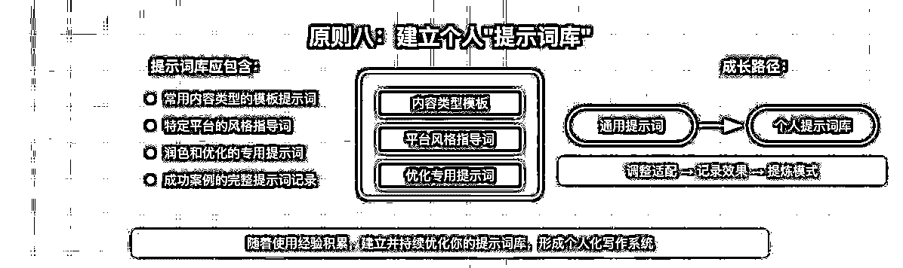

用得越久，越值得把那些好用的提示词沉淀下来，慢慢迭代成一套属于你的写作系统。

提示词库里可以放：

- 各类常见内容类型的模板
- 不同平台专属的风格指导语
- 用于润色、优化的专用指令
- 成功案例的完整提示词记录

成长路线：从通用模板出发，按需适配，记录效果，提炼规律，最终形成个人提示词库。

希望这份实操手册，能帮你把AI真正变成创作加速器，一点一点筑起属于自己的内容护城河。

别忘了最重要的事：AI是放大你创意的工具，而不是替代你创造力的技术。熟练之后，你会有更多时间投入到真正的思考中，让内容创作回归本质——连接、影响、启发。

# 4.2 让AI拿起画笔

# 4.2.1 几个容易忽略的关键点

提示词，说白了就是一句自然语言或一段简短的文字描述，用来告诉AI你想要什么画面。操作本身不复杂，但开工之前有几个要点值得留意。

写提示词时：

1. 把你认为重要的背景和细节尽量说清楚
2. 把注意力放在“想要什么”上，尽量别写“不要什么”
3. 遇到AI不懂的专有名词，就用更通用的说法解释

通用提示词公式：

# 💡

Subject + Style + Setting + Composition + Lighting + Additional Info

翻译过来就是：主题 + 风格 + 环境 + 构图 + 光照 + 附加信息

（前三个最关键）

- 风格：偏爱的画风或年代感
- 主题：中心人物、物体或动物，包含外貌、颜色、特色
- 环境：所处位置（室内、室外、架空世界）、自然或城市元素、时间与天气
- 构图：特写、广角、航拍，以及角度和取景偏好
- 光照：明亮或昏沉、自然或人工光源、情绪与氛围
- 附加信息：次要角色与物体的位置、互动关系

# 4.2.2 给文章配图

# 4.2.2.1 操作流程

Step 1 准备工作：打开即梦AI官网或App（https://jimeng.jianying.com），用手机号、🛰️等账号完成注册登录，并确认账户里有足够的绘图额度——新用户通常有免费额度，也可以买会员或充值。

Step 2 熟悉界面与参数：左侧是提示词输入区，右侧是结果展示区。重点看几个参数：画面比例有1:1、3:4、4:3、9:16、16:9等；单次可生成1-4张；模型决定风格取向；采样方法影响精细度。

Step 3 提示词怎么写：记住“风格+主体+背景”的基本结构。风格可以写“水彩风”“插画风”“浮世绘”“赛博朋克”等；主体要具体，把人物特征、动作、衣着都写明白；背景补充场景、时间、光线和氛围。

Step 4 实际生成：进入“图像生成”，按文章主题选定配图风格，文章配图建议选16:9或3:4比例，然后输入提示词，比如：

# 💡

水彩画风，咖啡店窗边坐着一只橘猫，阳光透过玻璃洒在桌面，摊开的书旁放着热咖啡，温馨氛围，细节高清

点击生成按钮，一般等10-30秒。

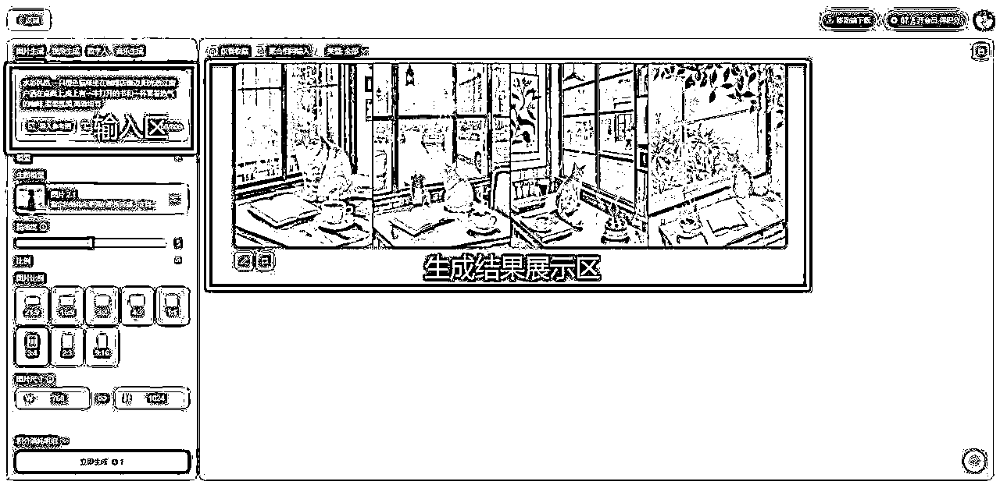

Step 5 优化调整：从生成结果中挑一张满意的，用局部重绘修补不理想的部分，也可以调整提示词来强化或弱化元素，再用放大功能提高分辨率，最后以PNG或JPG格式导出。

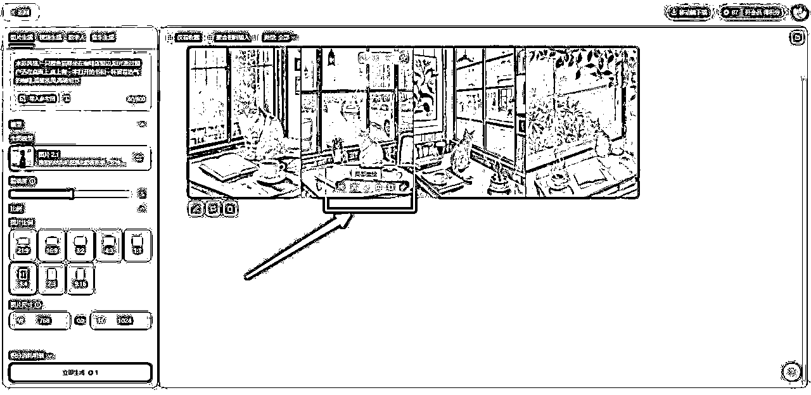

Step 6 应用到文章：把图片下载到本地，按平台要求调整尺寸，上传到文章编辑器，加上合适的图注或标题，再确认图片和内容匹配。

进阶提示：好用的提示词记得存进自己的素材库；给长文配图时，可以批量生成同一风格的图，保持整篇文章视觉统一。

# 4.2.2.2 案例演示

水彩画风，咖啡店窗边坐着一只橘猫，阳光透过玻璃洒在桌面，摊开的书旁放着热咖啡，温馨氛围，细节高清

赛博朋克画风，未来实验室里机器人和人类正在协作，蓝色全息投影环绕四周，操作台科技感十足，玻璃隔断另一侧有工程师在忙碌

明亮美食摄影风，大理石台面上摆着彩虹色蔬果沙拉碗，周围是精美餐具和新鲜水果，旁边还有坚果与超级食品，自然光线

写实摄影风，古老欧洲小镇的石板街道两侧是色彩鲜艳的花窗建筑，远处耸立着教堂尖顶，游客们悠闲漫步，阳光明媚，画面细节丰富

童话风插画，孩子们在图书馆里探险，高耸的书架之间，好奇心满满的小读者翻阅着大部头，书中角色化作半透明影像浮现出来，色调温暖，充满想象力

高级时装插画风，模特穿着前卫设计的服装，在简约纯色背景前展示廓形与面料，姿态优雅有力，质感精致，氛围如同一张时尚杂志大片

注意：从即梦下载的图片自带水印，充值会员才能去除。不想花这笔钱的话，用美图秀秀等工具手动抹掉水印即可。

# 4.2.3 做运营海报

# 4.2.3.1 操作流程

Step 1 准备：登录即梦AI官网或下载App，注册账号，查看账户绘图额度，不够就购买会员或充值。

Step 2 定好尺寸与格式：
- 朋友圈海报：900×1600px（约9:16）
- 👸号封面：900×383px（约2.35:1）
- 社交媒体方形图：1080×1080px（1:1）
- Banner横幅：1920×600px（约3.2:1）

文件格式通常是JPG或PNG，大小尽量控制在2MB以内，尤其常用于🛰️等平台时。

Step 3 做好构思：先确定海报主题和核心信息，比如产品推广、活动宣传或品牌形象；再列出需要出现的文字，包括主标题、副标题、促销信息、价格、品牌口号等；最后想清楚文字和画面的布局关系。

Step 4 生成带文字的海报：进入“图像生成”，按海报类型选择画面比例，模型选“图片2.1”。

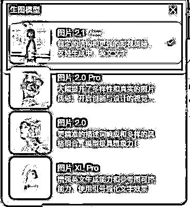

在提示词里直接写清文字内容和位置，例如：

清爽商业广告风，春季新品促销海报，画面中央是白裙模特优雅站立，周围点缀樱花，顶部用大号黑色文字写着“春季新品”，底部用中等大小文字写着“限时5折”，整体粉白色调，细节高清

文字描述还可以更精准：位置用“顶部居中”“右下角”“底部横幅上”；字体用“优雅衬线字体”“粗体无衬线字体”“手写艺术字”；颜色用“白色文字”“红色描边黑色文字”；大小用“大号标题”“小号说明”。写好提示词后点击生成，等几十秒。

Step 5 修正文字：如果文字效果不理想，可以用重绘功能选中文字区域，修改提示词里的描述再重新生成。想让字更清晰，就加上“清晰可读的文字”“高对比度文字”，或者指定“黑底白字”“白底黑字”；想要中文字体更有味道，就写“中文粗体字”“中文书法风格”，甚至直接说“类似宋体”“类似黑体”。

Step 6 多段文字排版：用分区描述法，把每处文字的位置写清楚，比如“顶部标题区有‘新品上市’”“中间产品图下方有产品名称”“底部是小字体活动说明”。层次感也要拉开：主标题用大号粗体，副标题用中等斜体，说明文字用小号细体。文字与图像的关系可描述为“文字悬浮在图像上方”“文字融入背景”或“文字位于留白区域”。

Step 7 特殊效果：艺术字可以写“霓虹灯效果文字”“金属质感立体字”“水彩笔触艺术字”；装饰可以加“光晕”“投影”“花卉环绕”；字框和背景可以写“半透明白色背景”“彩色渐变条幅”“细线边框”。

Step 8 检查并导出：整体检查海报内容是否完整准确；文字不满意就继续细化字体描述；满意后直接下载成品，不需要额外用PS；需要更清晰的话，可用即梦的高清修复功能。

# 4.2.3.2 案例演示

商业促销海报风，黑色智能手机居中展示，四周是科技感光效，顶部醒目的红色大字“年中大促”，中部黄色字“全场5折起”，底部白色小字“限时三天 6.18-6.20”，深色背景，整体很炫酷

美食摄影风，咖啡店促销海报，拿铁特写配着精致拉花，旁边有甜点，顶部复古字体写着“周末限定”，中间手写风格文字“买一送一”，底部小字“每周六日 10:00-12:00”，温暖棕色调

时尚杂志风，化妆品新品上市，一瓶高级粉色香水居于画面中央，背景优雅虚化，顶部黑色衬线体写着“NEW ARRIVAL”，中间是产品名“Rose Elixir”，底部细字写“独家配方 持久留香”，粉金色调，高端质感

清爽商业广告风，春季新品海报，白色连衣裙模特站在樱花之中，顶部大号黑字“春季新品”，底部中号字“限时5折”，粉白配色，画面干净又有细节

# 4.2.4 做个人IP形象

# 4.2.4.1 操作流程

Step 1 前期定位：先确定IP所在的行业（美妆、财经、教育、美食等），想清楚目标人群的年龄、性别和兴趣，再明确人设气质是专业、幽默、温暖还是前卫。接着收集参考：看看同领域成功IP的风格，多数走写实路线；再准备几张自己的照片，方便AI参考个人特征；还可以收集喜欢的人像摄影风格。

Step 2 熟悉即梦AI：注册登录账号，了解免费额度，找到“图像生成”功能区。

Step 3 形象设计：风格以写实为主，“专业人像摄影风格”“高清商业人像风格”都很适合；把性别、年龄、体型、发型、面部特征、服装配色和标志性元素（眼镜、发型等）规划好；同时确定背景和光线，比如纯色背景或虚化的专业场景、自然光或影棚光。

Step 4 生成基础形象：进入“图像生成”，模型选“图片2.0”。

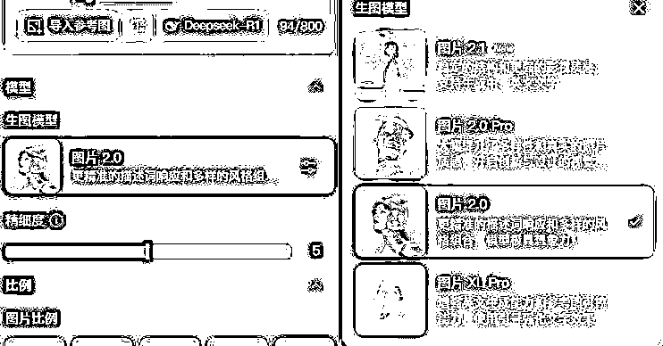

导入参考图，在参考项中选择“人物长相”，保存设定。

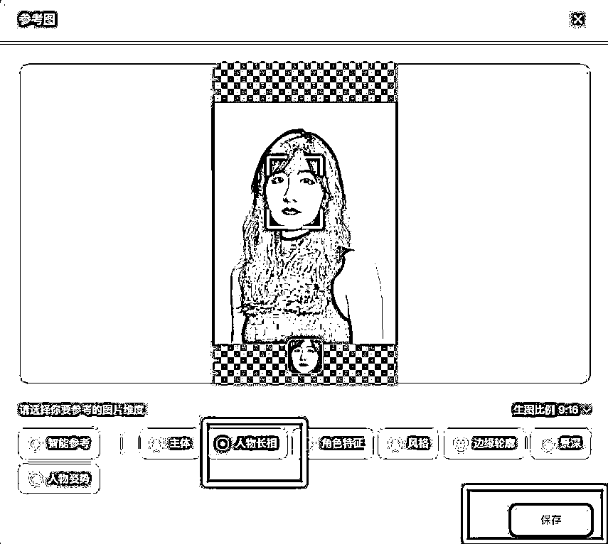

画面比例建议用1:1或3:4，适合当头像。提示词尽量写细，例如：

专业人像摄影，35岁亚洲女性，齐肩黑发，自然职业妆容，戴黑框眼镜，穿深蓝西装配白衬衫，神情自信专业，嘴角带笑，半身构图，柔和影棚灯光，浅灰纯色背景，画面锐利，高品质人像

点击生成，等10-30秒，然后从多张结果中挑最接近理想的一张。

重要提醒：把这次成功的提示词记下来，作为后续生成的基础模板。

Step 5 保持一致：迭代修改时，人物核心特征（年龄、性别、发型、脸型等）不变，摄影风格（色调、光线、质感）不变，光线和背景描述也不变，只改需要变化的部分，比如把人像表情从“自信专业”换成“温和亲切”。如果即梦有变体功能，可以直接用来试不同表情。生成后要检查：换了表情或场景，还能看出是同一个人吗？不一致就继续调。

进阶技巧：

- 写实风格提示词多使用摄影术语：“人像摄影”“商业人像”“自然光人像”
- 光线写细一点：“侧光”“蝴蝶光”“轮廓光”
- 镜头感也可以提：“类似85mm人像镜头”“浅景深效果”

一致性优先级：首先是人物特征一致，其次是摄影风格一致，最后是背景环境处理方式一致。每次生成都把新图与基础形象放一起对比，直到满意。

# 4.2.4.2 案例演示

参考形象（本人也是AI生成）

美食摄影风，30岁亚洲女性，天生卷发，时尚眼镜，休闲文艺穿搭，手持相机或美食，表情愉悦又带点惊喜，坐在特色餐厅里，周围摆盘精致，温暖色调，美食家与生活家的气质自然流露

商业杂志风，40岁亚洲女性，干练短发，剪裁利落的灰色西装，自信微笑，站姿挺拔，双臂交叉或拿着平板，背景是现代办公室或城市天际线，专业成功人士气场，适合职场内容创作，画面清晰锐利

专业人像摄影，35岁亚洲女性，齐肩黑发，自然职业妆容，戴黑框眼镜，穿深蓝西装配白衬衫，神情自信专业，嘴角带笑，半身构图，柔和影棚灯光，浅灰纯色背景，画面锐利，高品质人像

# 4.2.5 做🛰️红包封面

# 4.2.5.1 操作流程

Step 1 注册平台：在电脑端搜索“🛰️红包封面开放平台”，按提示注册。注意：需要视频号或👸号粉丝数达到100以上才能注册。

Step 2 粉丝不够怎么办：

a. 淘宝买粉：搜“淘宝运营/推广”，找店家咨询
b. 📕开店：个人店0粉丝就可以申请，但需要养号，还要交1000元押金
c. 闲鱼发布：零门槛，直接挂出

Step 3 下载模板并制作：封面图要求957×1278px，小于500KB；挂件要求1053×1746px，小于300KB，PNG格式。这个尺寸接近3:4，AI生图时可以直接选择相近比例。

做红包封面别急着上手，先去定制红包页的[样式]入口把设计模板下载下来。尺寸这一步必须先弄明白，否则后面每改一次都要返工，很耗时间。真正要编辑的内容共三块：红包封面、封面挂件、气泡挂件。

Step 4：做红包封面

进入即梦 AI，打开“图片生成”。

封面画幅接近 3∶4，生图时选 3∶4 即可。

写提示语可以按“画风+主体+场景”来组合：

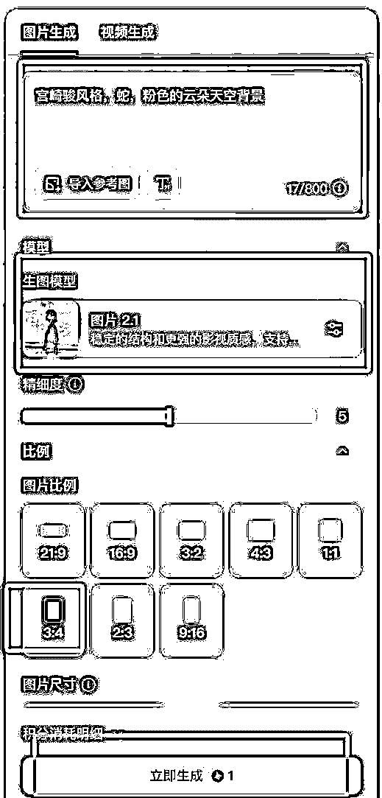

# 4.2.5.2 三组指令出封面

黑白水墨感，蛇，宣纸背景

水彩插画感，蛇，纯红底色

皮克斯动画感，可爱大头卡通蛇，金色背景

# 4.4 用 AI 完成视频

# 4.4.1 让 AI 先写脚本

Step 1：先做准备

打开 DeepSeek 网页端或 App；
完成注册并登录；
对准备做的视频主题先建立基本认识。

Step 2：BROKE 框架写提示语

用 BROKE 五段式来搭指令，包含：

Background：交代来龙去脉，让 GPT 获取足够上下文。
Role：给 GPT 安排身份，让它按角色输出。
Objectives：说清任务目的，告诉 GPT 要完成什么。
Key Results：列出关键成果，让 GPT 明白目标要拆成哪些具体、可检验的结果。
Evolve：边试边改，通过测试看效果，再按反馈调整。

Step 3：可直接套用的模板

# 💡

帮我产出短视频口播文案。

【背景】

这条视频讲的是[主题]；
观看人群为[年龄段/兴趣爱好/职业]；
内容调性偏[搞笑/专业/温馨/励志]；
预计时长[15-60]秒。

【角色】

请以资深短视频编剧的身份来写；
你熟悉[领域]的内容；
表达方式采用[轻松活泼/专业严谨/感性温暖]。

【目标】

文案要能[抓眼球/讲知识/引共鸣]；
回应观众关于[问题]的疑问；
调动观众的[情感反应]。

【关键结果】

总字数不超过[字数]；
结构上要有开头钩子、主体信息、结尾行动号召；
安排[2-3]个互动点。

【优化】

再补一个不同版本的开场；
指出文案里最抓人的地方和薄弱处；
给出结合平台推荐机制微调的建议。

Step 4：实际怎么操作

a. 先交基础指令

把上面的模板粘贴到 DeepSeek 对话框，把每个方括号里的内容补全，发送后先拿第一版。

b. 审核并迭代

逐句读它给出的稿子，提出明确修改要求，例如“开头太长，压到 15 字内”；也可以追问某句为什么这样写，例如“这个问句开头的用意是什么？”

c. 定制化优化

让它按抖音、快手、视频号分别改；要求加入热点元素或话题标签；再调整语速和停顿，让口播更顺。

Step 5：实用技巧

a. 差异化设置

一次生成三种风格的开场，挑最合适的；换不同情绪基调，观察哪种互动更好；按平台各出一版。

b. 脚本完善

补充语气词、口头禅，让人设更鲜明；设计过渡句和衔接词，使表达更顺；把口播时的表情、动作提示也写进去。

Step 6：完整实例

目标：产出一条美食教程短视频文案。

指令：

# 💡

帮我产出短视频口播文案。

【背景】

这条视频讲“10 分钟懒人早餐——牛油果鸡蛋吐司”；
观看人群是 25-40 岁上班族与年轻父母；
调性轻松、实用，属于烹饪教学；
时长约 50 秒。

【角色】

请以专业美食博主兼生活方式达人的身份来写；
你擅长把复杂烹饪简化成健康快手菜；
语气亲切、活泼，带一点幽默。

【目标】

文案要呈现快速早餐的做法；
回应上班族早晨时间紧、又想吃得健康的需求；
让观众感觉这道早餐容易上手、营养搭配合理。

【关键结果】

总字数不超过 180 字；
包含开场吸引、食材介绍、操作步骤、成品展示、互动引导；
安排 2 个互动点，例如“猜猜我加的秘密调料是什么”。

【优化】

再给一个更有吸引力的开场替代版；
指出哪些细节容易让人收藏或动手做；
给出优化视频节奏的建议。

生成结果：

# 💡

从起床到端出一份能发朋友圈的牛油果溏心蛋吐司，十分钟内能搞定，方法就在这条视频里。早晨再赶，也能体面又省事～

食材：全麦吐司 2 片、鸡蛋 1 个、半个牛油果、盐和黑胡椒少许。【猜猜我加的秘密调料是什么？】

做法不复杂：

1. 吐司送进烤箱烤 4 分钟；
2. 同时煎一颗溏心蛋，撒一点盐；
3. 牛油果切片后压成泥；
4. 吐司抹上牛油果泥，再放溏心蛋；
5. 撒黑胡椒和红椒片，完成。

蛋白质和好脂肪都照顾到了，配杯咖啡就是一顿完整早餐。【你早餐一般几分钟解决？】关注我，后面继续分享 10 分钟懒人食谱。

# 4.4.2 配音与数字人出镜

# 4.4.2.1 上手流程

1. 先装剪映 App 或电脑客户端。它在数字人克隆方案里价格最低，但效果不是最强。
2. 新建空项目。
3. 选择“添加口播稿”。

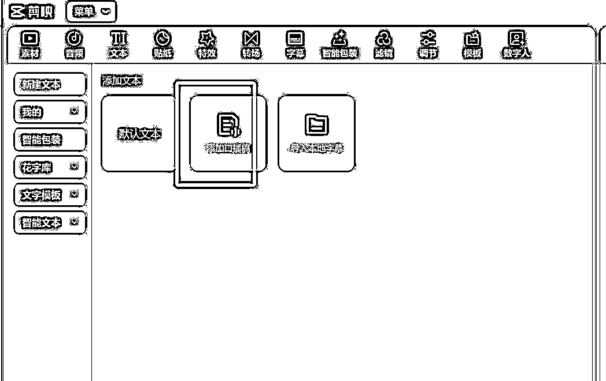

4. 把刚才写好的文案粘进去，再添加到轨道。

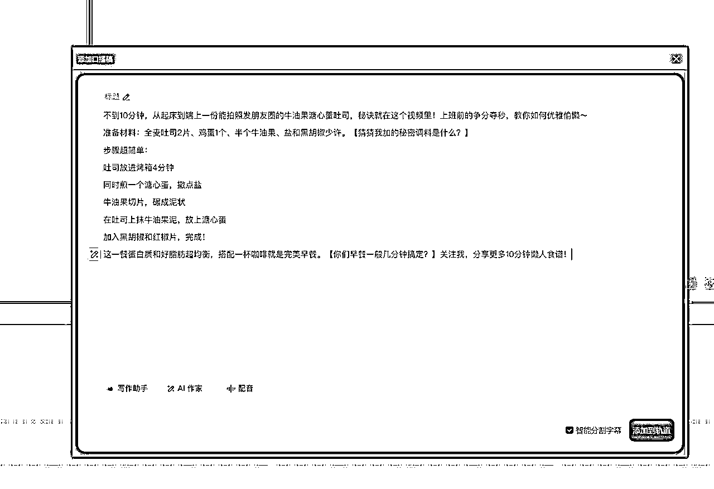

5. 字幕加好后，进入“数字人 > 定制形象”，49 元一个。

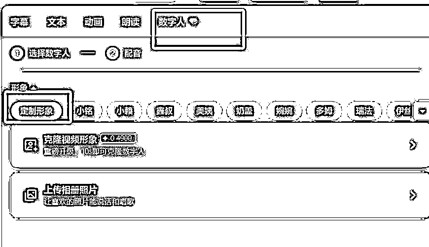

6. 按页面提示上传数字人视频，克隆自己的形象。
7. 定制完成后进入第二步配音，制作自己的音色，选择“克隆音色”。

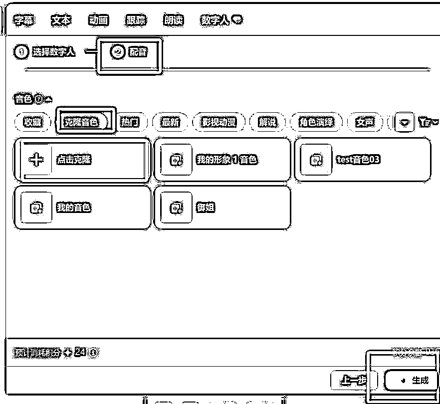

# 4.4.2.2 成品展示

下面是我用数字人生成的视频。

final.mp4【在线播放】

# 4.4.3 让图片动起来做视频

# 4.4.3.1 操作要点

打开即梦 App；
上传图片；
提示语可填可不填；
其他参数保持默认；
画面比例跟随上传图片；
提示语公式：主体 A+动作 A，主体 B+动作 B。图生视频的指令就是这么直给。

进阶玩法：首尾帧技巧

分别上传首帧和尾帧图片，能生成过渡连贯的视频。要点是：两张图尽量保留同一主体，差异别拉太大，再用文字说明两帧之间如何变化。

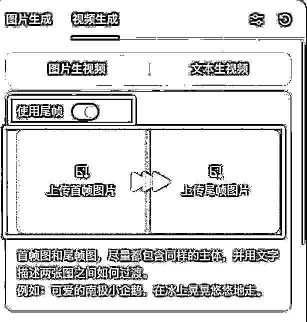

# 4.4.3.2 效果示例

output.mp4【在线播放】

猫厨师颠锅炒菜

imageinput_金币掉落，蛇开心地笑，跳了一下_2025-01-08 17_48_18.mp4【在线播放】

金币洒落，蛇开心一笑

imageinput_小女孩对着镜头微笑_2024-09-12 21_07_41.mp4【在线播放】

小女孩朝镜头笑

imageinput_走路_2024-09-12 18_14_24.mp4【在线播放】

羊模特往前走

# 选修篇：再进阶一步

# 五、用 AI 做课程

# 💡

# 本章速览

如果你的 IP 变现靠知识付费，自己出课基本躲不开。做课费时费力，而 AI 能明显降低制作难度，下面一起看。

# 5.1 做课工具怎么挑

这里重点说 3 个：DeepSeek、腾讯元宝、Kimi。

挑选时按条件来：

1. 能🪜🧙‍♂️，也不怕花钱，就用 GPT，效果不错；
2. 上网条件受限，就用 DeepSeek 和 Kimi，免费且够用；
3. DeepSeek 官网拥堵时，优先换「腾讯元宝」；
4. Claude 不建议首选，但时间和预算都宽裕的圈友，可以用它润色、填充课程内容；
5. 这里主要聊 AI 大模型，做课还会用到其他 AI 工具或平台，后面会讲。模型工具迭代很快，建议持续关注行业前沿，从实操出发不断实践。

# 5.1.1 DeepSeek：课程骨架利器

https://www.deepseek.com/

如果网络环境不需要魔法🧙‍♂️，DeepSeek 很合适。它强在长链条分析与推理，搭课程骨架尤其顺手。

下图是目前用 AI 工具做课的真实场景：DeepSeek 产出约占八成，Kimi 约占两成。

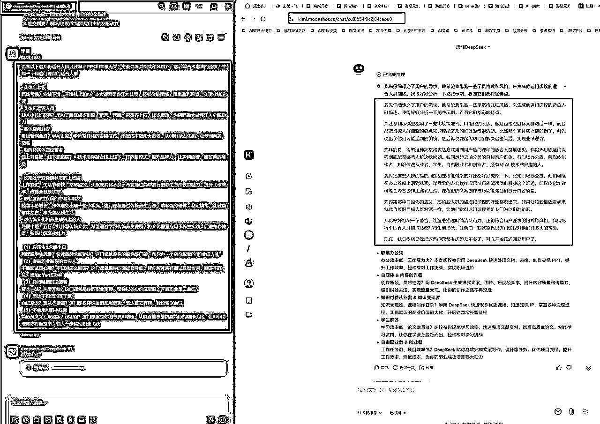

# 5.1.2 腾讯元宝：拥堵时的替补

https://yuanbao.tencent.com/chat/

在元宝里操作时，记得☑️勾选 DeepSeek 模型。

现在【腾讯元宝】能传【图片】【附件】，入口在界面右下角。

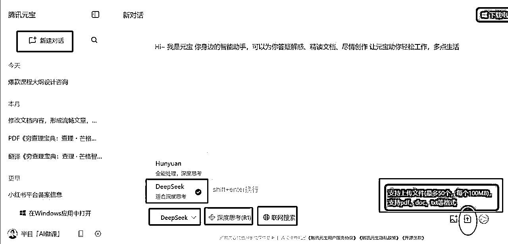

腾讯资源足，元宝体验稳定；DeepSeek 官网拥挤时，可以优先换它顶上。

# 5.1.3 Kimi：长文填充

https://kimi.moonshot.cn/

Kimi 更擅长往课程骨架里填内容，能顺着上下文分步骤长输出。

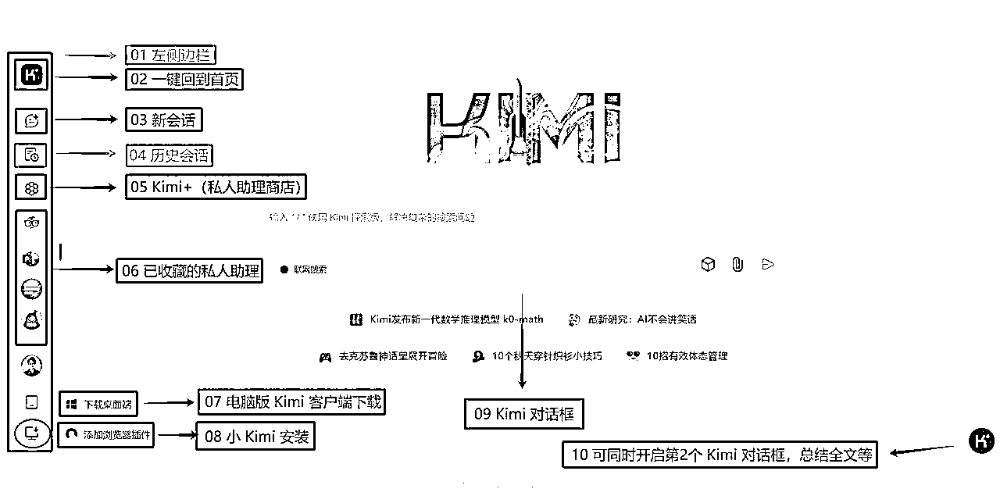

● 电脑端大致分十块：左侧导航、回首页、新会话、历史、Kimi+ 助理商店、已收藏助理、对话区等。
● 日常在【07 Kimi 对话框区域】操作；要联网就开搜索；右下角可设快捷短语；文件上传上限 50 个、单个 100MB，支持 pdf、doc、xlsx、ppt、txt、图片等。
● Kimi+ 里的【提示词专家】【PPT助手】做课常用。
● 用过的助手会进【06 已收藏的私人助理位置】，最多放 5 个，超出会被替换。
● 右下角 10 号按钮通过 08 安装小 Kimi 插件，能在当前会话中再开一个“小 Kimi”，做追问、归纳和总结。
⭐️现在 Kimi 也有【长思考】，记得勾选☑️。

# 5.1.4 GPT：付费版更顺

https://chat.openai.com/chat

GPT 付费版体验顺滑；免费版拿来「做课」，不如 DeepSeek、Kimi 好用。

充值有个小办法：支付宝里找小程序 Pockyt Shop，直接买苹果充值卡，无手续费，按汇率换算，划算～

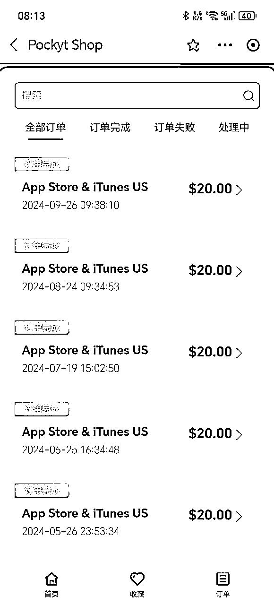

# 5.1.5 Claude：润色补充

https://www.anthropic.com/

Claude 常用于故事类爆文，指令更口语，文字细、情感足，人味重。大纲出来后，可用它补课程内容，AI 腔会淡些。

但它也要魔法和付费；条件不具备就用 DeepSeek、Kimi，后面用去 AI 味指令也能接近同样效果。

# 5.1.6 提示词怎么写

# 5.1.6.1 提示词是什么

先弄懂提示词是什么，可以直接问 DeepSeek：

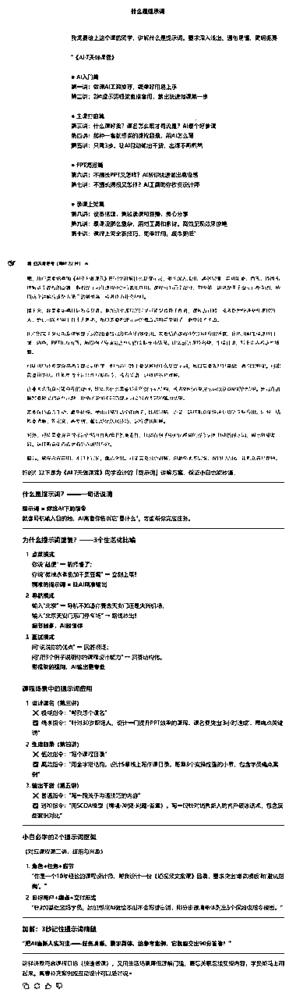

提问时把课程大纲一起贴上，模型更容易理解背景和范围，回答会更贴场景。这个习惯值得练。

# 5.1.6.2 DeepSeek 的“五环”指令法

【我是谁+背景信息+目标客户+布置任务+注意事项】

很多人可能还不知道，DeepSeek 官方有【提示词库】，建议收藏：https://api-docs.deepseek.com/zh-cn/prompt-library

✅用一个例子拆开看：

⭐假设要写《AI 少儿入门指南》课程大纲，对比两种问法。

① 不会用公式的圈友，可能只写：

我是一名从事少儿教育的老师，请帮我写《AI 少儿入门指南》这门课程的大纲。

效果⬇

② 更完整的问法会这样组织：

我是一名从事少儿教育的老师；
准备做《AI 少儿入门指南》；
面向 8-12 岁小学生，带他们了解 AI 大模型基础知识并掌握基本用法；
请编写课程大纲。

要求：
1. 语言有趣、易懂、简明；
2. 突出卖点，激发家长培养孩子 AI 能力的意愿；
3. 戳痛点，让家长意识到不学 AI 可能落后；
4. 说明学完后的成果；
5. 分若干模块，每模块若干标题，共 7-10 节；
6. 呈现接地气，不夸大。

效果⬇

对比很明显：完整版更贴合孩子兴趣，也更能打动家长；简版平，竞争力弱。指令质量直接决定课程呈现。

③ 拆解一下完整问法怎么按“五环”组织。

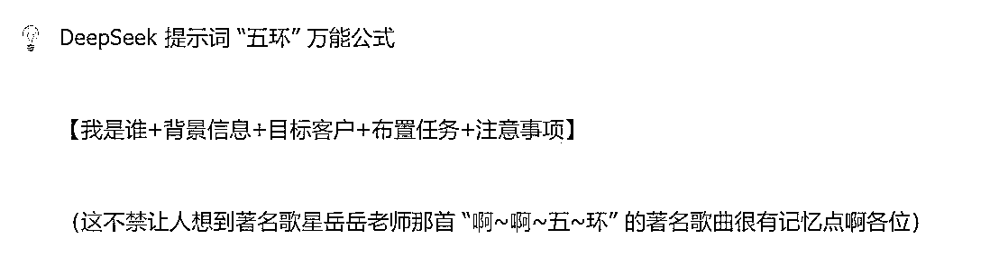

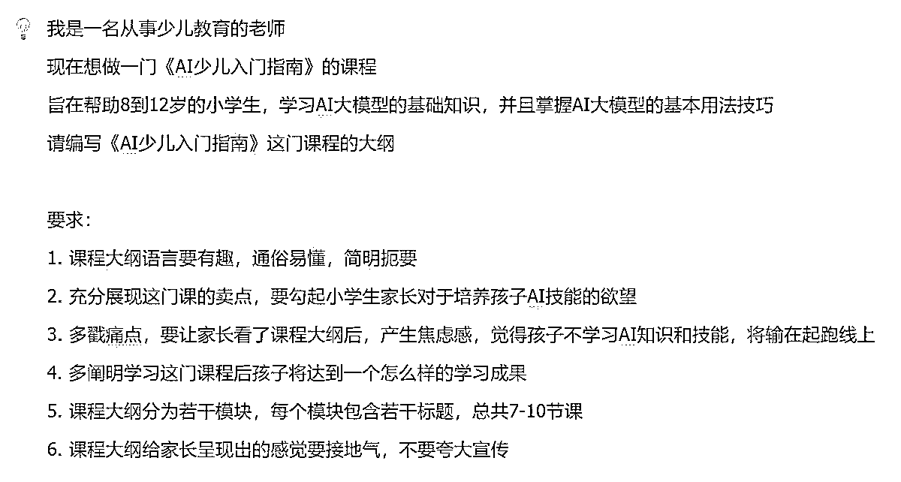

第一环【我是谁】
角色越具体，场景限定越准。
例：我是少儿教育老师。

第二环【背景信息】
说清要做什么。
例：准备做《AI 少儿入门指南》。

第三环【目标客户】
补充受众和期望效果，让模型更懂用户。
例：面向 8-12 岁小学生，学 AI 大模型基础与基本用法。

第四环【布置任务】
指令要清楚、无歧义，一次一项任务通常比一次多项更准。
例：请编写课程大纲。

第五环【注意事项】
末尾加约束，让模型在边界内发挥。
例：语言有趣、突出卖点、戳家长痛点、说明成果、7-10 节、接地气不夸大。

照这个五环去套，通常能拿到较满意的指令。实践中慢慢体会。

# 5.1.6.3 结构化提示词模板

【结构化提示词的基本框架】

#Role: 角色

##Background: 背景

##Profile: 简述

author: 作者

version: 0.1

language: 中文

description: 背景信息

##Goals: 目标

##skills: 技巧

# 结构化提示词不吓人，抓住三点就够

初次接触结构化提示词，看到满屏英文标签和符号，很多人第一反应是“这不跟代码一样吗？”先别慌，稳住。一个标准的结构化提示词，通常由几个固定区块拼成：

##Constrains: 约束条件
##Workflows: 执行流程（按 1. 2. 3. 顺序推进）
##Output format: 返回格式
##Example: 样例参考
##Initialization: 初始化——设定AI扮演某个角色，在[Background]背景下理解任务、遵循规则、采用默认设置，并依照既定次序与用户互动

弄懂它并不难，记住三个动作：

①先通看一遍。别一上来抠细节，从头到尾扫一次，混个眼熟。

②补一点Markdown常识。#代表一级标题，##代表二级标题，靠#的数量区分层级。你只需知道这是标题分级的记号，不用深究原理。

③扫一眼英文标签后的中文注释。每个词旁边都有解释，看一眼心里有数——知道它负责哪部分，对「做课」来说已经够用。

接下来还是用《AI少儿入门指南》做例子。我写一段结构化提示词，分别交给Kimi和DeepSeek，让它们各自产出课程大纲，比比效果。

提示词如下：

#Role: 亲切热情的少儿AI导师

##Background: 你是一名少儿教育从业者，明白AI在将来社会里的分量，想借《AI少儿入门指南》点燃孩子对人工智能的好奇，锻炼他们的逻辑思考与创新意识。

##Profile:

author: 半目

version: 0.1

language: 中文

description: 你具备扎实的AI知识和教学经验，善于用孩子喜欢的方式讲清复杂概念，让他们在轻松氛围里学习。

##Goals: 请为《AI少儿入门指南》编写课程大纲，用简洁、通俗、有趣的语言突出课程卖点，打动8到12岁小学生的家长，促使他们为孩子报名。

##skills: 你能把抽象的AI知识转成孩子听得懂的话，设计有趣的互动环节，调动学习热情。

##Constrains:

内容要贴合8到12岁小学生，语言浅显易懂，少用专业术语和复杂表达。

大纲要以清晰有趣的方式呈现，每一部分都写明学习目标和预期收获。

附上课程简介，提炼卖点，列出超值权益。

每节课标题可适当（非必须）采用“数字+成果”的写法，增强吸引力。

请严格按Workflows执行。

##Workflows:

1. 请用户提供爆款课程大纲的模仿样本

2. 生成《AI少儿入门指南》爆款课程大纲

3. 用户确认后，依据反馈修改

##Initialization: 你好，我是亲切热情的少儿AI导师，能根据你的反馈生成爆款课程大纲。请先提供你想模仿的大纲样本。

参考下面这份课程大纲的写法和卖点提炼方式，为《AI少儿入门指南》编写大纲。模仿样本如下：

课程名称：AI·7天做课营

大纲目录：

● AI入门篇

第一讲：做课AI工具推荐，简单好用易上手

第二讲：2种提示词框架直接套用，踏出快速做课第一步

● 主课打磨篇

第三讲：什么课好卖？课名怎么取才有流量？AI是个好参谋

第四讲：那种一看就想买的课程目录，用AI怎么写

第五讲：只需3步，让AI自动输出干货，出课不再煎熬

● PPT海报篇

第六讲：不擅长PPT又怎样？AI帮你快速做出高级感

第七讲：不擅长海报又怎样？AI工具助你秒变设计师

● 录课上架篇

第八讲：设备搭建，兼顾录课和直播，良心分享

第九讲：录课没那么复杂，用对工具和素材，高效呈现效果惊艳

第十讲：课程上架全新技巧，简单好用，成本更低

两个模型收到提示词后，产出的大纲效果如下：

Kimi

DeepSeek

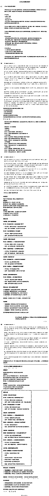

⚠提醒一句：实际运行「结构化提示词」时，AI有时会自作聪明，跳过Workflows直接给答案。遇到这种情况，不必重写，补一条指令就能把它拉回来：

请按Workflow继续输出：

1. xxx

2. xxx

3. xxx

……

发完这条指令，AI通常就会回到既定流程。若结果还差一点，别客气，把意见拆成一条条、分步反馈，让它逐项改。AI像个孩子，需要耐心引导、慢慢哄，才会越来越贴近你想要的靶心。

最后收个尾：

①如果结构化提示词实在难写，就把「“五环”万能公式」这一招往死里练，一招练透，一个人也能打天下；

②学会把大问题切成小问题，逐个问AI、逐个优化，难题自然化解；

③AI给的结果不理想？直接把你满意的「模仿案例」喂给它——这是提示词技巧里很关键的一招。

# 5.2 敲定课程主题

# 5.2.1 找准课程定位

接下来聊「课程定位」。什么叫课程定位？一句话：你卖某类产品或服务，服务某类人，解决他们的某种需求。

拿我自己举例：帮自媒体创业者、想做副业的人，用AI工具加提示词，提高知识付费产品制作与上架的效率。

这句话别小看。以后朋友圈签名、👸号简介、📕介绍——凡是自媒体最显眼的位置，都要放它。陌生人第一次见你，问你是做什么的，你一句话说不清，对方马上会觉得你：不！专！业！

定位清楚，再取一个自带流量的课名，就能正式开工做课。

那定位怎么找？对每个人来说，做什么课才能让爱好、擅长、赚钱三样都满意？值得好好想。

🚬 我建议找个安静的晚上，半夜也行，自己待在书房，或窝在沙发里，电脑前也行，捧着手机也行，点支烟、抿两口小酒，静下心，按①到⑤的顺序，一层层往深里想：

# 💡

① 我喜欢什么？

② 我擅长什么？

③ 我想学什么？

④ 研究对标博主，看这条赛道有没有人已经走通，走得怎么样？

⑤ 求同存异，做出差异化

⬆️前四点不难理解，主课里有详细讲解和实例。这里单独展开第⑤点【和而不同➕差异化】。

拿我自己的例子。当初做市场调研，想看看【课程制作】这条路能不能走，于是去抖音、📕、视频号、知识星球转了一圈，发现做这行的人真不少，有些规模还做得挺大。我要是不管不顾闷头冲进去，跟一堆人挤【做课】这条赛道，怕是猴年马月才能跟各位见面。我的妙招是：切一个特别刁钻的小角度——【AI+做课】。这下就岔开了——我还是那个做课的人，但我做的是AI做课，这就是不同，这就是差异化。所以，找刁钻的角度去切市场，太重要了，聪明人一定会这么做。

那【和】而不同又是怎么回事？不同，就是差异化，上面讲过了。为什么前面还要加个【和】？

还是拿我自己举例。看过我课程海报的朋友（这里不贴图了，免得有引流嫌疑）应该有印象：乍眼一看，我的自拍照、海报色调、整体风格，就是一个老师的样子，一看就是搞知识付费、卖课的人。这一点很重要——你的形象、海报、朋友圈，看起来一定要像这行的人。如果我穿得花里胡哨，朋友圈嘻嘻哈哈，话里话外满嘴跑火车，大家还会来买我的课吗？让自己一眼看上去就是干这行的，太重要了。在【和】同行站在同一条线上的基础上，再叠一层差异化的buff，这样的差异化才是有源之水，后面才有源源不断的可能。

🌙 好了，现在回到你的书房、沙发，掐灭手里的烟蒂，放下酒杯🍷，把上面①②③④⑤这五个问题认真考量一遍，然后写下最终结论⬇️

# 💡

一句话说清课程定位：你卖的是某类产品或服务，服务的是某类人，解决的是他们的某种需求。

# 5.2.2 课程取名

课名起得好，流量跟着跑。

想清楚做什么课，也确认市场有机会（同行已经卖得不错），就可以正式进入做课环节。头一件事，就是起一个【自带流量】的课名。那课名怎么取才有流量？有什么诀窍？AI能帮上忙吗？

1. 四个取课名原则

# 💡

① 课程名称字数限制

② 课名中最好包含你这个行业的关键词

③ 多包含数字

④ 多体现结果、成果、效果

⬆️后三条很好懂，主课里有详细讲解和例举，我在这里重点展开第一条【课程名称字数限制】。

☞ 课名可以分为两种：

● 短课名（5-7个字）：比如《AI·7天做课营》。短课名一般用在海报、宣传图、文章标题等地方，短小精悍，好放好推广，长了确实放不下🤭

● 长课名（12-21个字）：也叫【课名的副标题】。拿我这门课来说，副标题就是《知识付费2.0爆款课速成秘籍》。长标题的作用是进一步说明课程主题，通常搭配“秘籍、手册”等词，用来吸引客户，一般放在主标题下方，比如⬇️

● 当然，直接把长标题当主标题用，也一样常见。

● 但我的观点是：小孩子才做选择，成熟稳重经验丰富的老师，当然【长短课名都要】！

● 海报、宣传图、文章题目需要贴课程名时，用短课名；上传课程平台，或者其他不限制字数的地方，就放长标题。长标题字数多，塞得下更多关键词，对引流是有好处的。

# 2. AI 提示词

前面把好课名的门道拆了个透，总结成4大原则。你的课名不用四条全占，尽量靠近就行。

当然，就算你已经把【取课名4大原则】握在手里，可能还是卡在“道理都懂、一动笔就懵”的状态。那就别死磕了，交给AI，让它来给你来点灵感！

还是以《AI少儿入门指南》为例，看看DeepSeek通过「取课名」AI提示词输出的效果：

AI生成的结果里，把那些让你眼前一亮的关键词挑出来，做「排列组合」，再对照本文提炼的「取课名4大原则」，尤其重视「包含行业关键词」这一条，你就能得到自己「满意」且「自带流量」的课程名字✔️

# 5.3 搭建课程目录

那种一看就想买的课程目录，AI怎么自动生成？

做课这件事，「简单」和「复杂」并存。

省心的一面是：只要你会借AI的力，把做课的各个环节都优化一遍，做课就不会变成吭哧吭哧几个月熬不出来的苦差事。

糟心的一面是：用不好AI，或者只会「表面」地用AI，那结果就两种——要么费时几个月做不出一门课，要么课做出来了却无人问津，亏到姥姥家。

今天单把「AI＋课程大纲」这个环节拎出来，看看每一步该怎么做。

# 5.3.1 课程大纲的「7步制作法」

一般做课选AI大模型，我们推荐DeepSeek（https://chat.deepseek.com/）。

很多人刚接触AI那会儿特别上头，跟一见钟情似的，恨不得事事都用AI。可不知道从哪天起，就变成了AI在玩你，而不是你在玩AI。

就像刚开始讲提示词的时候，我给大家演示过AI一键生成课程大纲，那个效果确实惊艳⬇️

然后就有同学跑来找我说：AI做课不就那么回事嘛，自动生成大纲而已，我也会，没什么难的……

行，不多废话，直接把我做大纲的理念和流程全部摆出来，请慢慢看：

# 💡

✅课程大纲制作流程⬇️

# 5.3.1.1 第一步：先不开AI，也别碰对标

（😮别惊讶，这一步很关键！）

# 5.3.1.2 第二步：把自己放到学员的位置上

拿《AI·7天做课营》来说，你想想：学员用AI做课，第一步要干什么（学AI大模型），第二步要干什么（掌握提示词），第三步呢……

同时再回忆一下：自己第一次用AI做课，走的什么流程？

对，就是坐在那儿硬想，把你对这个课【天然的、还没被AI和同行污染过的】思路，通通倒出来，写进课程里。

# 5.3.1.3 第三步：具体怎么写？真靠天马行空？

不，是有方法的。先把课程要讲清楚、要覆盖的几个大模块列出来。比如《AI·7天做课营》，我当初是这么列大模块的⬇️

# 💡

✅我的课程要解决的几大模块问题有：

--------------------------

01. 做课所需的AI模型与工具，以及提示词打磨
02. 课程大纲编写与内容填充
03. 录课软件与设备怎么搭
04. 海报、PPT制作中的AI工具妙用
05. 课程上架以及多平台售卖
06. 课程营销，靠AI加持，事半功倍

# 5.3.1.4 第四步：回到第一个大模块，逐个模块往下拆，小问题分别列出来

# 💡

✅我的课程要解决的小问题有：

--------------------------

01. 盘点做课可用的AI大模型，择优选用
02. 两套经典提示词框架怎么用
03. 结合实例，把提示词优化到位
04. 让AI分析客户需求，找到课程定位
05. 怎么理出一份让人一看就想买的课程大纲
06. 借AI之手写课程目录
07. 课程内容填充，让AI自动输出干货
08. 做PPT用得上的AI技巧
09. 用AI工具做出精美的课程海报
10. 设备搭建清单，良心推荐不踩坑
11. 靠谱的录课软件盘点
12. 提供录课素材包，做课又快又好看
13. 做课用得上的剪辑技巧
14. 新手老师也能轻松上手的课程上架技巧
15. 课程上架：分平台、全流程、像素级拆解
16. 多平台卖课怎么分配侧重点
17. 短视频卖课里怎么巧用AI
18. 图文卖课里怎么巧用AI
19. AI怎么帮你搭建私域卖课的场景
20. 课程体系与价格体系如何设计
21. 内容做扎实、服务做到位，长期打造知识IP

⬆️这一步拆得越细越好，相当于把你脑子🧠里关于这门课的所有【点】都铲出来、挖干净，这就是干货，而且是你本人独有的干货！

🎯再用《AI少儿入门指南》走一遍流程，列出这门课的【大模块+小问题】：

# 💡

✅《AI少儿入门指南》大模块问题有：

--------------------------

一、少儿AI入门

二、AI工具箱

三、AI与创造力

四、AI解决问题

五、AI与未来

# 💡

✅《AI少儿入门指南》小问题有：

--------------------------

1、什么是AI：先建立基础认知

2、AI应用越来越广，未来必备技能

3、适合小朋友的AI工具推荐

4、用AI的几个小窍门

5、用AI画出奇思妙想

6、用AI谱写音乐旋律

7、让AI帮你把问题想透

8、AI助你搞定数学难题

9、未来的AI世界长什么样

10、怎样成为AI小专家

# 💡

✅把这些组合起来，《AI少儿入门指南》的课程大纲雏形就出来了：

《少儿AI入门7堂课——智能时代孩子必备的AI技能手册》

一、少儿AI入门

1、什么是AI：先建立基础认知

2、AI应用越来越广，未来必备技能

二、AI工具箱

3、适合小朋友的AI工具推荐

4、用AI的几个小窍门

三、AI与创造力

5、用AI画出奇思妙想

6、用AI谱写音乐旋律

四、AI解决问题

7、让AI帮你把问题想透

8、AI助你搞定数学难题

五、AI与未来

9、未来的AI世界长什么样

10、怎样成为AI小专家

⬆️你看，不需要什么华丽辞藻，把大纲要点一条条列出即可。

记住这个【大模块+小问题】的案例，后面AI生成演示里还要用到它。

# 5.3.1.5 第五步：再看一眼我海报里的「课程大纲」部分⬇️

⬆️我最终版海报上的课程大纲，4大模块标题和我最初列的基本一致，4大模块下的10节课，是从最初21个小问题里精心浓缩出来的。

这时候有人要问了：那AI在哪儿？AI做课呢？

# 5.3.1.6 第六步：轮到AI上场

AI不能瞎用。我要用AI直接给你生成一万字的课，连文带图，忽悠你下单，你买还是不买？

AI就是个工具，关键在善于使用。

好，回到正题。打开DeepSeek，用我前面给的那套提示词，把列好的【大模块+小问题】哐哐哐套进去，课程大纲直接生成——而且是带着你自己核心思路的大纲。这才是AI做课程大纲的正确姿势。

# 5.3.1.7 第七步：别急着收工，还有关键一步。【大模块+小问题】+【AI】+【对标同行大纲】，合在一起才是课程大纲的完全体！

拿同行大纲做对标，主要是为了查漏补缺，力争做到【人无我有，人有我优】。比同行好一点、再好一点，客户自然买你的单，道理就这么朴素。

还有【实操】这件事。课里讲的关键步骤，只有你真正上手做课，才会意识到课程内容有多重要。举个例子，有位学员学完一遍课程，还是忍不住犯了前面说的【上来就硬想】➕【急着对标】的毛病——跑去📕找痛点灵感。

实际上，去📕找灵感属于对标案例查漏补缺的环节，应该放在最后。放到最后，对课程核心要点的形成、独家卖点的打磨、区别于同行的亮点的塑造，都大有好处。但在前期，还是建议从自己的从业经验、真实接触的案例出发，硬想。

【课程大纲】这件事，绝对马虎不得。它撑起课程的整体骨架，也是最直面客户的第一件作品，值得反复推敲！

# 💡

总结一下我的编写流程⬇️

（1）先不开AI，也不找对标

（2）把自己当学员，想想学员会怎么一步步学这门课；同时回忆自己对课程的真实理解

（3）把课程大模块写下来

（4）在每个大模块下罗列小问题

（5）大模块对应大纲的模块标题，小问题对应每节课的小标题

（6）交给AI提示词，自动生成大纲

（7）对标同行大纲，查漏补缺，做到人无我有、人有我优

# 5.3.2 课程大纲的「3个原则」

【大模块+小问题】+【AI】+【对标同行大纲】这三块怎么拼？——按「3个原则」来⬇️

# 5.3.2.1 原则一：想尽办法，把课程最亮的卖点都写进大纲里

学员在买你的课之前，主要是靠课程海报来认识你的课，海报就是你的门面。而课程大纲又是海报的核心。最亮的卖点不在大纲里露脸，还能在哪里露脸？等学员买完课、听完课才发现吗？

酒香有时候也怕巷子深，更何况你还未必是什么名酒……

所以，第一条：课程卖点，使尽浑身解数，也要在大纲里给它最显眼的位置。

# 5.3.2.2 原则二：大纲要分模块——先分大板块，板块下再分小节课

我最原始的那版大纲是这样的⬇️

# 💡

先导课：不拖延，巧用AI，轻松打造优质课

第01讲：AI入门，2种提示词框架直接套用，踏出快速做课第一步

第02讲：什么课好卖？课名怎么取才有流量？AI是个好参谋

第03讲：那种一看就想买的课程目录，用AI怎么写

第04讲：只需3步，让AI自动输出干货，出课不再煎熬

第05讲：不擅长PPT又怎样？AI帮你快速做出高级感

第06讲：不擅长海报又怎样？AI工具助你秒变设计师

# 做课两件事：大纲别贪多，设备别买错

做课卡壳，常见就两处：大纲越写越散，设备越挑越乱。下面把这两块并到一起讲——课程大纲怎么收拢，录课与开播的设备怎么配，争取一篇说透。

## 大纲从14讲压到10讲：砍掉的是赘肉

先看一版“什么都想装进去”的旧结构：AI入门、主课打磨、PPT海报、录课剪辑、多平台上架、卖课营销，六个模块，合计14讲。乍看很全，真定稿时却收成了四个模块、10讲：

**AI入门篇**
第一讲：挑几款顺手的做课AI工具，简单好上手
第二讲：两套提示词框架直接套，迈出做课第一步

**主课打磨篇**
第三讲：什么课有市场？课名怎么带流量？让AI当参谋
第四讲：让人一看就想买的目录，AI怎么写
第五讲：三步让AI产出干货，做课不再硬熬

**PPT海报篇**
第六讲：PPT不熟没关系，AI帮你做出高级感
第七讲：海报不会做也不怕，AI工具让你快速出图

**录课上架篇**
第八讲：设备方案要照顾录课与开播两头，实用分享
第九讲：录制没那么麻烦，工具和素材用对就出效果
第十讲：课程上架的新思路，简单、好用、成本更低

少了四讲，不是内容被丢掉，而是被并进了更顺手的框架。模块六变四，节数十四变十，信息反而更聚拢。

这就引出了课程大纲设计的第<3>个原则。

## 5.3.2.3 课程别贪长，十节上下更稳

完学率这件事，得认真算。行业里常见的规格大致是：

- 系统型课程，往往在36节左右
- 短课多压在15节以内
- 再小一点是9节
- 轻量课甚至只有5节

我们的做法很直接：科普式铺陈没必要，盯住用户真实会碰上的问题，一节课解决一个。

当然要分课型。财税、股票投资，以及一些细分领域的专业课，拆成较多小节也正常，按自己的情况灵活定，不必硬套。一般来说，常规课程控制在12节以内比较稳妥。

## 5.3.3 课程大纲指令模板：反复打磨后，直接拿去用

前面已经把“让人一看就想下单的大纲怎么写”拆过一遍，落成了【7步法】加【3大原则】。接下来对准另一个关键环节——课程大纲的AI指令模板。把活交给AI，让它帮你出灵感。

重点来了！！！

实操环节！！！

### 5.3.3.1 先给一份主指令模板

🎯核心指令（可直接复制调整）

- 角色：你是擅长打造爆款课程的资深策划。
- 背景：你懂目标学员的心理，也清楚怎样设计大纲才有吸引力。你会先追问、再综合用户反馈，结合课程策划经验，帮用户做出一份让人想学的课程大纲。
- 作者：半目
- 目标：根据用户给的信息，设计一份能抓住目标学员、激发兴趣，并让学员产生“不学可惜”感觉的课程大纲。
- 能力：市场趋势判断、用户痛点捕捉、课程卖点提炼、大纲设计与优化。能把内容翻成通俗、戳心、易上手的表达。
- 约束：
  - 语言有趣、好懂、简短，逻辑顺，痛点准。
  - 充分亮出卖点，勾出购买欲。
  - 让目标学员看完有紧迫感，觉得错过会亏。
  - 呈现要偏实操，别写成理论讲义。
  - 标题按“方法+结果”来写。
  - 标题里要有具体解法。
  - 多用数字，尤其“数字+成果”的表达。
  - 多写学完能达到什么结果，标题里带出问题解决后的状态。
  - 单条标题控制在21字以内。
  - 大纲分若干模块，每模块含若干标题。
  - 严格按流程走：信息问齐后再生成。
- 流程：
  1. 先问课程制作背景。
  2. 再要一份可参考的爆款大纲案例。
  3. 再要章节结构，以及每章的内容要点。
  4. 综合以上信息，生成课程大纲。
  5. 用户验证后，按反馈调整。
- 开场白：你好，我是课程大纲策划助手，可以根据你的反馈生成爆款课程大纲。先说说这门课的制作背景吧。

● 如果AI不按流程走，发这段纠偏口令⬇️

请按顺序输出：
1. 先问我课程大纲制作背景
2. 再让我给爆款课程大纲模仿案例
3. 再让我给章节结构及每章内容要点
4. 综合信息后生成课程大纲
5. 我验证后，根据反馈调整

● 模仿案例⬇️

下面给一份参考样例。注意：只学它在课程大纲写法上的长处，不要抄内容。我要做的课与样例无关，请牢记这一点，很重要！

你可以先拆解样例哪些优点对应上面的约束项，再借用这些优点，帮我写目标课程的大纲。

参考样例（只学结构）：
课程名称：AI·7天做课营
● AI入门篇
第一讲：做课工具怎么选，简单好上手
第二讲：两套提示词框架，直接套着做课
● 主课打磨篇
第三讲：什么课好卖、课名怎么带流量，让AI参谋
第四讲：让人想买的课程目录，AI怎么写
第五讲：三步让AI产出干货
● PPT海报篇
第六讲：不擅长PPT，AI帮你做出高级感
第七讲：不擅长海报，AI帮你快速出图
● 录课上架篇
第八讲：设备搭建，录课与开播都能用
第九讲：录制不复杂，工具素材用对就出效果
第十讲：课程上架新技巧，简单好用成本低

### 5.3.3.2 实操案例（1）

这一节先拿Kimi演示，下一节换DeepSeek。

我做课的日常是左右开弓：左手DeepSeek，右手Kimi，搭配着来。成稿大约八成参考DeepSeek，两成取自Kimi。

还是用《AI少儿入门指南》当样本，把上面的指令模板套进去，看实际输出⬇️

### 5.3.3.3 实操案例（2）

换成DeepSeek，同样套这套指令模板，结果如下⬇️

两份结果摆在这儿，你觉得如何？假如真要落地《AI少儿入门指南》的大纲，这些内容参考价值够不够？

当然，不同课程若能按特点把指令模板做专属化调整，产出的课程大纲还会更好，这点毋庸置疑。

## 5.4 录制课程内容

聊做课与开播的设备搭建，先摆三个判断：

1、买做课设备时，尽量把以后开播卖课的场景一起算进去。便宜设备随意些无妨，贵一点的务必想周全，眼光放长。
2、差生文具多，这话放这儿也成立。不必一味追顶级装备，把手头工具用到位，扫地僧照样能打。
3、方案怎么定，看三点：真实需求、场地面积、能投入多少钱。

下面结合我和同行的实操经验，按“最省钱”和“最推荐”两条线给方案，最后再顺带看看高阶玩家的配置。

### 5.4.1【最省钱】的录课设备搭建，还能兼顾直播

**1、手机+带麦克风的耳机**

● 手机：我手上这台华为Mate20，录课、开播都能应付；苹果的话，iPhone11及更新机型也OK。
● 不接麦克风，收音容易出问题，录制或开播时杂音会明显。建议配一条带麦的耳机🎤，有线无线都行。

小结：一部手机加一条带麦耳机，是最简版的做课开播组合，只适合不配课件、纯人像出镜的录制方式。

**2、手机+麦克风+电脑+手机支架**

☞ 这套组合很值得推荐，是入门做课开播的首选：手机、麦克风、电脑、手机支架四件齐活，价格不夸张，也不显寒酸，关键是效果拿得出手。

● 手机：iPhone11及之后机型可以，华为Mate20及以上配置的安卓鸿蒙机也行（近三年的旗舰基本都过关）。
● 支架：挑能放桌面、能落地、还能手持的款式最省事。我用的是绿联这一款，四十来块就能拿下⬇️

● 麦克风⬇️

① 有线款首推悦米USB麦克风（我长期在用），某宝约249元，收音不错，有线连接也更稳，价位适中。

② 无线麦克风胜在活动自由，不用担心离收音设备远了音量变小。

<1> 无线可看BOYA mini博雅指尖麦克风，一拖一Type-C版京东约149元以内。
<2> 我自己用MOMA猛犸LARK MIX，体积小、表现更好，一拖一Type-C版京东约399元以内。

● 电脑：只做课的话，办公本够用；若后续要开播卖课、剪短视频，就选性能强些的（笔记本6500元以上，台式机4500元以上）。我自用华为MateBook数字系列笔记本，台式机是联想拯救者刃7000K，录制加直播都撑得住。手头没电脑又不想买？在支付宝搜🔍小程序“人人租”，再搜联想拯救者Y7000，建议按这个配置租⬇️（价格多对比几家）。

● 这套组合里手机干什么用？答案：当摄像头。那为什么不直接用笔记本内置镜头？因为画质欠佳，位置也挪不动。

📒让手机充当电脑摄像头的操作步骤⬇️

① 电脑端先安装iVCam，官网：https://www.e2esoft.cn/ivcam/
② 打开iVCam，用手机扫码下载安装。
③ 安卓鸿蒙机若没开USB调试，先进设置打开开发者模式（不清楚入口的，按手机型号自行百度），在开发者选项里开启USB调试。
④ 苹果机在应用商店搜iVCam即可安装。
⑤ 连线或无线都行（无线要处于同一Wi-Fi），推荐无线——能空出充电口接电源线或麦克风，我实测过，无线连接相当稳！
⑥ 打开录制或开播软件，添加摄像头并选中iVCam即可。

⚠️手机当摄像头，几个细节要留意⬇️

① iVCam是付费软件，年费68元，支持先试后用，满意再买（我测试下来表现不错，长时间连接也很稳）。
② 手机当摄像头时尽量调后置镜头（参数更高），位置记得调好。
③ 手机当摄像头时把壳摘掉，否则发热会很明显。

### 5.4.2【最建议】的录课+直播设备搭建

**1、摄像头+麦克风+电脑**

● 手机当摄像头的好处是不必另买镜头（部分手机画质出色，堪与小单反媲美），但短板也清楚：录制尤其开播时间一长，手机容易发烫；还得靠软件连接，充电线和无线麦克风有时要抢同一个接口；每次摆放位置也不固定，需要反复调……
● 所以更建议单独买一只USB摄像头，插在电脑上、位置固定，也不会发烫，一步到位，如图⬇️
● 摄像头推荐罗技C1000e（我自己也在用，性价比不俗），某宝约1399元。
● 想再往上一步，可看OBSBOT寻影TINY2，京东约1999元以内。

**2、摄像头+麦克风+电脑+三脚架+灯光**

● 还有一点：居家灯光往往偏暖（偏黄、偏暗），采光差的房间白天录制甚至都得开灯，而亮度又跟不上，成片画面发暗、不通透，观感打折。这时就需要专门补光了。
● 布光思路：方形灯、球形灯各备一盏，摆放方式如下：
① 方形灯：人坐桌前正中，灯置于左前方约45°，重点提亮面部，顺带照顾背景。
② 球形灯：人位于左前中心位，灯放在右前方约45°，主打照亮背景，同时兼顾人物。
③ 镜头与人之间保持一米上下。
● 现场摆位示意⬇️
● 灯光推荐：
① 方形灯：KOOLIFE补光灯直播摄影柔光灯箱（含脚架与遥控器），京东约299元。

② 球形灯：金蝌灵跃300W三色配柔光球与2米加粗支架，京东约399元以内（双11特惠约271元）。

● 三脚架：固定镜头用，与人保持一米左右距离。
● 推荐SOMITA闪拓ST-666相机三脚架，便携专业款。
● 备注：它与前面提到的罗技C1000e完全匹配，横拍竖拍皆可，多试试角度，找到符合自己录制或开播需求的机位。
● 京东约75元（双11特惠50多元）。

**5、摄像头+麦克风+双屏电脑+三脚架+灯光+提词器+绿幕**

☞ 这套是我自己目前在用的配置，相比上一种多了提词器和绿幕，下面是我录课直播间的整体布景⬇️

● 上方照片里桌子中央的黑色方盒便是提词器，镜头就藏在其中。
● 提词器对新手老师很友好，面对镜头容易发怵时，借助它过渡一下。它的优势在于视线能正对镜头（因为镜头就装在提词器内部），成片里的人物状态会自然很多。当然，练到一定程度后就可以脱稿，尽情在镜头前发挥，那样效果更佳。
● 有人会问，软件不是也有提词功能吗？效果确实比不上硬件提词器——软件的词只能贴在屏幕边缘靠近镜头的位置，而硬件提词器把镜头嵌在内部，视线可以正对镜头。
● 提词器并非刚需，镜头感偏弱、预算允许的新手老师可以纳入考虑。
● 推荐奇叶大屏幕提词器，京东约288元（双11特惠约240元）。

● 绿幕：摆在人身后约一米处，用于录制或开播时抠像，随时替换虚拟背景。
● 使用条件：直播间超过6平米可以考虑上绿幕；不足4平米就别折腾了，效果不理想。
● 绿幕最头疼的是抠像不干净，想改善，注意这几条：
① 镜头：画质要过关，镜头太差，边缘抠不干净。
② 布光：打到绿幕上的光得够亮且尽量均匀，这是抠不干净最大的诱因。
③ 间距：人与绿幕保持一米以上。
④ 衣着：避开与绿色相近的颜色，比如浅绿、蓝色。
⑤ 发型：头发别太蓬乱，否则边缘容易糊。
⑥ 周边：绿幕周围别堆杂物，布面要平整，不能有明显褶皱。
⑦ 以我的使用体会来说，能用实景就别上绿幕，实在太折腾……尤其到了晚上……一言难尽。
● 推荐贝阳直播绿幕，3×2米背景布加2×2米背景架（横杆穿孔款），京东约158元。

### 5.4.3 总结

高阶玩家的装备单里还会出现单反、采集卡、声卡、大功率光源、直播大屏等……

量力而行即可，等课程卖出去、有了利润，再一点点升级录制和开播设备。设备从来不是课程爆卖的决定因素，别把主次搞反了。

最后，愿各位都能找准自己的IP定位，用AI提效，跑通变现路径，一起龙哥盟！

