# 2025年3月航海｜不懂代码，也能做出第一款 iOS App

> 来源：[https://ocn93f5d9olj.feishu.cn/docx/Pvnxd9zBpoVaBwxoKRgcpdUKn7h](https://ocn93f5d9olj.feishu.cn/docx/Pvnxd9zBpoVaBwxoKRgcpdUKn7h)

# 防失联+MM188166M（李李）长期更新频繁+备用V:MG10127

手册出品方：龙哥盟团队

出品时间：2024 年 12 月 2 日

使用说明：文中各位内容出品人的排序无先后之分。这份手册想呈现的是同一个项目的多种落地路径，帮你看清门道，也帮你更顺地动手试。

小提示：想直接跳到某个细节，按 Ctrl+F（Mac 用户按 Command+F）搜关键词，就能精准落位。

出品时间：2025 年 3 月 4 日

小提示：同样用 Ctrl+F（Mac 上按 Command+F）检索关键词，可迅速抵达对应段落。

# 必修篇：从零把最小 MVP 跑通的完整路线，也就是"航线图"对应的动作清单

如果你是刚接触这个项目的新手，动手前不妨先花几分钟看清全局：

✅ 一、航海说明：目标与方法论

整体框架心里有数之后，再跟着核心步骤进入学习与实操。

✅ 二、开发前的准备工作

✅ 三、初识 Swift +iOS 基础开发

✅ 四、从0到1：用 AI开发你的第一个 iOS App

在必修篇里，手册章节与航线图一一对齐。你只要顺着往下读，航线图上的任务就会被逐个拿下。

现在正式开始。

# 一、航海说明：目标与方法论

# 章节概要：

这一章先交代这趟航行的靶心：花约三周，让完全没写过代码的人把第一款 iOS App 推上线，并试着用收费下载或订阅挣到钱。

选 iOS 赛道的理由很站得住：审核周期短、用户更舍得为应用掏钱、备案环节少、花销也相对可控。

AI 带来的最大价值，在于哪怕你一行代码都看不懂，也能把开发时间砍掉一大截，从而把精力腾出来研究用户到底要什么、产品该怎么设计。

落地时推荐这么走：小步快跑迭代、按模块拆开做、让 AI 与人工各司其职。

工具终归是工具，拍板判断还得人来。

# 1.1 航海目标

入门线：给自己约三周，从零起步把首款 iOS App 送到应用商店。

进阶线：把收费下载或订阅模式初步跑通，赚到来自 App 的第一笔钱。

# 1.2 为什么选择开发 iOS App？

# 1.2.1 iOS 应用市场的优点：

审核门槛低、出结果快，上架后即可向全球分发，单打独斗的开发者也能玩得转

付费土壤更肥，生态成熟度高，订阅、内购、买断三种收钱方式都支持

大部分应用提交时不用做 ICP 备案、App 备案，软著也能省掉（安卓上架通常躲不开，一张 200-300 元，还要等 3-4 周）

一年只交 99 美金（约 688 元），上架数量越多，摊到每款应用上的成本越低

存在一定硬件限制：得有 Mac 设备、iPhone，外加 99 美元/年的开发者年费

整个开发过程不必装载繁琐的运行环境与依赖

# 1.3 为什么要借助 AI？

一行代码不会写，照样能靠 AI 把 iOS App 做出来

学习曲线被压平，注意力可以集中到摸清用户需求、设计功能与梳理产品思路上

开发耗时被大幅砍短，最快 2-3 小时就能产出一个 demo，拿去市场试水

# 1.4 总体方法论

小步迭代：先把最小可用版本（MVP）做出来，别一上来就铺大摊子。

分模块开发：功能一多就拆成多个 Composer/Chat，一块一块啃。

AI+人工结合：别对 AI 言听计从，核心逻辑与 bug 处理依旧要靠自己测、自己判、自己复盘。

# 二、开发前的准备工作

# 章节概要：

硬件方面：一台能装最新 Xcode 的 Mac（M1 芯片起步），再加一部 iPhone 做真机调试。

软件方面：99 美元/年的 Apple 开发者账号（申请环节有几个坑要留意）。

趁手的工具：Cursor、Xcode 等。

倘若需要后端能力，还要准备域名、服务器，以及 ICP 备案。

心态同样要摆正：AI 能帮忙，但报错和 bug 该来的还是会来，这属于学习路上的常态，好产品向来是磨出来的。

# 本章航线图

完成本章学习与实操，就可推进航线图中的：

第一阶段：iOS 开发环境搭建与基础准备（约 2 天）

1.

环境配置到位：Mac 系统升级、装好 Xcode 16.0+、备齐 Mac 与 iPhone（约 0.5 天）

2.

搞定 Apple 开发者账号注册，并装上 AI 工具（Cursor/Windsurf）（约 0.5 天）

3.

摸清 iOS 开发生态与变现玩法（约 0.5 天）

4.

熟悉 Xcode 的基础操作与核心功能（约 0.5 天）

# 2.1 硬件准备

# 2.1.1 Mac 的选购建议：

1.

优先挑能装最新 Xcode（眼下为 Xcode 16+）的机型，M 系列 MacBook / Mac mini 都行，m1 起步即可

2.

自己买：Mac mini m4 值得考虑，国补后最低 3499，配置与性价比都压过二手 MacBook Pro，代价是要另配键盘、鼠标和 4K 显示器

a.

头一回用 Mac，遇到卡壳就看网络教程；实在搞不定，把问题丢给 AI（DeepSeek、元宝、豆包）也能解决

3.

租着用：支付宝租机 300-400 元/月，三个月起租，配置别低于 i7 + 16G 内存（个人觉得不划算——租三个月的钱差不多够买三分之一台新 Mac，再添几百块都能拿下一台低配二手 MacBook 了）

4.

iPhone 真机调试：最好手头有一部系统不低于 iOS 15.6 的 iPhone，配原装数据线（Mac 配置偏低时，靠模拟器跑调试体验会很糟）

# 2.1 域名服务器准备

若想让 App 同时具备前端、后端与数据库能力，就得另外置办域名和服务器。域名还须通过 ICP 备案，才能指向国内服务器（香港、新加坡等海外节点不受此限）。各地政策不一，备案时长因此难以预估：顺利的话一周内搞定，拖起来可能要 2-3 周。

海内外服务器的差异：

（1）海外服务器：同样配置通常更贵。阿里云、腾讯云给新用户的国内服务器优惠价只要 99 元/年左右，而同等规格的香港云服务器往往要 2000-3000 元。

（2）国内服务器：域名必须完成 ICP 备案才能访问，海外机器则无此要求。假如只做前端+后端+数据库，国内服务器的性价比明显更高。

# 2.1.1 域名注册

（1）走阿里云 / 腾讯云。.com、.cn 一年 30-55 元，其他后缀约 10 元

（2）若仅用于 App 的前端、后端、数据库访问，后缀随便挑

# 2.1.2 域名 ICP 备案注意事项

流程：两家云厂商的备案入口都很清晰，跟着页面提示上传资料，个人也能独立办完

（1）以个人身份备案时会要求填写网站类型和备注，建议写"个人学习使用，用于建设个人网站，记录工作和生活"，别沾商业字样。

（2）以个人名义备案后，若域名被用于明显的经营场景——比如搭了海外站点、不登录就能看到全部内容——就可能被服务商强制注销备案。真有这类打算，建议改用个体户或企业执照备案。

（3）备案最好在买服务器的那家服务商做，因为备案要填备案号，买服务器一般会附赠 2 个；如果没送，淘宝搜"阿里云 ICP 备"花 10 元左右买一个填进去即可。

（4）提交后 24 小时内留意接听服务商来电，对方会核对个人信息，有问题也会打回并给出修改意见。

# 2.1.3 服务器购买

# 

配置不低于 1 核 2G、带宽 1M，系统选 CentOS 7.x，别碰 Windows（配置太低会卡成幻灯片）

阿里云 https://www.aliyun.com/

腾讯云 https://cloud.tencent.com/

# 2.1.4 域名 ssl 证书

App 若要让前端与后端通信，后端域名就得挂 SSL 证书跑 https。宝塔面板后台提供免费证书，四个月有效，过期后需重新申领。

# 2.2 Apple 开发者账号申请

# 2.2.1 开通 Apple 开发者账号：

iOS开发者账号申请与配置完全指南

# 

年费 99 美元 / 年。下载 Apple Developer App（Mac、iPhone、iPad 皆可）提交申请；顺序上先申请账号，再登录 Apple 开发者网页后台。

1.

想编译到真机测试，需要 Apple 开发者测试版证书

2.

没有开发者账号，就只能在 Xcode 模拟器里跑，也没法提交上架

# 2.2.2 ⚠️Apple 开发者账号常见注册问题：

（踩坑的人相当多，务必留神！)

1.

Apple ID 首次实名时，别在登录过 3 个以上 Apple ID 的设备上操作（用租来的设备申请时，要当心它属于公共设备而申请失败）

2.

查一查自己或家人名下是否早有更早实名的 Apple ID（自己的信息申请不下来时，可以换家人的资料试试）

3.

碰上"账号异常"，直接发邮件给官方（chinadev@Apple.com）

# 2.3 工具安装：Cursor、Xcode、辅助工具

1.

Cursor 官网 https://www.cursor.com/cn/downloads 付费工具（版本只下 0.45，⚠️0.46 别碰，体验不佳！)

2.

windsurf 官网 https://codeium.com/windsurf 付费工具（值得推荐）

# 2.3.1 Cursor 安装：Composer / Chat 三种工作模式说明。

下面讲的是 cursor 0.45 版的功能，截至 25.3.20 最新版已是 0.47

1.

Composer：会主动帮你建文件、写代码

2.

Composer-Agent 模式：更聪明的开发模式，能自行读懂上下文并落地方案

3.

Composer-normal 模式：依据当前会话生成与补全代码，也会结合上下文给建议

4.

Chat：纯对话模式，不会擅自动你的代码

0.47 版功能说明：

Agent 模式：智能开发模式

ASK 模式：对话模式，但不主动改代码

Edit 模式：修改模式，会主动改 / 建项目代码，应付单一任务更合适

若没自动升到 0.47，可在 cursor 设置的 Beta 里勾选 Early access

# 2.3.2 Xcode:安装（App Store 下载）

# 2.3.2.1 基本使用：Xcode 如何与 AI 编程工具联动开发 App

第一步：点 Create New Project 新建工程，类型选默认的应用，项目名用拼音或英文，Organization Identifier 填 com.xxxx.xxxx。域名要倒着写，com 放在最前。举个例子：项目叫"yuyin3"，你注册的域名是 cuanxue.com，那就填 com.cuanxue.yuyin3。之后新建别的项目，这套域名信息在 App ID 创建时同样要填。

第二步：打开 AI 编程工具，定位到项目根目录。yuyin3 下的第一个文件夹是刚在 Xcode 建好的工程，真正要打开的是 yuyin3 项目目录里那个 yuyin3 子目录——它才是根目录。此后 Cursor 产出的所有代码文件，只有落在这个根目录下，编译打包时才会生效。

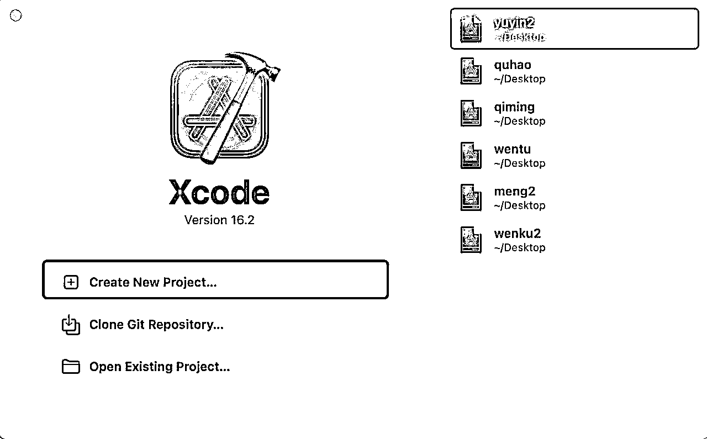

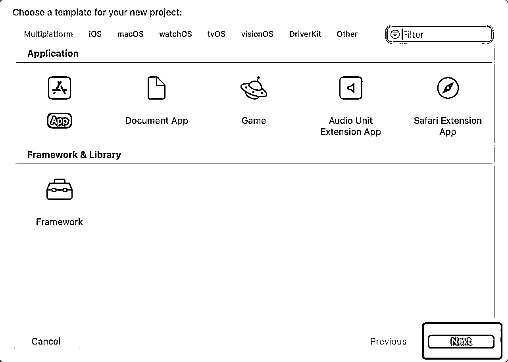

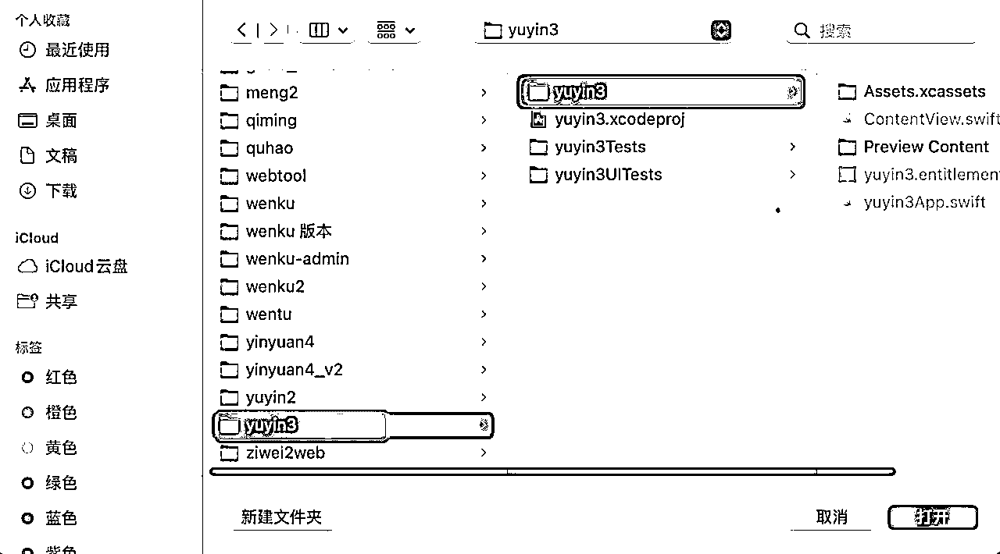

注意事项：team 一栏记得登录已注册好的 Apple 开发者账号

# 2.3.2.2 基本使用：Xcode 项目文件作用

Xcode 建好项目会生成下面这串目录，其中只有第一个属于你的项目根目录

1.

Contentview 文件：主视图文件，可以理解为打开 App 后见到的第一个页面。工程新建完成后，里面自带"hello word"字样。

# 

走 Composer 模式时，第一次生成代码记得先 @ 引用 Contentview 文件

2.

yuyin3App 文件：应用容器，打包到手机上装的就是它（打包时会把项目资源全带上）

3.

Assets 文件：用来放 App 图标和内置图片，支持 Png / jpg（建议先压缩再传）

4.

yuyin3：应用权限配置文件

5.

Preview content > Preview Assets 文件：预览用素材，上架打包不会带上，仅在预览 / 测试阶段显示

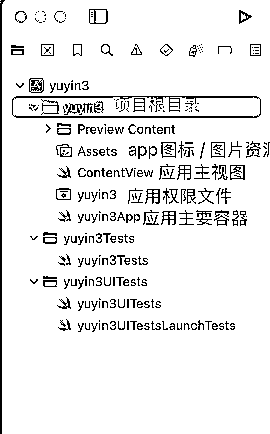

# 2.3.2.3 基本使用：Xcode 如何将 App 编译到真机

前提：Xcode 里已登录 Apple 开发者账号

步骤一：在设置里搜"开发者模式"并开启，接着用数据线把 iPhone 连上 Mac，连接后点信任。

步骤二：选中已连接的手机（数据线非原装的话可能压根不显示）

步骤三：

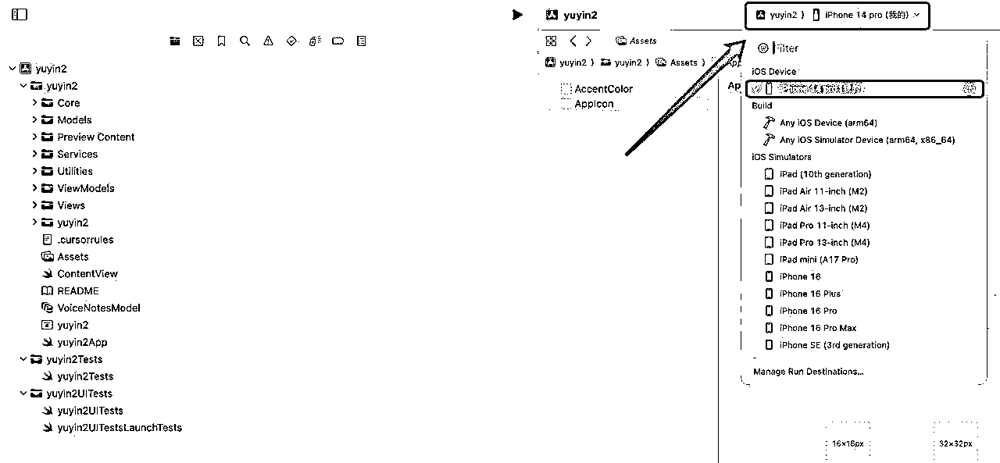

1.

把用不上的设备类型删掉，只留 iPhone（除非你的应用确实要跨设备），多勾选容易引发兼容性报错

2.

iOS 版本建议定在 15 或 16，定太高会挡住系统版本偏低的用户下载

3.

Display name 一栏填你的应用名称

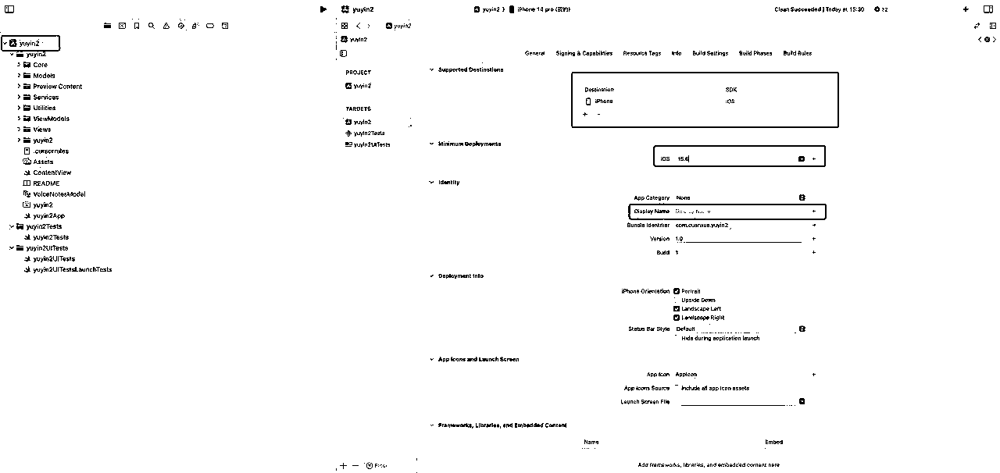

# 2.3.2.4 基本使用：Xcode 如何设置 App 图标

准备一张 1024*1024 的 png / jpg 图片

Assets 同样是管理 iOS 应用图片的地方。想把图片、图标塞进 App，就从这里上传；不过图片最好先压缩，否则既占用户手机空间，也会拖慢下载。

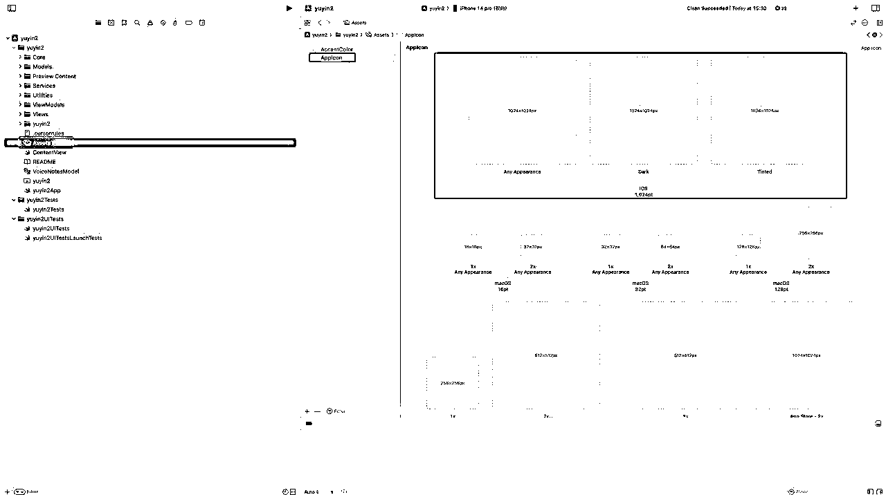

# 2.3.2.5 基本使用：Xcode 如何上传文件

把新文件挂到项目根目录：在项目根目录上右键，选择 add files to "xxx"。Xcode 16.0 及以上能把 Cursor 里建的文件自动同步进 Xcode。

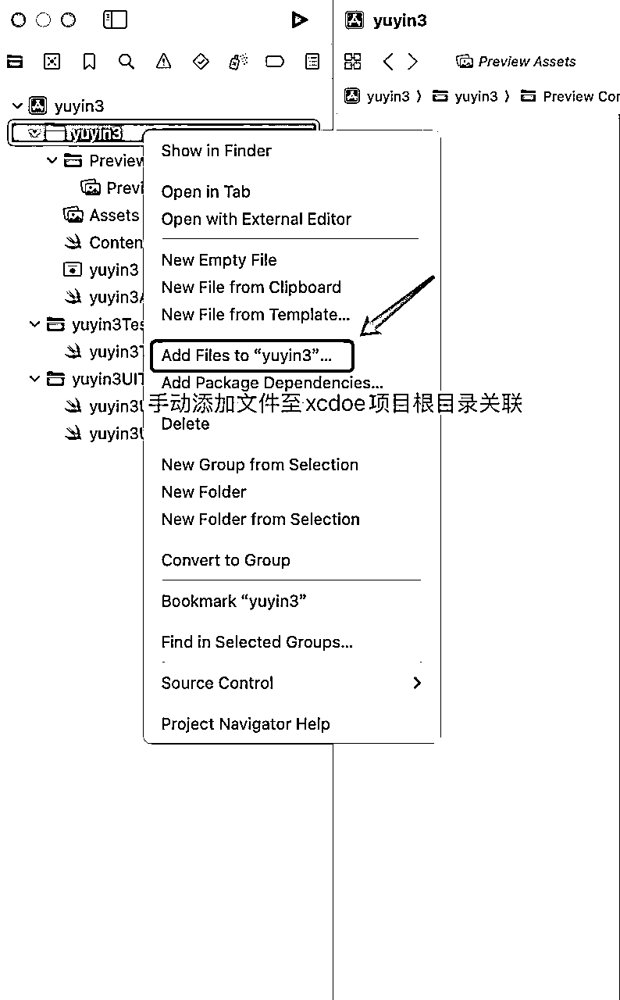

若 Xcode 版本不到 16.0，Cursor 建的文件没出现在 Xcode 根目录下，就得手动补加。

传图片时，在 Assets 里直接把本地文件拖进去，然后告诉 AI 文件叫什么名字即可。

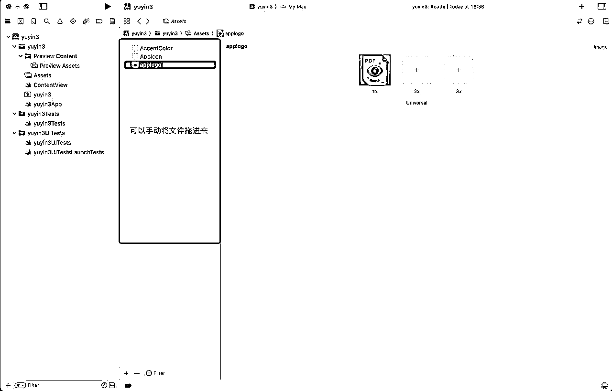

# 2.4 心态预期

# 2.4.1 AI 虽能降低门槛，但不代表没有门槛。

如果你不懂编程、觉得代码难啃，完全可以一行代码不写，借 AI 之力做出人生第一个 iOS App。但这一路你大概率会撞上下面这些坎——它们也正是我自己踩过的：

1.

英文底子薄，Xcode 和 Apple 开发者后台的界面看不懂，前期只能靠截图翻译、沉浸式翻译插件一点点摸熟

2.

iOS App 开发跟 web 开发不是一回事。虽然免去了装环境和依赖的麻烦，但想靠一两句提示词就迅速生成一个应用也不现实，大部分时间都耗在编译报错上，得靠一轮轮对话磨出来

3.

别一上手就挑复杂应用，先从简单的做起更稳妥。我前后不下六七次尝试做玄学类应用，结果发现其中业务逻辑太绕，AI 也吃不准场景；指望它写四五千行代码就把核心功能做扎实，很难。所以开发这条路，是由简入难、层层深入的过程

# 2.4.2 开发过程中的大小 bug、构建报错一定会有

编译通过只是第一道关，它仅说明应用能装进手机，并不等于开发收工。因为编译成功不代表功能跑得通，后面还得反复调试——"控制台报错、内存泄漏、运行线程报错、代码警告"这些类型你都可能遇上。

所以说，测试与调试在 App 开发里极耗时间，一个版本打包几十次属于家常便饭。1-2 小时做出个 iOS App 不是没可能，但要它成熟、功能齐全就难了。别在速度上死磕，好产品即便有 AI 搭把手，也照样需要耐着性子反复打磨。

# 三、初识 Swift + iOS 基础开发

# 章节概要：

做第一个 App，Swift 语言并非必修课；哪怕不懂代码，AI 也能带你完成开发。

本章以一个记事本应用为实战样本，

陪你走完从设计提示词到反复修编译错误的完整链路，

重点讲清如何跟 AI 打配合、把报错逐个消掉。

想提效，关键是建立分模块开发的思路：

前后端拆开、排清功能优先级、UI 与功能分开实现、防止上下文互相污染。

# 本章航线图

完成本章的学习和实操，即可完成航线图的：

第二阶段：打牢基础，走通开发流程（3 天左右）

这一阶段共有三项功课，整体用三天左右完成：

1. 初步认识一下 Swift，先混个脸熟（半天左右）。
2. 用记事本这类轻量工具型应用练手，把整套开发流程跑顺畅（两天左右）。
3. 建立分模块开发的思维方式（0.5 天上下）。

## 3.1 先聊聊 Swift 这门语言

说实话，Swift 学不学，对这期航海任务影响并不大。就算完全不会写 Swift，AI 也能帮你起一个 iOS 应用的原型，所以短期来看它并不是必需品。想在几天内把 Swift 悟透、立刻反哺项目，更是不太现实。但如果决心走 iOS 开发路线，打算长期折腾下去，Swift 迟早要摆上日程。

英文阅读没什么障碍的，直接去 Apple 开发者官网翻官方文档就好。担心原版资料难啃的，就到 App Store 里搜“Swift”，装一本 SwiftUI 工具书回来慢慢翻。

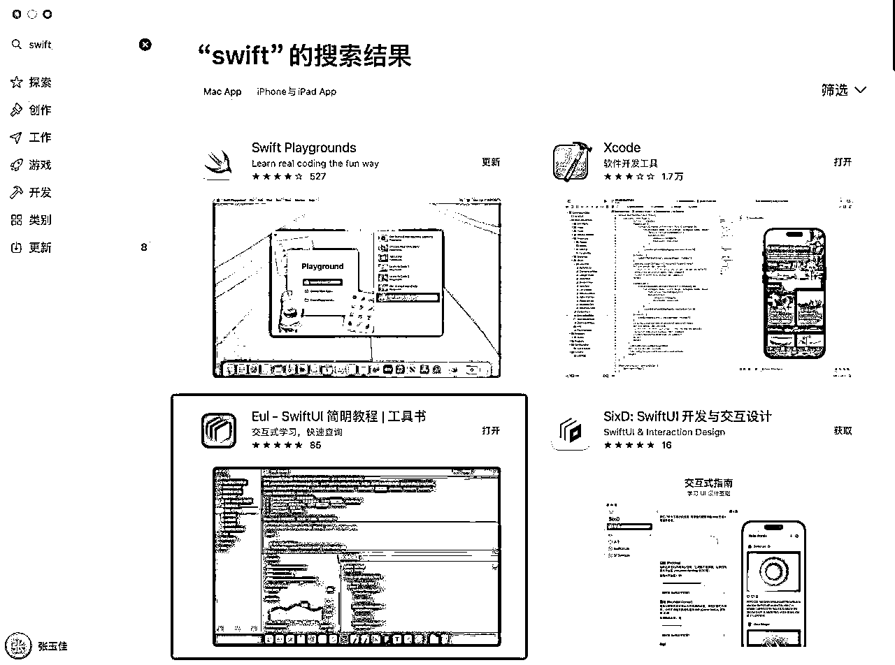

## 3.2 实战案例一：用 Cursor 和 Xcode 做出第一个能用的功能

### 3.2.1 从记事本开始动手

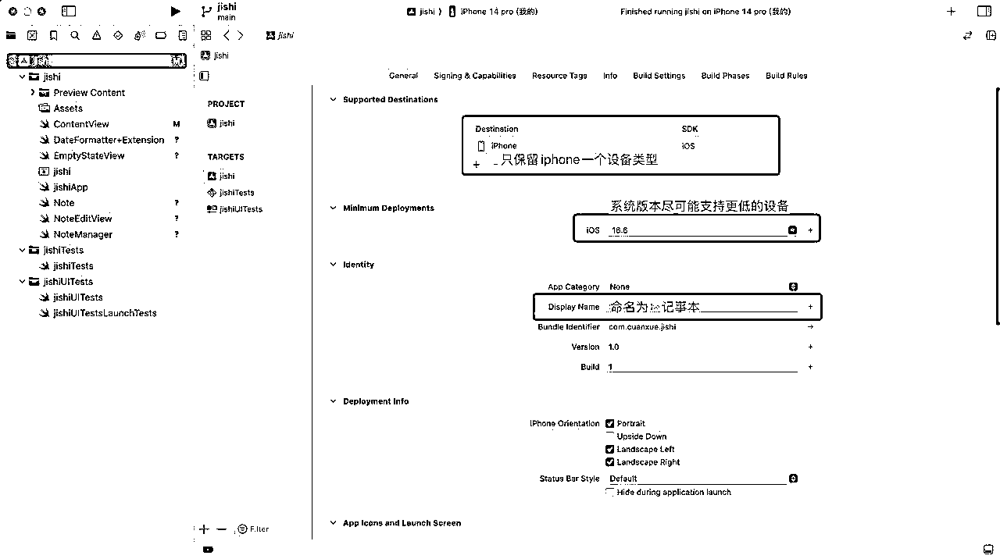

先在 Xcode 里把几项基础参数调好：设备类型、系统版本、App 显示名称。随后准备一段提示语交给 AI：

“请扮演资深 iOS 工程师。我这边已经建好了一个叫‘记事本’的 iOS 工程，你正站在项目根目录，需要把文字记录、内容修改、保存到本地这几件事实现出来。整体开发规范以 iOS 16 为基准，文件引用 @contentview.Swift。”

模型选择 Claude-3.7-sonnet，交互模式切换为 composer-agent。

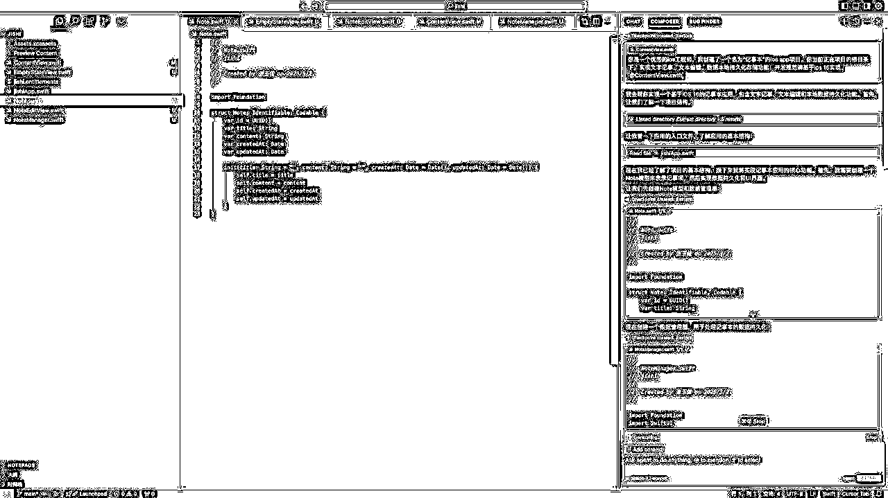

第一次构建，出现编译错误几乎是必然的。把报错内容完整复制，交给 Cursor 去改。

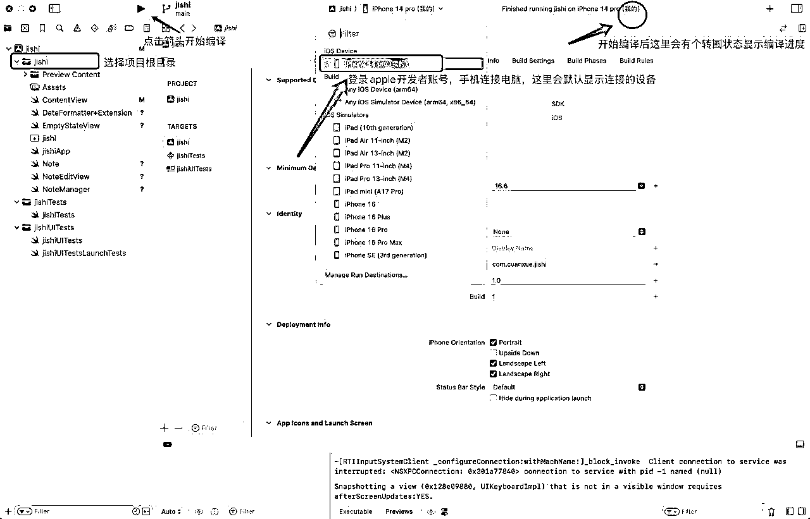

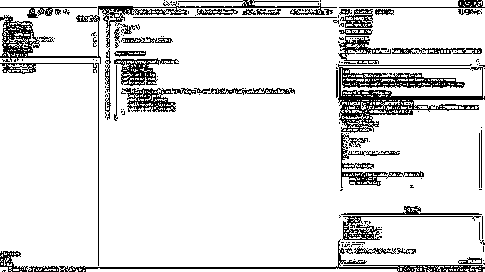

再次构建之前，记得按下 cmd+shift+k 清掉缓存。清完依然报错，问题聚焦在系统版本适配。照样把错误原样端给 Cursor。

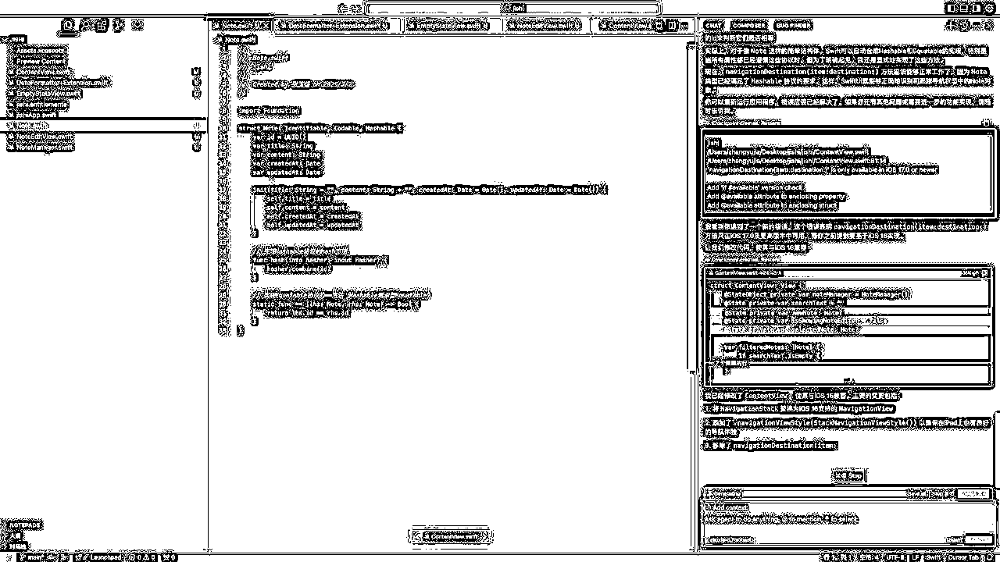

第三回总算顺利过关：构建、签名、装机一步不落。打开记事本随便记一条内容，退出应用再进来，记录还在——说明数据已经在设备里住稳了。

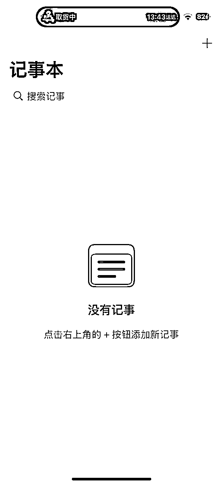

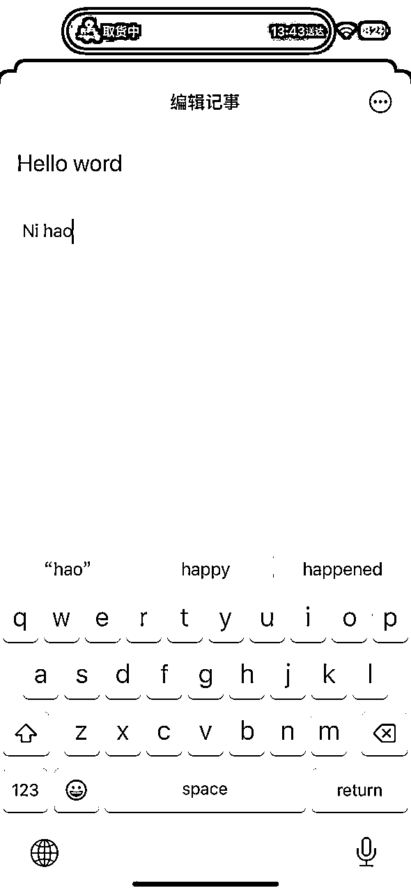

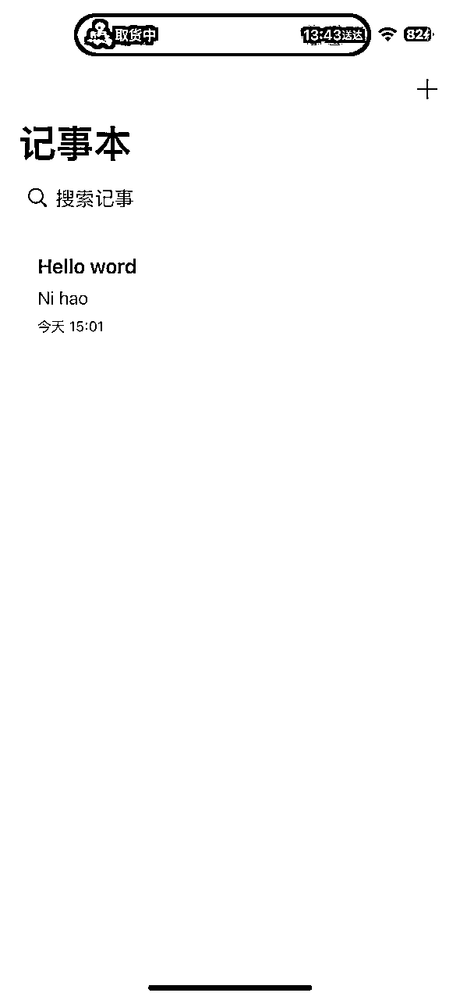

第四步属于自由发挥时间——给应用加新功能、换页面样式、修改按钮形态，都没有限制。

### 3.2.2 搞定常见报错，在真机或模拟器上跑起来

iOS 开发过程中的错误会出现在不同入口，熟悉它们能少走弯路：

1. 构建错误：打开 Xcode 左侧栏，看红色感叹号。
2. 控制台异常：右下角窗口可见。AI 判断不准时，通过改进日志、增强错误输出，往往能把真正原因钓出来。
3. 界面层错误：肉眼可见，直接截屏加一句话讲给 AI，最省沟通成本。
4. 一些警告会出现在顶部，以黄色感叹号标出，不影响产物构建和功能，放到收尾阶段再清即可。

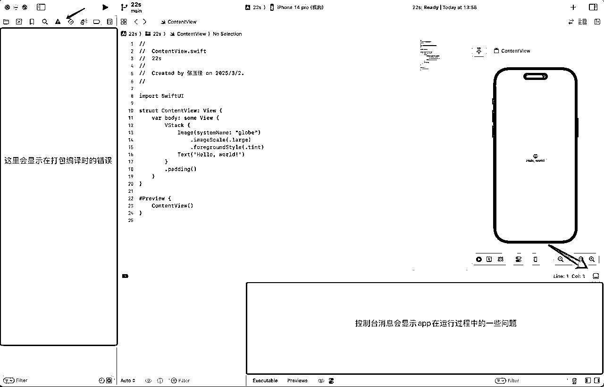

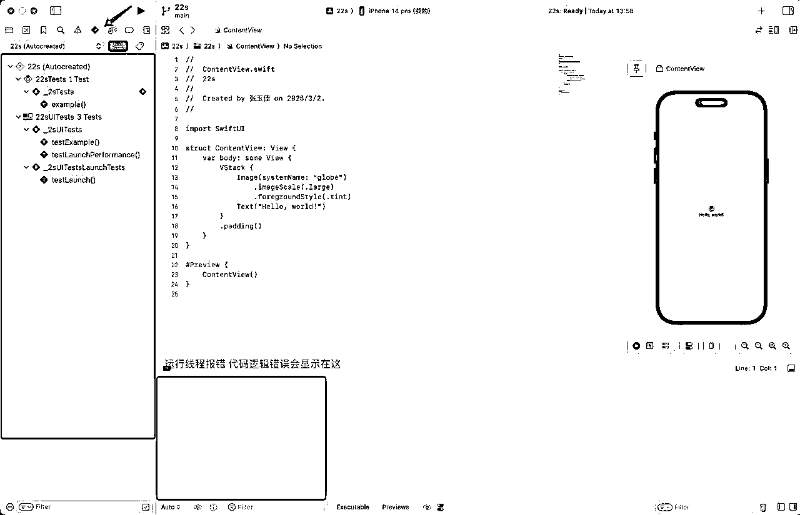

## 3.3 学会分模块思考

把模块拆开的眼光，是进阶路上绕不开的功夫。下面五条，建议直接内化成习惯：

1. 先切开前端与后端，前端排在前执行，后端跟上。
2. 对功能排座次，决定产品生死的能力必须最先落地。
3. 视觉与逻辑分层推进：先搭好静态界面，再为页面注入交互与路由。
4. 一项需求对应一个独立窗口（Composer 或 Chat），上下文各不干扰。
5. 修好一个缺陷、完成一个小的能力点之后，也建议翻新一个 Composer，再开启下一段工作。

第三条之所以成立，前提是你已经握有可落地的 UI 设计图和方案。这时让 AI 先把页面骨架和版式做扎实，远比一进场就写逻辑稳当。若是反过来，直接催 AI 去做功能，iOS 这边它往往只会套用系统原生组件，创意发挥空间一下就窄了。

新手阶段完全可以先跳过视觉问题，把心力集中在功能与产品形态的打磨上。等应用能正常运转，再回过头来微调界面细节也不迟。

# 四、从 0 到 1：AI 带你做出第一支 iOS App

# 全章导读

接下来这一个章节，我准备了两个进阶案例，带你把一款 App 从无到有完整走一遍。第一个案例是 Deepseek 对话助手，全程演示从画页面到接 API 的步骤；第二个案例带着后台出场，把前端与服务器联通，域名怎么配、宝塔怎么装、接口怎么写，全都摊开来讲。两个项目都把开发过程中的翻车现场如实保留下来——报错很正常，关键是按部就班地验证，一小步一小步往前推。等这两个案例做完，你手里既能攒下几条可复用的招数，也慢慢摸清让 AI 拆解复杂问题的方式。

# 本章学习路径

完成这章的学习和实操，你就推进到航线图的下一格：

第三阶段：应用开发实战（6 天左右）

1. 开发一款进阶型应用（比如 Deepseek 对话助手），对接第三方接口，时间约两天。
2. 进阶到全栈，让前后端数据打通，预留两天。
3. 功能优化与上架合规齐头并进，也留两天。

# 4.1 实战案例二：自建 Deepseek 聊天助手

假若打定主意要上架，最好不要照抄手册里的提示词，和所有人都做同一件产品。iOS 审核里的 4.3 条款，针对的就是与商店已有内容高度雷同的应用，一旦被认定同质化，基本没有商量余地。因此产品中一定要有自己的差异化表达。同时，4.2 条款要求应用功能必须完整且可独立使用，只装一两个简单能力就想过审，概率非常小。

这一节要训练的技能：驱使 AI 去对接第三方 API，最终交付一个能实时问答的 Deepseek iOS 客户端。

行动路径划分得很清楚：
（1）先把页面 UI 呈现出来；
（2）再把页面背后的能力补全；
（3）借助编译-调试的循环，逐步迭代出新功能。

### 4.1.1 步骤一：只搭界面，不写逻辑

提示词思路：把应用截图发给 AI，随后附言“这是一个 AIchat 方向的人工智能对话 iOS 项目，当前阶段只做页面设计，不需要实现任何功能”。我用的参考图是腾讯元宝的界面截图。将截图和提示词一起发给 Cursor，打开 agent 模式并选用 Claude-3.7 模型。

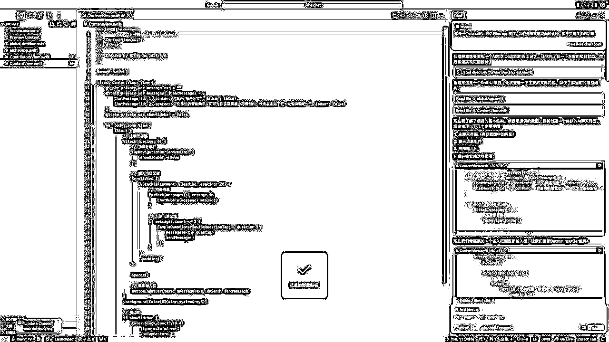

### 4.1.2 步骤二：首次编译上真机，预览页面效果

装进手机跑一眼，页面基础效果已经有了。接受不了当前的观感，就接着和 AI 来回磨几轮。这个节点仅仅交付了页面外壳，深层能力和交互空缺，想尝试的人完全可以从这里介入。

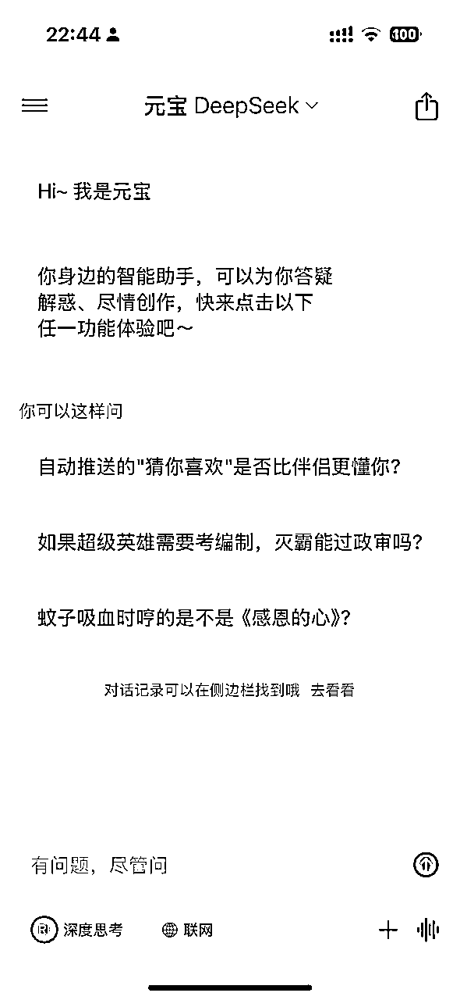

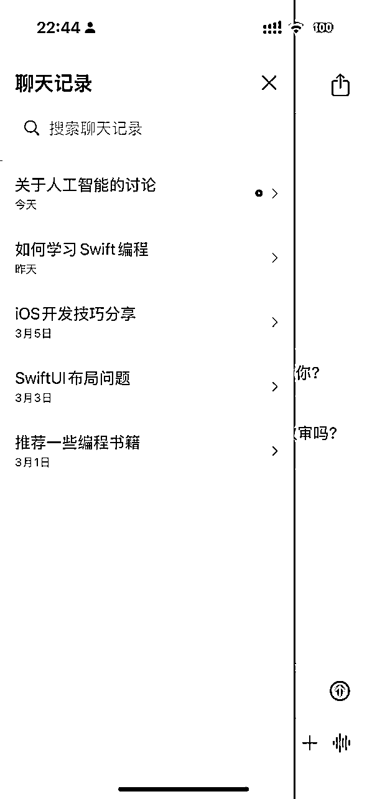

### 4.1.3 步骤三：在根目录创建 API.MD，打通大模型接口

我选的是硅基流动平台：https://cloud.siliconflow.cn/i/hnzbllSL

在动手前，下面这些信息要备齐：

1. 模型编号：Pro/Deepseek-ai/Deepseek-R1
2. 接口文档：https://docs.siliconflow.cn/cn/api-reference/chat-completions/chat-completions
3. 私有密钥：xxxxxxxxx
4. 一段 curl 示例，作为请求模板：

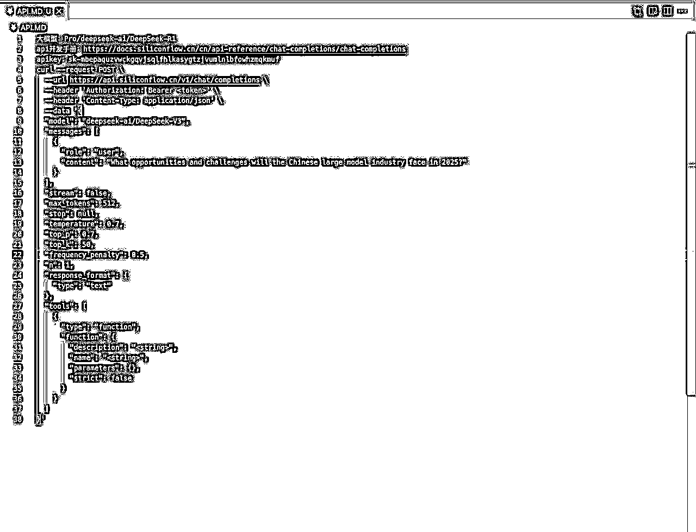

### 4.1.4 步骤四：实现对话能力，激活页面功能

提示语参考：“@API.MD 请基于以下内容，实现应用内的 AI 对话功能，开发细则参见 @https://docs.siliconflow.cn/cn/api-reference/chat-completions/chat-completions”

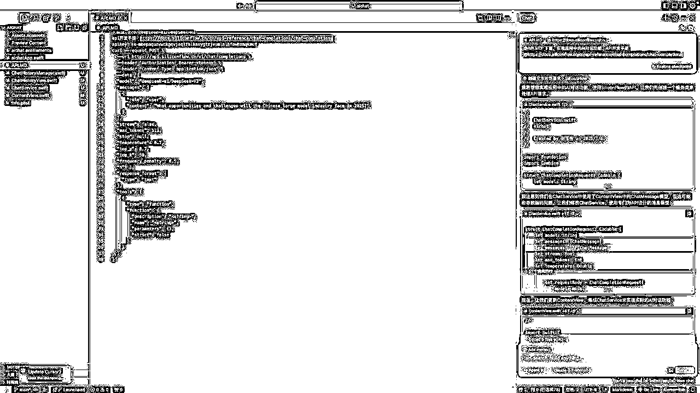

### 4.1.5 步骤五：二次编译真机，处理编译报错

编译过程中发现报错，将错误信息复制给 AI 处理。修完之后重编，功能恢复可用。这个阶段报错反复出现非常常见，想一次全清不太现实，保持耐心逐个击破就好。

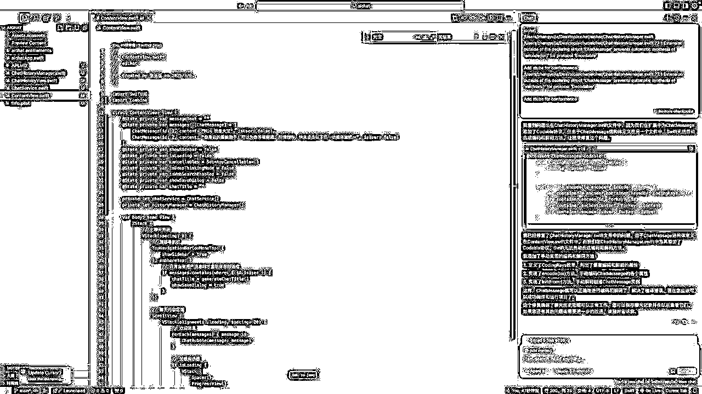

这里有几个注意点：

1. 清完缓存还有报错，说明根因还没消除。
2. 清完缓存不再报错，可以再尝试一次打包。
3. 每次重新编译前，养成按 cmd+shift+k 清理缓存的习惯。

### 4.1.6 步骤六：调试应用、继续增加能力

接下来撞上的问题是数据没能留存：应用一退出，再进来时之前的聊天记录全没了。

从此进入一个高频循环：真机验证，记录问题，再回炉重编。强调一点，修复缺陷时 Edit 模式更靠谱，Agent 模式在这类场景很不顺手。编译通过，测试开始，发现问题后再次回流给 AI。

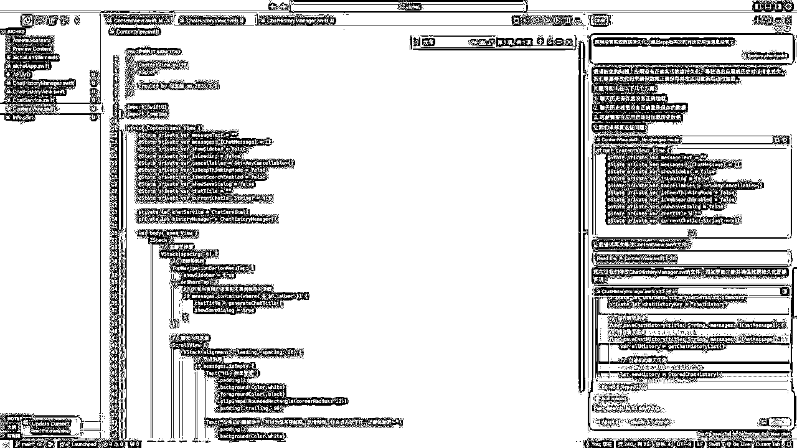

下一轮编译，控制台再次抛出异常，转给 AI 排解，重新构建以后，本地存档终于过关。

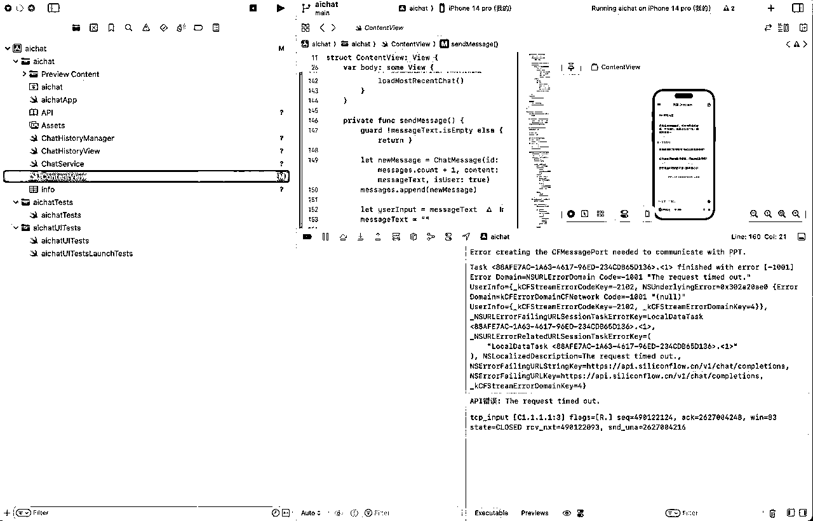

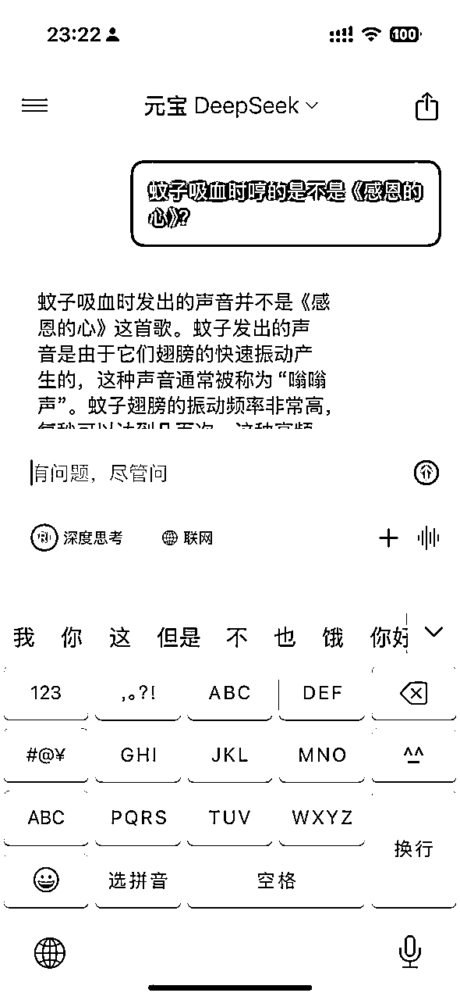

继续测，又揪出一个体验缺口：键盘右下角默认是“换行”，需要换成“发送”，点按发送后键盘还要自动收起。

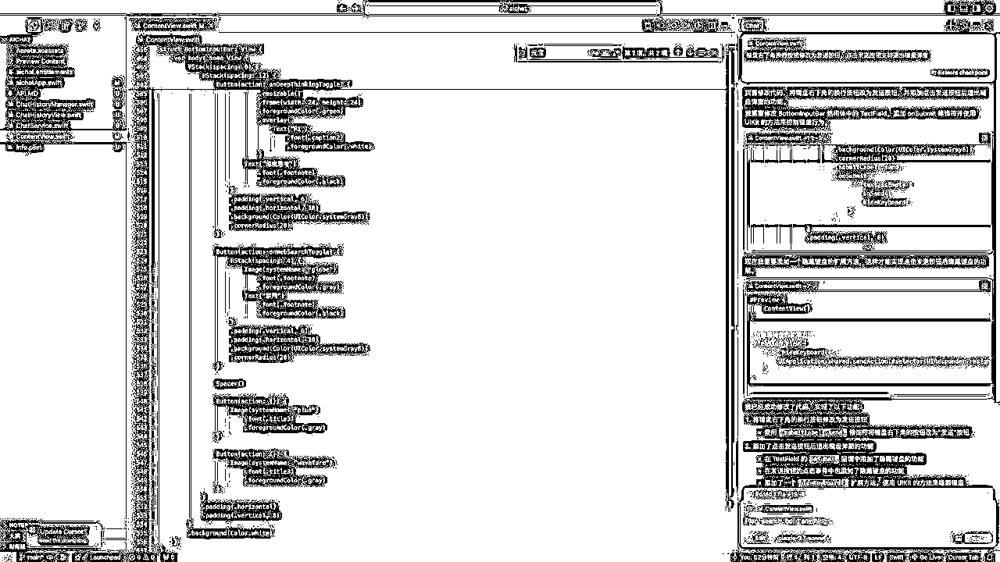

把这条反馈递交给 Cursor，键盘收不回去的毛病如愿解决。

功能继续加码：让应用支持 Deepseek r1 和 v3 两种模型自由切换。反馈文案可以这样写：“@Codebase @API.MD 请增加模型切换选项，可分别在 Deepseek r1 与 v3 之间选用。”

Deepseek r1 的推理路径更长，没有流式响应时，等待局面会持续较久。为了不卡在起步阶段，强烈建议先用 v3 把流程趟平，r1 留到后面再折腾。

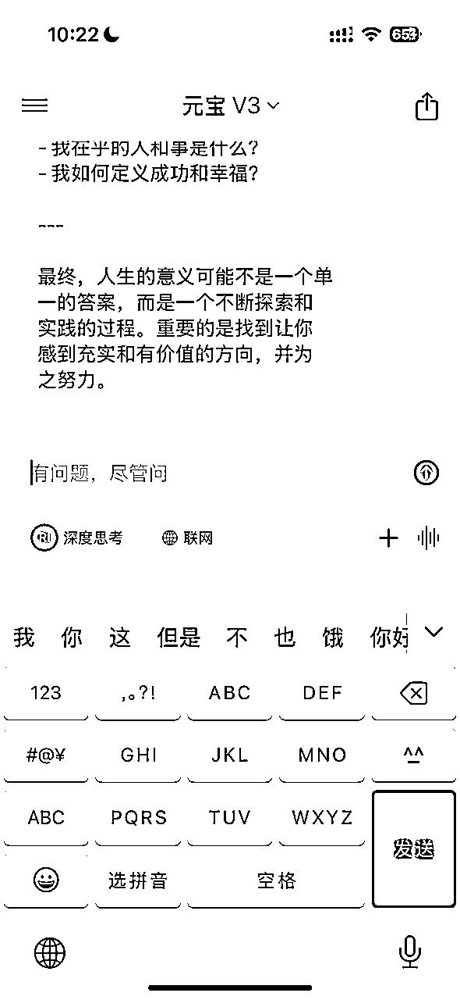

### 4.1.7 编译异常：解决 Info.plist 重复生成

构建时反复出现 Info.plist 重复定义，很多 iOS 开发都中过招。原因在于：AI 额外造了一个 Info.plist 用户权限文件，而 Xcode 自己也打算生成同样的文件，两边撞在了一起。

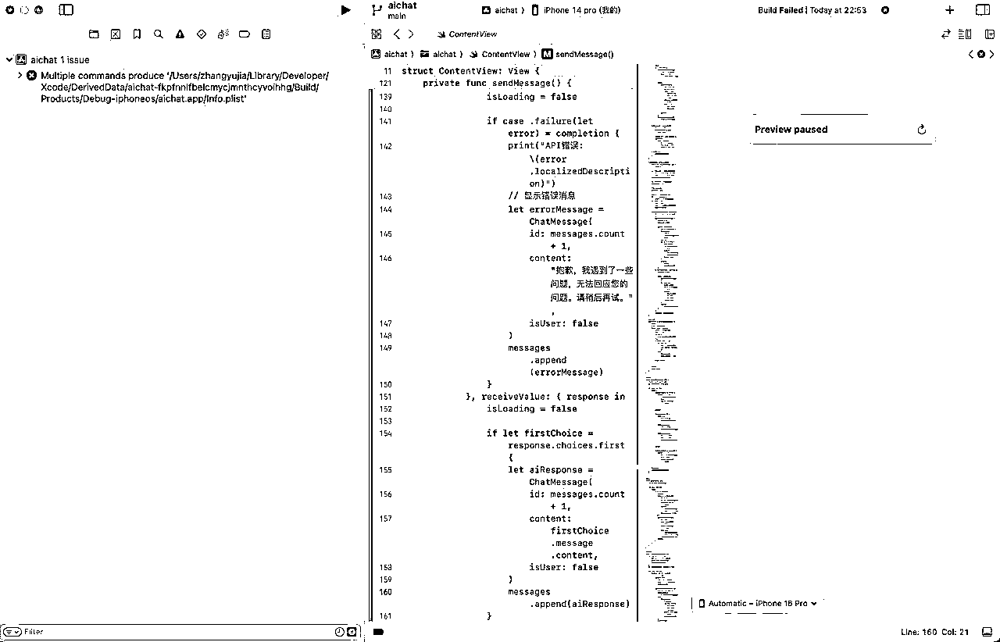

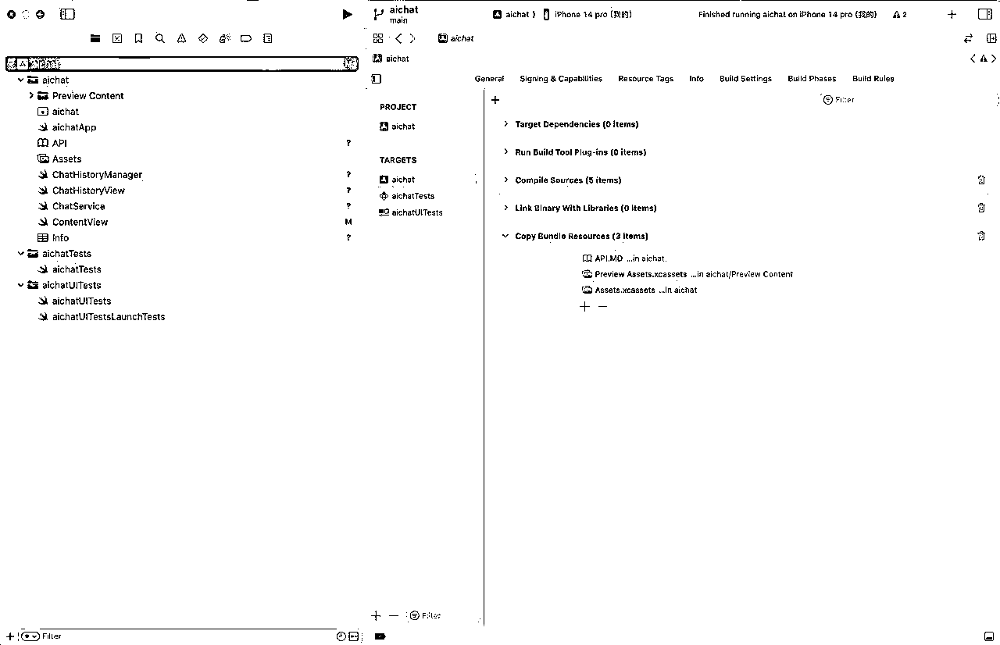

解决方法有两个方向：

1. 确保现有的 info.plist 放在正确的路径下；
2. 从 “Build Phases > Copy Bundle Resources” 中把多余的 info.plist 移除。

# 4.2 实战案例三：给 Deepseek 助手配一个网页后台

本节要做的事：借助 Cursor 体验前端+后端的跨语言开发。
希望达成的效果：给 iOS 应用配一个网页版后台，前端产生的数据能统一汇到这里。

域名购买与 ICP 备案会在这节上场。备案周期因地域要求而长短不一，预判需要一到两周，不确定性较高，建议航海一开始就同步着手。

为了控制演示体量，我决定在 4.1 的成品上，再请 AI 加一个注册/登录模块，同时在后台实时查阅前端的注册信息和对话历史。整个案例的价值是方法论，而非成品功能。

## 4.2.1 先备齐基础资源

### 4.2.1.1 这套版本先准备什么

（1）一台云服务器，配置底线是 1 核 CPU、2GB 内存、1M 带宽；
（2）一个完成 ICP 备案的域名（香港地区服务器可以免备案）。

### 4.2.1.2 海外与国内服务器的取舍

（1）海外服务器：同等配置通常更贵。国内服务商（如阿里云、腾讯云）对新用户都有折扣，有时候一年 99 元就能租到香港那边 2000—3000 元档的同配置机器。
（2）国内服务器：域名需要备案才能开放访问，海外机器不需要。倘若只是跑前端、后端和数据库，那国内服务器性价比较高。

### 4.2.1.3 域名注册与服务器选购

（1）去阿里云或腾讯云直接注册即可，.com 和 .cn 后缀一年约 30—55 元，其它后缀约 10 元。
（2）只要前置目标是支持 iOS 前端、后端与数据库访问，后缀选择没那么多讲究。

阿里云：https://www.aliyun.com/
腾讯云：https://cloud.tencent.com/

服务器系统优先选 CentOS 7.x，不建议 Windows——低配置机器装 Windows 会卡到没法操作。

### 4.2.1.4 域名 ICP 备案避坑指南

备案流程其实不复杂，阿里云和腾讯云都有备案入口，按页面提示填写资料，个人就能独立完成。

（1）个人备案会被要求填写网站类型和备注，建议写成“自用建站，用于个人学习与生活记录”，不要和商业沾边。
（2）如果将来打算把域名拿去做高度商业化的展示站，比如免登录即可看到全部内容的境外站点，那备案极可能被服务商强制注销。有这类打算，最好用个体户或企业资质备案。
（3）备案尽量在买服务器的厂商那里办。备案需要备案号，购机一般会附赠两个；要是没有，去淘宝找“阿里云icp备”，十几块钱一个，买来填上即可。
（4）提交后的 24 小时内留意陌生来电，服务商会来电核实个人信息；资料有误也会打回并反馈修改意见。

### 4.2.1.5 在服务器上装好宝塔面板

# 4.2.5.1.1 购机之后先放行安全组

买完服务器，进入服务商控制台，找到对应的云服务器实例（这里用的是阿里云后台演示），打开安全组入口，创建安全组并进入编辑。添加“入方向”规则，选择 SSH、MySQL、HTTP、HTTPS；图省事也可以直接选“全部放行”，最后确定即可。

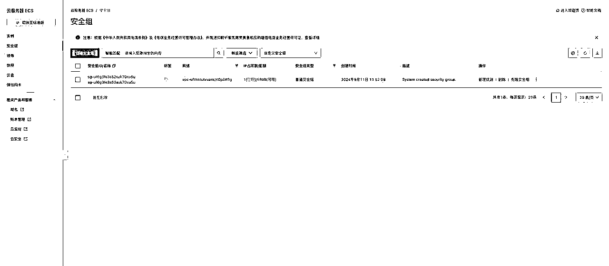

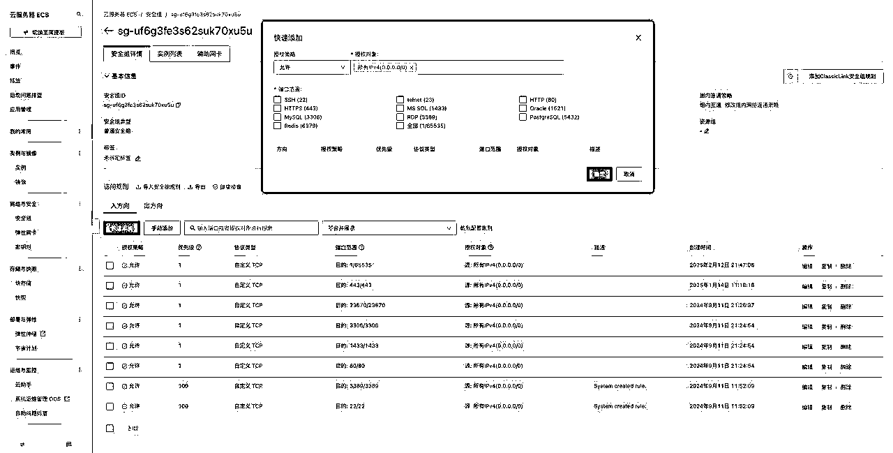

# 4.2.5.1.2 安装宝塔面板的具体动作

宝塔官网：bt.cn

登录服务器实例管理页，找到“远程连接”，其它参数保持默认，输入购买服务器时设置的管理密码。我当时是直接用阿里云实例面板里自带的远程连接，省了一步 SSH 客户端配置。

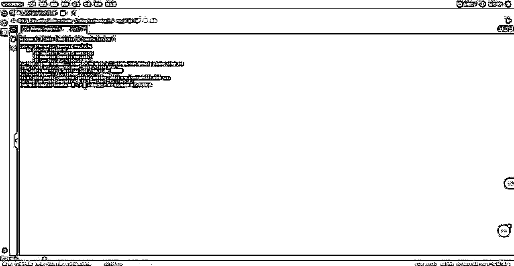

随后打开宝塔的下载页 https://www.bt.cn/new/download.html，找到“宝塔 Linux 面板免费版”，复制通用安装脚本，粘贴到刚刚连上的远程终端里发送。中途如询问是否继续，输入“y”，安心等待安装走完，最后会给出面板的登录地址、账号、密码。

这里需要再动一次安全组。因为宝塔面板的登录地址通常是“IP:端口”，例如服务器公网 IP 是 123.123.123.123，面板地址可能是 123.123.123.123:666。这时要回安全组手动添加一条入方向规则，具体配置如下：

端口范围-目的：666 / 666，授权对象-源：所有 IPv4（0.0.0/0）

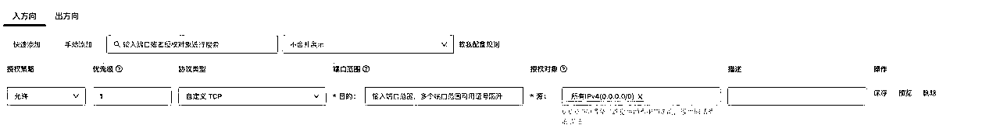

面板装好后，用浏览器访问并登录宝塔。第一次进入会弹窗让你选服务器运行环境，勾选“一键编译安装 LNMP”（Linux、Nginx、MySQL、PHP），整体耗时约 30 分钟，耐心等待即可。

PHP 推荐安装 7.4 版本，稳定性比较可靠。之后如需 phpMyAdmin 等工具，都可以在左侧导航的“软件商店”里找到官方应用，一键安装。

## 4.2.2 实现 iOS 应用内的注册与登录

保持一个原则：做新功能或改漏洞时，最好分别开独立的对话窗口，让上下文不互相污染。每当新增页面或新能力，编译报错和控制台异常几乎都会出现，这属于常态。把问题抛给 AI，大多数情况下至少得来回 2—3 轮才能平息。

提示语参考：“请在首页顶部导航栏的合理位置放一个用于注册/登录的图标按钮，点击后能直接从首页弹出窗口。未登录用户也可以参与对话，但次数上限是 3 次。现在不实现具体逻辑，只把注册/登录的样式和页面关系搭好，移除分享按钮，整体风格与现有 App 保持一致。”

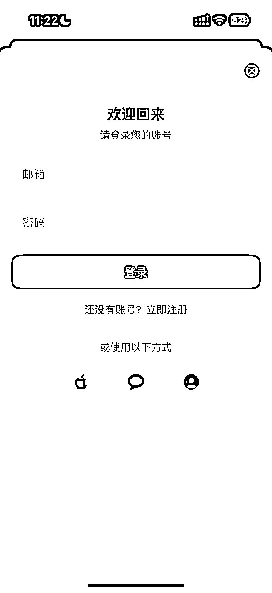

## 4.2.3 给 iOS 应用开发一个网页版后台

### 4.2.3.1 预先弄好三样东西

#### 4.2.3.1.1 创建临时文件夹

第一步，在 iOS 工程根目录下新建一个临时目录，取名为 admin。

#### 4.2.3.1.2 创建说明文档

第二步，进入 admin 目录，创建 Admin-README.MD，把后台功能、数据库信息（数据库语言、数据库名、用户名、密码）全部写明白。

#### 4.2.3.1.3 生成后台管理文件

第三步，让 AI 依据说明直接产出后台系统的全套文件。

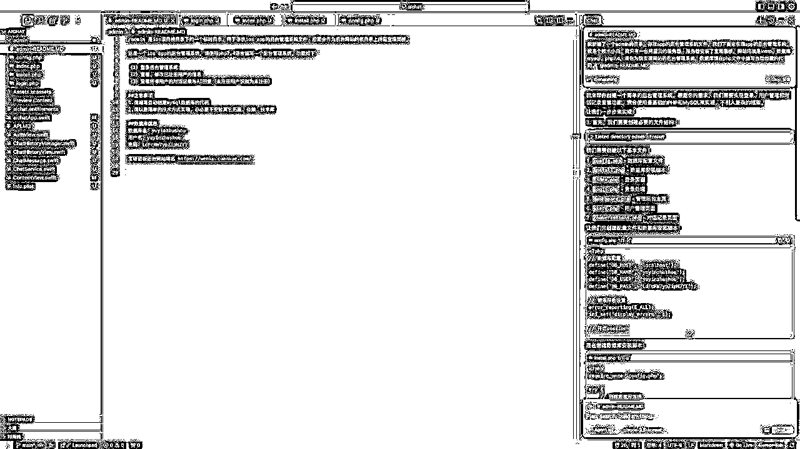

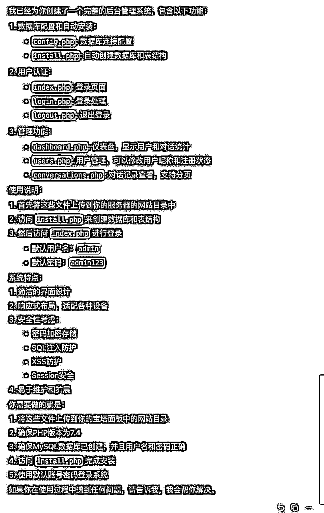

# 4.2.3.1.4 上线前要确认的几件事

# 

（1）先给域名把 SSL 证书申请好并完成部署，具体步骤后文有专门教程。

（2）打开宝塔面板，在站点管理里把“强制 HTTPS”开关打开。

（3）如果服务器位于国内，域名必须先通过 ICP 备案，否则访问会被拦截。

# 4.2.3.2 在域名服务商后台完成解析

# 4.2.3.2.1 服务商说明

下面以阿里云后台的界面作为示例。

# 4.2.3.2.2 解析操作流程

登录服务商控制台后，进入域名列表，挑一个已经备案完成的域名，点“解析”再点“添加记录”。记录值填这台服务器的公网 IP，主机记录要建两条：一条写 www，另一条写 @。

# 4.2.3.2.3 访问效果

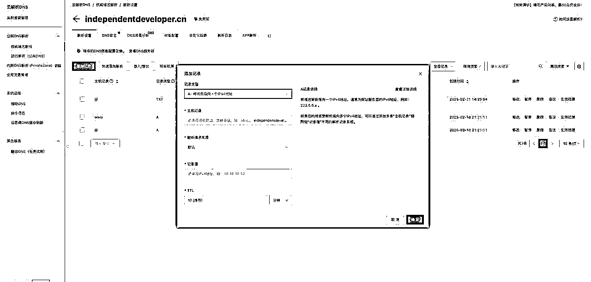

两条记录生效以后，用户不管是输入带 www 的地址，还是直接输入主域名，都能正常打开站点。

# 4.2.3.3 用宝塔面板把后台网页版部署上线

# 4.2.3.3.1 新建站点

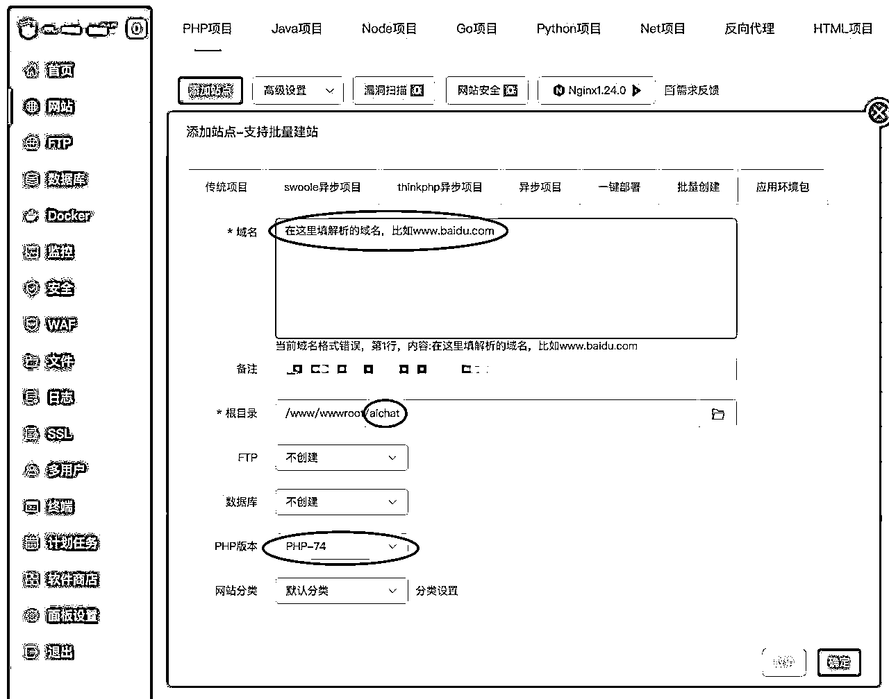

先进入宝塔后台，找到“新建站点”入口。域名一栏填刚才解析好的那个；如果服务器在国内，这个域名必须已经备案。接着给根目录起个名字，PHP 版本挑 7.4，其他选项不建或保持默认，最后点确认。

# 4.2.3.3.2 清理默认文件

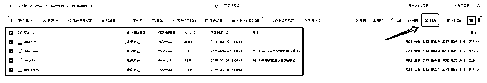

站点建好后，把系统自动生成的那些默认文件全部勾选，然后删掉。

# 4.2.3.3.3 创建 API 目录

在站点根目录里新开一个 api 文件夹。注意，这个目录的名字要和 admin 目录下面的 api 目录对得上。

# 4.2.3.3.4 上传项目文件

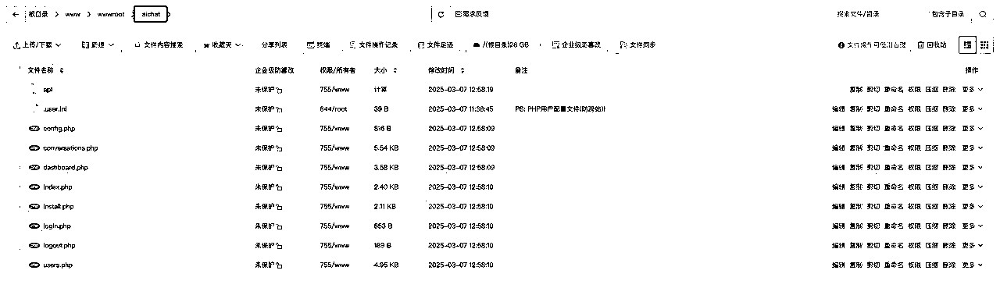

把 admin 文件夹内部的所有文件传到网站根目录。这里有个容易搞混的点：宝塔新建站点时指定的根目录，本身就已经相当于原来的 admin 目录，所以不要把 admin 这个外层文件夹整个拖进去，只传它里面的内容就行。效果如下：

// 比如我这边根目录叫 aichat，和原来的 admin 不同名，这不会影响使用

# 4.2.3.3.5 数据库初始化

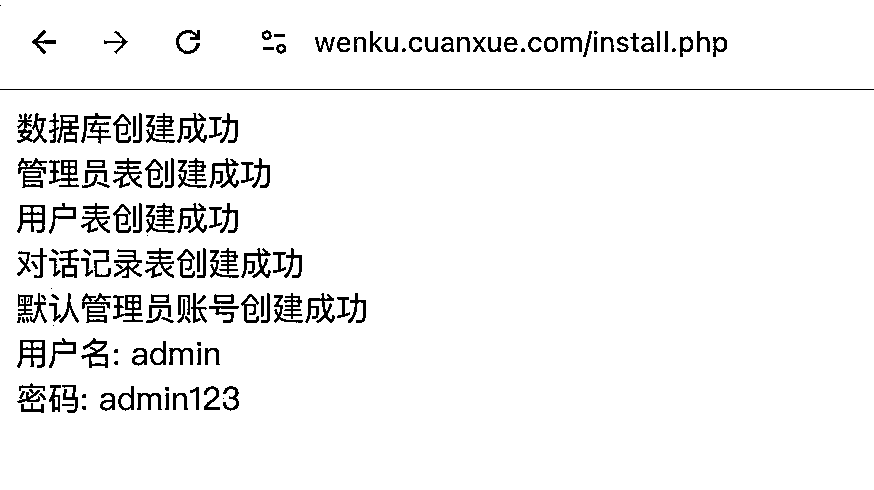

文件传完后，在浏览器打开 https://域名/install.php，按照页面提示建库和建表。看到“创建成功”的提示，就说明这一步完成了。

# 4.2.3.3.6 登录管理后台

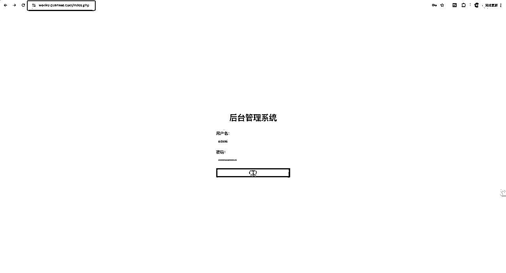

初始化结束后，访问 https://域名/index.php 就能进入后台登录页。

# 4.2.3.4 域名 SSL 证书申请指南

iOS App 和网站后台之间通过 API 通信时，必须走 HTTPS，所以域名得配上 SSL 证书。

操作并不复杂：在网站列表里找到对应站点，点后面的“设置”，切到 SSL 标签，选“宝塔证书”，点“申请证书”，勾选要用的域名并填好资料，提交申请。成功之后点“部署”，等自动部署完成，再把“强制 HTTPS”勾上并保存。

有一点要记住：这类证书的有效期是四个月，到期需要重新申请。

# 4.2.4 iOS APP 与后台的通信配置

# 4.2.4.1 后台 API 接口功能开发

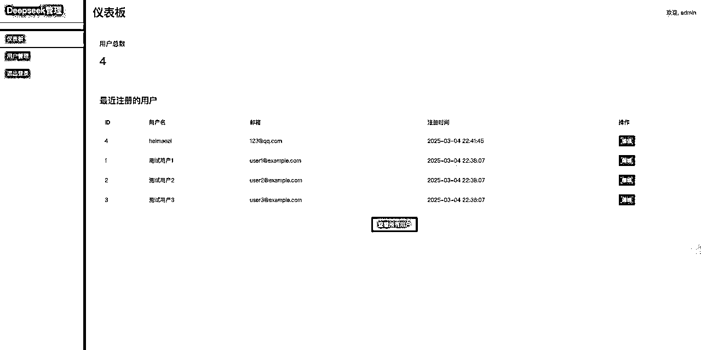

提醒：过程中要盯着 Xcode 控制台输出的日志。

# 

后台管理系统做完之后，下一步是让 iOS 端能调用网站后台的 API。建议把这件事放在同一个对话窗口里完成；如果中途另开新对话，AI 可能会因为上下文丢失而出现一些本可避免的问题。

另外注意：iOS APP 根目录下带着 /admin 这个 PHP 网页后台文件，编译前要在 Xcode 的 Build Phases > Copy Bundle Resources 里，把这里添加的所有 .php 文件删掉。

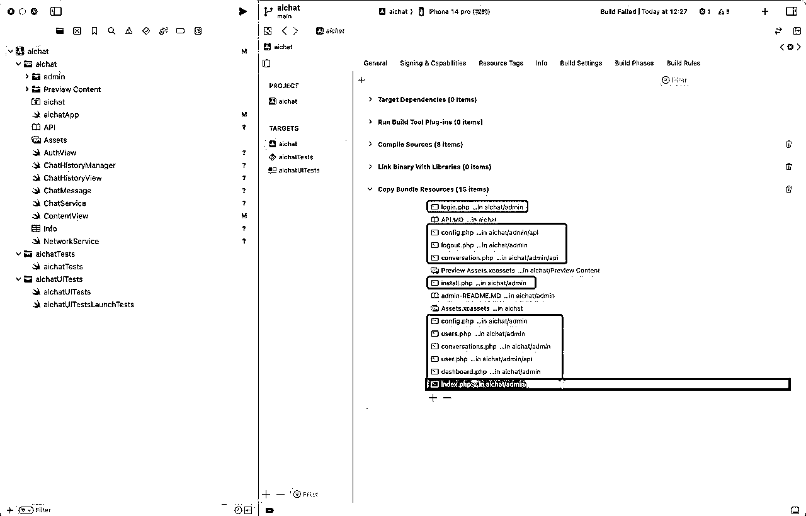

# 4.2.4.2 服务器数据库的创建与存储

用宝塔面板建 MySQL 数据库，可以按下面三步走：

1. 打开宝塔的“数据库”模块，点“添加数据库”，填好数据库名、用户名和密码（默认即可），然后确定。

2. 建好之后点“phpMyAdmin”进入面板管理，选中刚才的数据库，切到 SQL 页面，把 cursor 生成的建表语句粘贴进去，执行即可。

3. 最好让 cursor 在后台目录下生成一个 api.md 开发文档，把数据库表结构写进去，这样能防止 AI 后续“失忆”。

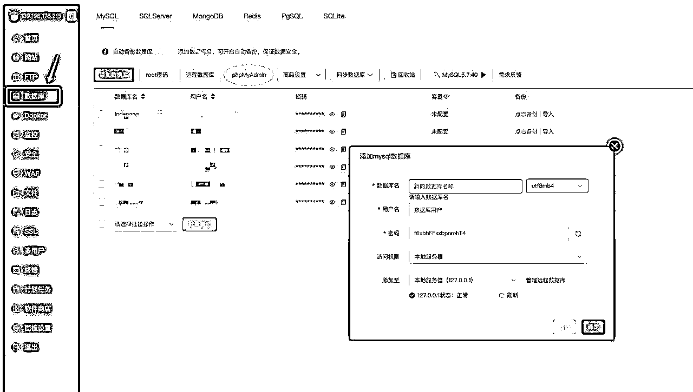

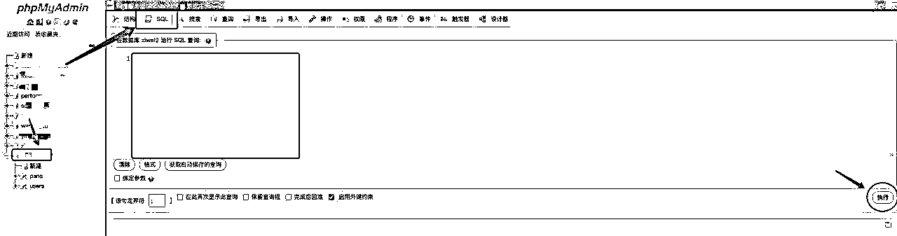

# 进阶篇

# 五、iOS APP 会员订阅功能实现（进阶学习）

# 章节概要：

这一章重点讲 iOS 应用最主流的变现手段——会员订阅。

从订阅页面的 UI 设计，到 StoreKit 配置、项目参数设置和测试，整个流程都会展开说明。

同时还会讲到 Apple Pay 支付能力的接入，包括证书创建、商家 ID 配置等偏专业的内容。

如果你希望把商业闭环做完整，本章也给出了后台管理与服务器联动的落地思路，以及上架阶段要处理的 App ID 创建、证书设置和详情页配置等关键环节。

这些功能虽然有一定门槛，但借助 AI 辅助仍然可以高效完成，为 App 带来实际的商业价值。

# 本章学习路径

学完并动手做完本章，你就能走完航线图中的：

第四阶段：进阶功能与上架实战（大约 8 天）

1. 做出会员订阅功能，掌握 StoreKit 配置（约 2 天）

2. 学会集成 Apple Pay 支付（约 2 天）

3. 搭好云服务器，完成前后台联动（约 2 天）

4. 跑通 iOS App 上架全流程并提交审核（约 2 天）

# 5.1 iOS APP 会员订阅功能概述

下面开始做 iOS APP 的订阅功能。这是目前 iOS 应用最常见的变现方式之一。动手之前，建议你已经熟悉全栈 iOS APP 的开发流程。

# 5.1.1 开始搭建会员订阅页面

# 

提示词：@Codebase 下面，我们来为这个 iOS app 增加会员订阅功能。我没有任何技术背景，请你一步一步教我如何完成，我们先把会员订阅页面的样式做出来。

这里仍然采用分模块推进的方式，先让 AI 把订阅页面的 UI 效果做出来。

# 5.1.2 实现会员订阅核心功能

第一次输入：

# 

继续，现在开始实现会员订阅的具体功能。

第二次输入：

# 

请为我创建 StoreKit 文件并更新 Info.plist 文件。

StoreKit 文件里记录的是你的 iOS APP 包含的商品信息。这个文件不需要你手动建、也不需要自己写，交给 AI 处理就行。

# 5.1.3 配置项目相关设置

1. 打开 Xcode，在项目设置的 Signing & Capabilities 里点“+ Capability”，搜索并添加“In-App Purchase”能力。

2. 依次打开 Product > Scheme > Edit Scheme...，点 Run，进入 Options，在 StoreKit Configuration 里选择项目根目录下建好的 Subscriptions.storekit 文件，最后点 Close 保存。

3. 再到 Xcode 项目设置的 General > Frameworks, Libraries, and Embedded Content 里确认 storekit.framework 已经添加成功。

# 5.1.4 测试订阅功能

把 iOS APP 编译安装到真机上，验证会员订阅能不能正常跑起来。

# 5.1.5 完善订阅功能

接下来继续让 AI 补齐还没实现的订阅相关功能。

走到上架环节时，要设置订阅群组。这里的关键是：产品 ID 必须和 Xcode 代码里的 ID 一模一样。打开项目根目录下的 Subscriptions.storekit 文件，找到 productID 字段，里面显示的就是每个产品的 ID，逐个添加到上架页面的订阅群组里。

所有信息务必完全一致。

# 5.1.6 功能小结

到这一步，一个简化版的 iOS APP 订阅功能就做出来了。用户可以通过 App Store 的支付流程购买会员服务。会员订阅本身不算简单，目前我们采用的是本地方式管理和验证会员状态，流程相对轻量。后面还可以继续让 AI 实现服务器端查看订阅数据；当然，在开发者后台的“销售和趋势”报告里也能看到订阅信息，只是数据通常次日才更新，会有一定延迟。

这部分属于进阶中的进阶。建议大家在真正掌握 AI 编程的底层方法之后，再尝试用 AI 来实现 iOS APP 会员订阅。这个功能延展性很强，比如可以让会员状态在多个平台之间统一管理。

举个例子：用户在 iOS APP 里付费开了会员，那么 Web 网页端的产品也能同步享受会员权益。实现思路并不复杂，只是开发时间和对话轮次会明显增加。

# 5.2 如何接入 Apple Pay 支付（进阶学习）

接下来在已有功能基础上继续做 Apple Pay 支付。需要说明的是，做订阅功能并不强制要求接入 Apple Pay；只有你的应用确实需要 Apple Pay 支付能力时，再看这一部分。

# 5.2.1 添加 Apple Pay 能力

输入提示词：

# 

继续实现 Apple Pay 的支付功能

这一步还是在 Xcode 项目设置的 Signing & Capabilities 里点“+ Capability”，搜索并添加 Apple Pay 能力。然后在这里填商家 ID，格式和 APP ID 类似，在 com.xxx.xxx 前面加 merchant 即可，比如 merchant.com.cuanxue.toutiao。

设置完成后，把最新的 Apple Pay ID 告诉 AI，让它帮你更新相关项目文件。

# 5.2.2 创建 Apple Pay 商家 ID

打开 Apple 开发者官网，进入 Certificates, Identifiers & Profiles 页面，创建一个标识符 ID，也就是 Apple Pay 商家 ID，用来继续实现 Apple Pay 功能。

点 Identifiers 旁边的加号，勾选 Merchant IDs，再点 Continue 继续。

# 5.2.3 创建并下载证书

在 Identifiers 分类里找到 Merchant IDs，点刚创建好的商家 ID，然后点 Create Certificate，创建并下载生成的证书。

# 5.2.4 手动创建证书

按 cmd+空格键，搜索并打开“钥匙串访问” > “证书助理” > “从证书颁发机构请求证书...”，手动创建一个证书请求并下载到本地。然后在网页上点 Choose File 上传这个文件，点 Continue 继续。

注意：这里要勾选“让我指定密钥对信息”；下载到本地时，算法选“ECC”，密钥大小选“256 位”。

上传后点 Continue，最后把 Apple Pay 证书下载到本地，双击安装（默认登录选项）到钥匙串里。

# 5.2.5 继续实现功能

告诉 AI：我已经完成了 Apple Pay 证书的创建，下一步请继续实现会员订阅和 Apple Pay 功能。

在这一步里，AI 会把这些能力进一步集成进 iOS APP。

# 5.2.6 创建沙盒测试账号

创建沙盒测试账号：用开发者账号登录 appstoreconnect.apple.com，进入“用户和访问”，找到“沙盒选项”，点“添加测试账户”，按页面要求填写信息即可。

注意：测试账号的邮箱必须是没注册过 Apple ID 的邮箱。

# 5.2.7 测试 Apple Pay 功能

接下来打开 Xcode，在模拟器里编译安装 App，再到模拟器设置中登录刚创建的沙盒账户。

然后添加测试卡信息，验证 Apple Pay 支付流程是否正常。

# 5.3 后台管理与服务器联动

# 5.3.1 搭建云服务器（安装宝塔面板 / LNMP、phpMyAdmin）。

# 5.3.1.1 云服务器选购建议：

阿里云、腾讯云经常有新用户活动，99 元/年就能拿到较低配置的服务器，企业认证还会额外送半年。

最低配置建议：1 核 2G 内存，带宽 1M 以上。

系统推荐：CentOS 7.x 及以上版本。

地理位置建议：如果以后打算做出海相关项目，服务器位置优先选香港，不建议选内地。

（内地服务器解析域名后，必须完成 ICP 备案才能正常访问；香港及海外服务器不需要备案。）

# 5.3.1.2 宝塔面板安装：

官网地址：https://www.bt.cn/new/product_linux.html （建议安装 Linux 版本）

宝塔面板通用安装脚本：

# 5.3.1.3 服务器安全组配置：

买完服务器第一件事，就是去安全组放行端口。

要放行的是宝塔面板登录地址对应的端口，这个端口号是安装时随机生成的。

宝塔安装完成后会显示一个外网面板地址，链接里带着端口号。到服务器提供商的云后台把这个端口放行即可。

# 5.3.1.4 安装 LNMP 环境

用浏览器登录宝塔后台，选择一键编译安装 LNMP 服务器环境。

PHP 版本建议选 7.4，比较稳定。

整个安装过程大概要等 10 到 30 分钟。

# 5.3.1.5 安装 Node.js（按需安装）

如果后端管理系统涉及 Node.js，就要在宝塔后台的“软件商店-官方应用”里额外安装“node.js 版本管理器”。

然后在版本管理器里装与网站要求匹配的 node.js 版本。

# 5.3.2 宝塔 SSL 证书申请。

# 

域名解析到服务器并绑定网站之后，就可以申请免费版 SSL 证书了。注意：证书有效期为 4 个月。

# 5.3.2.1 域名解析设置

在域名服务商后台，把域名解析到服务器的公网 IP 地址。

# 5.3.2.2 网站绑定设置

进入宝塔的“网站”模块，点“添加站点”，输入已经解析好的域名进行绑定。

根据实际需要选择对应的 PHP 版本。

视情况决定是否创建 MySQL 数据库（如果已经建过，就不用重复建）。

# 5.3.2.3 SSL 证书申请与部署

点 网站 > 设置 > SSL > 宝塔证书。

按页面提示填写相关信息。

点“申请证书”，申请成功后点“部署”。

勾选“强制 HTTPS”。

注意：免费版 SSL 证书有效期只有 4 个月，到期后要重新申请。

# 5.4 iOS APP 上架完整流程

# 5.4.1 前期准备

# 5.4.1.1 登录开发者账号

打开 Apple 开发者官网 https://developer.apple.com/account，登录你的开发者账号。

# 5.4.1.2 创建新 APP

点导航栏里的 App，在页面中点击 App 旁边的“+”号，新建一个 App。

勾选要发布的平台。

填写 App 名称。

设置主要语言。

选择套装 ID（也可以点链接创建新的套装 ID）。

# 5.4.2 创建 APP ID

# 5.4.2.1 基本信息设置

Description：可以填 App 名称的英文拼音。

Bundle ID：必须和 Xcode 项目里设置的标识符一致（格式为 com.xxx.xxxx）。

勾选 App 会用到的权限（比如 WiFi、相机等）。

如果 App 只是在本机运行的单一功能，也可以不勾任何权限。

# 5.4.2.2 返回创建 APP

在创建 App 的页面中，选择刚建好的 APP ID。

点“创建”按钮，进入下一步。

# 5.4.3 创建证书（可选）

注意：如果你用的是最新版 Xcode，这一步可以跳过，因为 Xcode 会自动生成证书文件。

# 5.4.3.1 本地证书请求创建

在 Mac 上打开“钥匙串访问”。

选择左上角的“钥匙串访问 > 证书助理 > 从证书颁发机构请求证书”。

邮件地址填你的 Apple 开发者账号邮箱。

选择“存储到磁盘”，把证书请求文件保存到本地任意位置，你就会得到一个证书文件。

# 5.4.3.2 上传证书到开发者后台

回到 Apple 开发者后台的证书管理页面。

页面地址：https://developer.apple.com/account/resources/certificates/list

点 Certificates 旁边的加号创建证书。

勾选 Apple Distribution（正式发布证书）。

上传刚才在本地创建的证书请求文件。

创建成功后，把证书下载到本地备用。

# 5.4.4 生成 iOS 描述文件（Profiles）

# 5.4.4.1 选对描述文件类型
进入证书管理后台，在 Distribution 分类下选择 App Store Connect（下文简称 Connect）。

# 5.4.4.2 关联应用信息
先选定对应的 App ID。

名称用英文，直接用项目拼音也行。

接着在证书列表里选中刚刚生成的那张证书，并点“继续”。

随后把描述文件下载到电脑里放好。

# 5.4.4.3 在 Xcode 里完成配置
打开 Xcode 进入项目设置。如果打算手动管理签名，就取消顶部“自动签名”那一行的勾选，再把刚下载的描述文件和证书导入。想省事的话，保持勾选 Automatically manage signing，然后选择自己的开发者账号——下次再上架时，Xcode 会直接生成描述文件和证书。⚠️注意：签名证书可以给多款应用共用，但后台最多允许创建三张证书。

# 5.4.5 打包与上架

# 5.4.5.1 指定目标机型
把 Xcode 顶部的设备列表切到 Any iOS Device。

# 5.4.5.2 生成归档文件
在顶部菜单里点开 Product，选择 Archive，开始打包。

随后选择第一项 Connect，把应用发往 App Store。

点击 Distribute App，顺着提示完成分发；加载结束后，将语言设置成简体中文。

# 5.4.5.3 提交审核
回到苹果开发者网页，找到该应用的发布页面，打开 TestFlight，刚归档好的版本就会出现在审核列表里。

通常稍等片刻便会过审，之后点“管理”，按真实情况填写加密选项。如果没用加密，直接选“哪种都不是”。

# 5.4.5.4 选用刚打包的版本
在分发页面点“添加构建版本”，把刚刚打好的那个版本选进去。

# 5.4.6 完善应用商店信息

# 5.4.6.1 预览截图怎么做
推荐用 Pixelmator Pro 来生成预览图：把应用截图拖进软件，系统能自动拼好预览界面，改一下标题就能用。应用图标也可以用它调整大小。下载地址：https://pan.baidu.com/s/1TS4zWJY75h6p0j-8HRl9Pw?pwd=xwt4 提取码：xwt4

# 5.4.6.2 技术支持、隐私协议与营销网址
技术支持页要写清楚用户碰上问题时如何联系你。可以参考 https://cuanxue.com/zhicih.html 这个页面，复制内容后交给豆包等 AI 转成 HTML，再替换成自己的联系方式。隐私协议不妨去 App Store 上找同类应用改：把产品名、权限说明、功能介绍和联系信息都换掉，然后用 AI 生成网页文件并放到你的网站空间。营销网址建议填一下，尤其是以后要接 Google AdMob 时。Google 核对应用会用到商店里的营销网址，不填可能拿不到验证文件。没有官网的话，飞书文档、腾讯在线文档或 CSDN 博客也能替代。

# 5.4.7 填写应用基础信息

# 5.4.7.1 应用名称
名称别只写产品名，最好把和业务相关的搜索热词也带上。词越丰富，被搜到的概率越大。可以先到 App Store 搜索同领域的热门词，参考搜索框给出的联想结果，再把这些词填进名称、副标题和关键词栏。

# 5.4.7.2 类别
根据产品形态选择对应分类。

# 5.4.7.3 价格
收费应用填标价，免费应用填 0。

# 5.4.7.4 年龄分级
按应用的内容来定。涉及成人向内容，就勾选“仅 17 岁以上用户”；不涉及赌博、成人向内容或暴力元素，就选“此 App 不适用”，系统最终会给出 4+ 的分级。

5.4.7.5 税务信息
第一次在 iOS 上架应用时需要指定纳税类别。如果你在美国没有纳税义务，就选“不是美国的纳税居民”，其余照着页面的指引操作即可。

5.4.7.6 发布及后续跟进
一切填妥后点击“发布”。有漏填项系统会明确标出。也可以用手机装一个 Connect，登录开发者账号随时查看审核进展。

# 六、跨出第一步
开发 iOS 应用没有预想的那般难，就像学骑车：没骑之前觉得挺吓人，真正坐上去踩两圈，感觉也就那么回事。途中难免遇到编译报错、对 Xcode 界面陌生之类的小问题，这些都是必经过程。记住，你根本不用成为专业程序员，只要学会借助 AI 解决麻烦。别被专业名词唬住，别急躁，慢一点就好。过几个星期回头再看，你也许不敢相信自己居然独自完成了一款应用并成功上架。现在，立刻开启你的 App 之旅吧！

