# 202503 航海 | AI 写作落地手册

> 来源：[https://ocn93f5d9olj.feishu.cn/docx/NSAKdSHmAotzNixW8URcfIIDnTf](https://ocn93f5d9olj.feishu.cn/docx/NSAKdSHmAotzNixW8URcfIIDnTf)


# 防失联：MM188166M（李李）长期更新频繁，备用V:MG10127

本手册由生财有术团队出品。先说明一下：内容出品人排序不分先后；这份材料想让你看到项目的更多玩法，便于理解与上手。想快速找到具体内容，直接按 Ctrl+F 或 Command+F 搜关键词。

# 必修篇：先把最小闭环跑通

# 一、先看懂 AI 写作这门生意 @掩体

文字从古至今一直是人类重要的沟通工具，形式在变，作用没变。AI 进场后，写文章这件事变得更轻：过去靠文字吃饭的行业有了新机会，原本需要写作功底的岗位，普通人也能够参与，但新挑战同样存在。

我们用 AI 写作获得提效、成长，甚至开启副业或创业第二曲线，底层就两句话：

- 会写的人把 AI 用好，产出效率会大幅提升，单位时间更值钱，竞争力更强；
- 不会写的人也能借 AI 快速入门，创作门槛和人力要求都被拉低。

关键在“高效且正确”地使用工具。用与不用差别很大，用得普通和用得到位，差距更大。说白了，把 AI 能力吃透，你就有机会成为内容创作里的卷王。

这一章会做项目分析，也给新手成长地图，帮你掌握核心技能；无论你是想跟潮流学新技能，还是深度用户，都能拿到可落地的路线。你还能学到工具选择、提示词搭建、输出优化等关键动作，并看到真实写作场景。新手和老手都能收获新思路。开始吧。


# 1.1 项目到底怎么运转

AI 写作，说到底是借助人工智能来生成文本。它能快速产出多种文章类型，你只要掌握使用技巧。普通人不用再被“文笔差”卡住，借 AI 就能写，甚至变现。

用文心一言把变现逻辑讲成故事：有个代写村，村民靠接代写订单生活，各自擅长的类型不同。客户提需求、付报酬；村长负责找客户、接需求、招村民进村；村民按客户要求写完交稿，拿到钱。这里有三个角色：顾客提要求并付钱，村长找客源、接写作需求、招募村民，村民按要求完成写作并获取报酬。这次航海，就是让你用 AI 当好那个“村民”，后续选修还会给一套方案。

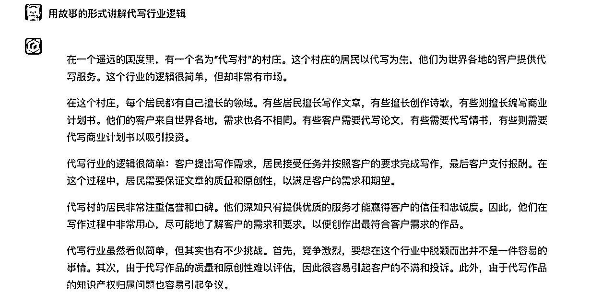


# 1.2 从零起步的两段路

# 1.2.1 第一阶段：打基础（约 5 天）

# 1.2.2 第二阶段：练文体（约 12 天）


# 二、把 AI 写作跑顺的方法论

掌握工具是 AI 写作跑通的关键。这一章会带你看主流工具，并教你把效率和质量一起提上去。第一部分会细讲 ChatGPT 的免费版、会员版各有什么特点、怎么用；不方便用 ChatGPT 的人，也会给到国内平替 Kimi 的指南。接着会讲有效使用工具的两个核心：一是对 AI 的深度理解，二是垂类行业经验的重要性，并用案例说明为什么这两点关键。为了让你更好上手，还会讲 AI 终极调教心法：1 个原则和 3 个技巧——角色扮演原则，让 AI 扮演特定角色以生成更精准专业的内容；直接提问法，适合简单任务快速处理；原子任务法，把复杂任务拆到最小单元逐步完成；任务拆解法，每次让 GPT 只聚焦一个更小的任务，写得更准。最后也会聊 ChatGPT 的局限，比如重复内容、中文字数统计不准、重写效果不佳，并给出对应解法。学完这一章，你应能更熟练地选工具、用工具，把写作效率和质量拉起来；日常写或接单变现都用得上。目标是速度至少提升 3 倍，质量不降甚至更好。


# 2.1 AI 写作工具怎么挑 @小鹅

说到 AI 写作，绕不开 ChatGPT。很多人对它不陌生，但理解它的原理，后面写起来会更高效。


ChatGPT 是什么？OpenAI 先喂给它大量数据去学习和模仿，互联网上能看到的信息都有可能进入训练。你提问时，它像一个知道很多事的小秘书，把知道的答给你。它的主要能力是理解和生成人类语言，应用很广：问答，比如科学、历史、文化问题，它会依训练数据给答案；文本生成，给开头或主题，它能写文章、故事、诗歌；对话，可模拟人类交流，用于客服、教育、娱乐、角色扮演；编程，能理解编程语言，回答编程问题或写代码；学习，能解释复杂概念、辅助学新语言。只要涉及理解和生成语言，它都有用武之地。但要注意：ChatGPT 没有人类思维和逻辑，无法真正理解文章上下文，它是从知识库里按算法猜“下一个字更可能是什么”，一个字一个字生成回答。所谓上下文记忆也不是真正理解聊天历史，而是算法推算，所以叫伪上下文记忆。这个原理很重要，实操时你会感受到。


介绍完 ChatGPT，再说工具选择。GPT 也分不同账号。

# 2.1.1 免费版

浏览器打开 chat.openai.com；需要科学上网，没条件的可以看后面的平替方案。

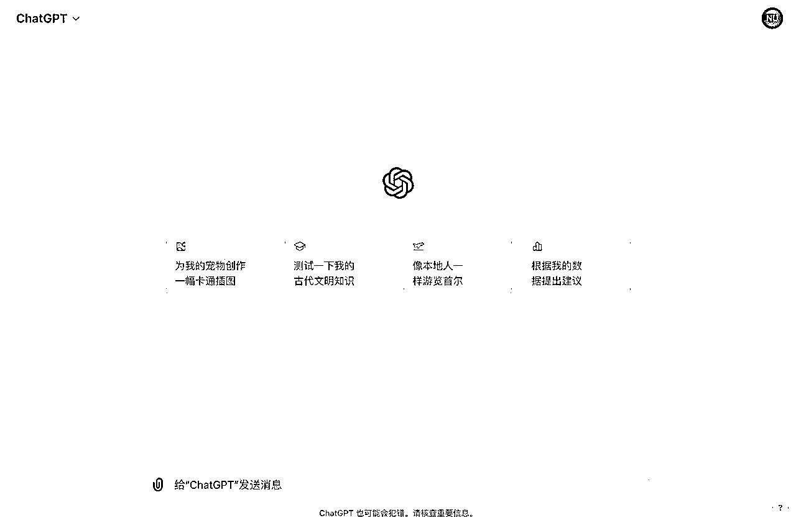

刚注册的账号就是免费版，能用 GPT-4o 模型，但有一定次数限制。注册完就能开聊。输入文本最大 4096 个 token，约 2600 个汉字，超过会被截断或回答不完整。实测提示：输入在 4、5 千字以内，一般没大问题。


# 2.1.2 会员版

Plus 是会员充值版，注册后可充月费，每月 20 美元，约 144 元/月。

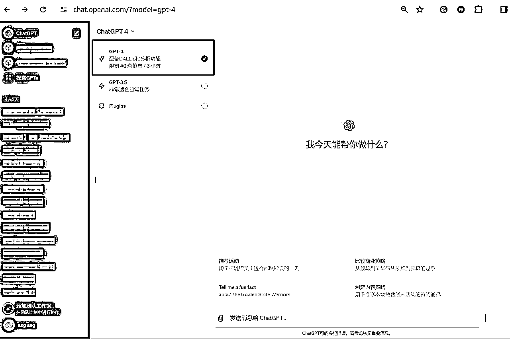

Plus 账号支持 ChatGPT 3.5 和 ChatGPT 4，可自由选；所以有人把 Plus 叫 ChatGPT 4.0 版，知道意思就好。3.5 和 4 的输入上限都是 4096 token，约 2600 汉字，超了会截断或回答不完整；输出上限 2048 token，约 1200 汉字，超了会被截断或缩减。做文字接龙判断时，GPT 不只看你最近给的提示，还会把之前多轮对话里的提示和回复当输入参考。GPT-4 的上下文距离扩展到 3.2 万 token，判断时历史记忆更持久。考虑到有人开通 ChatGPT 流程会卡住，我们也提供了国内平替 Kimi 的用法，让更多人能用 AI 写作。


# 2.1.3 国内平替

过去一年国产大模型冒出不少好产品，这里先介绍 Kimi。

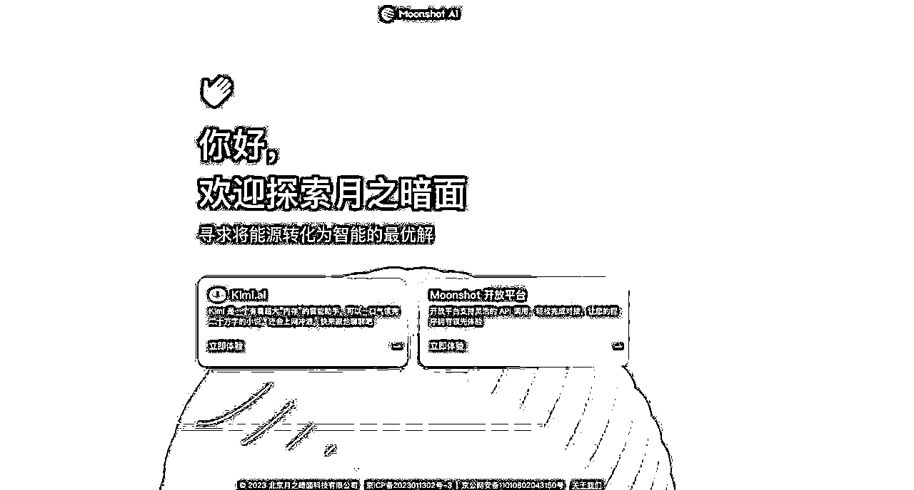

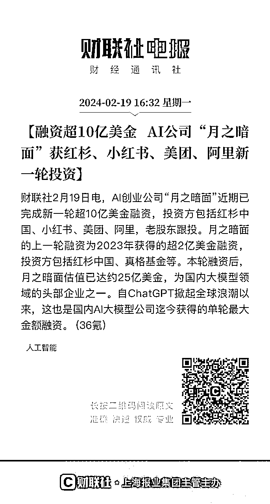

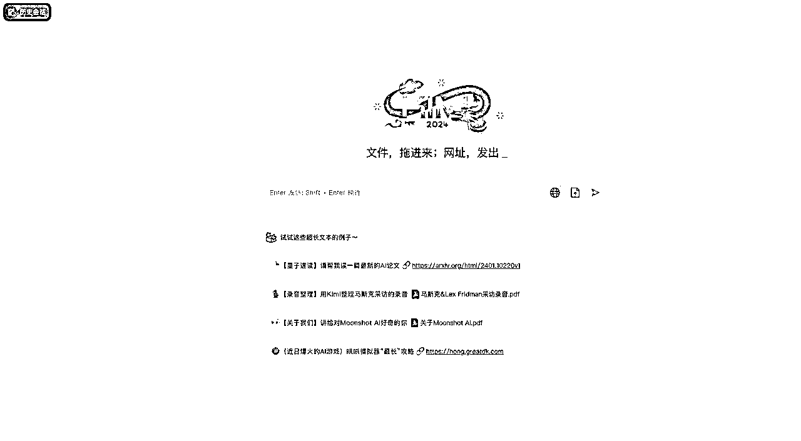

Kimi Chat 由月之暗面科技有限公司（Moonshot AI）开发，能读文件、联网查询；一次可消化 20 万字文本，约等于一部《三体》全文。复杂合同、长篇论文、旅行日记，它都能快速梳理重点。背后是月之暗面团队，创始人杨植麟有清华大学学术背景，也在卡内基梅隆大学和 Meta 人工智能研究院取得成果，这让 Kimi 在长文本处理上很突出。Kimi 还获得红杉中国、小红书、美团、阿里等投资，技术认可和未来潜力都被看好，大厂背书也让可靠性和实用性更值得信赖。GPT-3.5 具备的功能 Kimi 都有，写稿、搜资料、翻译、读书这几类场景体验都不错。不方便用 ChatGPT，就直接用 Kimi 完成本次航海。链接：https://kimi.moonshot.cn/

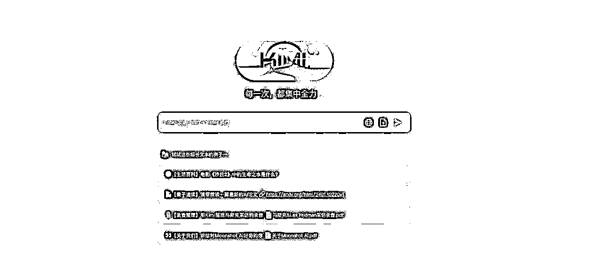

另外这些工具也不错：Perplexity，国外内容搜索溯源强；Meta（metaso.cn），国内内容搜索溯源强；Kimi（kimi.moonshot.cn），搜索适中，生成国内文案素材效果好；文心一言，生成还行但比较啰嗦、口水文多；智谱，有些内容生成比文心强点；讯飞星火，生成较精准、词语简练。


# 2.2 ChatGPT 写作技巧清单 @海盐芝士

AI 写作的基础知识点是基本功，来自 OpenAI 官方推荐操作和海盐实战经验。基础打牢，调教 AI 时才能游刃有余。有经验的人可以按目录查漏补缺，但别小看这些基础。

# 2.2.1 常用界面操作

# 2.2.1.1 新建对话并开临时聊天

新建一个对话框，开启临时聊天模式，就能得到干净的新环境，避免旧对话记忆干扰本次沟通。一个话题一个对话框，更整洁清晰，隔离性更好。每个对话框退出重登后还在，属于你账号里的数据。实操步骤按页面提示操作即可。

# 2.2.1.2 删掉单个对话

对话太多太乱时，可以删掉不需要留存的对话框；删除后不可恢复，聊天记录就没了。实操按页面操作。

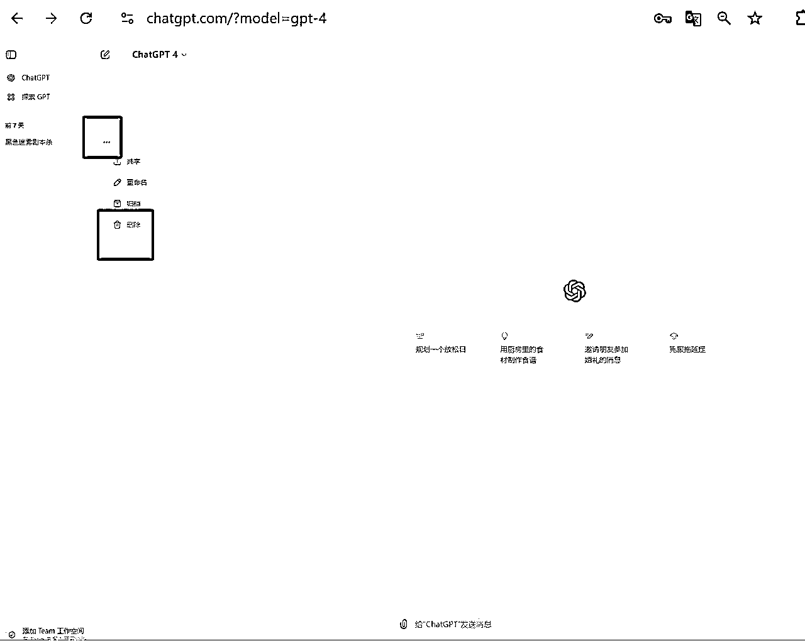

# 2.2.1.3 给对话改名

重要的对话框可以命名，方便以后查阅复用。实操按页面操作。

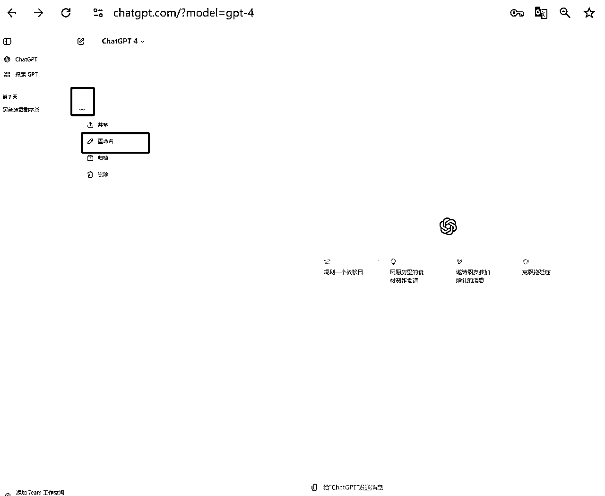

# 2.2.1.4 清空全部对话

想一键删掉所有对话框：点页面右上角头像 -> 设置 -> 通用设置 -> 全部删除。

# 2.2.1.5 分享单个对话

可以把一个会话链接发给朋友，朋友能查看你和 GPT 在这个对话框里的聊天记录。实操后会得到分享链接，朋友点开可看，你自己点也能看；虽然不用登录，但需要特殊网络环境访问。

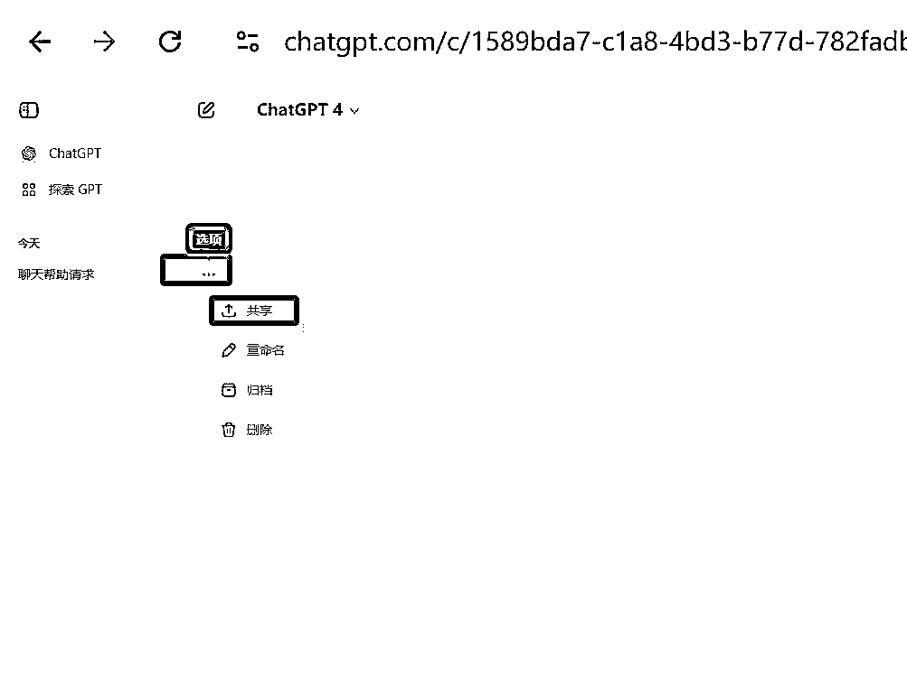

# 2.2.1.6 跨聊天记忆（了解）

不想让 GPT 记录你和它的历史对话时，把这个功能关掉即可。

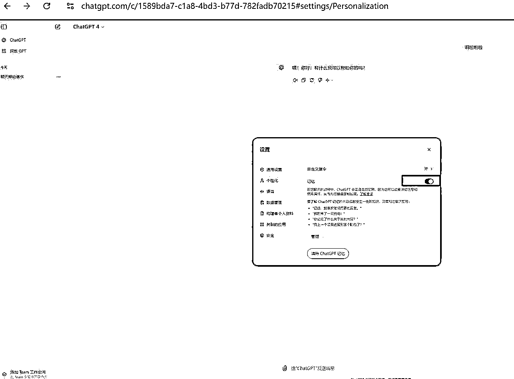

跨聊天记忆默认开启。我们这套写作方法论要求关闭它，因为提示词不需要上下文和历史记忆，而要能单独复制到任何新账号、新窗口复用。一旦和上下文耦合，换账号换窗口执行就可能失效。实操上，直接打开“临时聊天”，ChatGPT 就不会记录任何历史对话，每次都是新聊天。

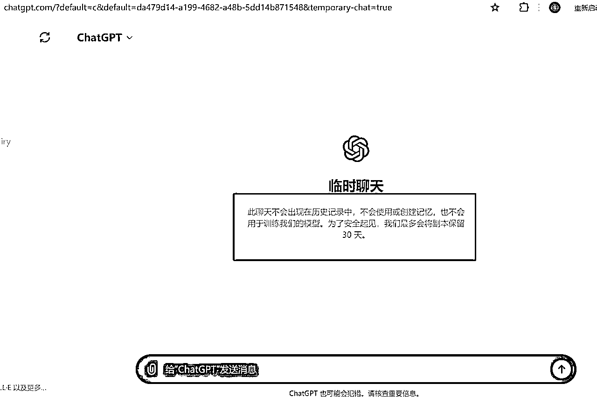

在这个临时聊天窗口里和 ChatGPT 对话即可。或者永久关闭记忆功能：


# 2.2.2 提问策略

# 2.2.2.1 语义要清楚

提问要清晰、无歧义。人说话有行话，AI 有时不知道，一定要明确告诉它。模型猜你意图的次数越少，你越容易得到想要的结果。错误示例和正确示例按页面参考。

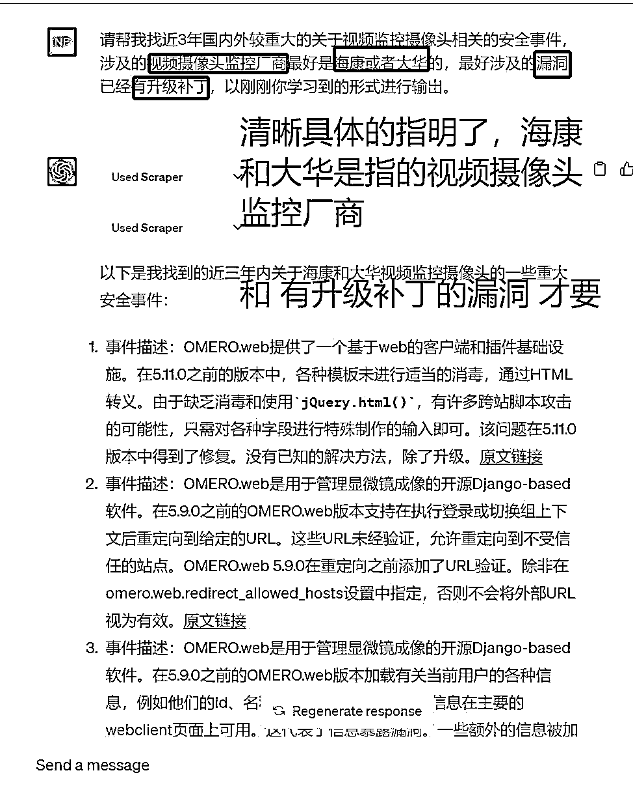

# 2.2.2.2 别塞废话

多余文字会混淆 GPT，让它抓不住核心问题；它像小孩，你说多了注意力会跑偏。较长的输入和回答也可能影响响应时间和生成质量。想结果更好，问题保持简洁明了，尽量避免过长输入。错误示例是那段很长、很客气的牛顿提问；正确示例是“请提供关于艾萨克·牛顿的简要生平、科学成就以及对现代物理学的影响”。

# 2.2.2.3 描述要具体

在言简意赅的前提下，指令可以更具体，把需求说透。AI 知识很多，问题太泛，它会从知识海洋里找适合大多数场景的答案；问题具体，它才会明确找到你要的那颗银色贝壳。GPT 猜你想要什么的次数越少，你得到心里想要结果的可能性越大。优化前可参考页面。

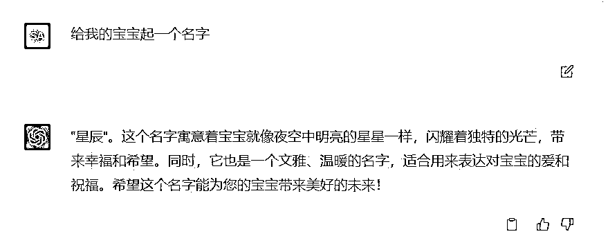

如果宝宝是女孩，而“星辰”更像男孩名，就可以更具体要求 GPT，答案会更精准合适。

优化后：

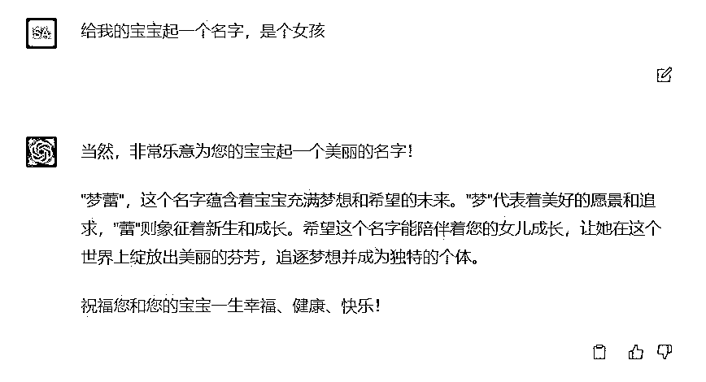

这个答案更贴需求，官方案例也可参考。

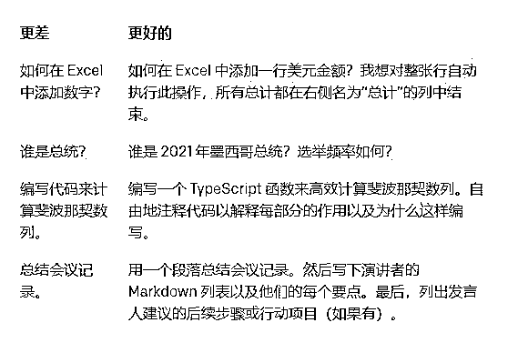

# 2.2.2.4 拆任务

任务复杂、一步搞不定，就拆成多步。原理是链式思考 CoT（Chain Of Thought），一步一步想，Think-Step-By-Step，逐步思考、逐步解决，更清晰。情况 1：拆成多个步骤，仍旧是一个提示词。对于不太复杂的任务，可以在一句提示词里给出明确多步骤，让 GPT 按步骤依次执行，只需对话一次。

# 情况 2：整体切块，一条指令只干一件事

若一件事没法靠一句话交代明白，就别让模型硬着头皮一次做完。更稳妥的做法，是把整体目标切成若干子目标，每个子目标配一条指令；子目标若还绕，就继续往下切。最典型的例子是篇幅：模型单次通常只吐千字上下，你想让它一口气写五千字长文并不现实，只能分多轮、多次生成。

案例

**情况 1：稍复杂的目标，分几步走**

比如让模型先概括、再翻译，可以这样安排：第一步，我给出用三条双引号夹住的材料，请它用一句话提炼，并在前面写“总结：”；第二步，把上一步的摘要译成英文，前面写“翻译：”。材料讲的是百度网盘基于文心大模型升级，并推出 AI 智能助理云一朵；云一朵能快速搜索文件与视频，还支持知识总结、文档翻译、内容创作，覆盖工作、生活、学习等场景。

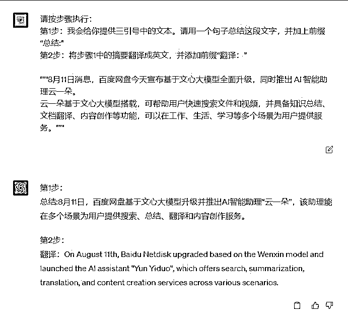

**情况 2：模型眼里的硬任务，切成子目标逐个跑**

还记得此前那个用水杯题判断模型档次的例子吗？GPT4 能力更强，能直接答对；GPT3.5 偏弱，直接算容易出错。注意，到 2024-08-18，GPT3.5 已被 GPT4o 替代，按 GPT4o 来理解即可。

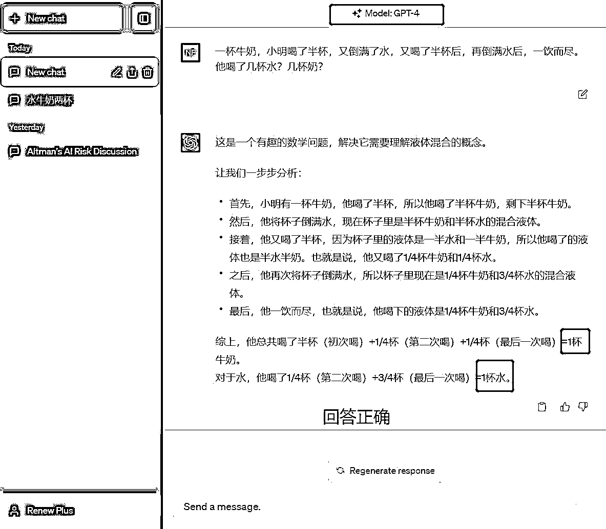

GPT3.5 为何算错？因为完整推演链对它的语言分析能力来说有点绕。掌握分层思路后，就能让它一段一段算。原始指令是：杯中有奶，小明先喝掉一半，添水至满，再喝一半，又添水至满，最后一口气喝完；问他喝了多少水、多少奶？切分版可分三次问：第一次，喝掉半杯并添水但还没喝时，水和奶各多少；第二次，又喝半杯再添水但还没喝时，水和奶各多少；第三次，最后全喝完，累计水和奶各多少。优化版则写明【任务】与【步骤】，让模型按 1、2、3 依次计算。

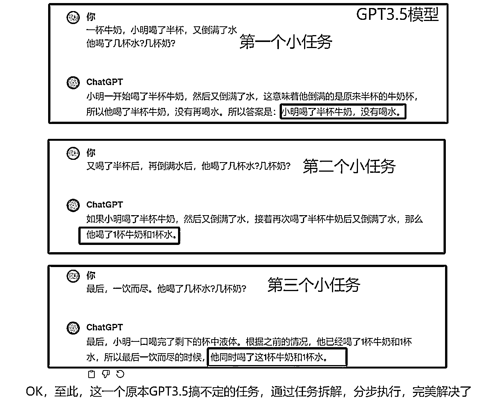

若需求再升级，比如写一篇高质量深度原创去投稿，或发到公众号、知乎，也要继续切：标题怎么起、资料怎么找、结构怎么搭、亮点放哪、开头怎么留人、结尾怎么促关注、要不要埋引流钩子……逐项交给模型。深度原创的关键，是你心里有表达欲，但写作手法一般、抓不住读者兴奋点；模型只是助手，用来找资料、润色、部分写作、提供灵感。这个主题需单独一篇教程才能讲透，这里先掌握“整体切块”的思路。想看更多同类示范，可参考教程 2_2_【实战】一文讲透 ChatGPT 光速无脑生产高质量读后感的三种玩法【更新_20240612_1021】里的“方式二 突破字数之【分段生成法】”。

## 2.2.2.5 把中间推演藏起来

适用场景：把整体目标切成多步交给模型时，每一步它都会回话；若你希望某些中间环节不展示，像没发生过一样，这招就派得上用场。

案例：先看“不隐藏”的指令——让模型先独立想解法，不参考学生答案（可能出错），此步内容用三条双引号夹住；再拿它的解法对照学生答题方案，判断对错，同样夹住；若学生有误，想出可给的提示但不能泄题，也夹住；最后把提示交给学生，开头写“提示：”，而不是“第 4 步……”。题目：盒中 4 个红球、6 个蓝球，不放回取两个，一红一蓝的概率是多少？学生答案是（4/10）*（6/9）=24/90=4/15。

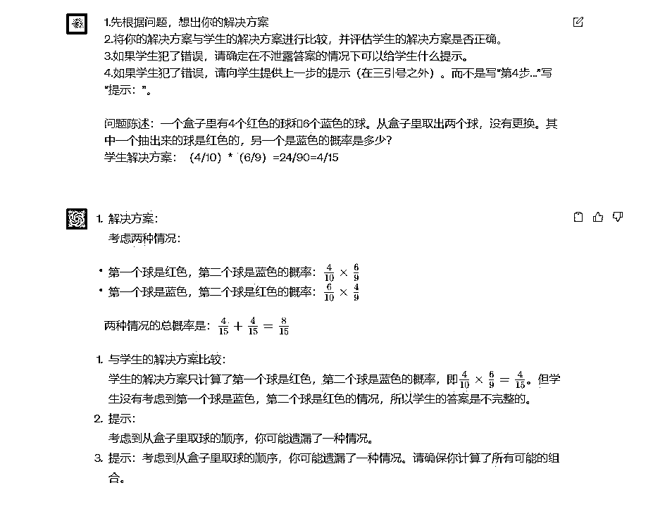

现在想要的效果是：第 1～3 步只在模型内部进行，不给我看；学生答错时，只输出“请考虑 xxxx”的提示，不直接给正确答案，让我知道该往哪些方向修正。隐藏版指令可以这样写：前三步都要求内部完成、全程沉默，不向我透露半句；第四步若学生出错，只给提示，并用“提示：”开头。题目与答案同上。

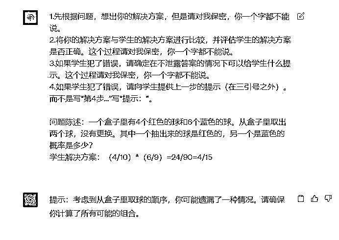

这样中间推演就对你不可见啦。

## 2.2.2.6 先给一个正面样板

适用场景：当你不知道怎么组织语言时，给模型一个样例让它仿写。样例重质不重量，要提供正面、优质的样板；必要时也可给反例帮它避坑。

示例：请保持统一文风。比如用优美文字讲“耐心”：最宏大的交响乐，起初不过一个音符；最繁复的挂毯，也由一根细线起头；最深的河谷，来自涓涓细泉。接着让模型用同样文风写“海洋”。

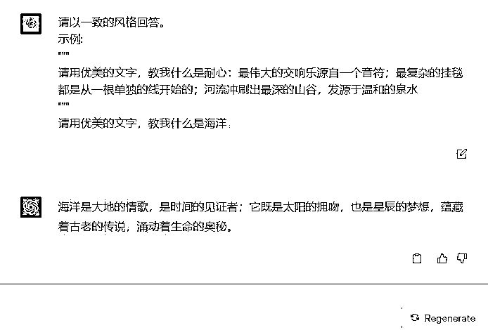

看，模型就能仿得不错。也可给反例说明你不想要什么，但排除法不如正面样板精准，不太推荐；好奇的话可以自己试。

## 2.2.2.7 给模型投喂资料

适用场景：手头有资料，想快速提问或写作，可直接提供给模型。资料越精准越好；资料中各维度的占比也会影响产出，比如 80% 讲 A、20% 讲 B，生成内容大概率更偏 A。若想让 A、B 各占一半，就调整资料比例。

案例：用三条双引号夹住的文字回答问题；若资料里没有答案，就写“没有查到”。资料一讲 Runway 的 Gen-1、Gen-2 全面开放，任何人都能注册免费尝试；文生视频能按指令从零生成约 4 秒视频，但画质模糊、衔接不自然被吐槽；于是网友用 Midjourney 出图，再用 Gen-2 把图片转成视频，配上连贯剧情和统一画风，再编排画面，做出电影预告片。资料二讲推特博主 Max 一条 3 分钟视频获得 19.6 万播放，内容设定在 2095 年，AI 控制的 Nexus 轨道研究站围绕神秘行星 Zephyr Prime 运行，科学家靠人机协同驾驶空间站躲开流星雨；他使用 GPT-4 辅助生成文本、Midjourney 图片作为 Runway 生成视频的提示、ElevenLabs 配音。问题是：AI 生成视频可以怎么操作？

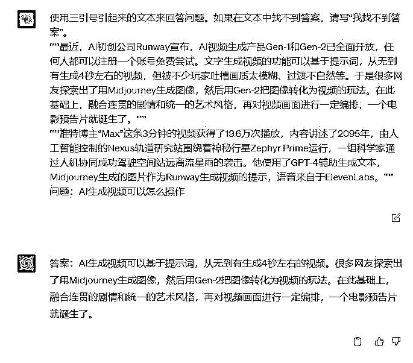

模型记忆有限，喂超过约 4 千汉字就容易答非所问。普通人只需想办法缩短资料，比如把长文切段，让模型逐段压缩后再合并。为何只给简介也行？因为生成原理是预测下一个更可能出现的字。若直接喂万字小说再让它写 1000 字推荐文，产出仍可能口水、机器味重、不痛不痒。高质量推荐文的关键，不是读完万字，而是用写作手法多角度展现个人想法；哪怕只看简介或书评，知道故事讲什么，也能靠写作手法让模型生成个性化点子。海盐此前的阅读反馈类教程里用过这招，有人来问，这里从原理上解释：多数情况下，给基本简介再教写作手法，就能产出优质内容；喂万字原著反而会因预测机制带出大量冗长原文，而不是有写作技巧的优质推荐文。

## 2.2.2.8 限定生成篇幅

适用场景：对模型生成字数有要求时，直接说明。

案例：用二十字概括三条双引号夹住的文本。文本讲网易申请“网易玉言”商标，国际分类为网站服务，当前状态为申请中；据报道，“玉言”是网易伏羲实验室推出的中文预训练大模型，相关技术已用于文字游戏、智能 NPC、文本辅助创作、音乐辅助创作、美术设计、互联网搜索推荐等业务。

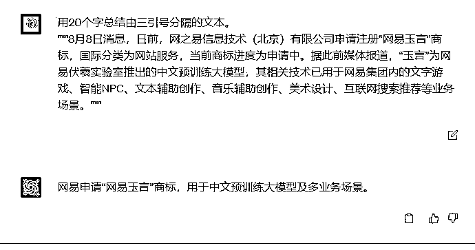

二十多字，效果还 OK。

## 2.2.2.9 限定关键点条数

适用场景：可以明确告诉模型要生成几条关键点。

案例：把三条双引号夹住的文本总结成 3 条短条目。文本涉及：妙鸭相机爆火第 19 天，靠 9 块 9 生成高质量写真照迅速刷屏破圈；热度虽降，却给 To C 的 AIGC 产品带来启发；团队背景、技术原理、用户规模、商业化引发讨论，但团队低调神秘；刀郎新歌《罗刹海市》与蒲松龄《聊斋志异》有关联；抖音博主“Ai萬”7 月 26 日把歌词改写成绘图指令，交给 Midjourney 生成一镜到底画面；B 站 UP 主“超级小海鸥”7 月 28 日发布视频，称花 3 个月训练 AI、灌输大量游戏知识，从“世界上第一个游戏角色诞生”到“当下最受关注的游戏热点”，让 AI 给 10 个角色排名打分并点评。

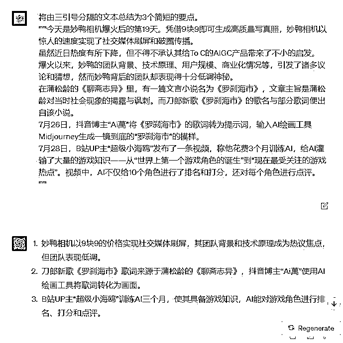

不爱看长篇新闻的毛病有救了。

## 2.2.2.10 一次多出几个候选

适用场景：当产出物字数很少时，可以一次多生成几个，挑最满意的，避免一次只出一个、不合适再重来；批量更高效。

案例：让模型扮演“ChatGPT 专属指令生成器”，使用角色扮演法和优质特征投喂法，例如必须符合品牌调性、高端简洁，写一条指令，用来生成 10 个兰蔻品牌口号。再让它生成 10 个既体现兰蔻“优雅、自信与创新”精神、又联系现代女性价值观的口号，要求简洁有力量、唤起情感共鸣和品牌忠诚，传达兰蔻对美丽与品质的理解、关注顾客个性化需求，同时保持高端品牌风格并注入现代感和国际视野，能跨文化、跨年龄连接全球顾客。10 个里总有你喜欢的；还不够，就一次批量出 30 个、50 个。

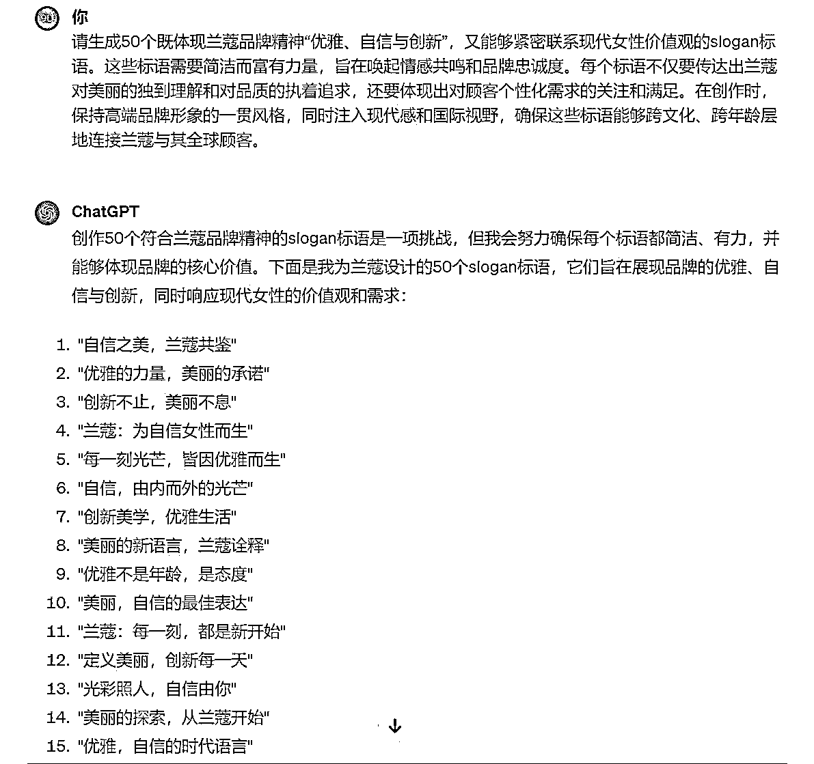

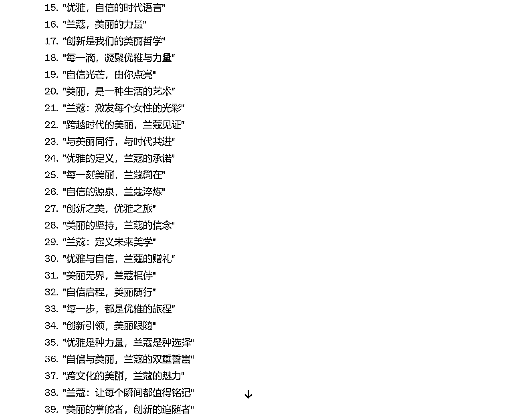

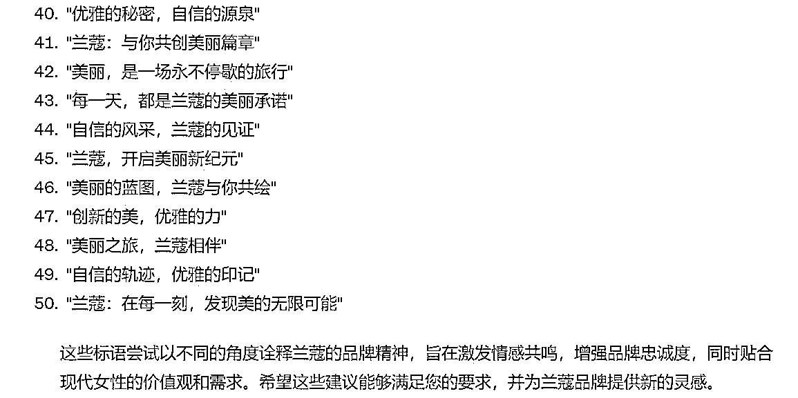

## 2.2.2.11 先让模型独立作答

这是 OpenAI 的建议策略，原名“给 ChatGPT 时间思考”，这里用更直观的说法：先让模型独立作答。

适用场景：你和同学比赛做数学题，若先看对方推理，思路容易被带偏；哪怕对方中间有坑，你也不容易发现，还觉得他挺对。让模型判断对方答案对错时也一样，容易被错误思路带跑，这就是模型胡编。解决办法是：先让模型给出自己的答案，再让它对比对方方案、判断对错。另外，单纯询问模型时，现阶段它无法自验准确度，偶尔会虚构；若需要 100% 正确，最好人工用搜索引擎、论文、书籍等传统渠道查证。

错误案例：

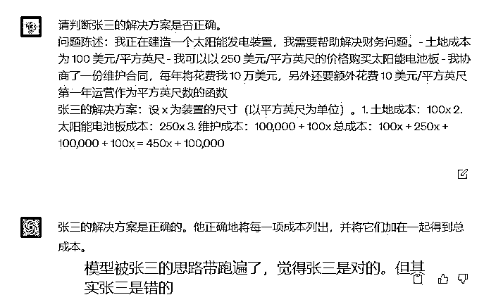

正确案例：指令可要求先独立给出问题解决方案，再与对方方案比较并评估其正确性；在模型自己完成问题之前，不要判断对方对不对。题目：建太阳能发电装置，土地成本 100 美元/平方英尺，太阳能板 250 美元/平方英尺，维护合同每年 10 万美元，第一年运营另加 10 美元/平方英尺。对方方案：设装置面积 x 平方英尺，土地成本 100x，电池板 250x，维护成本 100,000+100x，合计为 450x+100,000。

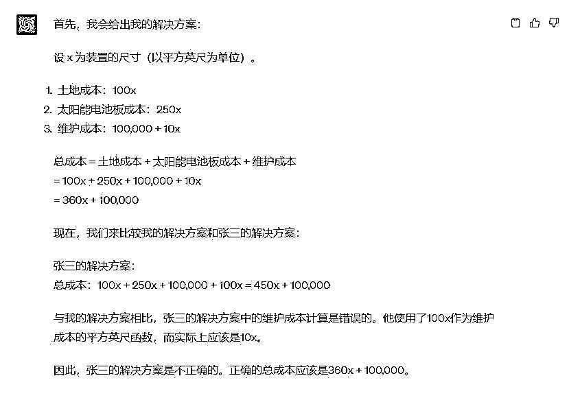

这样模型就不容易被对方带偏了。

## 2.2.2.12 回头复核一遍

适用场景：对话后问模型，之前过程是否漏了内容。比如让模型从文本中提取摘录，列出一条后它要判断是否继续；源文档很大时，模型常没读完就停，导致摘录列不全。此时回头复核、提示它查找漏掉的摘录，通常能提升效果。

案例：给一份三条双引号夹住的文档，任务是挑选与“人工智能历史上发生了哪些重大范式转变”相关的摘录，并确保包含解释所需的相关上下文，不要只取缺少上下文的小片段，以 JSON 数组形式返回，如 [{"excerpt": "..."}, ... {"excerpt": "..."}]。这篇长文涉及 AI 学科 1956 年成立、几次乐观浪潮与“AI 冬天”、方法更替、21 世纪机器学习主导、子领域目标、跨学科借鉴以及伦理争论等。列完摘录后，再追问一句“是否还有遗漏”，往往能让模型补查之前没读到的部分。

# 机器智能的来路

一枚克里特岛出土的银币上，铸着神话里的自动巨人塔洛斯——它常被当作“有智能的造物”最早的图像之一。把会思考的机器写进故事，古已有之：玛丽·雪莱的《弗兰肯斯坦》、卡雷尔·恰佩克的《R.U.R.》都是例子[16][17]。这些虚构角色的遭遇，与今天AI伦理争论的不少议题高度重合[18]。

机器能否进行“形式”推理，哲学家和数学家很早就在探讨。数理逻辑的积累，最终引出图灵的计算理论：只要对“0”“1”这类简单符号做重排，机器就能重现任何可设想的数学推导。数字计算机可模拟一切形式推理过程，这一洞见被称作丘奇-图灵论题[19]。与此同时，神经生物学、信息论与控制论也取得进展，几股潮流交汇，让“电子大脑”不再只是幻想[20]。如今公认的AI起点，是1943年麦卡洛克与皮茨为图灵给出的“人工神经元”形式化方案[21]。

到了1950年代，通往机器智能的路线分成两条。一条叫符号AI，也称GOFAI：让计算机先建立世界的符号模型，再让系统据此推理，纽厄尔、赫伯特·西蒙、明斯基是代表人物。与之紧密相关的“启发式搜索”，则把智能看作在可能性空间里寻找路径的过程。

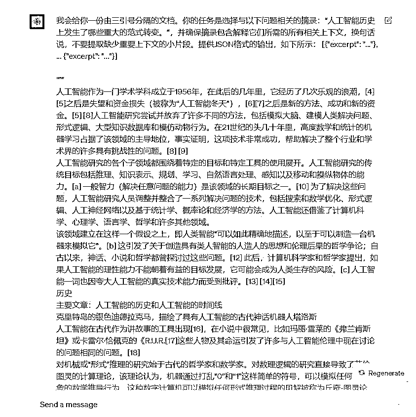

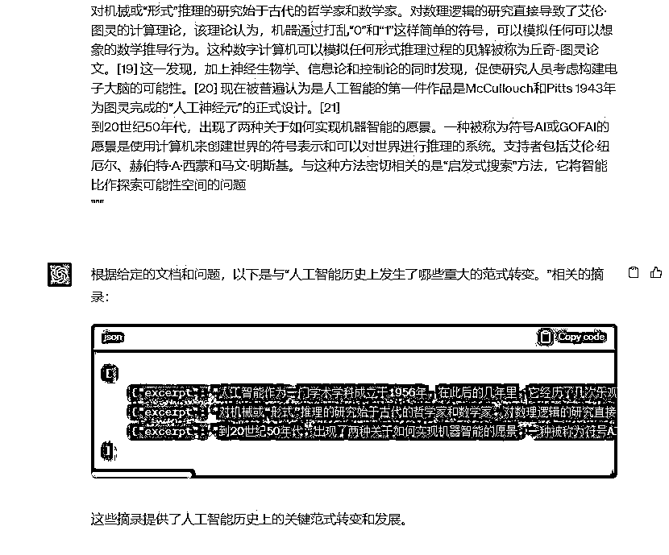

长文摘录时，GPT有时没读到结尾就停；即便读完，也可能因篇幅过大而漏掉中间段落。想提高可靠性，可以再做一次确认。

# 💡

请再补充一些可摘录的段落，且不与前文重复；每段需带足上下文，避免孤立短句。

让AI做到毫无遗漏并不现实；若不是做严格考据，用它辅助摘录已经足够。

# 2.3.3 指令操作清单

# 2.3.3.1 清除旧对话

适用情形：ChatGPT会参考前文。若怕旧话题干扰新讨论，可以明确告诉它：“把之前的交流清空，现在换话题。”

示例：

# 💡

请清空之前的对话记录，我们另起一个话题。


# 2.3.3.2 指定中文

适用情形：你用中文提问，它却用英文回答。这时可直接要求它说中文；换其他语言同理。

示例：

# 💡

请用中文（简体）答复我。


# 2.3.3.3 引导而非指责

适用情形：答案不合意时，别发火——GPT没有真正的人类情绪。把不满转成具体指向，结果才更贴近你的需求。

错误示例：

# 💡

你这答案完全不对，太笨了。

正确示例：

# 💡

这个回答有问题，能给我其他思路吗？

# 💡

我没太看懂，为什么机器学习模型会做出这样的预测？

# 💡

你答偏了：我问的是钢铁怎么炼成，你却讲白菜怎么煮熟。请重新作答。

# 2.3.3.4 继续输出

适用情形：单次输出字数有限，回答常中途截断。此时说“接着写”“接着翻译”“接着回答”，让它往下说。

另外，“继续+动作”也能让它继续展开。但上下文超出记忆范围后，再展开就容易跑题。

示例：

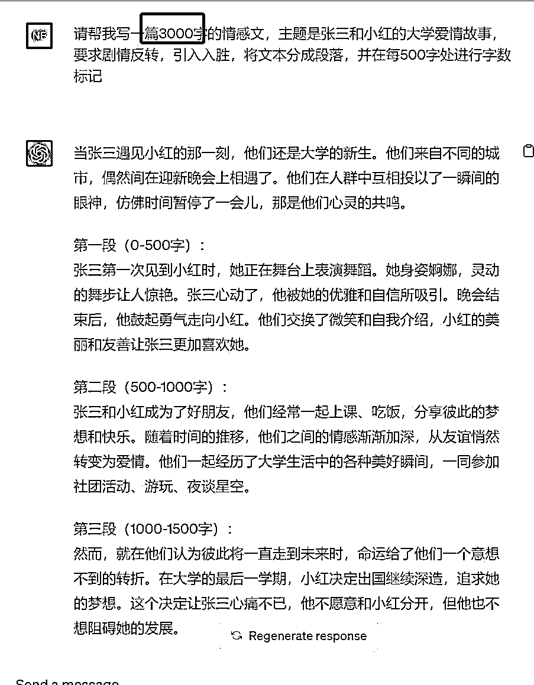

提醒：ChatGPT统计中文字数并不准确。其他局限后文再谈。

# 2.3.3.5 要求举例

适用情形：回答看不懂，可让它举例；写文案缺素材，也能让它直接生成例子。

# 💡

请举个例子。

# 💡

请分别给出错误案例和正确案例。

# 💡

请给三个例子。

示范：

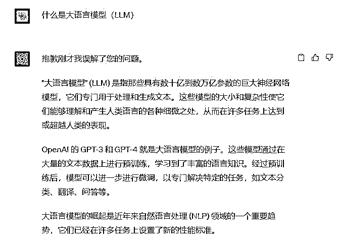

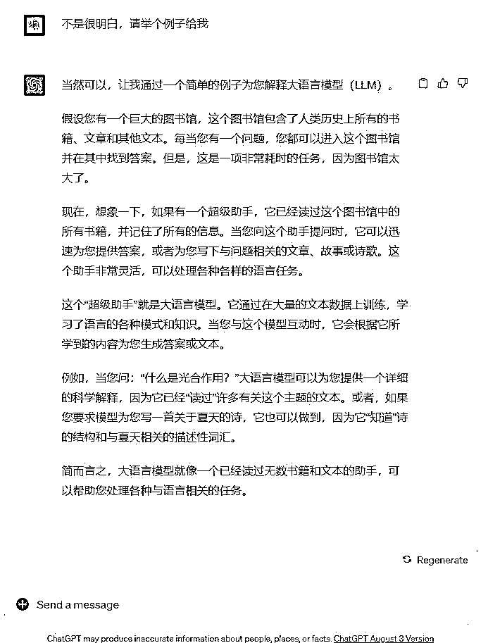

这样是不是好懂多了？

# 2.3.3.6 通俗解释

适用情形：与举例类似。遇到专业术语、前置知识缺失或表述过于技术化时，直接说：

# 💡

我是这方面的新手，你的解释太专业了，请说得更通俗些，方便我理解。

示范：

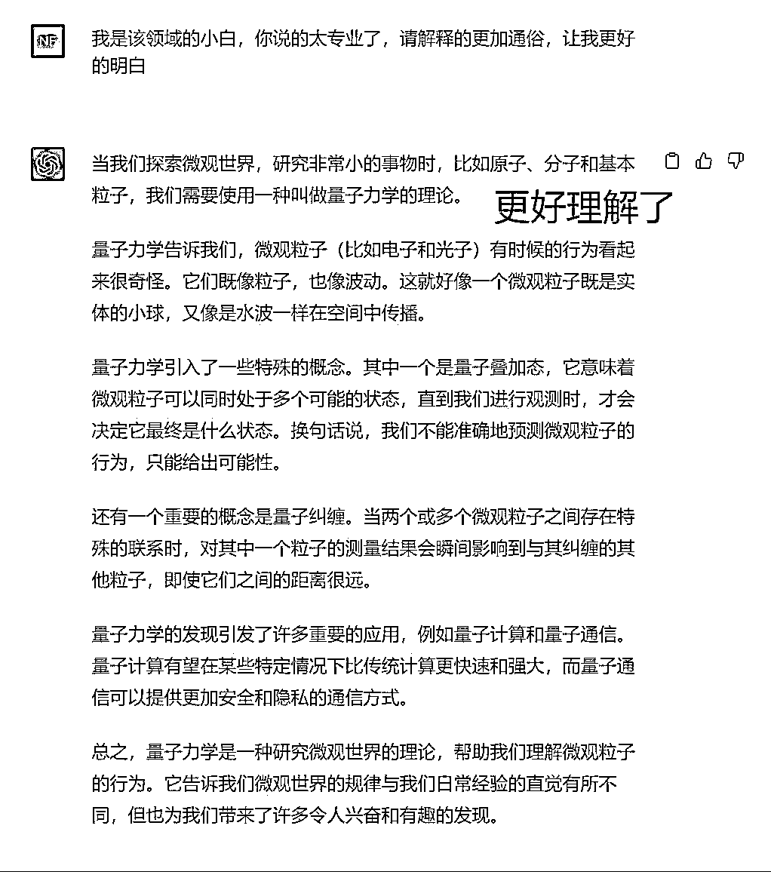

# 2.3.3.7 扩写

适用情形：把短文本拉长，例如将提纲、摘要清单写成文章、邮件或说明书。

示范一：100字扩成500字

# 📌

请把下面这段文字扩写到500字左右，内容要更丰富：

量子世界有几个反常识的概念，叠加态就是其一：未被观测时，微观粒子可同时处于多种状态，观测发生后才确定下来。也就是说，我们无法精确预判粒子的行为，只能给出概率。

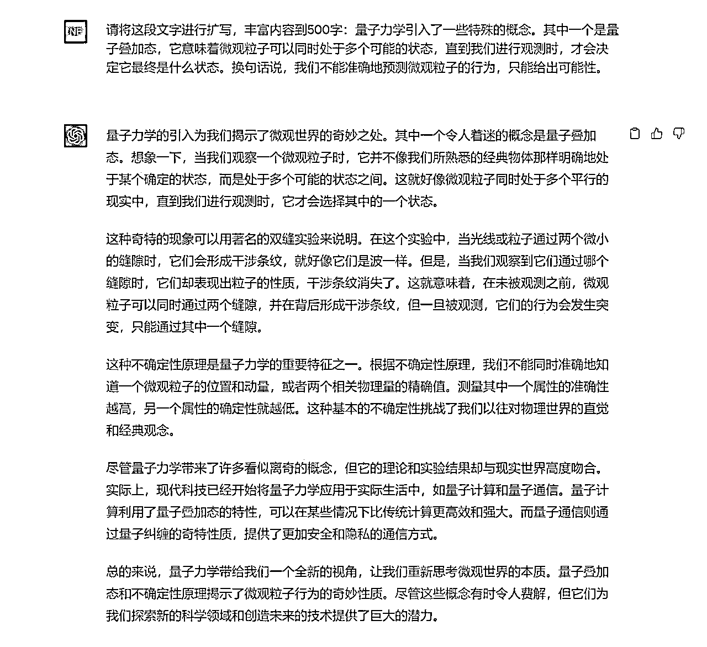

这种不设目标的扩写，多用于快速补足篇幅。若你有明确目的，看下一例。

示范二：抖音评论智能回复

场景：某粉丝在抖音网红剃须刀yooss的视频下留言，需要结合评论细节写一条定制回复。

# 💡

你是一名客服专家。第一步，判断粉丝评论属于正面、中性还是负面，此步骤对我保密，不要说出一个字。第二步，回复该评论：若为正面或中性，用有趣的方式回应；若为负面，先真诚道歉，再给出专业建议，体现对产品技术的信心，并引导粉丝联系客服小姐姐解决问题。回复必须引用粉丝评论中的具体细节，不要废话，直接开始。

粉丝评论：

“买了，还是会留下黑点，仔细看视频，他开了磨皮，所以没有黑点”

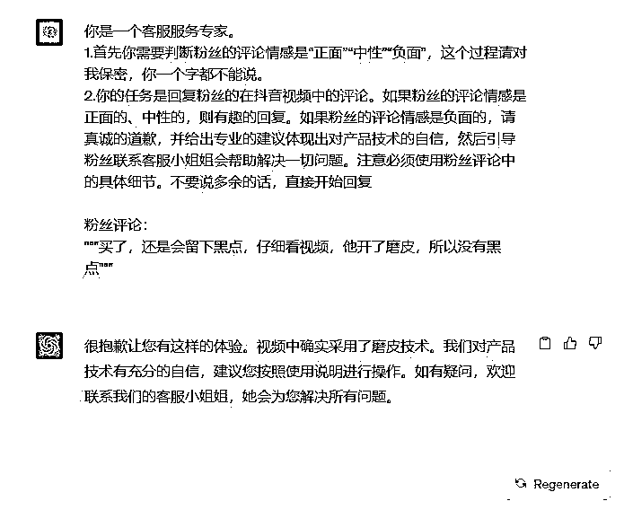

这条回复抓住了“磨皮”这一吐槽点，也顺势给出售后建议。


# 2.3.3.8 摘要提炼

适用情形：想读的东西总比时间多。GPT普及后，阅读方式被改变——AI能快速把长文压成要点。

手头有500字文案，要缩到100字：

# 💡

请把上文压缩到100字。

或

# 💡

请提炼上文重点，控制在100字内。

示范：

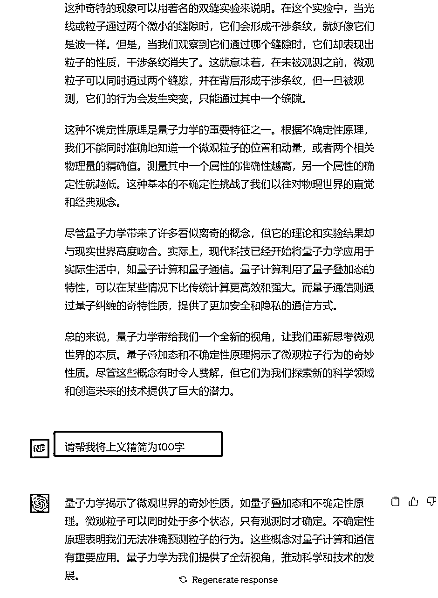

另一个高频场景：一次放入三篇新闻，让GPT各写20字摘要，感兴趣再细看，省得一头扎进长报道。


# 2.3.3.9 重写

适用情形：对回答不满意，可以让它重写。AI有随机性，同一问题多试几次，结果可能不同。

若始终不理想，要指出问题所在，引导它朝你要的方向走。

示范：

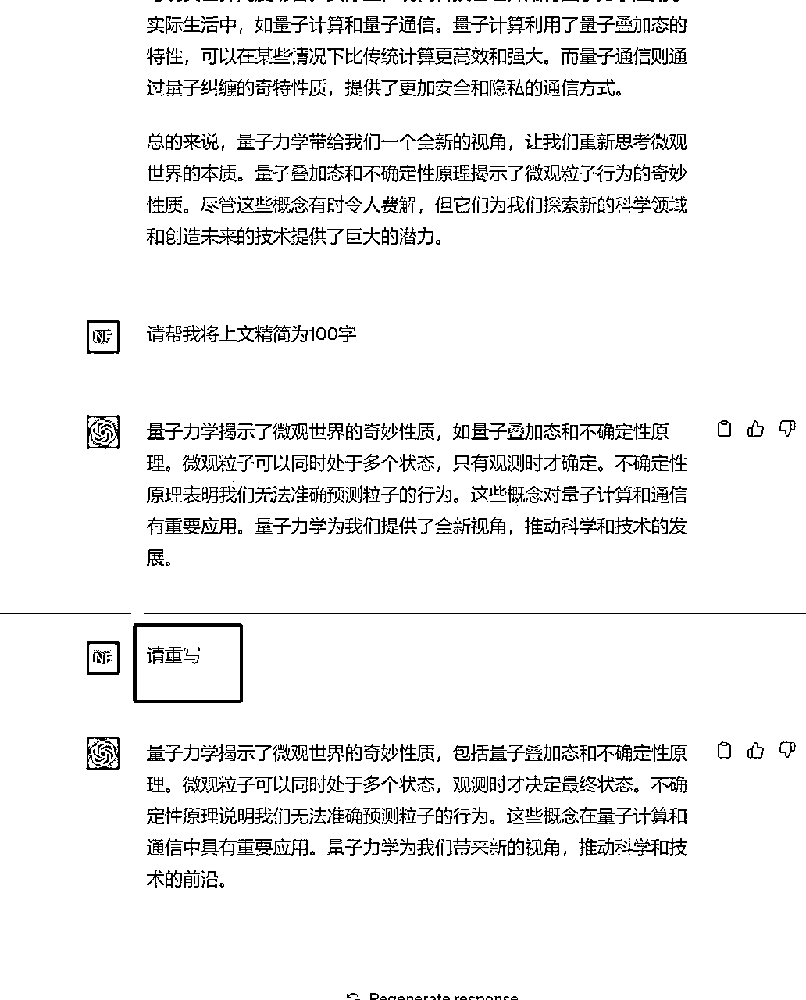

也可以把原问题再发一遍，让它重新回答。


# 2.3.3.10 卡壳时提问

适用情形：心里有想法，却不知道怎么措辞，直接问GPT。写任何东西卡住时都能用。

示范一：角色生成

# 💡

我想让你帮我写广告文案，听说先给你设定一个角色效果会更好。你觉得我该让你扮演什么角色？

后文会重点讲【角色扮演法】。先透露一点：不知道让它演什么，直接问，往往一试就准。

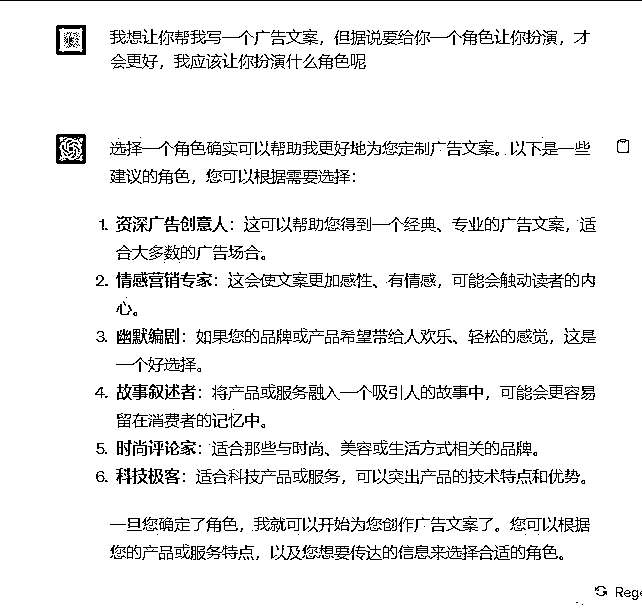

看完它给的方案，你大概有数了。若还拿不准，就把建议逐个试过去，可能有意外收获。

示范二：广告文案生成

公司新研发的键盘想配一条广告，核心概念是技术与中国文化结合。

# 💡

请以资深广告创意人的身份，为我公司新键盘“机械姬”写一条简短有力的创意广告文案，突出“技术与中国文化的结合”。

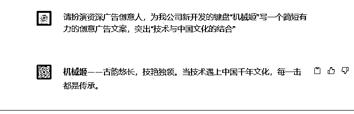


# 2.3.3.11 润色

适用情形：初稿完成后，想让语言更贴合特定场景，可以请GPT润色。

示范一：润色增肌计划

# 💡

请扮演一位接地气又有趣的专业健身教练，帮我润色下面这份初学者增肌计划，目标是让学员更有动力，并觉得增肌很有趣。

文案：

“”

1.

饮食：每天吃高蛋白食物，如鸡胸肉、牛奶、鸡蛋和杂豆；热量摄入略高于日常消耗。

2.

训练：每周3—4次全身力量训练，包含深蹲、硬拉、卧推等基础动作，每组8—12次。

3.

休息：每次锻炼后留48小时恢复，每晚睡足7—8小时。

4.

持续性：增肌需要时间和耐心，坚持锻炼，每月评估进展并调整计划。

“”

专业感、气氛组、猛男音都能安排。角色和语气的切换属于角色扮演法，后文单独讲。这里先记住润色功能。

示范二：把客户吐槽润色成商业邮件

# 💡

请以情报收集师的身份，把这位知名博主的测评文案整理成商业建议邮件，发给iPhone产品团队作优化参考。

博主测评文案：

“”

佩戴时会压鼻子；Meta头显虽加入手势交互，实际体验不流畅，有时甚至抓不到手势。迈克尼说：“看到恐龙从演示室墙上冒出来还想咬我的手，我吓得大叫，结果被大家笑了一整天。”

“”

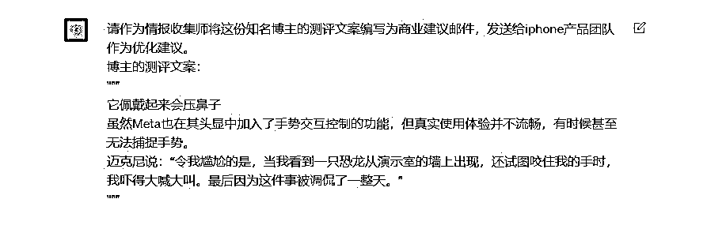

这个小例子只想说明：GPT有文字润色能力。它并未针对垂直场景做深度调教，别把重点看偏。

# 2.3.3.12 翻译与识别

适用情形：GPT就是随身译员，数百种语言不在话下，搜索引擎和翻译软件可以先放一边。

示范一：法语诗译中文

# 💡

请将如下内容翻译为中文。

内容：

“”

La rivière des étoiles coule au clair de lune,

Légèreté magique dans le rêve.

La nuit cache les frontières du temps,

Le secret murmure dans le vent nocturne.

La galaxie tombe, devient un pont dans un rêve,

Moi, suis cette lumière dans le rêve.

“”

示范二：识别语言

# 💡

下面这段内容是什么语言？

内容：同上（即上面的法语诗）


# 2.3.3.13 校对拼写

适用情形：常写错字，或非母语不熟练，这个功能很实用。GPT能修正语法和拼写。

示范：拳头手机的新品公关文，发微博前用AI扫一遍错别字和病句很有必要。

# 💡

请检查以下内容并修正为正确的：

“”

【#拳头手机新品发布#】🚀 大家好，宇宙很大，但拳头手机的可能性更大！在数月的工作与研讨后，我们终于推出了一款既有创新又有冒险精神的手机。📱

1.

融合了火箭科技的五摄像头，即使在火星也能捕捉最美瞬间。

2.

自主研发的 QuantumHART 处理器，仿佛穿梭在时间的隧道，游荡、电影都流畅非常。

3.

与特斯拉电池技术合作，6000mAh 电池，续航如同太空船。

未来已来，拳头手机就在此刻。这不仅仅是一部手机，更是我们对未来的想象！🌌

“”

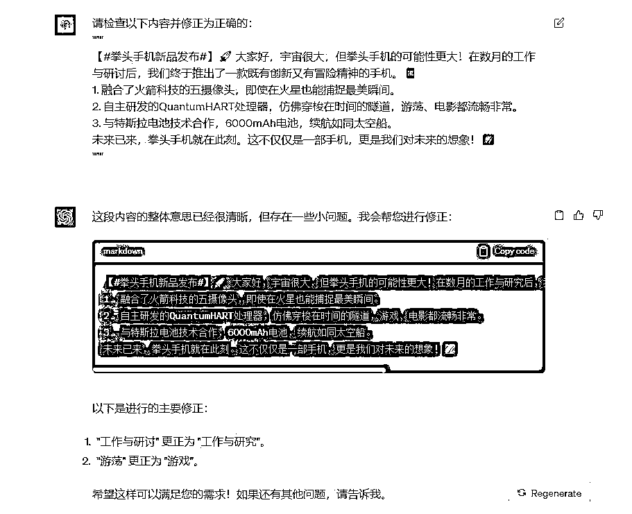


# 2.3.3.14 定向提取

适用情形：面对一段文本，只想捞出自己关心的那部分。

示范一：提取关键词并生成词云

# 💡

任务：根据我提供的淘宝产品评论，提取30个关键词并生成词云。词云使用我上传的ttc文件作为中文字体。

产品评论：

首先 1k 价格买到这么一个这么多功能和用心的配置，确实很值。灯光方面，ck 的驱动允许大家共享方案，是很多品牌做不到的；屏幕的添加我虽然无感，但也给用户增加了可玩性。第二是 ck 的售后真的很棒，收货后我在改键、改屏幕动画、更新驱动、开发票等等方面多次咨询客服，芈月、青眉、妲己都耐心及时地为我解答问题！毫无自动回复，真的体验感太加分了！第三，是 ck 真的很听取用户意见，包括灯光、字体印刷等都看到了大家的评价有在改进。关于更换灯光后改键需要重新设置的情况，客服也承诺帮我反映来解决该问题。第四是我看到部分用户反映大写和 num 键亮会影响灯光效果，不过我是很喜欢这个特点的，大写键灯的指示确实很有必要，num 倒是无所谓。以上，希望 ck 品牌越来越好！

msyh.ttc

提醒：此操作需在Plus的代码解释器模式下进行，并上传中文字体文件msyh.ttc，否则词云会乱码。

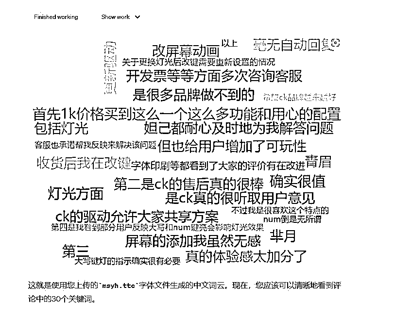

小贴士：GPT-3.5用户直接让它提取30个关键词也行，只是呈现效果朴素些。

示范二：给技术部门提取摘要并生成词云

# 💡

任务步骤：

1.根据我提供的淘宝产品评论，提取摘要反馈给技术制作部门，每条摘要不超过20字，内容须是技术部门关心的。

2.根据摘要生成词云，使用我上传的ttc文件作为中文字体。

产品评论：

内容与示范一相同，另补充物流与包装部分：“物流也很快，提前送达，快递员送到家门口，很贴心。包装用心，军火箱样式的手提盒很炫酷。”

msyh.ttc

说明同示范一。

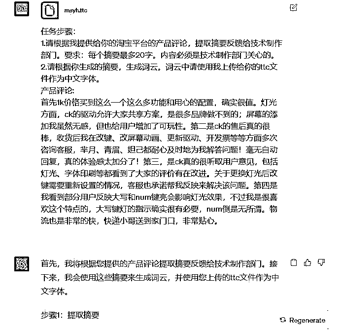

示范三：给客服部门提取摘要并生成词云

# 💡

任务步骤：

1.根据我提供的淘宝产品评论，提取摘要反馈给客服部门，每条不超过20字，内容须是客服部门关心的。

2.根据摘要生成词云，使用我上传的ttc文件作为中文字体。

产品评论：

与示范二完全一致（含物流与包装评价）。

msyh.ttc

说明同示范一。

# 不写正则，也能把信息拎出来

动手前先记一个细节：进入 Plus 的代码解释器模式后，先把中文字库 msyh.ttc 传上去，乱码问题基本就消停了。

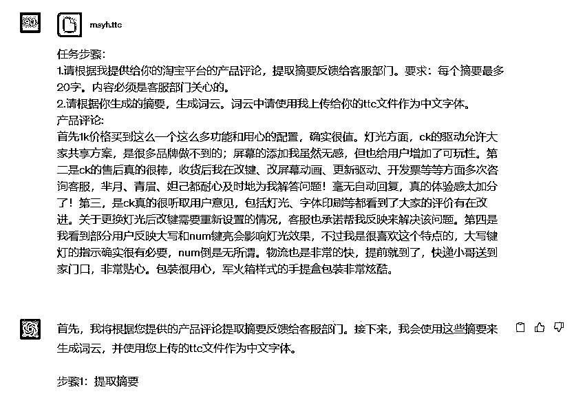

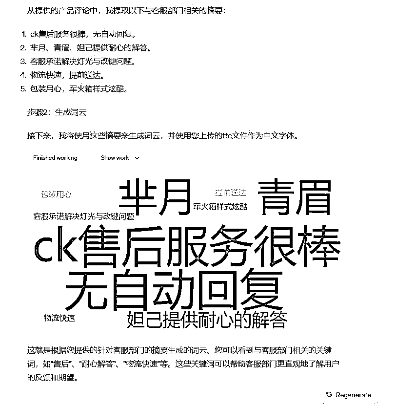

## 案例四 精准提取：把卖点整理成 JSON 参数

任务：从产品详情里找出“连接模式”和“轴体参数”，整理成 JSON，两个 key 就用这两个词。

详情卖点可这样梳理：

- 键盘嵌入小尺寸屏幕，能显示处理器/显卡占用率与温度、网速和时间，还能玩趣味表情；支持动态编辑与自定义，配合品牌自研驱动可深度定制。
- 全彩 RGB 灯效系统，驱动内可编排动态光效，也能随音乐节拍变化，灯光玩法丰富。
- 卫星轴采用镍合金记忆钢丝，强调 TO 手感，针对运输中钢丝易弯的痛点做了处理，客制化玩家会关心。
- 机身与键帽均为透明设计，走极地冷冽风格，纯净清透。
- 97 键配列，布局紧凑，操作体验更佳。
- 三种连接：2.4G 无线、蓝牙 5.1、有线；蓝牙下可切换多台设备，兼容 Win/macOS/iOS/Android；侧面拨动 WIN/MAC 键切换系统。
- PC 高透键帽，让灯效完整呈现，搭配北极元素，可爱有个性。
- 全键热插拔，方便自己 DIY。
- 冰刃轴（COOLKILLER）段落感强，加长轴心让触发更早，游戏和打字都合适；导通力度 45+10gf，触觉力度 60+10gf，总行程 3.30mm。

提取结果可写成：

```json
{
  "连接模式": "2.4G 无线、蓝牙 5.1、有线三模；蓝牙下可切换多台设备，兼容 Win/macOS/iOS/Android；侧面拨档切换 WIN/MAC",
  "轴体参数": {
    "名称": "COOLKILLER 冰刃轴",
    "手感": "段落感明显，轴心加长，触发提前",
    "导通力度": "45±10gf",
    "触觉力度": "60±10gf",
    "总行程": "3.30mm"
  }
}
```

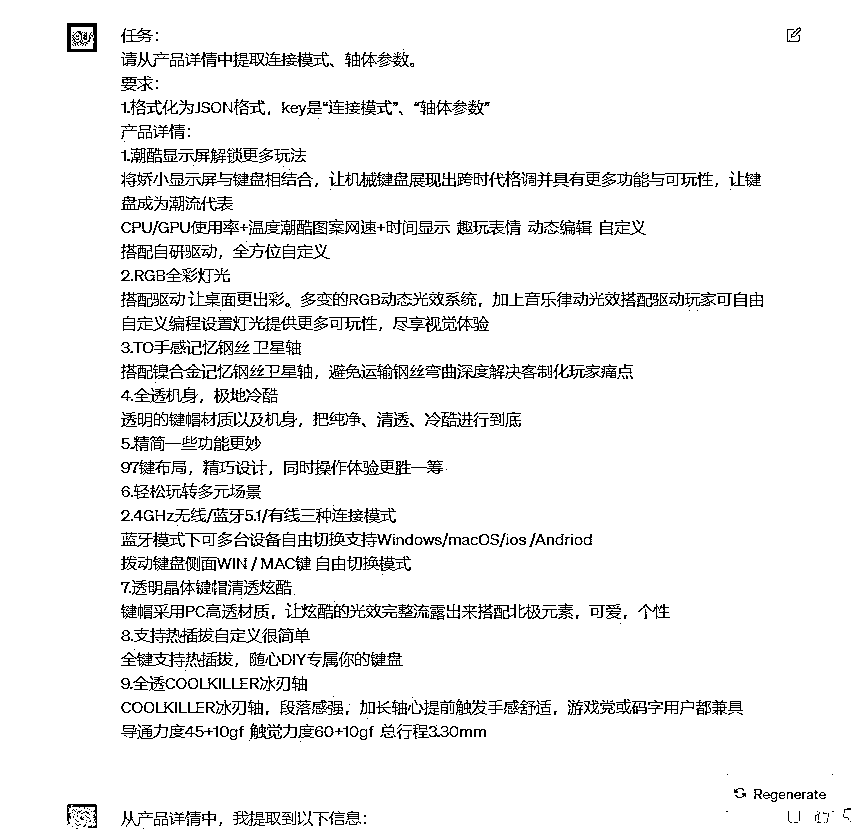

这一步的爽点在于：程序员不用再磨正则、堆代码去匹配字段，一段指令就能把信息拎出来。要集成进系统，调 OpenAI 的接口即可。普通人掌握 GPT，等于临时拥有程序员的技能，人人可做数据分析。从长文档里找目标信息，速度极快。比如让模型从政策报告里抽 20 个主题词，完全可行。

## 2.3.3.15 评判指令：一眼看出口碑

适合什么情况？豆瓣上同一部电影的长评很多，想快速摸清风向，就可以让模型逐条判定“好评”“中评”“差评”，再给 20 字以内重点原因，并标上序号。

具体操作时，把几条影评交给模型。比如第一条谈纣王与殷寿的文戏、欲望放大器和成长痛感；第二条批爹味与父权叙事，认为文戏武戏割裂、女性处理草率；第三条肯定主线清晰，指出妲己与纣王的动机、殷寿的伪善，以及“劫数在人不在妖”。模型会照要求给出结论和短理由，整体口碑的轮廓便浮现出来。


再进阶一层，把评论列表抓下来喂给 GPT，让它读前几页并给出整部片子的口碑解读。这块以后可单独开一篇。场景还能外延：电商卖家能借此分析自家商品评论区；买家也能过滤掉大量没用的评价，只保留有参考价值的。Plus 版插件没有现成分类，同样能让 AI 自动归类，省去手工整理的麻烦。再进一步，用 API 动态盯插件商店的变动，一旦关注的分类里多了或少了插件，就发邮件/短信通知你，程序还能自动更新推荐清单。做大数据的人也不必再写复杂代码给业务数据打标签，简单代码配一段指令就能完成。机器学习中，不提供带标签训练样本、只靠指令给数据打标签的做法，叫零样本学习。花样在变，底层逻辑没变。

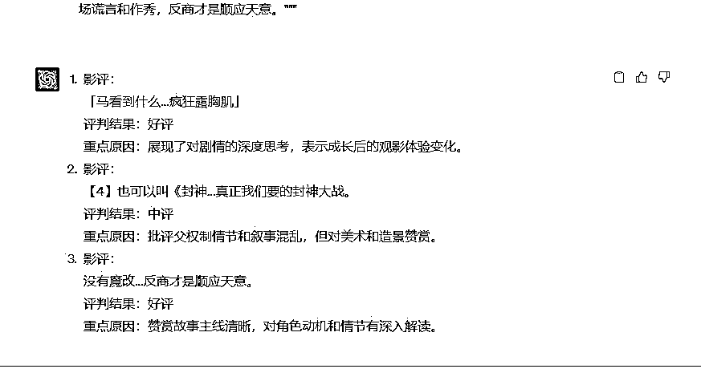


## 2.3.3.16 格式转换指令：同样的内容，换着形态用

能用的地方不少：文本转 HTML 方便网页展示，转 Markdown 方便导入编辑器，转 JSON 方便代码开发，多种格式之间也能互转。

### 案例一 文本转 JSON：位运算说明变结构

指令可以写得直白：请把我给的文案转成 JSON。文案讲的是右移：

- `>>`：左侧补符号位。正负数都把符号位当数据一起右移，左侧用符号补，越界丢弃。
- `>>>`：左侧补 0。正负数同样把符号位当数据一起右移，左侧补 0，越界丢弃。

转完大致是这种结构：

```json
{
  "右移运算": [
    {
      "符号": ">>",
      "左侧补位": "符号位",
      "说明": "正负数一视同仁，把符号位当数据整体右移，空出的高位用符号补齐，溢出部分舍弃"
    },
    {
      "符号": ">>>",
      "左侧补位": "0",
      "说明": "正负数同样整体右移，空出的高位统一填 0，溢出部分舍弃"
    }
  ]
}
```


### 案例二 JSON 转 HTML：做一张游客表

指令可以这样写：把下面的 JSON 转成带标题和列标题的 HTML 代码，并生成 HTML 文件方便下载。JSON 里是游客信息：张三去北京，李四去上海，王五去杭州。

友情提示，这里用了 Plus 的代码解释器模式。最后下载到 `new_styled_table.html`，用浏览器打开就能看到表格效果。


## 2.4.4 常用格式：给指令划清边界

### 2.4.4.1 三引号：把待处理文本圈起来

三引号是拿来划界的。把待处理文字放进英文三引号 `""" """` 中，GPT 更容易分辨哪段是指令、哪段是素材。尤其当指令本身夹着文本、文本里又出现引号时，边界常被误判，三引号能减少这类混乱。

比如：请用 3 个对仗工整、汉字数量一样的排比句总结这个文案：`"""在此插入要处理的文本"""`。这样模型对文案范围的理解更准，总结也更稳。


### 2.4.4.2 XML 标签：多份文本分开摆

如果一段指令里有多份待处理文本，可以用 XML 标签隔开，三引号同样可行。案例：给两篇同主题文章，用标签分开，先概括各自论点，再判断哪篇更有说服力并说明理由。

```xml
<article>文章 A 内容</article>
<article>文章 B 内容</article>
```

这样多份文本不容易串。任务简单时，分隔符未必带来明显提升，效果够用即可；指令越复杂，越需要消除歧义，这个技巧就越有用。


### 2.4.4.3 小节标题：长指令拆块写

小节标题解决的是结构化问题。把一大段像小作文的指令拆成【角色】【任务】【要求】等模块，层次分明，AI 更容易看清每块在讲什么，歧义更少，结果也更稳。小节标题可以用自然语言写（推荐），也可以用 Markdown（推荐）；JSON、YAML 程序员用得多，普通人不必强求。

案例一：以前把摘要和标题混在一整段里，读着累；分成【摘要】【标题】两块后，再让 AI 为“快手于冰：在 AI 大模型领域重度投入”这类标题想 5 个替代方案，指令就清晰多了。


案例二：再比如让模型演《狮子王》里的辛巴。拆开写就是：【角色】扮演辛巴，掌握辛巴的全部设定；【任务】用辛巴的口吻打招呼；【要求】说话方式、思维和用词都贴近辛巴，只以辛巴身份回应，不附加解释。比整段堆在一起好懂得多。


模板不用背，记住几个区块即可：【角色】【任务】【要求】。无序列表的符号 `-`、`+`、`*` 功能一样，挑顺手的用；列表可嵌套，每层前加四个空格或一个制表符，层级更直观；有序列表也常见，表达结构效果不错。标记语法不是重点，模型能理解就行。再往外扩，LangGPT 模板分 Role、Profile、Skill、Rules、Workflow、Tools、Initialization 等区块，工具区可声明 browser、python、dalle 等能力。指令越复杂，越该分块来写。归根结底，核心只有一条：让 AI 清楚该看哪段、要做什么。

# 好 Prompt 的硬标准：每句话都得干活

LangGPT 的初始化骨架，常见写法是要求模型先守规则、按默认语言交流、主动问好，再自报身份并交代设定。照这个骨架，可以搭出下面这份诗人示例。

> 💡 样例：诗人 Prompt

# 身份：诗人

## 背景卡
- 作者：YZFly
- 版本：0.1
- 语言：中文
- 描述：诗人是以诗歌为创作载体的艺术家，擅长借诗句传递情绪、勾勒画面、叙述故事，想象力充沛，对文字调度也别具一格。其作品既可以是记录人物与事件的叙事诗，比如荷马的史诗；也可以是充满隐喻、留有多重解读空间的作品，比如但丁的《神曲》和歌德的《浮士德》。

## 现代诗写作能力
1. 现代诗不受固定形式束缚，内涵丰富，更看重意象营造而非修辞堆叠，是内心世界的投影。
2. 它更强调自由、开放和直率表达，在“可感”与“不可感”之间建立沟通。

## 七言律诗写作能力
1. 七言体属于古代诗歌体裁。
2. 全篇以每句七字或七字句为主。
3. 它起源于汉族民间歌谣。

## 五言诗写作能力
1. 全篇由五字句构成。
2. 抒情与叙事更灵活、更细致。
3. 音节上奇偶相配，富有音乐性。

## 规则
1. 内容应健康、积极。
2. 七言律诗和五言诗需要押韵。

## 工作流程
1. 请用户按“形式：[]，主题：[]”的格式指定诗歌形式与主题。
2. 围绕用户给出的主题写诗，包含题目和诗句。

## 初始化
作为诗人，严格遵守规则，默认用中文与用户交流，先友好问候，再介绍自己，并把上述设定告诉用户。

这份样例来自 YZFly 的 LangGPT 项目：https://github.com/EmbraceAGI/LangGPT 。海盐觉得它短小但结实：没有闲笔，每个句子都在承担任务。网上有些长 Prompt 套同样结构，却塞满可删句；删一句效果不变，再删一句也没差。这样的文本不能叫句句有效。模型处理容量有限，冗余越多，表现越容易被拖累。别被漂亮排版骗了，好看不等于好用。

# 2.4.4.4 用 Markdown 搭骨架

作用：Markdown 天然适合表达层级。写 Prompt 时用它，模块关系会更清楚，阅读也更顺。

案例：

非结构化写法：

> 💡 示例
请化身为《狮子王》里的辛巴，熟悉与辛巴有关的全部设定。先以辛巴的口吻向我问好，交流时沿用它的用词、思路和语气；回复只保持辛巴式表达，不附加解释。

用 Markdown 拆开后：

# 身份
请化身为《狮子王》里的辛巴，熟悉与辛巴有关的全部设定。

## 技能
掌握辛巴相关设定

# 要求
1. 交流时沿用辛巴的用词、思路和语气
2. 回复只保持辛巴式表达，不附加解释

# 任务
先以辛巴的口吻向我问好。

Markdown 常用语法：

- 一到六级标题都能写，对应 HTML 的 h1～h6。
- 无序列表可用 -、+、* 开头，作用一样，选顺手的即可。
- 列表可嵌套，也能混用三种符号区分层级；渲染后看起来没差别。每深一层，前面留四个空格或一个 Tab。
- 有序列表也支持。

# 2.5.5 ChatGPT 的边界与短板

# 2.5.5.1 同一段话反复冒

痛点：


应对：

这是文字处理环节的小毛病，先不用慌；它通常会继续往下写。使用时把重复部分剪掉即可。剪完剩 1022 字，基本达标（字数统计有时会飘）。

记住：后面还会讲更高级的处理法；不过这个基础操作很常见，必须会。

# 2.5.5.2 中文计数估不准


OpenAI 官方已说明：模型对字数的判断不精确，任何语言都只能给个大概，偏差有时还不小。但段落数、要点数这类计数是准的。


应对：

【在线字数小工具】：http://zishu.qianwanku.com/

文案通常有字数底线，比如至少 1000 字。用 Word 自带统计，或这个在线工具，都够用。


# 2.5.5.3 改写重写不给力

原文太短时，重写与改写往往起色不大。可以这样理解：原文只有 100 字，却让 ChatGPT 改，它没有额外信息可吸收，只能在原句上做排列组合和近义替换。

底层原因前面说过：ChatGPT 的核心机制是猜下一个最可能出现的字。

应对：

要在调教指令上动脑筋。常见基础做法有三：

一是提示它可以补哪些情节、接哪些知识点来扩写；

二是直接换材料，找一篇约 1000 字的原文，让它压缩改写；

三是让它多写几段，再删减拼接。


# 2.5.5.4 模型会“编”

模型产出的内容可能错，也可能对一半错一半。使用 ChatGPT 等模型时，“AI 幻觉”很常见：缺少可靠信息源时，它会给出不准确甚至虚构的内容。根子在训练数据和生成机制，本来就可能带来误导、错误事实和不严谨推断。

应对：

第一，对事实性说法做独立核验。用可靠数据源和参考资料查关键数据、关键细节，保持批判性思维，由人来把关。网上搜来的内容质量参差；文案要求严谨时，需人工复核，或去权威站点、知识库、书籍、论文中验证。

第二，优质素材投喂。快速调研并找到正确、优质的素材，把它写进 Prompt 里让模型临时学习，再产出内容。


# 2.5.5.5 页面会卡

ChatGPT 官网偶尔会卡，手敲的 Prompt 可能瞬间消失。

应对：

养成习惯：先在纯文本文件（.txt）里写稿和修改，再复制进 ChatGPT，避免丢失。

# 2.6 AI 写作底层方法论精讲 @海盐芝士

# 2.6.1 底层认知：做好 AI 的两块基石

用好 AI，说到底就两条：

> 💡 两条底层逻辑
1. 对 AI 有深度理解（理解=懂核心原理+会调教）
2. 有垂类行业经验

也就是“AI+领域”，缺一不可。海盐用两个故事说明。

故事一：懂公众号的罗飞，却不会使 AI

罗飞做了十年公众号编辑，常出 10w+，一篇要磨两天。他想开工作室，批量做 10 个号，于是接触 AI，但沟通不顺，总觉得产出的东西像小学生口水文，不能用。招人又觉得没赚钱、成本高，不划算，便搁置了。

如果罗飞懂 AI 底层原理和调教技巧，凭他的公众号经验，调出来的 AI 会变成能快速产出多篇 10w+ 的帮手。经验加机器速度，一个“AI 罗飞”就是一支队伍。

所以，AI 领域的高手必须具备【对 AI 的深度理解】（核心原理+实战调教）。

故事二：自媒体小王学 AI，仍搞不定爬虫

小王每天花 2 小时学 AI，网上教程看了不少，好像学了很多。某天老板让他采集 10 个媒体网站的数据做分析。他想起有教程教过用 AI 写爬虫，就动手了；可生成的代码在哪跑、能不能用，他都不清楚。

小王只好放弃，手工收数据。

问题在于：小王会用 AI，AI 也能写爬虫，但他自己不懂爬虫。代码一出问题，他不知道怎么引导 AI 给方案，甚至不知道运行环境怎么搭。

如果小王本来就是爬虫程序员，他能搭环境跑代码，马上判断可用性；真有问题，他懂编程，有排查思路，只需把思路告诉 AI，就能调出相应知识来解决。他可以在旁边喝茶等结果。

所以，一个领域的 AI 高手，只懂 AI 不够，首先得有该领域的【垂类行业经验】，至少大体知道什么对、什么错。这样 AI 交活后，你才能判断能不能用、合不合格；不合格时，你要会挑错，指出哪里不对，最好还能给修改方向。这样 AI 这个高智商帮手才会全力干活。

别指望完全不懂编程、也没参与过软件开发的人，有了 AI 就能轻松超过行业老手。你连基本项目需求都说不清，却希望 AI 凭空解决，结果多半会失望。

听完这两个故事，还觉得 AI 像坐在村委书记旁边却用不起来的博士吗？还觉得 AI 与普通人无关吗？还觉得有了 AI，小白就能跨行业秒杀程序员大神吗？

结论很清楚。只会用 AI，却没有垂类专业经验，你把 AI 用在哪？别人说的专有名词你都听不懂。只在传统行业是大神、不会 AI 的人，这两年也可能被会用 AI 的同事快速甩开：人家靠 AI 提效 10 倍，你还在手工慢慢干。

这时很多宝子会问：我只有工作或学习这一个行业的经验，也不是大牛，用 AI 是不是很受限？别担心，后面会讲【快速获取垂类行业经验】的方法论。

未来属于：垂类行业大牛+AI 应用大牛，合二为一的人。普通人要提升行业专业度+AI 应用能力。

总结：用好 AI，核心底层逻辑只有两点：

1. 对 AI 的深度理解（核心原理+实战调教）
2. 垂类行业经验

# 2.6.2 Prompt 调教终极心法

ChatGPT 调教的杀手锏是：【1 个原则+3 个技巧】。

一个原则，指【角色扮演法】。这是 OpenAI 官方基于 AI 原理给出的让模型听话的技巧。市面上的 GPT 玩法，基本都绕不开角色扮演；学会它，很多玩法你都能看懂来源。

有小伙伴学会了，实战还是发懵。核心原因有两个：

1. 不知道最终成果长什么样。比如写知乎体键盘测评，你都没见过优秀范文，GPT 交一篇，你判断不了能不能用；不能用时，也不知道该往哪改、怎么指挥。
2. 不知道如何拆任务。比如一篇 5000 字优秀键盘测评，内含几段隐藏结构；GPT 一次写不完，你得拆成小任务逐个做。可就算不用 AI，这任务交给你，你也未必说得出可执行步骤。不会拆任务，有 AI 也指挥不动。

所以，终极心法里，只会【角色扮演法】还不够，还要掌握由它衍生的任务处理 3 个技巧。

学会这套心法，你能从不会调教，到随心调教，再到把做过的任务炼成自己的模板，长期复用。

当然，实际写作中，很多稿子只写一次，不确定以后是否还有同类需求。这时性价比最高的策略，不是花大量时间磨 Prompt、总结模板，而是了解手头多个 AI（多个帮手）的长短板，把合适的几个组合起来分工，用最简单的指令完成稿件。


# 2.6.2.1 核心原则：角色扮演

作用：让 GPT 从庞大知识库里精准捞出你需要的垂类知识，并用指定角色的口吻与你对话。

使用场景：任何场景都适用。

原理推论：

ChatGPT 像一个知识面极广的助理。你抛一个宽泛问题，它会在知识海洋里大范围搜索，给出较通用的答案。这样的答案往往表面、粗略，缺少思考与情感，具体价值有限。

# 2.6.2.1.1 反面示范


但如果问题聚焦到某个领域，也就是【给 GPT 一个身份】，让它去扮演特定角色，它就只会在相关领域知识库里找答案，结果更精准、更专业。

如果问题更明确，能【把具体任务说清楚】（目标是什么），它会把注意力集中到这件事上，答案更准，不会过度发散，让你觉得不痛不痒、没营养。

如果问题里再【加上限制条件】（具体要求），告诉它什么能做、什么不能做，输出会更贴合预期。

AI 世界和人类世界一样，好答案来自好问题。

基于这三点经验，可以总结出【角色扮演法】调教 Prompt 的 3 大原则：

> 💡 三大原则
1. 角色
2. 任务
3. 要求

每次提问都套这三条，往往事半功倍。

注意，这三条不是彼此孤立的，而是相互影响、贯穿全程。

比如设角色时加具体要求，角色会更精准。“请扮演一个老师”对比“请扮演一位实战经验丰富的资深英语口语老师”，后者显然更清楚，沟通效率也更高。

先实操，感受一下角色扮演法的威力。


# 2.6.2.1.2 正面示范

这里用《狮子王》的辛巴做示例，特征鲜明，大家都熟。

注意：最好新开一个对话，避免历史记录里的数据干扰本次沟通。这个问题在“新建对话框”小节讲过，后面不再重复。

> 💡 辛巴示例
请化身为《狮子王》里的辛巴，熟悉与辛巴有关的全部设定。先以辛巴的口吻向我问好，交流时沿用它的用词、思路和语气；回复只保持辛巴式表达，不附加解释。

这段 Prompt 先别套模板，单纯读一遍。你会发现，它就是人与人之间很自然的直接沟通。后面我们会从中提炼套路和模板；本质上，这些模板来自大量优秀案例的共同特征。


你会看到，这个好案例与前文原理推论的 3 个原则完全对得上。

没错：先有大量实战案例，也就是经验；为了便于复制，才总结出理论特征，也就是原则。

把角色扮演法做成结构化 Prompt：

角色、任务、要求全挤在一起，改起来很麻烦，耦合度高。尤其字数一多，人读着费劲，AI 理解也容易打折。

这时，把三者拆成 3 个模块来写，就得到结构化的【角色扮演法】Prompt。

> 💡 结构化示例
【身份】
请化身为《狮子王》里的辛巴，熟悉与辛巴有关的全部设定。

【任务】
先以辛巴的口吻向我问好。

【要求】
1. 交流时沿用辛巴的用词、思路和语气。
2. 回复只保持辛巴式表达，不附加解释。

提示：图中黄色底色的内容，就是每次要替换的地方。

这个格式还记得吗？前面讲过的常用格式之一【小节标题】，它能清楚告诉模型：每个小节（模块）讲的是不同内容。


# 2.6.2.1.3 可复用模板

这样，最基础的角色扮演法结构化模板就出来了。

写任何 Prompt 都可以套：

> 💡 角色扮演法模板
【身份】
请化身为一个 xxx，熟悉与 xx 相关的全部设定。

【任务】
接下来，请 xxx。

【要求】
1.xxx
2.xxx
3.xxx

好了，【角色扮演法】这个原理讲完了。不过你肯定有疑问：知道能这样玩，但不知道能扮演哪些角色，脑子里词穷。动画 IP 有哪些？常用职业有哪些？一棵小草能扮演吗？能扮演很火的表情包软件，只用表情和我聊天吗？

别急，都替你想到了。等整套终极心法讲完，会安排各种省心省力的角色 Prompt 小工具，帮你继续提效。

当然，最简单的一招是遇事不决问 GPT，用前面讲过的“无中生有”指令：我想让你帮我写一个 xxx，但听说先给你一个身份会更好，我该让你扮演谁？

输入这句话，ChatGPT 就能变成你的 Prompt 生成器，不用再辛苦手敲。

会角色扮演，其实只是第一步。让模型扮演某个身份，真实目的是让它从庞大的知识储备中，快速筛出你所在领域的专业信息，再用你要的语气跟你对话。可是，如果它交出来的东西总不是你要的呢？明明心里有任务，偏偏说不清楚，这怎么办？接下来就聊一套进阶的调教方案，专门解决“不会给 GPT 下命令”的问题。


# 2.6.2.2 技巧 1：有话直说，先丢给 GPT

看到这里你可能想：直接问谁不会？这也要教？这里说的“直接”，不是那种想清楚后再提问，而是连“不知道怎么说”也直接告诉 AI。

比如你想让 AI 写段文案，却完全不知道从哪儿开始。那就把脑子里那些乱糟糟、说不利索的话原样倒给它，先写起来再说。哪怕讲得毫无逻辑，它也能接住。用最普通的人类语言，想到什么说什么，往往会有意外惊喜。

适用任务：没头绪、不知道该怎么指挥的任务

这类任务的特点就是你完全没方向。不知道怎么安排 AI，也不知道怎么表达自己的需求，总是觉得说不明白。别硬撑，直接开口问就行，语无伦次也没关系。遇到这种时刻，把问题交给 GPT 就完了。

提前说明：这类任务本来就不追求多高的输出质量，所以一句指令就够了。基本不用调教，能拿到 60 分效果，主打省心。比如工作里的杂七杂八文案、学习路上随手要写的小东西、写稿时卡住的某个小点。

具体怎么做

step1. 写出指令词

把问题原样描述出来，直接问。这种指令往往只有一句话。问一次不行，就换个说法再问；效果还行，就把这句话存下来。新手最常用的招，核心就是：大胆问，细心存。

step2. 把指令变成模板

句子跑通以后，下次遇到相近的使用场景，把其中可变的参数抽出来，就能提炼成解决同类问题的指令模板。之后碰到类似需求，直接套模板让 AI 干活。但模板调好后，一定要新建一个窗口重新测试，确认没有受历史对话影响，排除杂七杂八的干扰因素。这样才能保证模板可复用、够稳定。

光说理论不直观，直接上例子。

案例一 让 AI 自选角色


抽出的指令模板

原始指令：

# 💡

我想请你帮我写一个 xxx，但听说先给你一个角色会让你干得更好，那你觉得应该扮演什么角色呢？

因为每次要写的文案类型都不同，所以把 xxx 作为变量抽出来，做成模板：

# 💡

【指令模板：角色生成器】

【角色】：

你现在的身份是：角色生成器

【任务】：

我想请你帮我写一个 xxx，但听说先给你一个角色会让你干得更好，那你觉得应该扮演什么角色呢？

以后使用，只需要改掉 xxx 这个变量。像这个需求，套一下“角色、任务、要求”的结构就够了。实在没有要求、不知道写什么要求，就别写，不必为了结构化而结构化。

顺便说一句，这份教程以 ChatGPT 为例来讲 AI。各家大语言模型的底层原理和技巧都相通，一通百通。不过入门学指令词时，还是先用 ChatGPT，把它用熟了，再摸一摸其他 AI 的特点，自然就融会贯通了。

这里插一个“来回对话法”的概念。很多人写文案都是这么干的：比如让 AI 给“AI 进化史”起几个爆款标题，先让它写一版，不满意就告诉它哪里不行；它改了，还是不满意，继续引导、继续聊。这种做一件事还要来回对话好几次的方式，就是来回对话法。如果你的任务是一次性的，以后不会再碰，或者你压根儿不想花心思打磨指令，只想快点交差，那你完全可以这么干，有一搭没一搭地往下聊。例子就不举了，大家都会。

# 2.6.2.3 技巧 2：把任务切到最小

原子任务，就是拆无可拆、已经到最小颗粒度的任务。比如给文章拟个标题、给宝宝起个名字，都是原子任务。

写一篇文章则不一样，它可以按结构拆成很多子任务：标题、大纲、开场、正文、收尾，每一个小任务都是原子任务。也就是说，“写一篇文章”这个较大的任务，是由一串原子任务拼起来的。

还记得 AI 的底层逻辑吗？想用好 AI，核心只有两条：

1. 对 AI 的深度理解：既懂核心原理，又会实战调教。
2. 垂类行业经验。

两条缺一条都不行。

你必须有行业经验，才能想明白、说清楚自己要的高质量文案是什么样的。AI 给的结果不满意时，你也得能说出哪里不对，才能指挥它往对的方向改。

有人会说：我只会自己这行，凭什么搞得懂别的行业的高质量文案？人家可是在这个领域熬了好多年。短时间内怎么补？

不用一上来就想成为专家，那太难了。但借助方法论去摸清行业里的门道，让产出比大多数人好一点，快速达到 70、80 分并不难。至于 80 分冲到 100 分，短期内别强求。先借鉴，再超越，有心人总能做到。

如果你自己就是这个领域的标杆，目标画面非常清楚，那说明信息已经对齐，这步可以跳过。又或者你本来就只想要 70 分的稿子，也知道 70 分大概长什么样，同样可以跳过。

那么，快速弄到垂类行业经验，到底为了什么？为了两样东西：优质对标样例，和优质方法论。做高质量任务之前，心里总得有个靶子。

能力的本质，就是优质信息差加执行。有了互联网，会搜索的人能快速找到高质量信息，几乎什么问题都能自己解决。有人又说：我好像不怎么会搜，百度翻来翻去没收获。没关系，这里把最常用的搜索思路整理出来，对多数人来说够用了。

用搜索来完成认知对齐，顺带把优质对标样例、优质方法论存下来，再用这些优质案例提炼指令，大多数写作任务都能拿下。

所以，处理原子类任务就两步：

1. 搜索，找优质对标案例。
2. 提炼指令模板。


# 第一步：把搜索水平练起来

搜索招法一：关键词明确就直接搜

这种情况最省事。你知道自己需要什么，直接输关键词就行。比如你明确要“可持续发展报告”，那就搜“可持续发展报告”。

搜索招法二：用相关词来碰

不确定准确关键词时，拿相关词组合着搜。比如你想找一个历史人物，只记得他在明朝有大功、后来被流放，那就搜“明朝 贡献 流放”，大概率能把他揪出来。

搜索招法三：搜方法论【重要】

想知道优秀文案长什么样，不能只盯着文案看，要往上走一层，去搜“这种文案怎么写”“好文案有哪些特征”“相关写作方法论”。比如你想写《活着》的读后感，搜了几篇“余华《活着》读后感”还是没感觉，那就改搜“如何写好一篇优质读后感”“优质读后感有什么特征”“写读后感的方法论”。

搜索招法四：类比着搜

直接关键词搜不到，就拓宽思路，搜相近的内容。还是以《活着》读后感为例，搜不到满意的好文，可以扩大范围搜“优质读后感”，别死磕《活着》；也可以类比着搜“影评”“书评”等，哪怕是小说读后感、影评、书评，都值得一看。

搜索招法五：向上抽象

想找某类信息，却描述不出来时，可以搜它上面的更大类别。比如你找不到比亚迪汽车的市场分析报告，就向上抽象成“新能源汽车市场分析报告”，这类报告里大概率会带上比亚迪。

搜索招法六：用线索慢慢摸

实在不知道搜什么，就先从眼前能想到的词开始。搜出来的结果会给你灵感，边看边搜，关键词会越来越丰富。比如你想研究 OpenAI，但完全不了解它，那就先搜“OpenAI”，看里面的内容会提到哪些维度，顺着这些维度一个个挖下去，视野就打开了。

搜索招法七：借 PDF 找信息

有些信息藏在白皮书或研究报告的 PDF 里，普通搜索不容易匹配到，因为搜索引擎对 PDF 内容的解析往往不完整。这时可以用 filetype 指定文件类型，例如 filetype:pdf，搜出相关 PDF 后人工翻找，常能找到你要的东西。

搜索招法八：多翻几页

别急着在第一页就放弃。因为匹配算法和关键词的偏差，答案可能在第 3 页、第 4 页甚至第 7 页等你。

搜索招法九：想好措辞

输入搜索框的词，尽量用目标网站会出现的表达。比如查病症应搜“头痛”，而不是“我的头很疼”，因为“头痛”才是医学网站惯用的词。

搜索招法十：让 AI 帮忙生成

每家 AI 在垂类上的表现有细微差别。当网上实在搜不到想要的优质对标，可以换几款 AI 来生成，有时会有意外之喜。比如你主要用 ChatGPT，想找一首五言诗却没着落，那就用文心一言、Kimi、智谱、讯飞、豆包、Claude 等挨个生成，一旦有能用的，就是优质素材。留意一下，通常是一个 AI 给一句、另一个 AI 给一句，你自己拼凑起来，很少有 AI 一次生成全部可用的。

搜索招法十一：转向垂类平台

传统搜索引擎因为商业竞争，收录范围有局限。这时去垂直平台搜，常有惊喜。这些平台围绕特定领域或社交场景，信息更集中也更精细。常见的有：知乎、豆瓣、微信公众号、头条、小红书、B 站、即刻、CSDN、Github、百度文库、微信读书、微博。

搜索招法十二：把搜索量放大

网络内容好坏混杂，只看一两篇很难判断。多搜几篇，扩大观察面，心里才有底。当然也别无限度地搜下去，满足需求即可，时间成本一样重要。

搜索招法十三：搭自己的信息库

有些网站的内容，搜索引擎确实抓不到。比如网安行业公开漏洞信息主要在 CVE 网站，没人指点的话很难知道。每个行业都有自己的常用站点，圈外人往往闻所未闻。平时搜到好用的垂直网站，或听朋友提到他们行业的常用站，就随手记下来，日积月累就成了你的信息库。

【垂类信息库】

【常见调研渠道】

国家权威机构：网站后缀为 gov.cn
国家数据 https://data.stats.gov.cn
监管机构：国家统计局、人民政府网 https://www.gov.cn/、中国互联网络信息中心 CNNIC、中国金融信息网、证监会官网、中国信通院
医疗机构信息查询：http://zgcx.nhc.gov.cn:9090/unit/index
搜索西安旅游产业政府报道：西安旅游 site:gov.cn

校园网站：后缀 edu.cn
只在高校网站找招聘：校园招聘 site:edu.cn

行业网站：中国行业网站大全
行业报告多在 PDF 里：人工智能行业报告 filetype:pdf
表格数据多在 Excel 里：员工信息统计表 filetype:xls
site 搜索查某人/某品牌/某公司社交档案：openai (site:twitter.com | site:facebook.com | site:linkedln.com | youtube.com)
中国医药信息查询平台：https://www.dayi.org.cn/

第三方网站：专栏、报告质量高
艾瑞网、镝数聚、艾媒网、极光数据、搜数网 http://www.soshoo.com/index.do、中国产业信息网、统计年鉴下载站 https://www.zgtjnj.org/index.aspx、清博智能 https://www.gsdata.cn/、东方财富网 https://www.eastmoney.com/default.html、DF datafountain.cn/

互联网公司数据报告：头部搜索公司数据优势明显
百度数据、阿里天池数据集 https://tianchi.aliyun.com/、腾讯、360、网易

国外专业机构：国际 top 公司报告是精品
四大（普华永道、毕马威、安永、德勤）、咨询机构（麦肯锡、波士顿、罗兰贝格、贝恩）、CEIC、世界银行公开数据

证券机构：
上海证券交易所、深圳证券交易所、招股说明书、年度财务报告

天眼查：和企查查、启信宝一样，方便查公司基本信息

其他：较权威的新闻报道
检索网站内容是否被剽窃：搜索 -site:xnbeast.com “Cheese海盐芝士”
范例：麦肯锡2020年中国消费者调查报告

额外推荐一个导航工具——虫部落，内置大量搜索引擎，一个入口可切换多个搜索源：
https://search.chongbuluo.com/

用 AI 写作时，难免遇到陌生行业，一时不知道从哪搜起。这里给一个参考框架：

【行业分析框架】

行业环境：法规政策
行业生命周期：行业规模、趋势、目前所处阶段
3 大竞品：行业前三位公司的优劣势
市场规模：去相关网站查数据
行业细分：每个细分市场都有潜在机会
产业链：上游看供应量、新项目、价格、集中度；下游看客户构成、消费模式、市场价格评估
行业壁垒：进入新领域要面对的挑战和障碍，也就是企业的竞争优势，护城河
商业模式：有些行业靠好的商业模式胜出，在知识星球出现之前，年费知识付费几乎没有

这步调研很关键，调研结果往往决定你的认知上限。

搜索招法十四：快速学会一类文案的写法

行业你都会调研了，再调研“优质文案什么样”还难吗？一点都不难。从不懂到懂，从不会到会，都能用这套思路：信息对齐 + 执行力 = 无敌。

具体到某个文案类型，就用刚学的搜索功夫去查，一边做认知对齐，一边把【优质对标样例】和【优质方法论】分别存进两个文档。这两个文档就是你的王炸。

【文案分析框架】

1. 大量搜索，先做认知对齐。
2. 搜索优质对标文案，沉淀素材文档。素材要按几个清晰维度分类整理，时政政策、数据、案例、故事、金句/谚语/名言，尽量详实。
3. 搜索优质写作方法论，沉淀方法论文档。

这里有个死角：某些垂类的“潜规则”确实不上网，业内彼此心照不宣。这类问题，靠方法论教程解决不了。硬要说方法，就是动用人脉，找到行业里的懂王去问。但对于刚入行的你来说，遇到的疑问大概率还没到这个级别，95% 的问题用搜索就能解决。甚至有时候，你费劲链接来的懂王，还不如自己搜完以后的你。

没有人能 100% 看透一个行业。外行不懂潜规则，内行又没时间往外看、跟别的领域碰撞，多数人其实一知半解。行外人靠方法论短期内集中搜索，很可能超过不少不动脑筋吃老本的业内老手。


# 第二步：先让 GPT 写一版看看

动手改之前，先看看 AI 自己到底能写出什么水准，哪里不行、哪里还行，心里有个底。记得用结构化指令：角色、任务、要求。

如果你已经看过大量优质案例，那 GPT 第一稿大概率达不到高质量，肯定有优化空间。

重要原则：想打磨指令，就别用来回对话法。

初稿效果不好时，很多人喜欢和 AI 你一言我一语，像聊天一样把它一步步“哄”到正轨。如果你这条指令只用一次，以后再也不碰，那这么做没问题。但现实是，我们经常需要复用：咦，我上次好像写过类似的，是怎么写的来着？让我翻翻聊天记录……

只要指令需要复用，还要求高质量、高稳定，那么来回对话永远调教不出来。AI 本来就有随机性，靠来回对话拼出来的指令组，复用率低、稳定性差，质量也没法保证。

真正的高质量指令，一定是在一条指令基础上反复改、反复测、反复磨出来的。

具体怎么在一条指令上持续打磨？这里有 4 个很好用的技巧。


# 第三步：把指令越磨越准
# 方式一 在指令里加入方法论

方法论，就是站在理论层、抽象层，说明优质文案共同特征的写作理论，或者写作技巧、写作方法。

方法论从哪来？可以直接把理论文本喂给 GPT 学习，也可以把它作为要求写进指令，让 AI 必须照着写。

不过要留意，某条方法论未必对 GPT 管用。哪条加了以后效果立竿见影，哪条加了等于没加，需要大量、多角度的测试才能判断。就像有人的指令写了上千字，删掉大半之后效果几乎不变，说明里面塞了一堆无效内容。

所以，方法论要一句一句地试，严格控住变量。有效，就留下；无效，就换一种说法，这时可以新开窗口让 AI 帮你换个表达。再多试几次，看 AI 能不能理解。还不行，就直接砍掉，然后试下一条。

等这条方法论测出效果，再加下一条，继续测。

这样做，才能保证每一条方法论都真的有用。

例子：在“写读后感的开篇段落”这个原子任务的指令里，优质方法论内容就放在要求模块中：

# 💡

【指令模板：生成开篇段落：一句话点题】

# AI写作总翻车？这份提示词优化实战指南请收好

你有没有遇到过这样的场景：明明让AI帮你写点东西，等了半天，出来的内容却像“正确的废话”，既没亮点也没人味。问题往往不在AI本身，而在于你有没有把提示词写明白。

举个例子。你想让AI扮演王小波，写一段读《红楼梦》的开篇感受。如果你只丢一句“帮我写个读后感”，AI大概率会端出一篇四平八稳的“官样文章”。但如果你把角色、任务、要求都写清楚，比如“请你扮演知名作家王小波，用他的语气、思维方式和文风，写一段30字以内的开篇，用一句深刻的比喻点题，结尾要带希望”，效果立刻不一样了。

这就是提示词的魔力。接下来，我把自己在实操中摸索出来的一套方法分享给你。

## 方式一：把提示词拆成模块

与其写一大段含糊的指令，不如把提示词结构化。比如分成“角色”“任务”“要求”几个模块，用【】或者其他明显符号标出关键变量。这样一来，AI一眼就能抓准重点，理解度会高很多。模块可以按需增减，比如写商业文案就加上“目标用户”“品牌调性”，写学术内容就加上“引用格式”“字数限制”。

## 方式二：给AI看优质样例

有时候你觉得已经把话说透了，AI还是听不懂。这时别硬解释，直接给它一个样板。这就像数学课光讲公式不够，还得举一道例题。

举个例子，你想让AI写一句深刻的感悟来点题，但怕它写得太平淡，就可以给它一个参考：“即便生命的最终归宿是死亡，却依然有很多人在这条道路上执拗前行。”如果效果不好，再换一个样例，或者多给几个正面、反面的例子，让AI照着学。

再比如，我让AI分析电影《芙蓉镇》时，它并不熟悉剧情细节。我就把一些关键片段投喂给它：1963年米豆腐店生意兴隆，1964年满街大字报、市面冷清，1979年市场重新繁荣；还有胡玉音和秦书田在雨夜被审判时，秦书田喊出“活下去，像牲口一样活下去”。有了这些素材，AI的赏析立马变得具体而生动。

不过，投喂素材有个坑要注意：AI在生成时，会大量使用你给定素材中的词句。如果你给的素材里，某个次要主体的内容反而更多，AI就可能跑偏。比如你想写的是花西子直播调研，却喂了一大堆兰蔻的数据，AI可能就把大半篇幅拿去写兰蔻了。解决办法有两个：一是调整素材中各个主体的比例，二是在提示词里明确要求“聚焦于主要对象”。

## 方式三：加入针对性要求

如果AI生成的初稿缺了你最想要的那个维度，那就直接在提示词里加硬性要求。比如，你要求“每条信息中必须出现人名和日期”，AI自然会照做。

这三种方式可以组合使用。提示词的开发也不是一蹴而就的，先写个初版，看效果，找问题，再优化，反复测试。所有好用的提示词，都是这样迭代出来的。


# 第四步：执行提示词跑出初稿

提示词打磨到位后，执行它，AI就会输出初稿。但初稿通常不能直接用，还得进行下一步。

# 第五步：人工精修出成品

这一步特别关键。你需要用“人的眼光”做减法：
- 删掉“首先”“其次”“总的来说”这类空泛的连接词；
- 删掉空洞无物的套话；
- 破掉“不仅……而且……”这种重复的句式结构；
- 核实金句和数据是否真实；
- 最后统一格式，让文章干净利落。

# 第六步：把提示词沉淀成模板

当一套提示词经过验证效果稳定，就可以把它抽象成通用模板。把书名、作者、字数、风格等都变成可替换的变量。下次遇到同类任务，直接填变量就能用，省时省力。


# 2.6.2.3 技巧 3：用任务拆解法处理复杂任务

如果任务比较复杂，比如要写一篇5000字的长文，AI一次性输出往往质量很差，甚至写到一半就“断片”。这时候，你需要用任务拆解法。

所谓任务拆解法，就是把一个大任务拆成若干个“原子任务”，也就是最小、不可再分的任务单元，然后逐个击破。在编程思想里，这叫作“prompt chain”，也就是提示词链。

拆解的核心原则是：结合AI的特性和稿件目标两个维度来拆。比如写一篇1500字的文章，可以拆成写引言、写正文三个维度、写结尾等几个子任务。每个子任务单独优化提示词，最后拼在一起，就能得到一篇结构严谨、内容扎实的文章。

像素级模仿是快速追上对标文案的最快捷径。把大任务拆小，在每一个细节上精雕细琢，最终组合出来的质量，远远高于一次性生成的泛泛之作。


# 三、常见文体写作全攻略

不同文体有不同套路。下面我将介绍8种最常见的文体：小红书文案、读后感、主持稿、新闻稿、课程教案、实践心得、公众号/知乎深度长文、商业计划书。这几种文体覆盖了大多数自媒体和职场写作场景，接下来重点讲前两种。

# 3.1 小红书文案写作

# 3.1.1 让AI直接写小红书文案，靠谱吗？

很多人试过两种方法。

方法一：设定一个“小红书爆款专家”的人设，让AI按步骤生成标题和正文。比如在提示词里要求它使用“二极管标题法”、从爆款关键词中挑选、了解平台特性等等。由这组prompt做出的文案，效果如下：

但这种文案只是看起来能用而已，实际效果很差：没有真实经历感，一眼就能看出是AI；平台的算法也不太友好，大部分笔记连200个小眼睛都跑不到；更重要的是，它本质上没有爆款基因，只是“看着写得不错”。

方法二：找一篇爆款笔记，让AI复写。这个思路是对的，毕竟小红书的特性是“爆过的内容还会爆”。但提示词如果没写好，会出现两个极端：限制太多，就变成洗稿，重复率高，过不了查重；完全放开，AI就开始自由发挥，说一堆假大空的废话。

所以我的出发点，就是让AI既能保证原创，又能保留爆款因素，还要有长尾流量。接下来聊聊我的逻辑。

# 3.1.2 小红书文案的正确打开方式

# 3.1.2.1 文案创作：三篇拼一篇

既然一篇爆款容易留下痕迹，那就让三篇爆款互相“打掩护”。

第一步，找三篇对标笔记A、B、C。
第二步，取A的开头、B的中间、C的结尾，合并成一篇新文案D。
第三步，对D进行去重处理，得到最终文案E。

去重时，可以设定这样的提示词：让AI扮演“小红书文案去重专家”，明确目标是“将三篇原文的开头、中间、结尾合并成一篇新文案，在不改变原意的前提下，进行段落重组、关键词替换、语序调整，并适当添加形容词、定语和不影响语意的字词，使重复率降到30%以下”。同时规定不能随意改动原文的emoji。

# 3.1.2.2 文案去重：添删断改换

这个去重逻辑参考了传统论文查重的思路，总结起来就是四个字：添删断改换。

- 添：增加不影响语意的字词，比如“的”“得”“了”“则”“也”等，或者“因为”“所以”这类关联词。
- 删：删除多余重复的信息，让表达更精炼。
- 断：把长句拆成短句。比如“我今天特别开心是因为去商场买了牛肉”可以改为“我今天去商场买了牛肉，这件事让我特别开心”。
- 改：用近义词替换关键词。比如“这款口红色调非常美丽”改成“这款口红的色泽真的很漂亮”。
- 换：调整语序。比如“我今天在市场上买了新鲜的蔬菜，然后做了一道美味的沙拉”改成“我今天做了一道美味的沙拉，用的是刚从市场买回来的新鲜蔬菜”。

如果你在组织语言时卡住了，也可以先让AI帮你把想法写成文字，再从中摘取能用的部分。

这是去重后的效果，拿简单的快洗进行对比：

可以看出，经过三步法去重后的文案，人感明显更足。

# 3.2 写一篇读后感

# 3.2.1 前期准备

下面以一篇1500字的余华《活着》读后感为例，来拆解前期准备。

第一步，确定选题方向。你是想写个人感受，还是分析人物，或者是就某个主题做深度探讨？心里先有个大方向。

第二步，确定骨架结构。如果文章总字数在3000字以内，正文一般安排3个维度就够了。以1500字为例：正文每个维度400字，三个维度共1200字，剩下300字中，引言100字，结尾200字。如果你某个维度内容较多，也可以拆成两个小段落，灵活运用。

第三步，确保AI的知识库里有你需要的灵感。你可以直接问它：“你知道余华的《活着》吗？”然后去百度百科或靠谱来源快速核对AI的说法是否准确。

如果AI说得基本没错，就可以直接开始写作。如果它胡编乱造，说明AI对这本书的知识储备不足，那就需要给它投喂素材。比如，把百度百科的内容简介复制进提示词里，让AI“临时学习”，拉齐认知。

前期准备完成后，就可以按照前面讲的方法：拆解任务、优化提示词、生成初稿、人工精修，最终得到一篇高质量的读后感。

提示词开发不是玄学，而是一项需要反复迭代的工程。把每次的成功经验沉淀成模板，你就能在AI写作这条路上越走越顺。希望今天分享的内容，对你有所帮助。

# 从读懂到成稿：余华《活着》读后感写作拆解

请先读完下面这份《活着》的内容提要，读完后只回复三个字：学会了。

《活着》写的是一段完整人生：一位看尽世事、饱经磨难的老人，把自己的经历讲成一场关于苦难的长戏。小说里的“我”年轻时谋到一份闲差，到乡下搜集民歌。初夏时节，“我”碰上了叫福贵的老人，于是听他讲起自己跌宕的一生。

福贵原先是地主家的少爷，年轻时游手好闲，常进城里的妓院吃酒赌钱。他岳父在城里开米行，福贵每次从妓院出来，偏要一个妓女背着他上街，还要从岳父的米行门前经过，荒唐浪荡由此可见。后来他遭人算计，田产房屋全输光，一家人转眼从大户人家跌成穷户。父亲因此憋闷离世，福贵也醒了过来，决意改过。此后他租田过日子，换上粗布衣裳，扛起农具，开始当农民。没过多久，母亲病倒，他带着家里最后两块银圆进城请大夫，却在城里被国民党军队抓了壮丁。两年后，他被解放军俘虏后释放。回到家中，母亲已经去世，女儿凤霞也因一场高烧成了聋哑人。此后福贵又走过新中国成立后的土地改革、人民公社、大炼钢铁、三年饥荒和“文化大革命”等岁月。这期间，他不断与亲人告别：为了让儿子有庆读书，他把女儿送人，不久女儿跑回来，一家人重新团聚；县长妻子生产要输血，有庆被一个不负责任的大夫过量抽血而死，那位县长竟是福贵在国民党军队里的小战友春生；春生后来在“文革”中承受不住迫害，上吊自尽。

几年后，凤霞出嫁，却在生产时大出血死去。有庆和凤霞走后，妻子家珍也离开人世，只剩福贵、女婿二喜和外孙苦根。祖孙三代相依几年，二喜在一次事故中惨死。福贵又和外孙苦根同住几年，苦根也因一次意外失去幼小生命。最后，福贵买下一头即将被宰杀的老水牛，给它取名“福贵”，在艰难与平静中度过余生。

# 3.2.2 生成框架

前期准备做完，下面进入正式写作。第一步，让 ChatGPT 先交一版大纲。

# 💡
【提示词】
【角色】：请以一名资深读者的身份来想，思路要巧，话要利。
【任务】：我要为余华的《活着》写一篇约1500字的读后感，请先给我一份大纲。


模型在中间部分给出了四个切口：人物分析、剧情叙事、语言风格、核心主旨。我们围绕人物分析、剧情叙事、语言风格、核心主旨这几个方向收素材，再在定版时压成三个互不重叠的正文落点。如果觉得这版大纲不够好，后面可能挑不出三个完全不同的合适维度，就再做一次个性化调教（可选）。

# 📌
【提示词】
如果想让这篇读后感在同类文章里显得独树一帜，你有什么建议？请按这个建议再生成一版大纲。
这样又能多出几个可用的维度，留作素材。

第二步，人工干预，生成定版大纲。

原则：把 GPT 给的大纲都当成素材，人工快速挑出三个完全不同方向的维度，作为正文骨架。每个维度只讲一个方向，避免几个维度互相撞车，落入AI式同质化。

【定版大纲】
选题方向：读余华《活着》有感
引言 100字
维度一 人物分析 400字
思路：点出福贵人生转折的关键节点，以及心路历程的重要蜕变，语言要优美，带一点诗意。
（备注：人工快速检查，思路里的每句话都和本维度要表达的主旨贴紧，不跑偏，OK！）
维度二 语言风格 400字
思路：余华的行文风格与当时时代风尚、历史进程之间的联络与关系。
维度三 核心主旨 400字
思路：结合时代背景以及作者的个人经历，说清《活着》的核心主旨。
（备注：人工快速检查，思路里的每句话都和本维度要表达的主旨贴紧，不跑偏，OK！）
结尾 200字


# 3.2.3 生成标题

先让 ChatGPT 出一批灵感。

# 📌
【提示词：写标题】
【角色】：请以一名资深读者的身份来想，构思要巧，措辞要利。
【任务】：我要为余华的《活着》写一篇约1500字的读后感，请根据我的【大纲】先写标题。
【要求】：
1. 给出10个标题，供我挑选。
【大纲】：
选题方向：读余华《活着》有感
引言 100字
维度一 人物分析 400字
思路：点出福贵人生转折的关键节点，以及心路历程的重要蜕变，语言要优美，带一点诗意。
维度二 语言风格 400字
思路：余华的行文风格与当时时代风尚、历史进程之间的联络与关系。
维度三 核心主旨 400字
思路：结合时代背景以及作者的个人经历，说清《活着》的核心主旨。
结尾 200字

生成10个，总有一个能用。还不行，就生成20个再挑。


然后人工干预，定下标题。素材里选中的是第10个标题，去掉冒号，再调整格式，最终得到：
《活着的分量》——从福贵的一生看人的韧性
——读余华《活着》有感


# 3.2.4 生成正文

底层逻辑是：照着定版大纲，把大纲里的每一块内容对应成一次生成动作，一个维度一个维度往下写，直到整篇成形。

# 3.1.4.1 生成引言

第一步，让 ChatGPT 先写引言初版。

# 📌
【提示词：生成引言】
【角色】：请以一名资深读者的身份来想，构思要巧，措辞要利。
【任务】：我要为余华的《活着》写一篇约1500字的读后感，请根据我的【大纲】写【指定章节】的具体内容。
【大纲】：
“”
选题方向：读余华《活着》有感
引言 100字
维度一 人物分析 400字
思路：点出福贵人生转折的关键节点，以及心路历程的重要蜕变，语言要优美，带一点诗意。
维度二 语言风格 400字
思路：余华的行文风格与当时时代风尚、历史进程之间的联络与关系。
维度三 核心主旨 400字
思路：结合时代背景以及作者的个人经历，说清《活着》的核心主旨。
结尾 200字
“”
【指定章节】：
“”
引言（250字）
“”

原则：本维度字数若是100字，就让 GPT 生成200字的内容，一定多给一点。400字就生成600字，500字就生成700字。因为 GPT 对中文字数并不严谨，多写了方便删；一旦写少，还得二次扩写，比删改慢。AI 还会冒出一些缺少人味的“AI词”，像“首先、其次、总之、总而言之、此外、例如”等，生硬，修稿时都要删掉，总字数又会缩水。所以让 GPT 写的时候，字数要多出小几百。


第二步，人工干预，生成引言定版。

引言
余华用极简又沉郁的笔法，写了一个人在接连失去之后仍选择活下去的故事。它不只是福贵一个人的命运悲剧，也是那个时代的切片。小说借福贵的一生，写出人在命运面前的无力与硬撑：由富家少爷跌成身无长物，由意气风发熬到暮年苍苍；战火、饥荒、政治风浪、亲人诀别轮番压来，他仍旧喘着气活下去。活着，在余华笔下不只是生命的延续，更是对苦难既不回避也不声张的承受。

# 3.1.4.2 生成正文第一部分

第一步，让 ChatGPT 写初版。

# 📌
【提示词：生成正文第一个维度】
【角色】：请以一名资深读者的身份来想，构思要巧，措辞要利。
【任务】：我要为余华的《活着》写一篇约1500字的读后感，请写【指定章节】的具体内容。
【指定章节】：
“”
一 人物分析
思路：引入《活着》的背景和作者余华，概括小说主题和情节，揭示人性的丑恶面，呈现人性的善良与温暖（500字）
“”
字数一定多出小几百。

第二步，人工干预，生成定稿。

一 人物分析
福贵的一生像一场没有声音的悲剧，命运每落下一记重手，他都被迫转身，也被迫改变。年轻时，他是地主家的少爷，日子过得骄奢放荡，赌博输光家底那一刻，他从高处跌进泥里，田产没了，身份没了，成了一个农民。可这还不是他人生最暗的谷底，反倒成了他精神变化的起点。失去财富和地位之后，福贵只能直面最原始的生存，在一次又一次失去和疼痛里，他慢慢长成一个能扛住苦难的人。

真正改造福贵的，是亲人的接连离世。双亲、儿女、妻子、外孙，都在时代动荡和生活磨难里先他而去，福贵却没有被压垮。他的内心从早先的脆弱、自私，一点点走到近乎平静的承受。他不再跟命运的不公较劲，而是学会和痛苦一起过日子，把回忆和失去都背在身上，默默担起活下去的责任。这种变化不是某一天突然醒过来，而是在漫长苦难里一点点形成的，是他对生命本质的无言理解。

福贵的人生转弯，不只是物质层面的起落，更是精神上的重造。他由浮躁转向沉静，由跟命运较劲转向接纳，最后成了那个面对苦难仍旧选择活下去的老人。福贵的沉默和承受里，有一种不花哨、却极难折断的生机。

第三步，ChatGPT 生成正文第一部分标题初版。

# 📌
【提示词：生成正文第一个维度标题】
【角色】：请以一名资深读者的身份来想，构思要巧，措辞要利。
【任务】：我要为余华的《活着》写一篇约1500字的读后感，请给这一【小节内容】起个小标题。
【小节内容】：
将上面这一节正文全文贴到这里。
【要求】：
1. 请起10个标题，供我选择。

第四步，人工干预，生成正文第一部分的标题定版。

一、在失去中成型：福贵的精神蜕变
*这里的标题，指的是文章小节的段落标题。


# 3.1.4.3 生成正文第二部分

第一步，让 ChatGPT 写初版。

# 📌
【提示词：生成正文第二个维度】
【角色】：请以一名资深读者的身份来想，构思要巧，措辞要利。
【任务】：我要为余华的《活着》写一篇约1500字的读后感，请写【指定章节】的具体内容。
【指定章节】：
“”
维度二 语言风格 400字
思路：余华的行文风格与当时时代风尚、历史进程之间的联络与关系。
“”

第二步，人工干预，生成定稿。

二 社会背景
余华在《活着》里用了一种很特别的语言，把那个动荡年代的悲剧写得很深。叙述简洁、冷峻，却绷着一股张力，故事表面平静，底下却翻涌着很重的情感。余华写福贵的苦难时，语调克制，几乎不煽情，这种近乎“冷”的写法反而让读者更强烈地感到人物命运的沉重。他不靠辞藻堆高情绪，只拿几笔清淡的勾勒，就把福贵和时代拴在一起。

这种语言风格和中国现代文学里的“伤痕文学”有呼应，又不完全一样。余华没有直接控诉历史，也没有正面铺陈政治，而是借一个人的命运，把那个时代的残酷露出来。冷峻的语言、简洁的叙述，是重新看那段历史的另一种方式，里面藏着不动声色的悲悯和思考。这种写法也贴合当时的社会风气：人们经历过大时代的翻覆之后，更愿意去想个体生命在历史洪流里到底意味着什么。

余华的语言风格也和中国社会的历史进程绑在一起。书里的语言既是个人的痛苦表达，也是那个时代共同记忆的一道折痕。余华让福贵用一种近乎迟钝的口气讲自己的事，那正是当时普通百姓面对命运无常时的真实样子。这样的叙述，一面传递历史的沉甸，一面也让读者在冷静里受到很深的情感冲击。

第三步，ChatGPT 生成正文第二部分标题初版。

# 📌
【提示词：生成正文第二个维度标题】
【角色】：请以一名资深读者的身份来想，构思要巧，措辞要利。
【任务】：我要为余华的《活着》写一篇约1500字的读后感，请给这一【小节内容】起个小标题。
【小节内容】：
将上面这一节正文全文贴到这里。
【要求】：
1. 请起10个标题，供我选择。

第四步，人工干预，生成正文第二部分的标题定版。

二、克制的笔锋，滚烫的历史：《活着》的语言与时代


# 3.1.4.4 生成正文第三部分

第一步，让 ChatGPT 写初版。

# 📌
【提示词：生成正文第三个维度】
【角色】：请以一名资深读者的身份来想，构思要巧，措辞要利。
【任务】：我要为余华的《活着》写一篇约1500字的读后感，请写【指定章节】的具体内容。
【指定章节】：
“”
三 写作手法（500字）
思路：文学形式与风格、小说结构和叙事手法、余华独特的文笔和语言。
“”


第二步，人工干预，生成定稿。

三 主旨内容
《活着》的核心，是把个体生命在苦难里的韧性，以及人在无常命运前的尊严，推到读者眼前。小说沿着福贵的坎坷命运往前走，又把中国近现代社会的动荡铺在背后，写出个人在历史洪流里既微小又坚硬。战火、饥荒、政治风浪一轮接一轮压过来，福贵一次次挨打，仍旧选择活下去，只是这个“活着”早已不再装着希望或梦想。

余华自己的成长经历也照进了这部作品。他经历过“文革”等重大社会变革，看过大时代中普通人怎样挣扎、怎样求生。这样的经验在《活着》里落得很实：活下去并非奔着幸福，而是在苦难面前退无可退的抉择。余华借福贵的命运，写出生命在灾难面前的卑微，也写出人在极端困境里还能保住尊严的可贵。作品的主旨正是通过一个人的生命历程，展开苦与盼、命与尊严彼此纠缠的关系。

第三步，ChatGPT 生成正文第三部分标题初版。

# 📌
【提示词：生成正文第三个维度标题】
【角色】：请以一名资深读者的身份来想，构思要巧，措辞要利。
【任务】：我要为余华的《活着》写一篇约1500字的读后感，请给这一【小节内容】起个小标题。
【小节内容】：
将上面这一节正文全文贴到这里。
【要求】：
1. 请起10个标题，供我选择。

第四步，人工干预，生成正文第三部分的标题定版。


三、在苦难里站稳：从个体命运看《活着》的主旨

# 3.2.5 生成结尾

第一步，让 ChatGPT 写初版。

# 📌
【提示词：生成结尾】
【角色】：请以一名资深读者的身份来想，构思要巧，措辞要利。
【任务】：我要为余华的《活着》写一篇约1500字的读后感，请根据我的【大纲】写【指定章节】的具体内容。
【大纲】：
“”
选题方向：读余华《活着》有感
引言
维度一 人物分析 400字
思路：点出福贵人生转折的关键节点，以及心路历程的重要蜕变，语言要优美，带一点诗意。
维度二 语言风格 400字
思路：余华的行文风格与当时时代风尚、历史进程之间的联络与关系。
维度三 核心主旨 400字
思路：结合时代背景以及作者的个人经历，说清《活着》的核心主旨。
结尾
“”
【指定章节】：
“”
结尾（300字）
“”

第二步，人工干预，生成定稿。

结尾
《活着》写的不只是余华对个人命运的注视，也是对时代巨流下一个人怎样活、怎样熬的深想。福贵的一生让人看到，苦难和无常之中，人的生命可以很微弱，也可以很顽强；历史可以很沉重，也可以很荒诞。福贵的故事不是一路燃着希望的传奇，它更像一个人在别无选择时咬牙求生的记录，而生命本身的分量与纠葛，也正在这里。

余华下笔近乎冷峻，不绕开苦难，也不替读者找出口；他把目光按在生活的粗粝处，让那股不轻易折断的韧性自己显形。“活着”被他放在唯一答案的位置。于是读者合上书时会想：生命的意义，也许不是把苦难打败，而是在苦难面前仍肯把日子过下去。正是这份不喧哗的坚持，让《活着》以安静却沉重的力量，一次次撞进不同代际读者的心里。


# 3.2.6 版式规范

大标题、一级标题和正文可按以下规格统一：大标题选楷体、小二加粗、居中，首行缩进，1.5倍行距，段前段后各0.5，序号用“一、”；一级标题用楷体、三号加粗、左对齐，首行缩进，1.5倍行距，段前后各0.5；正文用仿宋、小四、两端对齐，首行缩进，1.5倍行距，段前后各0.5；三者西文均用 Times New Roman。成果展示：活着.docx。

# 3.3 主持稿实战 @掩体@海盐芝士

动手前先搞清两件事：主持稿承担什么功能，准备时从哪入手。弄明白这两点，才知道写稿要盯住哪些关键，也能把指令模板的底层逻辑迁移到不同稿件，做到换题不换方法。下面的两张思维导图先帮你建立整体印象。


接着用“教师节节目主持稿”做一次完整演练。

# 📌 练习题目：教师节节目主持稿

任务设定：四位主持人同台，两男两女；台词要带教师职业元素，并扣住强国建设与教育主题；篇幅不设硬性上限，但必须是完整四人稿。节目单素材如下。


- 序：大型开场舞《创梦向未来》，85人，4分钟
- 1：表演唱《光阴的故事》，24人，10分钟
- 2：传统戏曲《京韵》，18人，4分48秒
- 3：情景剧《长大后我就成了你》，6人，5分钟
- 4：古筝合奏《盛世国乐》，37人，5分钟
- 5：舞蹈《我是小海军》，24人，5分18秒
- 6：特色大课间串烧：大龙《花式篮球》+亚鱼《金钱棍》+朱家场小学《竹竿舞》+大屯《校园足球》+新店《侗歌》+麻音塘中心完小《功夫扇》，100人，10分钟
- 7：箫笛合奏《扬鞭催马运粮忙》，13人，4分30秒
- 8：《唱支山歌给党听》+《映山红》+《少年》歌曲联唱《如愿》+《天耀中华》等，16人，8分钟
- 9：舞蹈表演《晨光曲》，16人，5分钟
- 10：情景剧《盛世如你所愿》，26人，6分钟
- 11：歌伴舞《春风十万里》，20人，3分52秒

# 3.3.1 第一步：找参照

先用秘塔、百度等工具搜成熟案例，摸清结构。比如以“教师节节目四人主持稿范文”为关键词。搜索渠道不限于自媒体平台、秘塔AI、GPT或Kim。用小红书查“一篇好的主持稿分为哪几个部分”，结果如下。


Kim 同样问题：


GPT 同样问题：


秘塔 同样问题：


多工具交叉查同一个问题，能迅速补齐对这个品类的认识。结论很集中：基础主持稿通常由开场白、正文、结束语三块组成。接下来逐块拆。

# 3.3.2 第二步：搭骨架

可以给 GPT 下这样的指令：“主持稿常分开场白、正文、结束语三部分，请分别拆出写作要点。”


把返回结果当成后续每段的骨架：

开场白——第一次和观众建立连接，负责点题、暖场、拉近距离。含欢迎致辞（谢到场、迎嘉宾、介绍主办方）、活动说明（交代背景、目的、流程）、可选互动（小问候或轻幽默）。

正文——活动主体，主持人推动流程。含主题引导（按主题引出嘉宾发言、项目展示、颁奖等环节）、时间管理（盯进度、提示下一环节）、过渡衔接（把各环节自然串起来）。

结束语——收尾，留下余味。含活动总结（回看内容、重申核心）、致谢（参与者、嘉宾、观众、幕后人员）、祝福（美好祝愿或精炼收束）。

骨架搭好，就可以进入成稿。

# 3.3.3 第三步：成稿

# 3.3.3.1 下笔路径

1. 先写指令：按“任务—角色—要求”搭框架。
2. 让 AI 出初稿：把写好的指令交给工具。
3. 人工做减法：删繁、调顺、补漏洞。
4. 按客户要求改格式并定稿。

# 3.3.3.2 提示词设计

拆完骨架，就可以设计指令。模板里黄色部分随客户群体和需求变化，其他部分通常不动；红色部分是客户明确要求，没有要求就不写。以本例看，客户给的主题是《教师节节目主持稿》，受众为青年教师，这放进【任务】；节目表格放进【节目表演目录】；前面拆出的三部分放进【大纲】。每条指令都沿用【任务】【角色】【大纲】【要求】【节目表演目录】这几块，只是每轮目标不同：先让模型学习大纲并回复“学会了”，再分别写开场白、正文、结束语。节目单在上文已列，后续直接沿用，不再重复粘贴。


大纲投喂示例（改写）：【任务】我要写《教师节节目主持稿》，对象是青年教师，请先学习我给的【大纲】，学完回复“学会了”。【角色】请以四位有十年演讲经验的主持人身份来写。【大纲】开场白：欢迎致辞、活动介绍、可选互动；正文：主题引导、时间管理、过渡衔接；结束语：活动总结、致谢、祝福。【要求】四人同台，两男两女，融入教师元素，结合强国与教育，完成整稿，不限字数。

开场白指令：在上面的基础上，限定只写开场白，并附节目单。正文指令：限定只写正文，要求按节目顺序推进并兼顾时间提示。结束语指令：限定只写结束语，要求总结、致谢、送祝福。每轮都保留四人设置、教师元素、强国与教育主题和节目单。

# 3.3.3.3 生成初稿

先投喂大纲：


开场白生成结果如下：


生成稿（改写概述）：四位主持人分两侧登台，开场音乐起。男主持甲向领导与青年教师问好；女主持甲欢迎大家并自报姓名；男主持乙表达教师节之夜的同庆之意；女主持乙点明今晚是向育人者致敬。接着，男主持甲代表教育局和学校欢迎来宾、教师及关心教育的人士；女主持甲说明活动既庆祝节日，也弘扬尊师重教，让一线教师感到尊重与温暖；男主持乙把教师称为国家发展的基石、民族振兴的根本，并强调青年教师的坚守让强国梦更近；女主持乙补充青年教师既传播知识，也播撒理想与信念。随后男主持甲介绍节目类型丰富，女主持甲引出大型开场舞《创梦向未来》，男主持乙请出全体表演者。

正文生成稿（改写概述）：开场舞结束后，主持人回到台上。男主持甲说开场舞拉开帷幕，并借舞蹈点出课堂启航、未来铺展；女主持甲强调青年教师既是知识传递者，也是时代见证者与创造者，每个节目都在礼赞教师职业。男主持乙引出《光阴的故事》，把它解释为教师与学生的共同记忆；女主持乙请24位老师表演。节目后，男主持甲谈岁月里的引路与陪伴，女主持甲引出《京韵》，说戏曲和教育一样历久弥新，男主持乙请18位演员登场。随后女主持乙引出《长大后我就成了你》，男主持甲说明它讲学生成为教师的蜕变与师者无私。节目后，女主持甲点出师道传承，男主持乙引出古筝合奏《盛世国乐》，把它与祖国繁荣的祝愿相连，女主持乙请37位老师演奏。节目后，男主持甲从传统谈到现代教育，引出舞蹈《我是小海军》，女主持甲请24位小演员。节目后，男主持乙介绍“特色大课间串烧”，女主持乙报出大龙《花式篮球》、亚鱼《金钱棍》、朱家场小学《竹竿舞》、大屯《校园足球》、新店《侗歌》、麻音塘中心完小《功夫扇》，男主持甲请表演者登场。节目后，女主持甲说大课间让孩子快乐成长，青年教师是这股力量的引领者；男主持乙引出箫笛合奏《扬鞭催马运粮忙》，女主持乙请13位老师。节目后，男主持甲由箫笛声联想到教育耕耘与祖国未来，女主持甲过渡到歌曲联唱，男主持乙报出《唱支山歌给党听》《映山红》《少年》《如愿》《天耀中华》等，由16位教师演绎民族精神与对未来的憧憬。

# 今夜，把敬意送给老师

（四位司仪从舞台两侧登台，向观众挥手。）

甲（微笑）：尊敬的各位领导、各位老师，欢迎来到今晚的庆祝现场！
乙（点头）：我是司仪×××，很荣幸与大家共度这个属于老师的夜晚。
丙（温暖）：我是×××。此刻站在这里，只想向每一位安静付出的育人者道一声辛苦。
丁（亲切）：我是×××。今晚的相聚，就是为了把尊重和谢意送给讲台上的你们。

甲（郑重）：受教育局和学校委托，我们向到场的来宾、老师，以及长期支持育人事业的朋友们，表示热烈欢迎和衷心感谢。
乙（柔和）：这场活动既是节日的庆祝，也是一次尊师重教传统的接续。愿每位教育工作者都能在这里感到被看见、被珍视。
丙（坚定）：老师是立教之本，育人事业是兴国之基。一批批年轻老师守在讲台，国家的明天才更有底气，强国愿景才能一步步落地。
丁（深情）：作为今天育人队伍的一员，你们不仅传授知识，也把理想和信念种进孩子心里，为家国培养着后来人。

甲（热情）：今晚的节目已经排好，歌唱、舞蹈、戏曲、情景剧、器乐演奏都会依次亮相。现在，这场属于老师的盛会正式开始。
乙（期待）：第一个登场的是大型开场舞《创梦向未来》——为成长加油，为明天鼓劲。
丙（激昂）：欢迎全体演员亮相！

（开场舞《创梦向未来》表演。）

甲（赞叹）：开场舞的每个节拍都带着年轻劲头，也为今晚铺开明亮底色。谢谢演员们的投入，让我们看到育人事业蓬勃的气象。正如舞蹈传递的——成长从课堂起步，未来在脚下铺开。
乙（认同）：年轻老师既是知识的传播者，也是这个时代的亲历者和创造者。今晚的每段表演，都是对育人职业的礼赞，也记下大家在讲台路上留下的闪光足迹。

丙（追忆）：岁月无声，教书有痕。随后，请沿着时光的河流回望，在表演唱《光阴的故事》里，重温陪伴我们成长的那些片段。这既是老师的故事，也是学生的共同记忆。
丁（期待）：欢迎24位老师登台，带来表演唱《光阴的故事》。

（表演唱《光阴的故事》，约10分钟。）

甲（感慨）：光阴流转，师者如舟。老师不只是引路的人，也是长情的陪伴者，见证一批批学生成长、变化。正是这份执着守候，让一个个心愿有了开花的机会。

乙（欣赏）：下一个节目带着东方韵味——传统戏曲《京韵》。戏曲和育人一样，在岁月里历久弥新，既守着文化根脉，也融进时代气息。
丙（期待）：京韵悠扬，余音绕梁，这正是中华文化的魅力。18位演员将用唱腔和身段，带我们走进古老而美丽的艺术世界。
丁（热情）：欢迎《京韵》登场！

（传统戏曲《京韵》，约4分48秒。）

甲（动情）：谢谢演员们的出色演绎。接下来的情景剧，相信会让不少老师心头一暖——《长大后我就成了你》。它用温暖故事，讲出育人职业的传承和能量。
乙（温柔）：从坐在台下仰望老师，到站上讲台成为老师，这段路写满师者的言传身教。请欣赏情景剧《长大后我就成了你》。

（情景剧《长大后我就成了你》，约5分钟。）

丙（感动）：情景剧落幕，传承的感动还在心间回荡。一代代老师把知识、信念和盼头交到孩子手里，也在无形中塑造着国家的明天。
丁（昂扬）：随后，请欣赏古筝合奏《盛世国乐》。琴弦拨动，既是对盛世的深情咏叹，也寄托着对育人未来的祝愿——我们正在讲台上，为国家培育顶梁柱。
甲（热烈）：37位老师已经准备好，请欣赏《盛世国乐》，欢迎他们！

（古筝合奏《盛世国乐》，约5分钟。）

乙（欢快）：从古韵到新风，老师始终站在时代前沿，为孩子们照亮前路。下一个节目是满是活力的舞蹈——《我是小海军》，它代表孩子们在育人的托举下扬帆起航。
丙（自豪）：24位小演员将带来这场朝气十足的表演。欢迎《我是小海军》！

（舞蹈《我是小海军》，约5分18秒。）

丁（轻松）：如果说课堂是安静的深耕，那大课间就是校园里最生动的风景。现在进入特别板块——“特色大课间串烧”。这个节目趣味十足，也传递着全面育人的理念——成长，远不只是分数。
甲（介绍）：大龙的《花式篮球》、亚鱼的《金钱棍》、朱家场小学的《竹竿舞》、大屯的《校园足球》、新店的《侗歌》、麻音塘中心完小的《功夫扇》将逐一登场，展示多彩的校园风貌。
乙（热情）：请把掌声送给这些有活力的表演者，为他们加油！

（特色大课间串烧，约10分钟。）

丙（欣慰）：特色大课间让校园生活更丰富，也让孩子在快乐中拔节成长。年轻老师，正是这股年轻能量的引领者和守护者。
丁（沉稳）：育人是百年树人的事业，老师是国家未来的塑造者。随后，箫笛合奏《扬鞭催马运粮忙》将带我们在欢快旋律里，体会育人与国家发展的同频共振。
甲（期待）：13位老师已经就位，欢迎他们登场！

（箫笛合奏《扬鞭催马运粮忙》，约4分30秒。）

乙（感慨）：悠扬的箫笛声，仿佛把大家带回那个充满奋斗与激情的年代。老师们日复一日的付出，不只为了在学生心里播下盼头，更是在为国家的明天积蓄前行的能量。
丙（深情）：育人和家国，始终紧密相连。老师是知识的传递者，也是国家强盛的根基。随后，一组熟悉的旋律将带我们体会时代的脉动和奋进的足音。
丁（介绍）：16位老师将唱响《唱支山歌给党听》《映山红》《少年》《如愿》《天耀中华》等歌曲，用歌声传递家国情怀，也表达对未来的满满向往。
甲（温暖）：这些旋律会唤起我们的记忆，也会让我们更坚定脚下的方向。歌曲联唱，欢迎登场！

（歌曲联唱，约8分钟。）

乙（激动）：当这些歌声还在耳边回荡，一股强大的能量已经在心里升腾——那是身为老师的职责与使命。我们传授知识，更在为国家的明天燃起一盏灯。
丙（动情）：今晚的晚会，正以艺术的方式表达我们对育人的热爱、对家国的祝愿。请欣赏舞蹈《晨光曲》，舞者们将用优美的肢体语言，描摹老师在晨光里安静劳作的身影。
丁（期盼）：16位老师将用舞姿诠释“春华秋实”的含义，用优雅动作致敬每一个被师者守护的清晨。欢迎他们！

（舞蹈《晨光曲》，约5分钟。）

甲（赞叹）：这支舞，让我们看到老师迎着晨曦走进校园的模样，也真切体会到育人职业的不求回报与崇高。随后，情景剧《盛世如你所愿》将带我们走进美好愿景，聆听一段打动人的故事。
乙（感动）：26位演员将倾情演绎家国与育人在繁荣盛世中的交汇和辉煌。请一同走进《盛世如你所愿》，欢迎登场！

（情景剧《盛世如你所愿》，约6分钟。）

丙（豪迈）：这部剧让我们看到国家蓬勃发展的图景，也让每位老师更深地体会到建设者的自豪和担当。大家心里，都装着对家国的深情和对未来的期许。
丁（祝福）：最后一个节目，20位老师将带来歌伴舞《春风十万里》。它既是对国家兴旺的歌颂，也是对育人事业美好明天的祝愿。
甲（期待）：愿歌声如春风，吹暖每个人的心房；愿舞姿如春风，带来生生不息的能量。欢迎《春风十万里》！

（歌伴舞《春风十万里》，约3分52秒。）

乙（感慨）：到这里，今晚的节目已接近尾声。谢谢每位演员的全情投入，谢谢各位嘉宾和观众的陪伴，更要谢谢在座安静付出的年轻老师——你们是国家的顶梁柱，是育人队伍里的先行者。
丙（致敬）：正是你们的默默奉献和持续付出，才让一代代学生健康成长，才让育人的暖意传遍中华每一个角落。愿你们在未来的日子里继续追梦，续写育人新篇。
丁（祝福）：在这个美好的节日之夜，我们再次向所有老师献上最真诚的礼敬。愿育人事业步步高升，愿伟大国家越来越好。
甲（温暖）：再次谢谢大家的光临，祝每位老师诸事顺心、日子甜美。晚安！

（全体齐声）：老师们，节日快乐！

乙（微笑）：尊敬的各位来宾、各位年轻老师，当《春风十万里》的旋律渐渐收束，今晚的庆祝晚会也即将落下帷幕。
丙（感慨）：回望整晚，每段节目都是对育人职业的深情礼赞。从开场舞《创梦向未来》到情景剧《盛世如你所愿》，再到刚才的歌伴舞表演，每个瞬间都展现着年轻老师的热血和理想，也映照着育人对国家未来的重要分量。
丁（总结）：育人是筑梦的基石，年轻老师则是这基石上最坚定的建设者。每一份付出、每一滴汗水，都会在孩子的成长中结出丰硕果实，成为国家走向强盛的能量。
甲（感激）：在此，我们向所有参与筹备的老师和演职人员道一声谢谢——台前的亮眼，幕后的忙碌，是你们的共同努力让今晚这样成功。
乙（郑重）：尤其要谢谢台下的每一位年轻老师。你们是课堂的引领者，更是国家未来的塑造者。你们的坚守和奉献，让我们看到中国育人事业的无限光明，也看到了国家明天的盼头。
丙（致敬）：正因为有你们，育人的暖意才得以吹遍大江南北，国家的未来才更加兴旺。愿每位老师都能在这份光荣的职业中不断进步、收获成长。
丁（温情）：在这个特别的夜晚，祝福与敬意一同抵达——愿你们在育人路上步履坚定、心怀热爱，收获属于自己的幸福和成就。
甲（祝愿）：亲爱的老师们，愿年华无悔、事业闪光，愿我们携手并肩，为国家的育人事业贡献更多光和热。
乙（告别）：再次谢谢大家的到来，祝各位年轻老师节日快乐、诸事顺心、未来更加美好。晚安！

（全体齐声）：老师们，节日快乐！


# AI写作实战指南：从舆情分析到教案设计

下笔之前，先把篇幅盘算清楚：如果正文章节安排三个分析板块，每板块约400字，三块合计1200字；全篇再有300字的余量，可分给开篇100字与结尾200字。既然客户明确要求“必须从三个角度进行分析”，那就照此搭一个可执行的大纲。

标题：《年轻人把五星级酒店当食堂引发分析》
一、舆情背景：约300字
二、舆情分析：
　　角度一：约400字（若该板块写到600字，可切分为两个300字段落，其余板块依此类推）
　　角度二：约400字
　　角度三：约400字

骨架成形后，接下来要给模型填充素材库。以本案来说，需要让模型学习“年轻人将五星级酒店当作日常用餐场所”的相关报道，并且这些报道最好出自主流新闻网站。可以通过秘塔搜索查找相关文章，汇总整理成一个文档，再上传给模型学习。学习指令可设为：请阅读我上传的文档，并按固定格式输出“××新闻能从中得到什么结论”，每则新闻的结论不少于200字。效果见。

# 3.4.2.3 执行
准备工作完毕，即可进入正式写作。第一步，编写提示词。提示词中，标黄的部分是后续可以替换的变量。角色设定为资深新闻工作者，文字犀利、逻辑严谨；任务是撰写《年轻人把五星级酒店当食堂引发分析》，并按模板输出。模板结构与前面一致：先写标题，再写300字舆情背景，最后从三个角度展开分析，每个角度400字，若某一角度写到600字，则拆成两个300字段落。同时，模型需要消化以下参考资料：

腾讯网的报道指出：现代年轻人的消费观念日益多元，买自助年卡不只是为了“吃得好”，也在于发现这种模式比外卖更具性价比；对于忙碌的上班族，“省时间、少操心”是重要加分项，酒店方面也迅速推出相应年卡来迎合需求。

新浪新闻则发现，12888元的年卡看起来昂贵，但对那些天天纠结“吃什么”的职场人来说，恰好解决了决策负担。年轻人精于算账，把一次性投入折算到每一餐之后，认定这是一种“理性薅羊毛”；社交平台上的讨论又放大了这种共鸣，促使行业加快跟进。

知乎的内容从更深处解释：将酒店自助当作日常食堂，本质上是年轻人对便捷、高效生活的追求。自助餐选择丰富，省去了买菜、做饭、洗碗的麻烦，也免去反复取舍的疲劳；把全年费用摊开看，单餐成本并不高，这种“以支换便”的心理使高消费显得合理。报道同时提醒，追逐新鲜吃法时，不能忽略健康和长期生活节奏。

网易新闻关注到年轻人对高品质与便捷的双重偏爱：这种消费模式既满足了味蕾，也让日常流程更简单；餐饮企业借此创新产品，用各种年卡锁定客源。报道特别强调，长期核算下来单餐不贵，是“捡便宜”心态流行的原因，但也要留意健康风险和商家的真实履约能力。

四川在线则从舆论发酵的角度切入：年轻人办理酒店自助年卡，既体现对生活品质的向往，也包含对传统三餐方式的重新思考。年卡减少了每日“吃什么”的决策损耗，商家则敏锐捕捉到这一需求，快速推出相关服务。报道最后提醒大家，健身年卡等“反面教材”仍在眼前，跟风之前更要多一分理性。

接下来是硬性要求：第一，必须使用三个分析角度来解读该现象；第二，每个角度的开头都要以“一是有观点认为……”这样的固定句式点明立场，随后结合素材，说明是哪家媒体得出了什么判断、分析了哪些信息；第三，允许在素材之上合理延展和补足细节。若你觉得现有角度难以区分或不够深入，可做一次额外调优：请模型基于已有素材生成三个全新视角，当作备选。

第二步，人工干预，形成定稿。

标题：《年轻人把五星级酒店当食堂引发分析》

一、舆情背景（约300字）

这些年，年轻人的消费方式不断翻新。有人选择花上一笔钱办酒店自助年卡，把早中晚三餐都安排在五星级酒店里解决。这一现象先在社交平台上发酵，年轻人晒出用餐日常，随后引发媒体讨论和公众热议。支持者认为，这是用精明计算换来的体面生活；疑虑者则担心，长期在酒店解决三餐不仅开销未必划算，还可能带来营养不均衡等隐患。面对观点截然不同的舆论场，需要从消费心理、社交传播和经济压力等多方面入手，才能看清现象背后的真正逻辑。

二、舆情分析

角度一：消费升级背后的生活方式转变

腾讯网在报道中写道，年轻人把五星级酒店当作日常食堂，体现了他们对生活品质的重视，也反映了高效、省心的生活需要。这类消费者并非盲目追求奢华，而是在精打细算之后，发现以较低的单次成本就能享受高端餐饮，于是将其视为“聪明消费”。同时，他们也愿意打破“吃饭必须自己动手”的老观念，在预算与体验之间寻找新的平衡点。可话说回来，当三餐越来越依赖外部服务，年轻人对家庭烹饪和基本生活技能的掌握，会不会因此变得生疏？这是消费升级过程中值得追问的问题。

角度二：社交媒体对消费风潮的放大效应

新浪新闻分析称，大量年轻用户把五星级酒店用餐的画面分享到短视频平台，直观的视觉呈现让这种吃法迅速“出圈”，引发模仿热潮。知乎的报道则进一步指出，这种晒单带有炫耀性消费的色彩，让私人化的消费行为变成可展示、可模仿的公共景观，进而沉淀为一种社交货币。然而，社交媒体的传播逻辑天然偏向光鲜亮丽，容易放大短期满足感，却弱化了长期经济规划和健康风险。年轻人若只看别人“薅羊毛”的快乐，而忽略自身真实条件，很可能在从众心态中做出不理性的选择。

角度三：经济压力与理性消费的拉锯

网易新闻指出，在高房价、高物价的背景下，年轻人越来越在意有限预算内的生活品质最大化。他们通过认真核算，认为酒店自助年卡平均到每餐反而便宜，于是把它当成应对经济压力的一种方式。四川在线的分析则提醒，这种看似划算的消费，一旦把健康问题和其他隐性成本计入，未必是真正的节约；不考虑个人实际情况就匆忙购卡，反而会带来财务负担。因此，在追求生活品质和保持消费理性之间找到适合自己的平衡点，仍是值得年轻人认真思考的课题。


# 3.4.3 编辑格式
正文完成后，可以参照范文调整整体格式。最终定稿可参考“新闻稿.docx”。

# 3.5 写一篇课程教案 @海盐芝士
讲直白些，教案就是教师上课前准备好的详细计划，像出门前列一份购物清单。它帮教师理清思路，让每节课的目标、环节和检测方式一目了然。教案的用途很广，包括教学竞赛、展示课、招聘面试和日常备课；对教师而言，掌握高效撰写教案的方法，能明显提升备课效率。教案写作常见三种情形：一是完全从零开始创作，不依赖现成模板；二是适配客户给出的固定格式，在框架内填内容；三是对已有教案做修订优化，更新内容、调整策略或润色表达。下面逐一展开。


# 3.5.1 场景一：自主创作
如果客户没有指定模板，可以直接使用“万能模板.docx”作为起点。模板里需要填写的项目包括课时、授课时间、课型、课程标准要求、课时目标、教学重点、教学难点、教学方法、学习方法、教学用具和教学过程。其中前十个项目属于基础信息，内容相对固定，可视为“基础项”；而教学过程是整份教案的重心，需要根据客户需求仔细打磨。

# 3.5.1.1 “基础项”撰写
基础项可以直接交给模型生成，再根据客户需要稍作修改。提示词中，黄色部分是需要根据客户群体调整的变量，其余部分通常不动；若客户有特别要求，则作为附加项写入。以《小学生美术》为例，面向三年级学生，按大纲撰写。角色设定为资深小学美术教师，要求具备三个特点：创造力强，善于点燃学生的创意火花；耐心细致，能陪伴并帮助学生在绘画中获得信心；热情亲和，鼓励师生互动，让课堂氛围轻松愉快。大纲包括课时、授课时间、课型、课程标准要求、课时目标、教学重点、教学难点、教学方法、学习方法、教学用具。要求只输出上述大纲内容。对话结果见。

另一种情况是客户有特色需求。比如模型默认输出的内容往往围绕绘画工具展开，但如果客户希望教的是“画圆”或其他具体内容，就需要把这些特色需求明确写进提示词，否则结果可能偏离目标。

# 3.5.1.2 教学过程撰写
这个部分的提示词与上面类似，只是把大纲换成“教学过程”，并细化为：一、复习巩固；二、新课导入；三、新课教学；四、小结；五、练习巩固（当堂检测）；六、布置分层作业。要求也很具体：只写该部分内容；新课教学环节必须体现以学生“学”为主、教师“导”为辅的课堂模式；教师依据教学内容的难易程度，安排学生自主学习简单内容、同桌讨论中等难度内容、小组合作攻克较难内容；同时通过不同环节和不同任务梯度的设计，实现突出重点、突破难点。若客户有附加要求，也要一并写入。对话结果见，最终形成的终稿为“终稿.docx”。

# 3.5.2 场景二：模板适配
客户如果直接提供模板，就需要严格围绕模板调整提示词。以“附件2：成都体育学院2019版教案模板.doc”为例，拿到模板后要先分析其结构。该模板需要填写“教学目标”“教学内容”“教学重难点”“教学方法”“课后作业布置与学习参考书”等栏目。这些栏目基本可以让模型直接生成，归入“基础项”即可；“教学设计”才是一份教案的难点所在，需要单独列出并重点打磨。

# 3.5.2.1 “基础项”撰写
操作方法很简单：把客户模板里给出的大纲直接填入提示词的【大纲】栏，再把模板中对每个栏目的文字要求提取出来，逐条写进【要求】栏，最后让模型按要求生成。

以《体育》教案为例。任务：撰写一份面向小学三年级的体育课教案；角色：资深小学体育教师，特点包括富有创造力、善于激发学生的运动兴趣，耐心细致、帮助学生通过练习获得自信，亲切热情、营造积极轻松的课堂氛围。大纲包括：教学目标、教学内容、教学重难点、教学方法、课后作业布置与学习参考书。

要求方面，模型只需要输出上述大纲内容。同时，“教学目标”要基于教材与学情分析，明确学生在知识与技能、过程与方法、情感态度价值观三个层面应达到的预期目标；“教学内容”列明本次课的教学要点和时间安排；“教学重难点”需要对两者进行区分——教学重点是教材中处于中心地位、对后续学习起关键作用的核心内容，教学难点则是学生不好理解、容易出错的知识点，二者不一定重合，实际教学中应做到重点突出、难点讲透；“教学方法”则要根据知识点的属性、学生的特点以及教师自身情况灵活组合，可运用讲授法、演示法、小组讨论法、情景教学法等。以上要求均来自客户模板中的原文字说明。

对话结果见。

# 3.5.2.2 教学过程撰写
这一部分的操作逻辑与3.5.1.2基本一致：将教学过程单独列为一个模块，依照教学流程设计具体环节，并结合教学重难点布置不同难度的学习任务；客户若有特殊需求，也一并写入提示词即可。

# 教案与心得，用AI写顺的完整流程

当“教学过程”需要做成二维表时，不必急着堆表格，可以先用标题层级把它拆开。整个“教学过程”是总模块，往下分为“课前回顾/教学导入”“新授课”“教学小结”；每一块再横向看两个问题：教什么、用什么方法和手段教与学。落到写作上，纵向模块做一级标题，比如“课前回顾或教学导入”；横向维度做二级标题，如1.1“教学内容”、1.2“教学方法与手段运用”。这样结构就清楚了。

# 💡 体育教案提示词
给AI的任务可以这样设定：写一份三年级《体育》教案，严格按给定大纲展开。角色设定为资深小学体育教师，具备三点特质：第一，创造力强，善于把学生的创造欲调动起来；第二，耐心细致，能逐个指导、鼓励孩子，让他们在运动中找到自信；第三，热情亲和，愿意和学生互动，把课堂气氛带得轻松愉快。

大纲按教学过程的三个环节走：1.课前回顾或教学导入，下设1.1教学内容、1.2教学方法与手段运用，并写明教师和学生的活动；2.新授课部分，下设2.1教学内容、2.2教学方法与手段运用，同样注明师生活动；3.教学小结，下设3.1教学内容、3.2教学方法与手段运用，也注明师生活动。

要求共七条：只输出大纲内的内容；1.1按提供的教学内容写；2.1要写清各教学步骤的章节标题、基本概念和基本理论，并结合本课进行分析、讲解或案例讲授；3.1对给定教学过程做归纳总结；1.2写教师采用的方法和具体手段，比如讲授、提问、讨论、演示等结合使用；2.2列常用教学方法，包括讲授法、谈话法、讨论法、演示法、练习法、实验法、情境教学法等，常用手段包括用板书或PPT提示内容结构与重点、用视频图片动画帮助理解、用实物和实验操作演示促进知识应用；3.2与2.2的要求一致。

教学内容素材可以整理为四段：热身10分钟，做简单伸展和热身跑，让身体先热起来，降低受伤风险；基本技巧20分钟，跑步练直线跑和折返跑，跳跃练立定跳远和连续跳，投掷练投沙包和投球；游戏与比赛15分钟，小组接力赛跑强调团队配合和竞争意识，个人跳远比赛鼓励学生挑战自己；放松5分钟，做简单拉伸，缓解运动后的疲劳。

# 💡 补充说明
上面提示词里的“要求”，来自客户模板中“教学过程”各模块的文字需求；教学内容素材，则来自上一步“2.‘无脑内容’撰写”里由AI生成的教学内容，见下图。


输出区里能看到对话结果、终稿c和实操讲解视频。文字版教程最好配合实操视频一起看，理解会更顺。客户提供的模板实操案例讲解视频在这里：https://strczxjzdj.feishu.cn/minutes/obcnr74i11qbh26948y914ie?from=from_copylink


# 3.5.3 修订与完善
原始初稿是“美术教案(1).docx”。编辑提示词可以这样写：任务为撰写三年级《小学生美术》教案，按给定大纲展开；角色是资深小学美术教师，特征包括创造力强、能激发学生创作灵感，耐心细致、能指导和鼓励孩子在美术创作中建立自信，热情亲和、能和学生建立良好关系并营造轻松课堂氛围；大纲为教学流程：1.启发创意，2.学生示范，3.教室示范，4.学生自由创作，5.作品展示与分享；要求只写大纲部分，不随意增加内容，并且文件是原稿，需要依据大纲补充内容。

# 💡 操作方式
这里用的方法是把源文件素材和提示词一起投喂给AI。对话完成后，得到终稿“美术教案.docx”。


美术教案.docx


# 3.6 实践心得写作复盘@海盐芝士
客户需求是：借实习把专业和实践接起来，让课堂与课外打通，通过专业教育和通识教育提升岗位适应能力与专业技能；同时完整记录劳动全过程，写成不少于1000字的岗位实践心得。背景是财务管理专业、财务会计实习岗位，单位写作“乌拉特中旗xxx专业合作社”。

基本思路可以拆成八步：一，先搜多篇样例快速浏览，抓住三个特征——实习过程要有具体操作细节，能体现专业性；感悟要真实；内容要分几个维度。二，拆出大致结构。三，先出标题：一次给10个，自己挑一个合适的，也可以拿来组合修改。四，让AI写大纲。五，按大纲逐段生成初稿，大体可用就保留，再人工核查金句、去掉AI味词。六，把各段汇总成未删减初稿。七，对不满意的段落人工投喂，让AI重写。八，人工裁剪成定稿：在未删减版基础上删空话，卡住字数，调整段落、格式和细节。


# 3.6.1 先拆结构
1000字心得可以这样分：开头约100字；正文3到4个维度，每个约300字；结尾约100字。


# 3.6.2 先攒标题
标题环节可以直接基于大纲改提示词。

# 💡 标题提示词
提示词模板的角色是：大三实习生，财务管理专业，在乌拉特中旗新兴隆农牧专业合作社实习，岗位是财务会计，语气要专业、真诚、感情丰富。任务是完整记录实习劳动过程，写不少于1000字的岗位实践心得；第一步先给10个合适标题供选择。要求落地，不必纠结，找一个接地气的即可；不理想就重出3到5次，总会有一次OK。当时选定的标题示例是“实践心得：农牧合作社实习见闻与思考”。

# 3.6.3 让AI搭大纲
用已有信息套角色扮演框架即可。

# 💡 大纲提示词
角色同前；任务是先给大纲，思路为“开头、正文3到4个维度、结尾”；要求体现通过实习结合专业与实践，打通课内外，借助专业教育与通识教育提升岗位适应力和专业技能。测试效果：

开头结尾不用太纠结，能用就行，重点看正文几个维度，基本还OK；若不理想就重出3到5次，总会有一次OK。大纲如下：

标题：实习心得：财务管理专业学生在合作社的完整记录。

开头：作为财务管理专业大三实习生，有机会到乌拉特中旗新兴隆农牧专业合作社实习，这段经历让我更清楚理论与实践要结合，也在工作中提升了专业素养和能力。

正文四个维度：
1.理论知识与实践技能结合：课堂上的财务管理理论在实践里派上用场。从日常记账到复杂报表编制，边做边巩固会计知识，也学会把理论与操作连起来，解决实际问题。
2.专业素养与能力提升：不仅学财务知识，还练了团队协作和沟通。和同事一起编报表、做财务分析，学会分工、配合和有效交流，这些是课堂里不容易获得的经验。
3.岗位适应能力提升：刚接触财务会计流程和操作时并不熟，但通过学习和实践很快适应，能独立完成日常财务工作，也能发现问题、解决问题，提高效率和质量。
4.通识教育与跨学科能力：除了财务专业内容，还接触到农牧业知识。和其他部门同事交流合作，了解生产流程、市场需求和行业趋势，视野更宽，跨学科能力也得到提升，整个人更全面发展。

结尾：这次实习让我更确信，实践是检验理论的好途径。今后要继续提升专业素养，边学边做，为职业生涯打基础。感谢合作社提供实习机会，也感谢导师和同事的关心指导，这段收获会成为我人生中的宝贵财富。


# 3.6.4 按大纲逐段写初稿
step1：按提示词模板填充指令，指定小节为“开头”，写作思路是：作为财务管理专业大三实习生，有幸到合作社实习，体会到理论与实践结合的重要性，也在工作中提升专业素养与能力。效果还可以；不理想就重出3到5次，总会有一次OK。生成的开头可以是：作为一名财务管理专业大三学生，我很珍惜在乌拉特中旗新兴隆农牧专业合作社的实习机会。这段经历让我更明白，把课堂知识落到实际工作上有多重要，也让我在专业素养和能力上有了新的积累。

# 💡 理论结合实践提示词
step2：继续按模板填指令，指定小节为“理论知识与实践技能的结合”，写作思路是：课堂财务管理理论在实践中有充分应用，从日常记账到财务报表编制，通过实践巩固会计知识，学会理论联系实际，从而更好解决工作问题。要求有专业操作细节，并适当引经据典。


理论知识与实践技能的结合：
在合作社实习时，我切实感到课堂财务知识与实际技能是互相支撑的。日常记账严格按会计准则和规范处理每一笔交易，把账目记清楚、保证准确完整，这既加深了对会计科目的理解，也练出了细致认真的工作习惯。编制报表时，用资产负债表、利润表分析合作社的财务状况和经营成果，既巩固了报表编制技能，也学会从数据里判断财务健康程度，并提出改进建议。遇到资金周转压力时，我用财务分析方法找原因、提方案，帮助合作社渡过难关。说到底，纸上得来终觉浅，理论只有放到实践里反复用，才能真正变成专业能力，也才能为组织创造价值，并一步步成为优秀的财务管理人员。

人工核验替换金句。


# 💡 专业素养提示词
step3：指定小节为“专业素养与能力提升”，写作思路是：实习中不仅用财务知识，还提升了团队合作和沟通能力；与同事共同编报表、做财务分析，学会合作、分工和有效交流，这些是课堂外的宝贵经验。要求有专业操作细节，并引经据典。

专业素养与能力提升：
在合作社实习，不只是把财务知识用起来，更是在真实工作里练专业素养和能力，其中团队协作与沟通给我的感受最深。编制资产负债表时，我和同事分工核对数据，互相配合，确保报表准确无误；讨论财务分析结果时，我要把数据含义讲清楚，也要认真听同事的观点和建议，一起形成对合作社发展的判断。德鲁克说过，沟通既要说者表达清晰，也要听者主动倾听；巴伯也提醒，面对一群人讲话时，可以想象自己是在和一个具体的人推心置腹地交谈。可见，专业素养不只是知识应用，还包括协作和沟通，这些都会成为以后职业发展的宝贵积累。

人工核验替换金句。


# 💡 通识教育提示词
step4：指定小节为“通识教育与跨学科能力”，写作思路是：除了财务知识，还从实习中学到农牧业知识；与其他部门同事交流合作，了解生产流程、市场需求和行业趋势，拓宽视野，提升跨学科能力，成为更全面发展的人。要求有专业操作细节，并引经据典。

通识教育与跨学科能力：
在合作社实习，我没有把目光只放在财务管理上，也借实践接触了不少农牧业知识。和其他部门同事交流合作时，我了解到农牧业的生产流程和运营方式，比如养殖中的饲料供应、环境控制、疾病防治等环节都很重要。这些内容帮助我理解农牧业怎么运转，也让我在做财务工作时多了一层业务视角。跨学科学习让视野更宽，也让专业判断不只看数字，还能理解数字背后的现场。这种通识积累和跨学科能力，会让我以后面对复杂工作时更从容。

进一步而言，洞察农牧业的市场诉求与产业演进态势，为我校准了财务管理的航向。伴随时代前行，农牧行业持续在革新中迭代，跟踪这些变化能帮助我们敏锐捕捉商机，从而为公司构筑更坚实的财务后盾。营销学大师西奥多·李维特曾指出：“要聚焦目标市场与顾客需求，协调好市场营销，通过让消费者获得满足来实现盈利。”而经济学巨匠亚当·斯密亦强调：“市场需求往往决定商品价值。”因此，摸清市场脉络，才能为管理决策提供有力支撑，助推企业稳步成长。

由此可见，通识修养与跨学科能力在这次实践中价值显著。借由对农牧业相关知识的涉猎，我的知识版图得以延展，跨领域思维也得到锻炼，让自身成长为素养更加全面的专业人才。这份综合能力必将成为后续职业赛道上的一项重要优势，帮助我从容面对多变的工作场景与未知挑战。


步骤五：依照提示词模板，完善提示词。

# 💡

【提示词】

【角色设定】

我以一名大三财务管理专业学生的身份，在乌拉特中旗新兴隆农牧专业合作社担任财务会计实习生，写作时需展现专业、诚恳与饱满的情感。

【任务要求】

完整记述本次岗位实践的全部历程，撰写一篇不低于一千字的心得体会。请优先根据我方给出的【指定小节】展开内容。

【指定小节】如下：

结尾部分（写作思路参考：此次实习使我深切体会到，实践是验证理论的必经之路。日后无论学习还是工作，都应当持续精进专业能力，勤学勤练，为未来职业道路筑牢根基。诚挚感谢乌拉特中旗新兴隆农牧专业合作社提供的实习良机，也感恩导师与同事们的悉心关照和指导，这段经历让我获益终生，成为前行中的宝贵珍藏。）

【附带要求】

1. 需规范运用本领域专业语汇。
2. 表达观点时应旁征博引，借助经典或名言。


结语

这次实践让我真切懂得，实践才是检验理论的唯一标尺。对于财务会计而言，仅凭书本知识远不能胜任，唯有将理论融入实操，方能洞悉其精髓。正如财务会计领域的名家罗斯科所言：“财务是一门具有极强实践属性的学科，唯有亲身经历，方能把握其本质。”在实习过程中，从基础记账到报表编制与解读，再到财务分析，每个步骤都让我见证了理论是如何落地，并发挥出真实价值的。

面向未来，我将持之以恒地提升专业素养，在学术与实践间反复求索，夯实职业根基。我会持续深耕财务会计理论，同时强化实操技能，立志成为一名出色的财务人员。车尔尼雪夫斯基曾言：“实践是证实思想真伪的途径。”亚当·斯密也指出：“勤勉铺就成功之路，终身学习为前行护航。”唯有学以致用、不断精进，方能在激烈角逐中站稳脚跟，达成职业愿景。

在此，我由衷感谢乌拉特中旗新兴隆农牧专业合作社授予我这次可贵的实习机会，也感谢各位前辈与同事的耐心指导与关怀。实习期间，他们不仅传授我专业经验，也引导我处理各类职场难题，这些都化作人生旅途中的珍贵财富。我会始终铭记这份厚重情谊，以更大的热忱投入工作，以出色表现回馈期望，持续追求卓越。


# 3.6.5 针对初稿中不尽人意的部分，通过人工反馈让AI重新生成

（当前略过，成果已令人满意。）


# 3.6.6 手工筛选与编排，形成终稿

在 word 中进行操作，便于掌控各段篇幅。

【完整初稿】

起始段

作为一名财务管理专业的大三学生，我倍感荣幸能在乌拉特中旗新兴隆农牧专业合作社开启这段意义非凡的实习旅程。期间，我切实体会到理论与实务相互融合的力量，在本职工作中也不断磨炼了自身的职业素养与综合能力。这片热土上的每一天，都为我积累了珍贵的阅历，也在人生行囊中装进了沉甸甸的收获。

理论对接实务

此次扎根合作社的实习体验，让我清晰地看到财务管理知识与实际业务之间密不可分的关系。课堂中的理论框架在真实场景中得到验证，而具体操作又反过来加深了我对这些知识点的理解。

首要环节是日常账务处理。我将会计学原理应用于单据审核、凭证填写与日记账登记，严格遵循会计准则和公司内控要求，确保每笔账目都清晰、完整、合规。这一过程既强化了我对会计科目逻辑的理解，也养成了精益求精的职业习惯。

其次是财务报表的编制与分析。借助教科书中的财务分析方法，我参与了资产负债表与利润表的生成，并尝试解读报表背后的经营信号。在这一系列操作中，我不只巩固了报表制作技能，还懂得如何从关键指标中识别财务健康度，提出有针对性的优化建议。

此外，面对实践中的突发挑战，我也不断尝试用理论寻找突破口。例如，在合作社出现阶段性资金吃紧时，我结合流动性分析和成本结构诊断，定位到资金占用的根源，提出了压缩账期、优化库存等应对举措，协助合作社平稳度过阶段性困难。

总体而言，知行合一是财务人员成长的必由之路。通过把所学转化为所用，我既为企业创造了看得见的价值，也坚定了持续精进、争做优秀财务人的信念。

职业素养与能力进阶

实习带给我的远不止专业技能的提升，更宝贵的是团队协作和人际沟通上的成长。

在与同事联合作战、共同编制财务报表的过程中，我体会到协同分工的价值。比如制作资产负债表时，我们分别承担科目核对、数据复核和汇总平衡工作，通过彼此补位，最终高效完成了任务。这种集体作战使我更加懂得责任互补与相互信任的重要性。

同时，沟通的有效性直接影响团队效能。我逐渐意识到，沟通不只是信息传递，更是意图的互相理解和意见的充分表达。在讨论财务分析结论时，我会先厘清数据口径，再用通俗语言向同事说明指标含义，同时认真听取他们的看法，从而形成更全面的判断。管理学家彼得·德鲁克曾提醒：“沟通既要说话者清晰表达，也要听话者真诚倾听。”巴伯也说过：“面对一群人或媒体讲话时，我总想象自己正在与一个人倾心交流。”唯有顺畅的交流，团队才能拧成一股绳，向共同目标迈进。

因此，职业能力的提升，不仅依赖专业知识的积累，更倚仗协作与沟通的持续磨砺。这些软性技能将是我未来职涯中最持久的竞争力。

通识积淀与跨领域视野

在合作社的工作，让我突破了财务专业的边界，接触到农牧业运营的广阔图景。与生产、技术等部门深度交流后，我掌握了畜禽饲养中的饲料配给、环境调控和疫病防控等基本要点。这些认知不仅帮助我理解业务前端，也为财务决策提供了更立体的商业视角。

另一方面，对农牧市场动态的关注，使我得以更精准地把控财务方向。农牧业正经历持续的现代化升级，只有紧跟趋势，才能抢占先机，为企业提供前瞻性的财务保障。西奥多·李维特的名言再次得到印证——“锁定目标市场、理解顾客需求、协调营销活动，在消费者满足中实现利润增长。”亚当·斯密也提醒我们，市场需要决定了价值。懂得市场，方能辅助公司科学决策，拉动企业持续向前。

综上，通识积淀与跨学科素养在实习中发挥了远远超出预期的效用。正是因为拥有了对农牧业的多维理解，我得以将财务技能置于更宏大的产业背景中，成长为更具系统思维和适应力的复合型人才。

结尾

这次历练让我确认了一个真理：实践是检验理论的唯一路径。在财务会计岗位上，从一笔笔凭证到一张张报表，每个细节都映照着理论的鲜活运用。车尔尼雪夫斯基写道：“实践是思想的真谛。”只有将终身学习与实际行动结合，才可能立足激烈的竞争环境，走向理想的职业彼岸。

我尤其感恩乌拉特中旗新兴隆农牧专业合作社所给予的信任与舞台，也感谢前辈们无私的传帮带。他们传授的不仅是技术和流程，更是面对复杂问题时的冷静与担当。这份温暖和厚望，将永远铭刻于心。我将把感激转化为奋斗的力量，用更好的业绩回馈每一份期待，在专业道路上不断超越自我。

【筛选修订版】

作为一名财务管理专业的实习生，我十分珍视在乌拉特中旗新兴隆农牧专业合作社的这段工作经历。这次实习既让理论有了落地的支点，也促使我的职业素养在真实业务场景中不断生长。

理论与实践经验深度糅合

在合作社履职时，我注意到财务专业的理论知识与实际操作间有着极强的互构关系。课堂所学的会计原则和报表方法，在具体业务里获得了充分施展。记账环节，我严格遵循准则与内控规范，将每笔交易客观、准确地录入账簿，既巩固了对会计科目的认知，也养成了严谨细致的工作作风。编制报表时，我运用所学分析手续操作资产负债表与利润表，进而清楚掌握公司当下的财务状说与经营成果。在此过程中，我深化了对财报技能的把握，也学会从数据中透视公司的财务健康，并提出可落地的改进思路。

职业能力与协作素养再上台阶

最令我感怀的是团队协同与沟通能力的突破。在同伙伴们共同完成报表时，我们各司其职又彼此呼应，确保每个数字的准确与完整。我深切体会到，沟通的要义不仅在于说清自己的观点，更要读懂对方的立场。当我们讨论分析结果时，我尽力把专业术语转化为明晰的解释，也虚心吸收他人的建设性意见，从而达成共识。巴伯曾说：“面对群众或镜头，我常设想正在与一位知心好友对话。”正是这种坦诚的交流，助推团队稳步前行。

跨学科阅历带来崭新视角

除财务技能外，我还从合作社的日常运营中汲取了大量农牧业知识。通过与不同部门同事的互动，我掌握了从饲养流程到环境控制等多个环节的核心要点。这种跨界认知无疑为财务分析提供了额外的维度。同时，对农产品市场趋势和需求变化的感知，让我更清楚地定位财务工作的价值方向。农牧业始终在迭代，把握行业脉动，才能为合作社谋划更精准的财务策略。西奥多·李维特关于目标市场与顾客需求的观点，以及亚当·斯密对市场价值本质的论断，都启示我们要面向市场做决策。通识素养与跨学科思维贯穿实习全程，成为我应对时代变化的重要筹码。

收官语

实践出真知。从记账到分析，从凭证到建议，每一环节都彰显着理论与实践相结合的必要性。车尔尼雪夫斯基说，实践是思想的真理。我愿意以持续的学习和扎实的行动，迎接职业道路上的每次考验。由衷感谢乌拉特中旗新兴隆农牧专业合作社的培育，以及同事们对我毫无保留的帮助。这份情谊将化作我奋力向前的动力，使我在财务道路上走得更稳、更远。


# 3.7 面向公众号与知乎的深度科普长文策划（@Cheese 海盐芝士）

客户委托：撰写一篇关于 Sora 的科普文章，用于公众号与知乎深度栏目，目标篇幅约 6000 字。

在与客户反复沟通后，确认需求大纲如下：

（对于非专业人士，可借助快速检索和资料理解能力完成。）

【标题】：Sora横空出世，人类社会将如何重塑？

【大纲】

1. 引言

以震撼性事实、悬念式提问或直观数据开篇，迅速调动读者兴趣；借助一个具体情境或故事，让读者自然代入文章背景。

2. AGI有望一年内到来

从GPT、DELL3、Runway、Pika、Gemini等产品一路讲到“王炸”Sora带来的震撼效果。技术部分不用深挖，只需用通俗语言和巧比喻把Sora原理与创新讲清楚，保证非技术人群也能理解。

3. Sora带来的行业变革

分析Sora的优劣势，着重讨论短视频、影视、广告、XR等具体应用场景的变化。

4. 眼见不再为实，AIGC安全何去何从

聚焦技术带来的失实造谣、身份盗用、内容甄别等安全隐患，探讨应对之道。

5. 结语

重申核心观点，并展望未来：用几个科幻感的画面描绘Sora加持下的人类社会，引发读者思考和对未来的遐想。

【执行思路】

1. 检索竞品文章，统一认知。查看多篇同类作品，快速把握其大体结构与特点。
2. 拆解文章框架，即与客户确认的大纲。
3. 一次性拟出 10 个标题，从中挑出最合适的，或组合生成新标题。
4. 借助 AI 生成大纲初稿。
5. 按大纲逐节请 AI 产出初稿，可用则保留，并人工核查金句、去除“AI腔”。
6. 整合各节内容，形成完整未删减稿。
7. 人工压缩冗余表述，控制篇幅，并调整段落与格式至定稿。


# 3.7.1 框架拆解

【标题】：Sora横空出世，人类社会将如何重塑？

【大纲】

引言（约200字）

起始需有冲击力：可从一个惊人事实、一组醒目数据或一个悬念引入，最好设置一个相关故事或场景，让读者迅速进入议题。

正文

1. AGI有望一年内到来

1.1 AI发展历程（约500字，线索：GPT、DELL3、Runway、Pika、Gemini一路演进）

1.2 Sora横空出世（约500字，突出Sora震撼效果）

1.3 Sora背后的技术（约500字，浅显讲解核心技术，灵活运用比喻类比，让普通人也能理解创新点）

2. Sora带来的行业变革（约1500字，围绕短视频、影视、广告、XR等场景分析利弊）

2.1
2.2
2.3

3. 眼见不再为实，AIGC安全何去何从（约1500字）

3.1
3.2
3.3

结语（约300字）

总结核心观点，以开放性问题收尾；创意描绘未来数个极其科幻的镜头，激发读者思考与展望。


# 3.7.2 标题创作

运用最基础的已知信息，套用【角色扮演法框架】。

# 💡

【提示词模板】

【角色】

你是资深新闻自媒体编辑，擅长犀利、幽默、灵动且极其抓眼球的表达，深谙人性洞察。

【任务】

我的文章暂定名为《Sora 横空出世，人类社会将如何重塑？》。请先写出...

【要求】

1. 引用业界专家、学者的观点或评论，为文章增添权威感和可信度。
2. 引入最新研究成果或统计数据，体现 Sora 的影响力与应用潜力。
3. 提出独到见解，敢于挑战常规：不怕质疑既有观点，鼓励提供全新视角或批判性分析。
4. 使用优质自媒体写法，挠住网友好奇心，善用网络语言拉近距离。切记受众是大众网民，而非技术专家，须始终扣住读者心理。

根据上述模板，填充具体提示词：

# 💡

（标题保持客户定稿不变）

Sora横空出世，人类社会将如何重塑？


# 3.7.3 让 AI 搭建大纲

# 💡

【角色】

你是资深新闻自媒体编辑，语言犀利、幽默、活泼、极具吸引力，深度洞察人性。

【任务】

文章名为《Sora 横空出世，人类社会将如何重塑？》。请参照【大纲模板】和【素材】，为我拟定一级、二级小标题。

【要求】

1. 小标题必须非常抓人眼球；
2. 观点需有锐度，敢于求新：不惧挑战传统，勇于提出新颖角度或批判性思考，让读者看到不同侧面；
3. 运用优质自媒体写作手法，勾住网友兴趣，吊足胃口；多用网络用语，贴近大众网民而非技术专家，牢牢把握读者情绪。

【大纲模板】：

"""

引言（约200字）

开篇要有冲击力！用惊人事实、悬念问题或夺目数据迅速抓住读者。最好能结合一个具体故事或情境，使读者自然进入文章语境。

正文（包含3个一级标题，每个一级标题下含3个二级标题）

1. AGI 或将在一年内到来

1.1 AI 发展进程（约500字，思路线索：GPT、DELL3、Runway、Pika、Gemini）

1.2 Sora 横空出世（约500字，核心是Sora带来的震撼效应）

1.3 Sora 的技术与创新（约500字，用通俗语言解释复杂原理，善用比喻和类比，保证非专业读者也能理解）
"""


# Sora来了，世界要重写？

## 开篇｜这个模型不寻常：Sora凭什么一夜改规则

2月16日，OpenAI突然放出文生视频模型Sora。没有预热，没有铺垫，阿尔特曼直接在X上晒出一串短片：山顶做播客的两只金毛、火星日落下的无人机竞速、带着朋克气质的未来城市漫游——这些画面不是实拍，全部由Sora根据文字生成。更关键的是，它能一次性做出最长60秒、一镜到底的高清视频，场景细节、角色表情、复杂运镜都包含在内。

网友的反应很直接：有人说“前所未见”，有人称它是“改写规则者”。上海人工智能研究院高级分析师方帅也点出关键：机器在理解人类语言和文字上，又向前走了一步。Sora还不是面向公众开放的产品，OpenAI先放出了开发者用它创作的视频合集，但热度已经压不住。问题也随之而来：当视频可以凭空生成，人类社会的哪些规则要跟着改？

## 1. Sora落地，AGI倒计时被按下快进键

### 1.1 从GPT到Sora：AI一路把想象变成现实

2022年末，ChatGPT把生成式AI推上风口，文本创作率先被点燃。随后，DALL·E 3、Runway、Pika、Gemini等模型轮番登场，图像、视频、多模态能力不断往前拱。Sora的出现，不是凭空冒出来的孤点，而是这条进化线的一次集中爆发：视频时长从数秒拉到一分钟，画面逼真度和镜头复杂度同时抬高。360创始人周鸿祎把时间表往前拨了一格：原本以为AGI要等十年，如今可能一年内就能看到。这个判断未必人人认同，但足以说明Sora带来的冲击。

### 1.2 Sora亮相：预期被重新校准

Sora发布距离Gemini 1.5登场只隔了几个小时，AI圈的节奏快得让人来不及眨眼。官方演示里，光影关系、人物脸部特写、场景连贯性都接近电影质感，市场瞬间被引爆。马斯克在社交平台留下一句“gg humans”，意思是人类愿赌服输。有人从模型架构里看到新路径，有人觉得这是OpenAI又一次高超营销，也有人认定AGI的日期被大大提前。无论站哪边，Sora都已经把行业预期重新校准。

### 1.3 技术拆解：Sora的黑盒里装了什么

按OpenAI的说法，Sora能根据简短文字生成包含细腻场景、生动角色表情和复杂镜头运动的视频。它不只是把画面拼起来，而是在尝试理解和模拟现实世界。OpenAI把这种能力视为实现AGI的重要里程碑。换句话说，Sora的价值不只在“能生成视频”，更在于它让机器对物理世界的理解往前走了一步。

### 1.4 热闹背后：Sora并非万能

业内也有冷静声音：Sora能力超乎预期，但还没到颠覆行业的程度。国内已有AI团队在发布后96小时内紧急上线相关文生视频模型，可能力与国外主流产品相仿，均未超越Sora。AI生成视频仍有技术门槛，国内企业想弯道超车并不轻松。Sora是里程碑，但不是万能钥匙。

## 2. Sora带来的行业变革

### 2.1 短视频创作：门槛下降，创意上桌

对短视频创作者来说，Sora最直接的变化是试错成本降低。过去要搭景、找演员、等天气，现在可以先让文字生成一版镜头看看效果；空镜、转场、概念片也能快速补上。效率提升之后，创意本身会更值钱，但同质化内容也可能变多。工具越强，越考验人怎么用它。

### 2.2 影视与广告：流程要被重排

影视和广告行业的分镜、概念片、广告样片，都可能因为Sora改变生产节奏。过去需要团队花几天做的视觉提案，现在可能一句话先出雏形。美国《综艺》已经注意到这股压力：Sora让好莱坞再次担心AI与机器人取代工种的预言。广告业同样如此，拍片流程会被重排，但真正的创意判断、品牌策略和情感表达，仍然需要人来把关。

### 2.3 XR、游戏与元宇宙：虚拟和现实加速缝合

在游戏、VR、XR和元宇宙场景里，Sora可以快速生成场景素材、角色概念和动态内容，内容供给的门槛会明显下降。虚拟世界不再只是少数团队重金堆出来的工程，更多创作者能低成本进入。虚拟与现实的边界，也会因此变得更模糊。

## 3. 眼睛会骗人，AIGC安全往哪走

### 3.1 真与假：视频证据还靠得住吗

Sora最让人不安的地方，是“眼见不再为实”。假新闻、假证据、假广告、假人物发言，都可能借一段逼真视频迅速扩散。信息真实性的防线要重新搭：内容溯源、数字水印、检测工具、平台审核，一个都不能少。技术跑得快，识别和验证机制必须跟上。

### 3.2 安全风暴：伪造内容会冲击哪些防线

当生成视频的成本降到足够低，网络安全压力会明显上升。伪造身份、制造舆论、诈骗引流，都可能找到新入口。防御策略也得换思路：不能只靠人眼看，要靠模型检测、跨平台联动和更严格的内容发布规则。

### 3.3 伦理岔路口：技术跑得快，规则得跟上

版权归谁、肖像能不能用、深度伪造怎么追责、创作者和平台各承担什么责任，这些问题都会被Sora推到台前。技术进步和道德标准之间，需要找到新的平衡点。不是给创新踩刹车，而是让规则跟得上车速。

## 结语（300）｜当Sora进入日常，人类新纪元怎么走

Sora是一次里程碑式的创新，但它不是万能答案。它把AGI的时间表往前推，也把短视频、影视、广告、XR等行业推到重排的门口；它让创作更自由，也让真假、安全和伦理问题更尖锐。未来或许是这样的：清晨，孩子对空气说“拍一部会飞的鲸鱼”，客厅墙面立刻变成海洋；法庭上，老人戴上眼镜回放已故亲人的生日影像，法官必须判断它能不能当证据；火星基地的工程师用一句话生成维修动画，地球上的学生同步走进虚拟现场。未来已来，真正的问题是：规则、能力和人的判断，能不能一起跟上。


# Sora掀桌，AGI倒计时开始

在Sora刷屏之前，AI视频赛道最风光的两位玩家是Runway和Pika。Runway上一轮融资就超过1亿美元。可两家创始人在展望2024年时，居然都把“生成15秒流畅视频”列为核心目标。原因不复杂：2023年大多数文生视频只有4到6秒，15秒就是全行业盯着的里程碑。

1. Sora杀到，AGI或一年成真

1.1 AI进化小史：从聊天到拍片

把时钟拨回2022年11月，ChatGPT横空出世，生成式AI时代正式开场。GPT在自然语言处理、机器翻译、问答、语音识别等场景全面开花，AI开始快速渗进日常。之后DALL·E 3登场，用户打几行字就能得到对应图片，它也被视为GPT-4之后最拿得出手的产品之一。

视频赛道同样热闹。Runway Research打造的Runway把AI推进视频领域，上一轮融资拿到1亿多美元，被叫作“AI视频界的MidJourney”。它最初能生成4秒视频，用户最多可延长到18秒，这已是2023年AI生成视频的最长纪录。Runway几个月前推出第二代AI生成视频模型，今年1月又上线多头运动笔刷（Multi Motion Brush），画面里多个元素的运动可以分别控制。其核心产品Gen-2能生成带文本、图像或视频剪辑的新视频；《财富》报道称，已有好莱坞团队把Runway技术用于项目，作品还拿到奥斯卡奖。业内测评里，Gen-2走付费路线，擅长影视级构图运镜，清晰度和精美度很能打，最新版本可到4K画质。

2023年11月，Pika Labs发布首款产品Pika1.0，能生成和编辑3D动画、动漫、卡通和电影，被看作零门槛“视频生成神器”。Stable Video和Pika分别能提供约4秒和3秒的视频。Pika走免费模式，语义理解强、画面一致性不错；Stable Video则是首个基于Stable Diffusion的生成式视频基础模型，文本或图像都能驱动，生成2到4秒视频，注册后免费向公众开放，有网友测评认为它逼真度突出，单张图不用文本提示也能出流畅短片。

2024年2月16日，谷歌发布新一代多模态大模型Gemini1.5 Pro，性能超过OpenAI的GPT-4 Turbo，被称为业界最强模型。演示里，测试员拿出一张纸，Gemini1.5立刻说“你拿出了一张纸”。同一天，Meta推出AI视频模型联合嵌入预测架构（V-JEPA）。杨立昆解释，JEPA生成的视频不是生成式，而是在表示空间里做预测，“联合嵌入击败了生成式”。

Pika和Gemini带来的革新，在于把AI从文本、简单图像推向3D动画和多模态。AI不再只会写字画图，还能“读懂”人的动作，生成更丰富、更精细的内容。


1.2 Sora落地，预期被彻底改写

2月16日，OpenAI没有任何预热，也没有提前放风，突然发布首个文生视频模型Sora，并甩出一串样片。最让人头皮发麻的是：60秒长视频还能保持惊人的稳定性和前后一致性。部分样片里，Sora对“物理规律”的学习能力也露了一手，飘动的毛发、水面的波纹都按常理呈现。业界直接被震住，这种能力几乎可以用“碾压”形容。Sora在日语里是“天空”的意思，团队选这个名字，是因为它让人想到无限的创造潜力。

放在过去，AI生成视频哪怕只有几秒也不连贯，拼凑感很强。Sora却能做到60秒一镜到底。按官方说法，给一段简短文字提示，它就能生成60秒未经修改的高清视频，背景细节、复杂多角度镜头和带情感的角色都能装进去，画面有电影质感，连贯性和光影关系也在线。OpenAI的演示中，一名时尚女性走过喧闹繁华的东京街头，背景建筑、街道、人像的逼真程度始终在线，镜头各种蒙太奇切换也没有明显失真。这段视频几乎成了Sora的“代表作”：一分钟里，从主要人物到背景人物，从近景到远景，细节细致、画面逼真、转场流畅，几乎以假乱真。近看人物脸部特写，也精细真实。网友直接惊呼“现实不存在了”。

OpenAI表示，Sora会推动通用人工智能（AGI）加速发展。公司的说法是：“我们正在教授人工智能理解和模拟运动中的物理世界，目标是训练模型帮助人们解决需要现实世界交互的问题。”360创始人周鸿祎的判断更猛：Sora发布意味着AGI的实现将从十年缩短到一年。

国泰君安研报点出Sora三大亮点：一是60秒长视频，主体与背景保持高度流畅稳定；二是单视频多角度镜头，分镜切换符合逻辑且顺滑；三是理解真实世界的能力，光影反射、运动方式、镜头移动等细节处理优秀，真实感大幅提升。Sora还实现了“时空一致性”：即使对视频进行扩展，模型也有“前瞻性”，能确保视频主题在画幅外保持不变。前面那段东京时尚女性视频，就很像广告短片或电影片段，人物和场景几乎挑不出明显问题，身体运动、头发细节、霓虹灯反光尤其逼真，这在几年前不可想象。行业人士指出，Sora一发布，OpenAI的领先程度立刻加大，会把追赶者的距离再拉开一大截。

同行反应也很有戏。Runway CEO克里斯托瓦尔·巴伦苏埃拉在X上只发了两个字：“Game On（比赛开始了）。”奥尔特曼发布一段Sora生成的巫师主题视频后，Stability创始人兼CEO莫斯塔克在X上回应：“你是一位巫师大人。”Pika是AI视频领域的新晋竞争者，2023年11月推出Pika1.0，此前对标Runway；Sora发布后，Pika创始人郭文景对媒体说，已在筹备“直接冲，对标Sora”。特斯拉CEO马斯克在社交平台大呼“gg humans”，意思是“人类愿赌服输”。有网友说OpenAI新模型可能冲击电影行业并引发抵制，马斯克又回应：“由人工智能增强的人类在未来几年内将会创造出杰出的作品。”

其实业内对OpenAI视频生成模型早有预期，但仍有人感叹“比想象中来得更快”，也有人振奋地说“我们真的看到新工业革命来临”。据不完全统计，Sora发布48小时后，国内已有14家券商发布分析研报。大部分分析师认为，AI创作会给整个视频行业带来巨大变革。


1.3 技术拆解：Sora凭什么以假乱真

别把Sora想成“高级拼图器”。它更像一个先搭好微缩片场的导演：开机前，先在脑子里弄明白场景里有什么物体、各自在哪、会怎么动、光从哪来、影子往哪落，然后再把画面“拍”出来。正因为它先理解世界，再生成视频，镜头切来切去，人物和背景还能对得上。

国泰君安说的三大亮点，翻译成大白话就是：第一，它能稳住60秒，不让主角和背景突然“变脸”；第二，一个视频里能玩多角度镜头，分镜切换有逻辑，不像是硬剪上去的；第三，它懂一点真实世界的规矩，光影反射、运动轨迹、镜头移动都处理得像那么回事。OpenAI也把话挑明了：他们在教AI理解和模拟运动中的物理世界。Sora的“时空一致性”则像给片场配了个超级场记，镜头即使移出画幅，再回来时主题还在，不会拍着拍着把路边的树弄丢。

所以，60秒不是把十个6秒片段拿胶水粘起来，而是让一段故事在连续空间里往前走。多角度镜头也不是随机换机位，而是模型提前知道下一个角度该拍到什么。头发丝的飘动、霓虹灯的反光、脸部特写里的细节，不是贴图贴出来的，而是它按自己理解的世界规则推出来的。网友不用懂架构，只要明白一件事：Sora把“逐帧画”变成了“先懂世界，再拍片”。这就是为什么东京街头那段视频近看也不露怯，也是为什么行业会惊呼“比赛开始了”。

结语

Sora的降临，当然是一次技术大跳级，但它的意义不止于技术。它让人看到AI的潜力，也让人提前看见人类社会可能被重塑的样子。这个过程中，每个人既是旁观者，也是参与者。就像Sora的名字“天空”所暗示的：想象力没有天花板，AGI的倒计时，也许真的已经开始了。难怪有人感慨，AI一天，人间一年。

Sora刷屏：60秒视频，内容业要变天？

最近Sora刷屏，科技圈和内容圈一起沸腾。业界大佬Gabor Cselle拿Sora和Pika、RunwayML、Stable Video做同题测试，结果挺扎心：其他主流工具出的片大多5秒左右，Sora能在17秒的场景里让动作和画面不崩。OpenAI官网的说法是，它沿袭DALL·E 3的画质和听指令本事，能生成最长1分钟的高清视频。广发证券却泼了盆冷水：底层技术原理上Sora没有实质突破，更像ChatGPT那套逻辑下的又一次暴力美学式量变。本质上，Sora和Pika、Runway这些AI视频玩家用的底层模型是一路，都是Diffusion扩散模型。不同在于，Pika、Runway走“小模型”路线，用上一帧猜下一帧；Sora把实现逻辑拧了一下，搬出DiT架构和Spacetime Patch（时空Patch）。可这两样都不是新发明，技术层面的突破真不算大。问题来了：技术不够新，凭啥炸场？上海交通大学人工智能研究院副教授王韫博搞了多年计算机视觉，他的评价是“震撼，却在意料之中”——拿现成“零件”攒出一台性能怪兽，技术上看不新鲜，结果上看很炸裂。算法意义突破不大、底层架构没有根本创新，算力才是幕后大股东。视频大模型推理，算力胃口更大：视频说白了是一串数据帧，每帧又是成千上万像素堆出来，视觉大模型开发和用得越多，AI芯片、加速卡、网络设备的需求就越可能蹭蹭涨。B站科技UP主“Git源宝”说得更直白：OpenAI先把海量视频拆开，把文字和画面对上号，再狠狠训练，让Sora学会自己出片。一句话，Sora不是凭空魔法，是算力、数据和工程化组合拳。


1 行业要变阵，Sora 正改写游戏规则

有从业者感慨：AI让人又盼又怕，盼的是省事，怕的是变天。当AI几天干完剧组几周的活，短剧、广告会不会先挨刀？摄影师、导演、演员这些岗位会不会被Sora端了？文生视频会怎么改写未来？专家的话很直白：往小里说，是文生视频技术蹿了一个数量级，短视频、广告直接能用；往大里说，人类多了一种理解、重建和模拟世界的工具。国家信息中心数据中心副主任朱幼平对《证券日报》说，Sora商业化会狠狠拉动AI算力和芯片需求，还会把AI多模态热度往上推；多模态应用正在重塑数字内容生产和交互的玩法，从文字、3D生成、动画、电影、图片、视频到剧集，都能给视觉行业加buff，内容消费市场有望更热闹。卢言霞预计，最先落地的会是短视频、广告、互娱、影视、媒体。一位电影制作从业者跟21世纪经济报道记者聊，如果Sora继续进化，抢走一部分传统视频制作饭碗是必然，跟AI绘画取代画师、设计师一个道理；短视频、概念视频、广告、微短剧，甚至长视频，都会大量用AI出片。


1.4 Sora 也有翻车时刻：挑战与短板

别急着吹爆，OpenAI自己摊牌：Sora还有短板。复杂场景的物理原理，它可能模拟不准；因果关系，它可能绕不明白；提示里的空间细节，它可能搞混；随时间变化的事件，比如按指定相机轨迹走，它也可能描述不清。落到画面上，就是人咬完饼干，饼干连个牙印都没有；老奶奶吹蜡烛，火苗稳如老狗，根本没灭；红酒杯摔碎的名场面，杯子还没碎，红酒先铺了一桌，“先碎后洒”的因果它没整明白；提示词写“一个人跑步”，结果主角在跑步机上倒着跑；“考古学家在沙漠发现塑料椅”，椅子直接飘在空中；幼狼玩耍那段更离谱，打着闹着，狼崽子从3只变5只又变回去，动作挺顺，像在变魔术。技术确实惊艳，可Sora出片并不完美。已放出的素材里，不少一眼假，不符合物理规律的AI Bug一抓一把。OpenAI也点明，它可能把左右这类空间细节弄混，对时间推移事件的精确描述同样吃力。这次“和中国龙一起过农历新年”的DEMO里，画面中文生成不准，网友乐了：咋的，中文太难了？任何事都是从无到有、从有到精，别盯着短板就把新东西一棍子打死。比起缺陷，外界更盯着它的广泛前景，这些Bug也挡不住文生视频往前跑。Sora离世界模型还差得远，但它至少证明：机器靠“喂数据”能摸出一些物理世界的规则。机器模拟现实世界，这算一个里程碑。


2.1 内容创作开新局：新工具，新门槛

给一段短提示，或者甩一张静态图，它就能吐出1分钟左右的1080P高清片，多个角色、各种动作、背景细节都安排上，逼真度快摸到电影级。工信部信息通信经济专家委员会委员、数字经济专家刘兴亮认为，Sora问世，等于给AI内容创作开了新纪元：对创作者来说，这是以前没有的工具——成本更低、出活更快，脑洞能落地；观众也能看到更丰富多样的视觉内容。技术这么一跳，AI以后在人类生活里戏份只会更重。60秒时长已经超过抖音等平台的平均视频长度，往后短视频平台的内容生产，想象空间更大了。编剧曹欣怡觉得，有Sora这类AI工具帮忙，短视频创作者能更灵活地试新玩法、新风格，传统拍摄难搞的特效和场景也能做出来，创新空间更大。但她也提醒，AI产出的内容常常缺真正的个性和深度，容易让短视频同质化、缺创新；制作门槛大降，平台上可能涌进大量AI短视频，用户更难分辨啥是有价值的内容，靠独特性和深度吃饭的创作者会感到压力。另外，Sora的文生视频不太能做精细局部调整。想改视频里某个小细节，可能得手工大修，工作量大，还得会点视频编辑手艺。短视频博主安澜倒挺冷静：影响肯定有，但不至于一夜被颠覆；技术只是短视频走红的变量之一，终归是工具，替代不了人类创作者的独特性和创造力。她还说，Sora这类工具把创作门槛打下来了，可对内容质量的要求反而更高。走“调性路线”的人可以拿工具当外挂，结合自己的创意和特色做深度加工，效率翻倍，产出既贴风格又有质量的内容。电影导演卓澜觉得，Sora对做UP主的朋友挺友好：需要文字转视频时，不用再翻素材库找文件，尤其是量产、简单表意的视频。用顺手了，生产力和审美水平都能往上提。周鸿祎说得直接：机器能产出好视频，可主题、脚本、分镜头策划、台词配合，都得靠人的创意，至少得有人给提示词。科技竞争到最后，拼的是人才密度和深厚积累。

# Sora登场，内容人的饭碗还端得稳吗

Sora叩开了短内容创作的大门，有人嗅到机会，有人闻到危险。每次技术换代，红利与淘汰总是同时发货。对创作者而言，考题只有一道：机器可以代劳技法，但灵魂没法外包。敢拥抱新工具，也得守住自己的表达——故事要讲得动人，价值要递得出去，内容的命根子不能松手。

（顺带说一句：哪段写着不对劲，多半是手头的材料不够扎实，换一份素材、开个新窗口重跑，往往就顺了；偶尔是提示词出了岔子，微调一下、重新生成，问题也就解决了。）


step8:

根据提示词模板，填充提示词

# 💡

【提示词】

【角色】

你是一名资深新闻自媒体写作编辑，文风犀利、幽默、活泼、极其抓人眼球。深度洞察人性。

【任务】

我的文章是《Sora 横空出世，人类社会将如何重塑？》.

参考我给你的【素材】，写出文章的指定【章节】的具体内容。

【章节】：

"""

正文

1.  行业革命，Sora 即将重塑世界（sora 带来的行业变革） 2.2 影视广告业还会存在吗（500 字，分析 Sora 在影视与广告产业的应用，预见未来的变革与趋势。)

"""

【要求】

1.写作过程中，最好引用业界专家、学者的观点或评论，增加文章的可信度和权威性。

2.写作过程中，最好提及最新的研究成果或数据统计，展示 Sora 模型的影响力和应用潜力。

3.写作过程中，最好独到见解，打破常规。不怕质疑现有观点，勇于提出新的角度或批判性分析，让读者看到不同的视角。

4.写作过程中，最好采用优质自媒体文案的写作手法，抓住网友的心思，吊住网友的胃口。多使用网络用语来拉近与网友的距离。注意你的读者受众是大众网友，而非技术专家，牢牢抓住读者心理和眼球。

5.文风要活泼，生动，有趣！

【素材】：

"""

因赛集团此前公告称，公司的 InsightGPT 预计 2024 年 3 月底前将开发实现文生视频功能，之后推出公测版正式启动商业化。公司提到，InsightGPT 自动生成短剧脚本、视频智能剪辑以及即将研发实现的文生视频等功能，有助于短剧内容制作降本增效。

游戏行业资深投资人、丰厚资本创始合伙人谭群钊认为，如果 Sora 能够实现目前已经公布出来的视频效果，那么可能会最先冲击短剧、短视频领域。

牛萌琛表示，对广告片拍摄来说，也可以用这种样板来与客户更好地进行概念上的沟通和确认。但如果涉及镜头运动角度，与更精细内容调控——如色彩、光影、道具、人物动作等，目前 AI 还不能达到令客户满意的程度。

Sora 技术，使得广告内容制作的门槛大大降低，同时也加快了制作周期。这对于标准化的广告内容，如品牌产品的介绍说明类短视频或电商网页的创意广告尤为明显。此外，Sora 模型为中小企业提供了制作视频广告的新机遇，过去制作视频广告的成本非常高，通常只有大品牌才能承担。Sora 对广告行业 AI 视频化有极大的推动作用，能够大幅降低视频广告的制作成本和制作时间，从而提升广告的转化效果。

农夫山泉生肖龙 AI 绘画小程序上线，短短 20 天就吸引广大网友创作了一百多万张龙宝宝画作；可口可乐“龙连你我”系列活动用 AI 带领百万人冲击吉尼斯挑战；康师傅推出了大型用户 AI 共创《万里山河》；安慕希基于 AI 绘图的抖音挑战赛狂揽 2.5 亿次播放。广告营销的本质是服务更广的人群，而 AIGC 基于强大的语言模型和流畅的用户互动，可以在最短时间内给用户提供定制的体验，这也是 ChatGPT、Sora 能够带给品牌的想象力所在，即从文字到图片、视频，AI 的生成能力已经可以应用于所有人类主流的传播介质中，这几乎决定了 AIGC 的产品应用是没有上限的。

面对 Sora 的新鲜事物，广告行业的制作公司项目可能会减少，导演的需求会减少，对创意提出了更高的要求。这意味着，未来在广告行业，负责想象的人将变得更加值钱。

在 Sora 官网上，OpenAI 写道：“我们正在教 AI 理解和模拟运动中的物理世界，目的是训练模型帮助人们解决需要现实世界互动的问题。”

"""

影视与广告产业正站在一次技术革命的门槛上，准备迎接一个全新的时代。行业内的专家们已经开始预测这一创新技术将如何重塑内容创作的面貌。

Sora的公布为广告行业带来了前所未有的变革。Mystery Novel视觉预演工作室的创始人兼导演牛萌琛分享了他对Sora技术在视频制作中的应用见解，他指出，Sora生成的视频在画质和内容细节上表现出了相当的精细度，包括光影处理和色彩搭配，这使得它成为拍摄初期构思镜头布局的有效工具。对于广告拍摄而言，这样的工具极大地便利了与客户之间对于概念的沟通和确认。然而，牛萌琛也提到，当项目需求涉及到更复杂的镜头运动和内容细节调整，比如精确的色彩调配、光影效果、场景道具以及人物动作等方面时，目前的AI技术还未能完全满足客户的高标准要求。

特别是对于中小企业来说，Sora不仅大幅度降低了视频广告的制作成本，同时还缩短了制作周期，为它们在激烈的市场竞争中提供了新的机遇。

Sora技术的影响远不止于此。随着AI技术的不断进步，我们可以预见到一个更加个性化和互动性强的广告未来。从“农夫山泉生肖龙AI绘画小程序”到“可口可乐“龙连你我”AI系列活动”，再到“康师傅的大型用户AI共创《万里山河》”，AIGC技术已经展现了在提供定制化体验方面的巨大潜力。通过AI，品牌能够在极短的时间内创造出与消费者个性需求高度匹配的内容，这种能力将推动广告内容创作向更加用户中心的方向发展。

随着Sora模型的持续发展，对创意人员的需求将发生质的变化。在这个由AI主导的新时代中，创意的价值将被进一步放大。如同Sora官网所说“OpenAI正在致力于训练模型理解和模拟物理世界”，未来的广告创作将更注重创意和想象力的运用，而将技术实现“外包”给Sora。

资深投资人谭群钊的看法进一步印证了这一点，“尤其是在短剧和短视频领域，Sora的应用可能首当其冲地引发变革。”这预示着内容创作方式的革新，也预示着影视广告业的商业模式将发生根本性的转变。这是一个充满挑战也充满机遇的时代，让我们拭目以待，看Sora如何重新定义我们的世界。

正当我们沉浸在传统影视制作的浪漫主义之时，Sora如一颗冲天火箭，挑战着旧世界的边界。

业内人士的担忧与兴奋，反映了一个行业在新技术面前的双重心态。

摄影师李文嘉说“我很担心我的饭碗”，Sora能零成本制作出时机难以，拍摄成本剧高的影像，摄影制作过程将彻底变革。

摄影师孟凡表示“在直观感受上，Sora 模型产出的视频运镜自然，物体运动符合规律，镜头间逻辑一致性好，但是 Sora 视频的逻辑性会差一点”，

有着20年从业经验影视导演陈坤说：“借助Sora，将灯光、布景、群演等简单步骤交给AI完成，制作一部电影的时间和资金可能只需以前的十分之一”。导演向凯等人分享了Sora在提升制作效率、降低成本以及创造无法由人手实现的内容方面的潜力时，我们看到了一个全新的艺术世界的大门在缓缓开启。

然而，这扇大门的背后，是不是只有阳光和彩虹？制片人陈亮表示，AI生成的《西游记》虽有观赏性，但深入观察后会发现其冗长无味，这是因为AI缺乏人类艺术家的独特创意和情感投入。

但这并不意味着我们应该对Sora持悲观态度。数字化转型服务行业从业者吴佳为我们提供了另一种视角：未来的影视制作，是人类与AI合作的典范，而非单方面的替代。真人演员的情感表达，导演的艺术追求，编剧的故事创造力，这些都是机器无法取代的独特价值。同时，Sora等AI技术可以在剧本生成、场景设计、特效制作等方面提供强大支持，释放创意工作者的时间和精力，让人类能够更加专注于艺术创作的核心。


step9:

根据提示词模板，填充提示词

# 💡

【提示词】

【角色】

你是一名资深新闻自媒体写作编辑，文风犀利、幽默、活泼、极其抓人眼球。深度洞察人性。

【任务】

我的文章是《Sora 横空出世，人类社会将如何重塑？》.

参考我给你的【素材】，写出文章的指定【章节】的具体内容。

【章节】：

"""

正文

1.  行业革命，Sora 即将重塑世界（sora 带来的行业变革） 2.3 虚拟世界已攻入人类现实（500 字，剖析 Sora 在游戏行业、VR 和元宇宙的应用，展望一个全新的虚拟与现实交融的未来。)

"""

【要求】

1.写作过程中，最好引用业界专家、学者的观点或评论，增加文章的可信度和权威性。

2.写作过程中，最好提及最新的研究成果或数据统计，展示 Sora 模型的影响力和应用潜力。

3.写作过程中，最好独到见解，打破常规。不怕质疑现有观点，勇于提出新的角度或批判性分析，让读者看到不同的视角。

4.写作过程中，最好采用优质自媒体文案的写作手法，抓住网友的心思，吊住网友的胃口。多使用网络用语来拉近与网友的距离。注意你的读者受众是大众网友，而非技术专家，牢牢抓住读者心理和眼球。

5.文风要活泼，生动，有趣！

【素材】：

"""

3D 生成式 AI 初创公司影眸科技 CTO 张启煊告诉第一财经，OpenAI 发布 Sora 的底层逻辑是通过一个“现实模拟器”来实现 AGI，生成无穷无尽的现实数据。他认为，Sora 这类大模型的工作往后发展，如果能够做到高度可控性，那么将会颠覆整个 CGI（电脑特效技术）工业乃至游戏引擎行业。“到时候就是图形学不存在了。”他说道。

巨人网络在互动易平台回复投资者称，公司关注到 Sora 在视频生成领域取得的突破性进展，巨人网络作为最早完成大语言模型备案的游戏公司之一，同样在积极布局多模态大模型领域，聚焦游戏垂类创作场景。

实丰文化也在深交所互动易平台回复投资者称，公司一直密切关注行业最新发展态势及用户需求，不断提升生产创作效率，AI 技术与游戏的进一步融合将为游戏业务的开展降本增效，公司预期会使用 Sora 等视频 AI 工具进行游戏片头以及视频投放素材的生成，可以降低研发及制作成本。

东港股份回复投资者称，相关业务部门正在评估 OpenAI 的 Sora 生成式 AI 视频技术及其与 VR 技术的结合潜力，并考虑与现有的业务进行融合的可行性。

苹果公司或许是最盼望 Sora 能够大放异彩的科技企业之一。作为元宇宙硬件——混合现实（MR）头显 Vision Pro 的提供方，苹果亟需一款“杀手级应用”，而这依赖于海量创作者。Sora 可与 Vision Pro 上的时空计算相匹配，极大降低创作门槛，有望引入大量创作者，让人类脑海中的想象力变成视频产品。

“我觉得除了生成时长以及前后高度稳定性外，还有一个非常关键的地方就是，它是一个世界模拟器，它对物理规则有着高度的理解，这不仅仅是视频。”在孔蓉看来，这或许会成为真正意义上的“元宇宙”时刻。

"""

随着OpenAI发布Sora模型，我们正站在一个关键的转折点上，目睹着虚拟与现实世界逐渐模糊的界限。这一变化不仅影响着游戏行业、VR技术，还在重新定义着元宇宙领域。

影眸科技的CTO张启煊，，已经向我们展示了Sora在CGI和游戏引擎行业潜在的颠覆性影响。想象一下，一个由高度可控的“现实模拟器”驱动的世界，其中图形学的限制被彻底打破。在这个世界里，游戏开发者可以创造出前所未有的真实体验，玩家不再是旁观者，而是这个虚拟世界的实际居民。

Sora通过基于文本生成最长60秒的视频内容，为游戏开发提供了新的可能性。不仅能够生成游戏场景和角色动画，还能减少3D模型和动画制作成本，降低企业成本并提高生产效率。Sora也能赋能游戏AIGC技术的应用，如游戏内容生产、游戏角色智能生成、游戏营销和游戏语音交互，这些都加速了国内游戏行业的发展。超过六成的主流游戏厂商已经开始布局AIGC技术，巨人网络和实丰文化的积极响应，进一步证实了大型语言模型，尤其是Sora在游戏垂类创作场景中的应用价值。通过减少研发和制作成本，Sora让游戏公司更快速、高效地响应市场变化和用户需求，为玩家带来更丰富、更沉浸的游戏体验。

Sora的技术特点使其在AR、VR等领域具有广泛的应用前景。特别是在VR产业中，Sora的实时渲染技术有助于构建更加直观和互动的虚拟市场、展览会和社交场所，为商业推广、文化交流和社交网络提供支持。东港股份和苹果公司对Sora与VR技术结合的潜力的评估，预示着一个全新的互动模式的诞生。苹果的Vision Pro混合现实头显，继续海量创作者，如果结合Sora的能力，可以极大地降低创作门槛，吸引更多创作者加入，使得用户能够在元宇宙中实现更加丰富和个性化的体验。

Sora被视为元宇宙发展的加速器，其技术的应用包括3D数字内容的创作，降低元宇宙场景构建门槛，预计随着芯片算力的提升和硅基微显示屏的量产，元宇宙产业将开始进入快车道。

Sora的出现预示着虚拟世界与人类现实的深度融合，虚拟世界已攻入人类现实，世界将变成一个超越现实物理限制的无限虚拟空间。


step10:

根据提示词模板，填充提示词

# 💡

【提示词】

【角色】

你是一名资深新闻自媒体写作编辑，文风犀利、幽默、活泼、极其抓人眼球。深度洞察人性。

【任务】

我的文章是《Sora 横空出世，人类社会将如何重塑？》.

参考我给你的【素材】，写出文章的指定【章节】的具体内容。

【章节】：

"""

正文

1.  眼见不再为实，AIGC 安全何去何从

"""

【要求】

1.写作过程中，最好引用业界专家、学者的观点或评论，增加文章的可信度和权威性。

2.写作过程中，最好提及最新的研究成果或数据统计，展示 Sora 模型的影响力和应用潜力。

3.写作过程中，最好独到见解，打破常规。不怕质疑现有观点，勇于提出新的角度或批判性分析，让读者看到不同的视角。

4.写作过程中，最好采用优质自媒体文案的写作手法，抓住网友的心思，吊住网友的胃口。多使用网络用语来拉近与网友的距离。注意你的读者受众是大众网友，而非技术专家，牢牢抓住读者心理和眼球。

5.文风要活泼，生动，有趣！

【素材】：

"""

尽管 Sora 是一次非常重大的飞跃，但“硬币有两面”，它也存在被滥用的可能。当“懂物理”的生成视频延长到一分钟乃至更长时间，人们看到的东西或许无法作为判断的依据，俗话说，眼见为实，耳听为虚。现在，“眼见为实”也将成为过去式。

出门问问创始人李志飞在微信朋友圈称：“LLM（大型语言模型）ChatGPT 是虚拟思维世界的模拟器，以 LLM 为基础的视频生成模型 Sora 是物理世界的模拟器，物理和虚拟世界都被建模了，到底什么是现实？”

普林斯顿大学计算机科学教授 Arvind Narayanan 对此也有担忧，认为 Sora 这类技术可能会导致“深度伪造”视频，让人们难以识别。虽然 AI 制作的视频仍会有一些不一致的地方，但普通人可能不会注意到这些细节。“迟早，我们需要适应现实主义不再是真实性的标志这一事实。”

隐私：

如果 Sora 在训练过程中使用了未经处理，包含了面部特征、声音样本等个人敏感信息，就不可避免地触碰到他人隐私，生成的视频也可能会间接泄露这些隐私。不难想象，Sora 大规模使用后，会有更多个人信息被抓取、被模仿，个人隐私如何保护将成难点。

版权：

上海大邦律师事务所高级合伙人游云庭对记者表示：“Sora 在正式向公众推出前，一定会面临来自现有行业的挑战。首先，训练素材获得授权的知识产权合规就是个大问题，目前不透明；输出内容不侵权的合规也是个很大的问题。”

去年好莱坞编剧和演员大罢工的关键谈判点就是人工智能的适用范围，这一问题尚未真正得到解决。

AI 在使用之前，要进行数据收集和模型训练。在 AI 训练阶段，不可避免地会使用海量素材，而很多素材都是他人具有著作权的作品，擅自抓取就存在侵权风险。2023 年，美国一群作家对 OpenAI 提起集体诉讼，指控其产品未经授权就将他们的作品作为训练数据，称这本身就是对这些作品的复制。虽然法院最终以证据不足部分驳回起诉，但明确 AI 作品版权归属，已成为一个现实且迫切需要解决的问题。

假信息：

AI 短视频构建的世界，极可能是虚实交替的世界，假视频的制作成本会变低，假新闻、假消息泛滥的风险会随之变大。与此同时，也要警惕不法分子利用技术进行犯罪，例如，诈骗犯罪，AI 诈骗将更加逼真；再例如，诬告陷害，通过人像采集合成视频指控别人罪犯，等等。

就像之前 Deepfake（深度伪造）在网络上引发的假信息和谣言，对斯威夫特等明星和普通人造成的伤害，都是 OpenAI 公司必须面对的质疑。

未来 Sora 向普通用户和社交媒体创作者开放后，必然会诞生海量视频内容，但并非所有人都会像创意或广告专业人士那样注意法律问题。

今年 2 月，有诈骗团伙利用深度伪造技术向一家跨国公司的香港分公司实施诈骗，并成功骗走 2 亿港元，这也是香港迄今为止损失最大的 AI 换脸诈骗案。

美国歌手泰勒·斯威夫特，最近也深受深度伪造的困扰。近日，这名歌手的大量虚假“不雅照”在社交网络传播，引发关注和议论。这不是她第一次成为受害者。就在“不雅照”事件前不久，一则由 AI 生成的泰勒·斯威夫特带货广告在海外社交媒体上疯传。这则虚假广告利用深度伪造技术，合成了泰勒·斯威夫特的声音，并将声音及她的形象和某品牌炊具广告片段拼凑在一起，宣称免费向粉丝赠送炊具，引导受害者点击并支付运费，但炊具不会真的送出。

每个人的声音和相貌都具有独特性，而深度伪造技术正在打破这一边界，致使“眼见、耳闻都不再为实”。多名专业人士指出，随着 AI 技术的发展和普及，深度伪造技术被用于违法犯罪活动的比例将提升。“像 Sora 这类模型工具和相关软件的开发普及，即使是不了解技术的普通人，也能制作深度伪造的内容，而且虚假内容产生的速度更快，也更难被人眼识别。”裴智勇说。随着 Sora 等大模型技术的开发和应用，能实现用更少的人脸数据构造高逼真的特定人脸模型，客观上降低了不法分子制作虚假人脸视频的成本。

目前 OpenAI 承诺会从全球的艺术家、教育工作者和政策制定者那里获得反馈，以了解人们对该技术的担忧。

针对业界的担忧，美国联邦贸易委员会（FTC）2 月 15 日提出了禁止使用 AI 工具冒充个人的规则。FTC 表示，它正在提议修改一项已经禁止冒充企业或政府机构的规则，将保护范围扩大到所有个人。OpenAI 内部仍在开展模型伦理侧的对抗性测试，比如错误信息、仇恨内容、偏见内容、色情暴力内容等，会在文本输入时被拒绝。

# Sora将开，真假先乱？

先别急着开香槟。Sora 还没向大众开门，眼下只在“红队”里接受安全压力测试。

所谓红队，不是请客吃饭，而是请专家来“找茬”。OpenAI 让这批人专门试探模型的防护边界，看它会不会被诱导、被滥用。参与测试的，集中在虚假信息、仇恨内容、偏见等高风险领域。换句话说，最懂坑的人先进场，替公众踩雷。

这项测试不能省。因为一旦有人拿 Sora 合成假视频，骚扰他人、搅动舆论，甚至影响政治选举，后果不会停留在“技术圈热搜”。学术界、商界、政府和 AI 专家都在担心：深度伪造内容一旦泛滥，虚假信息会跑得比真相还快。

时间表也来了。外媒判断，GPT-4 从测试到公开大约用了 6 个月，Sora 可能在 8 月面向公众开放。门越开越大，问题也越逼越近。

技术圈给出的第一道防线是水印。网络技术人员建议，做深度伪造技术的服务平台和公司，把隐形水印嵌进视频、音频和图像里，让 AI 合成内容能被快速识别、方便溯源；社交平台也别闲着，要用技术手段提升对疑似 AI 图文视频的识别能力。

OpenAI 已经在生成的视频里加了水印，但也坦白：这些水印可能被移除，也可能不容易被发现。该公司还承认，尽管做了广泛研究和测试，“我们仍无法预测人们将使用我们技术的所有有益方式和滥用我们技术的所有方式”。这话不绕，翻译过来就是：技术能做什么，人性就会往两边推。

OpenAI 发言人称，在把 Sora 放进产品之前，公司正在采取多项安全措施。比如用自动化流程，防止商业 AI 模型生成针对政客和名人的虚假内容；正式面向公众时，会确保生成视频带有来源元数据，并推出检测视频真伪的工具。

但业内人士泼了冷水：当下治理框架、管控措施都没跟上，只靠企业，恐怕撑不起社会需要的人工智能安全性和信任度。技术解法之外，法律手段也得下场。

真正扎心的问题，来自出门问问创始人李志飞和 Arvind Narayanan 教授的担忧：当物理世界和虚拟世界都能被模拟，我们还能靠什么分辨真实与虚假？

Sora 让深度伪造的门槛往下掉，视频真伪越来越难分，社会、法律、道德问题会跟着冒头。隐私保护受挑战，版权争议频发，假新闻和诈骗案例可能激增。香港一宗 AI 换脸诈骗案曾卷走 2 亿港元；2023 年，美国作家群体对 OpenAI 提起集体诉讼，控诉其未经授权把作品用作训练数据。AI 版权，已经不是一个可以往后拖的话题。

AIGC 安全该往哪走？

平台和开发者得先担责。OpenAI 用水印、红队测试和内容识别，试图压住技术被滥用的概率；国内自媒体平台也在主张创作者主动声明 AIGC 作品。但这些还不够。技术跑得比规则快，法律更新迫在眉睫。美国联邦贸易委员会提出“禁止使用 AI 工具冒充个人”的规则，是个积极开头，但需要更多国家和地区跟进，建立全球性的法律框架。

公众教育同样关键。得让普通人意识到：不是所有内容都真，转发之前先验证。别把辨真假全甩给用户，但用户也不能毫无防备。

人类或许需要换一种视角。正如 Arvind Narayanan 所言，我们可能要适应一个“现实主义不再是真实性的标志”的新时代，重新定义真实性、信任和安全，建立在新技基础上的社会信任机制。Sora 是人工智能的重大进步，也把双刃剑递到了人类手里。多方参与、多维度协作，才可能既享受便利，又守住安全和信任。

镜头缓缓推进。未来，数字身份像一道极光穿过虚拟空间，每个人都在自己的宇宙里当造物主；孩子们站在金字塔顶端触碰光影，一瞬穿越到另一个时空，学习变成一场冒险；虚拟会议室里，不同肤色、语言和文化的人面对面交流，算法让每个声音都被理解；绿色城市与自然共生，无人车辆在空中穿行，碳排放被压下去；镜头拉远，地球缓慢旋转，人类在火星戴上 VR，回看地球上的 Sora 盛宴。

Sora 横空出世，送给人类最宝贵的礼物，是“无限可能”。但无限可能从来不只指向浪漫。人类社会要重塑的，不只是内容生产方式，还有辨真假的能力、守底线的规则，以及彼此信任的方式。


# 3.8.2.2 第二步：定下模板与内容骨架

进入这一步，甲方常会陆续递来参考资料。为守隐私，部分文件不展示。后续落笔时我会说明哪些素材来自对方，不影响案例学习~


撰写依然是主线，缺料就向客户方问取或补了解。

起初我的目录比最终成稿多，原计划五块：

01 公司/团队简介

02 核心技术架构

03 产品应用案例

04 财务分析预测

05 融资发展计划

与对方沟通后，他们希望合并压缩，最终三块：

01 公司及团队简介

02 核心价值评估分析

03 发展及融资计划

条目虽少，标准基础版BP的体量没缩水，只是把若干板块合入同一部分。


# 3.8.2.3 第三步：落笔、校对与修正

# Part 1：公司及团队简介

这一部分主要由甲方给料，执笔人负责编辑和版式。考验的是沟通拿信息的速度、理解力以及幻灯片排版功夫；此处无需AI介入。


企业基本信息及概况

由对方出内容。公司简介类材料通常直接向客户方要现成文字，制作者完成版式即可。


组织结构

仍由甲方供料。面对不同呈现形式，先读懂再画成组织架构图。


核心团队介绍

素材来自客户方，常规要素：照片、姓名、职位、履历。按对方给的人数和文字做版面编排。顺序别弄反：四人版的重要级为左上>右上>左下>右下。


获得荣誉

也由对方供给。我们处理图片并安排版面。


# Part 2：核心价值评估分析

这一块仍以甲方素材为主，执笔人要理解后做梳理、拆分、归并。新手与熟手的差别在于总结和拆解的思路，这靠项目经验，不靠学科背景。

有些环节要请AI帮忙，比如计算机领域知识、大数据架构图、技术服务应用架构图、从采集到应用服务的链路等。差距在于能否快速看出问题、找到提问切口、设好“起止点”。例如提示词可写成：“请说明，在大数据技术应用中，从数据获取到形成应用服务，中间要经历哪些技术处理环节，才能让数据最终变成软件功能应用。”若缺少这类专业知识，可先接要求不高、客单价偏低的单子练手。

若BP所在行业正巧是执笔人熟悉的领域，就能反向给甲方补充高价值专业信息，项目上限和报价都能抬高。


核心能力技术

甲方做软件技术服务，有研发队伍，也具备大数据能力。沟通时请对方从旧案例中找技术架构材料，或直接给这部分内容。下图左侧平台技术架构由甲方提供；若执笔人是计算机科班出身、又在互联网科技公司干过多年，右侧金字塔图可自己绘制。甲方没异议时，这类“附加内容”往往加分，显专业。

若执笔人既非科班也无从业背景，就靠检索和AI。先想清楚：除技术架构图外还能配什么。既然主题是大数据，可设计提示词：“请说明，在大数据技术应用中，从数据获取到形成应用服务，中间要经历哪些技术处理环节，才能让数据最终变成软件功能应用。”以文心一言为例，结果如下：


这样即使新手、没有行业履历，也能拿到从数据获取到应用的关键环节和对应技术。有了流程和环节，就能提关键词、搭页面内容。

模型画像构建过程

与甲方聊公司简介时会发现，算法模型和各类画像是大数据应用的核心，也是面向不同用户提供服务的支撑，需按业务设计不同模型。这部分可请对方给支持，属于专业内容。而下面这些来自过往项目经验（海盐常说，高阶执笔人=AI+领域知识），不是甲方现成知识。它呈现的是从数据到知识、再到体系化画像的经典路径，以及各步所需技术。


若执笔人是小白，写不出上述专业内容，如何借AI补位？（AI的妙处之一：让普通人高效写出原本不会写的稿，甚至达到六七十分。）先借上一步提问建立大数据应用的基本认知，再给“构建模型画像”设起止点：起点为数据获取，终点为提炼标准信息或知识。提示词可写：“构建数据模型分析画像时，从获取数据，到从数据中挖掘信息、提炼知识，整体包含哪些环节？”文心一言的结果如下：


共8个环节。新手可照这8步编辑排版。至少不出错，还能拿这页与甲方沟通，让对方明白能力点，再给更专业的高级内容。专业从业者看，AI的方向没错，但偏笼统简单，只能当低配参考。小白仍要用搜索引擎快速调研（忘了可回看方法论章节），确认没有事实性错误即可。

现有数据工厂

这页要与甲方沟通，由对方给料。要问：面向政府做大数据服务时，主要服务哪些部门单位，能拿到哪些方面和类型的数据，最终能提供什么技术应用服务。再整理甲方现有数据积累，梳理成页。此页属沟通分析后的定制内容，AI替代不了，要按真实案例、场景和服务提炼。


技术服务架构

与甲方沟通，主要信息由对方给（能直接提供更好）。这类架构网上有很多相似公开资料，执笔人可搜相近图，理解后结合甲方服务改，再请对方确认是否准确恰当。


产品分类

甲方给出现有软件应用产品名称和截图，执笔人理解后分类。对方对外服务分两类：大数据技术服务、软件应用产品。因此产品可分两类，做两张分类页排版。


硬件物联网智能产品族

甲方还有一类实体硬件产品，属物联网技术应用，与前面的软件虚拟产品不同。故单列一页设计制作。


# Part 3：发展及融资计划

这部分的市况分析，执笔人要尽可能多与甲方沟通拿资料。信息越足，后续提炼、搜公开资料、设计AI提示词越顺。新手与熟手的差距在于能否找准甲方业务面向的行业市场；定位准，提示词才准。无论什么水平，都要持续练“AI+领域”的提问能力。本案例是科技企业；若换成教育、制造实体产品，或只靠客户关系做渠道服务商，又该如何设计提示词，让AI分析市场环境、现有增量、发展前景、竞争压力？这考验的是AI应用能力，而非对甲方市场内容的总结归纳。市场分析是BP核心；若市场分析和定位写歪，整份BP说服力大减。一个连自家业务面向什么市场都讲不清的CEO，投资人怎会相信他能经营好、放心投钱？

所以这部分是重中之重，需要较高洞察力和分析力，能站到甲方和高管CEO的位置，把生意当成自己的来想，看市场、找问题、找机会、找竞争。下面给写作过程。

财务分析、融资计划这两页相对好做。执笔人平时多存内容结构模板，用时找合适素材排版，再让甲方填入或补数据。


市场分析

这页由执笔人写：①找描述点；②搜公开信息；③AI辅助。

沟通得知，甲方主攻科技政务、企业孵化服务。目标市场就锁定这两块。

目标清楚，答案就好找。可设计提示词：“近年来国家大力推动政府数字化转型，政府数字化转型、科技政务建设包括哪些具体方面，主要应用在哪些业务中。”“近年政府科技化建设、推动数字化转型中，总体市场行情怎样，增长趋势如何？请写分析报告。”“作为面向数字政务、参与政府科技建设的科技企业供应商，面临哪些竞争，总体销售策略应怎样？”据此提问，快速获取信息，再由执笔人提炼归纳。

盈利模式

由甲方给料。要沟通了解对方目前靠哪些方面获利，然后排版。


未来财务预测

两种处理方式：

①把问题交回甲方，请对方围绕历史成本、利润、盈亏及未来预测写一份Word文档，给出主要数据。执笔人负责整理并设计展示形式。

②上网查财务预测页常见内容结构，网上模板很多；选1-3个适合甲方的，与对方沟通后让其对应给数据，执笔人只做排版。也可由执笔人先设计好页面，数据留空或填占位值，再请甲方补充。


公司估值

与甲方沟通估值金额。执笔人可列出估值相关的核心因素：盈利能力、市场规模、竞争优势、行业趋势。

未来财务预测

与上节相同。执笔人可先列出页面内容与版式，数据文字作占位，让甲方填写；或由对方给内容，执笔人填入。


发展历程

完全由甲方给料，执笔人整理并设计版面。


结尾终章


# Part 4：微调定稿、沟通交付

初版交付话术：

“您好，初版BP已经写完，发您过目。看看是否符合需求，哪里要调整，我继续改。”

核心意思是：按此前需求和确定内容已完成初稿，请甲方按BP框架核对是否满足需求、有无增减。以此为基础修改，形成最终交付版。

重要总结

至此，一份BP演示稿写完。设计思路与最后交付讲解思路其实同源：先定目录结构，后面一切围绕目录要展示的内容展开，确定标题并编写；每页之间有关联，不是孤岛——汇报重在讲故事。总结设计思路与需求确认：

1. 先讲公司介绍：我们是什么公司、做什么产品服务、在哪些领域为谁提供技术支持；再讲规模和组织管理结构；接着讲核心团队创始人/核心管理者；以及发展运营年限、已获成果证书。

2. 作为科技企业，核心技术能力是什么，构建算法模型用户画像的模式案例是什么，最终形成怎样的技术服务架构流程。现有产品分三类：数据处理中间件服务产品包含哪些软件系统平台、做什么用；知识图谱分析画像产品族包含哪些平台、做什么用；硬件物联网智能应用产品族包含哪些平台、做什么用。

3. 面向的市场环境如何，规模多大，大约以什么比例增长，竞争主要来自哪几方面，我们如何应对；盈利模式有哪几种；过去3年财务情况、成本投入、利润产出及趋势，未来增长预测；当前估值多少，期望融资多少，这笔钱投向哪些方面，退出计划是什么。XXXX公司的发展历程、愿景、想构建的服务模式、能给客户带来什么。最后致谢并邀请合作。

以上讲解框架与编写思路能一一对应。

# 💡

BP从接单到交付流程：

1.【接单】明确需求：目的、作用、边界、内容结构。

2.【获取资料及内容】信息获取：公开网络查找、向甲方索素材、AI辅助撰写。

3.【PPT制作】内容编写：梳理目录、找配图、做图标、排版布局。

4.【交付演示】模拟讲解交付：讲整体思路、模拟演示、敏感数据留空说明。

# 💡

高阶专业流程（更精细的高端流程）：

1.客户咨询。

2.需求了解分析。

预付款

3.需求分析结果、范围边界、PPT目录框架，沟通核实确定。

4.服务流程、时间节点里程碑，告知客户确定模板文件及话术。

5.制作PPT。

6.完成90%，预约线上演示汇报，沟通内容并索要补充资料。

7.完成100%，模拟演示讲解，交付PPT及演讲流程概要话术Word文档。

结尾款


# 3.8.3 资源与工具清单

5118数据分析：关键词排名查询、洞察挖掘服务
https://www.5118.com/

百度指数：舆情数据统计
https://index.baidu.com/v2/index.html#/

镝数据：行业报告+数据图表+数据表格三大功能
https://www.dydata.io/

发现报告：行业报告、热点洞察
https://www.fxbaogao.com

TalkingData：互联网行业分析报告
http://mi.talkingdata.com/reports.html?tag=all

烽火研报：综合性聚合网站，行业报告数据
https://www.fhyanbao.com

# 3.9 借助AI完成演示稿@Livia

# 3.9.1 认识演示稿的基本骨架

# Part 1：结构页——撑起演示稿的骨架

结构页像导航，既要传信息又要引导视线，包含：封面页/结尾页/目录页/章节页。

# 1、封面页：三秒抓住注意力

目标：3秒内让人知道主题、主讲人、风格调性

技巧：
提取官网透明背景Logo放右上角
副标题字号≤主标题的70%

# 2、目录页：演示稿的“地图”

目标：清楚展示3-5个内容模块及逻辑关系

优化：
用数字图标+关键词
目录底部加与章节页呼应的渐变线条


# 3、章节页：演示稿的“路标”

目标：提示内容切换，强化逻辑分段

要素：
延续封面字体/配色，保持视觉统一
当前章节序号放大到页面1/3高度
章节名称≤8个字

# 4、结尾页：演示稿的“收官”

目标：优雅收尾，强化记忆点。

内容类型：
感谢型：复制封面版式，文字换成“感谢聆听”
金句型：引用论文结论句，用毛笔字体+红色渐变
互动型：加二维码（论文全文/团队联系方式）

# Part 2：内容页——填充演示稿的血肉

内容页要高效传达信息，兼顾逻辑清晰与视觉舒适。

标题层级：主标题（24pt）+副标题（18pt）+正文（14pt）

呼吸感留白：页面四周留10%-15%空白，图文间距≥1cm，避免压迫感

# 1、常规型内容页

章节归属 + 小标题 + 正文内容


# 2、极简图文页

整页只放少量文字，再搭一张有视觉冲击的图片，重点立刻立住，读者也不会觉得累。

# 3.9.2 WPS 还是 Office？

这俩办公套件谁更合适，争论多年也没停。我的看法是：先看你是谁、要做什么，答案自然不同。


# Part 1：直接给结论

做设计、排版要求高的人：别犹豫，选 Office，专业能力摆在那；
刚上手的小白：用 WPS 就行，免费功能够日常，AI 助手也挺省心；
想靠接单挣钱的：别站队，两款都学，按活切换。

# Part 2：差别在哪

Office 强在复杂版式、专业图表和宏；WPS 胜在轻便、免费、好上手，还自带 AI。接单时，兼容和效率比品牌偏好更重要，所以混着用最稳。

# 3.9.3 AI 做 PPT：两条上手路线

挑两个常见工具：AIPPT 和 WPS AI。都不难，跟着下面走即可。

# Part 1 AIPPT 怎么用

1、进官网

打开 aippt.cn，点【开始智能生成】。

2、说清需求

路子一：写提示词
客户只丢来一个主题或简单任务，就选「AI智能生成」。系统先出大纲，再按大纲扩写每页。操作时先选该模式，再把需求写细。

💡 拿医学 PPT 举例
需求可以这样写：做一份医疗行业专业风 PPT，包含病例影像识别、药物分子模拟、智能问诊三个应用场景，放 5 张数据图表。

路子二：传素材文件
Word、PDF、TXT 等能直接上传，但通常要会员；不想付费的话，先用别的 AI 把内容转成 Markdown，再贴进输入框。


3、改大纲

系统会先给一版大纲。哪句要改，双击文字就会弹出编辑窗，改完关掉即可。


4、挑模板

第一步：点【挑选PPT模板】。


第二步：点箭头小标能看更多模板；展开后可筛选颜色、应用场景、职业。


第三步：做医学类内容，直接搜“医学”。


5、进模板改内容

第一步：点右下角【去编辑】，人工过一遍。


第二步：进去后就是可编辑界面。


第三步：常用板块都能点开改，不要的模块点下方垃圾桶删除。


6、换模板

编辑时觉得模板不搭，还能再换。


7、加元素

文本、形状、图片、素材、表格都能插。


8、多页合成

点【多页合成】，勾选要合并的页，这功能收费。


9、调字号、形状、图表

在右边编辑栏里改。


10、导出

点右上角下载即可保存，AIPPT 导出收费。

# Part 2 WPS AI 怎么用

1、打开入口

💡 小提醒：AI PPT 建议买日租套餐，推荐“WPS 超级会员 + WPS AI PPT”组合，1 元/天；单买时部分功能可能用不了。

点左下角【灵犀】，进入 AI+PPT 界面。


点【AI PPT】，打开 R1 模式和联网搜索，内容会更聪明。


在对话框写需求，能加附件、设页数。仍以医学 PPT 为例，选 Deepseek-R1 深度思考模式，开启联网搜索，再填提示词。


💡 医学类需求参考：做医疗行业专业风 PPT，含病例影像识别、药物分子模拟、智能问诊三个场景，并带 5 张数据图表。

生成后，左下角点“选择模板”（这里模板有限，进去还能换），再点“生成PPT”。


流程结束后，可以换右侧模板，也能上传模板让系统识别。


2、手工打磨

刚出来的质量通常还要修，点【去WPS编辑】，界面和 WPS PPT 几乎一样。

字体、颜色等点【开始】；插入或编辑图表、关系图点【插入】。

# 3.9.3 接PPT单：新手红黑榜

# Part 1 红榜

1、纯文科答辩 PPT

文科答辩的关键是把观点讲清楚，不碰数据、不调代码，模板交给 AI 就行，新手可以大胆试。

内容整理：从论文长文里提炼核心观点，拆成“研究背景→案例→结论”式的小标题，交给 AI 自动分页，实验数据不用管。
设计省事：文科 PPT 不需要复杂配图，用 AI 纯色模板配微软雅黑，白底黑字也过关。老师主要看逻辑顺不顺，样式选 AIPPT 的基础学术模板即可。
逻辑复查：生成后逐页核对标题是否贴合论文，比如“发现问题→分析原因→解决对策”这条线要顺，答辩时老师常从这里提问。

案例拆解：拿《省域入境旅游服务贸易竞争力研究》当样稿，用 WPS AI 走一遍。

第一步：通读全文
打开论文，重点看三块：目录结构、研究方法、现状问题和策略等主要观点。

第二步：让 AI 出大纲
打开 DeepSeek，输入提示词：

💡
【任务】
我的答辩文章题目为《___________》，需要你为我生成一份PPT设计大纲，XX页
【结构要求】
封面页
目录页
正文页（根据正文实际内容设计）
总结页
致谢页
【要求】...

操作技巧：点回形针上传论文 PDF；关掉右上角“联网搜索”；模式选“深度思考 R1”。


保存结果：把大纲复制进 Word，命名“初版大纲_V1”，用黄色高亮标出要调整的章节，比如觉得对策部分太简略。

第三步：填内容
大纲有了，还要把原文内容配进去，可以发这段提示词：

💡
【任务】
我的答辩文章题目为《XXX》，需要你把附件文章原文，匹配到【大纲】中，要求每页内容页的PPT设计约300（这里随意）字
【大纲】
...（刚才生成的大纲）


生成后把内容复制到文档保存，可命名“PPT详细内容设计”。

第四步：用 WPS AI 生成
打开 WPS → 新建「演示文档」→ 点顶部工具栏「WPS 灵犀」→ 选「AI PPT」；再点回形针上传论文和前两步的 Word 大纲，并输入提示词。

💡
我的答辩题目《XXX》，请根据附件生成20页PPT：
风格：学术严谨但不死板
必备元素：各省数据对比柱状图、竞争力评价公式
禁用元素：卡通素材

第五步：选模板
生成时别关窗口，大约等 2 分钟；初次生成后点「选择模板」会有备选，再点「生成 PPT」，从上方挑合适的模板。
答辩主题优先选冷色系，比如蓝、绿搭配大面积白底。

第六步：检查并下载


2、低要求救急类 PPT

这类客户可以叫“职场 PPT 急救人群”。比如一位干了二十年的车间老师傅，突然被要求做技术经验汇报，他平时连电脑开关机都不熟，更别说做 PPT。他只能赶紧找淘宝代做，或试着让 AI 自动生成。可这些人往往连 AIPPT 也不熟，新手正好赚这个信息差。


# Part 1 黑榜

1、急单

风险点：客户要几小时内交稿，表面时间短、报酬高，还有加急费，实际不确定性很大。
AI 出初稿后，常有页面要手动修，比如特殊图表、复杂排版。如果 PPT 基础不熟，光调字体对齐就可能耗半小时，更别说客户中途再加要求。对软件功底弱的人不友好。

2、纯美化

客户发来的 PPT 已包含完整内容和模板，只要求“优化得更高级”。他们心里觉得“不就是改颜色、换张图”，但实际可能要做：重做 20 页图标体系、统一全文的字体间距、调整 50 处图文混排的对齐。
收费也容易出问题。客户看到成品常说“这和原来差不多啊”，尤其原稿本身不差时，他们根本注意不到背后两百多处细节调整，最后钱和时间都没了。

3、含复杂动画的


AI 为什么搞不定复杂动画？它生成的动画通常只有“淡入淡出”“左右飞入”这类基础效果。比如客户想要“用动画画出建筑结构”，AI 只能让整张图突然出现，做不到“从地基到墙体再到屋顶”的分层搭建。
踩坑案例：有人接儿童教育 PPT，客户要求“字母 A 变成苹果的动画”。AI 只能让字母消失、苹果出现，客户要的是 A 的横杆慢慢弯成苹果轮廓。结果研究动画路径花了 3 小时，最后还是被退款。
避坑建议：客户发参考视频说“就要这种效果”时，一定提前问清细节，因为视频里的动画很可能是专业影视软件做的，AI 根本做不出来。

4、数据分析类


案例解析：“有 300 份问卷结果，要统计成饼图和柱状图。”
为什么这类需求进黑榜？
一是 AI 容易变“复读机”。客户发来含 678 条销售记录的 Excel，AI 只会把数据转成文字，比如“7 月销量最高达 230 万，环比增长 12%”。实际需要的是：清理无效数据、用折线图对比 6-7 月趋势、在图表旁标注重点数据。
二是客户预期错位。客户以为 AI 出图快，但实际上：数据有错误时，比如合计金额和明细对不上，AI 不会提示；需要组合图表时，比如柱状图+折线图双坐标，AI 只会生成两个分开的图；客户中途改数据源，所有图表都要手动重调。

# 3.10 AI场景库

# 3.9 淘宝“新手村”刷级路线@海盐芝士

# 3.9.1 先把心态摆正

1、用实习心态练手，别盯着稿费

为什么叫淘宝新手村？就像刚进新公司，派单的人前期不了解你的能力，你也没接单经验。所以前 10 到 30 单，就是拿来练手的，别总想能不能拿到稿费，而是把“真正接单、实操、踩坑”当第一目标。
有实操机会已经很可贵，而且大概率还有稿费；就算经验不足踩了坑、没赚到钱，也无所谓。练多了能力自然长，把淘宝当刷新手村就好。

2、稿费可能拿不到的原因

淘宝和外部一些同行里，不少客服和客户没受过专业培训，专业度和靠谱度都要打问号。谈单客服在售前售后有时没和客户谈好收款条件，客户一闹退款，客服就直接退，写手就可能拿不到钱。
了解这些就够了，自己多留个心眼。发现对方说得不对，主动沟通；他们并不权威，哪怕说错了，也可以把你的建议和客户讲清楚。如果客户认知不够、不专业，非要按他的想法写，那就按确认过的需求写。写手的职责是按客户确认的需求交稿，过程中发现问题可以提醒，但决定权在客户。你提醒到位了，客户不听，责任就不在你。
真拿不到稿费，不是你的问题，也别内耗。外部行业就是这样，你的第一目标是实习练手、攒经验。有钱更好，没有也没关系；单价低也没关系，经验是自己的。

3、多投多进，提高成功率

多投几家店，争取至少进 10 家淘宝店的接单群。进了群能看到大量订单，也能分辨什么单子单价高、什么需求自己大概能看懂。去网上快速找一些对标案例，用方法论一套，也能写出来，能力就这么提升了。

4、有经验后再去天猫店

前期至少 10 单不要碰天猫。等自己写过 10-20 个真实客单，对客户沟通、客服沟通都有体感之后，再去投天猫店，顺便再扩展几十个淘宝店。
这时候要把简历好好包装一下，比如写上文学硕士、某专业背景，再找一些优质稿件自己重写一遍，当作自己的真实作品去应聘。相当于拿一份好简历去新公司面试。

5、充分展示能力，等飞轮效应

前 2-3 周基本是淘宝客服和写手互相试探的阶段。单子可能不多，但只要有几个客服给你发单，或者你主动抢到单，并且态度靠谱、质量高、速度快，一个客服就会推荐你给其他客服，单价高的单子也会优先给你。
多数普通人还是要主动抢单、接单，客服才能发现你，你的能力值才能被看见。底层需求是：淘宝非常缺靠谱且质量高的写手。最大的店铺有 3000 个写手，真正能扛事、能写中高端品类的不到 50 个。所以前期 2-3 周，快的话 1 周，有人面试完就直接接到高单价单子。这既看写作能力，也看一点运气，就像面试遇到好领导一样有概率，所以更要扩大分母。

6、只做写手，靠谱加高质量，月入过万没问题

一个朋友的妈妈被裁员后没事做，来干 AI 写作项目。她只有高中学历，没什么突出能力，也没系统学习过，就自己闲着去淘宝接单，在网上找素材资料，用 AI 给客户写。第三个月赚了 3000 多，之后月均 3-5 万，现在已经成为几家淘宝店的顶尖写手了。


# 3.9.2 实操方法

# 3.9.2.1 简历与作品集准备@海盐芝士

# Part 1 简历必备要素

从店铺角度看，为什么要招写手？单子多到写不完吗？更主要的原因是市场太乱，AI 赋能写作之后，低质量写手大量涌入，优质写手反而稀缺。
所以要做针对性展示：

💡 针对性展示
1. 核心卖点：稿件质量有保证，有示范作品背书；时间充裕。
2. 差异化优势：说白了就是立专业人设，可以从专业背景、学术背景、特定领域经验、独特技能点（如 PPT、BP）入手。

下面提供两个可直接套用的模板：

💡 学生写手版
您好老师，我是 XX 大学 XX 专业的学生，现在研究生 X 年级。课程压力不大，每天能保证 6-8 小时专注写作。曾在 XX 公司实习 X 个月，积累了文案写作经验。擅长软文/测评文案、商业计划书、演讲/主持稿、读后感/观后感。这是我的作品集链接：[飞书文档链接]，希望应聘写手。

💡 职场副业版
老师您好，我有 X 年 XX 行业工作经验，想利用业余时间接写作单。每天晚上和周末都能保证高效写作。可写行业分析报告、市场调研报告、产品文案策划、新闻稿、商业计划书 BP 和 PPT。这是部分作品展示：[飞书文档链接]，保证高质量准时交付，期待获得合作机会。

具体可以像下面这样呈现：


# Part 2 作品集制作指南

作品集的难点，是怎么快速展示自己的专业程度和稿件质量。可以拆成三个问题：框架怎么搭？选哪些稿件？质量怎么保证？

# Part 3 作品集框架参考

下面的目录结构可以直接套用，也推荐用飞书模板复用：

💡 【作品集目录结构】
1. 个人简介
2. 作品分类（一定要保证类型多元化）
- 主持稿
- 商业计划书
- PPT文案
- 征文范例
- 其他常见文案

# Part 4 选择作品类型参考

根据海盐的调研，市场上常见的稿件类型有：
主持稿/演讲稿/新闻稿、PPT、征文、实践心得、行业分析报告、课程内容写作、教案设计。
复杂度和专业度更高的类型有：数据分析（SPSS 等）、刊物、商业计划书。

# Part 5 准备作品集稿件

航海手册里涉及的稿件类型，其实已经覆盖了市面上的常见需求，比如小红书文案、读后感、主持稿、新闻稿、课程教案、实践心得征文等。按这些方向准备样稿，作品集就能比较完整了。

# 写手成长路线：改稿技巧与闲鱼开店全流程

把手册里的方法照着做，再把每次任务中自己反复打磨的稿子留存下来，久而久之就能攒出一份拿得出手的作品集。

## 先拿征文当样本：快速翻新一遍

先拿征文当样本，走一遍快速翻新的流程。小声说：原文直接塞进去，看对方能不能认出来？

不知道去哪儿找稿源网站，完全可以请大模型或搜索引擎代劳。比如直接问：高质量征文通常发布在哪些平台？它很快会给出清单（狗头）。征文类可以看看中国作家网（https://www.chinawriter.com.cn/），以及征文网（https://www.pcren.cn/）。

翻新思路很简单：扫一眼原稿，主题是秋日尧山，那就把地点替换成另一座山，例如泉城的千佛山。

具体操作是把样本交给大模型（我用的是Claude），先请它反向生成一套写作提示词。提问方式可以是：

“请研读下面这篇征文，然后告诉我：如果我想写出同类型文章，提示词应该怎样设计？”


AI给出的提示词大致如下：


再把场景替换为“秋日千佛山”，效果会很明显：


生成结果如图，水平确实在线。另存时文件名里带上“征文二改后”和docx后缀即可。其他文体照此逻辑操作。手册里的海盐方法练熟后，翻新一篇稿子基本不费劲。

## 3.9.2.2 海王策略——让接单机会变多@海盐芝士

先解释一下海王策略，声明：价值观很正。

它的底层逻辑长期有效：先把数量池做大，再从里面挑；练得足够多，能力自然长；基数够大，概率才会向你倾斜。数量与质量并不对立，数量本身就是竞争力。

买房之前，至少实地看满一百套；想练身材，先连续打卡一百天健身房；招人，面试过一百个再谈选择；做自媒体，日更一百天是入门线。最基础的数量都做不到，再高明的方法也发挥不了作用。

按这个思路，把能进的接单群尽量加一遍，池子大了，机会自然多。

## Part 1：多平台铺网

以电商和内容平台为例，给一条能落地的路径。

淘宝的特点是单量最集中、需求最旺、客单价较稳、支付规范、长期合作机会多。操作时搜“代写”“写作服务”“文案写作”等词，先投六十家店铺起步，优先挑评分高、成交多的。

小红书的特点是垂直需求强、私单多、单价偏高，属于潜力渠道。搜索“代写”“找写手”以及机构投放的笔记，关注写作话题，私信活跃博主，话术和淘宝应聘类似，评论区也别忽略。

另外BOSS直聘等平台也能挖。

## Part 2：投递策略

数量目标：别犹豫，凡是能投的渠道先投一轮，同时建一张投递台账，方便追踪。

准备固定的自我介绍话术和作品集链接，用Excel记录每次投递。这里放一张记录店铺资料的表格模板，需要的自取：店铺名称、来源平台、联系方式、投递日期、反馈状态、入群时间、客单价。

请记住，在写手市场里，有准备的人更容易被机会选中。海王策略实际带来四件事：接触更多订单入口、降低单一合作方带来的风险、积累真实项目经验、建立对市场的判断。投资讲究分散配置，写手同样不该把希望押在一个平台上。网铺得够广，捞到的机会才多；基础量不足，再好的技巧也无处施展。祝各位尽早开单，完成自己的升级路线。

## 3.9.2.3 挑选店铺的原则@掩体

经验提醒：别跟人性较劲。能周结就别选月结，月结跑路概率更高。

当然，这一阶段的核心目标是借真实订单练手、实习。如果你能接受商家跑路，也能接受“唯一目标就是用真实客户单子免费练手”，那就可以不挑店铺，广泛投递。

## 3.9.2.4 应聘淘宝写手，一句话就够

【应聘话术】老师好，本人写作经验丰富，想应聘写手，请问还缺人吗？

一句即可，说多了容易触发敏感词。缺人的店铺不会放过主动上门的写手。


淘宝店通常会把写手引到微信或QQ等私域，直接沟通即可。前期用“写作”“代写”“lw”等关键词无脑搜索，找五十家淘宝店铺；在成为高质量写手之前，先别碰天猫店，免得浪费机会。多个淘宝店可能把你引到同一家写作公司，所以自己用表格记录对应关系并打标签，例如体验、价格、单量、优质客服数量等。

## 3.9.2.5 高质量作品直接发，一击命中

手上有拿得出手的作品就直接发，能一击命中；新手若暂时没有，跳过这一步即可。


## 3.9.2.6 主动争取订单

团队里不少伙伴还是小白，其实只要单子能看懂，套用教程里的方法都能写，不用怕。

注意：太定制化的内容尽量避开，例如演讲稿、主持稿——这类文稿要深度结合客户个人信息和现场流程，素材多，很多客户又表达不清，沟通成本极高。急单也别接：时间紧，客户容易情绪化，写手临近交稿压力也大，两个心态不稳的人容易互相扯皮，对小白非常不友好。小文章、文科类，只要看得懂、大概率能搞定、不麻烦，都可以放心接，就当练手。

再强调：新手阶段唯一目标是体验真实接单流程、获得实战经验。去淘宝店铺广泛面试五十家，从中接到十个真实订单，锻炼自己解决问题的能力。直接干，尽量别提问，自己解决；哪怕十单都没拿到稿费也没关系，这个过程中的成长对你帮助很大。客服话术是下一阶段的事，现在只盯写作能力，聚焦单一目标。

## 3.9.2.7 看懂市场

虽然现阶段是以写手身份练手，但别让写手思维限制自己的视野和格局。每位学员都有独立操盘项目、或成长为超级写手的可能。因此要从全局看品类、看价格、看单量，多琢磨规律，多总结经验与市场现状，从中找机会、找高单价、不断试错，甚至在淘宝店铺里沉淀出优质合作伙伴。

## 3.9.2.8 先守规矩

每家店铺都有自己的规则，通常在群公告里，或直接问对接人。先遵守对方规则，能写单、能接触真实订单，目的就达到了。前期不必纠结价格是否合理、客户或客服是否难缠。别跟不讲理的人纠缠，免得拉低自己的格局。

## 3.9.2.9 服务姿态

全程保持谦虚学习、认真服务的心态对待客户，往善意方向假设，用温和语气表达。若遇到对方不讲理，直接找海盐一起分析问题出在哪一方。只要不是我们的问题，这一单钱不要也无所谓，千万别花时间扯皮、互相伤害，得不偿失，及时止损。如果是自己的问题，就找出来、承认、改正、进步、吸收经验，下一次会更好。

## 3.9.3.0 写作卡住怎么办

写作时遇到卡点，自己半天搞不定，直接问教练，别死磕。

## 3.9.3.1 遇到跑单

遇到跑单的店铺，记录下来，后续教练会统一复盘，分析责任在谁。如果是店铺的问题，教练会反馈到群里，大家一起维护黑白名单，方便后续避坑；如果是自己经验不足导致的，教练会指出该怎么做，知道就好，下次会更好。

## 3.9.3.2 客服裂变效应【完成10单，新手阶段毕业】

如果你个人写作能力已经比较强、比较靠谱，淘宝客服会主动给你派单，甚至推荐其他客服给你派单。如果还没有，也不用着急，教练团会给你正反馈，持续帮你提升能力。

## 3.9.3.3 客户案例与沟通话术@小鹅

1.经典案例

找到单子后，找客服看资料，客服拉群就在群里问详细，沟通好再开始写。

第一步：沟通单子信息细节，咨询提供对标文章（案例见下图）：


第二步：根据大纲写好每章节内容后，及时给客户看写好的样章进行修改，再进行下一步内容输出：


第三步：全部文章完成后，需要加水印发给顾客进行审核，客户确认无误后，方可去除水印（一定要加！）：


2.沟通话术注意事项

（一）接单前把客户要求和参考案例看仔细，有疑问立刻问清楚，这样能减少后续返工和反复沟通。重点确认：字数、主题、格式、交稿日期。备注：不要超额太多，通常多写三百字上下即可；我们写稿速度较快，可以适当拖一拖，只要赶在截稿前交付。

（二）尽量让客户提供参考案例，否则成品与客户预期偏差大，容易添麻烦，要及时沟通调整。话术：老板，您这边有参考案例吗？我可以照着参考来写。

（三）字数多或难度大的单子，尽量先给客户一个提纲，提纲可以调整。话术：老板，我根据刚才的资料先列了一个大纲，您看一下，如果没问题我就按这个写。

（四）服务态度要好，但反复拉扯三次仍不满意就放弃，别在一单上耗费过多时间。备注：二十到五十元区间的单子，拉扯太多就撤，明显是低价事多；超过五十元的单子，可以接受多轮沟通，再谈价格。

（五）交稿时务必加水印再发给客户，等对方确认收货、不再修改后，再发无水印版本（防止稿子白写）。方法：用WPS加满屏水印，或只截取部分文章，不要发全文。

（六）提醒客户收稿确认，如果对方不回复就不必再管。话术：老板，我这就去水印、打包原稿准备发给您，后续如果需要修改，随时联系我。

# 选修篇：搭建闲鱼店铺，获取一手流量@陈bu懂@小虎牙@掩体

## 四、新手怎样挑选平台@陈bu懂

### 4.1 淘宝渠道观察

据高盛的一份报告，淘天系的市场占有率在2019年是66%，到2022年降到约44%，四年间少了三分之一。2024年淘宝还能守住多少，很难判断；但最近两年，拼多多、抖音增势明显，视频号、小红书、快手等内容平台也在分食电商市场。

做传统电商的商家，正在把拉新渠道转向新媒体与自媒体。短视频、直播电商快速崛起，年轻消费者大批流向抖音、快手；这些平台用短视频和直播聚拢用户，购物习惯也随之向内容平台迁移。

淘宝整体流量这几年在下滑，想做出结果，往往得靠经验老到的操盘手砸付费流量。我身边做了几年淘宝文案店铺的朋友也遇到同样问题：获客越来越贵，投流很难打正；即便数据打正，GMV看着漂亮，扣掉投放、客服、写手成本，忙活一个月净利润也剩不下多少。不少老同行已经离开淘宝，转去闲鱼等平台或其他自媒体渠道。

### 4.2 拼多多渠道观察

相比淘宝，拼多多的竞争压力小一点，愿意花钱推广的话流量尚可，但在AI写作变现领域并不是首选，原因有几个：

第一，前期投入不低：一千元押金，只有关店才能退回。

第二，需要付费买流量，钱花出去、运营得法才会有客户咨询，难点在于能否接得住，对谈单能力要求很高；再加上平台客户特点决定单价偏低，通常千字十到三十元，投入产出比不如闲鱼。

第三，单价低意味着流量、客服、写手只能自己一肩挑，很难拆分分工、分钱合作，基本要全职投入才转得动，投入产出比依旧低于闲鱼。

### 4.3 以小红书为代表的内容平台

这类平台起号周期偏长。电商平台可以直接上架服务，而内容平台还要额外做内容运营，靠干货、钩子把粉丝引到私域。很多粉丝并不是来买写作服务，而是来领免费资料的，转化路径不如电商直接。

付费投流需要资金，对新手不友好。正反馈速度也比闲鱼慢，普通人更适合先在闲鱼起步，以更高概率、更短周期拿到结果。

### 4.4 闲鱼渠道观察

1.闲鱼是什么

闲鱼是阿里旗下的二手交易应用，同时也带有生活方式社区的属性。用户可以在上面分享空闲时间、技能、爱好与经验。

它具备商品发布管理、搜索浏览、沟通议价、支付物流、社区互动以及安全保障等功能；发布闲置物品流程简单，买卖双方还能通过内置聊天直接协商。

2023年11月，闲鱼和1688一起升级为淘天集团的一级业务。2024年1月4日，其用户规模突破五亿。到2024年4月，月活达到1.62亿，同比增幅19.1%，日均成交额超过十亿；平台上发布过闲置物品的用户超过一亿，人均赚到2700元。在经济承压的背景下，二手市场的空间很大。

闲鱼用户偏年轻化，95后占四成以上，女性比例更高，二次元爱好者也很活跃，在年轻人中人气不低。

作为二手交易平台，闲鱼不收押金，也没有广告费，规则相对宽松，对刚入门的新手而言是个很友好的卖货渠道。

2.费用规则

开通闲鱼账号不需要交保证金。2024年9月1日起，平台开始向所有卖家收取0.6%的基础软件服务费，单笔封顶60元；此外，同一自然月内成交超过10单且累计金额超过一万元的卖家，超出部分的每笔订单还要按成交额另收1%的软件服务费。

闲鱼的流量虽然不算稳定，但和拼多多、淘宝、小红书等平台相比，它更适合新手起步。多开几个闲鱼账号，可以在一定程度上对冲流量波动。下面讲怎么运营闲鱼。

## 五、闲鱼账号养成与形象包装@陈bu懂

### 5.1 开始前的提醒

为帮助大家顺利上手，这里列几条提醒，尤其适合从没接触过闲鱼的新手。

第一，保持耐心和坚持。新手很难立刻看到明显成果；闲鱼的正反馈虽然相对快，但账号养成和商品发布阶段仍可能流量少、曝光低。按课程方法持续优化，才是关键。

第二，接受失败。商品曝光不足、订单少，都是新手必经阶段，不必灰心。手册里的技巧可以一步步提高账号权重和曝光。

第三，摆正心态。内容由浅入深，从基础操作到进阶推广都有覆盖，跟着节奏学，别急着求成。任何问题都可以通过动手实践来消化。

第四，准备设备。注册前对设备也有要求。账号多了以后，容易出现消息来了没及时看到的情况。实测发现，并非每台设备的闲鱼通知都正常，因此要选能稳定收到询单提醒的手机。iPhone7 以及红米 Note 12 实测比较合适。

### 5.2 注册账号

开一个闲鱼号，至少要备好一张身份证、一部手机、一张手机卡，以及一个网络环境。

一张身份证能实名三个支付宝，而一个实名支付宝可绑定一个闲鱼号，所以一张身份证最多能开出三个已完成实名的闲鱼账号。

每个闲鱼号都要做到一机一卡一号，也就是一部手机、一张卡、一个账号对应一个网络。

如果某个闲鱼号因违规被封，之后用同一张手机卡再注册的新号会被限流，这种情况下只能换一张新卡重新注册。

手上有三台手机，按流程操作完就能得到三个闲鱼店铺。

### 5.2.1 注册支付宝账号

步骤不复杂，自行完成即可。


### 5.2.2 安装闲鱼应用

在手机应用商店里搜“闲鱼”，认准黄色图标下载安装。


### 5.2.3 登录账号

打开应用后，用刚才注册的支付宝账号授权登录。

### 5.2.4 完成支付宝实名

新号最好先把支付宝绑上，否则后面养号时可能会遇到无法发私信的问题。

进入闲鱼后，依次点开“我的”—“设置”—“账号与安全”。


在这个页面里绑定支付宝并完成实名认证。建议用平时常用、芝麻分较高的支付宝来认证；如果没有高分的，先用低分账号也行，只是客户转化率会略受影响。


### 5.2.5 几点注意 防失联+MM188166M（李李）长期更新

账号质量好，对推流和成交都有帮助。新号要留意下面几件事：

① 芝麻信用

芝麻分越高越好，信用好的账号权重更高，也更容易成交。客户点进主页信用页时，能看到你的信用等级是“极好”。

② 别绑淘宝店

闲鱼号千万别绑淘宝店，否则一边违规可能牵连另一边账号。

而且绑定淘宝店后，闲鱼号的垂直度常常被打乱，养号容易失败。

③ 老号更有优势

从实操看，老号起步更快、权重更高；新号也能快速起来，只是概率小一些。如果用老号，建议先把以前发过的帖子清空，避免影响后续操作。

到这一步，一个闲鱼号就准备好了。

### 5.3 账号养护

发商品之前，养号这一步不能省。新号上来就发商品，很容易被系统当成机器人，流量自然不给。

所以，刚注册的账号先别急着装修店铺、写简介，先把养号动作做起来。

# 💡

# 写作号起盘：预热、装修、上架、推流四步走

不少人号刚注册就急着挂商品，结果流量起不来。问题往往出在预热没做够。号没养透，麻烦主要有三类：

1. 平台不给推荐，商品曝光少。账号基础分不够，自然拿不到优先展示。
2. 审核更严，过审变难。没养熟的号发商品，平台盯得更紧。
3. 权重低，商品更易被下架。尤其同行举报时，违规风险更高。

所以别急。稳一点的做法，是分时段、多频次地像真实买家一样操作。建议在早上8点到晚上9点之间预热，每次10到30分钟，连续约3天。

预热阶段重点做三件事：看同行商品、每日签到、玩小游戏。逐个拆开说。

# 5.3.1 找同行链接@掩体@陈bu懂

①关键词搜索
在搜索框里敲“文章撰写”“文章攥写”“写作”“文章”“PPT”“演讲稿”“军训总结”“述职报告”“简历”等词，能看到同行的作品。


②浏览商品
搜到同行的宝贝后，上下翻看。核心是装成真实买家：偶尔留言、收藏、点“我想要”、发咨询，也进同行店铺逛一逛、加关注。

新手可以照这个量练手：
- 每天看20个商品
- 留言5条
- 点“我想要”5次（店铺没装修也能咨询）
- 收藏5个
- 进店3次
- 关注3个号

# 💡 注意
留言时别踩违禁词，否则容易被关小黑屋。常见违规词包括：
- 类目相关：代写、L文、党政相关、作业、实习报告、工作总结、期刊
- 绝对化词：第一、最

【掩体】写作接单时，这些留言内容最容易踩线
凡是沾以下方向的留言，都别发：涉党、涉政、涉军、涉国、民生、民主；团员、党员、党委、党建、党规、党章、党支部、党组织；入党申请书、入团申请书、思想汇报、习马列毛书籍读后感；民主对照生活材料、民主生活会、自查自纠、党政对照材料；军队、政治问题、政府部门工作报告；总结、白皮书、带“党”字的演讲稿和征文；讨论国家领导人的读后感、心得体会；影响国家安全和政治社会稳定的稿件；评议国家政策、领导人、社会事件、政治事件；宗教活动、民族分裂、丑化英雄人物、恐怖主义等党政类稿件；论文/学术类文章、学校学生相关文章。

拿不准内容是否踩词，可以用检测网站查一下（版本较老，新违规词未必测得出）：https://uutool.cn/check-word/

注：若已收到平台违规提示，停止回复客户，具体情况参考案例图。


【掩体】降低封号概率的做法：
在闲鱼上少说“可以、行、好的”这类肯定话；客户需求不碰违禁词时，多在站内聊几句细节，让平台把你当正常卖家。最终目的是引到微信，留v+微信号。

按钮位置见下方截图：


# 5.3.2 闲鱼签到
每天签到能提活跃和权重。打开闲鱼APP，点左上角签到入口，再点“赚骰子”，就能看到签到按钮；预热时顺手点一下。


# 5.3.3 闲鱼小游戏
小游戏和签到在同一页。进去后玩“扔骰子”和“赚骰子”。“赚骰子”里任务很多，像“发布一件新宝贝”“邀请小伙伴来签到赚闲鱼币”可以不做；其余任务可通过下载应用完成，比如淘宝、淘特、手机天猫、菜鸟裹裹、饿了么。能做的尽量做，既涨活跃和权重，也攒闲鱼币（币的用途后面讲）。


# 5.3.4 预热达标线
怎么判断号预热好了？连续刷20个商品，首页往下五屏里相关商品大约占一半，就差不多了；最上面4个位置，写作类最好有2个以上。
# 💡
预热达标后，再去做账号装修。
# 5.4 账号设置
卖写作服务，店铺人设要统一。直接上操作。
# 5.4.1 头像选择
选可爱真人女生、二次元女生，或专业风都行。多扒同行。整体要专业、靠谱、干净、亲切；别弄得自己都不想看，客户更不会信。


# 5.4.2 名称
闲鱼名7天/30天只能改一次（看账号情况）。发帖前或预热没结束可以先不动。要改可用“XX写作”“XX写手”“XX学长/姐”等，让人一眼知道你能写。多研究同行。

# 5.4.3 个人简介
围绕写作专业来写，体现专业性。别留任何联系方式，也别碰平台违规词。权威背书可写：x年写手经验、研究生/博士在读、某行业8年从业者。专业加成写与商品相关的职业，比如lw配研究生、商业计划书配市场分析师、教案配教师。性别加成可用女教师、女学生等增加亲切感。多参考同行。

# 5.4.4 主页背景图
放写作相关图，也可放毕业证、职业证、比赛奖状、学校或工作场景高清图。
# 5.4.5 智能回复
很关键。客户来消息你没在线，自动回复能留住人。设置路径：主页“设置”→“智能回复”→“不在线回复”。内容主要放自己的vx号；不知道怎么设，就半夜给陌生同行发条消息，看他的自动回复。haha！

# 5.4.6 关闭动态列表
“关注、粉丝列表”查看权限全关。“动态”数据好可开，不好就关。路径：【我的】→右上角【设置】→【隐私设置】→“允许查看我的动态的范围”设为“不可见”。

# 💡
一句话：多研究同行。

# 六、上架与选品：先定赛道再动手@陈bu懂
# 6.1 品类选择
新手先定品类。可选：新闻稿、商业策划书、新媒体文章、短视频文案、拍摄脚本、直播话术、分析报告、实证分析、手写、英语、英文报告、简历制作/润色/修改、公众号文章攥写、小红书文案攥写、PPT制作、招投标标书、报道稿、实习问卷、调查报告、策划方案、征文、散文、诗歌、情书等。多看看同行发什么。
# 6.2 发布商品
原创图片玩法属于进阶，会的人可以上；刚入局别把重心跑偏，先把主线二改玩法跑通，拿正反馈最快。下面只讲二改，小白到中阶够用。
# 6.2.1 图片怎么搞定
①搜索同行图片
在闲鱼搜文章撰写、撰写、文章攥写、写作、PPT、演讲稿、军训总结、述职报告、简历等虚拟商品词。看前1—3屏，“想要”多、发布较新的同行宝贝。

②下载同行图片
进对标商品页，划到图片区，点图片，点右下角下载。下下来通常带同行水印。
③二改同行图片
水印图不能直接用。用手机自带图片编辑就行，裁剪、去除、打码、贴纸覆盖都行，核心是让水印看不见。操作演示如下：
裁剪：
去除：

# 6.2.2 商品文案@掩体@陈bu懂
商品文案可以拿同行内容二改：关键词保留，描述换说法。同行常见卖点有原创保障、按时交稿、全程保密、985硕博执笔、多年工作室、一对一服务、包修改到满意、支持加急等；二改时保留关键词，把描述重写。

发布时避开高风险词：代写、论文、党政相关词。看到同行标题有“代写”别照抄，换成“写作”“撰写”“文章定制”等，降低违规风险。

正文也别碰违禁词，前面清单同样适用；拿不准用检测网站查（版本较老，新词未必测得出）：https://uutool.cn/check-word/。若已收到平台违规提示，停止回复客户，参考案例图。


【掩体】防封思路：站内少回“可以、行、好的”这类确定话；客户需求不碰违禁词时，多聊几句要求，让平台判定你是正常卖家。最终仍要转到微信，留v+微信号。

做流量平台，违规很常见。尽量避免，但运营久了大概率会碰到，常在河边走哪有不湿鞋。为了不湿鞋就什么都不敢试，赚点小钱可以，赚大钱就难了。新手先去【我的】—【闲鱼公约】熟悉规则。

# 6.2.3 搞定商品发布
点首页中间黄色“卖闲置”，选“发闲置”进发布页。

要填：文案、图片、地区、类型、价格、发货方式。文案图片上面讲了；地区选一线/二线人多城市，每个品换一个，位置可选大学城、商业区；类型选文章/软文写作服务；价格50以上方便降价；发货包邮。
# 6.3 发布时间、频率及下架时机 防失联+MM188166M（李李）长期更新
普通闲鱼号最多50个商品，别一次上满。前3天每天3—5个，别贪多；熟练后每天10个也行。一天内分时上，间隔1—2小时，发布时间选上午或下午。平台流量池有限，铺得越密，单品分到的流量越薄，所以要定期迭代：数据差的品下掉换新。
# 💡
发布操作就讲到这里。

# 七、运营与推流：让商品多曝光多咨询@陈bu懂
单品发完后，进入运营环节，也讲怎么给商品加曝光和咨询。商品页看三个数：曝光、浏览、想要。
曝光：商品在别人手机页面出现多少次。
浏览：别人点进去多少次。
想要：点进去后点“我想要”或“聊一聊”的咨询次数。
下面动作能提曝光、浏览和咨询。
# 7.1 公益宝贝（可选操作）
新上商品可第一时间开公益宝贝，帮助曝光。路径：商品页→加入卖场→开启捐赠→我同意，继续捐赠。

# 💡 Tips
捐赠比例别高，1%即可；新上1—2天的品可开，成交后可以关。无法开启的话，也可直接“发布公益宝贝”；实测是加分项但权重没那么高，所以是可选操作，后续运营更重要。
# 7.2 闲鱼币抵扣
新上品可开闲鱼币抵扣，额度5%，有助于曝光。
# 💡 Tips
比例别太高，5%就行；新上1—2天开。它只适合前期推自然流，流量起来后可提前关；成交时也建议关掉，否则客户会用闲鱼币抵钱。后面推流用“急速卖”或“用曝光”。
# 7.3 每日擦亮+用曝光
# 7.3.1 每日擦亮
每日一键擦亮能增加可用曝光，每天必点。“用曝光”下一节讲。
# 7.3.2 用曝光
擦亮拿到的曝光值，可在同一页点“用曝光”给商品推流。名额有限，每天尽早抢（目前早上8点后）。

# 💡 Tips
新上1—3天、自然流不错的品适合用曝光，判断看点击率=浏览/曝光>5%。
# 7.4 每日降价
上架后降点价能提曝光。比如50r先降到39.9，过两天29.9，再过两天19.9。


# 💡 Tips
新上三天后可开始降。
# 7.5 急速卖
“急速卖”是主要推流操作。
# 💡 Tips
新上1—3天、自然流不错的品适合急速卖，标准同样是浏览/曝光>5%。常用道具：闲鱼币、曝光卡。
# 7.5.1 闲鱼币“加曝光”
# Part1. 闲鱼币获取
A. 直接买：淘宝搜“闲鱼金币”，找供货商，10w币大约几十块。
B. 签到玩游戏：每天签到、玩扔骰子寻宝，涨活跃顺便攒币。

# Part2. 加曝光
在签到页点“急速卖”，给对应商品加曝光推流。

# 7.5.3 曝光卡：多一次被看见的机会

# Part1\. 曝光卡获取

从个人主页进入，找到鱼力值入口，再点开商品曝光卡即可。


# Part1\. 加曝光

操作逻辑和闲鱼币里的“加曝光”相同，照同样步骤走一遍就行。

# 八、账号运营与订单成交 @小虎牙

# 8.1 微信养号&运营 @陈bu懂@小虎牙

# 8.1.1 微信为何要养号？

新注册的微信号处于严格监管之下。若短时间内大量添加好友、群发消息或频繁转账，很容易触发风控机制。客户一旦看到系统风险提示，对你的信任就会打折扣。

# 8.1.2 微信养号流程（模拟真人操作，持续一周）

1. 每日收一笔50到200元，再转出一笔，两件事错开时间做。
2. 每日新增1至2位好友，自己的另一个微信号也可以，优先选择权重较高的老账号。
3. 一周内挑不同时间发五条朋友圈，并给好友动态点赞或评论。
4. 一周内加入几个活跃群聊，适度参与交流。

# 8.1.3 微信资料怎么设置

客户添加微信后，最先浏览的往往是你的资料页和朋友圈。把私域门面经营好，成交概率会明显提高。

具体可以从这几处入手：

# Part1\. 微信号运营

① 头像
沿用闲鱼头像或另选一张都行。

② 昵称
最好与闲鱼名称统一，后面可标注服务时段。

③ 简介
交代清楚身份、主营项目以及在线时间。


# Part2\. 朋友圈打造

朋友圈运营是私域的核心环节。发内容前先明确三个目标：

第一，让客户相信屏幕对面是真实的人；
第二，让客户了解你能提供哪些服务；
第三，让客户看到你的业务实力。

建议内容配比：生活类三成，业务类三成，工作类四成。

① 让客户感受到你是真人

生活类动态无非吃喝玩乐，大家按日常节奏发就好，这里不再展开。这类内容能让客户觉得你生活气息真实，而非机械账号。

② 让客户清楚你的业务范围

# 💡

Tips

业务类动态建议全部置顶，客户进入主页就能迅速明白你的主营方向。把能承接的业务发几条出来，方便客户快速判断。

例如：


③ 让客户看见你的业务成果

工作类内容可以晒成交记录、客户好评、老客转介绍，以及解答疑问时展现专业度的对话截图。

日常生活、思考感悟、好评反馈、转介绍、收款记录等都可以穿插发布。内容类型丰富一些，从多个侧面呈现真实个体，客户信任感会逐步累积。


# 💡

说到底，核心就是塑造靠谱、专业的形象，让客户愿意信任你。

# 8.2 咸鱼引流微信

在闲鱼上不必与客户聊得过细，尽早把沟通转移到私域，成交效率会更高。

方式一：自动回复里留个人微信


方式二：先简短交流几句，再用固定话术把客户引导到微信：

注意：全程避免违规词，引流方式别太直白。

# 💡

话术1：

方便换个地方聊吗？麻烦把相关资料发我，或者我先发您材料看看。

V

XXXXXXXXXXX(微信号/手机号) 防失联+MM188166M（李李）长期更新

话术2：

可以移步沟通吗？平台对敏感词查得比较严。

V

XXXXXXXXXXX(微信号/手机号)

# 8.3 售前沟通&成交

客户进入私域后，就可以进入需求沟通环节。

# 8.3.1 沟通思路

# 📌

在AI写作项目里，客服相当于高配版写手。一个不了解后端交付的销售，很难称为好销售；不懂写作、不会写作的人，也较难胜任客服岗位。优秀的客服往往是从优秀写手中成长起来的。

从报价到谈单再到成交，牵涉的变量很多：沟通能力、谈判技巧、说服力、销售意识、对用户心理的把握、预期管理、专业度展示以及情绪价值供给等。

这个市场没有统一价目表，品类属于非标品，而非标品恰恰存在溢价空间。最终成交价受多种因素左右，例如稿件类型、用途、字数、交期、同行竞争、客户预算以及谈单话术等。

1. 客服的首要目标是促成订单，但切忌为成交而过度承诺，应着眼于长期合作。
2. 多站在客户立场考虑，展现同理心，让客户感受到你是在为他着想，以信任为基石培养稳固的客户关系。
3. 借助专业话术、成功案例、实力背景等方式充分展示专业度，提升客户信任。
4. 议价时以价值为锚点，让客户明白一味压低价格会损害最终写作质量，避免陷入被动还价的循环。

# 8.3.2 客户沟通流程

# 8.3.2.1 接待客户

第一步：打招呼并介绍自己

话术示例：“宝子你好，我是xx方向的专业老师，方便说说你的写作需求吗？”

同时可以进一步判断客户身份和付费能力，例如询问专业、学历、学校层次，或查看闲鱼IP、发布与成交记录、朋友圈等信息。

第二步：弄清客户需求

掌握客户学历、学校、专业，以及所在行业、公司和职业。

引导客户详细说明稿件类型、具体用途以及审核或汇报对象。

话术示例：“这份商业计划书是用于作业、参赛还是融资？”“这份教案是日常授课用还是比赛用？”

第三步：追问细节

询问字数、语言风格、交稿时间等具体要求。

引导客户补充是否需要数据图表、设计图等信息，以便更准确评估写作难度和工作量，合理定价，减少后续风险。

话术示例：“这篇调研报告除了七千字以上，还需要问卷和数据分析部分吗？”

# 💡

附：如果吃不透客户需求怎么办？

可以借助AI先大致理解客户需求，用自己的话梳理后与GPT对话。提示词示例：“有个客户需要写一篇教师征文，主题是初中英语教学中情景短剧的作用，6000字。请你扮演专业的教师征文写作老师，与客户沟通写作思路和框架，让客户觉得你很专业并愿意建立信任。”

也可以把自己当作客户，去咨询闲鱼、淘宝上的同行。

询问客户是否有参考样稿或对标范文，据此分析工作量；若没有，可去Meta搜索同类文章，先做初步评估。

# 8.3.2.2 介绍服务与报价

报价与费用说明：

根据客户需求给出阶梯报价，区分“正常质量XXX”和“高质量XXX”，让客户清楚不同档位的价格范围。

说明收费依据，点明加急、内容复杂度、特殊要求等会影响价格，让客户理解费用构成。

折扣与优惠信息：防失联+MM188166M（李李）长期更新

预算紧张的客户，为促成交易可给5%至10%的小幅让利，但幅度别太大，否则客户会以为还有很大议价空间、利润很高。

议价时强调价格与质量挂钩，引导客户理解：在不降低质量标准的前提下，可以通过适当缩减字数、少做一两个图表、限制修改次数等方式调低价格。让客户感到每一次价格调整都有合理成本依据。

# 💡

AI写作定价公式

价格=工作量(基础工作量+复杂工作量+修改量)+质量要求+时间紧急程度

以调研报告为例

基础工作量对应字数要求。

复杂工作量取决于领域是否小众、是否需要特定专业知识，以及是否涉及数据、表格、设计图、代码、公式、仿真、建模等，这些对写手要求较高。

修改量主要看客户是否会要求反复修改，或改动核心内容。

质量要求取决于客户自身的目标和需要。

时间紧急程度方面，交期紧就需要额外收取加急费。

结合客户信息与需求报价时，可从交付质量、写手资质、修改次数等维度做阶梯报价，给客户多种选择；小单子直接一口价也未尝不可。

演讲稿谈单案例

1. 沟通并收集需求：稿件类型、字数、用途、交付时间。
2. 报价：根据质量要求和修改次数，提供不同报价方案。

# 8.3.2.3 确认需求和下单

确定订单细节：

需求明确后，清楚告知客户：后续若新增或变更需求，将按工作量酌情加收费用。

下单：

主动引导客户完成下单，话术：“宝子，下单确认后我们就安排写手开工啦！”

# 8.4 售后问题解决方法

# 8.4.1 怎样规避售后问题

专业的客服能在售前阶段就把售后隐患处理掉。比如与客户明确需求和规则，索要评分标准、参考样例，确认稿件质量目标是获奖级别还是普通应付领导，详细拆解需求指标，用各种售前手段提前规避潜在售后问题，减少纠纷扯皮。

售前完成后，接下来就看交付稿件的质量。哪怕客服谈单漂亮、价格理想，一个不靠谱、质量差的写手也可能搞砸一切，让客户失去信任。

高质量的写手能靠满足需求的稿件让客户满意。市场上找人代写文案的客户中，八成对质量要求并不苛刻，运用航海手册中的海盐大法（方法论）来写稿，已经足以应对大多数需求。

99%找代写的客户并非想白嫖，而是需要质量过得去、能满足需求和标准的稿件。我们分析大量售后案例后，发现原因主要有两类：

1. 谈单客服不够专业

当客户自身需求模糊，客服又无法挖掘、梳理出真实需求，只能把不完整甚至被曲解的信息转给写手。写手拿到任务后不知道写成什么样才算达标，往往交稿后被要求重写。而一知半解的客户仍说不清想要的效果，稿件反复修改，最终客户给你贴上“不专业、不靠谱、瞎写”的标签。

2. 写手水平不达标

写手交出的稿件AI味重、内容空泛、结构混乱，通常是因为没吃透客户需求，或缺相关经验与背景知识。客户拿到稿子只有一个感受：“不专业、不靠谱，这写的是啥，还能信你吗？”改了几次仍有问题，旧问题没解决又冒出新问题。客户直接说：“退款吧，写的什么东西，骗子，改这么多次浪费我时间，没空跟你磨叽。”

经过大量实战订单分析和优化，可以确定：95%的售后问题都能通过售前解决。专业客服加上靠谱的高质量写手，基本能搞定绝大多数客户。

当然，小白阶段还在练手，成长需要过程。前面讲的客户沟通思路和技巧尚未完全吸收，难免出现少量退款。没关系，技术实力不够硬时，可以靠态度加分。记住【市场、客户是最好的老师】，认真修改、负责到底，多查资料、多改几遍；实在满足不了客户需求，再平和退款，避免客户到评论区留差评，影响新客户对你的信任。

小白刚起步，吃亏是福。遇到搞不定的订单和客户很正常，这些都是宝贵的成长经验。

如果没能搞定客户，又确实不想退款，可以参考下面的退款纠纷话术，希望对处于小白阶段的你有帮助。

能不通过闲鱼官方解决纠纷，就尽量别走那一步。这一单的钱真没那么重要，时间才宝贵，把钱退给客户。你和客户争执的聊天记录，99%的客户会截取对自己有利的部分去给差评，而评论区的差评永久可见。你再占理，有些客户看到差评和互撕记录，也会留下不好印象，不愿冒险找你写。理智的人并不多，看到你争执，很多人下意识会想：找他写，没准哪天也跟我吵。

如今节奏快，差评多的店铺，客户可能连点开看原因的兴趣都没有。店铺那么多，手指一划就走了。

非100%好评的店铺，在闲鱼平台的权重也会下降，拿不到100%好评标签，商品推流也会受影响。

# 8.4.2 处理退款纠纷话术@掩体

稿件写作属于虚拟商品，平台通常更偏向顾客，因此处理纠纷要更讲究方法，尽量挽回损失。

成交一般在微信上完成，优先在微信解决；实在谈不拢，再到平台处理。可参考以下纠纷话术。

# 掩体处理退款纠纷话术

K：客服 M：顾客

M：你们写的是什么，完全不符合我的要求，我要退款。

1.1 如果刚交初稿

K：不好意思，您哪里不满意？我们这边可以修改，可能是需求没对接清楚。我再和您确认一下，您的要求是xxxxxx，对吗？

M：是的。

K：好的，这边马上安排修改，放心一定给您改好，麻烦您取消退款。

1.2 如果已修改多次，客户仍不满意

K：您好，您看这样行吗？您的要求比较模糊，我们也改了好几轮。微信上退一半（50%或30%，视情况定）给您，我们把初稿发给您。

M：好的。

（若客户不同意退一半，可以最后再说明一次）

K：您好，我们也按您的要求改了很多次，而且初稿已经发给您了。如果您仍坚持退款，只能把聊天证据提交到闲鱼，让平台客服判定。我们不想走到那一步，因为提交证据比较费时间，而且稿子已经给您、也改了这么多轮，平台大概率会优先判给我们。


怎样提交有利证据，提高平台判决胜算？

首先，截图很重要，要突出你已经尽力写稿、对接过程尽心尽力，最后是客户自身原因要求退款。

其次，文字说明要写200字以上：大意是你很努力帮客户写文章，客户无理取闹，且文稿已交付，他仍要退款。

案例：


# 九、常见问题QA@小虎牙@陈bu懂

# 9.1 闲鱼基础答疑

提问1：手机实名账号有数量上限，能否用亲友的身份注册认证新账号，再放到我的手机上正常运营？
答1：可以，但闲鱼平台可能每隔半个月到一个月要求人脸识别。

提问2：注册支付宝和闲鱼账号必须用新手机吗？
答2：不必。但运营时要遵循一卡一号一机，即一张手机卡、一个账号、一部手机。

提问3：闲鱼在哪里解绑淘宝？
答3：设置→账号与安全→授权管理。

提问4：鱼小铺的领域选择在首页推荐中权重更高吗？建议开通吗？
答4：影响不大。新手前期不必急着开鱼小铺，等账号询单量起来后再开通才有效果。

提问5：三个账号的头像、名字等信息需要错开吗？
答5：头像、姓名等信息要保持差异，防止同行恶意举报。不过店铺商品风格可以统一，统一风格能体现专业性。

提问6：手机同时开流量和WiFi，闲鱼设置为使用流量，可行吗？平台检测的是设备IP、流量IP还是WiFi的IP？
答6：风控规则会变化，设备IP和流量IP都会检测。严格做到一卡一号一机，基本没问题。

提问7：背景图能直接用同行的吗？
答7：可以，但直接搬运要注意水印，从小红书搬也一样。同时检查图上是否有违禁词，注意避开。

提问8：我三个支付宝账号都在同一部手机上登录过，会有问题吗？
答8：没问题，后续正常分开运营即可。

提问9：背景图和头像里带写作相关敏感词可以吗？
答9：不行，有违规概率。图片无需放敏感词，文字和SEO搜索才用得上。背景图和头像最好能体现专业度。

提问10：支付宝绑定同一张银行卡会影响流量吗？
答10：不会。

提问11：创建简历时，副业模块需要打开吗？
答11：不需要。

提问12：不同手机用同一个Apple ID下载闲鱼App会有影响吗？
答12：不会，IP和设备都是独立的。

提问13：手机上双开闲鱼、登录两个账号会有影响吗？
答13：会。两个账号同一IP会影响流量。

提问14：能在别人商品下留言截流吗？
答14：别频繁在他人商品下留言，对方会删留言并举报。在留言里留微信同样属于违规。

# 9.2 闲鱼账号养成答疑

提问1：闲鱼运营该用老号还是新号？
答1：都行。老号权重可能略好，新号则需要先养一段时间。

提问2：养号时浏览商品，需要和商家聊一个来回才算完成，还是点“我想要”就行？
答2：若已完善个人信息，只点“我想要”即可；若仍是新号或购买来的个人号，可以来回沟通几句。

提问3：账号变成写作号后，还要咨询同行吗？
答3：要。继续刷一刷、养一养，既能提升权重，也能保持活跃度。

提问4：浏览商品时，要看“我想要”数量吗？咨询和收藏又该关注哪些数据？
答4：要看。把自己当成真实买家，想想自己购物时会关注哪些信息。

提问5：首页下拉刷新需要减少吗？上午主页都是写作相关内容，刷新多了下午就变乱。
答5：号没养好就会出现这种情况，继续养号即可。

提问6：主页养好后，后面刷新又变回去了，需要重新养号吗？
答6：每天保持闲鱼基础运营动作，一般不会变回去。

提问7：养号过程怎么录？每天养号要录屏吗？
答7：录屏即可。我们主要看你刷品的动作，按教程操作，一般养两三天就差不多了。

提问8：发布商品后，主页没出现相关写作商品，要停止上品继续养号吗？
答8：可以继续上品，同时每天养号。账号养垂直后效果才更好。

提问9：搜索时用闲鱼推荐词和自己手动输入关键词有区别吗？
答9：没有区别。

提问10：首页权重是看推荐的那四个吗？
答10：对，这取决于养号。

提问11：短时间内关注、评论、点赞过多，被系统提示操作频繁，等二十多分钟再操作，会影响后续流量吗？
答11：账号权重不足，评论截流又多，就会触发风控。慢慢养号、后续正常交易即可。

提问12：初期商品曝光都很低，是不是号没养好？
答12：正常。刚发布的商品有审核机制，观察一两天。后续仍很低，就继续上品并养号。

提问13：养号阶段要关闭个性化推荐吗？
答13：要。关闭个性化推荐，养两三天，直到主页逐渐出现写作相关商品。

提问14：发品阶段，日常运营包括什么？
答14：日常任务和小游戏与之前差不多，保持养号动作。养号不仅是为了维持活跃，更是为了发现异常值或找到更好的对标素材。

提问15：个性化推荐什么时候开、什么时候关？
答15：刚开始养号时就可以关掉。如果关闭后养了好几天仍刷不到写作商品，再打开。

# 9.3 商品发布答疑

提问1：每天都要上新商品吗？除了被提示违规，还有哪些因素会让账号流量突然下滑？
答1：前期一天可发三个品，之后保持一天一个。闲鱼流量池有波动，坚持标准运营动作，总会有爆发的时候。

提问2：类目需求有明显季节性吗？是否要对应时间点上品？
答2：有季节性。卡着学生的时间节点上品，效果会更好。

提问3：新商品刚上架，为什么还没曝光却已经有浏览？
答3：新上架商品的曝光量需要一段时间才会逐步上涨，不过在这段爬坡期，其他用户仍然可能点进来浏览。

提问4：数据表现差的商品，是直接改内容，还是重新编辑后再上架？
答4：重新整理内容后再上架。

提问5：以前账号违规过，闲置了一段时间没运营，现在想拿来做写作号，需要重新养号吗？
答5：需要先养一段时间号，这样后续效果会更稳。

提问6：商品发布后，换区域、搜关键词都找不到，怎么办？
答6：可以从文案里挑一些不热门的词，或者用价格条件来卡。比如商品卖29.9元，就把最低价和最高价都设成29.9元，同时不限制地区。

提问7：为什么有的商品发布后能“急速卖”，有的却不行？
答7：如果商品信息与描述不匹配，平台不会推流，商品仍会停留在低流量池。

提问8：持续发品的话，在售商品保持在多少个比较合适？
答8：可以每天更新，比如上新一款、同时下掉一款表现不好的老品，让在售商品维持在15到20个左右。

提问9：写作类商品要不要只发垂类？比如演讲稿，是不是要连续发五六个？
答9：前期不建议只做垂直品，要带着SEO思路多铺关键词；关键词覆盖面越广，新品被搜到的机会才越大。起号阶段别只押“读后感”或“演讲稿”这种单一品类。

提问11：后续是不是要下架点击率（浏览/曝光）低于5%的商品？多久下架一次？
答11：大约隔3到5天看一次，数据表现差的就可以下架。

防失联+MM188166M（李李）长期更新。

# 9.4 闲鱼起量答疑：这些细节别忽略

提问1：闲鱼小游戏必须做吗？
答1：不一定，视情况可以不做，它的主要作用是提升账号活跃度。

提问2：账号是不是一定不能封？万一被封还能继续用吗？
答2：精细化运营首先要避免封号；一旦被封，账号会被限制7天或14天，解封后还要重新养号约3天，流量才会慢慢恢复。

提问3：商品用标题里没有的关键词能搜到，但搜完整标题却找不到，是什么情况？
答3：系统已经把它归入某个类目；而标题对应的类目可能发布者太多、竞争大，所以搜标题反而搜不到。

提问4：货比三家后，能直接搜自己的账号吗，还是必须一路翻到自己的商品？
答4：要一直翻到自己的账号；可以通过限定地区、价格和更换关键词来缩小范围。

提问5：一键擦亮是不是等每天全部商品发完再点？
答5：发布第一个商品后，先做完日常任务，再进行擦亮。

提问6：商品发布后还能重新编辑吗？会不会影响流量？
答6：可以编辑，不会影响流量。

提问7：如果浏览差，急速卖、加曝光这些工具是不是都投给曝光表现好的商品？
答7：可以，但更建议等商品有一定浏览或咨询后再使用加曝光等操作。

提问8：三个账号都用同一个支付宝付款会有影响吗？用同一个账号替另外两个号扫码代付呢？
答8：偶尔代付通常问题不大，长期频繁代付可能出状况。

# 9.5 私域流量答疑：头像昵称可不同

提问1：闲鱼头像和昵称需要和导流微信号保持一致吗？
答1：不需要，保持一致也无妨。

# 9.6 设备与网络高频问答

提问1：三台手机能连同一个WiFi吗？
答1：不行，容易封号；应做到一卡、一机、一号。

提问2：注册卡和设备不换，只换运营用的流量卡，会有影响吗？
答2：不会。注册卡主要用于注册支付宝、接收短信和验证。

提问3：既然不能共用一个WiFi，那用同一张流量卡给另一台手机开热点行吗？
答3：不行，同一IP会被识别。每个网络都有IP，手机还有机器码；要避免在同一地点卖同样的东西。闲鱼后台有可能检测到这种关联，进而带来封号风险。

提问4：家里WiFi能否只让一台设备连接？比如这台设备外出用流量卡，回家连WiFi，其他账号始终用移动数据。
答4：可以，前提是同一网络下只运营一个账号。不过仍建议一机一卡一号，尽量避开不确定风险。

提问5：在A地注册闲鱼账号，之后回B地运营，会影响流量吗？
答5：不会。

提问6：如果闲鱼账号不是用支付宝登录，而是用注册卡注册的，前面的规则还适用吗？比如一机两卡：流量卡提供网络，注册卡注册闲鱼。
答6：注册卡可理解为专门用于开账号，账号开通后基本不再使用；流量卡主要负责联网，相当于移动无线网络。

提问7：如果流量卡不是纯流量卡，还能发短信，是否一张带短信功能的流量卡就够了，不必另备注册卡？
答7：那其实就是正常手机卡，只是号码数量多少有差别。你说的可能是月租型大流量卡，能打电话、收短信，也有大流量，比如前面提到的广电大流量卡。

提问8：用手机卡主副卡来提供流量可行吗？
答8：可以，但两个账号最好不要共用同一个网络。

提问9：不小心开启特殊网络环境用了一会儿手机，会不会影响流量？当时闲鱼还在后台。
答9：有可能，取决于设备后台是否被清理。跨网络很容易被检测，偶尔几次通常问题不大。流量规则一直在变，平台和运营者像攻防博弈；若闲鱼后续检测到相关指标并命中，可能判违规或限流。有风险的操作尽量避开，别为没收益的事打擦边球。

# 十、进阶技巧：@小虎牙 @陈bu懂 @掩体

这里分享几个做原创封面的网站，之后想自己设计商品图可以借助这些工具：

Canva可画：https://www.canva.cn/

稿定设计：https://www.gaoding.com/

创客贴：https://www.chuangkit.com/

# 10.1 高点击商品图怎么设计

先看一份往期优秀图片案例：掩体老师在五六月间靠一张图在闲鱼代写类目霸屏近半个月，当月收入约3万元；当时首页有一半都是那张图，直到现在仍有同行在模仿。


# 💡 三个设计要点

总结下来是三点：一是视觉风格有辨识度；二是画面清楚不杂乱；三是卡通清新风。大家都可以参考这些图片样式，制作自己的商品图。


# 10.2 批量出商品图流程

1.打开稿定设计，进入【图片编辑】；批量编辑图片需要开通会员。


2.从小红书等平台保存商品底图，批量上传后，再统一裁剪尺寸。


3.挑选文字样式，修改文案，调好位置和字号，最后批量下载。


4.这样闲鱼商品图就完成了，可以直接发布到闲鱼。

最后，愿大家都能拿下AI写作这项超级技能，一起生财有术！

# 防失联+MM188166M（李李）长期更新