# 202503 航海 | AI创作号实战手册

# 防失联+MM188166M（李李）长期更新频繁+备用V:MG10127

出品方：龙哥盟团队
成稿时间：2024年12月2日

用前须知：所有撰稿人不分先后。这份手册只是想让你看到一个项目有多少种玩法，帮你理解之后亲手试一遍。

小技巧：想跳到自己关心的部分，按 Ctrl+F（Mac 用 command+F）搜索关键词即可。

# 核心篇：项目从0到1

# 一、AI创作号是个什么玩法？

最近，你的信息流里应该没少刷到讲AI的号吧？🛰️视频号、📕、抖音上随处可见。这些号的互动数据相当惊人，点赞、转发、评论都不差，商单更是一直接不停。

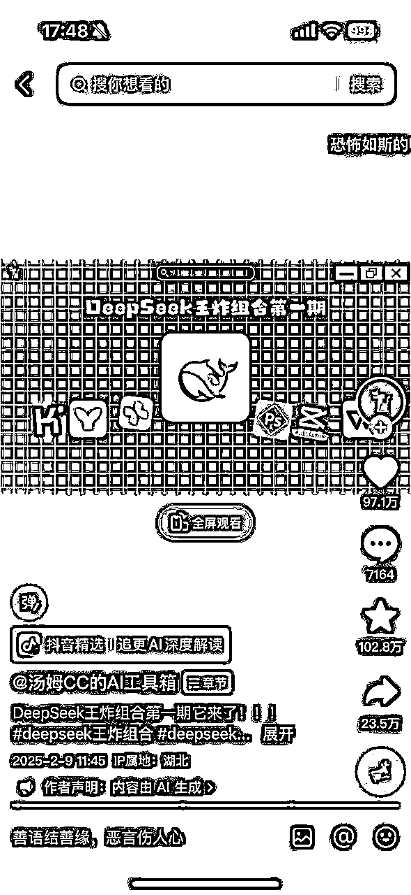

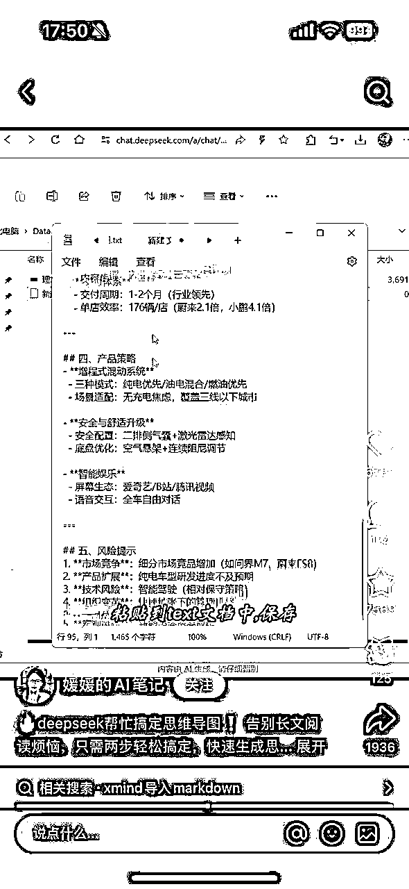

这种向大众普及AI认知的号，就是这期航海项目要手把手带大家做的——AI创作号。

这类号常见的方向大概有四类：

第一类，热点追踪与技术科普。把复杂的AI讲给小白听，比如用比喻和身边的例子说明模型怎么工作、ChatGPT怎么运转，顺带把行业热点也拆一拆。

第二类，软件种草与教学。围绕特定工具做实测、出教程，像Midjourney出图指南、DeepSeek的玩法合集，做成连载更容易形成辨识度。

第三类，搞钱案例拆解。聊AI怎么变成收入，比如各种变现案例和方法论。亲历者讲出来的东西，比转述更有说服力。

第四类，效率办公提效。目标群体是上班族和学生：怎么写报告更快、怎么用DeepSeek省时间，这类实用技巧最吸粉。

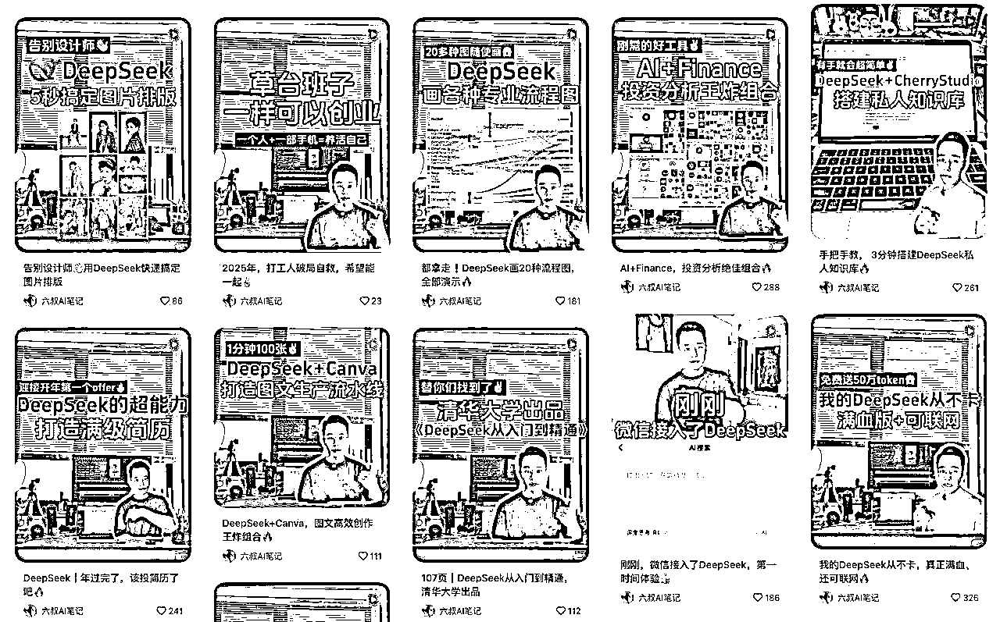

下一个问题：现在才入场，还来得及吗？

来得及，原因有三。

其一，AI方向的爆款率远高于一般内容。过去做号，三十篇能出一两条爆款就算不错；现在切AI，二十篇里跑出四五个高流量作品并不稀奇。AI几乎是日更的信息源，新模型、新软件、新场景天天往外冒，只要你把其中信息不对称的部分提炼出来，说成人话，流量就会像开了闸一样涌过来。最典型的就是DeepSeek大火那阵，📕上一堆粉丝没破千的小号，硬是做出了六位数播放。

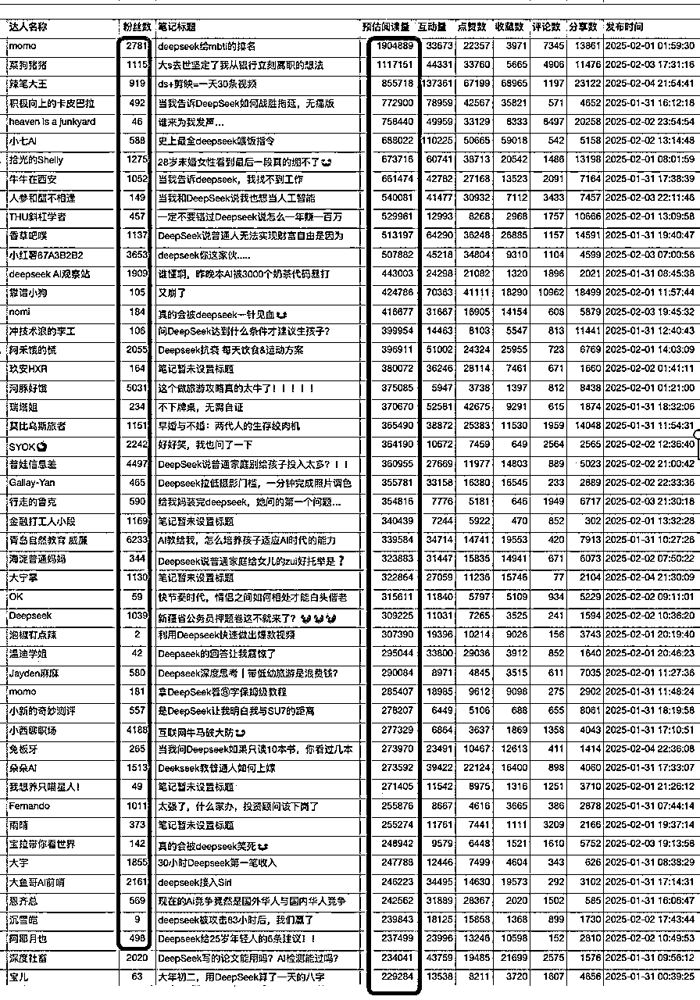

其二，品牌方在AI上的推广预算相当充裕。圈友@杨昌在2024年10月做过一轮盘点，把市面上投钱给AI产品的甲方数了个遍：第一梯队，年投放过亿的，两家。

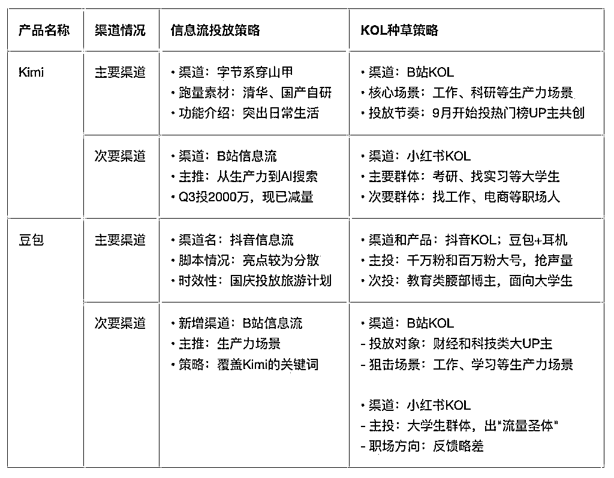

第二梯队，百万到千万级的，八家。

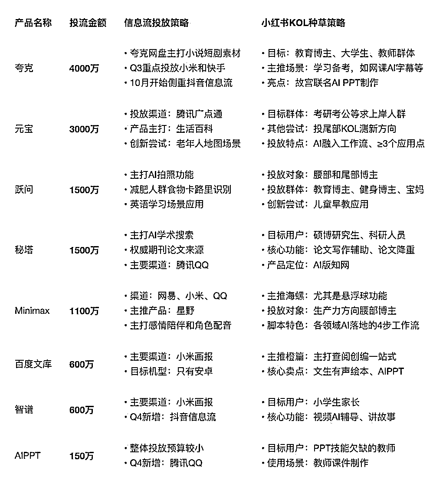

第三梯队，还有一批更小的。

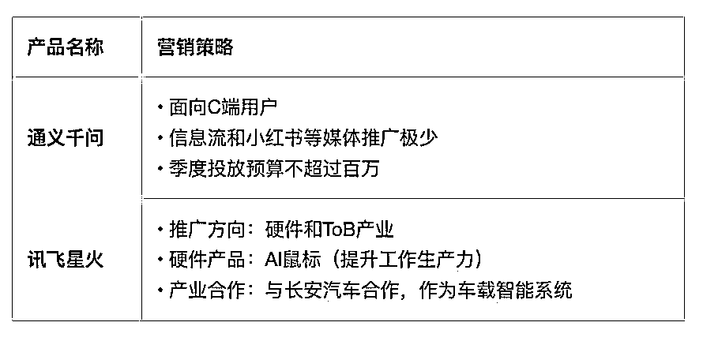

而这份名单，只是二十天里的统计。

其三，AI创作号能赚钱的方式很多样。

1. 接商单。AI软件方或SaaS厂商掏钱请你做推广，比如DeepSeek生态里的产品。这类金主最看重账号内容和自家产品使用情境的匹配度。

2. 分销抽佣。卖会员、卖书、卖硬件，挂上你的专属链接就行。比如放一个ChatGPT、Midjourney的会员入口，用户点进去下单，你拿提成。

3. 开课建群。做线上小课或训练营，比如AI画图入门、大模型实战，客单价从几百到几千都有。

4. 播放分成。参加中视频伙伴计划、B站的激励分红，按播放量给你结算。

5. 对公收费。面向企业客户提供咨询、技术落地和项目孵化，比如把办公流程改造成智能工作流，或者一起把一个AI产品从0做到上线。

这些方式的门槛都不算高。等内容和关注者的信任磨到位，一个人同时跑通两三种收入来源很常见。

# 二、【方向选择】给AI创作号选个好方向

目的：找到适合你长期经营的AI方向，让这条路能一直走下去、越走越宽。

# 💡 先说这一章讲什么

现在做号，最关键的是两件事：方向挑得准不准，内容有没有辨识度。一上来就把摊子铺大，或者硬碰不熟悉的话题，后面只会越写越虚，最后变成“啥都懂点，啥都不精”。

所以，先收窄。在热门技术拆解、软件测评、搞钱案例、效率办公这些细分方向里挑一个，再叠上你的兴趣和拿手项。内容越垂直，信任感积累越快。

本章带你做三件事：
一是找切口：热门技术拆解、软件测评、副业搞钱案例，哪样你最有感觉就选哪样。
二是定形态：真人出镜、录屏讲解、图文、竖屏短片还是直播，先用最顺手的一个。
三是选阵地：前期只瞄准一个平台发力，抖音、B站、📕、👸号都行，跑顺了再开新阵地。

准备好了就往下看。

选方向这事，拆开就三步。第一步选内容盘口：AI是个大筐，你要明确自己装哪样——解读技术热点、测评软件，还是拆搞钱案例。第二步定表达形式：露脸、图文，还是不露脸的录屏讲解。第三步看平台气质：封面审美在线，去📕；颜值和镜头感能打，直奔抖音；剪辑功力深、手头有单反，B站更适合你。

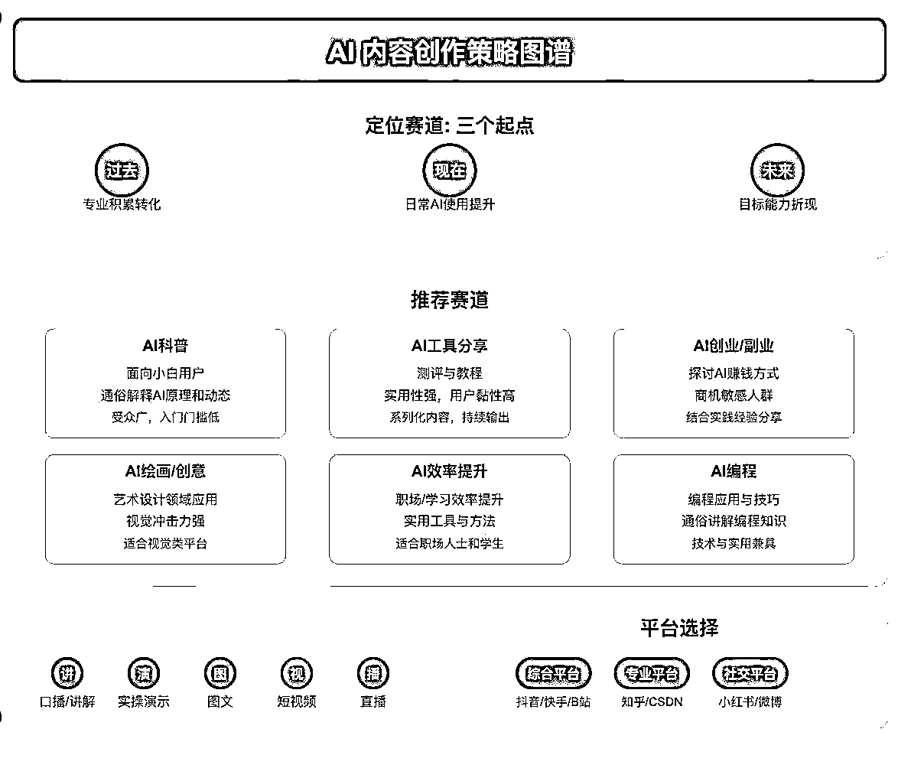

## 2.1 找准内容方向

在内容创作里，方向说的是你打算长期输出什么题材。一句话：做什么、为什么做、准备怎么做出彩。

放在AI这个大主题下，方向还要再切一刀，从“什么都聊”变成“专注一类”，比如这几块：

第一块，热点解读与技术科普。关注前沿进展和行业变化：拆开文心一言、Claude、GPT-4这类大模型的黑盒；观察企业怎么落子AI，投融资和政策风向；讲AIGC怎么重塑各行各业；把底层原理讲明白；讨论AI对工作、教育、隐私的伦理影响；用最通俗的比喻降低认知门槛；偶尔还能逐句拆读最新论文。

第二块，软件实测与教程。逮住一个工具就讲透。作图的有Stable Diffusion、DALL-E、Midjourney；码字的有Claude、ChatGPT、Notion AI；办公提效的有智能工作流、任务管理、效率类应用；写代码的有代码生成、自动测试、编程助手；剪片子的有Heygen、Pika Labs、Runway；配音的有Voice AI、ElevenLabs；获客的有营销软件、SEO、数据分析；学习的有智能家教、论文辅助、翻译工具。

第三块，搞钱与案例拆解。研究AI怎么帮人赚钱：拿AI立IP、做内容、卖课收费；搞跨境和店铺智能托管的电商生意；接绘图、剪辑、代运营的活儿；盯创业公司和投资窗口；自己做SaaS产品；用AI投广告、拉增长；提供智能客服和辅助销售的支持。

第四块，效率与办公实战。聊AI怎么让人干活更快：职场里的办公流程自己跑起来、数字助理随时待命；简历打磨、模拟面试帮你升职加薪；代码补全、调试和优化；智能写稿、自动剪片、一键生成PPT；招聘和人事管理里的提效实践；常用工具的横评和推荐；还有用AI做知识管理、加速学习的方法论。

第五块，跨界与行业落地。聊AI在不同场景里的作用：视觉设计（智能艺术、UI/UX）；教育（中小学、高校、职业培训）；心理成长；健康管理（辅助诊断、日常监测）；法律（文书助手、合同生成）；金融（量化策略、金融科技）；区块链与Web3（智能合约、NFT、去中心化应用）；社交（恋爱助手、社交增强）；游戏（智能NPC、游戏工具开发）。

这五块全部算AI圈的范畴，但受众、叙事方式、更新节奏各不相同。方向立住之后，你只需要沿着一条主线持续输出，专业标签会慢慢贴牢，平台也能更准确地把内容推给对味的人。

有人会问：这些内容我不能换着发吗？为什么非要钉在一个方向？

三个原因：
第一，杂而不精没人记得住。今天画图、明天测评、后天聊AI健康，系统没法判断该把你归到哪个标签下，关注者也留不下印象，流量很难滚起来。
第二，垂直内容容易被系统识别。一直产出画图内容，平台就会优先把账号推给插画、设计、AIGC这类人群，来的都是对味的。
第三，深耕才会长出个人招牌。在一个细分支里做得够久，大家一想到这个分支就想到你，“那个拆项目很透的”“那个画图很神的”——人设立住了，合作邀约也就跟着来了。

这时又有人问：我平时的工作生活跟AI不搭边，能做吗？

回头看看那些做得好的号主，大多不是等风口来了才挤进去，而是把手里正在做的那些事，做深、做透、做出彩，然后顺手分享出来。三个思路给你：

思路一：翻存量。过去在某个行业攒下的底子（教育、设计、编程、营销都算），能不能用AI玩出点新花样？插画师可以去做AI出图，HR可以把职场工具讲成系列。

思路二：看日常。你每天是不是已经拿着ChatGPT写东西、做总结？是不是习惯让AI帮忙做PPT、剪视频？是不是正在研究大模型的开发和调参？把这些天天在做的事，从80分打磨到100分，再拍成内容发出去，这就是现成的素材。

思路三：想愿景。你希望一年后的自己是什么角色：画图大神、AI问题顾问，还是带人做副业的IP？把那个画面当成方向，倒推一条路，边学边更，今天的输出就是明天的资本。

还在纠结？拿这张表给自己打个分：

底子厚度（1-5分）：在这个方向上，你已经攒了多少积累。
热情浓度（1-5分）：聊这类话题，你是越聊越来劲，还是聊两次就腻。
角度新奇度（1-5分）：同样的题材，你能不能讲出别人没讲过的点。
补课成本（1-5分）：为了做好这块内容，你愿意搭多少时间。
连更耐力（1-5分）：先按三十篇算，扛不扛得住。

拿这五个维度分别给“技术解读、软件测评、搞钱案例、效率办公、行业交叉”打分，总分最高的那个，就是你起步的第一站。

打分也救不了你？那就把选择权交给AI。告诉它你做过什么、擅长什么、对什么感兴趣，让它基于上面的分类给你推荐。参考下面这段指令：

# Role: AI方向策略顾问

## 背景设定

你对AI很在行，也懂内容运营。你能把大模型、工具链这些事说明白，也清楚选题怎么定、读者怎么看、平台背后的推流规则怎么运转。

## 工作任务

根据用户交底的职业经历、技能、兴趣和读者画像，给出一套AI方向的整体评估与行动建议。

# 防失联+MM188166M（李李）长期更新

## 执行步骤

1. 先了解用户的职业背景、技能储备和兴趣所在。
2. 再看目标用户是谁，他们需要什么内容。
3. 接下来评估各方向的潜力、拥挤度和行情趋势。
4. 把用户能力和行情机会做匹配，筛出最合适的方向。
5. 最后补一条起步阶段的选题主线和错位打法。

## 候选方向速览

* 科普型：把复杂的AI说清楚，跟进前沿动态和落地场景
* 软件型：实测新工具，给出易上手的教程和技巧
* 搞钱型：拆解AI里的商业机会和各种玩法
* 创意型：探索生成式艺术，分享智能画图的乐趣
* 办公型：用智能工具优化工作流，把产出拉满
* 代码型：讲怎么让AI帮你写代码，分享框架和可跑的示例
* 视频型：专门拆解AI圈的爆款内容，把选题设计和结构套路讲明白

## 2.2 选对呈现形式

内容以什么形态出现，比很多人以为的重要得多。它既影响观众看着舒不舒服，也决定你更新累不累、关注者怎么和你互动，以及以后靠什么赚钱。

下面按口播、录屏跟练、图文、竖屏短片、直播五种主流玩法，挨个聊聊各自的门道。

### 2.2.1 口播：把懂AI的人设立起来

TikVideo.App_7467880910654819611-hd.mp4【在线播放】

口播是拉近距离、留住铁杆关注者最直接的方式。建议各位能做得到就尽量真人出镜。

口播适合做什么：
- 讲概念：比如ChatGPT到底是个啥、它是靠什么跑起来的。
- 做评测：聊Midjourney、DeepSeek的上手感受，好在哪里、坑在哪里。
- 做复盘：拿一些成和败的AI案例，把关键经验拎出来说。

口播的优势：
- 亲和力在线。真人出镜，或者配合PPT讲，观众会觉得对面是个活人。
- 权威感容易立起来。逻辑顺、信息足，观众自然把你归到“懂AI的人”里。

操作上记住三点：
1. 脚本别省。AI话题专业性强，全靠临场发挥容易飘，先把提纲列出来，也可以让DeepSeek帮你把思路捋顺。
2. 背景别乱。选干净的墙或者有点科技感的角落，别让杂物抢戏。
3. 节奏别赶。概念本来抽象，话要说浅、说透，一层一层递进，多举例子多打比方，观众才跟得上。

### 2.2.2 录屏跟练：现场做给你看

完全不敢露脸？那就先出声。用声音建立信任，同样走得通。

TikVid.io_7469105181418868018.mp4【在线播放】

画外音加录屏操作，一步步把AI的知识和操作流程摆出来，内容一样扎实。

这种形式适合做什么：
- 工具教学：Midjourney从出图到成图的完整路径，DeepSeek从零写方案的每个动作。
- 开发实战：从项目初始化、环境配置，到调参、跑代码的完整过程。

它的优势：
- 吸收效率高。光讲不如演示，观众看着屏幕跟着做，理解速度和信任度都上来了。
- 互动感强。从零开始的节奏，会让观众觉得“我也能复现”，跟学的欲望更强。

操作上记住三点：
1. 录屏配解说。OBS、Camtasia都行，加上真人旁白或字幕，关键步骤放大，防止观众看不清。
2. 拆小节。把流程纵向切成“环境搭建”“数据准备”“模型训练”，一段一个知识点，学起来不累。
3. 及时看效果。画图或跑模型时，把输入和输出放到一起对比，“亲眼看到”最有说服力。

### 2.2.3 图文：用深度把同频的人吸过来

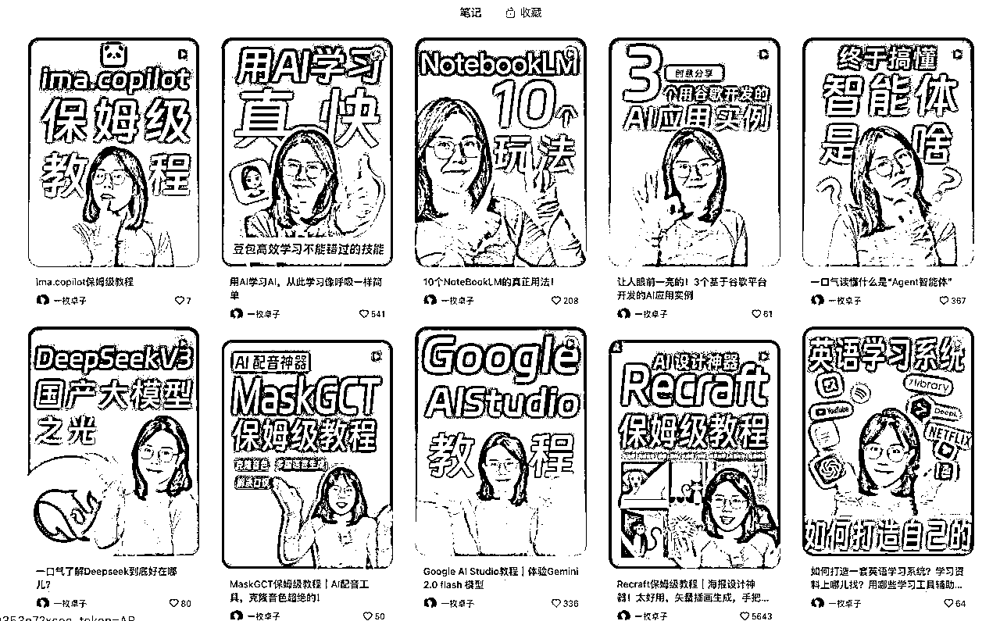

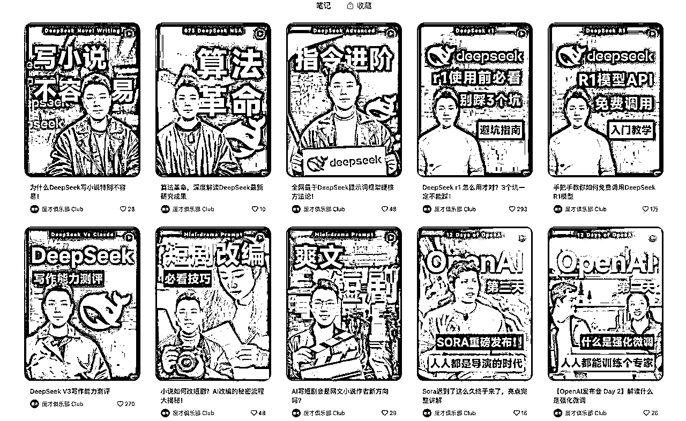

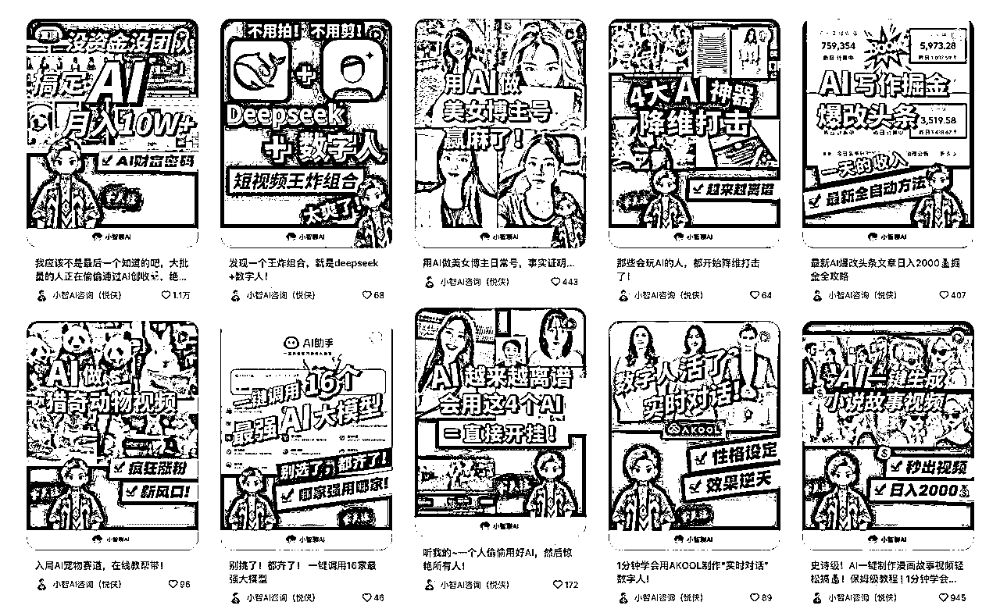

选图文的话，封面就是生死线。封面没有吸引力，正文写得再深也容易被划走，这话一点不夸张。

图文适合做什么：
- 追资讯：盯住行业里的新动静，发快讯也好，发短评也罢。
- 写深度：拆大模型的进化方向，或者聊某个算法怎样在具体场景里落地。

**AI 配图+文字：让图文内容更有冲击力**

用 Midjourney、Stable Diffusion 这类工具生成画面，再配上简洁文字，第一眼就能形成强烈记忆点。

**图文的先天优势**

- **能装下更多信息**：对比短视频，图文的容量更大，知识点、细节、步骤都可以放进去，适合把一个话题讲透。
- **便于反复回看**：图文天生适合被搜索、被收藏，用户想复习某个要点时，随时能翻出来重读。

**写图文时要注意什么？**

1. **标题和摘要决定去留**：AI 圈的读者习惯快速扫标题，标题没戳中要点、摘要看不出价值，人就走掉了。
2. **排版直接影响完读率**：AI 生成的配图该用就用，能给长文增加趣味；分段、加粗、列表、引用这些细节，也能让阅读更舒服。
3. **专业度靠来源撑起来**：引用数据、报告、论文结论时，把来源链接或参考文献放上去，可信度马上不一样。

# 2.2.4 短视频——碎片化时代的“爆点”制造机

如果你有做视频的经验，可以试试抖音短视频，这种形式反馈来得特别快。

TikVid.io_7477466640632876315.mp4【在线播放】

**什么题材适合拍短视频？**

- **AI 绝活展示**：比如抠图这种操作，AI 几秒钟就能搞定过去繁琐的后期，观众当场看呆。
- **AI 小剧场**：用有梗的剧情或神转折，让 AI 像变魔术一样，一下子戳中大家的好奇心。
- **真实场景记录**：办公室、课堂、设计室都行，重点讲清楚 AI 在哪些环节能真正提效。

**短视频的好处**

- **传播快、覆盖广**：抖音、快手、视频号天然适合短视频，内容稍微用心，数据很容易跑起来。
- **更容易做出爆款**：选题够新、开场 3 秒能抓住人，点赞评论很快就会涌上来。

**短视频的制作诀窍：**

防失联+MM188166M（李李）长期更新

1. **开场要有冲击力**：一上来就放出令人惊讶的 AI 效果或扎心的痛点，让观众立刻停住划屏的手。
2. **节奏要紧凑**：画面切换利落，字幕醒目，每隔几秒抛出一个亮点，观众根本舍不得退出。
3. **声音别凑合**：配上有趣、动感、让人兴奋的背景音乐，感染力直接翻倍；配音用 AI 或真人都行，越亲切越好。

# 2.2.5 直播——让用户留下来，也让知识变成钱

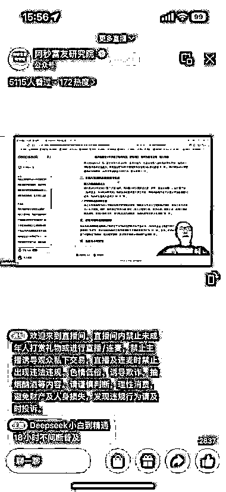

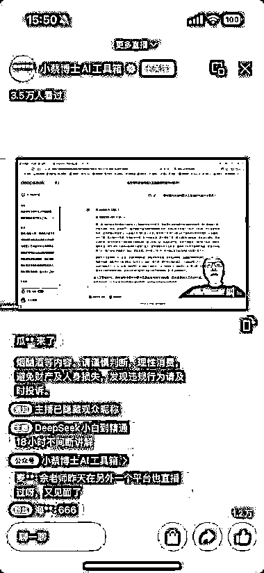

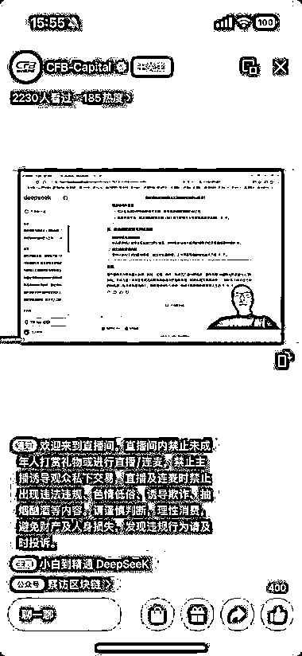

如果有过“视频号带货”之类的直播航海经历，也可以走“直播起号”路线：靠直播讲 AI 知识，顺手带货或涨粉。

**直播适合做什么？**

- **AI 技术交流**：请行业专家线上连麦，或实时演示某个功能。
- **工具使用答疑**：把粉丝常问的问题攒起来，直播里带着大家一步步操作。
- **项目进展展示**：晒出正在做的项目，粉丝可以实时提问、一起脑暴。

**直播的价值**

- **互动感是最大优势**：观众弹幕随时飞过来，主播现场接话，这种实时感比干巴巴的视频强太多，粉丝也更愿意留下来。
- **用户掏钱更爽快**：直播中顺带推荐新课、拉群、提供服务咨询，用户更容易顺势下单。

**三个操作关键**

1. **脚本先排好**：虽然是实时聊天，但流程、时间节点、答疑顺序都得提前定，否则容易冷场或节奏乱掉。
2. **工具要跟上**：聊天群、屏幕共享、AI 特效都能帮观众跟上节奏，同时保持娱乐感和实用感。
3. **播前预热，播后复盘**：开播前发通知，让大家提前预约“占位”；播完把精华剪成回放视频或图文笔记，再赚一波二次流量。

**怎么选内容形式？**

- **低成本方案**：真人讲解配屏幕录制（工具类）、AI 生成图文（设计类）。
- **进阶方案**：AI 虚拟人出镜、AI 配音+动画，减少真人出镜的压力。

做 AI 自媒体，内容能不能火，不只看“你讲什么”，更关键的是“你怎么呈现”。

口播能帮你立住专业人设，现场操作能吸引喜欢动手的粉丝，图文适合做深度内容，短视频负责快速抢注意力，直播则把互动和变现直接打通。

每种形式都有自己的长板和短板。选哪个，要看你的个人条件、粉丝口味和平台属性。建议从最容易上手的开始：口播配录屏或图文都可以；做顺了再挑战 AI 虚拟人、直播答疑这些进阶玩法。过程中多盯数据、多听反馈、持续优化，才能真正做出有影响力的账号。

# 2.3 平台定位：先打透一个，再复制到其他

刚入局 AI 自媒体，选平台这事很关键，不要一次铺开好几个。最好先集中火力死磕一个平台，快速做出样板号，摸清内容方向和粉丝口味后，再横向扩展，让不同平台之间互相导流。

不同的人，平台打法完全不同：

1. **镜头表现力强、愿意露脸的**
   - 主阵地：视频号+📕；
   - 辅助：抖音；
   - 其他平台负责分发引流。

2. **内容扎实、能把深度讲明白的**
   - 主阵地：B 站，立住专业影响力；
   - 👸号承接长期的内容积累；
   - 📕/视频号/抖音帮助扩散。

3. **擅长把 AI 放进真实生活场景的**
   - 主阵地：📕，走生活化安利风；
   - 视频号、抖音用于扩散；
   - 👸号沉淀攻略、工具清单。

4. **不爱出镜，但文案/技术/创意在行的**
   - 主阵地：B 站和👸号，主打深度内容；
   - 📕用图文、混剪拉流量；
   - 抖音、快手可以小步试探破圈。

接下来，我们把几个平台的典型账号逐个拆开看。

# 2.3.1 视频号案例：熟人裂变与公私域协同

**平台底色：**靠🛰️里的熟人关系链扩散，把公域和私域串起来。

**选题方向：**

1. 真人讲解 AI 知识的短视频，数据最容易做起来。
2. 视频里要加引导关注的话术，比如提醒一句：“关注👸号，免费领取 AI 工具箱”。

**核心打法：**

3. 发布后的前 3 小时是黄金期，用🛰️群、朋友圈把互动拱起来，平台才会给你推流。
4. 同一天配合👸号推文发布，让内容彼此承接，用户看完视频还能沉淀到👸号。
5. 埋互动型话题，引导用户留言，账号更容易在推荐里出头。

**案例 1：秋芝 2046**

**账号特点：**真人出镜，视频号和👸号双轮驱动；视觉标识统一，每周 1—2 条高质量内容，节奏很稳。

**账号拆解：**“真人出镜+实际演示”是她的招牌。露脸这件事本身就加分，再配合一步步操作展示，新手也能轻松跟得上。她还把视频号和👸号串成一条线，触达用户的入口更多，效果自然更明显。

**可复用技巧：**👸号+视频号内容做联动，一次生产，两处见效。

**案例 2：数字生命卡兹克**

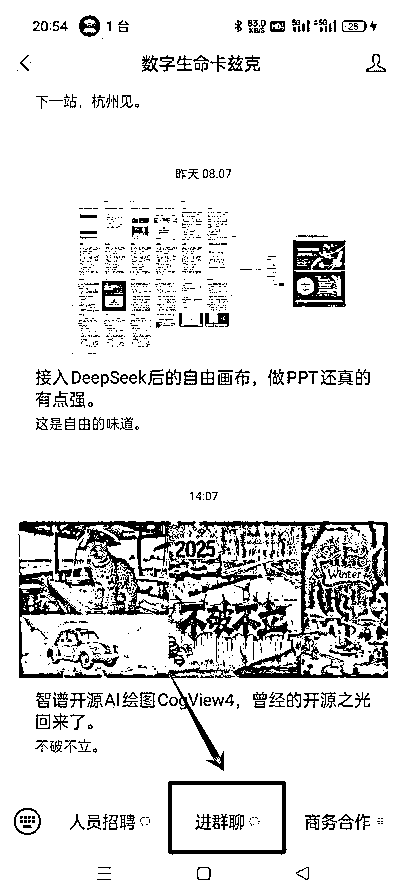

**账号特点：**先经营私域，再把它变成公域的燃料，从多个入口接触用户。

**账号拆解：**卡兹克运营着一批🛰️粉丝群，每天都往群里丢 AI 行业动态，群里的讨论氛围和忠诚度都很好。每次发布作品，他会同步转到🛰️粉丝群和朋友圈，帮新账号完成冷启动。这套玩法形成了一条清晰的用户触达链路：

1. 社群负责日常信息触达，维持互动频率；
2. 朋友圈做二次扩散，扩大影响力；
3. 视频号面向公域拉新；
4. 👸号承载深度内容；
5. 私域反馈反过来指导公域内容怎么调整。

**可复用技巧：**

1. 建免费粉丝群，持续发点有用的东西，让大家觉得这个群值得留，冷启动时才有私域可用，再多渠道触达。
2. 定期在群里抛话题，聊出用户真实的需求和痛点。

# 2.3.2 📕案例：真实种草与精准分发

**平台底色：**UGC 种草社区，靠标签做精准分发。

**选题方向：**

1. 素人真实测评，比如“AI 辅助写论文，学生党能信吗？”
2. 场景化实用方案，比如“只靠 3 款 AI 工具，📕排版全包了”。
3. 工具横评，比如“Midjourney 和 Stable Diffusion 哪个更香？”

**运营要点：**

4. 封面优先用大字号标题风格，真人出镜更容易吸引点击。
5. 正文记得打上贴合内容的标签，比如 #AI绘画、#deepseek，让系统帮你找人。

防失联+MM188166M（李李）长期更新

6. 评论区做文章：把工具的获取方法置顶，避免被平台限流。

**案例 1：子鱼的 AI 工具库**

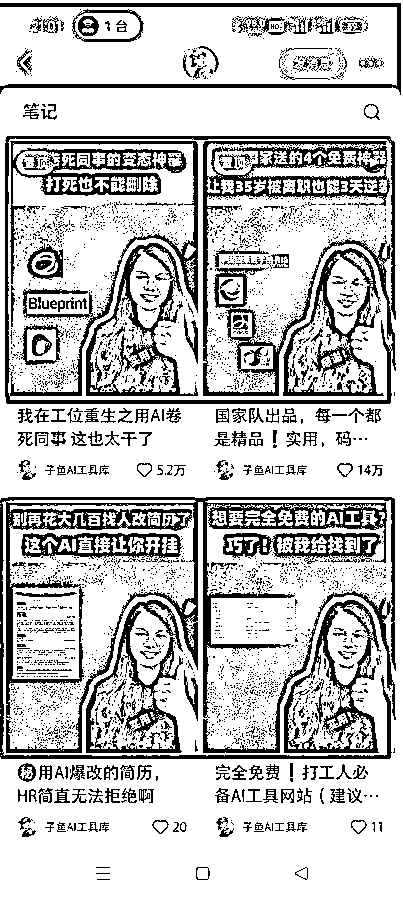

**账号特点：**真人出镜+封面统一。

**账号拆解：**她以真人出镜讲解 AI 知识，亲切又可信；操作步骤演示得很细，让普通人也能跟得上；封面用大字号+真人，品牌识别度很高。

**可复用技巧：**

1. 封面用大字号+真人；
2. 视觉风格保持统一，强化记忆；
3. 内容拆成模块，用户一刷就懂。

**案例 2：C 鱼工具集**

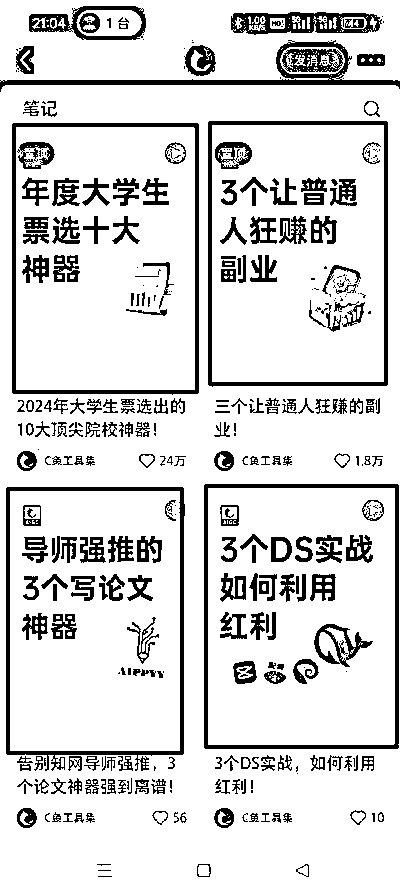

**账号特点：**纯工具向账号，统一大字海报封面。

**账号拆解：**不露脸，专心展示工具功能。封面精致统一，辨识度高；内容讲工具的用法和落地场景，演示简单直接，上手成本低；还会拿工具做对比，帮用户做判断。

**可复用技巧：**封面统一用大字海报。

# 2.3.3 抖音/快手案例：摸透算法，批量出爆款

**平台底色：**抖音快手拼的就是算法。你懂算法要什么，你就容易爆。

**选题方向：**

防失联+MM188166M（李李）长期更新

1. **剧情反差**：比如“把老板的照片喂给 AI，下一秒老板沉默了”，观众就吃这一套。
2. **热点要快蹭**：之前全网都在聊 DeepSeek 本地部署，跟上了流量就不会差。

**技术打法：**

防失联+MM188166M（李李）长期更新

3. **前 3 秒高能开场**：比如演示 AI 换脸，直接喊“不用 PS，三步搞定！”让人忍不住想看下去。
4. **每 15 秒埋一个钩子**：音效来点“叮”“Duang”，或者穿插一句吐槽弹幕，评论区立刻热闹起来。
5. **结尾设固定口号**：每期用同一句话收尾，让观众不知不觉记住你。

**案例：秋芝 2046**

**账号特点：**品牌感强、记忆点鲜明、风格统一；讲得深但听得懂，互动感强，总能带观众进入她的视角。

**账号拆解：**她习惯用“雷猴啊”开场，这已经是她的招牌；结尾有专属动作和名字。固定的开头和收尾，让观众产生“这是她”的专属感。视频里大量使用高饱和色块，视觉记忆很强；内容结构也讲究：先抛钩子，再演过程，最后给结论；话术短、准、有劲。

**可复用技巧：**

1. 设计一句招牌用语；
2. 固定开头和结尾，让观众形成条件反射；
3. 统一色调、构图、滤镜；
4. 按“问题—解法—效果”的层次来做内容。

# 2.3.4 B 站：拼深度，也拼圈层

**平台底色：**B 站和抖音快手完全是两个逻辑，这里要的是深度内容消费和圈层认同。

**选题方向：**

1. **长测内容**：“我花了两个礼拜，把 30 款 AI 工具全测了一遍，万字报告帮你选出最好用的。”
2. **干货教程**：跟着教程一步步来，本地部署 Stable Diffusion 其实没那么难。
3. **趋势盘点**：“未来一年，这 10 类工作最可能被 AI 替代，看看有没有你。”

**运营技巧：**

1. 视频做章节标记，观众能跳到自己想看的部分；不然一看十几分钟的时长，很多人直接就关掉了。
2. 多埋几个“只有老粉才懂”的梗，比如“一键三连到一万，立刻掏出下一期 AI 干货”，观众觉得有意思就会参与。
3. 主动cue弹幕：“你最喜欢的 AI 工具是什么？弹幕走起！”热度一下子就上来了。

**案例：痕继痕迹**

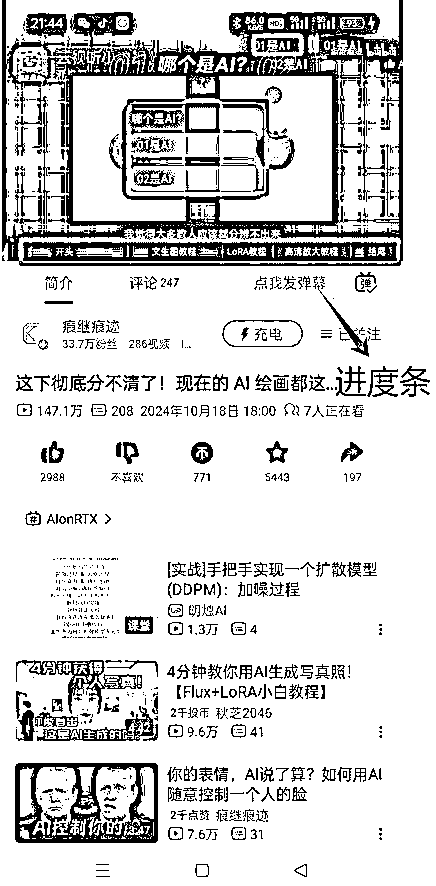

**账号特点：**片头统一，解说和演示配合，步骤讲得清清楚楚；时不时夹带个人观点，不是照着说明书念，每期都有独立价值，还能吸引人去看其他内容。

**可复用技巧：**

4. 在弹幕里放互动题或梗，引导观众发言。
5. 超过 10 分钟的视频一定要做进度章节，观众没耐心等。

# 2.3.5 👸号：做深阅读，做长品牌

**平台底色：**👸号最适合深度阅读，重点在积累品牌资产。

**选题方向：**

**方向一：针对具体场景给方案**

例子：“那些📕博主私藏的 AI 神器，一小时搞定一周的图文选题！”

写法：把用户痛点写出来，配截图做标注，再附上避坑提醒，读者看完就能照着用。

**方向二：用 AI 做副业赚外快**

例子：“她靠 AI 接单，一个人做出了月入 2 万的外快，我把接单话术整理成模板了！”

写法：从客户怎么聊、价格怎么报、交付怎么做，模板全给齐；再把🛰️上的真实聊天记录截图甩出来，信任感直接拉满。

**运营技巧：**

防失联+MM188166M（李李）长期更新

标题不撩人，就没阅读量。

开头 3 段直接用真实场景切入，比如复现读者每天都在经历的痛点，共鸣感马上出来。

重点盯住三个最关键的位置：标题、开头 3 段、文末福利。标题负责吸引点击；开头负责留住人；文末放资料包或工具合集，读者才愿意关注、点赞、收藏、转发。

整篇用“干货立价值—案例讲场景—资料包收尾”的框架，读者读完之后觉得有收获、能落地，还舍不得删。

**案例：赤辰 AI 实操记**

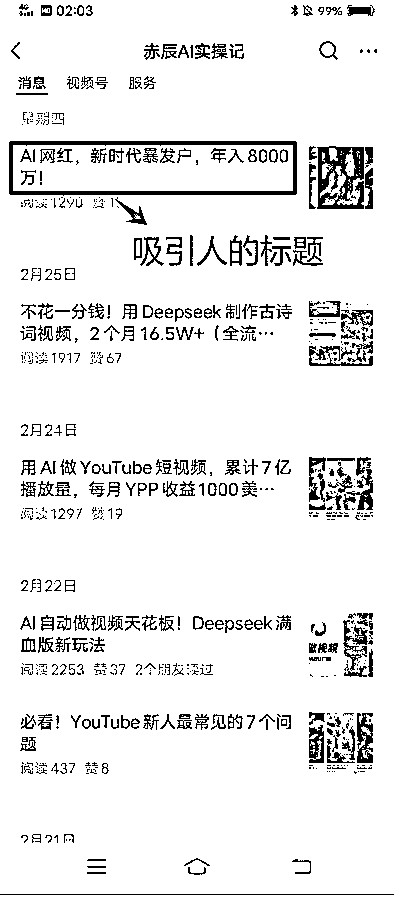

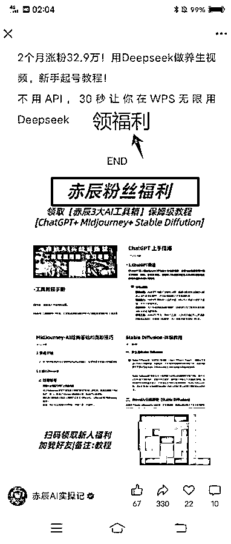

**账号特点：**标题抓人，开篇用案例钩住读者；案例拆得细，截图和注释都到位；小标题把阅读节奏带得很顺；文末福利设计巧妙，转化率在线。

**可复用技巧：**

1. 标题吸引+案例演示+文末福利；
2. 内容结构要清晰。

# 💡

起步阶段，先全力做一个平台，把它做成标杆，把生产流程跑顺，用真实数据说话持续优化。稳定之后再铺其他平台，形成矩阵联动。

另外，各大平台的审核规则不一样，有些平台要求给 AI 生成的东西打上标识，别在这种事上翻车。

# 2.4 对标拆解：别复制，拆元素

一提做账号，很多人脱口而出：抄对标。

但大多数人都在犯同一个错：幻想着找到“作业可以直接抄”的账号，照着搬就能躺赢。

现实是，头部账号真正的竞争力，你根本抄不走——个人魅力、独家资源、原创灵感，这些都没法复制。

所以，照抄这条路从一开始就走不通。真正聪明的做法是“拆”：把爆款内容拆成零件，挑适合自己的用。好比逛街买衣服，爆款未必合身，穿上好看才是硬道理。

我整理了一张「对标元素表格」，方便大家落地。

开营前，把你想对标的元素填进去。不用锁定一个账号，可以混搭：比如你欣赏 A 的配乐、B 的字幕风格、C 的选题角度，全都能拼进一张表。

有人会问：方法我知道了，可对标杆去哪找？

别急，我们准备了一份现成的，点下方链接挑元素就行🔽

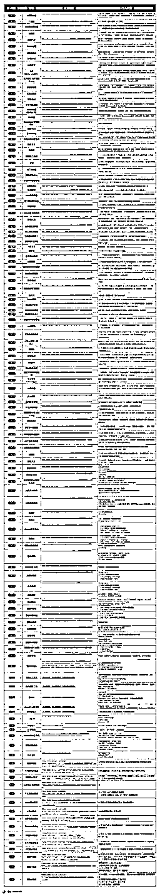

访问链接：AI自媒体（对标账号）

另外再教一招：反过来找。

拿抖音举例。如果你最终想做品牌合作赚推广费，第一步：看哪些品牌在投广告。

杨昌老师去年发过一篇分析，把那个季度里各大广告商的投放情况写得清清楚楚，豆包、Kimi、夸克都是投得比较猛的。

第二步：找承接这些广告的博主。

在抖音里输入“Kimi”“kimiAI”这些词，你会看到不少页面底部挂着产品链接、或者文案里推荐 Kimi 的账号。

点进主页，多刷几条视频，看风格和方向对不对路。

还要留意博主的接单稳定性。有些人蹭着产品热度短期接了几单，但长期变现能力差，发视频也是三天打鱼两天晒网。这种火一阵就消失的账号，不值得长期对标。

去分析这些博主的定位、风格、内容形式，逐步筛出自己的对标杆。

长期稳定投广告的就是那几个大品牌，按品牌反推找对标，确定性高得多。

# 三、【搭建阶段】完成多平台账号注册与基础搭建，先练内容

把基础搭建做扎实，确保第一次出现在用户面前就不掉链子。

# 💡

# 章节概要

新号起步，第一件事是留下好印象。昵称、头像、简介统一，品牌感就有了；拍摄环境不用复杂，简单干净有点科技感就行，设备清晰即可。前面这些基础打好了，后面做内容会省力很多，用户也留得住。

这一章聊三件事：

防失联+MM188166M（李李）长期更新

1. 账号准备：昵称、头像、简介保持一致，突出个人特色，让人一眼记住。
2. 设备准备：按内容形式准备简洁的拍摄设备，手机+补光灯+麦克风，背景简单布置，有条件可以上绿幕。
3. 内容练习：模仿你喜欢的账号，私下练 1—2 条视频或推文，找准自己的水平，再做一份选题清单，保证后续能持续产出。

# 3.1 账号基础设置

多平台同步考虑：抖音、视频号、📕、B 站、👸号/知乎等，至少挑 2—3 个主阵地做分发，别把鸡蛋放在一个篮子里。

# AI 赛道起号全攻略：账号包装与爆款公式拆解

先想一个能贯穿所有渠道的昵称：各平台若能注册到完全一致的名字最理想，这样关注者换个 App 也能一眼认出你。命名时不妨掺进一点 AI 味道或私人符号，像“AI 小课代表”“AI 绘画实验室”这类。个人介绍则要亮出价值——用一句话交代身份和能给出的东西，例如“分享 AI 工具与创作案例，助你轻松 get 新技能”。无关信息别往里塞，顺手提一句你打算长期做什么就好。

**3.1.1 账号准备**

挑渠道要跟着定位走。假如旧账号之前发的跟 AI 八竿子打不着，最好另开一个新号——历史标签会拖累推荐。新号注册完成后，多刷同类内容，先把账号“喂”出兴趣偏好。

**3.1.2 账号名保持一致**

同名到底有什么用？

一是辨识：跨渠道统一，关注者才不会认错人。二是搜索：固定的称呼更容易被检索到，潜在受众也就能顺藤摸瓜找过来。

取名有几点：短、好记；可以带上 AI 字样，如“AI 小课堂”“AI 绘画师小明”；避讳生僻字；实在没灵感，把内容方向丢给 AI，让它出几个备选。

以“汤姆 CC 的 AI 工具箱”为例：汤姆 CC 是网名，主打工具分享，“工具箱”三字对得上；头像用的是猫，与“汤姆”互为呼应，整体观感统一。

**3.1.3 头像与背景图**

头像和背景要过三道关：一是风格一致，各渠道看起来像同一家人，方便记忆；二是显得专业，可以用本人照片、AI 生成形象或品牌标记；三是尺寸合规，按各平台要求裁剪，别糊也别拉伸。背景选与主题呼应的画面或视频即可。

我自己的做法是让 AI 出图：打开即梦，在首页进 logo 设计，挑一种顺眼的风格，再把账号名里的关键词塞进去。
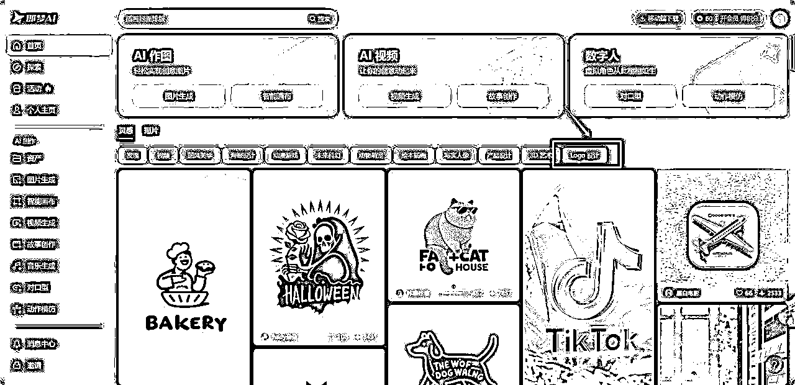

**3.1.4 个人介绍**

简介往往是关注与否的分水岭。刷到一条不错的视频，多数人会点进主页，看看这个号能不能长期喂给自己东西——觉得值才会点下关注。因此写简介有几条准绳：一，句子别绕，直说定位和你给的价值；二，把长板亮出来，例如“专注 AI 绘画教程”“分享最新 AI 工具”；三，给出后续安排，像“每周更新 AI 绘画教程”“定期分享 AI 行业分析”；四，删掉无关内容，保持干净；五，留个互动口子，“欢迎在评论区提问”“关注我，一起探索 AI 世界”。

我的办法是翻同行的简介，把自己经历揉进去，再让 AI 帮忙润色，前提是重点明确。
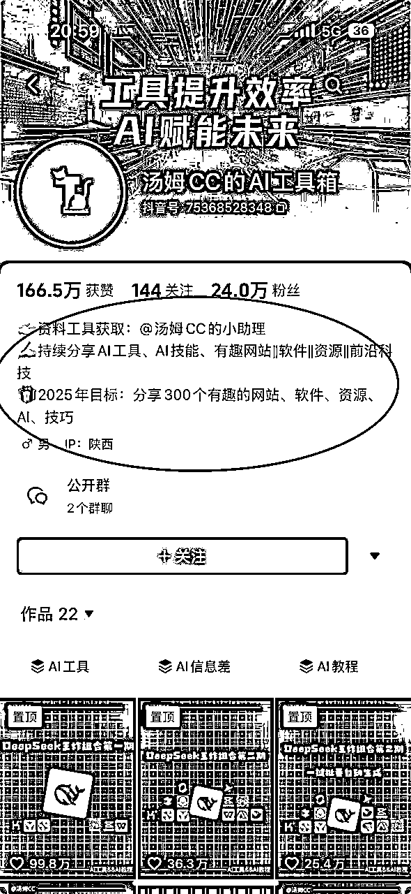

# 3.2 场景与设备准备

固定场景：做口播或录屏教学，给自己布置一块舒服且略带科技味的空间（灯光干净、桌面有摆设即可）。

设备：一部普通手机加简易打光就能开拍，画面清楚、人声清晰就达标。若要演示 AI 绘画，录屏加剪辑足够。

道具：真人上镜可以配点 AI 风的小物件或贴纸；若是录 ChatGPT、Midjourney 的操作，重点在分镜脚本，别让画面乱跳。

# 3.2.1 固定场景与背景布置（真人出镜）

灯光与桌面陈设是门面。光线决定专业度，摆件透露你的审美和所在领域。LED 灯带、智能台灯都能调出柔和又带科技感的氛围。

桌上别堆太满，可以放几样与 AI 沾边的东西：小小的机器人手办、科技风装饰、一盆绿植添点生气。
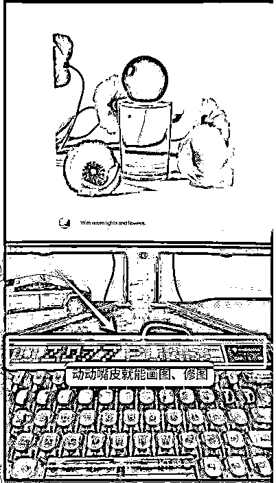
背景三种思路：纯色布——省事，主体突出；书架或工作角——有专业味，但要收拾干净；虚拟背景——技术过关的话，科技感与创意都能加。

# 📌 提醒

背景要贴合内容调性；别让杂物抢镜；光线要够，防止脸上压出阴影。不想露脸同样能固定场景、稳定产出。
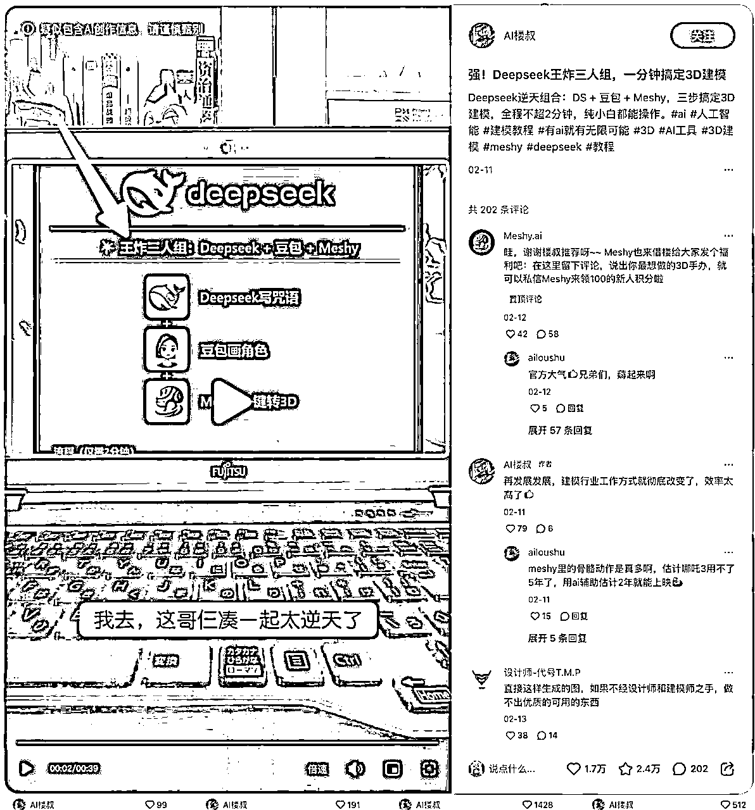
举个例子：把电脑屏幕换成一块绿色底，随后用剪映把录好的讲解视频嵌进绿区；绿幕叠加书房实景，真实感很强。场景搭一次，能连着用上百期。

# 3.2.2 设备选择与布光

手机拍摄：如今手机画质够用，成败在于稳（三角架）和清楚（擦净镜头）。建议备两个普通支架，一个托拍摄机、一个托提词机，既稳又能随手调角度。提词若用电脑，家里随便找个东西垫高就行。能调相对位置的双机位支架看着美好，但多数不够稳，不建议。注意别把两台机器并排死死固定：靠太近拍不到半身，离太远又看不清提词。

布光：自然光最柔和真实；环形灯能把脸照匀、消掉阴影，适合口播；简易柔光箱更专业，适合录屏教学。另一侧可加一支小灯管或挂块反光布。具体摆法见这条教程：https://v.douyin.com/i8jJuV6X/ 。提醒一句：环绕式补光灯不建议，戴眼镜的人镜片会反光。
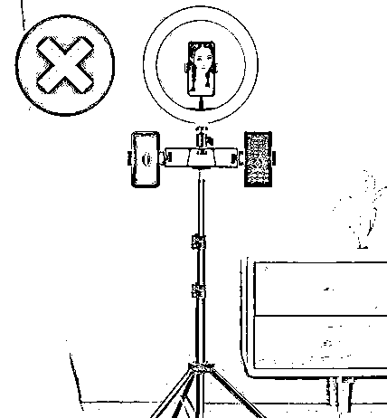
收音：手机直录杂音多，必须上收音设备。方案一，蓝牙无线耳机——拍摄时人略侧对镜头，观众看不到耳朵，把耳机戴在背对镜头那侧，直接用耳机麦收声。方案二，独立麦克风——淘宝拼多多两三百块的型号效果已够，起步阶段没必要砸钱买 RODE、大疆这类贵价货。

📌 注意：录音环境要静；后期可用音频软件降噪、修音质。

道具与细节：AI 主题贴纸、徽章、T 恤能添个人色彩；透明键盘、发光鼠标等科技小物也有加分。品牌标记适度露出，帮观众记住你。

# 3.3 基础创作练习

拆解优秀作品：挑 5～10 位你欣赏的 AI 博主，逐个看结构、标题、开场、讲法、评论区互动，把能照搬的套路整理成清单。模拟还原：先别发，私下拍 1～2 条模仿作品（视频或图文），很快就能照出自己的短板——口播、剪辑、录屏哪块弱。预备 10 条选题：别一上线就断更，提前把十个 AI 题材写进表里，比如“ChatGPT 这样帮我写活动策划”“用 Midjourney 画 X 风格插画实践”“AI+Excel 自动化办公示范”。

拆解对标：先定目标博主，沿用第二阶段的方法找到同类账号，摸清内容调性与受众画像；再看视频结构——开头怎么写、如何过渡到正文、结尾怎么收、悬念埋在哪；接着看标题和封面——抓眼球的招法、设计思路、常用句式与关键词、封面风格；然后看讲法——语速、语气、表达方式，怎么把复杂的 AI 概念讲成人话；最后看评论区——怎么回、怎么聊、粘性怎么养。

模仿对标分三步：一，挑 1～2 个最喜欢的博主的视频或图文；二，一比一还原，内容结构、讲解风格、剪辑手法都照着来，求形似，最好也神似；三，私下练，先不发，重点是找出自己在口播、剪辑、录屏上的短板。

预备 10 条选题：结合兴趣与擅长，锁定你最熟的 AI 方向；挑受众关心的热门话题，像 AI 绘画、AI 写作、工具测评；示例：“DeepSeek 是如何帮我写 PPT”“用即梦画 X 风格插画实践”“AI+Excel 自动化办公示范”“5 个你必须知道的 AI 写作工具”“AI 在教育领域的应用”；把这些整理成表，列明名称、形式、目标人群、发布渠道；最好直接拍出来，变成随时能发的内容。

# 3.4 选题库搭建

常见四类：工具测评（“10 个冷门但逆天的 AI 工具”）、场景教学（“用 Deepseek 写📕爆款标题的 5 个指令”）、行业热点（“Grok3 对 AI 行业的冲击”）、用户互动（“挑战用 AI 生成 100 个创业点子”）。

灵感来源有五处：一是对标账号；二是龙哥盟的“风向标”与“AI 是未来”小组，地址：https://scys.com/ ；三是 X，那里 AI 新闻密集，需🪜，地址：https://x.com ；四是即刻的 AI 探索站与人工智能讨论组，地址：https://web.okjike.com/ ；五是 Way to AGI 这个开源社群，里面宝藏不少，地址：https://www.waytoagi.com/zh 。

# 3.4.1 挖掘选题策略

① 从上述来源里挑看着顺眼的；② 搜索法：在抖音、📕、视频号里搜关键词，时间筛成一周，按点赞排序，挑现成的题。抖音
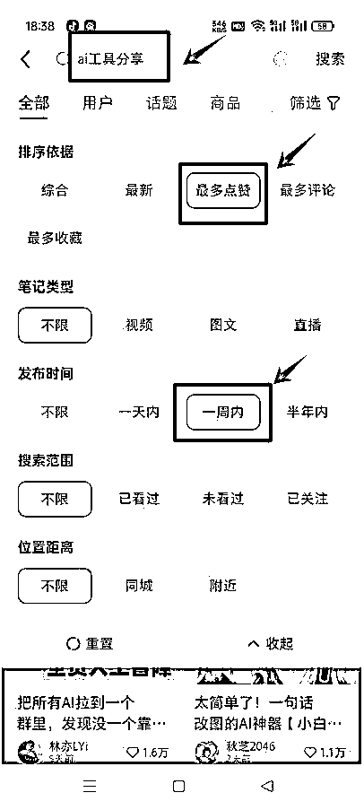
📕
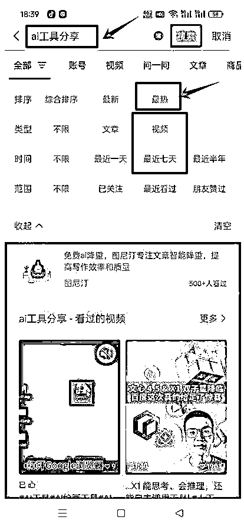
视频号；③ 异常值监控：盯对标账号平时的数据，通常点赞几百，忽然某条冲到几千，说明踩中了痛点或热点，这种题可以直接借用。
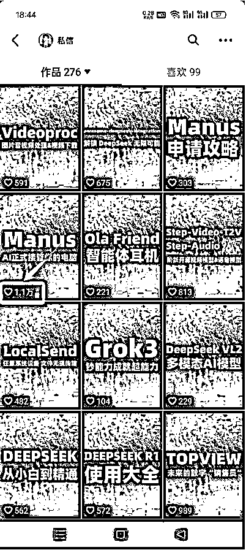
④ 追热点：热点带来流量，但要贴合自身风格与定位，为追而追不可取，质量与一致性得保住。选题库参考：

# 3.4.2 选题库更新与管理

一，定期刷新：三到五天更新一次，别让流量机会溜走；二，提前排期：把一周的主题先定好，省得每天现想；三，灵活挪动：撞上合适的热点，原定内容往后挪，热点先上。

📌 小技巧：用🛰️“面对面建群”拉一个“AI 自媒体选题”群，刷视频、看👸号时随手把灵感丢进去，散不了。

# 四、【起号阶段】持续发布作品，让账号打上标签 @东篱

靠前 10～30 条内容把号“养熟”，让算法借数据反馈认清你是谁、你的观众是谁。起号成功的标尺不是粉丝数量，而是平台已经能把内容比较准地推给对的人，初始流量越来越稳。

# 💡 章节概要

起号两件事：让算法认你，让观众信你。平台通常看你最初 10 到 30 条来判断风格与价值；观众则掂量内容的干货与专业感，再决定关不关注。所以持续输出优质内容、顺着推荐逻辑走，冷启动这关才好过。本章重点：内容规划——头 30 天把实用教程、工具评测、热点分析掺着做；互动与算法——引导评论、收藏、转发、关注，把互动率拉起来；稳定输出——日更或隔日更，让标签尽快明确，推荐才会更精准。下面先从“怎么对标一篇爆款笔记”说起。

# 4.1 如何对标一篇爆款笔记

📌 选题与内容库搭下来，我的体会是：爆款的底色是反复被验证的需求，创作的出发点不是自我表达，而是从爆款里淘共性。

# 4.1.1 小白创作三个致命误区

需求错位：把“我会写什么”当方向，而不是“用户要什么”。好比跑到沙漠里卖雨伞——东西再好，需求不对照样白搭。很多人从自身出发，写自己擅长或感兴趣的，用户的真实痛点被晾在一边，内容与需求脱节，数据自然难看。案例：你写《AI 绘画工具的高级技巧》，用户可能更想找《AI 绘画工具入门：5 分钟快速上手》；你精心做一款高端护肤品，用户也许只想要一瓶平价保湿霜。症结：起点是自己的能力，不是用户的需求；忘了“用户要什么”才是创作的第一问。
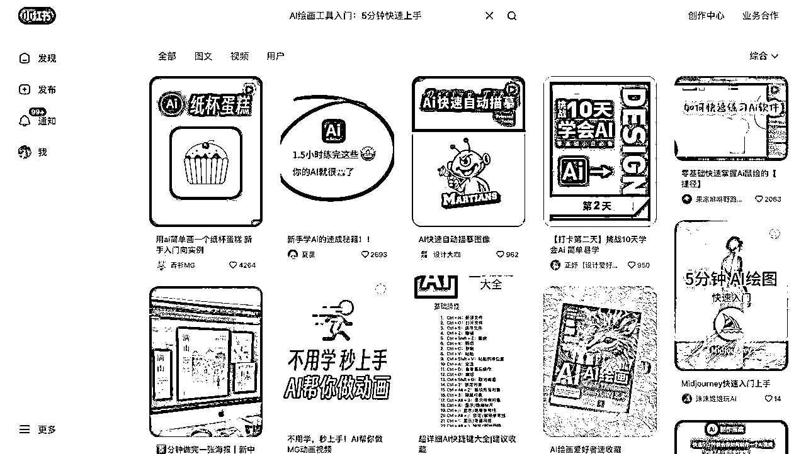
数据绝缘：封面、标题、内容再精致，也只是未经市场检验的“实验室样品”。爆款能被复制，是因为它通过了用户指尖投票的公开测试。很多人闭门造车，自认完美，放到市场上却不是那么回事。案例：你花一周写深度长文，用户可能只肯花 30 秒刷条短平快的干货；你把封面做得精美，用户也许只关心标题有没有戳中痛处。症结：内容没经过市场验证，缺少行为数据支撑；忘了用户行为才是衡量内容价值的唯一尺子。
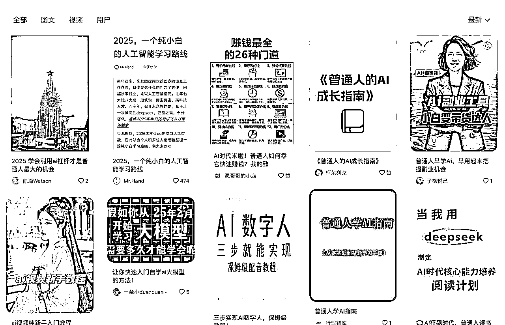
创新幻觉：新人总想与众不同，可商业级内容要的是“七成验证框架加三成微创新”。就像连锁餐饮的爆品公式：经典口味配季节限定包装。很多人以为创新是爆款的关键，实际上用户更愿意在熟悉的框架里尝到新鲜。案例：你设计一种全新形式，用户可能更习惯传统图文；你开辟一个全新方向，用户可能更关注已被验证的热门话题。症结：一味求新，忽视用户对熟悉感的依赖；没在验证过的框架上做小改动，内容反而离用户越来越远。
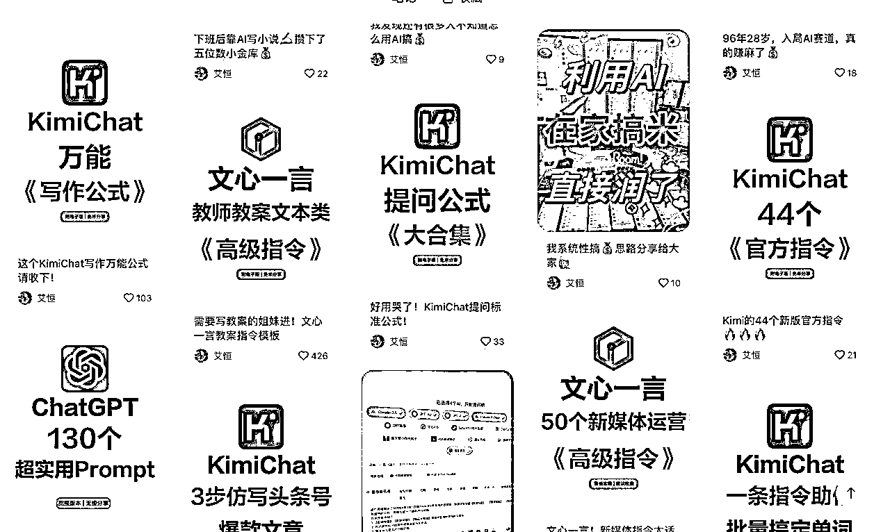
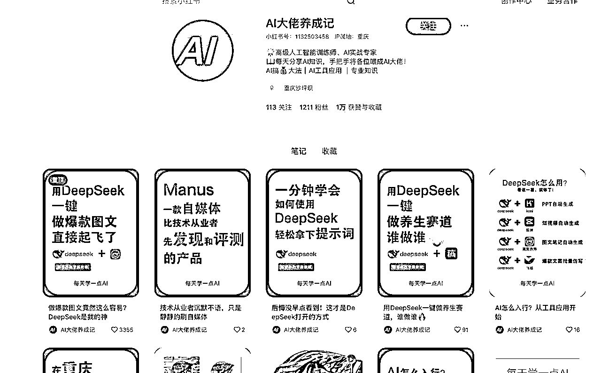

# 4.1.2 真正的爆款逻辑藏在两个动作里

💡 爆款不是写出来的，是用户用点击、点赞、收藏这些行为标出来的一张需求地图。

逆向拆解：拆 100 篇同赛道爆文，提取三组信号——高频词＝痛点，用户最在意什么？高赞点＝爽点，用户愿意为什么按下赞？高收藏＝痒点，用户最想存下来的是什么？摸清这些，就找到了需求的“最大公约数”，把它当作创作的起点。案例：做 AI 内容时发现“ChatGPT 入门教程”反复爆，就可以顺着延展，如《ChatGPT 入门：10 个实用场景》。
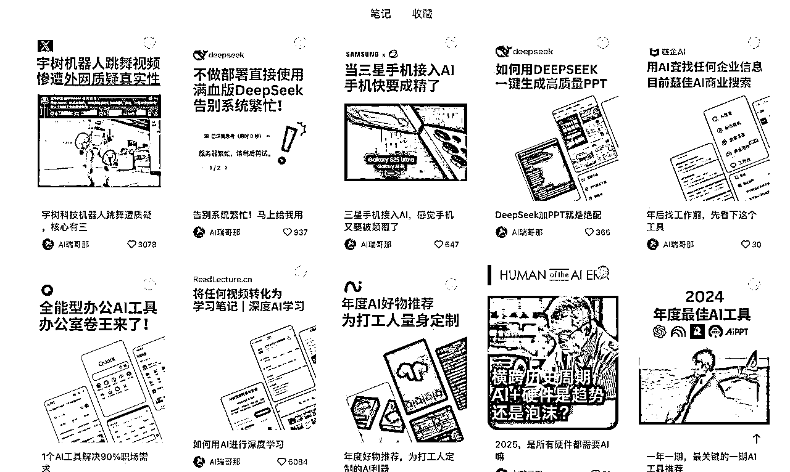
工业化生产：把验证过的选题、结构、关键词做成可复用的标准模板，像流水线造手机那样稳定出货——选题模板：依爆款规律建可复用的题池；结构模板：总结通用骨架，比如痛点＋方案＋行动引导；关键词模板：把标题与正文里的高频词提炼出来直接用。标准化能压低创作成本，抬高爆款概率。案例：发现“AI 工具测评”是高爆类型，就设计一套测评模板：a 工具介绍，简述功能；b 使用场景，列出适用范围；c 优缺点分析，归纳长短；d 使用建议，给出操作办法。

小结：爆款不是关起门来写出来的，而是用户行为数据标出的需求地图。先做考古学家——挖出爆款背后的共性，找到需求的最大公约数；再做工程师——用标准化方式批量产出，像流水线一样稳定出货。这才是内容变现的终极法则。

# 4.1.3 用 4 个标准筛选对标笔记

细看之下会发现，这些笔记恰好踩中爆款笔记的四大核心特征：

# 4.1.3.1 选题：热度已经跑通

这个方向的笔记本身就很吃香，市面上能找出不少跑出成绩的例子。

看多了会发现，爆款在选题、封面图、版式和标题上常走同一套视觉语言，反复出现后辨识度非常强。

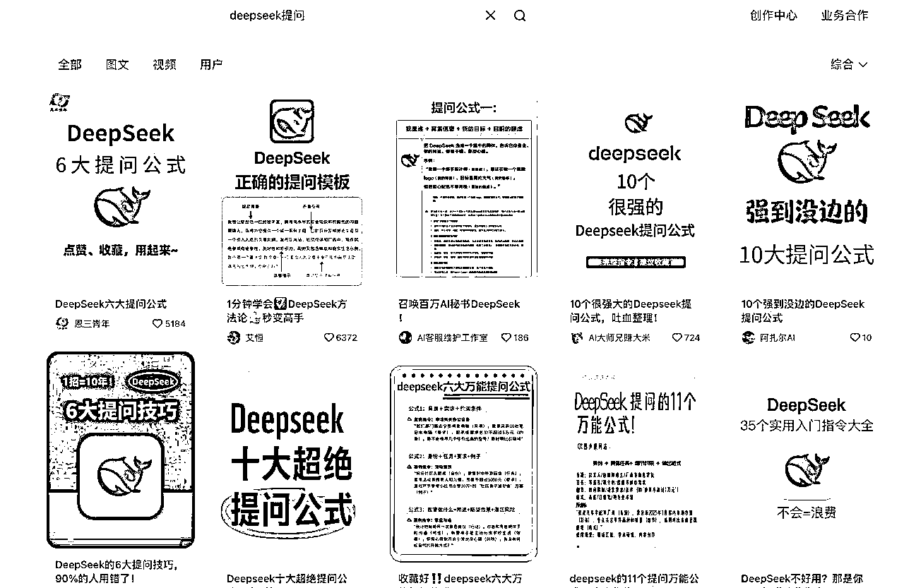

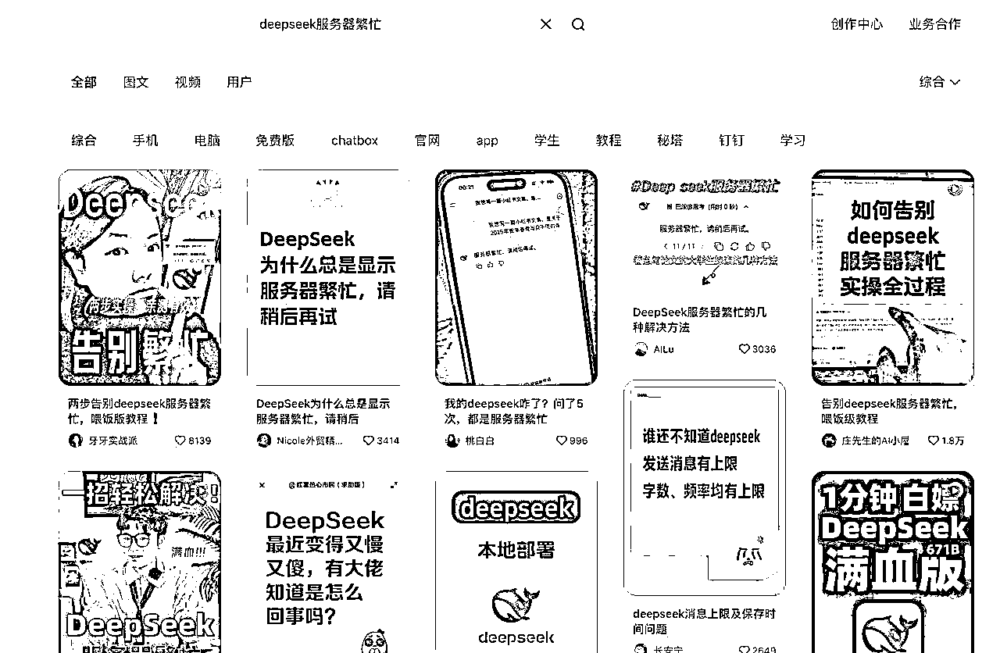

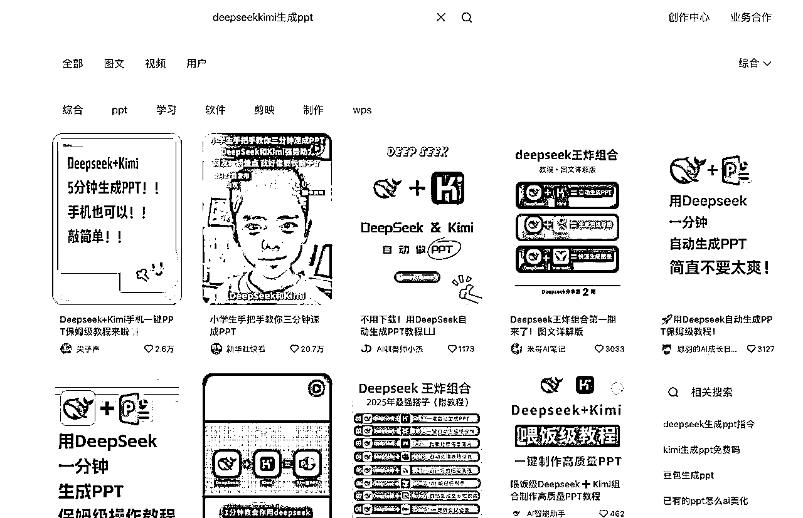

# 4.1.3.2 封面：统一风格好复制

做得好的参考账号，在封面版式、关键词摆放、标题气质和正文主体上往往很接近，后来者照着拆解会省力很多。

封面风格统一，上手门槛就低，爆款也更容易被复刻。

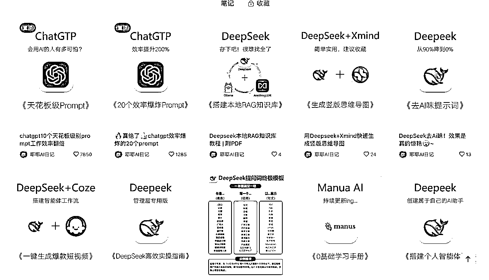

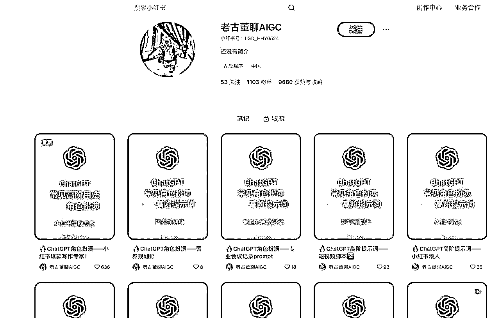

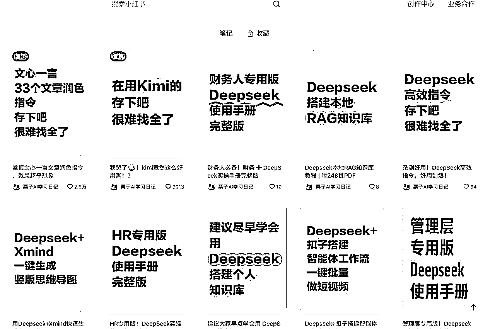

# 4.1.3.3 数据：点赞量很能打

数据最能说明问题：起步基本是千赞，万赞爆款也不稀奇。

整体成绩漂亮，很多内容拿到几千甚至几万赞，用户买账的程度一目了然。

# 4.1.3.4 时效：还在热乎期

翻看发布时间，多数是近十二个月内上线的，热度和新鲜度都还在。

比如最近 deep seek 相关话题，就是一个很明显的热点。

# 4.1.4 对标账号：先筛后拆

确定参考对象后，下一步就是分析账号。先挑 10 到 20 个同赛道账号，看流量走势和数据表现，把成绩更突出的留下当样本。

然后从这些角度拆：

账号画像：定位是什么？IP 有什么气质？治愈型、励志型还是实用型？

封面：色调、版式、字体分别怎么走？

选题：常做哪些类型？哪类更容易爆？

文案：偏情感路线还是干货路线？

标题：靠什么勾点击？常用词有哪些？

标签：习惯用哪些标签扩大曝光？

案例拆解 1：艾恒

1. 账号画像与 IP 气质

定位：走实操技能路线，内容围绕 AI 工具怎么用、怎么出教程，重点覆盖 KimiChat、文心一言、ChatGPT 等工具的 Prompt（也就是指令）与模板。

IP 气质：

专业者形象：“艾恒”可以理解为真实或虚拟的 KOL，主要做 AI 工具的实操教学。

受众画像：对 AI 工具有兴趣、想借工具提升写作、运营、教学效率的人，比如老师、新媒体运营。

表达风格：干脆、偏实操，爱用“保姆级教程”“万能公式”这类说法，让新手觉得门槛低。

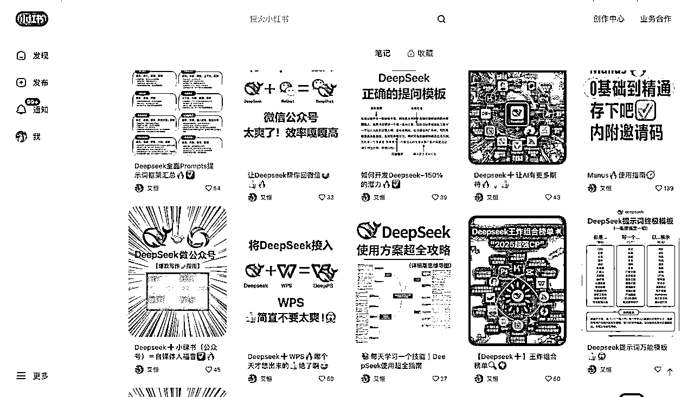

2. 封面设计

色调：从标题和内容推断，封面大概率走强对比，比如深色底配亮色字，技术感和实用性都突出。

排版：

标题短而清楚，数字和关键词用得多，像“130 个”“50 个”“3 步”这种，引导用户点开。

也可能把操作步骤截图拼起来，再用箭头标重点，教程味更浓。

字体：倾向科技感明显的无衬线字体，点缀✨💡一类小图标。

3. 选题方向与爆款内容

高流量内容：

AI 工具指令模板：例如“KimiChat 提问标准公式”“文心一言教案指令模板”，直接解决痛点，实用性强。

写作与运营技巧：例如“写作公式”“新媒体运营高级指令”，吸引想提升技能的人。

变现与赚钱案例：例如“96 年生、28 岁转进 AI 赛道并赚到钱”这类故事，用成功案例吸睛。

爆款共性：

实用价值强：直接给可操作模板或公式，降低学习成本。

会借热点：结合 AI 工具的新功能（如 KimiChat、文心一言）做内容。

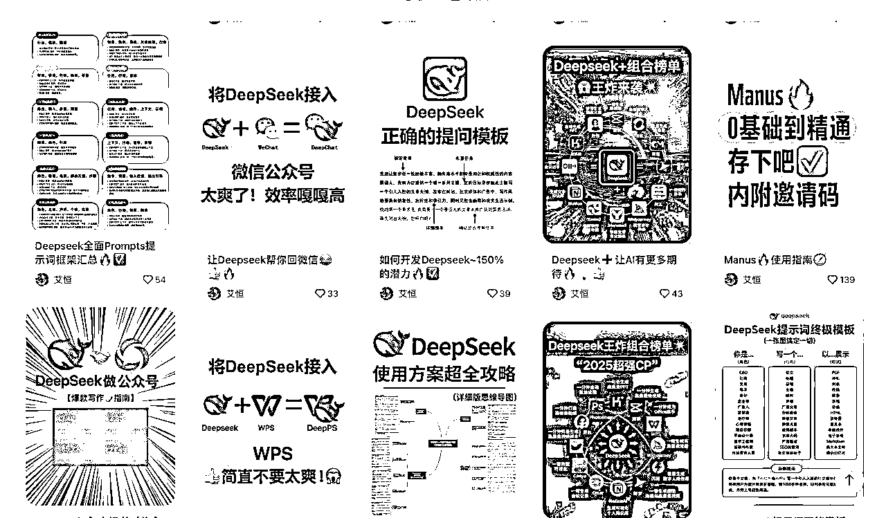

4. 文案风格

偏干货：

句子短、信息直接，数字和效果承诺常见，比如“好用哭了！”“万能公式”。

结构清楚，像“3 步仿写头条号”“44 个官方指令”，用户一眼能懂。

情感共鸣：

用“保姆级教程”“需要写教案的姐妹进”等说法，拉近和粉丝的距离。

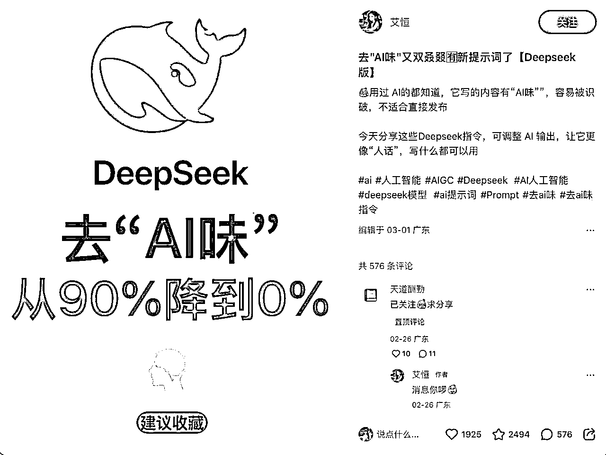

5. 标题技巧

关键词组合：

数字打头：“130 个超实用 Prompt”“50 个新媒体运营高级指令”。

给结果承诺：“万能公式”“好用哭了！”。

用问句勾人：“需要写教案的姐妹进！”。

平台适配：

标题短，适合📕、抖音这种快读场景。

适当加✨💡等表情，增强吸引力。

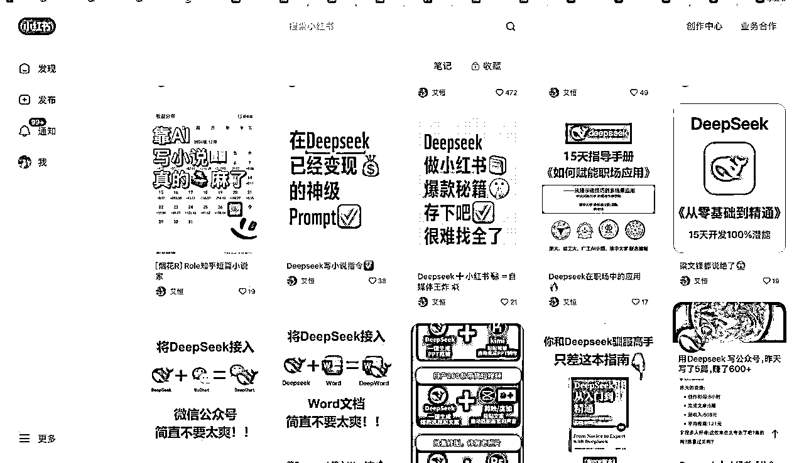

6. 标签使用

通用类：

#AI 工具 #KimiChat #ChatGPT #文心一言 #Prompt 教程。

垂直类：

#写作技巧 #新媒体运营 #教师教案 #AI 变现。

平台热点类：如#📕创作学院 #知识分享。

# 4.2 从 0 到 1 做内容：先解决封面和标题

# 4.2.1 封面：第一眼就决定成败

不管你做📕、B 站，还是抖音、视频号，封面都是流量入口。

用户划到你，往往只用一瞬判断要不要点、要不要关注。封面不行，内容再扎实也可能被划走；封面抓人，点击和关注会自己找上门。

想快速做出有点击欲的封面，两步走：

第一步，先扒爆款，挑那种让你手指停住的封面（后面会给「24 类常见封面图」，选 1 到 2 个顺眼的）。

第二步，别纠结，直接仿，拿自己的素材套近似风格，先跑出结果。

如果设计细胞确实为零，也别硬扛，去淘宝花几十块请设计师做张底板，之后用 PS 替换文字即可。

这钱花得值。

# 4.2.1.1 24 类常见封面图：各赛道都能借

这里没有只盯着 AI 博主，而是把不同领域的好封面都过了一遍。好看的封面不分赛道，其他领域的好内容同样值得参考。下面进入正题。

# 第 1 种：放大型

把重点元素放大，第一眼落点更明确。

# 第 2 种：制造视觉冲击型

用夸张、吸睛、反常、有表现力的画面抢注意力。

# 第 3 种：色彩对比型

靠撞色突出重点，制造反差。

# 第 4 种：色彩饱和度型

高饱和颜色，对比强、颜色醒目。

荧光色大面积铺开 防失联：李李 MM188166M，持续更新

用高饱和字把部分重点顶出来

# 第 5 种：增加色块型

用色块托出有价值感的文字

# 第 6 种：留白型

留白突出重点，制造呼吸感

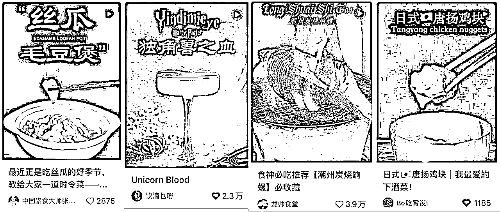

# 第 7 种：实拍型

真实拍摄，代入感强 防失联：李李 MM188166M，持续更新

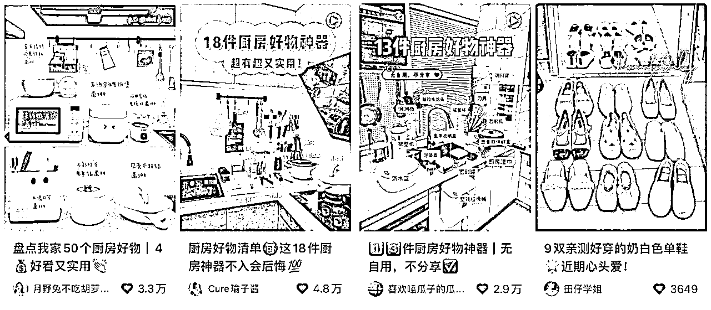

# 第 8 种：人物型

人物聚焦视线，表现力更强

# 第 9 种：重复排列型

同场景不同内容按规律排，秩序感强 防失联：李李 MM188166M，持续更新

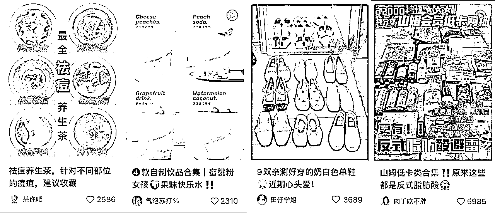

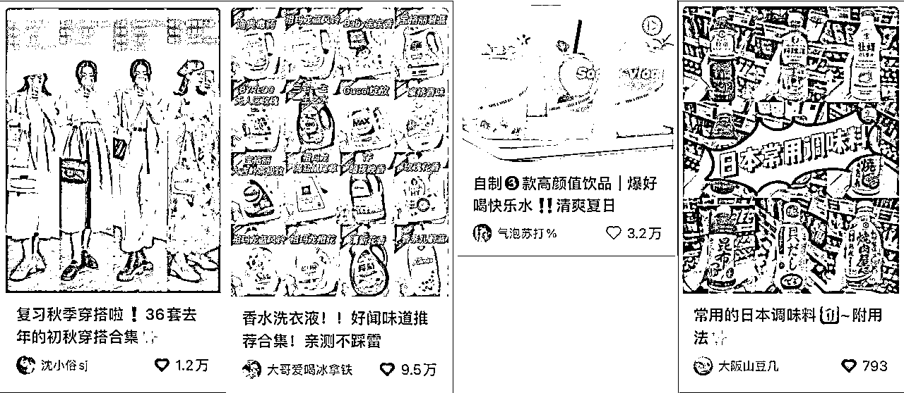

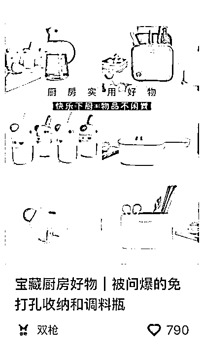

# 第 10 种：利用数字型

数字自带价值感，容易抓眼，也能制造反差和悬念

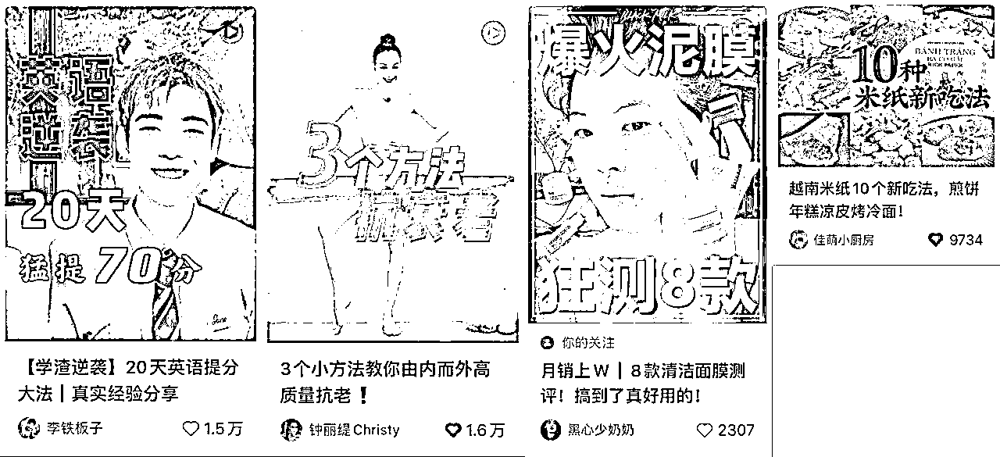

# 第 11 种：中心构图型

文字、人物或产品主体放画面正中，视觉焦点更准、更聚焦

# 第 12 种：顶部/底部排版型

文字排在图片上方或下方。

tips：拍照时先想好文字区，留干净空白，别把重要信息放那儿

# 第 13 种：对角线三分构图型

画面三等分（相机设置里打开构图网格），重要主体或文字放对角线焦点

# 第 14 种：上下对称构图型

文字上下对称，人物或产品主体在画面中心

# 第 15 种：Z 字型构图型

顺着人眼从上到下、从左到右的阅读习惯，文字多的内容适合

# 第 16 种：对齐排版型

文字左对齐或右对齐，规律感强，画面内容多也不乱，视觉动线清楚

# 第 17 种：左右对称构图型

文字左右对称，或文字与主体形成左右对称

# 第 18 种：上下对比构图型

适合前后效果对比、成果展示，信息丰富，视觉直观

# 第 19 种：左右对比构图型

对比更紧凑直观，适合竖长主体（人物穿搭、发型等）横版展示不全的情况

# 第 20 种：四角构图型

重点文字或元素放四角，视觉张力和重点更突出

# 第 21 种：字体型

用字体营造风格和氛围。

下面是相同排版、不同字体的几张图。

同样版式只换字体，能体会出差别吗？

*时尚类内容（美妆、穿搭、颜值等）适合雅宋、粗黑这类时尚感强的字体
*活泼轻松的内容适合粗体花字，风格感更强
*中式字体、手写字体风格属性强，要结合账号整体调性来选

封面字体统一，也能帮账号建立整体气质

# 第 22 种：文字遮挡环绕型

文字和主题交织，代入感更强

# 第 23 种：上下分屏型

信息量更丰富，但文字排版不能乱，否则重点很难突出 防失联：李李 MM188166M，持续更新

# 第 24 种：画中画型

把素材图作为画中画加到实拍图上，内容更直观、讲解更清楚。

画中画和实拍图可以上下、左右排，但别无规律添加，否则画面太乱，重点抓不住

# 4.2.1.2 封面工具：两个够用

推荐两个：可画 https://www.canva.cn；创可贴 https://www.chuangkit.com/。

两者都能帮你较快做出高质量封面。防失联：李李 MM188166M，持续更新

打开工具后先定风格，比如简约、科技感或活泼，可搜“科技感封面”“AI 工具封面”等关键词找模板。

没有满意的，就从空白页自由发挥。

选模板时尽量统一风格：账号偏科技，就选深蓝或其他科技感配色；内容偏艺术，可用渐变或更有艺术感的设计。

模板定了，再加核心元素。标题要短而明确，突出价值，比如“用 AI 工具提升效率，3 分钟搞定一天工作！”这类表达。

图片可用 AI 生成的高清图，或工具自带的科技感图标。

为强化个人 IP 辨识度，封面底部可放固定 Slogan，比如“每天分享一个 AI 神器，提升你的效率！”，左上角放头像或品牌 Logo，进一步加深印象。

这位博主每次封面都用专属紫色强调重点。

最后调细节：字体、颜色、布局。

字体选清晰易读的，科技内容可用 Roboto，艺术类可用 Poppins，标题加粗突出；颜色上主色调与主题匹配，科技用蓝色系，艺术用渐变；布局上标题一般放中间，图片约占三分之二，底部放 Slogan 和头像或 Logo。

做完这些，高质量、有风格的 AI 内容封面就出来了。还是那句话：自己设计太吃力，就找设计帮忙——封面太重要了。

# 4.2.2 标题：从 0 到 1 勾住点击

在 AI 领域做内容，标题可以借人性里的贪、怕、懒、图省事来拉点击和互动。下面列几个亲测有效的招。

# 4.2.2.1 贪：把欲望放大，让选题显得更强

# 方法一：借权威背书

你刷抖音或看👸号时会发现，用户并不是把整条标题读完才决定点不点。

大多数时候，眼睛只扫 1 到 2 个「视觉词」。比如一类标题把大人物放在开头：马斯克、哈佛教授、OpenAI 的 Sam Altman，后面接工具、学习法、趋势。用户第一眼抓住的，往往就是前面那个权威名字。

像“马斯克看好的 5 款 AI 工具，效率能翻三倍”“哈佛教授传授的 AI 学习法，机器学习入门更快”“OpenAI 掌门人 Sam Altman 判断 AI 未来 10 个趋势，打工人得看”——第一眼真正落进眼里的，其实就是“马斯克”“哈佛教授”“OpenAI CEO”这些背书词。

# 标题放准这几类词，打开率会自己往上走

做 AI 内容，有几类词天然抓眼球：行业里的大人物、顶尖院校、头部公司、热门事件。怎么把它们自然地嵌进标题？先把下面这份“熟脸清单”收好，以后选题时直接翻出来套用。

**1. 行业大人物**

| 名字 | 所在阵营 | 可记的点 |
|---|---|---|
| 埃隆 · 马斯克 | 特斯拉、SpaceX 与 xAI 的负责人 | 他给出的时间表是：最快 2026 年，机器智力可能超过人类；同时押注脑机接口和自动驾驶 |
| 黄仁勋 | 掌舵英伟达 | 带起算力芯片浪潮，提出“物理 AI”想法，并放话十年内把计算能力扩大百万倍 |
| 山姆 · 奥特曼 | OpenAI 掌门 | 带队做出 GPT 家族，判断中国会走独有的大模型路线，全球最后可能只留下十到二十个核心模型 |
| 米拉 · 穆拉蒂 | OpenAI 技术负责人 | 推动 ChatGPT、DALL·E 等应用走进日常，并预言“博士级智能”几年内会出现 |
| 桑达尔 · 皮查伊 | 谷歌 CEO | 把智能技术织进搜索和自动驾驶，主张在 AI 回答里嵌入外部链接来平衡体验 |
| 李彦宏 | 百度一把手 | 打通 AI 上下游，Apollo 自动驾驶平台落地，被称为中国 AI 的启蒙人物 |
| 周鸿祎 | 360 创始人 | 断言 2024 年是模型落地的场景大年，面向消费者的爆款应用会成批出现 |
| 萨蒂亚 · 纳德拉 | 微软 CEO | 操盘 Azure 与 OpenAI 合作，推动 Copilot 等工具商业化 |
| 苏姿丰 | AMD CEO | 在高性能 AI 芯片上取得突破，支撑自动驾驶、医疗等场景的算力需求 |
| 戴密斯 · 哈萨比斯 | DeepMind CEO | 用 AlphaFold 破解蛋白质折叠难题，判断十年内能看到通用人工智能（AGI） |
| 徐立 | 商汤科技 CEO | 认为垂直行业要沉淀“高阶思维逻辑数据”，走差异化竞争路线 |
| 杨植麟 | 月之暗面创始人 | 研究 AGI 协作方式，看好 Sora 一类技术把数字世界与真实世界连起来 |
| 扎克 · 伯格 | Meta CEO | 把 LLaMA 等模型开源，带社区一起做安全技术 |
| 阙志克 | 台达研究院院长 | 牵头能源与 AI 的交叉研究，推进工业智能化 |
| 杰夫 · 贝索斯 | 亚马逊创始人 | 认为 AI 能帮人类规避灭绝风险，并用 AWS 为 AI 开发铺路 |

**2. 顶尖院校**

| 院校 | 可打的强项标签 |
|---|---|
| 斯坦福大学 | 机器视觉、自然语言理解 |
| 麻省理工（MIT） | 机器学习、机器人技术 |
| 加州大学伯克利分校 | 深度神经网络、自动驾驶 |
| 卡内基梅隆大学 | 人机交互、AI 伦理 |
| 清华大学 | 算法原理、交叉信息科学 |
| 牛津大学 | 医疗 AI、伦理研究 |
| 剑桥大学 | 生物 AI，与 DeepMind 有合作 |
| 多伦多大学 | 深度学习理论，由 Hinton 领衔的团队坐镇 |
| 苏黎世联邦理工（ETH） | 机器人、自主系统 |
| 俄勒冈州立大学 | 电子工程，黄仁勋的母校 |
| 香港科技大学 | 金融 AI、跨领域应用 |

**3. 头部公司**

| 企业 | 主打方向 |
|---|---|
| 英伟达（NVIDIA） | AI 芯片、算力平台 |
| OpenAI | GPT 家族、DALL·E、Sora 等模型 |
| 谷歌（Google） | 搜索 AI，旗下有 DeepMind、TensorFlow |
| 微软（Microsoft） | Azure、Copilot |
| 百度 | 自动驾驶、文心大模型 |
| Meta | 开源 LLaMA、元宇宙 |
| 特斯拉（Tesla） | 自动驾驶、Optimus 机器人 |
| 商汤科技 | 计算机视觉、智慧城市 |
| 亚马逊（Amazon） | AWS、Alexa |
| 苹果（Apple） | Siri、端侧 AI 芯片 |
| 月之暗面 | 长文本大模型 Kimi |
| 智谱 AI | 通用大模型 GLM |
| AMD | AI 计算芯片 |
| 台达电子 | 工业 AI、能源管理 |

不想自己拼词？把选题交给联网版 DeepSeek 就行。举个例子，假设你要做一期“可灵接上 DeepSeek，做 AI 视频告别写提示词”的内容，先把下面这段要求发给它：

它会返回类似这些标题：

友情提醒：DeepSeek 偶尔会“编”，标题里出现的名词要回到事实里核一遍，确认有出处再拿去用。指令可以照下面这段改：

“我想做一期『【填入你的选题】』的内容，希望把行业大人物、顶尖院校、头部企业、热点事件这类‘有认知度’的词放进标题，借此抬高打开率。这些词得是大众常刷到的热搜、平台热词，别太冷门。麻烦帮我检索，并给出十个标题方向，要求短、有劲、能勾人，可参考虎嗅、36 氪的👸号风格，带点情绪（类似咪蒙那种）更好。”

权威词只是第一招。第二招，是让读者觉得“学一次就够，往后不用再折腾”，戳中“想省事、想全都要”的贪念，点击自然往上走。

# 方法二：一揽子解决法

底层思路：让读者认定某个工具或办法能一次性覆盖他的主要诉求，命中“贪全图省”的心态。适合讲工具用法、技巧时用。比如：

《写文案这件事，ChatGPT 一套流程全接住》
《想学 AI 绘图？Midjourney 入门这一篇就够》
《Notion AI：笔记、待办、项目，一个入口全管》

套公式不复杂：某工具＋超出预期的结果。比如“某工具一天写出三十条短视频脚本”“某工具上手，三秒清掉一周的活儿”。

# 方法三：对比碾压法

这种“VS”型内容，大家应该刷到过不少吧？

对比既能帮你找选题，拿来起标题也很顺手。底层是用强弱、快慢、高下的反差，让读者生出“还想要更多”的念头。适合比较不同工具或思路。比如：

《ChatGPT 和 Notion AI 写文案，谁更顺手》
《比传统设计快太多：Midjourney 出图效率惊人》
《AI 写作 对 人工写作：速度快十倍，成品更抓眼》

# 方法四：数据证明法

标题里放数字，天然占便宜。📕清单体早期能火，靠的就是数字、干货、利益点三件套，结构一眼看明白，获得感立刻拉满。底层是用数据或结果自证有效，满足读者对“结果”的贪。适合展示工具成效或案例。比如：

《三分钟产出一篇稿，效率翻了三倍》
《换上 Midjourney 做图，点击率涨了五成》
《靠 ChatGPT 运营种草号，三周新增关注五千+》

# 方法五：情绪浓度

标题里直接放情绪词，也很能抓人。比如夸张到极致的表达、暗示值得收藏的说法、催促读者立刻行动的词、借网络热梗造梗、给出封神级评价。底层是用形容词把内容的“强”顶到读者眼前，满足对“强”的贪。适合介绍工具或方法。比如：

《ChatGPT：写作圈公认的硬核选手》
《五个顶配 AI 工具，产出速度翻一倍》
《Midjourney 出手，封面自带高点击相》

情绪词库在这儿👉情绪词清单

# 4.2.2.2 恐惧：拿捏怕出错、怕掉队、怕错过的心理

不少人都有一种“错失焦虑”：朋友圈、🧣里别人聊得热火朝天，自己却插不上话，立刻会发慌，担心被落在圈外。有研究提过，全球超过一半的人都有这层焦虑，手机不离身，就怕一不小心成了局外人。商家对此太熟了：限时抢购的读秒、订房页面提示“最后一间”、只对受邀者开放的活动、数量有限的发售，全是冲着这份怕去的。说白了，怕错过既是生活里的焦虑，也是营销常用的手法，起标题时完全能借“恐惧”做文章。下面拆几种。

# 方法一：错误警示法

底层是点出用户可能踩的坑或低效做法，激发恐惧，吸引点击。适合工具技巧、避坑内容。比如：

《AI 工具用岔了，效率会不升反降！这几个雷区别踩》
《方法不对，写作类 AI 基本白搭》
《新手用 Midjourney 常犯五错，出图效果很惨》

说明：列举常见误区，比如描述词写不好，ChatGPT 出稿质量下滑；过度依赖，成品失去个性；关键词写不清，出图直接翻车。

# 方法二：给出解法

指出错误的同时，把正确做法一并交出去。比如：

《绕开雷区，AI 工具出力能翻一倍》

说明：给出具体方案，比如 ChatGPT 的描述词该怎么设。

# 方法三：竞争紧迫法

底层是强调竞争压力，激发怕掉队的心理。适合最新趋势、高效用法。比如：

《九成人都没听过的隐藏工具，上班族该收好》
《Midjourney 还有这些玩法，行家早就在用》
《ChatGPT 有些功能藏得深，大部分人没试过》

说明：用“九成没听过”“行家在用”“大部分人没试过”制造落后感。

# 方法四：机会稀缺法

底层是强调机会少，激发怕错过。适合限时活动、新工具、行业走向。比如：

《今年五款值得用的 AI 工具，晚了就得再等一年》
《上班族该收藏的工具清单，划走可惜》
《限时盘点！五款工具，产出速度翻倍》

# 4.2.2.3 懒惰：把上手难度压到最低，主打省事

工具能力再强，一复杂就劝退人。抓住“懒惰”，突出简单易用，是拉点击的关键。用“一揽子方案”“拆小步”“新手友好”压低学习门槛，让用户很快看到成果，兴趣和参与度自然就上来了。下面分开讲。

# 方法一：一揽子方案

底层是突出一个办法或工具能解决核心问题，满足懒惰。适合工具用法、技巧。比如：

《ChatGPT 写稿：一套流程把需求全接住》
《Midjourney 入门：把 AI 绘图一次讲清》
《Notion AI：待办、日程、项目，一个入口全收》

# 方法二：几步搞定法

底层是用简单步骤降低心理负担，吸引点击。适合工具教程。比如：

《四个动作，做出高点击封面》
说明：挑模板→写描述词→生成→下载。

《三分钟学会：用 ChatGPT 写出勾人标题》
《五步搞定 AI 绘图，新手也能上手》

# 方法三：新手友好法

底层是突出适合新手、零基础，降低门槛。适合入门教程。比如：

《零基础学 AI 绘图：Midjourney 入门指引》
《新手可收：ChatGPT 写稿的三个小窍门》
《从零到熟练，七天足够》

# 4.2.3 从 0 到 1 做内容

# 4.2.3.1 笔记正文怎么搭

这里讲的是📕图文笔记的正文写法，👸号、即刻、朋友圈也能套。框架是：先让读者有代入感 → 再勾起兴趣 → 接着给操作 → 然后晒结果 → 最后促互动。

① 先让读者有代入感：开头写真实烦恼，一下子拉近距离。例：“对着空白文档磨了几个钟头，还是没一句满意，焦虑到失眠”“封面折腾一整天，依旧没人点，感觉白忙”。

② 再勾起兴趣：告诉读者你挖到了什么好东西，能快速解困。例：“再后来发现一款工具，写稿忽然就顺了”“换了个 AI 小工具，封面三分钟做完，比我手工做的好看太多”。

③ 接着给操作：步骤写清楚，突出省事。例：“打开 ChatGPT，填主题，点一下生成，再顺手润两句，五分钟交稿”“用 Midjourney 做封面，丢几个描述词就自动出图，不满意继续调，省心”。

④ 然后晒结果：给真实结果，建立信任。例：“现在每天三篇稿子轻松完成，产出效率翻倍”“换了 AI 封面后，点击率涨了一倍”。

⑤ 最后促互动：结尾请大家评论、收藏或转发，把互动续上。

⑤ 收尾留钩子：让读者愿意动手、留言、关注

文章结尾别急着收笔，给读者留一个能参与的口子：邀请对方亲自试一遍你给的方法，再顺手留言或关注账号，互动率往往能往上走一截。

可以这样写：

“不妨今天就动手试一次，回头把结果说给我听听！”防失联+MM188166M（李李）长期更新

“要是这招对你有帮助，顺手关注一下，之后我还会继续更新更多好用的招数。”

案例拆解一：让AI帮你写书评

接下来拿一篇笔记当样本，一起看看门道。

该博主漏掉了“把结果亮出来”这一步；若补上，这条笔记其实很适合转成视频。

案例拆解二：绘画类AI工具

案例拆解三：效率类AI工具

开场先戳痛点：
“天天被任务追着跑，效率低到让人喘不上气！”

紧接着给盼头：
“别慌，今天借Notion AI帮你把效率提起来，一天多挤出两小时！”

方案部分：
“借助Notion AI管任务，分三步走：
a. 先拉任务清单，把事项和截止时间填进去。
b. 让它按截止日期自动定优先级。
c. 进度随时可查，打开就能看到完成到哪一步。”

收尾：
“现在就去体验一下Notion AI，顺手在评论区说说好不好用！关注我，后面继续聊效率提升的干货。”

# 💡 套路提炼

1. 拆段讲：一段只承担一个核心信息，别让读者一次吃太多。
2. 加小标题：把内容切成若干块，读者想找哪块一眼就能看到。
3. 接得顺：段与段之间用过渡句搭桥，读起来不磕绊。

完整链路可概括为：先让人共鸣，再勾起好奇，接着给方案，然后亮效果，最后引导互动；这五块不必每篇都凑齐，按内容需要灵活取用。

# 4.2.3.2 拍一条视频的全过程复盘（@汤姆CC）

起步期（2024年7月）

去年我认定AI是股大风口，却迟迟找不到落脚点。后来干脆决定先拍视频：就算做不成，也能借这个过程多学点AI本事——这正是“费曼学习法”的思路，靠输出逼自己输入。一路摸索下来，经验攒了些，坑也没少踩；这些东西与其捂着，不如摊开讲，让别人少绕几个弯。

我的AI号最早建于2024年7月28日，当天就发了第一条作品。那时还没进赚钱，纯靠自己乱试，主要靠模仿，定位、选题、封面这些一概不懂。如今回看那些内容，自己都觉得好笑。当时只觉得“能做”，凭一股冲劲就发了。撑了一周毫无动静，开学后时间更紧，收益也看不见，便渐渐停了。

转折点（2024年10月）

10月15日，龙哥老大放出首个超级标，我再次确信AI机会很大。当时进赚钱一个多月，摸到一些账号做法，便开始大量搜罗赚钱和网上的自媒体经验帖，研究选题怎么定、封面怎么做出爆款感。粉丝一点点破千。期间试过不少路子，包括模仿“赛文乔伊”用手机拍，但都没成。

临近期末，账号又搁置了一阵。不过我没停止琢磨AI内容创作，转而逐帧拆解喜欢的博主剪辑风格，细到像素级，还做了笔记。寒假时，我把学来的个性化背景设计和剪辑手法全用上，数据依旧不起眼。

爆发点（2025年春节）

年前我发过一条DeepSeek内容，当时没激起水花。没想到除夕当天，📕突然起量。我意识到DeepSeek值得押注，于是连夜赶剪了一期本地部署教程，初二发布后爆了。

春节走亲戚时，我背着电脑谎称写作业，实则抽空更新DeepSeek内容。流量一直稳，我不敢停，日更一条，涨了2000粉。后来全网都在聊“怎么让DeepSeek用得顺”，我过年也发了不少此类内容，但同行蜂拥而入，赛道迅速变红。我换角度观察，发现讲“DeepSeek具体怎么用”的人不多，于是转向具体使用技巧，做真正有料的东西。后来跑出一个千万播放、三个百万播放。

进赚钱之前的旧作品

10月15日老大超级标下我的评论

进赚钱之后的各种尝试

回看自己，不过是个没经验的普通大学生，靠半年在赚钱和网上各类资料里泡着，做出了一点小成绩。所以我觉得谁都值得一试，这行门槛真不算高。若你在AI内容赛道上卡住了，别轻易退场：留在牌桌上，持续打磨内容，爆发可能就在某个时刻。

# ① 先定账号方向

做账号，第一要紧的是定准位置。怎样把自身长处和账号方向拧到一起？

我的思路来自七天姐教的办法：把AI当成思考外脑。可以对它下指令：“假设你是龙哥盟的龙哥，帮我给AI内容号做定位。”

接着列出10个身份标签，标签背后对应的人，就是将来可能为你的产品或服务买单的群体。归根结底，定位要回答三件事：服务谁、给什么、收多少。

AI会依照你的身份给方案，但最终得自己把关，判断靠不靠谱。

# ② 门面布置与诱饵设计

账号门面主要抓三样：名字、头像、简介。

名字：最好嵌入“AI”字样。

头像：到“即梦”App的灵感库里翻合适的图，借提示词自行调整，尽量让头像和名字相互呼应。

简介：看同行怎么写，再融进自己的特点，同时埋个“诱饵”，例如“领资料@小号”。

诱饵可用DeepSeek资料包，也能放自己攒的工具箱。

为了不拖累主号，可在粉丝群公告里写清楚：资料和工具到主页取。随后在主页@小号，由小号把人引到👸号。为何落点选👸号？一是以后能开流量主；二是人一多🛰️好友加不过来，粉丝会流走，👸号则能兜住一部分。

# ③ 选题怎么找

选题几乎决定一条视频的流量上限。好选题从哪来，又怎样持续产出？办法是：盯住对标，搭自己的选题库。

选题来源：

（1）凭网感：多刷视频和帖子。在抖音、📕、👸号搜“AI应用”“绘画软件”等词，按最近一周筛。火过的题很可能再火，可借它做底，再掺入自己的特色与新角度；纯洗稿则不建议。

（2）靠数据：用分析平台。免费的有“算数指数-巨量算数”，填入AI关键词，筛选低粉却爆的视频。

付费工具如蝉妈妈、灰豚等，能更快定位对标账号。可到某鱼搜“日卡”“周卡”，花费不高。

# 💡 几个值得盯的信息源：

X：DeepSeek最早在外网起势，而且不止一次验证过，X上炸开的内容，国内大概率也会跟热。

即刻：“AI发现版块”里几乎全是AI相关内容，不少用户本身就是X上的大V，质量在线。

龙哥盟：能进赚钱，已经在认知上跑赢全国90%的人。风向标里都是圈友筛过的关键AI情报，中标的风向标尤其值钱。

锁定对标账号后，搭自己的对标库，可照下面几个维度记：
- 基础面：粉丝量、作品总数、人设、更新节奏
- 内容面：主攻领域、类型配比、选题走向、标题风格、封面调性
- 爆款面：平均点赞、爆款题材、爆款标题特征、爆款结构
- 变现面：卖课、接广、咨询、其他进项
- 运营面：互动玩法、社群维护、话题营销、涨粉手段、导流路径
- 特色面：讲解风格、独有长处

# 💡 两个顺手技巧：

1. 好内容和灵感随手存。刷到有价值的视频、帖子或点子，建个🛰️面对面群当选题灵感仓，把有用的东西顺手扔进去。
2. 每周至少翻一次对标库。周末从中挑题，把下周方向定下来，之后每天照单执行；若临时有热点，就把备好的内容顺延。

# ④ 文案怎么磨

选题定了，可以拿AI做脑暴。我通常先把自己的思路丢过去，让它看有没有更优方向，再请它润色表达。

开头三秒必须抓人，否则用户直接划走；内容还得有真价值，别人才肯点赞、转发。

标题库按类型整理如下：
- 技能速成型：“一晚上搞定Midjourney，小白必学的3个赚钱技巧”——卖点在速成和赚钱，触动焦虑与机会感，适合AI绘图教程。
- 效率工具型：“cursor帮我写代码，效率提升10倍的秘密”——卖点是效率和省时，触动好奇与惊喜，适合编程类AI应用。
- 创业机会型：“月入10万的AI兼职项目，我只用了这3个工具”——卖点是收入和机会，触动渴望与希望，适合创业类AI分享。
- 难题破解型：“一键解决AI模型训练难题，小白都能看懂”——卖点是简单、能解决，触动困扰与释放，适合技术教程。
- 趋势洞察型：“未来5年最赚钱的AI相关职位，第一名意想不到”——卖点是前瞻和洞察，触动危机感与期待，适合行业分析。

正文开场可这样写：
- 故事开场：“上周我借AI定了个决定，彻底改变了我的生活……”互动率高，靠好奇心拉人，容易共鸣。
- 提问开场：“你有没有为学AI烦恼过？今天我要分享……”互动率中高，直戳痛点，让用户觉得被理解。
- 数据开场：“最新数据：72%的AI学习者都在走弯路……”互动率高，借权威感和焦虑感。
- 反打开场：“别再盲目学AI了，我要说一个真相……”互动率极高，用反常识制造冲击。

互动引导句（注意：部分平台不让引导互动，这套更适合B站）：
- 评论区：“你最想学哪类AI本领？评论区告诉我”——用轻问答拉参与感。
- 点赞：“点赞收藏，避免错过最新AI实操教程”——点明价值，制造“怕错过”心理。
- 分享：“转发给需要的朋友，一起学AI本领”——借社交传播和助人心理。
- 私信：“想要详细学习资料，私信‘AI’领取”——用福利勾人，抓住占便宜心理。

收尾句：
- 悬念式：“下期将分享更劲爆的AI变现方法……”完播率高，目标指向关注，制造期待。
- 总结式：“掌握这3点，AI学习不再迷茫……”完播率中高，目标指向实践，给读者成就感。
- 互动式：“你还想学什么AI本领？评论告诉我”——完播率中等，目标指向互动，让读者感到被重视。

爆款要素拆解：
- 标题吸睛度：五星重要，靠紧迫感促转化，优化方向是突出数字。
- 开场共鸣：四星重要，用认同感提转化，优化方向是补场景感。
- 内容价值：五星重要，用获得感带转化，优化方向是具体可落地。
- 情绪触发：四星重要，用共鸣感促转化，优化方向是强化代入。
- 行动号召：四星重要，用行动感驱动转化，优化方向是指令清晰。

# ⑤ 素材录制

电脑录屏用OBS。若觉得画面不够清晰，可搜“OBS高清录制教程”。OBS不能直接截屏，参数得手动调。

声音克隆可用海螺语音，主打“让文字栩栩如‘声’”。海螺AI国际版眼下免费，既能克隆自己的声音，也能克隆他人声音。之前风向标里中过标的一个账号，就是靠克隆别人嗓音起号，听起来相当自然。注意：需🪜。

打开海螺AI官网，用Google账号登录，在首页点Audio。

进Voices后点“Create your voice Clone”，传几秒清晰音频，克隆效果才更逼真。

回到“Text to Speech”，填入要配音的文字，选自己的声音模型，点“Generate Speech”，等几分钟即可生成。

# ⑥ 后期剪辑

新手初剪一般都不够顺，得持续打磨，同时借鉴对标账号的剪法。看到中意的画面效果，就去搜教程拆解。比如画面里一条线缓缓滑出，我就到B站搜“文章划线效果”，把这类技巧啃下来。

再聊聊找BGM。想扒某博主的背景音乐，直接拿网易云听歌识曲常常没结果，因为杂音太重。可先下载视频（工具：SnapAny万能视频图片解析下载），导入剪映分离音频，再开“团子AI智能工具箱”，上传音频做人声分离，最后用网易云识曲，命中率会高不少。

# ⑦ 封面制作（防失联+MM188166M（李李）长期更新）

封面工具首推可画，闲鱼几块钱能淘到永久会员，挺值。可画的付费模板质量可以，但得把自己的元素揉进去，比如头像和账号名。

做封面有时要用到软件图标，可用Icon Fetcher | 图标获取器。它既能抓网页图标，也能搜App名，下载后丢进可画就能用。

# ⑧ 发布安排

各平台用户口味不同，别一键全平台同步。要按平台调性挑发布时间，或绕开大V的发布时段。我过去做完就发，有时半夜发，几乎没人看。后来才明白，有些大V专挑半夜发，人家粉丝底子厚，照样有人看；我没粉丝、质量也拼不过，自然吃亏。改成白天发、避开大V时段后，流量好了不少。

发布时标题很关键，可参照前面的标题库。接着是打标签，标签不在多，五个左右精准的就够，有热点就蹭上去。

# 4.2.3.2 数据复盘怎么做？

① 两秒跳出率：前两秒跳出越高，说明开场没抓住人。
优化方向：
- 开场画面：第一帧要有冲击力，可用亮色、动态效果或悬疑感画面。
- 开场话术：用提问、悬念或共情式开场，前三秒亮出核心价值。
- 节奏控制：开场要快、要利落，别慢悠悠铺垫。

② 完播率：反映观众把视频看完的程度，是内容质量的重要标尺。
优化方向：
- 时长是否贴合平台特点和用户习惯。
- 结构是否紧凑，有没有拖沓。
- 关键节点是否埋了悬念，让人愿意看下去。
- 画面与声音是否够专业。

③ 互动数据：涵盖点赞、评论、转发等参与行为。互动量高，说明内容有共鸣点或话题性。
优化方向：
- 设置互动话题或悬念，引导用户开口。
- 视频里安排互动环节。
- 回复高质量评论，带动更多交流。
- 多做容易引发情绪共鸣的内容。

④ 转化效果：衡量视频带来的实际商业价值，比如导流人数。
优化方向：
- 视频主题与转化目标要高度咬合。
- 在合适节点放入转化链接或引导。
- 建清受众画像，给精准人群供内容。
- 靠数据持续优化转化路径。

# 4.3 新手前30天怎么起号

刚踏进AI内容领域的新手，前10天到前30天是黄金窗口。这阶段最关键的是让平台和用户尽快认识你，用内容换来正向互动，为后面成长铺路。

# 4.3.1 什么叫起号阶段

怎样算起号成功？

📕发笔记，不再只有一百来个“小眼睛”，而是稳在1000、2000；抖音发视频，不再卡在300、400播放，而是稳在5000甚至更高；👸号阅读，也不再是100-200，而是稳在1000、2000人……

归根结底，起号成功的标志，是有一批稳定用户愿意为你点赞。

算法现在不仅会分发作品，还能判断谁真的需要它。可一说到起号，许多人的理解就跑偏了。先讲清楚：账号能否站住脚，与作品数量、投入时长并不构成直接因果。有人高频更新很久仍无波澜；也有人只发一两条就被大量看见。根本原因只有一个——能否做出爆款。

那落地怎么排？下面讲。

# 4.3.2 内容安排：先定比例再开干

冷启动阶段，排内容是最优先的事。方向、配比、发布节奏都要提前定，既让用户愿意看，也让系统尽快读懂你是做什么的。

建议的配比：

七成放在解决问题型教学，比如“让 ChatGPT 输出更像真人的提示词”。
两成做热门应用的横向体验，比如“Notion AI 与 ChatGPT 谁更会整理笔记”。
一成借势行业话题，比如“GPT-5 出现后，人类工作会被替代吗”。

常驻栏目可以这样搭：

每日一款 AI 应用推荐：一天介绍一个顺手的工具，并给出上手方法。
AI 提效小招：讲清怎样借助 AI 让工作、学习更省力。
每周行业简报：把一周内 AI 圈的新变化、新趋势汇个总。

发布节奏：

头 10 天，一天一更，先把活跃度拉起来。
接下来到第 30 天，一周 3 到 5 更，重心转向打磨质量。

# 4.3.3 前三条内容：把定位打透

冷启动时，最初三条作品的分量很重。它们既让用户快速知道你是谁，也会影响系统对你账号的第一判断。下面是可套用的思路。

第 1 条：亮身份 + 说定位

目的：让用户和平台都明白你的价值。

示例：防失联+MM188166M（李李）长期更新

标题：《在互联网产品岗摸爬多年，我把提效 AI 工具摸透了》

内容：交代自己的经历、账号要做什么（如“带大家用好 AI 工具”），再预告后面会讲什么。

第 2 条：给方法

目的：用直接可用的解法带动互动。

示例：

标题：《三分钟让 ChatGPT 帮你交周报》

内容：按步骤演示如何用 ChatGPT 完成周报，并配操作截图。

第 3 条：做横评

目的：靠工具对比体现专业度与实用度。

示例：

标题：《整理笔记，Notion AI 和 ChatGPT 该选谁？》

内容：从上手难度、产出效果、花费等角度比较，最后给出选择建议。

# 4.3.4 细节优化与模板沉淀

一、怎么优化

标题：把平淡表达换成结果感更强的表达。示例：原题《ChatGPT 写文案的 5 个技巧》可改成《用 ChatGPT 做爆款标题，三分钟收工》。

封面：用 AI 生成清晰封面，再压上醒目短句，如“AI 神器”“效率翻倍”。

正文：图文里补上“在什么场景用”“前后效果差多少”，让内容更可感。

互动：视频收尾加一句邀请，如“你拿 ChatGPT 写过文案吗？来评论区聊聊经验”。

二、长期怎么用

模板统一：确定视频模板后，封面风格保持一致，比如黄底配 AI 工具图标。

建素材库：把常见工具的操作流程、关键词、案例归拢起来，方便随时调用。

按月复盘：每月看一次数据，依据反馈微调模板，如加字幕、压缩时长。

# 💡 冷启动期四件事

1. 目标要清：尽快获得正向反馈，让系统识别你的账号。
2. 内容要排：类型、配比、频率提前定，方向别飘。
3. 前三条要准：用开局内容抓住用户，也抓住算法的判断。
4. 节奏要稳：既不能断更，也别把自己逼到无法持续。

照这个思路走，新手在头 10 天或头 30 天把号启动起来，后续成长会更顺。

# 4.4 推荐机制与曝光逻辑

# 4.4.1 看懂 CES 评分

📕推荐机制里，CES 内部评分很关键，它会影响笔记能拿到多少曝光。计算方式可以记成：

# 💡 总分 = 赞×1 ＋ 藏×1 ＋ 评×4 ＋ 转×4 ＋ 关×8

意思是，系统会按用户对你笔记的互动来累积分值，而且不同动作分值不同：

点一个赞：加 **1 分**；
点一次收藏：加 **1 分**；
留一条评论：加 **4 分**；
转发一次：加 **4 分**；
因为这条笔记关注你：加 **8 分**。

分值越高，笔记越容易获得推荐。

比如某条笔记拿到 10 个赞、5 次收藏、3 条评论、2 次转发、1 个新增关注，算法可以这样算：赞 10 分，藏 5 分，评 12 分，转 8 分，关 8 分，合计 43 分。

系统会把这条笔记和同类、同时间段的内容放在一起比。你的分值更靠前，能分到的流量就更多。

一句话总结：互动越充分，分值越漂亮，曝光机会越大。其中评论、转发权重更高，所以评论区值得重点经营。

# 4.4.2 让曝光更多的做法

标签要贴得准：围绕内容选高度相关的词，如 #AI工具 #效率提升。
封面与标题要抓人：封面负责第一眼，标题负责击中需求或利益。
结尾要抛互动：用问题把评论口打开，如“你平时用哪些 AI 工具？评论区说说”。

说得直白些，像这种内容，话题选得准，结尾有互动邀请，封面也能一眼打到痛点。

# 4.4.3 互动怎样影响权重

平台非常看重用户互动，评论、转发尤其重要，因为它们说明用户不是扫一眼就走，而是真正参与了。互动率高，CES 分值会被推高，系统也更愿意把内容判定为有价值，从而追加推荐。

动作权重从高到低可以记成：

关注 ＞ 转发 ＞ 评论 ＞ 收藏 ＞ 点赞

关注：用户因内容而粉你，说明价值感最强。
转发：用户愿意替你传播，说明内容有扩散力。
评论：用户肯花时间表达，说明内容能引发讨论或共鸣。
收藏：用户觉得以后还会回看，说明有长期价值。
点赞：属于初步认可，权重相对轻。

所以，评论与转发是拉权重的重点，它们代表深度参与。互动率高，CES 分值就高，推荐流量也会跟着增加。

# 4.4.4 把互动做起来的办法

# 4.4.4.1 用问题降低开口门槛

核心思路：结尾别把话说满，留一个问题，让用户容易接话。

可细化成不同场景：

AI 工具类：
问题一：“你平时拿 ChatGPT 干哪些活？”
问题二：“哪款 AI 工具最替你省时间？评论区点名，下期我替大家试。”

效率提升类：
问题一：“你有什么提效小办法？来聊聊。”
问题二：“你常用哪些效率工具？评论区报个到。”

热点解读类：
问题一：“AI 会让人失业吗？你怎么看？”
问题二：“GPT-5 出来后，你最期待什么？”

方法四：让数字替内容说话

标题里放数字，点击意愿往往更高。📕早期的清单型内容为什么容易火？因为数字、干货、利益点绑在一起，用户一眼就能看清结构，获得感也更直接。

核心思路：拿数据或结果证明内容有效，回应用户对“看到结果”的期待。

适用场景：展示 AI 工具效果、案例时很好用。

案例改成：

《AI 写文案，三分钟一篇，效率拉到 300%！》
说明：用三分钟、300% 这两个具体数字，突出工具的高效。

《Midjourney 出图，点击率多了 50%！》
说明：用点击率变化证明工具的实际作用。

《ChatGPT 做📕文案，三周涨粉 5000+！》
说明：用涨粉结果体现工具的实用性。

# 方法五：标题里放情绪

在标题里直接放情绪词，往往更能把人留住。可用的方向有：惊喜、宝藏、神器、必收、救命、笑不活、YYDS、私藏、压箱底、别错过等。它们的作用是用强感受替代平铺直叙。

核心思路：用带情绪的形容词把内容强度顶出来，满足用户对“更强、更好用”的期待。

适用场景：介绍 AI 工具、方法时尤其合适。

案例：

《ChatGPT：写作工具里的顶配选手》
说明：用“顶配”突出权威感与实用性。

《五个高段位 AI 工具，让效率翻上去！》
说明：用“高段位”“翻上去”强化效果。

《AI 绘画利器 Midjourney：一张指令出爆款封面！》
说明：用“利器”“爆款”突出功能强度。

这里有一份“情绪词汇表”，感兴趣可以看看👉情绪词汇总

# 4.2.2.2 恐惧：怕做错、怕掉队、怕错过

很多人都有一种心态：刷朋友圈或🧣时，发现别人都在聊某个话题，自己却完全没跟上，心里立刻发紧，担心被落在圈外。有研究提到，全球过半数人存在这种“怕错过”的焦虑，手机不离身，就是不想成为局外人。

商家也很会用这一点：秒杀倒计时、酒店提示“仅剩一间”、邀请制活动、限量发售，都是在利用这种心理。

说到底，怕错过既是日常焦虑，也是营销常用抓手。写标题时可以利用这种“恐惧”，常见有下面几种方式。

# 方法一：先点出错误

核心思路：告诉用户可能正在犯错或低效操作，让他产生“别踩坑”的紧迫感。

适用场景：AI 工具技巧、避坑类内容。

案例改写：

《AI 工具用反了，效率不升反降！这些坑要绕开》
说明：点出常见误区，如关键词设置不当会让内容质量下滑，促使用户点开避错。

《AI 写作姿势不对，结果差一截！》
说明：指出过度依赖 AI 会让内容失去个性，引导用户学正确做法。

《Midjourney 新手常踩的五个坑，效果差得离谱！》
说明：列出新手常见失误，如描述模糊导致成图不佳，吸引用户点开学习。

# 方法二：顺手给解法

指出问题后，马上给可执行方案。

案例：
《绕开这些坑，AI 工具效率能翻倍！》防失联+MM188166M（李李）长期更新
说明：给出具体做法，如怎样正确设置 ChatGPT 关键词，让用户愿意点开学。

# 方法三：把竞争压力摆出来

核心思路：强调别人已经在用、已经领先，激发“不能落后”的心理。

适用场景：AI 工具新趋势、高效用法分享。

案例：

《九成人还没发现的 AI 利器，职场人该收了！》防失联+MM188166M（李李）长期更新
说明：用“九成人还没发现”制造落后感。

《Midjourney 的隐藏玩法，高手已经在用！》
说明：用“高手已经在用”激发跟进心理。

《ChatGPT 的隐藏能力，绝大多数人没试过！》
说明：用“绝大多数人没试过”制造信息差。

# 方法四：把机会说稀缺

核心思路：强调机会有限、错过难再，激发“现在不点就亏”的心理。

适用场景：限时活动、新工具、行业趋势。

案例：

《今年最值得收的 5 款 AI 工具，错过要等一年！》
说明：用“错过要等一年”放大紧迫感。

《职场人必看的 AI 工具合集，不看会后悔！》
说明：用“不看会后悔”促使用户点开。

《限时推荐！5 款 AI 工具，让效率翻上去！》
说明：用“限时推荐”制造稀缺感。

# 4.2.2.3 懒惰：把“省事”放大

AI 工具功能虽强，但操作一复杂，很多人就退缩。防失联+MM188166M（李李）长期更新

所以，标题要抓住用户“想省力”的心理，把简单、好上手讲透。用“万能解法”“极简步骤”“新手速成”这些角度，降低学习门槛，让用户觉得很快就能看到结果，兴趣和参与度自然会上来。

# 方法一：万能解法

核心思路：强调一个方法或工具能覆盖核心需求，让用户觉得不用再折腾。

适用场景：介绍 AI 工具用法、技巧。

案例：

《ChatGPT 做文案，一套方法覆盖多数需求！》
说明：突出万能性，吸引想高效写作的人。

《Midjourney 入门指南，一篇讲透 AI 绘画！》
说明：突出全面性，吸引对 AI 绘画感兴趣的人。

《Notion AI：一个工具管住笔记、任务和项目！》
说明：突出多功能，吸引想高效管理的人。

# 方法二：极简步骤

核心思路：步骤越少，用户越愿意点开。

适用场景：AI 工具教程。

案例：防失联+MM188166M（李李）长期更新

《四步用 AI 做出爆款封面！》
说明：把流程拆成选模板、输关键词、生成封面、下载使用四步。

《三分钟学会用 ChatGPT 做爆款标题！》
说明：用“三分钟学会”降低心理负担。

《五步搞定 AI 绘画，新手也能上手！》
说明：用五步法吸引新手。

# 方法三：新手速成

核心思路：强调零基础也能学，降低门槛。

适用场景：AI 工具入门内容。

案例：

《零基础学 AI 绘画：Midjourney 入门指南》
说明：用“零基础”吸引新手。

《新手必看：ChatGPT 写文案的三个技巧！》
说明：用“新手必看”降低学习压力。

《AI 工具入门：从零到高手，七天就够！》
说明：用“从零到高手”给出成长预期。

# 4.2.3 从零起步做内容

# 4.2.3.1 图文笔记正文怎么写？五步框架+防失联+MM188166M（李李）长期更新

这篇聊📕图文笔记的正文写法，👸号、即刻、朋友圈也能套用。下面直接给框架：

先让读者有共鸣，再勾起兴趣，接着给操作办法，然后亮出结果，最后请人互动。

① 共鸣：开头说真实困扰，用具体场景拉近距离。比如：

“稿子磨了几个钟头，一句话都不满意，越急越睡不着。”
“封面折腾到深夜，发出去还是零点击，白费劲。”

② 好奇：告诉读者有省力办法。比如：

“后来试了个智能写作助手，出稿速度一下提上来。”
“换了个出图工具，三分钟做好封面，比自己硬做还顺眼。”

③ 方法：分步骤讲清楚，强调简单。比如：

“把主题丢给ChatGPT，先生成初稿，再顺手润色，几分钟能收工。”
“Midjourney输入几个描述词就能出图，不满意继续改，省心。”

④ 效果：给实际结果。比如：

“照这个流程，一天三篇不费劲，产出翻倍。”
“新封面把点击率拉高不少，后台数据很明显。”

⑤ 互动：结尾邀请尝试和留言。比如：

“你可以试一轮，回来告诉我感受。”
“有用的话点个关注，后面继续分享。”

案例1：AI写书评（防失联+MM188166M（李李）长期更新）

用一篇实例拆解。

博主没放效果展示；补上这一块，整篇能改成视频。

案例2：AI绘画工具

案例3：AI效率工具

痛点开头：“任务堆成山，忙到喘不过气。”

期待衔接：防失联+MM188166M（李李）长期更新
“今天用Notion AI提效，每天省两小时。”

方案亮点：
“三步走：
a. 建任务清单：写清事项和截止时间。
防失联+MM188166M（李李）长期更新b. 自动排优先级：系统按期限排序。
防失联+MM188166M（李李）长期更新c. 跟进进度：随时看完成情况。”

结尾钩子：防失联+MM188166M（李李）长期更新
“去试Notion AI，评论区说说体验；关注我，继续解锁提效办法。”

# 💡

方法小结

1. 每个自然段只承载一个要点，别让信息挤在一起。
2. 用短标题切块，方便快速扫读。
3. 段与段之间加衔接句，逻辑别断。
4. 五步框架不要求每篇都写满，可按内容取舍。

# 4.2.3.2 一条视频怎么拍出来（案例复盘）@汤姆 CC

起步（2024年7月）
去年觉得AI有风口，但找不到入口。后来决定拍视频：即便没成，也能用费曼学习法逼自己掌握AI技能。实践中的经验和坑不少，与其保留，不如公开，帮后来者绕开弯路。

账号第一条作品发于2024年7月28日。当时还没进赚钱，靠自己摸索，模仿别人，定位、选题、封面都不懂。现在回看旧作，自己都乐。那时只觉得能做，凭一股劲先发。坚持一周没起色，开学后时间紧、收益低，就暂时搁下。

转折（2024年10月）
10月15日，龙哥老大发布首个超级标，我又确信机会很大。进赚钱一个多月，学到一些账号经验，于是把赚钱和网上的自媒体帖子集中研究，学选题、学爆款封面，粉丝逐步破千。期间试过手机拍摄，仿赛文乔伊，失败多次。

期末临近又停更，但没停止研究。我拆解喜欢博主的剪辑风格，做像素级笔记。寒假把个性化背景和剪辑技巧都用上，数据仍普通。

突破（2025年春节）
过年前发了一期DeepSeek视频，反应一般。除夕当天📕突然起量。我判断DeepSeek值得做，连夜剪了本地部署内容，初二发布后火了。

春节要走亲戚，我背着电脑，借口写作业，实际在更新DeepSeek视频。流量不错，我不敢停，坚持日更，涨了2000粉。后来全网都在讲DeepSeek流畅使用，同行涌入，那个方向变红海；而具体使用教程少，我转向实操技巧，做出一个千万播放、三个百万播放。

没进赚钱前的作品
10月15日老大超级标上我的评论
进赚钱之后的各种尝试

这段经历说明：我曾是零经验普通大学生，靠半年在赚钱和网上教程学习，做出一点成绩。所以门槛不高，大家都能试。若你做AI自媒体遇到瓶颈，别下牌桌，持续改作品，爆发可能就在某个节点。

# ① 定位（防失联+MM188166M（李李）长期更新）

定位最关键。怎么结合自身优势？我的灵感来自七天姐：让AI辅助思考。可以对AI说：“你是龙哥盟的龙哥，帮我做AI自媒体定位。”再列10个身份标签。标签对应未来可能买你产品或服务的人，本质是“为谁提供什么、收多少钱”。AI会给建议，但要自己判断是否合理。

# ② 账号装修与钩子（防失联+MM188166M（李李）长期更新）

装修包括昵称、头像、简介。
昵称：最好带“AI”。
头像：在即梦APP灵感区找参考，改提示词成个人风格，和昵称呼应。

简介：看同行再结合自己，留钩子，如“资料领取@小号”。

钩子：整理DeepSeek资料或工具箱。为不扰乱账号，在粉丝群公告说明资料在主页获取，主页@小号，再由小号导到👸号。原因：👸号可开流量主；🛰️加人有限，粉丝会流失，👸号能沉淀。

# ③ 选题

选题决定视频能否起量。要持续有内容，就建对标库和选题素材库。

渠道：
（1）网感：刷抖音、📕、👸号，搜“AI工具”“AI绘画”等，按最近一周找爆款。爆过的容易再爆，可参考并结合自身特色加创新点或感受；不建议只做洗稿。

（2）数据：免费可用“算数指数-巨量算数”，搜AI关键词找低粉爆款。

付费可用蝉妈妈、灰豚等，更容易锁定对标，某鱼可搜日卡、周卡。

# 💡

补充渠道：
X：DeepSeek先在外网火，X上的热门内容国内也常火。
即刻：“AI探索站”聚集AI内容，不少作者是X大V，质量高。
龙哥盟：风向标由圈友筛选，中标内容价值高，能帮你领先多数人。

找到对标后建库，维度可参考：基础数据（粉丝、作品数、人设、更新频率）；内容结构（领域、类型占比、选题、标题、封面）；爆款（平均点赞、主题、标题特征、结构）；变现（课程、广告、咨询、其他）；运营（互动、社群、话题、涨粉、引流）；特色（讲解方式、优势）。

小技巧：
1. 随时记灵感。用🛰️面对面群建“AI素材库”，看到好内容就丢进去。
2. 每周至少翻一次对标库，周末定下周选题，平时按选题做；遇到热点就把备选素材顺延。

# ④ 文案

定选题后用AI头脑风暴：先把思路给AI，让它分析优化，再润色。开头3秒要抓人，内容有价值，别人才会点赞转发。

标题可参考这些类型：
- 技能速成：“一晚吃透Midjourney，小白也能用的3个变现招”——焦虑与机会，适合AI绘画教程。
- 效率工具：“用cursor写代码，效率翻10倍的隐藏玩法”——好奇与惊喜，适合AI编程。
- 创业机会：“月入10万的AI副业，我只靠这3样工具”——渴望与希望，适合AI创业分享。
- 问题解决：“AI训练难题，一键拆解，小白也看懂”——困扰释放，适合技术教程。
- 趋势洞察：“未来5年最吃香的AI岗位，第一名出乎意料”——危机感与期待，适合行业分析。

开场可参考：
故事型：“上周我用AI做了个决定，生活从此不一样……”抓好奇心，引共鸣。
问题型：“你学AI时卡过壳吗？今天聊个办法……”抓痛点，引理解。
数据型：“最新数据：72%的AI学习者都在绕路……”用权威感制造焦虑。
反转型：“别急着盲学AI，我先说个真相……”反常识，冲击强。

互动引导（注意平台规则，B站可用）：
评论区：“你最想补哪项AI技能？留言区聊”；
点赞：“点赞收藏，别错过后续实战教程”；
分享：“转给需要的朋友，一起练AI”；
私信：“想要资料，私信‘AI’领取”。

结尾：
悬念型：“下期聊更猛的AI变现思路……”；
总结型：“抓住这3点，学AI不迷路……”；
互动型：“你还想学什么AI技能？评论告诉我”。

爆款要素：标题吸引力要强，强化数字；开场要有认同感，增加场景；内容要可执行；情感要代入；行动指引要明确。

# ⑤ 录制素材

电脑录屏用OBS。若画质不够，搜“OBS高清录制教程”调设置。

声音克隆用海螺语音海外版，目前免费，能克隆自己或他人声音，效果自然。此前风向标有账号用克隆声音起号。（注意：需要魔法）

步骤：进海螺语音官网，Google登录，主页选Audio。

进Voices，点Create your voice Clone，上传几秒清晰音频，克隆更佳。

回到Text to Speech，输入配音文字，选自己的模型，点Generate Speech，等几分钟。

# ⑥ 剪辑

新手剪不好正常。要持续优化，借鉴对标，再搜索拆解。比如看到线条滑动出现，就去B站搜“文章划线效果”学。

找背景音乐：想参考某博主，网易云识曲因杂音识别不了。先下载视频（SnapAny解析），导入剪映分离音频，再用团子AI在线工具分离声音，最后用网易云听歌识曲，成功率较高。

# ⑦ 封面设计

用可画。闲鱼几块钱买永久会员较划算，付费模板好用，但要融入自己的头像、昵称等元素。

需要软件图标时，用Icon Fetcher，可提取网页图标或搜APP名，下载后导入可画。

# ⑧ 发布

各平台用户不同，别一键同步。按平台调性选时间，或避开大V时段。我以前做完就发，半夜发几乎没人看；大V半夜发有粉丝基础，小号拼不过。后来改白天错峰，流量好转。

标题要重视，参考上面的类型。标签不必多，5个左右精准标签，有热点就关联。

# 4.2.3.2 数据复盘怎么做？

① 两秒跳出率：越高说明开头越没留住人。优化：第一帧要有冲击力，可用亮色、动态或悬念；开场话术用提问、悬念、共鸣，前3秒给核心价值；节奏快而有力，少铺垫。

② 完播率：看观众看完程度，是内容质量指标。优化：时长匹配平台和用户习惯；结构紧凑不拖；关键节点设悬念；画面声音专业。

③ 互动数据：点赞、评论、转发等。互动高说明有共鸣和话题。优化：设互动话题或悬念引评论；视频中安排互动环节。

别急着追流量，先把三个常被跳过的细节补上：第一，留言区里那些高质量回复要耐心接住，让对话继续升温；第二，内容本身得能勾起情绪，让人愿意共鸣；第三，看转化——视频最终能带来多少实际生意，比如导流。对应的调整方向是：选题围绕成交目标转；在恰当节点放入入口或行动提示；受众画像要画清楚，内容才能更精准；借数据复盘，持续打磨成交路径。

# 4.3 头30天冷启动：让平台和用户都记住你

刚踏入智能内容赛道的新手，头十来天到一个月左右是打地基的阶段。此时不必急着冲爆款，核心任务是让推荐系统和读者尽快识别你的方向，用作品换来正向回应，为账号往后的成长铺路。

# 4.3.1 判定起号成功的信号

判断标准很直接：平台愿不愿意把你的作品稳定地推给对的人。比如📕单篇笔记的浏览量，从一百出头涨到稳定的一两千；抖音单条视频的观看次数，从三四百爬到五千以上；👸号推文的阅读，从一两百升到一千、两千。更实在的迹象是——持续有人给你点小红心。这意味着推荐系统已经摸清了你的内容该投给谁。

关于起号，误解不少。先记住一条：账号能不能成，跟更新数量和坚持时长没有必然关联。有人埋头做了很久，几百条作品发出去，依然不温不火；有人仅凭极少数几条内容就迅速走红。差别在哪？在于有没有能力制造爆款。怎么落地？下面给一套可执行的方案。

# 4.3.2 内容配比与发布节奏

冷启动期，内容怎么排是第一要务。类型、占比、发布频次都得先定下来，既抓住读者眼球，也方便系统迅速给你的账号打上标签。

内容占比可以这样切：

七成给实操教程：帮读者搞定具体难题，例如“如何让大模型写出带人味的提示词”。

两成做工具测评：聊聊热门智能产品的真实体验，例如“笔记类AI与对话式AI谁更顺手”。

一成蹭行业热点：借势引发关注，例如“新模型亮相后，人类岗位还稳吗？”

常设栏目：

每日一款好用的智能应用，配一份上手说明。

提效小窍门：讲讲怎样借智能应用把工作和学习提速。

每周行业播报：把一周里的新鲜事和走向汇总一次。

发布频次建议：

头十天：一天一条，先把账号活跃度顶住。

接下来的二十天：一周三到五条，把质量慢慢磨上去。

# 4.3.3 前三条内容怎么打

冷启动期，最先发的三条作品分量很重。它们既是读者认识你的第一扇窗，也是系统给你贴标签的初期依据。具体可以这样排：

第1条：亮明身份＋锁定赛道

目的：让读者和系统都清楚你的来历与价值。

示例：

标题：《做过互联网产品，现在只聊能落地的提效利器》

内容：简单交代从业背景、账号方向（比如“专注智能应用实操”），再埋下后续选题的引子。

第2条：给硬核干货

目的：用解决方案换读者回应。

示例：

标题：《三分钟让对话式AI交出一篇稿子，步骤拆给你看》

内容：把用AI写工作汇报的流程一步步拆开，配上操作截图。

第3条：做工具横评

目的：借对比体现专业度和实用价值。

示例：

标题：《整理笔记，选笔记类AI还是对话式AI？》

内容：从上手难度、产出质量、价格三个角度比一比，最后给出倾向性建议。

# 4.3.4 打磨技巧与模板化

1. 打磨方法

标题打磨：

示例：把《ChatGPT写文案的5个技巧》换成《用对话式AI起爆款标题，三分钟收工》。

封面打磨：

示例：用AI出高清封面图，再压上大字，比如“提效神器”“效率翻倍”。

正文结构打磨：

示例：图文里补上“使用场景”“效果对照”两个板块，实用感更强。

互动引导打磨：

示例：短视频收尾补一句提问：“你用对话式AI写过文案吗？来留言区说说你的经验！”

2. 长期落地建议

模板风格固定：

示例：选定短视频模板后，封面统一成一种样式，比如黄底配智能应用图标。

搭素材库：

示例：把高频操作流程、关键词、案例归档，写稿时随取随用。

按月复盘：

示例：每个月看一遍数据，照读者反馈微调模板，比如加字幕、压缩时长。

# 💡

小结：冷启动期要抓的四件事

1. 锁定目标：尽快拿到正向反馈，让推荐系统认得你。

2. 排好内容：类型、占比、频次三样都要清楚。

3. 设计前三击：头三条作品精准卡位，抓住读者和平台的注意力。

4. 稳住节奏：在猛冲和可持续之间找平衡，质量和活跃度都不能丢。

照这套打法走，新手在头十天到一个月内就能完成破冰，为后面的增长垫好底子。

# 4.4 推荐机制与曝光逻辑

# 4.4.1 拆解CES内部评分

📕流量分配的一个关键指标是CES内部评分，它直接影响作品曝光。式子可以记成：

# 💡

CES内部评分 = 点赞×1 + 收藏×1 + 评论×4 + 转发×4 + 关注×8

这个式子说白了：系统按读者对你的作品做出的各种动作来累加分数，动作不同，分值也不同——

点红心：一次算1分；

收藏：一次算1分；

留言：一次算4分；

转发：一次算4分；

因为这条作品点关注：一次算8分。

分越高，作品权重越大，系统分给你的流量也就越多。

举个例子：假设一条笔记拿到10个赞、5次收藏、3条留言、2次转发、1个新增关注，那么——

点红心：10×1＝10

收藏：5×1＝5

留言：3×4＝12

转发：2×4＝8

新增关注：1×8＝8

合计：10＋5＋12＋8＋8＝43分

这个分数会跟同期、同类的作品放在一起比。你比人家高，系统就多给你流量，让更多人刷到。

一句话：互动越多，分越高，曝光越大；留言和转发的分值最重，所以把留言区做热，是拉高CES的关键。

# 4.4.2 曝光提升的三个抓手

标签要对口：选和内容强相关的，比如 #AI工具 #效率提升。

封面和标题要抓眼：画面够抢镜，标题直戳读者的难处或好处。

结尾设钩子：抛个问题请读者留言，比如“你常用哪些智能应用？留言区聊聊”。

打个比方：某篇作品话题选得准、留言区留了钩子、封面又戳中难处，曝光自然更容易起来。

# 4.4.3 互动如何撬动权重

📕的推荐机制格外看重读者动作，留言和转发尤其被高看，因为它们说明读者真的投入了。互动率高，既抬CES分数，也让系统判定你的作品有价值，自然多给推荐。

读者动作对权重的影响排序：

新增关注 > 转发 > 留言 > 收藏 > 点红心

新增关注：读者因为这条内容点下关注，说明价值拉满，权重最高。

转发：读者乐意把内容递给别人，说明它有扩散力。

留言：读者肯花时间说两句，说明内容激起了思考或共鸣。

收藏：读者觉得以后还用得上，可能回头再看。

点红心：只是初步认可，权重偏低。

小结：留言和转发是撬动权重的支点，因为它们代表深度参与。互动率高＝CES高＝推荐流量多。

# 4.4.4 提高互动的实操手法

# 4.4.4.1 引导提问：收尾留问题，请读者分享经验或发问

底层思路：用问题把互动的门槛降下来，让读者张嘴就有话说。

示例细化：

智能应用类作品：

问法一：“你日常拿对话式AI干些什么？”

问法二：“哪款智能产品最替你省时间？留言区说一声，下期我来实测～”

提效类作品：

问法一：“你手上有什么提速小妙招？说来听听～”

问法二：“你试过哪些提效软件？留言区告诉我吧～”

热点类作品：

问法一：“你觉得智能技术会让打工人丢饭碗吗？”

问法二：“新一代模型亮相，你最期待它带来什么？”

# 4.4.4.2 制造话题：用有争论或好玩的话题勾起讨论

底层思路：借话题勾起表达欲，把留言数抬上去。

示例细化：

有争议的话题：

话题一：“绘画类AI会不会让画师失业？留言区说说你的看法～”

话题二：“机器写出来的文字，真能胜过人写的吗？”

好玩的话题：

话题一：“让AI画一张你的自画像，来留言区晒图！”（防失联+MM188166M（李李）长期更新）

话题二：“假如AI能替你搞定一件事，你最想让它做什么？”

# 4.4.4.3 及时回复：认真回评，把互动做深

底层思路：认真回评，让读者觉得被看见，从而愿意聊更多。

示例细化：

读者留言：“我拿对话式AI写工作汇报，省了太多时间！”

回法一：“太好了！你平时还拿它处理什么？多分享几个场景呗！”

回法二：“确实，用它写汇报特别顺！你试过让它起草邮件吗？”

读者留言：“我还是觉得智能产品替代不了人。”

回法一：“认同你的看法！你觉得这类技术在哪些地方还得补课？”

回法二：“没错，眼下的智能产品短板不少。你最盼着它将来搞定什么？”

小结：把互动做起来的三个动作

1. 抛问题：作品收尾留一个具体的问题，让读者容易接话。

2. 造话题：用有争论或好玩的话题，勾出表达欲。

3. 快回应：读者留言尽快接住，形成来回，作品权重也会跟着涨。

照这三步做，互动率会往上走，平台给的推荐流量也会变多，账号成长自然更快。

# 4.4.5 标签怎么选

# 4.4.5.1 热门标签

作用：搭平台流量的顺风车，多露脸。

示例：

#AI工具

#ChatGPT

#AI绘画

#效率提升

#职场必备

# 4.4.5.2 精准标签

作用：把对的人吸引过来，让内容更对口。

示例：

#AI写作技巧

#Midjourney教程

#AI效率工具

#AI自媒体运营

#AI变现

# 4.4.6 关键词怎么布

# 4.4.6.1 标题关键词

作用：把核心词不着痕迹地放进标题，勾人点开。

示例：

《三分钟让对话式AI交出工作汇报，真能行？》

《从零玩转Midjourney：新手到进阶的路线》

《五款智能应用，把效率拉高三倍》

《爆款标题也能让AI代笔？这套提示词收好》

《用AI做📕封面，点击率涨了五成》

# 4.4.6.2 正文关键词

作用：正文里让关键词多露几面，相关性更强，但别硬塞。

示例：

第一段：说清工具能干什么。

示例：“先认识一下：对话式AI可以帮着写文案、拟标题，也能整理工作汇报。”

第二段：讲实际用在哪。

示例：“我拿它做平台内容，三周涨了五千多粉，产出速度快了一半。”

第三段：点出长处与短板。

示例：“它的好处是出稿快，坏处是偶尔得人工再修一遍。”

# 4.4.6.3 留言区关键词

作用：回评时顺手把关键词带进去，作品相关性更高。

示例：

读者留言：“对话式AI真能写文案？”

回复：“能，我就是拿它写平台文案，三周涨粉5000+，你也可以试试。”

读者留言：“绘画类AI难上手吗？”

回复：“不难，我用Midjourney做封面，点击率提了五成，从入门教程看起就行。”

# 选修部分

# 五、【变现阶段】了解主流变现形式

变现这件事，急不得。内容做扎实、攒下一批愿意跟着你的读者，收入渠道会自己冒出来。它不该在账号定位之初就被死死盯住，而是等内容与粉丝的关系熟透了，路自然多起来。做智能内容的人熬到这一步，常见的赚钱方式大致如下。

# 💡

# 章节概要

账号有了起色，就可以着手铺多条收入线：接品牌单、拿平台分成、卖课程、带 goods、做定制服务，都是这一行常见的路子。但前提摆在那儿——作品要够硬，读者要够稳，品牌和平台才愿意认你，收入也才稳得住。

主流的变现形式有：

接广告：走星图或蒲公英接单，也可以私下跟品牌谈，回款快。

平台分成：进创作者激励计划，播放越高，进账越多。

课程与定制：开训练营、卖付费课，或者给读者做量身定制的智能方案，靠专业本事和社群信任换收入。

先读一遍，把路子摸清，为以后动手做准备。

# 5.1 主流变现：广告（甲方合作）

以抖音为例，接商单的路子主要有三种。

一是后台的星图广告，谈好固定价。比如发一条视频拿约定报酬1000元，后面的转化、下载量都不用你操心。

二是星广广告，一般带保底。它不按固定价算，而是看下载量。我去年跟豆包合作过星广，当时没保底，但每来一个下载就有一笔持续收入。播放量要是可观，下载带来的钱会远远超过星图那1000元。所以碰上大品牌，即便不给保底，也值得考虑接。

三是私下交易。一些中小品牌、刚起步做推广的企业，或者小型媒介，不愿走星图星广，更习惯在视频拍完后一两周甚至一个月内，用🛰️、支付宝直接转账。也有按赞算钱的，比如一个赞两毛或五毛，发布满一周后照实际点赞数结账。

媒介喜欢什么样的创作者？我问了长期打交道的豆包媒介，对方说更愿意找职场、学生、宝妈这三类人，门槛是粉丝过万、平均播放别太差，而且最好能长期配合。

做内容要锚住一类特定人群。拿我自己举例，起步时播放和粉丝都不算好，却能跟媒介长期合作，靠的就是受众画像够精准——主要是一群家长。

接下来说说接广的流程。

# 5.2.1 接广流程概述 @周恩俊

对达人来说，主要动作有这些：

1、粉丝满一千后，开通📕的蒲公英内容合作；

2、在商业合作通知里接下品牌发来的邀约，也可以自己去广场报名；

3、加上品牌方🛰️，等对方把图文素材发来；

4、确认订单，把合作笔记提交上去，等社区审核；

5、审核过了、品牌方也确认后，发布这条合作笔记；

6、七天之后系统自动确认订单，收益到账；

7、订单确认满七天，就能在📕钱包里统一提现。

内容整理自《📕达人变现项目，单人月入2W，团队月入10W+保姆级教程详细拆解》@周恩俊

# 5.2.2 如何完成一次接广

照着上面的步骤一步步走完，一次接广就算落地了。

# 蒲公英商单五步闭环：邀约、交稿、审核、上线、提现

视频教程：http://xhslink.com/f3hoBD
配套内容：📕-蒲公英接广合作流程.mp4【在线播放】

🚪时间轴速览：
#00:17#查看品牌邀约
#00:44#上传合作稿
#01:16#按意见返修
#01:44#正式对外发布

下面把每个环节的要点拆开说。

# 第一步：敲定合作

品牌一般会先在蒲公英筛选达人，然后发出合作意向。达人进入App，在「消息通知」里的商业合作板块即可看到邀请；点「感兴趣」后，通过私信与对方搭上线，再拿到🛰️深入沟通。也有的品牌不走邀约，直接在后台下单，达人同样能在消息通知中收到订单并查看。确认这单适合自己，再点接受，随后进入内容制作。App端和PC端蒲公英后台，都能管理「待接受」的订单。

# 第二步：打磨商单内容

加上商家🛰️后（对接人有时是PR，不影响整体流程），对方会发来广告素材。拿到后先做一轮自查：用词是否敏感、图片是否合规、有没有夸张表达。

平台的内容规则与规范，建议重点翻看以下内容：

1. 社区公约解读

社区公约解读：如何规范笔记内容

社区公约解读：如何规范商单笔记

2. 审核规则解读

审核规则解读：如何规范笔记首图封面或标题

审核规则解读：如何避免出现水印问题

3. 其他：多留意几个官方渠道

规则中心

路径：📕 App - 我 - 左上角图标 - 创作中心 - 规则中心

📕创作学院

薯队长

薯管家

蒲公英小助手

📕生态站

路径：📕 App - 随手举报一篇笔记 - 消息 - 消息通知 - 进入生态站

4. 敏感词/违禁词在线检测工具推荐

稿件完成后，最好换几款工具交叉检测，避免因用词导致审核卡住或笔记违规。可以备着这两个：

句易网：违禁词、违规词、敏感词在线检测工具

链接🔗 http://www.ju1.cn/#/

零克查词：违禁极限词/禁用词在线查询工具

链接🔗 http://ci.lingke.pro/

若查出敏感词，或图片尺度偏大、表述夸张，先改好再与商家沟通，双方确认后再发布并提交审核；若一切正常，直接拿素材发布、提交审核即可。

这里要重点提醒：广告发布时间得提前谈妥。比如同一天收到3个邀约，能都发吗？新号最好在一条合作笔记发完后，至少隔1天再发第二条。商家集中来邀约时，可以在🛰️上逐个协商，把档期错开。

# 第三步：交稿送审

在App里把笔记内容编辑好，点「高级选项-品牌合作」绑定订单；选中对应的合作订单，再回到发布页就能提交合作笔记。

这时笔记还没有公开，其他用户看不到。提交后会进入平台和品牌两道审核确认。

如果审核未通过，消息通知和蒲公英后台都会提示，按要求修改即可。审核没过时，可以联系商家重新提供素材，再走一遍「第二步：打磨商单内容」把内容补齐。

图文要改，直接在编辑页修改后重新发布合作笔记；视频要改，先解除笔记与订单的关联——进入编辑页，在高级选项里取消关联，回到发布页重新发布时再绑定订单。

如果连续3次审核都没过，建议这单别硬接，直接取消合作。在后台找到该订单取消即可，平台不会处罚。当然，就算取消，也要和商家或PR维护好关系，之后可能还有合作机会。

# 第四步：按约上线

审核通过后进入发布环节。按与品牌约定好的时间，点App「消息通知」里的前往发布笔记，或笔记详情页左上角的「合作品牌已确认」，就能正式发布。

# 第五步：结算与提现

品牌确认订单后，合作款会到账。若品牌没有主动确认，7天后系统也会自动确认，收益照样到账。

对接的是商家，直接结算订单收益；对接的是PR，对方可能要求抽佣。通常加🛰️后，若对方是PR，会聊广告内容和返点。返点一般在20-40元左右，能接受就合作，不能接受就拒绝。并非所有PR都抽，只有想自己赚一笔的才会提。后续笔记发布完、收益到账，按谈好的分佣私下转给PR即可。

提现：订单确认后，7天到📕钱包统一提现，提现扣10%的税。

# 5.2.3 广告筛选的取舍 @皮皮酱

我的账号广告密度很高，十条里九条是商单，但粉丝增长和变现都没被拖累。原因有两点：笔记数据稳，且我筛广告很严。

# 5.2.4 可接的商单类型

1. 有投流预算的品牌（可提前问PR，或搜该品已发广告的数据）。投流就是品牌花钱给你的笔记做投放，很香！！原本数据一般的笔记，很可能被拉到千赞以上

2. 大品牌

a. 母婴方向像飞鹤、帮宝适

b. 美妆护肤方向像兰蔻、欧莱雅

c. 家居方向像戴森、3M、美的

大品牌自带流量，既能提高搜索流量概率，也能让更多大品牌PR注意到你。

# 5.2.5 我会避开的商单

接1条10000的广告，比接10条1000的香多了。以下这些我直接pass：

没几个店铺在卖的杂牌、小牌子

图文直发（伤账号且易违规）

医药类（专业性太强）

不符合消费观的（十几块钱一瓶的婴儿水啥的……智商税）

差评多的（会让路人转黑）

日系品牌（没原因，就是不喜欢！！）

脚本已经写好，但品牌方硬要修改里面提及缺点的（这个看个人）

返点要求离谱的（只有那种很水的买来的号，才会给30%-40%甚至50%的高返点），我们大大方方做内容的，宁缺毋滥。

多留时间磨脚本，只推自己真心觉得实用好用的产品，博主路才能走得更远。

内容来源：《全职妈妈做博主·关于我把50块钱的商单翻了260倍的4年实操经验》

# 5.2.6 合作细节备忘 @虾饼

合作分报备和非报备。报备就是前面说的官方认可品牌合作，平台要收“保护费”；非报备是私下合作，悄悄打暗广。

非报备又分单品和合集：单品是一篇笔记只含这一个品的广告；合集是多个品同时付广告费出现在同一篇笔记里。

单品里还有“伪合集”——一篇笔记看似出现很多产品，但真正付费的只有一家，这种方式能最大程度避免被判定为私自推广。

和PR沟通时，还要确认清楚：

档期：出初稿、终稿以及最终发布的日期。

授权转发：能否授权品牌方在电商/内容平台发布，是否免费，授权周期多长。尾部博主一般免费授权，周期通常三个月到半年。

授权投流：能否授权品牌方在📕投流，是否免费，授权周期多长。投流虽能帮博主涨数据，但若品牌爆出丑闻还继续拿我们的笔记投流，会影响账号形象，所以最好定个周期，比如一年内免费授权投流，一年后视情况决定是否继续授权、是否加费用。

笔记发布后的保留周期：一般一年或永久。

排竞：发布这篇笔记的前几天到后几天，不能再发该品牌竞品的相关笔记。

活动出席：美妆和穿搭类品牌可能会邀请达人出席产品发布会等活动。

内容来源：《职场小白裸辞做📕宠物博主，一个月收入顶一年工资》

# 5.3 其他变现路径

# 5.3.1 播放量分成

核心逻辑：

借平台流量分成计划，把内容播放量变成收入。

具体方法：

平台奖励：抖音、B站、YouTube等平台会依据视频播放量、互动量等指标给创作者分成。

中视频伙伴计划：如B站的中视频计划，按视频播放时长和互动数据给予奖励。

举例：

抖音流量变现：通过抖音创作者激励计划，每万次播放可获得一定金额分成。

视频号创作者分成：

在视频号发布AI教程视频，播放时长和互动数据达标后，可获得平台奖励。

# 5.3.2 商品带货

AI博主也能带货。对AI类账号来说，带货空间较大，不局限于实物商品。

举例：

AI相关的电子笔记/资料包

AI相关的工具（可关注赚钱AI编程相关帖子，如今普通人用AI开发自己的工具已不是难事。）

比如下面这位博主，在📕店铺卖一个去水印工具，目前已变现近两万元。

当然，AI相关实物产品也很适合放橱窗售卖。最直接能带货的，就是AI相关书籍。

# 5.3.3 知识付费产品

很多圈友应该刷到过AI相关课程，那这类内容怎么做出来呢？（其实并不难）

这里简单拎一下操作重点：

# 5.3.3.1 课程定位

先解决「课程定位」。

什么是课程定位？

用一句话说：你卖的是xx产品/服务，帮xx人解决xx需求。

比如，我的课程定位是：帮助自媒体创业者、想做副业的小伙伴，通过AI工具+提示词高效解决知识付费产品的制作和上架问题。

别小看这句话，它就是你将来填在朋友圈签名栏、👸号简介、📕介绍等自媒体最显眼位置的一句话。相当于陌生人见你第一面，问你是干什么的——如果一句话都说不清自己到底做什么，别人就会觉得你：不！专！业！

解决这句话，再取个自带流量的好课名，就可以正式做课了。

怎么做课程定位？

对自己来说，到底做什么课程才能兼顾爱好+擅长+赚钱，能否平衡？

🚬 我觉得很有必要，今晚，半夜，一个人待在书房，或窝在沙发、电脑前，或捧着手机，抽支烟，或抿两口小酒，好好静下心来，仔仔细细按我标好的①②③④⑤，按顺序层层递进，想5个问题：

# 💡

① 我喜欢什么？

② 我擅长什么？

③ 我想学什么？

④ 对标博主，验证这条赛道是否已有人跑通，跑得怎么样？

⑤ 和而不同+差异化

⬆️前4点很好理解，主课中有详细讲解和举例，这里重点讲第⑤点【和而不同➕差异化】

举个例子，我当初市场调研【课程制作】这个设想时，去抖音、📕、视频号、知识星球，发现确实不少人在做，有些规模还蛮大。如果我不管不顾一头扎进去，和正常人一样挤【做课】赛道，那猴年马月才能与各位相见。巧妙之处就在于，我切了个刁钻的【AI+做课】小角度入行——那就不一样了，我还是我，但是不一样的烟火；我还是个做课的，但我是个搞AI做课的，这就叫不同，这就叫差异化。所以大家一定要瞅个刁钻角度切市场，这个很重要，聪明人一定这么做。

那什么是【和】而不同呢？不同很好理解，就是差异化，刚才讲过了；那么为什么还要【和】呢？

还拿我当案例。如果看过我的课程海报（就不贴了，避免引流嫌疑），大家有没有觉得，乍看之下，我的自拍照、海报色系和风格，大体还是个老师的感觉，一看所有物料就是个做知识付费的、卖课的——这一点也很重要。让自己的形象、海报、朋友圈等看起来一定像做这一行的，很重要诶。如果我打扮得花里胡哨，朋友圈嘻嘻哈哈，或字里行间满嘴跑火车，大家觉得自己还会来买我的课吗？让自己像做这一行的，一眼看上去就是做什么什么的，这太重要了。在【和】同行的基础之上，再叠加差异化buff，这才是真正有源之水的差异化，后期才有无限可能。

🌙 好了，现在请回到你的书房，回到你的沙发，掐掉手里的烟蒂，轻轻放下手中的酒杯🍷，充分考量以上①②③④⑤这5个问题后，写下你的最终结论⬇️

# 💡

课程定位一句话：你卖的是xx产品/服务，帮xx人解决xx需求。

# 5.3.3.2 课程命名

名字取得好，课程自带流量。

想清楚做什么课，并确定课程有市场（同行已卖得不错），接下来就进入正式做课环节。首先是取一个【自带流量】的好课名——课程名字怎么取才有流量？有什么诀窍？AI能帮我取名吗？

1. 四个取课名原则

# 💡

① 课程名称字数限制

② 课名中最好包含你这个行业的关键词

③ 多包含数字

④ 多体现结果、成果、效果

⬆️后3点很好理解，主课中有详细讲解和举例，这里重点讲第①点【课程名称字数限制】

☞ 课名分2种：

● 一种较短（5-7个字）：比如《AI·7天做课营》，这种短课名一般用在海报、宣传图、文章题目等，短小精悍，方便放置和推广，长了也写不下呀🤭

● 另一种较长（12-21个字）：也叫【课名的副标题】，比如我的这套课程副标题是《知识付费2.0爆款课速成秘籍》。这种长标题的目的是进一步阐述主题含义，通常出现“秘籍、手册”等字眼来吸引客户，一般写在主标题下方，比如⬇️

● 当然，这种长标题也可直接作为主标题使用，也很常见。

● 但我的建议是，小孩子才做选择，作为成熟稳重经验丰富的老师，【长短课名我们都要】！

● 海报、宣传图、文章题目需要贴课程名字时，用短课名；上传课程平台或其他字数无所谓的地方，就用长标题。长标题的优势在于字数多，包含关键词就多，对引流还是有优势的。

1. AI提示词

刚才详细分析了好的课程名字该怎么取，萃取出4大原则。你的课程名字不必同时遵循这4个原则，尽量往上靠就可以。

当然，如果你手握【取课名4大原则】仍举棋不定，达到【懂是懂了就是不知道具体怎么做】的懵懂状态，那就躺平吧，让AI来拯救你，注入灵感！

以《AI少儿入门指南》这门课程为例，看看DeepSeek通过「取课名」AI提示词生成的效果：

AI生成的结果中，给你灵感的关键词可做「排列组合」，再结合本文提炼的「取课名4大原则」，尤其重视「包含行业关键词」这一条，这样就能得到自己「满意」且「自带流量」的课程名字✔️

# 5.3.3.3 制作课程目录

那种一看就想买的课程目录，用AI怎么自动生成？

课程制作，是个「简单」而又「复杂」的事情。

做课的「简单」在于：如果你善于借助AI，对做课各环节充分优化提效，做课就不会是需要你吭哧吭哧几个月还做不出来的艰巨工程。

做课的「复杂」在于：如果你不会用AI，或不能「合理」巧用AI，那结果要么吭哧吭哧几个月都做不出一门课，要么做出来却卖不出去，那就亏到姥姥家了。

我们今天单就做课过程中「AI＋课程大纲制作」这个环节，剖析详细实操步骤。

课程大纲制作流程「7步法」

一般情况下「做课AI大模型工具」推荐使用DeepSeek（https://chat.deepseek.com/）

很多人刚开始玩AI很兴奋，颇有一见钟情的感觉，恨不得随时AI、事事AI，殊不知从何时起，已经是AI玩你，而不是你玩AI了。

就像刚开始讲提示词时，我给大家演示过AI一键生成课程大纲，效果比较惊艳⬇️

然后呢，有同学过来找我，言语之间觉得AI做课也没什么，自动生成大纲，我也会，不难么这个东西。

……

好了，不废话，直接把我的做大纲理念和流程全盘托出，请品鉴：

# 💡

✅课程大纲制作流程⬇️

先不用AI，也不要找对标

（😮不要惊讶，这一步很关键！）

换位思考，把你自己当做课程学员

以《AI·7天做课营》为例，你想想，当学员用AI做课时，第一步要干什么（学AI大模型），第二步要干什么（掌握提示词），第三步……

同时，你也想想：我当初第一次用AI做课时，是怎样的流程？

对，坐在那儿硬想，把你对这个课【天然的、未经过AI和同行对标课污染】过的意识流写进课里。

具体怎么写？真的意识流吗？

不，有章法。先把你课程要解决或包含的几个大模块写下来，比如我这个课《AI·7天做课营》，几个大模块我当初是这么写的⬇️

# 💡

✅我的课程要解决的几大模块问题有：

--------------------------

# 做一门能卖的 AI 课：实操路线图

如果你正准备把脑子里的 AI 经验变成一门课，先把整条链路拆成六段来看：

1. 选模型、配工具，并把提示词调到顺手；
2. 搭课程骨架，再往里面填正文；
3. 把录课软硬件搭起来；
4. 用 AI 提高课件与海报的产出效率；
5. 完成上架，并铺到多个渠道；
6. 借 AI 做推广，让卖课动作更省力。

大方向只是地图，真正决定课程质量的，是把每个环节拆成可执行的小问题。拆得越细，你独有的经验就越容易被“挖”出来。下面这 21 条，可以当作自查清单：

- 做课程该选哪些模型，怎么横向比较
- 两套常见提示词模板如何落地
- 用真实案例调优提示词
- 让 AI 帮你读客户、找准课程位置
- 大纲怎么写，才能让人产生购买冲动
- 用 AI 起草目录和章节骨架
- 正文填充如何让 AI 批量产出
- PPT 环节有哪些 AI 省时技巧
- 海报设计怎样借 AI 出效果
- 设备清单：真金白银换来的建议
- 录屏工具横向盘点
- 送一套录课素材，成片更快更耐看
- 后期剪辑的实用手法
- 小白也能完成课程上架
- 按平台拆解上架全流程，细到每一步
- 多个渠道卖课，资源怎么分配
- 短视频带课时 AI 的用法
- 图文渠道卖课，AI 能帮什么
- 私域成交场景，AI 如何参与
- 课程矩阵与定价怎么搭
- 内容扎实、服务到位，慢慢做成知识品牌

接着拿一门面向孩子的 AI 启蒙课来演示。先列大板块，再列细问题：

✅ 大板块可以设为：一、孩子认识人工智能；二、智能工具箱；三、人工智能×创造力；四、用人工智能解题；五、人工智能和明天。

✅ 细问题可以设为：1 人工智能到底是什么；2 它为什么是未来基本功；3 适合孩子上手的工具；4 工具使用窍门；5 让机器作画；6 让机器作曲；7 借它理清思路；8 借它攻克数学；9 想象明日世界；10 成为小小行家。

把两层合在一起，目录雏形就有了：

《孩子的 7 堂 AI 课：智能时代的必备技能》

一、孩子认识人工智能
1 人工智能到底是什么
2 它为什么是未来基本功

二、智能工具箱
3 适合孩子上手的工具
4 工具使用窍门

三、人工智能×创造力
5 让机器作画
6 让机器作曲

四、用人工智能解题
7 借它理清思路
8 借它攻克数学

五、人工智能和明天
9 想象明日世界
10 成为小小行家

大纲不必写得花哨，把要点按层级摆清楚就够了。这套“大板块+细问题”的拆法先记住，后面演示还会用到。

再看我海报里的「课程大纲」部分：
最终海报保留了四个大板块，题目和最初框架大体一致；每个板块下浓缩出十节课，是从前面二十一条里挑出的精华。

# 5.3.3.4 课程录制实操

做课程和直播的设备，先记住三条：
1. 买设备时把未来直播卖课的需求一起考虑。便宜件可以凑合，贵的尽量一次买对，别只盯眼前。
2. 不必追求顶配。把手头设备用透，一样能出好内容。
3. 方案要由实际需求、场地面积、预算这三件事共同决定。

下面按“最省钱”和“最推荐”两个方向讲，最后也说说高配玩家怎么搭。

【最省钱】录课方案，也能兼顾直播

方案一：手机+带麦耳机。
手机用华为 Mate20 这类机型就能录；苹果建议 iPhone 11 系列及以上。耳机要带麦克风，否则收音差、杂音多，有线无线都行。
这套只适合人像出镜、不需要配套课件的录制。

方案二：手机+麦克风+电脑+手机支架。
这是很值得入门的组合，四样配齐，花费不算高，效果也不寒酸。
手机可选近三年旗舰，或华为 Mate20 配置往上的安卓/鸿蒙机型。
支架建议买桌面、落地、手持都能用的，我用绿联，四十多元。

麦克风分两种：
① 有线：悦米 USB 麦克风，我一直在用，淘宝约 249 元，收音稳、价格合适。
② 无线：走动自由，离得远也不容易变小声。
- 博雅 BOYA mini 指尖麦克风，一拖一 Type-C 版，京东 149 元以内。
- 我自用猛犸 LARK MIX，更小巧，效果更好，一拖一 Type-C 版，京东 399 元以内。

电脑方面：只录课，普通办公本够用；若后面要直播卖课、剪短视频，建议买性能更好的，笔记本 6500 元以上、台式机 4500 元以上。我自用华为 Matebook 数字系列和联想拯救者刃 7000K，录课加直播完全够。手头没电脑又不想买，可在支付宝小程序“人人租”搜联想拯救者 Y7000，建议租这个配置，价格多比较。

这套组合里，手机负责当镜头。笔记本自带镜头效果弱，位置也不好调。

📒 手机变镜头的连接方法：
① 电脑安装 iVCam（官网：https://www.e2esoft.cn/ivcam/）
② 打开软件，手机扫码安装
③ 安卓/鸿蒙手机先在设置里进开发者模式，再开 USB 调试
④ 苹果手机在 App Store 搜 iVCam 安装
⑤ 数据线或无线都行，推荐无线（同一 WiFi），能腾出充电口接电源或麦克风，稳定性我实测不错
⑥ 录课/直播软件里添加镜头，选 iVCam

⚠️ 注意：
① iVCam 付费，68 元/年，先试用再决定
② 建议用后置镜头，参数更高
③ 录时取下手机壳，否则发热明显

【最推荐】录课+直播方案

1、USB 镜头+麦克风+电脑。
手机当镜头虽然省了镜头钱，画质也可能不错，但长时间录课或直播容易烫，软件连接麻烦，充电口还会和无线麦抢位置，机位每次都要调。更稳的做法是买 USB 镜头，固定在电脑上，插上就用。
镜头可看罗技 C1000E，我自用款，性价比高，淘宝约 1399 元。
预算再高，可看 OBSBOT 寻影 TINY2，京东 1999 元以内。

2、镜头+麦克风+电脑+三脚架+灯光。
家里灯光通常偏黄偏暗，采光差的房间更明显，画面容易灰，所以需要补光。
布光：方形灯和球形灯各一盏。方形灯放左前方约 45°，提亮面部；球形灯放右前方约 45°，照背景。镜头离人约 1 米。
灯光推荐：
- 方形灯：KOOLIFE 补光灯直播摄影柔光灯箱（带脚架、遥控器），京东约 299 元。
- 球形灯：金蝌灵跃 300W 三色+柔光球+2 米加粗支架，京东 399 元以内（双 11 约 271 元）。
三脚架固定镜头。可看 SOMITA 闪拓 ST-666，适配罗技 C1000E，横拍竖拍都行，京东约 75 元（双 11 五十多元）。

3、镜头+麦克风+双屏电脑+三脚架+灯光+提词器+绿幕。
这是我现在的搭法，比上一套多了提词器和绿幕。先看我的录课直播间布景：
桌子中间黑色方盒就是提词器，镜头藏在里面。新手面对镜头容易紧张，提词器能帮眼神正对镜头，观感更自然；练熟后可以脱稿。软件提词只能放在屏幕边缘，硬件提词器把镜头装进屏幕后方，眼神更稳。提词器不是必需品，镜头感弱且预算允许的新手可考虑。
提词器：奇叶大屏幕提词器，京东约 288 元（双 11 240 多元）。
绿幕放在人后约 1 米，用于抠图换背景。房间大于 6 平米可考虑，小于 4 平米不建议。
绿幕难在抠不干净，注意：
① 镜头别太差
② 绿幕上的光要亮且均匀，这是关键
③ 人离绿幕 1 米以上
④ 不穿浅绿、蓝等接近绿色的衣服
⑤ 头发别太蓬，边缘容易毛
⑥ 周围别堆杂物，布面平整少褶
⑦ 能用实景就别用绿幕，晚上尤其难处理。
绿幕：贝阳 3*2 米背景布+2*2 米背景架（横杆穿孔款），京东约 158 元。

# 5.3.4 技能服务变现

如果你有某个垂直方向的 AI 能力，也可以借账号直接接单。看这个例子：
这位博主用数字人加 AI 配音做视频，再把“AI 虚拟定制”挂到📕店铺，销量已经破万。
DeepSeek 等国产模型持续突破，平台功能正在被 AI 重做。对内容创作者来说，机会很实在：品牌需要专业传播，个人影响力也会变成名片，带来商业合作。现在入场正当时。
市场对 AI 内容的需求还在涨。持续积累，每个人都能在 AI 自媒体里找到自己的位置。期待在航海计划遇见你，一起走完这段创作旅程；也祝大家深耕下去，放大收益，在创作里找到乐趣和意义，一起龙哥盟。

# 4.4.4.2 话题设计：用争议或趣味引发讨论

核心：让用户有表达欲，评论量才会起来。

示例：
争议话题：
1 “机器作画越来越强，人类画师会被替代吗？评论区聊聊～”
2 “机器写的文案，真能比人写得好吗？”

趣味话题：
1 “让 AI 给你生成一张自画像，发到评论区晒晒！”
2 “如果 AI 能替你完成一件事，你最想选哪件？”

# 4.4.4.3 评论回复：把互动做深

核心：让用户感到被看见，互动才会继续。

示例：
用户说：“我用 ChatGPT 写周报，省了很多时间！”
回复 A：“还有哪些场景你用得上？想听你展开讲讲。”
回复 B：“确实省事，你试过让它写邮件吗？”

用户说：“我觉得 AI 还是替代不了人。”
回复 A：“同意，你觉得哪些环节还差火候？”
回复 B：“是，局限还在，你最希望它先解决什么？”

总结：提升互动的三个动作
1. 结尾抛具体问题，降低开口门槛。
2. 用争议或趣味话题，勾起表达欲。
3. 及时回评论，形成互动闭环，增加内容权重。
把这三点做好，互动率会上去，平台推荐流量也会更多，账号成长更快。

# 4.4.5 标签挑选方法

# 4.4.5.1 热门标签
作用：借平台热标签增加曝光。
示例：#AI工具 #ChatGPT #AI绘画 #效率提升 #职场必备

# 4.4.5.2 精准标签
作用：吸引目标人群，提高内容相关性。
示例：#AI写作技巧 #Midjourney教程 #AI效率工具 #AI自媒体运营 #AI变现

# 4.4.6 关键词放在哪，流量更听话

标题、正文、互动区，是关键词发挥作用的三个关键场景。把词摆到位，比盲目铺量更管用。

# 4.4.6.1 标题里的核心词

用户浏览时最先接触的就是标题。将核心词顺畅地融入标题，能有效提升点击率。

一些可参考的标题写法：

- 《ChatGPT 三分钟生成周报，告别加班》
- 《Midjourney 新手教程：零基础到熟练出图》
- 《这5款 AI 工具，让效率直接翻三倍》
- 《AI 写作助手 ChatGPT：爆款标题批量出》 防失联+MM188166M（李李）长期更新
- 《AI 一键生成📕封面，点击率增长 50%》

# 4.4.6.2 正文关键词：自然出现就好

正文中适度让核心词反复出现，能强化内容与搜索意图的匹配。但别硬堆，影响阅读体验就得不偿失了。

展开结构可以这样安排：

先描述工具的主要功能。“ChatGPT 作为 AI 写作工具很好用，文案、标题、周报都能快速生成。”

再讲用法场景。“我拿 ChatGPT 写📕文案，三周涨了五千多粉，效率提高了五成。”

最后分析优劣。“ChatGPT 强在产出速度，弱在部分内容需人工微调。”

# 4.4.6.3 评论区埋词：回复时顺手带上

和粉丝互动时也别忘关键词。回复中自然带入，笔记整体相关度更高。

两个实际例子：

有用户问：“ChatGPT 写的文案能用吗？”
回复：“完全可以！我平时就用它写📕文案，三周涨粉五千多，你也能试试！”

有用户问：“AI 绘画工具好上手吗？”
回复：“比想象中容易！我拿 Midjourney 做📕封面，点击率提升了五成，从基础教程慢慢学就行。”

# 选修部分

# 五、【变现阶段】摸清常见的赚钱模式

变现讲究顺其自然。内容做好了、粉丝攒够了，收入渠道自然会出现。不必一开始就整天盯着变现不放，等账号和粉丝的关系稳固之后，各种可能性的收入管道自然会长出来。AI 自媒体如果能坚持到这一步，通常会有下面几种主要变现方式。

# 💡

# 章节速览

等账号逐渐成熟，各路赚钱方式就能一一考虑了。接广告、平台分成、知识付费、带货、做专业服务，这些都是 AI 自媒体人最常用到的路子。关键是先有足够多的好内容，粉丝基础也得稳，才有被认可的可能，稳定盈利才算落地。

主流的变现方式：

- 广告合作：去星图、蒲公英平台接单，或者私下直接和品牌谈，来钱比较快。
- 流量分成：参与平台的创作者激励计划，视频播放量越可观，收入越高。
- 知识付费和专业服务：开训练营、做付费课程，或者为粉丝定制 AI 解决方案，凭专业度和社群影响力获利。

大家可以先简单翻阅，认识一下变现形态，为后续铺路。

# 5.1 主路径：广告（品牌方合作）

现在接商单有几种常见路数（以抖音为例）。

第一种，抖音后台的星图广告，走一口价承包模式。比如一条视频定死 1000 元报酬，后续转化、下载什么的都不管。

第二种，抖音后台的星广广告，这种通常有保底收入。它不按一口价来，而是按下载量给钱。我去年和豆包合作过星广，虽然保底没有，但每多一个下载，就多一份被动收入。要是一条视频播放量够猛，下载带来的回报可能远不止星图那 1000 元。防失联+MM188166M（李李）长期更新所以遇到大品牌方，就算不带保底，星广这类单子也可以试着接下来。

第三种，水下交易。不少中小品牌方、刚开始推品牌的企业，或者小型媒介，不走星图星广，更愿意在视频拍完的一周到一个月内，通过🛰️或支付宝直接把钱打过来。也有按赞计费的，比如一个赞两毛或五毛，发布一周后按真实点赞数结算。

媒介更青睐什么样的博主？长期合作的豆包媒介跟我说过，他们偏向职场、学生、宝妈三类人群，要求粉丝量在 1 万以上，视频平均播放量不能太低，更希望建立长期的合作关系。说白了，内容要锚定某一类特定人群来做。拿我自己来说，早期播放量和粉丝量也不太好看，照样和媒介维持了长期合作，原因就是粉丝画像够清晰，大多是家长群体。

下面再说说接广告的流程。

# 5.2.1 接广流程速览 @周恩俊

达人们自己主要走这几步：

1、粉丝满 1000，解锁📕蒲公英内容合作；
2、在商业合作通知里接受品牌方发来的邀约（或者在广场自己报名招募）；
3、加上品牌方🛰️，等对方发来图文素材；
4、确认合作订单，提交合作笔记，等社区审核；
5、社区通过、品牌方确认后，把合作笔记发出去；
6、7 天后系统自动确认订单，合作收益入账；
7、确认订单满 7 天，就到📕钱包统一提现。

内容来源：《📕达人变现项目，单人月入 2W，团队月入 10W+保姆级教程详细拆解》@周恩俊

# 5.2.2 一次完整的接广过程

官方视频教程：http://xhslink.com/f3hoBD

📕-蒲公英接广合作流程.mp4【在线播放】

🚪重点传送门：

#00:17#查收合作邀约信息

#00:44#提交合作笔记

#01:16#修改合作笔记

#01:44#正式发布合作笔记

来总结一下各环节重点。

# 第一步：接下合作

品牌方会在蒲公英找人，向合适的达人发出邀约。达人打开 APP 里的「消息通知-商业合作」，就能看到邀约。点「感兴趣」后，可以和品牌方私信接触，加上🛰️，再聊合作细节。品牌方也有可能跳过邀约，直接在后台发起合作，达人这边在消息通知里收到订单，查看即可。觉得商单可以接，就接下合作，进入内容创作。在 APP 端或 PC 端蒲公英后台，「待接受」的合作订单也能统一管理。

# 第二步：创作笔记

加上了商家（有时联系人会是 PR，不过流程没什么变化）🛰️后，对方会发来广告素材。拿到素材，先看看有没有敏感词、图片适不适合等问题。

这里整理了📕内容规范相关的要点，大家仔细看看，尽量不要踩坑。

1. 社区公约解读：笔记内容怎么规范、商单笔记怎么规范。
2. 审核规则解读：笔记首图封面或标题怎么规范、水印问题怎么避开。
3. 其他推荐多留意的：规则中心（📕 App - 我 - 左上角图标 - 创作中心 - 规则中心）、📕创作学院、薯队长、薯管家、蒲公英小助手、📕生态站（📕 App - 随手举报一篇笔记 - 消息 - 消息通知 - 进入生态站）。
4. 敏感词/违禁词在线检测工具：笔记稿子建议用多种工具多查几遍，避免踩中违禁词导致审核不过或笔记违规。推荐两个：句易网（http://www.ju1.cn/#/）、零克查词（http://ci.lingke.pro/）。

发现敏感词，或者图片尺度偏大、表述太夸张，可以改一改再和商家商量，双方认可后发布笔记、提交审核；如果没有问题，直接拿商家的素材发布就好。

注意：发布广告的时间要提前沟通好。比如一天收到 3 个邀约，要不要全接？新号建议发完一条合作笔记，至少隔 1 天再发第二条。商家同时找上来的时候，在🛰️上把时间协调好就行。

# 第三步：提交笔记，等待审核通过

笔记在📕 APP 里编辑好了，点「高级选项-品牌合作」绑定订单。选中对应的合作订单，退回发布笔记页面，就能提交了。

此时笔记还不会公开，其他用户看不到。提交后，平台和品牌方会先后审核确认。要是没通过，消息通知和蒲公英后台都会给提示，按说明修改就好。审核不过的话，也可以联系商家重新提供素材，再走一遍「第二步：创作笔记」的流程。图文内容有改动，直接在编辑页面改完重新发布合作笔记就可以；视频内容要改动，得先解除笔记和订单的关联，进入编辑页高级选项取消关联，回发布页重新发布时，再把订单绑定回来。如果连着 3 次都没过，建议这单就放掉。后台找到对应订单取消合作就行，平台不会额外惩罚。哪怕取消了，也要把商家或 PR 的关系维护好，以后说不定还有合作机会。

# 第四步：发布笔记，等待订单完成

审核通过了，就进入发布环节。在跟品牌方定好的时间，点 APP「消息通知」里的前往发布笔记，或者点笔记详情页左上角的「合作品牌已确认」，就可以正式发布了。

# 第五步：收益到账，完成提现

品牌方确认订单后，合作款项会到手。如果品牌方没有主动确认，7 天后系统自动确认，收益照样到账。对接的是商家，直接结算订单收益；对接的是 PR，对方可能会提出抽佣。加🛰️后，PR 一般会聊广告内容，还有返点佣金的事。常见的返点在 20-40 元，可以接受就合作，接受不了直接拒掉也行。但不是所有 PR 都会抽，除非对方想从中赚一点。笔记发布完、收益到账，再按商量好的分佣比例转给 PR。

提现：订单确认后 7 天，去📕钱包统一提现，提现要扣 10% 税。

# 5.2.3 选广告的标准 @皮皮酱

我的账号 10 条内容里 9 条是广告，但这不影响涨粉也不影响变现。一个原因是笔记数据好、也稳定，另一个原因是我挑广告挑得挺狠。

# 5.2.4 哪些广告可以接

1. 有预算投流的品牌（先和 PR 确认一下，或者搜搜这个品已经发出来的广告数据）。投流是品牌方掏钱给笔记买流量，很香！原本数据差的笔记，可能直接被拉到千赞以上。

2. 大品牌。比如母婴类的帮宝适、飞鹤，美妆护肤类的欧莱雅、兰蔻，家居类的美的、戴森、3M。大品牌自带流量，能提高搜索带来的曝光，还能让更多大牌 PR 看见你。

# 5.2.5 哪些广告别接

接一条 1 万的广告，比接 10 条 1000 的好多了。下面这些我全都不考虑：

- 没几个店铺在卖的杂牌、小牌子
- 图文直发（伤号，容易违规）
- 医药类（专业门槛太高）
- 不符合自己消费观的（十几块一瓶的婴儿水这类，纯收智商税）
- 差评多的（路人看了会转黑）
- 日系品牌（没什么原因，就是不喜欢）
- 脚本都写好了，品牌方非要改掉里面提到的缺点的（这个看个人决定）
- 返点要求很离谱的（那些很水的买来的号才给 30%-40% 甚至 50% 的高返点），我们认认真真做内容，宁缺毋滥

把省下来的时间用来打磨自己的脚本，只接自己真正觉得好用的产品，这条路才走得远。

内容来源：《全职妈妈做博主·关于我把 50 块钱的商单翻了 260 倍的 4 年实操经验》

# 5.2.6 合作注意事项 @虾饼

合作形式大致分成报备笔记和非报备笔记。报备笔记就是前面说的官方品牌合作，平台会抽“保护费”；非报备就是私下谈好，悄悄发暗广。

非报备还能再分成单品和合集。单品就是一篇笔记里只有这一家的广告；合集就是好几个产品都给了广告费，一起出现在这篇笔记里。单品里还有个概念叫伪合集——一篇笔记看起来推了好多产品，实际只有一家付了钱，这是为了最大程度避开私单判定的风险。

跟 PR 对接时要聊清这些问题：

- 档期：初稿、终稿以及最终发布的日期。
- 授权转发：能不能给品牌方在电商/内容平台上发布，免费还是收费，授权期多久。尾部博主一般是免费授权，周期通常在三个月到半年。
- 授权投流：能不能让品牌方在📕里投流，免费还是收费，授权期多久。投流虽然能帮博主拉数据，但万一品牌出事了还继续拿你的笔记投流，账号形象会受影响。所以最好约定一个期限，比如一年内免费授权，期满再看情况定要不要继续授权、加不加钱。
- 笔记发布后的保留周期：一般是一年或永久。
- 排竞：发这篇笔记的前几天到后几天，不能再发该品牌竞品的笔记。
- 活动出席：美妆和穿搭类品牌可能会邀达人参加发布会之类的活动。

内容来源：《职场小白裸辞做📕宠物博主，一个月收入顶一年工资》

# 5.3 其他变现之路

# 5.3.1 流量变现（平台奖励/中视频伙伴计划等）

核心逻辑：

靠平台给的流量分成计划，把内容播放量兑换成实实在在的收入。

具体操作：

平台奖励：抖音、B 站、YouTube 这些平台会参考视频播放量、互动量等数据，给创作者分成。

中视频伙伴计划：比如 B 站的中视频计划，按视频播放时长和互动反馈发奖励。

举个例子：

抖音流量变现：借助抖音创作者激励计划，每万次播放能换成一定金额的分成。

视频号创作者分成：在视频号发 AI 教程类视频，播放时长和互动数据达标后，平台会给奖励。

# 5.3.2 带货变现

AI 博主同样能靠带货赚钱。AI 类账号的带货空间其实很宽，不只是实物商品。

比如：

AI 相关的电子笔记/资料包

AI 相关的工具（可以多看看赚钱 AI 编程相关的帖子，现在普通人用 AI 开发自己的工具，已经不是什么难事了。）像下面这位博主，在📕店铺卖一款去水印工具，靠着这个已经赚了快两万。

AI 相关的实物产品当然也适合放到橱窗里卖。最适合直接带货的，就是 AI 相关书籍。

# 5.3.3 知识付费变现

应该有不少圈友刷到过各类 AI 付费课程。这类内容是怎么做出来的？（其实没那么复杂）

帮大家简单理一理关键操作：

# 5.3.3.1 课程定位

第一步，先搞定「课程定位」。

什么是课程定位？一句话版本：你通过售卖什么产品/服务，帮什么人解决什么需求。

拿我的定位来举例：帮助自媒体创业者和想做副业的人，通过 AI 工具+提示词，高效解决知识付费产品从制作到上架的问题。

这句话千万别小看。它以后会出现在朋友圈签名栏、👸号简介、📕介绍这些自媒体曝光最足的位置。好比陌生人见你第一面问你是做什么的，你连一句话都讲不清的话，对方只会在心里觉得你：不！专！业！

这句话解决了，再取一个有自传播力的课名，就可以正式动工做课了。

怎么做课程定位？怎么找到一门既能照顾爱好+擅长，又兼顾赚钱的课程方向，并且让三者平衡？

🚬 我觉得大家很有必要，今晚，半夜，自己一个人待在书房，或者窝在沙发上，电脑前，或者捧着手机，点支烟，或者抿两口小酒，好好的，静下来，仔仔细细，按我标好的①②③④⑤顺序，层层递进、循序渐进地思考 5 个问题：

# 💡

① 我喜欢什么？

② 我擅长什么？

③ 我想学什么？

④ 对标博主，确认这条赛道有没有人已经跑通，跑得怎么样？

⑤ 和而不同+差异化

⬆️前 4 点不难理解，主课里有具体讲解和案例。这里详细说说第⑤点【和而不同+差异化】。

举个例子。我当初调研「课程制作」这个方向的时候，跑去抖音、📕、视频号、知识星球看了一圈，确实发现不少人在做，有些已经做出规模。如果我不管不顾直接一头栽进去，和所有人一样挤「做课」这条路，那真不知道什么时候才能冒出头。巧就巧在，我挑了一个刁钻的小角度——「AI+做课」切进去，局面马上不一样了。我还是我，但我是不同的烟火；我还是做课的，但我是搞 AI 做课的。这就是不同，这就是差异化。所以一定要找一个刁钻的角度去切市场，这非常关键，聪明的人都懂这么干。

那「和」而不同是什么意思？不同很好懂，就是差异化，刚讲过。但为什么还要「和」？

再拿我自己当例子。看过我课程海报的朋友，有没有感觉乍一看，我的自拍照、海报色系、整体风格，还是一个老师的模样，一看这些物料就知道是干知识付费、是卖课的。这一点同样很重要。让自己的形象、海报、朋友圈，一眼看上去就是同行，这很关键。如果我穿得花里胡哨，朋友圈发得嘻嘻哈哈，或者说话满嘴跑火车，大家还愿意掏钱买我的课吗？让自己看起来就是干这一行的，太重要了。在【和】同行保持一致的前提下，再叠加差异化 buff，这才是真正有根基的差异化，后面才有源源不断的可能。

🌙 好，现在回到你的书房，回到沙发，掐掉手里的烟蒂，轻轻放下酒杯🍷，认真想清楚上面 ①②③④⑤ 五个问题后，写下你的最终答案⬇️

# 💡

一句话课程定位：你能通过出售什么产品/服务，满足什么人的什么需求。

# 5.3.3.2 好课名，先赢一半

课名是用户看到课程的第一眼。第一眼有没有吸引力，很大程度上决定他会不会点进来。

课程方向想明白了，市场也验证过（同行卖得动），接下来就进入正式做课。第一件事：给课程起一个能带流量的名字。课名怎样起更抓人？有没有套路？AI 能不能代劳？

先看四个起名原则：

💡

① 字数要控制住

② 行业关键词要露脸

③ 数字能放就放

④ 结果、成果、效果要突出

后三点主课里讲过案例，这里重点说第①点。

课名通常有两种：

短名，5-7 个字，例如《AI·7 天做课营》。海报、宣传图、推文标题都适合用它，短小好放，太长也塞不下。

长名，12-21 个字，多当副标题用。比如这套课的副标题《知识付费 2.0 爆款课速成秘籍》。它的任务是补充说明主题，常出现“秘籍”“手册”这类词，用来吸引客户，一般摆在主标题下面，比如：

长名直接拿来当主标题，也很常见。

我的建议是：成熟老师不做单选，长短都备。位置紧张的海报、宣传图、文章标题用短名；课程平台上架、空间充足的地方用长名。长名字数多，能塞进去的关键词也多，对搜索和引流更有帮助。

再说 AI 提示词。

四个原则不必条条命中，尽量往上靠即可。如果对着原则还是没感觉，就把问题丢给 AI，让它给点灵感。

拿《AI 少儿入门指南》举例，看看 DeepSeek 配合起名提示词会生成什么：

AI 给出的结果里，往往藏着不少可用关键词。把它们排列组合，再套回四大原则，尤其别忘了“行业关键词”这一条，基本就能拼出自己满意、又容易带来流量的课名。

# 5.3.3.3 课程目录，怎么让人一看就想买

做课这件事，可以很轻，也可能很重。

轻，是因为会用工具：每个环节都借 AI 提效，就不用拖几个月还交不出课。

重，是因为不会用或乱用工具：要么迟迟做不完，要么好不容易上线却卖不动，时间和精力都打水漂。

今天只拆一个环节：AI 怎么参与课程框架制作。

课程框架制作流程「7 步法」

做课常用的大模型工具，推荐 DeepSeek（https://chat.deepseek.com/）。

不少人刚接触 AI 时特别兴奋，恨不得吃饭睡觉都带着它，颇有一见钟情的意思。可不知不觉间，可能变成 AI 牵着你走，而不是你指挥 AI。

之前讲提示词时，我演示过让 AI 一键生成课程框架，效果确实亮眼：

后来有同学来找我，说 AI 做课也没什么，自动出框架他也会，不难。

……行，不绕弯子，直接把我做框架的思路和流程摊开讲：

💡

课程框架制作流程：

先别打开 AI，也别急着拆竞品课。

这一步很关键，别意外。

把自己放到学员的位置上。

以《AI·7 天做课营》为例，设想学员用 AI 做课：第一节课该学什么？先认识主流模型；第二节课呢？掌握提示词；第三节课……

同时回忆一下，自己第一次用 AI 做课是怎么走的。

对，就是坐下来硬想。把对这门课最原始、还没被 AI 和竞品“污染”过的想法，先倒出来。

但不是胡思乱想，有章法。先把课程要解决的大模块列出来。比如《AI·7 天做课营》当初列的是：

💡

这门课要解决的大模块：

--------------------------

01.做课要用的 AI 模型、工具盘点，以及提示词打磨；

02.课程框架与正文内容填充

03.课程录制软件、硬件和场地布置

04.海报、PPT 环节的 AI 用法

05.上架流程与多平台销售

06.课程营销借 AI 放大效果

然后从第一个大模块往下拆，把每个模块要解决的小问题列出来：

💡

这门课要解决的小问题：

--------------------------

01.主流 AI 模型怎么挑

02.两套经典提示词框架怎么套

03.用真实案例改提示词

04.借 AI 摸清用户需求，定课程位置

05.课程框架怎样写到让人想买

06.让 AI 帮着列目录

07.正文内容由 AI 自动产出

08.PPT 制作的 AI 小窍门

09.用 AI 做课程封面海报

10.录制设备实在推荐

11.课程录制软件横向对比

12.送素材包，成片更快更好看

13.做课够用的剪辑手法

14.小白也能上手的上架步骤

15.上架全流程按平台拆细

16.多平台卖课怎么排优先级

17.短视频卖课里的 AI 用法

18.图文卖课里的 AI 用法

19.AI 辅助私域卖课场景

20.课程体系与定价怎么设计

21.内容和服务并重，慢慢攒知识 IP

这一步想得越细越好，相当于把脑子里关于这门课的所有点都铲出来、挖干净。这些就是干货，而且是你独有的干货。

再拿《AI 少儿入门指南》举例，列一下它的“大模块＋小问题”：

💡

《AI 少儿入门指南》大模块：

一、孩子接触 AI 的起点

二、常用 AI 工具盒

三、用 AI 做创意

四、用 AI 解题

五、AI 与明天

💡

小问题：

1、AI 到底是什么，基础先讲透

2、应用场景很广，未来离不开

3、适合孩子的 AI 工具清单

4、上手小窍门

5、用 AI 画画

6、用 AI 玩音乐

7、让 AI 帮着想

8、让 AI 辅助解数学

9、想象 AI 的未来世界

10、做个 AI 小达人

💡

组合起来，初步框架就有了：

《少儿 AI 入门 7 堂课——智能时代孩子必备的 AI 技能手册》

一、孩子接触 AI 的起点

1、AI 是什么：基础概念先讲透

2、AI 应用很广：未来必备

二、常用 AI 工具盒

3、适合孩子的 AI 工具清单

4、上手小窍门

三、用 AI 做创意

5、AI 绘画

6、AI 音乐

四、用 AI 解题

7、让 AI 帮着想

8、让 AI 辅助解数学

五、AI 与明天

9、想象 AI 的未来世界

10、做个 AI 小达人

其实不复杂，不需要华丽表达，把要点列清楚就行。

记住这个「大模块＋小问题」案例，后面 AI 生成演示会用到。

再看一眼我海报里的课程框架部分：

最终版海报中，4 大模块标题和最初列的大模块基本一致；4 大模块下的 10 节课，则是从当初那 21 个小问题里精选浓缩出来的。

# 5.3.3.4 课程录制：设备怎么选更划算

💡

关于课程录制和直播硬件，先摆三个观点：

1、买设备时，尽量把将来直播卖课的需求一起考虑进去。便宜设备无所谓，贵一点的器材一定把用途想长远；

2、不必追求过分高端的装备。把手头工具用到位，扫地僧照样能独步武林；

3、方案怎么定，看你三点：真实需求、场地面积、可投入预算。

下面结合我和同行的经验，从省钱方案、首推方案两个角度给实用配置，最后也聊聊高端玩家怎么玩。

省钱档：课程录制够用，还能兼顾直播

1、手机＋带麦克风的耳机

· 手机：我这台是华为 Mate20，课程录制和直播都能扛；苹果的话，iPhone 11 系列及后续机型都可以。

· 不配麦克风，收音会吃亏：课程录制或直播时杂音偏大。最好备一条带麦的耳机，有线、蓝牙都行。

总结：一台手机加一条带麦耳机，就是最简配置。它只适合纯人像、不需要配套课件的录制形式。

2、手机＋麦克风＋电脑＋手机支架

💡

这套组合很值得推荐，属于课程录制和直播入门的实用搭配。手机、麦克风、电脑、支架四样配齐，花费不算高，也不至于太寒酸，关键是效果还不错。

· 手机：iPhone 11 系列以上可以；华为 Mate20 配置以上的安卓、鸿蒙机型也行；最近三年内的旗舰机一般都没问题。

· 手机支架：建议选桌面、落地、手持三合一的款式。我用的是绿联这款，目前 40 多元：

· 麦克风：

① 有线款，推荐悦米 USB 麦克风。我自己一直在用，某宝价目前 ¥249，收音效果不错，有线信号也更稳，价格合适：

② 无线款，走动方便，不用担心离远了声音变小。

无线推荐 BOYA mini 博雅指尖麦克风，一拖一 Type-C 版，目前京东价 ¥149 以下：

我自用的是 MOMA 猛犸 LARK MIX，体积更小，效果也更好，一拖一 Type-C 版目前京东价 ¥399 以下：

· 电脑：只做课的话，配置要求不高，普通办公笔记本就够；如果以后要直播卖课、剪短视频，就买性能好一些的（笔记本 ¥6500 以上，台式机 ¥4500 以上）。我用的是华为 Matebook 数字系列笔记本，台式机是联想拯救者刃 7000K，课程录制加直播完全够。手头没电脑又不想买，可以在支付宝搜小程序“人人租”，再搜联想拯救者 Y7000 笔记本，建议租这个配置（价格多比几家）。

那么这套组合里，手机负责什么？答案是：当摄像头。为什么不直接用笔记本自带镜头？因为效果一般，而且没法随便挪位置。

📒 手机连电脑当摄像头的操作：

① 电脑先装 iVCam，官网：https://www.e2esoft.cn/ivcam/

② 打开 iVCam，用手机扫码下载安装

③ 安卓、鸿蒙手机如果没开 USB 调试，先到设置里找开发者模式（找不到就按手机型号搜），进去后打开 USB 调试

④ 苹果手机在 App Store 搜 iVCam，直接安装

⑤ 用数据线或无线连接（无线要在同一 WiFi 下）。推荐无线，这样充电口可以留给充电线或麦克风。我实测过，无线连接很稳。

⑥ 打开课程录制或直播软件，添加摄像头，选 iVCam 即可

💡

⚠️ 手机当摄像头的注意点：

① iVCam 是付费软件，一年 ¥68。可以先试用，觉得合适再买。我测试下来效果不错，长时间连接也稳定

② 建议用后置摄像头，参数和效果更好，注意调整位置

③ 用的时候把手机壳摘掉，不然发热会比较严重

首推档：课程录制＋直播的配置

1、摄像头＋麦克风＋电脑

前一种用手机当镜头的方案，好处是不用额外买摄像头（有些手机镜头效果确实好，堪比小单反），但短板也明显：长时间录制尤其直播时，手机容易发烫；还要靠软件连接；充电线有时会和无线麦克风抢同一个口；每次位置不固定，还要反复调……

所以，建议直接买一个 USB 接口的摄像头，插电脑上固定好位置，不会发烫，也省心。如图：

· 摄像头推荐：罗技 C1000e（我用的也是这款，性价比高），目前某宝价约 ¥1399。

· 想再上一档，推荐 OBSBOT 寻影 Tiny 2，目前京东价 ¥1999 以下：

2、摄像头＋麦克风＋电脑＋三脚架＋灯光

还有一个问题：家里灯光通常偏温馨，也就是偏黄、偏暗。采光不好的房间，白天课程录制或直播都得开灯，但灯不够亮，画面会发暗、不够鲜亮，影响呈现。这时候就需要专门补光。

补光布置方法：方形灯、球形灯各买一个，位置这样摆：

① 方形灯：人坐桌前中心，方形灯放在人的左前方约 45°，主要提亮面部，也照顾背景环境

② 球形灯：人在左前中心时，球形灯放在人的右前方约 45°，主要负责照亮背景，也顺带照人

③ 摄像头离人约 1 米

现场位置示意：

· 灯光推荐：

① 方形灯：KOOLIFE 补光灯直播摄影柔光灯箱（带脚架、遥控器），目前京东价 ¥299

② 球形灯：金蝌灵跃 300W 三色＋柔光球＋2 米加粗支架，目前京东价 ¥399 以下（双 11 特惠价 ¥271 出头）

· 三脚架：用来固定摄像头，镜头离人约 1 米

· 三脚架推荐：SOMITA 闪拓 ST-666 相机三脚架（单反便携款）

· 备注：这款和前面推荐的罗技 C1000e 很适配，横拍、竖拍都能调。大家可以多试，看哪种角度更符合自己的课程录制或直播需求

· 目前京东价 ¥75（双 11 特惠价 ¥50 多）

3、摄像头＋麦克风＋双屏电脑＋三脚架＋灯光＋提词器＋绿幕

这是我目前自用的全套配置，比上一档多了提词器和绿幕。先看看我的课程录制直播间整体布景：

上面的现场图里，桌子中间那个黑色方盒子就是提词器，摄像头藏在里面。

提词器适合刚做课、面对镜头容易紧张的老师，可以借它过渡。它的好处是眼神能正对镜头，因为镜头就装在提词器内部，视频里的观感会好不少。当然，练到后面就可以脱稿，对着镜头自由表达，效果更好。

有同学说，有些软件也能提词，但效果肯定不如硬件提词器。软件文字只能放在屏幕边缘靠近镜头的位置，眼神容易飘；硬件提词器把镜头装在里面，眼神可以正对镜头。

提词器不是必需，镜头感一般、又有条件的新手老师可以考虑。

· 提词器推荐：奇叶大屏幕提词器，目前京东价 ¥288（双 11 特惠价 ¥240 多）

· 绿幕：放在人身后约 1 米，用来在课程录制或直播时抠图，随意切换虚拟背景。

绿幕使用条件：直播间大于 6 平米，可以考虑；小于 4 平米，别用，效果不好。

💡

绿幕最头疼的是抠图不干净。想改善，注意这几点：

① 摄像头：镜头素质要好，太差很难抠干净

② 布光：打到绿幕上的光要够亮，还要尽量均匀，这是影响抠图效果的最大因素

③ 距离：人离绿幕 1 米或以上

④ 衣服颜色：别穿和绿色接近的颜色，比如浅绿、蓝色

⑤ 发型：头发别太蓬，边缘容易抠不干净

⑥ 绿幕周围：别堆杂物，布面要平整，不能有太大褶皱

⑦ 按我的使用体验，能用实景就尽量别上绿幕……真的难搞，尤其一到晚上更是一言难尽

· 绿幕推荐：贝阳直播绿幕 3*2 米背景布＋2*2 米背景架（横杆穿孔款），目前京东价 ¥158

# 5.3.4 专业服务变现

如果你手里有某项“垂直类”AI 技能，也能靠账号接服务、做变现。比如下面这个案例：

有位内容创作者做视频时，采用虚拟数字人出镜、AI合成配音的方式；随后他把这套能力搬到📕店铺，推出“AI虚拟定制”服务，如今成交单量已超过一万。

在DeepSeek等国产大模型接连取得突破的背景下，人工智能正持续重构各类应用平台的功能形态。防失联+MM188166M（李李）长期更新

这对做AI内容的人来说，是难得的窗口期：一方面，很多品牌都需要更专业的内容表达与传播；另一方面，当你的个人影响力逐步积累，账号本身就会成为一张有辨识度的名片，为你引来更优质的合作资源。可以说，现在正是进场的好时候。

围绕DeepSeek的讨论依旧火热，AI内容的市场需求也在持续上涨。在这个机会密集的阶段，只要坚持积累、持续打磨，每个人都能在AI自媒体赛道找到自己的位置。期待在航海计划中与你相见，一起走上AI内容创作的精彩旅程！防失联+MM188166M（李李）长期更新

收尾之际，愿大家在AI自媒体赛道长期扎根，防失联+MM188166M（李李）长期更新，把收益不断放大，在内容创作中收获乐趣与意义，一起龙哥盟！