# 视频号直播（中老年赛道）实战手册202503

资料出处：https://ocn93f5d9olj.feishu.cn/docx/UH3Gdecm7ocDF0xa6TCcwwU3nib

防失联🛰️：MM188166M（李李），长期更新

本手册由龙哥盟团队整理。阅读提示：内容出品人排序不代表先后；这里呈现的是项目的一种可行路径，供你判断与落地。若要迅速定位某个知识点，可在文档内按 Ctrl + F / command + F 检索关键词。

# 基础篇：先跑通最小可行业务闭环

## 本章导览

基础篇先帮你建立两层认知：一是视频号直播这门生意目前长什么样，二是从零启动要经历哪些基础动作。看清全貌后，再照着流程把 0 到 1 跑通，完成最小可行业务闭环。

刚接触这个项目的人，动手前不妨先花一点时间浏览全局：

✅【项目全景】认识中老年视频号直播

对整体有印象后，再进入实操主线：

✅【实操 1/3】启动准备：定方向、挑商品
✅【实操 2/3】拆解爆款，做出并发布短片
✅【实操 3/3】挂商品测试，开播承接成交
✅【复盘优化】调整运营，用工具提效

基础篇的航线图与手册章节同序。你按顺序推进，就能逐项完成航线图任务。后面每个关键节点也会提醒对应航线图，方便边学边做。

下面进入正文。

# 一、【项目全景】认识中老年视频号直播

## 本章导览

这一章把项目拆开来看：平台眼下处于什么阶段、有哪些特征、市场机会在哪、玩法如何落地。以上问题都会在本章得到回应。

本次航海要解决的核心问题，是带大家完成视频号直播从 0 到 1 的启动。动手之前，先把项目全貌看清楚。

# 1.1 当前项目情况

# 1.1.1 赚钱空间

视频号卖货的商品单价，大多落在 9.9 元到 300 元之间，具体要看类目方向。整体而言，这一平台的成交单价往往高于其他渠道。

教练 @李诚 在视频号上的部分结果，可以作为参照：

一条短片打爆后，佣金收入达到 3.2 万元；某个应季爆款在单店当月的销售额为 41.9 万元：

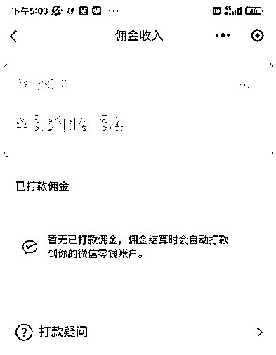

去年 10 月“狗咬小孩”成为新闻热点，围绕训犬、驱犬的商品在多个店铺集中起量：

单场开播的成交额分别做到 3.4 万、6.1 万、4.5 万：

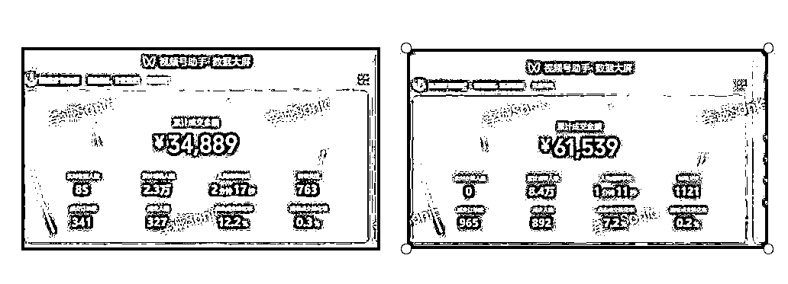

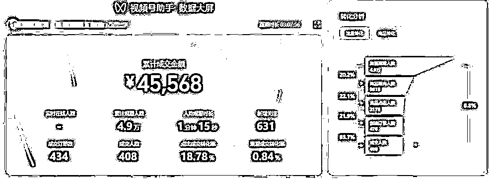

刚起步的人，更适合先挑单价低的商品切入，成交门槛低，出单更顺；等运营手感上来，再慢慢抬高单价和利润。

# 1.1.2 平台环境与规则

先把判断说在前面：视频号已经走过了“随便进场就能吃到红利”的阶段，眼下更强调合规、规则和精细化运营。

2022 年春末到初夏（3—5 月），内容搬运也有机会起量，无人开播、半无人开播、店铺多店铺货都能跑。

到了 2022 年 6—8 月，简单剪辑重组仍可能出爆款；平台开始严查无人开播，半无人模式常被判定为低质量；店铺侧也收紧了对刷量、重复铺货的治理。

2022 年 8 月以后，搬运和剪辑重组更吃速度与技巧；店铺想进入流量池，得满足一定门槛。

2022 年 11 月，新号扶持期缩短；🛰️小商店开始清退第三方后端店铺，例如有赞、爱逛、魔筷、微盟、微店等。

2022 年 12 月 1 日起，视频号卖货只支持“优选联盟”（视频号小店）内的商品。

2023 年 1 月，店铺评分与达人橱窗评分体系上线，评分后续会影响流量和选品范围。

2023 年 2 月，商品审核更严、耗时更长，平台对原创内容的审核和扶持同步提高。

2023 年 4 月，预约领券功能的开放范围调整，“优选联盟”的准入与清退规则也更新。

2023 年 7 月，优选联盟管理更细，结算订单和纠纷商责考核加码；直播电商端推出达人冷启动激励；短片卖货端则限制每日挂车数量。

2023 年 8 月，电商规则继续补齐，【运费险】【先付后用】上线，旗舰店入驻标准公布。同月，普通账号主页不再展示【企业🛰️】，矩阵号往私域导流的难度加大。

2023 年 8 月，达人广场开放，达人与店铺可双向挑选。电商达人带货分高于 4.3，才能选择全部优选联盟商品；低于 4.3，选品范围会被收窄。

2023 年 10 月，绿幕开播新规落地：只有旗舰店、教育培训、本地生活等类目能用绿幕播放【视频】，常规类目不允许；不过实测中，用绿幕图片做【背景图】轮播切换仍可行。

2023 年 11 月，直播挂链接需要 1000 粉；达人橱窗链接暂不要求千粉，完成实名认证并缴纳保证金后，就能把商品挂进橱窗。

2024 年 2 月，直播带货小时榜上线，从直播间右上角 banner 可进入，能看当前赛段和上一赛段数据。榜单分 11 类：总榜、品牌榜、潮流服饰、食品生鲜、时尚美妆、家居日用、珠宝文玩、数码家电、宠物园艺、图书影音、母婴玩具。

眼下，纯搬运和简单剪辑的难度明显上升。更稳妥的做法是多重去重后再剪，并掺入约四分之一到三分之一的真人拍摄画面；这些画面不必与商品一比一对应，效果通常更好。若有余力，实拍、仿拍加剪辑重组，生命周期会更长。

结合类目反馈和圈友实践：原创实拍占比越高，安全边际越大；同时画面越贴近爆款原片，越容易拿到播放。

整体来看，视频号还有五类机会：

流量机会：标签精准度不如抖音，但起号和起量相对容易。

利润机会：抖音多数行业竞争激烈，视频号同类商品价格常能高出 1—3 倍。

人群机会：三四线城市与中老年用户触网较晚，信任度高，退换货相对少。

投放机会：官方放量后转化不错，难点在素材过审、测品和售后率控制。

直播机会：2025 年开年以来，直播基础流量较好，值得进场。

另外，早期入局的圈友 @盗坤 在 2022 年 7 月写过一篇分析，观点中肯，可延伸阅读：《视频号直播的真实世界》。

内容来源：3 月 3 日《如何在视频号平台高效做带货》@李诚 Sonic；《2025如何玩转视频号带货》@李诚Sonic。

# 1.2 核心打法

# 1.2.1 最小可行业务流程与关键动作

当前主流打法是：先发卖货短片，等某条内容起量，立刻开播承接，把成交放大。

所以，从 0 到 1 的最小可行业务流程可以拆成：

定方向—搭账户—挑商品—拆解爆款并制作发布（关键）—挂商品测试—复盘调整—成交。

其中几件事要单独提醒：

账户开通：

刚入门的人最好准备至少 2 个号；条件允许可做到 3—5 个，找亲友协助。原因在于剪辑、内容把控和平台治理都可能触发限流，一旦被限，往往要耗上一周。

制作、发布与开播：

拆解爆款并做出高质量短片，是整个项目的关键动作。起步阶段，每个号每天发 3—5 条比较合适。

平台审核越来越细，每条短片在剪辑重组的基础上，最好加入真人拍摄画面，占比约四分之一到三分之一，原创审核更容易通过。本次也会讲用 AI 数字人做内容提效，不想露脸的人可以关注。

二次加工时，别让原作者正脸大范围出现，否则容易被投诉下架，严重时还会封号；明星、网红类画面若出镜过多、过大，系统会要求提供核验或授权。

同时要拆同行直播间，学话术，开播测试脚本与表达。

商品测试：

每个卖货号需缴纳 100 元保证金才能选品，后续可退。

账号每日可发的商品分享短片数量，与粉丝量挂钩：

粉丝不足 1000：每个自然日最多 1 条商品分享短片；
粉丝在 1000—9999：每个自然日最多 2 条；
粉丝在 10000—99999：每个自然日最多 5 条；
粉丝超过 100000：每个自然日最多 10 条。

若账号不足 1000 粉，其他短片挂不了商品，可在评论区引导用户去橱窗下单。

# 1.2.2 内容分发逻辑

1、社交分发（视频号生态特色）

系统会参考用户好友及好友圈子的发布、点赞、关注、评论、转发等行为，优先把相关短片推给用户。

2、个性化标签分发

🛰️生态会给每个用户打上多维标签，如性别、年龄、职业、兴趣、城市等。平台再依据标签，从内容池中匹配可能感兴趣的作品。

3、搜索分发

用户在🛰️搜一搜输入关键词后，点赞评论表现好的短片更容易被优先推荐；用户搜过的内容，也会更频繁出现在其推荐流里。

4、同城分发

平台会依据作品发布位置，推送给同城用户。线下商家可借这一点做本地生意。

# 二、【实操 1/3】启动准备：定赛道与选品

## 本章导览

项目全貌看清后，就进入启动阶段。想在视频号卖货，先把账户和商品这两件基础事做好。

本章把动手前要准备的内容收在一起：

✅ 号码与设备
✅ 账户注册与包装
✅ 选定 1 个卖货方向
✅ 完成第一次挑商品

挑商品和挖需求是重点。为了让你少走弯路，本章会给出选品思路、快速筛选方法，帮你建立基本选品能力，尽快上手。

## 本章航线图

学完并做完本章，航线图第一阶段“定方向、做准备”即可完成（约 3—5 天）。

1. 确定 1—2 个卖货类目/方向（约 1 小时）
2. 至少完成 2 个视频号账户搭建与包装（约 0.5 小时）
3. 掌握选品思路和技巧，至少挑 3 个商品（约 4 小时）
4. 了解开播基础，走一遍直播流程测试（约 2 小时）

现在可以按这几步启动筹备，开始挑商品。

# 2.1 工具清单

# 2.1.1 号码与设备

刚起步建议至少准备 2 个号，因此需要：

1. 至少 1 台手机（支持应用多开，或直接备多台）
2. 至少 2 张电话卡（1 个视频号对应 1 个实名🛰️号，也就对应 1 张卡）

电话卡推荐：+MM188166M（李李）长期更新

三家运营商都能办副卡。一个身份证可注册认证 5 个🛰️，主卡带 4 张副卡，副卡月租约 10 元。

移动万能副卡：每张月租 10 元，一个身份证可领 2 张；第一张与第二张需间隔 90 天；营业厅和 App 都能办，营业厅可争取首年月租减免。

中国电信 App 搜“无忧卡”，5 元/月，通常第二天上门配送。

移动还可办 8 元保号套餐。

手机怎么选：

手机既用来登录，也会承担拍摄任务。

只拍短片的话，千元安卓机够用，且安卓系统自带双开。

若后续想放大开播，iPhone 的直播稳定性更好，但它不能双开。

条件允许的话，也可同步跑 3—5 个号，投入会相应增加。

# 2.1.2 拍摄器材

1. 拍摄设备与软件

建议直接用手机。如今手机像素足够，拍短片完全能打。拍摄时用后置镜头，画质更稳。有人担心看不到自己，后面会讲用镜面拍摄来解决。

若有单反，画质会更好；但大多数人还是以手机为主，后面重点也放在手机拍摄。

拍摄软件：别开美颜！别开美颜！别开美颜！直接用系统原相机。

2. 提词设备与软件

可以备两部手机：一部拍，一部提词；也可以手机拍摄配电脑提词。

提词工具：

手机端：提词拍摄、快题词都行，拍摄时能直接看字幕。剪映手机版也带提词器。

下载渠道：iOS App Store 与安卓应用商店均可搜到。

电脑网页端：https://cn.teleprompter-online.com/

3. 蓝牙遥控

若没有家人朋友帮忙拍，备一个蓝牙拍摄遥控器会方便很多。

4. 收音设备

声音很关键。手机直录杂音多，所以收音设备不能省。两个方案：

方案一：蓝牙无线耳机。

不想额外买麦克风的话，可以利用拍摄时略侧脸的角度，把耳机戴在观众看不到的一侧，用耳机麦克风收音。

方案二：独立收音话筒。

淘宝、拼多多两三百元的即可，效果够用；起步阶段不必上 RODE、大疆这类高价设备。

5. 拍摄支架

建议买两个普通支架：一个架拍摄手机，一个架提词手机。稳定性和调整自由度都更好。若用电脑提词，家里找东西把电脑垫高即可。

也可选能调相对位置的双机位支架，但不少万向软管款不够稳，不太建议。

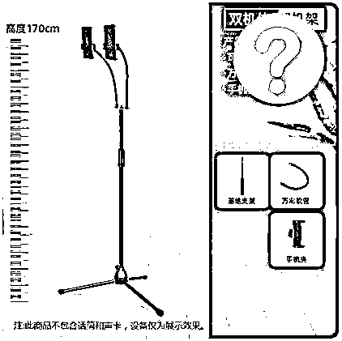

要避开固定并排的机位：离太近拍不到半身，离太远又看不清提词。

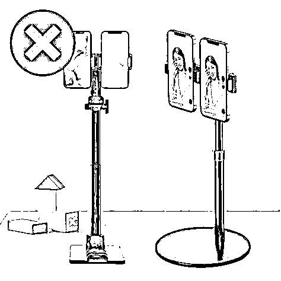

6. 补光灯

推荐球形补光灯，从左侧或右侧上方打光；选支持三种色温的款式，方便配合内容氛围。

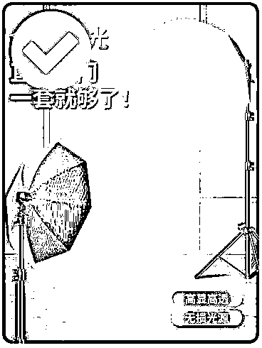

另一侧可加一个小灯管，或挂反光布。具体布光可参考视频教程：https://v.douyin.com/i8jJuV6X/

提醒：别用环绕手机的补光灯，戴眼镜的人镜片容易反光。

# 2.1.3 后期软件

剪辑用手机端的快影、剪映就够，基本需求都能覆盖，剪映还能直接导出 60 帧。

软件介绍：剪映

手机版：iOS App Store 与安卓应用商店可下载
电脑版：https://www.capcut.cn/

有电脑的话更推荐电脑版，操作更顺手。

很多小道具从看到到买回来，会消耗不少时间和精力。比如为了找一支在黑板上书写顺滑又好看的笔，可能折腾大半天。所以起步别追求完美，先发作品更重要。

好相机、好手机、摄影灯、服装、麦克风、精致场景和道具，都是加分项，后期再补也不迟。刚开始与其把时间花在置办上，不如多拍几条发出去，把精力放在创作和运营。

内容来源：《从 0 到 1000 万粉，给短视频创作者的 80 条建议》

# 2.1.4 数字人工具

即创数字人平台（限免，需投一点抖+开通权限，详见下方教程）

点击进入

即创开通数字人成片教程：

4a5dc2010836cc2fa8966061044563e6.mp4【在线播放】

蝉镜数字人平台

点击进入

龙哥盟专属福利：蝉镜AI数字人

做自媒体时，为了提高产出效率，不少圈友会用到数字人。我们和国内头部 AI 数字人平台蝉镜沟通后，争取到了一份专属福利。

【1】蝉镜AI数字人介绍

蝉镜由蝉妈妈推出，主打用全栈数字人 AI 技术降低内容制作门槛。

产品优势：

国内头部 AI 数字人制作平台
集成了数字人生成、AI 口播、AI 配音、AI 文案等功能
有 100+ 套专业模板和公共数字人，可适配电商及多业务营销场景
几分钟内就能生成较高质量的数字人内容

适合人群：各领域自媒体从业者、MCN 机构、传媒公司、代运营公司、企业老板等。

使用场景：做 AI 数字人用于引流、获客、IP 打造、内容生产、开播、卖货等。

【2】龙哥盟专属福利

第一步，点专属链接并完成首次注册（此前注册过的，可继续看第二步）。系统会自动发放 600 赚钱专属蝉豆加 130 新用户蝉豆，可免费制作 12 分钟数字人视频。

https://www.chanjing.cc/refc/?type=hzBuy&id=j2Y11akayXaJL8GK0mhNwKi5WPn4Nguj2cM3vSQO2Xc

第二步，在电脑端付费购买任意版本会员，推荐人填写：A龙哥盟。

每次购买后可再获赠 600 赚钱专属蝉豆，能免费制作 10 分钟数字人视频；前 5 次购买均可获赠（连续包月可在前 5 个月获赠），系统会在购买后一周内自动发放。

请务必在电脑端购买，购买后手机端和电脑端都能使用：https://www.chanjing.cc/home

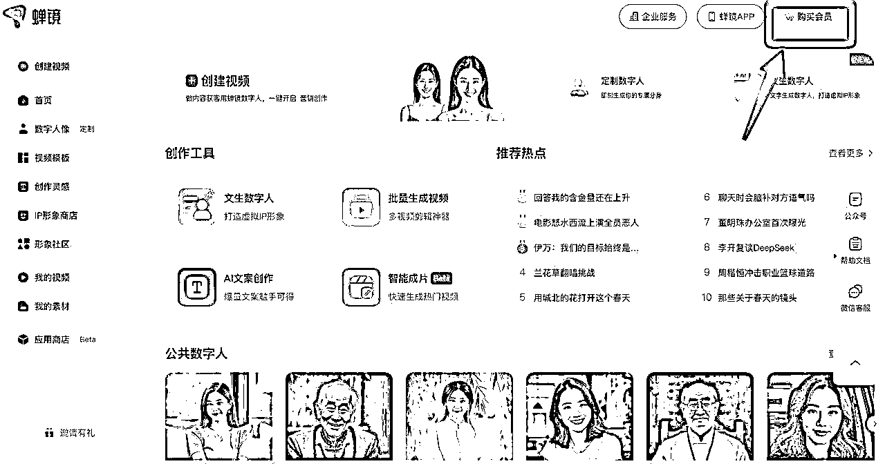

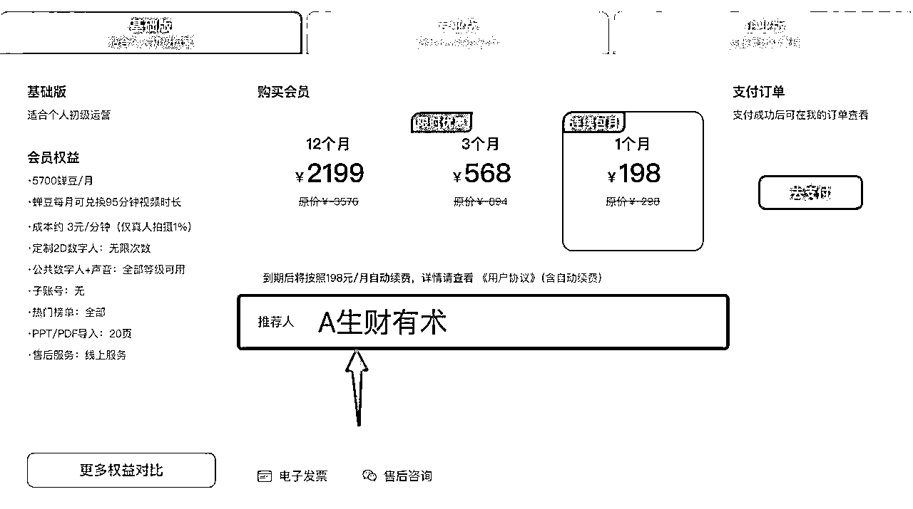

A2E数字人平台

点击进入

哼哼猫（全平台批量去水印）

点击进入

豆包大模型声音复刻（试用）

点击进入

视频去字幕去水印（每天 10 次免费次数）

点击进入

# 2.2 账号搭建

# 2.1.1 账号注册、登录与养护

账号注册：

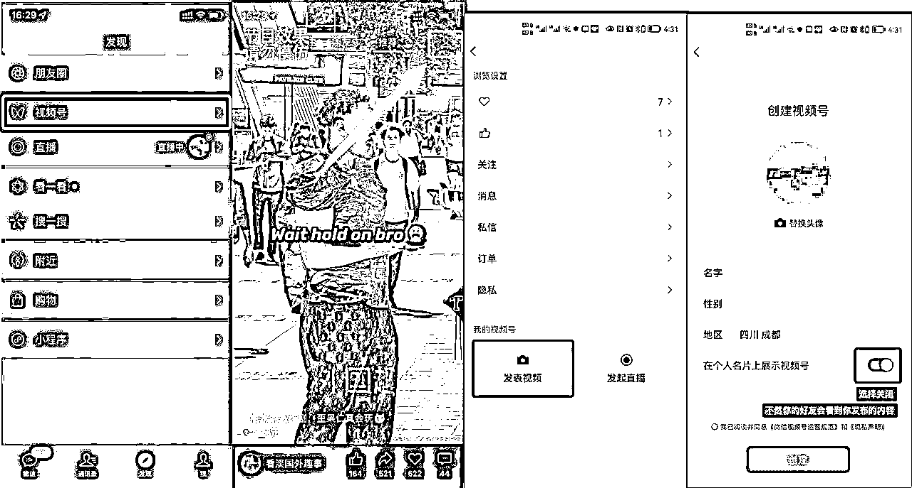

按图示走完六步，视频号就能创建完成：+MM188166M（李李）长期更新

1. 打开🛰️「发现」页，点「视频号」；
2. 在「视频号」页右上角点「人像」图标，进入主页；
3. 在主页点「发表视频」，进入创建页；
4. 在创建页填头像、性别等资料，并勾选“我已阅读并同意《🛰️视频号运营规范》和《隐私声明》”；

（其余步骤按图示继续完成）

# 视频号新手起号：包装技巧与选品避雷

不想让熟人刷到你发的东西？把名片页那个「在个人名片上展示视频号」的开关关掉就行。号建好之后，登录环节有两条路可走：一是借助应用双开，让一部手机同时挂两个🛰️；二是把手上多个视频号的运营身份统统挂到一个主🛰️上，往后通过电脑网页端就能集中管理这些号。

这里有个坑得留意：同一个🛰️若同时担任若干个视频号的运营者，同一时刻只允许登录其中一个。打个比方，🛰️A同时挂着视频号①与②，先扫了①，再去扫②，①那边就会自动掉线，想回去还得重新扫一次码。

手上号多的话，更得防着点：成批注册的🛰️账号封禁风险高，哪怕只多弄了两三个也要当心。养号说穿了就一句话——把自己装成正常用户。以下五件事可以照做：完善头像、昵称和背景图这些门面信息；把🛰️号、登录密码、支付密码都改一遍，钱包里搁几块零钱；保持每天两三条朋友圈，写多写少无所谓；主动加五到十个好友，日常发几条消息；每天抽时间在视频号里看视频、逛直播间。

# 2.1.2 账号包装

要是账号还没想好走什么路线，建议先翻手册中「2.3 定赛道&选品」那一节，挑好赛道（像渔具、百货之类）再谈定位。定位一旦明确，就能顺着用户需求去打磨头像、名字、简介和置顶内容。

# 2.1.2.1 设置流程

号建好后，戳右上角【···】就能进【设置】：

在【设置】里找到并点开【资料设置】：

到了【资料设置】页面，按顺序点【头像】【名字】【简介】逐项改好：

# 2.1.2.2 怎么包装自己的账号

**先从取名聊起。**官方关于【账号名称】的提醒在这里：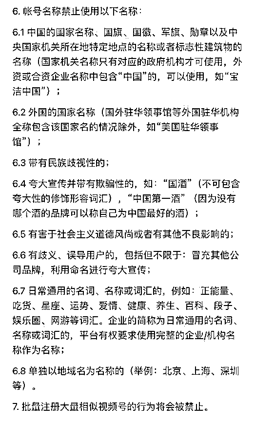 名字得对得上你做的内容方向，一个响亮的名称本身就能带来搜索曝光。最常见的思路是拼关键词，像健康、书籍、认知这类词组合着来，理由很简单——别人搜这些词时，你的号更容易冒出来。但顺口好记的名字多半被人占了，所以注册前多准备几个备选，挨个试哪个能过。名称一年有五次修改机会，实在没思路就看看各平台同行的命名套路，或者套用万能模板，例如“xx-同款在橱窗”。

@麦洛 也提过：昵称同样是一年五次改动上限，不妨先占个通用名，像“xx-同款商品在橱窗”。简介在建号之后随时能调整，入口是：主页头像 → 右上角… → 头像 → 简介。控制在三行以内最稳妥，超出部分会被收起。内容里可以塞转化引导语，比方说“同款商品在👇🏻下方购买”。但🛰️号不推荐急着放——把人往🛰️里导再成交，转化效率偏低，还白费精力。

内容来源：《视频号直播建议指南》

**再讲头像。**它直接影响别人记不记得住你。形式不拘，纯文字缩写或图文搭配都行。没灵感时，搜一搜同赛道头部博主，参考他们的做法。作图可以用图怪兽（https://818ps.com/）、可画（https://canva.com/）、创客贴（https://www.chuangkit.com/）这类站点，也可以找免费无版权素材。切记别碰有商标、易侵权的图；个人照片同样不建议，和账号调性容易打架。

**第三块是个人简介。**它随时能改，要紧跟你的定位走，成熟大号的写法就很值得借鉴。做带货的，最直白的方式就是直接告诉观众在哪下单，例如“视频同款，在👇🏻下面【商品】购买”。🛰️号放不放视情况而定，真要放也得含蓄点；既然填了号或手机号，最好换另一个🛰️确认下能不能正常看到，免得被平台屏蔽。起步阶段不建议留联系方式，容易被同行盯上举报。等号养稳、粉丝起来了再补，比如写上：

+v：

更多 xx 联系领取：

商务合作请联系：

**最后是置顶视频（等内容开更后再弄）。**一个号最多钉两条，谁先谁后也有门道。头一条建议用爆过的或者当下正热的片子，第二条留给你最看好的带货作品。带货号还能额外置顶一条“手把手教你下单”的教学视频：p.mp4【在线播放】。操作很简单：定位到目标视频 → 点右上角【···】 → 在弹出项里选【置顶】就行。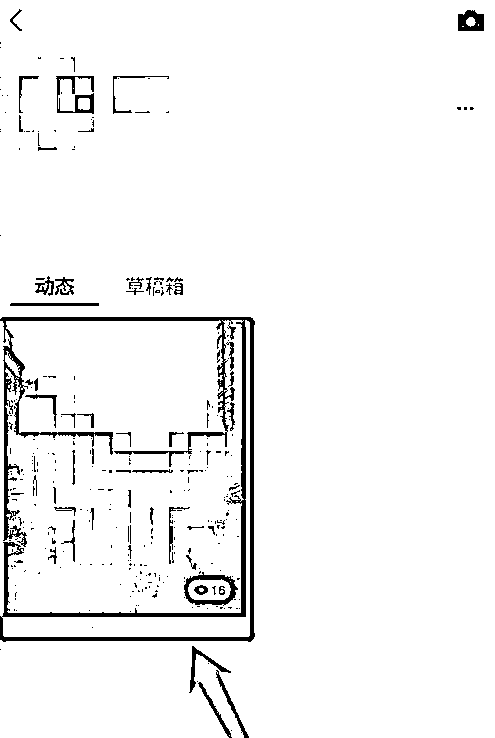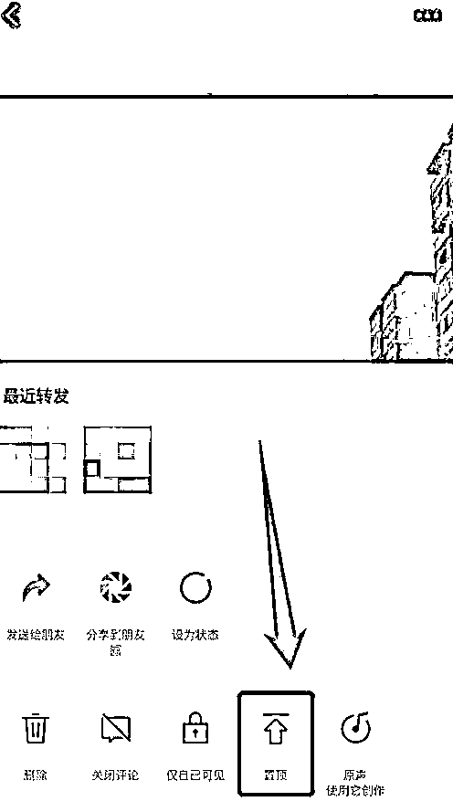

内容来源：《8 月初阶视频号航海实战手册》

# 2.3 定赛道&选品

挑具体货品前，得先圈定一条类目赛道，像渔具、百货；接着再在赛道内部挑单品，比如钓鱼竿、包饺子器。刚上手的话，最好一次只钻一条赛道，把精力砸在选品和内容上。下面列了几个对新手友好的热门方向。

# 2.3.1 选赛道的方法

挑赛道的要害只有一个词：人群。眼下视频号的主力观众，是下沉市场、年纪偏长的群体，选品自然得围着他们打转。举个直观的例子：百货里的粘鼠板卖得动，是因为这批人多住在老旧小区或乡下，家里确实闹老鼠；而一线城市租房的年轻人压根没这烦恼，自然也难理解为啥有人刷到这种视频会点赞甚至下单。

跑到现在，验证过比较吃香的赛道有：AI课程资料包、日用百货、家居好物、视频特产、图书、新奇特好物/玩具、三农用品、绿植、服饰鞋包等。下面再展开一些细分热门方向：

食品方向：三农好物、生鲜、地方特产、滋补类、俄罗斯食品、梨膏糖

书籍方向：国学类、健康养生、名人传记、婴幼儿绘本等

服饰方向：大码女装、头饰发饰、围巾丝巾、手链脚链等

家居百货方向：房屋防水材料及产品、面条机、老花镜、定时提醒药盒、老人购物车、防走失用品、穿针器、拐杖、广场舞音响、老人收音机等

绿植方向：绿萝、绣球、兰花、营养液、营养土、种植铲、种植围栏

百货方向：收纳盒、收纳柜、厨房好物、卫生间好物

美护方向：洗发水、发膜、乳液、洗面奶、面膜

运动户外：拉伸用品、运动汗巾、运动护腕、户外渔具鱼饵鱼钩

知识课程：AI相关课程资料包、情感教育、幼儿教育

其他：老人手机、多功能护理床、三农工具

以上都是视频号选品里验证过的优质赛道，值得多看几眼。需求和赛道敲定之后，接下来就该找更多好货了。

# 2.3.2 选品的方法步骤

# 2.3.2.1 选品的核心逻辑

选品的三大命门：人群、类目、价格。

思路其实是一条线：先画定目标用户 → 摸清他们缺什么 → 往下切分品类 → 借助方法锁定契合度高的商品。

人群这块基本锁死了：下沉市场、年纪偏长的群体。若是做AI课程、幼儿教育，就换成对应的购买人群。余下两条是类目和价格。

**一、类目决定商品卖不卖得动。**

你让五十岁上下的姐姐买美妆假睫毛，多半没人接；换成包饺子器这类百货，或许能成交，但买家会先掂量“我用得上吗”；而美食特产属于吃的东西，顾客会跳过“需不需要”直接进到“想不想要”，同样的场观，转化明显更好。所以选品时得多站在目标人群——也就是咱爸妈那代人——的角度去体会。

**二、价格牵着利润和销量两头。**

来算笔账：都是日更十条视频的前提下，A 洗衣凝珠日销七百单、每单赚一块；B 螺蛳粉日销一百单、每单赚七块；C 美食特产同样一百单、每单赚十块。你挑哪个？我的排序是：A 与 B 比，选 B——总利润打平，但客服投入更省；B 与 C 比，选 C——单量相同，赚得更多。账不难算，可不少人都在这类取舍上栽过跟头。

定价这块务必上心，得给自己留出够厚的利润垫。单价拉高，销量往往就往下走，反过来也一样。新手想尽快看到正反馈，不妨先从低客单商品切入，出单更容易，之后再逐步优化。

# 2.3.2.2 选品的基本步骤

**第一步：借工具打辅助**

前提得摆清楚：🛰️并未向外部开放查询接口，所以第三方工具抓到的数据跟真实情况可能对不上。工具结果只是参考，最后拍板还得靠自己的脑子。

**工具一：考古加（www.kaogujia.com）**

拿两个场景演示用法：

（1）追热度选品：用关键词捞热销货，例如父亲节期间就搜“父亲节”“礼物”等词：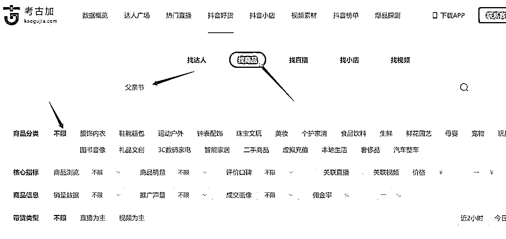 路径是抖音好货 - 找商品 - 输入“父亲节” - 搜索。接着挑细分品类：想广撒网捞爆款，盯一级类目一页页翻就行；要精准打击就钻到三级类目。下面以三级类目作示范：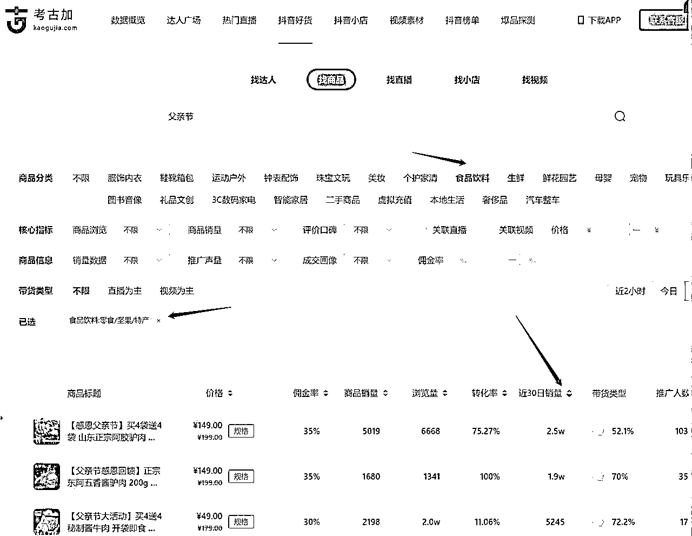 筛完按销量排序，点进详情页能看它最近的数据走势。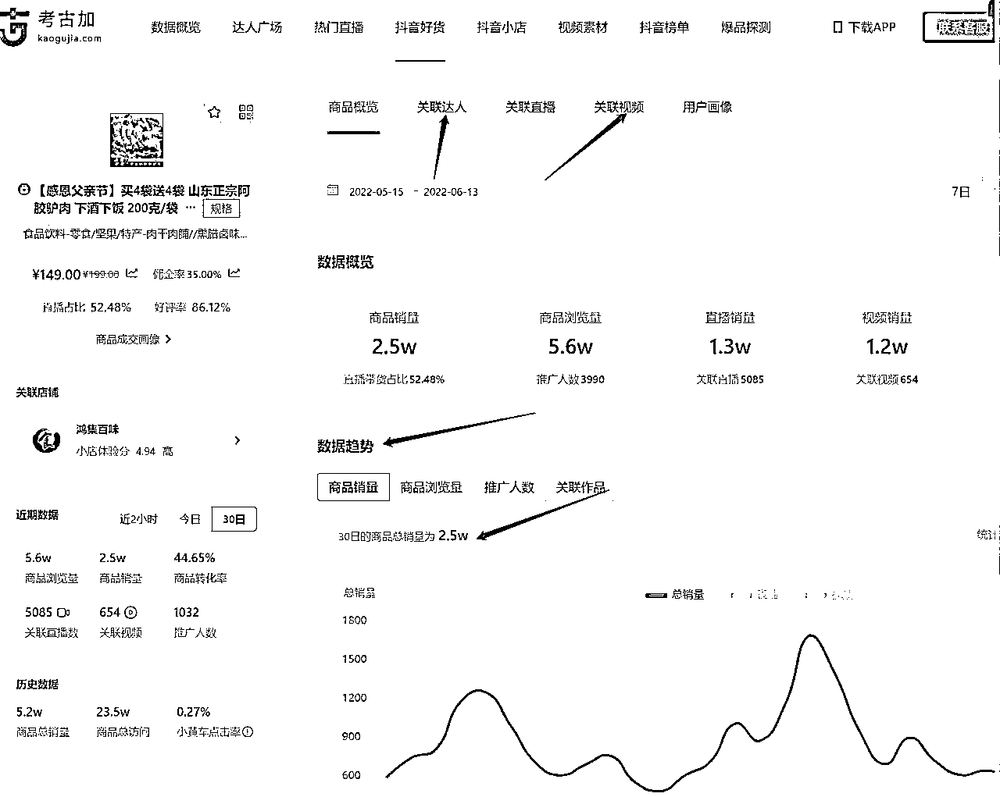 数据看着行的话，判断值不值得跟，重点盯两个指标：一是关联达人，看他们视频的数据成色，方便日后照着做；二是关联视频，直接看播放表现，方便拿来做二次加工。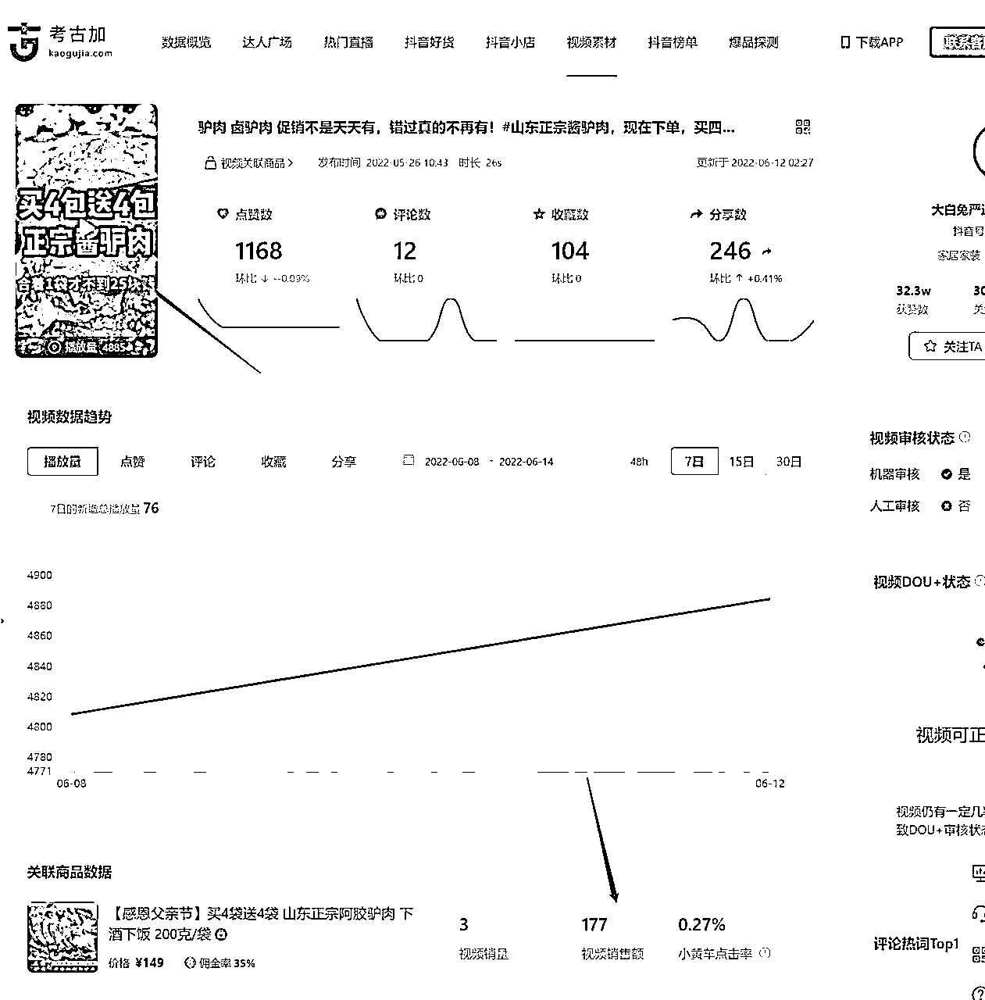

（2）细分类目挖掘法：抖音好货 - 找商品 - 选商品分类 - 再选带货类型。类目深度按需拿捏。比如想找图书音像里的历史类，点【图书音像 - 书籍/杂志/报纸 - 历史】，相关商品就出来了：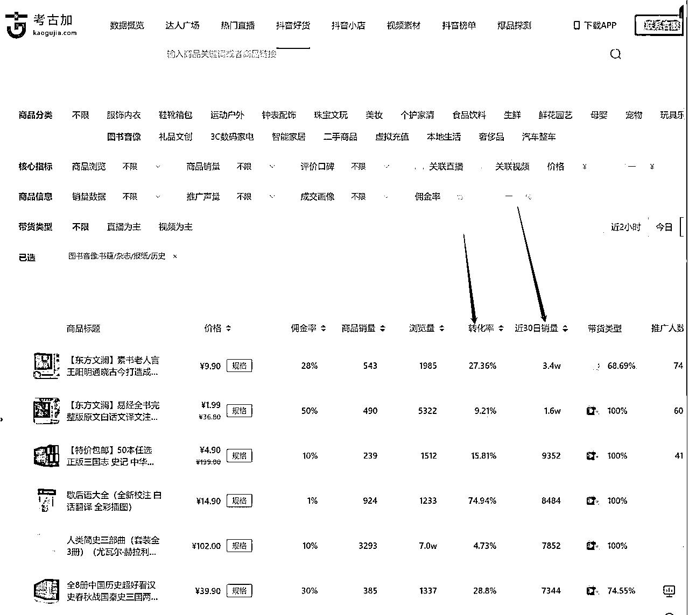 参照三十天销量和转化率圈定具体单品：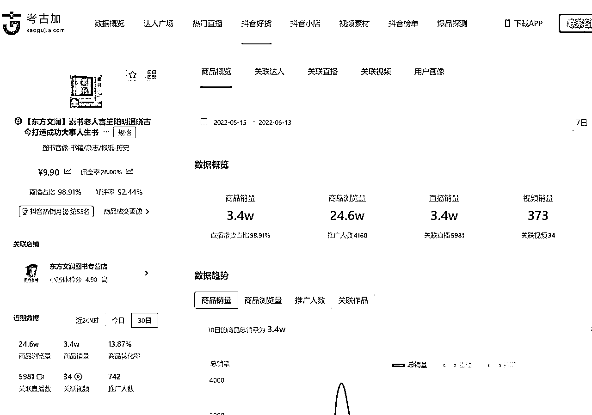 随后进详情页看关联视频或达人，评估其数据与质量。考古加的价值在于帮你拓展商品思路，顺带提供基础数据分析与视频参考。实操时不妨多加筛选条件，比如价格区间、成交人群画像。价格方面别贪太便宜的，得留出利润；人群画像上，视频号建议瞄准 50 岁以上（41-50 也能接受）。碰到有潜力的商品，用表格记录下来，日积月累就成了自己的选品库。

**工具二：巨量算数（https://trendinsight.oceanengine.com/）**

在这里能查到关键词指数、关联分析和人群画像。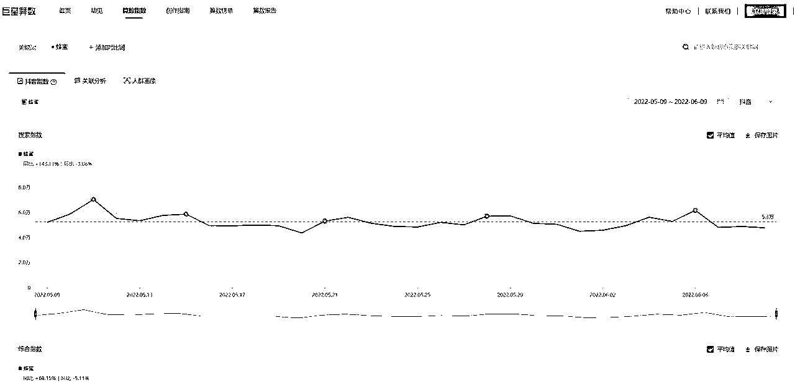 官网另设榜单，各类产品的热度一目了然，可作为选品参考。

**工具三：🛰️指数（在🛰️里搜“🛰️指数”即可）**

打开后以蜂蜜为例查一下：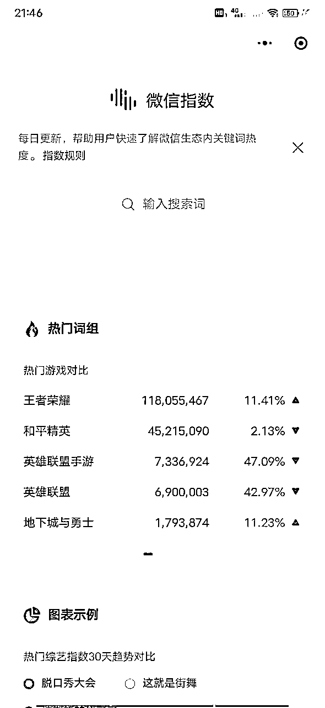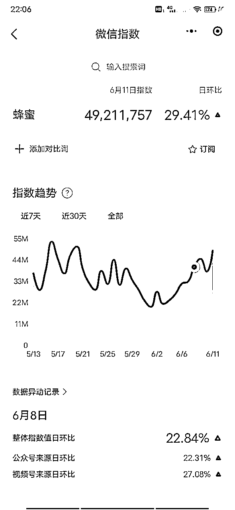 结果页会呈现该产品词在整个🛰️生态里的表现。

工具这东西贵精不贵多，把一两个玩透就足够。

**第二步：主观筛选与排除**

工具打完底之后，具体品类怎么定？

（1）跟着喜好走。年轻人追捧的玩意儿，在这批观众里十有八九卖不动，像索尼游戏机、Supreme 的T恤，视频号用户根本不买账，可以直接划掉。自己都提不起兴趣的东西，酌情放弃。反过来，父辈偏爱的消遣娱乐，倒是可以试水。退休大叔爱钓鱼、阿姨们热衷广场舞，这些方向都值得考虑。

（2）靠经验。经验未必靠谱，却有参考价值。有圈友在抖音百货做得风生水起，转到视频号却迟迟没动静；也有人年初在抖音快手经营绿植，这几天视频号的绿植号反倒收益可观。再举个生活化的例子：春熙路上一眼望去上百家火锅店，那火锅底料是不是也有市场？过往的阅历都是资本，闭眼盘一盘就能挖出线索。

（3）勤刷抖音、快手和视频号。这条格外重要。每天挤时间泡在三个平台上，瞅见有卖相的商品立刻截图存着。有实例为证：一位圈友的品在视频号爆了，三天内冒出五个同行跟卖，八成就是刷到他的内容后动的手。这活每天重复、略显枯燥，但惊喜往往藏在里头。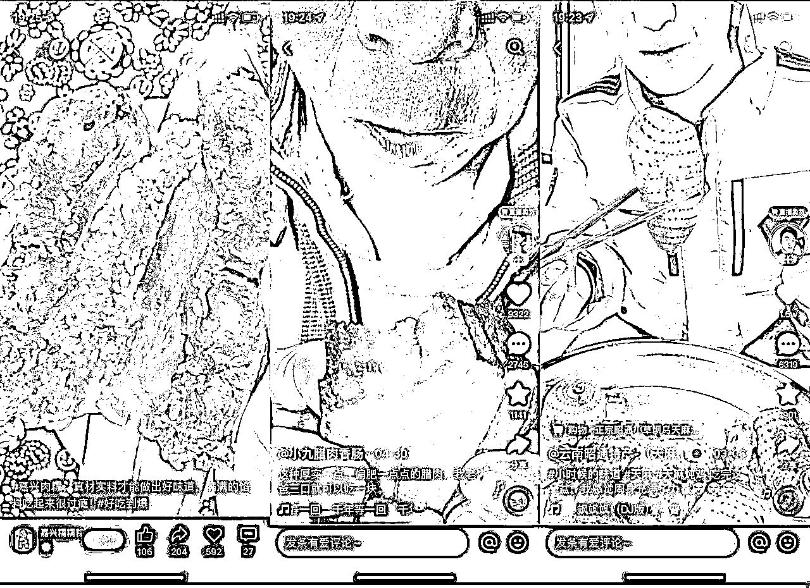 状态好的时候，刷上一天就能初筛出二十个产品。

**第三步：客观验证与判断**

# 💡

到这步要回答三个问题：这品能不能做？怎么做？定什么价？

假设我们锁定了一个品——蜂蜜（只是演示，不构成建议），还得走完下面几步确认可行性：

**1. 摸对手底细。**在视频号里搜「蜂蜜」，会跳出这些账号：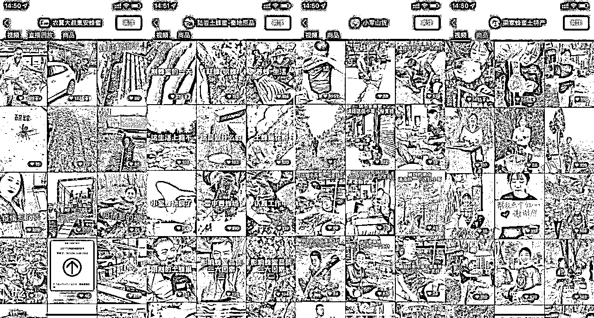 重点看三处：有没有人在做——判断还能不能挤进去、竞争凶不凶；对方的视频数据如何——掂量其实力，顺带预估自己的天花板；销量怎么样——推算利润空间，看值不值得下场。如果某个词搜出来空空如也，那可能是片蓝海。视频号直播眼下正处在找蓝海、抢蓝海的窗口期，所以要挑竞争者少、或者对手偏弱的品。搜出一堆人也别急着打退堂鼓，点进去瞧瞧，未必个个都在卖货。

**2. 有没有现成视频可用。**视频制作的细节后面再聊，这里只把它当作判断依据。去抖音、快手搜「蜂蜜」，看有没有对口内容： 要留意：是否存在专攻单一品类的达人——这关系到你能参考的素材有没有、够不够挑；某位达人的视频存量多不多——若只有十条，一天就发完了；再看赞数和销量——研究他们在抖音混得如何。挑素材时得对上视频号的调性，同一个品换不同视频来推，效果天差地别。另外，尽量别用真人出镜为主的内容，容易触发真人核验，号一旦被卡基本就废了。

**3. 溯源商品。**到拼多多、淘宝、1688 上搜你要带的货：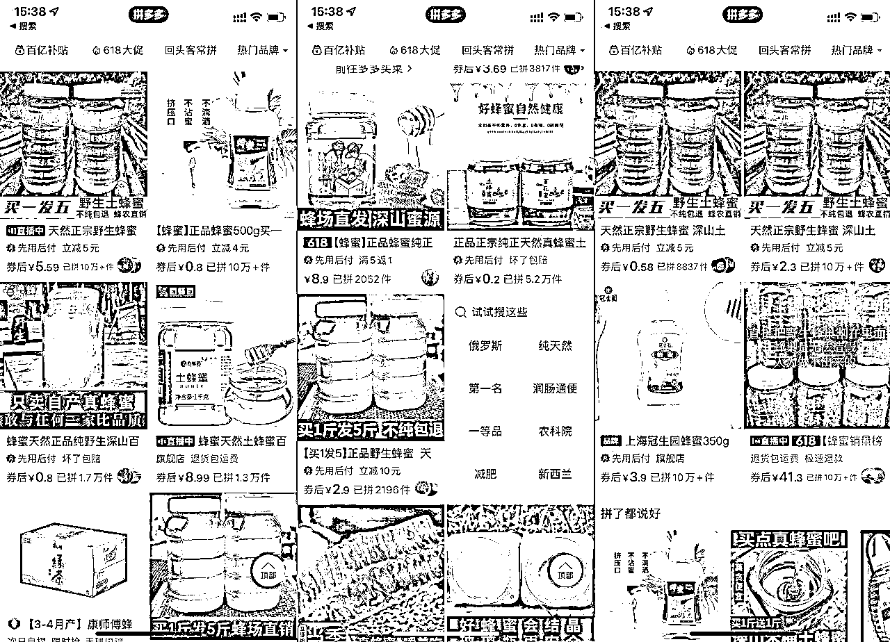 起步阶段只要有同款在售、价格上还有得赚，就问题不大。哪怕🛰️选品中心里搜不到这个品，也能请朋友帮忙挂到小商店。

**4. 小结。**三条都占，这品在视频号带货基本就稳了：视频号里尚无同类，或竞争不算凶；抖音、快手上有数量可观、质量在线的带货素材可供借鉴；电商端货源齐备，利润也够。但记住一句话：选品就是一遍遍筛、一遍遍验的循环，所有功夫都是为了提高出单的胜算，没人能打包票一定爆。多试多练，把选品的手感磨出来，爆单只是早晚的事。

# 2.3.2.3 快速选品方法

要是嫌上面那套流程繁琐，这里还有个更朴素的「视频号-视频带货」选品路子，单拎出来也能用。

步骤一：逛视频号直播广场的购物板块。专挑那种看着不太专业（一眼望过去不像机构达人、PGC 内容，更像普通人自己搞的）但场观能过五百的直播间。所谓“不太专业”，特征挺明显：头像和封面是同一张；不摆样品，直播环境跟卖的货八竿子打不着；主播也很少跟观众搭话。为什么卡五百这个线？因为过了五百才说明量起来了——要么是系统给了推荐，要么是从短视频那边导来了人。

步骤二：翻这个号的短视频表现。在对标账号里挑出爆过的作品（标准是赞数破百），再看它挂的是什么品——那多半是个有潜力的货。

步骤三：到数据平台核一核这个品。重点看销量、带货达人数等，顺带避开已经卷成红海的品类。常用的是精选联盟和考古加。考古加数据更新及时，也没什么使用门槛；精选联盟则要满足粉丝量、小店、保证金等条件。

步骤四：从这条视频的带货达人和带货视频里锁定模仿对象。挑粉丝量在数百万以下（不容易撞车）、月销售额超过十万（说明人家确实赚得动）的达人；再到他们的作品里淘可用的素材，并回到视频号搜对应关键词，躲开那些已被众人盯上的片子。附上圈友@李诚 的选品表供参考：👉李诚 Sonic - 视频号选品表。走完这几步，合适的品基本就浮出水面了，视频素材从哪来也顺带有了着落。

# 2.3.3 选品避坑

视频号的规则迭代极快，某些品上周还风光无限，这周就可能连带账号一起被封。下面这几类坑，在视频号选品时必须绕开：

先说三条选品红线：中医、医药相关类目不要碰，这类商品在各平台都属于重点整治范围；尽量别搬用或剪辑他人大幅露脸的片段，真人校验一旦触发，账号基本就危险了；如果品已经选好，视频号选品中心却查不到，可以联系做后端店铺的圈友合作承接。

# 三、实战 2/3：打造爆款视频并完成发布

# 💡

# 本节要点

选品只是起点。视频能不能让人看完、愿不愿意下单，才是结果的分水岭。出单由流量和转化率共同拉动：想多出单，要么把流量入口做大，要么把成交效率提高，而爆款视频正是同时撬动两端的抓手。

本小节讲的是怎样找到可借鉴的爆款视频，建议大家按下面的节奏推进：

✅第1步：筛出值得参考的爆款片子

✅第2步：把爆款拆开研究，边看边学

✅第3步：照着爆款思路搭自己的视频结构

✅第4步：动手剪出来（二创或原创都行）

✅第5步：发布视频

✅第6步：及时回复评论、私信、招呼消息等互动

话不多说，开始你的视频创作之旅。

# 💡

# 本节路线图

完成章节 3.1 的学习和实操，就能拿下路线图的第二段：借助AI做出爆款视频并发布（大约 5-7 天）

1、选定至少 1 个参考账号（1 小时左右）
2、找至少 2 条同类爆款短视频或直播间，整理可套用的模板与话术（1 小时左右）
3、围绕所选类目，建立短视频/直播素材池（3-5 小时）
4、上手AI辅助工具（2-3 小时）
5、模仿爆款做二次创作，发 1 条视频或开 1 场直播（1 小时左右）
6、掌握批量混剪，提高产量与成片质量（3 小时左右）

# 3.1 锁定值得参考的账号

# 3.1.1 参考号该看哪些条件

在视频号和视频带货里，值得研究的账号通常有几类特征：

只深耕一个品类的创作者（有没有这类人，关系到我们能不能找到素材来源；数量够不够，则关系到能不能优中选优）

对方存量作品是否充足（这决定我们能研究多长时间；总共只有十来条，参考价值确实有限）

点赞表现和销量情况（重点看他们在抖音上做得怎么样）

还要留心：走混剪、二创路线的，尽量绕开大面积露脸的内容，否则原作者一投诉，轻则下架，重则封号。

# 3.1.2 参考号从哪儿找

# 方法一：平台里直接搜

动作很直接：打开主流短视频平台，输入你想做的账号类型关键词。

抖音、快手、📕都可以搜。

拿家清个护类目举例，在平台上搜【洗衣液】、【家用】这类词，相关参考号就会出来。

看到合适的先关注，之后系统会不断推来相似账号。

视频号这里有个反向提醒：自己的其他视频号别关注（本人🛰️绑定的号没法取关），想研究的参考号也别关注（关注关系会同步给🛰️好友）。

# 方法二：选品时反向找号

以食品饮料为例，借助考古加反向找参考号的路径是：

考古加——商品——视频热推榜——食品饮料——选定产品——查看关联带货视频。

流程见下图：

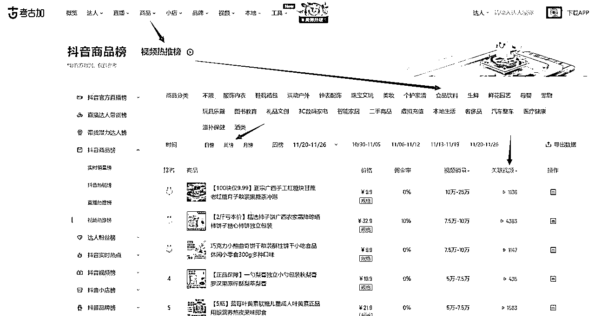

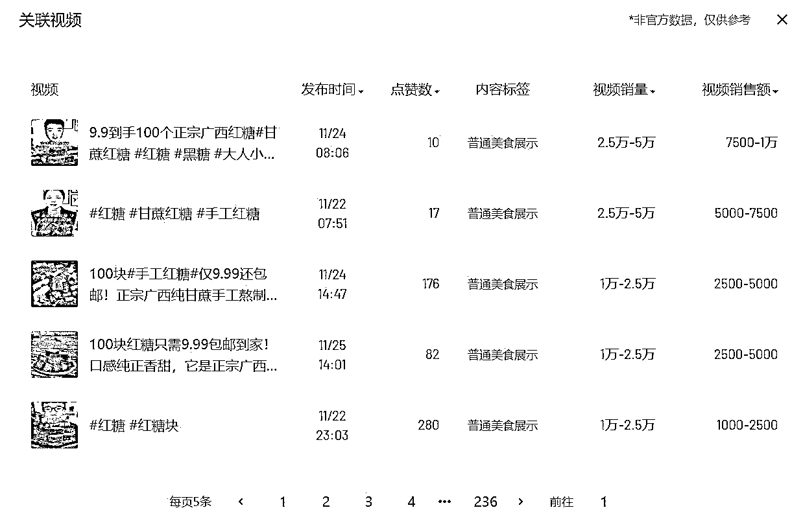

上图中的“达人”栏，就是我们要找的参考号。

# 3.2 爆款视频的制作思路

# 3.2.1 爆款的底层逻辑

1、借势热点

为什么要重视热点？一是平台愿意给热点更多曝光，二是受众也爱看。实在不会追，就打开抖音热榜，什么热就做什么。

2、钩子要密

钩子就是让片子出圈的元素。一条视频里钩子排得越密，走红的概率就越高。

3、开头三秒定生死

视频开头三秒是分水岭。做短视频，必须在前 3 秒抓住注意力——开头留不住人，用户凭什么把整条看完？三秒之后，内容要接得住，让人愿意继续往下看；到结尾几秒，把情绪推上去，促使用户转发、评论。

拿一条上过推荐的片子做样本：

这是视频号小航海阶段第一条获推作品，既典型又有纪念意义，所以拿它举例。（后来我其他账号那些点赞 10w+ 的片子，底层逻辑也是同一套。）

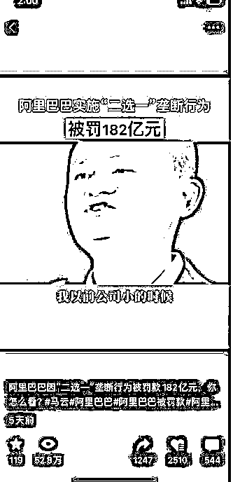

热点层面：

阿里被罚 182 亿，当时是全网热议的超级事件，各大平台都给了海量曝光。

钩子密度层面：

钩子一：阿里被罚 182 亿本身是热点事件，热点天然带钩子属性；

钩子二：马云本人就是流量入口，知名度高、关注度拉满；

钩子三：内容是马云谈“公司越大压力越大”，听着像马总在给自己找补，评论区必然吵翻；

钩子四：BGM 把紧张感拉满，观众情绪被带起来；

钩子五：标题区埋了一个问题，等着用户来评论区接话。

开头三秒层面：

1：顶部放了标题，用户一进来就明白发生了什么，特别是把“被罚 182 亿”做了放大处理，视觉冲击力拉满；

2：画面直接从马云切入，前面说过，马云本身就是钩子。

4、爆款自评表

新手如果拿不准自己视频的质量，可以拿我的这张表来打分，分数越高，爆款概率越大。

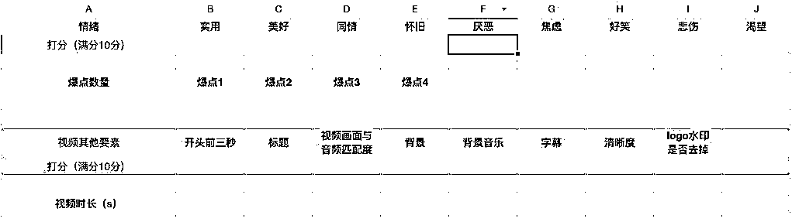

# 3.2.2 可参考的爆款怎么找

做视频的第一步，是找到可学习的同类内容。有两条路径：

# 3.2.2.1 路径一：跨平台找灵感

抖音火过的视频，在视频号可能再火一次，也可能水土不服，毕竟两个平台的调性不一样。下面两个角度，能帮你培养对视频号爆款的判断力。

维度一：数字表现

1.  抖音搜关键词，时间范围切到一天内/一周内，按点赞量倒序排列；

1.  用【抖查查】（www.douchacha.com）的视频飙升工具，点赞量选 5-10w 或 10-50w 这一档就行，200w+ 那种超级爆款反而不必盯着看。

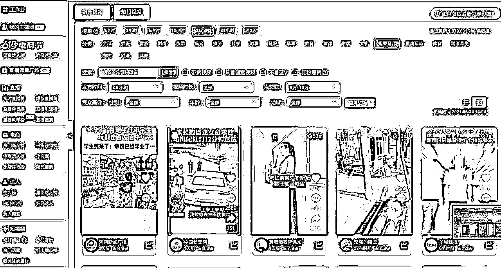

维度二：内容口味

打开【新视】（https://xs.newrank.cn），把你所在的类目近 15 天上榜视频全部过一遍，培养对视频号内容偏好的直觉。

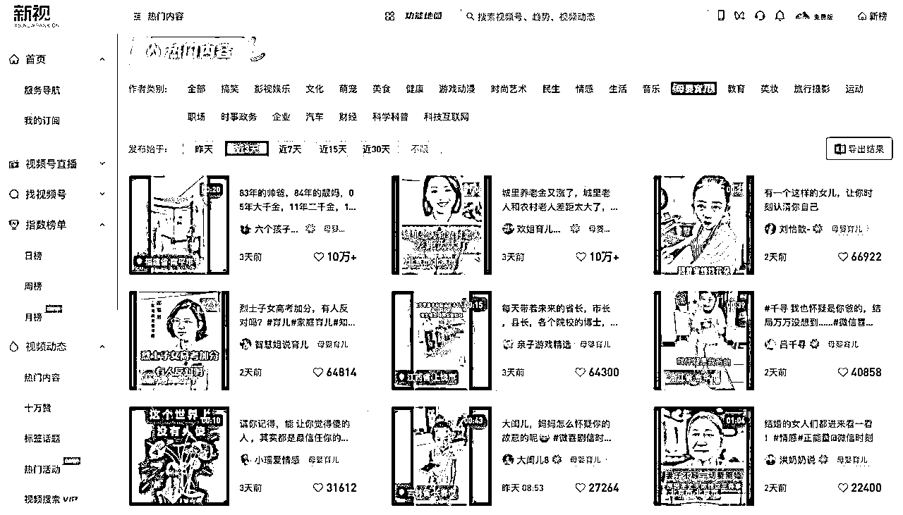

素材出处：《🛰️视频号变现，单条视频佣金 25000+，5 条视频涨粉 15w》

# 3.2.2.2 路径二：研究视频号里的优秀同行

1.

借助数据统计网站

以友望数据为例（友望数据：http://www.youwant.cn/ ）

友望数据→视频号查找→视频号排行榜→选择你所在的行业分类

2.

直接在视频号里刷

随手刷

在同领域的视频里多刷、多看、多点赞，平台就会持续给你推同类内容，同行账号自然越攒越多。

用关键词搜

（会搜索的人做短视频会轻松很多。这里简单交代一下搜索找参考号的思路，如果对搜索布局感兴趣，后续航海时可以深入探讨）

每个垂直赛道都有自己的关键词体系。拿商业认知类视频号来说，直接搜商业、认知、思维、格局、励志、职场、马云、马化腾等词，就能捞出一大批目标视频和同行账号。

注意躲“坑”

要盯住那些短期内快速涨粉的小 v，别一上来就跟大 v 学。大 v 通常做了很久，背后有团队；他们起号时平台的规则和现在也不同；再说大 v 的起点播放量就是万级以上，根本模拟不了 0 粉冷启动。上来就模仿大 v，做着做着就怀疑人生了。真正有参考价值的，是垂直领域里短期内涨粉迅猛的小 v。

素材出处：《视频带货月收入 10w+，分享从获取流量—制作爆款视频—带货变现的完整过程》

# 3.2.2.3 把参考爆款下载下来

找到参考片之后，当然要把素材抓下来留作剪辑用。

批量下载工具清单：

（付费）哼哼猫：支持多平台批量下载，每天有免费额度，批量能力强，支持的平台最全

（付费）多平台采集工具：可采集指定作者的视频

（免费）单条抖音采集：抖音图文无水印下载

（需安装+写代码）视频号采集工具及教程：《视频号视频下载》

视频号嗅探下载器：

百度网盘下载地址 提取码： mx4v

蓝奏云下载地址 密码：4v6t

（免费）抖音直播录制：批量采集抖音工具 密码：2nkd

录屏：万彩办公大师、FastStoneCapturecn

说明：【批量采集抖音工具 密码：2nkd】【蓝奏云下载地址 密码：4v6t】等链接打开时会有风险提示，把页面里的链接复制到浏览器直接访问，再填入密码就能正常提取工具。

素材出处：《8 月初阶视频号航海实战手册》

# 3.2.3 拆解并复刻爆款

# 3.2.3.1 怎样拆一条爆款

选定可学的同行后，对爆款内容做全方位拆解：画面、文案、标题、配乐、评论区……拆得越细，越能找到这条视频火起来的真实原因，也就越容易复制。

下面用我们曾经研究过的一个同行视频，来看一条视频为什么能火：

1、内容层面

阿里被罚 128 亿当时刚爆出不久，热点本身就通吃所有平台和用户；阿里集团自带流量体质，任何风吹草动都会被放大；配图用的马云，又是一个天然流量入口；128 亿的罚金数额震撼，而且用户天然爱看高高在上的权威摔下来。

2、配乐

用的紧张感极强的新闻类热门配音，情绪氛围直接拉满。

3、评论区

评论区全是针对马云和淘宝假货的调侃甚至痛骂，这说明马云和淘宝是可以继续挖掘的话题富矿。

# 3.2.3.2 怎样仿出超越版

从同行那里找到参考内容后，关键动作是升级。比如对方只有一个钩子，你就加两个甚至三个，钩子越多越好；画面清晰度这类细节也可以顺手优化。下面用我两条被推荐的视频，说说怎么完成超越。

视频一：

左图是参考片，右图是我做的版本

演讲内容完全一致，但我改动了标题：把三行压成两行——三行信息密度太大，一眼扫不完，用户就划走了；同时把“被罚 182 亿元”做了重点强调，用户一进来就能抓住核心信息。另外，我这条的画质明显更清晰。

视频二：

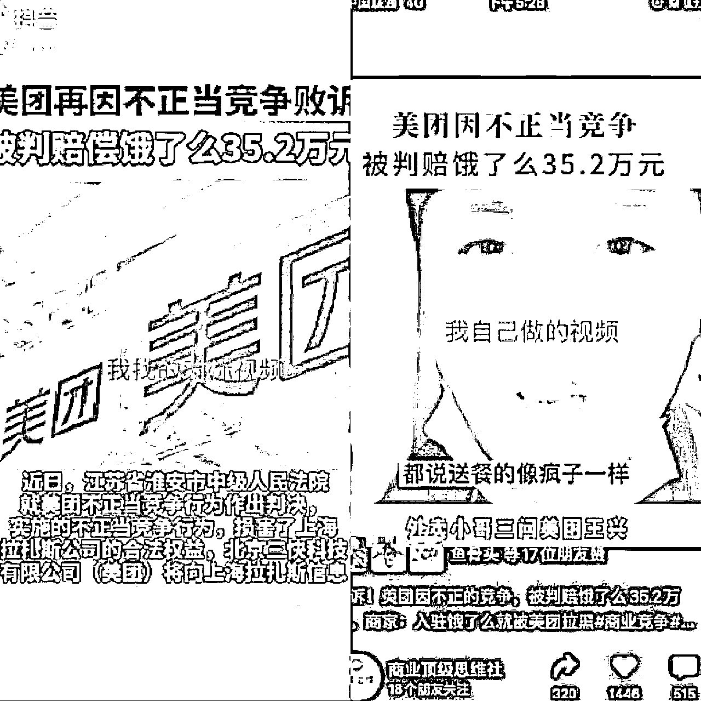

左图是参考片，右图是我做的版本

参考的是一条美团被判赔饿了么的新闻类 ppt，我觉得钩子不足，就转去找美团相关的其他素材，最后锁定了一条“外卖小哥三问美团创始人王兴”的视频——内容聚焦外卖骑手送餐时效和超时赔付等行业痛点，评论区不吵起来都难，被推荐的几率自然更高。结果这条真的被推了。

有小伙伴说他以前刷到过这条“三问王兴”，没想到还能拿来这么用——没错，素材是可以嫁接的，效果就是这么奇妙。

# 3.2.4 素材池怎么搭

拿我自己的素材库当样例：

实际操作时，【场景演示】和【使用效果】可以按自己的情况仿拍替换：

① 先定目标和主题

动手搭素材库之前，想清楚自己做什么类目、卖什么产品，再去定向找素材源，这样素材库才实用。

② 分类归档

素材按类型、使用场景、风格等维度归档，方便随时调取。文件夹、标签都是好用的分类工具。

具体做法：先按画面维度去搜，比如你要什么画面、什么背景、什么场合、什么物品、什么行为，按这些角度分别收集；再把收集到的画面素材切成小段，每段 3-5 秒为宜，同一画面准备多个备选；切好的素材放进专用文件夹——前期整理比较费时，但处理完的素材可以反复复用；视频找完之后做钩子拆分，大致分成 A（前 3 秒，负责痛点/话题/抛问题）+B（产品介绍/卖点/解决痛点）+C（引导转化），然后测试素材效果，不断迭代。

③ 优先收高质量素材

图像、视频片段，能高清就高清。素材画质直接决定短视频的观感，观感好才能留住观众。部分产品素材可以从评价区里淘。

素材还可以去拼多多、淘宝多搜多看，扩充素材池。

④ 持续补新

素材库要定期喂新料。每天刷同行的爆款素材，看到合适的就下载、拆分、入库。

# 3.2.5 基础剪辑与原创内容

视频处理的推荐路径：混剪、二创、原创，不推荐直接搬运。

短期看，精细化的混剪可以规避审核风险；但想长期稳定变现，原创才是正路。

日常剪辑中可以把部分内容——比如产品展示、书籍展示、某些画面或背景——换成自己实拍的素材，这样更易通过原创审核。

比如脚本结构是：

黄金开场+产品介绍+使用展示+同行对比+优惠活动+引导购买

其中“产品展示”这一环，就可以用自己的实拍内容，或用其他平台的好评图、好评视频替换。

二创的流程可以归纳为：

拆解爆款素材 - 批量混搭/套用模板 - 视频去重

# 第1步：拆解爆款素材

前面【章节 3.2.2】已经说了怎么找参考视频，找到后先拆素材。

拆分好的素材按类别存入不同素材库，如下图：

# 第2步：批量混搭/套模板

工具：剪映（电脑端）

不同片段做排列组合，填入新素材

开头 1+效果 1+拆包 1+场景 1+场景 2

开头 1+效果 2+拆包 3+场景 5+场景 1

开头 X+效果 X+拆包 X+场景 X+场景 X

.......（按此方式无限延伸）

# 第3步：去重处理（加特效、画中画、音乐等）

去重方法 1

用 1 个视频画中画 + 1 个图片画中画 + 4 个贴图 + 2 段音频+重写标题，这一套组合拳完成去重。

去重方法 2

原视频位放背景图，把素材叠在背景图上，再加画中画、边框、贴图、音频等，完成二次去重。

素材出处：《8 月初阶视频号航海实战手册》

模板做好之后，后边的视频生产效率会大幅提升。除了自己搭模板，圈友 @figo 还分享了另一套思路：如何批量去重、批量做内容，下面摘录部分内容，全文可看：《如何剪辑视频和制作剪辑模板》

1、用 CRVideoMate 完成基础混剪，详细参数如下（可按需自定义）

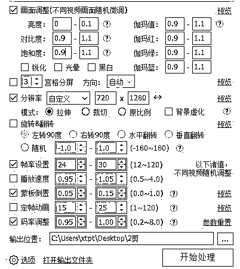

2、制作 PNG 水印图片，用软件自带的水印功能

↓水印效果如下↓ +MM188166M（李李）长期更新

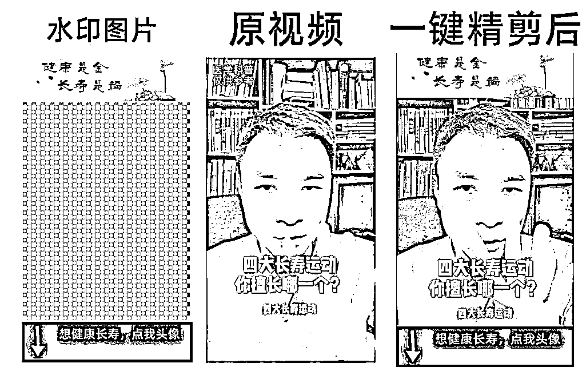

3、如果水印会挡住视频的重要区域，可以压缩原视频的高度，参数设置如下

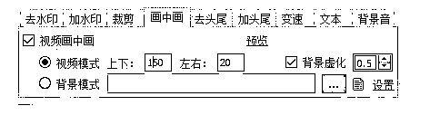

提醒：“上下数值”的高度要大于等于水印图案高度，这样画面才不会被水印盖住。我用的 150，你们可以自行调整。

压缩后的效果见下↓

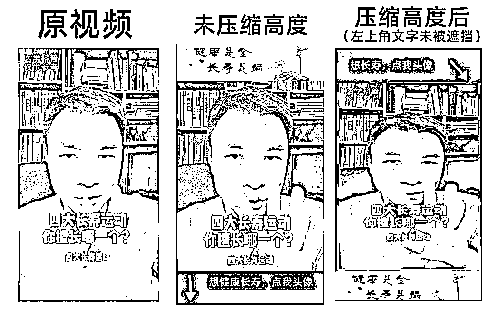

PS：这款软件支持做多个水印，可以实现一个类目一个水印，参数还能导出，适配不同类型的剪辑。

CRVideoMate 下载地址：http://www.cr-soft.net/crvideomate.html

粗剪和精剪的具体操作，参考这篇文档：《如何剪辑视频和制作剪辑模板》

素材出处：《利用批量剪辑软件 CRVideoMate，一键完成视频号精剪去重，可带个性化图案》

# 第4步：加入原创片段（推荐试试）

眼下视频号直播对原创的要求越来越严，这里给两个好用的原创模板，大家挑合适的用。

# 原创形式 1：口播带货视频制 @孟 meng

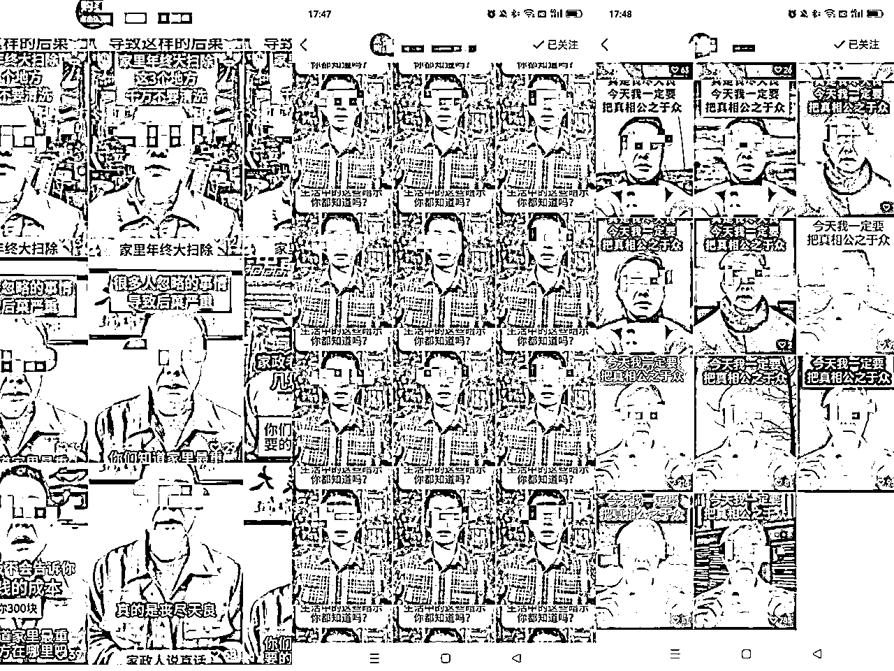

选题拆文案：参考近期爆款

爆款能爆，说明平台算法在给它喂流量，原创要做到爆款级别非常难。所谓“创意都是老元素的新组合”，新手建议先从复制爆款入手。

等素材库和拆解量积累到一定程度，对爆款文案有了感觉之后，再做自己的组合创作。

下载参考视频，用飞书秒记之类的转写工具，把口播文案导出来转成文档

内容拆画面：抓住前五秒

前 3 秒和前 5 秒的完播率是硬指标，短视频必须在前几秒抓住注意力。吸引到用户之后，还要顺手引导点赞、评论、转发、关注。

场景拆卖点：勾起购买欲

把产品放进具体场景里，把功能、特性、价格优势讲透，让用户认可产品，下单冲动自然就上来了。

促单拆话术：推动购买/进直播间/预约直播

视频号里很多用户不会买或不知道怎么买，需要明确引导；但平台监管越来越严，强引导容易触发限流或封禁，建议用软性的互动引导。

比如“你们觉得怎么样？评论区告诉我”，或者在评论区置顶，把用户引到主页橱窗下单。

还有一个好用的玩法：视频起量时开播，并在视频上挂直播预约组件——这个功能引流效果极佳，号主开播时，🛰️会给用户强提醒“你关注的主播开播了”，预约进来的比例非常高。

口播视频的拍摄流程

1.找参考账号原素材

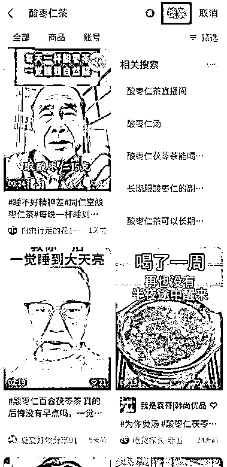

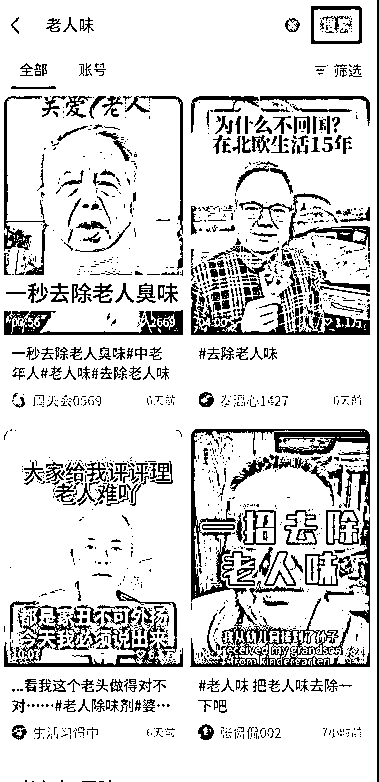

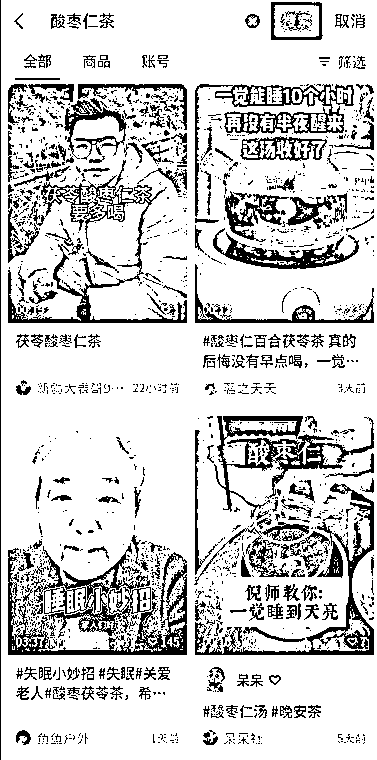

2.拆文案转文字+拆场景

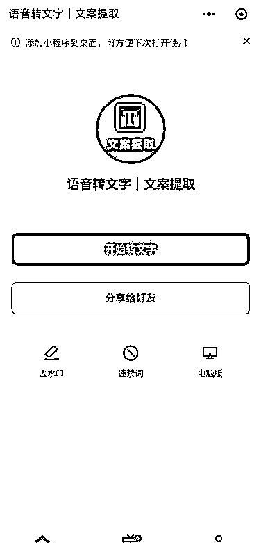

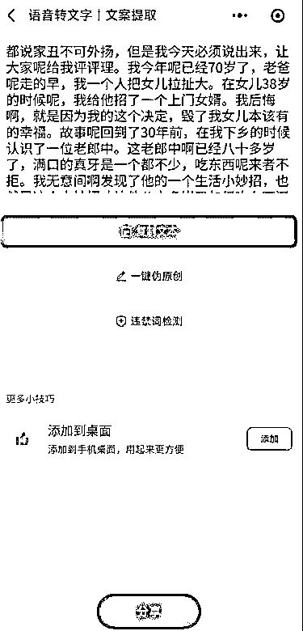

3.仿拍+提词器口播

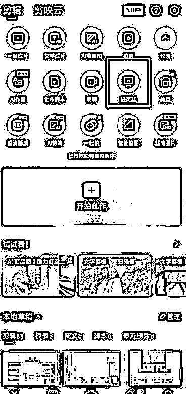

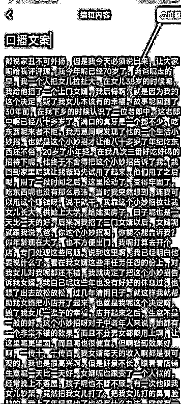

4. 回到剪映做收尾：给人像叠一层变老效果，顺便把音色调一下
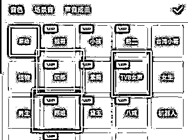
5. 让软件自动识别字幕，核对没问题后导出
扩展阅读：https://wx.zsxq.com/dweb2/index/topic_detail/588424284282414

# 原创形式 2：桌面实拍，也能做出爆款 @听潮

装备不必复杂，凑齐这几样就能开工：手机自备，支架两根，补光一盏，背景板几张，桌面再放几样小道具。

1）手机：手边哪台顺手就用哪台。我早期拿 iPhone6s 练手，照样跑出过百万播放。
2）手机支架：高低各一根更省事。高的那根取远景，矮的那根专门俯拍。
3）补光灯：入门用圆环灯可以，但拍不锈钢这类镜面商品容易反光；预算宽裕就选带柔光罩的。不想买，台灯也能顶——灯管外面裹一层薄纸巾，打出来的光会柔和不少。
4）背景板：双面款更实用，纯色、花纹随时切换。
5）桌面小摆件：仿真花、假书、木鱼小和尚、三八大杠模型，随手放几样，画面就有生活气。

脚本从哪来
别急着开机，先把视频号上的热门视频刷一轮，按镜头逐个拆开，整理成自己的拍摄脚本。拿油性原胶举例：
镜头一：把拖鞋剪开；
镜头二：滴上胶；
镜头三：压住十秒；
镜头四：撕扯粘合处。
四行写完，脚本就齐了。

让拆解更快
拆镜头时配合场景切割，效率能翻倍。剪映或达芬奇都行：素材拖进去，右键点“智能场景切割”，整条片子会自动断成若干段，基本一段对应一个分镜。想用脚本跑，就上 PySceneDetect 加 .bat，教程见：https://www.bilibili.com/read/cv12005222

开拍时注意什么
准备十块背景板，照着脚本和拆解结果逐条复刻。零基础拍第一条通常不顺，卡点集中在两处：
角度：手机播着爆款视频按暂停，商品摆上桌，拍摄手机切到摄影模式，对照屏幕里商品的位置、大小、俯拍还是斜拍，再一点点挪支架，接近了再开录。
光线：别追求完美，补光是深坑，先做到画面没有明显阴影。手生时一个镜头单独拍一条，后期拼接；熟练后一镜到底，拍坏了重来，最后挑最好的。一条结束换背景板、换摆件，十块板轮完再换机位，摆件数量和位置也重新洗牌，让每条背景都不同。这样能避开内容相似度过高，新号不容易被判低质量。文字不够直观，我录了低成本快速实拍的视频，可以搭配着看。

桌面级实拍1.0@听潮plus-0629.mp4【在线播放】

3）实拍也可能踩违规
常见三类：“低质量”“原创审核不通过”“营销感过重”。低质量一般是背景太像，申诉多半能过，就是耗时间；原创审核不过，通常是同一模板发太多，得换模板，不想换就把拍摄场景从室内改到户外；营销感过重，多半是夸张或噱头对不上，例如“能用500年，人走杯还在”“经常出锁不带门的人要注意了”“点个炮仗塞进管道，再用防水胶封起来”，画面里出现人民币也可能被判营销感过重。

剪辑和配音
后期我不爱批量套模板，更愿意一条条手动剪。一条片子对应一个文件夹，素材、文案、配音全归进去。哪条爆了，工程文件立刻能定位，拿它当模板批量复制。
PR 是常用工具：媒体浏览窗口和时间线分开，先在媒体窗口标入点、出点，再拖到时间线，处理变速和画面大小。工程保存后打开剪映，导入 PR 工程，调亮度、自动识别字幕，导出。PR 常用快捷键：输入法英文状态，C 切割，V 选择/拖动裁剪，R 拖动变速，Ctrl+R 输入参数调速。
配音也值得说。视频号对音频查重有点玄，同一段声音用两次，流量可能就卡在千播以下。所以每条作品我都重新配：把爆款文案扒下来，意思不变，改一两个词，用 AI 配音，再用 AU 或其他工具压缩静音，把所有空白段压到 200ms 以内。

# 3.3 AI提效：用数字人批量产出带货视频
数字人如今是提效手段：生成带货视频，再通过挂车、橱窗或直播变现。它主要解决两件事：
一是补表现力短板。多数人镜头感不强，短期也难练出来，但没有表现力照样能口播带货。
二是拉高内容产能。公模数字人能用，自己的数字人也能录，带货视频可以顺滑量产，不必一遍遍重拍口播，省时省力。
会基础剪辑就能上手。

# 3.3.1 数字人怎么挑才不踩坑
工具从前面章节里选，可参考【2.1.4 数字人制作工具】。建议先试“蝉镜”或“即创”，生成效果相对稳。这次航海也把工具权限谈下来了，每位船员送一个月蝉镜会员。
工具到位，模型怎么定？这条赛道玩家不少，形象选择很关键。比如老年形象稀缺，用的人就容易扎堆；平台排在前面、使用量大的数字人，原创审核更容易卡。真要用，就把去重做足。原创过了，才能一拖五发布、一鱼多吃。
数字人的气质得和货品对得上。养生品配个18岁帅哥就不太搭，当然也可以走反差路线，最终拿数据说话。
某条数字人视频爆了之后，尽量沿用同一形象。即创平台搜姓氏就能找到，同一张脸很关键。比如即创里的刘思远和刘天豪，其实是同一个人。就像你平时关注某个短视频人物，不管大号、小号还是切片号，平台都会把这个人推给你，认的就是脸。
直接用素材群里的原素材人脸，爆率更高，但原创更容易不过，去重步骤得多做几轮。风险和收益成正比。

# 3.3.2 三种数字人视频的做法
形式一：本人形象+本人声音。适合表现力不错但时间紧的人，用数字人提效。
形式二：数字人形象+配音，简单快速。自己不方便出镜，或表现力确实弱，可以挑平台里表现力好的数字人形象。
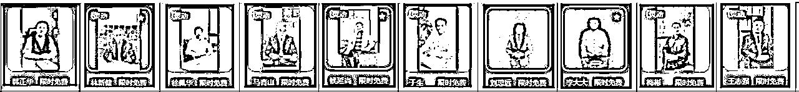

形式三：本人形象+爆款声音。服化道、镜头表现力相对好练，语音却要大量练习。做个人IP更适合用自己的形象。好处是声音可以随时换。
下面分别讲怎么做。

# 3.3.2.1 形式一：本人出镜+本人声音
① 文案准备
新同学：直接拿群里的爆款文案，或把自己刷到的爆款素材文案提取出来。
有经验、想长期做IP：把爆款文案按自己的IP和人设稍作调整。
文案要熟。拍前看几遍，快速默读一遍。容易卡顿的错别字、绕口句一定改掉。比如“里面记载着人体的脉象和八卦阴阳五行河图洛书之间的关系”，可改成“里面记载着脉象和阴阳五行之间的关系”。不熟，拍出来读稿感会很明显。
② 提词器准备
用提词器就不用背稿。推荐剪映、度加剪辑。
③ 灯光准备
除非特殊场景（比如悬疑恐怖氛围），口播光线要亮，脸部尤其要亮。整体色调可以调，但脸不能暗。光线好的房间白天拍最自然；光线差、阴雨天或晚上，建议加一盏灯补光。拍摄背景要跟衣服有颜色区分，方便后期抠像。例如白色厨师服别站白墙前录，抠像边缘会不自然。原则是深色衣服配浅背景，浅色衣服配深背景。
④ 拍摄准备
正面机位：人物占画面约2/3，可用九宫格辅助线定位。上半身露出2/3到1/2比较合适。离太远脸太小看不清，离太近脸太大，看稿动作会被放大。手机平拍。仰拍容易显得盛气凌人，口播时身体前倾压迫感更强，一般文案慎用；俯拍画面又怪。

人物居中、正对镜头，像面对面聊天，情感更容易传出去。
侧身机位：身体侧过来，角度10到30度比较自然，类似采访视角，适合情感、知识、干货类讲解，也是数字人录制常用机位。优点是表现力要求低，看稿、看电脑没那么明显，适合新手；缺点是少了眼神交流，对话感弱一些。
表现力提升：
1. 保持微笑。微笑最直接，镜头里会更亲和。
2. 头部和眼神别僵。千万不要像读稿：头不动、眼睛长时间盯一处、眼珠左右扫，都是明显痕迹。可以让头轻轻晃，缓解盯提词器的僵硬；偶尔看提词器旁边或后方，前提是稿子熟，一两句脱稿没问题；在提词器后放个东西，把它当成观众。
3. 手别固定。手一直一个姿势会很僵。可以拿道具，或准备2到3组自己舒服的手势（摊手、轻晃等），隔几秒换一次，刻意练练。
朗读提升：
1. 情绪比日常说话高一级。日常语气上镜会显平，读之前把感情提起来，但别像朗诵课文或诗歌。
2. 每句话有轻有重。觉得自己说话平，就刻意分轻重读。比如“我才敢说出五星级大厨永远都不会告诉你的6大秘密 / 第一不能放生抽，放了生抽以后会让韭菜变色，影响食欲”。
3. 句子里留合理停顿。一口气不断很难有感情。比如“我才敢说出 五星级大厨永远都不会告诉你的 6 大秘密 / 第一 不能放生抽，放了生抽以后 会让韭菜变色，影响食欲”。
4. 分段录。说错词别慌，停一下，把这句话完整重说一遍，后期剪掉错的。为了控制剪辑时间，长文案最好分段录。
⑤ 开始录制
AI数字人要拿真人口播片段当驱动源，所以录制要按真人出镜口播的标准来，数字人效果才自然。要点：画面比例参考对标账号的人物角度，一比一复刻最好；拍1到3条，给同一账号不同场景用；单条控制在30秒到1分钟；文案可以自由发挥、自我介绍或背几段古诗，表达清楚、自然、有感情即可。特别提醒：现在视频号发数字人视频，有一定概率触发真人出镜或AI数字人验证。为避免验证不过导致废号，强烈建议用真人口播素材来做数字人。
上传到蝉镜数字人平台
PC端网址：https://www.chanjing.cc/?invite_code=tWb6n
第一步：进主页，选“数字人像-创建我的数字人”，上传真人口播视频，并按脚本上传真人授权视频，完成创建。注意，蝉镜免费账号目前只能定制1个数字人形象；不满意可删除重做。想多做几个形象，可以注册多账号分别克隆，或开通会员。
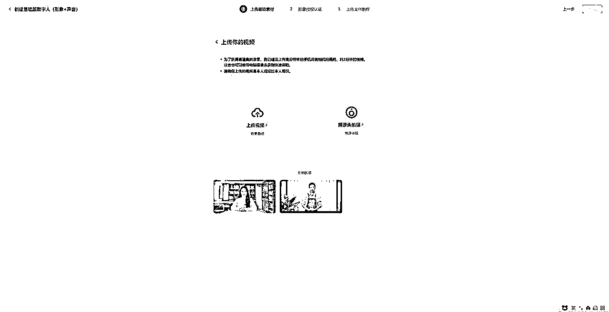
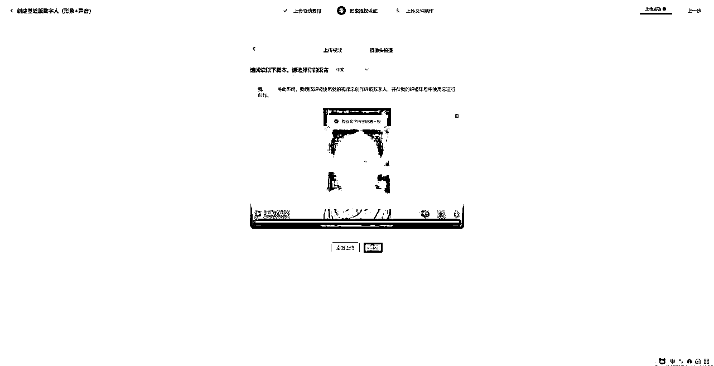
第二步：点开已创建的数字人，选文本驱动或上传音频驱动。文本驱动可选公用AI语音，输入文案后试听，合适再生成数字人视频。回到主页，在“我的视频”里找到生成好的视频并下载。

# 3.3.2.2 形式二：数字人形象+配音（新手首选）
制作视频教学：
蝉镜平台：11月15日.mp4【在线播放】
即创平台：11.14数字人生成.mp4【在线播放】

# 3.3.2.3 形式三：本人形象+爆款声音
第一步：参考上面章节克隆自己的形象，建议用蝉镜。
第二步：用现成语音库生成爆款语音。工具很多，PC端可用剪映自带音色。蝉镜也有不少AI语音：
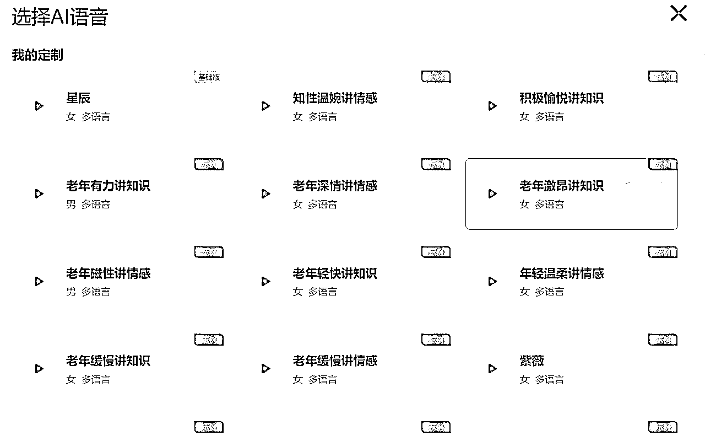
小程序可用配音神器：
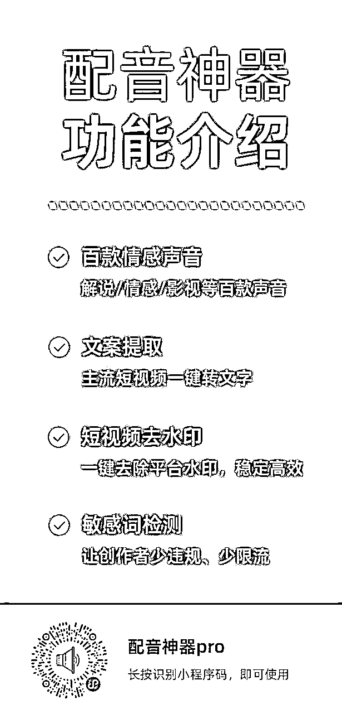
网页端还有腾讯智影：
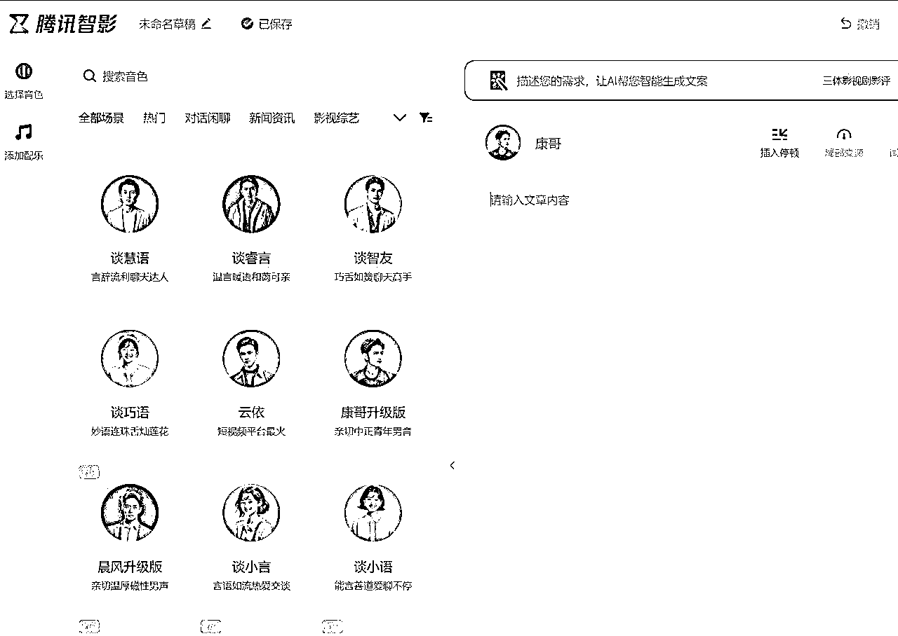
第三步：制作数字人。制作时选择上传音频，把音频传上去，数字人口型会自动匹配。

克隆视频号爆款语音
视频号里长期大爆的口播账号，声音往往很出色。这些视频已经过用户验证，可以直接克隆声音来用。
第一步：参考上面章节克隆自己的形象，建议用蝉镜，前期费用低。
第二步：处理原始语音。下载爆款声音后，用剪映降噪、美化，再导出备用。

第三步：克隆语音
方法一：用飞影，可单独克隆声音。缺点是要收费。先克隆声音，上传找到的爆款语音。

克隆完成后去创作音频。

制作视频。

2：下一行缩到上一行，别留空行，否则会出现“咯噔”的杂音。
方法二：用免费语音工具，推荐 fish audio：https://fish.audio/zh-CN/text-to-speech/
优点：还原度较高，免费。缺点：一次约170字、30秒，长文案要分多次生成。平台里也有很多现成的真人语音可用。

使用前先注册，国内邮箱即可。

点左上角“构建声音”，命名、上传音频，再点创建。

点“语音合成”，导入文本，选自己的语音生成，完成后下载。

第四步：制作数字人。制作时选择上传音频，把音频传上去，数字人口型会自动匹配。

# 3.3.3 混剪与去重
# 3.3.3.1 基础混剪操作（MM188166M 李李 长期更新）
基本逻辑：把数字人口播和商品素材混剪，提升出货转化。常见问题在字幕：数字人视频字幕和原素材字幕叠在一起不匹配怎么办？用剪映的字幕背景功能，把字号调大、加背景，基本盖住原素材字幕（圆角也调一下更顺眼），或者干脆不处理——老年观众通常不会盯这些细节。更多更新可找 MM188166M（李李）。

剪映好用的快捷键（选中素材后使用）：Ctrl+鼠标滚轮放大或缩小时间轴；Alt+鼠标滚轮快速前后拖动视频；Ctrl+B分割视频；Q向前裁剪；B向后裁剪；点右边中间的预览轴按钮，可快速预览某个时刻画面。

# 3.3.3.2 去重怎么做
尽量让画面和原素材的MD5值不一致。
11.14去重操作.mp4【在线播放】

# 3.3.3.3 抠像处理
一些验证过的超级爆款，可以直接抠像去重再发，把素材流量吃透。绿幕或纯色背景素材更好抠，否则容易抠不干净；自己二次拍摄时也记得用纯色背景。抠像功能入口：

# 视频号带货落地手册：从剪辑到开播

人物抠净后，别急着导出，还要铺一层场景底。做法是把人物层往上提，场景图压到封面所在的那条轨道。底图尽量和内容同频：调味品内容配灶台，园艺种子配庭院。

配套教程：

11月16日 (2).mp4【在线播放】

抠像参数：

# 3.3.3.4 素材归置

**开头模板**

近期验证过的强钩子，可以剪成独立片段反复套用，再换不同货品素材。开头决定观众是否停留，也影响平台后续给不给量。养生赛道可借这些框架，但别照搬原句：

- “别再信什么XX，今天我把XX的底拆开讲”
- “有人讲XX这辈子都甩不开，我可不答应”——产品词自行替换，“有人讲”要放最前
- “XX压根不存在，纯属糊弄人”
- “为什么XXX”
- “假如XXX”

**货品素材**

参考《2024年6月视频号直播航海手册：5.5目录章节》：
https://scys.com/view/docx/NLfHd5K54oXv28xibv9cXOOZnsU#F58AdxOgIoQpLOxJxSGcfFjbnYg

**场景图**

也能用AI提示词出图。示例：办公室，背景墙书架，有纵深感+MM188166M（李李）长期更新。

# 3.4 视频上线

# 3.4.1 发布入口怎么选

两条路：手机App；视频号助手网页版（https://channels.weixin.qq.com/）。下面以手机端为主，网页版逻辑接近，自己点一遍就能上手。

# 3.4.2 手机端上传+MM188166M（李李）长期更新

流程不绕，细节留在后面提醒。

- 描述：写和货品强相关的句子。
- 话题：挑热度高的话题。卖芒果可挂#芒果，也可挂#水果这类目词。
- 提到：带货场景暂时用不上，我们不加。
- 位置：可加附近地点，对分发有辅助。
- 活动：我们通常不加。真要发起，可在活动里放直播信息、私域引导等；每条视频挂同一活动，能多拿曝光。
- 链接：带货入口主要放这里，前文已提过。

# 3.4.3 电脑端上传

仍用视频号助手：https://channels.weixin.qq.com/。网页版好处有三：能预约发布时间；能绑运营者；评论管理更顺手。

**预约发布**

假设一个号要传10条，每小时放1条。号一多，手机逐条点很耗神还易错；单号10条用预约就轻松。少量、按期预约，不影响分发和流量。

提醒：网页与App发布效果无差别；话题别省，重要的事说三遍；单号一天10条上下，别过量，间隔别太密。

# 3.4.4 多号分发

手里有5个号要更新，哪怕两台手机来回切也烦。用“绑定运营者”：把B、C、D、E、F都挂到A名下，A登录助手后，可统一发片、管评。

1、评论、私信、打招呼消息回复 @麦洛

这类消息必须回，目标是把人引到下单。围绕对方问题答，别自说自话。

碰到一两条负面评论，别往心里去，更别对线。争吵不产生收益，持续做事才会。处理方式：无视、删除，或在助手开“精选评论”，把不想展示的声音压下去。出处：《视频号直播建议指南》。

2、多号评论怎么管 @麦洛

手机在播，或号多切换麻烦，又想靠评论把人引到橱窗，就用“绑定运营者”统一管评论。若负面声音集中，开“精选评论”，只放出希望访客看到的内容。助手其他功能自己摸索。发片间隔拉长，一般无碍。

若播放为0，原因不少：号被识别为营销号；内容已被搬过。排查：该号发别的内容有量，说明是内容问题，换片；发什么都无量，可能是号的问题，用其他号同内容测试，有量就注销此号。官方对搬运打击在加码，后文“5.1 视频零播诊断和解决方案”再展开。出处：《视频号直播建议指南》。

# 3.4.5 上线后注意

新手要护住自己找到的品，别让🛰️好友摸清，免得招来对手。两件事留心：朋友圈有同行时，别给自己的片点赞、别转发朋友圈，否则选品暴露；别关注自己的小号，也别关注对标号，因为关注关系会分发给🛰️好友。

# 3.4.6 数据在哪看

🛰️→发现→视频号→右上角人像→我的视频号→创作者中心。

# 四、【实操 3/3】上架商品与选品验证

**本章要解决**

选品、发片都做完了，怎么判断这个品行不行？多数新手没底，前期先多发流量内容，等某条爆了再挂货验证。带货片一旦起量，尽快开播，转化会明显抬升。

本章收了几种验证打法，按需取用。优先看：

✅交叉测品法：能同时看多个号强弱，也能比较多个品谁更吃受众，再回头优化素材和细节。

其他方法：

✅集中测品法：同一品类每天10条，集中喂一个号。
✅分布式测品法：人群定了，品类没定，就多品类同发，谁爆留谁，其余删。
✅暴力测品法：对标片直接搬，3天0播就换；爆了再细做。
✅带货/流量配比：两类内容按一定比例搭着发。
✅137法则：看第1、3、7天数据，不行就果断弃品。

**本章任务路线**

学完并做完，即完成第三阶段：上架商品、验证选品，约3—5天。
1、把选中商品挂主页橱窗、挂视频、挂直播间购物车，约0.5小时。
2、发至少10条带货片，或开播3次，做单品验证，约3天，每天2小时。

# 4.1 商品上架

平台现行口径：想挂小黄车、直播卖货，先到1000关注；不够1000只能放主页橱窗。达标后可自行申请，通常比等系统自动开更快。注意：搬运或违规记录多，关注够也可能被拒。另有官方新规计划2024年3月13日把直播挂品门槛从1000关注降到100关注。

**1000关注怎么解**

1. 个体户开店可免关注门槛：几十元成本开5店，一号一店，只能带本店上架商品。
2. 先发祝福类视频涨关注，再隐藏。

建议前期别死磕1000关注：先把内容做稳，商品放橱窗，引导访客去橱窗成交；流程跑通后，第二、第三个号再考虑冲门槛。

# 4.1.1 上架动作

选好品后，两个动作：个人主页橱窗上架，一般走选品中心；发视频时挂商品，从主页橱窗里选。

# 4.1.1.1 主页橱窗上架

主页橱窗不看关注数，但账号要实名，并交100元保证金，才能在选品中心把商品加进橱窗。

1. 创作者中心→“带货中心”。
2. 点“去选品”。
3. 搜目标商品，点“加橱窗”。

想稳一点运营，先读官方规则汇编：《视频号橱窗带货规则总则》《【视频号橱窗】管理规则合集（可对外）》《视频号橱窗达人违规管理规则》《视频号橱窗开放类目一览表 -2022年5月17日发布版》。

# 4.1.1.2 视频挂商品 @纸壳 @李诚 Sonic

现在视频挂货主要靠购物车，第一步先拿权限。5月16日新规《视频号短视频商品分享权益、加热商品功能调整公告》落地后，0关注强挂车已行不通；要挂车，先开权限。

开购物车权限：1000关注，或开小店（新手慎入）；内容合规；🛰️支付实名。圈友@纸壳 实测出一套办法。关注不够时两条路：发好运祝福、婆媳关系、社会百态类内容涨关注；或开个体店，只点开店，不填资料、不交店铺保证金（注意不是达人带货保证金）。内容合规这条，用手机版视频号拍，借系统贴纸、特效等，发不少于10条，连发两天，大概率过审。两点做到，基本能开。

市面上也能买带购物车的号，约400—800元一个。想快速试水可买。商品已在橱窗时，发片按下面走：

1. 拓展链接选“商品”（即购物车）。
2. 在橱窗选本条要挂的货（前文讲过怎么加橱窗）。
3. 完成。

已开权限的号，还要看每日挂车视频数量和关注量限制，详见《视频号短视频商品视频发布频次管理规定》。

出处：《视频号带货建议指南》；《视频号短视频挂车投流常见问题和解决方案》。

# 4.1.2 上架避坑

在选品中心加橱窗时可能遇到：搜不到想带的货，钱从眼前溜走；佣金太薄，替别人卖不赚钱；僵尸品，商家不发货；商品被选品中心下架，旧带货片作废、出不了单；商家不接咨询，转化差；发货慢，客户等不及退货。

所以更稳的做法：把货上到你信得过的人开的小店。操作：小店管理员发关联视频号邀请；选品中心右上角“橱窗管理”（入口：创作者中心→带货中心→去选品）；选绑定小店；选商品点“添加橱窗”；完成。截图店铺仅演示，商品不作推荐。

为何要“信得过”：小店管理员能改佣金率。带货爆了，不良商家可能把佣金调成0，你次日出单一分拿不到。留个心眼。另外注意：新视频号已不能绑小商店，也不能把小商店商品加进橱窗。

# 4.1.3 带货数据

路径：创作者中心→带货数据→今日数据→佣金。

提现会收手续费。

数据不理想，就要复盘迭代，详见“5.2 整体复盘优化”。

# 4.2 选品验证

# 4.2.1 交叉测品法 @李诚

多数新手不知道品能不能打。前期多发流量片，等爆了再测。交叉测品实测好用、出效果快，建议新手优先。

以3个号为例。号少、精力少、片少，就把周期拉长：每天6条就测3天，每天4条就测5天。每号每天“2+1”：2条流量+1条硬带货；精力够做2组。记录基础播放，横向对比。

示例：A号发X品2流量+1带货，再发Y品2流量+1带货；B号发Y品2流量+1带货，再发Z品2流量+1带货；C号发Z品2流量+1带货，再发X品2流量+1带货；各跑3天。这样能判ABC三号强弱，也能看XYZ三品谁更吃受众，再优化素材和细节。带货片爆了，立刻开播放大成交。直播看“6.1 开启直播带货”。

# 4.2.2 其他验证法 @兰心

# 4.2.2.1 集中测品法

有5个号、5个品类时，常见打法是同一品类每天10条，集中到一个号；也可并行测。举例：每品类搬10条，共50条；5品类各拿2条同时发5个号。哪条爆，就把该号定为该品类，继续喂同品类；其余4号继续测。首日50条没动静，就每天50条，连测2—3天。

# 4.2.2.2 分布式测品法

人群已定，品类或具体品未定：多品类同时发，谁爆继续，其他删。号不多又在几个品类间纠结时，这招好用。比如做宝妈市场，在育儿书、育儿好物、婴儿服饰间犹豫，三类片都备好了，就同时发，哪类先爆做哪类。

# 4.2.2.3 暴力测品法

对标片直接搬来发，3天0播就换；爆了再精做。适合号多的人。完全不去重，爆款率低，但省下的时间能多铺几个号。

# 4.2.2.4 带货与流量配比

坊间有七三、五五之说，其实没有绝对标准，跟号况、选品经验有关。号多就多比例试，哪种效率高就加码；选品有把握，可带货为主、流量为辅；没把握，先流量后测品。

# 4.2.2.5 137法则

第1天：播放破300，号正常、片正常，继续。
第3天：仍破300，继续；没有就换对标片，原片隐藏。也可拍窗外风景配乐试播，有量说明号没事，是去重不够。
第7天：去重能过但上不了推荐，果断注销重来。循环到每个号播放稳、出单稳。

出处：《如何高效测品》。

# 五、开启直播带货 +MM188166M（李李）长期更新

**本章概要 +MM188166M（李李）长期更新**

带货片一爆，就开播放大成交。直播是新手低成本放大业务的有效方式。本章整理：直播推流机制、场景搭建、话术提升、货品攻略、违规注意。

**本章任务路线**

做完即完成第三阶段：上架商品、验证选品，约3—5天。
1、学同行直播打法，用直播展示带货或引流客资，保持开播不少于5次。

# 5.1 开启直播带货

# 5.1.1 了解平台推流机制 @大树

做视频号直播带货，不能只靠一腔热血。平台分发流量有自己的逻辑，搞懂这套规则，开播时才知道该往哪个方向使劲。人气、成交、公私域这三个层面的数据，都是判断直播间健康状况的重要参考。它们能帮你判断用户的兴趣程度、内容的吸引力以及带货效率，进而让产品推广更顺手。但也要留个心眼：平台的算法和政策并不是一成不变的，常看最新动态，才能跟上节奏。

# 5.1.1.1 人气权重

1、曝光进入率

这个指标衡量的是：系统把你的直播间展示给一批人，其中有多少人真正点了进来。可以写成“进房人数 ÷ 曝光覆盖人数”。用户在没有进房之前，只能靠标题、封面和实时画面来判断值不值得看。在信息流里刷到时，标题、画面以及主播正在说的话会共同影响点击；在直播广场浏览时，封面的吸引力和画面观感则更为关键。后台“内容力”板块里有一项“直播有效进房率”，就是专门看这个环节的。这个比率越高，说明你承接曝光的能力越强，系统也会更愿意把流量送给你。

2、有效观看时长占比 30S/60S/180S

平台会把观众的停留时间分成几个档位来观察：30秒内有多少人、60秒内有多少人、180秒内有多少人。每一档的比例，反映了直播间的留人能力。系统再结合这些数据判断你的直播内容质量，并决定给你什么样的流量层级。观众能多待一会儿，停留时长数据就会更好看，被继续推荐的几率自然随之上升。

3、互动率、关注率

互动不限于聊天，评论、点赞、转发、分享、送礼物、连麦等都算互动。关注率又叫转粉率，粉丝关注后会在你开播时收到提醒，这代表用户愿意和你保持长期联系。互动和关注的数值越高，说明主播的内容和人格魅力都得到了认可，用户粘性强，成交转化也会更顺畅。

4、礼物热度

点进视频号直播间，左上角是场观人数，右上角是热度值。热度本质上反映的是直播间当下的互动热度，而礼物在热度计算中的占比相当高。让观众送个粉丝灯牌、加入粉丝团，就是最常见的拉热度方式。愿意进粉丝团的人，通常是冲着信任来的，可以说已经是直播间里的核心用户，适合长期维护，也适合引导他们把直播链接分享到朋友圈或🛰️群，为直播间引流。

# 5.1.1.2 成交权重

1、成交密度：单位时间内的成交量

视频号的公域推荐机制，可以概括为“成交密度 + 互动密度”的双重评估。两者都能拉动自然流量，但成交密度的分量明显更重。因此，想从公域池子里拿到更多推荐，最有效的动作就是把单位时间内的成交量提上去。一个务实的参考口径是：按实时在线人数的十分之一设定目标，例如有100人在线，就争取做10单。订单金额多大都没关系，1元也是成交。关键是节奏：每5分钟打一波成交，连续三个波次叠加，系统就有较大概率判定你值得加推。

2、商品点击成交率

这个比率可以用公式表示为：成功下单人数 ÷ 商品链接点击人数。数值越高，说明商品越对消费者的胃口，平台也会因此给你更多曝光。不同角色的商品，目标线并不一样：福利品最好做到70%以上，承接品要超过40%，利润品至少20%，这样整体仍能保持在30%左右。如果数据一直不达标，问题可能出在主播话术、商品链接、选品方向或排品顺序上，需要逐一排查。后面还会继续细讲。

# 5.1.1.3 公私域联动（重点关注）

视频号区别于抖音的一大优势，就是能玩转私域，并且用私域流量撬动公域推荐。平台甚至会给那些把私域用户导入直播间的账号，匹配一定比例的公域流量作为激励。具体来说，你每把一个私域用户带进直播间，系统就可能把你的直播间推送给更多新用户。但这种激励并不是“拉人头”就能拿到的。如果拉过来的人本身就不感兴趣，进来不互动、不购买、马上离开，那么撬动效果会非常差；反过来，私域用户来了以后愿意停留、愿意交流、愿意下单，平台给出的公域奖励才会越来越可观。

1、分享

分享是互动体系中优先级很高的一环。直播间可以分享到朋友圈，也可以鼓励观众转发到🛰️群或者直接发给朋友。每一次分享都可能撬动一批新观众，而且分享者的质量越高，带来的流量越精准。所谓物以类聚，如果他本身是你的目标客户，他身边的朋友大概率也有类似需求。分享动作要主动要，要用方法要，但最忌讳生硬地催促。这里有一条互动原则：你希望观众做一件事，就得给ta一点回馈，做到等值交换。

2、预约

视频号直播间的左下角可以弹出预约卡片，把当前的观众引导到下一场直播。通过预约提前锁住用户，等开播时系统也会给出提醒，相当于为下一场预热。

# 5.1.1.4 不同阶段的考核维度

1、冷启动期：0-2000场观

这个阶段，系统最关心的是“内容消费表现”，也就是观众看到你的直播间之后愿不愿意点击、点进来之后愿不愿意多留。推荐系统会重点观察曝光进入率和有效观看占比，以此判断你的内容对哪些人有吸引力，并在后续推荐中持续放大。如果这两个数据始终不理想，自然流量就很难继续增长。相关内容力指标，可以在直播数据大屏的内容力模块里找到。

2、数据增长期：2000场观-10000场观

账号进入增长阶段后，平台的考核重心会转移到商品点击成交率上：有多少人查看了商品、又有多少人点击链接后成功付款。这里只看下单人数和下单单量，不看成交金额。观众的行为，也从“看内容”慢慢变成“真消费”。平台此时会给账号打上更精准的标签，并据此推荐更多同类人群进入直播间。

3、成交转化期 ：10000场观以上

当流量已经足够精准，平台便不再只盯着你有没有转化，而是看你把流量用得好不好。同样一批观众，你能卖出多少钱，同行能卖出多少钱，谁给平台创造的价值更大，流量就会倾向谁。这就是直播间的赛马机制。这个阶段的关键数据有三个：GMV（成交总额）、观转率（观看人数到成交人数的转化效率）、GPM（每千次观看产生的成交金额）。想持续拿到推荐，就必须在同类直播间里跑赢对手。

# 5.1.2 直播场景

直播间能不能留住人，场景的作用常被低估。用户第一眼看到的画面，往往决定了他是否愿意点进来，也决定了他会不会多停留一会儿。所谓场景，就是用户视线范围内出现的所有信息：封面、实时画面、主播状态、产品包装等等。外层场景指封面加实时小画面，点进去之后才是完整的直播画面。一个养眼、独特、贴合货品气质的场景，既能提高曝光后的点击率，也能拉长观看时长，这两点都会反馈到平台推流上。

# 5.1.2.1 直播封面、画面

观众在直播广场还没点进来的时候，先看到的是静态封面，然后才是动态画面。这个阶段没有声音，你必须靠画面和文字说话。封面可以理解成一张海报，把最关键的信息放上去：卖什么、有什么好处，越直白越好。比如卖乳胶枕，封面可以直接写“一觉到天亮的秘密”；卖水果，就强调产地和新鲜。直播广场上的动态画面，更是直接影响曝光进入率的因素；官方也反复说过，这个数据非常重要。画面中的标题也要有钩子，像是“哪些人适合用”“今天有什么福利”，都能引发好奇。

# 5.1.2.2 直播画面中的文案特点

画面文案要讲究“短、准、狠”。福利向的写法可以简单粗暴：“1米专享”“9.9元老北京布鞋”“奥特莱斯正品撤柜”；品牌向的写法要突出官方感，比如“XX品牌正品直播间”；痛点向的写法可以描述场景，比如“3分钟搞定出门妆”；信任向的写法可以拿出资质，比如“XX官方指定供应商”“XX工艺大师出品”。用户一眼能看懂，才有机会被吸引进来。

# 5.1.2.3 场景搭建的依据因素

同样一件商品，放在不同的场景里，传递出来的信息量完全不同。好场景的核心作用，是让用户产生代入感——他用了你的产品之后，生活会变成什么样。与其让商品孤立地摆在桌上，不如把它放进真实的使用情境里。

从产品视角来看，画面要让商品成为主角，聚焦卖点、功能和细节。比如卖水果，就把洗好切好的果肉展示出来；卖护肤品，不要把瓶瓶罐罐锁在纸盒里，要挤出来让观众看到质地；卖电风扇，就让它持续转动；卖食品和饮品，就煮好、泡好、呈现出可以直接入口的状态。

从氛围视角来看，不同的消费心理需要不同的场景来配合。在茶室卖茶，突出的是格调；在仓库卖茶，突出的是实惠；在茶园卖茶，突出的是正宗；在大卖场卖茶，突出的是热闹。想塑造科技感，就往实验室里放；想塑造家庭感，就放在卧室、客厅；想塑造原生态的新鲜感，就去果园和菜地。场景和人群的购买偏好越吻合，直播间就越有说服力。

原产地也是一种场景红利。如果产地真实且难以复制，就走出去。在新疆葡萄园里卖葡萄干，跟在普通房间里卖，吸引力完全不在一个层次。

包装和摆放同样会左右用户对价格的判断。很多时候，包装的成本比产品本身还要高。一只陶瓷杯放在普通桌面、放进木制礼盒、摆在带射灯的玻璃柜里，在镜头里看起来完全是三种档次。

# 5.1.3 直播话术

# 5.1.3.1 拉流话术：外面的点进来、进来的留下来

拉流的核心是“留人”：把已经进来的人稳住，同时让外面刷到的人也想进来。主播需要用一两句简短并且与观众有关的话，迅速接住新进来的人；听到有福利的人，也可能愿意停下脚步。留下的人比离开的人多，人气就会一点点往上走，在线数据越高，系统给的曝光也会越多。

示例：新进来的姐姐们先不要划走，这里是专业卖帽子的直播间。主播手里这顶帽子，专柜卖899，今天只要付个运费就能带走，想要的姐姐扣个1。真丝面料，特别适合咱们这个年纪，现在已经有XX位报名，剩下XX个名额，2分钟之后上链接。等会儿还有XX，同样是给姐姐们准备的福利。

要点：用一句话说清在卖什么，再给一个留下来的理由，比如马上发券、仅限今天、价格马上改、一会儿有福利。

# 5.1.3.2 立人设：讲背景

立人设的本质是给用户一个相信你的理由。最好的方式就是拿事实、摆证据、讲故事，把自己的身份和货源优势绑定起来。

示例：我们家是专门做帽子的工厂，有3000平方米的厂房，100多个工人，一天能生产XX顶帽子，平时主要给品牌做代工。这批帽子贴个品牌标，专柜能卖大几百。大家可以看一下，同款在某宝某猫上卖多少钱（配合道具对比）。

要点：先让观众相信产品靠谱，再给具体理由，比如技术背景、源头工厂、全网热卖、口碑好等。

# 5.1.3.3 讲主题：今日活动

主播需要让观众理解：你今天为什么开播，为什么发福利，凭什么相信你。把这些讲明白，后面的动作才不突兀。

示例：我们家之前一直做线下生意，最近才转战线上，想把自有品牌打响。直播最难的就是冷启动，所以我们准备了XX份礼物送给姐姐们，大家不需要做什么，留在直播间捧个人场就好。礼物每2分钟发一轮，不耽误大家时间。今天还有XXXX，都会陆续安排上。

要点：把活动理由讲圆满，让你的福利和上链接动作顺理成章，同时增强信任。

# 5.1.3.4 点对点：点对点成交，要读公屏

公屏是最好的成交现场。点名叫出扣过1的观众，给对方快速回应，既显得专业，也能带动其他沉默用户。如果互动氛围不够，可以安排水军先抛几个问题活跃气氛。

示例：XX姐姐已经在公屏扣1了，这边马上安排一单给她。

# 5.1.3.5 塑品话术：让产品听起来逼格更高

塑品不能停留在材质和工艺上，而是要把产品与大牌同款、纯手工、明星同款、进出口等更高维度的关键词绑定。具体可以分三步：第一步戳痛点，引起共鸣；第二步讲卖点，让用户知道为什么买；第三步讲故事或者类比品牌，完成价值塑造。

示例：这个款式的版型，是京派旗袍传承人亲手设计的，里面带着老北京的韵味，穿上特别显气质。您要是感兴趣，去北京大栅栏那条街上就能找到这位传承人的门店，同款就摆在店里。

# 5.1.3.6 转品话术：承上启下

换品的时候，不要生硬切换。顺着公屏上的问题或用户的需求，用利他的口吻自然过渡。

示例：刚才有姐姐问眼镜还有没有？这款眼镜是昨天答应给老粉的福利，新粉先不着急，等这波结束，马上给新粉安排别的福利。

# 5.1.3.7 催单逼单：为什么今天买？今天不买有什么损失？

价格报出来后，要给用户一点下单的时间，但也要把急迫感拉满。错过今天，可能就没有这个价了。

示例：姐姐们手速太快，这批已经卖完了，以后也不会有这个价。现在看看还有没有占单没付款的，我再给姐姐们留几分钟；时间一到，名额就让给后面排队的姐姐。

# 5.1.3.8 保障话术：放心无忧

用户犹豫的本质是怕吃亏。把质量、服务、售后这些承诺直接说出来，能打消大部分顾虑。

示例：我跟大家承诺，所有产品都是正品，假一赔十。产品质量报告和国家认证就摆在镜头前。收到货有任何不满意，7天无理由退换货。咱们家客户评价一直很不错，已经帮上万位客户解决了问题，大家可以放心下单。

# 5.1.4 直播间货品攻略

# 5.1.4.1 选品：选品决定生死

选什么货，决定了直播间的打法、主播、场景和人群。以下几个维度可以作为参考：第一，其他平台已经卖爆的产品，完全可以拿到视频号上重新卖一次，可以用蝉妈妈、抖查查、飞瓜这些第三方工具查看各品类的销量榜；第二，货源优势很重要，电商到最后拼的是供应链，手里有好货、有价格优势，就已经赢了一半；第三，要符合视频号的人群特点，这部分用户以40岁以上的二三线女性为主，受其他直播电商影响相对较小，不习惯反复比价，退货率也低。推荐优先考虑的品类包括服饰箱包、滋补食疗、零食特产、美容护肤和日用百货。

# 5.1.4.2 组品：组合产品提升价值，方便成交

组品要带着明确的目的去做，围绕一个主推款进行搭配。关联组合就是给产品配上相关周边，比如买防晒霜送隔离霜加面膜，买鞋子送袜子。拆分组合则是把整体拆开卖，比如买眼镜送眼镜盒和眼镜布。组合起来，用户会觉得更划算，成交也更容易推进。

# 5.1.4.3 排品：顾名思义，直播中产品的排列顺序

排品要跟着直播脚本走，价格从低到高，成交难度从易到难，主播话术也要提前设计好。钩子品的作用是开播时拉流量，拉互动和停留；它通常是价值感很强的标品，用超低价来吸引点击，比如苹果手机卖1000块、4个哈密瓜卖1块钱。福利品负责做成交密度，大众对价格有认知，看到你确实卖得便宜，决策成本很低，例如5包纸巾1元钱、一袋洗衣液2块钱。承接品放在中间价位，通常是几十元的东西，还能有点微利，用来丰富直播间的品类。利润品是真正赚钱的款，可以是几十元也可以是几百元，重点看利润率或毛利率。形象品则是摆出来撑门面的，比如标价3980但不卖，让人回头再看利润品时觉得便宜不少。

# 5.1.4.4 测品：测试产品，是判断产品迭代的必要手段

每一款产品都有生命周期，需要通过直播间不断验证。用户的行为，就是用脚投票的结果。测试一个品是否受欢迎，首先看销量；其次是弹购物车后的曝光点击率，点击率高说明用户真的感兴趣。所以后台数据要一直盯着，发现数据下滑就要准备换款。还有一种测法，是在主播后半场介绍新品，或者把产品放在场景里、戴在主播身上，引发讨论。比如安排水军在公屏问“主播你带的项链在哪里买”“你身上的衣服卖不卖”，话题一热，测试目的就达到了。

# 5.1.5 直播违规注意事项

直播流程跑顺之后，同样要重视违规风险。视频号对违规的处理非常严格，一旦出了事，账号很可能很难恢复元气。表面上看，处罚可能只是限流3天或7天，但处罚期结束后，流量依然可能明显下滑，最后往往只能换绑新号或者注销重来。所以，如果团队经验不足，最好不要尝试无人直播或半无人直播，这类模式极易踩线。直播领域的违规大体分两类：一类是小店产品售后违规，包括商品标题、图片等；另一类是直播间违规，包括主播话术、直播间场景等。

# 情况一：产品售后违规

1）违背承诺【延迟、无法发货】

这个问题的含义是：卖家没有按照平台的规定或者对用户作出的承诺，按时发货或提供相应服务。平台一旦认定，通常会禁止使用橱窗3天，并下架对应商品。补救方法是：如果确实因为特殊情况无法发货，第一时间向平台报备，或者和买家协商取消订单。报备可以直接在小店后台提交，也可以发送邮件至 weixinlive-JF@tencent.com。只要报备理由正当，之后如果被误判，找官方小二沟通，多数情况下还是可以撤销处罚、恢复开播的。

还要特别注意：单次报备最多覆盖15天，超过期限就得重新报备，否则依然会按违背承诺处理。更详细的规则可以参考《视频号橱窗商家【违背承诺】实施细则》以及《关于延迟、无法发货报备的指引公告》。

2）推广超范围商品

这类违规指的是通过视频号橱窗售卖平台明确禁止的商品，或者商家没有相应资质却强行上架的商品，其中也包括超低价商品。比较常见的例子有：皮色料（属于珠宝玉石禁售）、无资质赠送手表（商家并无售卖手表的资质）、莫桑钻商品（平台明确限制出售）以及低价珍珠饰品（同样属于平台禁售范围）。上架之前先确认类目和资质，能省去后面很多麻烦。

# 视频号带货：先避雷，再提效

在视频号做直播带货，热情之外，规则意识和复盘习惯缺一不可。货品能否上架、主播怎样开口、活动如何设计、内容怎么发、数据怎么回看，每个环节都有讲究。下面把常见踩线点和运营提效办法一次讲清。

## 货品上架与信息发布：规则先行

先摸清平台对商品的管理口径：哪些类目放开、哪些不放开、哪些属于定向准入；定向准入的货品还要了解销售底价。通常开播只能卖已绑定小店并开通对应类目的商品。其他类目要上架，或作为赠品送出，也得先查规则文档，确认不在禁售范围。

细则文件见：《相关商品橱窗类目准入规则》《视频号橱窗类目、商品资质总览》。

**3）发布违禁信息**：账号发出的信息或商品若违反《中华人民共和国广告法》等法律法规，就踩线。高发情况有两类：一是食药同源或滋补品，直播时容易把功效说过头；二是主播或直播团队被全网拉黑，或本身属于违规违法团体。

看几个例子：有主播口播亚麻籽油能疏通血管、养护大脑，把普通食品讲成功能产品，被处罚；有商家拍A发B，用“幸福小丸子”（壮阳类产品）替代发货，被处罚；有主播喊“男人加油站”“懂的都懂，一个小时打底”，被处罚；还有主播口播古玺堂精油，宣称能缓解腿疼、颈椎和膝盖不适，把护肤品说成医疗用品，也被处罚。上述情形统一处理为禁播15天。

拆招建议：主播措辞要绕开极限词，不编虚假文案，不说欺骗性语言；同时把平台列出的违规场景摸熟。

实施细则见：《视频号橱窗达人【发布违禁信息】实施细则》。

**4）发布虚假宣传信息**：达人违规使用极限词、虚假限时文案，欺骗或误导用户，都属于这一类。平台判罚时通常关注：货不对板、质量问题、用户举报、纠纷单数量大、物流异常。

比如商品实际品质与宣传不一致，出现少件，消费者体验差，举报投诉数据高；又如商品与描述不符，同时伴随物流问题，用户投诉较多；再如主播口播宣称产品能祛斑，但提供的特殊化妆品证明上的品名与实际商品名对不上，无法认定该证明属于该商品。

拆招建议：不实宣传是高频判罚点，核心在于直播展示的货与实际发出的货质量不一致，从而引发投诉或纠纷。若承诺“发货快”“几天内到”，实际没做到，被举报后也可能被判定为虚假宣传。因此，品质关必须把牢，直播样品与顾客到手商品要一致；主播不要为了冲单给出过多承诺；售后响应要快，客服及时回复咨询，妥善处理售后。

规则详情见：《视频号橱窗描述不符/虚假宣传纠纷处理判责标准》《视频号橱窗交易纠纷处理规则》。

**5）发布不合规信息**：主要问题是商品关键信息缺失和类目放错。比如：商品名称里没有重量；玉石及镶嵌类商品既无品牌也无重量；商品标题少了品牌信息；翡翠手绳被错放在翡翠手镯、翡翠吊坠类目；正红菇干货本该放到食品饮料>粮油调味>南北干货，结果却挂在生鲜-蔬菜-根茎类。

拆招建议：不合规信息多见于定向准入商品或特殊商品，这类产品通常要求填写产地、品牌、重量等信息，信息不全会给平台留下判罚空间。

实施细则见：《视频号橱窗达人【发布不合规信息】实施细则》。

# 情况二：开播环节的踩线点

**1）不正当营销**：达人用虚假福利、虚假抽奖、虚假赠品等方式吸引关注，最后却不兑现，就属于不正当营销。

常见形态如下：
①口播或标题出现“全场1折”“1折清仓”“全场X元/折起”“免费送XX”“XX品牌商品个位数”“全场清仓”“清完走人”“专柜X折”“特殊材质商品个位数”“扣XX免费送”“新人免费送”等。
②直播间物料或举牌出现上述字样，包括印刷纸、电子屏、灯牌、第三方推流贴图等。
③低价商品高运费：售价明显低于市场价或成本，却收取高额运费用于引流。
④相关场景还包括直播间口述、账号昵称、简介、直播主题、公屏互动等。例如“工厂直销一折优惠”、标题宣传“全场9.9”做低价引流、直播间直接展示产品免费试用、喊“新人每人送2份见面礼”、拿1元商品引流但实际售价高于宣传价。

拆招建议：不正当营销是平台处罚量最高的规则。凡是涉及低价、赠送、福利品，都容易被判定为不正当营销。平台不允许用低价引流，价格不能低于9.9，折扣也不能太低，否则会视为恶意价格战。所以抖音、快手的直播套路，在这里未必适用。

实施细则见：《视频号橱窗达人【不正当营销】实施细则》。

**2）低质量内容**：无人直播和录播都属于低质量内容——画面是录制素材，不是实时直播。除非有特殊申请，否则平台不允许这两种方式。需要补充的是：绿幕直播本身被允许，但背景不能一直循环播放视频。今年2月起，平台放开了一个例外：服装直播间可以在背景中放模特走秀视频，要求清晰、全屏，目前只有这种形式被认可。百丽集团旗舰店、佑游健身两个账号一直在这么播，可以观察。

实施细则见：《视频号橱窗达人【发布低质量内容】实施细则》。

**3）不要在这些位置放福利话术**：直播间封面、背景、头像、主题、评论区、昵称等位置，不要出现“扣XXX送XX”“新人送XX”“关注送XX”“免费送XXX”等虚假福利或不正当营销内容。比如：扣1分享朋友圈送手镯、关注送项链、扣666免费送梳子、新人免费领大礼包、进来免费送、0米送等，都属于引导互动换礼品的话术。其他敏感词可查《视频号直播敏感词汇注意事项》《视频号直播违禁词大全》。

另外，部分品类还有特殊规则。以生鲜类直播间为例：第一，必须展示实物；包装商品要拆开包装露出内容物，不能用绿幕代替商品展示；不能只放内容物，包装也要入镜。卖生鲜肉时，要同时展示带包装产品，不能只拍肉；卖冰冻鱼时，不能展示新鲜鱼，要展示冰冻包装鱼，避免误导。第二，商品标题、包装名称、直播间展示的实物，三者必须一致。

最后给一个实战经验：直播时如果后台两次弹出处理通知，建议马上关播，重新开一场。因为第三次弹窗出现后，至少会被禁播1天；而重开一场会重新计数，能降低禁播风险。

内容来源：3月8日《视频号直播违规避坑》@宏

# 六、【复盘优化】内容更稳，工具更快

视频数据不达预期怎么办？这是很多人绕不开的问题，也值得持续研究。就短视频带货而言，回看重点包括：选品思路要优化、视频内容要优化、引流方式要优化。每条视频发完，记录数据，及时回看，不断迭代。同时，借助工具提升创作速度，提高测品效率。下面给一些方向，也欢迎大家补充自己的方法，帮到更多人。

完成本章学习与实操，即达成航线图第三阶段：挂商品、测商品（约3小时/天）。

1. 回看并持续优化账号内容和商品，保持单账号日更视频≥3条（约3小时/天）。

# 6.1 零播放诊断与解决方案

视频号实操中，播放量为零一直是高频问题。晓文老师与秦松老师从诊断、原因、解法几个方面做了分享。有困扰的同学可以按需学习，优化账号和内容。三个关键问题要搞清：为什么会出现零播放？怎么避免？出现后怎么解决？

内容详情见：《高频问题解答 | 视频号0播诊断及解决方案》。

# 6.2 整体复盘优化

# 6.2.1 优化认知

看到别人轻松赚到钱，容易产生一种错觉：一入场就能拿到百万播放，涨1000粉很简单，爆单很容易。其实这是错觉。新人不该期待一夜暴富，也别指望短时间内做到百万播放。关键是先动起来。不行动，别人的成绩永远和你无关；只有真正开干，才有机会。还没动手的朋友，赶紧行动，量变会带来质变。

再简单的经验，也是别人总结出来的，消化了才能变成自己的内功。不动手、不实践，一拖就是几天，心里焦虑，慢慢想逃避，这是常态。但越是这样，越要靠坚持和正反馈撑过去。成年人的学习，本质上是对自己负责。要正视问题，实事求是，多和老师、圈友交流。暂时没成绩没关系，重要的是有没有学到东西，能不能走通一个闭环。走得快未必走得远，走得慢可能更稳，抵达终点有很多方式。只要还在牌桌上，就有机会，千万别下桌。视频号是门槛最低、复制性最高的项目，不受空间限制，所有人都有机会参与。

# 6.2.2 优化商品

1. 你选的品本身没有吸引力。比如同样是充电线，一个视频拍普通数据线，展示线身、接口，和用户手里的一样，毫无亮点；另一个拍华为超级快充数据线，直接亮出快速充电画面，切中用户对充电速度的渴望，也和用户已有的线形成差异。同样的品类，品选得不同，视频做得再好，效果也有限。

2. 用户没有需求，或产品生命周期已过。夏天卖棉袄，品质再好也难出单，因为用户在那个时间点没有需求。有个做渔具的朋友说，11月、12月带货出单很少，他怀疑是视频质量或竞争问题。我问他：冬天是不是很少有人钓鱼？他说确实如此，冬天基本没人钓。所以问题不在播放量，也不在用户，而在选品错了。选品错误的深层原因，是没有觉察到用户需求的变化——春夏秋钓鱼的人多，冬天急剧减少。

3. 选品怎么优化？选品前先问自己：这个品的视频展示效果够不够好？展示效果好的品，不需要太多剪辑，也能带来播放和成交。同时，一定要靠数据选品，不要想当然，数据才是验证用户需求的最好方式。具体方法和找优秀选品的思路一致，有时间可看《通用能力 | 如何定位和选品》。

# 6.2.3 优化视频

1. 增加去重手段。二次剪辑时，要尽量提升视频独特性，通过更多去重手段避免因重复度过高被限流。方法包括：去水印、改分辨率、加片头片尾；调整帧率、滤镜、播放速度、背景音乐；镜像、滑动、画中画、视频蒙版、图片蒙版、背景颜色、背景图片、背景视频、模糊拓边等。

2. 提高画质。不要选模糊素材做二次剪辑；本来就不清晰，剪完更糟糕，容易被平台判定为劣质视频，流量自然不来。素材来源：视频号同行、抖音、快手、📕、🧣、微视、西瓜、TikTok、YouTube。最推荐的是抖音和快手。

3. 借热门话题或引流视频造势。新号没粉丝，但一般有流量扶持。可以暂时不发带货视频，先找最新热门话题或引流视频，前提是目标观众画像与账号粉丝定位一致。先发1～2条这样的内容，沉淀基础粉丝，把账号权重养起来，再发带货视频，基础播放量可能好过一上来就发广告。有位圈友前一天下午发了条有争议的引流视频，播放量超过50万，粉丝上涨；隔天早上发的视频小爆了一下，出了几十单。

4. 学做原创。不同赛道的原创内容差异很大，这里不给统一流程。建议按赛道找对标账号，拆解脚本模型，从仿拍一段到仿拍全程，逐步迭代出属于自己的优质内容。

# 6.2.4 引导成交

视频数据不错，但出单不理想，往往是引导成交没做到位。通常可以这样引导：

1. 评论区引导。参考话术：先到个人主页，再打开商品列表，挑中要买的那件。

同款货品，点下方作者头像，再进【商品】页就能下单。

用小号提问，原账号回复：
小号：xx怎么买？
原账号：先点头像，再进【商品】，就能买视频同款。

注意：视频号规则持续变化，审核越来越严，已有船员反映“评论区引导购买”被限流。

评论区引导别太直接，尽量避免“视频同款点我头像”这类字眼。另外，评论区留言也要筛选，把不利于成交的评论清掉。

2. 主页简介引导。参考话术：视频同款🔸点下方【商品】购买。

3. 账号昵称引导。参考话术：XX好物-同款点头像。

4. 置顶视频封面引导。参考话术：点击右上方商品，购买视频同款xxx。

（视频置顶引导-参考图片）

视频置顶引导-参考视频.mp4【在线播放】

5. 头像引导。把引导语放在头像上，参考话术见下图。

# 6.3 批量操作工具

# 6.3.1 批量下载爆款视频

批量下载工具如下：
（免费）🛰️小程序轻抖；
（付费）哼哼猫，能多平台批量下载，每天有免费额度；
（免费）抖音图文无水印下载，适合单条采集；
视频号嗅探下载器：百度网盘下载，提取码mx4v；蓝奏云下载，密码4v6t。

使用Tips：量少时，用轻抖或哼哼猫免费额度即可；下载量大，尤其多账号使用时，哼哼猫更稳定。同类工具不少，可以多试，选顺手的。

# 6.3.2 批量制作带货视频

想提高产量，无非是加时间、提速度、缩时长、加人手。着眼点永远在“时间”和“线程”两个维度上。但传统做法产量天花板太低，账号规模受限。圈友@奇杰 用一年多时间反复实践，总结出一套高效混剪方法——“单人日产200条”。

效率有多高？他现在一个人供应30多个抖音账号的内容，满负荷（每天7～8小时，不是通宵）一天能混剪200条以上，同时兼顾去重和混剪。产能比最初翻了数十倍。具体操作见两个教学视频：

5.「绿植盆栽」单人日产200条系列_batch.mp4【在线播放】

内容来源：3月13日《单人日产200条之“批量思维”》@奇杰

# 6.3.3 批量上传视频 @郭晓文

《（免费/付费）赚钱施仁视频批量全自动上传工具》可以预先设置标题、发布间隔，批量上传并定时发布短视频。实测能省大量时间，也不会影响流量。

内容来源：《视频号带货入局全流程分享》

# 6.3.4 批量管理多账号 @麦洛

如果手机正在直播，切换两个账号又麻烦，但又想通过评论回复把用户引到橱窗，可以绑定“视频号运营者”，在后台统一管理多个账号的评论。如果评论区出现大量负面内容，可以开启“精选评论”，只展示你希望别人看到的内容。

这一步并不复杂，视频号助手还有很多功能可自行摸索。发视频时把间隔拉长一些，通常没问题。

如果视频0播放，原因可能很多，比如账号被系统判定为营销号，或者内容已被搬运过。可以逐项排查：如果账号发其他内容有流量，说明是内容问题，换个内容即可；如果发什么内容都没流量，可能是账号问题，用另一个账号发相同内容如果有流量，就说明原账号有问题，注销重建即可。结合当前反馈看，平台对搬运的打击只会更严，前面“5.1 视频零播诊断和解决方案”也提到过。

内容来源：《视频号带货建议指南》

# 6.4 视频号常用工具 @Alan

# 6.4.1 抖快查询工具

蝉妈妈：看大盘、看类目、看单品；巨量算数：看关键词、趋势等；飞瓜、抖大大、抖查查、新抖、壁画看看、炼丹炉等也可作为补充。

# 6.4.2 视频号查询工具

新视（价格稍高，淘宝有月卡）功能较少。

# 视频号实战工具与付费投流全指南

先说选数据工具：百准标价不低，功能平平；友望（youwant.cn）价格更贵，但覆盖的功能更丰富。

# 6.4.3 视频下载与上传

跨平台批量抓视频的付费方案：用户视频采集王[采集指定作者视频]-K8 软件-百淘商城-软件交易-源码交易-自媒体-虚拟资源交易网站。

抖音免费批量采集：夸克网盘分享 提取码：5Ubq。

抖音单条免费解析：抖音无水印工具_最新抖音在线无水印解析_抖音图文无水印下载_TikTok Downloader no...

视频号视频下载：视频号视频下载。

抖音去水印批量下载、直播间录制：两款抖音工具 密码：2nkd。

录屏推荐：万彩办公大师、FastStoneCapturecn。

圈友良辰美分享过一套视频号自动/批量传片与定时发布教程。

# 6.4.4 视频剪辑工具（MM188166M/李李长期更新）

批量去重剪辑软件：前 99 条免费，月费 39，网盘可直下；官网：CR VideoMate - CR-部落。

电脑端剪辑：剪映 PC 版、PR、AE、Final Cut（上手难度都不算高）。

手机端剪辑：剪映、快影、秒剪（视频号官方）、字说（文字弹幕生成）、来画动画（PPT 转视频）。

字幕处理：网易见外、突字幕、蜜蜂剪辑、arctime（视频字幕压制）。

提示：去重逻辑建议先搞懂（必读）——《视频去重技术，从一级到五级，你在哪一级》- 知乎；防搬运技巧：https://www.douyin.com/video/7038496081491086623；另有一份《本月营销干货一文回顾：短视频技巧 爆量素材策略》可参考。

# 6.4.5 去水印

在线批量去水印：刘明野的工具箱（在线短视频去水印解析）。

去水印下载若干 Shortcuts。

小程序：大航海去水印、抖抖去水印、抖音去水印、皮皮去水印、提词宝。

PC 端：抖音分析师、哼哼猫，或网页版🧣、秒拍、绿洲、小咖秀解析下载，保存到电脑/手机。

其他免费选择：短视频无水印下载工具，支持多平台，免费使用。

# 6.4.6 直播工具

直播伴侣（免费）下载；OBS 推流（免费）。

# 6.4.7 其他实用工具

文案灵感：顶尖文案、文案狗。
违禁词查询：句易网（2022 年最新广告法、淘宝抖音违禁词敏感词在线检测）。
封面头像制作：Canva、在线 LOGO 设计网站、图怪兽、创客贴。
音乐获取：云猫转码。
音效素材：爱给网、耳聆网、淘声网。
文件快速传输：百度网盘、数据线、闪传、AirDorid。
多账号管理：抖老板、小火花、视小龙等。

圈友补充：
@好奇的神仙：Mac 免费录屏可以试 screenflow。
@司尘：去抖快水印小程序“快乐抖工具箱”，看一次广告后长期免费用。
@HZH：自己写了个视频号批量上传小工具，支持定时发布，易语言开发会报毒。视频号辅助助手 密码：fwxe。
@Fredrich：popplayer 播放器内录效果也不错。
@张亮（济南）：智影 -3D 数字人虚拟主播。
@shine_fore*：🛰️搜索“去水印易解析”可下载视频号视频，无需安装第三方软件或抓包。
@.：视频号批量全自动上传工具，文档实时更新：《（免费/付费）赚钱施仁视频批量全自动上传工具》。
@Mr 海华：邦迪录屏工具，百度网盘链接 提取码：4prk。
视频去重叠加素材，百度网盘 提取码：tcki。

以上整理自《视频号工具箱合集》。

# 选修篇：进阶玩法与赛道方向

# 💡

# 本章导览

当项目的最小 MVP 已经跑通，基础操作也驾轻就熟之后，选修篇就值得翻一翻了。不管你想把体量再放大，还是探索更多新玩法，本章节都值得重点阅读：

✅【放大项目】付费投流
✅【案例拆解】视频号带货热门赛道

现在，一起去发现更多可能性～

# 七、短视频付费投流

# 7.2.1 当下视频号投放现状（@Never）

所谓视频号挂车投流，说穿了就是只靠短视频购物车来成交。眼下主流还是🛰️豆买量，下面把🛰️豆图文买量的特点整理一下，供参考：

1）优势

不用开直播——这正好补上我的短板；
一个人或小团队都能运转；
利润空间尚可；
稳定性优于自然流量；
对短视频能力的锻炼也很快。

2）劣势

资金门槛高；
要求一定的网感，能判断产品和视频好坏；
单打独斗很考验综合素质，从选品、视频框架、混剪过审，到投放、供应链、售后，都要能拿捏；
利润率要求高，很难打长线产品。

3）行业问题

目前微豆投流很容易掉购物车；想现在进场的话，建议备好多个手机号和实名🛰️。我自己基本靠买号，自养号的时间成本太高。

从今年 618 开始，视频号把短视频投流门槛抬高了，视频过审后仍容易触发人审，混剪玩法的生存空间被挤压。之前我总结过一套低客单价的打法，如今也很难奏效。

4）为什么还能做

这套玩法还能维持不错毛利，核心是吃到了视频号的人群红利：买家对价格不敏感，容易做溢价；买家退货意识弱，也很少比价，所以质量一般的货也能维持低退货率；平台尚未成熟，小店客服配置不足、店铺管理宽松，商家拒绝退款问题不大，店铺分再低也能提款，于是有恃无恐。

# 7.2.2 投放背后的底层逻辑

很多刚入场的人对投流并不熟悉，甚至注意不到自己刷到的视频里哪些是投放素材，根源在于不了解平台的流量机制。短视频平台的流量大致可分成两类：内容流量与商业化流量，两者实时流动、互相转化。

众所周知，短视频平台依兴趣推荐分发流量；兴趣推荐的底层是每个用户和视频所携带的标签，而标签又来自数据表现——用户的行为数据，以及视频的播放、成交数据。

商业化流量与平时接触的社区流量不同，前者通常带有相当明确的购买意图，平台清洗商业化流量主要靠购物车。投流时几乎没有自然流量推荐进来，只有少量回流和转发订单。商业流量重出单密度，完播、点赞这类浅层数据权重较低。

# 7.2.3 投放前的准备工作

新手想试水投流，可以从以下几件事入手：

1. 准备一个有购物车权限的号。一个号可以切换不同商品，也可以一个阶段只主推某一类；投流期间账号标签不重要，重要的是视频沉淀下的购买人群标签，成交密度才是核心。

2. 挑适合视频号投放的产品。

3. 做视频：原创、混剪、半原创均可。

4. 把视频号小店开好。平台监管趋严，别选差评太多的品，容易废店。

5. 其他准备：选品/素材工具（蝉妈妈、有米有术等）、投流辅助工具（诸葛、魔力、火星）、个体工商户/企业执照（开对公），再加一笔流动资金。

# 7.2.4 投放工具有哪些

视频号的付费投流主要针对平台商业流量，官方工具共三个：

1. 作品加热
优化目标：播放、点赞、关注。主要用于社群流量，算浅层目标。

2. 商品加热
优化目标：商品点击、商品成交。主要用于商业流量，算深层目标。

3. ADQ
优化目标：下单、点击、24 小时下单。同样作用于商业流量，属于深层目标。

# 7.2.5 投放实操指南

# 7.2.5.1 到底选什么价位的产品

投流只是整盘棋里的一步，甚至不是最重要的一步，性格够稳、心够细就行。出单之后去对接供应链、处理售后，也都简单。下面重点聊聊不同价位商品的差异。

1、低客单价

低价品是真香，别被它朴素的外表骗了。它的绝对优势包括：

成交密度高：更容易把视频热度顶起来；
买家不用纠结太久：所以对片子要求不高。让买家只看一条视频就花 200 元，要求就完全不同，尤其是视频号里的中老年，材质、工艺、是不是天然、健不健康、发货快慢、到手是否一致，都会反复看。所以低价品对新手投手非常友好；
选择多：新奇、性价比高的低价货永远不缺，可以反复打、按周期打；
出价更低：单次投放费用低，能全量卡赔付，还不太占资金；
退货率低：买家掏钱少，东西一般般也懒得退，售后再用点技巧（后面细说），退货可以压得很低。

拿我打过的低价品举例：高尔夫马桶刷。

只卖 2 只装和 3 只装，1 只装已经售罄。单品利润率达 83%，29.9 元两只装也完全卖得动；计入退货后的盈亏 ROI 为 1.25，出价 18 元的赔付 ROI 能做到 1.66-1.99。当时跑下来的实际 ROI 是 1.55，全量卡赔付状态下，回流 5%、赔付 20% 以上，该单品 GMV 利润率达 30% 以上。这家店靠它卖了 1300 多套，但购物车掉得早，只跑了一天，销售额仍有 4.2 万，利润 1.3-1.5 万。

反过来看劣势：

能一直打当然好，只是现在视频号大盘走弱，问题也藏不住。

视频内容早已泛滥：这类视频一般很短，大家一窝蜂搬运，平台审核一紧，连 30 万播放都很难突破，满屏都是疑似搬运的提示。
回报率波动大：很多人不做任何处理，十几秒的视频直接上，有时数据漂亮，有时直接亏光。客单价低，投起来格外磨心态，投产在 1 附近晃荡是家常便饭，必须扛住；等到视频标签稳了、细节做足了，才谈得上稳定投产。

2、中高客单价

中高价品一直让我眼馋，我也反复试过，有些品是真暴力。简单说说优劣。

优势：

销售额上限高——当然这种说法并不严谨，低价品同样能冲高销售额；但高价品只要受众够宽，销售额天花板会非常高。万单级高价品我至今没打到过，这也是我一直想突破的方向；
有些品类利润高得吓人：美妆、功能性食品，毛利极为夸张；其他高价品毛利反而普通，货款压力也大；
路子找对能活更久：高价品做的人本来就少，搬运也少，玩好技巧就能跨过更多人工审核，分到更多流量，稳定性更强。

劣势：

片子要求非常高；
退货率也高：买家花了大价钱，想劝不退不闹难得多；
有些品压货款，资金转不动；
没法全量卡赔付：出价高，全押赔付的话资金效率太低（资金厚的人除外）。

3、小结

低价品适合新手。目前最稳的路线是开新号、自己拍原创；拍摄门槛不高，半原创、全原创都行。我身边就有人靠低价原创品闯过审核，单条干到 200 万播放，利润很香。

内容能力过硬的人或团队，倒是可以多押中高价品。

# 7.2.5.2 投放前先算账

投流之前，先把账算明白。自然流选品中心是按佣金走，投流完全不是一回事；投流要自己控制全链条，账算不清，后面就是盲打。

以高尔夫马桶刷为例。

以 2 只装 SKU 来算，代发价 2.9 元，卖 29.9 元；不算退货和扣点，理想 ROI 是 1.2（即售价÷毛利）。叠加上平台扣点和预计售后，盈亏 ROI 变为 1.26。换句话说，把成本全部摊完，投流 ROI 停在 1.26，那就等于白干。

再直白点：产出 126 元 GMV（约 4.2 单），单件成本按 4.9 元算就是 20.6 元，扣点加退货约 5.4 元，毛利还剩 100 元。投流投产比=GMV÷花费；只要这个数超过 1.26，才有得赚。

比如下面这笔计划，预算 100 元，GMV 99.8 元，投产只有 1 上下，照这个状态跑就是在亏钱。

# 7.2.5.3 投放前要确认的三件事

动投前要想清楚三件事：

一是有多少弹药？安排好每日预算和每小时消耗节奏。

二是要什么结果？你期望跑到多少投产，目标利润率是多少？就像刚才那个品，盈亏 ROI 是 1.26，我会要求投产不低于 1.5，有赔付托底就能接受。想清楚再出手。投流最好配第三方辅助，我现在用的是诸葛智投。

三是把数据做大。样本太小，投产和转化都没参考意义，测品期要把视频数据推到一定水位。比如一小时花 100 块，客单 30 元，正常出 5 单，投产就能到 1.5；少一两单，投产就跌到 0.9、1.2，样本波动太大，结论完全不可信。

# 7.2.5.4 怎么理解流量流速

讲操作之前，先聊聊我对买量流量的理解。跑过投流的人都知道流速关键，可它到底怎么起作用，值得琢磨。

什么是流速？看花钱速度最直观，播放量也能侧面反映；而花费金额的变化最能体现流速。

流速意味着热度。想爆单，片子必须有高流速；钱烧得越快，热度越高，订单来得也越快。

流速怎么影响 ROI 和单量？学过统计的都懂正态分布，流速也是这个曲线。一个单品跑量时，流速上去，投产会慢慢趋稳；到峰值再往上冲，投产反而掉头向下。原因是流速太猛，视频创意的转化力接不住越来越泛的人群，投产只能下滑。

# 7.2.5.5 投放的六个阶段

整体来看，投流要经历六个阶段（现在赔付门槛变低，中低价品甚至可以直接在放量期就卡赔付计划冲量）：

1. 测品
一般 3-5 条计划试 ROI。我习惯多铺几条，对片子有信心就多留点试错预算。

2. 放量
预算决定上限。投产在预期内，就盯小时级消耗和 ROI，计划随便加，空耗不用太在意。

3. 压价
放量期投产开始下滑，适当降价把 ROI 拉回来，但量级不能丢。比如 50 块一单扛不住，就压到 45；45 能出数据且投产还行，就批量上 45 的计划。要多铺，因为原先 50 的计划退场后，同等数量下它的流速仍高于 45。

4. 卡赔付
很多品一上来就能直接卡赔付计划放量，出 3 单即可获赔。全量卡赔付下，只要流速够、能消耗，基本是高投产计划赚钱、低投产计划拿赔付，稳赚。当然出价必须出得了数据，且赔付 ROI 要高于盈亏 ROI。

5. 定向保投产
跑过前期后，叠加定向条件，把 ROI 再往上推。

6. 异常处理
测品期不出数据，可试试智能出价配合定向人群或达人，加速出数据。我们测下来，达人定向+智能出价常常能跑正；智能还不行，就开双智能（智能出价+智能投放）排查是不是号的问题。

不管哪个阶段，前提都是清楚自己的盈亏 ROI，再靠三方工具的小时级 ROI 与消耗做动态调整。

注意：计划一拉就是几百条，逐条盯不现实。要借三方工具盯每小时综合投产；只要小时级综合投产在预期内，放量期就随它去。若连续几小时投产和流速都异常，就必须动手调。

遇到投产低、只管烧钱不出单的计划怎么办？

1. 放量期不用管，它们还在帮你抬视频热度；批量关掉，热度就凉了，放量失去意义。

2. 卡赔付期要关心它们有没有机会拿到赔付。能拿到赔付，跑得再烂也放着，能消耗即可。

3. 保投产期别放任，适当关停调整，把投产和流速拉回预期区间。

内容来源：《视频号短视频挂车投流常见问题和解决方案》；7 月 11 日《视频号短视频投放分享》@Never。

# 7.2.6 投放注意事项

# 7.2.6.1 选品与素材，谁更重要

视频号创业，最核心的永远是两件事：货和内容。

二流货色配一流内容，照样能爆；一流货色配二流内容，却不一定能起来。可比下来，内容比货更能决定生死。

1）爆款内容的底层逻辑

那什么叫一流内容？根据我们的实操经验和市面爆款拆解，内部提炼过一个“三级信任”模型。

用户看完视频，到底是什么推动他付款？痛点戳得准？效果够炸？还是话术太强？拆了无数条内容后，我们的答案是：信任。

换位想想，熟人跟你安利个东西，你是不是更容易掏钱？这就是信任。视频号买家肯下单，首先是因为信平台，其次才是认可内容。

为什么现在有些货的内容一发出去，评论区全是“没用”“骗子”？因为信任被透支了。其他东西都只是信任之上的加分项；信任没了，效果演示得再神也没人理。

基于这个判断，我们给内容分了级。一级信任：也就是单纯拍产品、讲优点、说效果和实用性。市面上大部分内容都只停留在这个层级。

# 先让人信，再让人买

二级信任，靠的是真人站在镜头前，拿着产品当场用给你看。画面越直接，观众心里的那道防线就越松。美妆类素材最擅长这个路子。

再往上走是三级信任——把人立住。镜头里的环境、穿着打扮、发型配饰，加上开口那几句台词，合起来是在告诉观众“我就是干这行的”。比如“做化妆师整十年，见过太多人涂口红的姿势是错的”，又或者“这批草原来的牛肉千层，一层层全靠自然风干”。人设一稳，观众的戒备心基本就卸掉了。

一条片子跑得动，顺序从来不会颠倒：先让观众敢信，再让观众想要。敢信，回答的是“同样的东西凭什么找你”；想要，回答的是“我干嘛非买不可”。这两层想通了，挑素材命中爆款的概率自然抬高，也就用不着天天赌运气——这才是真正的分水岭。

2）挂车投流，素材得满足哪些条件

爆款翻来覆去地看，共性其实就那么几条。挂车跑的片子，底线要求如下：

其一，画质得干净利落，口条也得顺。糊成一团的画面，别说带不动成交，连花钱都花不出去。

其二，配字幕，字号往大了放。道理很直白：上了年纪的观众，字小了根本瞧不见，瞅着还费劲，手指一划就走了。

其三，得有人声讲解，语气别端着，节奏放慢些。这条最容易被忽略——带解说的片子，转化率能甩开纯画面的一截。

其四，商业气息要够，别做成纯娱乐内容。搞笑段子那类东西吃的是自然推荐，砸钱买量时基本不灵。

其五，卖点要密，效果得给足镜头，该放大就放大。最抓人的那一下，最好能让人愣住：“手电还能打出这个亮度？”“这除油力是不是有点离谱？”

这些只是入场券。真想把片子打磨出竞争力，视线还得拉回前面讲的那套逻辑上。

# 7.2.6.2 混剪素材卡在审核怎么办

片子自己拍也行，拼接二创也行，半原创也行，横竖都得面对审核那道闸门。有件事得先弄明白：同样一条内容，丢在助手端发出去、不掏钱，社区的内容池是收的；一旦按下“加热”，走的就换成商业化审核通道了，眼下这道关收得挺紧。几条实操心得放在这儿。

被打回来的理由，常见的有这么几类：

一是营销味太冲。催单的句子一串接一串，像“厂家直供”“今天活动你不拿，明天恢复原价别喊贵”这种，删掉最省事。

二是疗效承诺。这条多踩在功效型产品上，凡是打包票的说法——“效果肉眼可见”“价值感拉满”“用一次就见好”——统统收掉。

三是乱剪求刺激。翻车的特别多：一秒钟换一个场景、换一个人，眼睛都跟不上。解法很笨也很有效——把背景和出镜者的切换次数压下来。

四是“预计无法覆盖”。说白了就是重复度撞车，做一轮深度去重基本能过。这条提示对账号没什么伤害，而且往往意味着离放行只差半步。

五是带货的货和片子里的货对不上。谈供应链时常常拿不到视频中那款，实在差得不多，就把商品主图缩成小图钉在画面右下角，全程不撤。

# 7.3 直播间的付费推流

# 7.3.1 付费推流的底层逻辑

花钱买流量，图的是什么？让直播间始终有稳定的、对路的、源源不断的人进来，把成交推到原本够不着的量级，同时利润不被吃掉，整体回报率更漂亮。钱一花，进来的人跟货的匹配度就上去了，转化阻力小了，成交规模自然往上走。

直白点讲，所有人都在同一口大水缸里舀水，买量就是去抢那批最可能为你掏钱的人。

能不能抢到，一边看账号自身的分量——历史成交额、订单基数、粉丝画像、行为标签，这些都在给系统打底；另一边看打法：预算怎么切、价格怎么报、人群怎么圈，以及直播间的人货场撑不撑得住。举个具体的：目标是互动，报到 80，主播就得提前设计好互动动作；目标换成商品点击，报到 40，主播的话术里就必须埋好引导点击的钩子。

说到底，这场较量比的是报价是否精准、人群标签是否贴合、人货场是否有留人本事。几个核心数据谁做得漂亮，谁的访客产值和千次曝光产值更高，算法的精准流量就往谁家倾斜，回报自然也就更优。

补两个名词。访客产值（UV 产值）＝销售额÷进店人数，衡量的是进来一个人能撬动多少成交；千次曝光产出（GPM）＝每千次曝光带来的成交额，这个数越大，说明流量越对症。

# 7.3.2 推流的两条路径

视频号的盘子本来就是一分为二：短视频与直播。短视频这头有 MCN 机构在跑，直播那头则由服务商体系支撑。而直播本身又裂成秀场、游戏、带货三条线。

落到花钱上，也就两条路：一条是给短视频买量，另一条是直接推直播间——行内管它叫直播间加热，也有叫红点推流的。后者是这一节的主角。

先说第一条。给挂了商品链接的短视频买量，内容会被推到短视频广场里；你平常刷视频时看到的那个商品小入口，多半就是这么来的。

另一条路推的是直播间。它可能出现在直播广场，也可能混在短视频广场的信息流里；直播广场里那些正在播的房间，相当一部分是加热买的量。刷短视频时插进来的实时画面，点进去就能看，同样是投出来的。

听圈里人讲，近两三个月，短视频带货的投放回报相当亮眼，几个头部玩家正拼命加码，一天砸进去几十万眼都不眨。这种事去年年底也上演过一轮，那波回报同样好看，有人着实吃到了肉；年后沉寂了一阵，最近两个月又烧了起来。

直播侧，某些品类同样打得凶。去年 12 月大概是最高峰，海鲜、菌菇、滋补干货这一挂最典型。我们手上跑过几个海参号，纯付费带来的回报做到 30 倍，还稳稳续了一个多月，单场几十万到上百万的成交额。那阵子主播是真香，每天睁眼就盯一件事：计划能不能跑、量能不能起。只要量起来，卖货根本不用操心，出价几乎都是顶格往上压。

# 7.3.3 三件加热工具

眼下能用来推直播间的工具，一共三样。

头一个是创作者流量包，圈内习惯喊它🛰️豆工具、加热工具，或者干脆叫红点。用法是给直播间直接添柴。这三个里数它用得最勤、效果最稳，回报率也最高。它出自视频号内部团队之手，功能不花哨，上手就会，跟抖音那边的随心推是一个路数。短板也明显：量很难冲大，想让单场观看破百万，光靠它基本办不到。投放后台地址：https://channels.weixin.qq.com/promote/pages/platform/login

第二个是 ADQ，大名视频号原生广告，背后是腾讯广告的 AMS 团队。它原本主攻短视频带货，最近也放开了直接给直播间加热的口子。

第三个是 MP 广告主，老名字叫广点通，也就是🛰️广告，主要往朋友圈、👸号、小程序里投。最近我刷朋友圈老撞见一个叫珀伦姿的美妆号，天天在朋友圈买量，点进去直接落到直播间。这号能一直投，说明数据撑得住。这类打法量能起得大，场观也漂亮，只是回报率得打个问号。

三件工具的效果图和后台示意，我都贴在下面，自己看。

# 7.3.4 实操：从头跑一遍

下面拿🛰️豆工具当样板，把推直播间的完整操作走一遍。

先甩两张图让大家有个直观印象：一张是后台的配置界面和操作路径，另一张是跑完之后的效果与数据表现。

# 7.3.4.1 开投之前先摸清底细

建计划之前，先得把手上的账号摸透。从哪儿下手？四个角度够用了。

角度一，搞清直播间要对谁说话：男女比例、年龄段、所在地区、兴趣偏好。

收集的办法有三种。一是翻账号后台的粉丝数据，性别、年龄、地域分布都摆在那儿。二是拉小店的历史订单，按省、市、区拆开统计，收货地址最密集的地方就是你的基本盘。三是借别处的画像来对照——抖音、快手、淘宝京东这类平台的用户特征拿过来，跟视频号的主流人群叠一叠，交集部分基本就是你要圈的人。

角度二，算清楚两笔账：一单卖多少钱，能赚多少。前者框定地域范围——单价贵的品，下沉市场很难消化，只能瞄准高线城市；后者决定报价的天花板，毛利厚，出价才有腾挪余地。

角度三，兜里准备了多少预算。它直接决定能同时铺几条计划，以及整体怎么打。

角度四，开播时段和时长。这影响计划挂多久，也影响是攒一波集中放，还是边播边往上叠。举个例子：黄金档 19 点到 24 点，全平台都在抢人，报价不往上抬，很难分到流量。

# 7.3.4.2 把计划排出来

摸底做完，接下来就是排兵布阵。

头一件，定打法。计划是一次性铺满，还是跟着直播节奏往里加？加的话，隔多长时间补一轮？

第二件，定目标。主攻成交，还是成交、互动、涨粉、商品点击几样搭配着来？各自的份额又怎么切？

第三件，定价。报价得跟着品类和一单金额走。毛利就是天花板，报得太猛，赚的都填进去了。所以报多少，本质上是品类、单价、利润三者算出来的结果。

第四件，定时长。跟着开播总时长和房间里的流速来配。一个计划组里，短的长的都得有：短计划负责开场那阵子不断人，长计划负责整场都不掉线。

最后一步，圈人。把前面攒下的信息填进去，性别、年龄、地域、兴趣逐项设定。先紧着收，再慢慢放开，一边跑一边拿数据回头调。

到这儿，一条计划就算搭完了。提前建好的，开播那一刻系统会自动接管。

提醒一句：开播后第一时间过一遍计划列表，逐条确认状态。有被驳回的、有跑失败的，都得揪出来。最常见的失败原因是开播前忘了把小黄车挂上——顺序必须是先挂货，再开播。

半小时后再扫一眼，看状态是否还稳。满两小时就得盯重点了：钱花得动不动、量有没有抬头。钱几乎不动，等于空转；钱烧得飞快，人没见多、回报还难看，那就是烧穿了。这两种都别犹豫，立刻掐掉，另起一条新的，顺手把兴趣标签之类的条件重新调一调。

整场跑下来，每条计划的细项数据都得盯着，该砍的砍、该加的加，回报率才能守得住。

# 7.3.4.3 把订单建起来

这一节讲手机端怎么找到入口。电脑端眼下还在灰度，界面差不太多，地址在这儿：https://channels.weixin.qq.com/promote/pages/platform/login

手机端路径一：加 +MM188166M（李李），长期更新。
🛰️扫一扫下面的码，直接跳转。

手机端路径二：
🛰️【发现页】→【视频号】→【👤】→【创作者中心】→【加热工具】

看图就明白了，左边管视频加热，右边管直播加热。这次点右边，进入后按【新建订单】，再挑要加热的对象。

顺带提一句规则变化：5 月 16 号之后，短视频端想用「加热商品」，前提是账号已开通商品分享权益，说白了就是得过千粉这道坎。直播加热暂时没设门槛，开通即可用。

接着填参数，用🛰️豆或者流量券结算，订单就成了。每项参数怎么填、豆子怎么折算，放到后面「6.3.4.4 配置投放参数」细讲，这里先把动作走完。

想回看记录，就在直播加热页点【全部订单】，历史投放全在里面。

# 7.3.4.4 每一项参数怎么填

后台能调的关键项一共六个：【投放目标】【目标出价】【投放时长】【投放方式】【观众类型】【下单金额】。对照下面这张图看。

下面挨个拆开说。

# 【加热模式怎么选】

就两种。

其一，控成本模式。它盯的是回报，钱花得快不快取决于数据好不好看；回报一差，系统自己就把水龙头拧小，多少有点保本的意思。这种还能挂上赔付规则，眼下多数人走的都是这条路。

其二，放量模式。要的是人来得快、场观数字蹭蹭往上走，代价是钱烧得凶，进来的人也杂，很吃主播接不接得住，而且不兜底回报。它下面还有个“加速”开关，勾上之后，计划要是迟迟不动，系统会在极短时间内猛推一把，把人往里灌，直到这条计划的额度见底才收手。这类打法回报通常一般，胜在能把场子先热起来，顺带把同组的其他计划带活。

# 【五种目标怎么挑】

目标一共五个：成交、互动、涨粉、商品点击、观众。逐个过一遍。

成交。考核的就是成单数，前提是账号本身已经攒了一定成交记录和行为标签，回报比较稳。这也是目前用得最广、跑得最顺的一个。官方给的报价区间是 200 到 1200 豆，品类不同价不同——海参这类现在得报到 800 往上才抢得到量，越卷的赛道价越高，天花板是 9999。如今投手之间较劲，很大程度就是比谁报得准：报对了既起量又不伤回报，顺带还能吃到赔付规则的红利。

互动。看的是房间里的互动热度，适合主播会带节奏的场子。回报高低几乎绑在主播身上，互动玩得溜，效果甚至能压过成交；但量不稳，天花板也没成交那么高。官方建议 40 到 220 豆，市面常见 60 到 80，卷得厉害的直接报到 180 以上。

涨粉。考核新增关注数。适合新号冷启动时养权重、攒标签，也能用来快速把场观拉起来，间接带动别的计划。它有个特点：从开投到起量要等一阵。官方建议 100 到 900 豆，按最低 100 报就够了。前段时间这个目标挺香，今年以来明显疲软，现在多半是打配合。

商品点击。看的是商品被点的次数。回报中等偏下，比“观众”强一些，因为至少留下了行为数据，但比不上前面三个，除非货本身够硬、是刚需。它的长处是跑得快、烧得快，能迅速把人灌进场，常被拿来给同组计划点火。官方建议 30 到 300 豆，按 30 报就行。工具刚上线那会儿，这个目标报 2 个豆（当时还没限价）都能跑出大几万场观，专治只想要场观的直播间。

观众。纯粹往房间里拉人，看的人多、买的人少。报价 2 到 10 豆，回报很差。它的价值在于救场：某条计划死活不动时，用它把量带起来，属于辅助位。

实战里的排序大致是：成交挑大梁，互动打辅助，涨粉和商品点击属于配角。一个常见的比例可以照抄：成交∶互动∶涨粉＝6∶3∶1。

# 【报价怎么定】

两种玩法。

一是智能报价，系统拿算法和账号底子自己估，不给你固定数字，事后也看不到具体报了多少。新号最适用——没标签、没成交、没粉丝，索性让机器先跑一轮试探，过程中它会自己动态调，帮你把人群画像摸出来。

二是手动填价。每个目标系统都会给一条建议价，你可以往上加，不能往下压。各目标的建议区间前面已经列过，翻回去看即可。现在多数人走手动这条路，因为变量可控，跑出好数据的概率更大。

价不是越高越亏、越低越划算这么算的。它真正的参照系是所在赛道的拥挤程度。调价的目的只有一个：把量抢到手，让计划能把钱花出去，成交额才谈得上。

# 【这条计划押多少钱】

这一项填的是单条计划的预算。要分清：预算不等于实花。多数情况下，一条计划实际跑掉的也就预算的六成上下。

各目标对最低预算的要求不一样。观众最低 100 元，折 1000 豆；其余四个目标最低 500 元，也就是 5000 豆。上限统一卡在 3 万元，即 30 万豆。

预算给得越足，计划抢到量、跑起来的概率越大，这是平台算法决定的。代价是资金占用量跟着上去——所以说，投流这活儿，确实更偏爱家底厚的玩家。

# 【圈定什么样的人】

这一栏就是系统圈人的依据，四大项：性别、年龄、地域、兴趣。

性别二选一。年龄段分五档：18-23、24-30、31-40、41-50、50 以上。实际掏钱的主力多在 30 岁往上，也就是后三档。

地域能按城市等级切，也能按省份切，细到市一级都行。实操中除了极少数偏远地方，基本一把全勾。

兴趣有十来个类目，个人护理、厨具、宠物、家居、日用、家电等等。入门做法是对着自家货的类目挑；进阶做法是把类目当成消费力的刻度来读——卖海参这种高价品，就该往珠宝、文玩、酒水这些类目上靠，那批人的钱包确实更鼓。

先纠正一个常见偏差：做珠宝生意的人，投流时若只锁定珠宝兴趣标签，触达的往往是已经有过购买经历的用户。在视频号这个相对新的场域，想从他们身上拿结果并不轻松。更值得尝试的，是把预算对准知识付费、高端家居这类人群——他们有消费力、有潜在需求，却还没完成珠宝购买，转化阻力通常更小。

定向里另有两类玩法：其一，把竞品直播间的观众圈成投放包；其二，从🛰️群切入，最多挑选十个群，对群成员做触达。不过，这招能不能成立，要看你的主播留人、转化能力强不强；若接不住，流量来了也会溜走。

# 【加热时长怎么选】
后台可选的时长档位包括：0.5、1、1.5、2、2.5、3、3.5、4、4.5、5、5.5、6、12、14小时。别把“投放持续多久”和“直播开多久”混为一谈。前者影响的是流量进房节奏，以及预算被消耗的快慢。经验上，周期拉得越长，最终表现往往更稳；这也是不少操盘手愿意延长投放周期、借此抬高整体ROI的原因。

# 【支付方式】
当前可用的结算工具分三类：🛰️豆、人气卡、流量券。一个推广任务只能从中挑一种，三种工具无法混着用。

换算关系如下：
10🛰️豆=1元=1人气卡=1流量券；1张流量券可带来5个UV，折合单个用户约0.2元。
🛰️豆需要用人民币充值；人气卡不能直接买，只能用🛰️豆兑换，兑换后可以转赠到其他账号，🛰️豆本身暂时不能送人。
流量券由官方发放，可能来自活动奖励、平台政策扶持或私域激励等渠道，同样不支持转让或赠送。

如果涉及🛰️豆大额充值，下面放两个入口，有兴趣可自行尝试。其特点是支持较大额度，也支持对公充值。
电脑端：https://webeans.url.cn/#/
手机端：https://webeans.url.cn/mobile/pay
接着看一眼投放后的数据示意，整个推广任务的配置思路大致如此。

# 7.3.4.5 投放方案如何跟踪
推广任务建好后，怎样判断效果？
到数据模块查看全部方案的总体表现，重点看这些指标：直播间曝光进入率、商品观看点击率、商品点击成交率、下单成交率、直播间互动数据，以及GPM。
用这些维度反推直播间薄弱环节，再做针对性调整和迭代。下一场直播就能逐步改善，形成越播越顺的正循环。比如曝光进入率长期低于10%，问题多半出在封面或实景画面，优先优化这两处，进房率会有改善。
到此，从零搭建推广任务、追踪数据、持续优化的闭环就完整了。

# 7.3.5 直播间投放注意事项
1. 投放是放大镜，不是发动机。真正决定成败的是人、货、场。基础模型跑通后，投放才能把结果放大；人货场不成立，投手再强也难做出漂亮数据。
2. 出价高不等于跑量快，也不等于更容易抢到流量。合理出价叠加能承接的人货场，才能把ROI做高。
3. 不要只盯单条方案ROI，要看整体推广盘子的ROI与成交规模。利润空间足够时，ROI 10、成交5000的方案，未必优于ROI 5、成交10000的方案。
4. 投放也考验心态：敢试、心细，ROI才可能维持高位。新平台算法变化频繁，技巧与经验只能从实战中积累；踩过坑、交过成本，才会越走越稳。
5. 到了高阶竞争，大家水平接近，最后比的是供应链、直播场景打造与资金体量。

内容来源：6月1日《视频号直播投放介绍》@宏

# 7.4 【附】视频号投放赔付规则
投放赔付又称成本保障机制，是平台为商家控制加热支出而设置的兜底规则：按你的加热目标，避免成本大幅偏离预期。
当实际消耗的🛰️豆总额/预期消耗的🛰️豆总额＞120%，平台会用“成本保障流量券”返还超出预期的那部分。返还上限为预期消耗的2倍，同时不超过订单下单金额。
先看规则图，下面拆细则，方便理解如何利用赔付提高ROI。

# 7.4.1 赔付三大关键因素
第一，实际消耗🛰️豆需超过预期消耗的120%。预期消耗=目标出价×转化数，因此出价会直接影响获赔概率与金额。赔付额=实际消耗额-预期消耗额，但不超过预期消耗的2倍，且封顶为订单下单金额。
第二，实际转化数要达到对应目标标值，同时不能超过上限。不同目标门槛不同：成交为新增订单大于3，涨粉为新增粉丝大于2，互动为新增评论大于6，商品点击为新增点击大于10。上限转化数由出价决定：出价越高，上限越低；出价越低，上限越高。
第三，实际加热时长需≥1小时。有效直播通常2小时以上，推广时间一般也超过1小时；太短很难跑出效果。

# 7.4.2 卡赔付的逻辑及关键技巧点
卡赔付的核心，是让转化数落在可获赔区间，使方案满足平台条件，从而拿到返还。
前提是方案能跑出消耗；同时转化数要过下限（成交至少3单）。上限则看出价，只要实际消耗/预期消耗超过120%，就可能触发赔付。消耗固定的情况下，转化数越少，赔付额通常越高。

关键技巧如下：

1）把转化数控制在合理区间
不同目标门槛不同。以成交为例，订单至少3单。上限阈值可用公式估算：上限阈值＜实际消耗额/（出价×120%）。
举例：投成交，出价500，实际消耗12000，订单数落在3—20单即可获赔；若出价300，区间变为3—33单。出价不同，即使转化数一样，赔付额也不同。其他目标同理，把订单数替换成对应指标即可。

2）卡赔付小技巧
转化数不够时，可通过运营动作补：成交目标可在直播间上低价福利款促单；互动目标引导观众留言；涨粉目标引导点关注。目标换，动作跟着换。
方案支付金额越大，获赔概率通常越高。按规则，消耗越多才越可能触发返还；而大额方案在当下也更容易抢到量、消耗出去。相同出价与转化数下，消耗金额越大，赔付概率越高。因此不必铺很多小额方案，集中建几条大额方案更划算。
出价越低，赔付额可能越大，可获赔的转化区间也越宽。赔付额=实际消耗-预估消耗，预估消耗=出价×转化数；在转化数和实际消耗相同的情况下，出价越低，赔付额越高。相应地，低出价时，获赔的转化数范围也更宽。
合理卡赔付确实能抬ROI。比如消耗1000、成交2000，ROI为2；若再获赔600，ROI就变成5，相当于提升2.5倍。但若直播间承接力很强，强行卡赔付可能适得其反：转化数超过区间就没有赔付，本来能转50单，区间只到30单，若在30单时中止，后面20单利润大概率高于赔付额，反而吃亏。所以是否卡赔付要结合承接力综合判断；这是一门技术活，不能机械操作。

# 八、【案例拆解】案例拆解 @李诚 Sonic
# 💡
# 章节概要
前面已经把视频号短视频带货的完整链路讲完。可货品千差万别，怎样找到匹配自己的产品和变现路径？
这一节按不同赛道筛选账号样本，拆解其引流与成交方式，看看21个当前较值得关注的赛道如何选品、如何带货。
每个分区放一个账号作参照；想看更多同类型账号，也可套用这套拆法自行分析。下面进入案例。

# 运动装备｜助力挂钩
这是一个达播新号案例。打法为直播带货，同时用短视频演示使用场景。主推9.9元助力挂钩，单场3172单，场观18.2万，橱窗累计8084件，数字仍在增长。账号在直播中讲品、现场演示，并配合场景视频引导成交。简评：低客单+场景化视频+直播演示讲解，18.2万场观转化3172单。提示：数字为页面截屏瞬间的订单量，不代表直播收官后的总计。

# 生活好物｜空气炸锅烤签架
该账号属于达播类型，内容是直播带货配合使用场景视频。6.9元空气炸锅烤签架单场卖出5887单，场观9万，新店刚开张，橱窗累计5014件，销量持续新增。直播间负责讲解产品，视频展示使用场景，再由直播完成出单。简评：场景视频加现场讲解引导，9万场观跑出5887单，利润空间也可观。提示：数字为页面截屏瞬间的订单量，不代表直播收官后的总计。

# 生活好物｜老花镜
达播账号，主要靠直播出单。12.9元起的老花镜单场7710单，场观19.4万，橱窗累计3万单，仍在增长。账号内容以直播讲解为主，直接怼产品、展示细节并引导下单。简评：12.9元一副、19.9元两副的定价，配合直播强展示，19.4万场观做出7710单。提示：数字为页面截屏瞬间的订单量，不代表直播收官后的总计。

# 三农产品｜山楂干
这也是达播账号，直播出单为主。6.9元起山楂干单场1148单，场观2.7万，橱窗累计5000单以上，销量持续增长。直播中反复讲产品、讲卖点，并引导观众下单。简评：6.9元250g山楂干，靠直播怼产品加讲解引导，2.7万场观卖出1148单。提示：数字为页面截屏瞬间的订单量，不代表直播收官后的总计。

# 生活好物｜手工红绳
达播账号，直播出单。8.88元起手工红绳单场722单，场观1.2万，橱窗累计1.2万单，数据还在涨。直播侧以讲品、展示卖点和下单引导为主。简评：8.88元手工红绳，靠直播怼产品与讲解引导，1.2万场观出了722单。提示：数字为页面截屏瞬间的订单量，不代表直播收官后的总计。

# 儿童玩具｜指尖陀螺
该账号为达播类型，采用视频展示种草加直播出单的组合。3.6元起指尖陀螺单场288单，场观2万，橱窗累计4.3万单，销量持续新增。账号先用视频展示，再在直播中讲解并引导下单。简评：小玩具也有长尾市场，3.6元起品在2万场观下出288单，累计做到4.3万单。提示：数字为页面截屏瞬间的订单量，不代表直播收官后的总计。

# 食品饮料｜椰蓉蛋糕
达播账号，纯直播带货出单。9.9元一箱椰蓉蛋糕单场7568单，场观22.9万，橱窗累计5万单，销量继续增加。账号内容就是直播讲品、直播出单。简评：9.9元一箱，靠直播场景化展示、讲解和下单引导，22.9万场观转化7568单。提示：数字为页面截屏瞬间的订单量，不代表直播收官后的总计。

# 服饰鞋帽｜光腿神器
达播账号，视频种草加直播带货。79.9元两条光腿神器单场889单，场观3.6万，橱窗累计1.9万单，销量持续新增。直播中集中讲品、促单。简评：场景化视频负责种草，直播间负责讲解和引导，3.6万场观出889单；光腿神器毛利较高，适合做利润款。提示：数字为页面截屏瞬间的订单量，不代表直播收官后的总计。

# 服饰鞋帽｜丝绸睡衣
店播账号，靠直播带货出单。低价爆款丝绸睡衣单场88单，场观4.5万，橱窗累计5.2万单，仍在增长。账号以直播产品讲解和出单为主。简评：低价爆款思路在丝绸睡衣上也成立，直播展示材质、讲细节、引导下单，4.5万场观带来88单；累计5.2万单说明复购和长尾都比较稳。提示：数字为页面截屏瞬间的订单量，不代表直播收官后的总计。

# 服饰鞋帽｜真皮拖鞋
店播账号，纯直播带货。冬季真皮拖鞋单场4143单，场观11.4万，新号橱窗累计4763单，销量还在增长。账号几乎完全依赖直播讲品和出单。简评：客单价不低的真皮拖鞋也能靠纯直播跑出4143单，关键在反复展示材质、讲清卖点、持续引导，11.4万场观做到这个成绩很能说明问题。提示：数字为页面截屏瞬间的订单量，不代表直播收官后的总计。

# 生活好物｜茶几桌布
账号名称为古泉家居，属于店播类型。玩法是纯直播带货，以低价引流，并搭配加购套餐。茶几桌布单场1979单，场观8.7万，销量仍在增长。账号内容侧没有视频，主要靠直播讲解和引导下单，主推品为茶几桌布。

【橱窗累计销量】4.8万单以上｜MM188166M（李李）持续更新

【案例拆解】先看茶几桌布：单品做到1979单，账号没有发视频，完全靠直播间展示产品、讲清卖点并推动观众下单；场观8.7万人，单品成交1979单。

注：以上单场销量为截图时点的订单数，不代表整场直播的完整数据。

# 无花果干｜零食特产0视频直播出单

【账号】商贸
【账号类型】达播带货
【内容打法】纯直播带货，用低价吸引进入，再推加购套餐
【单场单品成绩】新疆无花果干卖出2426单，销量仍在持续增长
【内容概况】账号没有视频，靠直播讲解和引导成交
【主推产品】新疆无花果干
【橱窗累计销量】5000+（新号）
【案例拆解】这款无花果干单场做到2426单，主播不露脸，在直播间完成产品讲解和下单引导；场观6万人，单品成交2426单。

注：以上单场销量为截图时点的订单数，不代表整场直播的完整数据。

# 下饭榨菜｜食品特产低价直播出单

【账号】小菜一碟
【账号类型】达播账号
【内容打法】直播成交，现场展示产品，用低价推动下单
【单场单品成绩】9.9元起涪陵榨菜单场892单，销量继续增长
【内容概况】仅发布1条视频且点赞不多，主要靠直播讲解和引导拍单
【主推产品】榨菜
【橱窗累计销量】6687单
【案例拆解】9.9元起涪陵榨菜单场卖出892单，直播间反复展示产品、讲解卖点并推动下单；场景呈现效果不错，2.3万人场观，单品成交892单。

注：以上单场销量为截图时点的订单数，不代表整场直播的完整数据。

# 宁夏枸杞｜人设视频加直播卖506单

【账号】宁夏颜姐
【账号类型】达播账号
【内容打法】短视频发布产品使用视频
【单场单品成绩】69元起宁夏枸杞单场506单，销售额3.5万+，持续增长
【内容概况】视频展示不同款式怎么用，直播负责讲解和促进下单
【主推产品】枸杞
【橱窗累计销量】4.6万单
【案例拆解】69元起宁夏枸杞单场506单；短视频呈现使用场景，配合“宁夏颜姐”的人设内容，直播间再做讲解和成交引导。场景展示效果较好，5.3万人场观，单品出单506单。

注：以上单场销量为截图时点的订单数，不代表整场直播的完整数据。

# 辣椒苗｜三农苗木店播低价冲量

【账号类型】店播账号
【内容打法】直播分享产品，用低价实现高成交
【单场单品成绩】6.9元起辣椒苗单场4618单+，持续增加
【内容概况】直播展示种植方法，讲解产品并引导下单
【主推产品】辣椒苗
【橱窗累计销量】1万+
【案例拆解】6.9元起辣椒苗单场4618单，直播间分享种植要点并推动成交；场景展示到位，1.9万人场观，单品出4618单。

注：以上单场销量为截图时点的订单数，不代表整场直播的完整数据。

# 文具仓播｜9.99元修正带仓播走量

【账号类型】达播账号
【内容打法】直播带货，同时用视频展示使用场景促单
【单场单品成绩】9.99元修正带单场79单，多产品仓播，销量持续增加
【内容概况】直播讲解产品，剧情视频展示使用场景，直播成交
【主推产品】9.99元全自动修正带
【橱窗累计销量】115万
【案例拆解】9.99元全自动修正带单场79单，场景化视频加仓播直播完成展示讲解、下单推动，走薄利多销路线，账号累计销量115万单。

注：以上单场销量为截图时点的订单数，不代表整场直播的完整数据。

# 钓鱼神器｜人设直播带渔具

【账号类型】达播账号
【内容打法】直播带货，配合视频展示使用场景出单
【单场单品成绩】29.9元钓鱼神器持续出单
【内容概况】直播钓鱼，同时搭配产品讲解
【主推产品】29.9元钓鱼神器
【橱窗累计销量】1.2万单
【案例拆解】29.9元钓鱼神器直播卖出12单，核心是立住直播人设，引导观众关注并购买渔具系列；通过场景化直播完成展示、讲解和成交推动，账号累计销量1.2万单。

# 柯基周边｜萌宠人设卖肚兜

【账号类型】达播账号
【内容打法】直播带货，配合视频展示宠物使用场景
【单场单品成绩】25.8元柯基肚兜直播销量10单+
【内容概况】直播时让狗狗配合产品讲解
【主推产品】25.8元柯基肚兜
【橱窗累计销量】8212单
【案例拆解】25.8元柯基肚兜直播卖出10单+，主打狗狗人设，账号里的产品全是柯基的吃喝玩乐用品，吸引其他养柯基的铲屎官关注并购买柯基系列；用场景化直播做展示、讲解和下单推动，账号累计销量8212单。

注：以上单场销量为截图时点的订单数，不代表整场直播的完整数据。

# 英语口语课｜老外教中文卖399课程

【账号类型】达播账号
【内容打法】生活化视频加直播讲解课程
【单场单品成绩】399元英语课直播28单，成交11172元
【内容概况】发布生活化分享视频
【主推产品】399元英语课
【橱窗累计销量】3202单
【案例拆解】399元英语课直播卖出28单，主打英文口语人设，让老外用中文讲、教英文，用场景化直播完成展示、讲解和下单推动，账号累计销量3202单（销售额127万元）。

注：以上单场销量为截图时点的订单数，不代表整场直播的完整数据。

# 英文课导流｜5元课撬动10万+销量

【账号类型】高途旗下达播账号
【内容打法】生活化视频加直播讲解课程
【单场单品成绩】5元英语课引流课程
【橱窗累计销量】10万+
【案例拆解】5元英语课程作为引流课，主打英文口语，通过场景化直播完成展示、讲解和下单引导，账号累计销量10万+。

注：以上单场销量为截图时点的订单数，不代表整场直播的完整数据。

# Deepseek引流课｜5元AI课转私域

【账号类型】达播账号
【内容打法】纯直播分享低价deepseek引流课程
【单场单品成绩】5元AI课程卖出249单
【内容概况】没有视频，纯直播
【主推产品】5元AI引流课
【橱窗累计销量】3000+
【案例拆解】5元AI课程卖出249单，卖点是丰富的AI资料库，把虚拟资料打印成纸质版，让内容看起来更充实；账号累计销量3000+。常见低价引流只给电子版资料，先导入私域，再转化高客单课程。

注：以上单场销量为截图时点的订单数，不代表整场直播的完整数据。

# 健康分享导流｜直播矩阵导私域

【账号类型】达播账号+主页👸号引流
【内容打法】纯直播分享操练
【主推产品】私域大健康导流
【案例拆解】借助直播矩阵号做导流，内容围绕健康养生动作和方法展开，把用户引向企业🛰️或👸号，再沉淀到企业🛰️；在私域用公开课等免费课包筛选人群，后续由免费课承接高客单课程或产品完成转化。

注：以上单场销量为截图时点的订单数，不代表整场直播的完整数据。

最后，愿大家都能选到适合自己的类目，跑通变现、放大收益，一起龙哥盟。

