# 📕电商-虚拟产品实战手册202503

# 防失联+MM188166M（李李）长期更新频繁+备用V:MG10127

出品方：龙哥盟团队

使用说明：内容创作者排名不分先后。这份材料的作用，是带你看见一个项目还有哪些可能性，并辅助你把认知落到实际操作上。

查找建议：若想定位具体内容，可直接按 Ctrl+F/command+F，输入关键词，快速跳转到对应段落。

# 必修篇：0-1启动一个项目

# 💡

必修篇收录的，是从零开始跑通最小可行项目（MVP）的全部操作步骤，也就是“航线图”对应的实战路径。

如果你是第一次接触该项目，建议先对整体框架有个基本了解：

✅ 零、项目概况

理清全局之后，再按照项目的主线流程逐步推进：

✅ 一、选定赛道

✅ 二、注册账号 + 开店

✅ 三、上架虚拟资料

✅ 四、写出能跑量的笔记

✅ 五、推动成交

必修篇与航线图是配合使用的——顺着手册章节走，你就能把航线图上的节点逐一完成。

下面正式进入实操。

本次航海项目的航线图如下：

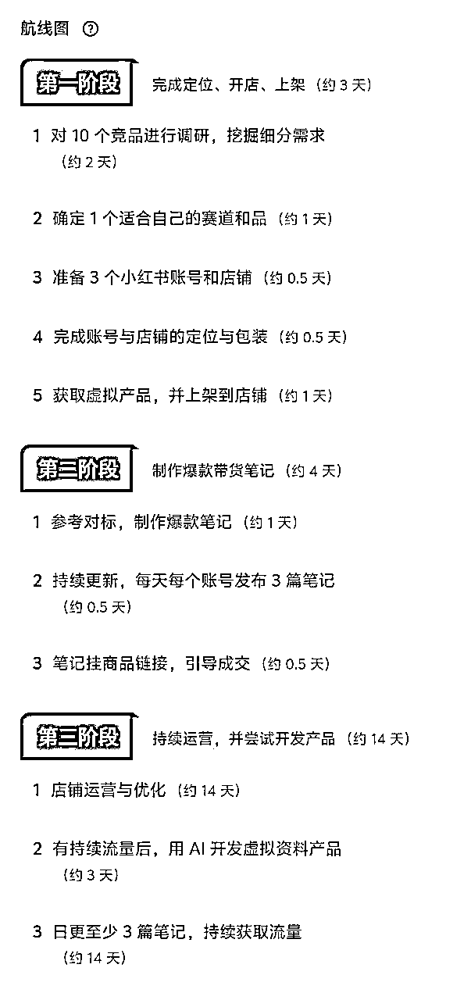

航线图与手册的关系很紧密，你可以根据自己当前所处的环节，直接跳到对应章节学习。

# 零、虚拟资料店铺是什么

# 0.1 它和其他📕商家有什么区别？

虚拟资料店铺，归类上仍然属于📕电商，运营逻辑与普通商家几乎一致。要说差异，主要在发货环节：虚拟资料走的是线上交付，没有物流成本，退货率也低得近乎为零。

为什么退货率可以做到这么低？因为“发货”动作一旦完成，买家实际上已经完成了对内容的消费；而且，主动购买虚拟资料的客户，通常从一开始就没打算退款。

这类店铺与普通商家还有一个共同点——都可以开直播卖货，也可以调用乘风平台来投放推广。

另外，📕从今年开始也在积极拉近与虚拟资料商家的关系，给出流量扶持，最近课件类商家便是重点关照对象。

# 0.2 为什么建议每个人都开一家店

开店这件事，后端能省下大量麻烦。只要店铺上线，你接下来的核心工作就压缩成了两件事：产品和流量。私域导流方面的违规顾虑，也可以放下不少。

更重要的是，如果你本身有后端转化的需求——比如已经搭建了自己产品体系，想在🛰️上做高客单价成交——📕店铺完全可以充当合法合规的“引流出入口”。

更简单的玩法是：设置一个 0.1 元的商品当“见面礼”，用户下单后，自动发货小程序会引导对方添加你的🛰️，你就能在后端继续运营转化。

再往大一点看，开店本身也是在踏浪：

📕电商正在高速商业化，而“用户开店”正是平台押注的核心战略。当下入驻开店不仅 0 押金，还有大量发布笔记的任务可以完成——笔记数达标，平台就会给流量。

这消息对于缺流量的商家来说，是一个清清楚楚的利好。

# 0.3 为什么深耕单一赛道

对于大多数人来说，最优解是把一个赛道做深做透——也就是反复被提到的“赛道深耕”。

原因其实不难理解：真正吃透一个赛道，要付出的学习成本是巨大的。如果你在原有赛道还没形成积累，就去跳到下一个，不仅消耗精力心力，结果也大概率是两手空空。

不妨先留给自己一段试错与等待的时间，争取在某个赛道上拿到正反馈，沉淀出经验与方法论，之后再考虑“赋能”其他赛道。

并且，你在一个赛道里待的时间越久，你的护城河就越深。

举个例子，做职场简历方向：你的笔记发得越多，相关的关键词就覆盖得越多，用户通过搜索找到你的概率就越大。你比同行多出来的优势，正是笔记的积累。

比如你卖的是简历模板，搜索下单的比例会慢慢攀升，最终形成“自动出单”的效果，其他人想在短时间内撼动你的位置，几乎不可能。

所以说，深耕的内在逻辑，是长期主义的复利。

# 一、选一个赛道

# 💡

# 章节概述：

选择的价值大于努力本身，方向不对，付出很容易打水漂。把时间投入一个有潜力的赛道，收益通常远高于在一个低质赛道里搏杀。

选赛道需要看两个层面：

1. 外部：市场环境——直接决定项目难度和收益上限
2. 内部：兴趣与优势——决定你能否在这条路上坚持下去

赛道既是你的起跑线，也划出了你的天花板。

# 💡

# 本章航线图

学完并完成本章实操，就可以跑通航线图的：

第一阶段：定位、开店、上架（大约 3 天）

1. 调研 10 个竞品，挖出细分需求（约 2 天）
2. 确定 1 个适合自己的赛道/品（约 1 天）

# 1.1 先做一个个人优势盘点与定位

只有真正适合你的赛道，你才能在里面游刃有余。

我接触过很多博主，他们的内容表达能力其实很强，问题出在——没有认真分析自己的优势，就扑进一个完全不了解的领域，最后草草离场。

做📕虚拟产品，第一件事就是盘资源、定定位。

这两步为什么如此关键？

如果你从不复盘自己的优势资源，后期会频繁陷入选题荒。举个例子，一个资深的 HR，放着熟悉的职场赛道不碰，非要挤进美妆赛道。HR 赛道是他积累多年的专业领地，过往经验摆在那里，放到📕上表达自然流畅，选题取之不尽，做号起来根本不是难事——他做的只是把旧的经历和经验搬到新的表达平台。

这种经验鲜活、独特、有专业厚度，非常容易获得算法的青睐和粉丝的认可。

在此基础上，再顺势开发出虚拟产品和服务，商业闭环就能闭合；你本人也会完成一次角色的转换——从打工者，蜕变为经营者。

那么，盘资源和定定位到底怎么操作？

第一步，问自己：你有没有完成过什么成就？在完成它的过程中，你经历过挫折、摔过跤、绕了远路，但最终还是战胜了自己；并且，这件事你有足够强烈的表达欲望，经验本身也能帮到别人。

别小看这个问题——那就是你身上隐藏的内容金矿。没有人提醒，你的大脑很难主动想起这段过往。

但这个问题还有一个更关键的判断标准：【这份经验是否利他】

如果答案是否，那你整理出来的内容大概率过于私人化，既引发不了共鸣，还会反过来损耗你的信心。

所以，你要做的是让自己的优势和市场的真实需求对齐，把身上的知识残片，打磨成他人的生存刚需。

如果还是不知从哪里开始，下面 5 个问题可以帮你自查：

1. 你有没有拿过什么大结果？而且是大多数人没能拿到的那种？
2. 你是否在某些领域积累超过身边人？比如考公、考证、考研？
3. 你有没有掌握硬基础技能：飞书多维表格、Notion 模板、视频剪辑、AI、PS、PPT、手绘、Procreate、会做饭？
4. 你有没有别人不具备的复合标签？比如大厂、35 岁、父婴博主、留学经历、正在装修、即将裸辞、数字游民、减肥逆袭……
5. 在核心课题上（事业、家庭、个人成长、健康、成为更好的自己），你有没有能拿出手的成就和表达欲，以及独特的、活生生的个人感受？

给你一个实例：飞书多维表格玩得溜，那你完全可以针对用户的不同使用场景，交付一套“飞书解决方案”。

现在正值春招，已经有博主用飞书多维表格做了一份“春招进度表”，卖出 3000 多份。

如果你还没理出方向，照着上面 5 个问题慢慢盘。

需求要会看，但更要会“造”。

你能想到的方案，别人大多也会想到，那些人人想得到的方法，通常算不上好方法——到头来，智力劳动只能干成体力活。

不要硬挤一个毫无门槛、纯粹拼时间投入的赛道。虽然你会看到不少人在那里拿到结果，但他们未必会告诉你真正的胜负手在哪。

所以，设计自己的数字产品时，不要玩命复刻别人的商业模式。比如别人卖中小学资料卖得很火，你看着眼热也跟着上架，结果开单成了奢望。

最根本的症结在于：你只是在抄作业，但那并不是你的主场。对方可能是 K12 老师，对学生需求了然于心，笔记篇篇打在痛点上；而你的内容却没有任何亮点，用户自然感受不到价值。

识别需求是能力，创造需求则是更高的段位；

因为只有当你创造出一个需求，并且它被消费者真金白银认可时，你才拥有了差异化优势——也就是所谓的利基市场，或者叫做“第一个吃螃蟹的人”。

不过也要认清一点：国内市场竞争疯狂，一旦模式被验证，模仿者很快就到。所以前期必须尽全力把成果做大——销量和笔记数量，都是你的盾牌。

道理很简单，当买家客单价不高时，他们会本能地选销量更高的商品。你在📕搜一下“简历模板”就能看到：同款产品，有人卖出 3 万单，有人只有几十单。

所以，正式起盘前，准备工作一定要做足。

顺着这个思路，说说如何创造需求——它藏在一个“没被发现但真实存在”的黄金准则里：

1. 有一定技术门槛；
2. 可以被解决，但又急迫；
3. 自带社交属性，让人愿意转发朋友圈；
4. 常常让人忍不住感叹：“这也能赚钱？”

带着这四条去看📕，你会发现大量类似需求。

对应第一条“技术门槛”：专业软件安装、CAD 装订教程，都是能够卖出几千单的品类。

对应第二条“紧迫但能解决”：专业证件照 P 图，尤其是工牌照、海马体、新婚登记照等场景，需求稳定。

对应第三条“有社交分享属性”：手写婚书、小朋友生日定制视频（比如奥特曼主题）都是极好的注脚。

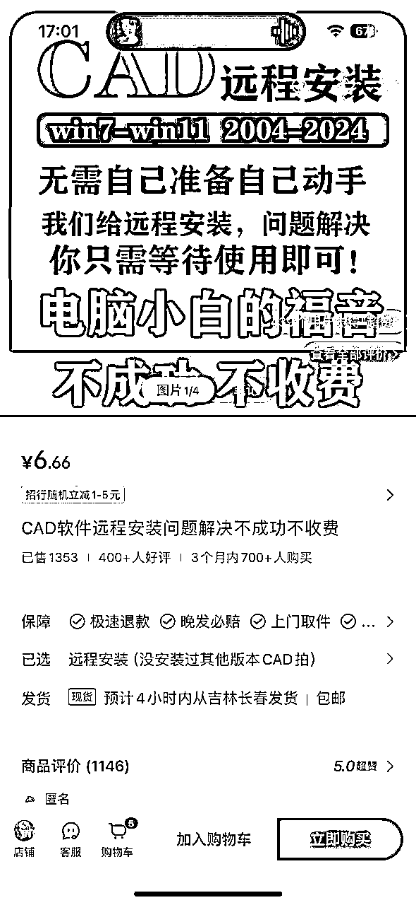

# 1.2 如何挑选赛道

从你过去的经验里挑，也就是从“求学、工作、爱好兴趣、身份”四个维度入手。

千万要警惕一种误区：不要像叶公好龙那样，把自己“没亲历过，光靠脑子想觉得不错”的事当成赛道。把上帝递给你的每一次经历，都视为一份礼物，比如：

求学这条线：你最初是专科，后来专升本，再考上研究生——那你可以做专升本、考研。

工作这条线：你是英语老师，或者带过英语家教（只要跟英语教学沾边），那你可以做英语方向。

兴趣这条线：你喜欢把读书笔记、课程笔记整理成竖屏思维导图，那竖屏思维导图就是一个不错的切入点。

身份这条线：你有一个读小学一年级的女儿，你是宝妈——那你可以做一年级相关的资料，或者做宝妈能变现的产品。

如果这四条线还是没能帮到你，可以直接看【9.1 选择优质赛道的方法】，里面有 4 个方法可用。或者更省事一点：让教练帮你推荐一个，最快的方式是和教练做同一条赛道，甚至直接卖他同款的产品。遇到问题，当场就能解决——毕竟，骑着同行过河，速度远不如骑着教练过河。

# 1.3 案例拆解：宝妈如何把育儿经验做成早教资料包

多数宝妈面临两个问题：找不到属于自己的方向，也不知道做什么副业。

事实上，对宝妈群体来说，除了做博主，现在还有一个红利型赛道——卖虚拟产品。

先说清楚，为什么宝妈适合做虚拟产品？

先看大家常见的误区：看什么赚钱就想冲进去做什么。还有不少知识付费博主喜欢宣称“报了我的课，包赚”。

然而这类项目你大概率拿不到钱，因为在这个赛道里你就是一张白纸，没有积累，和所有人站在同一起跑线。而任何一个成熟的行业和赛道，注定有大量专业玩家、机构盘踞其中。

他们是什么打法？团队作战、流程化分工。

比如前阵子爆火的郑州帮，SOP 化程度相当高——标题、封面图、内容结构、内容模型，每一个环节都拆给了专人。但对普通人来说，你没有团队，标题要自己想、封面要自己修、文案要自己写。

在这种情况下，你很难在“热门赛道”里正面刚过他们，最后耗掉大量时间，却看不到结果。

而虚拟产品这件事，最核心的点永远是：盘点你的资源。你有什么？你擅长什么？你经历过什么？你总结出过什么经验？哪些是你拥有但别人没有、并且对别人也有用的？

这些就是你的优势资源，也是你的核心竞争力。

对宝妈群体来说，逻辑一模一样。

在育儿这个领域里，最好的虚拟产品形态是——成为这个细分领域的小专家，把自己的带娃经验封装成产品。

# 01 靠一份食谱卖出 800+ 份：卖虚拟产品要会找角度

有个宝妈的案例给我留下了很深的印象。

养过小宝宝的家长，基本都撞上过类似的问题：辅食怎么加？宝宝对某些食物不耐受怎么办？对新手爸妈来说，这是没有经验可循的难题——他们需要的是真正有用的生活经验，而不是泛泛的道理。

这个场景像极了高三复习的时候，大家都会抢着借学霸学长学姐的笔记，因为这些经验最鲜活、最贴近实际操作，也最容易见效。

同理，你走过的路、踩过的坑、失败后的复盘，都可以凝练成经验，打包卖给需要的人。

这位宝妈选择的切入点是“敏宝饮食”赛道。

她店里卖得最好的《敏宝辅食表》，定价 36.9 元，已经卖出 800 多份；《牛奶蛋白过敏脱敏手册》同样是 36.9 元，销量 109 份。

她还做了一个延展——推出了“牛奶蛋白过敏 1V1 咨询”，定价 45.9 元，卖出 186 份。

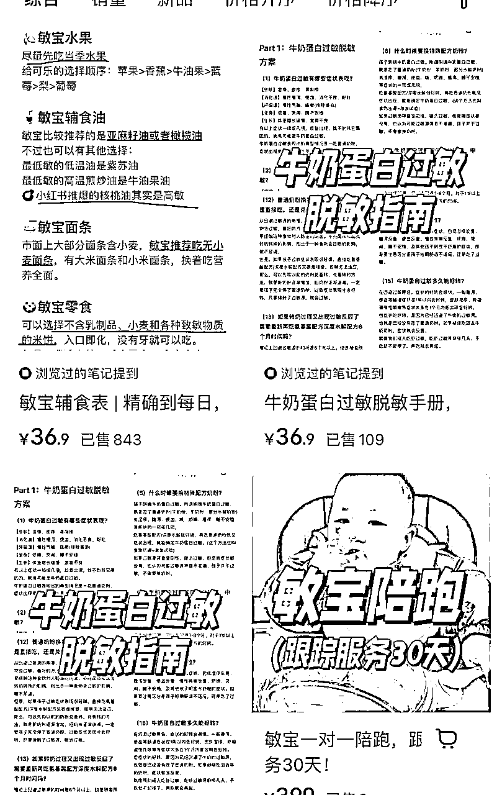

在宝妈领域里，她并没有一头扎进“新手妈妈指南”这类大而全的品类，而是锁定一个非常具体的小场景、小痛点，而给出切实可行的解决办法——这恰恰是很多人缺的一课。

# 02 我的个人经验太薄、内容撑不起来，怎么办？

这种焦虑太常见了：我一个人的经验有限，又没有案例只有理论，怎么能构成一个有市场说服力的虚拟产品？

解决办法是——学会吸收别人的经验，让自己快速变成“专家”。最直接有效的方式，就是加入各类社群：👸号粉丝群、大 V 的群、专业的宝妈交流群、育儿交流群……

去观察：他们正在聊什么，他们的焦虑是什么，他们在提哪些问题。这些提问本身，就是你做虚拟产品最好的素材土壤。

除了社群，也别忽略📕本身。重点看求助帖、评论和回答多的高互动问答帖，以及那些点赞高的问题——这些都是用户需求的直接反映。

当你输入得足够多，并且认认真真当一个记录者，你会发现自己很快就比原来专业太多。

你不需要成为一个真专家，只要做到相对专业即可。鲜活的、能落地的隐性经验，比什么都值钱——江湖上不是流传着一句话吗：80 分的人可以教 60 分的，60 分的人可以教 40 分的。

# 1.4 赛道推荐

本期航海，我们挑选了 3 个适合长期深耕的主流虚拟资料赛道：

- 教育资料：包含学前、K12、小升初/初升高/高考志愿、考研、四六级、专升本等
- 考试资料：跟着当季热门考试走，这里列举的是 25 年上半年热点，如成人自考、二建、专升本等
- 成长技能：如 PPT 模板、知识库、大学生实践报告、职业规划等

还有一些小体量赛道：宠物训练、摄影滤镜、装修避坑等。

大家可以先逐一翻看下面的对标店铺和内容形式，再结合自身优势兴趣，选定 1 个细分赛道作为你的航海项目。

# 赛道 1：教育资料

各阶段对标店铺、内容形式展示：

幼小启蒙

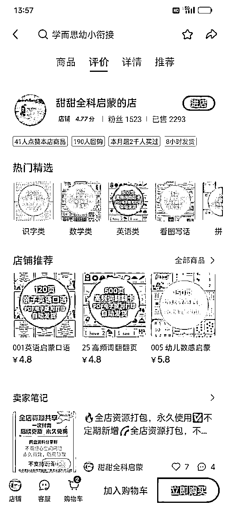

k12-小学

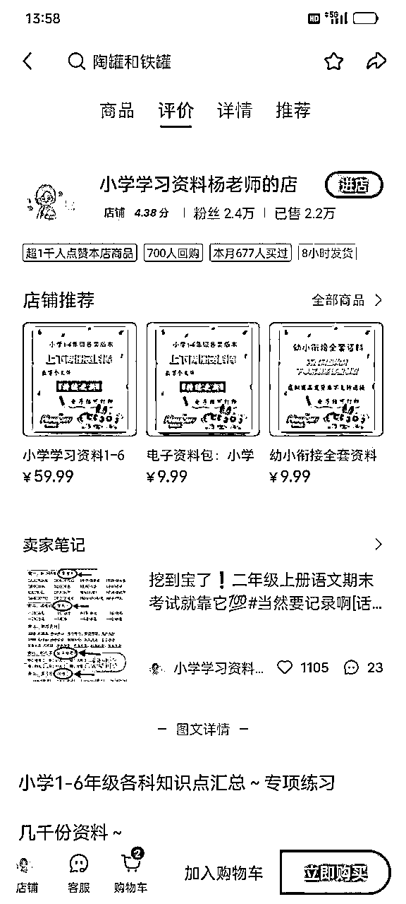

k12-初中

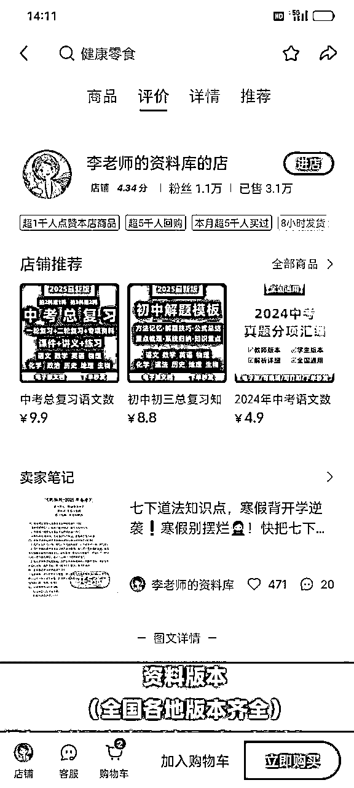

k12-高中

大学

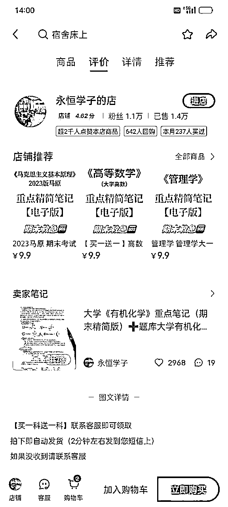

考研

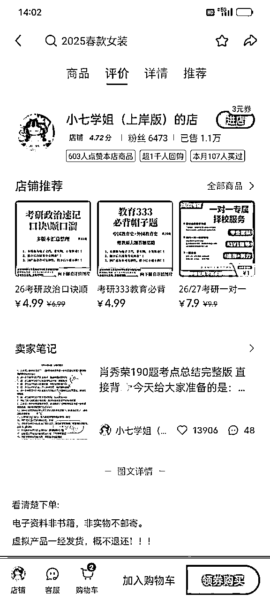

自考/成考/统招专升本

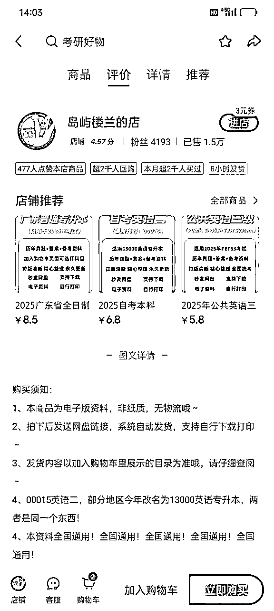

# ① 幼小启蒙

赛道说明：

1. 目标客户：宝妈宝爸/幼教从业者
2. 该赛道主要提供学科启蒙类、综合素质类以及幼教从业者所需的资料
3. 资料覆盖数学启蒙、语文启蒙、艺术启蒙、体育启蒙、科学启蒙等；也能面向教师群体提供教学课件 PPT、教学教案、工作计划表等
4. 同时还可以做定制化服务 SKU，比如按照客户需求定制课件、教案

黄金节点：

5. 第一黄金期：开学季（3 月、9 月）。开学前是家长为孩子准备新学季学习资料的关键节点，启蒙资料需求量会显著提升。此时应重点推广幼小衔接、拼音、数学启蒙等热门内容，接住家长的集中需求。
6. 第二黄金期：学期中（4 月—5 月、10 月—11 月）。家长会根据孩子的学习进度补充资料。推出亲子互动游戏、手工制作、绘本阅读等特色内容，更容易吸引关注。
7. 第三黄金期：学期末（6 月、12 月）。期末阶段，家长会购买复习资料，或提前为下一个学期做准备。可以发布育儿经验分享、教育理念等内容拉拢潜在客户，并同步用基础资料做引流产品。

# ② k12（小初高）

赛道说明：

1. 目标客户：各阶段家长/教师
2. 主要提供学科学习资料、期末与升学备考资料、教师教学资料
3. 学习资料包含小初高各阶段语文、数学、英语及文理科目的知识点总结、基础练习、解题技巧、专项练习、单词记忆方法、语法精讲、公式总结、实验操作指导等；备考资料则包括中考真题解析、模拟试卷、备考计划、小升初/中高考冲刺包等。这些内容能帮助学生提分、预习，以及备战大考。面向教师的资料有座位表、家长会 PPT、教学活动方案、试卷模板、教学大纲等
4. 增值空间：学习计划定制、在线课程、答疑服务；还可以对接教育机构，上架官方授权课程和辅导资料，做高客单价变现

黄金节点：

5. 第一黄金期：
   a. 期中、期末考试前（通常在每个学期中后段，也就是 4 月、6 月、10 月、12 月），是学习资料需求最集中的时候，销量达到峰值。
   b. 中考和高考前 3 个月（3 月—5 月）。冲刺阶段考生和家长对备考资料的需求最猛，模拟试题、历年真题、答题技巧是硬通货。
6. 第二黄金期：寒暑假（1—2 月、7—8 月），家长会在这期间购买资料，帮孩子巩固旧知、预习新课，市场需求同样可观。
7. 第三黄金期：开学初期（3 月、9 月），多数家长会在新学期开始时集中采购学习资料。

# ③ 大学

赛道说明：

1. 目标客户：在校大学生
2. 该赛道主要提供学科资料、期末备考资料以及教学资料（面向教师）
3. 学习资料覆盖各学科专业教材、课程笔记、实验教程、考试重点、复习资料、模拟试卷、四六级考试资料（真题+技巧+词汇）、时间管理方法、数字工具模板（如 PPT 模板、Excel 模板）等
4. 可提供学习计划定制、在线课程、答疑服务

黄金节点：

5. 第一黄金期：
   a.

# 学习资料生意，踩准需求节拍

一年里，学习类虚拟货品的购销有几段明显的潮汐。九、十两个月新学期开场，刚入校的新生和返校的老生都得为课程备齐课本、课堂记录、同步练习，买气最足。五六月以及十二月到次年一月，期中期末轮番上阵，刷题卷、往年考卷、模拟套题会被成批扫走。三四月与十月到十一月属于学期中段，热度平缓，零散补货的人一直有，临近毕业的群体则要翻找论文与毕设材料，另有一部分人趁早囤下考研、求职方向的储备。八九月开学之前还有一波小阳春，大家会把新学期要用的东西提前一次性配齐。

# ④ 考研

这条线的买家主要是在校生、应届本科生和往届毕业生，卖的是入学考试的公共课与专业课复习内容。具体有各科教材精讲、核心知识点梳理、历年真题与拆解、英语词汇册、语法精讲、写作范本、数学公式汇总、解题窍门，还有学习计划表、备考攻略、时间管理工具，以及线上模考系统和题库。增值项可做专项培训课、考前冲刺班与复试指导。

最旺的档口在初试前三个月到半年（七月到十二月），这是备考攻坚期，政治、英语、数学等公共课的真题拆解、模拟卷、考前押题最抢手。次一档有两处：报名期间（九到十月），考生正式进入状态并填报，基础复习内容、备考路线、学习计划需求走高；复试前（次年二月到四月），专业课与面试都要准备，复试材料、面谈窍门、专业课冲刺内容随之走量。补位档：寒暑假（一至二月、七至八月），考生借假期预习或复习，基础内容需求平稳；开学初（三月、九月），新学期开课，会集中采买进入下一阶段。

# ⑤ 统招专升本 / 成人自考 / 成人高考

三种考试打包成一条线，买家是准备应考的学生与社会人员，卖的是入学考试的公共课与专业课复习内容。公共课（语文、数学、英语、政治、信息技术等，各省科目不同）这块有教材精讲、知识点梳理、历年真题与拆解、模拟卷、答题诀窍，另外配个性化备考路线、时间管理工具、线上模考系统、题库练习。增值项有考前冲刺班、答疑、专项培训课，以及报名指导、院校选择分析。

最旺在冲刺阶段（考前的六十天上下），真题拆解、模拟卷、考前押题最热。次一档是报名前，考生开始备考并准备填报，基础内容、备考路线、学习计划需求走高。补位档在成绩公布之后，没过的考生会转入下一轮准备，复习内容需求随之抬升。

# 赛道 2：热门考试

热门考试能拆成两条互不干扰的线：考证与招聘。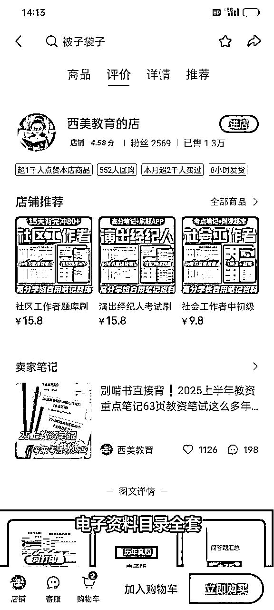

# ① 考证：笔试与面试，各自两波潮

买家是想拿到某本证书的考生。笔试环节主要卖复习材料和面试点拨，内容上教材串讲、备考路线、往年卷、模拟套题、冲刺包一应俱全，工具则有刷题APP和线上课。面试环节卖的是面谈准备材料与临场点拨，覆盖复习路线、往年卷、模拟套题、冲刺包、面谈窍门，增值项包括线上课与1V1陪练。

笔试的节奏：从报名截止到开考前约60天，复习内容与备考路线最抢手；等准考证能打印、离考试只剩二十来天，押题卷、往年卷、答题套路会冲到顶点。次级窗口出现在官网放公告到开放报名之间，教材精讲与学习计划更受青睐。

面试的节奏：笔试放榜到开考前（通常一个月上下）是主战场，面谈窍门、模拟题库、真题拆解最热；临考前的最后一周，模拟面与1V1陪练进入顶点。

# ② 招聘：春招与笔试通知后的窗口

面向应届生和职场人。货架上摆着简历样张、笔面材料、职业路线建议、春招日历、行业洞察与岗位清单、模拟笔面与题库；素材层面有简历范本、求职路线手册、笔面内容、企业真题拆解。增值项涵盖刷题APP、网课、线上职业课、简历精修，还有打包方案：路线设计→改简历→网申→笔试指导→面试点拨。

春招的主峰在三四月，企业扎堆放岗，面谈窍门和模拟题库需求冲顶；二三月属于启动期，求职者集中备简历、练面试，材料卖得也快；一到二月是预热段，部分公司提前开岗，简历与材料开始动销；四月末到五月，春招收尾、企业补录，热度回落但没断；五六月春招基本收官，部分公司转招暑期实习生，可以顺势推实习向简历与面谈内容。

招聘流程这条线：从收到笔试通知到开考，临时抱佛脚的人最多，材料需求最密、出货最高；报名到收到通知之间是准备期，热度次一档；公告发布到报名开放，排第三。

# 2025年前半段考试节点一览

事业单位联考落在3.29；春招（央国企、银行、各类公司）扎堆在三四月；计算机等级考试NCRE在3.29-3.31；统招专升本各省不一，多集中在三四月；成人自考4.12-4.13；卫生专业技术资格（初中级护师、药师、医师等）4.12、4.13、4.19、4.20；护士执业资格4.26-4.27；二级建造师5.10-5.11；中小学教资面试一年两场，25前半段为5.17-5.18；监理工程师5.17-5.18；初/高级会计5.17-5.20；初/中级社工证5.24-5.25；软考（计算机技术与软件专业技术资格）5.24-5.27；英语四六级笔试6.14；高等教育自学考试4.12-4.13；银行从业资格（初、中级）6.14-6.15；高考6.7开锣。

# 补充：各领域考试信息

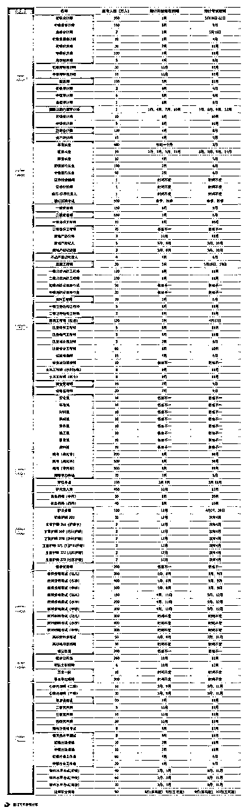

# 赛道 3：成长技能

四条支线并行：PPT样板 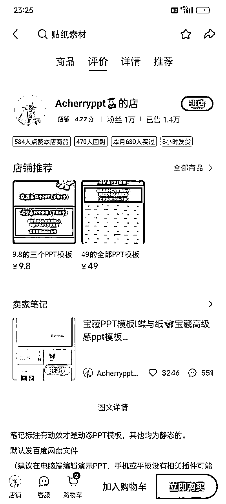、知识库 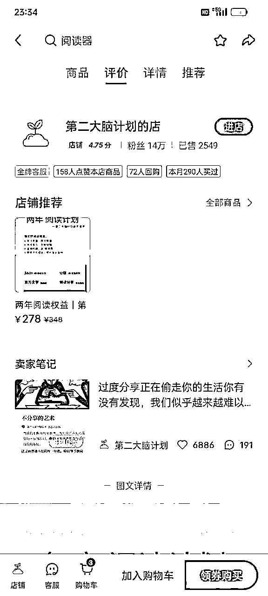、大学生实践报告 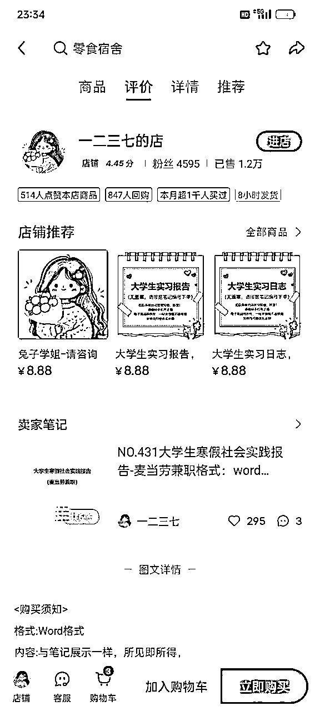、职业规划 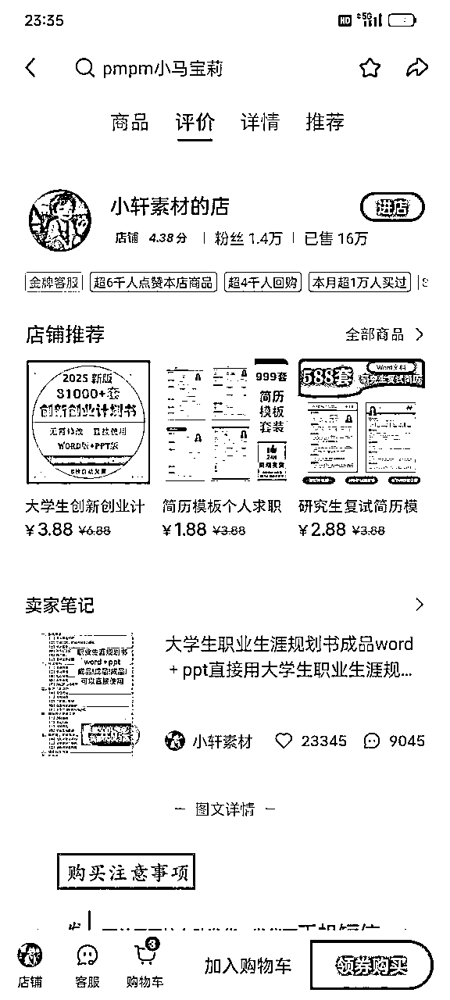。

# ① PPT样板：两波旺季

买家包括在校生、上班族、自由职业者与创业人群、讲师与教育从业者。核心价值是用现成版式替客户省下时间、抬高效率，也让演示更体面，覆盖多种使用场景。内容有通用商务款（汇报、项目策划、市场分析等）、行业定制款（互联网、教育、金融、医疗等）、创意设计款（动态演示、创意版式）、营销推广款（📕策略、品牌传播、活动策划等）。增值项可做专属版式设计、PPT制作培训课。

最旺在毕业季（五到七月），学生拿版式做毕设和答辩；次一档是求职季（九到十一月），职场新人和应聘者需要好看的简历与面试演示稿；年末到年初（十二月到一月）还有补位需求，企业和个人要做年终复盘与来年计划。

# ② 知识库：充电、副业两头吃

买家是自学者与自由职业者。这类产品提供行业与体系化知识，帮人快速拿到学习资源，比如语言库、编程库，把自学效率提上去。内容覆盖语言学习（多语种语法速成包，含英语、日语、编程语言等；口语实战素材，含场景对话、发音纠正音频；考试冲刺内容，含雅思托福高频词库、语言等级真题）、职业发展（自由职业者工具包，含接单窍门、客户沟通范本、税务管理指引）、技能课程（Python入门、数据分析实战、设计软件教程）、副业变现指引（自媒体运营、电商选品、AI工具手册）、效率提升（时间管理版式，含周计划表、任务优先级矩阵；学习方法，含速读技巧、知识体系搭建路径）。

最旺的两段：一至二月新年立计划，语言包与效率工具走量；九至十月开学季与自我提升热，编程库、副业变现包需求上扬。次旺：六至七月暑假充电，学生和自由职业者练技能；十一至十二月双十一，课程折扣、组合包秒杀。补位档：五月自由职业者日，副业指引、接单窍门做特惠；开学前预热，编程或语言类内容促销。

# ③ 大学生实践报告：毕业、实习两头忙

买家是在校大学生。产品给的是实践报告版式、写作点拨和样例，帮学生迅速摸清结构、弄清要求，省时又体面。内容按专业分（理工、文史、商科等），也涵盖毕设、实习报告、课程实践报告。增值项有专属版式设计与1V1写作点拨。

最旺：毕业季（五到七月），毕业生要高质量的毕设与实践报告版式；实习季（六到九月），学生进企业实习，需要实习报告版式和写作点拨。次旺：开学季（九到十月），新学期课程项目要用；学期中段（十一到十二月），学生着手学期实践报告，版式与点拨需求抬升。补位档：寒暑假（一至二月、七至八月），学生提前动手准备。

# ④ 职场路线：毕业择业与年初复盘

买家覆盖大学生与应届生、职场新人、在职者、自由职业者与创业者。产品给的是路线设计内容或版式，帮人把职业路径想明白，更靠近个人目标。内容有职业生涯规划书、路线版式、SWOT拆解工具、目标设定表、时间管理工具、简历范本、行业洞察报告等。增值项可做职业课、1V1路线咨询、专属方案。

最旺：毕业季（五到七月），学生面临离校与择业，需求强；求职季（九到十一月），职场新人与在职者集中跳槽或转行，需要路线点拨。次旺：年初（一至二月），上班族和学生定年度目标，相关产品动销。补位档：学期中段（四到五月、十到十一月），学生与职场人做中期修正，需求随之上升。

# 其他：小众方向

这几条：宠物训练 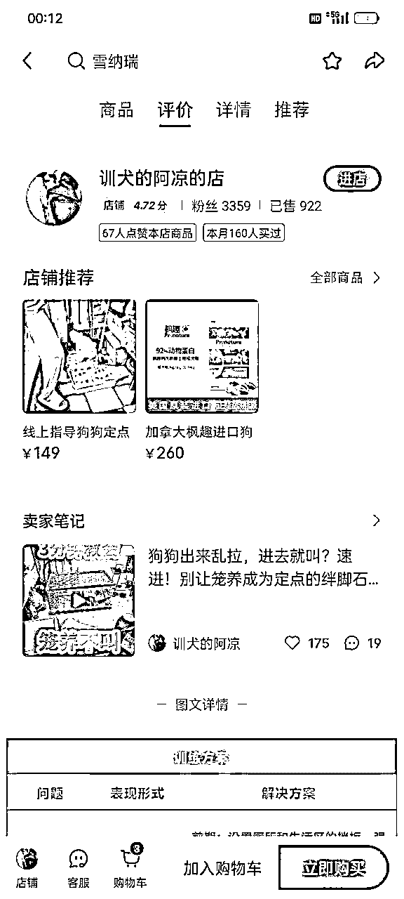、摄影滤镜 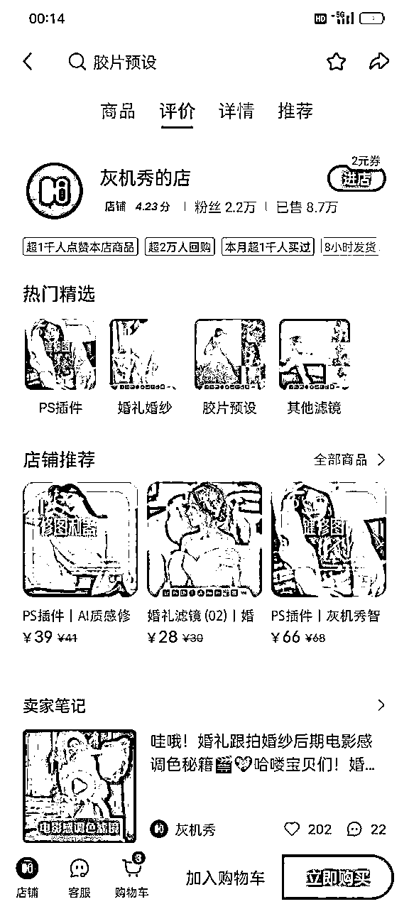、人性思维、装修避坑 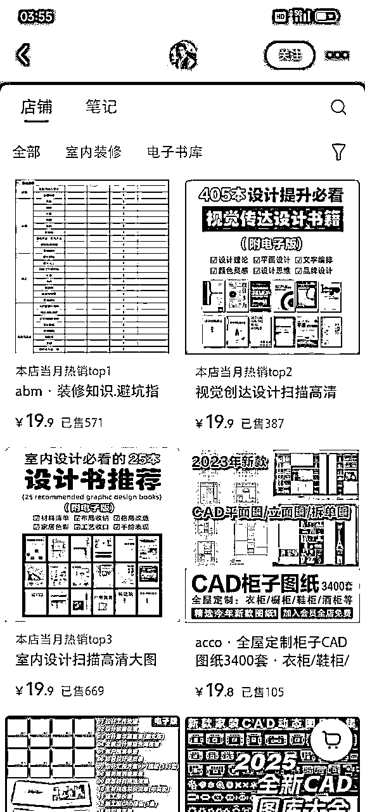。

# ① 宠物训练：先把行为难题解决

买家是养宠人、宠物行业从业者、宠物爱好者。产品是专业训练内容，可搭配1V1视频点拨；针对宠物常见行为毛病给出解法，减少麻烦；按需求与宠物特点出专属训练方案；最终让宠物的日子更好过，主人的养宠体验更顺。

# ② 摄影滤镜：按场景挑滤镜

买家是职业摄影师与摄影玩家。产品是相机滤镜内容，加上不同场景里怎么挑、怎么用，帮客户把成片效果拉上去，各种拍摄需求都能接住。

# ③ 人性思维：职场与销售都吃这套

买家包括职场人、创业者与企业管理者、个人成长爱好者、营销与销售人员、心理咨询师与讲师。产品是成体系的人性思维内容，帮客户把人看透、把思路打开、把实际问题解决掉，在个人与职业发展上更有竞争力。

# ④ 装修避坑：从动工到验收

买家覆盖装修新手、自己装房的业主、中高端住宅业主、二次翻新业主、商业空间业主。产品是从前期筹备到完工验收的全流程避坑内容、实用工具与表格；可搭配1V1咨询，给出个性化避坑方案；帮客户少绕弯，装修过程更顺心。

# 1.5 选品：两条路，新手先走淘宝

📕虚拟货品的主流选品路子有两条：一条是盯住爆款笔记反推货品，另一条是去淘宝筛电子内容（新手推荐⭐）。

新手更常走第二条：淘宝的分类页把国内主流搜索电商的类目铺得最全，平台成熟，而且不用花钱。当然前期也得配合第一条，多刷📕爆款，看看眼下什么品卖得动——各平台口味有差异，顺带也能养出网感。下面讲具体打法。

# 1.5.1 爆款笔记反推法

某篇笔记数据炸了，关联商品页挂着"24小时内100+加购/下单"，说明这份内容有热度。若版权归属不清晰，直接搬到自己店里上架就行。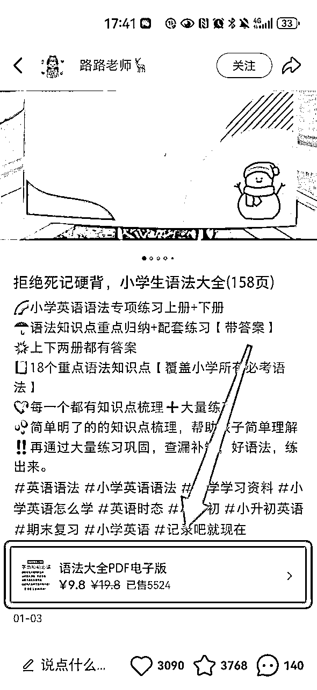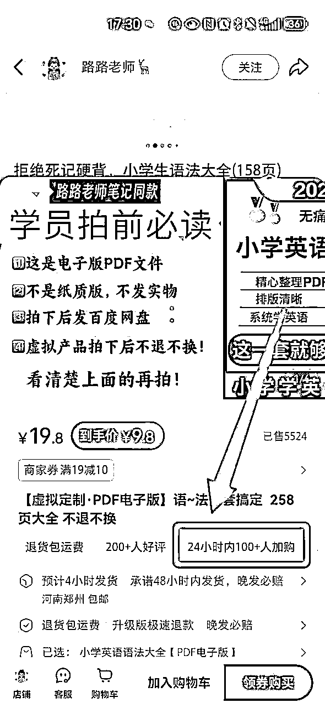

内容火，往往意味着品类火。比如笔记卖的是小学英语语法专项练习，那品类就是英语语法（拿不准就看话题标签）。接着在📕搜"英语语法"，切到商品栏目，逐个点开详情页：只要出现"24小时内xx人加购/下单"，上架；没有这行字，但标着"3个月内xx人购买"，就翻到评价的最新页，近七天能攒够20条以上好评，也能上架。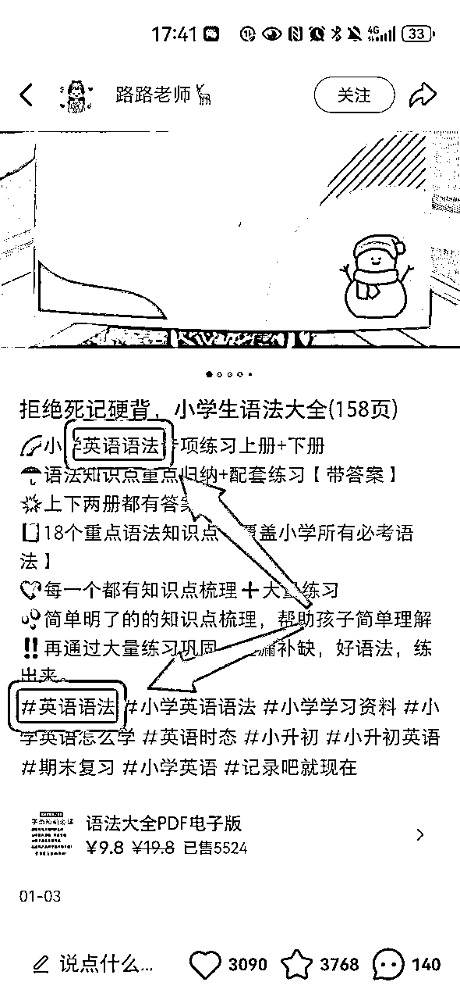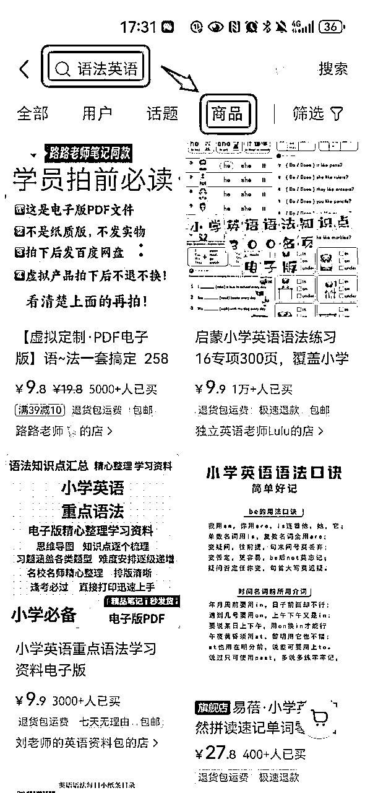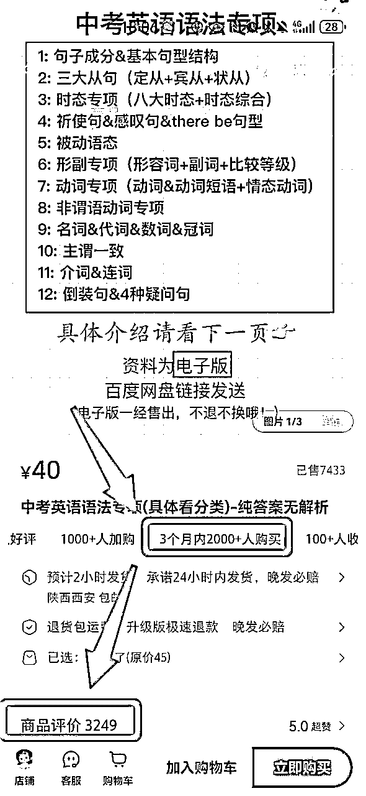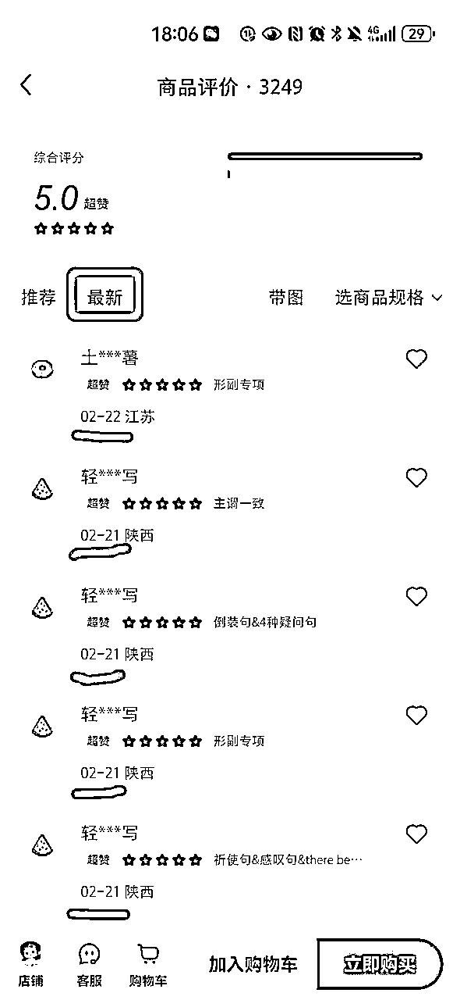

# 1.5.2 淘宝筛选法

直接上淘宝搜电子素材，频繁浏览、见好店就收藏。慢慢把一个淘宝号养起来，系统之后会不断推各类电子内容和优质店铺，选品源头就断不了；拼多多同理。淘宝跑得动的内容，挪到📕一般也差不了，这点很关键。

💡 淘宝销量高的内容，三层核验就够：

第一层，去📕搜同主题笔记看数据。笔记火、高赞多，说明📕上想要的人不少。

第二层，进📕商城查同类商品的上架与成交。成交低于淘宝，说明供给没填满，值得试。按常理，📕站内搜索热度不输淘宝，销量不该落后；一旦商城数据明显掉队，缺口往往还在。

第三层，看货品卡不卡季节性窗口。脱离节点的内容热度难续。比如K12期末类，需求通常只在五六月、十二月和一月抬头，其余月份偏淡。

三层判完就够，不必反复纠结。拿2025年3月2日做样本，在K12方向从淘宝随手拎两个销量尚可的货，第一层就能过关。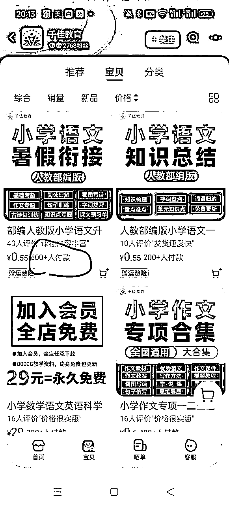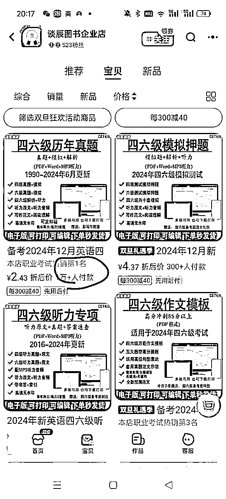

进第二层看📕侧反馈：A货笔记互动不差，几百赞到千赞都有，可商城成交还没破百，缺口明显，值得上架；B货笔记同样千赞，商城却已卖出上万单，供给充分，直接放弃。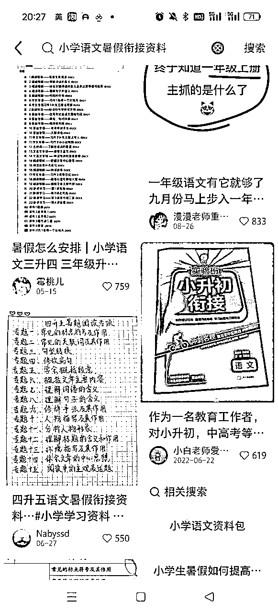

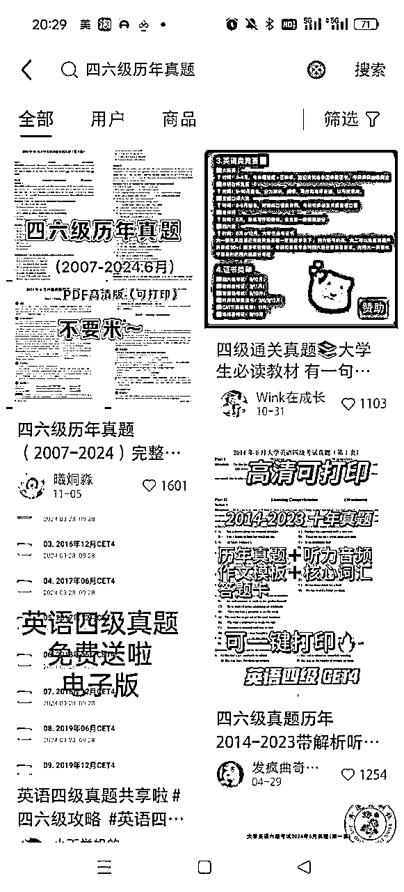

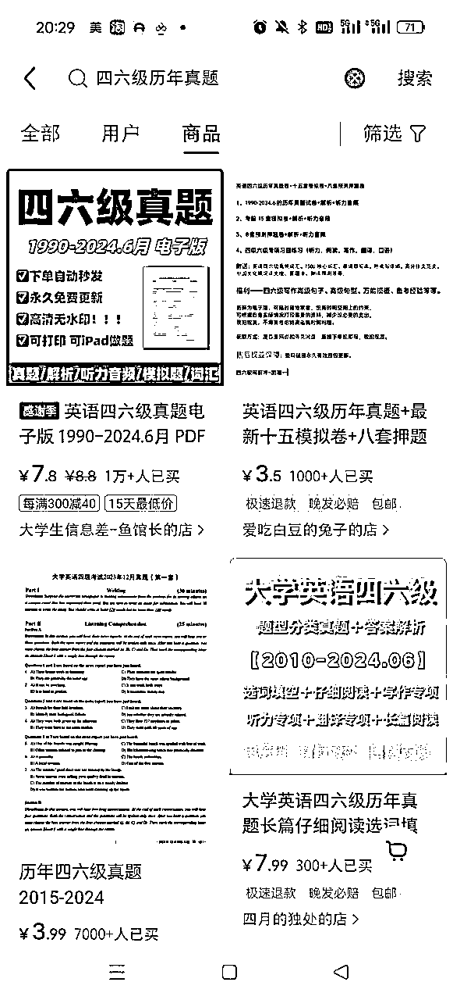

第三个动作，把需求的时间轴核一遍。拿一门给小学生准备的暑期衔接资料来说，这个品类的需求会集中涌现在每年放假的季节，也就是六、七、八这三个月。三月份就把它挂上来，明显不在节拍上。

这一步不能省。定品之前，得追根溯源：这份需求什么时候萌芽、什么时候最猛、什么时候退场。说到底，定品挑的是需求本身，而布局的提前量最多给一个月。比如暑期衔接类的内容，五月份就可以开始发了。

# 二、把号和店立起来

# 💡

章节导览：

虚拟资料这门小生意，决定成败的家底就是号。号一旦出了岔子，收入立刻跟着受牵连。想在这里长期干下去，号的冷启动、平日保养、配套🛰️号的长期养护，样样都是基本功。

# 💡

本章航线图

这一章学完、活干完，航线图上的进度会推到：

第一阶段：定方向、开店、上货（约 3 天）

1.

手头备好至少 2 个能登上📕的号，并各自把店开起来（约 0.5 天）

2.

把号与店各自的定位、门面包装做出来（约 0.5 天）

脑子里的老观念得先清一清。以前做私域，路子是绕着平台走、把流量往自己怀里搂；现在换到📕，开店卖虚拟产品，我们就成了平台电商生态里的一分子，玩法本身合规，用不着成天担心被罚。

所以那套江湖规矩——什么一个手机号只能绑一台设备、一个号，什么只能走流量不许连 WiFi，什么必须养号——统统可以丢开，怎么顺手怎么来。

一个手机号绑一台机器绑一个号，这个说法从淘宝、闲鱼转过来的圈友特别敏感，因为那些平台的官方规则里确实白纸黑字写过。但看清背景就明白了：淘宝、闲鱼已经过了野蛮生长期，平台要下手治理的是批量铺矩阵、塞无货源商品这类破坏生态的玩法，所以才有那些限制。📕还处在电商交易额往上冲的窗口期，你店开得越多，平台越欢迎。开店的姿势，不必那么小心翼翼。

# 2.1 账号起步

# 2.1.1 先把设备备齐

✔️ 手机：只要这机器没被平台永久性地封过号、永久性地限过流，就能拿来用。以前有过小违规记录的，不受影响。

✔️ 电话卡：优先弄一张从没注册过📕的卡；手里有老号也照样用，之前跑过无货源之类项目的号，只要没挨过那两记重罚，同样没问题。
搞不到卡的话，去淘宝或京东找“电信无忧卡”，一个月 5 块钱能办下来；省事一点也可以跑一趟营业厅，给现有号码加开副卡，月租通常在 10 元上下。

✔️ 账号：一个卡套一个号、一台机器只登一个号，有这套配置当然好，没有也不必强求。同一台手机里挂两个号，一点不碍事；WiFi 也好、流量也好，哪个方便就用哪个。

# 2.1.1.1 手机怎么挑

个人单干，手里通常没几台设备，撑死十台封顶；冲工作室矩阵去的人，设备量会一下子翻到两位数、三位数也不稀奇。下面列一批工作室实战检验过的机型：

苹果系：

iPhone 7：工作室里的常青树，价格已经探底，跑流程顺滑得很

iPhone 8：好多人拿它刷视频、打游戏，发热小、运行不拖沓

iPhone SE2：热度一直不高，但直播、电商、短视频全都能扛

iPhone X：搞直播、做电商、拍短视频、养号都合适，预算够就上

安卓系：

红米 10X：表现不功不过

小米 10 青春版 8GB 运存 + 128GB 存储，性能扎实

小米 8 青春版 / 小米 8 SE：用的人很多

安卓能选的型号还有一堆，这里不逐个点名。

总的选购原则，几句话：

二手优先于全新型号（当然现在不少全新国行的价格也很香）

原装优先于组装（记住：没有指纹识别、没有面容识别的，大概率是拆过机的；闲鱼尽量绕开）

国行优先于外版

配置优先于外观

品牌优先于杂牌

配置起步选 8GB + 128GB 这个档位。机器年限，安卓机别用超过四年，苹果机别用超过六年。

建议至少准备两台手机，机子越多，胜算越大。号码方面，去营业厅一口气开三个以上的手机号，月租选最低档，但套餐里必须带流量，20个G以上为佳。组合方式就是主卡一张、副卡两张绑在一起，跟柜员说一声，他会帮你配好。

# 2.1.1.2 电话卡从哪里办

路子一：本地营业厅，当场就能拿到卡。

路子二：支付宝里搜“号卡中心”，线上下单即可。

路子三：淘宝/京东搜“电信无忧卡”，每月 5 元的最低价方案。

# 2.1.1.3 号和店怎么开

# 个人店

拿一张身份证，配一个做过实名认证的📕号，别的材料一概不用，提交后很快就能过审。

# 个体店

需要一张个体户执照。要办就办百货类的，闲鱼或淘宝找代办，目前一百元上下就能拿下。

# 企业店

拿公司执照去申请。跟个体店比没什么便宜可占，反而要处理税务一摊子麻烦事，直接跳过。

# 到底开哪个

新手不用多想，直接申请个人店。

手上有经验的人，建议先用个体户执照把蓝 V 认下来（600 元），再去开个体店；以后要做矩阵号，可以直接把店绑进去。

# 2.1.2 几条防坑提醒

下面这些都属于多一事不如少一事的防备动作，能避就避。

1）新号开头几天别急着挂商品入口

我真的栽过：两个新号注册完就猛发商品笔记，过了几天系统弹提示，说近期发布过多、不符合平台规范，暂时不能投放薯条。但后来其他号也照样操作，什么事没有。到底是概率、运气还是内容本身有毛病，变量太多，我不敢下结论。

保守路线就是：头 3 天照常发笔记，但不挂购买入口；3 天之后重新编辑，把商品链接补上去，再往后就随意了。

2）凡是像“引流”的动作，一律别碰

第一，个人简介里别放“私戳”“后台踢我”这种有歧义的词。哪怕你压根没有引流的心思，📕现在宁可错杀不肯放过。

第二，别拿📕号去回私信。就算你只是想把人引到店铺下单，一句措辞不当也可能被当成引流。千帆现在出了手机端，可以直接回复用户私信，用它就行。

3）小眼睛为 0 或特别少，不代表号有问题

2024 年 9 月 26 日之后，📕给到的初始曝光肉眼可见地缩水。只要内容质量立得住，小眼睛极低基本就是下面几种情况：

3. 平台的分发基数本身就降了。以前发一条怎么也有上百小眼睛，如今掉到几十、一二十都很常见。

4. 推流进入得慢。经常发出去只有一两个甚至 0 个小眼睛，要干等一天甚至好几天，浏览量才慢慢爬上来。

5. 数据面板出了 BUG。笔记显示个位数小眼睛，实际观看量比这多得多。

还有一个误区：总拿抖音的播放量和📕的小眼睛画等号，数据一低就怀疑号被限流了。记住：抖音播放量按 8% 折算，大概才是📕这边该有的浏览数据。

# 2.1.3 定位和包装

这套思路放到🛰️、抖音、📕、视频号、哔哩哔哩、闲鱼……任何需要经营人设的平台都能套用，说它是通用解法也不过分。

# 2.1.3.1 通用人设包装法

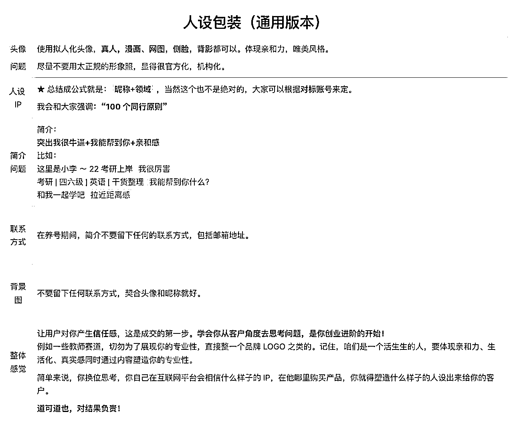

# 2.2 把店铺开起来

新手直接走个人店，别的不用琢磨。

奔着矩阵去的老手，办一张个体户执照，再花 600 元认证蓝 V，然后开个体店。执照的经营范围，覆盖下图红线圈出的那类即可，其余没要求。

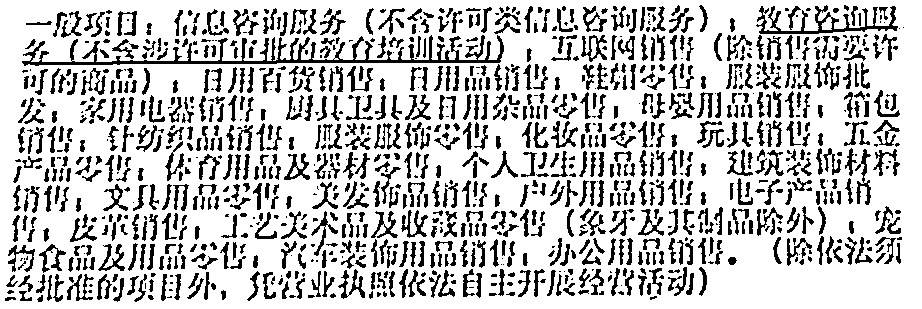

开店入口：链接直通千帆后台，手机号登录后选“个人入驻”即可。

https://ark.xiaohongshu.com/?ticket=ST-68c517438149514474558399hfl9opty5x6viycd&from=ark-login

押金说明：开店要交的那笔钱标着 1000 元，但可以先欠着。等赚满 1000 元再交，至少保证自己不亏。不交押金唯一的不便就是不能提现；真到提现那天再补上也不迟。

操作步骤：

1.

打开📕官方开店链接

https://ark.xiaohongshu.com/?ticket=ST-68c517438149514474558399hfl9opty5x6viycd&from=ark-login

2.

入驻身份那里，勾“个人”或“个体工商户”

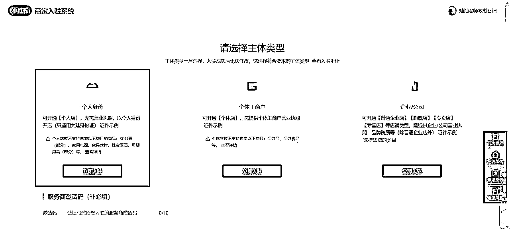

3.

把必填项填好，再刷个脸。店铺昵称会自动跟着你的账号昵称走，想改名得先动平台上的账号名，或者入驻之后去个人信息里改。这一项不关键。

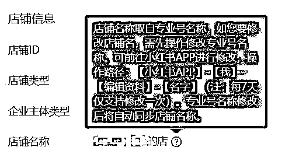

类目栏就保留系统预设的组合：零售批发、生活娱乐、其他。别手滑切到虚拟资料类目去——那个类目反而要补交一堆资质。

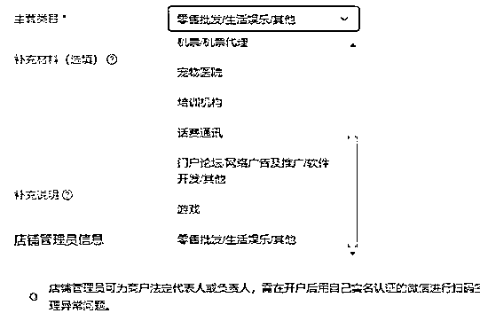

接着把【地址设置】和【店铺信息认证】填掉。快递发货地址不用较真，随便写个大概就行；不放心就写自己家，写模糊一点。主页展示只会落到区域级别，详细门牌不会露出来。

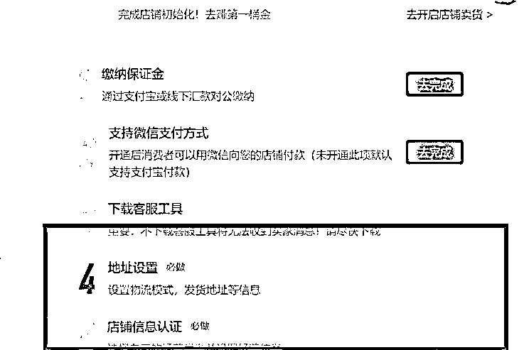

经营类型：在类型 3 和类型 4 之间挑一个勾上，两个都行。

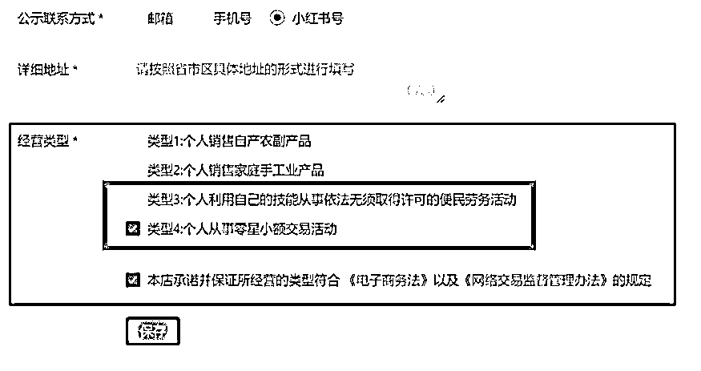

商品类目：选电子资料包。

1.

全部填完会进入审核，通常一分钟内就能看到结果，刷新一下就能进后台了。

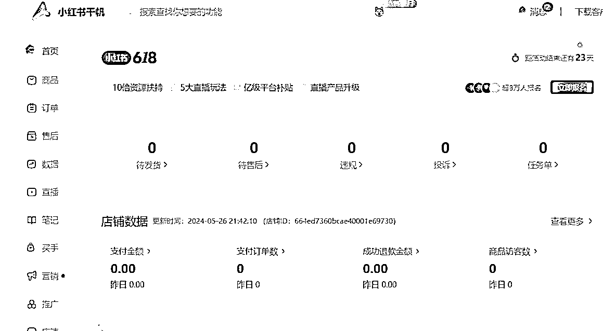

# 三、把虚拟产品挂上架

# 💡

章节导览

顺序要记死：商品先上架，笔记才开动。

年后再看，商城侧的自然搜索给到的量在涨，运气好的话，商品只挂不推也能出单。另外，我们发笔记的时候本来也要挂商品链接。

# 💡

本章航线图

完成本章的学习和实操，航线图会推进到：

第一阶段：把虚拟产品找好、挂到店里（约 1 天）

# 3.1 先把资料备起来

# 3.1.1 虚拟资料的两条来路

1.

整合公域无版权资料（短期打法）

把公开渠道里没有版权约束的内容收拢、整理，变成自己的引流弹药库。像什么班级座位表、PPT 模板、人生管理用的飞书模板，都算。

注意：这个打法不适合长期干，只给新手用来快速把最小可行方案跑通；内容只限市面上没有版权、能自由流通的那部分，别碰有版权争议的东西。要是遇到版权模糊的资料，比如百度文库里的文档，先去裁判文书网查一下版权方有没有相关纠纷记录，再判断风险轻重。

2.

自己动手开发资料（长期打法）

适合手里已经有 IP 积累，或者打定主意长期守一个赛道的人。如今 AI 把自制资料的门槛拉低了不少，感兴趣的圈友跑通这个项目 0-1 之后，可以去看看👉【章节六、用 AI 制作虚拟资料产品】。

所以论长远，第二条路更值得投入；第一条只能算过渡。

⭐为了省时间，帮大家尽快把 0-1 走通，接下来重点展开第一条路：整合公域无版权资料。

# 3.1.2 新手怎么整合无版权公域资料

# ① 先定清楚引流资料清单

拿“日语培训”当例子。如果你觉得这个项目能碰，但自己对日语培训完全没有概念，可以先出去看看同行在送什么。同行摆出来的资料能参考就参考，也可以按自己的想法挑一批最能勾人的内容；当然一定要拿回去和同行比一比，毕竟他们选出来的大多已经被市场验证过了。先照猫画虎，再谈超越。

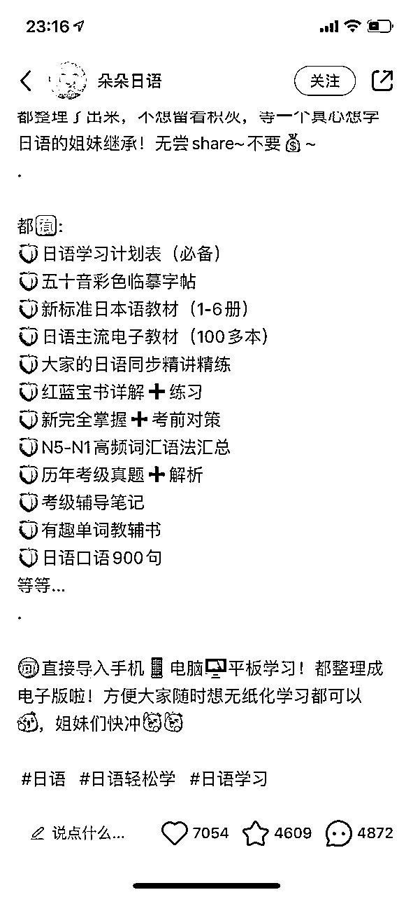

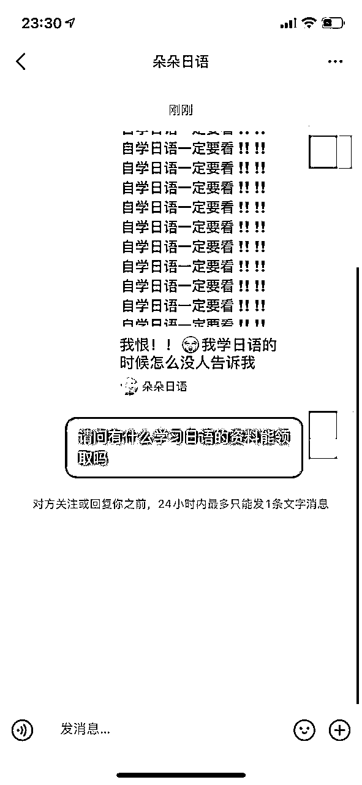

进了📕，直接搜“自学日语”，能刷出一排同行账号。点开头一个“朵朵日语”，正好它把赠送清单写得很明白：日语学习计划表、五十音彩色临摹字帖之类。如果同行没直接列出来也不慌，多翻几篇笔记，或者私信问问对方有什么可领，这样就能把初期该准备的清单拼出来。

# ② 资料从哪里淘

清单定下来以后，有下面几条路子可以收集没有版权的内容。

1、找同行领，推荐指数★★★★★

跟同行打探资料时，顺手就能捎带一小批回来。这个领域要是资料量大，就多挖几个同行；而且别把目光锁在📕，抖音、B 站、今日头条、视频号、🐧 上都有可能出现同行。

同行收集得越多越好，挑出那些长期更新、看着靠谱的，按资料的成色分好级，做成一张表格，以后每次更新资料都拿它当底子。同行放出来的文件通常压着水印或二维码，后面会教大家怎么清理、怎么换成自己的。

2、用网盘搜索器，推荐指数★★★

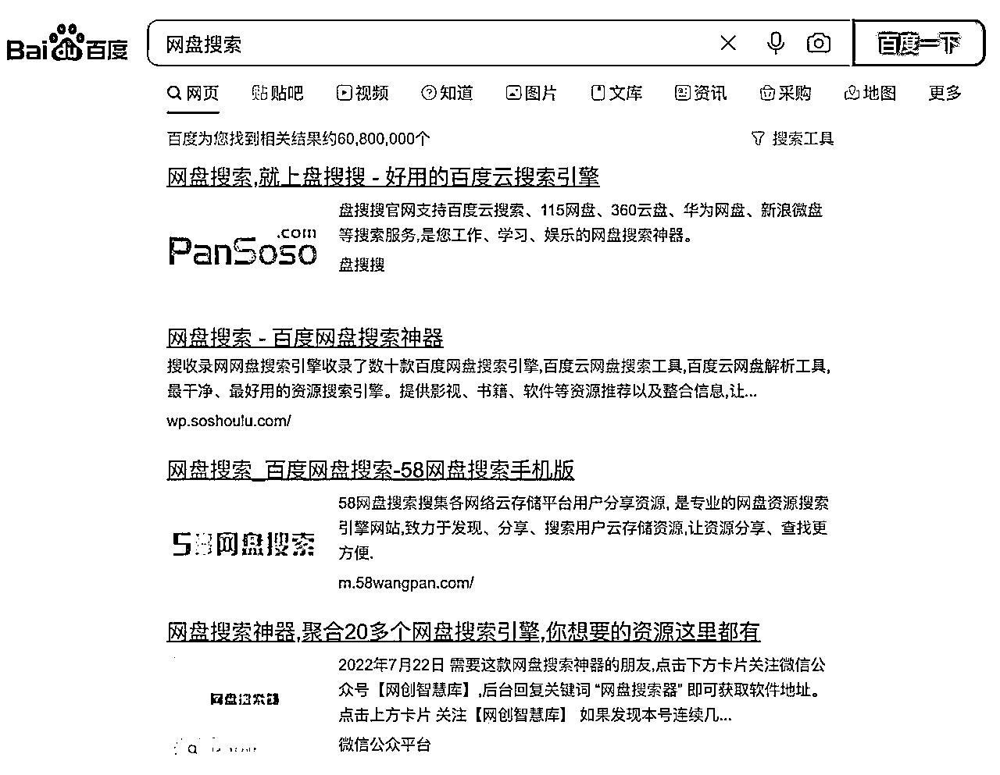

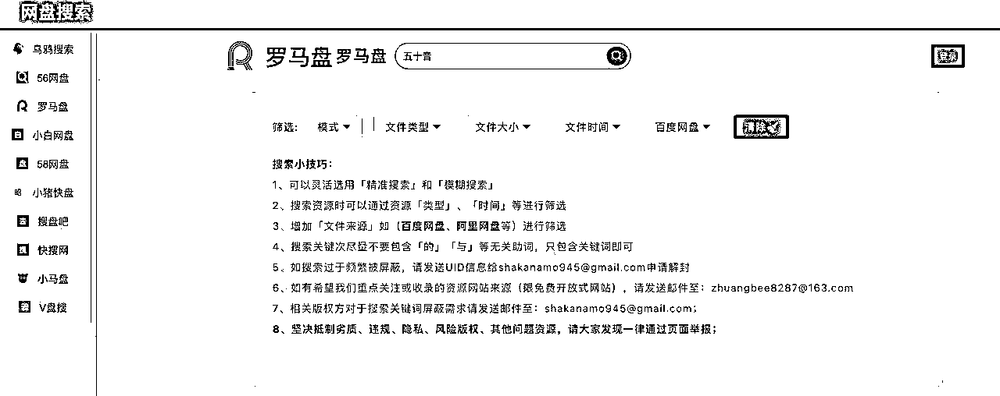

想找某些百度网盘里的资源，一类把网盘分享链接聚合起来的搜索网站就能派上用场。在百度里搜“网盘搜索”，会冒出来一长串网站，从上往下挨个点开，输入关键词查找。不过受制于文件主人怎么命名，目标未必叫“日语资料”，一次搜不到很正常，得多换词，像“五十音”“新标日语”这种具体资料名反而更管用。有些网站还会要求扫码或做个任务才给用，拿来兜底就好。

3、👸号渠道，推荐指数★★

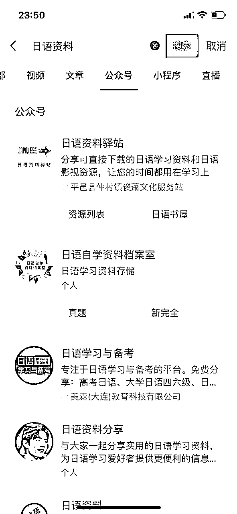

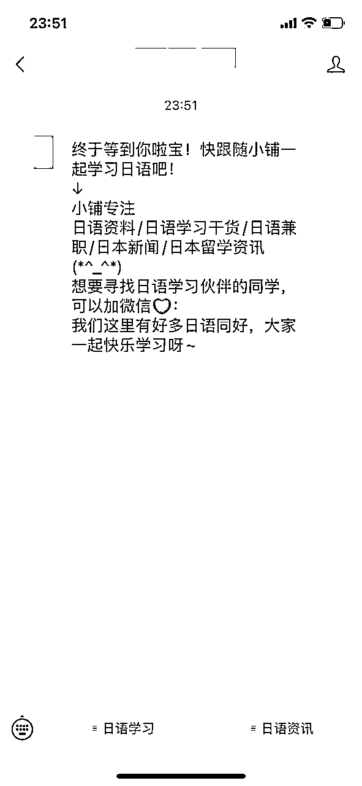

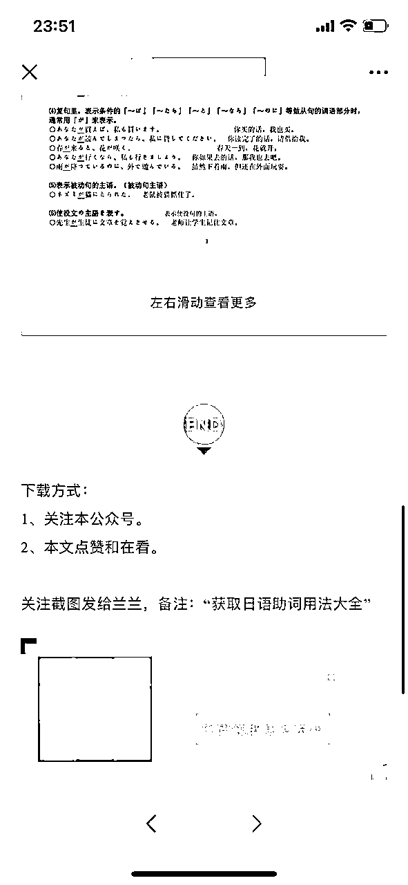

🛰️搜索栏敲“日语资料”，能找到不少👸号和相关文章。翻一翻账号底部的菜单栏，或者翻翻历史文章，有机会摸到资料入口，然后再加号主领取。代价通常是付费、转发朋友圈或完成指定任务，比较费事。

4、电商平台（来得快，但更新少，适合用来铺底仓）

淘宝对虚拟资料查得严，商家运营成本高，加上用户消费力强，同类资料的价格肉眼可见地比拼多多贵。缺什么直接搜关键词下单就行。留个心：拼多多上不少虚拟资料商家其实是同一伙人，还会互相买货装进自家资料库，内容撞车的概率不低。

5、百度文库

覆盖面广、资料多，想查的基本都有，直接输名字就能看。

# ③ 把资料洗成自己的东西

到这一步，手里已经有货了，但上面的水印和二维码也一样不缺。拿这种文件发出去，不但影响成交，还等于帮别人做推广。正确做法是：把旧标识清干净，再盖上自己的印。

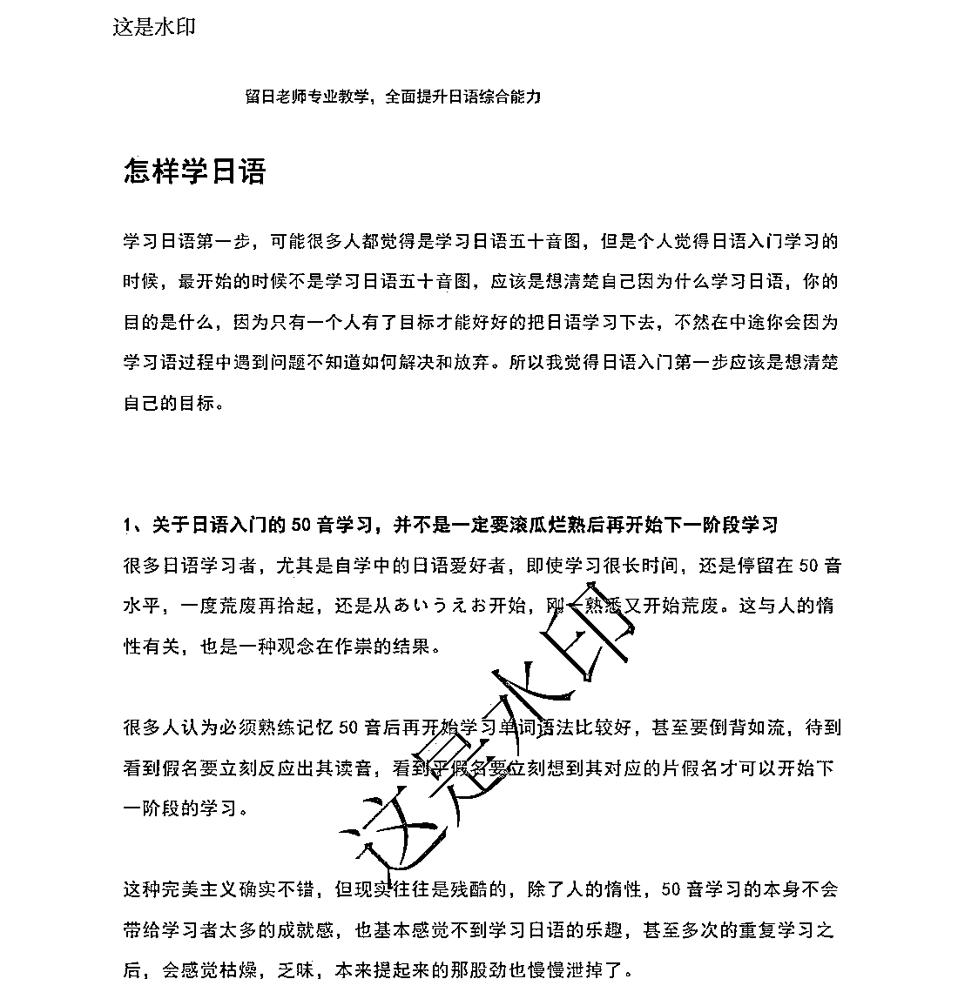

手头顺手的工具无非两类：WPS 的会员编辑能力，或者 PDF 编辑器，对付顽固水印都不成问题。

PDF 那边更简单：把文件丢进去，从第一页翻到最后一页，见水印就删，见二维码就清，最后重新导出。

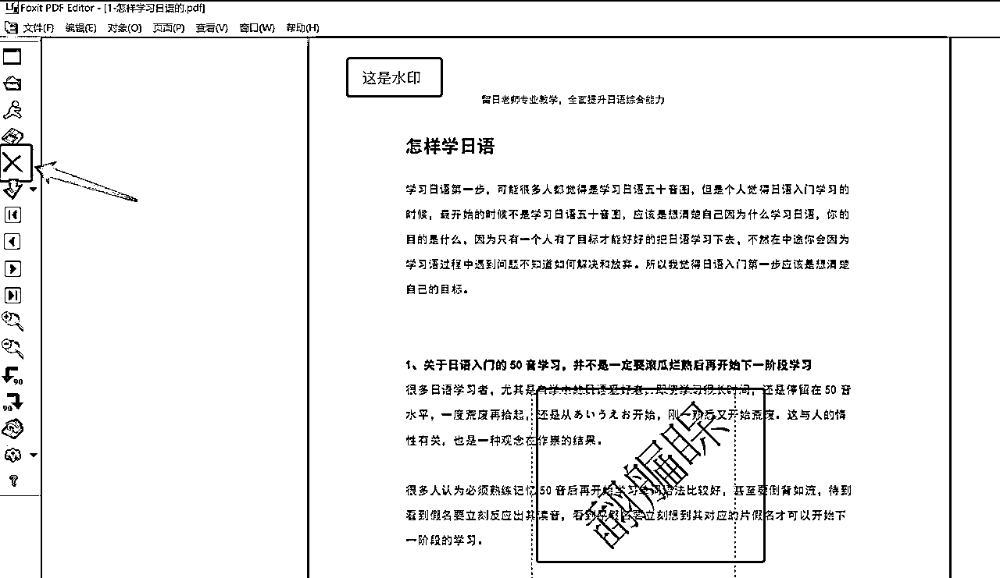

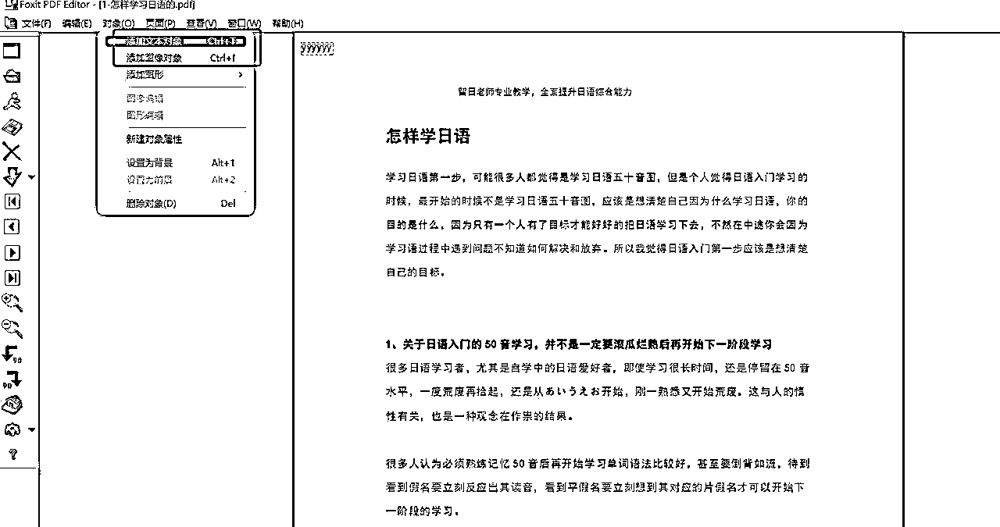

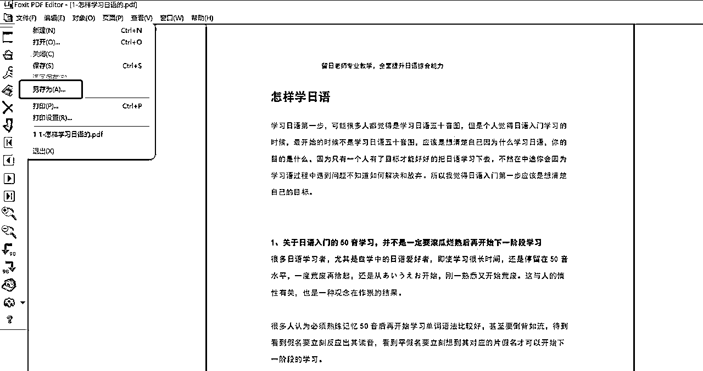

WPS 的编辑路径（有会员才能用）

切到编辑那一栏，直接开擦；要是留下死活擦不干净的残余，就交给 pdf 文档编辑器往死里删。

旧水印清干净后，再用 WPS 给文档盖自家章：🛰️号、👸号、二维码任选。

# 3.1.3 挖资料的三招野路子

# ① 盯住同行引流用的隐藏资料

不少同行会发帖，或者在评论区用一些我们手头没有的资料做钩子。

但只要用了这类资料，就必然配有引导话术，这是跑不掉的规律。最常见的句式就是：“私信/主页 领取/获取”这一挂。看下图：

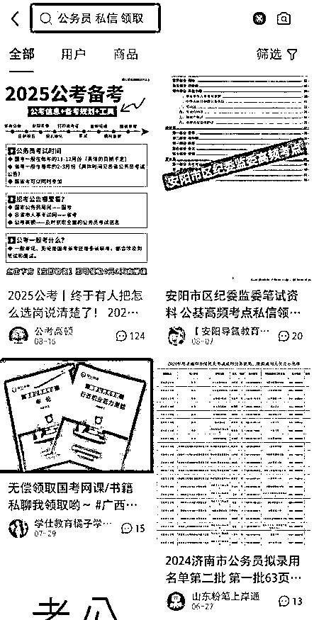

把“公务员”换成你所在行业的词，在📕上搜一圈，能碰到大量用资料引流的人。这一来能找他们领资料、充实自家的库，二来能看清同行都在拿哪些我们没见过的东西当诱饵。手里的存货越厚，能接住的流量自然越多。

再配合📕的排序筛选功能：评论区最热闹的帖子，通常说明资料的引流效果不错。这套玩法在哪个平台都能复刻，关键是想清楚同行引流会用什么词。

# ② 拿格式词根筛资料

虚拟资料活在计算机上，而计算机能承载的资料格式是数得过来的：txt、pdf、xls 等等。一份资料只要上了互联网，总归要以某种格式存在，放出来的人十有八九也会把格式写在明面上。

于是，搜索时把格式词根和行业关键词拼在一起，就能在各个搜索引擎里钓资源。行业词随手换，“公务员”只是示例里的占位符。

同理，虚拟资料的呈现载体也有限：视频、文档、文件、软件、图片……逻辑完全一致。

# ③ 顺网盘链接摸资料

网盘链接在网上很常见，爱分享的人十有八九会甩一个网盘出来。而无论哪个网盘，链接里必然带着官网主域名：百度盘是 pan.baidu.com，夸克盘是 pan.quark.com。

就抓这个规律：

把这套玩法用到任何渠道，都能无差别地挖出各种此前不知道的资源，收进自家库。

# 3.1.4 版权风险怎么查、怎么躲

1.

# 版权检查怎么搞才省力？

方案一：招一支兼职小队，把收集来的素材按设计好的分类逐份排查版权状态，把结果填进去。

想省这笔人力开销，就得自己亲自动手：从源头就把版权关把好，收齐后再复查一遍。

2.

版权有问题的素材怎么处置

版权保护严格的素材，比如机构自研课程、大平台声明保留版权的内容，直接放弃。

版权保护较弱的素材，像页眉/页脚留联系方式的文档、带有水印的 PDF，先归类再统一用工具处理。

这类素材具体怎么分：

页眉/页脚留联系方式的 Word 文档：分好类批量处理

同样的 PDF 就不选：PDF 没法批量改页眉/页脚，转成 Word 再编辑容易乱码

带水印的 PDF：单独挑出来把水印清掉

没有版权问题的素材，直接放进素材库对应的分类，全部处理完后再统一加水印。

批量处理工具：

Word 页眉/页脚清理：BatchDoc

文件名批量加前后缀：Bulk Rename Utility 3.4.3cn（批量命名）

PDF 水印修改：pdf do

# 3.1.5 素材库的维护与更新

素材收进来不意味着结束。平时要留意：不同素材引来的访客成交表现如何，是不是有一大群只拿不买的，顺手复盘聊天推进过程中卡在哪，再判断换素材或改素材介绍。比如「日语语法重点」面向有基础的人，「日语五十音资料」面向零基础新手，后者的下单率明显更高，就拿后者来引流。

另外，项目本身变化不大，但没有任何素材能一直好用。经常看看同行在用什么素材，哪些更吸引人、成交更好，及时拿过来归自己用。

# 3.2 发布电子资料链接

1.

打开📕千帆官网，在首页点【商品管理】

2.

类目要选【个性定制/设计服务/DIY >数字商品 >电子资料包】

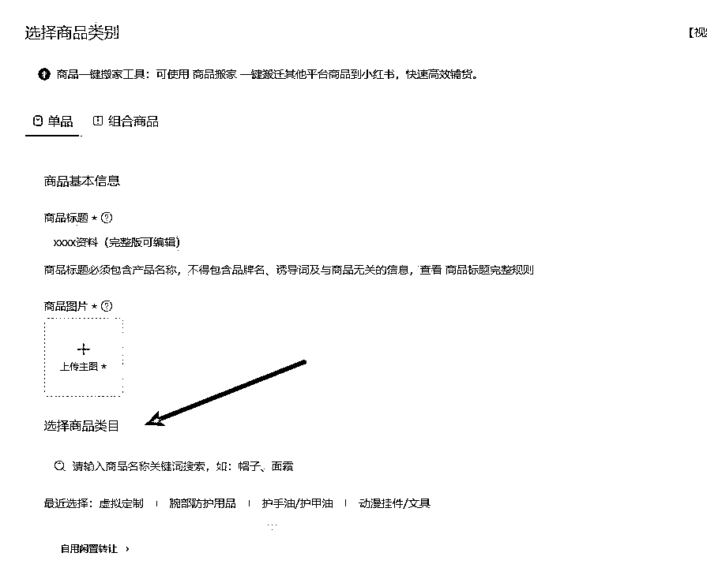

3.

顺着提示把商品信息补齐就行，中间冒出其他提示就照提示调整，基本不会出岔子。

# 3.3 价格怎么挂

先查淘宝同类品什么价，📕这边挂淘宝价的 2-5 倍。做📕就是冲高客单来的，别怕定得比同行贵——📕是兴趣驱动，不走货架电商比价那套。

# 3.4 自动发货配置

开头提醒几点：

1.

阿奇索头 7 天免费，先用满免费期！

2.

通常出了单再配阿奇索自动发货，没单就先放着。

3.

电脑没法常年开机，就挂服务器上，或买短信提醒。

接下来跟着下图一步步操作：

进入服务市场

搜索自动发货，找到阿奇索

先把这个平台绑定好

随手注册个账号

如果不是天天挂着，记得回来重新登录

7 天免费名额先用掉

需要下载 App

登录要账号密码，得先去千帆店铺里设置

打开自动发货，点商品设置

点添加

选自己在卖的商品

把自动回复话术配上

电脑挂不了机，就开短信发货服务

装好发货助手，它得一直挂在电脑上；不然就上短信服务，或者买服务器挂着

再去千帆后台绑定店铺登录邮箱，发货助手只认邮箱登录，扫不了码，助手上了线才会自动发货

全部弄完后自己拍一单试试，看能不能正常自动发货

# 3.5 上架避坑问答

问：📕开店，怎么判断素材有没有版权？

答：开店最好别碰有版权的素材，版权方找上来就麻烦了，店铺可是实名认证过的。

判断办法：

素材别带水印；

看同行有没有在卖，超过 3 个人在卖说明稳妥；

再送大家一张【免责说明】详情页图，出事用来扛。

问：听说店铺都在拼低价？

答：淘宝、闲鱼、拼多多这类货架电商，比价很凶；📕不是，用户没有比价习惯。100 个访客还出不了单，可能跟价格有关；总共就那么几个访客，就别赖价格了。

切记，📕用户价格敏感度很低，宁可定高也不要怂。价格高，单量也许会降，但赚的总数不一定少。

问：电子资料订单发货时仍然提示要寄件，怎么处理？

答：发货时选无物流发货，发货界面有选项。

问：店铺和私域能同号经营吗？

答：店铺挂在实名认证的号下面，不建议一个号两套打法。私域属于违规操作，号没了店也跟着没了。店铺适合放低单价走量，前期靠它赚钱过渡没问题，私域另起新号。

# 四、打造爆款出单笔记

# 💡

# 本章导读：

这一章教大家怎么做出自带流量的爆款笔记，它决定了这件事能不能成。

内容分六块：

1.

找对标账号

怎么挑合适的对标账号

对标账号强在哪

2.

持续产出爆款选题

爆款选题的特征

怎么挖、怎么验证

3.

爆款标题制作 SOP

标题的重要性

爆款标题的核心要素

可落地的标题技巧

4.

笔记封面/内页制作 SOP

封面怎么设计才吸引人

排版和呈现技巧

5.

实战案例拆解

多个成功案例深挖

提炼能复制的经验

6.

实用小贴士

提高效率的工具和方法

避开常见错误

再强调一下：这章是整门课最核心的实操环节，务必重视~

# 💡

# 本章进度安排

完成本章学习和实操，即可推进到：

第二阶段：制作爆款带货笔记（约 4 天）

1.

参照对标账号，做出爆款笔记（约 1 天）

2.

持续更新，每个号每天发 3 篇笔记（约 0.5 天）

# 第 1 步：锁定对标账号

# 4.1.1 值得参考的账号长啥样

在任何平台做内容，模仿对标账号都是被验证过的方法。对标账号就是与你同行业、同类型的号，图文/视频形式、话题选择都可以照着学。

选择标准：

⭕ 低粉：粉丝在一万以内，太多不看

⭕ 高赞：点赞量超过粉丝量，说明内容有分量

⭕ 看最近一个月：周末刷的人多，只看一周没意义

⭕ 高频出现在首页：同一个封面反复推到你面前，这个号就是好对标，抄它就行

爆款笔记取巧就靠四样：选题得有心法，封面得有做法，标题得有起法，内容得有写法。

⭕ 小爆款（赞藏+评论总数≥200）

⭕ 中等爆款（赞藏+评论总数≥1000+）

⭕ 大爆款（赞藏+评论总数≥1w+）

⭕ 超级爆款（赞藏+评论总数≥10w+）

# 4.1.2 去哪里挖对标账号

1.

关键词搜索：在首页搜你所在赛道的关键词（养号时搜的那些），从前 50 篇里找小爆款、中等爆款，评论区有“求”“需要”“私我发”的，就对它下手。优先选同赛道做了 3 个月到半年的号。

2.

搜索栏挖词：搜索栏输入赛道关键词（如下），出现在这里的都是📕用户高频搜索的词，需求明摆着，按小爆款和中等爆款的标准筛选题即可。

3.

刷首页推荐：养号完毕后，平台会按你的互动和兴趣推爆款笔记，首页推荐基本全是同行，照旧按小爆款和中等爆款标准筛。

4.

从赛道热门话题里挖：关注同领域做得好的博主，看他们数据好的笔记，点话题标签，再按小爆款和中等爆款的标准找对标选题。

5.

卡着时间节点（时效性）挖：

拿几个赛道举例。

大学赛道：

开学前：搜“新生入学攻略”“大学开学准备”“宿舍必备品”。

期中期末：搜“期中复习资料”“期末考前冲刺”“考前必看笔记”。

毕业季：搜“毕业照拍摄指南”“毕业论文写作”“毕业旅行路线”。

考研赛道：

考研报名阶段：搜“考研报名注意事项”“报考院校推荐”。

初试备考阶段：搜“考研复习计划”“考研各科目重点”。

初试成绩公布后：搜“考研复试攻略”“复试常见问题”。

亲子教育赛道：

开学前：搜“亲子陪伴计划”“开学前亲子沟通”。

假期：搜“寒暑假亲子活动”“亲子旅行必备”。

成长节点：搜“幼小衔接”“青春期沟通技巧”。

法律考试赛道：

报名阶段：搜“法律考试报名注意事项”“考试科目分析”。

备考阶段：搜“法律考试重点法条”“法律职业资格考试复习规划”。

成绩公布前后：搜“法律考试分数线预测”“法律考试复议技巧”。

K12 教育赛道：

开学季：搜“开学家长必读”“新学期家长会PPT”“开学准备清单”。

期中期末：搜“期中复习资料”“期末考试复习计划”。

假期：搜“寒暑假学习计划”“K12 阶段家长辅导策略”。

英语四六级赛道：

报名阶段：搜“四六级报名注意事项”“四六级考试时间”。

备考阶段：搜“四六级备考必背单词”“四六级考试技巧”。

成绩公布前后：搜“四六级成绩查询攻略”“四六级考试成绩提升建议”。

教师资格证赛道：

报名阶段：搜“教师资格证报名指南”“教师资格证考试科目介绍”。

备考阶段：搜“教师资格证复习计划”“教育学心理学重点”。

面试阶段：搜“教师资格证面试技巧”“教师资格证试讲教案”。

检索后，同样按小爆款和中等爆款标准，从话题标签里筛优质选题做对标。

# 第 2 步：挖爆款选题

两种方式：新人推荐先用【通过话题标签找选题】积累手感；有一定爆款体感后，再用【AI＋乘风关键词词包】提效。

# 4.2.1 从话题标签挖选题

看到爆款笔记，特别是 3 天内发的，点笔记页里的话题标签进到话题页，按综合、最新、最热继续翻更多好笔记。

顺手关注这个话题，之后在📕首页-关注页就能刷到它的新更新。

# 4.2.2 乘风词包＋AI 挖选题

乘风是📕去年主推的站内电商推广工具，为什么拿来挖选题？

它有通投和搜索两种投放模式，简单说卖家能买词推笔记。举例：

你是做雅思的博主，就买“雅思备考”“十天雅思备考”这类词，用户搜这些词时，你的笔记就会露脸。

乘风后台有个【推荐词包】功能。

比如搜“雅思备考”，会弹出一堆现成词包，下载解压后

可以看到具体的关键词和类别，还有竞争指数、月均搜索指数、市场出价

月均搜索指数和市场出价正相关：搜索指数高，市场出价就高，说明用户想找这类内容。

这个词库透露的是用户的搜索偏好。

但凭自己去啃数据，很难挖出有效结论，多数人并不具备这层拆解能力。

不妨把词库喂给 DeepSeek，让它做总结分析，借关键词反向推导选题，找出隐藏的选题红利。

怎么做？

第一步，把词库丢给 DeepSeek，请它思考和分析。

提前声明：我的策略和提示词不是最优方案，而且 DeepSeek 足够聪明，并不需要繁琐的提示词去束缚它。

我的第一条提示词：

请根据这份文档，给我 20 个选题方向，外加 20 个带热门搜索词的标题，同时给出选题理由和覆盖的核心关键词。

思考过程很实在：它指出高搜索词流量大但竞争激烈，可以借长尾词降低难度。

意外的是它还给了公式：

【高搜索词】+【人群/场景】+【长尾词】

还附赠了一种正文写法，让高价值搜索词自然地嵌进去。

嫌结果太少，可以叫它继续补充公式和写法。

总之，它既出选题，也教正文。

核心思路：让 DeepSeek 拆关键词、扩选题、提前占住搜索流量，选题枯竭基本不存在。

除了常规玩法，它还有个隐藏技巧：既然 DeepSeek 已经这么聪明，不如直接问它——应该怎么向你提问，才能用得更顺手？

它给出了方法：

# 第 3 步：造爆款标题

# 4.3.1 杂交式标题法

# 💡

先感谢袁隆平爷爷，他把不同的优质水稻杂交成了超级水稻。

这套方法又简单又出效果，我的爆款标题基本都是这么来的，真正的流量密码。

看图：纪录片 - 最热，前十名笔记翻一遍，关键字无非是：央视推荐、绝了、建议收藏

最热前 8 个里，6 个标题几乎长得一样（爆款就是一直复制的），把关键词反复排列组合，杂交出来的标题天生带着爆款基因。

★ 小建议：平时刷到的爆款标题存进笔记，常翻翻，网感自然来。

# 4.3.2 二极管标题法

# 💡

底层原理：

本能偏好：追求省力和即时满足

动物驱动力：追求快乐和逃避痛苦 → 由此产生两种刺激：正刺激、负刺激

公式一·正面刺激：产品/方法＋只需 1 秒（短期）＋直接开挂（逆天效果）

小学语文赛道最典型：死磕这 X 页纸，考试就像抄答案（见下图）

公式二·负面刺激：你不 xxx＋绝对会后悔（天大损失）＋（紧迫感）

你不看这篇文章等于错过一个亿，限时删除！！！

抖音文案基本都是这个套路，本质是制造焦虑，挺损的，但用户就是吃。

背后是损失厌恶和负面偏误（原始社会里，得到机会不过是多吃几口肉，失误却可能送命，所以进化让人对负面信息更敏感）

# 4.3.3 拿来就用的标题公式

另外，再给大家整理几个爆款标题公式，直接套：

给我背🔥，_______ 高分密码💯️

3 分钟吃透 _______ ！立刻！马上！给我学！

无痛背书法｜_______ 记不住的看看这篇吧！

谁也夺不走我 _______ 单科王的位置！

家人们！这个 _______ 真的！太好使了！️️

学霸笔记：《 _______ 》这也太详细了！

背 _______ 的诀窍，刷到就是上天拯救你！

考场能救急的 _______ 来啦！快保存！

万人催的 _______ 资料，不挂科冲冲冲！

浅哭一下😅考过后才发现 _______ 的捷径

_______ 不用背！掌握这些要点知识就够了！

_______ 的痛！！谁懂？？考前必看✔

_______别裸考！_______熬夜背！

_______风向已经很明显了

提醒一下_______参加_______考试的人

现在才开背，保底能到哪？

日子已经没剩几天。
玩呗，大不了考成某个分数。
可既然你刷到这条，别空着手划走——下面这套封面与内页的打法，全部收好。

# 💡

三句话先记牢：叹号尽管用，你的受众就吃强情绪这一套；写得真一点，把读者当老熟人聊天；话越白越好，别拿腔拿调。

# 第四步：笔记封面与内页怎么做

## 4.4.1 排版先打牢地基

### 4.4.1.1 三个要点

✅ 给零基础作图的朋友划三个重点：封面排版，先把这三条刻进脑子。

要点一：尺寸选对。
竖屏用3:4，方形用1:1，横屏用4:3。
竖版画面在手机上占地儿大，用户视线停留更久；信息装得下更多，被划走的概率也跟着降！

要点二：选图要准。
高颜值、视觉冲击猛的图更抓眼（AI生成也行）；
手写风格简单直白，适合随手写；
合集、美食、旅游攻略这类内容也很搭。

要点三：字要少，但要狠。
📕标题最多20个字符，emoji一个就占1～3个字符。
想多说点信息？那就把封面用足！
用户刷发现页时往往没目标，所以封面上的大字必须占够画面，概念得清楚，一眼戳中需求，直接告诉他：这条内容对你有用！手指自然就点下去了。

竖版 3:4

横版 4:3

竖版 9:16

横版 16:9

### 4.4.1.2 两条减法：少变、少用

说白了就俩字：少变、少用。

少变——封面版式别老换。往模板化、可替换的方向做，排版、字体、风格统一（颜色可以在同一色系里调），主页才显得整齐，粉丝也更容易认出你。

少用——不相干的贴纸别乱放，抢了主角的戏，还把用户注意力撕碎。

## 4.4.2 内容呈现的九种方式

不同产品、不同作品，能怎么呈现？这里整理了九种形式。一个账号选1～2种就够了，按自己的赛道自由挑；别贪多，形式一杂，制作难度上去了，用户观感也会被拖累。

### 4.4.2.1 截图

截图是最省事的作品展示方式。

# 💡

截图同质化怎么破？办法很直接：
1. 自己动手截；
2. 给作品加边框，顺手调调图片参数；
3. 把文件内容丢给AI，让它换个说法重写一遍，再截图，就是一份全新的文件；
4. 打印出来，拍打印稿。
这几招都建议试。某条素材一旦在你号上跑出数据，别停，换个壳再讲一遍，冲一次二次爆发！记牢！！！

# 📌

截图笔记怎么做？
手机应用商店装好“WPS office”；
资料打开后，接连截下五到九个页面；
这些截图可以拼图，也能单页用；
做拼图时，先把多页截图并成一张；
再在资料页上压个标题，封面就有了；内页也能放标题。

### 4.4.2.2 拼图

这种方式适合展示素材，让客户一眼看清你的产品。看案例：

拼图作品怎么做？
简单版用手机拼图功能就行：把需要的素材截好，拼到一起就OK。想做得更精致可以上PS；但用美图秀秀的拼图功能也够用，重点是把内容表达清楚。

### 4.4.2.3 实拍创意

拍照这件事，我举双手推荐。你亲手拍出来的成品，全球独一份。内容还是那个内容，可角度、光线、清晰度一换，系统就很难判定你同质化。
案例来了：

操作上：
a. 实拍图容易起数据；
b. 可以用AI生图；
c. 图片还能二改。
拍照前一定擦镜头！！光线要足，拍完记得调滤镜。

### 4.4.2.4 创意封面

拿🛰️对话当封面，借名人、熟悉场景和好创意把点击勾起来，再配合截图等方式展示内容。

怎么整？
https://vnr4jule4g.feishu.cn/drive/folder/fldcnBdyYJkxPRSFfFyzWvaCnBb
顺手备了七十九张热门创意封面模板，直接抱走用。

### 4.4.2.5 展示目录

目录展示也相当能打。前期做的时候费点功夫，可一旦完成就能反复调用，一次投入、长期吃红利。

怎么制作？
🛰️本身就很能干。拿心理健康公开课举例——先把图片裁进🛰️，再用🛰️提取文字，最后到xlsx表里排版成型。

### 4.4.2.6 固定底图

这类玩法适合点对点展示，放课件、放相关视频素材都很直观。先看案例感受一下：

核心逻辑：先找到贴题的背景素材，再把作品嵌进背景中，图片视频都行，靠场景感或新鲜形式抓人。
背景上哪找？和平时找素材一个路子——去📕等平台搜关键词，扒对应的图片背景。有条件自己搭场景的老师，更建议模仿着拍一段，或者直接录。素材意识平时就得养。
第一步，找背景：
我用的关键词是“办公室电脑桌面壁纸简约”“班级多媒体桌面壁纸”，案例在下面。

第二步，做图文：
想固定这个模板做图文，得请出黄油相机，步骤看下面。

先把素材拖进来，大小调到合适。

接着把准备展示的PPT页面截下来。

然后把要嵌入的内容放进去：贴纸→导入图片，挑出刚才接好的图。

模板成型后，主页会挂着这个模板。下回直接用，点“使用模板”就成。

第三步，做视频：
要展示视频，就得上剪映。先把课件录好，再进剪映调画面、搭模板，之后换录制好的课件即可。这里按手机端讲，需要WPS配合。

在WPS里打开它。

点播放，屏幕会横过来。

然后用手机自带的录屏，把课件录下来。
录好的视频备好，打开剪映，先把背景素材传进去。

选画中画。

把录好的素材放进来。
如果画面带黑边，先裁掉；
素材和素材之间要对齐；
最后加音乐、配文案，导出。
成品效果如下，干净清爽，和单纯截图比，差异一眼可见。

# 💡

想一想：场景的重要性就体现在这儿。平时要有意识地利用身边素材，把积累素材养成习惯。

固定背景展示课件视频操作指导：
固定背景展示课件.mp4【在线播放】

### 4.4.2.7 手写文案

手写体在📕特别招人喜欢，拿来做呈现很加分。

操作方式：A4纸、笔记本纸都行，直接把赛道重点手写上去。

### 4.4.2.8 大字报

用大号文字直接传达关键内容，主题或重要信息一眼突出。

操作方式：用文字（可加表情）做封面页。

### 4.4.2.9 对比图

晒出学习前后的成绩对照，内容价值直接摆上台面，用户的好奇心一下就被勾住。

操作方式：找相关素材和表情，先改，再拼。

## 4.5 案例拆解

### 4.5.1 实战案例一：幼儿园/小学教师资料赛道

#### 4.5.1.1 爆款标题怎么做？

幼小教师赛道打法很直接，用不着硬创新。同行哪一条爆了，照着它的逻辑再走一遍。
得谢谢袁隆平爷爷——把不同优质稻种一杂交，超级稻就诞生了。
方法朴素但管用：跟着同行模仿。先搜幼小教师资料相关词，像“期末评语”“幼儿园课件ppt”“新手班主任干货”，筛出点赞500以上、15天内的笔记，把标题摘下来，再重新拼装。见效快，简直是流量密码。
以“期末评语”为例，提取关键词，不断换位组合，杂交出来的标题天生带爆款相（爆款，本来就长在重复里）。

🌟 这些高频词值得盯：期末评语、天花板、xx条、走心、被校长夸、2024、存下直接套、第x弹、救班主任的命。

👇 把这些词重新排列，至少能拼出5个新标题：
1. 2024小学期末评语天花板！班主任的救命锦囊
2. 这套期末评语被校长夸了……真心好用
3. 188条走心期末评语！校长直呼天花板
4. 期末学生评语天花板！存下来就能套
5. 走心期末学生评语第一弹！天花板级模板

# 💡

干货笔记同理：把关键词摘出来，反复组合。平时刷到的爆款标题，随手记进笔记，有空多翻翻，网感靠刻意练。

#### 4.5.1.2 爆款封面&内页怎么做？

✅ 用户点不点，全看主页那张首图——打开率高低，它说了算！

① 资料封面&内页（产品笔记）
先去资料库翻近期热点：开学用“班级管理资料”，期中用“家长会ppt模版”，期末用“期末学生评语”。找到后直接截内容，进P图软件拼图美化，尺寸定为3:4，案例往下看：

制作教程：
产品笔记资料封面内页制作教程.mp4【在线播放】

② 实拍封面&内页（产品笔记）

1. 有打印机
流程差不多：后端资料库锁定近期热点，开学“班级管理资料”、期中“家长会ppt模版”、期末“期末学生评语”，下载前四到六页打印出来，手机实拍，背景用键盘或桌面，案例：

2. 无打印机（伪打印）
手机端实拍教程：
无打印机手机端制作实拍封面图教程.mp4【在线播放】

③ 四宫格+真人封面&美图内页（干货笔记）
干货笔记，说白就是行业里有料的内容，赞藏率特别高，能明显抬账号权重，还能给其他产品笔记导流。四宫图配真人封面，真人感更强，目标客户看着亲切，比冰冷的简约风更能拉点击。
做起来也不复杂，道理还是那条：爆款靠重复。不用自己原创，找到行业内的干货爆文，用AI改一遍文案，再用P图软件复刻。

# 💡

拿小学教师资料赛道举个例子：
小学老师愁什么？学生管不住、家庭和工作难兼顾、跟家长关系不好维持……这一类干货内容，就是我们要找的复刻对象。

【图片部分】
封面备四张图，参考下面这组，至少凑齐1个人物元素+3个生活元素，人物露不露脸都行。
内页按内容量来，一段话配一张图。

1. 搜“借图发朋友圈”，从评论区挑9～12张图，截图保存。
2. 进美图设计室APP，用“图文去重”把截图批量处理。
3. 后面的图片同法操作即可。

## 发笔记前的四道工序，漏一步都亏

**封面**：美图秀秀里选拼图功能，挑 4 张素材图，比例锁定 3:4；进入高级编辑，把标题核心信息做成画面重点。

**内页**：先在🛰️把图上的字提取出来，接着进美图秀秀排版，把文字覆盖到图片上。

**文案**：借文案提取类小程序抓取原文，再丢给 AI 润色工具处理，Kimi 📕生成器就能干这活。

**标题和话题**：动手只动标点、加表情符号；话题从原篇内容里挑匹配度高的挂上去。

# ④ 图文变视频，踩着平台红利走

📕近期围绕视频笔记开启了铺量补贴。信号不难读：平台要把视频的地位往上提。逻辑很简单，用户看视频会待得更久。我们自营团队上周亲自下场跑了一轮，视频类内容的表现确实更亮眼。往后图文与视频建议各占一半去铺。下面用实操演示，把现成的图文素材转成短视频。

图片转视频.mp4【在线播放】

# 4.5.2 实战案例二：教资面试资料赛道拆解

# 4.5.2.1 标题怎么做才能爆

在热门考试赛道里，高点击标题往往围绕两组元素打转：一边是时间紧、名额少带来的压迫感，另一边是戳痛处加上给结果。

最好的参照物就是竞品。流程不变，先收集再混搭：以“教资面试结构化”“真题”“幼儿押题”为检索词，限定半月内、赞数过五百的帖子，取其标题做拆解再重组。跑起来很见效，流量的密码就藏在这一步。

看图示：在“教资面试押题”结果页里挑出高频词，来回换位组合，产出的标题先天就带着爆款潜质——毕竟爆款本身就是重复的结果。

🌟 可借用的词根：**（时间）教资面试、押题、已出/已曝光、年年考、反复考、**道、（仅剩/只需）*h/*天、风向已经很明显了**

👇 重排后至少可得 5 个新标题：

1. 教资面试押题新鲜出炉，2 小时速记稳上岸
2. 时政押题已发布，6 小时冲刺 90+
3. 25 上教资面试倒计时一周，这 20 篇重点别错过
4. 下周六就面试，进度还是零？这份资料等于开卷
5. 面试仅剩 3 天，押题背完一次通关

# 💡
干货类笔记同理，提词、调序、重组合。刷到不错的标题就存进素材库，多翻多练，网感是练出来的。

# 4.5.2.2 封面和内页如何勾住点击

✅ 用户进主页第一眼看到的那张图即封面，打开率高低基本由它决定。

# ① 资料类封面与内页

先去后端素材库翻近期热点：报名阶段取“教案模板”，临近考试用“时政押题”“考前*页纸”。截屏后放到修图工具里拼接、修饰、加标注，画布比例设为 3:4。看例子：

操作演示：

# ② 实拍类封面与内页

1. 打印版（图一）

照旧从素材库选近期热点内容，下载开头四到六页打印出来，用手机拍照，背景可铺键盘或桌面。看示例：

图一
图二

图三

图四

2. 打印加手写（图二）

把资料里的答案部分去掉，留出书写空间，打印出来再亲手写。

3. 全手写（图三）

只抄目录，手写完成。

4. 没打印机（伪打印）（图四）

手机端制作实拍图演示：

无打印机手机端制作实拍封面图教程.mp4【在线播放】

# 4.5.2.3 文案如何写才能促进转化

产品型笔记：在标题基础上加几个字复述一遍，或者照着对标账号的正文写一份备考安排，交给 AI 润色，核心是让用户感知资料已备全。正文也可以省掉，直接带话题。

示例：

📚 政治押题 32 道 PDF

📚 教案模板 PDF

干货型笔记：用（红薯原图+）这类小程序把文案抓下来，丢进 AI 改写工具，选 Kimi 📕生成器。

# 4.5.3 实战案例三：PPT 模板赛道

# 4.5.3.1 爆款标题的拼装法

思路一样，抄同行的作业。检索“PPT模板怎么做”“高级感”“合集”等词，限定半月内、点赞五百以上的帖子，把标题扒下来重组。马上能看到效果。

看图：在“PPT模板合集”下找高频词，反复换序组合，混搭出的标题天生具备爆款属性——爆款靠的就是重复利用。

🌟 可借用的词根：太香啦、真的很重要、**套、走心、领导狂赞的、导师想看到的、私藏、不服不行

👇 重排后至少 3 个新标题：

1. 领导想看的会议 PPT 长这样，不服来辩
2. 换上这套 PPT 模板，领导当众夸我省心
3. 千份被导师盛赞的 PPT，模板选对就赢一半

# 💡
干货内容也一样：挑词、换位、反复排列。刷到亮眼标题当场记下来，多看多练，网感是刻意磨出来的。

# 4.5.3.2 封面与内页的点击设计

✅ 主页第一屏展示的那张图即封面，打开率高低直接取决于它。

# ① 资料类封面与内页（产品帖）

1. 有电脑的情况

在素材库找当下热点：哪吒素材 PPT、热播剧 PPT、行业热点 PPT，下载后用 PPT 软件直接美化。

2. 没电脑的情况

在素材库挑热点 PPT 模板，截屏后放到修图工具里拼接修饰，画布设 3:4。看例子：

操作示范（这只是其中一种，也可以批量截屏再拼接）：

77918b9b47df3ad9ad9e6886ed624e19.mp4【在线播放】

# ② 实拍类封面与内页（产品帖）

1. 有电脑的情况

同前面一样，从素材库取热点内容，下载后用电脑打开直接拍照。看示例：

2. 没有打印机（伪打印）

手机端实拍流程演示：

c0a7f4b58f3ae783be4b6834eed752b7.mp4【在线播放】

# 💡
拿小学教师资料这个赛道举例：老师们的难题无非是班级管不好、工作和家庭两头难顾、跟家长处不好关系……围绕这类干货去做复刻。

# 4.6 笔记小贴士：流量藏在细节里

# 1）敏感词提前排查

一旦踩中敏感词，机器审核会变得更严，轻则审核拖延，重则被限流。长文案定稿后，到零克查词 https://www.lingkechaci.com 过一遍，把踩线的词替换为谐音或拼音写法。

# 2）新手可以试伪原创

不清楚该发什么、也摸不准粉丝口味的时候，不妨直接拿同行那些粉丝少但点赞高的图文（连封面一起）来做伪原创。

美图秀秀伪原创：发笔记.mp4【在线播放】

剪映伪原创图片：如何用剪映导出伪原创图片.mp4【在线播放】

批量伪原创图片：如何用中小学批量制作伪原创图片.mp4【在线播放】

# 3）把 SEO 搜索流量铺好

在文案里预先埋好关键词，单条笔记就能长久承接精准流量。SEO 说白了就是：你深耕小学教师资料方向，用户在📕输入“小学期末评语”时，你的内容能出现在结果里。会主动搜索的人，消费冲动和付费能力都强，粉丝质量高，成交自然更容易。

因此标题和正文都要埋词。小吃配方方向可放“夏日摆摊爆款”“xx（产品）配方”；创业比赛方向可放“互联网+”“三创赛”“xx（项目）计划书”“计划书完整版”。搜索排名与曝光量都会因此抬升。

# 3）笔记排版不可忽视

📕是个讲究视觉精致的平台，排版能加不少分。大家多是利用碎片时间浏览，版面清晰会明显改善阅读感受，让重点信息一眼就能抓到。两点要盯住：

1. 封面提炼标题。封面上必须呈现笔记的核心内容，用户才能判断对自己有没有用，进而决定是否点开。
2. 正文分段。成段文字一定要空行，穿插表情符号，阅读起来才不累。

# 4）带上#话题

在正文结尾挂上与内容强相关、浏览热度高的话题。以发布小学期末评语资料为例，末尾点“#话题”并输入“期末评语”，会弹出一组相关话题，选热度最高的几个即可。还可以叠加细分关键词话题，比如 #二年级期末评语 #低年级期末评语 之类。

# 5）发布时段参考

午间：11 点到 13 点

晚间：19 点到 22 点

# 6）判断笔记是否限流的三个小动作

在毫无阅读量或数据反常时才去操作。反常指的是新笔记上线 24 小时后，小眼睛👀仍卡在 100 以下，或者接连几篇都不过百。

1. 能否投放薯条。进入笔记 ➥ 点右上角“···” ➥ 选“薯条推广” ➥ 观察审核是否通过；只要跳出付款页面，就说明笔记正常。
2. 查笔记有没有违规。点左上角“≡” ➥ “帮助与客服” ➥ “笔记申诉” ➥ 查看违规记录；没有记录即正常。
3. 能否被搜到。拿第三个小号搜笔记标题 ➥ 能搜出来就正常。

如果整个账号被限流，多半是硬广发得太多或账号权重偏低。此时多发有干货价值的内容或讨论型帖子，把互动拉起来，权重和流量会慢慢修复。

# 7）素材传输工具安利

素材传输很让人头疼：聊天软件会把画质压掉，邮箱操作又繁琐。这里分享两个我们团队一直在用的工具，安卓、苹果、鸿蒙、Windows、Mac 都支持。切记别拿📕当传输工具！！

1. PP直连 https://www.ppzhilian.com （网页打开即用，无需安装，苹果用户首选）
2. 极连快传 http://www.zqbapp.cn （运行稳定，需下载安装，暂不支持苹果，安卓推荐）

# 8）做好📕的十条心得

① 靠干货把人引进来，成交交给单条笔记承接。没必要每篇都带货，也不必每篇都追求高曝光，先明确这篇笔记的任务是什么。

② 怎么写属于战术，写什么才是战略。每条内容都该带着目的，以结果倒推、用方法填充过程，不然只会越做越找不到方向，白耗时间。

③ 模仿在先，创新在后，模仿能解决七成问题。

④ 一百篇凑数的，抵不过一篇打磨到位的。

⑤ 📕不是拿来秀自己的。

⑥ 发一篇就死磕一篇，做一个品类就尽量做到独占。

⑦ 培养对热点和流量风向的敏感度，撞上搜索热点要立刻跟进。

⑧ 笔记数据不过五百，多半是选题和封面出了问题；至于流量能冲到多大，取决于互动指数这个流量开关有没有被触发。

⑨ 爆款都是重复出来的，要反复制造爆款：一是选题加模仿，二是高效率地产出内容。

⑩ 认真了都未必成功，不假思索地随便开干，注定失败。

# 五、引导成交：让流量落到订单上

# 💡 章节概要

笔记的终点是成交。想让流量价值最大化、把转化率提上去，重点抓三件事：发布时同步挂商品链接并完成承接；用小号配合大号发内容；出单后快速发货、做好售后，保证店铺平稳运转并持续优化。具体内容进本章细看。

# 💡 本章航线图

学完本章并按步骤实操，就能推进航线图上的：

第二阶段：打造爆款带货笔记（约 4 天）

1. 给笔记挂商品链接、引导成交（约 0.5 天）

第三阶段：持续运营，并着手开发产品（约 14 天）

2. 店铺运营与优化（约 14 天）

# 5.1 挂商品链接的最佳节点

商品链接应该发布当下就挂，别等流量涨起来再补。挂链确实会影响流量，但未必是坏事；商品笔记能拿到的流量，是付费流量之外最精准的一批。

目前有两个挂载位：笔记标签末尾和评论区置顶。前者手机、电脑都能操作；后者电脑无法挂，只能手机上处理。电脑发布效率更高，但仅支持挂标签位那条链接，其实也够用。建议先用电脑发布，等某篇数据跑起来，再用手机重新编辑，把链接补到评论区置顶。

# 5.2 一店多号的协同打法

把📕账号看成承载笔记的容器。单个账号日更过多容易踩违规线，因此采用“一个专业号加三个主理人号”来分散发布量，鸡蛋不放在同一个筐里，违规风险自然降低。

操作建议：绑定店铺的专业号尽量少发甚至不发。即便玩法合规，风险也无法完全排除，平台偶尔会抽风。主力交给主理人号去发笔记、挂商品链接。

# 5.3 发货和售后的坑怎么绕

春节之后，📕开始收紧店铺端的运营规范。过去把前端笔记做好就行，店铺几乎不用打理；如今店铺运营同样关键，特别是售后环节，用户负反馈率一旦过高，流量会被直接掐住。

发货环节常见毛病：物流类型设置错误。编辑商品时留意物流选项，必须勾选带有“无物流配送”字样的类型，不然自动发货无法触发。万一漏选且已有买家下单，就到拼多多用买家的收货信息下一单礼品单，拿礼品单的快递单号回📕填写发货，千万别随便编单号。运费模板记得选全国包邮；系统默认对非偏远地区包邮，新疆、甘肃、海南等地用户会直接下不了单。我们卖的是虚拟产品、本就不发货，选全国包邮最省事。

售后环节常见毛病：网盘链接点不开。许多用户对网盘不熟，遇到大文件往往不转存、直接用手机下载。最好提前录一段操作视频，演示百度网盘的使用方法。用户没开会员、文件太多一次转存不下时，可以建议他只转存眼下要用的那部分，其余随用随取，链接长期有效，不必全部转。碰上要退款的，态度要平和，直接让对方退；引导对方把原因选成拍错/多拍/不喜欢或其它。若用户选了不利于商家的理由，会计入负反馈率，次数多了会被限流；并且首次选错理由后即使再改也无效，只按第一次计算。

# 5.4 店铺运营的优化细节

好评返赠额外资料。买家下单后自动发货的同时，附上一段话术引导对方给好评并赠送其他资料，话术可直接参考淘宝、拼多多同行的写法。这样既能积累好评，也能促使用户尽快确认收货，货款回笼更快。

千帆后台支持配置自动回复，把高频问题预先写好答案，做到秒回、消除买家顾虑，转化率会有明显提升。买家通常关心：发货方式？能不能马上发？资料含答案吗？可否打印？支持试看吗？是否为 Word、能否编辑？这些属于通用问题。某些资料会有专属疑问，需要在客服沟通中不断收集归纳。自动回复对“客服三分钟回复率”这项考核同样有加分。

七天无理由退款务必开启。关掉它毫无意义，该退的单子照样退；而且相当一部分用户在下单页看到显眼的“不支持七天无理由”几个字，会当场放弃购买。

# 选修篇：把项目玩出规模与花样

# 💡

这一篇，专门聊项目中那些更进阶、更拓展性的玩法。如果你已经顺利跑通项目的最小 MVP，想看看它还有哪些可能，或者想找点新的灵感，那接下来这部分值得你认真读一读。

不管你是想继续放大现有项目，还是想探索更多商业路径，下面的章节都会对你有帮助：

✅ 六、用 AI 制作虚拟资料产品

✅ 七、更多变现方式

✅ 八、私域引流与运营

✅ 九、更多资料赛道

✅ 十、矩阵放大

✅ 十一、投流放大

其中，“用 AI 制作虚拟资料产品”这个动作，严格来说并不在最小 MVP 的必做范围内。但如果你打算长期深耕这个项目，我非常建议你掌握它。航海期间，教练也会安排专门的直播分享来带大家学习。

现在，一起去看看这个项目还有哪些值得挖掘的空间吧～

# 六、用 AI 制作虚拟资料产品

# 6.1 为什么要用 AI 做虚拟产品？

想在📕做电商、卖货变现，学会用 AI 辅助开发虚拟产品几乎是刚需。尤其是 DeepSeek R1 模型上线后，整个开发门槛明显降低，对内容创作者来说是个好消息。

对于零基础的新手而言，想完全靠一己之力从 0 到 1 做出一个虚拟产品，其实并不容易。我说的“独立开发”，不是指一个人闷头干完所有事，而是在你脑子里可能只有一团模糊的想法，完全没有清晰的架构。比如你想把自己的经验做成教程，但思路乱得理不清，不知道从哪一步开始。

这就像中考、高考时写作文，我们面对的都是命题或半命题作文，给你一个框架，你才能在限定范围内展开。而现在对于 0 基础的新人来说，AI 就相当于给了你这样一个“可发挥的边界”，帮你把混沌的想法一步步结构化。

但要记住一点：AI 对你的价值，不只是帮你生成一个产品那么简单。真正重要的是，在你从 0 到 1 搭建虚拟产品的全过程中，它能成为你最得力的助手。下面我就用几个场景，来说说怎么借助 AI 把虚拟产品做出来。

# 6.2 如何用 AI 做虚拟产品？

先达成一个共识：不要用偏见去对待 AI，也别给它设限，相信它的创造力远比你想象中更大。AI 能很多你不敢想的问题，而你需要做的，是放下固有的成见，尽量与它形成高效协作。

有了这个共识，我们就可以把 AI 用在虚拟产品制作上了。对于个体来说，从零到一打造一个原创虚拟产品，通常会走这样几个关键步骤。

# 6.2.1 认识你自己

AI 是很好的优势挖掘工具。它能帮你更清楚地看见自己的长处、技能，以及那些能被市场认可的认知、经验和方法论。

具体怎么操作呢？我提供一个参考思路：你可以把 Kimi 和 DeepSeek-R1 搭配起来使用。

很多人遇到的第一道坎就是不会写提示词。提示词的本质，其实就是“一个具体的问题 + 你期望 AI 完成的任务”。如果你对这件事感到无从下手，可以让 Kimi 的提示词专家帮你生成一个。

比如，我这样问 Kimi：“帮我设计一个优势挖掘专家的提示词，能够帮我有效挖掘我自身的优势。”结果它直接给我返回了一个可以套用的提示词。

这个提示词的核心逻辑是这样的：先把 AI 设定为“优势挖掘专家和心理学顾问”，再给它定义一个背景，比如用户想深入了解自身优势，但自我认知不够清晰；接着规定它的专业技能，包括心理学、人格评估、优势理论、职业规划等；然后明确目标，也就是通过专业评估帮助用户发现优势，给出个性化建议；同时还要加上约束条件，确保评估科学客观，并保护用户隐私。在输出格式上，要求结合文字、优势分析报告、个性化建议和实际案例。工作流程则是先深入了解用户的经历、兴趣和职业背景，再利用心理学原理评估优势领域，最后给出针对性建议。它还会针对不同角色给出示例，比如软件工程师、销售经理、大学生，分别给予不同的优势分析和行动建议。

拿到这样的提示词后，你可以直接复制给 DeepSeek 使用。你会发现，DeepSeek 会努力理解你的意图，并在对话中一步步帮你梳理个人优势，甚至点出这些优势有哪些可以变现的场景。

另外要提醒的是，DeepSeek 的强项在于“追问”。你问得越多，得到的答案越接近你想要的，所以一定要多轮提问，别轻言放弃。

# 6.2.2 测算需求

很多你以为的“需求”其实可能是伪需求。但 AI 能帮你判断这个需求到底存不存在，之后你再结合 AI 给出的参考，去市场上看看已经有哪些产品和服务，进一步验证你的想法是不是靠谱。

举个例子，我问 DeepSeek：我有五年新能源汽车行业背景，请给我几个能快速做出来的虚拟产品，要求是轻量化实现，并且能有效解决用户痛点。它给了我好几个方向。假如你对“新能源车企面试答案库”很感兴趣，那这时你就有了一个明确目标。需求测算这一步算完成了，接下来就可以进入下一个环节。

# 6.2.3 用 AI 辅助创建虚拟产品

很多人都有这样的痛点：肚里有货，却倒不出来。不是没经验，而是缺少一套系统输出的框架，没办法把脑子里的东西有逻辑地呈现出来。这就像有些人只能写命题作文，你给他一个引子，他能写得不错，但让他自由发挥，反而憋不出东西。

而 DeepSeek 恰好能解决这个问题。它可以为你搭出一个还不错的框架，你既可以直接把自己的经验填进去，也可以借这个框架唤起那些沉在记忆深处的细节。

比如，你想写一份从 0 到 1 的装修指南。你可以让 DeepSeek 帮你生成目录，像这样告诉它：“我刚刚完成了一套三居室的装修，想把这套经验系统梳理成一份 PDF 文档，里面要包含装修从 0 到 1 的全过程。还请在目录中加一些市面上见不到的暗知识、隐性知识和实操技巧，给我一份详细目录。”

当你把这段提示词发给 DeepSeek，它会给你一个比较完整的目录框架。有了这个框架，你心里就有底了。至于后续怎么往里面填内容，完全取决于你自己对装修的经验和理解。

这里我想特别说一下：为什么我在提示词里要强调“隐性知识、暗知识、实操知识”？因为这是让内容产生竞争力的关键。你的颗粒度必须足够细，而且尽量不要做市面上到处都是的同质化内容。当 DeepSeek 识别到你这个要求时，它就会主动去思考哪些知识点是目前市场上还比较稀缺的，从而给你更有深度的内容建议。

这个用法适合你已经有了足够知识储备、只是缺一个“疏导逻辑”的情况。另外，你还可以把自己的需求和 AI 结合在一起，完全靠 AI 做出一个虚拟产品来。比如合同模板、简历模板、面试题库等。下面我以“面试题库”为例，讲讲怎么构建这类虚拟产品。

具体方法是让 AI 先出面试题，再针对每道题生成专业答案。为什么要拆成两步呢？如果你直接让 AI 同时生成问题和答案，它既要思考出什么题，又要想答案，挑战难度会变大，生成内容的颗粒度往往会比较粗，答案的可读性也不太行。

所以，更聪明的做法是：先生成问题，再逐题生成答案。按这个顺序做，内容的可用性会提高不少。而且，在生成答案时，一定要让 AI 基于单个问题来回答。可以参考我下面的示例：

这样做的好处是，你能获得更详细的解题思路，让虚拟产品显得内容更丰满、更有说服力。所以，如果你想做一个题库类的虚拟产品，一定记住“先出题、后出答案”这个原则，这样才能保证内容足够扎实。

最后总结一下：用 AI 制作虚拟产品，不是某个步骤的事，而是贯穿你从 0 到 1 的全过程。从认识自己、盘点资源和优势，到测算需求是否真实，再到最后的润色和产品化，每个环节都能靠 AI 来完成。

# 七、更多变现方式

# 7.1 接广告（商单）

什么是接广告？简单说，就是📕账号通过发布笔记涨到 1000 以上粉丝后，入驻蒲公英平台，成为达人，然后接品牌方和广告主的合作，发布广告笔记赚取费用。📕达人通过接广告获得收益，一单最低 100 元。

整个流程是：注册账号 → 选择合适赛道 → 养号 → 参考对标账号完成包装 → 对标爆款持续做笔记 → 涨粉到 1000+ 并实名认证 → 入驻蒲公英 → 接广告变现。

具体怎么做，可以参考“3 月航海📕达人变现”这个项目。

优点：变现链路短，不需要运营私域等后端环节。

缺点：必须先有千粉账号才能变现。有时候涨粉速度慢，需要坚持。而且项目天花板不算高，一个账号一个月大约能接 15 条广告，广告单价在 180 到 240 元，单账号月收入大概在 2000 元上下。

# 7.2 付费打卡社群

付费打卡社群，是指通过设置打卡任务，激励用户付费加入的社群模式。它用“付费门槛 + 打卡机制”来提升用户参与度和粘性。在教育领域，通常提供高质量学习资料、学习指导、学习监督等服务。

怎么做打卡社群呢？前提是你得有粉丝，能精准地把粉丝引流到🛰️，社群就可以开展起来。

创建付费打卡社群的方法包括：明确社群定位和目标人群，比如健身、读书、学技能等；制定合理的规则和定价，既保证社群质量，又让用户愿意付费；选择合适的工具，比如知识星球来创建付费圈子，支持内容分享、成员管理和活动组织；设计具体的打卡任务和奖励机制，比如每日读书、健身，完成打卡可以获得奖励。

运营层面，要做到以下几点：持续输出高质量内容和互动，增强用户粘性；设计互动话题和答疑，鼓励成员讨论分享；定期举办线上分享会、讲座、研讨会，也可以组织线下聚会、工作坊，增强成员认同感。

吸引成员加入，核心在于以下三点：第一，输出专业知识、技能或价值观，满足用户需求；第二，促进成员之间的互动，加强关系链接，提升社群价值；第三，设置分销利益，比如老成员推荐新成员可以获得佣金。

管理社群时，要严格执行群规，对违规行为进行处理；还要对成员做标签化管理，根据兴趣、活跃度分类，更有针对性地推送内容；同时利用专业报名、抽奖、打卡工具，提高管理效率。

优点：付费门槛能筛选出更精准的目标人群，方便圈主变现；用户付费后会更投入，同时运营成本有保障，可以安排专人负责内容质量，提供更好的服务。

缺点：愿意付费的人群有限，引流有难度。另外网上免费分享很多，用户付费后期待值会远高于免费内容，这对服务提供者的内容设计和运营流程都提出了更高的要求。

# 7.3 督学

还有一种变现方式是“督学”。

什么是督学？📕上有一些学习博主，比如雅思考了高分，但没能力录制系统课程教别人，却依然有大量用户来咨询备考经验。于是，就衍生出了“雅思督学”这种服务。

督学怎么做？和打卡群类似，不过是一对一的形式。

步骤如下：在📕发布自己的高分成绩和备考攻略，吸引粉丝；再发一篇“可以做督学”的引流笔记；把学生引流到私域完成成交；引流后，整理一份背景信息清单发给学生，包括学科基础、目标分数、每天能投入的时间等；根据学生的背景信息量身制定学习计划，注意不要一次性全部发完，先发一半，确认成交后再发完整的；之后每天按计划督促学习、分享资料、答疑解惑，在报名等关键时间节点及时提醒；过程中可以请学生在朋友圈或公域平台分享体验，帮助转介绍。

收费按备考时长阶梯式收取，一般一个月 299 元左右，时间更长的可以设计优惠课包。

这个方式适合高客单群体，比如考雅思托福的学生、考 MBA 的在职人员等。

优点：客户质量比社群打卡人群更高，目标感强、需求迫切，更容易成交，客单价也更高。

缺点：需要你具备一定的专业技能，对新手不太友好。

# 7.4 资料代理（收徒）

资料代理（收徒）是一种结合了产品销售和教育培训的商业模式。在这个模式里，师父不仅卖学习资料，还教徒弟怎么在网上销售这些资料，从而形成一个销售网络。

简单理解就是：你卖资料的打法已经跑通了，然后通过教徒弟卖资料来赚钱，收取学费，也就是知识付费。

具体怎么做？第一，选择高质量的学习资料，可以是电子版或纸质版，覆盖各类考试和学习领域；第二，利用📕等平台获取稳定客户资源；第三，通过广告、推荐等方式招徒弟，教他们销售资料；第四，给徒弟系统培训，包括怎么选目标客户、怎么做网络营销、怎么处理客户咨询等；第五，持续更新资料，保证时效性和准确性。

优点：启动成本低，相比其他创业项目更省钱；收益潜力高，收徒和卖资料都能带来收入；可扩展性强，徒弟越多，销售网络铺得越快。

缺点：交付偏重，知识付费市场良莠不齐，你需要对每个学员负责；项目依赖流量，能不能有效吸引和保持流量是关键；资料质量参差不齐，需要仔细筛选；同时要特别注意版权问题，确保不侵犯他人知识产权。

# 7.5 和教培机构合作分销产品

这个模式是和教育培训机构合作分销课程、服务等产品。一般可以选择有知名老师的课程机构，与机构的市场部或商务部负责人谈好分销比例和佣金，拿到宣传物料，就能在私域进行宣传和销售转化。也可以选择与当地合适的培训机构合作。

合作渠道有两个：一是在赚钱的“#资源对接”板块进行对接；二是找到合适的合作机构后，直接联系其市场部负责人洽谈。

操作步骤包括：先评估培训机构的品牌信誉、课程质量和市场口碑，确保课程内容和你的目标市场匹配；再签合作协议，明确双方的佣金比例、支付方式、推广责任、合作期限和续约条件。

这类产品的客单价一般在几百到上千元不等。

优点：低风险高回报，不用自己开发课程，佣金空间也不错；同时优势互补，你专注流量，交付由机构负责，减少了后端压力。

缺点：合作中比较依赖双方信任基础，容易过度依赖机构；此外，流量的长期归属权和利益分配问题需要提前考虑清楚。

# 7.6 文创产品（带货）

这个玩法是在私域里销售手写笔记、纸质书籍、教辅资料、学习机、母婴用品等产品。操作上，你需要先分析目标客户，再找可靠的供应商合作，保证商品质量和供货稳定，然后开展宣传和销售。

合作渠道方面，可以在赚钱“#资源对接”板块找到供应链，也可以直接联系靠谱供应商的市场负责人商谈合作。

优点：除了虚拟资料之外，还能延伸出更多实物产品需求，满足消费者的其他需要，也能促进二次消费。

缺点：比较依赖选品能力，需要有优质的后端产品作为供应链支撑。

# 八、私域承接与转化实操

## 8.1 获客路径拆解

### 8.1.1 社群承接法

第一步，进入平台消息页，在右上角打开群聊入口并新建群组。群名可用“课件名+”。

第二步，进群设置绑定笔记，挑点赞超过10个的作品挂上去。

第三步，生成入群暗号，把它丢到评论区，但同一时段别反复刷。

评论区进阶技巧：先把暗号粘进评论输入框，手别急着点发送；把暗号里的群名替换成“领《xxx》”，再发布。这样通常能卡到前排，引导效率明显提升。xxx就是这份课件的标题。

第四步，在群里用备用号发承接内容，例如“表情+🛰️号”排版，或用表情包搜索式呈现。

第五步，群管理配置：新成员可查看历史消息，方便后来者看到导流内容；进群确认建议关闭，让用户随时进入，免得等手动通过时被同行截走；成员发言权限全部关闭，防止广告截流。

### 8.1.2 主号@备用号

1.

备用号直接晒🛰️号截图。路径：🛰️→我→设置→账号与安全→🛰️号页面截屏，或用另一台手机拍下来。

2.

主号简介里@备用号，多数风险能绕开；备用号万一被封，也能立刻换号接住流量。

3.

备用号昵称和主号形成关联，如“某某小助手”“某某助理号”，用户好记，主号在评论区@也顺手。

4.

评论区@备用号，把用户引到备用号笔记页。

# 💡

总结：内容没被屏蔽，操作就正常。若看不到，先排查账号状态；账号正常就再试一次，标题别太敏感。

### 8.1.3 调整账号ID

把平台账号ID换成🛰️名，粉丝顺着ID就能摸到你；也有人更直接，在个性签名里留暗示。ID改成🛰️号，懂的人自然懂；被问就回“看红薯浩哦～”，用谐音糊弄过去。

这个动作建议由备用号完成（也就是让它把ID改成下图那样）。

这里放一个ID改🛰️号的案例，再用背景图引导大家关注这个ID。我的建议是，这类操作交给引流备用号。

### 8.1.4 备用号发作品

思路是让备用号做一条含🛰️信息的作品，但务必要先养号。养熟再发，否则系统一检测就容易判违规。

### 8.1.5 用主号收藏夹展示

主号可引导用户翻主页收藏，收藏夹最好只留一条内容。之前收藏的其他作品要清掉，只留这条带🛰️引导的。

客户来了，发表情包或发话术都行，比如“看我主页收藏的第一个作品”。

操作：主号关注备用号，收藏备用号那条🛰️作品，它就会自动出现在收藏页。

备用号这条作品怎么做，可参考下面的样式。

“笔尖处寻人”那张图，画面故意做乱，避免系统直接识别🛰️号。

### 8.1.6 主号转发社群入口

客户来咨询或在评论区留言时，主号可把群聊转发过去，再由备用号在群里做引导。

### 8.1.7 主号转发收藏内容

前面说主号收藏了备用号的🛰️作品。客户私聊或评论时，点客户头像，在聊天页找“分享笔记”，进入收藏夹，把这条备用号作品转给对方。

### 8.1.8 置顶笔记承接

笔记发满5条以上可置顶2条。可以两篇拼成🛰️号，也可发一条引导加🛰️的笔记。建议用备用号发；主号非必要别做，同行盯上举报风险高。

再提醒：新注册备用号别急着发引导内容，先养一阵。第二堂课讲的放大镜功能这时可用，备用号做图或作品都行。

### 8.1.9 备用号头像埋点

作品文案写“资料点我头像”，简介也能写但要隐晦。

也可让备用号在群里引导大家看头像，效果不错。

### 8.1.10 备用号任群管理员

不会建群的回顾7月13号平台基础搭建与操作课。

先把备用号设为管理员，再在群里做引导。

备用号可这样发：

1. 群里发“籽料看我头像”（头像已带🛰️图）。

2. 发图片或“笔尖处找我”（提前设计）。

3. 发自己做好的承接作品。这里用主号演示，备用号设为管理员同样能操作。

### 8.1.11 群公告与欢迎语联动

主要靠群置顶消息和进群欢迎语，引导新进群者看置顶，实现自动承接。我用主号演示。设好管理员后，备用号也能用置顶消息功能。这里讲方法，具体操作最好由管理员备用号完成。注意：分享笔记发到群里后，需等系统审核一会儿才能置顶，也不是每条作品都能百分百成功。

### 8.1.12 表情包暗号

表情包尺寸小，可做带引导文字的内容，或用备用号把🛰️号拆成两张图拼起来。

点击这个表情

把做好的图片添加进表情包即可。

看最终效果。

表情包也能直接发给客户。

### 8.1.13 反向索取联系方式

有些客户怎么引导都看不明白，就直接向对方要🛰️，可以说“把你的❤给我”。

### 8.1.14 评论区召唤备用号

在评论区把备用号@出来。

# 💡

总结：说到底，引流就是在与用户发生接触时，让他顺路看到我们已经布置好的承接入口。接触点无非私信、社群，以及用户自己刷到暗示后主动来找。别张口就报🛰️号，谐音梗也少玩，尽量用作品、图片做暗示，让人看明白又抓不到把柄。

导流图别只存一张。备用号固定的作品可以反复用，但图片、表情包类素材，像“笔尖处找我”那种，得多备几张，长期用同一张容易被系统识别。

打法要叠加，别死磕一个入口；想保住主号寿命，就主号搭台、备用号唱戏，重心放备用号。社群里也别来一个客户就甩一次图，操作太密账号撑不久，隔一阵发一次就行，切记！！！

# 8.2 成交对话模板

## 8.2.1 五步成交路径

① 破冰：加了人先别报价，先聊两句，了解对方要什么。

示例：您好，我是米杰，平时做各类课件整理，见到您很高兴。您主要想找哪一类内容？

② 挖需求：基础信息问完后，把用户痛点放大。

示例：不少老师之前自己搜过，可总担心拿到手的不全，迟迟不敢下手，对吗？也有人买过别人的，结果课件质量忽高忽低，时间还搭进去了，是不是这样？

③ 给方案：需求清楚了，就告诉他你能解决什么。

示例：拼多多上确实有便宜资源，可找起来费劲，算下来也未必划算，您觉得呢？聊了这么多，要是不帮您把结果做出来，我都过意不去。大家时间都紧，您肯定也想要一套齐全、价格合理的课件，对吧？

④ 拆抗拒：方案给出后，别松懈，客户心里还有顾虑。怎么卸下防御？晒付款截图、客户反馈和感谢最有效。朋友圈提前铺好内容很关键。

⑤ 推成交：问题都解决后，如果对方还犹豫，就用三招：限时赠品或低价；零风险承诺；明确下单指引。

示例话术：

方法一：限时赠品/低价

1. 对了，现在买课件正好有活动，能额外送**资料一份，只有5份，拍完我发给您。

2. 这两天有活动价，限时xx元，过两天就涨，错过真会拍大腿。

方法二：零风险承诺

您先放心拍，课件若不合需要，两天内找我退，不能让您白信任。

方法三：明确指令

您点链接下单，成功后把支付截图发我，我拉您进群。

# 8.2.2 实战案例复盘

# 💡

话术不是死模板，得看人下菜碟，能促成交易就是好脚本。

销售原则：待人有温度，但底线要清楚；先想怎么方便客户，别只图自己省事；回复速度要快，拖久了客户就凉；流程能标准化就标准化，高频话术存好，省沟通成本；别和客户争高低。遇到难缠、开骂或要退款的，先安抚：“感谢您提意见，有您监督我们会做得更细。您先用一阵，确实不行再处理，好吗？”实在留不住，该退就退。

# 8.2.3 高频疑问

### 8.2.3.1 第一句怎么开口？

示例：您好！我是XX老师，主要整理小学教师课件，朋友圈里能看到我们的内容。感谢关注，先送您一份作业批改记录表和学生奖励兑换券。您这边需要什么课件？

### 8.2.3.2 客户嫌贵怎么接？

对方要求便宜，就从价值切入，把注意力从价格转到获得的东西上，放大他加入后的收益。中间两句要抓痛点，对学科内容得熟，销售就会顺很多。

### 8.2.3.3 客户标签怎么打？

### 8.2.3.4 套餐如何组合？

要有组合思维，把产品打包卖，设置不同梯度价格让客户挑。客户进来后，可发下面这段：

# 💡

亲爱的老师，整理这些内容确实费心，收一点辛苦费，领取方式如下：

1、精美＊＊＊＊（公域引流用的那份）9.9/份（送＊＊＊+＊＊＊）（可搭一些价值不高却实用的小表，如作业登记表）

2、班主任开学资料包打包 49.9💰（100+套）

3、开学季全年最低会员活动，终身免费下载标价五万+的教师素材库，开学不慌。（80％老师选择）

😘回复对应数字，我发您。

# 💡

亲爱的老师，整理这些内容确实费心，收一点辛苦费，领取方式如下：

1、三年级课后反思 15💰/年级，送24秋精美校历表+该年级语文教学计划。

2、该年级教辅合集 69.9 元（覆盖知识梳理、预习单、背诵表、单元测、期中卷、期末卷等，总数过千份）

3、开学季全年最低会员活动，终身免费下载标价五万+的教师素材库，开学不慌。（🥇推荐！80％老师选择）

😘回复对应数字，我发您。

# 别再单卖，学会打包

等这套说法理顺之后，销售方式就要从“守株待兔”切换为“主动出击”。下面的模板只是参考，大家可以结合自身业务灵活调整。

背后的道理并不复杂：把产品打包成组合来卖，单品孤零零地摆出来，很难形成竞争力。同时设计好几档价格，顺着客户怕吃亏、爱占便宜的心理，放大他的获得感。只要把两个关键点讲透，具体话术完全可以自由发挥。

拆解1、2、3时，要让三个环节层层包含、彼此咬合。举例来说，1设计成9.9元的积分兑换券，用来筛选来领资料的人，从而判断对方是班主任；2就顺势设计成“班主任开学资料包”，并把1装进去；3再把2包含进来。这样一来，整段话术首尾相接，成交率自然更高。

# 8.3 把朋友圈当成一家店来开

💡

一个🛰️号，可以看作一间铺面、一家卖场，甚至一家小公司。朋友圈的作用，就相当于卖场里陈列商品的货架。

拉开差距的关键在于长期坚持，朋友圈是有复利效应的。经营的时间越久，这家“店”的规模就越大。

航海小任务（100个同行原则）：同行就是现成的老师。

1. 先加100个同行的🛰️。怎么加？用备用号、私人号去添加，贵在坚持，同时建一张表格做好记录（参考下图）。
2. 给同行打标签，按水平从高到低分为Ⅰ、Ⅱ、Ⅲ三档。怎么判断？看更新勤不勤、内容有没有料、整体质量如何。
3. 每天浏览同行朋友圈不少于30分钟，连续做满一个月。

记录模板见下图。

# 8.3.1 3:3:4内容配比法则

💡

# 通用型朋友圈

朋友圈在项目推进中的分量不必多说，它是决定成败的关键环节。日常发圈时，我们一般遵循3:3:4的配比。

💡

发圈的方式和人物设定其实同根同源。某种意义上，人设能不能立住，朋友圈是最重要的辅助阵地。所以两者一定要放在一起考虑。还没读过人设部分的朋友，建议先补上这一课。同时，目标用户的画像也得摸清楚——年龄层、消费心理、支付能力、付费意愿等，都要心中有数。

## ① 30%产品圈

以营销为主，把产品价值讲清楚，核心目的是卖货。

案例展示：

## ② 30%生活圈

主要记录日常，例如健身、旅行、美食、风景。重点在展示生活质感，晒得克制、不浮夸，低调中带点讲究。让客户看到你是个有追求、懂情趣的人，工作之外也有鲜活的灵魂，信任感自然就来了。

案例展示：

素材渠道：

1. 📕
2. 抖音
3. 快手
4. 自己或朋友的生活记录
5. 同行的朋友圈（同行是最好的老师，前面说过的100个同行原则）

怎么找？去各大平台输入关键词，比如日常生活、健身、旅行、美食、风景，遇到好文案、好图片随手存下来。

## ③ 40%价值圈

以输出干货为主，涵盖感悟、认知、利他思维等内容。

案例展示：

素材渠道同上：

1. 📕
2. 抖音
3. 快手
4. 自己或朋友的生活记录
5. 同行的朋友圈（同行是最好的老师，前面说过的100个同行原则）

怎么找？在各平台搜索认知文案、读书打卡等关键词。

# 8.3.2 发圈时间怎么排

不同时段，客户所处的状态完全不同。他可能在发呆、在工作、在挤地铁，也可能正在聚餐喝酒。我们没法百分之百猜中对方在干嘛，但同一时间，绝大多数人往往在做同一类事。比如清晨起床就是吃早饭，下午茶时间就是摸鱼刷手机。所以时间安排是重要一环，直接影响转化效果。

发圈的七个黄金时段：

| 编号 | 时间段 | 什么圈 | 发什么具体内容 |
|---|---|---|---|
| ① | 07:30-09:00 | 早安圈 | 一天刚开始，多数人在洗漱或吃早饭。 |
| ② | 10:00-12:00 | 产品圈 | 上午忙碌一阵后会歇口气刷一刷。适合放有质感的产品图，养眼也养心；也可以写带情节的软性推广，用故事打动人。 |
| ③ | 12:30-13:00 | 反馈 | 午休时刷圈频率最高，大家爱看热闹。适合晒客户好评、成交截图或美图，配一段以对话切入的真诚文字。 |
| ④ | 15:00-17:00 | 价值圈 | 下午工作间隙，大家会放松片刻。适合发自己的思考感悟，纯文字或图文结合都可以。 |
| ⑤ | 18:00-18:30 | 产品圈 | 下班吃完饭，进入休闲状态。可以换到顾客视角写产品推荐，融入你对产品的真实理解。 |
| ⑥ | 19:00-20:30 | 生活圈 | 晚餐或聚会的黄金时段。晒生活照，展现审美，配一段有温度的场景文字。 |
| ⑦ | 21:00-23:00 | 复盘圈 | 睡前时段，很多人会回顾白天发生的事。 |

以上七个时段，照着节奏发基本不会出问题。

# 8.3.3 实操案例拆解

# 8.3.3.1 案例1：小学教师资料赛道

小学教师这个身份该怎么立？三个关键词：专业过硬、生活态度积极、乐于输出观点。

## ① 晒反馈圈

1. 客户下单的付款截图。
2. 老师、家长或学生用资料后取得进步的真实案例。真实的成果，比任何广告都有说服力。

## ② 晒生活圈

节日祝福、生活里的小确幸、和在意的人吃顿饭、周末约闺蜜逛街、假期出门旅行……这些碎片都能成为素材。让工作之外的日子多点烟火气，同行和家长看在眼里，也更愿意为你掏钱。

## ③ 晒认知圈

认知圈承担的是价值输出。哪怕你并非在职教师，也要把教师人设的专业感做出来。可以聊教育观念、分享育儿经验、输出行业见解，多角度呈现你的个人魅力和真实状态。

## ④ 素材来源渠道

以📕为例，直接搜关键词：简约美图、教室、办公场景、教师日常、教师生活感悟等。部分文案可参考借鉴，合适的图片可去水印保存。

去水印步骤：

第一步，复制笔记链接。

第二步，在🛰️小程序里搜“小红薯无水印”，粘贴链接后点“去水印”。

第三步，保存无水印图片，直接用于发圈。

# 8.3.3.2 案例2：创新创业比赛资料赛道

1. 创赛是大学阶段含金量较高的比赛之一，学生普遍看重。
2. 弄懂这个场景后，再来看人设：通常是拿过奖项的学长或学姐。
3. 这类赛道往往还有专业团队在背后做辅导。

## ① 晒反馈圈

## ② 晒生活圈

## ③ 晒认知圈

认知圈说白了，就是你对行业、对人生、对周遭事物的态度，形式上是鸡汤、金句、哲理。内容可以来自亲身感悟，也可以取材于文章和视频。看到有启发的句子就存下来，慢慢攒成自己的朋友圈素材库。

文案素材参考｜朋友圈：

## ④ 素材来源渠道

以📕为例，搜索关键词：大学生创赛、创赛现场、挑战杯、互联网+、三创、互联网项目等。文案可借鉴，图片可去水印使用。

去水印步骤：

第一步，复制笔记链接。

第二步，小程序搜索“小红薯无水印”，粘贴链接，点击“去水印”。

第三步，提取无水印图片，即可发布。

# 九、更多可做的资料赛道

# 9.1 怎样挑出优质赛道

💡

对于方向清晰的小伙伴：

1. 本身在教育行业深耕多年，有经验沉淀，清楚自己的客户是谁、痛点在哪，能迅速匹配产品。
2. 会看行业数据，分得清哪些领域正在往上走。
3. 网感不错。比如前段时间的“高考志愿填报”相关服务，就是典型的风口。

💡

暂时迷茫的小伙伴：

1. 过去没接触或没做过教育相关行业。
2. 不太会读行业分析报告。
3. 网感一般。

但这些都不是问题。没有人一开始就天赋异禀。幸运的是，我们身处龙哥盟，能接触到一线的互联网信息，已经领先90%的普通玩家。

找赛道之前，先弄明白什么叫优质赛道：

**市场盘子够大。**

比如我带闲鱼项目，如果定位“闲鱼数码”，那就只能招对数码产品感兴趣的学徒；如果定位“闲鱼高客单价”，那任何想做高客单价变现的人都能收。有水有鱼才钓得到，鱼多的地方才能钓得多。

**消费频次高，也就是复购强。**

比如K12教育，每学期都要学新内容，能给补习机构带来成倍的增长。

**可持续性好。**

有些项目只是昙花一现，蹭一波流量、吃一轮红利就散了；有些赛道则能持续获得稳定流量。

接下来分享几个筛选优质赛道的技巧。

## 方法一：根据热点周期来选择赛道

下面这些是航海期间最热门的教育活动，它们背后都有大量资料需求，大家可以从中挑选参考。

## 方法二：通过官方数据来筛选赛道

看看国内头部教育企业在布局什么，比如新东方、好未来，跟着资本市场的方向走，通常不会偏。需求大的优先考虑，切入教育领域里热门、主流的赛道。

也可以借助各类官方数据了解人群需求，比如每年的考研人数、🛰️搜索指数等。

还可以从身边的广告入手。不管大公司还是小公司，只要它持续投放广告，并且反复出现在你的视野里，就说明这个行业有真实需求。

## 方法三：差异化，从需求入手

怎么用差异化找到蓝海？把“教”和“育”拆开看：“教”围绕老师展开，“育”围绕学生展开。

比如大家都在抢K12的学生市场，我们能不能转向教师群体做文章？用一张赛道对比表做市场定位分析，想清楚之后再推进后续工作。类似的例子还有很多，比如都在教孩子，能不能换成“教家长怎么教育孩子”？希望大家都能挖到属于自己的蓝海。

## 方法四：结合自己的专业或兴趣，从自身入手

都说兴趣是最好的老师。把兴趣和市场需求放在一起看，找到两者的交集，选一个既让自己有热情、又有市场空间的赛道。

1）从成就事件里找优势。

举个例子，我有个朋友L，做投资工作。她对数字和原理天生敏感，从小数学成绩就拔尖，这是成就一；大学时父亲一次性给了四年学费，她拿去投资，日子过得很宽裕，赚钱对她来说就像一场数字游戏，这是成就二；工作后她专注炒股，看盘之后总能找到买卖点，整体收益相当不错，这是成就三；每次聊起投资，她扫几眼就能说清不同数字背后的含义，并推算出合适的买卖时机。她不怕别人质疑，甚至享受逻辑被验证的过程，靠专业度积累了不少客户，这是成就四。

从小到大，她对数据、逻辑、原理都很敏锐，分析能力突出，也一直靠这种能力拿下各种成果。用盖洛普的话说，这就是“分析”才干：对数字敏感，喜欢追根究底，无法接受未经证实的结论，相信科学而不是直觉，总能看穿事物的本质。

照这个方式列出自己3—5个成就事件，找出共同点。你会发现，在那些带来成果的人和事里，我们总在用某种固定的方式取得阶段性进展，这个反复出现的模式，往往就是你的优势所在。

2）从重复行为里找优势。

一个人愿意长期花时间做同一件事，大概率是因为这件事有吸引他的地方，而这里面就可能藏着他的优势动力。

举个例子，朋友A喜欢出门、喜欢参加活动、喜欢结交新朋友。她会不停地参加活动，哪怕半夜11点也准时出现。她也总是出去认识新朋友，一段时间不社交就会觉得无聊。生活里遇到难题，她的第一反应也是出门见人，听听朋友的经历和建议。

A的“取悦+行动+积极”才干很突出。认识新朋友、尝试新体验，对她来说是一种充电方式；和她在一起，场子不会冷，大家都开心，这是取悦+积极；听到好建议马上行动、拿到反馈，又能让她持续迭代。

当然，重复行为不一定总能带来正反馈。比如我，总想到处看消息、刷商业报道、发朋友圈，也很容易分心。另一个朋友总想报各种课、搜集各种小物件堆在房间里，也可能被说不务正业。还有朋友平时话不多，一开口就指出问题、给出方案，容易被人觉得爱挑刺。

我们都会在人生的某些时刻怀疑自己走错了路，却没意识到这些忍不住去做的事，背后往往对应着某些才干，比如收集、思考、创意、学习、取悦他人。就像我几乎从不缺朋友圈素材：收集才干帮我攒下大量素材，创意才干带来灵感，思考才干负责加工输出，靠着持续写，变现了七位数，而我并没有系统学过写作。

所以，如果你有忍不住想做的事，不管身边人支持还是反对，这件事大概率对应着你底层的才干需求。关键是找到它能发挥作用的场景，把优势不断放大。

不过，选赛道的前提始终是市场需求优先。否则容易陷入自我感动，最后变成为爱发电。

# 注意事项

1. 不要没有清晰的赛道定位。反面教材：本来想立考研老师的人设，卖考研资料，结果跑去卖小学作文素材，前后完全不搭。

2. 不要贪多求全。账号做成大杂烩就废了，我们要的是精品店、专卖店。一个号既讲小学、又讲初中、还讲考研和教师资格证，内容太乱，定位模糊，别人第一眼就会觉得你不专业、不可靠。做项目、做账号定位，专业性永远是第一位，教育领域尤其如此，用户最认的就是你的专业度。

3. 不要半途而废。最怕三分钟热度，今天做K12资料，明天转考研，后天又搞法考。短期没结果，说明某个环节出了问题；如果不去修正，换到下一个赛道还会踩同样的坑，问题永远解决不了。认准一个方向，就尽量把它跑通、跑完整。

若推进到一半发现某条路径的市场容量或成长上限不如预想，我们才会调整方向；但把视线放回大教育生态，内容资料售卖几乎不必焦虑，它只是庞大版图里很小的一块。

# 9.2 还有哪些方向值得做

# 9.2.1 大学：考试季的复习刚需

封面可用纯文字、伪实拍 ；也可用四格拼图配真人露脸 。

面向在校大学生。供给以各学科复习材料为主，理工、人文、社科等均覆盖，作用是在期中、期末阶段帮学生把复习时间用在刀刃上。产品采用PDF、WORD等电子文档；起步先做全科合集，随后拆出单科包与合集包并行，用更丰富的SKU承接不同需求。用户沉淀到私域后，可向考研、保研、留学、考证等方向延伸，提供更深的学术与职业成长内容，拉长生命周期。需求节奏上，6—7月、11—12月期末季最先放量，是第一波高峰；4月中下旬、10月底—11月中旬期中季形成次峰，销量抬升；其余月份尤其开学前后与寒暑假，预习复习需求仍在，市场较稳。

# 9.2.2 四六级：备考工具集中放量

封面可以是纯文字 ；备忘录 ；四格实拍 。

买家常为准备四六级的考生。内容含词汇表、语法逐项讲、旧年考题拆解、仿真卷、听力与口语训练等，目标是帮他们更高效地准备、提高过关概率。售卖既有听力、阅读、写作、翻译等单项技能包，也有综合组合包。后端可与高校、网络学习端合作，做定向课、考前集训、线上模考等加值项目。节奏上，考前三个月（3—5月、9—11月）复习最密集，需求第一波最集中；2月、8月报名期进入次峰，销量上行；1月、7月出分后，未过线者转向下一轮，需求再起。

# 9.2.3 考研：长周期系统备考

封面可用纸质手写、电子手写 ；聊天记录 。

服务考研人群。围绕初试科目供给政治、英语、数学和专业课的教材逐章讲透、重点梳理、旧年考题拆解、仿真卷、答题方法等，帮考生成体系地准备。产品有电子书、录播课、题库和模考系统；售卖分单科技能包与综合组合包。后端可联合高校及网络学习端，做定向课、考前集训、复试辅导等，形成复购转化。节奏上，初试前3—6个月（7—12月）需求冲到顶点；次年2—4月复试准备期是次峰；9—10月报名期，复习计划启动，需求渐升。

# 9.2.4 考公：笔试与面试双高峰

封面可用电子手写笔记 ；四格倒计时 ；纯文字 。

客群是备战公务员考试的学生。内容覆盖行测、申论、面试技巧、专项题库与仿真卷，帮他们系统准备、提升过关概率。产品含电子书、录播课、专项训练营、题库练习、线上模考；售卖分单科技能包和全科组合包。后端可与机构、网络学习端联合，提供定向课、考前集训、面试辅导等加值内容。节奏上，笔试前3—6个月（6—11月）集中备考，销量最高；面试前1—2个月（次年1—2月、6—7月）形成次峰；每年10—11月报名期，需求渐起。

# 9.2.5 法考：核心法科资料包

封面可用资料封面 ；四格图配真人上镜、四格图记录备考 。

面向法考备考者。内容围绕法律职业资格考试，覆盖宪法、民法、刑法、行政法、商法、诉讼法等核心科目，提供教材逐章讲透、难点重点掰开讲、旧年考题解析、仿真卷、案例分析与录播课，帮助他们抓住重点、提升过关概率。售卖有单科包和全科综合包。后端可与法律类教育机构、网络学习端合作，做定向课、考前集训、复试指导及职业成长课程。节奏上，考前3—6个月（4—9月）进入冲刺，需求最大；10—12月出分后，部分人转向下一年，需求回升；3月、6月报名期逐步升温。

# 9.2.6 医学：专业考试内容矩阵

封面可用四格图配真人露脸 ；手写笔记、电子笔记 。

买家为医学备考人群。内容覆盖执业医师、执业护士、临床、药学、口腔等医学相关考试，含教材逐章讲透、难点重点掰开讲、旧年考题、仿真卷、临床案例、录播课，帮助系统复习、把握重点、提高过关概率。售卖分单科技能包与全科综合包。后端可联合医学类机构、网络学习端，提供定向课、考前集训、实习指导与职业成长课程。节奏上，考前3—6个月（6—11月）是最旺冲刺期；次年1—3月出分及新报名期形成次峰；1—2月、7—8月寒暑假，医学生提前准备，需求保持稳定。

# 9.2.7 财会：证书考试资料

封面可用实拍教材 ；卡通 ；电子笔记 。

服务财会证书备考者。内容覆盖CPA、初级与中级会计、税务师、会计从业等考试，含教材逐章讲透、难点重点掰开讲、旧年考题、仿真卷、财务案例分析、录播课，帮考生系统复习、抓住重点、提升过关概率。售卖有单科技能包与全科综合包。后端可与财会类机构、网络学习端合作，做定向课、考前集训、职业规划等加值项目。节奏上，考前3—6个月（5—9月）需求冲到顶点；次年1—3月出分后，下一轮备考启动，需求上行；3—4月、8—9月报名期明显升温。

# 9.2.8 金融：从业与认证并重

封面可用实拍资料 ；四格图配真人露脸 ；备忘录 。

面向金融考试人群。内容覆盖CFA、FRM、证券、基金、银行从业等，含教材逐章讲透、难点重点掰开讲、旧年考题、仿真卷、案例分析、录播课，帮考生系统准备、把握重点、提高过关概率。售卖分单科技能包与全科综合包。后端可联合金融类机构、网络学习端，提供定向课、考前集训、职业规划与咨询等加值内容。节奏上，考前3—6个月（3—6月、8—11月）需求最旺；2—3月、7—8月报名期形成次峰；次年1—2月、7—8月出分后，下一轮准备带来缓慢爬升的需求。

# 9.2.9 语言：多语种考试内容

封面可用纸质 ；四格图配真人露脸、电子笔记 。

买家是语言考试备考者。内容覆盖英语、日语、法语、德语、西班牙语等能力测试与资格认证，如托福、雅思、GRE、JLPT、DELF/DALF、TestDaF等，含教材逐章讲透、语法词汇拆解、听力训练、阅读写作练习、旧年考题、仿真卷、口语训练与录播课，帮考生系统准备、抓住重点、提高过关概率。售卖有单项技能包与全科组合包。后端可与语言类机构、网络学习端合作，做定向课、考前集训、口语陪练、留学申请咨询等。节奏上，考前3—6个月（3—5月、9—11月）需求冲到顶点；1—2月、7—8月报名期形成次峰；次年1—2月、7—8月出分后，下一轮需求渐升。

# 9.2.9 建筑：工程考试资料

封面可用电子封面、手写笔记 ；电子手写封面。

面向建筑考试人群。内容覆盖注册建筑师、结构工程师、一、二级建造师、造价工程师等，含教材逐章讲透、难点重点掰开讲、案例分析、施工图解读、旧年考题、仿真卷、录播课，帮考生系统复习、把握重点、提高过关概率。售卖有单科技能包与全科组合包。后端可联合建筑类机构、网络学习端，做定向课、考前集训、职业规划与咨询等加值项目。节奏上，考前3—6个月（3—6月、8—11月）需求最旺；1—3月、7—8月报名期形成次峰；次年1—2月、7—8月出分后，下一轮需求缓慢爬升。

# 9.2.11 计算机：认证与实战结合

封面可用文字标题 ；电子资料 ；四格图配真人露脸 。

服务计算机考试备考者。内容覆盖全国计算机等级考试（NCRE）、软件工程师、网络工程师、信息系统项目管理师、数据分析师认证、网络安全认证（如CISSP）等，含教材逐章讲透、算法与编程拆解、实践项目指导、旧年考题、仿真卷、实验录播课，帮考生系统准备、抓住重点、提高过关概率。售卖分单项技能包与全科组合包。后端可与IT类机构、网络学习端合作，做定向课、考前集训、项目实战训练及职业咨询等。节奏上，考前3—6个月（2—5月、8—11月）需求最旺；1—2月、7—8月报名期形成次峰；次年1—2月、7—8月出分后，下一轮需求渐升。

# 9.2.12 专升本：公共课与专业课并行

封面可用真人实拍 ；教材实拍 ；备考资料 。

面向专升本备考者。内容覆盖公共课（英语、数学、语文等）与专业课的教材逐章讲透、重点拆解、旧年考题、仿真卷，帮考生系统复习、提高过关概率。产品含电子书、录播课、题库练习、线上模考系统；售卖有单科技能包与全科组合包。后端可与教育类机构、网络学习端合作，做定向课、考前集训、复试指导等。节奏上，考前3—6个月（1—4月）需求最旺；11—12月报名期形成次峰；次年5—6月出分后，下一轮准备带来缓慢爬升的需求。

# 9.2.13 亲子教育：家长人群入口

封面可用文字 ；备忘录 ；真人实拍 。

服务对象为宝妈与家长。

亲子教育这条内容线，围绕家长最关心的育儿问题展开，提供的学习资料和实用工具覆盖了从理念到实操的多个层面——育儿观念、亲子互动玩法、教育策略、心理发展辅导等。目的很直接：让家长在育儿路上少走弯路，也让亲子关系更轻松、更健康。

3.
交付形式包括电子书、视频课、亲子游戏手册、成长记录表等，售卖时按年龄段（0-3岁、3-6岁、6-12岁）或不同话题打包成教育资源套装，适配不同家庭的真实需要。

4.
增值玩法是和早教机构、心理服务团队合作，把专题课程、家长沙龙、心理咨询等服务叠加进来，形成多线收入。

销售高峰：
5.
第一梯队是开学季（9月、3月）和暑假（7-8月），家长对教育的关注度直线上升，这类内容产品往往卖得最火。
6.
第二梯队是春节、儿童节、母亲节等节点，亲子相处时间充裕，相关产品的下单量也会明显抬升。
7.
第三梯队是各类育儿展、教育展会期间，目标用户集中出现，资料和工具的成交热度随之走高。

# 9.2.14 职业培训赛道

封面设计稿

封面设计稿

封面设计稿

赛道说明：

1.
核心用户是在职人士。

2.
内容锁定主播、美容师、化妆师、健身教练、烹饪师等具体岗位，配套培训材料和实操演示，让学员掌握实用技能，增强求职竞争力。

3.
产品方面有视频课程、操作手册、认证考试辅导、职业规划内容；既可单独购买技能课，也能打包整套职业教育方案，按需选择。

4.
与职业培训机构和在线学习平台合作，把认证培训、实操训练营、就业辅导等增值服务纳入体系，收入来源更丰富。

销售高峰：
5.
第一波出现在招聘旺季（3-5月、9-11月），大批学员集中提升技能或备考证书，复习资料的需求冲到峰值。
6.
第二波是职业培训和认证报名期（1-3月、7-9月），学员刚开始备考或准备实操，资料采购明显增加。
7.
第三波在行业展会和职业教育展会期间，学员集中看趋势、买资料，市场热度显著升温。

# 9.2.15 TED内容库

赛道说明：

1.
这个方向围绕TED视频做内容加工，把演讲稿、字幕、讲者介绍、背后故事整理成可直接使用的资源，帮助用户看懂并吸收演讲的精华。

2.
演讲稿可以按主题或系列打包，比如科技创新、教育与心理学、个人成长与职业发展，用户各取所需。

3.
增值玩法包括深度学习课程、演讲技巧训练，以及演讲者相关书籍和课程的推广，线上线下活动结合，让用户粘性和转化率同步提升。

销售高峰：
4.
全球TED大会和TEDx是流量顶点，TED资源的关注度与需求量同时冲高。

5.
毕业季（5-7月）和求职季（9-9月）是第二档，职场新人和打算转型的人需要自我提升素材，TED内容是很好的切入点。

6.
春节、国庆等长假（1-2月、10月）是第三档，用户有空充电，学习型内容的需求自然走高。

*内容细节和考试节点可能随政策变化，请以官方最新口径为准。如有错漏，欢迎向航海教练反馈，我们会尽快修正。

# 9.2.16 考公时评精选

这个方向属于公考范畴，但是细分产品（国考：10-11月；省考：次年2-3月；军队文职：12月）。

大多数考公人都在刷行测、申论的网课，覆盖范围太大。这里直接切“精选时评”这个点，把搜集素材的活儿替用户干完。

⚪内容形态：带有真实感的图书馆学习照、学霸笔记带来的紧迫感、经验帖、每日时评摘录
⚪目标受众：需要政治理论积累、时事分析能力的考生
⚪变现逻辑：私域成交资料；店铺同步卖考公内容

# 9.2.17 宠物行为

说到宠物商品，第一反应总是猫粮、猫砂、猫爬架。那宠物加虚拟内容呢？

有位博主把狗狗行为拆得很细，每个肢体动作单独讲解，再把内容做成虚拟资料出售。

其实这类知识点，纸质书里写得也不少。但用户刚好刷到笔记、家里刚好有狗、狗的行为刚好又对应得上，好奇心一被调动，购买动作就顺理成章了。

⚪内容形态：狗狗行为拆解、训练方法
⚪目标受众：养宠人士、想和爱宠和谐相处、想知道宠物在想什么的人
⚪变现逻辑：销售行为解读资料；带货猫粮、小鱼干、饮水机等

# 9.2.18 影像图谱

做这个方向需要一定专业功底，服务对象也挺垂直：临床医学方向。公式：专业能力+资料产品=小众虚拟项目。

即使不是医学背景也照样能做——拿到资料产品后，笔记内容专注去切用户需求与痛点。

⚪内容形态：狗CT解剖图、复习总结、考试重点
⚪目标受众：临床方向学生、考研人群
⚪变现逻辑：私域成交医学备考资料等

# 9.2.19 育儿+玄学

有个账号卖资料的角度非常刁钻：育儿叠加玄学，比如“父母什么样，孩子什么命”。普通育儿号都在推K12，它的差异化选题直接挠到家长的好奇心。

⚪内容形态：产品对比图、名人语录
⚪目标受众：宝妈、育儿人群
⚪变现逻辑：私域卖儿童绘本、家庭教育+疗愈服务等

# 9.2.20 AI+K12

英文阅读素材可以直接外购；配图不需要手绘，免费AI生图工具输入指令就能出；朗读音频则借AI声音合成来实现。儿童内容并不缺，但加入AI的新鲜感之后，家长更愿意为“先进”买单，内容也更容易起量。

制作难度：中等
流程拆解：
1. 先用ChatGPT产出文案；
2. 再用AI生图工具配图，从源头规避版权纠纷；
3. 文字排版交给可画、创客贴之类的在线工具；
4. 剪辑阶段加入配音和字幕；
5. 最后分平台发布。

⚪内容形态：英语短文+AI画面+AI童声朗读
⚪目标受众：宝妈、育儿人群
⚪变现逻辑：私域卖双语绘本、收学员等

# 9.2.21 定制PPT

听到“定制”，多数人会先想到“贵”。但这里的定制是AI+PPT的组合：给AI一句提示词生成大纲，再把大纲粘到Mindshow，一份PPT就成型了。

账号内容越垂直，大纲越不用改，做起来真的省时省力。

⚪内容形态：赛道相关的视频、热点事件PPT展示
⚪目标受众：有PPT需求、不愿意麻烦的人
⚪变现逻辑：私域卖PPT模板、代做PPT服务等

# 9.2.22 合同模板

合同往往用在正式且重要的场景，拟合同是专业活，普通人很难写全、写严谨，规范范本因此很有价值。

很多人的真实场景是：事情进行到某个节点，突然发现需要合同，才临时上网找“拟合同攻略”。

⚪内容形态：不同场景的合同模板展示
⚪目标受众：有范本需求、不想自己摸索的人
⚪变现逻辑：私域卖合同模板、代拟合同服务等

# 9.2.23 行业报告

行业报告是信息密度极高的商业情报，能快速帮人建立对行业的整体认知。商业环境变化太快，紧跟趋势已经是职场人和大学生的日常功课。

老板需要它来校准战略；个人需要它来判断哪个方向值得投入。直白地说，就是看这个市场有多大、还能吃多久。

⚪内容形态：各类行业报告封面
⚪目标受众：老板、职场人、在校大学生
⚪变现逻辑：打包成资料包私域发售

# 9.2.24 天涯神贴

天涯论坛是个盛产“神贴”的地方，当年很多有故事的大佬在里面留下过犀利观点和深层洞察。2022年11月22日18时，天涯永久关闭，一批“神贴”作为认知差资源在市场上流通起来。

⚪内容形态：天涯神贴金句、片段
⚪目标受众：对赚钱背后的故事好奇的人
⚪变现逻辑：私域发售天涯神贴合集

# 9.2.25 月子餐食谱

中医里常说，月子坐不好容易留下终身毛病，所以中国家庭对产后休养格外上心。营养跟上了，气血才能养回来。刚生完宝宝的妈妈在家里会被当成重点保护对象，饮食起居一丝不苟。很多新手家长因此到处打听，或者上网搜索“月子吃什么补身体”。

⚪内容形态：电子版、纸质版的月子餐食谱
⚪目标受众：正在坐月子的妈妈
⚪变现逻辑：私域发售月子餐食谱

# 9.2.26 电商运营

如今村里阿婆都晓得“网上卖货”这回事。实体生意收缩，电商的重要性也藏不住了。不过电商运营涵盖面广，不是短时间能掌握的，于是大批人上网找教程、查攻略、学实操，电商运营资料的市场也被撑大了。

⚪内容形态：电商运营表格、干货笔记
⚪目标受众：准备做电商、正在做电商的人
⚪变现逻辑：私域卖运营资料包、课程等

# 9.2.27 学习方法

不少人把学习等同于学知识点、记考点，结果写了、记了、背了还是记不住，根本原因是没有掌握合适的学习方法。方法对了，学习才能轻松高效。

于是，专教“怎么学”的博主也多了起来。

⚪内容形态：学习理论、方法笔记
⚪目标受众：想高效掌握新知识的人
⚪变现逻辑：私域卖方法论、定制学习计划服务等

# 9.2.28 教培管理

很多人以为学习是学生的事，但教培从业者同样需要充电，比如团队管理、运营策略、教学规划等。随着政策对教育板块的松绑和倾斜，教培行业正在回温，相关需求也会持续放大。

⚪内容形态：教培管理、运营、方法类内容
⚪目标受众：教培机构管理者、老板
⚪变现逻辑：私域卖教培资料、管理咨询等服务

# 十、矩阵放大：把验证过的模式批量复制

# 💡

# 章节概述：

最小MVP已经跑通，变现链路也验证过了，接下来想的是怎么把收益做深做宽。

矩阵化放大是常见路径。这个环节里，收款、人员、多设备多账号、场地等问题会集中出现。这类问题不只是📕引流会遇到，任何私域或互联网项目都躲不过，所以放在选修篇作为补充。

# 12.1 收款问题

# 12.1.1 营业执照类目怎么选

第一：没有经营地址，就走淘宝等代办渠道；
第二：有经营地址，自己去当地市场监督管理局就能办。

# 12.1.2 商业收款码怎么申请

# 1）🛰️端申请入口

# 2）支付宝商家版开通步骤

流程如下：
1. 打开支付宝App，点击底部导航中的【我的】；
2. 点击【商家服务】，如果没有显示，就在首页搜索“商家服务”进入；
3. 没开通过的用户，勾选并同意协议即可激活，随后点击右上角齿轮【设置】；
4. 在【商家服务-我的设置】中点击【我的收钱码】，商家码就能看到了。

# 12.2 人员问题

1. 招工
大学生成本低、适合线上兼职，校园墙、非官方👸号、校园兼职群都是不错的渠道。
社招适合筛线下全职，Boss直聘和抖音、📕等平台都可以用。

2. 挖渠道
在🛰️里搜索“某大学👸号”“某大学兼职”，顺着线索就能找到大量兼职招聘入口。

3. 面试
物料准备：招聘邀约记录表、邀约沟通话术、应聘者高频提问、面试高频提问。

4. 签约
劳动合同、入职登记、实习协议、廉洁承诺书、自愿放弃社保申请、保密与竞业限制约定，一个都不能少。

5. 在职
常用表单提前备好：外出申请、员工岗位调动申请。

6. 离职
准备好离职申请表即可。

# 12.3 多设备管理

# 1）多口充电设备

# 2）标签登记

设备背面贴好标签，号卡跟设备做好对应登记，防止出现公司财产损失。

重要提醒（员工/线下合伙人都要遵守）：
- 手机在养号和使用时，务必保证号、卡、手机的安全性；
- 号丢了，罚款xxxx元；
- 🛰️注册人和使用人必须分开，不允许用自己注册的号跑业务；
- 所有信息严格保密，保护同事的隐私安全；
- 离职后及时更换实名认证！！！

# 3）多号卡

方法A：员工办卡。入职后请三大运营商（合作门店）上门统一办理，签好协议或发红包答谢。
方法B：亲戚办卡。三姑六婆、七大姑八大姨，人手一张凑起来。

# 12.4 场地问题

1. 创业初期，非必要不租办公室

很多年轻人拿着几十万启动资金，项目还没跑起来，钱先在房租上烧掉大半。办公室再体面也不是自己的，好看跟业绩毫无关系。创业阶段省钱最重要，别被面子绑架。

流量才是该花钱的地方！

建议先从自家改造、居民楼、商业公寓开始运作，成本压到最低。只要有网线，随时能开干。

2. 业务起量后，怎么选写字楼

注意这几个坑：

租期：按月付费只是表面，合同通常一年起签，也不要签三年以上，业主大多不接受太长租期，或会要求递增。要分清楚“包票”和“净到手”——包票租金含税含发票，净到手则不含。问清楚：起租期多长？租金是否含税？涨幅多少？

物业费：按每平米每月收取，要主动咨询。行业惯例是20元以下多为无中央空调或空调费另算，20元以上基本含中央空调。物业费通常覆盖公共区域水电维修、保洁等。问清楚：物业费多少？含不含空调费？电费单价？网费是一年还是一个月一交？

空调：写字楼中央空调开放时间不统一，多数有季节和时段限制，全天供应的很少见。一般是早8:30到晚6:30，加班还得另算空调费。少数办公楼可装独立空调。签约前确认：空调什么时候开？能不能自己调？能不能加装独立空调？

6. 写字楼租赁中，互联网公司通宵加班是常事，但楼内通常不允许住宿（配有商务公寓的除外），也不准使用明火做饭，用微波炉加热倒是没问题。另外，有些复式写字楼属于可居住或商住两用，是否允许住人，可以主动向业主确认。

7. 停车费也是需要重点了解的部分。多数公司的老板和员工都会办理月卡，因此核心是问清月卡多少钱；如果租用面积较大，通常能向业主要到1～2个免费停车位，记得主动争取；不过个人业主可能不适用这个福利。停车相关要问清楚：①月租/年租费用多少？②包年是否有优惠？③临时停车每小时多少钱？④每天封顶多少钱？

8. 如果租的是毛坯办公楼，一定要向业主要免租期，通常1～3个月不等，具体取决于面积大小以及装修风格带来的工期长短，这段期间可以商议。即使是带装修的办公室，一般也会有1周左右的免租期，毕竟搬办公室和修修补补都需要时间。所以要确认：免租期能给多长时间？

9. 关于租期递增：租期超过一年的合同通常都会设置递增条款，一般从第二或第三年开始，月租金上涨5%～8%，个别大厦连管理费也会一并递增。需要问清楚：租金涨幅是多少？

10. 合同签订：上述所有条件谈妥后，就可以预约时间签约。签约前必须弄清楚，你是直接与业主签，还是与二房东公司签。通常大业主和二房东都比较好说话，很多后续问题可以找他们协助。要确认：对方是大业主、二房东还是小业主？

11. 办公楼租赁中还经常涉及定金。在有些情况下不能马上签正式合同，付定金就是最合适的折中方案。通常定金支付后，若业主反悔，需要双倍返还。

常见疑问汇总：

1. 起租期多久？
2. 租金含税吗？
3. 租金递增幅度是多少？
4. 物业费怎么收？
5. 空调费是否包含在租金内？
6. 电费每度多少钱？
7. 网络费每月或每年多少钱？
8. 空调开放时间多长？
9. 空调能否自行调控？
10. 能否安装独立空调？
11. 房屋能不能住人？
12. 停车费每月/每年多少？
13. 包年是否有优惠？
14. 临时停车每小时多少钱？
15. 每日封顶费用多少？
16. 付款方式怎么算？
17. 免租期给多久？
18. 出租方是大业主、二房东还是小业主？

# 十一、投流放大：选对平台再出手

# 核心概览

📕虚拟店铺的付费流量，主要围绕两个平台：乘风、聚光。

乘风是为电商场景设计的，目标直接指向销售转化，常见应用包括商品推广、笔记加热、直播预告等。

聚光则侧重信息流和搜索广告，通过广告触达用户，适合内容种草，以及后期希望做引流、收集客户咨询的场景。

投流本质上是花钱买流量，因此不算必修内容。有预算、有经验的伙伴可以尝试。

# 14.1 乘风：电商投放工具解析

乘风于2024年9月在📕全量公测。刚刚上线时功能相当粗糙，看起来就像把聚光的电商投放板块独立出来，投放效果也比较让人失望。

根子在于📕电商GMV体量太小，大多数用户还没有形成电商消费习惯，用户行为数据积累有限，人群画像不够精准，所以投放效果不佳。

到了2025年，乘风的投放效果比刚上线时略有提升，但仍然不够理想。预计📕电商GMV做到抖音的1/10时，乘风的表现可能会迎来明显起色。

所以新手阶段可以先不着急投放，观察数据再说。

详细的乘风投放手册自取：https://doc.weixin.qq.com/doc/w3_AfEA_waPAH4gCVL1rebSQy1UTwTlo?dver=

内容来源：https://t.zsxq.com/6FCbC

# 14.2 聚光：引流与私信豁免是关键

# 14.2.1 投放前先算成本

投聚光之前，一定要先算投入产出比。

要拿到私信豁免权，需要每天消耗100元以上，并且从投流第三天起才可豁免，同时要保持持续投放。

换句话说，日成本就是100元。以小学资料项目为例，期末临近时转化率约在20%～30%之间。按20%转化率、49元客单价计算：一天引流15人，成交额是15×0.2×49=147元，超过100元投放成本；所以每天至少要引流15人才能保本。如果能引流100人，GMV就是100×0.2×49-100=880元。

所以，要不要投放，重点看两件事：内容制作能力和引流能力。

其中引流能力特别关键。付费投放可以无缝衔接，直接发🛰️引流；免费流量则会有各种折损，例如🛰️被吞、图片被吞。实测数据显示，100人咨询，最后能加过来的只有20～30人。

而使用聚光的“私信通”功能，系统可以自动发送🛰️。同样100人咨询，实际能来80～100人。

综合计算，以小学资料为例，在没被封号的前提下，如果不用聚光每天也能引流6人以上，那么开聚光大概率能回本，值得开通。第一个计算公式务必掌握，然后用自己的客单价、转化率重新测算。

聚光的另一个重要用途是信息流投放，但这种玩法更适合高客单价产品，单个获客成本往往在几十元。我们做小学教辅虚拟资料，核心要的是私信豁免权，信息流玩法不用过多关注。

# 14.2.2 官方投放渠道

官方渠道起充金额为5000元，可以通过下方入口联系：

📕聚光平台

# 14.2.3 投放条件

聚光投放需要蓝V号。也就是说，要先注册个体户营业执照，再花600元开通蓝V，个人账户目前无法投放聚光。

做小学教辅的话，还需办理出版物经营许可证并认证图书号。出版物经营许可证在淘宝上代办约1800元。

具体成本自己核算，预算充足的伙伴可以尝试。

# 14.2.4 私信通开通条件

私信通对做引流的人帮助很大：用户打开与你的私信对话框后，会自动弹出一段文字，这段文字可以设置成你的🛰️号，比如：“这里发不了电子版资料，加我🛰️：xxxx”。

开通条件是账户消耗满1000元，之后每周二会自动开通，这就是私信通。

# 14.2.5 投放策略

一个广告账户只能绑定一个蓝V账号，也就是说，其他矩阵账号无法获得私信豁免。实操中可以做一个广告账户，再矩阵运营几个普通号，比如5个普通号。在这些普通号的简介上写：需要资料@蓝V号。

矩阵号不回复任何私信，也不评论评论区，只在个人简介处放一句“需要资料的找@蓝V号”。这样能最大化利用已经投聚光的蓝V号。

最后，祝大家都能找到适合自己的虚拟资料产品，跑通变现，放大收益，一起龙哥盟！

# 防走丢：MM188166M（李李）长期更新