# 202503 航海实战：从0到1养成一个IP

> 来源：[https://ocn93f5d9olj.feishu.cn/docx/EQBFdRpYCo2b96xzHarc7fd9nQb](https://ocn93f5d9olj.feishu.cn/docx/EQBFdRpYCo2b96xzHarc7fd9nQb)

# 防失联+MM188166M（李李）长期更新频繁+备用V:MG10127

手册出品：生财有术团队  
出品时间：2024 年 12 月 2 日

使用说明：内容出品人排序不分先后。这份手册的价值，是帮你看到同一个项目里藏着的各种机会，并给你可落地的操作思路。

提示：想按关键字快速定位，可以用浏览器查找功能（Ctrl+F 或 command+F）搜关键词。

# 必修篇：先把最小MVP跑通

# 零、项目扫盲：陪伴用户一起长出来的IP

所谓“养成系IP”，换句话说，就是你先给自己选好一个赛道、定好位，然后在这个赛道里把社群做起来，从零开始和用户一起陪伴式成长。它最大的特点是真实，用户能感受到你就在身边，距离感一下子没了，粘性自然更强。

这次我们请到“生财大师兄”杨涛，带大家上手实操。杨涛自己说过，四十岁那年他给自己定下过一条十六字战略：“保持健康，做好私域，我们有人，他们有钱。”

凯文·凯利有个很著名的观点——「1000个铁杆粉丝」。意思是，这个时代的创业者不一定非要千万粉、百万粉，只要拥有1000个真正忠诚的粉丝，就足以养活自己的生活和事业。这1000个人不只会反复买你的产品，还会一直盯着你的一举一动，既是你的销售基本盘，也是主动帮你传播的种子用户。

现在最稀缺的其实是注意力。注意力流向哪里，钱就流向哪里；钱在哪里，注意力也会追到哪里。所以，尽早搭建属于自己的核心粉丝盘，是最值得做的事。它是最确定的生产要素，也是最可能陪你穿越周期的生产要素。这正是这次航海要带大家从头做一个养成系IP的原因。

# 一、定位阶段

# 💡 本章导读

这一章主要解决三件事：养成系IP有什么价值；你适不适合做；怎么找到一套“能持续+易变现”的社群定位。

建议跟着航线图来，先做好自我定位，确定定位和人设，然后就可以开始筹备了。

# 1.1 养成系IP为什么值得做

说个大背景：为内容掏钱的人越来越多了，知识型产品的盘子持续扩大，大量新玩家正在涌入，当初的免费时代正在向付费时代过渡。

这件事本身就有很大的社会价值。如果没有人站出来传道、授业、解惑，知识又从何而来？几千年前人们需要被传授知识，几千年后依然需要，这是真正能穿越周期的生意。

对圈友来说，现在正是把经验变成产品的好时机。用你的知识和阅历帮助更多人提升效率、降低成本，同时自己也能重新拿回生活的掌控权，找到确定感。

具体赛道非常广：变美方向有护肤、穿搭、形体，还有情感、成人技能、健康养生、中老年、兴趣、家长、职场技能、工具应用……每个方向都缺人，都值得做。

而且，把养成系IP社群运营起来，会逼着你练出一套能伴随终身的技能组，我称之为「确定性三件套」：
1. 内容力：听说读写，驾驭文字；
2. 流量力：全域全平台获取用户；
3. 销售力：建立关系、维护私域、完成销转。

这些能力，才是真正能陪你穿越周期的东西。

# 1.2 先自测：你到底合不合适

动手之前，先盘一下自己的家底：现在有什么、缺什么、能不能撑起这个项目。对照下面五条：

1. 是否有「一技之长」。现在就能答出“我的特长是什么”，且答得坦然笃定，那就是有；如果愣住答不上来，就是没有。
2. 粉丝量。各平台读者过万、微信好友过万，而且自己感觉良好。如果你以前做的是吃播、泛娱乐类粉丝，那大概率很难有这种良好感。
3. 行业影响力。资深专家、深耕多年、出过书，都算。有些人其实专业功底很深，只是自己没意识到。
4. 是否热爱分享。判断标准很直接：别人向你请教时，你是觉得被滋养，还是被消耗？如果每次都觉得累、觉得烦，那你不适合。
5. 可支配时间。主业稳定，收入稳定，有属于自己的时间，才可能把「一技之长」放大，去探索、去钻研、去输出，不断发声，让别人听见、看见、认可、信任、付费，甚至帮你吆喝、帮你拉人。

过了第一关，还有第二关：回答几个问题。这些问题没有固定答案，你越诚实，越能走远。可以按自己的情况填，也可以点击链接直接建立自测表：个人情况自测表。

# 1.3 定位和人设：先别慌，也别硬凹

普通玩家最不需要的就是定位焦虑。你自己都还没整明白的时候，盲目定一个方向，反而更加危险。

这里说的定位，是指在你覆盖的众多圈层中，用自己的相对优势和差异化打法，积累正面声量，对准用户需求，打出一个不可替代的价值标签，成为某个需求下的最优选、第一选择、甚至是唯一选择。

比如：搞钱社群=生财有术，高端手机=苹果，电车=特斯拉，咖啡=星巴克。

人设是标签堆出来的。你每天对外传递的信息，用户收到后就会给你贴标签，标签多了，就构成了你的人设。比如说：一个会写作、能唱会跳、身材好、海归高学历的跨境电商二宝妈……每一个细节都是你日常经营出来的，长期输出后自然变成标签。

要注意，硬造出来的人设，或者完全虚假的人设，都有很大的系统性风险。时间拉长，要么人设崩塌，要么你得花巨大精力死撑。古人那句话很对：德不配位，必有灾殃。

再聊聊IP。在我看来，IP不是原因，而是结果：内容的结果、业务的结果，是层层叠加后得出的结果。知识社群也是一样。

无论IP还是社群，都要反复回答两个问题：
- 你在为谁解决什么问题？
- 你在为谁提供什么价值？

先冷静想想，别太上头。如果冷静完你依然觉得自己行，那就把它当成人生「第二曲线」，一起干。

我们要想清楚的问题很多：目标用户要什么、社群怎么定位、视觉如何呈现（名字、slogan、封面、亮点、海报）、定价和涨价怎么设计、新人手册怎么做、推广走哪些渠道、分享模式怎么玩、激励机制怎么搭、社群日常如何维护、内容板块怎么规划、线上线下活动怎么组织、裂变机制怎么做、增值服务怎么加、资源怎么调配、续费率怎么提升、低转高路径怎么设计……这些都是可以提前盘好的事。

# 1.3.1 养成系IP的定位，和专家IP有什么不同@七天

养成系IP的人设通常有四个关键词：真实、不完美、共创、从零到一。

和专家人设相比，养成系IP更像“一路同行者”，自己也还在边学边分享。这个定位最大的杀伤力，就是真实。

举个例子，你想做一个AI+IP主题的成长社群。你不必是AI领域的高手，也不必把IP定位的方法论背得很熟。你要做的，只是记录自己学习AI、学习IP打造的真实过程，包括心得和踩坑经验。那些同样关注这个话题的人会感觉：他也在一步步成长，那我也可以。

IP的核心是信任。专家路线当然可以建立信任；如果暂时还不是专家，用真实同样能换来信任。

第二个差异化是共创。

小红书上有过不少经典案例，比如“小艾同学”和“听劝的延安苹果”。小艾同学在网友建议下“听劝改造”，从减肥到穿搭，一步步变瘦，后来找到了女朋友，直到结婚。“听劝的延安苹果”则是延安果业中心想把当地苹果卖出去，但营销经验不足，索性直接注册了小红书账号。结果评论区真的有人认认真真帮他们列了一整套营销方案，甚至有人直接动手写文案。

传统的专业型IP，更多是在强调专业、权威、引领，用户是被动接受的一方。而养成系IP是把自己放到和用户平级的位置，甚至主动邀请用户参与打造自己的过程：用户一边帮你出主意，一边就成了你最核心的用户。

在供给高度过剩的今天，用户对那些千篇一律的专业表达已经有些麻木了。大家更在意的是：有没有认真听我的建议？有没有看见我、听见我？这种围绕需求展开的共创，最终会成为IP和用户共享的资产。

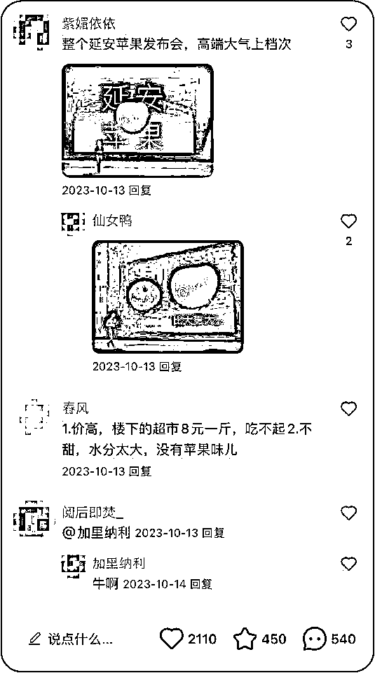

当你把用户当成具体的人来对待，用户才会相信：你是真的为了解决我的问题而来。

第三个差异化，是从零到一。

很多生财圈友会发现，“从0到1”在生财内容里出现频率极高。大家普遍还在探索阶段，需要的不是那种宏大成熟的理论，而是能直接上手的分步教程，最好每一步都有截图的那种详细SOP。

这正是养成系IP的天然优势：因为自己还在MVP阶段，遇到的问题和验证过的解法，刚好就是目标用户眼下最需要的，而不是一套听起来厉害、却不知道怎么落地的理论。

所以，养成系IP的内容库可以非常聚焦：把自己探索某个业务过程中遇到的100个高频问题，一个个攒下来，给出解决方案。这个百问百答，就是最好的冷启动内容库。

拿我自己举例，我在做一个AI+IP成长社群，日常会分享“怎么做IP定位”“腾讯ima知识库怎么用”“用DeepSeek批量收集小红书爆款标题”这类新手最关心的问题。这些内容，直接就满足了目标用户对社群的刚需。

# 1.4 社群要解决什么问题

每天问自己两遍：这个群，到底给群友解决了什么问题、提供了什么价值？

这里有个关键判断：社群对你来说是全部业务，还是业务的一环？

如果付费社群后面没有高阶产品，那你的全部精力都可以押在交付上：价格定高一点，产品做深一点，服务做重一点，再把续费做起来。如果后面还有高价产品，那就用低价破冰群做入口：轻交付，大规模，先把用户池撑大。

付费是一种筛选机制，也是一种习惯，它会像漏斗一样，把更匹配的用户沉淀下来。但知识变现并不只有课程这一种形态，好物分享也是一种很厉害的价值输出，帮人省钱、省时间，同样是一门大生意。

知识付费的升级版，是“行为改变付费”。这件事人人能上手，交付很轻，售后压力小，用户更在意的是情绪价值，而不是干货本身。尤其是那些爱立flag的女生，特别吃这一套。

再说一个一定要理解的概念——社群本质上是「边际成本」极低的生意。做一门课，从完成那刻起，每多卖一份的成本就是零，卖100份和卖10000份，成本都不会增加。做收费陪伴群，30个人和500个人，交付成本差不了太多，收入却翻了十几倍。开付费群，从一个到两百个，交付成本只增加了一点点，收入却可能翻200倍。

这种模型，是不是很性感？落到实操，这次参与的同学大概会分成两类。

# 1.4.1 没方向也照做

没有方向完全不是问题，你可以通过开社群来“输出倒逼输入”。别人付费进群，跟着你一起学，你也在成长。

可以开网赚类的：创业项目交流群、搞钱副业风向标群；  
可以开自律类的：跑步群、打卡群、减肥群；  
可以开学习类的：共读群、共创群、写作群、表达群；  
可以开分享类的：好物群、优质信息共创群、羊毛群；  
可以开陪伴类的：脱单群、话术群、哈哈群……  

每一种群，都能展开讲一套实操。生财有位圈友做跑步群，很早就年入百万了。

# 1.4.2 有方向就放大

如果你已经是某个领域的从业者，比如律师、老师、财务、烘焙师、黄牛、小红书玩家、电商人、设计师、主播、创作者、程序员、搭配师……你很清楚自己能给他人带来什么，也清楚能解决什么问题。

这类朋友可以从一个群开始：第一波先拉满百人，拿到一线体感，更懂用户真实需求。跑通闭环之后，再考虑规模放大。过程中还能顺势设计高阶产品，比如知识星球、训练营、自己的课程。

另外，社群完全可以反哺主业，比如保险、代购、设计、财税……甚至带货也不是不行。

只要有了用户池，一切皆有可能。

# 二、产品设计阶段

# 💡 本章导读

这一章，是在IP定位清楚之后，开始学习怎么把产品设计和做出来。

可以跟着航线图走：根据IP定位框定服务内容，并给出合理定价。现在就开始。

常说选择比努力更重要，那有得选的时候，该怎么选？

看三个维度：基本面够不够大、系统够不够稳、趋势是不是向上。这是「黄金三角」。

优先选基本面大的领域，也就是受众更广的领域。所谓垂直，也是在大池子里做垂直。比如圈里有位大佬专心卖AI课，两年干了快两亿，到手几千万；而英语雪梨老师，一个暑假就两个亿。

再做个测试：如果你开的是工具出海课，它的市场大概只有矿泉水瓶盖那么小；如果做抖音直播，市场有大饼那么大；做电商，就变成锅盖那么大。那比锅盖还大的呢？是英语，像厨房那么大。比厨房还大的呢？写作、表达，像操场那么大。比操场还大的，你肯定猜到了——成长。泛成长领域，其实把身心灵、情感、读书会全都包进来了。

还没完。如果你选了小基本面，比如电商课，那你必须保持敏锐、保持机动，随时应对变化。很现实地说，你半年前做的课如果不迭代，半年后可能就过时了。

但如果你做英语，比如音标课，英语就那么48个音标，200年后大概率还是这48个，发音课也一样，基本不用迭代。一门课卖五年、十年，不香吗？写作和表达也同理。

再说到成长领域，你知道最早的鸡汤文是谁写的吗？没错，荀子的《劝学》。你去把全文找出来读一遍，会很有触动。

落到实操，按照有没有“一技之长”，参与者大概分成两类。

# 2.1 有专长：快速做出产品开卖

有技术、有专长的人，可以直接根据专长做产品，马上开卖。比如销冠群、写作群、表达提升群、恋爱技巧群、纠音群、艺术签名、改错题群、练书法、康复群、健身群、母婴群、创业实验室、项目快闪群……这些都是例子。

标准玩法就是“内容输出+答疑”。不管你处在行业的什么位置，都能借助这个模式快速变成普惠型高手。

具体怎么搞？每个行业里最常被问到的200个问题，几乎是固定不变的。你可以通过5118（闲鱼租个号就行）或者各种工具，也可以借助AI，把这200个问题收集起来，配上答案，再用自己的话重写，加上案例。

这样就形成了一本行业百问百答。往深了做，甚至能变成“想做保险，看我就够了”或行业圣经，比如《白话区块链》。这些都不是异想天开。等你整理完，如果真的觉得笃定，出一本书也不是不可能。

还有一招：去学浪、网易云、荔枝、小鹅通、混沌、得到、腾讯课堂等课程平台，找几门同类课程。不用买课，只看课程目录，把几家的课表揉到一起，再结合自己的舒适区，就能设计出一堂很系统的课。

交付周期也很灵活：一个月讲完，或半个月讲完。剩下的时间就用来做交互：答疑、收集一线需求，然后持续迭代你的行业圣经。

等传播跑到一定程度，你的地位自然就有了，这就不是画饼了。你回头想想，你所在行业有人认真整理过这种内容吗？恐怕没有。如果这次航海能让你整理出一份，我会觉得非常值。

别忘了，有位生物老师，光是整理不同风格的课件，就赚得盆满钵满，他的客户是全国各地的生物老师。

# 2.2 没专长：也有轻量起步法

如果你没有特别的技术专长，同样可以动起来，选那些有共性强需求的方向就行。

比如：日更群、跑步群、读书会、减肥群、背单词群、英语角、创业项目交流群、资料群、网赚群、好物分享群、风向标分享群、哈哈群、冥想群、抄经群……

这种群交付更简单，核心交付物只有一个：内容。你可以叫它信息，也可以叫它知识。

交付形态可以变：传道、授业、解惑、陪伴，都行。其中有个很酷的生态位叫“陪伴师”。形式可以是群内图文直播，也可以是直播，总之门槛很低。后面会单独讲交付内容。

# 2.3 价格怎么定 @七天

定价的终极目标，是找到跟自己同频的人。对养成系IP来说，找人的过程既需要“试用装”，也需要“正装”，甚至“定制装”——前者用来扩大触达，后者用来锁定高潜用户。

所以定价要兼顾两头：一是覆盖尽量多的潜在用户，二是深挖高潜用户的价值。具体方法，就是做阶梯式收费。这个阶梯，既包含价格阶梯，也包含加入时间的阶梯。

# 2.3.2 收费机制怎么设计

阶梯式收费的核心，就是先用低门槛把人吸引进来，再一步步引导他们升级到更高价值的服务，最终实现留存和收入增长。

低门槛入口：先放一个特别低的入门价，比如9.9元/周或19.9元/月。这个价格几乎没有决策成本，目的是让用户快速体验社群价值，建立初步信任。对应的交付也不用太重，基础内容、轻量答疑、简单陪伴就够了。

中端产品承接：用户体验后，开始推中端产品，比如99元/季或199元/年。内容和交付可以更深，比如专项答疑、定期直播、行业资源分享等。这一步的目标，是让用户感受到社群的长期价值，愿意为更久的陪伴和更深的内容付费。

高端1v1产品：针对意愿最强的用户，提供更系统、更定制化的服务，比如深度陪跑、个性化答疑、资源对接等。这一步的目标很直接：锁定高价值用户，建立长期关系。

总结一下核心链路：低门槛吸引→中端承接→高端锁定→升单激励→持续迭代。这套打法既能做到用户覆盖最大化，又能挖掘高价值用户，最终推动社群持续增长。

最后再强调一遍：要收钱，要收钱，要收钱。

先别急着聊什么“交个朋友”“拉个群一起学”——这些话听着热闹，实际很难长久。也别把“输出倒逼输入”当成信条，多数时候它不过是给自己找个安慰。知识星球算得上国内规模最大的知识社群平台，刘容摸爬滚打十年，最后凝成一句实话：不收费的群活不长久，与其白开，不如不开。一旦有了付费关系，你和客户才算真正咬合在一起，每个动作才会长出杠杆、滚出复利；收到正向反馈，那股执念自然会推着你往前走、逼着你长本事。

# 2.3.2 权益机制：

权益可以从四个方向去设计：

- 价格阶梯往上走：比如成员每增加一百，入群费就上调五十，用稀缺感催人尽早拍板。
- 老带新返利：谁从你这边下单生财，就把陪伴群一年的费用退给他，或者额外塞一份专属资料包、一次一对一咨询之类的增值服务。这招既抬高了升单意愿，也把人绑得更紧。
- 共创换免单：开群第一天就把规矩立好，用户交出三到五篇够分量的内容，当月或当年的费用就能免掉。用奖励把KOC撬成内容杠杆，好内容不再靠你一个人死磕，而是由一群人共同供给。
- 拿数据说话：盯着用户反馈和后台指标，持续打磨内容模块与定价模型。需求变了就加新服务，阶梯不合适就重排，让社群长期保持吸引力与竞争力。

# 三、素材搭建体系（持续运营）

# 💡

**本章要点：** 养成系IP对外输出，关键在日常分享的素材怎么收、怎么攒，以及怎样借DeepSeek搭配多维表格完成归类整理。跟着航线图走即可：第一步，把自己所在领域的内容库建起来，保证后续的互动与交付。准备好了就开工。

素材库的源头不少：闲鱼、各类社群、他人整理的资料包、圈友共同贡献、付费采购，都算。

# 3.1 外部渠道（闲鱼、小红书等）

举个例子，假如你做的是小红书或视频号，直接到闲鱼里敲入“小红书资料”“小红书电商”“视频号教程”这些词，市面上流通的材料几乎一网打尽，而且大多不要钱，稍加归拢就是一份文档。

这里划一条线：案例必须是你真能读透的才拿去讲；方法论必须是你扛得住盘问的才拿去说。送你四个字——人类知识总和。任何一个细分领域的知识，早有人替你攒齐了，你要做的只是「演绎」：吃透它，再配上活生生的例子，送到用户面前。

别担心东西旧。一条短视频拿下千万播放，够炸了吧？可另外还有十五亿人压根没刷到过。再说个去处：http://wedb.online/ （电脑端访问），里面堆着一万GT的现成资料，实在找不到的它也能替你翻出来。这个渠道别往外传，自己偷着乐就好——人家已经换过好几层皮了。

小红书同样能这么用：搜到你同行，发一句“加我领资料”。加到人的同时，资料到手，同行的群也混进去了，各个环节怎么操作你都能看个明白。要说最靠谱的老师，还得是同行。

其余门道，我（杨涛）直播时一条一条掰开讲。

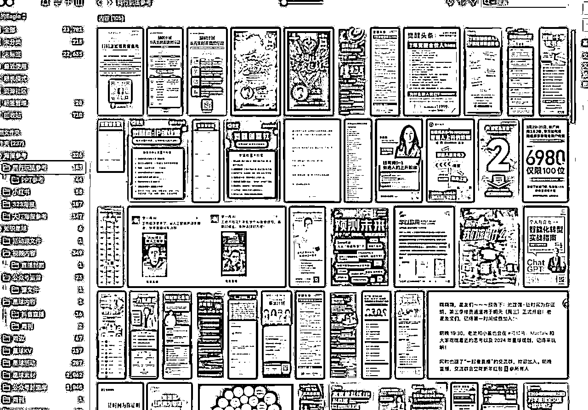

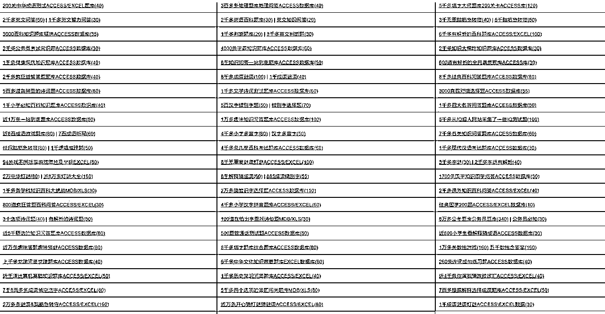

（直播里我把压箱底的东西一次性抖出来，逐项拆细节，保证任何赛道的圈友都不愁日常分享的弹药。）

# 3.2 内容共建

人性本就偏爱索取、抗拒给予，日更和活跃更是逆着人性来。所以内容型社群真正的支点只有一个：身为群主的你得能持续猛输出。哪怕你拼到极限，最后能带动大约5%的成员跟你一起干，就已经是优秀水准了。当然，这事有解——内容我们不缺，托也安排到位，怎么着都能落地。

再教你一套自主造血的玩法：众人共建。你每天是不是都会存下些碎片——深度好文、资讯、笔记，或者自己写的心得？问题在于，一个人单位时间能捞到的信息终归有限，还得花工夫辨别、筛选，而且未必撞得上最干净、最优质的源头。换个思路：假设有十个跟你段位相当的人，每天也在干同样的事。你建个群，立规矩——每人每天必须丢一条干货进来。于是你拿一份换回十份同等质量的东西，你的干货瞬间放大十倍杠杆。更妙的是，这个群不闲聊，信噪比拉到最高，随时翻随时有货。懂了吗？要不你建一个，把我（杨涛）也拉进去？

这么一来，日常群活跃所需的话题和问题有了着落，愿意分享的同频朋友也被吸过来，一起把气氛炒热。你手里的优质分享素材，自然也就攒下了。

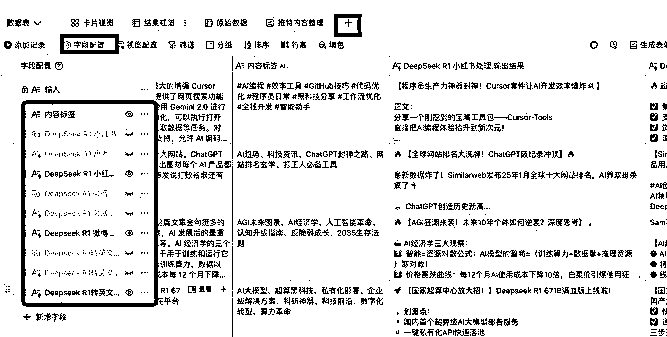

来源说完了，接下来聊素材整理与文案。我会在直播里手把手演示DeepSeek配合飞书多维表格怎么玩；这套玩法在本次DeepSeek入门指南航海手册里也写了，翻手册就能看。另外还会讲日产上千条文案的路子，时间够的话，ima的用法也一并带上。

# 3.3 生财的优质内容推送

生财对精华帖和中标内容都配了推送机制，另外还有AI自动生成的亮点分析汇总。对从零起步做养成系IP的圈友而言，这就是一个现成的自动化素材仓。

# 参考案例

航海家运营素材群的定时推送就是个现成样本：机器先推，人工再加工，直接能用。

# 💡

**原始素材：** #点赞40 #中标 #风向标 #小红书 作者：风小海（圈友）

一个小红书个人成长号，靠卖思维模型做出40w+变现；同时开着付费群和1v1咨询，变现通道多，天花板也高。这套模型容易复刻——DeepSeek理文案，稿定出图。链接：https://t.zsxq.com/MpZxm

**调整素材：** #AI新机会：DeepSeek+小红书成长类内容起号

在生财刷到一个AI风向标，感觉跟小红书结合着做挺对路。AI的长处是快速把信息结构化，正好借DeepSeek替自己搭内容骨架，给个人成长加码。这份PDF单拎出来卖估计也有人接，我看那个号销量不差，有兴趣的可以拆一拆。原文：#风向标 小红书个人成长账号卖思维模型 变现40w➕，还有付费群和1v1咨询，变现路径多、上限非常高。容易复制，用DeepSeek整理文案，再用稿定做图

# 四、冷启动阶段

# 💡

**本章要点：** 定位清楚了，素材也备齐了，下一步该去拉第一批追随者——朋友圈和外部渠道都能用。按航线图推进：一、备好物料，包括朋友圈海报与话术；二、招募首批用户（私域、公域）。现在开始筹备。

还是那句话，反复问自己：这个群到底替人解决什么问题、给出什么价值？能坦坦荡荡、清清楚楚说出口，成功率自然更高。再倒过来想：别人凭什么掏钱？为变瘦、为自律、为便宜好货、为学本事、为交朋友、为赚钱……还是别的什么？想透了，海报才能戳到人心里去。

# 4.1 第一步，预热

假如你此前的人设足够鲜明，朋友圈已经能让人一眼看出：你是谁、在卖什么、为什么非你不可——那海报做完当天就能开卖陪伴群。要是底气够足，参照之前的测试表格，确信有五十人愿意付费，甚至不用备素材，一段文字配个二维码就能开卖，直白点说“v我50”，产品就上架了。

需要预热的，多半是为了给自己攒信心。做法不复杂：朋友圈发条文案，比如这样：

「做电商的真该拥抱AI了，最近效率高得吓人，我都打算把设计师辞了。详情页随手就能出，有手就行。想拉个群，每天更新我的工作流，手把手带大家提效降本，收多少钱合适？想进的扣1，人越多越便宜。」

一旦评论区热起来，把评论数乘个二，差不多就是冷启动阶段会付费的人数。毕竟朋友圈只触达了一部分，其他渠道还会带来增量。

# 4.2 第二步，素材制作

对外宣传时，短图与长图各备一张，算是最低配置。

短图讲究一屏讲透，尺寸1920*1080，例如：

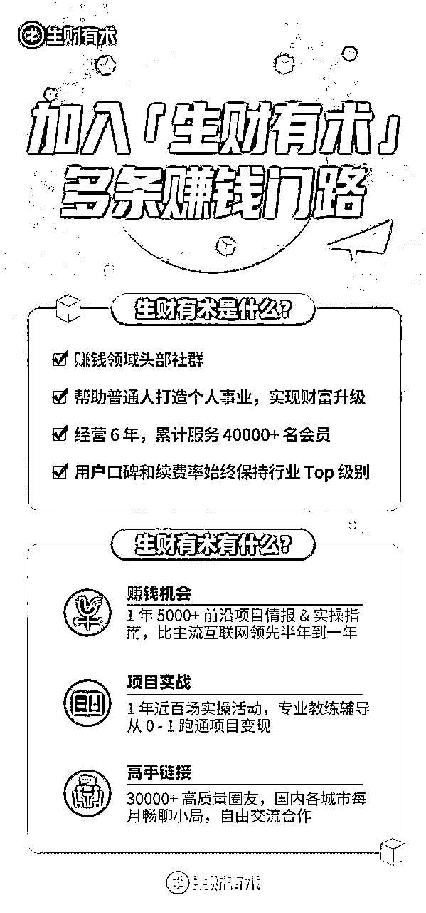

海报上那句简短主张可以参考：若你想靠创业而非打工挣到一百万，信息、认知、技能、圈子缺一不可，而生财有术社群在这四项上性价比最高，没有之一。

长图则是详情版，如图：

如果你的好友存量很大，那就多准备几套海报。道理不难懂：当下人的注意力碎成渣，群介绍一冗长，转化立刻打折。单屏海报一眼抓住最核心的利益点，不用下PDF、不用点原图、不用费流量刷长图。

但长图不能省。短图能当场转化的，就当场转化；拿不定主意的人，点开短图动了心，自然会往下看长图。何况长图做完还能切片，变成公众号文章、H5页面。PDF就不行了——女生对PDF天生警惕，没WiFi根本懒得点，而且七天就失效；H5可以反复传播，公众号自动回复、菜单栏都能挂。

# 4.3 第三步，按节奏分享到朋友圈，反复转化

玩法可以自己设计：早鸟价、原价几何、几月几号恢复原价、阶梯式涨价、满多少人加多少钱……都行。但一定要走心、有诚意。我见过原价19800的社群，早鸟价标19.9元，那分明是把人当傻子耍。

下面挑几个案例给大家看，其实手头有几百个，等全员上岸，我打包发给航海群的船员。

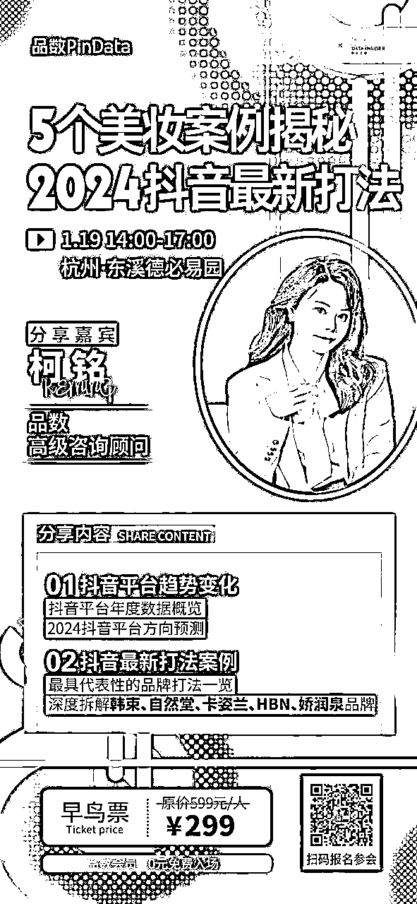

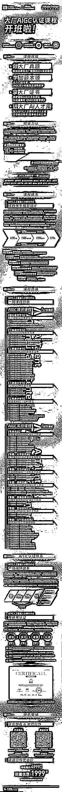

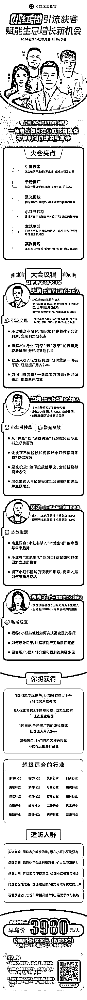

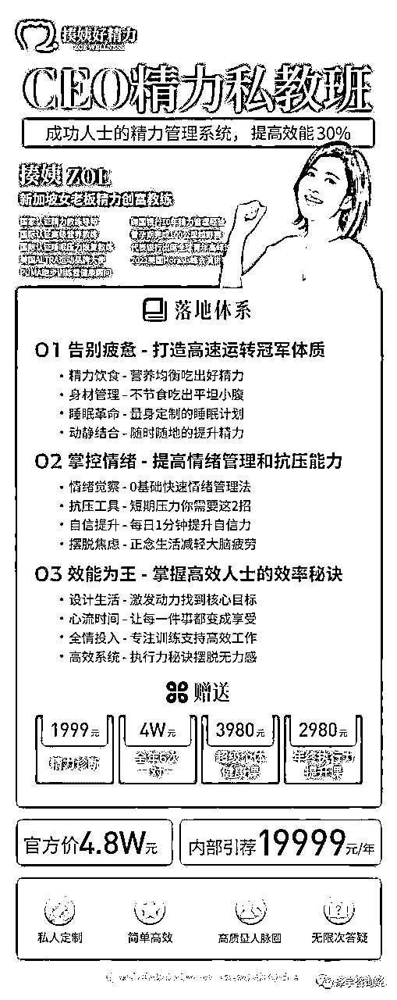

最后提醒：新手控场能力往往不够。假设你一口气加进来两百人，彼此不熟，跟你也生分，场子怎么热？当然，像我这种天生会控场的另说。给个思路：加人放慢些，把微信好友多分几组，每次发圈只对某一组可见。好处有二：一是曝光最大化，同一份素材能反复用，每轮针对不同人群；你若够细，还能通过改标签、换分组，把已付费的挪出去，继续转化潜在客户。二是控池，不担心人数一上来交付跟不上。

人少时先养感情。比如群里三十人正热闹，你就说：“各位都是元老，我准备拉新人了，大家帮忙活跃活跃。”让老成员带新成员混熟。

碰到刺头，清理要快。这种声音会带坏其他人，私域里直接移走即可，不必在群里争论。

当然，所有规矩都得写进入群须知，让每个人心里有数。拉人进群前，最好再单发一条红线提醒。下面这份群规当例子，领会精神就行，别照抄，理解后按自己业务改：

阳光午后，岁月静好，本群拟长期运作下去。

暂定群规如下：

一、多给星球点赞评论，让我看见你。说到底，刷个存在、混个眼熟，不过举手之劳。（可改为：本群专注跨境电商内容的探讨与钻研，保持高信噪比，无关信息勿发。）

二、拿时事热点引战的，不论立场，一概请出。

三、发广告的，除非同时发红包（200元起），否则请出。

四、把群内原始聊天记录截图或转发外传的，直接移出；若聊天记录本身是转发内容，二次转发不受此限。

五、骚扰群友、批量加好友的，发现即清。

六、都是成年人，群友之间若有业务往来、合作投资，请自行评估风险与信用，群主在此声明免责，不提供信用背书。（调皮版：本群仅对14周岁以内群员提供资金安全保护，其余群友涉及业务往来、合作投资，请自行评估风险，群主绝不推荐，亦不作任何信用担保。）

七、禁止夸群主，禁止夸群主，禁止夸群主。实在情难自禁，每月一次夸赞额度。

八、尊重女生、爱护女生，遵守法律法规与社会公德。本条零容忍。

-----以上-----

# 4.4 外部渠道的招募

先把两个词分清楚：存量、增量。存量指你眼下能覆盖到的用户规模，能触达是及格线，能强推才是上乘。怎么估？放下手机想一想：若现在要卖一件百元以内的生活百货，或一份知识付费产品，你能立刻点出几个人——那种你能摁着他脑袋、逼他捧场、逼他掏钱支持你的？这些就是你的强关系，普通人大概二十个。本次航海先把目标定在一百个，再用五年推到一千个。这是远期预期，眼下不必焦虑。

前面提到的强关系，是从弱关系池子里筛出来的；弱关系是基础池，增量则是你靠内容不断捞进来的新弱关系。这次航海还有个目的：大家借初步的群运营，攒一线体感，收集用户真实问题，把运营中产出的物料和素材留存下来，投放到各大平台，同时换来更多用户。

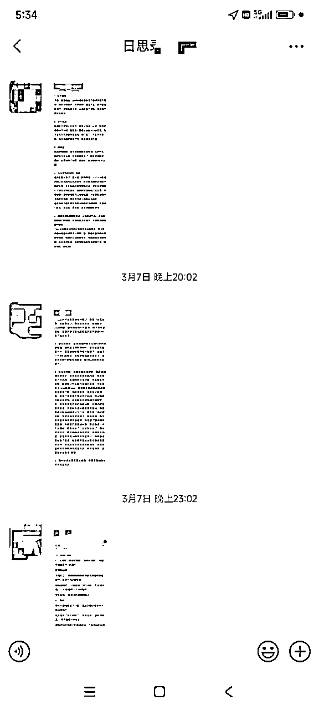

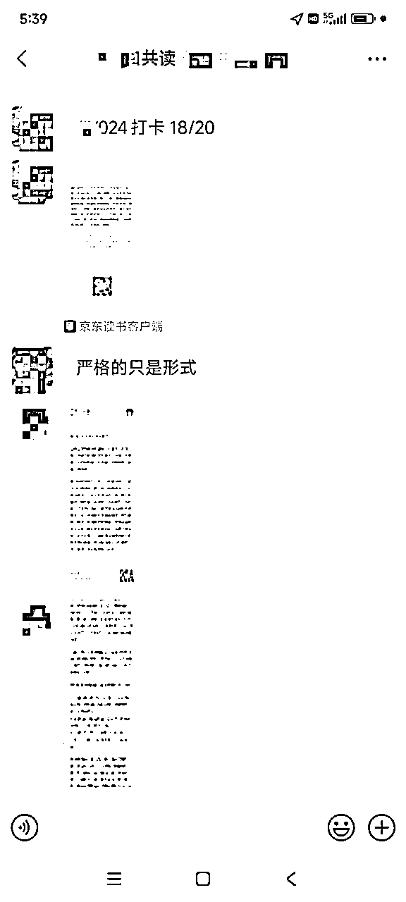

综合来看，要解决的其实就三件事：发什么、发到哪、怎么发。

**一、发什么——发那些被市场反复验证过的内容。去哪儿找？**

a. 先看你所在赛道近二十年最热的话题和问题。借助5118和各类极客工具，把行业里最受欢迎的内容挖出来——这些内容经受过市场检验，属于“发出去必火”的范畴。具体参考：https://mp.weixin.qq.com/s/9gHG1wTVwsBTCmMg-5rR-g

b. 第二处金矿是同行的现成爆款。无论你想切医美、护肤品、祛斑祛痘、身材管理、大健康单品，还是极冷门的小众品类，方法都一样。以小红书为例：花三小时，换着关键词、以纯用户视角去搜，凑够三十到五十个同行。为什么要这么干？你现在加不到同行，将来客户也就加不到你。说白了，大家都是在平台上“偷流量”，不对“对抗”这件事祛魅，获客就永远无解。

加上这几十个同行后，你会发现自己究竟是被什么钩过去的。这一路你会撞见大量优秀同行的标题、封面、笔记、评论区、评论区运营乃至评论区截流。留意：评论区有没有引导入群？群简介怎么写？群里用什么方式把带微信的图片、名片或一串数字递给你？有没有@小号？拿什么诱饵把你引过去——比如“加我领资料”，领的到底是什么资料？加上之后破冰话术如何？昵称怎么起？报价表、海报发了没有？朋友圈是怎么经营的？

再试着把对方朋友圈往回翻三年：看他三年前是否已在做这行，三年后是否还在。这说明什么？说明他铁定赚着钱了。这一圈下来，你顺手收了三五十份资料。拿回电脑上归整归整，水印抹掉，不就是你自己的引流素材？逻辑是不是很顺？

我为什么管它叫四小时法则？到这儿你只用了三小时，剩下那一小时拿来消化所得。怎么消化？你会发现，看到第三个小时的时候，新东西几乎绝迹了：封面长得都一个样，内容套路翻来覆去。任何行业，翻来覆去也就五到八套模板。把这五到八套拎出来，挑一套跟自身软硬件最贴合的，务实一点、听话照做、像素级复刻，完事。就这么简单——同行是最好的老师。

看到这里，咱们玩个小游戏。我不清楚你做哪一行，现在打开小红书，随便输一个你行业的关键词，记住用用户思维。我敢打赌，前三屏、也就十一个内容里，先别管内容本身，挨个点头像看粉丝量。结果多半是：大部分只有几百粉，甚至几十粉，千粉万粉的寥寥无几。为什么？因为小红书本质上是个种草平台。这句话能品出味道的人，段位都不低。

确实，平台从去年起就很少把流量倾斜给大V了。“低粉爆款”这词虽被说烂，参考价值和情绪价值依然巨大。建议大家带着点仪式感，把这套流程认真走一遍。

这不影响我们去归纳那五到八套热门模板。还有个有意思的现象：在加这几十个同行的过程中，你一定会反复撞见同一个人，两次、三次、四次都有。这时候务必警觉——他必是高手。点进主页，把他主页上的一切都细细模仿，包括加上之后怎么互动、怎么从他身上学东西。

到这里，资料有了，内容也有了，下一步干什么？发就完了。当然，加了同行还有别的用途。你刚入行，好不容易来客户要试着转化，客户问的问题你若答不上来怎么办？简单——你手上有几十个同行，个个都是顶尖老师。客户问什么，你复制粘贴过去问他们就行。那几十号人里总有几个热心的，他们就是你的免费问答机。

我自己的操作是这样的：要切入高端医美、高端医疗这类术语密集、常识门槛高的行业，就先加三十到五十个同行，反复伪装成客户去为难他们，直到磨出一套完全属于我自己的行业百问百答。这套东西，是顶尖同行给出最标准的答案，又经我一遍遍追问、反复验证过的，最优解。

# 四小时跑通全平台：分发逻辑其实很统一

这套流量速成打法，四个小时就能掌握。记牢一个底层规律：放在任何平台都成立。我刚用图文社区演示过，你换到抖音、快手、微信，框架依旧不变。

## 2，主战场选在哪

按“省力原则”来定：哪里发得最顺手，就拿哪里当主阵地，再扩散到其他平台。

## 3，怎么铺开

说得直接一点：内容从做出来那一刻起，多复制一份的成本约等于零。所以同一套素材要换成不同样子，送去不同地方。如果只丢进订阅号，换几十个阅读就收工，等于暴殄天物。

它能变出的样式很多：问答、概念精讲、电子书、PDF、长篇文字、金句海报、图文帖、长片、短片、竖屏视频、即刻式短句、微博式小段子……

渠道更是数不完：B站、抖音、快手、美拍、秒拍、美篇、皮皮虾、最右、火山、微视、陌陌、小影、头条、西瓜、梨视频、比心、映客、QQ看点、开眼、糖豆、贴吧、好看视频、小世界、趣头条、简书、豆瓣、天涯（已停服，致敬）等等。不是让你全投，更不必手动逐条发。用自动化分发工具就行：注册一个工具，登录，选好要同步的账号，一键铺开。我放一张操作截图，仅为示例；那工具同样只是示例。像媒小帮、小火花这类产品，你们总能挑到更顺手的。

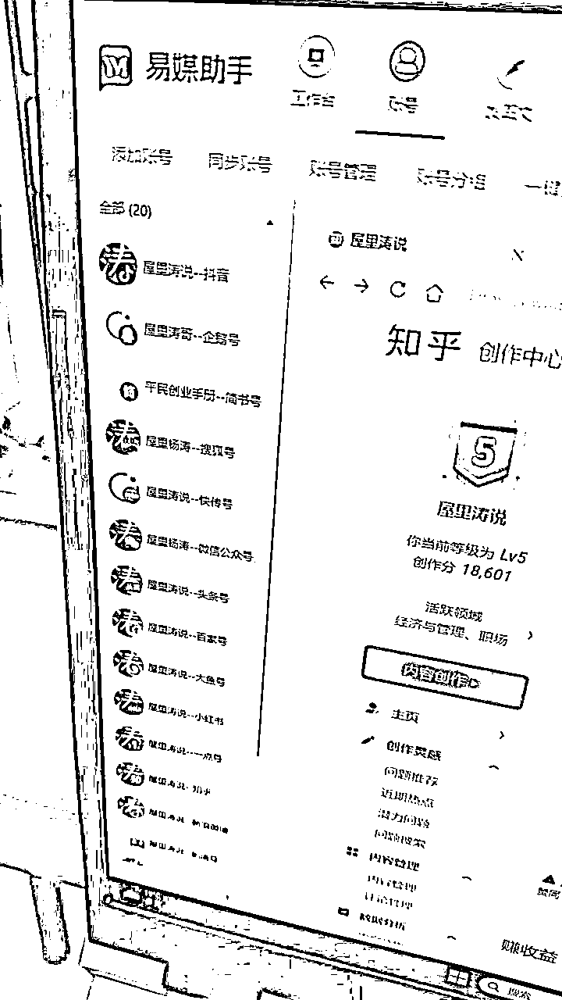

# 五、日常运营SOP

💡 这一章讲什么

招满50人以后，就可以正式进入陪伴群运营。这节解决三件事：日常怎么带、活跃度怎么保、粘性怎么升。按这个学习路径来，先做好第一步：在陪伴群里完成日常交付和运营。现在动手吧。

# 5.1 只留一个核心功能

假设你的群只能保留一个功能、一个意义，那它会是什么？它值多少钱？想透了，其余全是我送给你的。人间最美是小满，坦然，笃定。

# 5.2 到点就出摊

你观察我这一档，再往上数，有641、润宇、李一舟这类；继续往上，是几个超头主播；顶尖一层，是老罗和罗胖。大家真正共通的地方，就四个字：到点就出摊。

那位叫明白的博主能火，不单是能写、会全栈、能讲。更让人记住的是他的规律：晚上九点半就寝，早晨起来更新，已经写了2000多天。以至于我看到别人网名后缀写着休息时间，总觉得是跟他学的。人类天然会对做到很难之事的人低头。注意，是低头，不是欣赏，不是仰视。这会给无意识中植入付费的念头。

所以，收钱、彼此绑定、到点出摊、一起成长，这条路径最稳。前提是群要合规。越界的线不能碰：擦边内容、谈时政、翻墙、加密币之类，一旦发现，马上清除。

「有事可做」

这点太关键了。他们进群来做什么？你要拉着他们动起来。打卡、提问、讨论、互动都算动；买东西算，晒一下也算。

「每天发什么」

发什么并不能撑起一个群，它的占比没那么大。干货和信息已不稀缺，很多人反而因为内容负担而退群。这事也不难：前面教过内容仓库的搭建，那是不会枯竭的池子。实在犯懒，就去生财社区取内容来交付；有余力，再设计更高级的互动。

比如每周三固定开一场答疑直播，和群友连麦聊。它除了承担交互与交付，还能顺带拉新。直播本身没难度，一个“无限话题”的开播法是：手机后面架电脑，屏幕摊开趋势页就能聊，摊开笔记页也能聊，摊开精华内容也能聊。

托的作用不能忽视。直播间安排五个自己人，专抛你答得上来的问题，你的直播状态就来了。群里也一样，只要有五个托，平时不吭声的人也可能被带动。托是社群的核心资产，最高境界是全员都变成托。前期靠自己人、小号，后期主动帮忙的人越来越多，就成了。

试想：卖课的群，接连有人晒后台通知、晒夸张回报率、晒高额成交额；健身群，接连有人晒线条、晒身材；种草群，接连有人晒订单、晒开箱；自律群，接连有人晒单词进度、晒时长、晒阅读记录。这会把成交通过率推到多高？

再举一个真实画面：一位女生立flag那一刻，会觉得自己已经强过整个宇宙。她进了一个阅读群，约定是每天交读后记。她撑了三天，放弃了。可她天天看见群里其他人疯狂交作业，她不会把责任推给群主，只会觉得是自己不行。到了下个月，她继续付费。这对留存、客诉、老带新，全是加分项。

# 5.3 具体怎么做

每天的内容可以拆成5个板块，内容多就上探到10个。每个板块都能逼大家学深一层，也帮你补全信息源。我随手举例，你们意会就好。

1，旧案例复盘。生财里精品帖和拆解帖极多，够你复制粘贴再加配图玩很久。
2，趋势快报。生财那一栏每天都更新。
3，精选内容。老喻、曹大、西风、涛哥和教主，收集十来个就长期够用，还能慢慢迭代你的个人库。
4，早安海报。做一张金句图；若能设计成某位投资大师那种固定版式，每天一张，就很可能被广为转发。参考如下：

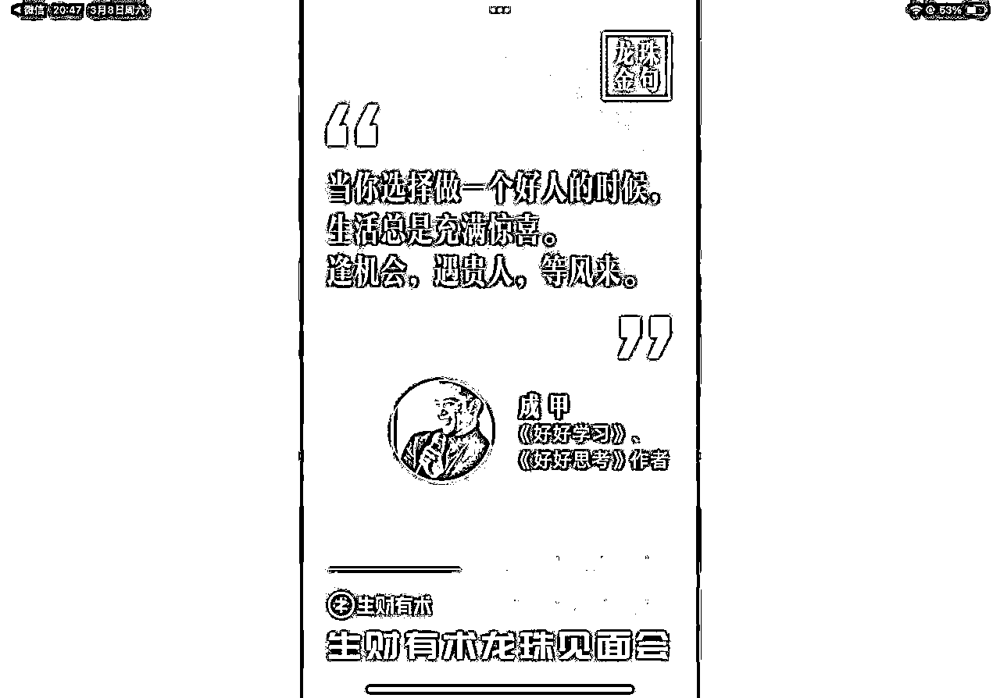

5，欢乐图。最新、最潮的梗和热点，关键要高级。快乐交流群是地球上最活跃的群之一，我加的那个已经十多年了。隔三差五丢一张，群里气氛马上不一样。常发欢乐图的群，获得置顶的机会更大，被忽略的机会更小。
6，对话精华。能用飞书最好；没有的话，初期把聊天记录合集加上日期转发。平时聊天多用标签，比如 #当日复盘 #野路子 #冷门技巧。时间一长，群友会跟着用，还会觉得你的群有辨识度。
7，表情与次文化梗。有些暗号外人看不懂，自己人一看就乐；各平台的小圈子玩法也不尽相同。群会慢慢带上群主的气味，越鲜明越好。这话现在听着早，但可以先埋一颗种子，万一长成大树呢。

江湖上还能同体量换群，或者互相当气氛组。缺人的时候，就在本群留一条链接，求一声支援。谁能干脆地说一句“我巨能暖场”，这种人物在哪个群都会被抢着要。

拉群以后，有一次发海报的机会，记住只放一版，把群是做什么的写清楚。有人感兴趣，自然来加你；收钱还是不收钱，纯看你心情。

1，气氛组互相捧场，资源互换，形成规模化互助群。
2，行业互补的人可以抱团。你教英语，她教数学，你带瑜伽，她管营养餐，两组人合起来，盘子更大。
3，比如你的群300人，我的群也是300人。我邀你来讲一次，你邀我去聊一场；双方都留出二维码位，还都在群里鼓励彼此链接。一石三鸟，干嘛不做。

# 六、案例分享

不展开说了；再放截图，我要害羞了。

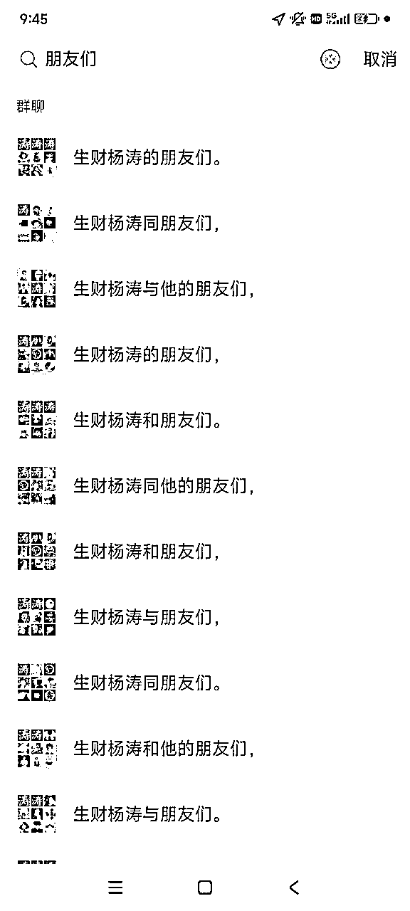

我做过两个阅读类社群，交付用了两天。详情都在文档里：

涛说：前途无量

涛说：《华与华正道》上篇-正心术

涛说：《华与华正道》下篇-立正学

「交互 & 交付」

划重点：情绪价值也是价值。交互与交付，缺一不可。

订阅是很棒的产品。我们都向往睡后收入，想做收租型生意，订阅正合适。它最妙的地方在于续费：每年新增超过流失，人生就有了确定性。你可以看着进度条，等一千位死忠粉丝凑齐，再去享受续费带来的满足感。

体面，以及杠杆。

体面：在微信群里收款，不如在星球里收款体面，也不如微信里的会员体系体面。原因是平台背书和用户习惯：把钱交给你，还是交给平台，感觉完全不同。

杠杆：用一份时间，撬出多倍产出。你运营的星球，服务100人和1000人，收入多十倍，耗费的精力却不会按比例上涨。以前没有星球的朋友想试试，欢迎找我。我可以不收费、纯粹做公益，带你一步步搭起来。这句话就当各位看到这里的福利。截图抛到别的群里，我会更开心（又是气氛组的功劳）。

# 七、高阶产品怎么卖

💡 这一章讲什么

养成系IP刚起步时，用低客单品吸引人；等IP内容成熟、影响力变大、死忠变多，就能卖训练营、课程、星球等更高阶的东西。这一节讲怎么做、怎么卖。现在动手筹备吧。

一鱼多吃，换个说法叫“甲方种树，乙方收果”。本质上，当你和一位粉丝建立起信任，就能反复从他身上兑现价值。

比如你手上有个想创业的粉丝，你可以先把他带去生财，再介绍给花爷，再交给帅张，甚至接着往下送。怎么操作？简单：一张写着“加我领资料，送你一套入门课”的海报，人就被引过去了。人过去之后，你佣金落袋，后面能不能再转化，就看对方的水平。只要合作方把好关，产品选品守住品控，这些动作不会伤你，反而给你增势。

万物皆可CPS

产品形态是流动的：自己研发的、别人家的，别人的社群、别人的内容产品，都可以当成好货。做电商，你管流量和卖货，对方管生产和发货；做医美，你管流量和成交，对方管服务和售后；卖课，你管流量，对方做转化和交付。逻辑完全一样——自己能交付，就做自有高阶品；暂时不能，就帮别人跑，边跑边学。最后一起变强，最好的时机自己会来。

「流量价值」与「客户价值」

流量价值：你选的这条路，引流之后能变现多少，满不满足“五高”：客单高、利润高、黏性高、复购勤、带新多。带新也算传播属性。凑不齐的话，至少满足两项。尽量去赚有余钱人群的零钱，别盯着普通人的饭钱。如果满足不了，就问一句：这个流量来得够不够轻？我是不是只拿它当过渡？终局到底靠什么，赚哪些人的钱，赚多少，怎么赚？

客户价值：跟你发生过金钱往来的人，有没有越过最基础的那道信任门槛？你还能不能不断从他们身上创造收益？举个例子：你今天出100单大日化，客单128元，货是蓝月亮加威露士套装，人也都加进了微信。这些客户有没有价值？有，但有限。换一种：同样128元客单，100单，货变成淡斑淡痘产品，或者瘦身小丸子，要上脸、要入口。这些人有没有价值？有，而且很大，因为他们是真正越过了信任线的人。

以后做事可以野一点、浪一点，可以反复试错，也可以把某一步只当跳板。但请多拿这两把尺子去量终局。能持续沉淀信任客户的事业，多半更对。

客户是什么？客户是你手里最核心的生产要素。某个人五年前在炒股，五年后大概率仍在炒股；某个人五年前在减肥，五年后大概率仍在减肥；某个人五年前在买课，五年后大概率仍在买课。回到刚才的瘦身茶：那类客户握在我手里，我可以反复转化。她买了瘦身茶，大概率还会买瘦身药、运动装备、普拉提器械、瑜伽配件；也会买代餐和辅食。接着可以带她走皮肤管理、提亮肤色、淡斑淡痘、医美、生美、科美；还能转去母婴、大健康；甚至让她来做副业、做微商，继续跟你买内容产品。读书会、成长、情感也一样接得住。这样的客户，就是最能给你确定性的生产要素，能陪你把周期走完。

默克制药的座右铭讲得极好：我们时刻记住，药是为了病人；也从未忘记，药是为了大众，而不是利润。利润会跟着来；只要你记得，它从没缺席过；你记得越清楚，它就越大。药品首先用来治病，利润只是随之而来的东西，不迟到，不少给。很多成果不是目标，而是结果：是专注的结果，是解决问题的回报，是提供价值的回响。

小结：选择大于努力。这不是鸡汤，是最顶级的策略。把这个模型记住，很多弯路就能省掉。当然，早期受年龄和阅历限制，选择权未必多。别怕，我们在生财。

现阶段最优解

不必焦虑，不必一步到位。先有思考，再动手。人生战略，就是下一个战略“涌现”之前的最优解。心里种下种子，方向就会显现。高阶产品花样很多：高阶课、训练营、陪跑、收徒、咨询、私董会、星球、正式课……

做课没有想象中那么难。拿你想做的方向，去学浪、千聊、各类线上学堂搜关键词，专找已经被市场验证且受欢迎的课。然后看它们的海报和课表。因为这是你的领域，光看课表，你就知道他们大概要讲什么。

这样你就有了一副框架和几个大章节。把你不熟的小节砍掉，剩下的就是课表。过程中还会冒出很多想加入的亮点，但骨架必须稳住，否则内容会变形。具体可以照这套流程走：

01，定框架。找同主题的标杆老师和标杆课，挑出被市场验证过的关键点。
02，到多个课程平台收集可用要点，比如千聊、荔枝微课、得到、喜马拉雅、混沌大学、十点课堂。
03，每门课的推广文案里都藏着大纲、更新说明、合适人群、配套动作、推广动作、礼包福利，逐项抄下来。
04，用幕布把大纲立起来。
05，按你的舒适区，分成几个模块，再把大纲打散，填进去。
06，逐步整合模块，删重复，做精简。
07，第六步走完，一门综合多个热门要点的更新更全的课，就出现在眼前了。
08，按新大纲动笔，一节一节写。
09，全部写完后开始改，每一遍盯不同的地方。
10，第一遍：提炼关键概念、思维模型、核心问题。少了这些，课就不够深。
11，第二遍：加入案例、故事、金句。少了这些，课就不够生动。
12，第三遍：判断哪里需要图示，比如流程图、知识卡、插画。
13，第四遍：通读，把书面语改成口语。书面语太硬，口语要有引导感，也要有情绪。
14，配好必要的PPT。
15，想清楚未来要落在哪个平台，再按平台要求录语音、拍短片或开直播。

到这里还没结束。

16，常见的情况是：骨架有了，可一路写到第八步之后，容易写着写着太激动，想加内容。一加，前面的骨架就被推翻，或者顺序全乱。原本50页的稿子可能变成100页。怎么破？
17，按第8步的大纲去写，一节一节来。
18，写的过程中新开一页幕布，把第8步的大纲拷进去。临时想插的章节，先丢进这里，不管顺序和逻辑。
19，新点子用卡片笔记存档：格式是关键词+短标题+正文，500到2000字。集中放在一处。
20，等第8步的大纲写完，再重新调整骨架，把之前攒的卡片笔记融合进来，继续填充。如果途中又激动了，就再重复一轮；灵感会递减，最后穷尽，稿子也就成了。

另外，这要求你把一个观点扩展成三千字，或者能顺手掰扯一堆案例。其他产品大同小异，没那么玄。

你也会发现，课程内容都大差不差：初阶课配上情绪价值、大量案例拆解、作业布置、模板收集、内容共创，就是训练营。至于交互与交付，当然还能再优化。

比如训练营、陪跑营里的奖励和激励。激励不等于奖励。奖励是平均分的：群主隔三差五发个红包，意义不大。可要是有人做了一件对群贡献很大的事，你单独发一个专属红包，或者把红包名写成“感谢某某”，再放一个全员可抢的红包，说几句漂亮话，激励的味道就完全出来了。情绪、面子、里子，全齐了。

这其中的分寸很微妙：要随机，要不递减，要养成习惯，但不能给人期待，更不能变成约定。随机是说你按自己的意志想给就给；不递减指第一次贡献红包很大，后面不能越来越小；养成习惯指你要持续关注和支持积极分子；不给期待指不诱发功利心。它不是规则，是你个人的主观。

这种手法，是群主个人权威的构建，也是你区别于其他群主的辨识度所在。久而久之，群友会越来越关注你的群。注意力是钱，信任也是钱。

# 进阶篇：把项目放大

💡 这一章讲什么

当你的项目跑通最小MVP，操作流程也基本熟悉后，可以回来翻这一篇。这里主要教两件事：从外部引流，获得更多用户；搭起自己的内容系统，稳定产出好内容。现在就开始深入吧。

# 八、内容系统怎么搭

内容系统的第一要义是框架。框架稳了，接下来就能日日精进，每天补一点，最终长出一部只属于你的行业圣经。我拿一套行业知识架构和一份常见问题清单来举例。

# 一个下午，搭出皮肤管理内容树

假如你的业务核心是皮肤管理，先别急着铺内容，先搭一棵树。

先立主干——皮肤管理。再让它向外分主枝：抗衰、美白、祛斑、祛痘、保湿、防晒……数量不限。每条主枝还能继续分叉。拿抗衰来说，可以拆成胶原蛋白、抗氧化、抗糖化、营养补充、激素平衡、肠胃调理等。再往下，还能落成具体知识点：胶原蛋白怎么再生、a醇在哪些场景用、肽类、射频、相关医美项目等。

这样一下午，你所在领域的内容树、知识系统就能成形。同时还能整理行业百问百答，先做树还是先做问答都行，两者能互相补位。这些沉淀随时能改写成脚本。附上示范：脚本示范.pdf。

# 九、外部新增流量从哪来

这一节标题就叫《对流量结构的理解》。核心是彻底想清楚：新增用户到底能从哪些渠道来。你也可以先合上下文，自己列一份。

常见来源有：公域流量（全平台内容获客）、换量、裂变、买量、混群……把它们画成一张饼图，问自己：每个来源各占多少？

# 9.1 拓新与深耕

横向是拓新：去铺更多来源。小红书顺手，就再试抖音、视频号、知乎……纵向是深耕：把现有渠道往深里做。混群拿手，就进更多群，“吸引”更多用户。

细节不展开，航海中遇到问题，群里沟通。

航海手册到这里就全部结束了。愿大家顺利跑通本项目流程，收获50+个铁杆粉丝，把自己的养成系IP做起来，拿到收益，一起生财有术！