# 202503 航海｜YouTube 视频变现行动指南

> 来源：[https://ocn93f5d9olj.feishu.cn/docx/D5DXde0pSoXdWbx95AxcvPLqncf](https://ocn93f5d9olj.feishu.cn/docx/D5DXde0pSoXdWbx95AxcvPLqncf)


# 防失联+MM188166M（李李）长期更新频繁+备用V:MG10127

本手册由生财有术团队制作  
发布时间：2024年12月2日  
说明：内容作者的排列顺序不体现任何优先级。这份材料的价值在于呈现该项目的多种可能性，帮助各位更好地理解并落地实操。  
小贴士：想要快速定位内容时，可使用 Ctrl+F / command+F 输入关键词直达目标页。  
备注：部分视频链接已失效。

# 必修篇：打通最小MVP闭环

# 💡
# 章节导读

这一阶段，我们将从认识 YouTube 开始，一步步带你走完整个项目的学习路径。

如果你是刚接触这个项目的小白，建议先建立对项目的整体认知：

✅【项目总览】认识 YouTube

对全局有了基本概念后，就可以按部就班地推进核心步骤：

✅【实操 1/6】账号运营  
✅【实操 2/6】确定赛道，分析对标  
✅【实操 3/6】生产 Shorts 视频  
✅【实操 4/6】生产长视频  
✅【实操 5/6】运营策略和数据分析  
✅【实操 6/6】开通 YPP，获得收益  

必修篇里，手册章节和航线图保持着同步关系。只要跟随章节节奏逐个推进，就能把航线图上的任务全部点亮。后续每个关键步骤的章节导读中，我们也会插入对应的航线图提醒，协助你完成动作。

现在，正式启程吧。

# 一、【项目总览】认识 YouTube

# 💡
# 章节导读

YouTube 是全球体量最大的视频平台。近期它明显在力推 Shorts 短视频，给出的自然流量相当充沛，入场门槛也大幅降低，加上 AI 工具的加持，内容创作变得前所未有地容易。相比国内平台，一个运营健康的 Shorts 账号通常能稳定拿到上万播放，博取爆款的概率也大得多。

本章围绕四个方面展开：

✅ 为什么要选 YouTube：市场规模、广告潜力与 AI 带来的创新机遇  
✅ 平台推流逻辑：Shorts 与长视频各自的算法机制  
✅ 主要变现渠道：广告分成、会员收入等多元收益方式  
✅ 开始前需要注意什么：避开版权雷区，保持长期主义心态  

YouTube 是一场需要耐心的马拉松，打好地基，循序渐进，路才会越走越宽。

# 💡
# 本章航线图

认真学习并动手完成本章内容后，你就能解锁航线图的第一阶段：

第一阶段 认识平台，准备好 YouTube 账号（约 2 天）

1. 了解 YouTube 平台及主要变现路径（约 1 小时）  
2. 了解 YPP 开通规则与条件（约 1 小时）  

好，现在开始正式学习第一章内容。记得在航海日志里打卡，留下你的进度痕迹哦～

# 1.1 为什么值得做 YouTube？@亦仁

「用AI生成视频，发到 YouTube 和 Shorts 上赚广告分成，想象空间非常大。」这是亦仁在10月24日于星球发布的第二条超级标的核心观点。

1. 这个市场足够庞大。2012年我成为第一批通过 YouTube 赚钱的人，那时就很强烈地意识到流量价值的严重不对称——同样的播放量，放在国内平台可能一文不值，在 YouTube 上却能带来几千美金的回报。
2. 底层逻辑是 Google 广告系统里海量的广告主预算，为了繁荣自己的内容生态，Google 愿意把广告收益划出一部分给内容创作者。
3. AI 工具的接连涌现，让生财有术的伙伴们解锁了极速做视频的能力。过去大多数视频要么需要真人出镜，要么要求很强的口播水平，现在这些天花板统统被 AI 拿掉了。
4. 出于与 TikTok 竞争的需要，YouTube 上线了 Shorts，同步放开了广告分成计划，并且已经出现了中国人在 Shorts 上赚钱和导流的真实案例。
5. Shorts 上已经跑出了大批巨型流量的 AI 生成爆款，顺着这些爆款去追溯，能牵出一连串细分方向。也欢迎大家亲自去做调研和挖掘，整理成帖子分享交流。
6. 这是一个回报周期极长的项目。从我做的那天算起，十年过去了，YouTube 不仅没凉，反而越来越强。把它当作一份事业认真经营，绝对值得。当然，过程注定不轻松。永远记住一句话：赚到的钱，一定和你克服的困难成正比。
7. 你知道宝宝巴士上传到 YouTube 的视频，一年拿到多少广告分成吗？5000万美金。

除了宝宝巴士，近期复出的李子柒同样印证了平台的能量。沉寂三年多，她的粉丝不仅没流失，反而逆势大涨500多万。10月底我从 socialblade.com 查到数据，即使断更期间，她一个月依然能进账大约30万美元。YouTube 的长尾效应有多强，数据已经说明一切。这个平台值得你投入长期精力，把它做成一份稳定的收入管道。国内视频创作卷得离谱，不如把目光投向海外。


# 1.2 平台算法与分发逻辑

先把共识拉齐：无论 Shorts 还是长视频，推流的底层都是由算法驱动的。算法会结合用户的行为轨迹和内容本身的表现，决定一条视频是否值得获得更大的曝光。短视频创作从来不是碰运气，它更考验创作者对内容的持续打磨，以及对平台规则的深刻理解。

一句话总结：

**算法奖励的内容，就是能让用户喜欢的内容。**

# 1.2.1 Shorts 的推流机制

# 1.2.1.1 Shorts 推流的三个阶段

和国内抖音的套路类似，一条 Shorts 发布后，同样会依次进入三个流量池。

① 第一阶段：冷启动验证期

一条 Shorts 刚被上传，算法会先把它推给一小群用户做测试。这群人规模通常在几百到几千之间，并且和频道的标签、内容方向有较高的相关性。他们可能包括：

- 已经订阅频道的观众（但并非所有订阅者都会收到）
- 对同类内容感兴趣的观众，比如平时常刷你所在赛道的视频的人
- 在你视频标签和关键词领域中表现活跃的短视频用户

算法这一阶段的目标，是拿到这条视频的初始反馈。重点看三组数据：

- 选择观看率：用户刷到后是点开还是划走，常规及格线是 60%，越高越好
- 平均观看时长/百分比：观众是否愿意停留，内容有没有抓住兴趣
- 互动率：点赞、评论、分享是否足够积极

如果视频在这波小范围测试中数据亮眼，算法就会把它推向更大的流量池。反之，数据惨淡的话，推荐范围会受到限制，视频的潜力也就难以释放。

此时你可以打开视频数据后台，查看流量来源构成。正常情况下，最大的流量来源会是「Shorts 动态」。

冷启动阶段表现如何，直接决定了视频的起跑线能画在哪里。所以开头的设计、主题的选取、标签的设置，每一项都值得认真对待。

② 第二阶段：推荐范围放大

通过冷启动考验后，算法会把视频推送给更庞大的目标人群。平台会根据冷启动阶段的成绩，进一步扩大推送半径。这个阶段覆盖的观众可能包括：

- 浏览过此类内容、或在同类内容上有过互动行为的用户
- 与内容方向匹配的潜在观众：算法依据标签、标题和关键词，找到对相似内容感兴趣，但和你频道并无交集的新用户
- 来自不同地区或语种的观众：尤其是普适性强、不存在语言障碍的视频，很可能会被送去国际用户面前
- Shorts Feed 里的高频用户：视频有机会进入更多人的信息流，覆盖范围进一步扩展

这个阶段，平台会特别关注平均观看百分比、划走率和互动率。数据依然坚挺的话，推荐范围会持续放大；一旦指标走弱，推流就会遭遇瓶颈。

从「小范围试水」到「大范围传播」，这是决定一条短视频能否成为爆款的关键一跃。它决定了视频的覆盖面有多广、长尾效应有多强。因此，保持内容的高水准表现、牢牢抓住观众注意力，是这一阶段的核心策略。

③ 第三阶段：现象级爆发

当视频在扩大推荐阶段一直维持出色数据，YouTube 就会把它推到更广泛的人群面前，正式进入爆发期。这时候，视频有机会抢占 Shorts Feed 里的顶级曝光位，甚至跻身热门视频区域，流量呈指数级攀升。

到了这一阶段，推荐给谁由以下人群组成：

- 几乎所有与标签、关键词匹配的兴趣用户
- 内容圈层之外的普通用户：平台在试探这条视频能否冲破兴趣壁垒
- 高互动型用户：经常为短视频点赞、评论的人，更容易收到推荐

平台同时会持续盯住几个数据：

- 高选择观看率：用户点开后不至于几秒就滑走。低于 60%，推流会受到严重影响
- 高平均观看百分比：观看时长和百分比反映兴趣浓度，理想的曲线是平缓下滑而不是断崖式下跌
- 高互动率：爆发期的评论和分享，是维持推流的强信号

如果视频在广泛受众中依然数据优异，它的生命周期就会被继续拉长，甚至进入长尾流量期，持续不断地为频道带来播放和订阅，也会推高频道的整体权重。


# 1.2.1.2 决定推流的指标是什么？

YouTube 算法的推荐决策，主要建立在下面这些核心数据上：

1️⃣ 平均观看时长

这是短视频最重要的数据指标之一，类似国内平台的「完播率」概念。它统计的是用户观看一条视频的平均时长。最简单粗暴的优化方案就是把视频做短——以20秒的视频为例，平均观看时长达到 120% 以上才算合格。

2️⃣ 划走率

Shorts 没有封面图，因此算法只能根据用户是否愿意展开视频来判断内容价值。标题、标签和前几秒的吸引力直接决定这个数据。短视频有个共识：开头三秒定生死，抓不住目光的开局，等于把视频提前判了死刑。

3️⃣ 互动率

算法会密切关注观众的互动行为，其中「点赞」「评论」「分享」的权重尤其突出。当用户看完后愿意把它转给朋友，或在评论区吵成一片，算法就会判断这条视频具备高吸引力，从而加大推荐力度。

4️⃣ 其余影响因素

除了核心指标外，这些因素也会在暗中影响推流：

- 发布时间：YouTube 的观众分布在全球各个时区，选择目标地区用户的活跃时间发布，有利于在发布初期获取更多流量
- 视频画质：清晰度是内容质量最直观的衡量之一，画质越好，用户的接受度越高
- 赛道选择：搞笑、生活妙招、萌宠这类领域天然自带大流量，但竞争也最激烈；手工艺、工具测评等小众赛道更容易沉淀忠实观众；蹭热点、追挑战的内容能在短期内爆发，可持续性就差一些
- 标签与标题优化：精准的关键词和标签能帮算法理解你的内容主题。Shorts 虽然没有封面，但标题依然要遵照简洁、直观、有吸引力的原则

同时，YouTube 算法还会审视频道的整体权重。稳定的更新频率、持续上涨的订阅量、过往视频的积累表现，都会给新内容的推流带来加成。


# 1.2.2 长视频的推流机制

长视频的分发逻辑与 Shorts 存在不少交集，最核心的分歧在于：长视频更看重观看深度和内容定位。

Shorts 依赖点赞、评论、分享这类即时反馈，而长视频真正关心的是观看时长和留存率。观众会不会把视频完整看完，甚至是否愿意二刷，这些数据才是影响长视频推荐走向的关键。

长视频的推流周期也更长。除了发布初期的推荐，它还可以持续从搜索、相关推荐、频道权重中吸收流量；推荐入口更为多元，包括首页、推荐位、搜索结果等，有的视频在发布数月后依旧能获得可观的曝光。

简单来说，长视频是一场「耐力赛」，Shorts 则是一场「冲刺赛」。内容策略和运营节奏，必须根据二者的特性分别设计。


# 1.3 变现方式

# 1.3.1 加入 YPP 获取广告收益

# 1.3.1.1 广告变现路径拆解

想在 YouTube 赚广告费，核心只需搞懂两个东西：Google AdSense 和广告形式。接下来用最简单的方式讲清楚。

Google AdSense：创作者的「收银台」

Google AdSense 是 YouTube 提供给创作者的广告收益归集系统，你可以直接把它的角色理解为「收银台」。广告主在 Google 上花钱投放，YouTube 则根据观众产生的观看行为，把相应收益结算给创作者。

举例说明：某商家花了 1000 美元投放广告。如果你的频道帮他实现了 100 美元的广告展示价值，你就能分到 55 美元，剩余的 45 美元归 YouTube。

整个过程不需要你亲自去谈广告单子，也不用自己安排广告位置，YouTube 全盘代劳。创作者唯一需要专注的，就是把视频内容做好。

长视频广告有哪几类？

YouTube 广告有 4 种类型，创作者可以自由决定把它们放在视频播放前、播放中还是播放后：

- 可跳过的视频广告：观众可以在 5 秒后选择跳过
- 不可跳过的视频广告：观众必须看完整条广告才能继续播放视频
- 导视广告：6 秒以内、不可跳过的广告短片
- 重叠式广告：展示在视频画面下方 20% 区的图片或文字广告

Shorts 广告有哪些形式？

Shorts 的变现方式和长视频逻辑不同，主要依赖这些形式：

- Shorts Feed 广告：广告在信息流中出现，收益统一进入一个公共池，再按比例分给所有合格创作者。它不直接与某一条视频的播放量绑定，而是基于整个 Shorts Feed 的表现，本质是共享池模式
- 展示广告：用户进入 Shorts 页面时，页面顶部或侧边可能出现静态展示广告，这类收入同样滚入 Shorts 广告收益池
- 不可跳过广告：进入 Shorts Feed 前展示的部分广告，收入同样计入 Shorts 收益池

YouTube 的独特之处在于，优质内容可以形成持续性收入。视频发布很久之后，平台依然可能根据算法权重把它推荐给新观众。只要广告还有人看，你的收入链条就不会断。

当然，广告收益的差别也会受几方面影响：

- 观看地区：发达国家的 CPM 明显高于发展中国家，美国流量的单价尤其可观
- 频道领域：某些品类的内容天然具备更高的 CPM
- 视频时长：超过 8 分钟的视频可以插入不限数量的广告，收益天花板更高


# 1.3.1.2 广告变现规则

开启广告收入的前提，是加入 YouTube 合作伙伴计划（YouTube Partner Program，YPP）。先来看看申请门槛：

初级 YPP（低门槛版）

- 订阅者数量：500 人以上
- 累计观看时长或 Shorts 播放量：要求更低（比如 3000 小时观看时长，或 300 万次 Shorts 播放）

达成低阶门槛后，可以先解锁「粉丝打赏」类功能，包括超级感谢（Super Thanks）、超级留言（Super Chat）、频道会员等。

高级 YPP（完整版）

- 订阅者数量：通常要 1000 人以上
- 累计观看时长或 Shorts 播放量：门槛更高（例如 4000 小时观看时长，或者 1000 名订阅者+近 90 天 1000 万次 Shorts 播放）

达到完整门槛后，就能解锁广告收益分成、高级会员功能等全套变现选项。

其他硬性条件：

- 拥有可关联的 AdSense 账号，注册后直接绑定即可
- 账号需设置在可获利的国家/地区。中国大陆的账号不能获利，需要把账号所在国家或地区改掉
- 没有违规记录：频道要守 YouTube 社区准则和广告友好政策，不碰敏感或违法内容
- 内容必须适配广告：视频不能包含暴力、成人或受限制的话题

注意：别动「买粉丝」或「买播放时长」凑 YPP 门槛的念头。这些流量带不来实际收益，一旦被官方查出，还会导致频道评级被降。

关于最新政策细节，建议以 YouTube 官方文档为准，及时跟进：

《YouTube 合作伙伴计划》  
《YouTube 合作伙伴计划概览与资格要求》  
《YouTube Shorts 创收政策》

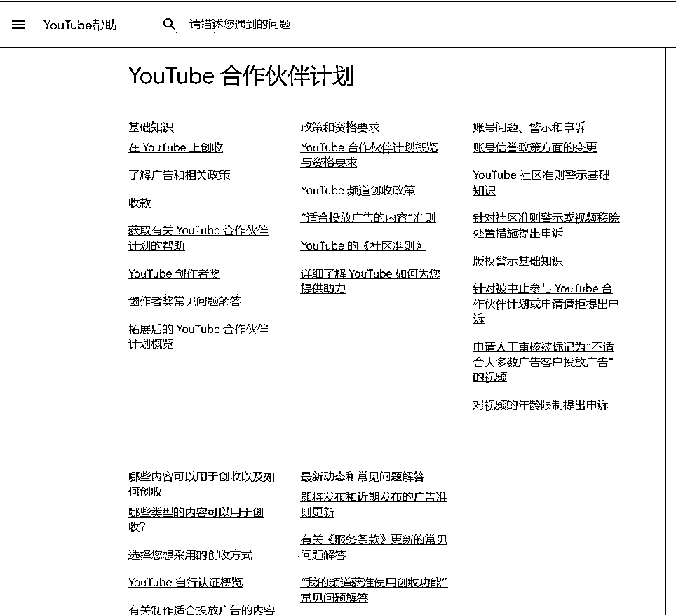


# 1.3.1.2 广告变现案例参考

案例一：Catlyn's Story  
频道类型：AI 猫咪故事  
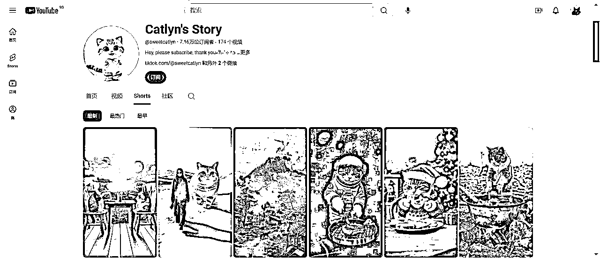  
广告收入：预估月入 1千～2万美元  
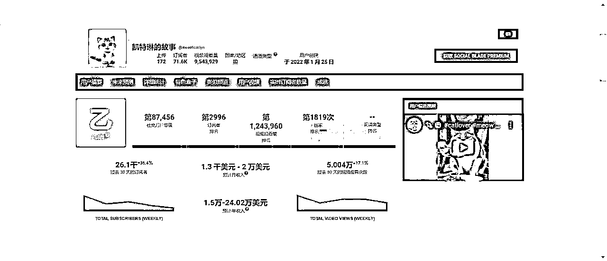

案例二：BabyMagic  
频道类型：AI 怪兽合成  
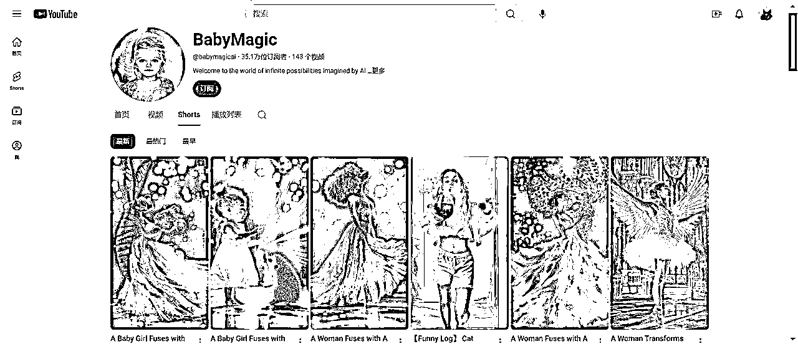  
广告收入：月入约 1万～10万美元

案例三：小高姐的 Magic Ingredients（中长视频案例）  
频道类型：美食制作与生活分享  
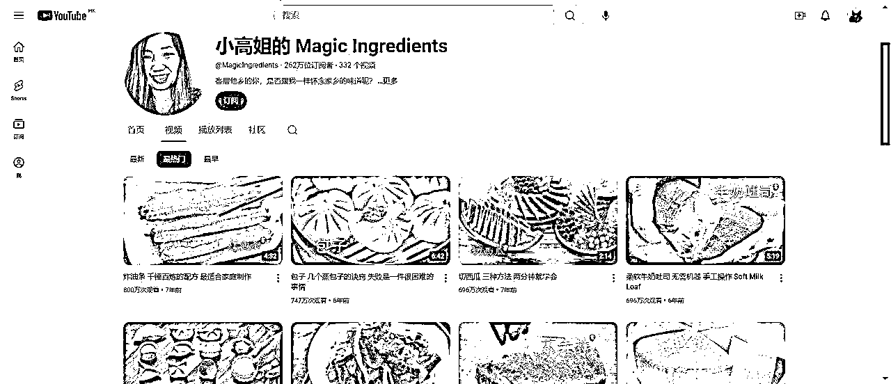  
广告收入：月入约 1万～5万美元  
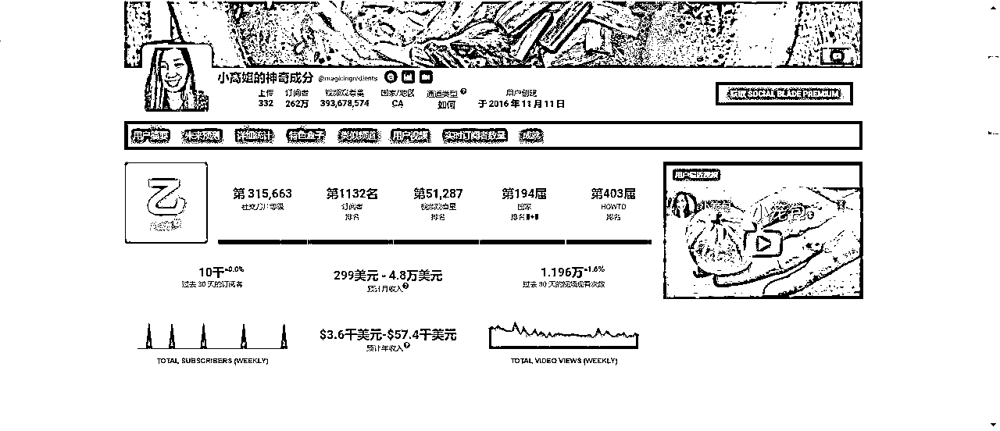

# 1.3.2 会员与粉丝赞助收益

2023年6月中旬起，YouTube 对合作伙伴计划进行了拓展，让更多创作者能够提前体验粉丝赞助功能以及部分购物功能。这也正是本节要讲的频道会员收益和电商变现。

位于支持国家/地区的创作者，只要满足下面任一资格，就能申请加入扩容后的 YouTube 合作伙伴计划：

- 过去 90 天内上传了 3 条有效公开视频，并获得 500 名订阅者，同时过去 12 个月内有效公开视频观看时长达到 3000 小时
- 或者，过去 90 天内发布 3 条有效公开视频并获得 500 位订阅者，同时过去 90 天内有效 Shorts 播放次数达到 300 万次

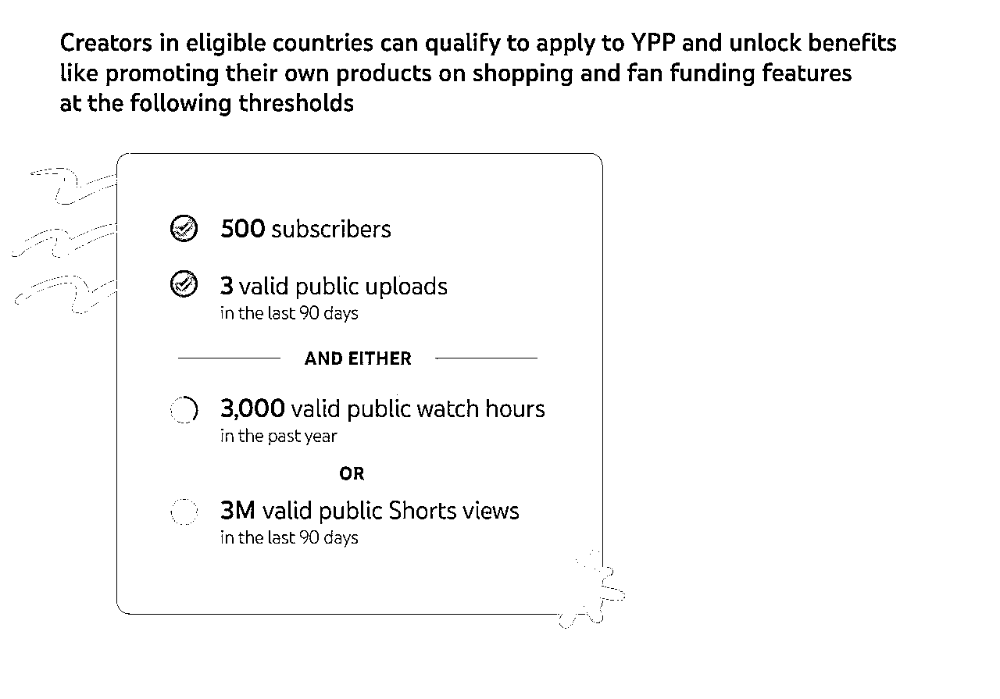

关于当前支持的国家列表，以及可以开通的变现功能等详细信息，请查阅官方文档：《拓展后的 YouTube 合作伙伴计划概览》。

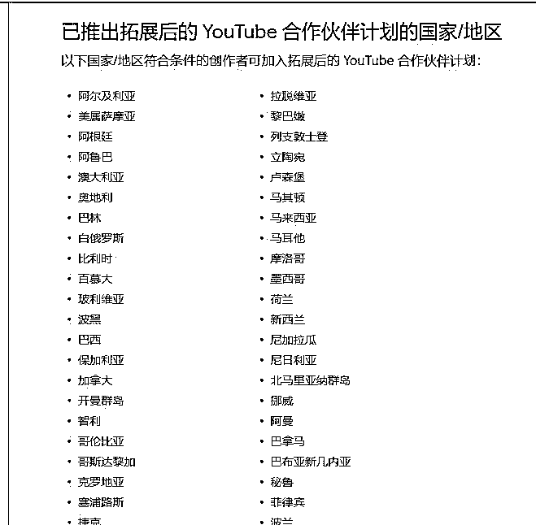

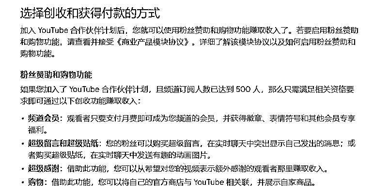

# 1.3.2.1 会员订阅带来的收入

在免费订阅之外，频道主还能额外开通会员功能（Channel Membership）。观众一旦加入会员，每月需要固定支付一笔订阅费，作为回报，可以解锁创作者准备的专属福利。会员也可以划分不同档位，档位越高福利越丰富，具体定价权在频道主手里，通常从几百到数千元不等。

平台会从每笔会员费中抽走 30% 作为佣金，剩下 70% 归创作者。举个例子：如果观众每月缴纳 10 美元，那么创作者每个月实际能拿到 7 美元。


# 1.3.2.2 Premium 用户带来的分成

开通 YouTube Premium 的订阅用户，可以享受跳广告等服务，整体观看体验会更好。当这类用户来看你的视频时，视频作者也能从 YouTube 那里获得额外补贴，并且会根据用户观看的时长来分配相应的订阅费分成。

有一点要提醒：想开启付费会员服务，需要满足的条件和 1.3.1.2 广告变现规则里的条件是一样的。


# 1.3.2.3 实例：会员收入到底有多可观

这里介绍一个极具代表性的频道：「老高与小茉」。

该频道在开放会员功能后，一度成为 YouTube 上“会员增长最快”的频道。当时它的总订阅量刚开始突破 130 万，如今已经超过 600 万，会员数自然也跟着涨了不少。

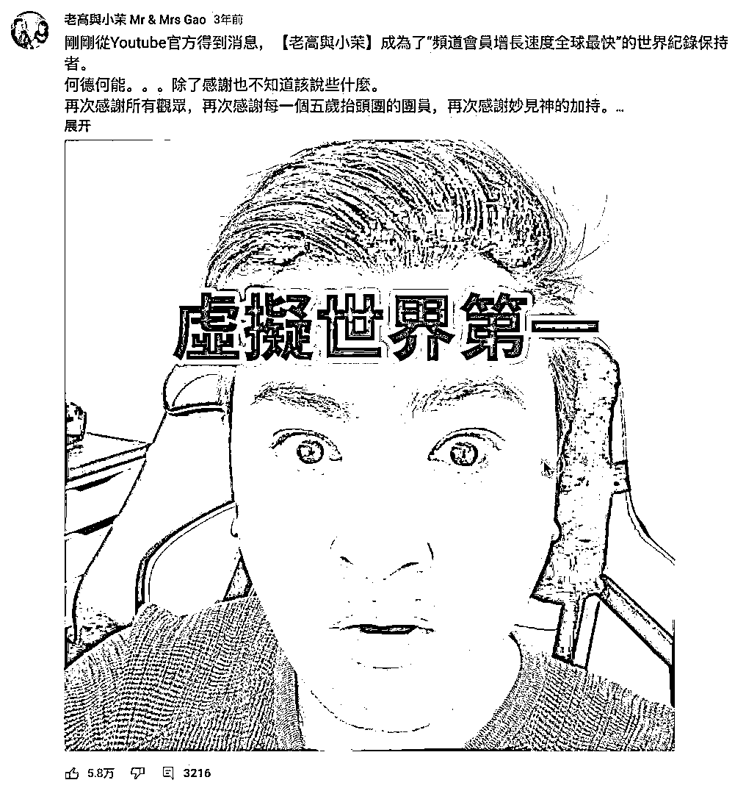

从评论区的互动来看，会员占比其实挺高的。凡是 ID 旁边带着头像的用户就是会员；这些头像可能是频道主自己做的，也可能是平台提供的，而且随着入会时间变长，头像还会有所不同，用来区分会员等级。

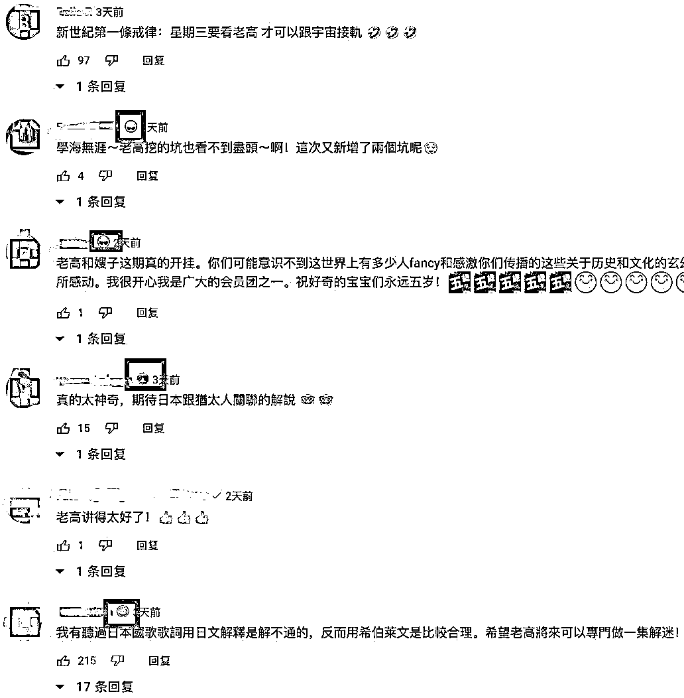

因为 YouTube 官方没有给出具体的会员数据，我们只能参考一位博主的分析，大致推测老高频道的会员收入：

1. 会员规模估算：
普通视频的评论数与粉丝数的比例约为 0.0677%，会员视频平均有 430 条评论。按照评论数来反推，会员人数大约是 63.5 万。
但考虑到会员的评论积极性通常更高（假设是普通用户的 5 倍），实际会员数大概在 12.7 万左右。点赞数据也进一步表明，会员总数可能接近 10 万。

2. 收入测算：
假设会员每月订阅费为 5 美元，平台抽成 30%。那么月收入就是 12.7 万×5×70%≈44.45 万美元，换算成年收入大约是 533 万美元。

这个数字是 2022 年底推算出来的，放到现在只会更惊人。

# 1.3.3 靠卖货来变现

除了广告和会员收入，创作者还可以通过销售自己的商品来赚钱。现阶段 YouTube 正在强化直播电商和商品货架功能，让作者可以直接在平台内完成交易。目前主要的展示和销售方式有两种：

1. YouTube 小黄车：在视频下方挂出自家商品（前提是已经加入 YouTube 的变现合作计划，具体见 1.3.2 中关于会员收益的说明）。
2. 独立电商平台：比如 Shopify、Etsy 等，用外链把用户引到自己的店铺成交。当然，平台会对你要导流的商品进行审核，确保不违反规则。

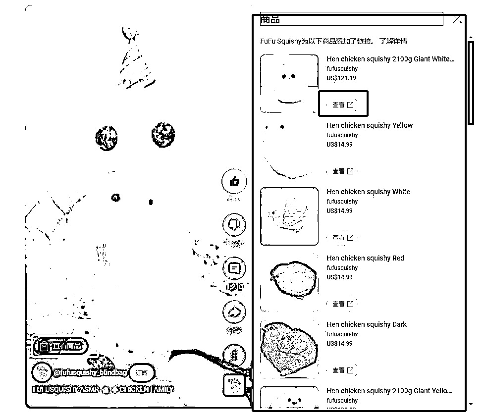

想进一步了解 YouTube Shopping 的用法，可以查看官方资料：
《YouTube Shopping：从您的商店中添加链接商品并展示》
《在 YouTube 上管理、关联和解除关联您的商店》


# 1.3.4 其他变现思路

# 1.3.4.1 品牌广告合作

创作者和品牌方合作，在视频里直接推广产品，既可按视频条数收费，也可按销售额分成。常见的内容形式包括：测评与推荐、使用场景展示、特别优惠推广（比如限时折扣码）。

YouTube 的广告报价并没有统一标准，不过海外市场上有一个按粉丝数估算的平均行情：
订阅数超过 1 万的频道，单条广告可以报到 200 美元；
订阅数超过 10 万的频道，单条广告可以报到 2000 美元；
订阅数破百万的频道，单条广告最低 2 万美元。

这种变现方式门槛偏高，因为它对订阅量有硬性要求。如果你的账号还在起步阶段、粉丝量不多，建议先去用那些不依赖粉丝数的方法赚钱。

# 1.3.4.2 联盟 CPS 分成

如果你没有自己的产品，但又想在 YouTube 上做电商，可以在视频描述里或置顶评论中放上商品链接。观众点击链接并完成购买后，你就能获得销售佣金。整个过程不需要囤货，也不用垫付货款，你只需要负责把观众引导去下单。

支持的平台有亚马逊联盟、CJ Affiliate、ShareASale、乐天等。
常见的内容形式有：开箱与评测、实用教程（操作类视频）、榜单推荐。

# 1.3.4.3 知识付费变现

知识付费变现，就是靠分享专业技能或知识内容，吸引用户购买相关课程、咨询服务或定制服务，从而获得收入。

相比传统广告和联盟营销，知识付费的核心是用价值换付费意愿，特别适合那些在某个专业领域有积累、有经验的创作者。

知识付费的主要形式有：

1. 在线课程：把课程放到 Teachable、Udemy 等第三方平台，或者放在自己的独立网站上，然后用视频把观众引流过去购买。
2. 会员专享内容：借助 YouTube 自带的会员订阅功能，用户按月付费后就能观看独家内容。
3. 一对一咨询/服务：在视频描述栏引导用户预约个人咨询（比如 Zoom、Google Meet），按小时或项目收费。
4. 电子书/工具包：通过视频推广电子书、模板或工具包，用户通过链接直接购买和下载。

内容出处：《航海实战 | YouTube - 视频创作 | 实战手册》


# 1.4 动手前先明白这些事

马上就要进入实操了。在你翻开下一章之前，我们希望你先调整好心态：做 YouTube 需要长期主义，也要有持续经营的打算。

1. 别急着看到结果。YouTube 创作是一件慢工出细活的事。以前，长视频想要开通 YPP，平均要等 2 年；现在如果认真输出优质内容，大概 3-6 个月就能开通。记得把心思放在内容质量和观众互动上，不要只盯着数据涨没涨。

2. 早期的作品可能不够好，但别怕失败，重要的是持续创作、不断学习。刚开始的一两个月，甚至更长时间，看的人少、订阅也少，这都是正常的。常去看看 YouTube 后台的分析数据（比如观看时长、受众信息等），从数据里找方向，再慢慢调整优化。

3. 选择你真心感兴趣的方向，不然遇到瓶颈时，真的很难坚持。

4. 重视版权法。YouTube 对版权问题非常敏感。如果你上传了别人的内容（比如音乐、影视片段、图片），可能会面临视频被下架、账号被警告，甚至失去变现资格的风险。

5. 避开常见的版权雷区：

- 音乐：别用受版权保护的歌曲，除非你拿到了授权。可以用 YouTube 官方音频库，里面有很多免费音乐和音效。
- 图片和素材：用没有版权限制的图片或视频（比如 Unsplash、Pixabay、Pexels），或者确保自己拥有素材的商业使用权。
- 影视、游戏片段：哪怕只是几秒钟，也可能引发版权警告，尤其是热门影视和游戏内容。


# 二、【实操 1/6】账号从零起步

# 💡

# 本章要做什么

搭好 YouTube 账号，是整个项目的第一步。账号基础越扎实，后续的内容推广和变现就越顺。

这一章主要包含：

✅ 账号类型选择：个人账号与品牌账号的区别，以及各自适合什么场景

✅ 注册流程：详细步骤和避坑提醒

✅ 频道装修：头像、横幅、简介等怎么设置才更专业

✅ 视频发布流程：手机端和电脑端的操作差异与技巧

一开始不用非得把装修做到完美，先把账号稳定下来。养号期尽量用普通用户的身份去刷视频、互动，提升账号的可信度，这样后面发内容才能有更好的基础。

# 💡

# 本章路线图

完成本章的学习和实操，你就能完成整体航线图中的：

第一阶段 熟悉平台，准备好 YouTube 账号（大约 2 天）

1. 搞定网络工具，注册 YouTube 账号（大约 1 小时）

2. 完成账号基础设置，熟悉视频发布流程（大约 1 小时）

# 2.1 先想清楚：注册哪种账号

# 2.1.1 个人账号

个人号是直接用你自己的谷歌账号创建的，需要单独设置用户名和密码。

# 2.1.2 品牌账号

品牌账号其实相当于企业号，用来展示公司信息、产品等内容。它通过企业资料来创建，可以通过「Google+」或「Google 我的商家」等渠道开通，不需要单独设置用户名和密码，还可以设置多个所有者和管理员一起管理。


# 2.2 注册账号的具体步骤

Step1：国内不能直接访问 YouTube，你需要先准备能打开海外网站的网络工具。具体风险原因这次航海不细说，请自行把网络问题解决，确保能正常访问。

Step2：注册一个谷歌邮箱。手机下载 QQ 邮箱 App，点“添加账户”，选择 Gmail 邮箱，按提示创建账号，填写好资料后输入+86的手机号，就可以注册成功。（最近有出现手机号用不了的情况，换个号码再试，或者用接码平台也行）

Step3：打开 YouTube 官网，用刚注册好的 Gmail 账号登录。

你也可以参考这个 YouTube 视频，跟着完成账号注册：https://www.YouTube.com/watch?v=8hk5V2P_72U

注册完成之后，就可以像普通用户一样正常使用 YouTube 了。多浏览、多点赞、多评论，让平台感受到你是一个真人，而不是机器注册的小号。

建议先养几天号再发视频，这样账号会更加稳定。

另外，记得把地区设置为支持获利的国家，比如美国、大部分欧洲国家、日本、韩国、印度，以及南美的主要国家。

不过也不用太纠结这个设置，因为 YouTube 的流量分配并不是看这个，而是根据频道内容的受众来决定的。


# 2.3 创建自己的 YouTube 频道

Step1：在 YouTube 官网首页右上角，点击“Create a Channel”。

Step2：选择创建个人频道还是品牌频道。

Step3：给频道起个名字，一般会直接使用公司名、品牌名或产品名。创建好之后，就可以开始上传视频了。

一个完整的频道，通常包含头像、名称、横幅、宣传片、播放列表、封面图、简介等元素。点右上角头像进入“YouTube 工作室”，在右侧导航栏找到“自定义”，就能逐个修改频道的个人资料了。

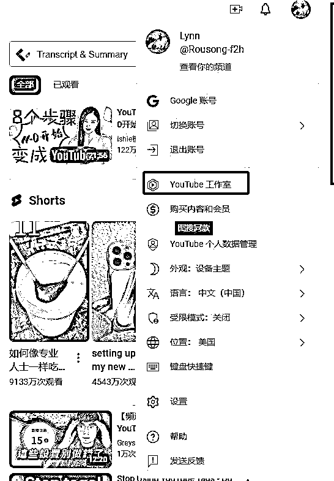

这里特别想提一下圈友@方波妮的心态：

别让“头像怎么弄？”“封面怎么设计？”“我做的视频好丑？”“我怎么这么笨？”这类问题卡住你的进度。

头像不会做，那就从手机相册里找一张宠物照、风景照，或者用 MJ 生成一张，先搞定再慢慢优化，封面也是同样的道理。

少一点“我觉得 XXX”，先模仿爆款让市场来检验。即便你认为自己的原创很优秀，也有可能打不过那些丑丑的模仿爆款——事实证明，丑东西也有人喜欢。

放下这些念头，接受开始的不完美。先把视频发出来，技巧都是在后续一点点打磨出来的。

# 2.3.1 头像设置

头像尺寸为 98×98px，文件不超过 4MB，支持 png 或 gif 格式。

头像类型可以用人物照、萌宠、风景、品牌 logo、卡通形象等。

风格上一定要清晰，最好用真人形象。

不会作图的话，可以用在线做图网站，或者找一些免版权图片。

图怪兽：https://818ps.com/

可画：https://canva.com/

创客贴：https://www.chuangkit.com/

用 AI 工具生成头像，操作步骤可以参考 AI 特效直播实战手册里的“AI 头像壁纸号”部分。

注意：尽量别用容易侵权的商标类图片。


# 2.3.2 频道名称与标识名

名称最好简短好记，能突出视频内容特色或行业特征；可以是个人名字的延伸；也可以做成中文+英文（带注解）的形式。

标识名可以作为你 YouTube 链接的后缀，方便用户找到你。

注意：这两项每 14 天只能改 2 次，别频繁改动。


# 2.3.3 频道横幅设置

横幅尺寸不能低于 2048×1152px，文件大小不超过 6MB。因为很多海外用户是用电视看 YouTube 的，所以清晰度一定要够高。横幅内容要能清楚地传达频道主题。

可以顺带引导用户订阅，放一句简洁的频道介绍，也可以加上其他平台的链接。


# 2.3.4 播放列表规划

等视频数量多起来之后，一定要分类整理，最方便的方法就是创建播放列表。给播放列表命名时，建议用和用户搜索意图相关的短语或问句，而且最好多建几个。

播放列表里的视频会自动连续播放，这样可以引导用户看更多内容，既能提高浏览量，也有机会吸引到潜在的目标粉丝。


# 2.3.5 封面图优化

封面图在频道里非常显眼，一定要好好做。因为很多观众是靠第一印象来点击视频的，一张好的封面能明显提高打开率。

几个优化建议：

- 用“大众熟悉的东西 + 悬念”的组合：熟悉感能带来信任，悬念能激发好奇心。
- 多放图片、表情、数字等有视觉冲击力的元素。
- 标题文字别写太多，会干扰主题。
- 封面右下角留出放频道链接的位置。

推荐工具：

Canva https://www.canva.cn/

稿定设计 https://www.gaoding.com/

用 AI 工具做封面，可以看《3月航海 | AI 绘画特训 | 实战手册》。


# 2.3.6 频道简介写法

频道简介需要一句简洁又能概括频道的标语，再介绍自己的基本信息、能给大家带来什么，以及更新频率。

建议做成双语版本，也可以放上其他社交媒体的链接。

内容出处：《航海实战 | YouTube - 视频创作 | 实战手册》


# 2.4 YouTube 视频发布流程

Shorts 制作周期短，建议每天发布 1 条高质量的 Shorts。

# 2.4.1 手机端发布步骤

第一步：打开 YouTube App，点右上角的“+”按钮。

第二步：选择“创建 Shorts”，或者直接上传已经做好的视频文件。

第三步：进入编辑页，检查视频的时长和比例：

时长控制在 60 秒内，采用 9:16 竖屏，推荐分辨率 1080×1920（高清）。

画面要清晰，背景音乐要合适，开场内容一定要抓人（前 3 秒就能决定观众留不留下来）。

编辑界面里还有几个模块也值得优化，能帮助提升播放量：

- 标题：简洁有吸引力，最好带上关键词。示例：10 秒学会最酷舞步！🔥 #Shorts
- 描述：简单说明视频内容，再加点关联信息，比如话题或频道链接。适当加入和视频内容相关的关键词，能提升搜索排名。
- 标签（Tags）：添加相关主题标签，比如 #Shorts、#DIY、#Fitness。注意标签必须和视频内容高度相关，别用误导性的标签。
- 缩略图：如果系统自动生成的缩略图不满意，可以自己上传自定义图片。注意保持清晰、色彩对比强烈，从吸引点击的角度去设计。


# 2.4.2 电脑端发布步骤

电脑端发布和发长视频的步骤是一样的：

第一步：登录 YouTube Studio。

第二步：点击右上角“创建”按钮，选择“上传视频”。

第三步：把视频拖进上传框，如果时长和比例符合 Shorts 的要求，系统会自动识别为 Shorts。

但要提醒一句：为了保证视频出现在 Shorts 板块，你需要在标题或说明栏加上“#Shorts”标签，同时视频的长宽和比例也必须符合 Shorts 的规范。

发布前后，记得都要像普通用户一样去刷一刷视频，别一发布完就退出。有测试表明，发布前后多刷视频，平台会对你的账号更信任，推荐量也可能更多。如果发完就关掉，平台反而会怀疑你是不是真实用户，从而更保守地分配流量，导致出现 0 播放。


# 三、【实操 2/6】定赛道、找对标

# 💡

# 本章要做什么

赛道选择是成败的关键，选对了赛道，往往能事半功倍。本章会通过分析热门视频和对标账号，帮你找到自己的内容方向。

本章重点包括：

✅ 如何确定赛道：看平台热门趋势、借鉴头部创作者的经验

✅ 寻找对标账号：判断赛道活跃度和变现潜力

✅ 拆解对标账号：理解内容创作逻辑和爆款视频的特点

✅ 收益估算方法：用数据预判项目回报

早期别老想着找全新的蓝海赛道，先选一个已经被验证过的方向，再在实践中逐步形成自己的差异化优势。

坚持输出好内容，你的定位会慢慢长出来。

# 💡

# 本章路线图

完成本章学习，你就能完成航线图中的：

第二阶段 确定赛道、创作内容并发布（大约 7 天）

1. 了解热门赛道，确定方向（大约 2 小时）

2. 在对应赛道找到对标账号并分析（大约 3 小时）


# 3.1 到底该怎么选赛道

# 💡

# 给新人的 Shorts 赛道建议

- 赛道里已经有很多千万播放的视频：说明这个赛道容量足够大，多你一个千万播放也正常。
- 赛道最近两周还有千万播放的视频：以前能做不代表现在还能做，最近还能出爆款，说明赛道还活着。
- 频道近一周有百万播放以上，同时单支视频最高超过千万播放：频道能做到千万播放，说明它是赛道里的头部；近一周还有百万播放，说明这个赛道还热，足够你再做一个新号起来。

# 3.1.1 看 YouTube 热门视频找方向 @亦仁 @老马内容出海 @钱塘江鲤

选对一条赛道真的太重要了，因为时间成本才是最高的成本。

这同行跟咱的路子搭不搭？

这条赛道人多不多？

还能不能继续走下去？

开通收益难不难？

说白了，就是要选好利基市场，也就是我们常说的赛道。

那作为一个新人，到底该怎么选赛道？哪种 Shorts 内容才能真正赚到钱？


# AI Shorts 赛道实操：对标拆解、收益估算与方向选择

亦仁在“超级标的”收尾时分享过一条找爆款的路子：先锁定一条已经在 Shorts、YouTube 上跑出热度的 AI 视频，接着进入它的描述区，把标签、简介以及评论区里出现的关键词都收集起来，再借这些词向周边延展。如此反复扩散，最终能积累出大量类目词，而且每个方向都已被别人的流量验证过。

圈友@钱塘江鲤 把这个思路落成了数据：筛选注册不满一年、订阅数高于 1000 的频道，整理成《1万个YouTube AI Shorts对标账号》。圈友@老马内容出海 则拿这份名单做了一次实操演示，以 AI 内容为例，完整走了一遍赛道拆解流程。

第一步，先立一个筛选基准：市场已有验证、竞争尚未饱和、还留有创新余地、并且容易快速复制的方向。

第二步，从名单里挑 5 到 10 个对标号，要求风格、选题、文案属于同一类型，画面表现或情绪价值也要相近。用@钱塘江鲤 采集的标签随手试，取出“Cute”“Spiderman”两个词。

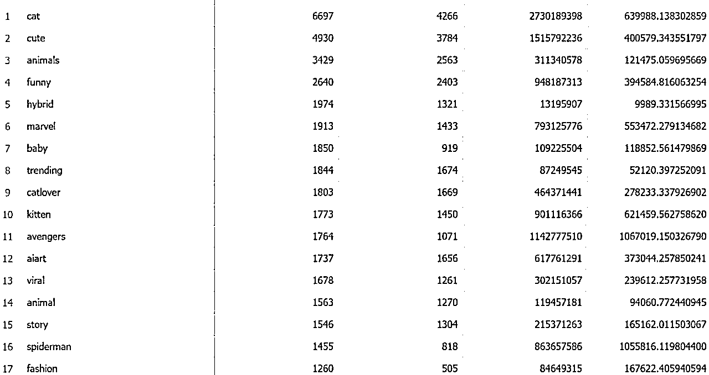

第三步，拿关键词去 YouTube 搜，观察其中看起来像 AI 生成的内容。

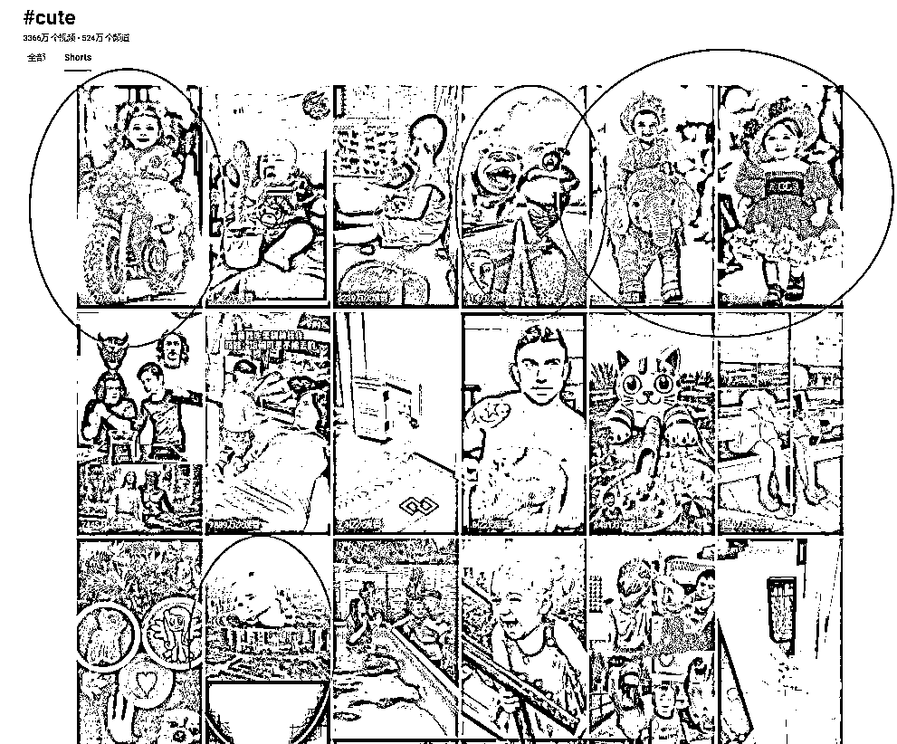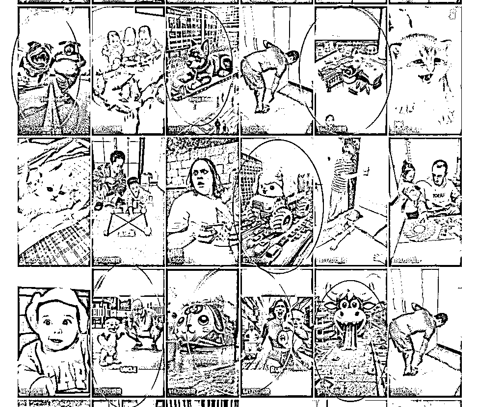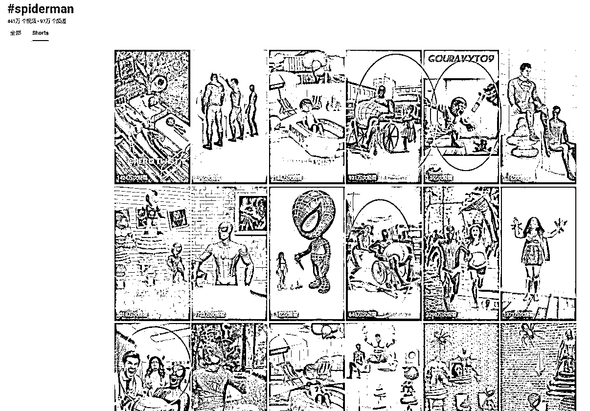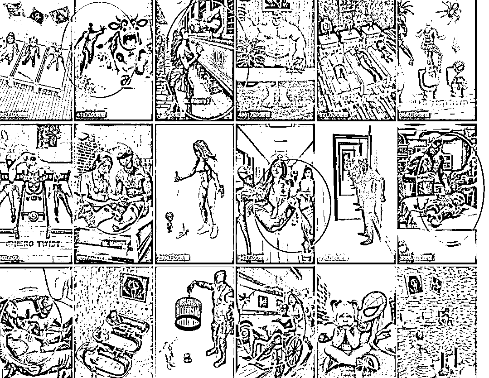

挨个点开后，多数结果会归到两类 AI 赛道：一类是 AI 萌娃走秀，配上口型驱动会更鲜活；另一类表面分成几组，实质是同一套做法——图片风格转绘、简单特效转场、热门音乐，再加一个用于过审的人头抠图。

Runway show + 口型驱动（是否对口型均可）：

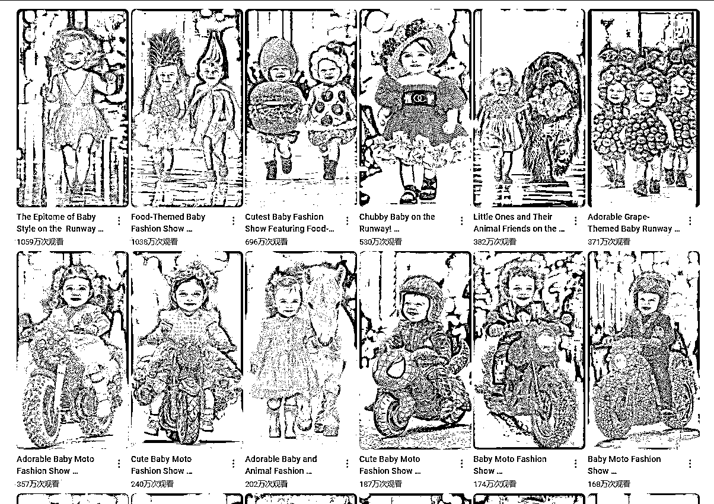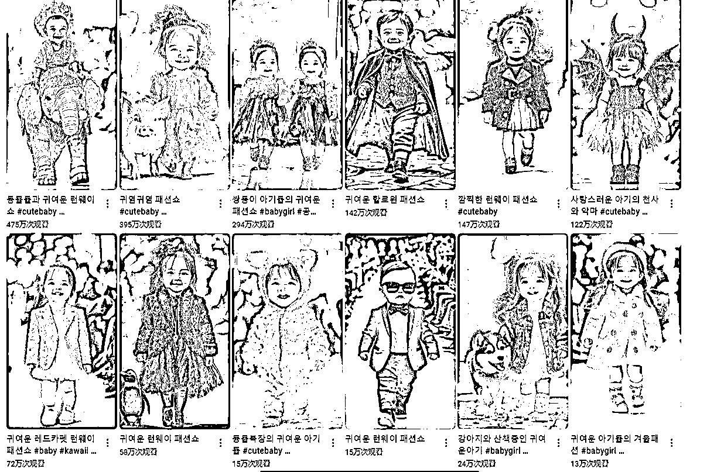

图片风格转绘 + 人头（也可以不加）：

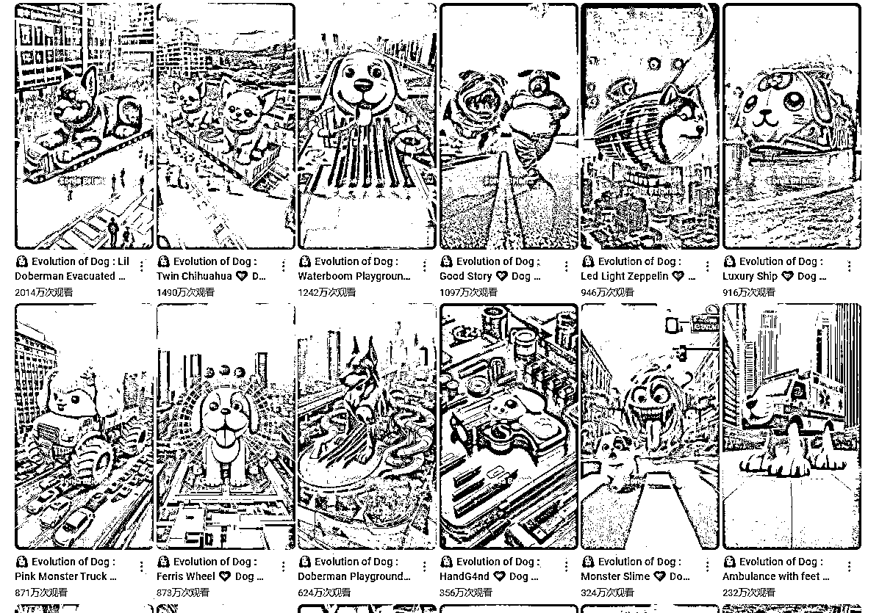

再看 Spider Man：图片风格转绘 + 人头（可加可不加）+ 恶搞 IP：

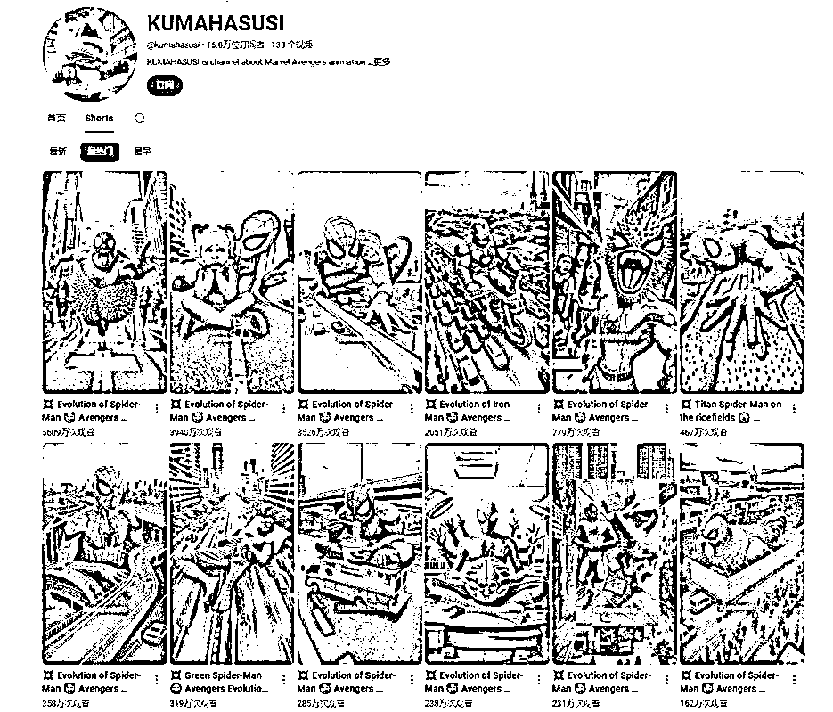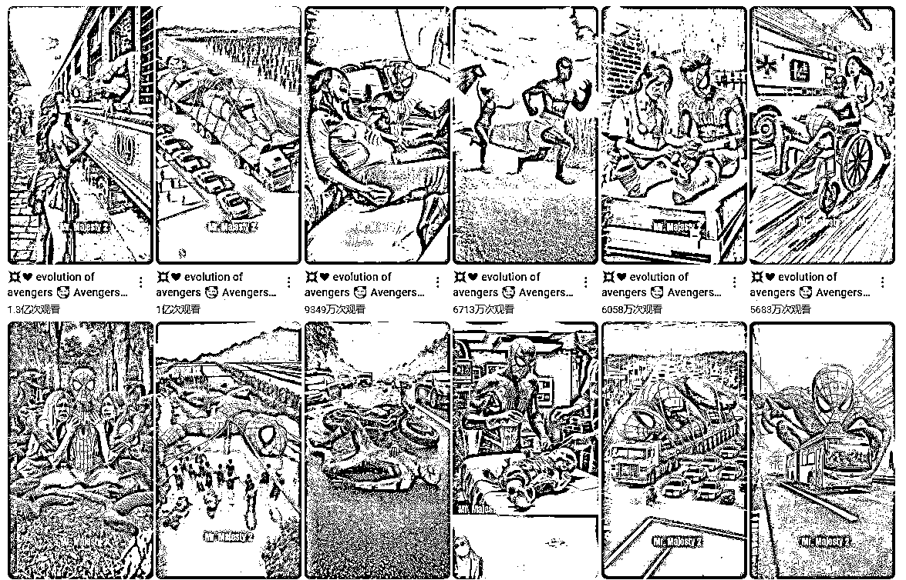

如果判断这个方向自己能上手，就可以锁定具体对标账号，进入下一轮分析。

内容来源：《【生财技能】如何选择自己合适的匿名 Shorts 赛道》、《利用 RPA 自动化流程分析 YouTube Shorts 上的热门 AI 视频》


# 3.1.2 翻翻往期 AI 航海手册 @方波妮

另一条省力路径，是参考往期 AI 航海项目。比如 2024 年 9 月的 AI 航海：《9 月航海 | AI 特效直播变现 | 实战手册》。翻开航海文档，项目琳琅满目：AI 老照片、AI 写真、AI 宝宝走秀、AI 赛博机车、AI 头像、AI 壁纸等。这些在国内短视频里已经跑过的玩法，可以直接迁移到 YouTube。挑一个自己喜欢的先动手，想太多只会停在原地。

内容来源：《YouTube Shorts 项目实操：从 0 到 1 跑通账号，12 天收获 2700+订阅与 90 万+播放》

# 3.1.3 头部 YouTube 博主的赛道选择法 @浅笑

YouTuber@老高与小茉 的赛道选择方法论，Shorts 和长视频频道都能借鉴。归结起来是四条：

1. 做你想做的。挑一个能长期坚持的内容方向，参考相似频道，学习如何拓展内容：横向是关联题材，纵向是深挖题材。
2. 做你擅长的。选自己比普通人更有优势的内容，擅长的事更容易出量，失败概率更低。
3. 做你喜欢看的内容。若暂时没有想做或擅长的方向，就从感兴趣的内容入手模仿，或许能发现新的兴趣点。
4. 做播放量大的内容。前三条都定不下来时，跟着播放量走；但播放量高不一定代表适合你。

内容来源：《YouTube 数据与前景及博主方法论分享》


# 3.1.4 通用定位方法如何调整 @一页书

定位可以拆成几个动作：先采集并初筛市场当前与历史数据，再做分析，然后整合、筛选、排序，最后得出几个适合自己的定位。

分析时要回答：这批用户是谁，规模多大？他们有哪些需求或待解决的问题？是否愿意为解决问题付费，付费能力如何？现有供给方如何满足需求，效果怎样？如果换自己来做，能否做到同样好甚至更好？还有一个常被忽略的问题：我是否讨厌做这件事？

落到 YouTube，需要按 Shorts 的特点做调整。

数据采集方面，生财圈友@钱塘江鲤 擅长用 RPA 抓取和分析数据。起步阶段可以直接用他整理好的成果，也就是那 1 万个 YouTube AI Shorts 对标账号；之后再学习他的方法，自己采集。

按 Shorts 的特点，早期不必追求清晰的用户画像，可以把用户和需求合并来看，重点弄清需求是什么——通常是精神或心理层面的——以及为什么某些需求体量很大。用户付费意愿和能力也可以先放一放，因为 Shorts 共享广告收益池，专心做爆款内容即可。

总结：拿到高手的 Shorts 数据后，重点分析以下几个问题，前三个最关键——

需求层面：播放量高的内容满足了什么需求？有这类需求的用户多不多？
供给层面：竞争者多吗？他们怎么满足需求？是否还有创新空间？
实现层面：需要哪些技能？自己能做吗？能否做得更好？
最后再问：我讨厌做这件事吗？

把答案汇总整理，就能得到适合自己起步的定位。

内容来源：《【生财技能】万字总结：YouTube Shorts 频道定位调研与视频制作实操》


# 3.2 选中赛道后分析对标 @老马内容出海

# 3.2.1 如何找到对标账号

赛道确定后，每个类型先准备 5 至 10 个频道，起步阶段备 5 个也够。

常规采集路径：先用标签或关键词搜到一批初始对标，接着关注、点赞，反复回到首页与 Shorts 信息流滚动。遇到新号就继续循环。新号更容易操作；手机端刷到 Shorts 的概率高于浏览器。若账号已有浏览记录，推荐逻辑会受历史影响，需要更多耐心。

后续也可以沿着钱塘江鲤整理的 AI 标签文档手动寻找，或者用他分享的代码自行采集。页面周围会出现同类推荐，但单独的 Shorts 页面不会展示。

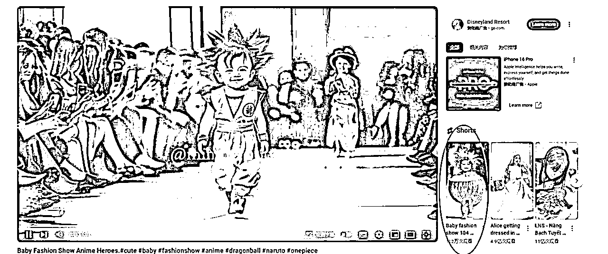

另一种思路是从热门音乐入手。听这两组频道视频里的热门音乐，可以反推出高度垂直的账号，也能借热门音乐拓展其他细分赛道。

先看图片风格转绘 + 人头（或是不加人头）这一类方向的热门音乐：

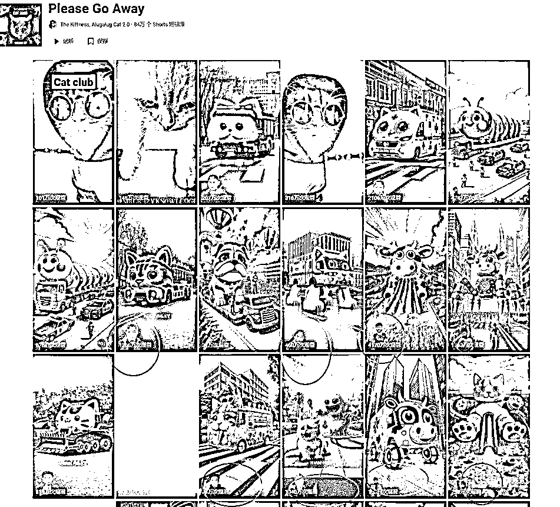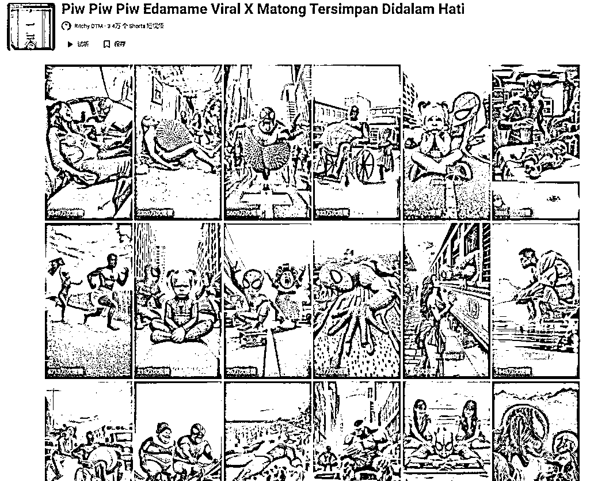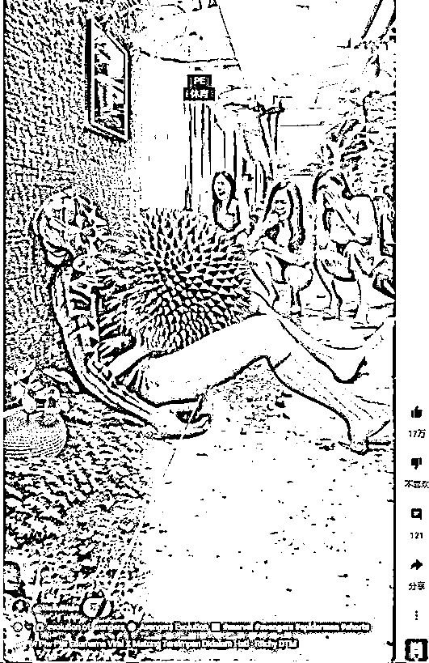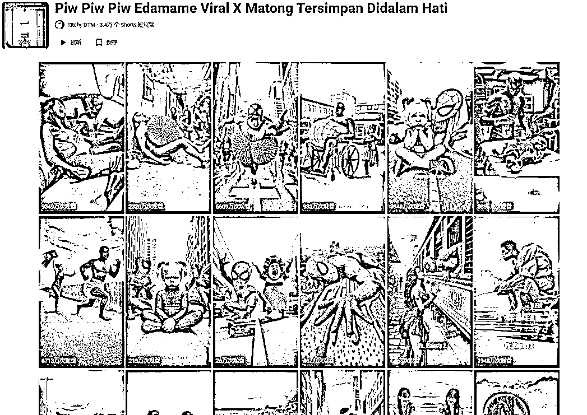

左下方放人头乍看有点怪，但这并非 AI 圈首创。它最早出现在点评、观点类视频的变体里，后来抖音中视频的影视切片用“加人头”来提升原创度，又火过一阵。如今算第三次变体，被移植到 AI 赛道——AI 内容开通 YPP 不容易，所以老办法又被拿出来用。

再看 Runway show 的热门音乐：

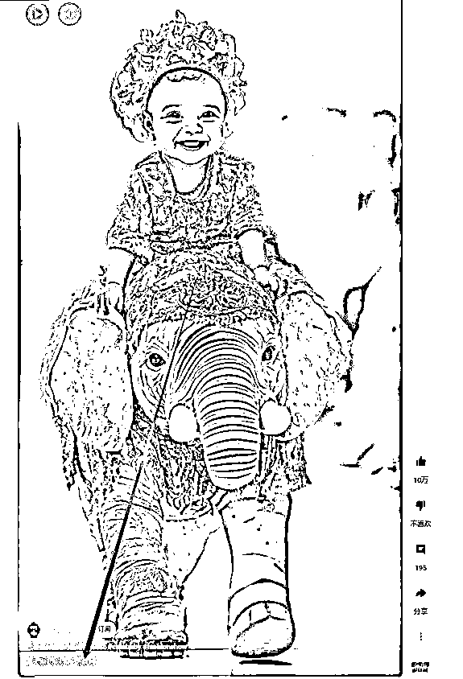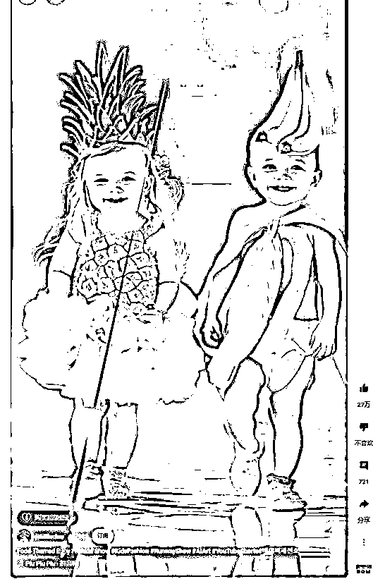

这是最近才出现的赛道，AI 视频生成技术迭代升级，给 AI 赛道注入了新活力。

走到这一步，我们已经掌握了两组能持续找到高度垂直赛道的信息渠道。接下来按以下条件筛一筛：

第一，总播放量超过 1000 万；
第二，属于近期频道，也就是 3 个月内的频道。这里看的不是注册时间，而是点开最早一条垂直视频，确认它是否在近 3 个月出现，或者近期视频里是否有高爆内容；
第三，排除印度频道。

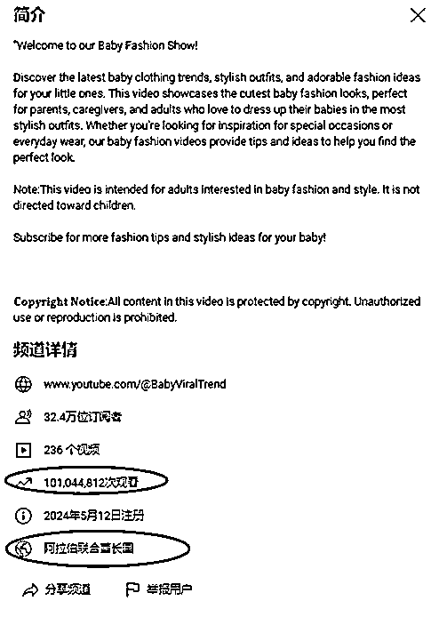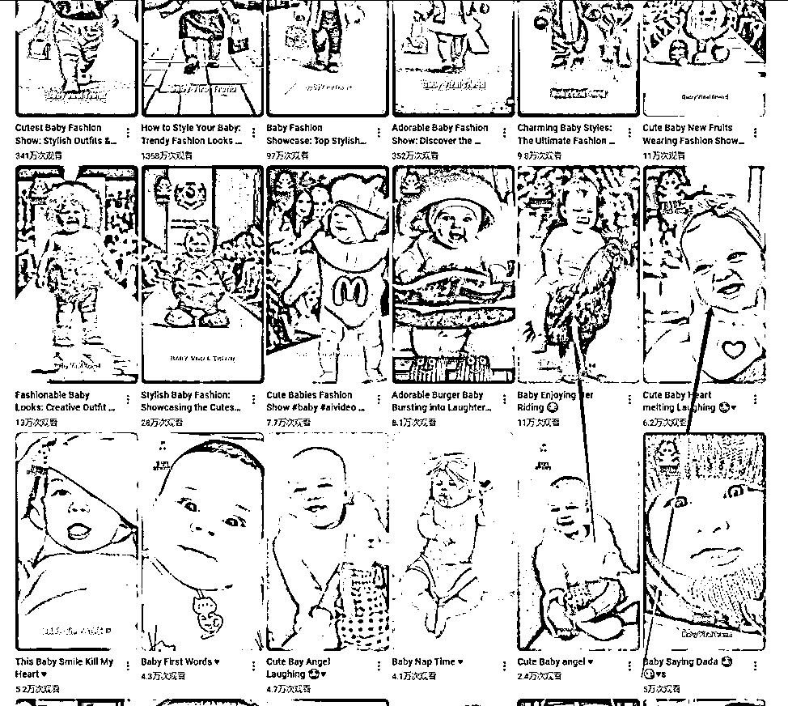

筛出来的 Runway show 频道：

https://www.YouTube.com/@littleclassics7988
https://www.YouTube.com/@AloAiTec
https://www.YouTube.com/@CarterSophia
https://www.YouTube.com/@BabyViralTrend

AI 视频转绘频道：

https://YouTube.com/@MiawMilky
https://www.YouTube.com/@sonjabriana3135
https://www.YouTube.com/@BalluWala
https://www.YouTube.com/@TeknoCatPro
https://www.YouTube.com/@MrMajesty2


# 3.2.2 开始分析拆解

这次会用到货币化查询工具：https://ytlarge.com/youtube/monetization-checker/cn 。

先说明：下面这些拆解和判断并非绝对准确，只是估算。它的意义在于给你一个研究锚点，同时让你练出一套拆解对标的方法。到目前为止，YouTube 还没有百分百精确的查询渠道。

第一步，把上面 10 个频道用工具挨个查一遍：

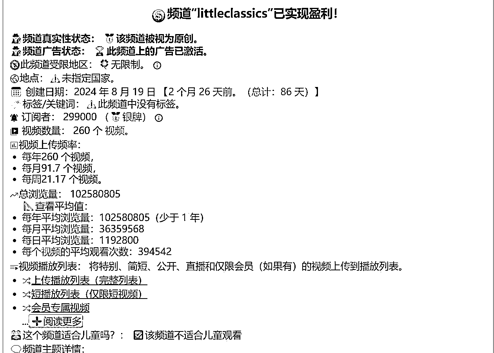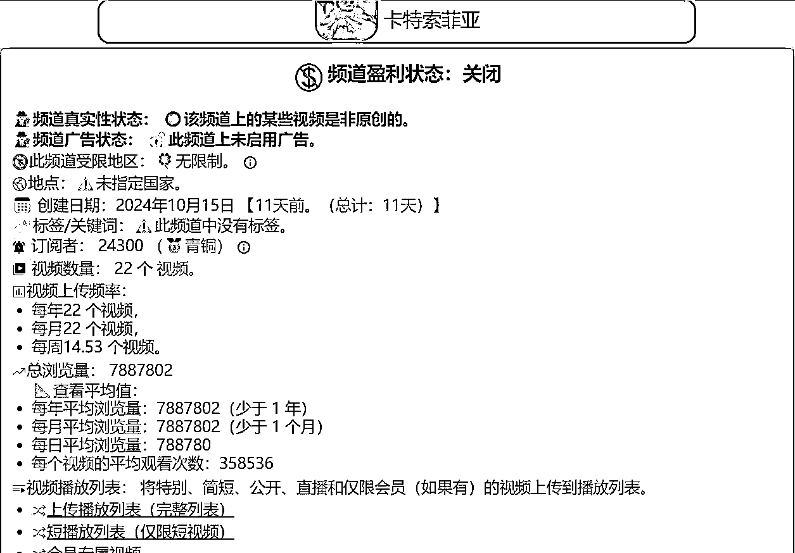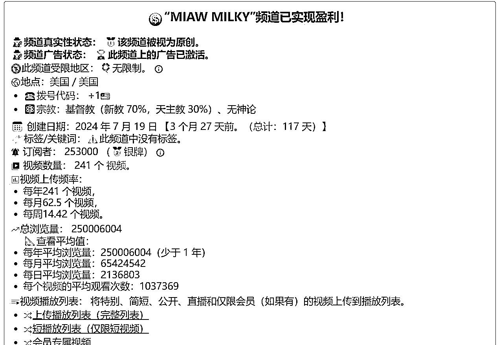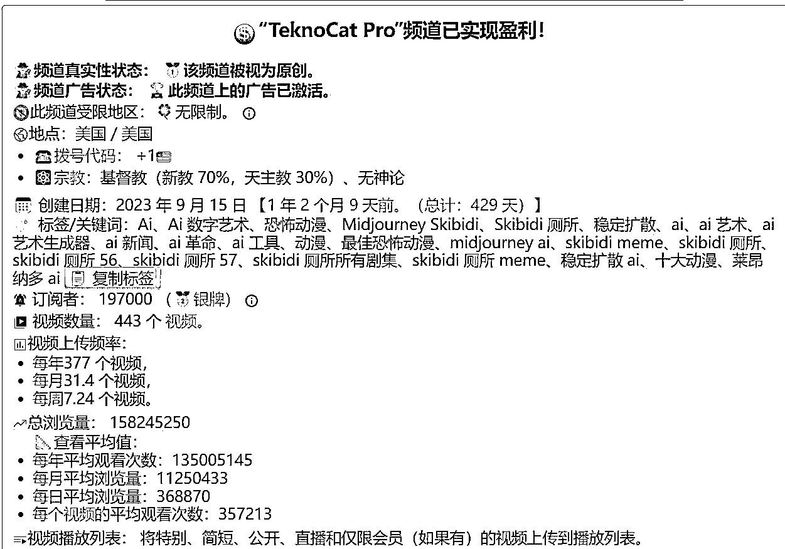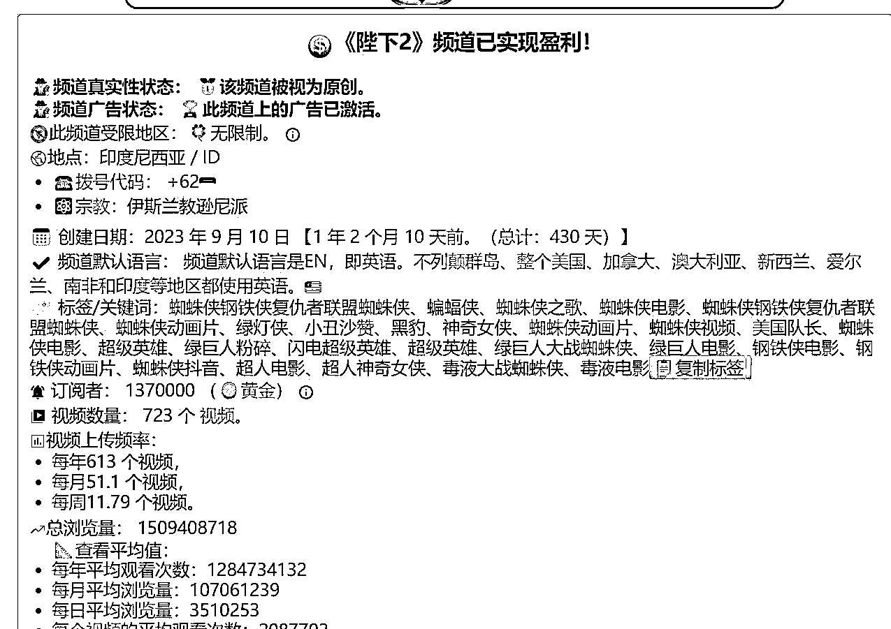

第二步，从几个状态做可能性判断。以 Mr. Majesty 2 为例，工具显示：该频道已盈利；被判定为原创；广告处于投放状态。

三项含义分别是：货币化即开通收益；原创度指频道整体原创内容占比；广告状态指视频广告是否投放，更多针对长视频。

基于这些，可以判断出几种可能：

1. 三项全绿：基本稳妥，赛道在人工与机器审核层面大概率没问题。
2. 货币化开或关、内容非原创、广告有无：问题多半出在内容，过不了 YPP。账号可能是买来的收益号，后来转型至此；也可能此前过了 YPP，之后因违规、侵权、不适配观看等被处罚，遭遇 Shadow Ban、限流，甚至收益被关。
3. 已盈利、原创，仅部分广告：通常是音乐版权分走了一部分收益。

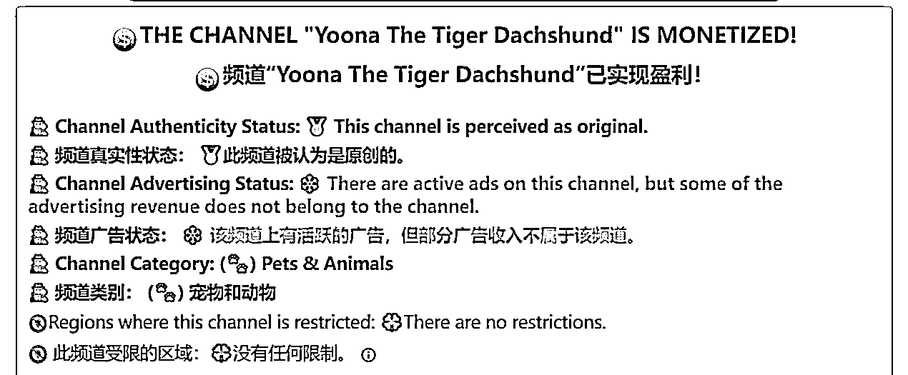

第三步，收尾判断。货币化查询做完，肯定要选三绿内容的赛道。有了基本判断，我还会看天花板：爆款内容是否稳定，最热门前几排视频掉量快不快。

Shorts 的收益模式偏重爆款，日常一两万播放很难撑起来。到了后期，收益号往往进入“养老”状态。既然要押爆款，就必须先了解目标赛道的爆款上限。

# 3.2.3 不能选择的对标频道

有些频道虽然也能做到千万播放，但“最热门”排序里的差距过大，这类号无论选题、画面还是文案，都不该作为首选。当然，如果整个赛道只有极个别频道如此，方向仍可继续——只能说明这一家没做好，不代表赛道不行。

不能选的原因很多：赛道过于饱和，YPP 难过；侵权素材过多，被判非原创也过不了。一个账号从起号到开通 YPP，通常要 1 到 3 个月；好不容易达标却卡在收益审核，那才真难受。所以先把路选对，比什么都重要。

内容来源：《【生财技能】如何选择自己合适的匿名 Shorts 赛道》


# 3.3 YouTube 频道收益估算 @老马内容出海

算收入，一是判断赛道是否值得投入，二是给自己打气。坚持不住时，打开计算器算一算，擦把泪继续干。

用一个三绿频道作对标：www.YouTube.com/@NicksWorld01

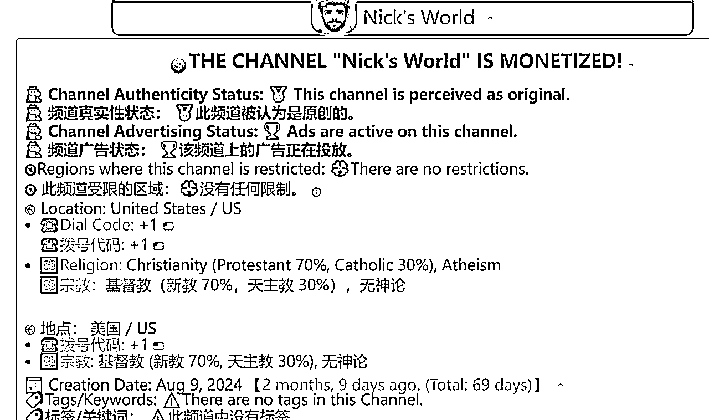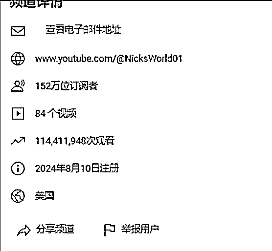

看数据：8 月 10 日注册，美国地区，84 条视频，152 万订阅。属于短期起量很快的解说类账号，总播放已达 1.1 亿。早期千播收益约 0.02 到 0.08 美元，现在约 0.15 美元。按最低 0.1 美元估算，1.1 亿播放约 1 万美元。货币化页面下方有估算值，可参考但别当准数。

如果频道同时有长视频和 Shorts，怎么估？先点 Shorts 的最热门，看看前几行播放量，减掉 1000 万（想乘 3 也随意）。长视频部分再减去刚才估算的 Shorts 热门播放，结合选题和领域单价相乘，两边相加大致接近。觉得有偏差乘 0.8，觉得偏低乘 1.2，怎么顺手怎么来，真实收入只有作者清楚。

还有一个提醒：别指望一开始就找到一个无人涉足、满是机会的赛道。YouTube 内容量已经很大，每个赛道每天都有账号爆发，也有账号沉寂。更关键的是找到自己想做的方向、确定对标对象，然后长期做下去，在过程中逐步形成自己的风格和差异化。

内容来源：《【生财技能】如何选择自己合适的匿名 Shorts 赛道》

# 3.4 2025 热门 AI shorts 赛道推荐

# 达人秀变身

典型频道：

【已换赛道】舞台表演类：https://www.youtube.com/shorts/8Xwn2F7sBvs 这个号做得很用心，连口型配音都配了。

【停更一个月】高质量美女：https://www.youtube.com/shorts/cWE_o-vQ2cI 背后有矩阵，国内叫“军哥聊电影”，几个号画风一致，模块 2 有操作攻略。

怪物/猎奇向变身：https://www.youtube.com/shorts/Yd_gKAmXNw0 近期爆款频率明显下降；另一个 https://www.youtube.com/shorts/ElFYG5VxC30

【停更一个月】高质量腹肌男性：https://youtube.com/shorts/cmIBm3y3Tfc?si=NssIltjjD9LslS5w 这个号思路独特，20 条视频突破 10 万粉，画面色彩与评委素材衔接顺畅，开头和内容让人以为是真实达人秀。

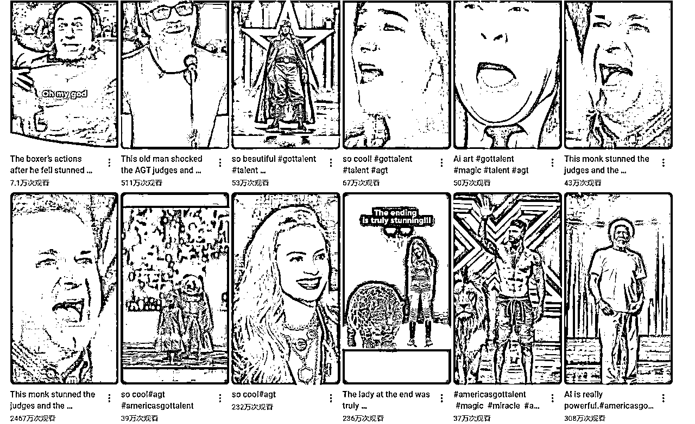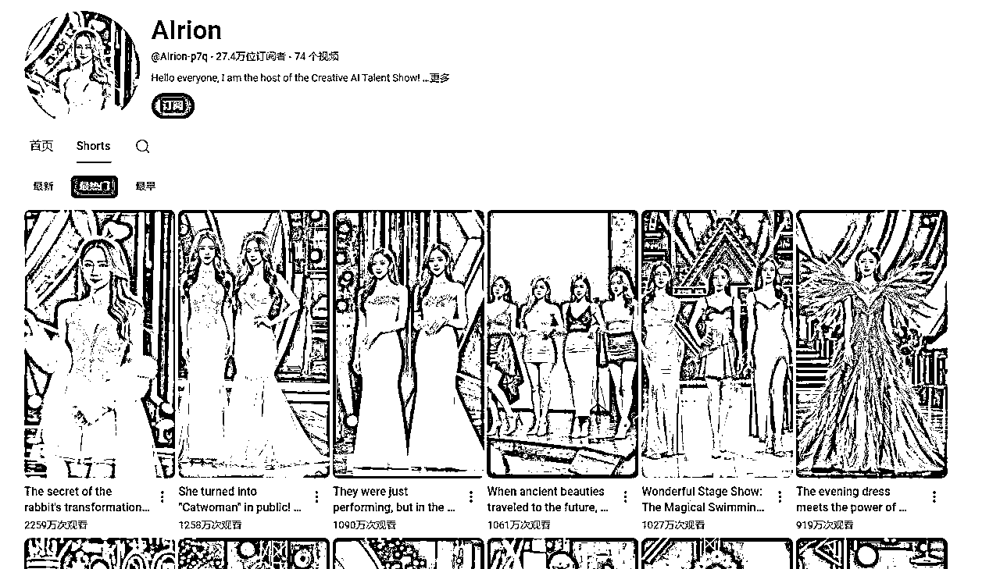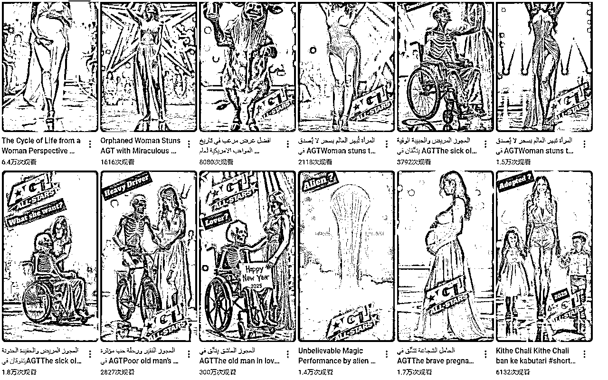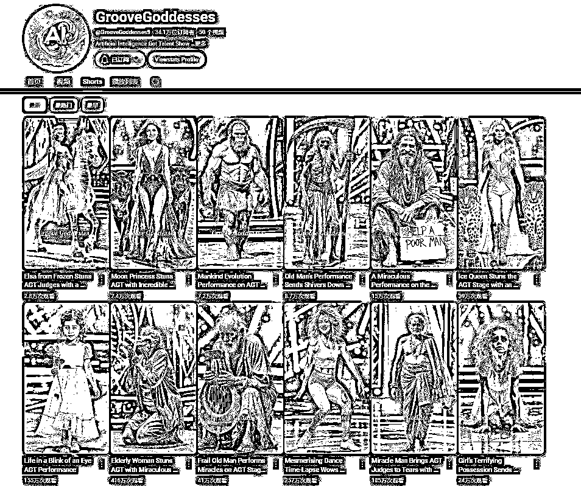

达人秀变身本身已是细分赛道，里面还能拆出更多小方向。这么多变身内容，本质不外乎美女与猎奇，猎奇优先级更高。最终拼的是创意和技术，且创意重于技术。

上述几类实现难度都不高，基本是文生图接图生视频，属于基础操作。若用上一些进阶提示词和工具，呈现效果会明显提升，具体见模块 2 的进阶操作讲解。


# 达人秀猎奇

典型频道：

走秀类：https://www.youtube.com/shorts/_hQJTL93Xlo 使用了儿童形象，不建议模仿，尽量避开儿童形象，而且这个号流量已在下滑。

纯猎奇：https://www.youtube.com/shorts/pcwgcrMfo3M 这个号现在没流量了，但该视频有 1 亿播放，属于非常离谱的异常值，所以列在这里。

https://youtube.com/shorts/pWobkCpo1Wc?si=7E49Dnd03WByLx-H 单条视频 1.4 亿播放。它与其他达人秀不同，靠恐怖 BGM 把观众的紧张和好奇拉满。

www.youtube.com/@AITalentStage 巨型肌肉男表演，画面冲击感很强。

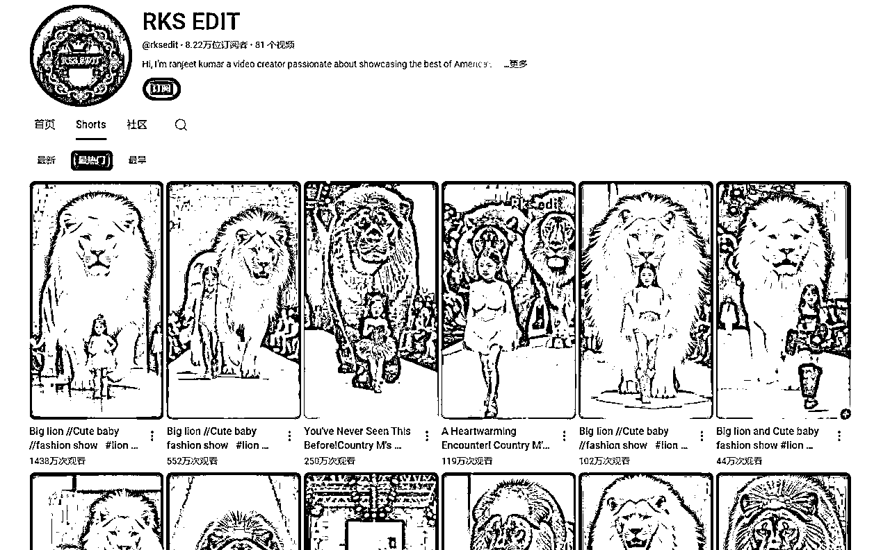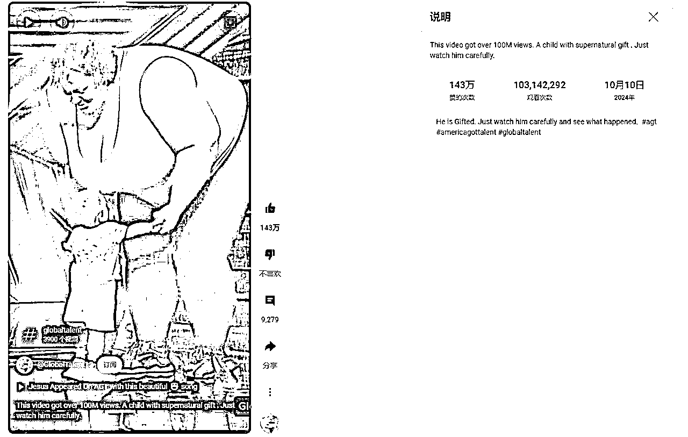

猎奇类的底层逻辑并不复杂：用现实里看不到的动物、怪物或极度夸张的人物造型，叠加达人秀评委剪辑来抓眼球。难点主要在创意和灵感，执行门槛不高，掌握达人秀变身的做法后迁移即可。


# 达人秀二创：借别人的脸，别踩版权的线

先摆几个样本账号，方便对走势有个直观判断。节目二创这条线，拿 AGT 举例：
- https://www.youtube.com/shorts/BKWSX99za7w （近三个月没更新）
- https://www.youtube.com/shorts/qUnMPoA8F2k （改做别的方向）

明星二创这条线：
- https://www.youtube.com/shorts/y-_4MRicZP8 （近来数据在往下走）

二创的本质，是在原有达人秀素材之上再叠一层流量池——被二创的那位自带受众。拿巨石强森当主角就是典型，等于白捡一份强森的关注度。

代价是版权。真要做，最好绕开那些对版权较真的对象，任天堂、迪士尼都属于高危区。更聪明的做法是盯着当下跑得最凶的爆款看它们在二创谁，照着对标的路径走——真要维权，人家也先挑肥的。

流程上和达人秀变身有区别。如果素材来自影视或综艺，取该节目最后一帧，作为图生视频的起始画面，让后面生成的片段顺着接下去；如果二创的是人物形象，如今大多模型都能直接渲染出辨识度很高的明星脸，直接生成可以，用即梦的智能画布把人合成进画面也行。


# 达人秀成长类：把反差拉满

样本账号：
- 穷到富的转身：https://www.youtube.com/@a77a/shorts （2025 年 2 月起开始发 Shorts，配乐偏惊悚，成绩相当猛，几乎每条都能跑起来）
- 年龄跨度型：https://www.youtube.com/shorts/jr_L2DoSkcg
- 体型改造型：https://youtube.com/@amasofusionai?si=_0wpHGY3klLi7HpR （肥胖症患者经达人秀舞台瘦身，前后落差极大，还带点擦边气息）

这条赛道的底层逻辑，是抓住现实里被讨论最多的话题，再用 AI 做出视觉上的巨大落差。前面举的例子之外，干瘪瘦弱变成肌肉壮汉、其貌不扬变得惊艳漂亮，都值得下场试水。

# AI 动物故事类：不开口也能跑

无配音方向：
- https://www.youtube.com/@Cat_Cartoonn/shorts
- https://www.youtube.com/@CATS-on-GPT/shorts
- https://www.youtube.com/@RabbitJourney99 （每周更一次，次次起飞；更离谱的是，这些视频一个月前还只是纯图片故事号，被人拿去转成视频复刻）
- https://www.youtube.com/@MrkPopPix （数据近期有回落迹象）
- https://www.youtube.com/@SKMGh6 （2025 年 2 月 18 日才开的号，12 条 Shorts 吸粉 126 万，播放最低那条也将近 400 万；打工狗题材，画面与场景逼真到吓人，故事却基本是旧爆款的翻版）

主题集中在“施以援手”“营救”“知恩图报”“逆天改命”这几类。做法并不复杂：让 GPT 一类的工具先出脚本与分镜，逐镜头出图，再让图动起来，最后丢进剪映串起来，配上音效就算完工。流程不难，就是磨人。

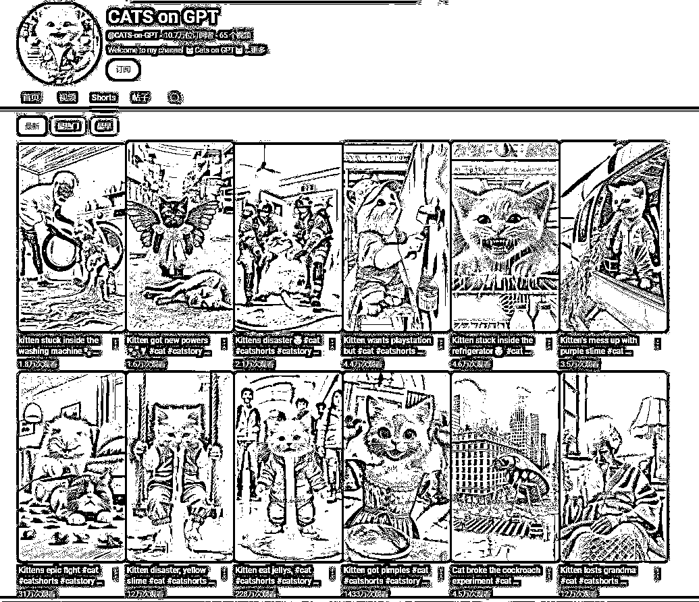


# 美女走秀类：冷热不均

美女军人走秀之外，早前火过的萌娃走秀、人与巨型动物同台走秀，如今数据已经塌了，此处不再列。

尺度偏大的：
- https://www.youtube.com/@ai.mvmnts/shorts
- https://youtube.com/shorts/EfOCLNUtV1Y?si=iFffX2uOKPJzdaDa
- https://youtube.com/@ai-imagining-2810?si=E2lVn7zByqjfH5EZ （三个月未更新）
- https://youtube.com/shorts/IHrC3yUWaDU?si=DJky-yraHaF2C9op （风格与上面几家不同，最近也缺大爆款，但历史上百万级作品不少，适合当作风格模板搬用）

尺度收敛的：
- https://www.youtube.com/@Akang_AI/shorts （数据在跌）

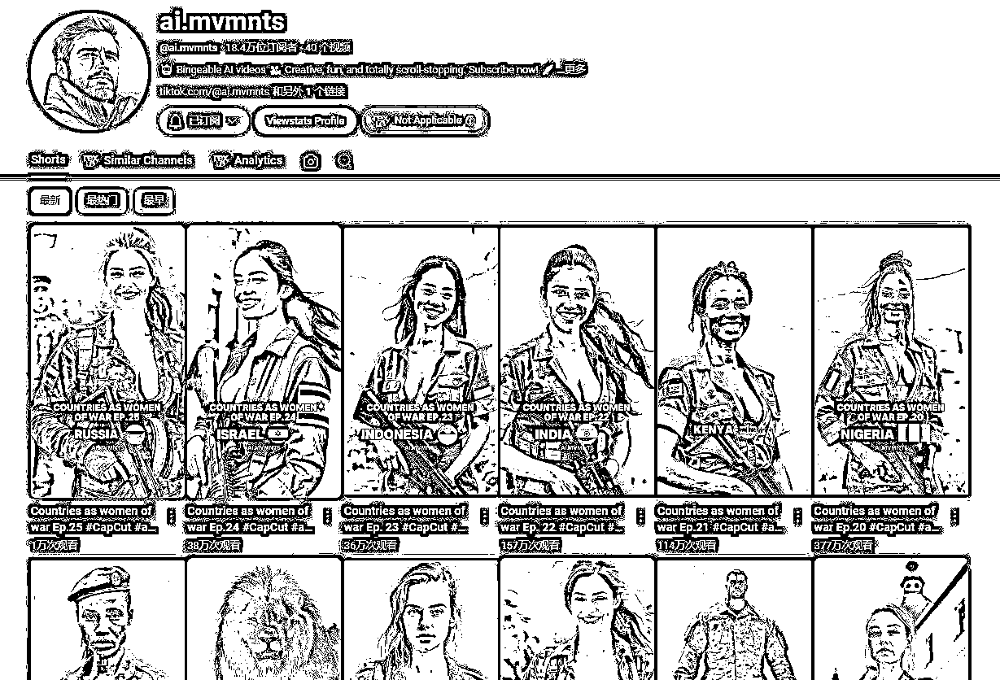

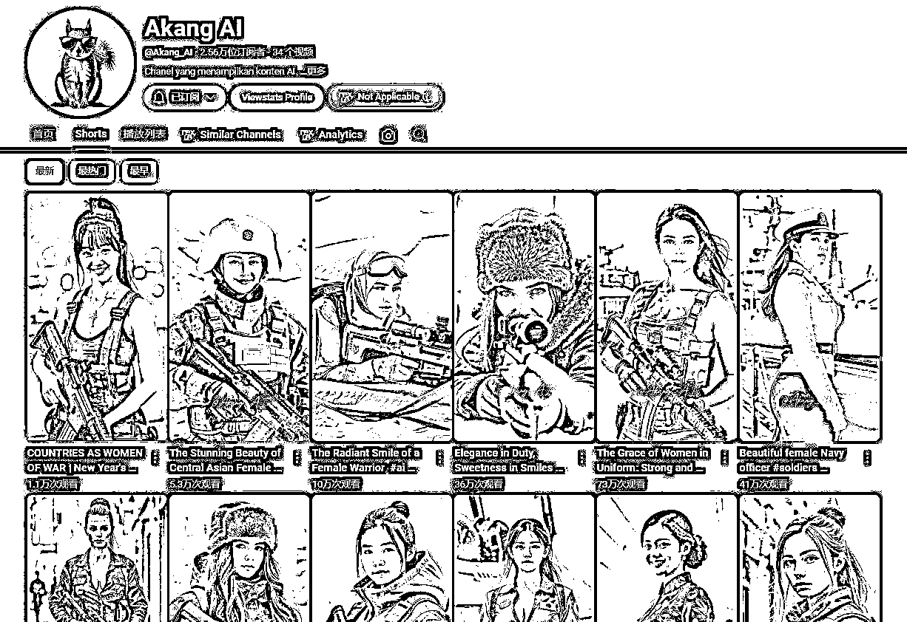

# 动物示警：好使，但要换招

故事套路固定：动物挡在路中央，前方随即出事，车辆因此躲过一劫，人回头向动物道谢。工艺不复杂，通常四个分镜、几张图，逐张图生视频再拼起来。这类内容在油管吃得开，在视频号更疯，不少同行靠复刻做到了千万级。不过眼下势头在退，需要转型，可以往下看密集恐惧与天使狗狗两条线，它们其实同根同源。
- （停更两个月）https://www.youtube.com/@HappyExplorerTV/shorts 几乎每一支都是爆款
- （停更一个月）https://www.youtube.com/@NautilusFantasy/shorts 从动物救动物切换到动物提醒人类，播放量立刻破百万

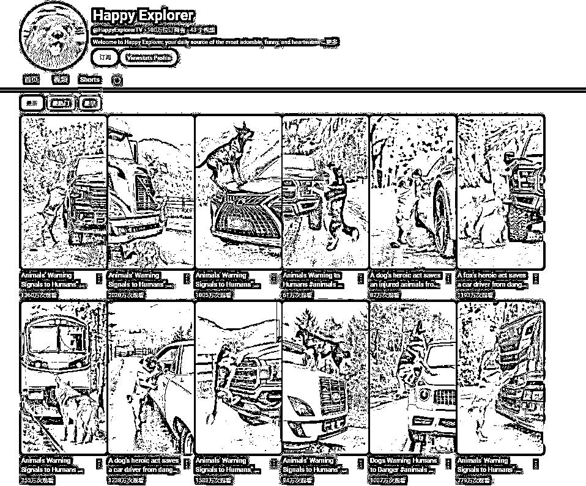


# 密集恐惧症+动物救援：把画面推到生理极限

- https://www.youtube.com/@PolarLifeMoments/shorts 1 月 21 日首条作品就拿到 1.2 亿播放，之后停更；救援画面恶心到极致，多看一眼都难受，同款账号一抓一大把。


走常规路线的动物救援数据倒是稳：
- www.youtube.com/@MysticChronicles007
- www.youtube.com/@Edu-mama


# 四、【实操 3/6】生产 Shorts 视频

💡 本章要点：
Shorts 是 YouTube 上最容易冲量的内容形态，AI 工具又把门槛压得很低，没有专业背景的人同样能做出像样的短视频。本章会拆开讲几套 AI 视频做法：
✅ AI 达人秀变身：从找爆点到动手做的完整路径
✅ AI 故事类视频：角色一致性的控制与分镜技巧
✅ AI 动物示警：提示词模板与剪辑思路
✅ 解说类内容：科普解说视频的高效产出方式
每条线都配了可用的工作流与工具清单，按自己的水平和偏好挑一条，就能快速开干。

💡 本章航线图
走完本章并动手实践，航线图的第二阶段就算完成：定赛道、做内容、发出去（约 7 天）
1. 挑一条赛道深入（Shorts 或长视频）（约 1 天）
2. 找到对标账号，做出第一条视频（约 1 天）

# 4.1 AI 类内容

# 4.1.1 AI 宝宝达人变身秀类内容实操步骤 @小芬

# 4.1.1.1 第一步：分析爆款视频的爆点

拆成两块看：人物爆点、画面爆点。所谓爆点，哪怕你不刻意研究，做久了也会有直觉，知道什么内容抓人、什么数据好看；同赛道多刷几条爆款，大致就能归纳出来。

# 4.1.1.1.1 人物爆点

不妨翻翻评论区。做过宝宝内容的会发现，底下大多是“好可爱”“adorable”“cute”这类留言。


可见“可爱”本身就是一大爆点，还能继续往下切：表情、动作、服装。带笑的比面无表情的更吃香；动作有意思，观众才不腻，看得才过瘾；衣服颜色跳一点，可爱感更足。

# 4.1.1.1.2 画面爆点

场景：舞台整体要亮
画质：清晰度越高越好
主体：平视机位最佳，人物落在画面中央

把这些结论记下来，再去找灵感迭代。

# 4.1.1.2 第二步：抓住异常值

想创新，但在还没跑出爆款之前，别凭感觉瞎改。先找到爆款，最好是近一个月千万级、底线也要百万级。视线别只钉在自己赛道：想在宝宝走秀上做创新，就先刷本赛道的同行，看数据走低时有没有人率先改了打法。如果出现，且效果不错，直接照它的形式迭代；如果没人动，就去看同类赛道——宝宝走秀多在舞台，后来慢慢挪到户外，那就盯同样以舞台为场景的达人秀表演赛道。跟着跑得最快的那位迭代。

一个复刻实例：按上面的路子先挖到同赛道爆款，形式是宝宝与萌宠同框出场，中段两者融合，完成宝宝变装，再接变装后的走秀。1.mp4【在线播放】。

提示词思路（带色块的部分都能自行替换）：主体描述为全身正面、街头风、皮肤很白的微胖两岁宝宝，卷发、微笑、涂红唇，穿红白碎花低领短裙，戴珍珠耳饰与银手链，可追加抱抱之类的动作；旁边一条大狗，处于行走中，强调视觉冲击与时尚感。画质参数走高质量、4K/8K、超精细、写实路线，配以鲜艳色彩、锐利对焦、棚拍光与华丽 T 台背景。参数栏设定竖屏 9:16、屏蔽性感相关词、模型 V6.1，并挂上个人化参数 ih7hzco。拆下来看，与达人秀的做法几乎一致：把美女换成婴儿，动作改成走秀与拥抱，稍微一改就能出片。视频生成部分的提示词可参照 4.1.4 AI 怪兽合成里的图生视频章节。

# 4.1.1.3 第三步：爆点的延伸

怎样在自己的赛道里借用同类赛道的爆款思路？这对没有灵感、不知道下一条拍什么的时候特别有用——从别人的赛道里把东西拿过来用。方法还是刷：做萌娃与萌宠融合，就多留意人与动物同框的内容。


参考的对标账号属于达人秀方向。原片三个段落：兔子登场，美女在兔子旁边起舞，美女抱起兔子，最后美女化身兔女郎装扮。参考视频在这里。美女与猫.mp4【在线播放】

片中有个动作——动物跃起、美女一把抱住——看着特别有惊喜感，我就把它挪进了自己的片子。

拿第二步的模板改一改：全身正面、街头风，微胖的两岁美国宝宝，皮肤白、卷发、微笑、红唇，穿粉色亮片吊带裙，配珍珠耳饰与银手链，双手抱着一只刺猬，处于行走状态，背景换成 America's Got Talent 舞台，依旧强调视觉冲击与时尚感；画质参数同上；竖屏 9:16、屏蔽性感词、模型 V6.1、个人化参数 ih7hzco。

原本设想是婴儿双手抱动物，提示词里写的是“双手各抱一只刺猬”的英文描述，但 MJ 的理解显然跑偏，出图时抽到一张左右手各抱一只小动物的图。看着实在可爱，就直接用了，没再纠结原定动作。（抽卡有时会给你意外之喜，只要够惊艳又能踩中爆点，就果断收下。）


融合之后的那张图，我没继续做宝宝变装，而是借了 Gary 教练分享的达人秀思路，让穿着衣服的动物跳起舞来。于是衔接画面从“宝宝换装走秀”直接改成“动物跳舞”，舞台感更强；又想着动物越萌越吸引人，就把宝宝那股可爱劲儿挪到动物身上。

提示词：全身正面、街头风，一只微胖的两岁刺猬，处于行走中，背景为 America's Got Talent 舞台，强调视觉冲击与时尚感；画质参数同上；竖屏 9:16、屏蔽性感词、模型 V6.1、个人化参数 ih7hzco。


成片：3.mp4【在线播放】

有一点要说明：迭代时只要数据优于旧模式，就照新模式发，因为它很可能就是下一个爆款。这套思路我叫它“控制变量法”——每轮只改一到两处，其余照旧；没跑出好成绩之前，继续按原模式产出。看下面的数据：12 月 31 日发布的那条，一周内播放量就超过了旧模式的作品，之后我便全面切换到新形式。


能改的地方还很多：把达人秀变身玩出的新花样挪到宝宝达人秀上；把过去宝宝走秀里跑火的服装搬到宝宝达人秀里，等等。回头看这两轮迭代，爆点其实都留着——宝宝够可爱、舞台场景、服装颜色够跳、动物够萌，人物和动物的表情都是笑的。

# 4.1.1.4 宝宝类赛道被判面向儿童可见的问题

做宝宝内容，很常见的坑是被判定为“仅面向儿童可见”。


一旦被打上这个标签，流量当场就断。

# 4.1.1.4.1 解决方案

💡 做法很直接：把所有带 baby 的标签清掉。发布时如果挂过这类标签，统统删掉。用这个办法至今，没再被判过儿童向。

# 4.1.1.4.2 申诉模板参考

此前有视频被判儿童可见，我就想验证一下：申诉成功之后平台会不会恢复推流。为了测试，先把旧视频上带 baby 的标签全部去掉，然后提交申诉。先试了一条，通过；再试一条，也通过。于是想着把剩下那几条一次性全部申诉，结果被驳回。所以如果你也被判了、想申诉，建议一天一条慢慢来——申诉机会只有一次。

看这张流量图：那条直线就是被判期间，数据一点不动；申诉通过后，曲线重新抬起来，也说明申诉成功确实会恢复推流。申诉文案可以直接抄：

💡 Hello, this is a magic show video, not made for kids. Please review it again, thank you!

内容来源：YouTube Shorts 复盘——宝宝达人秀、达人秀跳舞赛道成功开通 YPP 的经验分享。

# 4.1.2 AI 故事 @土豆君

# 4.1.2.1 第一步：对标案例参考

YouTube 频道：Rabbit's Quest

九月第一周刷到这个号时，它上线才满一季，单条作品动辄百万级曝光，叙事套路却相当朴素。第三方平台给出的广告分成估算不必太当真，筛选标准其实很直接：若一个号最近一季持续跑出高播放作品，就具备拆解和试做的价值。


它做的是六十秒左右的 Shorts，以静帧幻灯片配无声表演，讲兔子主角闯关后伸手帮别的生灵。模板感明显：开场先让某只小动物陷入险境，接着安排它与兔子碰面，共同进食、嬉戏，冲突段解决危机，收束到友谊主题。从留言语气可判断受众偏幼龄，也可顺着头像进对方主页进一步确认；孩子天然对动物叙事买账，讨喜的宠物造型负责抓眼，积极健康的价值观负责留住家长。


九月十日我动手试做，挑的是这条：https://www.YouTube.com/shorts/FSagPjcmFFg 。做法是先让 ChatGPT 写脚本，再借内置绘图出每格画面，最后在剪映里串起来。


# 4.1.2.2 第二步：分镜化脚本

先让 ChatGPT 产出五则儿童绘本式故事，主角是一只讨喜小猫，任务是帮助其他物种。结构上要包含：因某只动物受困而碰面；脱险后呈现共同生活场景，比如回窝吃饭、睡觉；冲突段安排自然风险，包含灾害、天敌等，用来凸显小猫为友谊挺身而出；收尾落在两个生命的情谊上。

注意事项也写清楚：受困情节最好一眼能从画面看懂，别依赖氛围和声响交代；友谊可用两个生命靠在一起表达；文字描述要方便转成画面，动作不妨夸张；剧情得让孩子轻松理解，并能被情谊打动。


最终采用第二则：小猫搭救小松鼠。随后让 ChatGPT 按这则故事拆出二十五个镜头，并为每格写出可直接喂给 DALL-E 的中文画面提示；允许调整情节，也鼓励把动作画得更夸张。


这二十五个镜头就是后续出图的依据。


# 4.1.2.3 第三步：画面生成

绘图工具选的是 DALL-E3。Midjourney、SD 我也试过，但前者对语义的把握最强，其他工具很难比。它不要求另写一套提示词，把想画的东西讲清楚就能出图。这也是我先拆二十五格的原因：脚本能直接转成画面。

入口在网页版 ChatGPT，进“探索 GPTs”找 DALL-E3；也可直接打开：https://chatgpt.com/g/g-2fkFE8rbu-dall-e 。

角色统一怎么处理？我原先也犯难，后来读到卡兹克的文章，提到 OpenAI 绘图工具有个 gen_id，可借它稳住同一角色。但实操中，生成分镜时 gen_id 并非始终有效，偶尔会失灵，关键仍是把角色外观拉开颜色差异。比如两只猫同框，就用橘猫配狸花猫，辨识度自然上来。

所以我的顺序是：先做外观区分，再让 gen_id 打辅助。要注意，gen_id 只在同一个对话窗口内生效，换窗口就断；若走 DALL-E3 API 绘图，也没法靠它锁定角色，因为接口每次对话都是一次性数据。因此我没写代码调接口，而是直接用网页端。

在 GPT 里可配合这类提示词：核心任务锁定角色统一，下一张必须沿用上一张的提示与 gen_id，让同一角色换表情、动作、服装和场景；达成给小费，明白回“明白”。提示词可参考：https://gitee.com/tudoujunha/rpa-gpt/blob/master/prompt_genid.txt 。

当然，像当前场景里两个主体差异较大，若统一性要求没那么高，直接用国内中转的 DALL-E3 API 出图也行。


以后哪个角色要返场，把对应 gen_id 报给它即可。


# 4.1.2.4 第四步：成片与模板复用

把生成的静帧拖进剪映，加缓慢推近效果；想更接近原片，再补声效和视觉特效。模板跑通一次后，下回定位草稿引用的原图目录，换掉图片再打开工程，就能套用整套剪辑参数，效率高不少。

配乐方面，用手机端 YouTube 的识别功能去搜对标片的曲名，再用下载工具取回；通常只需下一个视频，这个站点覆盖面很广：https://tiqu.cc/ 。


不过这次走的是原创流程，并非直接重绘，所以只跟对标片在叙事上相近，其余部分都不同，也没加声音做精修。它只是初版，提升空间还很大，脚本和剪辑特效都值得继续打磨；放到现在，还可以把 AI 视频接进来。


# 4.1.2.5 可参考的垂直号

Cute Animals Story：https://wx.zsxq.com/group/1824528822/topic/1525442481188482 。七月二十三日发出首条，同样做动物叙事，先以 Shorts 起量，再转长片开通 YPP 变现。短片涨粉更快，而长片攒够时长开 YPP 更省力。


Meow Story：https://www.YouTube.com/@MeowStory1234 。该频道八月二十一日才注册，仍用幻灯片讲故事，没做 AI 视频，已积累 10.9 万粉。


Cat's Wonderland：https://www.YouTube.com/@CatsWonderland289 。2024 年七月二十三日注册，做的是 AI 生成的猫猫短片。


内容来源：《【生财技能】AI 动物故事视频复刻与批量生产》。

# 4.1.3 陪跑复盘：@Nana @六只猫

# 4.1.3.1 对标：只盯一个号

经验：同一阶段只研究一个频道。

这是后来参加 YouTube 实战陪跑时我提的第一个问题：该对标单频道爆款，还是多频道爆款？手头对标不少，爆款也拿来复刻过，流量有好有坏，自己频道却迟迟不爆，问题出在哪？


经方波妮、Gary 曹淦两位教练点拨，我才明白：同一时期只学一个频道。能持续出爆款的号，背后一定有稳定受众；频道受众各不相同，多头对标会让 YouTube 算法难以快速判断该把内容推给谁，首轮大推流自然等不到。我的频道长期不爆，这是重要败因。

按发布时间降序看，前期（最下面）内容五花八门，孕猫、亲子、原创僵尸、科幻都做过，每次都卡在“今天复刻什么”。近期换成“甲动物救乙动物—温馨共处—甲遇险—乙回馈”的公式，数据稳了不少，改编也顺手。


# 4.1.3.2 制作：少用图生图

经验：图生图别当主流程，偶尔拿来补效率。

继续聊内容工作流的搭建与提效。做过 AI 猫咪故事赛道的圈友知道，这类活琐碎复杂，一旦涉及微创新和改编，耗时更长。起初一天做一条很正常；熟练后算上平台生成速度和反复抽卡，也得三四个小时一条，我一直想提效。后来灵机一动改了流程，结果收到 YouTube 机审自动移除；角色虽做了改编，复现程度还是偏高。有些搬运爆款确实也存在，但风险摆在那，谨慎为上。

旧链路：截取对标关键帧 → 图生脚本（可改编）→ 文生图 → 图生视频 → 剪辑。新链路：截取关键帧 → 图生图 → 图生视频 → 剪辑。

不过图生图是很好的提效补充。比如手里有爆款场景，可把狗直接换浣熊，做主体替换；还能借原图长出新场景：挑一个关键帧，在旁边加漂亮女生看着浣熊，得到一张图，再图生视频让女生与浣熊互动，救援末段就完成了，只需一句想象。再如蜂窝原图，文生图抽卡很难到位，图生图更容易接近，适合补效率，但别全片都靠它。


ready-2a28f9c56ad8.mp4【在线播放】


关于角色统一：ChatGPT 里的 DALL-E3 相比 Midjourney、ComfyUI，对提示词门槛更低，新手更容易上手。想让同一角色稳定出现，一是把提示词写细，二是用 Gen_id 控制；若多次抽卡仍不理想，上传原图垫图，让 ChatGPT 参照重绘，能省不少时间。


# 4.1.3.3 发布：多平台铺开

经验：国内多平台同步铺，内容用得更充分。

比如猫、猴子、老鼠那条 5.1 万作品，以回馈恩情为母题原创，同时让抖音号、快手号冲成百万爆款，小红书破千粉，连 AI 猫咪故事一直没流量的视频号也拿到 22 万播放，评论区讨论热烈。片子引发对猴子的声讨和对老鼠的夸奖，老鼠造型也偏可爱，容易惹人怜惜。


分析原因：评论多是爆款的结果，同时也藏着爆款的引线，归根结底是能触发共鸣的情感底色。可以去翻对标爆款的高赞留言，摸清可复刻的要素。YouTube 的 Meow 频道就用东亚男孩、瘦橘猫、可爱拯救者搭出动物感恩故事；东亚男孩扮演恶的一方，人类的坏、不同动物的可爱、猫的悲惨，都是能引发讨论的话题。它的评论量比其他号高出数十倍。


视频号数据暴涨。去年十二月十八日我开始发布，前期做 AI 猫咪故事，在抖音、快手、小红书表现尚可，视频号却只有首条爆款开通原创后吃到收益（冥冥天注定，后面大爆直接受益），随后流量归零，粉丝停在 100+。进入实战陪跑后，除了已做一个多月的猫咪故事频道，教练团也分享了新赛道玩法，我又找了个短平快的动物救援方向，开启第二个号。没想到这个赛道带来第一笔收入，首条就爆，收获 9.7 万含金量较高的中老年粉、2700+ 收入、4282 万播放，且长尾仍在。


分析原因：结合粉丝画像看，主要有几点。该赛道受众以中老年为主，这条片子做得很真，他们起初没意识到是算法合成，于是“万物皆有灵”迅速在评论区蔓延。我当天就改了账号标签和头像（原来是猫咪设计），后续内容也开始在评论区引导灵性话题。


这也触发了东三省“狐仙”民俗。除了“万物皆有灵”，留言区围绕狐仙展开，有人连狐狸和狗都分不清，总体都归到动物成仙，形成“动物拦路必有缘故”的共识。粉丝大量来自东北，也反向验证了这一点。


国内并非我的主阵地，所以没成体系地复刻爆款和做运营规划，但也试了几手。正值蛇年春节，蛇在东北对应柳仙，我立刻做了一条蛇救援，发出不到一小时突破 20 万+，比当时的狐仙还快。可惜不久视频号判违规，没能再复现大爆款。因为这个教训，我没再做黄鼠狼，改成浣熊；又因操作不当，同一条片子发两次且声明原创，视频号没判违规，两条数据都比其他内容好，说明东北仙灵文化还有挖掘空间。意外的是，金蛇我也发到 YouTube，竟成了频道里流量最高的一条，有 19k。


几条经验总结：这类内容受众基本是 50 岁以上父母辈，他们觉察不到算法生产，留言都在感慨“万物皆有灵”。因为对平台不熟，起初没声明 AI 创作，导致作品在 1000 万+时被下架，后经申诉并声明 AI 才重新上架，但几天后平台停止推荐。两个关键点：以假乱真的内容务必声明 AI 创作，否则会判违规，次数多了账号会被限推。


另外，动物救援的受众和 AI 猫咪故事不同，老年人讨论多，所以收入高（视频号主要看评论量），其他平台未必合适。金蛇救援我同时发到抖音、快手，抖音上量慢，快手判违规，我就把内容隐藏，不再试了。视频号宽容度更高，这种短平快营销内容放在那里更合适。

# 4.1.4 AI 融合怪兽：@Gary @土豆君

# 4.1.4.1 对标：融合怪账号

AI 短视频里有一类融合怪，用 AI 视频把两三种动物合成一个效果，比如：https://www.YouTube.com/hashtag/fusion/shorts 。


要做融合怪，可参考这些对标号，大致分几类（仅举例，具体按自身情况选）：【第一类】动物融合，纯图片，不用 AI 生成视频：https://www.YouTube.com/@HeshanMalinda-nf6ws 。


【第二类】动物融合：AI 视频里怪物与生物逐渐合体的完整生成过程，可参考链接：https://www.YouTube.com/shorts/XU0yhFEnzrQ


【第三类】人与动物融合：https://www.YouTube.com/@AnimolFacts/featured


【第四类】人与动物融合的达人秀版本：可把达人秀的表演片段与融合过程混剪在一起，参考频道：https://www.YouTube.com/@TalentSnap

这里着重说明两个视频案例：

左侧的参考视频仅用静态图就能完成，制作起来相对省事，用 Dalle3 或 Midjourney 都可以直接产出同类画面。

右侧的视频则添加了从人变动物或动物变人的过渡动画，这类效果必须借助首尾帧视频生成技术来实现。

防失联+MM188166M（李李）长期更新

https://www.YouTube.com/shorts/-alVWmtIRYM

防失联+MM188166M（李李）长期更新

https://www.YouTube.com/shorts/2YmX-9auHUw

# 4.1.4.2 第一步：脚本设计

变身对象：打算用哪种动物作为变身目标

动作设计：人物要做什么动作，例如旋转、跳跃、起舞等

场景安排：视频在哪里拍摄或构建，比如演播厅、外景场地等

服装造型：人物穿什么款式和颜色的衣物

这个阶段完全可以让 KIMI、GPT 这类 AI 辅助完成，把上面几个要素都提供给 AI，让 AI 帮你做各种组合尝试，能省下不少脑力。


# 4.1.4.3 第二步：文生图

总共需要准备四张图，分别对应四个关键帧。除了动作和人物外貌相关的提示词要更换之外，背景等信息可以保持不变。下面以我视频号里那条播放量过千万的片子为例说明，这条视频在各平台表现都还可以，具有一定的普适参考价值。


1.

人物主体和动物主体都出现，动作随意即可

示例：full body，facing the camera，a breathtakingly beautiful 20-year-old woman in a very delegant white formal dress dress dance next to a big seal on brightly thick ice，barefoot，realistic，sunshine，bright，Slip dresses，ice and snow，long，blurred background，include as much detail as possible， ultra-high image quality， 4K，shot on canon a7c2 --no sexy --ar 9:16 --v 6.1


2.

人物和动物依旧共同出镜，动作不必和上一张完全一致，但最好保持相似或有一定连贯性，不然之后生成视频时效果容易拉胯

示例：同上，在 discord 里可以直接点相应按钮生成风格近似的图，按 V 几就是基于第几张图来派生


3.

人物和动物最好拥抱或靠得非常近，要是有明显距离，视频生成阶段会特别吃力

示例：full body，facing the camera，a breathtakingly beautiful 20-year-old woman in a very delegant white formal dress dress hugging a big seal on brightly thick ice，barefoot，realistic，sunshine，bright，Slip dresses，ice and snow，long，blurred background，include as much detail as possible， ultra-high image quality， 4K，shot on canon a7c2 --v 6.1 --no sexy --ar 9:16


4.

人和动物已经完成融合，此时主体最好保持站立姿态，方便后续生成视频

示例：垫图链接 full body，facing the camera，a big tall seal in an elegant white dress stading on brightly thick ice，barefoot，realistic，sunshine，bright，Slip dresses，ice and snow，long，blurred background，include as much detail as possible， ultra-high image quality， 4K，shot on canon a7c2 --no sexy --ar 9:16 --v 6.1 --personalize hlfxj7l


如果整体效果还不错，但局部细节出了问题，比如手指扭曲、肢体结构混乱，只需点击局部重绘按钮，在弹出窗口里框选想修改的区域重新生成就行。


四张关键帧图片全部完成后，就进入图生视频环节。

# 4.1.4.4 第三步：图生视频

在 Runway AI 里操作，左侧上传图片、填写提示词，右侧实时查看生成结果。整个视频一共分四段制作。


关键帧 1→关键帧 2：a beauty 【dance】 （on tiptoes） next to a 【XXX】，（bare feet），camera rolate，dynamic motion

用（）括起来的是根据画面实际状态补充的提示词，比如“踮着脚”“赤脚”这类；用【】括起来的是动作和动物名称，按你的实际内容替换；加粗的部分用来控制镜头整体效果，表示镜头旋转和动态感，这样能让出图更稳定；如果遇到好的动作种子，记得保存下来，下次还能继续用。


1.

关键帧 2→关键帧 3：如果动作有变化，就把第一段里的动作提示词替换成新动作

2.

关键帧 3→关键帧 4：a beauty fuse with the XXX ，camera rolate to the right，dynamic motion。如果动作变化特别大，就额外补充动作描述；变化不大就直接把原动作改成 fuse（融合）就行

3.

关键帧 4→跳舞：这段只需上传关键帧 4 这一张图，写下 a XXX dance in a dress，camera follow，dynamic motion 这类的简单描述就够了

把这套流程跑熟之后，提示词完全可以自己现写，多生成几次，筛出四个最满意的结果就行。

另外也可以用即梦 AI 或可灵 AI 的「首尾帧视频生成」功能来完成同样的效果。

目前即梦 AI 免费且不用排队，更推荐大家优先尝试。

即梦 AI：

国内版：https://jimeng.jianying.com/

海外版（暂不推荐，功能还没补齐）：https://dreamina.capcut.com/

可灵 AI：

国内版：https://klingai.kuaishou.com/

海外版：https://klingai.com/

左边是即梦 AI（视频模型 1.2）跑出来的，右边是可灵 AI 生成的：


实际效果：

具体的操作流程如下：

1.

先弄出三张图片

先做一张美女和白马同框的图

画面是舞台背景，一位美女和一匹白马并排行走

即梦 AI 会一次给四张候选图，挑一张合适的就行。我当时用了第二张，脸型是欧美人风格。防失联+MM188166M（李李）长期更新


接着生成融合完成后的最终画面，我同样选中了第二张。

舞台之上，一位拥有马耳朵的欧美风格美女，身着一袭白色礼服，金发披散下来


融合前的图片也要生成一次，这时我加了参考图来辅助。

舞台中央，白马和穿着白色礼服的欧美美女紧紧挨在一起。


2.

接着做三段视频

先做融合过程那段视频：


再做融合前的那段视频：


最后做融合完成后的视频：


# 4.1.4.5 第四步：剪辑

对标视频里的剪辑画面可以继续保留，只用剪映的基础功能就能搞定。重点是要配合音乐节奏卡点来切换画面，整个视频尽量控制在 18 秒以内。

像那些人物惊讶的反应镜头，既可以用 AI 生成，也可以到其他视频里截取，我当时就直接沿用了原视频里的画面。AI 生成的视频替换进去，再配上相同的音乐，这条片子就算完成了。


内容来源：《【生财技能】AI Shorts 两类视频复刻教程（怪物融合+动物跳舞）》、《24 天 7w 粉开通 YPP 收益 108 刀，我的 AI 达人秀变身千万播放视频制作流分享》


# 4.1.5 AI 动物示警 @逸凡风顺

# 4.1.5.1 第一步：对标账号分析

参考对标 1：快乐探险家，频道地址：www.youtube.com/@HappyExplorerTV，视频整体质感很好，画面逼真，色彩也很舒服，制作水平比较精细。


参考对标 2：Nautilus Fantasy 地址：www.youtube.com/@NautilusFantasy，这一家在原模板的基础上增加了示警类的内容，制作门槛并没有变高。频道里也做动物救援以及其他类型的视频。


找对标账号的思路：先关注一批同类视频的频道，给它们点点赞，再回到首页刷新几次，平台就会在推荐流里不断推送类似内容。这样就能持续找到新对标。另外也可以借助这类视频标题里的标签去搜索发现更多同赛道账号。

# 4.1.5.2 第二步：分镜头拆解思路

先把镜头结构分好。拿对标账号示例 1 来拆，一条动物示警视频基本上由 5 到 6 个分镜头组成：动物拦下车子+动物和车辆的互动（用中景，镜头放在车外）+动物与车的互动（用近景特写，镜头放在车内朝车外拍）+灾难镜头（画面主体可以是车也可以是动物，二选一）+动物特写镜头（根据情况选用）+温馨收尾。整套组合剪下来，视频时长一般能稳稳落在 22 到 26 秒之间。

这里建议大家最好不要把对标视频的分镜头完完全全复制一遍。在动物和车互动的部分，可以适当换一换提示词里的镜头角度，或者调整双方互动的位置，做出差异化。不然太同质化，很容易出现播放量卡在万级上不去的情况。

# 4.1.5.3 第三步：AI 工具选择

老话说得好，工欲善其事，必先利其器。想做好视频，趁手的工具肯定少不了。下面把自己的实际使用体验整理一下，供大家参考。

# 4.1.5.3.1 提示词部分

提示词优化 AI 工具：GPT4、deepseek。

写提示词的思路：先对对标视频做分镜头分析和拆解，然后按照自己的创作方向，整理出自己的分镜头脚本。接着把分镜头图上传给 GPT，让它推出对应的提示词。

这里说明一下为什么不用 mj、sd 来反推提示词：一是 mj、sd 我本身用得不熟，二是它们反推出来的提示词经常逻辑混乱、错误比较多。GPT 能识别图片内容，用它来推提示词准确率相对更高。而 deepseek 之所以不推，是因为它目前只能认出图片中的文字，没法对整张图做全面的识别与推理。

选 GPT 还有个原因，是想搞清楚这类图片提示词的结构。提示词排列顺序对权重有明显影响，所以让 GPT 输出时用中英文对照的形式发给你，之后改起来也方便。

举个例子，我想做一张狗趴在窗户边的分镜图，自己反复写都写不出理想效果。后来把我的想法和对标图一起丢给 GPT，最后终于得到了满意的结果。


再比如这个，我想做的分镜头是从侧面拍摄，车头栽进路面上的一个坑里，但对标账号的视频里根本没有这个镜头。于是我就找了一张侧面角度的网图，拿来让 GPT 反推提示词。


不过话说回来，GPT 给的提示词也不是每次都一击即中。这时候就可以请 deepseek 出马了。其实用 GPT 也能改，只是最近 deepseek 热度高、又没门槛，把 GPT 出来的提示词扔给 deepseek，再把你生成图之后遇到的问题一并告诉它，让它帮你调整优化。这样一轮修正下来，想要的画面基本都能实现。


但到这一步还没完。如果只是简单复制粘贴现成提示词，那你以后每天都得重复这套操作。只有把这些内容整理成自己的模板，才能真正省时省力。这一点我会在后面部分专门展开说明。

# 4.1.5.3.2 文生图绘画工具选择

文生图工具：midjourney，stable diffusion

这两个工具大家想必比我这新手用得更熟练，具体操作就不多啰嗦了。主要讲讲我在图片色彩跟真实感两方面的体会：就我用下来的感受而言，sd 的出图效果比 mj 更胜一筹。下面把我用的模型和心得分享给大家。

stable diffusion：

如果电脑配置不太够，可以用云电脑、在线平台等方案替代。我这里用 libulibu 在线端举例，地址 https://www.liblib.art/sd

大模型：绘梦写实摄影大模型、F.1 基础模型、星流 star-alpha 大模型（都可以在模型广场直接搜索并收藏使用）


lora 模型：纪实摄影 F.1、蔚蓝 blue 高清动物摄影大模型（同样可以在模型广场直接搜藏）。

midjourney

mj 一般选 v6.1 模型，但偶尔会出现图片过于锐利、色彩饱和度过高、甚至画面发黑的感觉。如果想要的色彩效果总出不来，可以先让 sd 生成一张图，再用垫图的方式让 mj 参考 sd 图的风格，也就是 --sref+图片链接。这样出来的图片观感会协调不少。

无论用 sd 还是 mj，做文生图时都要优先看色彩度和真实感，其次再去纠结画面里的形变、主体站位这些细节。

# 4.1.5.3.3 图生视频工具

即梦（先跳过：提示词稍微复杂一些，它的响应就不太精准；免费用户只能下载低画质版本）

runway（我自己没太用明白，总抽不出符合预期的视频，可能是我个人操作问题）

海螺（效果不输可灵，有时候甚至更好，但缺点也非常明显：画面容易被“动画化”）

可灵 AI（作为主要创作工具使用，基本一遍就能过，唯一不足是免费额度不够用）

智谱清言（动作幅度不大时效果比较理想，一旦动作幅度大了就很容易变形，而且 AI 痕迹会显得很重）

# 4.1.5.4 第四步：视频制作完整流程

# 4.1.5.4.1 文生图

先把对标分镜头图片反推成提示词，或者把提示词模板粘贴到翻译软件里，对主体、环境等内容加以修改，最终得到所有分镜头的提示词。

示例：

分镜一：

分镜二：

分镜三：

分镜四：

分镜五：

随后用绘画软件逐一生图。我一般使用 stable diffusion，具体模型和 lora 的搭配见上面的文生图工具部分。最终得到各分镜图，其中互动部分的镜头可以根据需要挑更合适的图备用。


# 4.1.5.4.2 图生视频

接着把生成好的分镜头图放到海螺 AI 或可灵 AI 里，生成对应的动态片段。图生视频用的提示词其实也是固定模板，但要注意提示词的先后顺序——权重不同，最终画面的运动状态也会跟着变化，这一点相当关键。

可灵 AI 我选的是标准模式，比高品质模式更省钱。


# 4.1.5.4.3 剪辑配音

和达人秀类视频不太一样：达人秀可能只要配上一首 BGM，整个氛围就上来了；但动物示警视频要根据情节进度，一段一段严格匹配相应的音效。

把做好的分镜头片段按顺序导入剪映，全选所有片段，先把速度调到 1.2 倍，这样能让整条视频的节奏更紧凑。


然后逐段检查每一个片段。有些片段在开头第一秒会有静止卡顿，要把这种影响观感的片段剪掉。接着就可以开始做音效和配音的匹配了。

音效可以直接在剪映自带素材库里搭配。

在搜索框里输入你需要的音效关键词，就能找到合适的素材。


音效不必照搬清单，按镜头气氛自由拼配即可。常用选择有：自然环境底噪、犬吠、狗狗着急或委屈的叫声、舔舐声、拉布拉多玩闹声、汽车鸣笛、刹车声、发动机怠速声、海浪拍岸声。颜色也能随情绪调整，最后以 4K 60 帧导出成片。

# 4.1.5.5 提示词模板化：少抽卡，多出片

# 4.1.5.5.1 拆开提示词，搭好模板

想提高出图效率、减少反复抽卡，我会先让 GPT 和 DeepSeek 帮忙优化分镜提示词，再拆成四块：画面主体、场景环境、摄像机位、成片质量。拿拉布拉多这组举例：

画面主体是一只米白毛色的拉布拉多，背向镜头站在乡野道路，外形俊朗；场景中一辆橘黄色轿车朝镜头方向驶来，前灯亮着且清楚可见；道路右侧是岩壁，左侧为草地和苔藓；天空发蓝，正值夏季，细雨飘落。机位取人眼高度、中景，焦点落在狗背与车头；自然光增强真实感，整体走电影感构图、写实风格、胶片质感与 4K 画质。

我习惯把主体和外貌标成核心色块，环境单独一色，其余归入机位与画质。关键词可以用 rear-facing、eye-level medium shot、movie-like framing、film look、4K 这类表达固定住。

前期建议中英混写。全英文容易让我自己分不清模块；翻译软件对镜头术语也不稳定，同一个词每次译法不同，靠特定词触发的效果就会跑偏。把镜头术语直接用英文钉住，能避开翻译误差。混写后无效抽卡明显减少，我大多一次过，偶尔有变形；和纯中文提示词相比，抽卡次数降了很多。

再看车内向外看的镜头：机位在车厢内，车窗外站着一只德国牧羊犬，身体贴近玻璃，正朝车内看；玻璃通透，带一点淡反光；窗外是温馨农场。焦点落在犬脸，背景轻微虚化，写实细节、胶片感、4K。


后续分镜同样可以固化成模板：只替换主体和环境的中文词，机位与画质部分保持不动。这样出图更快，抽卡更少。

分镜1：动物拦车

# 💡

[动物] 背向镜头，站在乡野道路；[外貌特征] 要保证角色一致。前方一辆 [车辆] 朝镜头驶来，车头灯亮起且清晰。右侧放入 [环境]，左侧放入 [环境2]，给后续灾难镜头留对照。用 [天气描述] 统一色调和构图。机位：人眼高度、中景，焦点在动物背部与车辆前脸；自然光、真实细节、电影感构图、胶片摄影、4K。

分镜1示例结果：白色驼鹿背对镜头，站在乡野公路；浅色毛皮、鹿角宽大，气场很强。一辆墨绿色轿车迎面驶来，前灯亮着；右侧是高岩壁，左侧为草地和苔藓；蓝天、夏季、细雨。机位与人眼齐平，中景，焦点落在鹿背与车头；自然光强化细节，电影感构图、写实风格、胶片摄影、4K。

分镜2、3：动物异常举动

# 💡

机位放在车内，车窗外是 [动物]；写明外貌，如白色毛皮、大鹿角、气势足。动物贴近玻璃，朝车内看；玻璃通透，有淡淡反光。窗外取 [其中一侧环境]，天气与分镜1一致。焦点放在 [动物] 脸上；写实细节、电影感构图、4K。

分镜示例：车内视角，车窗外一只白化驼鹿，白毛、大角、气场强；它靠近玻璃向里看，玻璃有轻微反光；窗外是树干粗壮的原生林；蓝天、夏季；焦点在鹿脸；电影感构图、写实、4K。

分镜2、3另一版：极端特写

# 💡

驾驶员视角，透过 [车辆] 挡风玻璃做极端特写，画面底边露出一点方向盘。[动物] 站在车前，白色毛皮、大鹿角，脸部占画面约六成，张嘴流涎，口水滴到引擎盖。右侧高岩壁，左侧草地与苔藓，天气同分镜1。电影感构图、写实、4K。

分镜示例：驾驶员透过墨绿色轿车前挡风玻璃看出去，底边隐约有方向盘；一只白色驯鹿站在车前，大角，脸部占六成，张嘴，口水落到引擎盖；右高岩壁，左草地苔藓；蓝天夏季；电影感、写实、4K。

照这个思路，第四镜做灾害或救治（救治要让动物呈现病态），第五镜做抚摸、拥抱等友善互动（救治后要露出包扎状态），就能沉淀出一套经过验证的模板。

# 4.1.5.5.2 做出与对标不同的模板

模板固定后，实际创作仍要变化。直接截参考账号分镜再图生图可行，但原作者容易一眼认出，变化空间也小。更稳的做法是：意思不变，镜头略调，让成片和参考拉开距离。

拆完“动物示警”类内容，常见骨架是：第一拍，动物挡在车前；第二、三拍，动物出现反常动作；第四拍，灾害爆发；第五拍，人兽接触。关键拍保留，其他拍可在动作、动物与车的相对位置、机位视角上做文章——车内向外拍，或车后方向前拍，效果不同，但表达仍是动物用异常行为示警。

灾害画面按前面环境词来定，山体滑坡、泥石流、巨石滚落、桥梁垮塌、地面塌陷、猛兽出没都能替换。再改提示词，还能从“动物示警”切到“动物自救”“动物救援”，赛道就换了。思路拆清楚，分镜并不难。

内容来源：《YT shorts 复盘——动物赛道的爆点因子分析及提示词模板》


# 4.1.6 AI 转绘反差玩法 @龙

# 4.1.6.1 这类视频是什么？

所谓转绘视频，就是让 AI 产出两张主体相同、画风差异很大的图，再靠剪辑和魔性 BGM 把反差拉满。先看三个案例，感受更直观：

Evolution of Cat Motor Sports Cow Maiw Milky cat cute love shorts720p.mp4【在线播放】

它利用剪辑让两张图慢慢显现，先勾起好奇；片长又短，通常五秒上下，所以完播率往往不错，观众平均会看两遍以上，播放量也能稳定在较好水平（平均每条一万播放起步）。


下面是我实操后台：每条五秒，平均观看超十秒，等于人均至少刷了两遍。

爆款天花板也不低。两个参考号的数据显示，热门内容常能到千万级。


这个方向开 YPP 也没问题，多数参考号已开通，没开的我也列了一个。


看着制作简单、YPP 前景好，像蓝海，但有个现实问题：多数参考号在印度或印尼（美国开通 YPP 的有，但少）。我后台也显示观众多来自印度。也就是说，开 YPP 后收益可能偏低；接受不了，就换赛道。

下面拆制作流程。

# 4.1.6.2 先拿到参考视频

先保存参考号的热门短片，后面好操作。两条路：

第一种，用现成在线 YouTube 下载站，免费且不限次数，效果不错。把分享的 Excel 里 url 列链接放进去，或复制目标视频链接粘贴即可。

第二种，我用 cursor 写了个 python 脚本，可从 Excel 批量导入链接并自动下载。封装好的软件在百度网盘，自行取用。

百度网盘链接：https://pan.baidu.com/s/1_zFUb72xeABeVpldlqambQ?pwd=xrmc

提取码：xrmc

使用说明：Youtube自动化工具分享 & 开发复盘


# 4.1.6.3 截出静态帧

视频下好后，从里面截两张画风不同的图。三种方式：

第一种，播放参考视频，按 win+shift+s 截图（Windows 快捷键，Mac 我不熟）。

第二种，用剪映或 capcut 的“导出静态画面”。打开剪映，点左上角“导入”，选参考视频，点“打开”。


把视频从左上拖到轨道。


时间轴拉到开头，点视频右上角三条横杠，选“导出静帧画面”，选保存位置，当前画面就存成第一张风格图。


同样操作，把时间轴拉到结尾，导出第二张。两张参考图就齐了。


第三种，用 @老馬🐎内容出海 的视频帧截取工具，教程见：【点击这里直接跳转】

# 4.1.6.4 用 GPT-4o 或 DALL E 复刻

两张风格图备好，开始一比一复刻。我用 ChatGPT 的 GPT-4o 或 DALL E。（MJ 也试过，效果不如 GPT，可能是我提示词没到位，熟悉 MJ 的可继续摸索。）

先进 GPT 官网：https://chatgpt.com/

（我基本用官网原生模型；中转、套壳站没试，效果不保证，有条件的尽量官网。）

点左上“探索 GPT”，往下滑找 DALL E（用过会直接出现在侧栏）。


下面用 DALL E 演示（建议优先 DALL E，其次 GPT-4o）。打开 DALL E，点聊天框左边回形针，上传要复刻的图。


注意：我通常挑色彩接近日常的截图来复刻，不选滤镜感太重的。比如下面四张，我会复刻第一、第三张；第二、第四张转换风格后的效果，用即梦 AI 做（后面会讲）。


# 复刻图片与故事号实操全解

先说过选图。判断一张图值不值得复刻，我主要看成色。四张图里，柯基那张是日常橙调，牛牛那张是白粉调，比较自然；第二张偏彩虹风格，第四张是废墟风格，风格化太浓，照着重做大概率不讨好，所以我优先跳过。

把图传上去后，我会让它先产出提示词，指令如下：

> 如果我想让你生成一张和我提供的图片一模一样的图片，请写出英文提示词和中文对照


DALL·E 收到后会输出中英两版提示词。


为什么坚持要两份？第一，个人实测，英文提示词在 DALL·E 里的出图稳定性高于中文。第二，中文版则是留给我们核对细节的。假若英文漏了某个元素，中文对照里一眼能看出来，再叫它补上就行。

拿到提示词后继续下指令：

> 根据我提供的提示词生成一张图片，比例为 9:16，提示词：（粘贴上一轮 DALL·E 给出的英文提示词）

就算不把原图回传，仅靠这段英文提示词，DALL·E 也能画出相近画面，见 。别指望百分百复刻，神似就行，这张就能拿去用了。

真实操作中，抽卡往往不是一次到位。这次算是幸运，头一回就出了可用结果；更常见的是，生成结果离心里预期有距离，要反复重试。想重抽只需要原样再发一次提示词。

另外两类情况同样靠多聊几轮解决：
（1）你要求 16:9，GPT 偶尔会交出一张横向比例图，把提示词重发一遍，直到方向正常。如果写的是“竖屏 16:9”，它多半没法理解，案例见 。
（2）换成 GPT-4o，把提示词直接塞给它，有时会被一句话挡回来，说它不能生图。问题出在流程颠倒：先把对标图发给它，让它写出提示词，再拿这段提示词换一张图。  这次尝试也没有一把抽中，看来 GPT-4o 绘图实力仍然落后 DALL·E 一截。 

# 4.1.6.5 第四步：用即梦 AI 更换图片风格

正常颜色版本出来后，要做一张构图一致但风格截然不同的。这一步我用即梦。DALL·E 也不是不行，只是我没试出稳定路径；即梦胜在稳，所以更推荐。顺便放一张我当时让 DALL·E 一口气出两张同造型不同风格的结果，左图说明它并非做不到，只是我还没摸到规律。有空的圈友可以继续试试。

即梦的界面操作多，图文难讲清，直接看视频吧。

官网：https://jimeng.jianying.com/ai-tool/home/

视频：即梦换风格教程.mp4【在线播放】

# 4.1.6.6 第五步：剪辑

最后一步是剪辑，核心功能是剪映/CapCut 的“蒙版”和“关键帧”。这里也直接看视频更快：剪辑教程.mp4【在线播放】

BGM 不用另找，直接把对标视频的声音拆出来用。我试过，播放不受影响，版权上也没出问题。在剪映里选中对标片段，右键选“音频分离”即可。 

至于左下角是否放人物头图？我看不少对标号都放了，我从来没加过，播放量感觉不到差别；但 YPP 过审有没有影响，我不好下结论。按 @老馬🐎内容出海 的说法，加头像是为了过原创审核，AI 内容在这块本来就难。上述观点来自他的《如何选择自己合适的匿名 Shorts 赛道》。若你也想加，剪辑教程最后有演示，从 8:00 开始看即可。 

# 4.2 故事号 @老马*内容出海

# 4.2.1 什么是故事号

故事号，是从文字类社交媒体收集文案、再加工成视频的二创类型。它有点像国内把知乎帖、天涯帖、贴吧帖翻拍成短视频的路数，但跟小说推文又是两码事。素材风格集中在搞笑、狗血、恐怖，用减压类影像混剪做底。展示方式主要有三种：普通故事风、Reddit 风、短信风。另外还有人做一人分饰两角的搞笑对话，或把这类对话改成沙雕动画，内核也是故事号。

这种号的优点在于商业延展：能拿视频收益，也能接 CPS、CPA、产品推广和各种商单；没开通收益前，可以先靠商单撑住自己。制作不难，难在素材库积累。逐个看：

优点：
1. 模板不动，选题可无限换；
2. 选题不动，展现形式可无限换；
3. 变现方式多，早期可接推广/CPA 商单维持；
4. 剪起来省事，新手能快速摸清平台、流量、规则的脾性；
5. Shorts 新规把时长放到三分钟，故事号会再吃一波红利，这条老赛道仍然在地下蓄力；
6. 这类号通常只有标题和音乐，不带标签，别人很难复制；一旦找到一两个样本，就相当于摸到了入口。

难点：
起号偏慢，要熟悉海外社媒，搞定素材采集和文案能力，还要能看懂文化梗。这些都过关后，冷启动会快不少。

提醒一下：下面的文案训练方法并不限制字数和对话次数，所以配音清理气口后可能超过一分钟。超时就要自行调提示词或删减内容。TikTok 没这个压力。Shorts 改版后同样没压力，大约 12 月初或中旬起，三分钟以内即可。


# 4.2.2 Reddit 风故事号

Reddit 风，就是说这条号的内容基本是从 Reddit 这类文字社区扒下来再创作的。Reddit 是美国一个集新闻、讨论、评分于一体的网站，地位约等于贴吧加豆瓣。想要故事，就去相应版块找帖，再用视频方式重述。它有两种常见形态：

纯故事模式 + 字幕： 11.mp4【在线播放】

Reddit 开场模版 + 字幕。准备四样东西：故事来源、文案、开场模版、减压素材。

# 4.2.2.1 第一步：准备故事来源

美国的交互式社区不少：Reddit、Quora、The Moth、4chan、8kun、Discord。Reddit 用户量最大，又能匿名发言，所以故事最多。下面拿 Reddit 举例。加入 Story、AITAH 之类的小组即可。想找更多小组，就用翻译搜关键词，页面下方会推一批相似社区。 

我在用这几个：r/BestofRedditorUpdates、r/AITAH、r/AmItheAsshole、r/TrueOffMyChest、r/self、r/nosleep。

# 4.2.2.2 第二步：Reddit 开头模版（不需要可以跳过）

模版长这样： 要不要自己去 P？不必。Figma 社区里有现成组件，搜 Reddit 能找到，默认横屏，改成竖版就能用。  Figma 社区里各种组件都很全，缺海外素材的也可以去那逛。

## 模版界面

功能说明： 头像连续点三下，就能换成自己的图； 是下载按钮；文字区域双击可改内容。其他元素自己加就行，想添图标也随意。不想折腾的话，我改好的模版可以直接打开：https://www.figma.com/community/file/1434129226221600298

# 4.2.2.3 第三步：准备解压素材

去 Ins、YouTube、TikTok、抖音找。淘宝上那些按 T 卖的素材包别碰，大部分早就被用烂了；那些号称实时采集的，也还是从海外搬来的。素材高清、干净，才不会 0 播放、不会被判搬运。

一般搜“ASMR”，国内叫“空耳”。这个词太宽，容易带出带人声的视频，要往下再挖：

Sandart 就是沙子艺术，San 是沙子，Art 是艺术，后面能延伸出一整条细分类目；
XXXart：cakeart（蛋糕艺术）、Woodcarving（木雕）、PaperArt（纸艺）、MetalArt（金属工艺）；
Satisfying 指让人身心舒爽的内容，比如入口时干净利落的脆响；
Oddly Satisfying 指乍看奇怪、细看舒服的画面，常有特殊视觉或听觉效果，能勾起好奇心。

有了这些词，找素材就不抓瞎了。细分内容加上混剪，天然能去重。素材渠道按优先级排，Ins 最好，YouTube、TikTok 随后。

不想花时间，我也整理过一批对标素材，可以拿去练手；但因为是公开的，用的人多，要大量混剪，最好追着最新发布剪。真正想做好，还是要自己建库。拿一批对标账号，开新号关注，每天刷出新内容，慢慢沉淀出独属自己的素材库。

# 4.2.2.4 第四步：用 ChatGPT 协助准备文案

练文案分成正练和逆练。正练，是从 Reddit 找一篇故事，自己浓缩或改写成 60 秒内能讲完的版本。逆练，是拿对标视频的文案，套自己的模版改出新稿。

# 4.2.2.4.1 正练方式

先挑文章，比如这个选题：

接下来拆梗。这个段子讲的是：警察一开始以为抓到一群乱飙车的司机（hooning around 是澳洲俚语，指危险驾驶），正准备严肃执法；结果看到车里有只致命漏斗网蜘蛛，立刻反过来变成救援者，还带队超速。结尾最绝——这一车人跟着警车跑，跑出了自己开车以来最高速度，而这次“超速纪录”竟是警察帮忙创造的。执法者带头违规，又在紧急情况下讲人情，这种反差就是笑点。

拆完之后让 AI 重写。把最抓人的点挪到第一句，后面再补细节、转折和收束，既避开撞车，又更好读。我常用的提示词约束有这几条：

1. 字数不超过原稿的 1.1 倍；
2. 结构按“精华开头 + 细节递进 + 转折 + 点题”；
3. 人称关系和核心事件必须保留；
4. 每段重复的关键词不超过两个，多用新比喻、动作描写替换老套说法；
5. 句子短，主干清楚。

最后再补一句：确保改写保留故事精髓、不啰嗦。把原文发过去，让它给出中英对照。效果如下：

Claude 3.5 和 GPT-4o 的表现各有不同：

看到差别，你就能判断自己的提示词是不是写歪了。比如 Claude 会在表达上出问题，悄悄换成第三人称，此时就要在上下文里补一句修正，让它回到对的格式。

# 4.2.2.4.2 逆练方式

逆练和正练逻辑相同，差别只是文案不是自己写，而是直接用别人的。先找一条视频，把语音转成文字，再拿模板改写。操作示例：1.mp4【在线播放】

提取出的文案如下：

这条素材基调悲伤，再配上伤感的音乐，情绪一下子就能起来。我们来试着改写一下。提示词：

请帮我重写一则原有故事，按下列标准执行：全篇字数不得高于原稿的1.1倍；内容先以吸睛段落开场，再层层补充细节，随后制造转折，最后收拢主题；原文的人物关系、核心事件都要留住；每一段里，重复出现的关键词最多两个，把惯常表达换成生动的比喻与动作描写；句式求短，主干求清楚。```确保改写既保持故事精髓，又避免冗长。最重要的，人称描述视角不要改变。

以下是原文，请给我改写后中英文对照：


最后改完的文案如下：

# 4.2.2.5 第五步：配音

使用 elevenlabs 进行配音可以通过以下三步增强音频情感：

1.

降低声音稳定性；

2.

将文稿中语气需要加强的单词用大写进行表述；

3.

在恰当的位置增加感叹号、问号、停顿符号。

音频分贝调高后想要音频效果更好，可以使用 Adobe Audition 进行降噪处理，同时软件可以对音频分贝、速度进行调整：

4.

将音频直接拖入 Au 界面。


5.

加大音频音量，鼠标长按拖动调整振幅，往左拖动为减小振幅，减小音量，往右拖动就是加大音量。


6.

依次选择效果、时间与变调、伸缩与变调处理即可进入音频速度调整的界面，可以直接把时间改到自己想要的值，也可以修改伸缩比例，加速到 58%（仅供参考，与电脑性能有关）剪映能够完整识别字幕，自定义好了之后系统会自动将设置设定为默认，意思是之后处理其他音频可以直接点应用即可。


7.

降噪操作，按照下图依次选择，进入自动降噪界面，调整幅度、噪声量等指标，试听找到最适合的参数应用，自定义好了之后系统会自动将设置设定为默认。所以处理一个音频的时间成本仅需 30s。

# 4.2.2.6 第六步：剪辑

剪辑软件：推荐使用 cupcut，其中的字幕特效是非常方便的功能，国内剪映的功能它都有，但针对海外内容创作，它更强，淘宝买也便宜会员版本不超过 50 一个月。

# 4.2.2.6.1 导入素材

清理音频气口，把一些不必要的东西东西删除。


导入解压素材：

制作并且导入 Reddit 模版，打开我制作好的模版：https://www.figma.com/community/file/1434129226221600298


对应更换文案以及账号名字：

滑动调整框架比例，然后输出图片：


只保留这个输出，点击 export，导入卡片在 cupcut 中。

# 4.2.2.6.2 开始剪辑

画布调节成 9 比 16：


先清理解压片段，保留解压片段中的精华部分，要多个片段拼接，这样达到去重的目的，并且消音。

你要做一下动作：

1.

保留片段中精华部分

2.

整体所有片段增加镜像

3.

通过智能分割在不同切割片段中加入转场。

4.

适当扩大原视频的比例

5.

增加智能调色功能，或者改动色温饱和度，锐化，以及曲线等参数。

6.

适当给不同片段整体变速


当我们把素材处理完毕以后，剩下的就是我们处理文案以及音频的事情。

首先，导入 Reddit 模版作为开头，并且把音频转换成字幕文件，对照模版开头的字幕清除。


音频中「and I lied about his last words」这句话之前的字幕清除，因为我们的模版里面的文字，放置的就是这些。

并且要保持模版的对齐！


接下来，我们来做一下开头模版的动效，渐变放大。

插入关键帧，在这个模版的第一帧缩小，然后在最后一帧放大一些比例，最后点击动画，选择出场，选择渐隐。最后我们得到这种效果：

112233.mp4【在线播放】

之后，我们来调整字幕特效，以美观度最合适为主。这个没有统一标准，审美不同。


导入 BGM，响度统一，根据音频声音，调整 BGM 大小，或者配音大小。

# 4.2.2.7 成品展示：

1.mp4【在线播放】

1130.mp4【在线播放】

这中间模版的里面，小图标的动效可以根 Reddit 的制作模版中在更换，素材的质感也可以根据自身找到的对标素材加以更换，其余的逻辑基本一模一样，没有任何区别。

那么以上，就是制作故事号 Reddit 风格类型的全部操作步骤，不太理解的话，可以反复观看，按照步骤尝试一下。

# 4.2.3 短信风故事号

在开始之前需要提醒你：这个内容会比较复杂和繁琐，但它能够给你带来更好的反馈，越是门槛低的东西，越是门槛高。虽然很绕，但我相信你会理解的。如果下定决心走这块儿，可以反复观看，你可以提升，提示词的运用技巧，剪辑技巧，以及提升对海外文化的感知度。

对标账号参考：

同样的，这样的风格我们需要借助 Reddit 的一些故事，改写成对话，这是正练，我们通过对标的对话，拆出来角色，二次改写创造，这是逆练。那我们需要的东西是：

1.

对话文稿

2.

对话音频

3.

短信成品特效视频

4.

剪辑时用到的音效

# 4.2.3.1 第一步：准备文案素材

故事来源和 4.2.1.2 相同，我们直接讲讲如何把故事格式化成对话即可。


这个故事描述了一位丈夫在婚姻中感受到的被忽视和不被重视。尽管他们的婚姻总体来说很好，但在一些日常小事上，妻子总是优先考虑自己，而很少考虑到丈夫的需求。例如，吃饭时妻子会只为自己准备餐具和饮料，周末自己做早餐后也不会为丈夫留下任何东西。

丈夫尝试过不同的沟通方式，但都以失败告终。直接沟通妻子会道歉但不会改变，轻松的提醒会让妻子觉得他小题大做，而沉默则会被误解为生气。这让丈夫感到沮丧和受伤，因为他觉得自己在妻子心中不是优先考虑的对象，甚至像不存在一样。

尽管这个问题看似微不足道，但它持续存在，并且丈夫的努力没有得到任何回应，这让他开始怀疑自己是否反应过度，以及如何才能有效地与妻子沟通，让她理解自己的感受。他担心如果停止对妻子的付出，会造成更大的隔阂和 resentment，因为他过去的类似经历导致了感情的破裂。

核心在于，丈夫渴望在婚姻中感受到被重视和被照顾，希望妻子能够像他对她一样，也考虑到他的需求，而不是仅仅关注自己。

# 4.2.3.2 第二步：用 ChatGPT 协助创作文案

# 4.2.3.2.1 正练方式

我们要给到 AI 一些提示词，让它根据这个故事基准，来形成对话的模式，在文案生成内容中，推荐使用克劳德，我觉得比 4o 强。

拆解提示词如下：

这是我的一个故事，我想做成对话形式的风格，这种对话是基于双方短信交流的基础上形成的内容，我会把你输出的对话通过 ai 配音，剪辑成视频发布在平台短影片中，所以我需要你具备以下拆解的能力：

1.先理解故事的内核 总结重要剧情，并且把亮点的剧情前置放在开头，根据亮点剧情，梳理新的对话线。

2.- 总对话数不少于 25 轮 - 每个阶段必须包含至少 1 个令人意外的梗点 - 至少 3 次重要反转，且每次反转要出人意料 - 鼓励使用黑色幽默 - 避免过于理想化的结局 - 可以使用夸张手法 - 允许角色性格缺陷 - 强调戏剧冲突而非完美解决 - 对话节奏要有张力

3.情绪递增 比如，基础情绪链： 疑惑→震惊→愤怒→大笑→反转 或 困惑→意外→荒谬→反转→更大反转

4.在对话创作中，非必要时不要超过 3 个角色，尽量保持两个角色的输出。

5.输出以后，你要先给我 1 2 3 分析的内容，当你输出分析的时候要给我中文，然后在给我中英文对话对照，先给完整的英文，再给我完整的中文。 以下是我的故事：

通过提示词我们吐出来的内容如下：


但我觉得结局并不满意，太平淡了，不足够出彩， 我们需要二次修改让对话更加的疯狂以及反逻辑反常识一些。

那我会在给到二次的提示词为：

情绪链设计： 困惑（日常琐事）→烦躁（积累不满）→愤怒（爆发）→醒悟（理解）→和解（但带着现实的不完美） 这点不够夸张 没有感受到强烈反转 出人意料的结局 以及笑点 避免过于理想化的结局


好，这个段子，对我来说是及格的，天马行空多层反转，可以留住观众，那么下一步我该怎么做，我需要把对话整理好，A 和 B，分开，这样方便配音，在后期的时候手动一句话一句话剪出来。

现在我们根据对话来提炼文本：

提炼对话提示词：

"请将对话文本按照以下要求整理：

1.  识别出所有对话角色

1.  按照每个角色分别整理其所有对话内容

1.  每个角色的对话独立成部分

1.  每句对话独立成行

1.  去除所有表情符号"

以下是内容：

输出如下：

正练的好处是，我们通过一个故事的选题能够拓展更加丰富有趣的对话内容，那这样我们就可以区别同质化，让自己无限有趣的内容可以输出，通过原创内容抽奖博概率。

如果我们想增大这个概率，通过逆练的手法也是不错的选择。

# 4.2.3.2.2 逆练方式

即借鉴爆款的对话内容，简单改写，重新二次创作，一比一模仿。正确的事情模仿着做，你也容易达成这样的标准。

但是逆练的手法会比较难把控，首先我们要通过音频来猜对话角色，梳理对话故事情节，然后再来改写情节，但好处是，我们能够把控故事精髓以及核心爆款逻辑，毕竟市场验证过的内容，底层情绪都不会差的。

那么逆练功法的步骤就是，拆解文本对话，创造新的文本对话，重新整理对话角色。

原文如下：


拆解提示词：

这是一个爆款短信风格的对话文本，请你根据对话的文本，来猜测，它里面有几个角色呢？我只需要对话的角色，提到的其他人物，如果没有对话的表达，那么就不算在角色中，另外你要详细拆解表达的故事情节，以及情感链条是怎么样的？以下是文本：

在第一段分析完毕以后，我会给到这样的提示词：

请你这两个角色完整的对话内容列举出来，根据角色来分别整理，要先给整段英文再给整段中文。

第一段提示词吐出


第二段提示词吐出

第二段提示词吐出

好，我们来根据对话，拆解出更有意思的内容，接下来先来看看他的本意：

这个故事讽刺了那些对财产界限斤斤计较、蛮不讲理的邻居。故事中，邻居仅仅因为 1.46 英寸（约 3.7 厘米）地方，就要求对方在一天之内搬走房子，并且威胁要报警和起诉，这显然是无理取闹。 "BOOM" 和其他拟声词的运用突出了这个邻居的咄咄逼人和蛮横无理。

那我们根据这个核心来增加新的内容，让他增加一些反转，变得更加有趣。

提示词：

我想改进一下对话，让冲突更加激烈，增加一些反转之类的，让情感链条更加的夸张 出人意料的结局 但要保持原文剧情的结尾核心 以及笑点 你有什么想法吗？ 出场对话角色固定，要更加夸张一些的对话以及剧情。情感链条重新梳理一下给我看看？


这样我们得到了这样的情感链条以及新的元素，但是有些不对，首先，我们尽量是两个人的对话，这样我们在做聊天截图的时候，不至于太麻烦，而且更加容易理解，另外我们在新的元素中看到了这个反转，我觉得挺有趣，那就可以利用下去。


本身的对话，是邻居无理取闹，现在的对话，增加了新的内容，房东通过摄像头反制，举报邻居疯狂的举动，私闯民宅违反法律，那这样多一层反转，就很有趣。 好，那我们开始在调整一下他们的对话。


但我觉得结局不是很好，不如之前原版的解决，那就再次优化一下。


可是他忘记了我想要的那个新的元素，私闯民宅，那我就需要让他再次加入进去。


那我们就得到了这次修改后比较完美的对话：


接下来就是根据完整对话，去建立短信的截图。


# 4.2.3.3 第三步：制作短信截图效果

我们使用这个工具，方便快捷：短信聊天截图工具


挨个输入对话，每句的大段最好分割成小的句来发布，有几个坑点：

1.

它无法调整顺序，所以前面删除的就无法再补，你要从头再做。

2.

发件人和收件人也要看清楚，不要弄乱了。最好前期手动先明白制作原理，在考虑自动化问题。

3.

无法生成长图，所以要一张图一张图的来截图，这也是比较麻烦的点。

但费不了太久，请耐心做一下～

好，根据制作出来的对话，我们截取了五张图，作为等下剪辑需要用到的素材。


# 4.2.3.4 第四步：配音

文案音频制作参考 4.3.1 给自己的视频配音。

建议一段段配，这样好剪辑。

关于音效：一般我们用到的音效比较少，无非就是 bong，pang，嘣，啪这些东西，我们可以通过原素材分离出来，也可以通过 AI 音效制作出来，也可以通过一些音效素材库筛选出来。

分享一下我的音乐素材网盘给各位，有点大。

通过网盘分享的文件：音效库

链接： https://pan.baidu.com/s/1UZZjfOeL7kZgNKNYKw7rpA?pwd=5a5r 提取码： 5a5r

# 4.2.3.5 第五步：处理配音素材

新人建议直接把素材拉下来做字幕识别和翻译成中文，这样看的明白。但还是要结合生成的对话内容来对照裁剪音频。


这样很明显就能发现每句话的结束在哪里，可以直接切掉，这里可以设置一些剪映的快捷键，比如分割设置成 1，按一下直接切掉。


女完了就开始男的，记得女完毕以后锁住，在轨道左边有选项，然后在静音，才可以识别男的，这样不会混乱。


当我们切出来男生和女生，接下来就对照原稿来拼接音频。


我们把它合在了一起，然后，创建复合片段，在给到加速成 60 秒以内。


# 4.2.3.6 第六步：处理解压素材


就像之前故事号剪辑处理方式一样，全部智能分割，镜像，调色，然后保留非露脸，精华片段。忘记的可以跳转到 4.2.1.3 第六步。

之后我们变速对齐音频即可。

# 4.2.3.7 第七步：处理截图素材

我们需要根据对话，来调整截图的素材，要音频对照素材弹出的效果，这里推荐使用 cupcut 的蒙版，线性蒙版，点击关键帧，拖动展现新的画面。

如果相隔较远的对话，关键帧展现新的截图画面会比较缓慢，那么可以在音频即将讲话的时候，插入关键帧，然后按键盘→，把线性蒙版往下拉，这样就实现了对话效果。


放大可以看到，其实这种效果就是在近距离之间插入两个关键帧得到的。

# 4.2.3.8 成品展示：

加入 BMG 以及音效，完成最后的合成：

成品.mp4【在线播放】

成品

28_karen got cooked💀.mp4【在线播放】

对标

以上就是短信故事风格的全部详细拆解内容，希望各位能够耐心阅读反复观看学习，创造更多不同的变体风格。

内容来源：《详细拆解 YouTube shorts 故事号类型》


# 4.3 解说类内容 @老馬🐎内容出海

# 4.3.1 什么是解说类账号

它是通过原视频以及拼接不同素材的视频，再加上自己二次创作的解说词，融合在一起形成新的视频这种风格，均属于解说类，科普解说，游戏攻略解说，爆款视频解说，动物解说，动漫解说，电影解说等等这些类目都属于这种类别。

它很明显的特点，就是要说出来，讲出来。短平快，三秒内拉住你的停留，并且通过吸引人的画面，消耗掉你的 60 秒，甚至更多的 60 秒。

详细类别的拆解可以看这个星球帖：《【项目实操】从 TikTok 到 YouTube：创作者平台的商业模型与选择》

接下来我会详细拆解两个类别：科普解说，爆款视频解说，来带你掌握解说类内容创作的技能。


# 4.3.2 科普解说（拼接类解说）

很多人会认为，科普解说是科学科普，地理人文这种讲解的视频，其实不是，如果我们换个概念来理解的话，它就是十万个为什么，没见过的东西，现象，事物，都可以解说出来。

我们通过当下这个视频的选题，采集围绕这个选题不同的素材，通过拼接放在一起的手法，这种我把它称为拼接类解说，那么便于理解，它也属于科普解说。

这就是一个典型的科普解说类内容：

火烧座椅.mp4【在线播放】

拼接类解说的好处很明显，它基本上不会出现 0 播、低播的情况，当完成了标准化流程的建立，各个视频都是万播。除非选题、素材清晰度、展现画面吸引度和文案太差了，不然万播就是标准值。

但也有缺点，那就是它太稳重了，天天万播，一点波澜都没有。只是说不定哪天一个月前视频会被挖坟，然后跑的很高，属于单兵作战比较强劲的那种。这种类型，对比后面要讲解的爆款视频解说（原视频解说）而言，流量会低一些，但胜在稳定。

# 4.3.2.1 第一步：产出文案

# 4.3.2.1.1 正练方式

第一步：确定选题

通过看科普解说类型的对标内容，选择 10-50 个文案，丢给克劳德，让它先理解并输出说明这类型的选题是什么。

提示词：

我需要你根据我这十个文案，详细拆解一下都是什么选题


第二步：创造选题

我们要给到进阶提示词，让他去创造选题，以及基础文案，和寻找素材的关键词。

提示词：

请帮我创作[数量]个 shortsvideo 选题创意，要求如下：

1.

内容结构：

每个选题必须包含：

主题标题

完整分行文案（150 到 200 英文，200-300 字中文）

中文关键词 5 个（用于素材搜索）

英文关键词 5 个（用于素材搜索）

选题类型说明（科普/文化/生活等）

2.

文案要求：

每句话需要分行书写

语言通俗易懂

突出新奇性和知识性

结尾加入互动引导

适合 30-50 秒短视频呈现

文案要先给到完整英文，在给到完整中文。

3.

选题标准：

话题具有新鲜感和传播性

容易获取相关视频素材

适合视觉化展示

能激发用户评论互动

符合 shorts video 平台调性

4.

关键词标准：

关键词要具体且实用

符合各平台搜索习惯

中英文关键词相对应

便于实际素材搜索

尽量选择高搜索量词汇

目标受众：[目标年龄段]

传播平台：[具体平台]

内容领域：[具体领域]

文案风格：[提供情绪]

请确保每个选题都能引发观众兴趣，易于制作，适合传播。

以下就是 2 个选题：


第三步：判断选题是否可做

那我们来根据给到的关键词搜索一下有没有相关素材，再配合文案感受一下是不是那个意思。

# 📌

重点！！！

拼接类剪辑素材可以直接在 YouTube 上寻找并且混剪进去，不用害怕，只要你不把原作者的脸露出来，大概率不会有问题，这是合理利用版权，美国版权法第 107 条允许的事情。

第一个选题：Kintsugi art / 金缮修复


可以看到，素材有播放量，同类型素材也多，因此我们可以判断出来这条选题成立。

第二个选题：粘菌实验/Slime mold


同样的，我们看到这个选题也是合格的。

第四步：文案二次训练

这次的文案二次进化，我们力求：

1.

开头前三秒留住人，具备夸张性开头特点；

2.

后面的部分要具备以下特色：口语化，简洁明朗没有废话。

我们把每一次写出来的文案丢进去，来套用模版二次进化：


得到了完全体文案：


# 4.3.2.1.2 逆练方式

逆练拼接类解说文案很简单，你只需要完成一下工作：

1.

寻找对标，把他的文案保存下来

2.

转录成英文

3.

模版套用文案

第一步：保存对标视频的文案

以这个视频为例：https://YouTube.com/shorts/QgqNKSIrmek?si=mji-5NjxtdkIkCFe

第二步：转录成英文

How high is the temperature of seemingly ordinary steel coils? An interesting phenomenon occurred when throwing snowflakes into the steel coils. The snowflakes evaporated instantly. In fact, these steel coils that seemed cold were just produced by the factory. The temperature was 3000 Fahrenheit. After cooling a bit, these hot steel coils are placed outdoors to let them cool naturally. The freshly baked hot rolls are still hot after being stored in the warehouse for several days.

可以使用飞书妙记，也可以使用其他的 AI 转录工具，功能实现即可，这个不过多描述了。

第三步：改写

改写模版如下：


# 4.3.2.2 第二步：根据文案找对应素材

拼接类素材的选择，我们有 2 点需要注意：

1.

长视频也可用，在长视频中，某一个亮点片段下载下来单独裁剪。

2.

在 YouTube 中搜索寻找素材的时候，可以不用点进去视频，鼠标放在视频上，它会有预览，下方也有进度条，可以通过这个拉动进度条看看这个长视频是否是自己需要的，节省点进去在开广告跳过的时间。

在我们寻找素材的时候，这几个方法很方便：

# 4.3.2.1.1 平台主动搜索关键词

首先，我们先来提炼关键词，我们以刚才逆练的文案来举例：


接下来我们来根据文案去寻找合适的素材。

从第一个开始搜：Steel coils，直接就发现了这个对标视频。


但是这个搜索词不太对，讲的是刚下生产线的金属卷材。那就先跳过它，去搜索其他关键词。我发现这个词还是不对，AI 提炼的关键词有问题，讲到的是雪花以及下生产线的钢卷。

这时候我先不修改提示词，先尝试根据原文直接复制第一段话，看看能不能找到强相关的选题视频素材。

If you throw snowflakes at steel coils


好，那这个方法很有效，我发现了雪花融化，以及高温钢卷的内容，那我就开始收集这些视频。

我一共找到了这些素材，但他并不能足以支撑我剪辑整个片段。


毕竟配音文件 44 秒，我担心不够，所以我还需要其他拓展词，来搜索没有那么强相关的素材，比如热钢卷，冷却钢卷，熔炼钢卷等等，那么我可以回到上一步搜索更多关键词，让 GPT 给词，或者中文翻译成英文直接搜索。

我通过关键词搜索不到我想要的视频素材怎么办，比如这个：


看起来很好看，我就特别想要。 那我就可以使用第二个方法：谷歌识图功能。

# 4.3.2.1.2 谷歌识图功能/百度识图

我们把上面这个画面截图丢给谷歌识图，让他去帮我找，这里面就能找到很多素材。


但有一些还是同行的解说，尽量不去选择他们里面的素材，除非真的没有了，找不到了，再用同行的视频素材中一部分抽取出来。

比如：


我觉得它很不错，可他是一个购物站，一些平台解析接口没办法找到这个视频下载，那可以尝试右键点击源代码，ctrl+f，搜索 。mp4，我看到了这个，然后我复制单独打开看看是不是，最后发现是我想要的东西。


这是一种方法，当然更多的是通过这个谷歌识图来寻找到原素材。

# 4.3.2.1.3 通过对标视频中暴露的信息来获取

有些在对标视频中已经暴露出来，他们为了不被原博主找事情，主动做@原博主的视频，或者有一些在评论区会有人提到这个是 XXXX，那么可以根据这些信息去找到这个博主。

1.

标题以及描述说明中

2.

评论区


# 4.3.2.3 第三步：配音

文案音频制作参考 4.4.1 给自己的视频配音。


# 4.3.2.4 第四步：剪辑

好我们拿逆练出来的一套素材来举例，在剪辑前，我们需要准备好所有素材：原视频，原文，改后文，配音文件，以及寻找到围绕选题的视频素材。


视频素材最好准备 55-10 个，方便剪辑，并且未来如果这个选题爆炸了，你还可以多次通过素材拼接成为新的视频，一个选题多次利用，我们把这些素材全部放进 capcut 里面。

# 4.3.2.4.1 导入音频，并且识别字幕

导入音频时记得切气口


# 4.3.2.4.2 根据音频每句话的气口，添加对应画面

识别字幕以后，根据每句话来做一个分割

那么在我们分割的这些地方，就是可以插入我们对应的画面。

在处理画面的时候，我们可以使用以下技巧：

1.

镜像

2.

加减变速

3.

智能调色（曲线调整，锐化等）

4.

放大缩小选框

5.

如果是长视频，素材清晰，可以直接拉成竖屏（如果拉完以后主体还存在），或者拉成 4 比 5，做画中画效果

6.

如果觉得原素材的音效能提升视频的感觉，可以放出来一些。

做好如下：


# 4.3.2.4.3 画面间隔做转场特效 + 转场音效

可以做转场特效，也可以做视频的入场特效


# 4.3.2.4.4 调整字幕特效


# 4.3.2.4.5 导出成品

校对没问题，就可以直接导出成品了。

逆练成品.mp


# 4.3.3 爆款视频解说（原视频解说）

爆款视频解说也叫原视频解说。在操作手法上，是以爆款视频深度二创去重，或者一个博主的多个视频剪辑在一起的创作手法。

好处：借鉴的都是爆款视频，经过二创去重以后再次跑了一遍，流量也会相对更好；

缺点：当遇到一个小气的博主，可能会碰到博主过来 diss 、版权警告、要赔偿、要求删掉视频之类的情况。

所以在我们选择爆款视频的时候，要么不以人物为主体，要么以国内的爆款素材为主体，这样就避免了很多的风险。

爆款视频解说在素材收集以及剪辑手法上和科普解说非常类似，只是一些小细节略微有差异。所以重复的内容就不在讲了，主要讲一下不同区别的操作。大概是正练的描述手法，以及文案模版，和剪辑的时候不同的操作细节。

# 4.3.3.1 第一步：找到爆款视频

这里不需要 AI 出选题， 我们需要寻找到已有的爆款视频的选题。这一步可以通过建立自己的素材库，逐渐积累一批爆款对标。

我们做的是 Shorts，它属于 YouTube，那除了这里，其他的平台都属于站外，国内抖音，快手，海外推特，INS，TikTok，都是可以获取到的视频来源。

我们要建立自己的素材库，比如：

做爆款视频解说，就要抢爆款视频的二创首发机会；

做拼接类解说，就要收集同类型题材的素材。

相信我，初期很难，但当构建好这些体系，制作这两种赛道的内容简直不要太简单。

那么，这里讲解一下大概步骤：

先建立平台采集的根据地。比如，我先锚定 TikTok、X、INS 这三个平台，复选国内抖音、快手。国内的素材大部分加入的文字很多，去重去水印时会很麻烦。

另外注意：要了解赛道属性。

很多爆款视频解说和事物、人物相关，使用海外的人物视频素材做解说，就会面临侵权的风险。遇到小气的素材作者，当我们视频爆了时他可能会过来找麻烦，比如版权警告删除，要赔偿等等。

所以如果做爆款视频解说，我优先选择国内的爆款视频素材，这样能降低更多的风险。

对于科普解说而言，拼接类素材去重，合理利用版权基本上是允许的，所以基本上不会有任何的版权风险，获取素材的源头就可以首选海外平台。

举例：

X：现在做一个爆款视频内容（排除人物这种素材），那需要先确定一个搜索内容比如“Animals”，在推特的 Top 里面我发现了这个视频：


200 多万播放的一个视频，先别着急拿它的视频，先看看它是不是同行。


OK，我们可以判定它也是内容创作者，也是个二创，以温馨动物，治愈系为主，那我们二话不说上来就一个关注点赞。诸如此类，再继续挖掘更多的作者。


那如果我们的爆款视频账号选题大部分都是动物类型，这种账号就是源源不断的能源。当关注了大量的这样的账号。第二天打开主页推荐，推荐习惯会给你带来更多新的内容素材的作者。

不同的平台属性推流的机制和用户行为习惯也不同，所以很多内容在 Shorts 里面可能它就没有，这种就很适合二创。

TikTok 和 ins 是素材的重灾区，内容和 YouTube shorts 高度相似，尽量少选择，但可以用作补充素材或者根据推荐逻辑找到了相关作者，监控他，抢二创首发权，那就好很多。

怎么沉淀一批这样的作者？

搜索关键词，关注同类型账号，休息一会儿或者第二天在通过推荐页面刷新找到更多同类型账号。

注意：最好是新号，容易建立信息茧房，不要用网页刷，刷不出来的，用手机刷，你在国内做抖音怎么找对标，这里同样适用。


# 4.3.3.2 第二步：准备文案

# ① 正练文案

通过爆款素材，手动去写描述词，或者根据之前我拆解 AI 赛道时使用的工具，把视频抽出来图片，挨个发给 GPT 或者克劳德，让他描述整体情节，再套用解说词模版完成文案二次进化。

生财圈友专属视频场景拆解工具。rar

百度网盘链接：https://pan.baidu.com/s/1AJrJIX4DLudvbneAhMQPIA?pw...

提取码：62j4

爆款视频解说词模版：

# ② 逆练文案

操作流程同上 科普解说逆练工作流。

# 4.3.3.3 第三步：剪辑

剪辑原视频解说你需要准备以下素材：

1.

改写后中文文案

2.

对标视频的原视频素材

3.

改写后配音

我们以这个对标视频来举例（爆款视频解说对标高播放视频）：


改写后配音：

_ Little Boy Doesn_t Have Enough Money for Cake _shorts_files.mp3

# ① 导入音频，并且识别字幕

导入音频的时候，切气口。


# ② 导入原视频做处理


我们会发现有时候轨道不同，解说词可能会多，也可能比原视频的时间轴少。

解说词比视频长：这时候可以调慢原视频的速度，或者把一些片段反复复制一下镜像倒放补充时长，或者通过类似片段代替，比如弄一些空镜头之类的；

解说词比视频短：可以删减片段，或者加速匹配音频。

# ③ 处理原视频

首先对原视频进行智能场景分割，并且选择镜像，然后挨个对每个片段进行局中显示摆放在画布的中央，一些字体符号，可以通过裁剪的方式去除，然后对整个视频进行画中画的效果，也就是背景填充-模糊。

比如：


全部处理完以后，创建复合片段调整对齐音频时间轴，通过加减速的方式。

# ④ 给复合片段智能调色

智能调色（曲线调整，锐化等）

锐化参数

色温饱和度色调

曲线-亮度-红色通道-蓝色通道-绿色通道

如果觉得原素材的音效能提升视频的感觉，可以放出来一些。

# ⑤ 调整字幕特效

这个就是原素材视频解说的重点。原素材要进行视频深度混剪，如果有大量使用这个素材的创作者，那很有可能会遇到 0 播 的问题，就是没有过重，那么字幕特效就是很好的过重方式。

所以字幕特效是至关重要的，我们尽量在字幕特效上下功夫，可以根据每句话手动添加一些 emjio 表情包。

# ⑥ 手动添加 emjio 表情包

这里推荐这个网站，能够满足你所有 emjio 的需求：https://emojis.sh/


通过文案可以丢给 AI 提炼出来每句话 emoji 的关键词，然后对应下载，别觉得麻烦，当 emoji 素材足够多的时候就不需要了再下载了，因为原有的库已经足够使用了。

通过 capcut 字幕特效完成 emoji 表情：


这几种都属于 emoji 表情字幕特效，他会根据文案自动分配一些表情包添加在字幕上端。


# ⑦ 导出成品

_ Little Boy Doesn_t Have Enough Money for Cake _shorts.mp4【在线播放】

对标视频

小孩蛋糕.mp4【在线播放】

以上就是爆款视频解说也就是原视频解说的全部操作手法。

# 附：更多剪辑技巧可以看《剪辑特训实战手册》。

内容来源：《详细拆解以及实操：科普解说，爆款视频解说》

# 4.4 YouTube 科普解说号-爆款视频开初级 YPP 复盘 @私藏人间

# 4.4.1 剪辑

# 4.4.1.1 第一步：优化转场、气口

虽然看了一遍实战手册，但是根本没去注意实战手册里面的要求，都是按照自己的想法开始做。视频都是直接视频素材拼接到一块，加个配音。甚至素材也找的不符合，画面都看不清。

发布之后直接给打击到了，这啥也不是啊。教练说万播才是正常值，这也差太多了。

开始重新学习手册，才意识到还有这么多细节自己没注意到。转场特效、根据音频每句话的气口添加画面。

自己连标准值都没做到，怎么会有流量。接着按手册开始优化。


操作步骤：

先识别字幕，然后按每句话的停顿添加画面，每句话结束就转场下一个画面。

如果一句话比较长，中间可以多加几个画面，一句话结束也是转场下一个画面。

再添加上转场特效、音效。

整个视频质感直接上升。

优化之后，流量也开始达到万播标准值。


# 💡

总结：一定要认真的学习手册，一步一步对照着来，不要有自己的想法，手册都是教练们走通的路，跟着走肯定没错。

如果自己没达到标准值，就回头看看自己的动作是不是变形了，自己看不出来，就找教练问问，当局者迷，旁观者清。

# 4.4.1.2 第二步：优化开头前 3s

以前做抖音都是看前 3s、5s 完播率，视频平台的调性都大差不差，Youtube 是平均观看百分比、选择观看率两个指标。

我是用的科普解说逆练方式，就开始从这个角度下手。既然对标视频能爆，肯定就是整个视频没什么问题的。那就模仿对标视频的开头。

# 💡

把开头和对标视频做的一模一样，文案的开头也不改动，这样来提升选择观看率。（非常重要）

操作步骤：

把对标视频的开头关键帧截图，直接谷歌识图功能搜图，一般能直接找到原视频。（不得不说实战手册真的很全面，都有教程）


把下载下来的视频，找到和对标视频同样的片段，看对标视频放了几秒，咱们就直接跟上。对标用了一个箭头，那咱们也用上一个箭头。尽量做到非常相似。

视频对比（左边是对标视频）

对标视频.mp4【在线播放】

复刻视频.mp4【在线播放】

可以看一下这个对比，爆款的选择观看率是高的多的。


再次优化自己的视频之后，又更新了十几天，终于迎来了自己的第一个爆款。到目前为止是 720w 观看次数。

大家也可以看到，这个爆款不是短时间内就获得了高播放，最初也是没有流量，发布一星期才开始爆，所以大家做视频也不用着急，说不定哪天就开始爆了，咱们把能优化的地方优化好，等待系统推流就 ok。


# 💡

总结：大家不要看到数据不好开始焦虑、甚至断更。多从自己身上找原因，同时航海/私教陪跑手册也要多看几遍，审视自己的动作有没有变形，找找视频还有哪些可以优化。坚持更新也许下一个视频就会爆。


# 4.5 配音

# 4.5.1 给自己的视频配音

# 4.5.1.1 收费高质量配音

当我们根据文案提炼出来角色对话，或者故事号所需要的配音素材，那我们就可以使用 elevenlabs 来进行配音，故事号如何配音很简单把文本输入进去即可。

llElevenLabs: https://elevenlabs.io/

（如果为了方便 elevenlabs 也有 api 可以调用使用）


可以去淘宝买一些，70 多，我记得是 10W 字符的。

常规使用角色：（第二行是 API 的 ID）

Kevin W. Krause

(Kiruw49gT6bkHBiboXKX)

Mark

(WTUK291rZZ9CLPCiFTfh)

Nick Colter

(pUT9rBL4dkCeuqxqLWVZ)

Alex - Young American Male

(yl2ZDV1MzN4HbQJbMihG)

Alexander Kensington - Studio Quality

(mZ8K1MPRiT5wDQaasg3i)

第一步：提炼要配音的对话

这里重点讲一下短信风格配音的实操，当我们提炼出对话以后是这样：

Neighbor 的对话：

Your house is 1.46 inches over into my property. I've been measuring it every day for the past 6 months!

FACTS DON'T LIE! I have 182 measurements to prove it! Move it or lose it!

I have photos! Want to see my Excel sheet? You have until Friday! And my measurement diary! I come at 3 AM every day for the most accurate readings!

For science! I even made a PowerPoint! Page 47 analyzes the moon's effect on house shadows!

That's not important! What's important is 1.46 inches! I'm calling the cops!

The cops are already here! I told them about your house trespassing!

That... that's not important! They'll arrest you! Guess who's going to jail!

But... but... 1.46 inches! They're going to take you to jail!

Wait... trespassing... 182 times... oh no...

But... but... your house is still over the line...

...no...

Homeowner 的对话：

Wait... you've been measuring my house daily for 6 months? That's... concerning.

Let me get this straight - you spent 182 days measuring 1.46 inches?

You break into my yard at 3 AM to measure?

So you're admitting to trespassing on my property 182 times?

Call them? Go ahead.

Are you sure you want to do this? Maybe think about what breaking into private property 182 times means?

I'm guessing not me. I have security footage of 182 nights.

Don't worry, jail won't take up your 1.46 inches of space.

Oh, and remember - don't drop the soap in jail.

邻居和房主各自的对话，我们需要分别来配，这样我们后期切音频的时候更方便一些。因为我们需要两个角色的声音来配对。

另外为了更加具有戏剧性，我们在配音的时候调整参数，参数越低它的情绪表达更加的丰富和夸张，参数越高，它的情绪更加稳定。

第二步：确定配音角色，调节参数

男：

Adam (Legacy)

pNInz6obpgDQGcFmaJgB

Matt - Clear & Conversational

FISo3sWdWP0bALUdgh5x

女：

Natasha - Valley girl

ZHlhddGv3tWiXOJSZrwc

那我们以男 Adam ，女 Natasha 来配音：


分别对应了模型，和精细度，之前提到，我们为了夸张表达，我们把稳定性调低，这样会有更多有趣的情绪展现。

我们来听一下调节稳定性和相似度的区别：

先来女生 Natasha 的区别：

Stability%20 + Similarity 50%

ElevenLabs_2024-11-30T17_06_27_Natasha - Valley girl_gen_s20_sb51_se0_b_m2.mp3

Stability%50 + Similarity 50%

ElevenLabs_2024-11-30T17_07_53_Natasha - Valley girl_gen_s51_sb51_se0_b_m2.mp3

再来听听男生 Adam 调整的区别：

Stability%20 + Similarity 50%

ElevenLabs_2024-11-30T17_09_49_Adam_pre_s20_sb50_se0_b_m2.mp3

Stability%50 + Similarity 50%

ElevenLabs_2024-11-30T17_10_25_Adam_pre_s50_sb50_se0_b_m2.mp3

当我们在创作音频的时候，不管你做什么项目，如果你想创建更多不同的情绪，不妨尝试使用这种方法，能够帮你解决一些问题。当然一些能够有强情绪的开源模型也不错，但我推荐使用商业化产品，更加成熟稳定。

注意事项：在配音的时候，尽量把语句切成小段一句一句话来配，更方便你剪辑。


# 4.5.1.2 不花钱调用自身电脑性能（个人版）

可以使用：GPT-SoVITS

不会安装的可以开 B 站博主的视频自行学习：GPT-SovitsV2，支持多语种，多音字优化，更好的音色，ZeroShot（WIN/MAC）


# 4.5.2 给自己的视频配乐

在运营 YouTube 频道时，音乐的选择至关重要。

YouTube 对版权保护有严格的规定，如果随意添加了有版权的音乐，可能面临平台的警告，甚至如果警告超过 3 次，频道可能会被封禁。即使暂时没被警告，视频收益是全部归音乐版权方所有，我们不能获得这个视频所产生的相关收益。

但是视频没有音乐又显得太单调枯燥了，那么我们怎么添加无版权音乐呢？以下这几个渠道是主要的无版权音乐来源：

# 4.5.2.1 YouTube 音乐库

Shorts：在上传视频的过程中，可以在上方点击「添加音效」，来添加音乐库的音乐，这里的音乐都是可以用的。


长视频：点击右上角头像 - YouTube 工作室 - 音频库，即可找到大量的音乐和音效素材，在这里你可以进行试听和下载。


点击内容 - 对应视频的编辑图标，即可在 YouTube 里操作修改视频，添加 YouTube 音乐库里的音乐，但有些需要在视频说明中进行署名。（Shorts 不支持从这里进入修改音乐，只能修改视频说明）


# 4.5.2.2 爱给网

地址：https://www.aigei.com/

点击「配乐」 - 「免费商用（cc 协议）」，这下面的音乐就可以试听、下载使用了。需要注意的是，要看清楚对应音乐的引用要求。

如果引用要求中，说明需要署名，则在视频发布时，在「视频说明」中写明来源，格式参考如下：

本视频中使用的音乐名称：XXXX

作者：XXXX

来源：https://www.aigei.com/music/song/


# 4.5.2.3 Sound Cloud

地址：https://soundcloud.com/

这个网站上有很多优秀的创作者，但不是所有的音乐都是无版权的。

因此你需要在搜索栏搜索自己想要的音乐相关关键词，然后在搜索结果处选择「Tracks」- 「To listen to」-「To use commercially」，这样就可以找到可以使用的音乐了，在这里你可以试听、下载、找到这个作者下的更多音乐。


如果你发现有些音乐没有下载入口，可以使用这个 SoundCloud Downloader 工具，点击音乐前的头像进入新页面，复制链接到这个工具中即可下载。


# 4.5.2.4 优质的 YouTube 音乐频道

可直接搜索筛选一些音乐频道，比如：

1.

ROYALTY FREE MUSIC

2.

Audio Library

3.

FreeMusicWave - No Copyright Music

4.

Vlog No Copyright Music


# 4.5.3 版权规避注意事项

以上几个渠道里，最安全的是 YouTube 音乐库。

其他的几个渠道里，虽然当前是无版权音乐，但如果创作者突然某天注册了版权，YouTube 平台会扫描所有使用他音乐的内容并且把相关收益给到他。这种事情发生的概率并不大，但有发生过，因此这个风险也不能完全忽视。

如果想要规避这个风险，也可以找一些付费的版权音乐网站。

当然，如果是自己创作的音乐，或者用 AI 工具做的音乐版权归属于自己（比如付费版 Suno 制作的音乐），那么也是可以使用的。

关于 AI 音乐以及翻唱相关的版权讲解，可以拓展阅读以下两个 UP 的视频：

1.

AI 音乐版权问题，如何正确发布到音乐平台

2.

翻唱歌曲或演奏音乐不能赚钱？

内容来源：《详细拆解 YouTube shorts 故事号类型》


# 五、【实操 4/6】生产长视频

# 💡

# 章节概要：

长视频虽然制作周期长，但收益更稳定，长尾效应更明显，是 YouTube 内容运营的重要组成部分。

本章介绍多种长视频赛道的制作方法：

1.

名人解说类：AI 辅助文案、配音与剪辑的完整流程

2.

长视频工作流搭建：从选题到发布的高效生产线

3.

影视解说：如何合规、高效地制作影视解说内容

4.

AI 疗愈音乐：低技术门槛的长视频变现路径

通过 AI 工具提效，普通人也能制作专业水准的长视频，

搭建起短视频引流+长视频变现的商业闭环，提高账号整体价值。

# 💡

# 本章航线图

完成本章节的学习和实操，即可完成航线图的：

第二阶段 确定赛道，创作内容并发布（约 7 天）

1.

选择一个赛道进行深入学习（Shorts 或长视频）（约 1 天）

2.

参考对标账号，开始制作第一个视频（约 1 天）


# 5.1 长视频-名人解说类 @花非花

AI 时代，用 AI 提效完成个人加速度，让普通人创作更容易，拥有更多可能性；

不要和趋势对抗，主动拥抱趋势，去适应去改变去利用趋势；

AI 让内容创作变得更容易，作为工具这就是它的核心价值；同时也要提醒自己不要本末倒置，迷失在 AI 里；作为初入局者，我们可能会创作出 AI 垃圾，要对自己说没关系；只要我们持续入局，深耕，一定可以做的越来越好。

为什么选择名人解说/故事赛道？

名人自带流量，或者说我们蹭了名人的流量，只要视频质量可以，比较容易被平台推流。

用 AI 复刻赛道简直太容易，以前觉得遥不可及的赛道，现在利用 AI 工具，我们也可以入局干起来了，先不说内容质量怎样，整个产出流程有 AI 协助让普通人也能做解说/故事博主。

如果你是一个优秀的内容博主，那么看完本篇可以利用 AI 工具提效，解放自己的创作时间。

如果你是一个没有任何内容创作经验的普通人，那么看完本篇可以利用 AI 工具完成你的第一次内容创作。

# 5.1.1 第一步：找到对标账号

# 5.1.1.1 示例 1

账号注册于 2024 年 11 月，共发了 15 个长视频，1790 个订阅，38 万播放，已开通 YPP

综合来看，找到对标账号，加以模仿，蹭风口上的名人热度做长视频，是油管掘金的一条好路子

www.youtube.com/@SoulStation-peace


# 5.1.1.2 示例 2

频道注册于 2021 年 4 月，共发了 1153 个视频，目前将近 8w 订阅

视频内容主要是名人故事讲解，发出去短短几天就可以有很高的播放量

www.youtube.com/@談笑娛生


# 5.1.2 第二步：AI 文案生成

# 5.1.2.1 方法一：将对标视频的文案提取出来进行提炼

1.

油管视/音频下载工具：https://greenvideo.cc/youtube（工具是免费的）


操作方法 ：在浏览器中打开油管视频下载工具，复制好对标视频的网址，输入到对话框中，点击开始

需要注意的是，这个工具在下载视频/音频/图片的时候，需要点击两次才有反应

点击两次【音频】之后我们就可以把对标账号的音频下载下来进行使用

2.

接下来，扒对标视频的文案

# 5.1.2.1.1 工具一：@六只猫

下载文案工具

https://downsub.com/


# 5.1.2.1.2 工具二：

打开飞书 ，在左侧的工具栏中找到【飞书妙记】


点击右上角的【上传】，然后选择我们上一步扒下来的音频，之后点击提交


然后点击右上角的三个点，选择【导出文字记录】，就可以得到对标视频的文案了，接下来，我们对应视频的文案喂给 Chatgpt，让人工智能帮我们提炼内容即可


# 5.1.2.2 方法二：让人工智能（ChatGPT）帮我们写文案

操作方法 1:

看一遍对标视频的文案，总结和筛选出文章整体的框架，然后把限定条件给 gpt，就可以让他开始干活了，举个例子：

操作方法 2:

按照方法一，先让 AI 列举文章框架，经过新增删减框架，最后让 AI 完善文章内容。

如果输出的文案我们有什么不满意的地方，让 GPT 对应修改即可。

温馨提醒：10 分钟左右的长视频，需要 3000 字左右的文案；可以让 AI 限定输出 3000 字以内的文案。


# 5.1.3 第三步：AI 配音

通过上一步我们已经搞定了视频文案，接下来我们需要搞定配音了；如果自己录音，首先比较费时间，且剪辑困难，语音语调的一致性、气口长短的问题都比较容易影响最终的输出效果，所以我们直接考虑 AI 配音/AI 克隆自己的声音，我们用到的工具是海外版海螺（需要科学上网才能打开链接）：https://www.hailuo.ai/audio

本文档撰写时，仅海外版海螺 ai 有此功能，故由海外版截图编写；现海外版收费，国内版海螺 AI 已更新此功能（免费），大家可以试试。

国内版海螺 ai 网址：

https://hailuoai.com/video

这个工具可以解决的问题是，克隆我们的声音，然后喂给它新的文案，它就可以照着新文案进行音频输出，当然了，如果有的同学觉得不太愿意使用自己的克隆声音，也可以直接使用它内置的 AI 声音进行音频输出，我们来看两种方法分别的使用步骤：


# 5.1.3.1 方法一：AI 克隆自己的声音进行配音：

1.

点击框 1 的位置，会出现下图的界面，点击框 2 进行克隆声音的制作，然后选择上传自己的音频文件或者直接进行录制都可以，如果是现场录制音频，找一篇文章，有感情朗读 30s 左右即可，如此操作就可以得到一个自己的克隆声音，记得命名的时候起一个方便自己找的名字，下一步要用到


2.

接下来就是要把文案转化成音频了

点击框 1 的位置，在框 2 的位置把制作好的文案放进来，这个地方有个技巧，在放文案的时候最好不要一次性把所有文案放进来，因为 AI 在处理长文本的时候会有吞字的现象（每一句结尾两个字没声音），通过刷新页面，然后再重新生成有可能会好，所以我的方法是分段生成，最后在剪映里面拼起来，效果挺好。

在框 3 位置可以找到我们刚刚克隆好的声音，选择框 3 中图最右的切换按钮，可以切换到声音选择界面，再点击【我的声音】即可选择我们制作好的声音

其他设置项：Emotion 我一般选择默认项或者 happy，大家可以自行探索，Speed 选择 1.2 左右比较合适，其他数值不是太快就是太慢，其他设置项都保持默认


# 5.1.3.2 方法二：Ai 自带的声音进行配音：

如图所示，这两笔点击之后，我们进入了海螺系统内置的声音库，这里有不同年龄 X 性别的声音组合可以选，大家可以根据自己的喜好进行选择使用，点击【Use】按钮即可


# 5.1.4 第四步：音频&文案字幕剪辑

通过之前的步骤我们已经得到了我们制作视频所需要的文案和音频文件，为什么在视频素材和图片素材都没有的情况下就要开始剪辑了呢，因为我通过多次视频制作测试出来这个流程是综合比较节省时间的，这一步我们相当于是校准字幕+校准音频，还可以熟悉一下文案，构思一个画面感，后面找素材的时候更加有的放矢


# 5.1.4.1 具体步骤：

# 5.1.4.1.1 打开剪映，导入我们生成好的音频文件，并把音频铺到音轨上


# 51.4.1.2 为音轨匹配合适的字幕


如上图所示，把我们已经生成的文案按照步骤输入之后，剪映会自动为我们的视频匹配出文案，接下来就是我们的重点：


听一遍只有【字幕+音轨】的“视频”，看一下字幕和音频是否都能对上，也听一下音频是否都准确，有没有吞字或者滑音出现特别跳跃的情况

# 5.1.5 第五步：收集视频/图片素材

# 5.1.5.1 工具准备：

1.

twitter（用来搜集图片/视频素材）：https://x.com/

2.

Instagram（用来搜集图片/视频素材）：https://www.instagram.com/

3.

必应（用来搜集图片素材）：https://www.bing.com/?mkt=zh-CN&ensearch=1&FORM=BEHPTB

4.

youtube（用来搜集视频素材）：https://www.youtube.com/

5.

批量下载软件是：亨亨猫（需某宝买账号）

6.

谷歌图片（用来搜集图片素材）：https://images.google.com

7.

wink（用于修复模糊图片）：手机 APP

素材准备的过程我一般分成两步，第一步，在开始做文案之前，就先在上面三个平台上搜索一下主题人物，把搜索出来的高清图片进行下载，这一步属于是广撒网，为了沉浸式下载图片素材，我们需要用到【亨亨猫】的批量下载功能，找到一个链接，就丢给亨亨猫，过一会儿一起批量下载


# 5.1.5.2 操作示例：（以 ins 为例）

# 5.1.5.2.1 第一步点搜索，并输入我们的主题人物名字


# 5.1.5.2.2 第二步，在搜索出的界面我们可以看到有很多图片，在我们中意的图片处右键选择【在新标签页打开链接】，然后我们可以得到类似如下的界面，复制新打开的网址链接


# 5.1.5.2.3 第三步，把刚才复制的网址粘贴到亨亨猫中，依下图中标记的数字顺序点击，即可完成素材的下载（注意，在我们实操的时候，我们是找好很多网址给亨亨猫进行批量导出，找一次导一次费时费力，大可不必哈）


接下来是在剪辑的过程中细化定向补充图片/视频素材，其实通过上一步的素材搜集，我们可以完成 70-80%的作品输出，剩下有 20%左右的文案，在我们搜集的材料里面可能没有合适对应的素材，我举个例子，比如我们有一句文案是【伊万卡从大学毕业】，这时候我们做的视频显示的界面最好是伊万卡穿着学士服或者类似的场景，但是我们已经找好的素材库里面并没有，那这时候为了视频有更好的展示效果，那我们就应该重新去找素材，找素材的地方就是我上面提到的几个地方，下载工具依旧用亨亨猫即可，这一步收集素材属于查漏补缺

# 注意事项：

1.

在各大平台进行检索的时候，可以把中英文关键词都试一下，比如我们要找特朗普的素材，搜索的时候只搜索【特朗普】是不够的，还得搜一下【Trump】（仅做示例，具体实操还要考虑名字大小写都搜一下，名字全拼搜一下，加不加空格搜一下等等情况，大家操作的时候具体情况具体分析）

2.

当我们在图片网站上找到一张年代久远的被盘包浆了的照片的时候不要灰心，正常下载，然后用手机 app 【wink】分分钟还你一张高清图片


# 5.1.6 第六步：剪辑

这一步我们可以做做功课，复习一下老马教练的实战手册文档或者航海直播，基本上老马教练的这两个剪辑教材就够用了，然后把搜集好的图片素材和视频素材导入剪映，就可以开始操作啦

https://scys.com/view/docx/CkoidgbmBoL4LkxehYsckPwlnUd


https://scys.com/activity/documents?id=4660&index=1


# 5.1.6.1 剪辑过程中需要注意的事项：

1.

我们做的是长视频，视频界面设置成 16:9


2.

图片/未铺满播放界面的视频素材，需要设置一个模糊背景效果，整体观感会好得多（下面右图是设置好的）


3.

让图片素材动起来观看效果才会好，所以我们需要给图片素材设置一下关键帧：

关键帧主要是在图片的开头和结尾进行添加，添加后让图片有动起来的效果，把光标拖到图片开头位置，点击下图右上角的框 2 位置菱形，即可添加开头的关键帧，同理，拖到图片素材末尾，同样位置即可添加末尾的关键帧，需要注意的是，在末尾处要修改一下缩放数值，把数值改成 125%（这个数是我测试下来效果比较好的）


4.

在视频开头位置添加一段主题人物的采访类视频，短视频有黄金三秒，长视频同理，有助于减少用户跳出率。


# 5.1.7 第七步：AI 背景音乐

添加背景音乐，给素人讲解视频增添光彩，让听觉效果更佳；不管长短视频，音乐都非常重要。

# 5.1.7.1 工具准备：

suno:https://suno.com/（需某宝买账号）


# 5.1.7.2 操作步骤：

需要注意的点：一定要把框 2 勾选上，这样创作出来的是纯音乐，导入到视频中不会喧宾夺主，我们在框 3 的位置简单给一句描述，例如【想为伊万卡特朗普跌宕起伏的一生创作一支舒缓安静的音乐】，它就会自动生成，每次会生成两支音乐供选择，我一般的做法是，在它生成完后，增加或修改几个提示词，再生成几支，最后一共挑出来 3 支组合进视频里，大家也可以自行探索


随后把生成好的音频导入到剪映中，把背景乐声音大小设置在 -20 左右，是比较好的一个数值，不会太吵也不会听不见

# 5.1.8 第八步：AI 爆款标题

短视频标题我们不会太过于研究，因为在 YouTube 生态长短视频推荐机制不同，给用户展现的场景不同；

长视频标题和封面占比高，头部 YouTube 博主都会做标题和封面 AB 测试，找到点击率最好的标题和封面（可以仔细观察下自己关注的 YouTube 博主有没有这个动作喔）

AI 爆款标题和我们写文案有点类似，我们把参考的爆款视频标题输入给 GPT，和 AI 共创出爆款标题，需要注意的是，AI 会根据参考进行扩散，我们需要进行甄别，以及最终挑选出来最合适的那个标题，因为到了这一步，我们的视频已经制作好了，我们对于自己的视频文案，以及视频内容都心中有数了，最后盖一个帽子，相对容易，如果一上来就定标题，反而容易纠结


# 5.1.9 第九步：制作视频封面

# 5.1.9.1 工具准备：

黄油相机（手机 app）


# 5.1.9.2 操作心法：

在素材库中找出比较贴合主题的高清图片下载到手机上备用，并且也可以参考对标视频的封面图设计，心中有个大概的思路


# 5.1.9.3 操作步骤：

1.

打开黄油 app，导入图片后，先修改一下图片比例，长视频要改成 16:9

2.

添加文字，用黄油相机内置的花字即可，样式有很多，大家可以自行选择


好玩的地方：长按我们上一步输入的花字，可以在出现的选项中有一个【遮挡】，点击选择后，来回拖动花字，我们发现这个效果是可以把字的一部分藏在图片中人物或什么东西的下面，给我们最终的效果多了一些层次感，大家可以探索一下


人物抠图及封面图片的制作方法：

工具：美图秀秀（需付费）+黄油相机

操作步骤：

3.

导入一张含有我们所要主题人物的图片进美图秀秀，用它的【智能抠图】功能，一键把人物抠出来


将抠出来的人物图保存到手机备用，如果有部分小细节没有扣好，可以用画笔工具进行微调，大家一试便知

4.

打开黄油相机

点击【导入图片】-【空白画布】-【添加图片】（记得调整画布比例为 16:9）

按照这个方法，就可以把扣好的人物图放进来了，如果要放的人物图大于两张该怎么办呢？

那就可以在黄油相机里通过导入贴纸的形式导入人物图：


在人物图都导入完成后，调整一下相对位置，就可以开始增加标题花字了，加好对应的文字之后，我们的封面图就做好了

最后，类似的赛道有很多，大家可以依次拓展，能够用 AI 复刻的爆款赛道，对我们普通人本质上就是好赛道，祝大家都能好好利用 AI 工具提效，出海赚到更多美金💰。


# 5.2 长视频赛道打法 @富百

# 5.2.1 工作流搭建

Youtube 长视频的制作比较复杂，为了高效生成高质量的长视频，需要搭建一个相对固定又灵活的工作流 ，方便测试和切换赛道。


# 5.2.2 第一步：找赛道，收集对标

# 5.2.2.1 找对标


找对标是最关键的一步，要多花一些时间，对标找的不好，后面做的再好也很难爆，而长视频的制作流程比较长，所以更应该找好对标。

我找赛道的方式就是搜索，你想到任何关键词，看到任何关键词，都放到油管搜索栏里去搜，然后根据搜出来的标题结果你再裂变搜索，搜多了就会发现很多你没想到过的赛道，关键是要把突然想到的词都去搜一遍，这个过程有些枯燥，但非常实用。

这里不建议上工具，要培养初期网感，我刚过 ypp 的账号也是这样搜出来的，轻易想到的赛道都是内卷的赛道（例如小说推文），油管的调性跟国内是有区别的，例如打鸡血讲自我成长的赛道在油管就不怎么样（跟国内不是一个量级的）。

一个合格的对标要求：

1。最近三个月起的账号，即最老的视频是三个月内发布的

2。平均播放有 5 千以上

3。视频内容可标准化

注意点：

要分账号寻找对标，当一个账号刷出一个对标类型了，就不要用来搜索其他对标了，因为多对标会混乱你的推荐系统，不方便你隔一段时间回来继续跟踪这个对标类型的发展情况。


# 5.2.2.2 收集数据

收集够对标名称之后就可以利用脚本收集账号数据

这是改自老马提供的 api 抓数据脚本Youtube官方api调用以及selenium方式采集

先收集账号整体数据（总观看数，订阅数，视频数）

隔月重跑，通过前后对照可以发现对标赛道是上坡路还是下坡路（这个数据比感觉更可靠）

由于 api 每天抓取有数量限制，我另外写一个脚本抓取对标全部视频（要配合比特流浪器使用）

包括标题，播放量，链接，发布时间，发布天数等数据，方便筛选获得你要复刻的爆款视频

一般一次同时制作二十个或者十个，所以至少筛出 20 个爆款视频，因为数量太低存在偶然


# 5.2.3 第二步：下载音频，获得文本

可以用马哥提供的 crtubeget 或者亨亨猫等工具批量下载音频，不要下载视频，浪费流量并且时间长，

也不直接下载字幕，因为有些中文视频不存在字幕，抓不到字幕。

crtubeget_v0923.rar

通过 Videosrt Pro 进行批量音频转字幕，中文使用 funasr 模型，英文使用 whisper，获得字幕后就可以进行文案复刻。


下面的脚本可以批量字幕变成纯文本格式，去掉时间轴，方便交给 AI 进行文案复刻


# 5.2.4 第三步：AI 文案复刻

现在大模型更新的特别快，从十一月用 Gpt，Claude，到年前用 Deepseek（免费）和 Gemini（部分免费），再到二月底 Grok3 发布，Grok3 不仅免费（做 youtube 的都有很多谷歌账号，一个限制了换一个就好了）还速度快、还很强，我推荐大家使用 Grok3 和 Claude 搭配使用，大家都可以尝试一下。

文案复刻这块可以参考其他圈友分享的精华帖，例如 ai 创作小说的方式，先提炼大纲，再进行扩写的方式，需要根据根据具体赛道进行提示词调整，如果圈友一直调试不满意的时候，不要太高追求，下一轮大模型更新会自动帮我们解决这个问题，先跑通整个流程。


# 5.2.5 第四步：生成音频

我使用的是微软的 TTShttps://speech.microsoft.com/portal

可以使用信用卡注册，每月有 50 万字符的免费额度，咸鱼也有大额度字符的账号可以购买（谨慎分辨，找有售后的，经常过几天会封号），可以在官网使用，也可以通过 api 接入

也可以使用 Mircrosoft Cliphchamp 软件来配音，这个是免费的。（图片左边官网，右边 Cliphchamp）


生成音频之后有些软件同时会生成 srt 文件，这样后期就不需要用到剪映的字幕识别。

长视频的字幕识别很花费时间并且存在错别字，我们是有原文案的，如果没有同时生成 srt 文件，可以使用字幕自动打轴生成 srt 文件，提高效率。


# 5.2.6 第五步：制作视频素材

现在油管讲故事的很多都是一张图或者几十张图的 PPT 系列，只要截取他的图片，利用 midjourney 反推提示词+垫图调整，基本就能复刻 。

空镜头也能使用智谱清影这种便宜的 ai 生成视频工具去批量生产属于自己空镜头，

1。先使用 chatgtp 帮助你生产大量的空镜头提示词，可以参考我的提示词，重复丢给 chatgtp。

2.利用 midjourney+autojourney（一个插件），他就会帮你自己生成并且分割下载图片

3。再把所有图片交给智普清影生成空镜头即可。

midjoury prompt.txt

一张图系列参考

https://www.youtube.com/watch?v=BPMm1oDFHbM

多张图 PPT 系列参考

https://www.youtube.com/watch?v=oz3psbsRQXk

空镜头系列参考

https://www.youtube.com/@%E6%98%8E%E5%BF%83%E8%A6%8B%E7%A6%AA/videos

# 5.2.7 第六步：视频剪辑

1.

拖进音频（注意顺序，文件名可以按 1，2，3 递增取名，方便检查）

2.

拖进视频或图片

3.

拖进字幕

4.

导出

一张图系列直接拖进去就可以了。

多张图 PPT 系列（类似抖音小说推文）在把图片拖进轨道之后可以使用 https://keyframeai.top/一键关键帧工具自动帮你打好关键帧，制成 ppt 形式。

再打一次关键帧以后，可以一直使用这个草稿，采用替换图片的方式，这样会更方便，不用每次重复打关键帧。

注意点

剪映的设置-全局设置-剪辑 这里可以调整单张图片的默认持续时长，让你拖进轨道就不用再调整时长，提高效率

重复的操作多使用复制属性，也更加便捷


赛道跑通，模版固定之后可以使用影刀自动化


# 5.2.8 第七步：制作封面和标题


标题和封面的文案

1.  同时把文案发给 chatgpt，claude，grok3 分别帮我生成。

1.  把三个答案拼在一起，发给他们让他们投票，得票 2 个的我就使用那个。

根据经验一般都是 claude 的更优秀一点，（因为我是 monica 会员，我才这样操作，某些使用场景会比单独订阅 gtp 或者 claude 更有性价比，也不会限制使用次数，11 月用 claude 网页版经常出现不够用，但 monical 的无限制次数上下文是比较短的，不适合多次的长文交流）

Canva 制作封面

最开始直接使用剪映，一样 2M 的大小，我发现不够清晰，然后改成使用 canva，他有一个好处是可以直接扩图，这样更方便调整布局，并且网页端的工具更容易实现自动化


# 5.2.9 第八步：批量定时发布

新号的长视频有时候流量来的比较慢，例如这个视频发布第 5 天了，才开始给了一点流量

所以先制作十个二十视频让他日更，隔几天再看一下数据，不着急

按这个工作流一天就能比较轻松的高产视频，欢迎大家对我工作流提出改善意见，交流 youtube！

内容来源：《三个月 youtube 长视频工作流复盘贴》

# 5.3 赛道：影视解说@A 😇路途

# 5.3.1 第一步：找素材

解说类的作品节奏一定要快，我建议的是选择一些比较吸引人的题材，比如科幻、猎奇、搞笑类的作品。

那怎么去找到这类作品呢？

我们打开抖音官网通过多刷主页视频并且互动，让系统算法给你推送，如果自己的主页刷不到，就可以搜索如【影视解说】这样的关键词，就能找到很多对应的博主


你会发现有些作品的发布时间比较久了，这个时候可以通过时间选，我们尽量选择比较近期的作品，这样很大概率这些作品是没有被人剪辑过的。


同样的，我们可以根据我们在别的地方看到的作品，针对性的去搜索。比如说我在 TIKTOK 或者 YouTube 上看到某个作品播放不错，我也想去剪辑，那么你就可以搜索指定的作品。

如【小鬼当街】 这个时候你就能找到很多关于这个作品的解说，选择一个适合你的作品下载

同时你在找到视频的同时，也可以进去关注作者的其他作品，从而给你找到更多的题材选择，就是通过这个方法，我们可以收集很多的优秀博主，和优秀的解说作品。

而有时候抖音这个平台太大了，很多优秀的小博主的视频根本很难找到，就算是搜索的检索界面也不一定能找得到，所以你也可以多在一些其他平台如视频号搜索，之后呢去抖音上找到对应的博主。因为一些优秀的小博主，可能在抖音上之默默无闻的存在，但这些作品的往往是没有人下载过的。


# 5.3.2 第二步：下载素材和原片作品

那么上一步我们已经找到了我们要做的作品了，那么下一步我们就可以把这些作品下载下来，可以直接使用官方下载链接进行下载

有不允许下载的我们可以通过一些下载工具或者网站进行下载


而我们做原创则还需要下载电影的原片，这里涉及到版权问题不详细介绍，不过大家可以去安装一个浏览器插件，豆瓣资源下载大师，安装以后在对应的网页的右侧，会有如下图所示的链接，跳转就可以找到你想要的资源啦。


# 5.3.3 第三步：提取并简单修改文案

接下来我们要把刚刚上一步我们抖音下载的解说作品，提取他的文案并且进行修改成我们自己的

怎么做呢？这一步需要用到我们的剪映，我们打开剪映，把我们下载的视频拉进去


之后点击识别字幕，提取它的视频文案

识别出的文案以后，我们要对文案进行一些修改

首先我们要明白我们识别这些这个文案的目的是什么？我们是要把这个文案修改成一个自己的文案，然后再翻译成目标语言比如英语，进行配音。之后再通过这个配音去剪辑和匹配作品画面。

那么这个时候，原始的这个中文文案就很关键了，因为有一些文案可能识别错了

这个时候你就需要手动修改一下，不然你翻译出来的语言也是牛头不对马嘴。还有一些情况则是，过于本土化的中文语言可能在翻译的过程中会造成歧义，另外有些作品是会混合一些电影原声，也要进行处理，不然就会都被识别出来了

比如说有一句解说对白，简直不要太酸爽，酸爽的翻译可能就会有很多歧义了，比如说口感酸爽，这个时候你就要给它做一下修改


根据语境可以表达为，“简直不要太痛苦”“简直不要太爽”我就直接给它改成“简直不要太开心”


还有字幕里有一些原声片段，比如说，有个角色“啊”的大叫了一声。而这个内容我们是不需要配音的，后期我们也可以把原片的内容剪辑进去就行了，

像这种我们就要把它删除了


同样的，有一些语句你觉得有一些其他的表达方式全都修改一遍，这样相当于我们重新改了一遍稿子，等到完全筛查一遍字幕没问题以后，我们就要导出好我们已经修改好的文案了

点击导出以后，只选择字幕，并且选择 TXT 格式导出。


# 5.3.4 第四步：AI 改写并翻译

怎么样上面的步骤都不难吧，接下来，我们就要把刚刚取得的文案做一个翻译，那用什么工具进行翻译最好呢？当然是 A1 语言类最强，Chatgpt 啦

大家先准备好下面这个文案，意思和内容呢可以大家可以按这个意思表达，不一定要求一样。


之后呢准备好一个 chatgpt 账号并登陆，并且把刚刚的文案发送给 AI（没有 chatgpt 的也有很多替代性的 AI 工具，可以考虑一下豆包）


这样我们就翻译完成了，非常简单，但是我们还需要进行检验一下翻译的是否正确，我们可以使用 DEEPL 或者 任意的翻译工具，把刚刚获得的译文，再翻译成中文看下表达的意思是否正确。

对照译文，如果翻译的内容基本一致，那么这个译文我们就可以用了，如果有翻译的不太好的地方，我们需要调整一下原文再重新翻译，直到你比较满意为止


# 5.3.5 第五步：给文案配音并调整

这里的配音的话，大家依然是可以选择自己熟悉的配音方式，这里的操作比较简单，大家可以选择下面这个平台，直接把文案复制进去，一键就可以完成配音了


得到的配音是一个 MP3 文件，我们要把它放进前面准备工作里提到的软件 AU，Adobe Audition，这里我们的目的是什么呢？

因为配音平台的配音虽然你可以设置语速，但往往每句话的停顿间隔时间不太好控制，可能比较长。

而一个解说视频最重要的是节奏要快，慢吞吞的很多时候观众就走了。但是我们不能通过加速的方式来做，因为语速快了跟炮弹一样也会影响观感，所以我们可以使用 AU 来调整每句话的停顿间隔，

把声音拖进 AU，之后在左侧的面板里选择诊断，之后设置为删除静音


按下图方式设置后以后，点击扫描，之后点击【全部缩短】


这个时候，基本就完成了，然后点击左上角的文件。保存，就处理好了。


处理完可以自己听一下，看下是否满意


# 5.3.6 第六步：提取新配音的字幕并翻译

再下一步，就是我们要把刚配好音的作品，再做一下前面的提取字幕操作？

为什么又要提取呢？这个时候我们要明白我们的目的是什么。

首先这个配音好的文件，是我们要做的目标语言，我们是听不懂的。所以我们可以怎么做呢？先把它的字幕文案提取出来，并且给它做一个翻译，之后对照这时间戳，我们就能知道这个配音每句话讲的是啥意思了，也就可以给这个配音配画面了。

我们把这个配音再次放到剪映里面，同样的识别并且导出字幕，这个时候，我们导出字幕格式为 SRT 格式。SRT 格式是带时间戳的，也就是说这个字幕可以精确的显示每句字幕在哪个位置对应哪句话。

类似下面这种格式，但我还是看不懂这句话要表达什么意思，怎么办？所以接下来我们就要把这个文案再去做一下翻译。

这里的方法就比较多了，最简单的方式还是使用一些现成的网站进行翻译，比如下面这个，我们只要把上面的英文 SRT 文件上传

选择目标语言为中文，之后它就可以直接给你生成一个中文的字幕 SRT 文件


# 5.3.7 第七步：剪辑视频

这里的话我们可以选择 PR，也可以选择剪映，一会我都会演示一下，两者的做法基本是一致的。

我先用 PR 演示，这里我们先把前面取得的字幕和配音文件先拉进。看下面，这个时候放进去了 2 个字幕，一个中文的一个英文的，还有刚刚取得的配音文件


放大一点，我们发现，发现字幕上的文字，准确的描述了第一个画面的场景


也就是说，在这里我们只要放上我们对应内容的画面是不是就匹配上了？比如说第一个字幕是【我从未见过如此聪明的小宝宝】，所以在这里我们只要放上一个比较对应这个文案的画面，是不是就可以了？


怎么样是不是恍然大悟，然后你懂了，找了一个匹配的画面，放了进去。这个时候你又发现，怎么长度匹配不上。有些画面的长度比字幕的要长，有些则要短一点？


那怎么办？这个时候就要用到 PR 的一个功能--调速，我们按下快捷键 R，这个时候在视频轨道的后面光标会显示下面的样式

按住之后往前或者往后拖动。


这个时候你会发现，这个画面就跟你的配音完美的匹配上了，这个实现的原理呢，其实很简单，就是通过调整画面的速度，把它调快或者调慢来匹配上配音的内容


那同样的内容，剪映如何实现呢？

同样的，在剪映里按下 ctrl+R，之后光标移动到需要调整的视频片段末尾，出现白色双向箭头以后，向前后拖动，就可以完成匹配了


如果你剪映里的快捷键不一致的话，可以在设置里，把快捷键设置为 Premiere Pro 就可以了


如果是想直接搬运修改，那直接按这个方法，把原来的解说视频画面的内容去对这个配音就剪辑好了。比如说原来的画面里已经告诉你这个户名，你只要截取出来再拉到对应的位置和长度就可以了，没两下就剪辑完这个作品了。


但如果我想要剪辑原片呢？我想要做纯原创，拿一个影视的原作品来剪辑，怎么操作更快呢？

首先我们先新创建一个序列，设置为横屏 1920*1080 的横屏序列，之后把我们的要剪辑的影视原片拉进去


如下图，新创建的序列会显示在中间的一行标签栏，按住它，拖到下方的蓝色区域


这个时候界面就分为两个任务轨道了。下面的为原片序列，上面的是我们要剪辑的成品作品序列。我们先看上面序列的字幕轨道里需要什么样的画面，这个时候就可以在下方原片里找到对应的画面，直接裁剪了往上拖，之后如果画面过长的就提速，画面太短的就降速，跟上面说的方法一样


等你慢慢把所有字幕画面匹配完成了，你的视频也就基本做完了，再把画面的色彩，还有字幕等等元素调整一下就可以了

在导出作品，这个时候就可以选择发送到 ME，让软件后台渲染，就可以继续剪辑下一个作品了～


内容来源：《从 0 到 1：影视解说视频生产流程及 YouTube 与 TikTok 变现策略》


# 5.4 赛道：AI 疗愈音乐@老彭

# 5.4.1 第一步：找对标

对标一：

1 个月前开始发布，账号创建于 9 月中下旬


收益预判最高每月 2.2 万美元


对标二：

1 个月前开始发布，账号创建于 10 月份


收益预判最高每月 3.3 万美元


类似这样的对标还有很多：

https://www.YouTube.com/channel/UCkK2B6D3imy6EnpqfrYm-5A

https://www.YouTube.com/@HealingWithMe.

https://www.YouTube.com/@Lofi1980s

https://www.YouTube.com/@LofiKittychannel

https://www.YouTube.com/@CalmCity-channel

我筛选的标准大概是这样：一年内订阅数不超过 10w 的素人号，已经开通 ypp，然后视频制作难度不大，最好是 AI 制作的，并且视频小白也能模仿，没有技术壁垒的

# 5.4.2 第二步：拆解对标

以对标一作为举例：

1）缩略图：即封面 图片加大字 简单 略过

2）图片：治愈插画 可用 AI 完成像素级模仿


1）歌曲：两首 Lofi clam 音乐风格 循环 拉时长

2）画面：特效 开场淡入 开屏文字 爆款元素


# 5.4.3 第三步：生成图片

选择我们要复刻的爆款视频，拿对标的举例，通常是筛选视频里的最热门（也是筛选爆款选题的过程）


选择好爆款视频后，打开全屏，点击播放，两秒钟后标题和时间序会淡出，这时候 Alt+A 截图保存


然后打开 ChatGPT，点击左侧“探索 GPT”，然后搜索栏输入“DALL”，找到“DALL， Eの 3 Prompt Craft”

接着上传图片，并根据像素级模仿的需求进行提问，话术仅供参考：

现在设定你是一名精通图片制作、精通文生图口令的专家，请你分析这张图片的特点，并给出一段可以生成 90%相似度的口令


最后打开快手可灵，选择文生图板块，输入获取到的口令，以及上传图片作为垫图，生成图片

可灵网站：https://klingai.kuaishou.com/

可灵会赠送几百个积分，文生图一次最多 1 积分，完全够用到精通掌握

其实用 midjourney 可能更好，但最后还是选择了一种免费的方式


至于图片水印，用美图秀秀就可以了，通常我还会给图片加一层滤镜，诸如亚暗或治愈，用剪映也可以加滤镜，总之就是让图片变得更自然更符合自己想要的效果即可。

# 5.4.4 第四步：生成音乐

# 5.4.4.1 获取音乐口令

打开 ChatGPT，在“探索 GPT”里找到“suno prompt”，如果曾经用过会直接显示在 ChatGPT 的下方，然后上传图片和话术，获取符合图片意境的音乐口令，以下是参考话术：

现在设定你是一名 suno prompt 的顶级专家，请你根据这张图片的意境，生成一首舒服放松、没有歌词的音乐，请告诉我你的口令是什么


# 5.4.4.2 用 Suno 生成音乐

打开 Suno，点击左侧的“创造”，然后输入口令，记得打开“器乐”选项才能生成纯音乐，最后会生成两首歌曲，一般是三四分钟，觉得好听可以延长（如果不满意，针对性的修改口令，重新生成即可）

Suno 官网：suno.com

要买会员，音乐才能商用，但不贵，我是上闲鱼买的，才 10 块一个月

满意的音乐，可以鼠标右键音乐进行下载


# 5.4.5 第五步：制作可视化模块

在 suno 找到两首满意的音乐后，导入剪映，都设置淡入淡出 10s，让音乐衔接更自然，然后合并导出。


打开音乐可视化工具网站 Tuneform，找到如下图的光谱

网站链接：https://tuneform.com/


按照提示流程，上传音乐文件，第一个颜色通常选白色，第二个颜色通常选深色，文字随便填，后面都会扣掉。


与快手可灵一样，刚开始都有积分赠送，可以免费生成。

# 5.4.6 第六步：剪映剪辑

先导入图片和音频，并将图片拉长至同样时长，并根据画面适当地添加特效和贴纸


然后导入可视化模块，并放置在最上方

对可视化模块进行编辑，点击“抠像-色度抠图”，鼠标移至蓝色画面会自动消失

然后点击“蒙版-矩形”，框住一条长方形的可视化模块，再点击“基础-放大”，然后将模块移至屏幕最下方（对了，记得把它的音乐声量调成静音）


最后将这些画面合成一个片段，不断复制粘贴，延长至 1h 小时左右


最后可以模仿同行给音频添加了一些爆款元素，比如白噪音、开头的入场画面、能引起共鸣的文字等，想办法在前三秒留住用户。


内容来源：《【适合新手】小白入局 YouTube 长视频，0 基础也能上手的 AI 音乐玩法》

# 5.5 励志成长赛道 @SunDay

在励志成长赛道中，我研究了以下一些利基中的一些频道。

励志演讲短片

名人名言 格言警句

暗黑心理学

如何追求女性

反派励志

最终选择以反派励志这个利基，以此展开分析。

最初是看到一个频道的视频列表中，关于电影动漫中反派恶棍的言论混剪，播放量远高于该频道内其他视频，基于这个异常值，在视频播放页面右侧的推荐栏目进一步寻找，发现了更多，


比如以下这种，小丑也是也是反派中的例子之一，小丑或者其他反派作为背景视频，加上励志语录。

视频话题：转变，孤独，恐惧，接受自己，如何处理孤立，如何处理一系列可能的心理问题等等。

视频复刻流程请看原帖第三章节：《【生财技能】YouTube 长视频的频道调研、视频复刻、工具分享》


# 六、【实操 5/6】运营策略和数据分析

# 💡

# 章节概要：

数据驱动是 YouTube 运营的核心，通过分析关键指标优化内容策略，才能获得持续增长和稳定收益。

本章重点包括：

✅ 如何做对标：理解复刻的标准和方法

✅ 数据分析：了解平台分析工具和关键指标解读

✅ 平台政策解读：如何规避限流与 0 播问题

✅ 内容优化策略：根据数据反馈调整内容方向

复刻要精准，创新要适度，在掌握爆款规律后再考虑差异化。

先做出第一个爆款，再基于数据分析逐步优化内容质量和账号定位。

# 💡

# 本章航线图

完成本章节的学习和实操，即可完成航线图的：

第三阶段 持续优化，开通 YPP，获取收益（约 12 天）

1.

建立对标库，每天更新1~2个视频（约8天）


# 6.1 做对标

# 6.1.1 对标库可以多个账号，但做视频发布务必只对标一个账号

1.

除非已经有丰富的爆款经验，否则不要同时对标多个账号做视频，不要今天发 A 账号的，明天又发 B 账号的，即便是同个赛道，不同账号的用户画像也不同，对标同一个账号内的视频能够让你的用户画像与他尽最大可能保持一致，走他已经验证成功的道路

1.

前期不熟悉视频制作、不熟悉爆款的规律、不熟悉用户的喜好，一定先把一个账号的对标模仿到 90 分，甚至 100 分，对标多个账号会分散精力和时间


# 6.1.2 复刻爆款的标准是什么，哪些元素要复刻，哪些元素可以不复刻？

如果下面列出的元素没有复刻到位，请思考一下到底是赛道不行、对标不行还是复刻没做到位

# 6.1.2.1 哪些东西需要复刻？

脚本：每个分镜的动作、剧情、时长

主体：人种、长相、服装风格、动物/怪兽种类（如有）、变身形象（达人秀）

画面：画风、场景

剪辑手法：特效、转场、每个分镜的时长、变速、

BGM：配乐、配音、音效

标题、简介

# 6.1.2.2 可以调整用于去重的东西有哪些？

1.

（达人秀）评委镜头，可以从爆款的多个视频里抽取自由组合，但需要按照“分镜 1”“分镜 2”“分镜 3”这样进行提取和组合，比如爆款视频中位于开头的评委镜头，你也要用于开头；用于结尾的，你也要用于结尾

2.

人物的服装颜色、服装款式、发型、动物的颜色、场景

3.

主体的方位（比如调换人/动物的/场景的左右顺序）

如果你已经能够自己摸索出爆款的规律，那么以上的标准都可以不听。

但如果还没有做出自己的第一个爆款，请务必按照上面的要求对爆款进行 1:1 复刻


# 6.1.3 复刻爆款的案例

# 6.1.3.1 达人秀复刻示例

原视频 1000 万，复刻视频 180 万

原视频 3600 万，复刻视频 80 万

# 6.1.3.2 动物示警复刻案例

左边是原爆款，3600 万播，右边是小伙伴复刻的，900 万播，画面做了调整，中间是第一次做应该达到的水准。

1月19日.mp4【在线播放】

# 6.1.3.3 动物故事复刻案例

原视频 5000 万，复刻视频 50 万（新账号第二个视频，镜头和音乐做了调整，不然可能更高）

原创和创新，包括微创新，都建立在你能精准地复刻爆款并制造爆款的基础上，在完成自己的首个爆款前，请不要有任何原创与创新的想法，老老实实从 1:1 复刻开始，掌握视频制作的手法与网感。

# 6.1.4 一些新手阶段常见的错误行为

# 6.1.4.1 以量取胜：在没完全复刻到位之前，大量堆视频，企图量变引起质变

一个 90 分，大于 100 个 50 分，换句话说就是一个千万爆款，顶得上 1000 个万播视频，10000 个千播视频，不要有侥幸心理，先把复刻的质量保证好，再去考虑数量。

# 6.1.4.2 完美主义：没有复刻到 100 分，坚决不发；没有掌握到视频制作的精髓，坚决不发；觉得视频做得粗糙，坚决不发

90 分好过 60 分，但哪怕 30 分也好过 0 分！不要矫枉过正，尽管质量大于数量，但起码数量不能是 0，追求质量的前提是每天至少 1 更，连基本的更新都保证不了，连第一步都不迈出去，质量再高也是空谈，不要被完美主义阻拦前进的步伐，前期做得再烂也要发出去，只有发出去才知道有多烂、怎么改

# 6.1.4.3 挑战极限：专挑复杂的视频对标、专挑时间长的题材做、专挑流程多的赛道做

如果自己的技能足够娴熟、对于 AI 工具、剪辑工具的使用已经滚瓜烂熟，那么大可随意；

但如果自己还不是非常熟悉各类工具的使用和视频制作的流程，请务必不要挑战自己，先从简单的赛道、简单的对标开始复刻，从知识库中给了详细制作流程的视频类型开始复刻，挑软柿子捏。

镜头越多、时间越长、画面越复杂，复刻不出来、复刻不到位的概率就越大，视频数据就差，同时自己的时间成本、精力成本又投入了，费力不讨好，负反馈拉满。

# 6.1.4.4 原创情节：爆款还没复刻出来，就想着原创、想着创新，试图走出一条自己的路

原创和创新，包括微创新，都建立在你能精准地复刻爆款并制造爆款的基础上，在完成自己的首个爆款前（能高质量地完成复刻前），请不要有任何原创与创新的想法，老老实实从 1:1 复刻开始，掌握视频制作的手法与网感。

# 6.1.4.5 埋头苦干：不看数据、不做复盘、不想交流，闷头做视频，原地踏步，一直做不出结果

多观察数据，对比数据，多思考，遇到卡点和问题及时和大家沟通，可能别人的一句话胜过自己研究好几天（亲身尝试过），陪跑不是一个人的游戏，你不孤单。


# 6.2 数据分析

# 6.2.1 如何在平台分析数据

Step 1：登录 YouTube，点击右上角 Profile Icon（头像标志），选择 YouTube Studio。

Step 2：在右侧面板中能看到指标总结，查看详细分析可点击 GoTo Channel Analytics 或在左侧菜单栏中选择 Analytics。


Step 3：根据需要，可查看 Overview、Reach、Engagement、Audience 及 Revenue 这几个指标。


Step 4：点击 Advanced Mode，可进行更加详尽的数据分析和各个视频的数据指标情况。


Step 5：在 Advanced Mode 中选择想要追踪的数据，点击右上角的下载箭头，选择 Google Sheets 或 。csvfile 生成报告。在 Advanced Mode 中点击右上角 Compare To，可查看每年频道增长情况、视频发布后 24 小时内的表现情况。

推荐几个 YouTube 数据分析平台 SEO 工具：

Keywords Everywhere （扩充功能）

Tubebuddy （有付费工具+扩充功能）

VidIQ （有付费工具+扩充功能）

YouTube 公式（下载查看）：

# 6.2.2 关键指标解读

# 6.2.2.1 整体指标

可以了解平台的整体表现、识别平均趋势等。

# 6.2.2.2 覆盖人数指标

可以了解用户是怎么找到你的视频，什么时候打开或者退出。

# 6.2.2.3 参与度指标

可以了解用户的互动情况：


# 6.2.2.4 观众指标

可以了解观看视频的用户情况：


# 6.2.2.5 营收数据指标

如果账号开通了货币化功能，可以通过 Revenue 查看营收：

内容来源：《航海实战 | YouTube - 视频创作 | 实战手册》

# 6.3 使用基础数据分析工具，了解如何分析特定频道的收益与数据

# 6.3.1 油管数据、收益查询网站：https://www.viewstats.com/

野兽先生团队出品，非常强大的网站，免费版就够用。

功能一，查榜单：能够查 TOP100 频道和视频，能够按国家地区、内容类型来区分，也支持按时间筛选，甚至还可以过滤面向儿童内容和影视音乐内容，如果想找某个国家和地区的爆款，可以直接查到

功能二，查收益：比 socialblade 和 ytcharge 都准确，用我的频道做个对比。AI 类的 Shorts 收益好算，东南亚多就按万播 0.2-0.5，欧美日韩多就按万播 0.8-1.2，计算收益的播放量约等于总播放量减去 1000-2000 万播放（YPP 开通的数据更新有 5-7 天延迟，浪费的流量一定超过一千万）。没有特定文化指向性，无语言障碍的内容基本都是东南亚多。


# 6.3.2 趋势分析网站：https://piped.kavin.rocks/trending

主要作用：Piped 是一个开源的第三方 YouTube 客户端，它的"Trending"页面可以让用户查看当前 YouTube 上的热门趋势视频，且无需广告干扰。对于 YouTube 创作者来说，它是一个轻量级工具，用于发现趋势内容

使用场景：1。快速浏览 YouTube 上的当前热门视频，寻找灵感或研究观众关注的话题。 2.根据热门内容和趋势规划自己的视频主题，紧跟潮流，吸引更多观众。 3.查看同领域创作者的热门视频，分析其成功的标题、标签和内容策略。


# 6.4 平台政策解读，如何规避限流与 0 播问题

# 6.4.1 0 播和限流问题成因分析

1.

账号有问题，被限流。起号阶段限流有可能是短期的，要观察下之前发的老视频有没有流量，如果后续连续几个视频都是 0 播大概率是账号问题，可能存在问题的点及解法：

a.

节点是机场或问题 IP，用 IP 检测工具自查 https://ipjiance.com/ 查出来有问题就先换梯子

b.

电脑有没有装 360，装了就卸了用火绒安全，安全专业无捆绑 https://www.huorong.cn/

c.

多账号登录时有没有环境隔离，用新环境登录发视频试试

d.

如果上述方法都解决不了，建议重开

2.

账号没问题，视频有问题。视频触发原创性问题或者违反政策（比如色情低俗）会直接限流，看看发新的不涉及这类问题的视频还是否限流，比如手机实拍风景，几百播就是正常的。

3.

都没问题，但是一天发布太多视频。没开高级权限前，一天只能发布 1-2 个视频，发多了会限流。同时也避免同一时间发布多个视频，尽量错开时间发

1.

如果以上都没问题，还是 Shorts 0 播，可以删除原视频，再进行重发，但是不能短时间内多次删除重发短视频，会影响账号。


# 6.4.2 关于版权问题

理解版权法的重要性。YouTube 对于版权非常敏感。上传他人的内容（如音乐、影视片段、图像）可能导致视频被删除、账号被警告，甚至失去变现资格。不建议任何形式的搬运操作，包括国内搬油管，因为你不会知道是不是有人已经早你一步搬运过了。

规避常见的版权雷区

音乐：避免使用受版权保护的歌曲，除非获得许可。可以选择 YouTube 提供的音频库，其中有免费的音乐和音效，也可以用 SUNO。（短视频还好，没出提示就没什么事）

图片和素材：使用无版权限制的图片或视频（如 Unsplash、Pixabay 或 Pexels），或确保你拥有素材的商业使用权。（AI 类内容一般没有这个问题）

影视、游戏片段：即使只用了几秒钟，也可能触发版权警告，特别是热门影视和游戏内容。（AI 类内容一般没有这个问题）

为什么 YouTube 对版权卡这么严？背后的小故事

YouTube 是在 2005 年情人节创建，2006 年 10 月被 Google 买走了，花了 16.5 亿美元，YouTube 早期是上传一些生活类的视频，后面有人上传电视、电影、音乐的片段。

因此出现大量侵权内容，2007 年 3 月，Google 被起诉求偿 10 亿美元，同年 YouTube 推出 ContentID（数字指纹），当你知道这一段历史之后，就很清楚 YouTube 为什么会对版权管这么严了。

拥有版权的公司或者团休会有一个后台，版权管理工具，用于维护自己的版权权益，这个工具维护着版权库，即他们上传视频、音乐会生成一个电子指纹即 ContentID（数字指纹），其他人没有版权上传的视频有在这个版权库被匹配到，那么就会有版权主张的提示了。

有些人会收到版权主张，提示版权方允许你用，但是收益归版权方。

有了 ContentID（数字指纹）这个东西，拥有版权的公司或团体，当其他人上传的视频触发到版权就可以躺赚了，那么侵权的问题也就解决了。

YouTube 手册有一个关于合理使用内容的说明，不是说完全不能有别人的内容，举例足球解说，重点在解说，内容可能引用了部分别人的内容，这个可以划到合理使用的范畴，具体参见官方文档 ： YouTube 上的合理使用


# 6.4.3 在 YouTube 进行创收的内容规范【什么样的内容不允许创收】


# 💡

请仔细查阅 YouTube 的官方文档：

https://support.google.com/youtube/answer/6162278?hl=zh-Hans&ref_topic=9153642&sjid=8484199543161395342-NC


# 6.4.4 YouTube 的内容准则【什么样的内容会被判定违规】


# 💡

请仔细查阅 YouTube 的官方文档：

https://support.google.com/youtube/answer/9288567?hl=zh-Hans&ref_topic=9153642&sjid=8484199543161395342-NC

# 6.4.5 版权警示如何应对？

关于我做shorts被版权警示这事


# 七、【实操 6/6】开通 YPP，获得收益

# 💡

# 章节概要：

开通 YouTube 合作伙伴计划（YPP）是实现变现的关键，

从初级 YPP 到高级 YPP，每个阶段都有详细的操作指南。

本章详细介绍：

✅ 初级 YPP 开通流程：注册 AdSense，审核注意事项

✅ 高级 YPP 开通：手动开启创收功能，填写税务信息

✅ 收款相关：PIN 码验证，设置收款账户

✅ 常见问题解决：YPP 被拒如何申诉，审核失败如何处理

及时填写准确的税务和付款信息是确保收益顺利到账的关键。

开通后关注平台政策更新，遵守规则，持续优化内容，才能获得长期稳定的广告收益。

# 💡

# 本章航线图

完成本章节的学习和实操，即可完成航线图的：

第三阶段 持续优化，开通 YPP，获取收益（约 12 天）

1.

达到 YPP 开通条件后，完成开通（约 1 小时）

2.

了解银行卡绑定与回款流程（约2小时）

写在前面：下图所示的数据才是 YPP 开通的门槛，不是账号“数据分析”的播放时长，门槛数据统计每日更新 5-7 天前的数据，所以数据达标后还需要等待几天才能够申请开通

开通初级 YPP 的门槛：两者达到其一即可

短视频：300 万播放次数 +500 订阅

长视频：3000 小时播放时长 +500 订阅（直播也算时长）

开通高级 YPP 的门槛：两者达到其一即可

短视频：1000 万播放次数 +1000 订阅

长视频：4000 小时播放时长 +1000 订阅（直播也算时长）

达到开通 YPP 的门槛时再去开通 AdS 账号！


# 7.1 初级 YPP 开通流程

初级 ypp 开通三步骤：

1.

接受 YouTube《 基本条款》

2.

注册 ads，填写 ads 的信息，等待 ads 审核

3.

等待初级 ypp 审核


AdSense 账号就是 Google 的流量主账号，一般一个 Google 账号就会有一个 AdSense 账号，这个需要填写我们真实的地址，在中国就填写中国的真实地址，后面收 PIN 码时会用到。


# 7.1.1 创建 AdSense 账号

达到初级 YPP 门槛时会出现这个页面，点击上图的第二步，系统就会引导创建 AdSense 账号，

这一步有账号则选择有账号，绑定已有账号；没账号就选择「不，我还没有账号」，直接创建账号。（同谷歌账号下如果已经有 ads 账户且账户处于正常状态，是无法绑定其他 ads 账户的）1 个 ads 账户下，可以绑定 5 个 YPP 账号

若是通过 YouTube 自动跳转，频道网址会自动填写；

若手动注册，需复制粘贴频道链接。


# 7.1.2 填写收款信息

这里国家要填写真实能接收邮件的地址（如中国）。

地址第 1 行 要写完整的地址，并在后面加上电话号码。地址第 2 行不用写。

示例：浙江省杭州市余杭区 XX 街道 XX 号 XX 室 133XXXX1111

邮编一定要准确，可以通过 邮编库 查询。


两个注意点：

1.

信息填好后不能改，特别是国家选项

2.

一定要在地址后加上自己的电话信息，这样快递员可以联系到你。

填完后会收到提示邮件「付款联系信息有变动」，不要担心，这是正常流程。


# 7.1.3 等待审核通过

YPP 的审核时间一般三天内就能够完成（我的几个账号都是当天申请次日通过），如果 ads 被拒，可以马上重新申请；YPP 被拒，在 30 天后重新申请。防失联+MM188166M（李李）长期更新

审核重点内容：

最近上传的视频

播放量最高的视频

观看时长最多的视频

视频标题、缩略图是否符合规范

常见拒绝原因：

版权侵权

重复或无价值内容

含有暴力、仇恨、或其他违规内容

审核通过后，就会收到 “恭喜加入 YouTube 合作伙伴计划” 的邮件，返回 YouTube Studio，就可以开通初级 YPP 对应的会员和超级粉丝功能（注意⚠️：获取广告收益需要高级 YPP 才可以）


购物功能会稍微慢点儿，官方口径是需要达到 1 万订阅会同步和初级 YPP 一起开通，但接近 1 万订阅过段时间也会帮你开通，不急。购物功能就是国内短视频平台视频挂购物车🛒功能，可以带货。


# 7.1.4 其他注意事项

1.

注册 AdSense 时，确保浏览器只登录一个账号，多账号登录可能引发系统警告或审核问题。

2.

确保注册手机号能接收验证码，避免因无法验证被锁定账号。

3.

遵守 YouTube 创收政策，不发布违规或虚假内容。审核前要检查频道近期视频（尤其高播放量视频内容）是否合规，以免审核受阻。

4.

优先通过 YouTube 创收选项入口进行申请，而不是直接注册。

5.

保持 AdSense 账号干净，避免任何违规行为。

1.

YPP 的开通需要等待数据刷新，一般有 5 天左右的延迟，比如 1 月 13 日达到了 300 万播放，一般要等到 1 月 17-18 号左右数据刷新才能申请开通初级 YPP；但是如果后续达到了 1000 万的要求，高级 YPP 会自动开通，无需再次申请；但对应的广告创收需要手动开通，下面👇会介绍。

# 7.1.5 纳税表单中的姓名与您的 Google 付款资料中的姓名不一致 @李璇玮圈友分享

您的纳税表单中的姓名与您的 Google 付款资料中的姓名不一致


问题情景再现：

在创建 Google 账号时，很多人是不太可能上来就填真实姓名的，而是随机或是用自己的英文名（比如我）。这便会导致这个问题。在两次驳回之前，我账号名一直用的英文名（senveen lee）。即便我当时按照实战手册一步步正确填写了 Google Adsense 税务信息时，反复注意避免遗漏，但还是疏忽了一个这个源头小细节，导致两次提交信息被驳回。


解决方法：

打开 Google Adsense，点击【收款信息】，检查【设置】中的姓名是否为自己的真实姓名大写（而不是其他网名，如 senveen lee），确保与 Adsense 收款姓名一致。


# 7.1.6 ads 被暂停收款，无法关闭账户也无法开通 ads@cc 圈友分享

开通 ypp 第二步，绑定 google adsense 账号遇到了如图所示的问题


原因是因为，我的 ads 账号被暂停收款了。


所以，绑定 ads 账号时，就提示出错了。

# 7.1.6.1 问题情景再现：

我的 ads 账号，是个几年前注册的老号，从没用过。这次用来绑定 ypp，我改了下用户地址，然后就收到了如下的邮件


我按照要求提供好了资料，然后就显示个人资料正在接受审核，是 1 月 30 号提交的审核。

说 48h 会给答复的，但是过了一个多礼拜，都没有消息。

导致我 ypp 无法开通。

中途，我又催促了一次，还反复提交了 3 次审核资料。

但是，一直没结果。

人也开始逐渐焦急起来，求助教练，询问圈友，油管上搜，都没有找到解决方法。

同时，我也在 ads 上找到反馈页面，填写反馈，去社区发帖求助，都没结果。

# 7.1.6.2 解决方法：

最后，曹教练要我去看看老胡的视频里，有没有提到类似的问题。

没有完全一样的，我找到了个差不多的。

https://www.youtube.com/watch?v=V32gD6WpEB8

就是这个视频，里面说到的一句话，提醒了我。


尝试通过 ypp 的支持帮助解决。

当即，我马上找到 ypp 的反馈，填写了自己的问题。

结果，第二天上午，我就收到了 ypp 回我的邮件，


Ypp 的客服人很好，很好说话，很愿意帮忙。

然后，这天的下午，我就收到了 ads 资料审核通过的邮件。


然后，我马上去开通 ypp 里绑定 ads 账号，流程顺利完成。

正如老胡视频里所说的，adsense 的支持非常糟糕，基本不解决问题。

有类似的问题，最好直接去寻求 ypp 的帮助。


# 7.2 高级 YPP 开通流程

# 7.2.1 开通创收功能防失联+MM188166M（李李）长期更新


达到高级 YPP 开通条件后，高级 YPP 将自动开通，无需再次审核，但对应的广告创收需要手动开通，如上图的按钮

点击【观看页面广告】和【Shorts 动态中的广告】并开通就可以开始赚广告费了！其他的创收功能也可以一并开通

# 💡

这里务必记得，要手动开启广告创收功能！！否则不会计算广告收益！！


# 7.2.2 补充税务信息 （重点！)

登陆 Adsense：点击链接，再点右上角登陆，用注册 adsense 的谷歌邮箱登陆（一般就是 YouTube 账号的邮箱）

https://adsense.google.com/start/


进入自己的 AdSense，点击左下角「收款」-「管理税务信息」-「添加税务信息」，选择你的账号类型，回答不是美国公民，填写 W-8BEN 表格。


这里面有几个要点需要注意：

姓名：拼音格式为 姓在前名在后（如：ZHANG SAN），并且需要和要绑定的银行卡一致。

地址和邮编：邮编需要和前面保持一致，街道地址需要用英文。

手机号码：需要是能收到短信的实名号码。

税收优惠：选择 “与美国签订所得税条约的国家”，地区选 中国，服务选"第七条第一段"。

税率设置：选 0%，电影电视和其他版税选 10%。否则可能扣 30% 税。

也可以参考这个 Youtube 视频完成税务信息填写：《收到 Pin 码之后，如何填写 YouTube 的美国税务信息？》

另外每隔几年，创作者需要重新提交他们的美国税表给 AdSense for YouTube，以确保他们的信息正确，并且对他们的收入潜在的预扣税准确。2021 年提交的表格将于 2024 年 12 月 31 日到期。

如果你之前已经开通了 YPP，就可以定期的关注官方的提醒，及时更新信息，具体看官方发的帖：《税务表格更新提醒》。


# 7.2.3 验证 PIN 码

收益达到 100 美元后，Google 会自动寄送 PIN 码邮件（通常 3 周内收到）。这个不要丢，因为要在 AdSense 后台输入 PIN 码验证后，才能正常提现。

地址是寄到这个地址，不是寄到永久居住地

收到 PIN 码后，在验证检查这里输入验证即可。


重要提醒：

所有信息必须真实，地址要确保可收到邮件。另外，为了降低国外快递丢件问题的发生可能性，你可以尝试提前做一些测试，比如：

在淘宝搜一下平信，买一封平信来测试地址是否可以收到。

建议填写详细且可靠的大城市地址，以减少收信失败的风险。

通过让银行每个月寄一个纸质的信用卡账单，来确保是可以收到的。

务必提前联系到你所在小区的邮政投递员，可以打邮政电话问，就说你有国际平邮，让他们提供你投递员的电话，然后电话联系投递员，告知你会在什么时候来信，把你的地址发给他，让他到时候联系你。

收信的参考时间 1-4 周左右，各地区不同，所以仅供参考。

PIN 码有三次重新发送机会，必须在 4 个月内完成验证。

一个人只要有一个 AdSense 账号就可以了。


# 7.3 如何回款

# 7.3.1 汇款节奏

当频道一个月广告收益达到 100 美元以上就可以操作打款了。

在下个月 10 号前，Google 会先对流量进行一次审核，主要是看有没有无效播放或者恶意点击的行为。如果一切正常，这笔钱会在 11-16 号之间打到 AdSense 账号里。到了 26 号左右，AdSense 会把收益转到绑定的银行卡里。

如果收益不到 100 美金，就会累积到下个月，直到金额够了才会打款。

当然，如果觉得每个月结算太麻烦，也可以在 AdSense 里设置打款频率，比如半年或者一年结算一次。

不过前提是要提前把银行卡信息填写完整。如果没填，收益会一直留在 AdSense 里，等到填了正确的银行卡信息后，才会正式发到银行卡账户上。

所以说，确保收益顺利到手，记得及时完善银行卡信息，也要注意遵守平台规则，不要有无效流量或违规操作，这样才能让广告收入更稳妥。

附：如果你用的是美国公司账户，流程会稍微不同：

验证时选择企业认证，并将地区设置为美国。

税务信息按照美国标准填写。

收款账户可直接使用美国公司银行账户。

# 7.3.2 银行卡选择和添加

（达到 100 美金之后才能够添加）

收款方式可以选择直接银行转账或通过第三方平台，具体要取决于所在地区政策。

但在各家银行以及第三方结汇等各种渠道中，当前最推荐的是使用「有外币权限的招商银行一卡通」。

不是所有的网点都有外汇的权限，所以最好提前电话咨询一下自己当地城市的网点，在有对应权限的网点办卡。

有了卡之后就可以看是填写付款信息了。在 AdSense 后台点击「付款」-「付款信息」-「添加付款方式」，即可开始填写表单。


特别提醒：一定要勾选“设为主要付款方式”，否则可能会影响打款流程。

其中银行名称和 Swift 码可以通过在手机银行或银行官网查询，如果找不到，可直接拨打银行客服电话确认。务必确保 Swift 码填写准确，否则可能导致打款失败。

招商银行为例：进入招商银行官网 - 点击左上角 客服 - 个人业务 - 搜索「境外汇入路径」-「总行接收境外汇款的路径」即可获取。

中转银行可以不填写，如果要填写，也可以问客服获取中转银行的信息填入到表格中。


# 7.3.3 如何结汇

打开招商银行 APP 首页，点击「全部」-「跨境金融」-「外汇结汇」-「美元」-「填写结汇金额和来源」，点击确定即可完成结汇。

建议选择在汇率比较好的时候再换。另外，换汇时留意手续费，避免不必要的损失。


收到第一笔款项时可能需要 2-3 个工作日，到账后记得及时确认。如果出现问题，应立即联系银行解决。

# 7.3.4 其他补充证明

有些小伙伴使用其他银行卡，可能会需要提供证明。这里列一下大家会用到的一些证明信息从哪里可以找到。

打开 电汇常见问题解答，找到「通过电汇接收付款」，可以下载关于合同相关的证明。防失联+MM188166M（李李）长期更新


找到「添加用于电汇的银行账户信息」，可以下载付款性质相关信息，记得所在地选自己的所在地。


在 AdSense 后台，找到 「收款」-「收款信息」-「付款」-「交易」，就可以找到 Google 的付款记录以及付款收据，收据上的金额和后台显示、以及银行打款金额是一致的。


# 7.4 Adsense/YPP 被拒如何应对

# 7.4.1 担心 AI 类赛道 YPP 被拒，怎么提前准备？

建议：

AI 类赛道，有些时候同质化严重，避免被判定非原创，在频道达到 200 万播放，快要冲刺 300 万播放的时候（YouTube shorts 300 万播放可以开初级 ypp），在新发布视频中加人头视频；为什么不在发布第一个视频的时候加人头视频？其实也可以，在 200 万播放左右加，其实就是取巧。

为什么？以及怎么做？参见本文档模块二：四、AI 类赛道加人头视频

# 7.4.2 YPP 申请被拒，怎么申诉：

波妮教练精华帖分享：https://scys.com/articleDetail/xq_topic/1525145154284412

圈友@私藏人间 分享，YouTube 科普解说赛道，按照以上帖子方法申述也已成功开通 YPP。

圈友@逸凡风顺 分享，YouTube AI 动物示警赛道，没有申述，后续制作的视频按照手册 【加人头，以及在视频上加文字解说】，一个月后再次申请开通 YPP，秒过。防失联+MM188166M（李李）长期更新

# 7.4.2.1 科普解说赛道初级 YPP 被拒，如何申诉：

好不容易达标了初级 YPP，没想到申请开通直接被拒，当时直接心态崩了。

就问波妮教练该怎么办。教练给我一个帖子，按照教练的帖子申诉，两天之后就申诉成功开通了。

# 📌

波妮教练的帖子：https://t.zsxq.com/GHRK1

以下是我科普解说赛道-再利用他人的内容，YPP 被拒申诉的流程，大家有遇到的可以参考。

腾讯会议录制，打开屏幕+人像，露脸录制，可以把人像放到右下角，避免遮挡屏幕。


录制内容：可以用中文

# 7.4.2.1.1 前 30 秒先介绍自己的频道主页、简介、视频

例如：这是我的频道主页、频道简介、短视频、长视频、balabala 都介绍一下。


# 7.4.2.1.2 展示被拒的原因，就是再利用他人内容的页面

例如：这是我申请创收功能被拒绝的原因，是再利用他人的内容。

# 7.4.2.1.3.讲讲你的作品为什么符合创收，点图上-了解详情这个可以看到

例如：我是科普解说赛道，我就说我的频道是符合创收的内容，是源自其他创作者的视频片段，但通过剪辑在其中添加了故事情节和评论。


# 7.4.2.1.4.展示视频的创作流程，剪映或者 capcut 的草稿箱

我是科普解说逆练，那我肯定不能说我的创作流程哈哈哈。我就用正练的方式走了一遍流程，再展示一下 capcut 的草稿箱，证明视频都是自己做的。

可以多打开几个草稿箱，展示一下。

# 7.4.2.1.5.展示文件夹素材

录制完成之后，给视频加上中文字幕就 ok，这就是我申诉的全部流程。

# 💡

总结：遇到问题真的要向教练请教，自己费劲力气钻研，有时候还不顶教练一句话。

遇到问题要向教练请教，遇到问题要向教练请教，遇到问题要向教练请教。

内容来源：YouTube科普解说号-开通初级YPP & 达标高级YPP复盘帖


# 7.4.3 Adsense 申请被拒，解决方案：

YPP 达标之后，我的 Adsense YouTube 账户申请被拒怎么办？

Youtube ypp 从零开始申请全过程演示，经历三次 adsense 申请失败，历时 11 天终于通过 youtbue ypp 计划


# 7.5 YPP 开通后的常见问题

视频广告创收受限：刚开通 YPP 的时候，可能会有些视频显示黄标（绿标：完全创收；黄标：部分创收；红标：不允许创收），是正常情况，手动申请审核就行，鼠标移动到黄标点击“申请审核”过一两天就会变绿了。


视频广告未开启创收：如果是如图显示“未开启创收”，也是正常情况，过一两天就自动变绿了。

# 选修篇：更多玩法推荐

# 八、【项目拓展】 自动化

# 💡

# 章节概要：

自动化是规模化运营 YouTube 账号的关键，

通过工具和流程优化，可以大幅提高内容生产效率和账号管理能力。

本章分享多种自动化解决方案：

✅ RPA 自动化分析热门 AI 视频：批量发现流量机会

✅ Selenium 自动化采集：高效获取对标数据

✅ 基于 AI 的自动化内容生产：提高视频制作效率

✅ 多账号矩阵运营：解放人工操作时间

从单一环节的自动化到全流程的工作流搭建，防失联+MM188166M（李李）长期更新

根据自身技术能力选择适合的方案，逐步实现高效、低成本的内容生产和账号运营。


# 8.1 RPA 自动化流程分析热门 AI 食品 @钱塘江鲤

在超级标的最后，亦仁说道："如何挖掘到已经在 shorts 和 YouTube 上火爆的 ai 视频？通过找到一个视频，进入对方的描述区，通过他的 tag，描述，以及评论，找到更多关键词，通过这些关键词进一步向外扩展，最后你就能找到成千上万个别人已经验证好有流量的类目词。"

基于亦仁提供的这一思路，我写了一个 RPA 自动化流程分析 YouTube shorts 上的热门 AI 视频。

首先定位到一些对标视频之后，采集视频详情，收集所有的描述和 tag 信息；

通过描述和 tag 搜索 short；

点击 tag 页采集 short；

扩展 tag 后不断循环，最后进入到对应的 channel 采集详情；

在采集过程中使用了不同国家和地区的 IP，尽可能兼顾到不同文化下的各类 meme。

经过筛选最后收集到了一万个左右的 channel 账号信息，其中注册时间在一年内且粉丝大于 1000 的有 1657 条。对于每个 channel，都保留了原始信息，包括 channel 基本信息、注册时间、总视频数、总订阅数、总观看数、所在地区、推特 ig 个人信息等字段，方便进一步筛选和找精准对标。

另外对采集到的高观看量和高点赞量的视频描述进行分词，列出了每个分词对应的视频数量和总观看量，很大程度上可以作为流量类目词使用，方便充分发掘 YouTube Shorts AI 视频的流量机会。

篇幅原因，实现流程与数据信息请看原帖：《利用 RPA 自动化流程分析 YouTube Shorts 上的热门 AI 视频》。


# 8.2 Selenium 方式自动化采集 @老馬🐎内容出海

我用的是 selenium 的方式，但是这个方法对我来说还是很麻烦，又要对接指纹浏览器又要找到一些定位元素。

毕竟自己每日采集的数据量不大，我们是每天在跟踪一些我们筛选后的对标，所以我换了另一种方法，使用的正是江鲤大佬所提到的油管官方的 api，好处是真方便，缺点是每天只有一万的额度。

但这个方法对于一些采集量不大，并且想直接能够上手用的新手入局来说，是不错的选择。

我在调用官方 api 的时候，它可以通过输入 YouTube 频道名称（例如@hublotbaggins），自动获取该频道所有视频的标题、发布时间、播放量，然后在通过数据筛选，抽取近期百万播放的视频链接以及相关信息。

代码的详细解读以及官方油管 api 调用请看原帖：《【生财技能】YouTube 官方 api 调用以及 selenium 方式采集》。


# 8.3 cursor + AI 实现自动化 @钱塘江鲤

目前除了人工介入筛选图片，筛选视频外，从采集、对标视频复刻、创意生成到图片与视频生成、剪辑和多账号矩阵运营都已经实现了自动化，当然我之前也尝试了全自动无人参与，但是总体质量并不高，所以后面慢慢加入了反推图片筛选和生成视频筛选等几个人工介入的节点，主打一个饱和式生成，最后筛选。

目前一个视频的成本根据使用的图片模型不同大概在几分钱到几毛钱之间，当然成本可以进一步压缩，但是就没办法保证质量了，所以在保证质量的前提下，目前的这个成本总体还是能接受的。

使用的工具有

提示词反推：midjourney describe 和 gpt4o-mini，​

图片生成：flux+comfy/midjourney

视频生成：即梦/可灵/海螺。

具体拆解以及建立自动化流程的过程请看原帖：《【项目实操】借助 Cursor 与 AI 实现 YouTube Shorts 高效自动化运营流程》


# 8.4 RPA 提效各个环节 @土豆君

# 8.4.1 RPA 自动化生图

我这里使用的 RPA 是使用 Python playwright 库的方式，当然你也可以用影刀实现。

为了方便使用 python 脚本调用 GPT 网页直接输入提示词自动化生成，我需要对分镜进行处理。

我先是使用 Notepad++ 这类文本处理工具，把主体对象直接全部替换。

猫咪 替换为 猫咪[使用 gen_id 为 3341FlYXeg6gntgN 的角色]

松鼠 替换为 松鼠[使用 gen_id 为 WnwEz3UhzQnro6qt 的角色]


然后我就用 Claude3.5 写了个类似 RPA 的 Python 脚本，自动检测发送按钮是否能够点击，自动发送给 Dalle-E3 就可以了。

为了使 Dall-E3 生成的画风是一致的，我添加了一个「--prompt_style」提示词前后缀的功能。前后缀的功能在「CONFIG」这里先写好就行了。

其他几个参数是中断后可以从第几行的提示词开始生成，或者重新生成某些画面，就不重要。


大部分情况生成的效果基本还可以，当然也会有一些效果不好、画风突变的画面，重新抽卡就好。


# 8.4.2 剪辑提效方法

把图片都导入到剪映，配上自动放大的效果，就可以了。（为了尽量还原，还需要加上一些音效、特效的画面效果）这些只要做好一次，下次直接找到剪映草稿源图片的位置，替换源图片后再打开剪映就可以实现一键复用剪辑效果提高效率。防失联+MM188166M（李李）长期更新


而 BGM 我是用手机版的 YouTube 自带的语音识别，直接搜索对标视频的音乐，就可以找到源 BGM，用工具下载下来就行了。一般只需要下载一个视频，在这个网站下就行了，基本支持所有的自媒体：https://tiqu.cc/


# 8.4.3 如何批量产出

我没有做到一键生成视频，但是可以拆分多个步骤，每个步骤批量产出。故事分镜创作可以用 GPT 生成几百个故事，AI 生图我分享了 RPA 自动化生图方案，也有 API 调用的方式，所以也是可以批量产出的。

剪辑可能麻烦一点，但我分享了一个提效的方法，固定一个模板替换图片可以大大加快剪辑的效率，基本上批量的问题就解决了。

如果需要图生视频，我最近其实还做了个指纹浏览器的海螺的 RPA 工作流，适合批量多账号跑视频，这块可以下次分享下～（帖子已经写好啦👉https://t.zsxq.com/7kM5x)

内容来源：《【生财技能】AI 动物故事视频复刻与批量生产》

最后，祝大家都能建立自己的 YouTube 频道，开通 YPP 赚美金，一起生财有术！


# 8.5 Youtube 实操：如何高效的做出一条优质的 AI 视频 @李香君

现在很多圈友做类似达人秀变装类型或者其他的 AI 类视频，大多数人都在用纯手工的方法，可能需要 1 个小时甚至更长时间才能做好一条视频。效率不高+油管的正反馈比较慢就很容易搞心态，这并不利于我们上手运营油管。

但是当我们仔细的审视视频制作的流程，其实很多时候，时间主要是浪费在了画图以及视频抽卡和修改生成的提示词这个动作上。但其实这些动作我们完全可以交给 AI 来做，让 AI 做重复流程化的事情，我们解放更多的脑力来进行视频创作

我的工作流主要是基于 AI 达人秀变装这个赛道，但如果你可以掌握其中的精髓完全可以泛化到你自己选定的赛道。

方法的详细操作步骤以及 AI 的调用方法请看原贴：《Youtube 实操：如何高效的做出一条优质的 AI 视频》

# 九、账号运营相关

# 💡

# 章节概要：防失联+MM188166M（李李）长期更新

账号运营中的细节决定了流量和变现的上限，从问题诊断到策略调整，

本章提供了 YouTube 账号运营的实用指南。

关键内容包括：

✅ 0 播和限流问题分析：如何诊断并解决账号推流问题

✅ 推流规律解析：了解 YouTube 不同阶段的推流机制

✅ 账号生命周期管理：如何应对流量下滑的衰退期

✅ 环境隔离与多账号管理：安全高效运营多账号

理解平台算法特性，掌握账号运营的关键节点和应对策略，

是将 YouTube 从兼职项目发展为稳定收入来源的必备技能。防失联+MM188166M（李李）长期更新


# 9.1 为什么视频老被限流，怎么排查问题？

1.防失联+MM188166M（李李）长期更新

账号有问题，被限流。起号阶段限流有可能是短期的，要观察下之前发的老视频有没有流量，如果后续连续几个视频都是 0 播大概率是账号问题，可能存在问题的点及解法：

a.

节点是机场或问题 IP，用 IP 检测工具自查 https://ipjiance.com/ 查出来有问题就先换梯子

b.

电脑有没有装 360，装了就卸了用火绒安全，安全专业无捆绑 https://www.huorong.cn/

c.

多账号登录时有没有环境隔离，用新环境登录发视频试试

d.

如果上述方法都解决不了，建议重开

2.

账号没问题，视频有问题。视频触发原创性问题或者违反政策（比如色情低俗）会直接限流，看看发新的不涉及这类问题的视频还是否限流，比如手机实拍风景，几百播就是正常的。

3.

都没问题，但是一天发布太多视频。没开高级权限前，一天只能发布 1-2 个视频，发多了会限流。同时也避免同一时间发布多个视频，尽量错开时间发


# 9.2 为什么视频一直万播，要坚持多久才能推流？

在规避了上面限流问题的前提下，起号阶段大体有三类推流情况

1.

长期无推流：观察期内容质量差，视频一直无法突破万播或只能偶尔万播，账号选择观看率在 70%甚至 65%以下，没有推流机会

a.

原因 1：赛道有问题。如果前期赛道选择时选择了已经凉凉的赛道（比如整个赛道近期连百万的视频都难得一见），这种基本属于被平台软限流，不要坚持，赶紧换赛道，还有救。

b.

原因 2：对标有问题。如果对标选择了部分在雷区跳舞的账号（比如擦边、血腥暴力、过于猎奇令人不适），也有可能被软限流，不会明说你违规，但播放量就是在几百徘徊永远上不去。有这种情况也不要坚持，赶紧换对标，可能有问题的视频都隐藏，还有救。

c.

原因 3：内容有问题。这也是最普遍的问题，也就是模仿不到位，内容质量低。要注意，内容质量低不是指“不够高清”“不够好看”等表面原因，要知道很多爆款并不好看，也并不高清，之所以爆款是以为有一群让他们成为爆款的人，而对标爆款最重要的就是让这群人觉得你的和原本的爆款别无二致，进而让你也成为爆款。对标爆款最重要的是像素级模仿，拆解爆款的逻辑，模仿地透彻，除非你已经成功原创起号很多次，否则不要去做原创，不要去做原创，不要去做原创！！盲目原创和盲目搬运基本都会被卡在百播的区间。

2.

15-20 天左右推流：观察期内容质量不错，视频能够稳定突破万播，选择观看率能够保持在 75%左右，会在 15-20 天之间给账号第一次大量的推流，被推流的视频有一定的随机性，经过实测有以下几种细分情况

# 💡

如碰到前两种情况，马上大力复刻自己的被推流爆款视频，大概率能连追几个小爆款出来。这个逻辑是：如果你有一个爆款视频了，并且数据好，说明这个视频有确定且大量的受众，你再用一样的标题、一样的简介、几乎一样的内容，油管就知道它该推给什么样的人。

a.

一飞冲天：如果视频的质量很高，选择观看率稳定在 82%以上甚至逐步升高（推流得越多，爱看的人还变多了，也就意味着内容具有更大的受众范围）完播率也高，可能一次把视频推流到千万级，图示是我的两个号的数据，都是在 13 天左右开始推流，一次推到一千万以上。这种情况根据内容质量的差异也有区别，左边是大号，第一次推流一共推了三千万左右，而右边的小号只推到一千万左右就停了。


b.

百万级推流：如果视频的质量比较高，选择观看率稳定在 75%-80%，完播率也较高，第一次推流可能就在百万级的区间。下图所示的两个号都是在 18 天左右推流，左边的推了 200 多万，右边的推了 100 万，就回落到一个之前的区间。


c.

十万级推流：如果视频的质量一般，选择观看率稳定在 70-75%，完播率也一般，第一次推流可能就在十万级的区间。图示是这个区间的朋友被推流的视频数据曲线，这也是他最高播放的视频，这种情况基本都是内容还有优化的空间，一般最少都能推个十万以上。


3.

10 天以内推流：内容非常牛逼，打破了观察期万播的流量瓶颈，选择观看率在 85%以上甚至更高（完播率也要高），如下图所示，达人秀变身账号，8 号发第一个视频在 12 号就被推流破了 20 万，14 号就破百万，这种情况下只要保持内容质量，冲过一千万轻轻松松。


# 9.3 为什么对标账号没流量了，该怎么办？

首先，告诉大家一个无情的事实，其实老马早就说过了：

# 💡

绝大部分泛娱乐赛道的 Shorts 账号的鼎盛生命周期只有 1-3 个月，开通 YPP 的那段时间就是流量最多的时候，在这之后新视频可能就是常年万播。

你们发现没流量的对标账号和我的大号一样，已经在经历这个阶段，大概就是新视频不管发什么，质量高不高，数据反馈好不好，反正就是会卡你的播放量在万播的水平（截图是一个选择观看 80%左右的新视频，完播也高于正常水平，但就是不给流量）

所以，对标账号没流量不一定是这个内容不行了，有可能只是对标账号的生命周期就到这了，同样的内容或许发在新号上是爆款（测试过了，还真有可能），可以根据以下的规则来判断内容是否值得继续做，自己的账号是否值得继续做。

1.

同类内容近期在其他账号是否还有爆款

证明一个内容是不是仍然能做的最简单方法就是看其他同类对标账号中，内容风格与之类似的，是否还有爆款。

一般来说，直接在 https://www.youtube.com/hashtag/americasgottalent/shorts 这个标签集合的视频里去看，系统会根据你最近看的同类内容做推荐，如果有相似内容的话，这样一般能直接找到。

2.

这个内容在你账号的数据表现如何

如果你不巧选了一个比较冷门的内容方向，可能就很难找到其他做这类内容的账号，这个时候可以观察你自己账号的数据，而且要分两种情况评估

持续更新在 20 天内，且没有超过 5w 播放的视频

在这个情况下，很有可能是油管还没有给你第一波比较大的推流，务必先坚持到第一波推流给到，再去看自己被推流视频的数据

有超过 5w 播放的视频

一般来说，单视频 5w 播放需要油管在 10-20 天之间给到第一波推流之后才能达到，这个时候就可以对被推流视频的数据进行观察，如果“选择观看率”大于 80%，“平均观看百分比”也较高（15 秒大于 160%，20 秒大于 140%），就说明这个视频有正确的受众，有机会被持续推流，且可以作为后续视频的模板，继续坚持制作该类型的视频；反之数据越差则说明内容质量越低、或者受众不明确、没有持续性，可以考虑选取其他类型的爆款内容进行尝试


# 9.4 有时候没时间更新，担心断更影响账号，有没有更省力的方法

可以把短视频拼接成长视频，改一下画布变成 16:9 直接当长视频发，保持账号活跃（可以拼两-三个保持在 1 分钟左右，多了完播率会很低）


# 9.5 AI 赛道还能做吗？能开 YPP 吗？为什么我一直没出爆款？

当然能，赛道正确+对标正确+复刻正确=爆款+ypp


# 9.6 为什么出过爆款后账号流量下滑？怎么应对？

不管我们多不想接受，但事实就是衰退期对于泛娱乐赛道是非常难避免的，如果出现新视频常见万播，视频完播率高、选择观看率高但仍然不给推流的情况，基本就代表账号处于衰退期了。示例图也来自我的大号，进入衰退期流量日均 20-30 万左右，新视频常年万播。防失联+MM188166M（李李）长期更新


在观察了很多个不同的 AI 赛道、以及非 AI 赛道的 Shorts 频道，以及不同的长视频频道后，想延长巅峰期，推迟或规避衰退期，有几个应对方式：

1.

提高内容生产的自动化程度，通过矩阵的方式持续起号、跑出爆款：只要处在巅峰期的账号多于衰退期的账号，就能够持续获得稳定的爆款收益。这个方案理想情况下能达成，但现实是 AI 赛道的内容迭代速度很快，自动化生产也难以保证内容的高质量，矩阵对于人工依赖程度高，运营的边际成本高，实现几千刀一个月或许不难，但是上限不高。

2.

提高内容的垂直度、辨识度与价值量，增加粉丝粘性，长线运营：流量下滑的本质是内容没有独特的价值，看你也是看，看别人也是看，没有粉丝粘性自然也就没有所谓的基础流量。垂类 Shorts 的典型如游戏、日本传统恐怖故事、细分领域科普解说、IP 口播等，但注意如果要使用 AI 的话，要记住用 AI 赋能内容，而不是 AI 取代内容，否则内容没有价值和独特性可言。

3.

大幅提高内容质量或转型其他赛道成功：很难，但是有案例，他乱七八糟什么赛道都做，但是一直有流量，都能出爆款。https://www.youtube.com/@Truestory680/shorts


4.

长视频短视频结合，短视频获取订阅与流量，长视频提供用户价值与收益：目前已经有不少 AI 长视频（不一定真的很长，目前不管时长只要横屏就是长视频，后续超过三分钟算长视频）的案例，可以通过短视频获取订阅与爆款流量，通过有内容价值的长视频逐步积累粉丝与收益，本身短视频的生命周期能给长视频带来不少的流量，而长视频有了一定的粉丝基础后，就能够获得相对稳定且持续增长的收益。


# 9.7 添加相关视频在哪里？


# 9.8 中级权限、高级权限怎么开通？

YouTube 工作室-设置

中级权限需要绑定手机号，可以绑国内手机号；防失联+MM188166M（李李）长期更新

高级权限想快点开可以刷脸，不急也可以持续更新 15 天左右就开了，不需要等两个月


# 9.9 观众画像跑偏了怎么调整？观众画像和什么有关？

# 💡

核心是内容，做目标地区观众爱看的内容；其次是标题、简介、历史用户画像

举个例子：

为什么解说类收益一般更高？语言+内容，能够限制在指定国家/地区

为什么 AI 变身类收益较低？无语言+接地气+画质限制

东南亚人可能会看美国大选，东南亚人会看德克萨斯州大选吗？


# 9.10 怎么调整缩略图（封面）？

长视频可以在网页调整，短视频只能在手机 YouTube APP 调整，如下图所示。


# 9.11 多账号运营怎么做环境隔离？

环境隔离的基础是环境安全，用这两个网址检测一下 IP 是否有风险，高风险建议换梯子/换节点，两个网站检测结果可能不一致，同个梯子不同节点也可能不一致，综合起来参考。【如果高风险但是没被限流就先做着慢慢找好梯子，不要被卡住！】

https://ipjiance.com/

https://scamalytics.com/ip

环境隔离的本质是网络隔离+浏览器隔离【只考虑网页访问 YouTube 的话】

所以最简单的方式是：

1 个账号对应 1 个浏览器和 1 个节点；

多个账号就使用多个浏览器+多个节点，每个账号用不同的浏览器和节点。

在航海阶段，还不至于需要通过云服务器+指纹浏览器来管理账号，先做好 1-3 个号，这里不做过多讲解。有需要可以查阅圈友希声的操作攻略：

《一个工具管理上百个社媒账号？指纹浏览器使用全攻略！》

https://articles.zsxq.com/id_u2ub0iv60p1g.html


# 9.12 换赛道需要换账号吗

直接说结论：

100 万播放以下，或者 100 万播放以上但没爆款都不需要考虑这个问题，换赛道直接在原账号发布视频即可；

100 万播放以上且有爆款，联系教练详细沟通，根据数据和赛道情况判断。

很多换赛道直接出爆款的案例

# 9.13 手机和电脑需要保持同样的网络环境吗？怎么操作？

答：最好保持同样的网络环境，可以使用同一个节点。

参考操作：来自@李香君 圈友推荐

https://www.youtube.com/watch?v=8zu4ajko6kU&t=280s 《手机使用住宅 IP 链式代理教程》


# 十、视频制作相关

# 💡

# 章节概要：

视频制作是内容创作的核心环节，技术瓶颈往往成为许多创作者的障碍。

本章解决各类视频制作中的常见问题。

主要内容包括：

✅ 卡点解决方案：针对不同制作环节的问题诊断

✅ 提高制作效率：工具和流程优化建议

✅ 工具使用策略：如何节省工具成本并最大化效益

✅ 画质与素材处理：保证视频上传后的观看体验

掌握基础制作技能，结合 AI 工具辅助，可以大幅降低制作门槛，

让普通人也能制作出高质量的视频内容，提升账号竞争力。

# 10.1 做不出想要的效果

需要先明确卡点，是图片生成不出来还是视频生成不出来，还是剪辑手法有问题，明确了卡点再找具体的解决方案，手册的内容基本涵盖了绝大部分视频制作需要了解的知识。防失联+MM188166M（李李）长期更新


# 10.2 视频制作效率低

参阅自动化模块的内容


# 10.3 买工具有省钱的策略吗

可以去淘宝买共享账号，但是可能会和别人用的时候冲突；

可以和圈友拼账号，买一个独享的账号再组团用会更便宜，协调好时间也更高效；

可灵：防失联+MM188166M（李李）长期更新

可以投稿创意圈，素材（小片段）或者视频（完整的作品），审核 5-6 天，视频通过送 666 灵感值，素材少一些

国际可灵无限注册教程（电脑端教程）：https://www.acfun.cn/v/ac46537357

国际可灵无限注册教程（手机端教程）：https://www.acfun.cn/v/ac46333078

国际可灵网页：https://klingai.com/

临时邮箱网页：https://maildrop.cc

Runway

淘宝独享账号 400-420，享受无限时长，可以一个人买多个人一起用，同时最多并行生成两个视频，最好错开时间用；

即梦

开个初级会员就够用，每天送 60-88 积分，可以出 60 张图；

MJ:

淘宝买个 20 刀独享会员可以无限生成，也可以多人拼，并行最多三张图


# 10.4 为什么视频上传后看到觉得画质很低

如果本地看高清，上传后看觉得很糊，可能是没改画质设置，在视频播放页面点右上角的三个点，选择画质，修改为画质较高，图示显示的是默认 480P（实际上传的是 4K）防失联+MM188166M（李李）长期更新


# 10.5 图片的角色一致性怎么控制

GPT 方法：使用同一个 GEN_id

Midjourney4 种方法：垫图、--cref+图片链接 --cw+权重、“V”、--seed+种子

即梦方法：智能参考；参考角色特征


# 10.6 用对标账号的视频关键帧垫图会被判定搬运/过于相似吗？

不同工具的垫图逻辑不一样，基本都能做到原图非常相似，虽然一般情况下不会判定为搬运，但为了万无一失，如果要垫图，请替换画面中的“占比大但不影响流量”的内容，比如：服装颜色、头发颜色、背景颜色、图片整体色调等；不要使用即梦垫图。

# 10.7 Runway 中上传图片显示 Flagged（被限制）无法生成视频 @极客信条 @邵先森（浩少）防失联+MM188166M（李李）长期更新

先上传到 runway 的服务器，再从上传的图片里选中进行生成


# 十一、收益相关

# 💡

# 章节概要：防失联+MM188166M（李李）长期更新

收益是项目成功的最终衡量标准，了解 YouTube 收益的具体细节和注意事项，可以避免不必要的损失。

本章重点解答：

✅ YPP 审核相关问题：高级 YPP 审核规则与注意事项

✅ 收款问题解决：如何处理 PIN 码收不到等常见问题

✅ 创收功能开启：视频显示未创收的原因与解决方法

及时关注官方政策更新，掌握收益获取的正确流程和方法，

确保项目收益最大化，避免因操作不当导致收益损失。


# 11.1 初级 YPP 审核通过后，高级 YPP 需要再次审核吗？

不需要，初级 YPP 审核通过后，高级 YPP 达标直接开通

# 11.2 收不到 pin 码怎么办？

地址有没有问题，有没有写电话

方法一：务必提前联系到你所在小区的邮政投递员，可以打邮政电话问，就说你有国际平邮，让他们提供你投递员的电话，然后电话联系投递员，告知你会在什么时候来信，把你的地址发给他，让他到时候联系你。（我亲身体验了一个月没收到，联系到投递员之后，他说没信箱的地址都直接退回，除非提前联系了他）

方法二：一般需要一个月左右邮寄到内陆，是邮政平邮，不是邮政快递，不会打电话通知取件，我们可以主动去自己住址所在邮政平邮局，让他们帮你留意从国际来的平邮邮件，用小纸条写下你的姓名、电话、地址、国际邮件，贴在他们信件墙上，如果有国际邮件来了，打电话你，自己去取件（带点水果去，尽量别空手让人帮忙），这套业务他们很熟悉，都是这个路径。

实在不行让能收到的朋友或圈友帮你收


# 11.3 开通 YPP 并开通创收功能后，为什么有的视频显示未创收，也无法开启创收？

视频广告创收受限：刚开通 YPP 的时候，可能会有些视频显示黄标（绿标：完全创收；黄标：部分创收；红标：不允许创收），是正常情况，手动申请审核就行，鼠标移动到黄标点击“申请审核”过一两天就会变绿了。


视频广告未开启创收：如果是如图显示“未开启创收”，也是正常情况，过一两天就自动变绿了。


# 十二、YouTube 工具索引库

# 💡

# 章节概要：

工具是提高效率的关键，合适的工具能让 YouTube 创作事半功倍，本章整理了全面的工具清单。

工具分类包括：

✅ 通用工具：视频下载、数据查询等基础工具

✅ 文案/提示词生成工具：AI 辅助内容创作

✅ 文生图/图生视频工具：AI 视觉内容生成

✅ 剪辑工具：专业且易用的视频处理软件

选择适合自己工作流的工具组合，建立高效的创作流程，

是 YouTube 创作者持续产出高质量内容的基础保障。

# 12.1 通用工具

youtube 视频获取工具：https://ytshorts.savetube.me/zh/29-youtube-video-downloader-2blug3

国内视频去水印/下载工具：https://peiyinshenqi.club/tools/watermark

收益估算与数据查询工具：https://www.viewstats.com/

youtube 工具大全：https://ytlarge.com/

IP 质量检测工具（分数 20 分以内为佳）：https://scamalytics.com/ip

查询正在使用的代理 ip（方便）：https://www.ip138.com/

网页翻译插件（chrome）：https://chromewebstore.google.com/detail/%E6%B2%89%E6%B5%B8%E5%BC%8F%E7%BF%BB%E8%AF%91-%E7%BD%91%E9%A1%B5%E7%BF%BB%E8%AF%91%E6%8F%92%E4%BB%B6-pdf%E7%BF%BB%E8%AF%91-%E5%85%8D%E8%B4%B9/bpoadfkcbjbfhfodiogcnhhhpibjhbnh

自动养号工具@高一博：YouTube Shorts项目实操：自动养号工具及航海历程分享

YouTube 工具箱@汤姆 CC：Youtube工具箱

webp 图片转 PNG @nana 圈友提供 https://woshiliyana.github.io/webp-change-new/ 选择上传方式：

将 WebP 图片拖拽到虚线框内

点击虚线框选择文件

a.

等待转换完成

b.

选择下载方式：

点击单个文件的"下载 PNG"按钮

点击"全部下载 （ZIP）"按钮下载所有文件

根据标签提取视频信息的 RPA 程序 @邵先森（浩少）圈友提供：根据标签收集爆款shorts和账号工具


临时邮箱： @江南 圈友提供：https://maildrop.cc/ 这个临时邮箱，国际版可灵可以注册，就不断用它薅就完了

# 12.2 文案/提示词生成工具

ChatGPT: https://chat.openai.com/chat

claude: https://claude.ai/login?returnTo=%2F%3F

Kimi: https://kimi.moonshot.cn/

豆包：https://www.doubao.com/

文心一言：https://yiyan.baidu.com/

DeepSeek: deepseek.com


# 12.3 文生图工具：

Midjourney（需要魔法）：https://www.midjourney.com/

Midjourney使用基础教程【免费】

附带图示的提示词字典（不要在公共场合浏览）：https://tags.novelai.dev/

【推荐】即梦（字节）：https://jimeng.jianying.com/

豆包：https://www.doubao.com/

通义：https://tongyi.aliyun.com/qianwen/

SD 和 ComfyUI 等开源工具：圈内资源很多


# 12.4 图生视频工具：

【推荐用于首尾帧，无限生成，性价比高】Runway：https://runwayml.com/

runway 使用教程：https://zhuanlan.zhihu.com/p/647609977

【质量高，很贵】可灵（快手）：https://klingai.kuaishou.com/

【国内 T1 级别】海螺：https://hailuoai.com/video

【国内 T1 级别】Vidu：https://www.vidu.cn/

【单图生视频效果不错，巨便宜，无限生成，胜在性价比】清影：https://chatglm.cn/

StableDiffusionWebUI 和 ComfyUI 等开源工具接入 animetediff、controlnet 等插件：初学者不建议，上手难度较高，圈内资源很多。

# 12.5 剪辑工具：

剪映：https://www.capcut.cn/

capcut: https://www.capcut.com/zh-tw/tools/desktop-video-editor


# 十三、结语

经过这本手册的学习，相信你已经对 YouTube 有了全面的了解，

也认识到这是一个需要持续投入时间和精力的项目。

老实说，YouTube 不是一个能快速致富的平台，但是它的空间很大，天花板很高，

是一个需要耐心和持续努力的过程。

很多人期待一周内就能看到爆款，但现实是，大多数成功的创作者都经历了数周甚至数月的摸索期。

不过好消息是，现在通过 AI 技术，制作高质量内容的门槛已经大大降低。

普通人也能做出专业水准的视频，这是以前难以想象的。

再加上 YouTube 对 Shorts 的大力扶持，现在确实是入场的好时机。

如果你决定开始，请记住：

先模仿对标再创新：不要急于原创，先学习爆款视频，再超越。

持续输出才有希望：没有一个成功的 YouTuber 是只发一两个视频就成功的

数据会指引方向：让数据而非主观判断来决定你的下一步

遇到问题多沟通：别一个人扛，社群里有很多经验丰富的圈友可以帮你

最后，希望你能先下场再完美。

再精彩的手册也比不上亲自动手的一次实践。期待在不久的将来，看到你分享自己的 YouTube 成功故事！

# 防失联+MM188166M（李李）长期更新
```