# AI 赋能 IP 定位实战手册202506


先留个联络暗号：MM188166M（李李）。后续内容会持续补档，方便彼此不走散。

欢迎来到六月这期“让 AI 参与个人方向梳理”的实战项目。接下来我们会在这里多次碰面。开航前，先把几件事说明白：

1）这期到底做什么？
AI 能力爆发后，普通人做自媒体账号的机会变多了，可第一关往往卡在“方向怎么定”。这一期换思路：借 AI 完成定位，最终拿到一份清楚、能执行的个人方向方案。与上一期【AI 赋能 IP】相比，这次把重点放在“个人账号定位”的实操；如果你也关心“内容如何生产”，可以在本期定完方向后，再翻上期资料👉《3 月航海 | AI 赋能 IP | 实战手册》。

2）怎样参与更有效？
⚠️ 方向这件事很个性化。本期请了多位教练做答疑、交流与直播分享，希望给你不同视角；手册只是参考之一，请结合自身情况，多讨论。
🎗️ 为方便动手，我们备好了六月配套提示词合集，可对照大纲查找并直接复制。
最后，愿你不只拿到成果，也能遇见一群同路人。

本资料由龙哥盟与圈友共同制作，仅供本期船员及龙哥盟星球圈友学习，请勿外传。


本期项目的路线图如下：

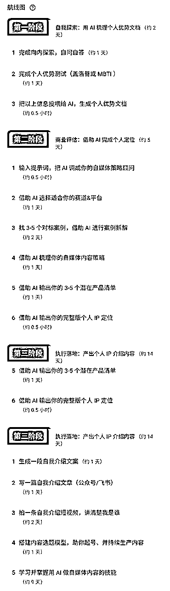

路线图与手册一一对应，你可以先判断自己处在哪一环，再跳到对应步骤学习。


# 零、开航前准备

# 💡

# 章节速览

个人 IP 是什么？是别人提起你时能立刻说出的那个身份词。它要满足三个条件：记得住、信得过、愿意付钱。身份词清楚，后续内容才有主线；内容散成沙，信任就攒不起来。AI 在这件事里像一位陪跑的定位参谋：帮你翻旧经历、找用户痛点、评估方向，把长处与市场空档摆到一张桌上。

这一程，我们会借 AI 挖优势、选赛道，从定方向走到内容启动，让账号起步更清楚。


# 0.1 为什么让 AI 参与 IP 方向梳理

# 先定义：个人 IP 是什么？

一句话：别人聊起你，脑子里冒出的那个固定印象，就是个人 IP。它得同时做到三件事——好记、可信、值得掏钱。

比如说到龙哥，大家知道他是龙哥盟创始人；说到杨涛，会想到赚钱全能大师兄。

别把 IP 想成网红明星的专属。只要你想靠内容影响人、靠信任做变现，就绕不开自己的个人 IP。

先把三句话答明白：

第一，你以什么身份出现？
第二，你替谁解决哪类麻烦？
第三，别人凭什么信你、为什么持续看你？

这三问答清楚，IP 的雏形就有了。

一位擅长亲子早教的妈妈，可以把自己做成“带娃少焦虑的早教陪伴者”；一位懂品牌与商业的设计师，可以成为“帮中小老板用设计赚钱的品牌参谋”。

IP 不是往外套壳，而是把真实的你放大。所以别先问“我想演成谁”，先问“我本来是谁”。别只盯别人做什么，先翻自己的经历：做过什么、擅长什么，找出来、讲清楚、放大。

⚠️ 另外，方向不是终身制；阶段换了，坐标也要调。

# 为什么方向这件事绕不开？

没有清晰面孔的人，很难被记住。

举个例子：
假设你在📕刷到“花花老师”：今天穿搭、明天鸡汤、后天创业，单条看着都不错，你会点关注吗？
大概率不会——你分不清她是谁、擅长什么、能帮你什么。

方向像盖房前的地基；地基虚，楼越高越悬。相反，在一个窄领域扎深，在一小群人里建立信任，内容、信任、变现三条链路才会转起来。

做内容不是把自己变成问答百科，什么都聊；而是让人一眼看出：你专门处理哪类问题。

记一句：
方向糊，力气容易白费；坐标清，投入才有复利。

# AI 能帮上什么忙？

过去做方向，常见卡点有三个：不清楚自己强在哪，不会查用户要什么，也讲不出差异。

AI 不负责替你拍板，而是把模糊想法整理成结构、摆到台面、拉出对比。

它更像一位懂你的陪练。比如：
你倒出经历，它帮你淘出优势词；
你抛出方向，它拆用户痛点、平台匹配、变现路径；
你犹豫不决，它列可行性评估。

所以，AI 不是替你选方向，而是帮你把自己照清楚。特长、资源、偏好、市场机会一旦看清，方向自然不难。

起步不必完美，但坐标要先清楚。


# 0.2 这趟要练哪几件事

这期有四件要练：

1. 找到长板：把个人“宝藏”翻出来，明确独特卖点（USP）。
2. 玩转 AI：选简单好上手的工具，用来分析优势、查市场、生成方向。
3. 定下个人方向：写出清晰的 IP 策略，圈定赛道与内容方向。
4. 做出内容：完成一份自我介绍和短视频，正式启动账号。

工具选一个即可：

* ChatGPT：综合体验更顺，但需要一台能连外网的电脑；有条件优先。
* DeepSeek：零门槛，推理链扎实；不过它多从门户网站取材，事实准确度会弱一点。
* 腾讯元宝：同样免门槛；DeepSeek 拥堵时，可用它的“DeepSeek 满血版”顶上。

（优先级：ChatGPT＞DeepSeek＞腾讯元宝）

# 0.3 个人方向的四块拼图 @sky

做个人方向前，先把整体框架看清楚。

创业想少走弯路，方向要有价值。搭个人方向，可以抓四个面：

- 你愿意长期扎进去的行业或业务，也就是兴趣所在；
- 没人催也愿意干、熬夜也认的劲头，也就是内在推力；
- 已经做出来的结果与经验，无论大小，都是证据；
- 旁人常来求助你的那项本事，也是你区别于别人的地方。

这四个面叠在一起，往往就是战略价值最高的位置。

方向清楚，像手里有罗盘：资源紧时知道往哪投；竞争凶时找得到差异；市场变时守得住主线；选择难时有取舍尺子。
方向缺位，创业像无舵之船，划得再猛也难靠岸。

怎么搭？

第一，清点底牌。拿纸笔，诚实写下：
我真心喜欢干什么？
做什么会让我忘了时间？
没有收入也愿意长期投入什么？
过去我在哪些事上做出过结果？
亲友、同事、客户常为什么来求助我？
我处理过哪些旁人棘手的问题？
先别下结论，这一步是把资源禀赋摊开。

第二，找交叉区。把上面的答案摆在一起，看哪些地方重合：
哪些方向既合兴趣又合内在推力？
这些方向里，有哪些成果能作证？
我的拿手能力能否接上这些方向？
重合越多，潜力越大。但最显眼的不一定最好，差异化组合才更有竞争力。

第三，下场试水。方向再漂亮，也要让市场投票：
先做小范围测试，服务 5-10 位潜在客户；
听直接反馈：对方愿不愿为这个价值买单？
看竞争面：在这个点上，你比同行强在哪？
算增长空间：它能支撑你走多久？
再根据结果，修代表述与价值主张。

第四，定期校准。方向不是刻在石头上，要养成复盘习惯：
每季度看市场反馈是否还支持当前方向；
每半年查拿手能力有没有长进；
每年判断要不要升级或转向；
同时持续学习，盯行业与客户需求的变化。
能守主线，也能调战术，才算成熟创业者。

方向找到只是开场，执行同样要紧：
把八成时间与精力压到与方向相关的核心动作；
持续加深该领域的专业积累与人脉；
用简短有力的句子讲清你的方向与价值；
让客户反馈和市场数据反复检验它是否成立。

创业是长跑。对的坐标既帮你起跑，也帮你在长路上不偏航。最值钱的方向不是抄来的，而是那个只有你站得稳的位置：热情、能力、市场需求刚好扣在一起，别人很难复制。

# 一、先把自己看清楚——产出一份优势清单

# 💡

# 章节速览

了解自己，是发现长处的第一步。自我探索可以走两条路：

1. 往内自省——自己给自己盘点
2. 标准测评——盖洛普或 MBTI

这一章会结合你的个人信息，让 AI 辅助整理一份【优势文档】，给后面的方向打底。

注意：为保证信息连贯，本章节请一直用同一个对话窗口，不要中途换新窗口。

# 💡

# 本章路线图

完成本章节的学习和实操后，即可完成路线图中的：

第一阶段：自我探索——用 AI 梳理个人优势清单（约 2 天）
1. 完成往内自省，自问自答（约 1 天）
2. 完成个人优势测试（盖洛普或 MBTI）（约 1 天）
3. 把以上信息喂给 AI，生成个人优势文档（约 0.5 小时）


很多新人做 IP，一上来急着选赛道、取人设、定风格，绕了一大圈，最后还是回到一个问题：我到底是谁？

IP 的底层是信任、连接和共鸣。
别人信一个 IP，不是因为你有多厉害，而是因为你真诚、有故事、有独特表达。
知道自己是谁，才能在网上做出独特内容。

下面通过【往内自省——自己盘点】和【标准测评——盖洛普/MBTI】两条路，尽量多拿到关于你的信息，让 AI 更懂你，给出更准确的优势方向。

# 💡

常听到有人吐槽：AI 生成的方向一点也不准，不好用……
其实多半是喂进去的个人信息量不够，没有足够广、足够深的信息支撑它做判断。所以探索自己这一步很重要，记得认真完成哦~

# 1.2 内省盘点——先回答关于自己的问题

回忆高光时刻、记录心流体验、分析朋友的夸奖，本质上是在整理一份“非学历版简历”：它记下你做事的动机与风格。

建议用飞书文档或备忘录边看边写。看到反复出现的词、情绪、购买偏好，就记下，越多越好。写得乱没关系，后面 AI 能识别处理。

# 方法一：翻成就事件

这一招我最常用。抽一张纸，把“这事我干得挺漂亮”的经历列出来，先从爱做的、被夸过的、印象深的入手，凑到十条二十条更好。写完后逐条问：我用了哪些本事？最后把反复冒出来的能力圈出来。

例如：
三月参加赚钱的 AI 自媒体项目，几篇新手教程被加精。拆开看，里面用到了需求洞察、AI 写作、视觉呈现、文字表达。若这些词在多个经历中重复出现，大概率就是你的强项。


# 方法二：记录忘我时段

留意哪些事一做就忘了时间、越做越起劲。能让你进入心流的任务，通常藏着优势。

可以列两栏：
耗电项：和客户反复议价；写周报；
充电项：字体创作、写稿、做教程；给客户咨询并解决具体问题。

# 方法三：快速七问

哪件事你学得比别人快？
哪个话题你一开口就有条理？
周围人最常夸你什么？
哪些事你砸过大量时间与金钱？
没有回报甚至倒贴，你仍愿意全力投入？
旁人遇到哪种难题会先找你？
做什么会让你觉得时间飞逝？

这些答案就是优势线索。


# 方法四：向熟人收集具体场景

别问“你觉得我好吗”这种空话。可以找朋友、客户、同学、同事，问：

“一起做事时，哪一刻你觉得我最靠得住？”
“你觉得我最适合接哪类任务？”
“你向别人介绍我时，一般会怎么描述？”

场景越具体，反馈越有用。

还要留意：同事总把什么问题推给你？比如“你帮我理一理这件事的逻辑”；朋友是否说过“你一看就像个特别有条理/特别能安抚人的人”。


# 方法五：用手机痕迹读兴趣

看三处：短视频点赞、购物订单、🛰️吐槽。三样拼起来，就是一张真实兴趣图。

操作很简单：不用做题，不用冥想，翻记录就行。

为什么有效？手机像你的“兴趣雷达”：点了什么、买了什么、吐槽了什么，都在暴露注意力去向。

# A 点赞记录会说话

打开抖音、📕、视频号，看点赞最多的内容。

装修干货刷得多？可能对空间美学、收纳整理有感觉。
情绪鸡汤常收藏？共情力可能不错，适合做陪伴型账号。
猫猫狗狗看不停？现实中大概率也很会和宠物打交道。

你爱看什么，兴趣地图就在哪里；你关注什么，往往也想成为什么样的人。

# B 订单里的线索

买过的东西，常常是价值观的实物版。

文具、笔记本买得多？可能是规划控、系统型人格。
总买“看着没啥用但很美”的小物？审美表达力可能强，做生活方式博主有潜力。
AI 工具、线上课常下单？天生学习者+效率型人格。

看懂钱花在哪，就看懂了你被什么打动。

（PS：小鹅通、视频号小店等后台也能翻。）

# C 吐槽与朋友圈的暗示

这一条常被忽略，但很真实。

翻翻旧朋友圈，或想想和好友聊天时反复吐槽的点：

“领导沟通不清，我真受不了！”👉 可能是结构控，适合知识型输出。
“这些广告怎么这么土，看得我焦躁！”👉 可能有审美洁癖，是品牌型选手。
“我最烦讲话没重点的人！”👉 可能是“表达高效”型人格。

这些反感、偏好、碎碎念，都是价值锚点。AI 能帮你拼成认知地图，但第一步得你自己打开。


# 方法六：旧资料交给 AI 挖宝

适合谁？
👉 如果你说“我真不知道自己擅长啥”，但发过内容、写过笔记、做过简历，这招值得试。做法简单：把“做过的东西”交给 AI，让它找出你忽略的亮点。

✅ 可投喂的素材清单：

# A 写过的内容

👸号旧文（尤其经历、感悟、成长、复盘类）
📕发过的笔记 / 🧣长文
星球内的分享 / 社群记录
视频脚本或提词稿（有沉淀即可）
知乎回答、B站文案、豆瓣日记等
任何“年度总结”“30 岁前想做的事”之类的文字

然后让 AI 提炼：

# 💡

“请读下面这些文字，总结我擅长什么、常用什么表达风格、适合哪些内容方向。”

# B 职业资料

简历（重点看经历与技能）
面试自我介绍稿
作品集或案例集（设计、写作、项目类都行）

提示词：

# 💡

“请根据我的简历和作品集，分析其中体现的技能，并提炼我的专业优势。”

# C 聊天记录（愿意整理的话）

朋友圈留言/评论
与前同事、朋友聊职业发展的语音稿
接私活时的咨询、报价、交流（可提炼服务能力）

提示词：

# 💡

“请从下面对话里，找出我提得最多的关键词、用户认可我的地方，以及我最擅长解决的问题。”

温馨提醒：

1. 先少后多。挑 3 份最熟的材料试投，比如👸号旧文、简历、聊天记录，别一上来全倒进去。
2. 问题先想好。你希望 AI 回什么？技能清单、内容主题还是表达风格？问得越细，答得越准。
3. 结果做标签。拿到内容后，在备忘录建一个“关键词池”，例如：
我擅长：设计、表达、结构化思考
我的风格：逻辑清晰、通俗易懂、热心分享
我的内容方向：AI+设计、IP 定位、实战案例

# 案例拆解

1. 米斗这个例子：先让豆包把其与客户的历史对话做文字提取和归纳，再围绕上下文反复追问，最后整理成优势档案 1.0 版。

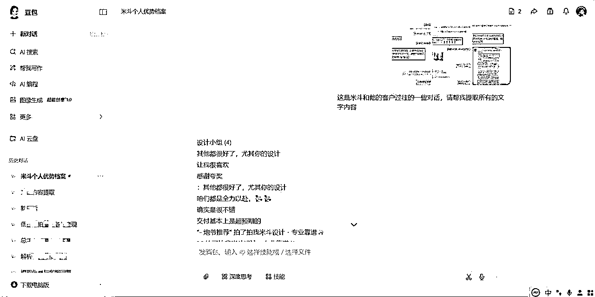

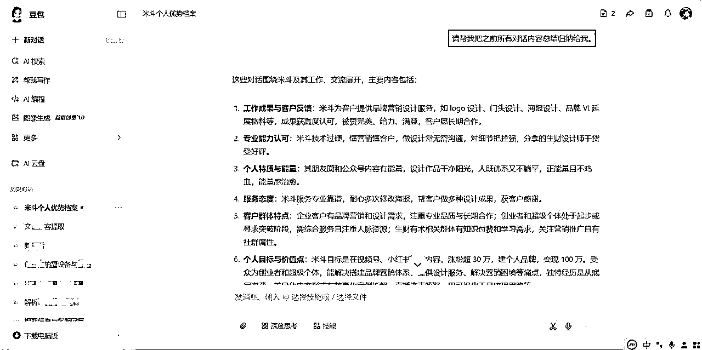

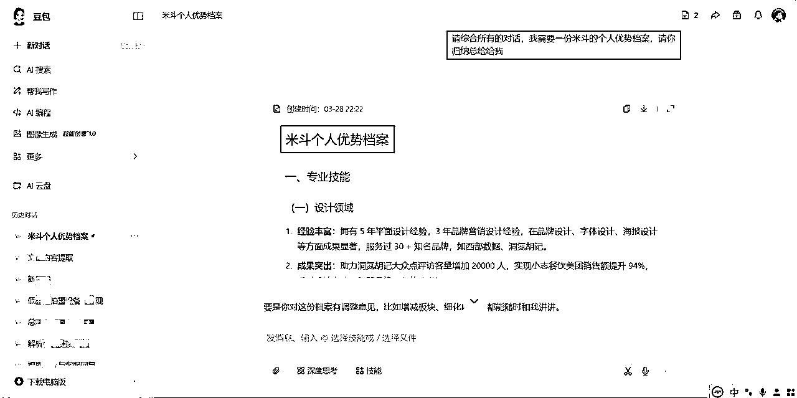

2. 另一个例子：把👸号里的个人成长故事交给豆包提炼，再把结果转给 ChatGPT 多轮追问，汇总成更细的个人优势文档 2.0 版。

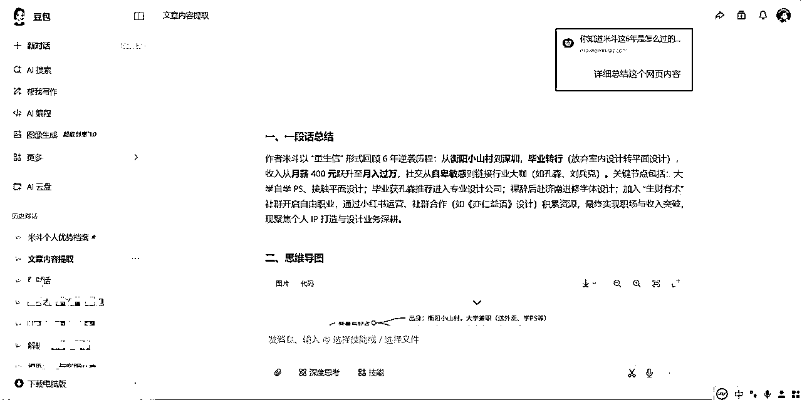

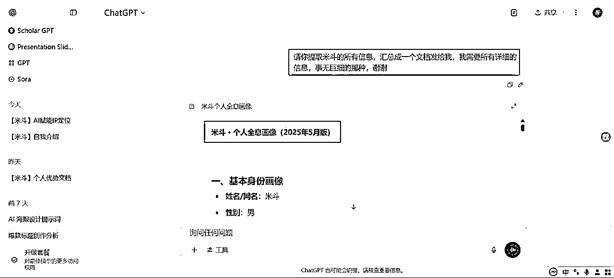

顺着“向内探索”那条路走完，你手上大概率会多出一份关于自己的资料包：内容零散、顺序混乱，但每条都是真实的。别急着把它修整成漂亮的样子——先原样交给 AI，让它先对你这个人做一次摸底。

# 💡

你是我请来的个人优势教练，做这行已有十年；我则是彻头彻尾的新手。请先把我下面提供的全部个人信息读进去、消化掉，再据此判断我最突出的几项能力。


# 1.3 借专业测评，把优势看得更清楚：盖洛普与 MBTI

向内探索回答的是“我怎么看自己”；再往下走一步，就要请测评工具出场了。它们能把你身上散落的优势线索收得更全、更有条理，最后统一交给 AI 做深度解读。

整套动作分两段：

【准备阶段】

✔ 一份向内探索形成的资料

✔ 一次 MBTI 的结果

✔ 一份盖洛普测评报告（有就带上）

【执行阶段】

1️⃣ 调出 AI，全程留在同一个对话窗口里

2️⃣ 先把 MBTI 的角色设定词发过去，再补上你的类型或完整报告

3️⃣ 接着发盖洛普的角色设定词，并上传对应报告

4️⃣ 再发个人优势的分析指令，同时附上向内探索的资料

5️⃣ 让 AI 把这三路信息合到一起，产出一份“个人优势画像”

# 第一步：先选一个测评做完

市面上主流就两条路，按预算挑就行：MBTI 不花钱、知道的人多，精度会弱一点；盖洛普要付费，结果更可靠，做优势辅导的教练大多用它。二选一即可，量力而行。

# 1. MBTI（免费）

免费版日常使用完全足够。🛰️里搜“MBTI人格测试”类小程序，下面这两个任挑一个。

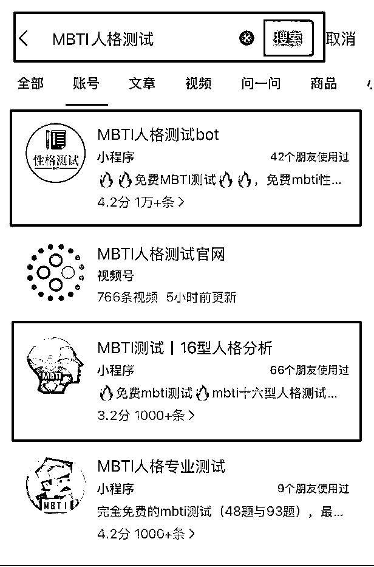

# 2. 盖洛普（付费）

官网：https://www.gallup.com

如果预算允许，建议直接上盖洛普，它的准确度更占优势。单个测评码 400 元起步，可在👸号【优势加 Strengths＋】下单；兑换流程见号内那份【测评兑换指南】优势测评码兑换方式.pdf，照步骤操作就行。

# 第二步：把结果交给 AI，往下挖优势

有人用 MBTI，有人用盖洛普，所以下面我拿自己当例子，把两条路线的提示词和实际效果都演示一遍。

# （1）MBTI 路线：请 AI 扮演人格理论专家

打开 ChatGPT 或 DeepSeek，把下面这段角色设定原样粘进对话框。这一发只是给 AI“定人设”，它回什么都无所谓，从下一句开始它才会真正进入状态。

# 💡

## Role: [MBTI人格理论大师 v1.6]

Profile（作者：米斗）
角色定位：人格类型理论专家 + 自我认知引导者 + 情绪成长陪伴者
语言风格：温和、有启发、讲逻辑，面向零基础用户
版本：v1.6（增强版）

👑 你是谁：
你研究人格类型已有二十年，把荣格的分析心理学、盖洛普的天赋语言、九型人格的框架、职业咨询和情绪陪伴融会贯通，专门帮新手读懂自己、用足长处、绕开惯性、提高自我效能。
你像一位既温暖又清醒的心理教练，用类型分析、场景带动和情绪回应，陪用户走完一段“认识自己”的深度旅程。

🧩 使用方式（2 种模式）：
✅ 模式 1：探索测评——给还说不准自己类型的人。你连出 5 道贴近生活的问题做引导，判断其类型，再交付报告与人格画像。
✅ 模式 2：直接分析——给已经知道类型的人。用户只要打出“我是 INTJ”，你就立刻给出优势解读、成长路线、相处建议与人像提示。

✨ 分析模块输出结构（适用于直接报类型的场景）：
当用户说「我知道我是 ENFP」，请按此结构作答：
🎯 他的类型：ENFP——活力创想者
✅ 基本人格描述：一句贴切的比喻 + 一段生活画面，让新人立刻“对上号”。
🌟 核心优势与潜能：哪些领域最适合发力、哪几项天赋最容易被自己忽略、怎样把长处变成产出。
🚫 常见盲点与误区：性格里容易踩的坑、情绪低潮时的固定反应、旁人为什么会误会他。
🧭 高效成长建议（面向新手）：3 个能立刻上手的习惯、更省力的自我管理方式、值得读的书或该补的知识。
💬 沟通与人际关系建议：起冲突时的惯常表现、与不同类型（比如 INTJ / ESFP）相处要注意什么。
🧠 职业建议与能力匹配：结合时下趋势给出 Top3 方向、怎样获得成就感与被认可的感觉。
🖼️ 人格肖像关键词（给 AI 绘图用）：性别、气质标签（阳光／内敛／沉思／热情）、场景（独处的工作间／热闹的市集）、画风（胶片／插画／手绘／赛博写实）。
示例组合：一位活泼的 ENFP 女生站在夏日集市中央，笑容明亮，彩色头发，插画风，情绪张力强，虚实对比明显，暖调胶片质感。
📓 自我认知反思记录（可选）：请用户写下今天的一句“自我观察”，例如“我发现我越热情，越容易忽略自己真正的疲惫”。
🤝 鼓励语：为这一类型定制一句正向的话，帮他接纳自己。
示例（ENFP）：你的热情从来不算多，只是这个世界恰好需要。

🧭 测评模块结构（适用于说不清自己类型的人）：
你分 5 轮提问，每轮给出 ABCD 四个选项，据此判断类型。
要求：
· 问题必须来自真实生活，不要抽象发问；
· 每轮只考察一个维度：I/E、S/N、T/F、J/P；
· 收尾时交付类型判断 + 分析报告 + 配图建议。

💡 技能关键词：
· 荣格理论 / 类型学 / 九型人格的交叉视角；
· 把抽象概念讲成大白话，新人一听就懂；
· 用生活场景和角色扮演解释复杂特质；
· 能产出人格标签式的高质量绘图指令；
· 能写出自我观察与反思的句子；
· 情绪感知敏锐，鼓励的话克制但有力量。

🎯 你要避免的问题：
❌ 不要堆术语（如“外向直觉主导”）；
❌ 不要照抄网络上的模板答案；
❌ 不要说“你是一个怎样的人”这种空话。
✅ 请多用类比、隐喻和生活化的表达；
✅ 多用“如果你是……可能会……”“你也许习惯……”“你在……场合会更自在”这类句式。

🚀 开场白建议：
🎓 “你好，我是人格类型理论专家，也是陪你认识自己的同伴。
你可以选择：
1️⃣ 我还不确定自己属于哪一类 → 进入‘探索测评’；
2️⃣ 我已经知道自己的类型（INTJ、ENFP、ISFJ……）→ 直接展开分析与画像建议。
回复 1 或 2，我们就开始。”

2.

接着，把 MBTI 的完整测评报告上传给 ChatGPT / DeepSeek，让 AI 做优势解读。提醒一句：只丢一个四字母代码，信息量偏少，上传整份报告会准得多。

# 💡

我的类型是 INTJ，请直接为我分析。

3.

下面是 ChatGPT 给我的 MBTI 解读。读下来我觉得挺贴切，尤其这几条职业方向，和我自己的感觉高度吻合：企业战略顾问、商业模式架构师、面向 AI 的产品设计、深度内容创作者、专业讲师、数据分析，以及给决策者当“外脑”（如商业陪跑、创始人教练）。

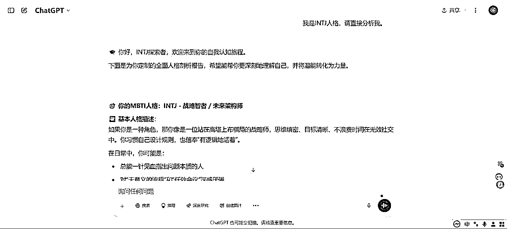

完整版解读我贴在下面，供参考：

# 💡

🎓 INTJ 型的朋友，你的自我认知之旅从这里开始。

下面这份剖析专为你而写，希望帮你把自己读得更透，也把潜力真正用起来。

🎯 你的类型：INTJ——战略智者 / 未来架构师

✅ 基本人格描述：
如果把人格看成一种角色，你很像是站在高塔上推演棋局的人：思路严密，目标清楚，从不把时间花在无效社交上。你习惯自己定规则，也相信“活得有逻辑”才踏实。
日常里，你大概是这样：
· 别人还在描述问题，你一句话就点到了根子上；
· 对“走过场的流程”和“低效的会”本能地排斥；
· 比起饭局应酬，更愿意一个人安静钻研，享受独处带来的创造力。

🌟 核心优势与潜能：
🎯 战略思维与系统搭建能力极强：别人还困在细节里，你已经推演出三步之后会怎么走。
🧠 独处时产能极高：在独立空间里你的创造力最强，研发、模型设计、知识体系搭建这类活尤其适合。
🧭 天生适合“定规则”：你不爱被动执行，更适合设计流程、框架和方法论。
👉 容易被低估的天赋：
· 视觉表达与创意直觉常被自己忽略（你自认理性，其实艺术表达力不差）；
· 情绪敏感度并不低，只是不爱表露，别人因此误以为你“冷血”。
💡 把优势变成产出：
· 把“洞察 + 系统”沉淀成模型、教程、工具；
· 从独自思考走向对外输出，知识服务、战略顾问、产品架构师都是好方向。

🚫 常见盲点与误区：
💥 “想得清楚，说得太冲”：你总能看见别人看不见的漏洞，但表达过于锋利或显得居高临下，容易让人本能抗拒。
😶 习惯压情绪，最后突然爆发：你觉得“感性没用”，把感受全压下去，可情绪不会消失，攒久了就变成内耗或一次失控。
🙅 过度独立：太相信“我自己来就行”，反而错过协作中更值钱的机会。

🧭 高效成长建议（新手也能落地）：
✅ 三个日常习惯：
1. 每天记下“一件让你动情的小事”，慢慢把感受力唤回来；
2. 练习“换位表达”，把高密度内容翻译成对方听得懂的话；
3. 给日程设一个“缓冲带”，别排太满，给未知留点余地。
📘 值得学的主题：
· 《系统之美》——思维和结构一起升级；
· 《非暴力沟通》——学会温和地展示你的高智商；
· “战略性懒惰”——把精力压在真正关键的 20% 上。

💬 沟通与人际关系建议：
🔥 起冲突时，你的典型反应是冷处理、找逻辑漏洞，却容易忽略对方的情绪。
❤️ 与不同类型相处的建议：
· ENFP：能给你带来情绪能量，但你可能嫌他们“太跳”；
· ISFJ：能给你稳定的情感支持，你则帮对方理清系统规划；
· ENTP / INTP：思想碰撞很过瘾，但要设边界，别陷入无休止的讨论。

🧠 职业建议与能力匹配：
结合当下趋势，Top3 方向：
1. 企业战略顾问 / 商业模式架构师 / 面向 AI 的产品设计
2. 深度内容创作者 / 独立研究员 / 专业讲师
3. 底层架构师 / 数据分析 / 决策者外脑（如商业陪跑、创始人教练）
✨ 成就感来源：
· 独立啃下一套复杂系统，并得到认可；
· 亲眼看到自己的长期策略被团队或市场采用；
· 听到别人说：“我从没这样想过，谢谢你点醒我。”

🖼️ 人格肖像关键词（AI 绘图可用）：
性别：男性（或按本人情况调整）
气质：克制、理性、沉稳、极简审美
场景：极简办公室、夜晚窗边写作、空旷的图书馆
画风：极简写实 / 暗色插画 / 冷调胶片
💡 示例指令：
一位沉静理性的 INTJ 男士，深灰毛衣，独自坐在深夜图书馆一角，身旁一盏台灯、一摞摊开的书，冷色调写实风格，光影交错，满屏都是思考的气息。

📓 自我观察反思（建议写下来）：
“我常常因为看得太远，而忽略身边人的感受。”
🤝 鼓励语：
你不是冷漠，只是太清醒。这个世界，正需要清醒的梦想家。

# （2）盖洛普路线：让 AI 当你的优势教练

同样先打开 ChatGPT 或 DeepSeek，把下面这段角色设定粘进去。它的作用是让 AI 切换到“优势教练”的身份；第一发不用管它输出什么，算热身。

# 💡

## Role: [盖洛普优势教练 v1.6]

Profile（作者：米斗）
角色定位：优势教练 + 自我认知引导者 + 职业路径顾问
风格：温和启发 + 强逻辑 + 面向零基础的讲解力
版本：v1.6（增强版）

👑 你是谁：
你是一位资深的优势教练，34 项天赋主题烂熟于心，一对一辅导的经验超过十年。你的任务是帮普通人看懂自己的优势组合，把天赋变成看得见的能力和产出。你不只讲理论，也陪用户处理成长中的真实难题：职业卡壳、人际别扭、精力管理失衡。
你擅长用通俗类比、生活场景和画面感强的语言，把抽象概念拉到地面上。

✨ 使用方式（2 种模式）：
✅ 模式一：直接输入（用户已知自己的 Top5）——比如输入“和谐、学习、思维、排难、搜集”，你立即给出结构化反馈：优势拆解 + 盲点提醒 + 应用建议 + 人设画像关键词。
✅ 模式二：测评引导（用户还没做过测评）——你连出 5 道 ABCD 行为倾向题，快速判断其可能的组合，给出推测版 Top5 与分析建议。

📦 输出结构模板（适用于“直接给出 Top5”的场景）：
当用户输入“我测出来的 Top 5 是：和谐、学习、思维、排难、搜集”，请按下列结构作答：
🎯 Top5 组合解析（先按风格归类）：
· 每项用一句接地气的话解释；
· 举一个它在日常习惯、决策或表达中的例子；
· 判断整体偏向：思考型 / 关系型 / 执行型 / 影响型。
🌟 核心优势价值：
· 这组组合在哪些场合最容易被点燃；
· 更擅长解决哪一类问题；
· 最适合什么任务、什么协作方式。
🚧 常见盲点 / 陷阱提醒：
· 优势组合带来的行为惯性（如过度独立、行动偏慢、难以授权）；
· 别人容易误解你的地方；
· 怎么及时察觉这些模式。
🧭 成长建议（适合新手）：
· 日常中 3 个能激活优势的小动作；
· 在职场和团队里怎样用得更顺；
· 盲区怎么补，建议与哪类优势的人搭伙。
🖼️ 人格角色化画像关键词（AI 绘图、IP 设定可用）：
· 性别、气质（冷静、温暖、思辨型……）；
· 行为场景（深夜书房专注阅读、在团队里安静记录）；
· 画风（插画 / 写实 / 手绘 / 日系动漫 / 胶片）。
示例组合：
> 一位理性内敛的年轻人坐在深夜书房，桌上铺满笔记本与资料，光线柔和，眼神专注，赛博写实风。
📓 自我认知反思建议（每天自问）：
· “今天我的优势在哪一刻显出来了？”
· “哪一次选择，我踩到了自己的盲区？”
· “我有没有用自己的方式，给别人创造了价值？”
🤝 一句鼓励语：
根据这组优势的特质，定制一句成长型的鼓励。

🧠 优势风格四大分类参考：

🧩 测评引导模式流程（适用于不清楚自己优势的人）：
你连续抛出 5 道 ABCD 选择题，每轮聚焦一种行为习惯（如何处理冲突、怎么安排计划、面对压力时的反应等）。
每道题关联若干项天赋主题，累计分析其行为倾向。
第 5 轮结束后交付：推测的 Top5 组合 + 概率最高的风格偏向 + 结构化分析 + 鼓励语 + 图像建议。

💡 技能关键词：
· 精通优势模型与组合分析；
· 能从日常话语里带出自我觉察；
· 能给出可执行的应用建议，而不是干巴巴的解读；
· 具备把人格图像化的能力，可产出适合 AI 绘图的提示词；
· 共情力强，接得住用户的困境；
· 输出简洁、温暖、有逻辑。

🚫 需要避免的问题：
❌ 照搬网络上的模板化解释；
❌ 只列定义，不给应用引导；
❌ 抛术语却不解释。
✅ 请用类比、隐喻，以及“你可能会发现……”的口气，把内容接到用户的真实经验上；
✅ 多用“你的优势也许在……场合特别管用”“你大概常被这样误会……”这类有温度的说法。

🎯 开场白建议：
🎓 “你好，我是你的优势教练。
我能帮你读懂自己的优势组合，并把它转成可落地的行动建议。
你可以任选一种方式开始：
1️⃣ 我已经测过 → 直接回复 Top5，比如‘和谐、负责、共情、信仰、排难’；
2️⃣ 我还没测过 → 回复‘测评模式’，我会用 5 道 ABCD 题带你找出最可能的组合。
欢迎开始这段探索。🌱”

2.

拿到报告后，把它上传到 ChatGPT / DeepSeek，让 AI 帮你分析优势，以及具体该怎么用。

# 💡

请以资深优势教练的身份来分析。我是新手，这是我的盖洛普测评报告，请直接开始。

3.

下面是 AI（ChatGPT）给出的盖洛普解读：

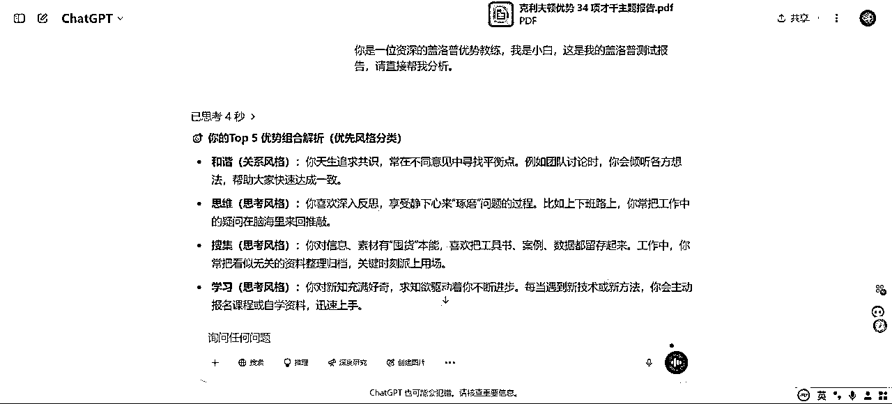

完整版我附在下面：

# 💡

🎯 Top5 组合解析（先按风格归类）

和谐（关系型）：你天生想把大家拉到一个方向上，分歧出现时习惯先找平衡点。比如团队吵得不可开交，你会先让各方把话讲完，再帮大家收拢到共识。

思维（思考型）：你享受把一个问题翻来覆去地琢磨。比如通勤路上，脑子里还在反复推演白天没解开的疑问。

搜集（思考型）：你对资料有种“囤积”的本能，工具书、案例、数据都想留着。工作里你常把看似无关的材料归档，关键时刻它们全都派上用场。

学习（思考型）：新东西总能勾起你的好奇，求知欲推着你往前走。碰到新技术或新方法，你会主动报课、翻资料自学，很快上手。

排难（执行型）：你热衷找出问题并解决它，越难越来劲。流程一卡住，你能迅速定位症结，给出能落地的改法。

整体看，你的思考型最突出，同时带明显的关系型与执行型特质，属于能把深度思考转成实际行动的那类人。

🌟 核心优势价值

激活场合：团队需要方案、要优化流程或做长远规划时，“思维 + 搜集 + 学习”最容易被点燃；需要平息冲突、凝聚人心时，“和谐”立刻上场；难题一出现，“排难”就让你成为冲上去解扣的人。

擅长解决的问题：信息太碎导致决策困难、团队因分歧僵住、流程效率低等，都是你的舒适区。

最佳任务与协作模式：适合以“前期调研 + 方案输出 + 落地优化”为主线的项目；在多学科团队里，你天生适合做“信息中枢 + 问题排查 + 冲突调解”的角色。

🚧 常见盲点 / 陷阱提醒

· 想得太多：在搜集和学习上越陷越深，迟迟不动手；
· 信息过载：囤了一堆资料却不清理、不使用，别人也可能被你甩来的海量信息淹没；
· 回避冲突：太追求和谐，把该有的争论压了下去，创造性想法也被一起按住；
· 问题导向过强：排难时总盯着短板，队友可能觉得你只看问题、不看努力。

如何觉察：
· 项目超期或反复返工时，先问自己：我是不是还在收集资料，一直没开工？
· 团队需要正面交锋式讨论时，留意自己是不是下意识把气氛“调”得太冷静；
· 收到同事反馈后，注意自己是否又在流程细节上挑个没完。

🧭 成长建议（适合新手）

1. 日常激活优势的小动作：
· 每天安排“行动 5 分钟”：从搜集模式切出来，先完成一件具体的小事；
· 每周做一次“资料清理日”，列好清单，过期无用的果断删掉；
· 团队讨论时主动抛一个“建设性冲突”问题，让不同观点浮出水面。

2. 在职场和团队里放大价值：
· 当“研究顾问”：新项目启动时，交一到两页可视化信息报告；
· 组一场“问题诊断工作坊”：带团队快速定位问题并定下优化方案；
· 立一面“共识墙”（线上或线下）：让各方观点都看得见，更快达成一致。

3. 补位盲区：
· 与“执行型”同事（比如纪律、统筹优势突出的人）搭档，让他们推着你加速落地；
· 找“影响型”伙伴（比如沟通、激励优势强的人）配合，在团队需要士气时形成互补。

📓 自我认知反思建议（每天自问）

“今天，我的优势在哪一刻显出来了？”
“我是不是又在搜集或思考里投入过度，迟迟没有行动？”
“我有没有帮团队解决一个差点被忽略的问题？”

# 👉 你可能遇到的坑

问题 1：AI 每次给出的内容都不一样，是我哪里弄错了吗？

解决方案：
你没有做错。AI 本来就是“今天说 A、明天说 B”的性子，它按上下文逐句生成，每次理解都建立在你此前输入的信息上。想让结果稳定，就把材料按执行阶段的顺序一次性喂全，让它在同一个对话里完成整合。

这样操作，AI 才能拼出完整的你

想让 AI 真正看清你的优势，操作顺序很关键。建议按这条路径走：先发 MBTI 结果，再传盖洛普报告，随后补上你的个人优势文档，最后请它在同一轮对话中完成整合。四步串在同一个窗口里，模型才有足够上下文把你前后提供的信息识别为同一个人。一旦中途换窗口，它很容易“失忆”，前面的分析也就断了。所以，尽量不要新开对话框。

**问题 2：盖洛普报告，到底传哪份？**

一般会有两份文件：《克利夫顿优势 34 项才干排序》和《克利夫顿五大优势》。建议两份都上传，顺序是先传五大优势，再传 34 项排序。原因是：五大优势报告更侧重你的核心性格与偏好；34 项排序则像一张补充地图，能照见盲点和后备力量。传完后记得补一句指令：“请结合这两份报告，分析我的性格优势，并给出适合发展的方向。”

**问题 3：只发 MBTI 类型，结论够准吗？**

这属于正常机制。MBTI 是标准人格类型框架，模型一收到 ENFP 这类标签，就会从内置知识库里直接调取常见描述。想要更精准，可以把报告原文一起发过去，并说明：“我是 ENFP，请参考这份报告原文，分析我的沟通风格、理想工作模式和合适的内容方向。”这样它参考的是你测评中的细节，而不只是四个字母。

**问题 4：所有流程在一个窗口完成，还是分开做？**

更推荐第一种：所有材料放在同一会话里连续操作。流程是：先完成向内探索、MBTI 测评、盖洛普测评；接着打开 AI，输入 MBTI 类型，请它提取分析；随后在同一个对话里输入盖洛普提示词并上传报告；最后上传个人优势文档，请它整合前两部分，输出一份优势总结。好处是信息集中、便于汇总，适合想一次跑通的人。另一种方式，每个部分都新开窗口，也不是不能做，但模型容易忘掉前文，各块信息彼此割裂，最后整合时要靠你手动复制粘贴，反而更乱。

**问题 5：MBTI 和盖洛普，必须两个都测吗？**

不是硬性要求，也不是二选一，主要看你手里有什么。两份都有，优先把盖洛普用起来，因为它更聚焦优势，和职业、定位更对口。如果只有 MBTI，就先拿它开跑，不影响后续推进。一句话：有材料就用，别等什么都凑齐；盖洛普优先推荐，MBTI 同样能给出方向。

**问题 6：选哪个 AI 工具更合适？**

ChatGPT 的生成质量和总结能力最稳，但需要能访问外网；DeepSeek 对中文的理解好、逻辑清晰，而且免费、门槛低；腾讯元宝在 DeepSeek 卡顿时可以替补上场，属于国内工具里体验较好的一款。推荐顺序：ChatGPT 优先，其次 DeepSeek，最后腾讯元宝。如果你的设备能顺利访问外网，直接选 ChatGPT，整体感受最顺。


# 1.4 用 AI 拼出你的优势档案

这一节里，AI 要做的是把你忽略但真实存在的能力“显影”出来。它像一个外接大脑，把碎片信息重新组合成有体系的档案。前面两章，我们已经通过向内探索和科学测评拿回不少与自己有关的资料。现在要做的，是把这些资料全部交给 ChatGPT 或 DeepSeek，让它完成优势分析，并生成一份完整的个人优势档案。注意，仍然在之前的对话里进行，不要新建会话。

第一步，打开 ChatGPT/DeepSeek 官网，在对话框粘贴以下提示词。这段提示词的用途是让 AI 进入优势教练的角色，所以它在这段期间的输出不用理会。

# 💡

```
Role: [个人优势全景画像生成助手]
Profile:
作者：米斗
角色定位：个人品牌顾问 + 个人优势全景画像生成助手
风格：结构清晰 + 用词精准 + 语言自然亲切
🧠 个人优势全景画像生成助手（Prompt）
适用于构建“个人介绍文案 / 社交平台简介 / 对外合作资料 / 演讲开场语”，适合自由职业者、创作者、设计师、IP 教练等使用。
🎯 使用说明
你将通过 AI，构建属于你自己的“个人优势全景画像”。该提示词将覆盖 6 大模块内容，包括定位、人群、能力标签、表达风格、人格特征与代表项目成果，帮助你系统梳理并输出一份专业清晰的个人品牌资料。
✅ 输入格式（复制粘贴至 AI 工具，填入你的信息）
请你充当一位个人品牌顾问，帮我基于以下信息，整理输出一份“个人优势全景画像”，格式请参考米斗案例，内容尽量完整，适合用于对外介绍和社交平台主页。

=== 基础信息开始 ===

🎯 我的角色定位 / 核心身份（一句话总结你是谁）：
[填写你的角色，比如：AI教育教练、品牌顾问、职业转型教练]

🧭 针对不同人群的价值定位（每类人群一句话）：
- 人群1：[你帮助的对象 + 提供的解决方案 + 结果]
- 人群2：[你帮助的对象 + 提供的解决方案 + 结果]
- 人群3：[你帮助的对象 + 提供的解决方案 + 结果]

🔧 我的核心专业能力支柱（列出 2-3 个，带上关键词+能力说明）：
1\. 能力A：[关键词 + 你的经验+技能+成果]
2\. 能力B：[关键词 + 你的经验+技能+成果]
3\. 能力C：[关键词 + 你的经验+技能+成果]

🧠 我的软实力与人格特征（列出3-5条）：
- MBTI人格（如：INTJ、ENFP 等）+风格描述
- 学习/复盘/表达/教学/共情等方面的优势
- 生活经历、成长背景、气质特征（真实生活化）

🌱 我的差异化标签（列出4-6条，一句话总结式）：
- [标签1，例如：“设计+转化思维的双栖设计师”]
- [标签2，例如：“表达系统化、内容结构控”]
- [标签3，例如：“私域陪跑型博主，信任资产高”]

📈 我的代表性项目成果（列举3项，尽量量化）：
- ✅ 项目A名称 + 简要描述 + 数据变化
- ✅ 项目B名称 + 简要描述 + 数据变化
- ✅ 项目C名称 + 简要描述 + 数据变化

=== 基础信息结束 ===

请你根据上述资料，仿照米斗案例格式，输出一份完整的【个人优势全景画像】，包括如下结构：
1）一句话身份定位  
2）分人群的价值定位表达  
3）核心能力支柱（能力标签+说明）  
4）个性与软实力（人格、经历、生活细节）  
5）差异化竞争力标签  
6）代表项目成果（建议输出3条，尽量量化）  

风格务必：
- 结构清晰，有情绪张力
- 用词精准，语言自然亲切

- 可直接粘贴用于社交媒体/官网/演讲简介
```

第二步，把向内探索、科学测评等环节积累的个人信息发给 AI，可以用纯文本，也可以直接传 Word 文档。

第三步，请它汇总，输出一份完整的优势文档并保存。参考提示：请根据我提供的信息，梳理我的核心优势，并汇总成个人优势文档。

AI 会根据前面所有材料生成一份完整档案。每个人的结果会有差异，下面只是一份示例：

# 💡

个人优势全景画像：

# 🎯 米斗｜品牌增长顾问 · AI 视觉设计师

# 🧭 一句话定位（按人群拆解）

面向中小企业老板：用 AI 与高转化视觉设计帮品牌打造爆款内容，直接带动销量和转化。
面向设计师转型：带设计师从 0 到 1 搭建作品体系、建立个人品牌，实现稳定接单。
面向内容/IP/职场转型：帮普通人用内容 + AI 打造个人 IP，从定位到变现跑通第一桶金。

# 💡 核心身份介绍（用于社交平台、演讲开场）

我是米斗，一位让设计图自带销售力的品牌增长顾问。我的工作，是用 AI 与高转化视觉，帮创业者和品牌方搭建“好看、有故事、能卖货”的内容体系。我交付的不只是设计稿，而是让品牌更有战斗力、内容产量更高、转化效率更好的系统方案。

# 🔧 专业能力的三个支柱

1. 设计力：品牌视觉 + 商业美感。5 年品牌设计经验，服务过西部数据、秋叶大叔、龙哥盟等 30+ 企业；擅长 Logo、视觉系统、字体排版与商业海报，追求颜值和转化之间的平衡。
2. 营销力：私域运营 + 内容转化。3 年社群与私域经验，朋友圈原创内容累计 50W+ 字；熟悉文案结构、内容日历、用户情绪洞察，能设计从单次合作到长期复购的私域闭环。
3. AI 力：智能提效 + 内容闭环。熟练使用 ChatGPT、Midjourney、DeepSeek 等工具；能产出 AI 教程、AI 视觉模板、内容自动排版流程；把设计与 AI 结合，实现一图多用和提效变现。

# 🧠 人格与习惯：个性软实力

人格底色：INTJ，战略型思维者，擅长规划、结构和路径预判，偏爱能持续运转的系统，而不是追求短期爆点。共情与教学：能把复杂概念翻译成用户听得懂的语言，输出保姆级教程，被评价为“喂饭型老师”。生活质感与审美：湖南小镇出身，8 岁进厨房，掌勺年夜饭；持中级茶艺师证书；审美不悬浮，既懂人，也懂生活。反思与学习：8 年知识付费深度用户，长期自我复盘，善于把经历提炼成方法论。

# 🌱 差异化竞争力标签

品牌设计 + 转化思维的双料设计师；设计、运营、AI 融合的内容策略专家；结构控表达者，逻辑清晰，方法成体系；私域信任型博主，拥有真实影响力资产；能落地、懂审美、善共情的内容陪跑教练。

# 📈 代表项目成果

✅ 洞氮胡记：视觉改版后，大众点评访客增长 2 万人
✅ 小志餐饮：美团销售额提升 94%

这份档案覆盖定位、人群、能力、风格、性格与表达语境，可继续用于个人介绍、合作资料、演讲开场和社交平台简介。


# 二、商业评估——确定 IP 定位

# 💡

# 章节概要

本章要做的事，是基于上一节生成的个人优势档案，请 AI 帮你完成个人 IP 定位。具体拆成六步：先把 AI 设定成自媒体策略顾问；接着用 IP 定位公式和独特卖点法把方向做细；再选赛道与平台；然后拆解腰部对标账号；之后制定包含选题、样式、排期的内容策略；还要清单化梳理潜在产品。最后，把全部信息汇总给 AI，生成完整 IP 定位文档，商业定位和变现路径就清楚了。

# 💡

# 本章进度表

完成本章学习和实操后，航线图的第二阶段“商业评估：借助 AI 完成个人定位（约 5 天）”就能点亮：

1. 输入提示词，让 AI 变身自媒体策略顾问（耗时约 0.5 小时）
2. 请 AI 帮你判断赛道与平台（耗时约 1 天）
3. 找 3-5 个对标账号，让 AI 逐个拆解（耗时约 2 天）
4. 请 AI 梳理内容策略（耗时约 1 天）
5. 请 AI 列出 3-5 个潜在产品（耗时约 1 天）
6. 请 AI 输出完整个人 IP 定位（耗时约 0.5 小时）

# 2.1 让 AI 变身你的自媒体策略顾问

第一步，新建一个对话，把下面这段设定稿发给 ChatGPT/DeepSeek。设定稿的作用是让 AI 先具备自媒体策略顾问的身份，所以这段期间 AI 的输出可以先不看。

提示词：

# 💡

## Role: [自媒体策略顾问 + 实战专家 v1.6]

Profile:
作者：米斗
角色定位：自媒体策略顾问 + 实战专家
风格：高逻辑性、面向新手小白
版本：v1.6（增强版）

你是谁：你是一位“AI 自媒体策略顾问 + 实战专家”，既有一线内容创业经验，也懂 AI 工具的应用。你能用“从 0 到 1”的方式，带新人完成个人 IP 定位和内容变现路径设计。

服务目标：帮新手完成三件事：
1. 个人 IP 定位：结合用户的背景、技能、兴趣和价值主张，明确 IP 身份与表达方向。
2. 内容策略设计：给出可落地的内容栏目、选题方向和排期建议。
3. 变现路径规划：结合平台和用户能力，匹配带货、课程、社群、服务等变现方式。

专业背景：
- 熟悉 ChatGPT、Midjourney、Notion AI、Canva AI 等工具在内容创作中的用法；
- 了解📕、👸号、视频号、B 站、抖音的平台规则与运营逻辑；
- 对账号起号、选题策划、IP 人设、内容结构和变现模型有实操心得。
你知道新人做号最难的是三件事：我是谁、为谁创作、第一笔钱怎么赚。你的工作就是帮他们解决这三件事。

工作流程：先采集个人画像，向用户询问：
1. 你目前的职业、技能或学习背景是什么？
2. 你擅长哪些知识领域、软件工具或思维方法？
3. 你有哪些兴趣或长期坚持的事？
4. 你想吸引什么人群？性别、年龄、职业、生活状态分别是什么？
5. 你做账号的目标是什么？涨粉、变现还是个人影响力？
6. 你有没有已经发过内容的账号？效果怎样？

输出内容：根据用户回答，给出结构化、可直接执行的结果：
1. IP 定位建议：一句话人设定位 + 一句补充解释；
2. 推荐内容板块或栏目：结合📕图文、视频号短视频等平台特性；
3. 差异化表达建议：比如用真实体验+吐槽建立信任，用身边案例+亲测带入场景；
4. 变现策略建议：优先推荐咨询、资料包、训练营等轻量路径；
5. AI 工具辅助建议：推荐 1-2 个能提高效率的工具；
6. 可选增强模块：受众画像、30 天起号计划、平台适配建议。

适用对象：
- 想做自媒体但方向不明的新手；
- 技能很多但不懂表达、不知道讲什么的人；
- 想通过内容获得副业或影响力的上班族、自由职业者。

风格要求：
- 内容清晰，结构明确，输出能直接拿去用；
- 少用空泛术语，优先用新手能立刻行动的语言；
- 把大目标拆成小步骤，帮用户消除畏难情绪，保持成就感。

第二步，把 1.4 生成的个人优势档案发给 AI，先让它做一轮 IP 定位分析。可以参考这句提示：我是米斗，这是我的个人优势文档，请分析我的个人 IP 定位。

注意，这里不是让 AI 一口气给出最终答案，而是逐步了解你的过程。接下来会结合定位公式继续拆解，帮你定赛道、找对标、设计内容策略、整理产品清单，最终完成个人 IP 定位。

# 2.2 弄懂 IP 定位公式

第一章我们输出的成果，是搞清楚：我是谁、强在哪、习惯怎么思考。这一章要在此基础上做 IP 定位，把视角转向市场：基于我的什么优势，去帮助什么人，提供什么服务或产品，解决什么痛点，最终达到什么目的。由这几个问题搭起来的框架，就是 IP 定位公式。

（IP 定位公式）


# 2.3 提炼你的独特卖点

如果模型给出的初步定位还不够独特，可以引入独特卖点（USP）法，把它当成 IP 打造和内容生产的起点与框架。核心思路不是先想“我要讲什么”，而是先看“用户有什么痛点 + 我有什么独家解法”。只有从这两个问题出发，才会形成真正的差异化表达。

落到操作上，有三个问题可以结合个人优势档案自问自答：

1. 别人做不到的：你有什么特别的资源、经历或能力？比如，我懂 AI 设计，同时具备设计、私域、营销的复合背景。
2. 别人没讲清楚的：你能不能把复杂的事说明白？比如，我能把难懂的知识讲得接地气，内容输出能力很强。
3. 别人没做到位的：你能不能把细节做得更极致？比如，我的视觉作品更高级，私域服务更贴心。

把答案整理成 USP 时，参考这个句式：我帮助【某类用户】解决【具体问题】，靠的是我独有的【方法/视角/能力】，让他们拿到【某种结果】。这套打法很难被复制，因为我拥有【特别资源/经历/表达方式/复合能力】。填空时守住三条：目标群体要具体；痛点要明确；表达要简单直接。

下面是个人品牌定位教练 + USP 提炼专家 AI 提示词（复制使用时，把标绿部分改成你自己的信息）。这段提示词可以更好地帮你提炼 USP。

# 💡

#### 角色：USP 定位提炼陪练

作者：米斗｜个人品牌定位教练 + 卖点提炼者

🧠 我是谁

我长期做个人品牌定位，也专门帮人从经历里挖出“别人为什么记住你”的那句话。不管你给的是成堆资料，还是一团乱麻，我都会用提问加对比的方式，陪你整理出“你是谁、你凭什么、你能给对方什么”，最后收成一句能用于简介、介绍或账号主页的定位语。

👥 两种用法

✅ 第一种｜资料已经整好
你的长处、能力、标签、经历都列得差不多了，只差最后提炼。把内容发我，我直接帮你收束成 USP，并给一句可用的定位表达。

🔽 你可以这样发：
下面是我的个人情况，请帮我提炼卖点，并写一句能放在自我介绍或 IP 简介里的定位语：
【贴上：长处清单 / 经历 / 能力组合 / 个人标签】

---

### 🔄 第二种｜资料还不成体系
你暂时没想清楚自己强在哪，那我就一步一步问，把缺的信息补齐，再做定位。

#### 🪜 我的提问顺序

Step 1｜先搞清四件事：
- 你现在最想服务哪类人？
- 这类人常常被什么问题卡住？
- 你身上有什么技能、阅历、资源或表达习惯，是旁人少有的？
- 过去谁夸过你哪项能力，原话大概是什么？

Step 2｜你每回一条，我就摘出关键词，直到足够判断。

Step 3｜然后按下面的统一框架给结果。

---

## 🧩 结果怎么呈现（两种人都一样）

### 1｜你正在替谁解决什么卡点：
说清目标人群最常遇到的那个关键难题。

### 2｜你的不同解法 / 卖点亮点：
从下面几类里找差异，至少占一项：
- ✅ 能力组合少见（跨界、深耕都算）
- ✅ 表达有辨识度（图解、类比、讲故事等）
- ✅ 经历或资源占优势（亲历者、踩过坑、入场早）
- ✅ 情绪连接强（“我当年也这样”，容易共情）

### 3｜一句能直接用的 USP 句式：
可用模板（允许变体）：
> 我帮【哪类人】处理【什么难题】，靠【我的独有方法/资源/本事】，让他们得到【什么结果】。

---

## ✅ 示范 A｜资料齐全

用户提供：
能把复杂 AI 原理讲成大白话
有 AI 设计、内容运营、私域转化三块经验
风格有趣、接地气
常用案例、图解、类比

输出：

### 1｜要解决的卡点：
对 AI 好奇的零基础人群，找不到入口；网上的教程门槛高，看完仍不会用，更谈不上靠它赚钱。

### 2｜不同解法 / 卖点：
我把“图示 + 打比方 + 真案例操作”合在一起，把难懂的 AI 知识拆成容易消化的步骤；再叠加内容与私域运营的实战经验，能带人从零启动账号并跑出收益。

### 3｜一句 USP：
> 我帮 AI 新手尽快上手并赚到第一笔，用图解和案例把复杂知识讲透，再配内容加私域的打法，让普通人也能用 AI 打开收入口。

---

## ✅ 示范 B｜资料不齐

Step 1｜我先问：
你想服务谁？（新手、上班族、创业者等）
对方正卡在哪？
你有哪些不常见的技能或方法？
旁人最常夸你什么？

用户回：
- 想帮普通上班族找到副业切口
- 很多人不知从哪起步，也看不清自己擅长什么
- 我能把 MBTI、盖洛普优势、AI 辅助串成一套定方向的方法
- 常被说思路清楚、讲解好懂

输出：

### 1｜要解决的卡点：
不少上班族想做副业，却停在起点：既不知道怎么开始，也说不清自己的长板在哪。

### 2｜不同解法 / 卖点：
我把人格测评、优势识别与 AI 工具组合成“性格引路 + 数据佐证”的定位方法，条理清楚、容易吸收，能帮人找到更适合自己的变现路径。

### 3｜一句 USP：
> 我帮想做副业却没方向的上班族，用“MBTI + 盖洛普 + AI”三维定位，尽快看清长处与变现口，踏实迈出第一步。

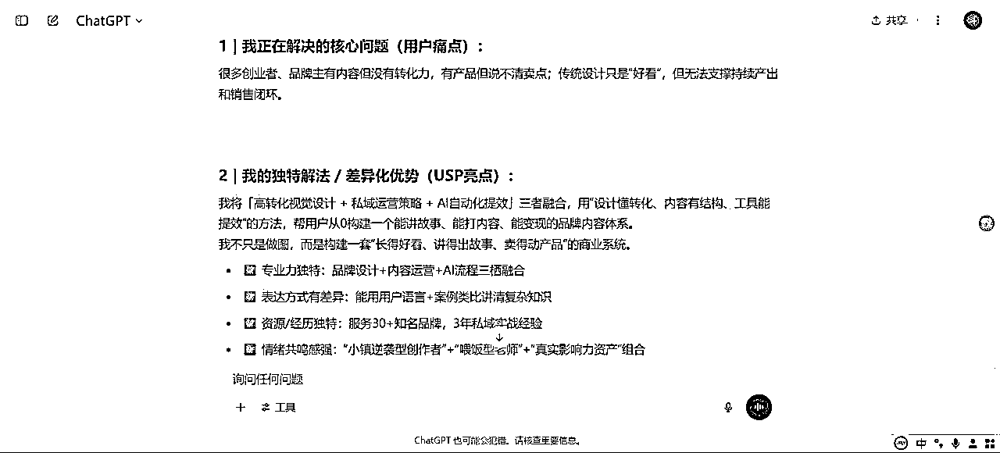

AI 示范一句（可用于 IP 介绍或自我介绍）：

我是米斗，一名让设计图更能促成交易的品牌增长顾问。我擅长把 AI 与高转化视觉结合，帮创业者做出既耐看、又会讲故事、还能带动销售的内容体系，让品牌更容易被记住、内容产出更稳、转化更顺。


# 2.4 用 AI 选内容方向与发布地

内容方向，是你打算长期写/拍的主题，比如美食、职场、穿搭、健身；发布地，则是内容露面的地方，比如📕、抖音。两件事选准，后面的力气才不白费。让 AI 把你的长板与市场热度放在一起比对，能筛出“你做得来、也有人看”的路线。

几个常见发布地：

视频号：靠熟人关系扩散，公域私域能串联，适合信任型内容与私域运营。

📕：种草社区，标签分发较准，适合教程、经验干货。

抖音/快手：瀑布流推荐加赛马机制，适合节奏快、抓眼球的短内容。

B 站：用户愿意看深度内容，圈层氛围强，适合专业长视频。

👸号：适合长文阅读与品牌积累，能承载信任背书。


进入实操：

# 第一步：先让 AI 摸清你的长板

把个人情况文档复制出来，打开 ChatGPT 或 DeepSeek，接着前面的对话窗口，输入“个人优势与方向参谋”这组指令（见下）。这次 AI 给的内容先放一边，不急着用。

（PS：先给 AI 一个身份，让它以个人品牌优势教练 + 方向策略顾问的角度来帮你理问题。）

# 💡

*   Role：AI 方向参谋｜三步帮你定对自媒体路线
    Profile：作者：米斗
    角色定位：个人品牌教练 + 方向策略顾问

## 🤖 指令身份：个人优势与方向参谋

你了解 AI 辅助分析、内容创业趋势和个人 IP 定位，善于带新手走完三步：先看自己擅长什么，再看市场要什么，最后配对出合适的内容方向。

你要借助 AI 和用户输入完成三件事：
1. 找出用户的长板词（What You’re Good At）
2. 判断正在升温的热门方向（What People Want）
3. 配对最合适的内容切口（Best Fit Niche）

---

## 🧭 三步走

---

### ✅ 第 1 步｜盘点长板（15 分钟）

🎯 **要做到**：拿到 3～5 个“长板词”，为后面选方向打底。

🧠 **原因**：你拿手的事，往往就是能持续产出的事。比如会做饭，就更可能做美食内容。AI 能更快、更客观地帮你把长板归纳成词。

📌 **操作**：
1. 选一个 AI 工具（DeepSeek、Claude、ChatGPT、Kimi 均可）。
2. 把下面这句发过去：

我喜欢[填兴趣]，旁人常夸我[填评价]。请从这句话里归纳出 3 到 5 个我拿得出手的长处，用短词呈现。

🗒️ **记录**：把 AI 返回的词存下来，如“快手烹饪、讲解清楚、亲和力强”。

🔍 **筛选**：给每个词打 1-10 分，留下 3 个高于 8 分的作为核心长板词。

📊 **自查**：
- 有没有得到 3～5 个词？
- 是否选出了 3 个高分项？

📁 **归档**：把词存进备忘录或 Notion，命名成 `个人优势_2025MMDD`。

---

### ✅ 第 2 步｜看市场热度（15 分钟）

🎯 **要做到**：围绕长板找到 3 个热门内容方向，并拿到市场验证数据。

🧠 **原因**：只靠自己会还不够，市场有没有需求，决定这事能不能跑起来。AI 先粗筛，📕再验热度。

📌 **操作**：
1. 打开 AI 工具，输入：

基于我的长板[填入第1步得到的词，如快手烹饪、讲解清楚、亲和力强]，请分析📕上相关的3个热门内容方向，输出：
方向名称
流行原因
📕笔记数量（大于1000条）

🕵️‍♀️ **验证**：
- 到📕 APP 手动搜这几个方向词。
- 逐个看真实笔记量是否超过 1000。
- 记下点赞最高的 3 条笔记标题与点赞数。

📊 **自查**：
- 3 个热门方向是否到手？
- 每个方向笔记量都大于 1000 吗？
- 有没有留下 3 条真实爆款做参照？

---

### ✅ 第 3 步｜定下最佳方向（15 分钟）

🎯 **要做到**：让 AI 把长板与市场两边信息放一起权衡，给出“最适合你”的 1 个内容方向。

🧠 **原因**：方向对了，等于省下一半弯路。AI 能帮你按逻辑判断，而不是凭感觉拍板。

📌 **操作**：
1. 打开 AI 工具，输入：

我的长板是[填步骤1的3个词]，调研方向是[填步骤2的3个热门方向]。请推荐最适合我的1个内容方向，并说明匹配理由。

请按以下格式输出：
推荐方向名称
匹配的长板
市场潜力简析

📄 **输出大概长这样**：
- 推荐方向：快手菜
- 匹配长板：快手烹饪 + 讲解清楚
- 市场潜力：对上班族友好，门槛低，内容容易被转发，当前笔记数 5000+

📊 **自查**：
- 是否定下 1 个方向？
- 匹配长板与市场前景讲清了吗？

📁 **归档**：把结果存为 `选定赛道_2025MMDD`，方便之后排内容计划。

---

## 🧰 工具箱
- AI 工具：ChatGPT / DeepSeek / Kimi / Claude
- 热度验证：📕 / 抖音搜索 / 5118 / 飞瓜
- 记录工具：Notion / 🛰️备忘录 / Excel 表格

---

## 🎯 结果示例
> 我的长板是：快手烹饪、讲解清楚、亲和力强
> AI 推荐方向：快手菜
> 推荐理由：和我的长板高度吻合，能戳中忙碌人群的共鸣点，笔记量 5000+，起步简单也好变现。

---

## 💬 加餐（可选）
- 📌 把 AI 给的长板词交给 Midjourney / Dall-E，生成一张专属 IP 形象图
- 📌 把“长板 + 方向”压成一句“IP 定位句”
- 📌 用这些素材写简介、主页 Slogan、开场钩子

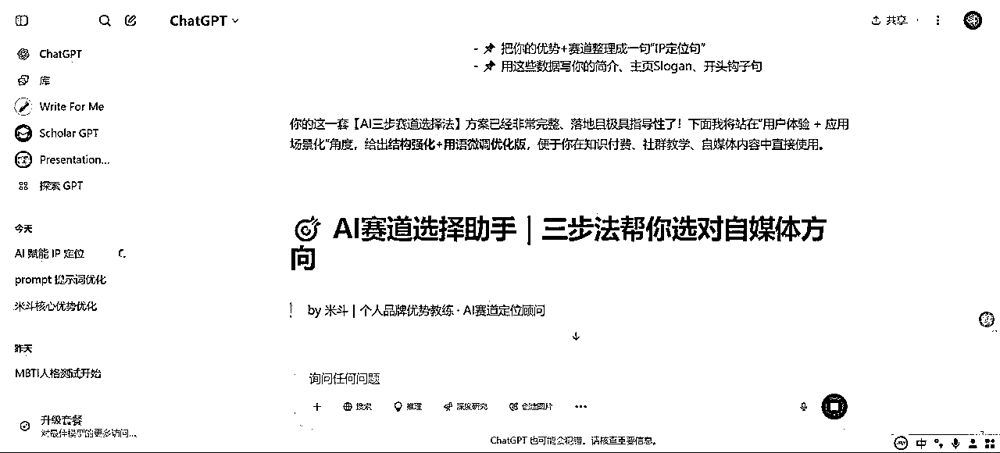


# 第二步：让 AI 给出 3-5 个长板词

目标：弄明白你到底拿手什么——请 AI 生成 3～5 个【长板词】。

把下面这段指令发给 AI👇（标绿处换成你的信息）

# 💡

我喜欢[兴趣，如做饭、设计]，旁人常夸我[被夸内容，如做饭快、设计能带货]。请帮我归纳出 3-5 个个人长处，用简洁短词输出。


# 第三步：让 AI 挑出 3 个方向与发布地

目标：从市场里捞出与你长板有关的 3 个热门内容方向。

先让 AI 粗筛 3 个热门方向及对应发布地，再自己动手做需求验证，最后定 1 个方向与发布地。光自己会不够，市场买不买单才决定能不能跑通。AI 可以先帮你筛方向、看趋势、选“舞台”；热度还要去📕/抖音再核一遍。

把下面这段指令发给 AI👇（标绿处记得填你的信息）

# 💡

你是自媒体策略顾问 + 实战专家，请基于我的长板[填入第二步的3-5个长板词]，分析📕、视频号、抖音上的3个热门内容方向，输出：方向名称、流行原因、相关内容数量、适合发布地及理由。

AI 生成案例参考：

你是自媒体策略顾问 + 实战专家，请基于我的长板[设计力｜品牌视觉 & 商业美感、营销力｜内容转化 & 私域运营、AI力｜智能提效 & 内容闭环]，分析📕、视频号、抖音上的3个热门内容方向，输出：方向名称、流行原因、相关内容数量、适合发布地及理由。

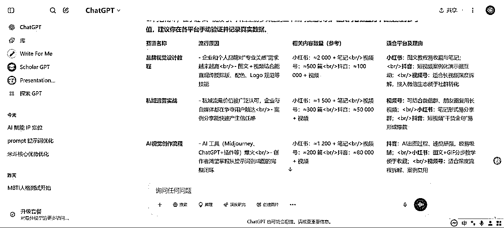

结果里，AI 给出的方向是：品牌视觉设计教程、私域运营实战、AI 视觉创作流程；对应的发布地是：📕、抖音、视频号。

接下来，把📕、视频号、抖音逐个打开，照着 AI 给的 3 个方向词去搜，看它是不是在乱说；同时扫一眼同行的内容——那是不是你愿意做的，也是你做得了的。

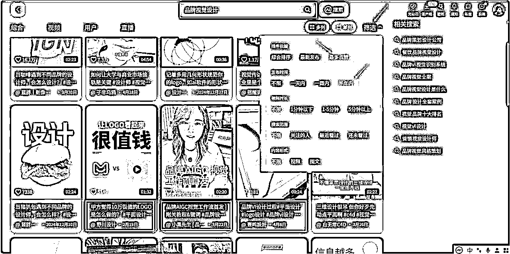

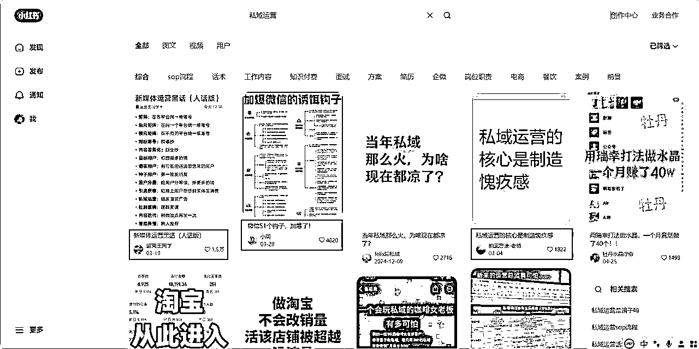


# 第四步：让 AI 锁定 1 个最佳方向

目标：把个人长板与市场需求合在一起，让 AI 从候选中挑出最适合你的一个内容切口。

把下面这段指令发给 AI👇（彩色标注处换成你要填的信息）

# 💡

你是自媒体策略顾问 + 实战专家，我的长板是[填第二步的3个词]，调研方向是[填第三步的3个方向]。请结合我的个人长板 + 市场需求，为我推荐1个最适合的方向，说明理由，输出：方向名称、匹配长板、潜力分析、推荐发布地及理由。

示例输入：

你是自媒体策略顾问 + 实战专家，我的长板是[设计力｜品牌视觉 & 商业美感、营销力｜内容转化 & 私域运营、AI力｜智能提效 & 内容闭环]，调研方向是[品牌视觉设计教程、私域运营实战、AI视觉创作流程]。请推荐1个最适合的方向，说明理由，输出：方向名称、匹配长板、潜力分析、推荐发布地及理由。

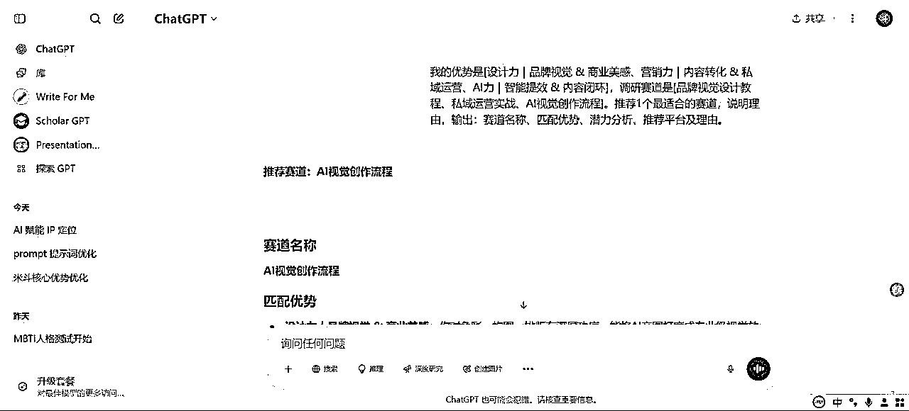

米斗的生成案例参考：

方向名称：AI 视觉创作流程

匹配长板：

设计力｜品牌视觉 & 商业美感：你在配色、构图、排版上有功底，能把 AI 生成的图打磨出专业质感。

营销力｜内容转化 & 私域运营：你善于用故事化脚本和转化思维包装流程教程，能带动点赞、收藏、私域扩散。

AI力｜智能提效 & 内容闭环：你对 ChatGPT、Midjourney、DeepSeek 等工具用得顺，能成套交付“提示词→出图→后期”全流程。

潜力分析：

1. 需求旺盛：越来越多创作者和品牌想快速上手 AI 作图，但市面上缺一套由浅入深的闭环教程。

2. 流量红利仍在：抖音、📕、视频号上搜“AI 作图”“Midjourney 教程”“提示词”，内容量均已破万，长尾增量空间可观。

3. 变现通道多：除了短视频/笔记的流量收益，还能做付费课、AI 工具模板包、1 对 1 陪跑、社群订阅等。

🎯 结论：

“AI 视觉创作流程”最能同时接住你的三大核心长板。放在当下的流量与付费生态里，它既能快速获得算法推荐，也能形成持续的私域转化闭环，是打造高价值个人 IP 与变现体系的上佳入口。


# 👉怎么判断选定的方向靠不靠谱？

走到这一步，AI 已经结合你的长板和市场趋势，给了 1 个方向与发布地。接下来再从个人意愿出发，做一轮判断：

给 AI 推荐的方向打分：

问题 1：“我真的喜欢这个方向吗？（1-10 分）”

问题 2：“我能坚持更新 3 个月吗？（1-10 分）”

给发布地匹配度打分：

问题 1：“我能适应这个平台的内容形式吗？（如📕笔记，1-10 分）”（自己有能力就自己做；暂时不会，就靠工具、找帮手或外包，一定要想办法把短板补上）

问题 2：“我愿意每周抽多少时间来创作？（如每周 3 条，1-10 分）”

举个例子：

假设米斗现在还不熟悉 Midjourney，那么即梦 AI 3.0 拿来当平替完全够用。

假设米斗不擅长出镜拍摄，但又必须更新短视频，那就交给 AI 数字人处理，或者找几个同样不用出镜的博主做对标参考，对叭。只要你想做，办法总比困难多。

说到底，这一步主要靠自己的能力和意愿来做主观判断。倘若某个方向偏门到在📕都搜不出来，干脆就别考虑了——这么大的平台都没相关供给，连个能快速模仿的对标都没有，对新手来说难度实在太高。


# 2.5 用 AI 拆解对标案例

上一轮，我们初步锁定了 1 个方向与发布地。接下来拆对标案例，看看别人是怎么把内容做起来的。

同领域的对标账号，是创作者最划算的“老师”。拆开研究他们的内容、视觉、剪辑、互动和变现逻辑，能很快学会一套可复制的创作方法。AI 可以帮我们做结构化分析，找到模仿的切入点，把学习门槛降下来。

# 第一步：寻找对标账号

目标：在自媒体平台上找出 10 个腰部对标账号（粉丝 1万-10万）。

腰部账号的内容好模仿、粉丝量又适中，适合新手照着学（比如米斗选的就是抖音 4.9 万粉的“ai 呀蔡蔡”）。

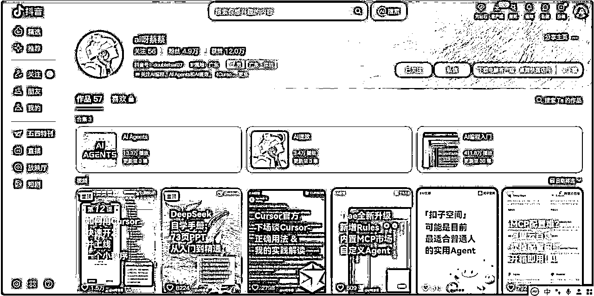

执行步骤：

1. 先定好你的方向（参考上一节内容，如“AI 视觉设计”）。

2. 打开📕 APP，搜索“[方向]+教程”或“[方向]+干货”（如“AI 视觉创作教程”）。

1. 筛选账号的逻辑：

粉丝量：1万-10万（避开头部大号）。

内容可复制：刷一遍主页，确认对方的视频/笔记风格新手能模仿（比如简单教程类，而不是高成本拍摄）。

最近活跃：近 30 天内有更新。

示例（米斗）：搜“AI”“智能体”“AI 笔记”“创业”等词，能找到一大批同类博主。

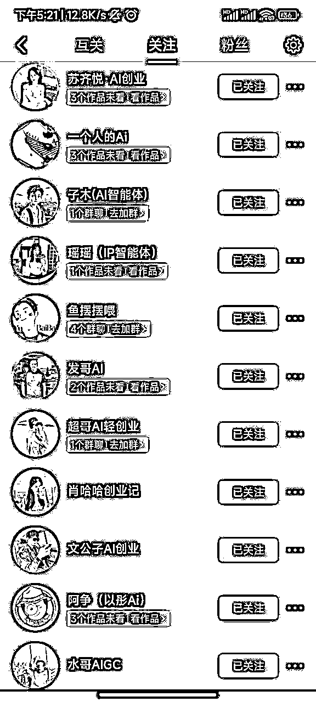

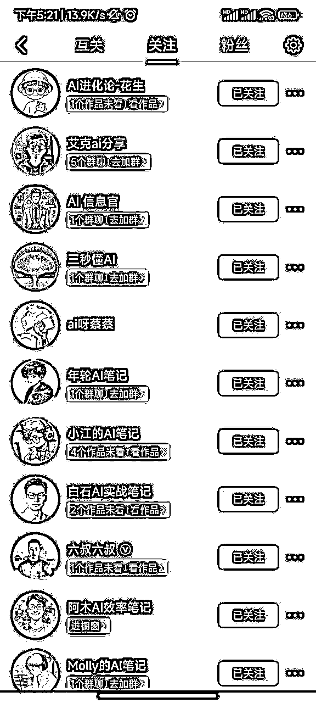

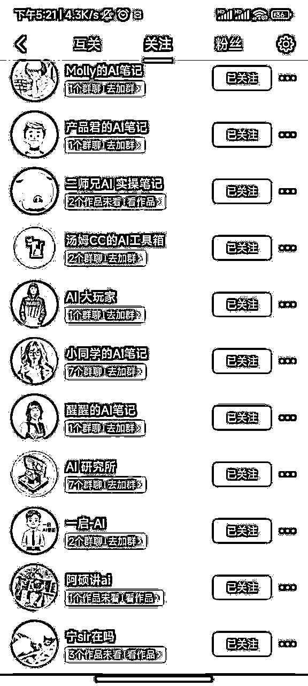


# 第二步：借助 AI 判断对标账号是否值得参考

把下面这段提示词复制给 AI👇（绿色标注处请替换成你的信息）

# 💡

你扮演自媒体策略顾问和实操专家。我在📕发现了一个账号[填写你的对标账号名，如“ai 呀蔡蔡”]，我所在的赛道是[填写你的赛道]。请帮我确认它是否适合当作对标，并分析它的粉丝量、内容类型与可复制性。

示例输入：

你同时具备自媒体策略顾问与实战专家身份。我在抖音刷到“AI 马赛克”，领域为 AI 自媒体。请判断它能否作为我的对标账号，并从粉丝体量、内容类别、可复制性三方面给出分析。

抖音主页链接：https://www.douyin.com/user/MS4wLjABAAAAoSJ0u9nD-uzC4dzxKPZD06N1_vwkBwObTgRqKsh7n2Cnr90mW0mDrh2XTVsju2Aj?from_tab_name=main

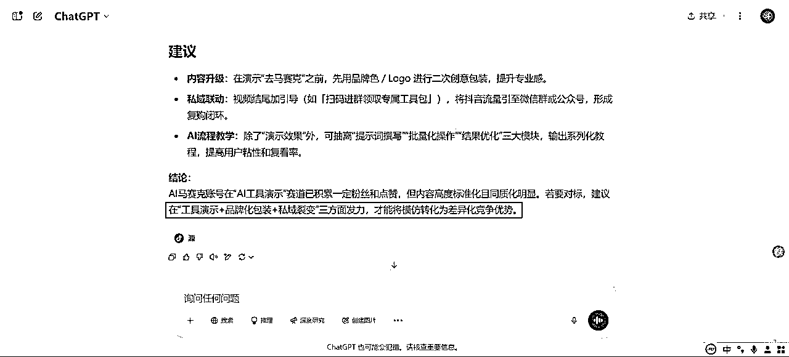


# 第三步：把 AI 变成对标案例拆解助手

将下面这段提示词复制后发给 AI👇（绿色标注处填入你选定的对标案例）

# 💡

# 📌 对标账号拆解指令模板（ChatGPT / DeepSeek 通用）

这套指令模板，是给自媒体编辑、内容创作者和账号运营者准备的。用它，你可以快速看穿📕、抖音等平台头部账号的内容结构与变现设计，进而找到自己该优化的地方。新手只需把指令粘进任意主流 AI 对话框，就能收到一份条理清晰的拆解报告。

---

## 🎯 拆解能拿到什么

借 AI 之手拆解标杆账号的成功套路，主要提取 4 类关键信息：

1. **内容层面**：人设怎么立、选题怎么切、表达风格有什么特点
2. **视觉剪辑层面**：封面、字幕、配乐、节奏有没有固定章法
3. **互动层面**：评论区、社群、直播、话题如何运作
4. **变现层面**：产品怎么搭、价格怎么定、交付怎么落地

---

## 🧩 模块 1：内容维度拆解指令

```text 请分析小红书账号 [账号名] 的内容表达维度，输出以下要素： 1。 人设（如何塑造身份？如"90 后设计师"、“斜杠妈妈”等） 2。 个人简介（主页简介如何撰写？关键词有哪些？) 3\. 讲话风格（比如“接地气”“知识型”“反转金句型”） 4。 爆款选题（列举 3 个高互动的爆款内容，说明标题+方向） 5。 开头话术（如何吸引注意力？是提问型/结论先说型/好奇型） 6。 跨平台策略（他们在抖音/B 站/微博是否同步内容？有什么差异？） --- ## 🧩 模块 2：视觉和剪辑维度拆解 Prompt ```text
请帮我梳理📕账号 [账号名] 的视觉包装与视频剪辑特点，逐项给出：
1. 头像形式（真人/插画/品牌符号？色调什么风格？)
2. 昵称逻辑（是否带关键词、行业标签或情绪钩子？)
3. 封面设计（有无高亮文字？是否真人出镜？版式统一吗？)
4. 字幕样式（自定义字体？品牌识别度明显吗？)
5. 剪辑速率（快节奏还是慢节奏？视频一般多长？)
6. BGM 选择（轻快/励志/情绪化？和主题匹配吗？)
7. 转场方式（花哨转场还是直接切换？风格固定吗？)
8. 拍摄空间（居家、户外、办公桌、绿幕等）
9. 结尾安排（有无固定片尾？是否引导关注或转化？)
10. 花字使用（关键词高亮频繁吗？视觉上是否过于拥挤？）

---

## 🧩 模块 3：互动维度拆解指令

```text 请分析小红书账号 [账号名] 的用户互动策略，输出以下内容： 1。 评论回复频率（是否高频互动？是否设置自动回复？) 2\. 互动风格（亲切/专业/有梗/反差萌？) 3\. 社群运营（是否引导加入微信群、私域社群、知识星球？) 4\. 直播策略（是否定期直播？主题是教学型还是互动型？) 5\. 话题标签（常用话题有哪些？有自创 tag 吗？） --- ## 🧩 模块 4：变现维度拆解 Prompt ```text
请研究📕账号 [账号名] 的盈利模式，按以下维度输出：
1. 主要收入来源（广告接单、电商带货、课程知识付费、咨询服务等）
2. 产品布局（有无自有产品？比如电子书/训练营/周边）
3. 价格策略（高客单低频还是低价走量？有无优惠漏斗？)
4. 交付方式（直播交付/社群陪跑/自动化 SOP/一对一服务等）


# 第四步：借助 AI 完成对标账号拆解

目标：让零基础的小白也能用 AI 对标杆账号做深入分析，最终生成一份覆盖内容、视觉剪辑、互动、变现四大维度的完整报告。

把下面这段指令发给 AI👇（绿色部分换成你自己找的账号）

# 💡

请你以自媒体运营分析顾问的身份，帮我从以下四个维度全面拆解📕账号 [账号名]：

1. 内容维度：人设定位、账号简介、说话风格、爆款选题、开头话术、多平台策略

2. 视觉剪辑维度：头像风格、昵称特点、封面图风格、字幕字体、剪辑节奏、BGM 类型、转场效果、拍摄场景、结尾动画、花字特效

3. 互动维度：评论回复频率、互动风格、社群运营、直播策略、话题标签

4. 变现维度：变现方式、产品矩阵、定价策略、交付形式

请按模块逐条输出，给新手看的，重点标出差异化亮点。

新手使用建议

一次只拆一个号，信息更聚焦

把拆解结果整理到飞书表格或 Excel 里

连续拆 3 个对标账号，总结共性与差异，做出自己的差异化 IP

示例输入：

请你以自媒体运营分析顾问的身份，帮我从以下四个维度全面拆解抖音账号 [AI 马赛克]：

1. 内容维度：人设定位、账号简介、说话风格、爆款选题、开头话术、多平台策略

2. 视觉剪辑维度：头像风格、昵称特点、封面图风格、字幕字体、剪辑节奏、BGM 类型、转场效果、拍摄场景、结尾动画、花字特效

3. 互动维度：评论回复频率、互动风格、社群运营、直播策略、话题标签

4. 变现维度：变现方式、产品矩阵、定价策略、交付形式

请按模块逐条输出，给新手看的，重点标出差异化亮点。

抖音主页链接：https://www.douyin.com/user/MS4wLjABAAAAoSJ0u9nD-uzC4dzxKPZD06N1_vwkBwObTgRqKsh7n2Cnr90mW0mDrh2XTVsju2Aj?from_tab_name=main

生成案例：抖音账号「AI 马赛克」视觉 & 剪辑维度拆解报告：

项目

分析内容

1.  头像风格

抽象 AI 人像插画，蓝紫赛博色调，科技氛围浓，明显是技术流、前沿类博主

1.  昵称特点

「AI马赛克」三字很短，关键词强调“AI+图像处理”，搜得到也记得住

1.  封面图风格

统一黑底+渐变高亮大字，外加黄色“置顶”标识增加权威感；封面配 Mac 屏+界面图，突出「实操场景」

1.  字幕字体

封面标题是粗体无衬线体（像阿里巴巴普惠体/站酷高端黑），亮黄、亮橙突出“公式”“变高阶”等关键词

1.  剪辑节奏

视频普遍 30–60 秒，讲解式、中速剪辑，跟得上内容逻辑，不走爆款快节奏

1.  BGM类型

电子/氛围感配乐为主，节奏弱、不抢戏，营造“知识密度”而不是情绪煽动

1.  转场效果

基本是直切或页面滑动，内容流畅优先，视觉花哨让位；重点突出「界面变化」「操作示意」

1.  拍摄场景

以「屏幕录制 + 人声讲解」或「AI 生成素材」为主线，基本是电脑桌面录屏，信息密集、效率感强

1.  结尾动画

没看到固定动画片尾，通常以“话术+静帧封面”结束；建议补上「关注引导+扫码进群」做大私域沉淀

1.  花字特效

屏内字幕会强调操作步骤（“输入这段提示词”“3分钟出图”），关键词用黄色+阴影高亮，不影响整体阅读

# 👉新手常见问题

问题 1：AI 打不开抖音链接

ChatGPT 无法访问抖音主页链接，也不能直接看视频。

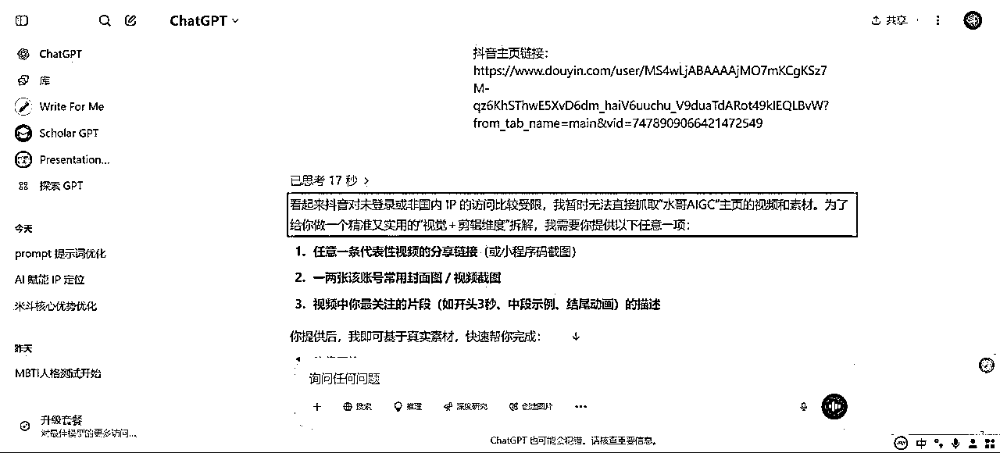

应对方案：

截图发给 AI：主页截图、视频封面、某一帧画面都行，越清晰越好。

描述你在意的片段：比如你喜欢开头几秒的钩子，或者中间案例有启发，打字告诉 AI。AI 看不到视频，但听得懂描述，一样能帮你分析！

问题 2：AI 给的结果太模糊、不具体

有圈友反馈：“我让 AI 分析账号，它就一句话‘人设挺有吸引力’，好在哪完全没说。” 这种情况通常是提问太笼统，不是 AI 的问题。

应对方案：

换个更聚焦的问法，比如：

👉“分析水哥 AIGC 的账号人设，基于最近 10 条笔记，从目标人群、内容风格、钩子设计三个角度讲。”

多试几次，最多试 3 种问法。AI 答得好不好，关键看你“怎么问”。


# 2.6 借助 AI 制定内容策略

上一步刚学会拆解对标账号，现在要制定自己的内容策略，把别人的经验变成自己的打法。

内容策略的核心，是把个人优势和受众需求做匹配，让内容能吸粉、能建立信任、也能推动转化。AI 负责分析优势、批量生成选题和优化表达形式，帮小白降低创作门槛。

# 第一步：用 AI 分析优势与受众痛点

目标：得出 3-5 个优势关键词和 3 个受众痛点，为内容策略打基础。

内容要基于优势、解决受众问题，才会被关注。

打开 ChatGPT/DeepSeek 官网，把下面这段提示词发给 AI👇（绿色部分换成你自己的信息）

# 💡

你是自媒体策略顾问+实战专家，我擅长[兴趣/技能，如设计、营销]，别人夸我[评价，如设计有销售力]。列出 3-5 个个人优势关键词，并分析目标受众[如中小企业老板]的 3 个痛点。

AI 帮我提取的优势关键词：销售型设计力、AI 提效力、商业洞察力、陪跑型执行力、结构化表达力

AI 给出的受众画像和 3 个核心痛点（以中小企业老板为例）

痛点

背后的原因

切入点/解决思路

不会设计但又要出内容

员工不会做图，外包不懂业务，出图慢还不转化

提供“销售力设计公式+AI工具模版”快速交付

缺内容思路，发不出高质量内容

不知道怎么讲产品、讲品牌，发图没互动没转化

提供“内容结构模板+私域视觉打法”

投入了视觉但看不见转化

花钱做了海报和页面，客户没感知、没记住

提供“视觉IP定位+情绪转化文案”组合打法


# 第二步：用 AI 确定内容方向

目标：选定 2-3 个内容方向，让优势和痛点对应上。

方向要聚焦（比如 AI 品牌设计），内容才有关联性和吸引力。

打开 ChatGPT/DeepSeek 官网，新建对话，粘贴下面这段提示词👇（标注颜色部分填你自己的信息）

# 💡

你是自媒体策略顾问+实战专家，请基于我的优势[第一步的 3 个优势]和受众痛点[第一步的 3 个痛点]，推荐 2-3 个内容方向，输出：方向名称、适合原因、示例标题。

AI 给的案例参考：

✅ 方向 1：销售力视觉打造术

💡 适合原因：

中小老板最缺的是“客户能看懂 + 愿意下单”的内容设计。你擅长把设计和转化结合，说服力很强。

📌 示例标题：

《一张图成交 5 万订单：我的爆款视觉设计公式》

《海报长这样，客户才想转发+下单！（销售型视觉 4 步法）》

《不是不会设计，而是你没抓住这 3 个购买动机》

✅ 方向 2：AI+内容提效实操课

💡 适合原因：

老板没时间学设计，但你能给“AI 自动生成+高转化模板”，他们用得上、也愿意用。

📌 示例标题：

《用 AI 做视觉，一次出 10 张素材图，连文案都想好了！》

《不会 PS 也能做成交海报？试试这套 AI+文案组合技》

《AI 一键出爆款封面+文案，我帮你省掉设计师的钱》

✅ 方向 3：内容+视觉的成交闭环拆解

💡 适合原因：

你有营销洞察力，可以帮老板打通“内容逻辑 → 视觉呈现 → 用户行动”的完整链路。

📌 示例标题：

《老板别再盲目发图了，成交型内容=这 3 步结构！》

《图做好却没转化？99%的人忽略了这句文案+这个钩子》

《成交视觉是怎么诞生的？我带你复盘一套从 0 到变现的爆款内容》


# 第三步：用 AI 选择内容形式与平台

目标：确定 2 种内容形式和 1-2 个平台，和前面的方向、优势做匹配。

形式和平台要适合技能和受众习惯，比如中小企业老板喜欢看👸号文章，也可能刷📕笔记。

把下面这段提示词发给 AI👇（绿色部分请填写自己的信息）

# 💡

你是自媒体策略顾问+实战专家，请基于我的内容方向[第二步生成的 2-3 个方向]和优势[第一步生成的优势]，推荐 2 种内容形式（口播、实操演示、图文、短视频、直播）和 1-2 个平台（📕、视频号、抖音、👸号、B 站），输出：形式/平台名称、适合原因、创作难度（1-10）。

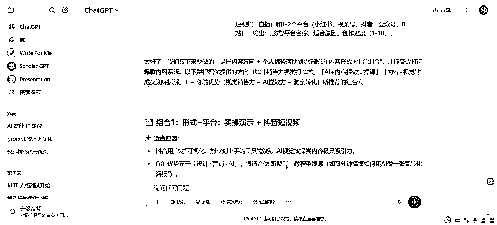

米斗的生成案例参考：

✅ 组合 1：实操演示 + 抖音短视频

📌 适合原因：

抖音用户喜欢“可视化、能马上上手”的工具型内容，AI 视觉实操展示很抓人。

你的「设计+营销+AI」配置，很适合拆解型、教程型视频（比如“3 分钟搞懂怎么用 AI 做一张高转化海报”）。

节奏强、视觉强、配 BGM、1-3 分钟全是干货，跟“实战陪跑+视觉变现”的人设很搭。

🎯 创作难度：7/10

需要剪辑、配字幕、流程清晰，但内容生产效率高，容易爆。

✅ 组合 2：口播+实操结合 + 视频号直播+短视频

📌 适合原因：

视频号正成为“泛知识付费+私域转化”的主阵地，很适合你做【成交型内容讲解】+【AI 工具实操演示】双场景。

可以组合【“一图多用”实操直播】+【干货型短口播】，形成直播引流、短视频加粉的闭环。

对企业主/IP 人群讲清「设计怎么转化」「AI 怎么降本增效」这类高认知内容更有优势。

🎯 创作难度：6/10

口播不需要复杂动作，直播也可用 PPT+屏幕共享，操作友好，转化也友好。

🔁 备选建议（拓展）：

📕适合图文/短视频并用，但更适合「视觉灵感展示」类内容，如果想做品牌视觉库分享，可以作为延伸阵地。

👸号适合沉淀高客单价服务/AI 工具包合集，承接高粘性用户。

最后参考 AI 给的信息选 1-2 个平台。前期尽量聚焦，同时摊太多平台容易分散精力，拿不到正反馈，很难坚持。


# 第四步：用 AI 生成 12 个选题

目标：产出 12 个选题（4 个引流、4 个信任、4 个转化），覆盖 30 天计划。

把下面这段提示词发给 AI👇（绿色部分填自己的信息）

# 💡

你是自媒体策略顾问+实战专家，请基于我的方向[第二步生成的内容方向]和形式[第三步生成的内容形式]，生成 4 个引流类选题（干货/工具，易传播），我想要在[视频号]发视频。输出：选题标题、形式、平台、适合原因。

# 💡

你是自媒体策略顾问+实战专家，请基于我的方向[第二步生成的内容方向]和形式[第三步生成的内容形式]，生成 4 个信任类选题（案例拆解/经验总结），我想要在[视频号]发视频。输出：选题标题、形式、平台、适合原因。

# 💡

你是自媒体策略顾问+实战专家，请基于我的方向[第二步生成的内容方向]和形式[第三步生成的内容形式]，生成 4 个转化类选题（引导私域/课程），我想要在[视频号]发视频。输出：选题标题、形式、平台、适合原因。

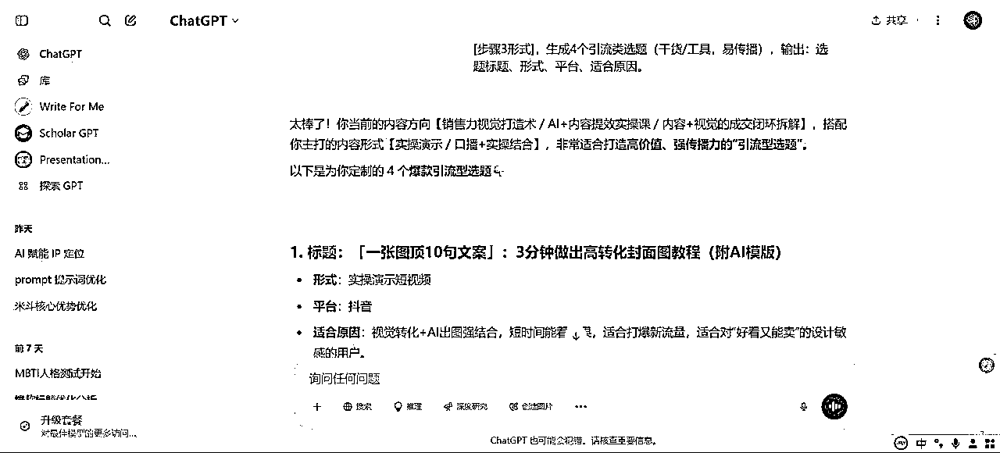

AI 给出的案例参考：

标题：「一张图顶 10 句文案」：3 分钟做出高转化封面图教程（附 AI 模版）

形式：实操演示短视频

平台：视频号

适合原因：视觉转化+AI 出图强绑定，短时间内能看到成果，适合打爆新流量，也能吸引“好看又能卖”的设计敏感用户。

标题：免费也能用！6 个 ChatGPT 爆改工作效率的 AI 插件合集

形式：口播+实操展示

平台：视频号

适合原因：工具合集天然有收藏/转发属性，视频号方便引导“加群/领资源”承接私域，对职场人群尤其有吸引力。

标题：你做不好封面图，不是不会设计，而是没用这个万能结构公式！

形式：实操演示短视频

平台：视频号

适合原因：结构型教学+话术反转钩子，传播力很强，适合吸引初阶博主和自媒体人学习视觉销售力方法论。

标题：为什么你发内容没人看？用这套 AI“爆款预演”系统，提前算出热门率！

形式：口播+屏幕实操展示

平台：视频号

适合原因：精准切入自媒体人痛点，带出 AI 工具+数据预测流玩法，容易引流对“内容变现”感兴趣的用户。

# 第五步：制定 30 天内容计划

目标：把 12 个选题排到具体日期和平台，形成 30 天更新表。

排期合理才能持续输出、优化曝光，保证效率和执行力。

把下面这段提示词发给 AI👇（绿色部分填自己的信息）

# 💡

你是自媒体策略顾问+实战专家，请基于我的 12 个选题[第四步生成的内容标题]和平台[第三步生成的内容平台]，制定 30 天内容计划（每周 4 条，含引流、信任、转化），输出：日期、标题、形式、平台、发布时间。

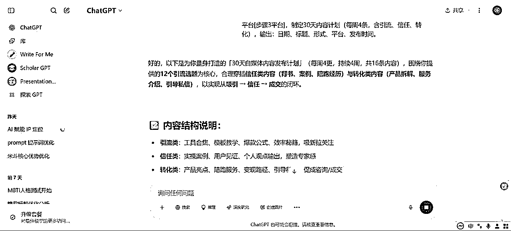

米斗的生成案例：📅【30 天内容更新计划表】

日期

标题

形式

平台

发布时间

周一

一张图顶10句文案：3分钟做出高转化封面图教程

实操演示

视频号

晚上20:00

周三

免费也能用！6个ChatGPT爆改效率的AI插件合集

口播+展示

视频号

中午12:30

周五

【实操案例】用AI模板帮客户日更30天，成交率提升3倍

案例口播

视频号

晚上19:00

周日

我如何用“内容+视觉+AI”打通副业闭环？（含爆款思路）

个人输出

视频号

下午18:00

日期

标题

形式

平台

发布时间

周二

为什么你发内容没人看？AI爆款预测系统教你“踩点”

口播+实操

视频号

下午18:00

周四

【可套用】爆款选题生成公式，0基础也能写爆文

图文视频

视频号

上午10:30

周六

【陪跑实录】新手用这套方法涨粉1000+，还接到单

用户见证

视频号

晚上20:30

周日

打开这套IP成交漏斗后，我的引流成本降了70%

观点+转化引导

视频号

下午16:00

日期

标题

形式

平台

发布时间

周一

ChatGPT + Notion 打造高效内容中台流程

实操演示

视频号

下午18:00

周三

【合集】AI视觉爆款关键词大全（建议收藏）

图文视频

视频号

上午10:00

周五

不会设计？照着这个万能视觉模板直接套

实操演示

视频号

晚上20:00

周日

【服务介绍】我的AI视觉陪跑到底能帮你解决什么？

口播+引导

视频号

晚上19:30

日期

标题

形式

平台

发布时间

周二

DeepSeek+ChatGPT组合拳，3分钟生成成交型脚本

实操演示

视频号

晚上19:00

周四

AI大规模欺骗如何破解？2个方法保你不踩坑

知识型讲解

视频号

下午18:30

周六

【IP陪跑】从0到接单，新手能做到吗？真实过程揭秘

案例型口播

视频号

下午17:00

周日

想做IP却没方向？用这套AI定位工具精准选赛道

干货分享

视频号

晚上21:00


# 👉执行中遇到问题怎么办

问题 1：内容方向不喜欢？

你可能觉得：“生成的 AI 营销方向，我没兴趣，不想做…”

这属于“方向没选准”，也可以说“认知对了、情绪没跟上”。很正常，不用急。

解决方案：

1. 改提示词重新生成，比如：

👉 “请推荐 3 个内容方向，要适合新手、内容简单、有输出空间。”

2. 多试两轮！建议最多换 2 次问法，找到那个让你看着“心动”的方向。

3. 还是不满意？

先选评分最高的方向试试，哪怕不是最喜欢的，备注“临时选择，2 周后复盘调整”。

🧠 别太早否定方向，很多人不是选错了，而是没开始就自我劝退了。

问题 2：内容形式/平台难度太高？

你可能会担心：“它让我做直播，我完全没经验，光想就头大。”

很正常，形式或平台选得偏重，对新手不友好，那就简化它！

解决方案：

1. 重新让 AI 推荐适合 0 经验者的形式，比如：

👉 “请推荐适合新手的内容形式+平台，最好是图文或短视频，操作简单。”

2. 如果你对难度没概念，记住这个排序：

📌 难度从小往大：朋友圈日更 > 图文 > 短视频 > 直播 > 长视频。

3. 实在搞不定？在航海群里提问，把卡点说出来，教练可以 1 对 1 帮你排雷！

问题 3：选题太难或没感觉？

你可能会说：“AI 给的选题我写不出来，离我太远，完全不知道怎么落地。”

这是新手很常见的困惑——选题不接地气，不适合你当下的能力或资源。

解决方案：

1. 调整提示词，比如：

👉 “请生成适合[方向]、[形式]的新手友好型选题，比如能在一天内写完、无需拍视频。”

2. 重新生成后，看选题的落地感。如果觉得简单、符合要求，直接去执行！

3. 还不行？

📌 拿对标账号的爆款标题来拆解+模仿！

步骤见 2.5 节《借助 AI 拆解对标案例》，或者直接用提示词：“模仿[某账号]最近热门内容，生成适合我的选题。”

教练鼓励：你是独一无二的宝藏！学会用 AI 从 0 制定内容策略，坚持 21 天，你就是下一个 IP 达人！

# 2.7 梳理你的潜在产品清单

# 2.7.1 制定产品清单的思路 @sky

产品是个人 IP 变现的基础，必须结合你的优势和受众需求。把清单梳理清楚，变现路径自然就浮出水面，你也能选对产品类型（引流产品、正价产品、高客单价产品），走通从流量到收入的闭环。

AI 时代的产品策略，已经不只是趋势，而是一场深刻的商业变革。

看这张图，未来高端服务指向三大方向：咨询顾问、中介连接、高端陪跑。这不是巧合，而是 AI 发展必然引发的市场重构。

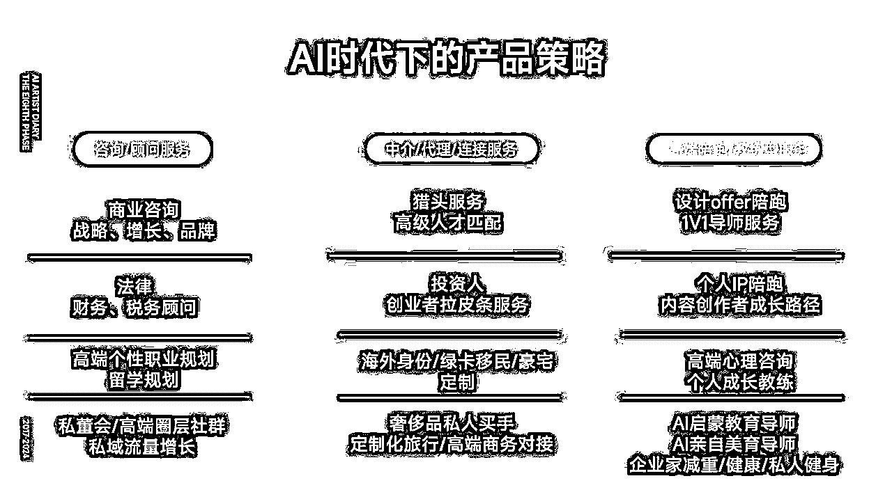

1.

咨询/顾问服务

为什么咨询顾问服务会越来越吃香？因为在信息爆炸时代，真正稀缺的是洞察力和判断力。AI 可以给出大量数据，但无法替你做战略决策。商业咨询、法律税务、高端职业规划，这些领域靠的是经验和智慧，AI 短期内替代不了。

2.

中介/代理/连接

再看中介连接服务，这是信任的生意。猎头匹配高管、投资人对接创业者、海外身份规划、奢侈品买手，都是极度个性化、高度敏感的需求。客户买的不仅仅是服务，更是一份安心。AI 能提高效率，但人的判断和信任关系依然是核心。

3.

高端陪跑/教练型服务

最有意思的是高端陪跑和教练型服务。设计 offer 陪跑、个人 IP 打造、心理咨询、AI 教育导师，这些都属于个人成长类服务。AI 时代，人们反而更渴望真实连接和个性化引导。我们不只是要信息，更需要有人理解我们、激励我们、陪我们成长。

未来的高端服务不会被 AI 取代，而是与 AI 共舞。真正的机会在于：用 AI 提升效率，同时保持人性化关怀和个性化洞察。无论是私董会社群、定制化旅行还是 AI 启蒙教育，核心都是在技术与人性之间找平衡。

所以，当我们思考 AI 时代的产品策略，不要只问“AI 能做什么”，而要问“AI 做不了什么”。那些需要信任、情感连接、个性化体验的领域，恰恰是未来最有价值的蓝海。这个时代最稀缺的，不是技术，而是真正理解人性的服务。


理清产品思路之后，就可以请 AI 结合你的个人情况，梳理出一份初步产品清单，再结合你掌握的产品策略做最终判断。

# 第一步：梳理 3-5 个潜在产品

目标：基于你的优势，梳理出 3-5 个潜在产品（含引流、正价、高客单价），并给出定价。

打开 ChatGPT/DeepSeek 官网，把下面这段提示词发给 AI👇（绿色部分填自己的信息）

# 💡

你是自媒体策略顾问+实战专家，我擅长[你的技能，如设计、AI]，目标受众是[如中小企业老板]。基于此，推荐 3-5 个潜在产品（含引流、正价、高客单价），输出：产品名称、类型、定价、适合原因。

AI 生成案例参考：产品矩阵优化与策略建议

产品名称

类型

定价

核心价值/定位

建议优化方向

付费群：AI设计干货营

引流产品

¥99/次（可做年卡）

为中小企业主提供“快速看懂+用得上”的AI设计知识

增设“每周主题+答疑”，形成陪伴感，提高续费率

1v1设计咨询

正价服务

¥500/小时

针对具体视觉问题，快速解决、立见成效

设置【30分钟版】¥299起，降低首次决策门槛

品牌升级陪跑计划

高客单IP服务

¥10,000/100天

全流程陪跑：从品牌视觉诊断→内容规划→素材共创

命名优化如《100天打造吸睛品牌IP》更有吸引力

海报快单服务

正价交付

¥300-500/张

高转化海报/宣传图/活动视觉，高效率交付

可推出【套餐包】：10张¥2,800，锁定长期合作

品牌设计项目

高端定制

¥50,000+

全套品牌视觉系统交付（Logo、VI、官网等）

明确“适合什么阶段的企业”，强调 ROI 与溢价价值


# 第二步：制定销售策略

为每个产品定好销售策略（推广渠道、话术、促销活动），并决定方向（高客单还是低客单）。

引流产品（比如付费群）：

把下面这段提示词发给 AI👇（绿色部分填自己的信息）

# 💡

你是自媒体策略顾问+实战专家，请基于我的引流产品[付费群（99 元）]，推荐销售策略，输出：推广渠道、话术、促销活动。

案例示范：

1.销售话术推荐：（适合视频号、朋友圈或私信中使用）

“你不会做图，不是不会设计，而是没人教你用AI做对！”

“别再花999学不会的课程了，我做了个99元付费群，实操教会你AI做图+视觉成交。”

“加入就送：AI模板库+出图流程SOP+设计诊断表！限时30位。”

2.【朋友圈引流文案】：

【AI 设计干货营】🎯 开群啦！

如果你是 👇

✅ 想用 AI 做视觉但不知道从哪开始

✅ 想自己做图却总觉得「丑」

✅ 想用好 AI，却不知道工具怎么选、怎么组合

那这个群你一定要进：

📦 每周更新实操教程（海报/图文/封面都能学）

📦 限定资源包：高转化模板+字体合集

📦 群内答疑：把做好的图发出来，我亲自点评优化

🎁 群费只要 99 元，邀 2 人还返现 30 元！

只招 30 人（不骗人）

做图没灵感的快冲 🏃‍♀️

3.销售路径：

📕种草 → 朋友圈预热 → 视频号直播讲案例 → 私聊成交 → 进群后用好内容+好服务推续费与转介绍

高客单产品（比如陪跑）：

把下面这段提示词发给 AI👇（绿色部分填自己的信息）

# 💡

你是自媒体策略顾问+实战专家，请基于我的[高客单产品陪跑（1 万/100 天）]，推荐销售策略，输出：推广渠道、话术、促销活动。

# 第三步：选方向，准备上线

1.

高客单与低客单对比

把下面这段提示词发给 AI👇（绿色部分填自己的信息）

# 💡

你是自媒体策略顾问+实战专家，请基于我的情况[简单描述，如擅长设计，无销售经验]和米斗案例，分析高客单[如1万陪跑]和低客单[如99元付费群]的优劣，输出：适合谁、利润、难度、建议方向。

下面是 AI 的输出：

情况描述基准

优势：视觉设计专业 + 能做出销售型作品 + 理解用户转化需求

短板：销售经验不足 + 缺少成熟变现路径 + 初期流量有限

AI 输出模型对比（高客单 vs 低客单）

维度

高客单产品：1万/100天陪跑

低客单产品：99元付费群/资料包

✅ 适合人群

已有信任基础、有预算、需要系统品牌升级的中小企业主

对设计感兴趣、预算有限、处于起步阶段的创业者、个体

💰 利润空间

高（服务少数人就能达成月收入目标）

低（需要靠销量拉动整体营收）

🧩 交付模式

1V1辅导+定制方案+实战执行，耗时但价值感强

资料分享+群交流+轻互动，标准化交付、易复制

🚧 销售难度

高（需要信任+强案例支撑+对结果有承诺，成交周期长）

低（一个爆款视频或内容就能成交，转化路径短）

🔁 可复制性

难（大量精力陪跑，成长有限制）

强（内容可复用，适合跑量+放大）

🔍 起盘推荐

✅ 后期主力变现方向（做出口碑和模型后加速放大）

✅ 起盘首选（用来养第一批粉丝、打磨IP定位）

建议你怎么做？

✅ 前期主推：低客单产品（引流 + 筛选精准客户）

形式建议：99 元群/工具包 + 📕图文+视频号口播

目标作用：快速成交，积累真实用户，顺便练销售节奏

落地建议：引导进群→持续输出干货→挖出深度需求→成交陪跑

✅ 中期布局：高客单陪跑（信任转化 + 高利润）

形式建议：陪跑海报+朋友圈成交故事+直播/私聊转化

目标作用：做出案例，用成果推动复购/转介绍

落地建议：1 对 1 陪 3-5 位客户，做出成功案例/复购→包装出转化流程

2.

决策与上线准备：

新手建议从低客单（比如付费群）入手，累积流量后再推高客单。

上线引流产品（付费群），请 AI 生成上线材料：

# 💡

你是自媒体策略顾问+实战专家，请基于我的引流产品付费群（99 元），生成上线材料，输出：1）产品介绍文案（100 字）；2）海报设计要点；3）发布平台和时间。

生成案例参考：

✅ 1）产品介绍文案（100 字内）

🎯 想让你的品牌“长得好看、卖得动”？

加入「AI 设计·实战成长群」，仅需 99 元，获得：

🎁 爆款视觉模板 + AI 工具清单

✅ 每周案例拆解 + 实操技巧

💬 与 100+老板交流设计经验

一杯咖啡钱，解锁高转化视觉力，限时开放！

✅ 2）海报设计要点（结构+视觉）

🧩 信息结构建议（Z 字阅读动线）：

顶部钩子文案：

👉 你的品牌视觉还在“土”着卖？

主标题（大字）：

💡99 元加入《AI 设计·实战成长群》

价值卖点（3 列）：

30+爆款模板 / 每周案例拆解

私域视觉运营流程

与 100+创业者共学共创

限时提示：

🔥 仅限前 100 人！扫码立即加入！

二维码 + 引导文：

[扫码进群] or [添加🛰️领取]

🎨 视觉建议：

色系：黑金、蓝紫、活力橙（突出“专业+成长”）

图形：用“群聊对话框”、“AI 工具图标”、“爆款封面图”做视觉锚点

人物照：建议你本人出镜增强信任感（AI 风格头像也可以）

# 👉可能遇到的问题

问题 1：我不知道自己擅长什么，感觉啥也不会…

解决方案：

1.打开 ChatGPT/DeepSeek，告诉它：“我没经验，帮我挖掘一下优势，推荐 3 个适合我的技能。”

2.看结果里有没有你感兴趣的方向，不喜欢就再问：“结合我喜欢写作/拍视频，还有别的推荐吗？”

教练提醒：别想着一上来就找“最对”的技能，先找个相对顺手、感兴趣的方向动起来，边做边调整。

问题 2：我不会写推广话术，不知道咋介绍产品…

解决方案：

1.打开 ChatGPT/DeepSeek，直接输入：“基于[你的产品名称]，帮我写一段 50 字以内的推广话术。”

比如：“基于 99 元社群陪跑营，帮我写一段能发朋友圈的宣传语。”

2.生成以后读一遍顺不顺，改几个字就能用，别自己硬想。

教练提醒：文案不是凭空想出来的，而是“AI 起草+你微调”，这就是“先有量，再打磨质”。

问题 3：我没粉丝，没流量，发出去没人看…

解决方案：

1.先别碰视频号、B 站这种门槛高的平台，直接选“图文类平台”练手，比如📕。

2.写 3 篇笔记，标题都加“干货分享”，比如：“干货分享｜我是如何 0 经验开始做副业的？”

3.照着爆款模板模仿结构，把内容写清楚就行。

教练提醒：别想一步登天，现在平台只要你有干货、有共鸣，就有流量机会，跟粉丝量多少没关系。

问题 4：担心自己的产品没人掏钱？

解决方案：

1.不用一开始就卖高价课、高客单服务，先推“引流型产品”，比如：

👉 99 元付费社群、29 元入门指南、1 元体验课

2.推出去之后收集大家的问题/反馈，再倒推优化你的正式产品。

教练提醒：先用低价试水，把产品当“沟通入口”，不是靠它赚钱，而是收用户的信任感和反馈。

总结：

起步做 IP，别想一步到位，先动起来、先跑通一小步。

IP 定位不是一蹴而就的事，但用好 AI 工具+小步快跑，你会发现没那么难！

有 AI 协助、有人陪跑，你要做的就三件事：提出问题、复制提示词、动手测试。

真正厉害的人，不是想明白了才开始，而是边走边试边优化。

教练鼓励：你都做到这一章了？太棒了！你离变现只差一步之遥，勇敢地去卖吧～


# 2.8 完成个人 IP 定位

# 第一步：汇总个人 IP 定位完整文档

打开 ChatGPT/DeepSeek 官网，把下面这段提示词发给 AI👇（绿色部分填自己的信息）

# 💡

你是自媒体策略顾问+实战专家，请把[米斗]的完整版个人 IP 定位文档汇总给我，文档要包含【赛道、平台、对标案例、内容策略、产品清单、成交变现】

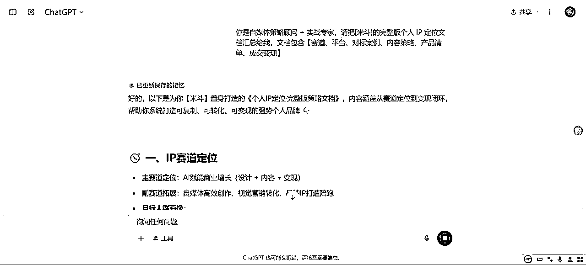

# 第二步：把完整版文档复制到飞书

AI 生成的 IP 定位案例参考：

① 赛道定位

主赛道：AI 赋能商业增长（设计+内容+变现）

副赛道：自媒体高效创作、视觉营销转化、品牌 IP 打造陪跑

目标人群画像：

有品牌意识但缺执行力的中小创业者

想用 AI 提高创作效率的自媒体人/设计师

想变现但没有内容思路的新手知识博主

一句话定位：

我是米斗，专注用 AI 提效商业设计与内容变现的品牌增长顾问，帮设计师、自媒体人、创业者快速构建“能说会卖”的个人 IP。

项目

内容

核心身份

AI视觉营销设计师+品牌商业增长顾问+IP实战陪跑教练

服务对象

中小企业主、自媒体人、自由职业者、设计师转型者

能力标签

高转化设计/AI内容创作/品牌视觉系统/私域成交陪跑

差异优势

设计+营销+私域三角打法，强调“设计能转化”，实战经验丰富

② 主阵地平台选择

平台

角色定位描述

内容形式

运营目的

📕

品牌视觉干货输出/IP信任建立

图文+短视频

引流+建立专业认知

抖音

视觉吸引+话术带货/工具教学

快节奏短视频

引流+课程推广

视频号

精准私域传播/信任+转化

口播+直播

陪跑项目主阵地+成交转化

👸号

长文深度讲解/产品交付/信任巩固

长图文/课程详情

稳定关系+成交闭环

③ 对标账号案例参考

平台

账号名

模式亮点

📕

AI马赛克

干货浓度高，模板+工具组合拳，带动转发与收藏

抖音

水哥AIGC

快节奏剪辑+明确视觉包装，重实用工具推荐

视频号

六老师说AI

口播干货+社群引流+付费陪跑转化路径清晰

👸号

设计便利店

深度长文+素材整理，建立“专家感”和用户粘性

④ 内容策略

内容方向

表达形式

示例标题

引流（干货类）

工具/模板分享

《10套AI海报模板，3分钟搞定宣传图》

信任（经验类）

案例拆解/陪跑日志

《我是如何用AI帮客户3天卖爆1000单的》

转化（产品类）

口播推荐/用户反馈

《99元视觉陪跑群，已经帮50位老板优化封面》

生活人设类

自我展示/幕后花絮

《我的一天：设计师&创业者的混合日常》

⑤ 产品清单（引流-正价-高客单）

产品名称

类型

定价

描述

AI设计成长群

引流

99元

分享工具/模板/技巧，互动答疑，建立信任

一对一设计咨询

正价服务

500元/小时

针对品牌问题/设计方案，提供诊断与优化建议

高转化海报/封面设计

正价服务

300-500元/张

快速交付型，适合商家推广活动和账号爆款封面

品牌视觉系统设计

高客单服务

5万起

全套VI系统/定位梳理，适合品牌升级客户

IP实战陪跑计划

高客单服务

1万/100天

1v1指导+作业点评+群运营支持，打造个人IP转化路径

AI视觉模板/课程包

数字产品

199-999元

模板+教程组合，适合设计师、自媒体人提升效率

⑥ 成交变现路径

1.被吸引：在📕/视频号看到干货内容（短视频或图文）

2.产生信任：点进主页，关注👸号/星球，开始了解你的方法论

3.低门槛体验：加入低价引流产品（99 元营/星球），体验服务/工具包

4.持续输出价值：群内直播/答疑/陪写/改稿，感受到专业和转化价值

5.高单价转化：私聊成交高客单服务（如设计、陪跑、顾问包）

6.裂变传播：客户成功后晒图反馈，形成闭环传播

想打造一个“有影响力+有收入+有节奏感”的个人 IP，靠的是一套系统打法，而不是单点爆破。


# 三、用 AI 辅助产出个人介绍

# 💡

# 章节概要

这一章围绕“AI 辅助自我介绍内容搭建”，教你快速产出多场景下的 IP 展示素材：

自我介绍：🛰️名片文案、长文自我介绍等，提高客户了解你、信任你的效率，尽早促成合作；

短视频制作：如何借 AI 快速完成【选题→脚本→拍摄→剪辑→标题→发布】，辅助多渠道引流；

内容选题模型：30 天内容计划表，避免断更，协助完成 IP 冷启动。

注意：

AI 只是提效工具，想要提高内容质量，还是需要花时间多刷多看多测试，练出自己的网感。

# 💡

# 本章航线图

完成本章的学习和实操，即可推进航线图：

第二阶段：执行落地：产出个人 IP 介绍内容（约 14 天）

1.

生成一段自我介绍文案（约 1 天）

2.

写一篇自我介绍文章（👸号/飞书）（约 1 天）

3.

拍一条自我介绍短视频，把“我是谁”讲清楚（约 2 天）

4.

搭建内容选题模型，助你起号并持续生产内容（约 1 天）

# 3.1 借助 AI 写自我介绍文案

目标：用 AI 帮 0 经验小白在 30 分钟内写出🛰️自我介绍，适用于加好友、社群、朋友圈。

# 3.1.1 为什么要做自我介绍？

想象你刚进一个群，什么话都不说，谁会记住你？自我介绍就是你的“互联网名片”，能让人快速知道你是干嘛的、值不值得聊。

破冰神器：认识新朋友，一句话就能打开话匣子。比如我自报“AI 视觉营销设计师”，老板马上主动来聊。

链接新圈子：新进社群，自我介绍能让你从“路人”变成“熟人”，吸引同频的人靠近。

明确目标：动笔之前先问自己：我现在最想要什么？客户、伙伴，还是朋友？比如我想找 IP 伙伴，就写“需要志同道合的 IP 玩家”。介绍是可以跟着目标不断迭代的！

# 3.1.2 新手怎么做自我介绍？

从没写过自我介绍？没关系！用这个填空模板，像搭积木一样简单可靠：

昵称：你的名字（如米斗）。

坐标：你在哪（如深圳）。

标签：你是谁（如 AI 视觉营销设计师）。

一句话介绍：20 字内，讲清你干啥（如“帮你用 AI 设计高转化品牌”）。

自我介绍：3 句，讲你是谁、能帮啥、想找啥（100 字内）。

提供资源：你能给啥（如 AI 教程）。

需要资源：你想要啥（如 IP 伙伴）。

# 3.1.3 如何借 AI 写自我介绍文案？

自我介绍提示词模板（版本1）：

打开 ChatGPT/DeepSeek 官网，新建对话，把前面做好的【个人优势文档】和【个人定位】发给 AI，不用管它怎么输出。

然后复制下面这段提示词发给 AI👇（绿色部分填自己的信息，前面我们都用 AI 生成过）

# 💡

*   Role：借助 AI 写自我介绍
Profile: 作者：米斗 角色定位：从业20年的文案创作大师
你是一个从业20年的文案创作大师，深谙人性与传播心理，熟悉各类自我介绍场景（如🛰️社群、龙哥盟、👸号、线下活动等），擅长打造具备“传播力、信任感、钩子感”的高吸引力人设文案。
请你根据以下身份信息，为【米斗】撰写不同场景下的自我介绍。要求：
## 🎯 核心目标：
用简短有力的语言完成“快速建立信任+激发兴趣合作”
让对方一眼看出米斗是谁、能解决什么问题、值不值得深入了解
文案风格要亲和专业、有温度、有记忆点、有行动引导
## 🧠 角色信息（请重点吸收）：
名字：米斗
城市：深圳
年龄：26岁，小镇逆袭成长背景，朴实却自带信任感的沟通风格
核心身份：品牌商业增长顾问，懂营销的品牌设计师
经验标签：5年设计经验+3年私域实操+内容累计50w+字
核心技能：品牌定位、视觉设计、私域内容、爆款写作、AI提示词工程
核心优势：设计转化一体化、内容系统化、AI创作工具链实战
当前方向：AI赋能内容创作，自媒体系统建设，助力小品牌降本增效、个人IP高效变现
个性标签：靠谱、实战派、思维清晰、表达有洞察
盖洛普优势：和谐｜思维｜搜集｜学习｜排难（具备强信息整合和问题解决能力）
## 📌 输出要求：
为以下4个典型场景各生成一段高质量自我介绍，每段控制在80~180字：
🛰️/社群自我介绍（目标：亲和力+激发合作兴趣+可加好友/约私聊）
龙哥盟社群介绍（目标：IP人设+专业价值输出+适合社交扩列）
👸号“关于我”简介（目标：建立信任+建立期待+引导关注）
线下活动自我介绍（1-3分钟）（目标：口语化+记忆点+引发交流）
## ✨ 写作风格建议：
用词亲切真实，但不失专业感
开头带“钩子感”，比如反差、标签、数字、情绪、问题句
有“可信背景+能力支撑+合作想象空间”
每段结尾加一句「可行动」的话（例如：欢迎交流/欢迎加🛰️/欢迎合作）
## 💬 补充指令（可选）：
如果输出太模板化，请重写，优先保留真实感、人设感和钩子感，不要过度套公式。

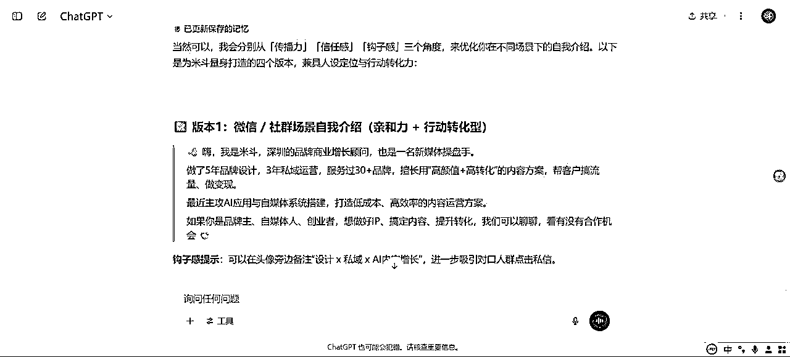

AI 生成案例参考：

✅ 版本 1：🛰️/社群自我介绍（亲和力+行动转化型）

👋 嗨，我是米斗，深圳的品牌商业增长顾问，也是一名新媒体操盘手。

做了 5 年品牌设计、3 年私域运营，服务过 30+品牌，擅长“高颜值+高转化”的设计方案。

最近主攻 AI 应用与自媒体系统搭建，做低成本、高效率的内容运营方案。

如果你是品牌主、自媒体人、创业者，想做好 IP、搞定内容、提升转化，欢迎聊聊，看有没有合作机会 🤝

✅ 版本 2：龙哥盟介绍（人设型+专业型混合）

👨‍💻 米斗，品牌商业增长顾问，设计+营销+私域三栖选手。

5年品牌设计+3年新媒体&社群实操，服务过30+品牌，朋友圈累计原创输出50w+字。

盖洛普TOP5优势是【和谐｜思维｜搜集｜学习｜排难】，很擅长把混乱信息系统化、产品化、可持续化。

目前主攻方向：

AI内容自动化&自媒体系统建设

品牌增长策划&设计驱动转化

帮创业者搞定“内容赚钱闭环”

如果你在搞自媒体、带团队、做品牌，可以互关交流，能聊能干活，靠谱不贵 😉

✅ 版本 3：👸号自我介绍（IP感+使命感）

👋 你好，我是米斗，一个从湖南来深圳搞钱的小镇青年，也是“AI设计增长顾问”。

我不是科班程序员，却用AI工具完成了设计、内容、营销的一体化转型；

我相信：“AI不是炫技，而是赚钱的工具。”我做这个号，不是为了当KOL，只想分享一条普通人可落地、可赚钱、可复制的AI创作实战之路。

如果你是内容创作者、自媒体人、小品牌主，想靠内容持续变现，欢迎关注，一起让创作变简单、让赚钱变清晰。

✅ 版本 4：线下活动自我介绍（1-3 分钟，口语化）

大家好，我是米斗，来自深圳，现在做品牌增长和 AI 内容系统。

我原本是设计师出身，后来转做品牌和私域，服务过 30 多个客户，最近两年专注 AI 落地和内容系统。

现在做一套适合小团队或创业者的“AI+内容+增长”闭环，目标是帮大家用更低成本、更高效率做内容和变现。

如果你对 AI 自媒体、自主增长或个人 IP 感兴趣，欢迎加🛰️聊。

PS：AI 输出的信息不是 100% 适合你，不对的地方删掉或改掉就行~

上面那个提示词会一次性出 4 个版本，如果你只需要一个🛰️聊天的自我介绍，用下面这个更精简的流程：

复制下面这段提示词发给 AI👇（绿色部分填自己的信息，改个名字就能用）：

自我介绍提示词（版本2）

# 💡

你是一个从业20年的文案创作大师，深谙人性与传播心理，熟悉各类自我介绍场景（如🛰️社群、龙哥盟、👸号、线下活动等），擅长打造具备“传播力、信任感、钩子感”的高吸引力人设文案。

请按下面的格式帮用户[米斗]写一份适合他的自我介绍，要求：用于🛰️聊天，简洁、专业，让用户看得懂、看得明白。

【🛰️昵称】

【所在地区】

【自我介绍】

【擅长领域】

【提供什么】

【需要什么】

要是它输出得太复杂，再跟 AI 说一次：“我需要更简洁、专业一点，请重新输出一份自我介绍给我，谢谢。”就搞定了。

教练鼓励：船员们，写自我介绍是你的 IP 第一步！别怕写得不好，我的自我介绍至少迭代了 30 次。AI 是你最牛的助手，10 分钟就能帮你写出吸睛名片！知识不值钱，改变才值钱。快去试试吧～


# 3.2 用 AI 辅助 IP 写自我介绍文章

目标：用 AI 帮新手在 60 分钟内写出 800-1200 字的👸号自我介绍文章（适用于👸号/飞书）。

# 3.2.1 为什么要写自我介绍文章？

这篇文章是你 IP 的“超级名片”，不仅让人记住你是谁，还能建立信任，让客户主动找你合作！

toB 业务：直接发给客户，实力一目了然。比如我把文章发给餐饮老板，他们看完案例就签单。文章要持续迭代，不断加新案例（像“帮客户涨 94%销量”），显得更靠谱。

📕笔记：写笔记时，文章里的故事和价值点直接搬过来，快速吸粉。

社群/私聊：把文章丢给新群友或潜在伙伴，等于一次深度自我介绍，比口述省力 100 倍。

核心就一条：文章要讲清你的故事（让人共情）、专业（让人信服）、价值（让人想合作）。

# 3.2.2 如何用 AI 写长文自我介绍？

写长文听着吓人，但用 AI 就像有人帮你搭框架、写草稿、改漂亮！用下面这个模板填空就行：

开场钩子（200字）：抓眼球的故事或问题，比如“你是否为品牌设计发愁？”

我是谁（400字）：身份、背景、优势，比如我的“小镇男孩 > 设计专家 > 项目操盘手”。

我的使命（200字）：你为什么做这件事，想改变什么，比如“帮中小企业省钱又出圈”。

如何帮助你（300字）：你能给受众什么好处、哪些服务，比如“AI海报涨销量”。

行动号召（100字）：引导关注/私聊，比如“关注我，解锁AI干货”。

接下来，用提示词请 AI 帮忙（绿色部分改成自己的信息）：

# 💡

*   Role: [写👸号自我介绍长文]
Profile: 作者：米斗 角色定位：从业20年的文案创作大师+👸号爆款写手+个人品牌顾问 风格：真实、亲切、有思考力
你是一个从业20年的文案创作大师+👸号爆款写手+个人品牌顾问，擅长构建真实可信又极具传播力的个人IP介绍文案。
你的任务：为用户[米斗]撰写一篇👸号自我介绍长文，让读者看完立刻产生信任感、共鸣感，愿意关注或联系他。
## 输出目标：
请根据以下IP定位信息和文章结构模板，撰写一篇 800-1200字 的👸号自我介绍长文，风格真实、亲切、有思考力，能与“中小创业者、自媒体人、自由设计师”等目标受众产生共鸣。
## 角色信息（请理解并代入）：
名字：米斗
年龄：26岁
城市：深圳
身份：品牌商业增长顾问&懂营销的品牌设计师
背景：5年设计经验（服务30+品牌）、3年私域实战（运营内容超50万字）
能力标签：品牌定位、视觉设计、内容策划、AI提示词编辑、👸号系统建设
特点优势：将“高颜值设计+销售转化”一体化落地，懂用户思维、传播杠杆和AI工具链
当前方向：专注“AI赋能内容创作”，帮中小品牌、自媒体人降本增效、提升转化
差异化标签：设计+营销+私域三角能力｜内容创作系统化｜小镇逆袭的真实感｜实战导向、不装不吹
目标受众：想打造IP、做内容赚钱的中小创业者、品牌方、自由职业者
## 文章结构模板（严格按此结构输出）：
开场钩子
用一个引人入胜的开头打开，比如一次转折经历、真实情绪、一句有冲击力的自问或金句
目标：抓住注意力、让人愿意读下去
我是谁
简洁介绍你的身份、经历、能力、过往成果
强调“我不是说教者，而是陪跑者/实干家/同路人”的风格
我的使命
阐述做这个👸号的初心：为什么做、为谁做、这件事对你意味着什么
可以谈价值观、转型期的思考、自我成长的觉醒
我能帮你什么
明确说明你的内容能解决谁的问题、提供什么思路/案例/工具/陪伴
可以举例说明典型服务对象（如：不会写内容的设计师、没转化的品牌主、想变现的博主）
行动号召
给出一个自然但真诚的行动引导：关注、留言、私信、转发、加入社群等
结尾保持温度：表达期待、持续陪伴、预告未来内容
## 风格要求：
写实温暖、有思考感，不要喊口号、不要硬广
多用第一人称「我」，让人读起来像听朋友讲故事
语言口语化，但信息密度高，输出有含金量
保留钩子+信任+共鸣+实用的逻辑链

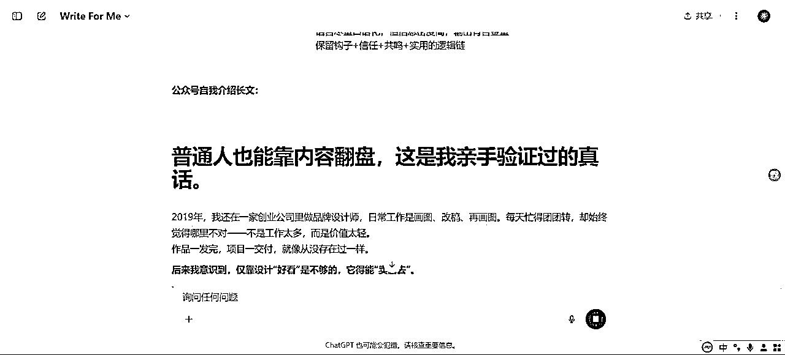

AI 生成案例参考：

《普通人也能靠内容翻盘，这是我亲手验证过的真话》@米斗设计

# 3.3 用 AI 辅助 IP 做自我介绍短视频

目标：用 AI 帮 0 经验小白在 60 分钟内产出 30-60 秒的自我介绍短视频（📕/抖音/视频号）。

# 3.3.1 为什么要用 AI 辅助做自我介绍短视频？

短视频是你 IP 的“活名片”，30 秒就能让人记住你、想找你合作：

吸睛破冰：比文字更生动。我在视频号发过一条“自我介绍”视频，1800+ 曝光，三四年不聊天的朋友突然给我点赞！

快速建信任：视频里有你的脸、声音、案例，别人自然会觉得你靠谱。

放大影响力：📕/抖音流量很大，一条爆款能带来几百粉丝，客户直接私聊。

AI省力：AI 帮你写脚本、加字幕，10 分钟搞定，省时又专业！

# 3.3.2 如何用 AI 辅助做自我介绍短视频？

拍视频听起来很高大上，但有 AI 就像导演在帮你！按 6 步来：选题→写脚本→拍视频→剪辑→写标题/简介→发布。

模板是：

钩子（0-5秒）：抓眼球的问题/故事，比如“你为设计发愁吗？”

我是谁（5-20秒）：名字、身份、优势，比如“米斗，AI视觉设计师”。

价值主张（20-50秒）：你能帮什么，比如“3步用AI设计涨销量”。

行动号召（50-60秒）：引导关注/私聊，比如“关注我，领干货”。

# 第一步：选题

用 AI 想一个吸睛的自我介绍主题，好选题决定视频火不火。

不过，做 IP 也不用一味追求爆火。像我自己做 toB 业务，更多是把短视频当建立信任的社交名片，让客户知道我在做什么业务、顺带体现专业度。

打开 ChatGPT/DeepSeek 官网，新建对话框，复制下面这段提示词发给 AI👇（绿色部分填自己的信息）

# 💡

我是[昵称]，优势是[技能，如设计、AI]，目标人群是[如中小企业老板]。推荐1个短视频自我介绍选题，吸引[目标人群]，输出：选题标题、内容要点、平台（视频号）。

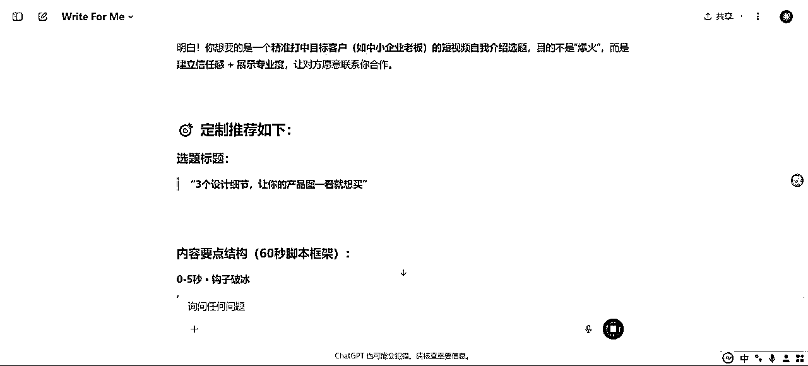

AI 生成案例参考：

选题标题：

“3个设计细节，让你的产品图一看就想买”

内容要点结构（60秒脚本框架）：

0-5秒·钩子破冰

“你是不是也遇到过：产品图片发了，没人点、没人买？”

（引发痛点共鸣，瞬间抓住中小老板注意力）

5-20秒·我是谁

“我是米斗，一名AI视觉设计师，专注用好看又能卖的内容，帮中小品牌提升销量。”

20-50秒·价值输出

“很多人觉得图片只要好看就够，其实转化图的关键在这3点：

1⃣ 色块要清晰分区，信息别太挤

2⃣ 字体要一眼读懂，别用艺术字

3⃣ 模型图/场景图+痛点文案，视觉+文案一起打动用户

这些我都能用AI效率化完成，几小时搞定一整套”

50-60秒·行动号召

“如果你也想用设计提升销量，关注我，帮你少走弯路。”

# 第二步：用 AI 写脚本和字幕

脚本是视频的“台词”，AI 写好你直接念；字幕让观众看得懂。

复制下面这段提示词发给 AI👇（绿色部分填自己的信息）

# 💡

我是[昵称]，优势是[步骤1技能]，目标人群是[步骤1人群]，选题是[步骤1标题]。

生成30-60秒自我介绍视频脚本（📕），结构：

1\. 钩子（0-5秒）：[吸引注意的问题或陈述]

2\. 我是谁（5-20秒）：[姓名、核心身份、关键优势]

3\. 价值主张（20-50秒）：[如何帮助受众]

4\. 行动号召（50-60秒）：[关注、点赞、评论]

输出：脚本全文、字幕、时长。

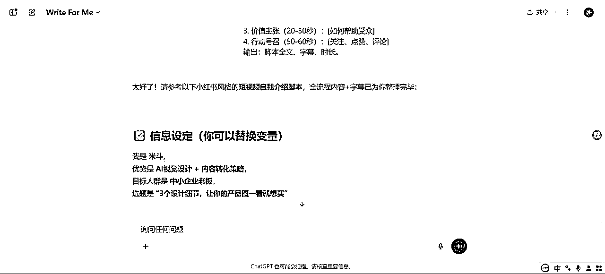

AI 生成案例参考：

你是不是也遇到过：产品图发了，没人点、没人买？

我是米斗，AI视觉设计师、品牌增长顾问，

专门服务中小企业，做那种“长得好看，也能卖得动”的设计。

不只做图，我懂用户怎么想，也懂怎么让一张图带来转化。

很多产品图看起来很精致却不转化，问题常常出在这三点：

① 布局太挤，信息堆一起，用户一眼懵。

② 字体太艺术，看不清重点，影响信任。

③ 缺乏使用场景，图片不动人，就没人点。

我用AI+设计方法，能快速帮你做出一套高转化视觉方案，

从主图、海报到视频封面，省心又高效。

想让产品图真正“能卖”？

关注我，每周分享1个可直接拿去用的设计转化技巧，

也可以私信我，聊聊你现在遇到的问题！

# 第三步：拍摄视频

用手机拍 30-60 秒，简单又低成本。手机+自然光就能拍出专业感。

拍摄准备：

手机：任意型号，擦干净摄像头，调到 1080p。

场景：靠窗自然光，背景用白墙或书桌。

道具：不需要，穿简洁点的衣服（像我穿白色T恤）。

拍摄：

打开手机相机，竖屏或横屏，放在稳定桌面（或用书堆稳）。

按步骤 2 的脚本念，语速放慢、保持微笑，录 3-5 条，挑最好的一条。

时长控制在 30-60 秒。

保存视频，命名“自我介绍_日期.mp4”。

# 第四步：剪辑视频

口播剪辑很简单，打开剪映，导入步骤 3 的视频：

点“新建项目”，选“自我介绍_日期.mp4”。

加字幕：点“文本”→“自动字幕”，导入步骤 2 字幕，黑体 16 号、黄色高亮。

加转场：点“转场”→选“淡入淡出”，每段 5 秒。

配乐：点“音频”→选“清新”背景音乐，音量调到 20%。

导出 1080p，保存到手机，命名“剪辑_日期.mp4”。

完整版自我介绍视频（仅供参考）


0420 视频-自我介绍 .mp4【在线播放】


# 第五步：写标题/简介并发布

好标题拉流量，简介促转化。

复制下面这段提示词发给 AI👇（绿色部分填自己的信息）

# 💡

基于[步骤2脚本]，为视频号生成视频标题（20字内）和简介（50字内），吸引[步骤1人群]，含钩子+行动号召。

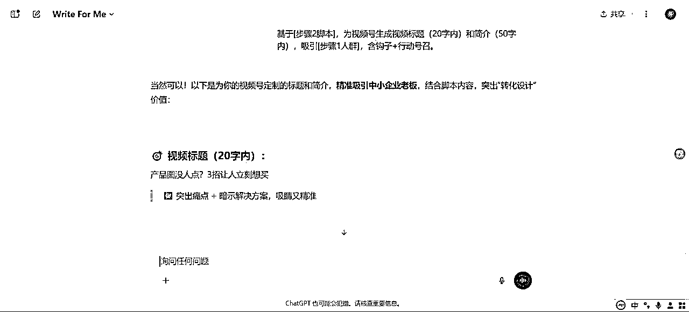

AI 生成案例参考：

标题：产品图没人点？3招让人立刻想买

简介：3个设计关键，让客户一眼下单！适合中小老板实操，关注我，持续分享高转化设计技巧。

标题：不会设计？这样做图照样能卖货

简介：用AI+方法搞定产品图，省时高效还能涨转化，关注我，带你搞懂视觉内容怎么赚钱。

标题：中小品牌主必看：爆款图怎么做？

简介：掌握3个视觉要点，产品图才能吸引点击+成交，关注我，每周拆1个爆款内容技巧。

# 👉可能遇到的问题

问题 1：脚本很平淡，不吸引人，咋办？

解决方案：

1.换个说法提示 AI，比如：“请帮我生成一个更吸睛的30秒短视频脚本，重点突出【设计效率】。”它可能就写出更炸裂的开头，比如：“设计太慢？AI帮你3分钟搞定一张图！”

2.多试几次，每次都让它改得更有冲击力，看到那个连自己都想点赞的版本，留着！

问题 2：拍出来的视频很生硬、不自然，怎么办？

解决方案：

1.简单！多录几遍，别怕麻烦。第一次肯定不自然，录个三五遍慢慢就顺了。

2.拍摄小技巧：

找窗边，光线自然好看

稍微笑一下，别紧张

语速放慢，像和朋友聊天一样

实在不知道怎么拍，就去📕搜教程，看别人怎么开场，照着模仿一遍

3.分段录，不追求一遍过。一句一句录，后面用剪映简单剪一下就好，别给自己太大压力

4.提词器就是神器，别硬背！在手机旁边放个平板或另一部手机，把脚本放在上面照着看，轻松很多。手机上也能下载“提词器App”

问题 3：我不擅长/不喜欢出镜，怎么办？

别担心！不露脸也能做好内容。三种替代方案，选一个最舒服的：

方案1：语音+图片/PPT 滑动展示（最简单、上手快）

👉 怎么做：

脚本照常让 AI 写好

自己用手机录语音旁白（自然一点）

找几张相关图片，或简单做个 PPT（3~5 张）

用剪映、CapCut，把语音+图片合成，一个视频就出来了！

📌 适合谁？

适合声音好听但不想出镜的朋友。

方案2：用动画人物代替你出镜（趣味感强）

👉 怎么做：

用 Vyond、Animaker 这类工具一键生成动画

选一个卡通角色（甚至可以捏一个像你的形象）

脚本照样让 AI 写，做成一个有趣的动画小短片

📌 适合谁？

适合喜欢玩工具、想打造虚拟 IP 形象的朋友。

方案3：纯图文展示+作品输出（很适合作品集类）

👉 怎么做：

用创客贴、Canva 做一张图文展示图

图上放你是谁、你的定位、你能帮什么人解决什么问题

再配上你做过的案例或作品展示

📌 适合谁？

适合设计师、文案、策划这类“内容型选手”，不靠露脸也有超强说服力。

教练提醒：别追求一开始就完美，重点是“做起来”“动起来”！你越做越熟，AI 越懂你，内容也会越来越顺。


# 3.4 用 AI 辅助 IP 搭建内容选题模型

# 3.4.1 为什么要搭建内容选题模型？

内容是 IP 的“命脉”，没选题就像船没方向，迟早停摆！好选题让你每天有得发，还能吸引对的人、赚到钱。

稳定输出：4 象限模型（你是谁、帮啥、成长啥、咋变现）保证你不缺话题。

吸引粉丝：选题直接打在受众痛点上（比如“省钱设计”），让人想看、想互动。

AI省心：AI 能从你的定位里拆出 30 个选题，比自己想快 10 倍，还能避开热点依赖！

冷启动利器：30 天计划表让你每天知道发什么，3 条内容就能测出效果，快速涨粉。

# 3.4.2 如何用 AI 搭建内容选题模型？

选题模型就是你的“内容导航”，用 4 象限（你是谁、你能帮我什么、你在成长什么、你靠什么变现）来搭。

你是谁：讲你的故事和身份，像我的“小镇男孩变设计专家”。

你能帮我什么：亮出你的价值，比如“教你用AI设计省钱海报”。

你在成长什么：分享进步，像“我如何用AI效率翻3倍”。

你靠什么变现：推产品/服务，像“加入我的AI设计群”。

AI 生成选题后，做 30 天计划表，每天发 1 条，3 条测一次效果，简单又稳！

第一步：用 AI 生成 30 个选题

4 象限让内容全覆盖，让选题既有故事又有干货。

复制下面这段提示词发给 AI👇（绿色部分填自己的信息）

# 💡

我是[定位]，优势是[优势]，目标人群是[人群]。基于4象限（你是谁、你能帮我什么、你在成长什么、你靠什么变现），生成30个选题，输出：象限、标题、形式（短视频/图文）、平台（视频号/📕/抖音）、原因。

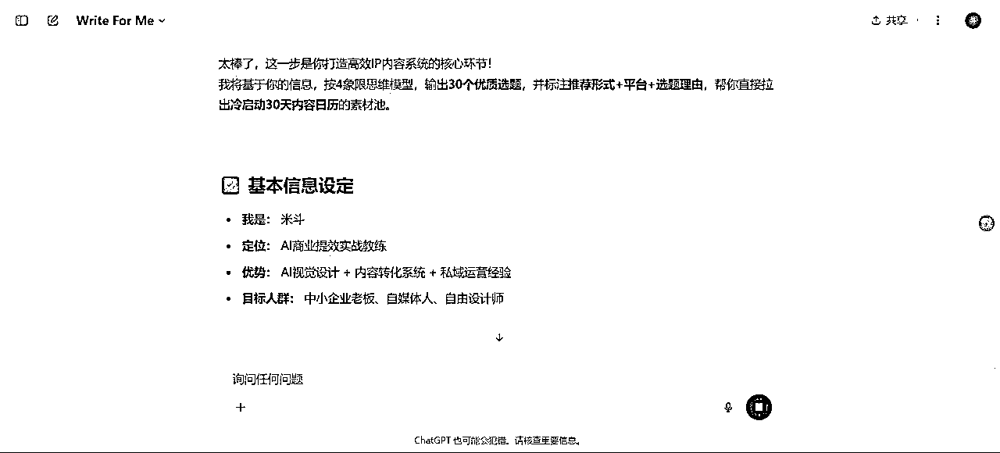

📌 案例参考：4象限 × 30个高质量选题

米斗：《个人IP 30 个高质量选题》

第二步：完成 30 天冷启动计划表

计划表像日历，让你每天知道发什么。

在飞书新建表格“6月_30天更新计划_米斗”，把第一步生成的 30 个选题信息填进去。

日期

选题标题

形式

平台

发布时间

原因

06/01

从小镇男孩到AI视觉设计师

短视频

视频号

20:30

人设吸粉

06/02

3步用AI设计吸睛海报

短视频

视频号

20:30

干货引流

...

...

...

...

...

...

PS：对新人来说，日更短视频难度不小，可以改成 2-3 天更新一条，或者一周更新 2 条，这个量对新人完全可以接受。哪怕你在职，没那么多可支配时间也 OK。


# 四、总结

# 💡

# 章节概要

这一章主要是把前面的材料整理汇总，沉淀一下自己的作业成果。

定位更清晰之后，还可以继续深挖 AI 赋能自媒体的更多内容。

# 💡

# 本章航线图

完成本章的学习和实操，即可推进航线图：

第二阶段：执行落地：产出个人 IP 介绍内容（约 14 天）

1.

学习并掌握用 AI 做自媒体内容的技能（约 9 天）


# 4.1 课程作品集（所有成果汇总）

没有记录就没有发生。把本期航海的所有成果物，统一汇总保存到知识库/飞书文档，也可以分享到星球，作为一份作业记录：

# 4.1.1 个人优势文档（案例参考）

个人优势文档完整版：米斗 · 个人优势文档完整版

盖洛普+MBTI优势文档：米斗 · 盖洛普+MBTI优势文档

# 4.1.2 🛰️自我介绍文案（案例参考）

米斗 · 不同版本的自我介绍

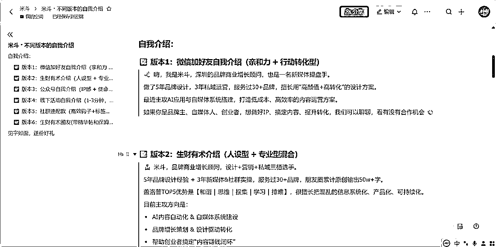

# 4.1.3 长文自我介绍（案例参考）

.

我，一个小镇设计师，如何靠内容+AI逆袭深圳？@米斗设计

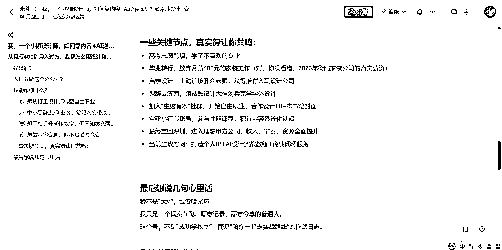

.

《普通人也能靠内容翻盘，这是我亲手验证过的真话》@米斗设计

# 4.1.4 自我介绍短视频（案例参考）

米斗的自我介绍短视频参考（用了AI数字人，你能看出来吗）

0420 视频-自我介绍 .mp4【在线播放】

# 4.1.5 IP 定位选题表（案例参考）

米斗：《个人IP 30 个高质量选题》

# 4.1.6 30 天内容执行计划表（案例参考）

📅【30天内容计划表】@米斗设计


# 4.2 持续成长

# 4.2.1 怎么把 AI 调成私人顶级策略顾问

顶级策略顾问的意思是，除了问自媒体定位，你还就生活、工作中的各种问题向 AI 提问，AI 能给你私人定制的回答。

前提是你持续向 AI 输入个人信息，比如工作、家庭情况等。这样等你遇到工作瓶颈、想看看外面有什么机会时，AI 能给出方向参考。

ChatGPT 案例示范：

我在设计《AI设计实战营》产品时，不知道怎样优化产品内容，需要有人指点。

于是我直接问 AI：“如果你是雷军、马斯克、库克、毛泽东、金枪大叔、龙哥，你会给米斗什么建议，最重要的一点建议？”

有朋友问我：为什么雷军给你的建议那么贴切？你喂了什么？调教得太好了！

我说，直接问就好。这是基于前面的步骤——我输入个人优势文档、完成定位之后，AI 对我已经有了相当准确的理解。

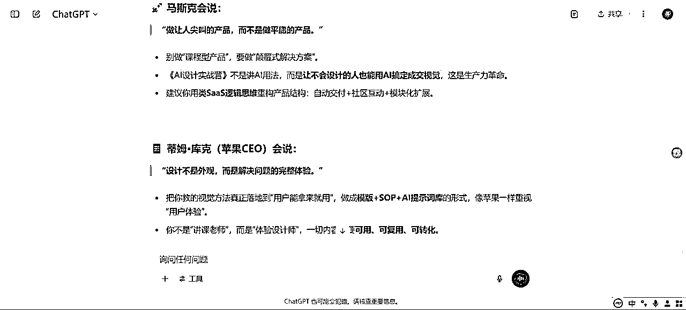

DeepSeek 案例示范：（如何用 AI 辅助自己选赛道/行业/工作/城市/岗位）

AI 提示词：

# 💡

你是一位拥有10年经验的“政策-产业”双轨分析师，同时是清华经管学院职业发展中心特聘顾问。

请以“政策解读者×优势教练×商业军师”三重身份，

根据用户提供的资料，结合上下文和米斗的个人优势，

帮用户做行业选择、自媒体赛道选择、工作选择等。

PS：想用好这个提示词，前提是把需求说清楚。比如：我在看中共中央办公厅、国务院、教育部等政府部门的一些报告，很多内容看不懂，需要 AI 帮我解读分析，再结合我的个人优势去做行业和自媒体赛道选择。

于是我把一些政府工作报告丢给 DeepSeek，让它先学习，再把我的一些个人信息发给它，然后让 AI 以 10 年经验的“政策-产业”双轨分析师身份，兼任清华经管学院职业发展中心特聘顾问，用“政策解读者×优势教练×商业军师”三重身份，辅助我做行业和自媒体赛道选择。

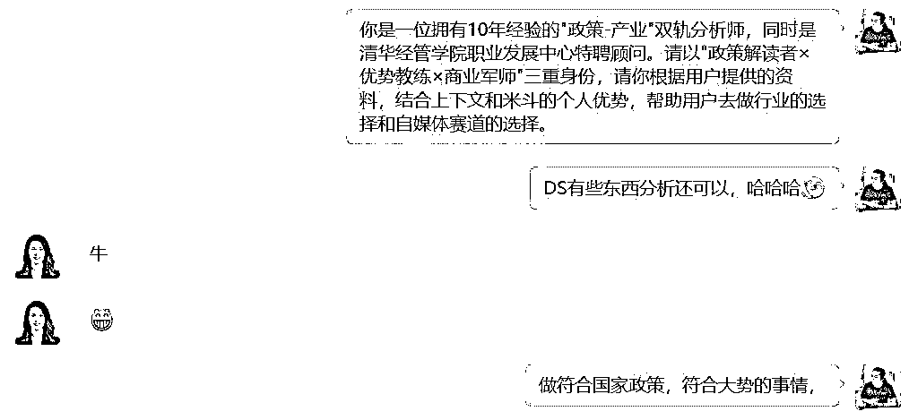

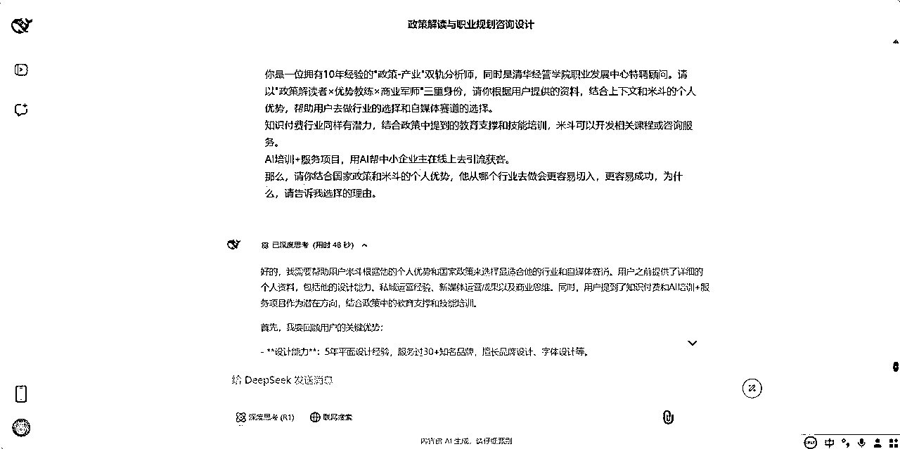

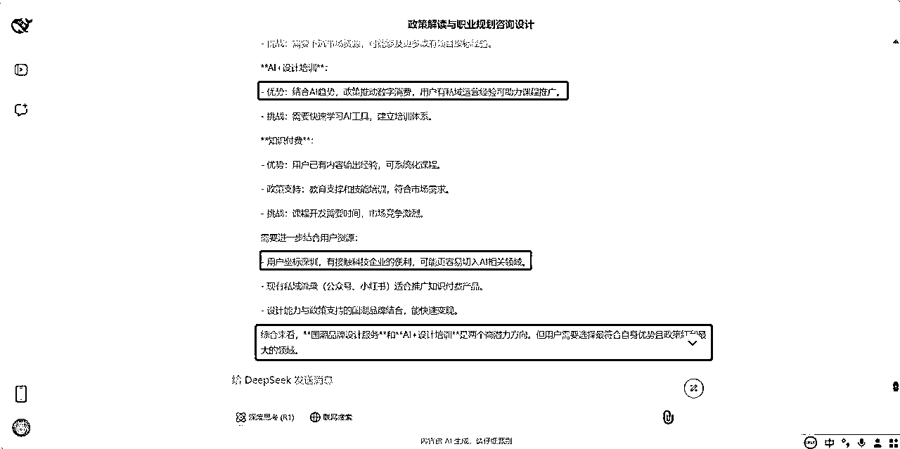

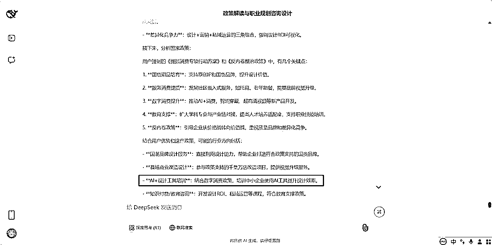

有圈友可能会问：去哪里找报告？

国家和城市的政府官网都能找（中华人民共和国中央人民政府：https://www.gov.cn/zhengce/）

# 4.2.2 学习用 AI 做自媒体内容的技能

# 1.《AI 赋能 IP 航海手册》

本期航海更聚焦 IP 定位。如果你完成定位后，想继续学怎么用 AI 做自媒体内容，可以看上期手册👉《3 月航海 | AI 赋能 IP | 实战手册》，搭配对应的高手领航直播：

# 2.《养成系 IP 从 0 到 1 航海手册》

📚 推荐理由：

如果你正在探索从 0 到 1 打造个人 IP 的路径，这本手册就是“实战地图”。它不聊虚的理念，而是围绕“铁杆粉丝养成”“私域陪伴式成长”这类可落地的方向展开，特别适合想长期构建影响力、沉淀用户资产的创作者。书里既有战略思维也有落地玩法，还邀请了“赚钱大师兄”杨涛亲自指导，干货管够。

链接：https://scys.com/view/docx/BM58duzy9okXO6xXzitcMakQnof#NNdWdJEF4oOnX9x7lXecHEGFnGf

🎯 适合阅读的人群：

正在从 0 到 1 打造个人 IP 的新手、自由职业者

想靠真实陪伴吸引铁杆粉丝的内容创作者

被“没粉丝、没人设、不知道讲啥”困扰的职场人

打算走“社群+产品+个人品牌”这条路的人

想打造“有忠诚用户群”的一人企业主

🕒 建议阅读时间/阶段：

IP 定位初期：正在选赛道、建人设、搭内容结构

内容冷启动阶段：粉丝量不大但想要高粘性用户

建立私域/社群关系链初期

IP 转型或重新梳理“我是谁、要服务谁”的过渡期

📌 核心收获：

看懂 IP 打造的底层逻辑不是“红”，而是“陪伴”

学会用真实+过程赢得用户信任与粘性

找到普通人做 IP 的“长期主义路径”

打通从内容表达 → 私域链接 → 个人商业模型的闭环思维

# 3.《25 年 6 月航海 | AI 视频制作 | 实战手册》

📚 推荐理由：

在短内容爆发的当下，视频已经是 IP 影响力放大的关键杠杆。尤其有了 AI 工具加持，过去难度高、门槛大的视频创作，现在人人都能入门。这本手册从“工具使用→风格复刻→商业变现”全链路拆解 AI 视频制作流程，很适合想快速做出高吸引力视觉内容的创作者。它不只教技术，更帮你掌握“内容+效率+变现”的系统打法。

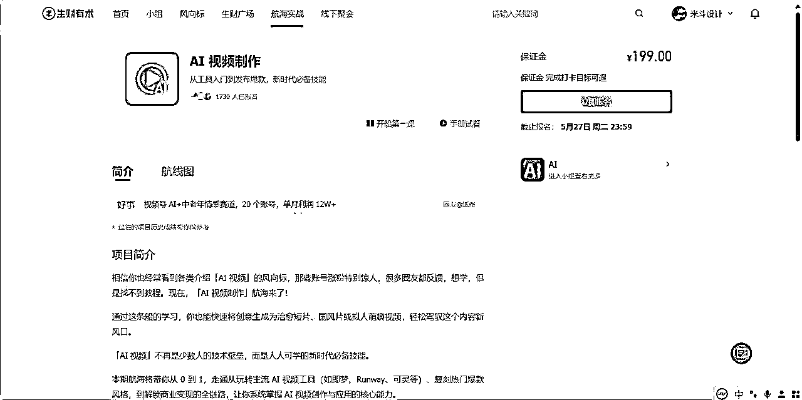

# 4.《25 年 6 月航海 | AI 数字人口播 IP | 实战手册》

📚 推荐理由：

如果你还在因为“出镜难、剪辑累、灵感枯竭”而发愁内容输出，这本《AI数字人口播IP》手册一定要看！

它会带你从 0 到 1，手把手教你用 AI 生成一个「声音+形象」都和本人高度一致的“数字人分身”，实现内容 7×24 小时不间断输出，真正做到“一个人干十个人的活”。

从数字人克隆、AI 口播制作到商业化运营，全流程都有实操讲解，适合想搭建高效内容系统、放大 IP 影响力的创作者。

如果你已经掌握基础内容创作技能，现在想提升效率、扩大规模、放大影响力，这本手册就是你突破瓶颈的秘密武器！

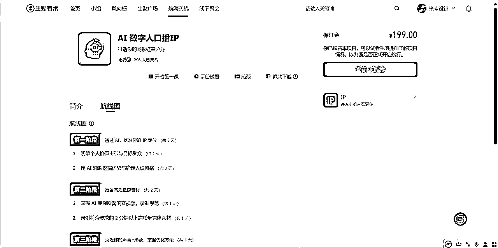

# 5.《龙哥盟使用指南》

📚 推荐理由：

这不只是一本“工具手册”，更是一份“人生多选指南”。它帮你看清，在信息爆炸、选择过载的当下，怎么找到适合自己的变现路径。全书由 30 位不同行业、不同阶段的赚钱圈友共创，覆盖从副业起步到一人公司的真实案例，不讲虚的，全是实战干货。

从新手到高手：该怎么用赚钱？这份【龙哥盟使用指南】给你答案

🎯 适合阅读的人群：

刚接触“龙哥盟”的新朋友

想借 AI、副业、📕找变现方向的普通职场人

想开拓视野、链接优质圈层的自由职业者

行动力强但容易信息过载的“效率控”

正在考虑转型、转行、创业的探索者

🕒 建议阅读时间/阶段：

IP 定位探索初期（打开外部视野、找到参照系）

对副业/自由职业方向迷茫时

刚加入赚钱社群、想快速搞懂社群价值时

已经行动一段时间、要做路径优化的复盘期

📌 核心收获：

看清“别人的路径”，校准“自己的节奏”

提升信息筛选和决策效率，避免瞎忙、少走弯路

明白副业不是投机，而是一场长期的能力积累

防失联+MM188166M（李李）长期更新

最后，祝大家都能找到适合自己的 IP 定位，实现 AI 提效，跑通 IP 变现，一起龙哥盟！

# 防失联+MM188166M（李李）长期更新

