# 202506 航海｜AI 助力视频号分成收益｜新手实操指南

> 来源：[https://ocn93f5d9olj.feishu.cn/docx/VR5vdDissoFVyPxuH0OcdRfwn1f](https://ocn93f5d9olj.feishu.cn/docx/VR5vdDissoFVyPxuH0OcdRfwn1f)

# 写在前面｜防走丢+MM188166M（李李）长期更新

# 💡防走丢+MM188166M（李李）长期更新

欢迎来到 6 月航海。这次我们要做的事，是把 AI 引入「视频号创作分成计划」的内容生产环节：借助 AI 工具生成素材、提升原创比例、压缩制作耗时，让普通创作者也能稳定产出视频，从而获取分成收益。

当下用 AI 批量产出视频，一天可以发布好几条，出爆款的概率更高，涨粉速度也更快，更容易凑齐开通广告分成的条件。可以说 AI+视频号正处于红利窗口期，这也是我们再次发起航海的原因。

本期课程将教大家从零开始，用 AI 打造热门内容，掌握视频制作的完整流程；并通过高热度 AI 赛道快速拿到广告分成资格，赚到属于自己的第一笔钱。项目整体对新手很友好，适合初次尝试的人。

另外要说明：任何项目都存在变化，手册内容也可能滞后。开船后请紧跟群内交流，持续关注平台新规，及时调整玩法。

本航海项目的航线图如下：

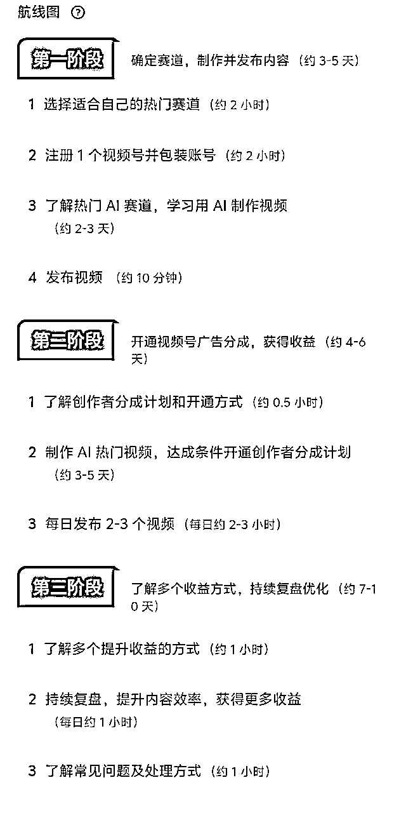

航线图与手册内容深度绑定，你可以根据自己所处的环节，按图索骥、分步学习。

# 必修篇：跑通最小 MVP

# 一、【项目概述】了解视频号分成计划

# 💡

章节概要

这一章先认识视频号分成计划的定义、逻辑和推荐机制。参照航线图，建议这样安排学习：

1、熟悉视频号分成计划（约 30 分钟）

接下来，就请进入实操筹备阶段吧。

# 1.1 什么是视频号分成计划？@郭耀天 @流浪虎

「创作分成计划」是视频号生态内的一项激励政策：满足门槛的优质原创视频作者，可以在自带原创标识的视频评论区放置广告位，按照广告产生的效果获取分成。

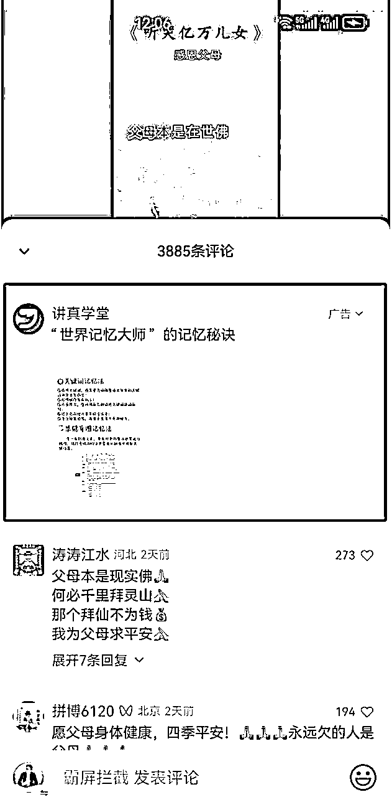

起步阶段，我们需要先选定内容方向，制作并上传视频；当账号达到平台标准后，系统就会向原创作者发出开通邀请。

成功开通后，持续发布标记「原创」的视频，评论区会自动匹配并展示广告。只要用户点击，我们就有收入进账，无需自己联系商家或手动添加广告。

简单来讲，它相当于视频版的流量主。👸号靠图文挂广告，视频号则靠视频评论区挂广告。

如何加入：

「创作分成计划」还在内测中，平台会分批邀请原创优质作者，必须同时满足以下三项条件：

1. 有效关注人数不低于 100 人；

2. 通过内容规范审核；

3. 非政务类账号。

收到邀请的作者，可以点开「视频号团队」私信里的权益入口申请开通，也可以前往「创作者中心 > 创作者服务 > 创作分成计划」页面自助申请。暂时未收到邀请的话，耐心等待即可。

补充说明：

4. 有效关注数统计的是正常用户，刷量、外挂等异常账号不计入；且当天新增的关注不算在内。

5. 目前仅支持中国大陆用户参与，并需在🛰️支付中完成身份证实名认证。

官方公告：https://findeross.weixin.qq.com/cgi-bin/mmfindernodelivecrmwebbroker-bin/helper-center/pages/FRjtvfZTBH03bqAa

内容来源：《视频号创作者分成收益怎么赚？追好热点，打造爆款视频》@流浪虎

# 1.2 项目现状@拾文

# 1.2.1 变现空间

哪些指标会直接影响分成收益？先看视频号官方给出的说明：

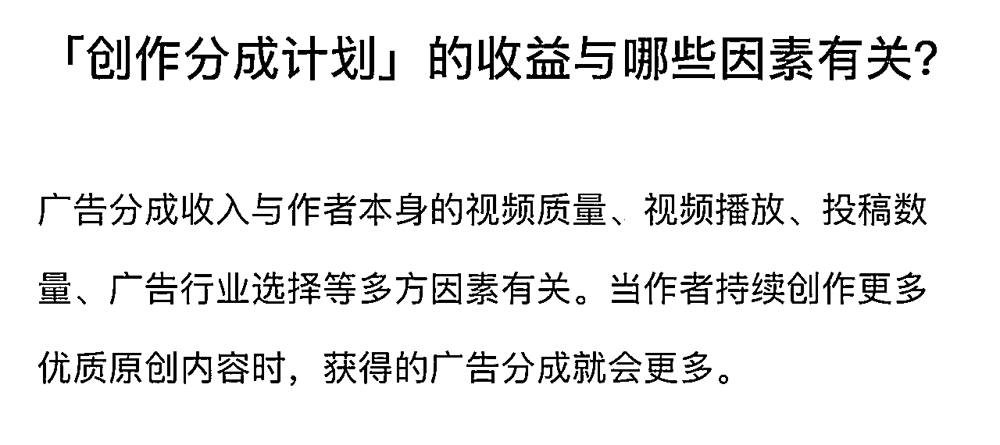

综合官方信息可以判断：评论区的广告曝光量、用户点击量才是收入的核心变量。只有用户真的去评论区浏览并点击广告，我们才能获得分成。由于广告是在评论区自动呈现的，评论数量越多，广告被看到的概率越高，收益自然更可观。

以下三种想法需要纠正：

1.播放量高≠收益高

真正决定收入的是广告点击。哪怕播放量过千万，如果没人点评论区广告，收入依然上不去。

2.评论量大≠收益大

评论量确实比播放量更有参考价值，但不能一概而论。比如系统自动引导产生的评论，用户并没有真正的浏览和点击行为，这类评论再多也难以转化成收益。

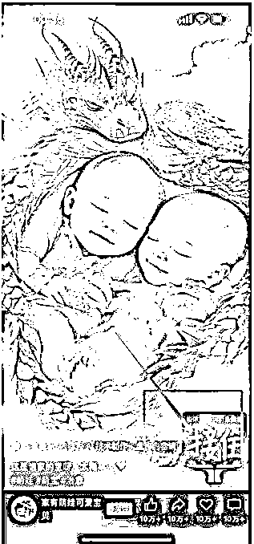

3.同样的评论量，收入就一样？

未必。即使两个视频评论数、广告点击数完全相同，广告主不同、单次点击的价格不同，最终收入也会有差异。

根据过往经验，可以确定的是：评论数量大、且用户互动热烈的视频，获得的收益通常更高。

圈友拾文曾在风向标指引下操作《热门视频二剪+AI 生成动漫画+视频号广告分成项目》。他跑通后，第一条爆款视频就拿到 443.5 万播放，单条涨粉 1.8 万。视频素材大家应该都见过，具体数据和收益如下供参考：

总的来说，收益受多重因素制约，没有一个固定的计算标准。但只要赛道选对、专注原创、持续输出、优化效率，获得正向反馈是迟早的事。

# 1.2.2 优势与风险

项目优势

「视频号分成计划」的加入门槛很低：只要有🛰️号、开通视频号，就能参与。收入并非平台发放，而是源自商家的广告投放；视频号流量越大、入驻商户越多，广告盘子就越大，收益空间也越广阔。

AI 的介入让内容生产效率大幅提升：借助热点事件快速产出视频，可以更快获得流量关注与变现回报；还能同时运营多个账号，每天制作多条内容分散发布，扩大收益来源。

项目风险

项目本身几乎没有什么风险，真正的风险在于做事的人。

风险一：想得太多、做得太少。还没上手实操，就被各种假设中的困难挡住了。不如清空顾虑，先动起来，在行动中验证想法。

风险二：坚持不够、轻易放弃。发了几条甚至几十条视频后，数据没有起色就开始怀疑自己。把心态放平，保持执行力，至少坚持 21 天再判断。

# 1.2.3 视频号分成计划能做多久？

这期航海要教大家的，是在既有分成机制之上，借助 AI 提高原创视频的产出效率，实现一天多更，这完全在平台规则允许的范围之内。持续发布优质原创，不断打磨爆款能力，收入就不会差。

只要视频号官方不叫停分成计划，这个玩法就可持续。结合当前平台战略、商业逻辑与行业走势来看，未来 3-5 年内，它仍是创作者值得耕耘的变现路径。

退一步讲，就算哪天分成计划被取消，平台也会推出新的变现产品。与其担心这些，不如专注做好内容，持续输出原创视频。

# 1.3 项目核心玩法 @郭耀天

# 1.3.1 项目核心步骤

先用一张图理清「视频号分成计划」的完整路径：

选定热门赛道（关键）> 注册并包装视频号 > 收集素材 > 制作并发布内容 > 达标后开通分成计划（关键）> 持续发布原创内容 > 产生收益并提现

从路径不难看出：选对赛道、拿下分成资格，是整条链路中最关键的两步。

想走稳这两步，跟着手册走就行。我们在下面两章分别做了详细拆解：

【项目实操 1/3】确定赛道，制作&发布爆款内容

【项目实操 2/3】开通分成计划，领取收益

拿到分成权限后，任务就变成：持续发视频（记得点亮原创声明）、复盘数据、优化内容，通过堆数量、堆账号放大爆款可能性，把收益做大。

平台始终鼓励原创。这里的“原创”指视频号上还没有的内容；即便参考了其他平台的素材，只要视频号里没出现过，也算原创，制作难度并不高。哪怕是二创，也建议往原创方向靠拢，否则后期可能面临限流、取消分成资格甚至封号的风险。

选内容时，优先挑那些能勾起互动欲的话题。有些领域数据很漂亮、播放量也不低，但收益却很惨淡，比如祝福类视频：虽然老年用户流量大、评论也不少，但广告库与这类人群匹配度低，收入自然上不去。

建议大家锁定互动率高的内容方向。比如“找不同”“看图找茬”这类玩法——把图片做成视频，让大家数一数有哪几处不一样，观众参与热情极高，评论数往往超过点赞和转发。

评论上来了，广告被点击的机会也随之增加，收益自然更有保障。

站在平台立场去考虑，制作大众真正爱看的内容，才能同时获得流量与收益。

# 1.3.2 视频号内容推荐机制

# 1.3.2.1 推荐机制

视频号与订阅号、服务号不同，是一个全新的内容记录与创作平台。它不像👸号那样中心化分发，核心逻辑是推荐。

视频号的内容载体包括图片和视频：可发 1 分钟以内的短视频、1-30 分钟的长视频，或者不超过 9 张的图片；还能附带文字和👸号文章链接，也不需要电脑端后台，手机就能直接发布。

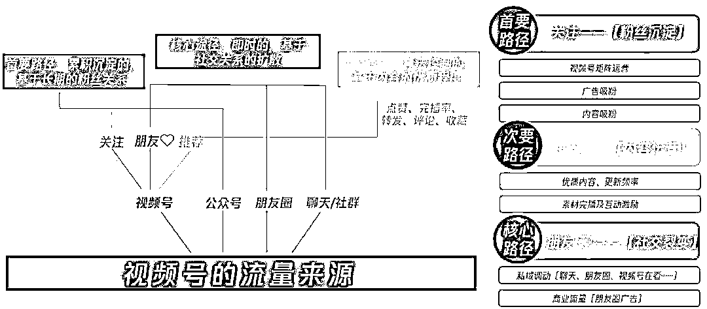

想做好视频号，第一步就是吃透平台的流量分发机制。搞清楚推荐规则，才能精准获取流量，推动账号增长。

社交推荐

🛰️生态的底色就是社交。所谓社交推荐，是指系统根据好友的发布、点赞、关注、评论、转发等动作，把相关内容推荐给用户。从视频号首页的“关注、朋友、推荐”三个栏目就可以看到，熟人关系链在推荐体系中的地位很高。

1. 关注栏目里出现的是你已关注账号发布的动态；

2. 朋友栏目推荐的是被好友点赞过的视频；

3. 推荐栏目则是系统根据个人偏好推送的内容。

系统偶尔也会推荐一些用户可能喜欢的内容，算是“猜你喜欢”。这套算法与抖音的推荐逻辑有几分相似：

当作品质量足够高、完播率和互动率都表现优异时，社交推荐与系统推荐就会形成正向循环，二者彼此强化，爆款由此诞生。需要特别留意的是：要推动这个循环启动，关键得先引爆第一轮社交推荐。

反过来说，如果视频没有初始播放和互动，就算内容再好，也很难被系统识别。因此，发布后要把视频转发到朋友圈、🛰️群，请好友帮忙点赞、收藏、评论，为第一波流量做铺垫。

🛰️好友之间是典型的强关系，所以“朋友赞过”本质上是一种强信任背书。

现在视频号首页的三个入口——关注、朋友赞过、推荐，分别代表个性化关注、社交分发和算法推荐。单独为“朋友赞过”留出位置，正是视频号区别于抖音、快手的关键所在。

这说明，除了常规的算法推荐，视频号相当看重以“朋友赞过”为载体的社交传播，用它来留住用户。

个性化推荐

目前来看，视频号个性化推荐机制主要由“兴趣标签+定位+热点+随机推荐”构成。

① 兴趣标签

依托🛰️社交生态，每个用户都会被贴上多元标签，涵盖性别、年龄、职业、兴趣、城市等维度。系统会按照这些标签，从海量内容库里筛选出用户可能感兴趣的内容。这也是社交平台的通用玩法。

举个例：如果你常看旅游类👸号、也爱在朋友圈晒旅行照片，系统就会倾向于给你推送旅行类视频。

② 地理定位

发布视频时可以标记附近位置或热门城市，这种打法对吸引同城流量非常有效。添加定位后，视频不仅能在本地曝光，还会被系统筛选出来推送给对该区域感兴趣的用户，精准度很高。

同时，系统也会根据你的手机定位，优先分发同城内容。基于 LBS 的延伸玩法，还有不少挖掘空间。

③ 热点话题

突发的网络热点和热门话题，天然具备极高的关注度。系统再结合协同过滤机制——即分析用户兴趣，找出与目标用户偏好相似的群体，综合这类群体对内容的反馈，来预测目标用户可能喜欢的内容——把热点相关的高质量视频推给用户。

系统推荐

系统推荐权重最高。当视频数据达标，系统就会将其推入下一级流量池；数据持续走高，就能进入更大的池子。

具体可以参考以下三点：

① 新作品发布后，系统会优先推给已关注账号的粉丝。如果粉丝不感兴趣、没有互动，视频就不会进入更高的推荐池，只能获得一次基础曝光——但未来仍可能被重新推荐；

② 当部分用户点赞、转发或评论时，推荐机制被触发；若有多个用户参与讨论，视频会被推入更大的流量池，权重与推荐概率随之提升；

③ 联系频繁的🛰️好友之间，系统也会互相推荐对方关注的视频号内容。通过熟人社交链的层层扩散，实现裂变传播。

目前视频号推荐体系里，社交权重占比相当大。在这种机制下，好友多、社群多、有👸号等私域资产雄厚的玩家，推广优势明显，也更容易成长为头部账号。

# 1.3.2.2 审核机制

所有内容平台都有审核机制，视频号目前实行机器+人工双重审核。

机器审核：利用预先训练的人工智能模型，识别视频画面与文案，排查是否存在违规内容。

一旦判定违规，作品可能被限流、下架或仅自己可见。严重违规直接删除；无法确定的情况，则会转入人工审核。

人工审核：针对机器挑选出的疑似违规内容进行复核，重点审查三方面：标题、封面、关键帧。

确认违规后，平台将采取删除视频、降权处理、封禁账号等措施。

# 二、【项目实操 1/3】确定赛道，制作&发布爆款内容

# 💡

章节概要

这一章覆盖赛道筛选、热门视频的制作与发布，目标是完成第一个作品的发布。参考航线图的学习节奏：

1、挑选适合自己的热门方向（约 2 小时）

2、注册 1 个视频号并完成账号包装（约 2 小时）

3、研究热门 AI 方向，练习 AI 视频制作（约 2-3 天）

4、发布首条视频（约 10 分钟）

现在就开始吧。

# 2.1 确定赛道

# 2.1.1 如何选一个好赛道

做视频号分成，选择比努力更关键。赛道直接锁定收益的上限：方向选错，再拼命也难出结果；方向选对，正反馈来得快，天花板也高。

关于怎么选赛道，我们总结了三个要点：

1.看收益逻辑

整个流程是：先开通分成资格——发布视频——评论区展示广告——用户点击——获得收益。要特别注意：看了视频或看了评论区但没有点击，都不产生收益。

广告展示效果参考下图：

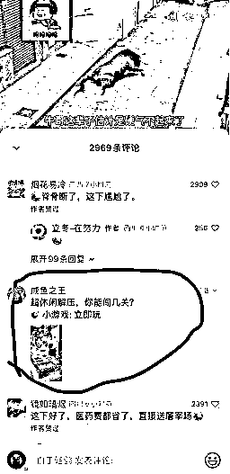

理解了收益逻辑，就能明白真正的影响变量是：评论规模、受众画像、广告类型。

所以，选择赛道必须顺着收益逻辑走。同样的 100W 播放量，放在不同赛道上，收益可能差出 5 倍以上。

2.看视频赞评比

点赞、评论、收藏、转发，是所有短视频平台的爆款核心指标，视频号也不例外。选赛道时一定要多观察这些数据。我们做视频号分成时，最看重的是赞评比。

原因很简单：点赞决定系统推流的上限，评论决定广告展示的机会，一个对应流量，一个对应收益。实操中我们发现，有些赛道数据非常亮眼，收益却很少，典型如老年祝福类视频——动辄几百万上千万播放，评论区也很热闹，但因为受众年龄的原因，收入反而有限。

3.看同行数据

没拿到结果之前，不要盲目进入陌生赛道。同行就是最好的试金石：赛道能不能做，看同行的数据就够了。搜索赛道关键词，看看头部账号的播放和评论情况，流量差、互动低的直接放弃。

能满足以上三个条件的赛道，就是值得投入的好方向。

内容来源：《视频号分成计划娱乐解说玩法，一条视频一天 4815 元》@白丁

# 2.1.2 AI+赛道分享

赛道一：热门视频二剪+AI 生成动漫画+广告分成

https://t.zsxq.com/9bVdF

龙哥曾在星球发布过关于热门视频二剪与 AI 动漫画化的风向标。不少圈友据此试水，做出了多支爆款视频，也拿到了一些收益。

新手可以优先从这个玩法入手，完成自己的第一支 AI 视频。

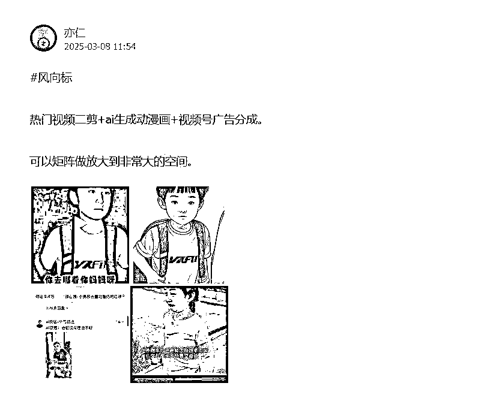

赛道二：治愈系老奶奶/老爷爷+AI 插画视频化+广告分成

https://t.zsxq.com/5Qnwf

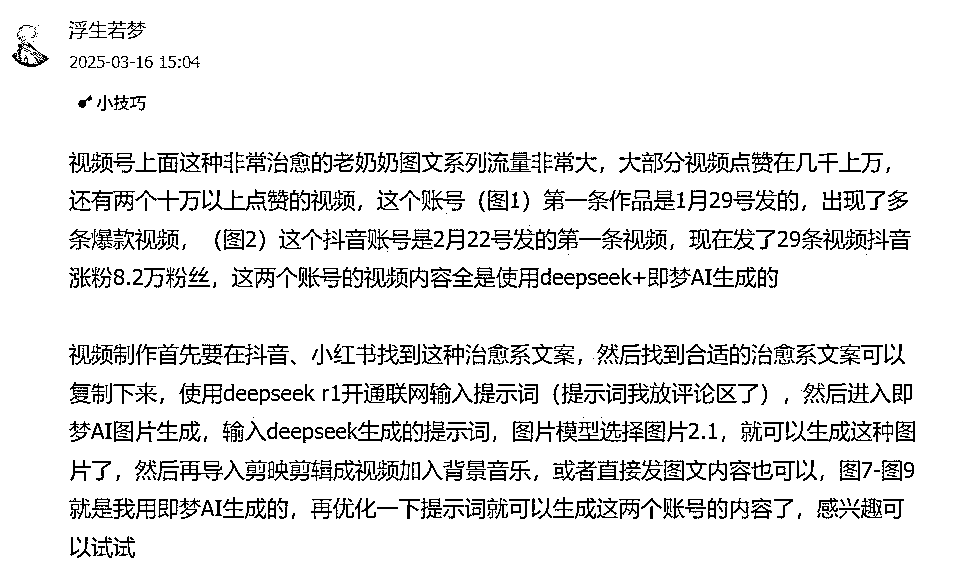

## 赛道三：AI 生成 CG 动画，靠广告分成赚收益

https://t.zsxq.com/Q7cFp

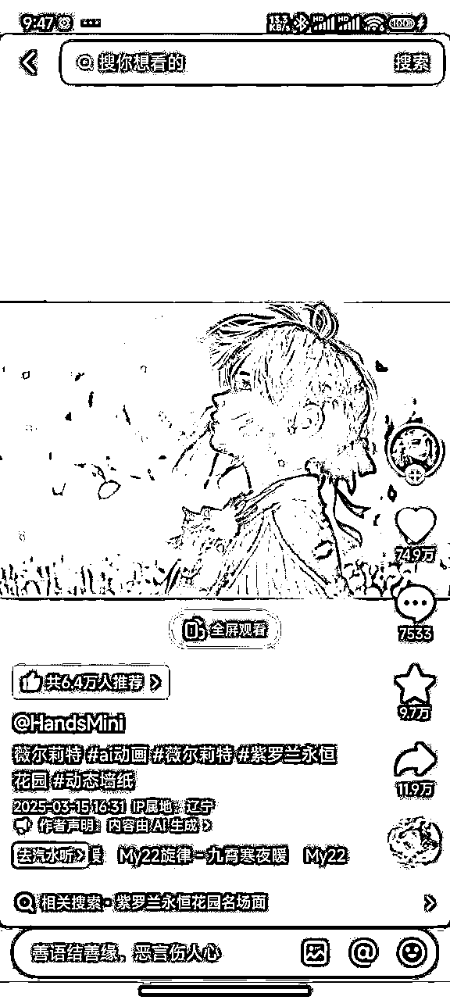

## 赛道四：AI 打造萌娃视频，靠广告分成赚收益

https://t.zsxq.com/XEXJw

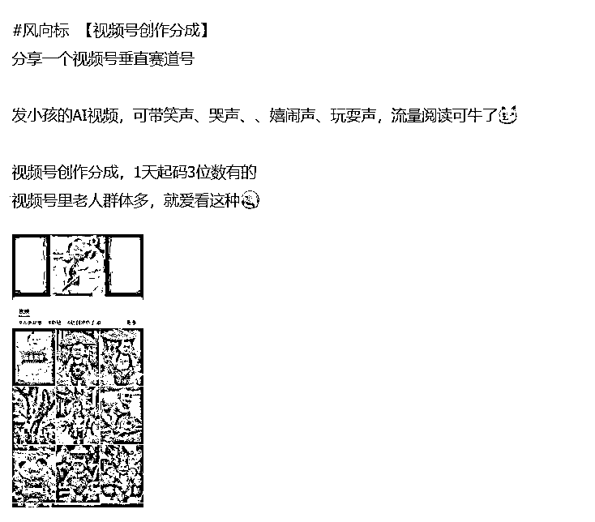

## 赛道五：特效模板拍视频，靠广告分成赚收益

https://t.zsxq.com/cMxwP

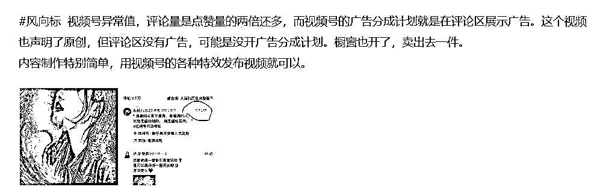

# 2.2 视频号账号的注册与准备 @郭耀天

视频号生长在🛰️体系里，二者是绑定的对应关系：备好一个🛰️号，就相当于拥有一个视频号入口。想多开视频号，核心就是多准备🛰️号。注册🛰️时需要辅助验证，按官方指引即可——找身边人协助是最常见的办法，手机号既能在营业厅办理，也能用虚拟账号注册。

# 2.2.1 第一步：电话注册

移动用户可以用“和多号”申请小号，但这类号码在🛰️注册上有限制；联通有小号功能，电信部分区域也提供类似服务，中国广电同样能办。假如在这几家运营商各办五张卡，加起来就是20张，日常操作基本够用。若还不够，找家人帮忙注册即可；团队或公司操作时，安排团队成员批量办电话卡就行了。

# 2.2.2 第二步：🛰️注册

如今注册🛰️确实比以前麻烦，必须走辅助验证。只要请身边人帮个忙，比如找七大姑八大姨搭把手，基本都能通过。注册成功后还需要“养号”，按照普通用户的习惯来使用，刷一刷短视频、发几条朋友圈即可。不过只要不加好友、单纯用来注册视频号，问题并不大，刚注册好的新🛰️号也能直接开通视频号。团队测试的大量账号就是用这种方式搞定的。视频号眼下确实是窗口期，能多注册🛰️就多注册，顺手把视频号开通。

# 2.2.3 第三步：登录设备准备

账号多起来之后，登录设备也得跟上。一台手机最多能同时登录五个🛰️：

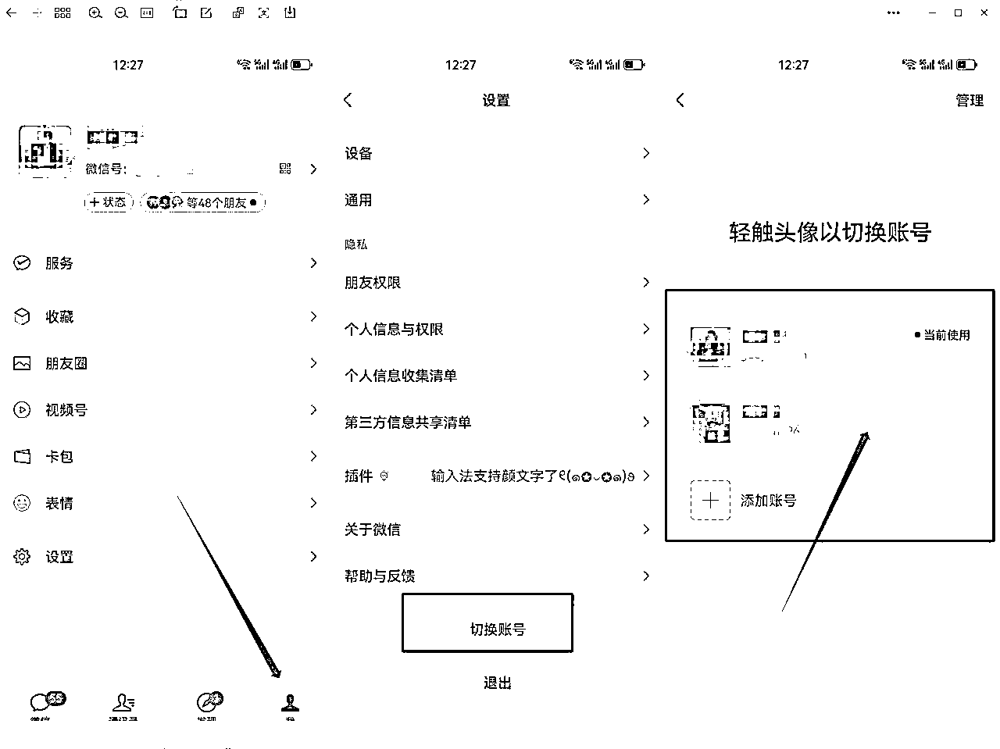

苹果手机可以通过定制实现多开；安卓手机则能借助第三方开发的🛰️多开工具，比如我目前使用的双开助手：

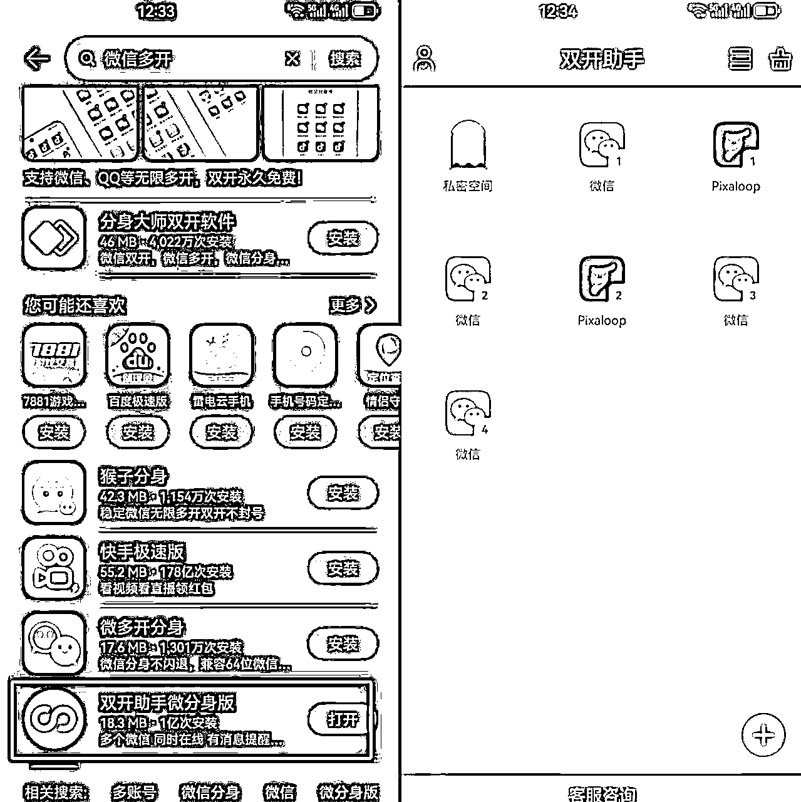

不一定非要这款工具，其他方案只要能让多个🛰️同时在线，同样可行。不过多开存在一定的封号风险，相比之下，多准备几部实体手机更保险。单就手机登录来看，华为、小米都能登两个🛰️，摩托罗拉支持六个；还有部分营销手机具备多开能力，比如联想拯救者。具体怎么选，这里不展开，按自己的需求来就行。

# 2.2.4 第四步：视频号注册

开通视频号前，🛰️号必须通过实名认证，此处不再细说。打开🛰️，按照“发现”→“视频号”→右上角小人图标的路径，就能进入个人主页：

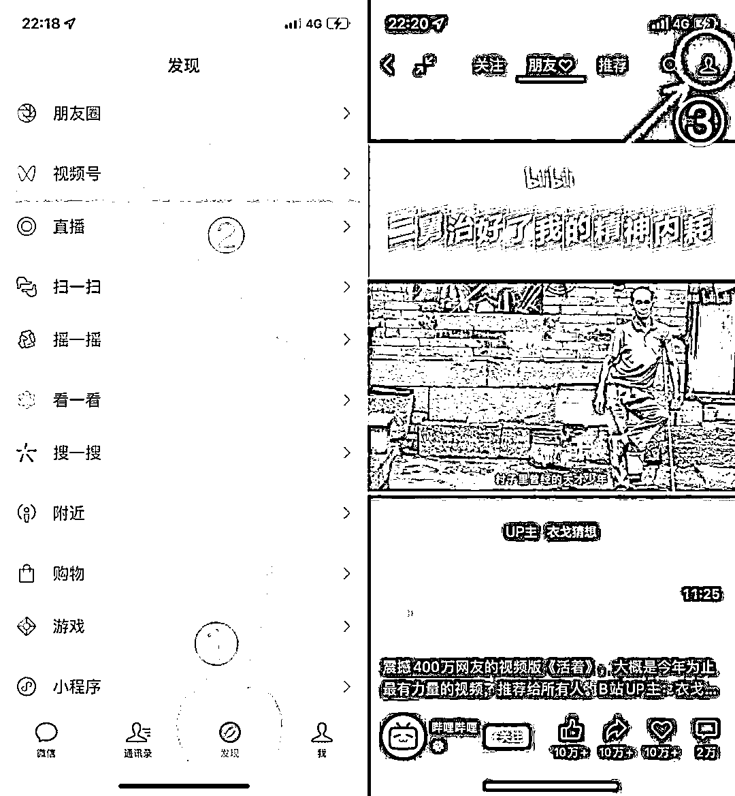

点击“发表视频”，设置好头像，把名字、姓名、地址填写完整，再点“创建”，视频号便注册成功了。完成后点击右上角三个点→“资料设置”，就能修改个人资料、补充视频号简介：

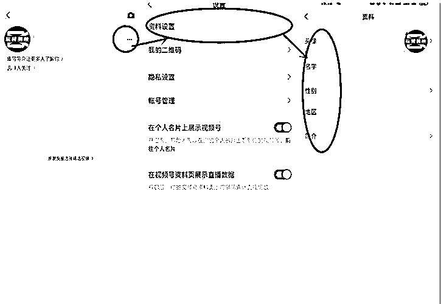

需要留意：视频号的命名规则和👸号一致，遵循先到先得，不允许重名。每个账号每年有5次改名机会；如果心仪的名字已被占用，可以申诉，也可以在名字后面加上点或符号，再重新申请。确实想用自己的名字，则需要能证明拥有该名称的使用权，例如有商标、👸号注册得早，或者持有著作权，都可以尝试申请。一般情况下，照搬对标赛道的账号去设置视频号信息就好，不必投入太多时间。

# 2.3 打造爆款内容

# 2.3.1 内容形式有哪些 @郭耀天

视频号既能发视频，也能发图文。视频的形态很丰富：真人出镜、混剪、二创、AI生成等。对多数人来说，实际操作更多集中在混剪、二创、AI制作这些不需要真人露脸的类别。图文则是另一套展示方式，单条内容最多可以放九张图片。有些作品仅仅靠几张图配上一首热门BGM，照样能跑成爆款。

# 2.3.2 热门内容的关键 @拾文

1. 选定一个赛道就深耕下去，别想发什么就发什么，账号标签一旦混乱，反而会坏事。以下两个账号可以对比看看：头像、账号名、简介全都围绕“治愈系老奶奶插画”来包装，问题出在哪里，不需要多解释，一眼就能识别：

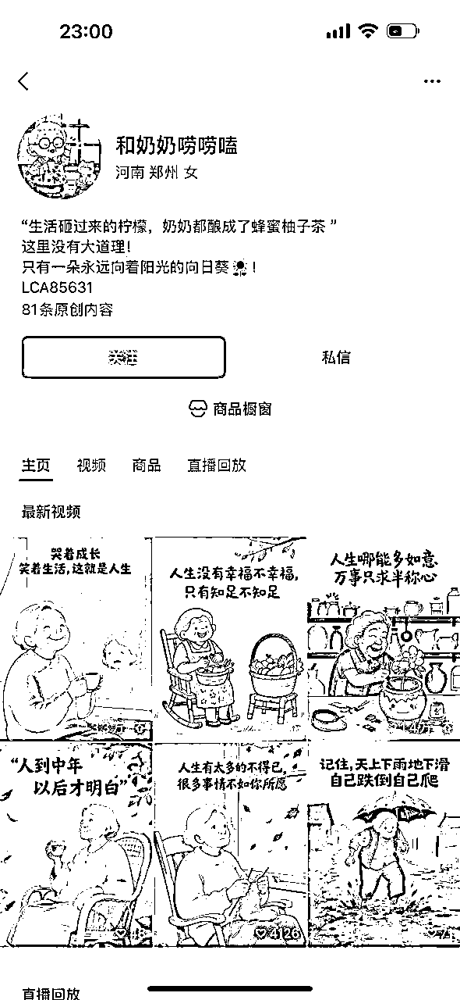

2. 执行力要拉到满格，能日更就别断更，能运营多账号就别只做单账号。任何平台的算法都带随机性，想对抗这种随机性，最直接的方式就是用“量”去博概率。看这三个实操账号的发布数量：167、66、176条——这些数据还没算上没勾选原创以及被删除的视频。所以成功从来不是碰运气，虽然大家常说选择大于努力，但前提是必须真的在努力！

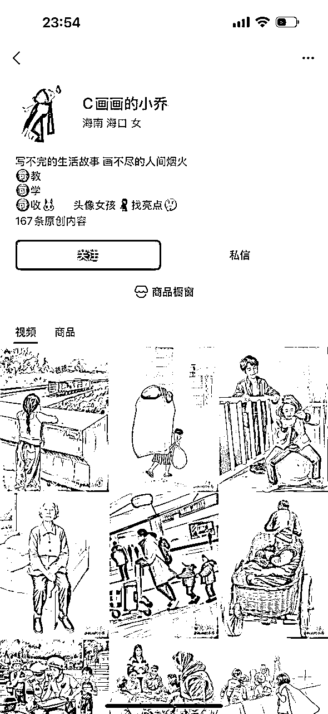

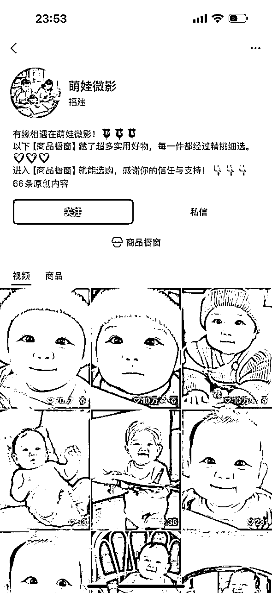

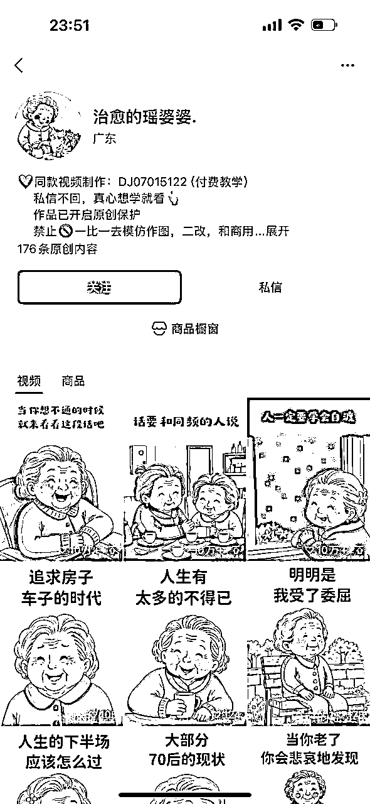

3. 数量有保障之后，再谈内容质量。持续更新，先把流程跑起来再逐步优化，并且学会复盘总结，才能产出更好的作品。实操时经常碰到两种状态：
第一种，完美主义倾向。总想先把教程研究透，把该注意的地方全部覆盖到，把能用的技能都掌握才肯动手。这其实没必要，顾虑越多，速度越慢。先开跑才是正经事——没有人一开始就能做得很好，哪怕你选题精准、配图精美、剪辑到位，各方面都拿得出手，第一条视频就爆的概率也微乎其微。别让还没开始的事困住自己；起步阶段感觉不完美，说明还有很大的上升空间、潜力十足，不妨这样给自己打气。
第二种，数据焦虑。发了几天、十几条作品后，反馈不理想，就开始反复质疑：是账号的问题？IP的问题？选题的问题？还是作图的问题？……这种情况下，往往是懂得越多越难跑出来。反倒是从零开始的新手，更容易拿到正反馈。超强的执行力胜过任何神功秘籍！把执行力填满，数据量积累到位，上热门的概率自然会放大。

4. 同行就是最好的老师。紧盯同赛道里做得好的账号，去研究、拆解、学习、模仿，最后实现超越。这是把项目做起来最快、最有效的路径。摸着石头过河，永远不如“摸着同行过河”。判断一个项目值不值得做，不用听别人怎么讲，去看看同行做成了什么样，心中自然有数。实操中不知道怎么推进时，参考同行的做法比看任何课程都有效。如果真有武林秘籍，这一条足够排进天字卷。

5. 培养网感，提升对热点的捕捉能力，热点内容天然自带流量。赤岭亮哥的事大家都知道吧？当时正在做热门二剪和AI生成漫画，刷到亮哥的素材后随手剪了一条发到视频号上，发出去就爆了，不到1小时播放量突破百万。热点的作用有多大，真实数据摆在这里，余下自行体会。

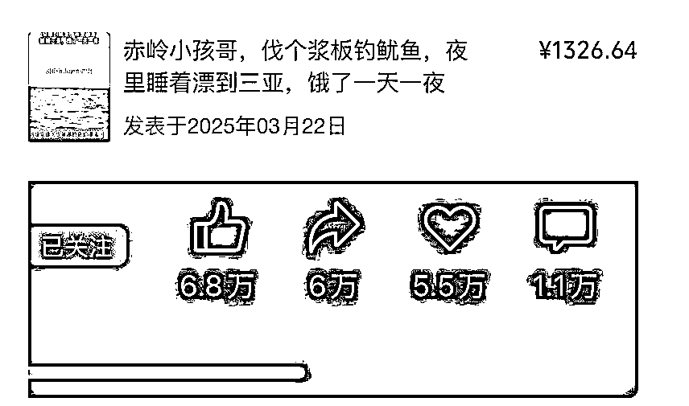

# 2.3.3 视频内容创作 @拾文

# 2.3.3.1 热门视频二剪+AI 生成动漫画+广告分成

# 2.3.3.1.1 找素材部分

手机上长按素材并搜图，能快速找到画质清晰的原版内容。
5月6日视频教程1.mov【在线播放】
【下载无水印素材，可以用去水印小程序，或者通过亨亨猫下载；工具按自己习惯选择，这里不作展开】
亨亨猫去水印：https://www.henghengmao.com/
无水印下载：https://dlpanda.com/zh-CN/xiaohongshu
各位自选即可。

# 2.3.3.1.2 AI 出图部分

出图提示词：彩绘手绘，铅笔笔触明显，完整显示，背景自然。
建议多制作2～3张高潮部分的画面，用于提升视频的原创比例。

# 2.3.3.1.3 实战剪辑部分

这个赛道的内核是二剪，因此天然面临非原创风险，素材去重必须认真对待。关于去重，最聪明的思路恰恰是不刻意去重。实操时优先找高清原版素材和较新的内容来剪，在视频中多插入几张漫画图来提高原创占比，尽量切断原素材的连贯性，不要让原始画面连续超过3秒。与此同时，要往画面里增加原创元素，比如添加文案、加入解说等。二创的正确定义是带着自己的理解对素材做二次加工，而不是直接搬运！搬运不符合平台规则，违规概率非常高。

# 2.3.3.2 治愈系老奶奶/老爷爷+AI 插画视频化+广告分成【推荐】

# 2.3.3.2.1 文案从哪找

下载一个📕，在搜索框输入【治愈文案】；或者打开抖音搜【人间清醒奶奶】之类的关键词。关注同行的对标账号，同样能找到灵感。

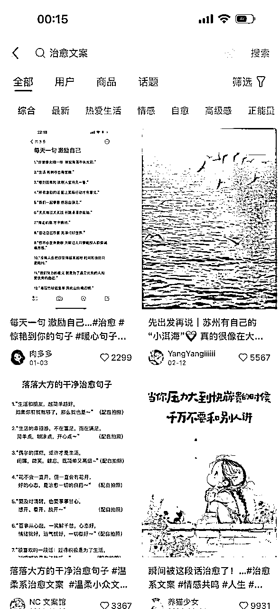

# 2.3.3.2.2 如何发布

抖音、快手、📕都适合图文发布。📕不需要配乐，抖音和快手把收藏好的音乐加上即可；唯独视频号有硬性要求：必须通过剪映把图片合成视频再上传！！！

做视频可参考以下模板：
1. 图片默认停留3秒；
2. 加一个翻页特效；
3. 配上合适的治愈系BGM；不知道选什么音乐，就抄同行的搭配，模仿是最快捷的学习途径。

【在剪映电脑版设置→全局设置→剪辑→图片默认时长中，可以自由调节图片的默认停留时间。】

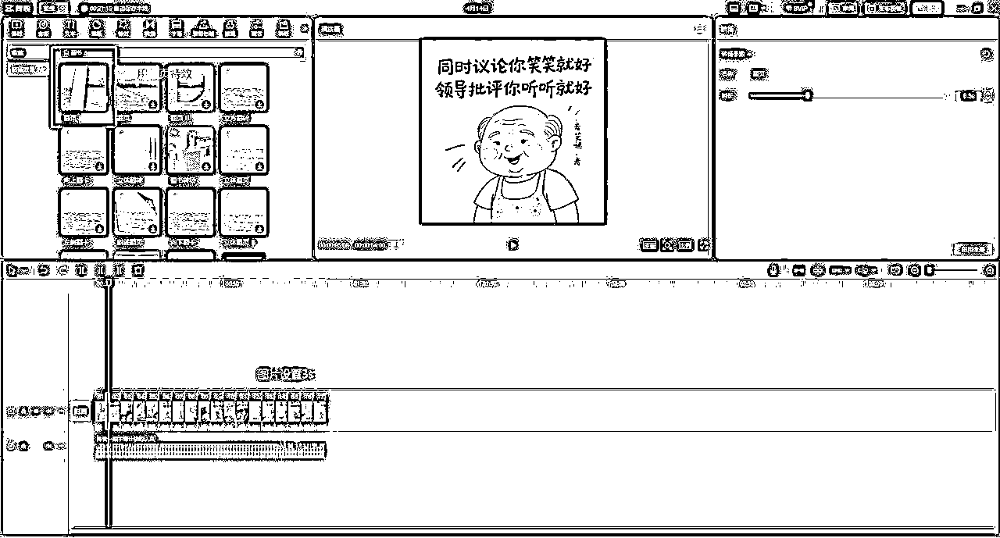

# 2.3.3.2.3 AI 插画生成提示词分享

### 提示词实例

1. 一位中国老爷爷，白发苍苍、头顶略秃，身材圆润，笑容可掬，神情慈祥治愈；戴近视眼镜，穿黄色格纹衬衫、蓝色牛仔背带裤和黄色背心，正在大笑；手绘笔触的卡通治愈插画，生动且有童趣；画面上的文字要醒目，采用chibi风格、极简主义、高清画质，字体加粗加大、清晰易读；人物头顶上方挂着黑色大横幅，上面写着“下班回家，能有个人一起吃饭”，他和老婆一起用餐，童趣满满。

2. 同样是中国白发老爷爷：秃顶、胖乎乎、笑眯眯、慈祥治愈；戴近视镜，黄色格纹衬衫、蓝色牛仔背带和黄色背心，放声大笑；治愈插画，手绘笔触，卡通童趣可爱；文字部分同样要求突出，chibi风格、极简高清，字体加粗加大；头顶黑色横幅写着“这是我听到的非常喜欢的一个答案了”，坐在客厅喝茶，童趣可爱。

3. 延续同款白发秃顶老爷爷的形象：胖嘟嘟、笑眯眯、慈祥治愈；戴近视镜，穿黄格衬衫、蓝牛仔背带和黄色背心，大笑；画风保持手绘治愈插画、卡通童趣；文字突出，chibi极简高清，字体加粗加大；双手举着黑色横幅，上面写“迷失自我去爱别人，挺没意思”，背景是风景，充满童趣。

4. 与第三条的老爷爷形象和画风完全一致，双手举着黑色横幅，文案仍是“迷失自我去爱别人，挺没意思”，背景同样取风景，童趣可爱。

5. 一位中国老爷爷，白发、秃顶、微胖，手绘笔触，笑眯眯，治愈插画风；戴眼镜，卡通童趣、慈祥可亲，正在吃饭，背景简单；头顶黑色大字写着“慢慢你会发现，娘家不是那么好回得”；线条插画风格，chibi、极简、高清。

6. 一位中国老奶奶，白色短发，手绘笔触，圆润微胖、笑容可掬，治愈插画风；穿粉色毛衣，戴眼镜，悠闲地坐在书桌边，举着牌子；卡通、童趣、可爱；牌子上是加粗黑色文字“丫头啊，他为了睡你，假装很爱你”；线条插画风格，chibi、极简、高清。

# 2.3.3.2.4 提示词公式总结

（1）公式总结

人物形象描述＋穿着描述＋背景描述词＋动作描述词＋文案描述词＋绘画风格描述词。

（2）实战展示

示例拆解：
人物形象：一位中国老爷爷，头发白花花、略秃，胖嘟嘟、笑眯眯，慈祥温和，戴近视镜，卡通生动有趣。
穿着：黄色格纹衬衫、蓝色牛仔背带、黄色背心，开怀大笑。
背景：室内木质结构，窗外透进蓝天，整体氛围温馨自在。
动作：双手举着一张白纸，上面写着……
文案：“有人说你好也摆，有人说你坏也摆”。
绘画风格：治愈插画、手绘笔触，图中文字明显，chibi风格、极简主义、高清画面，字体加粗加大。

组合起来就是：一位中国老爷爷，头发白花花，秃顶，胖嘟嘟，笑眯眯，慈祥可亲，戴近视镜，卡通童趣；穿黄色格纹衬衫、蓝色牛仔背带和黄色背心，正在大笑；背景是木质结构室内，窗外蓝天映入，氛围温馨惬意；双手举着一张白纸，上面写着“有人说你好也摆，有人说你坏也摆”；治愈插画，手绘笔触，文字突出，chibi极简高清，字体加粗加大。

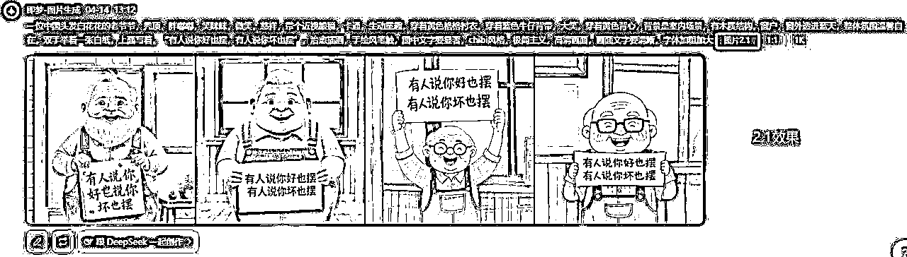

（3）反推提示词

遇到做得好的同行案例，把截图发给豆包，让它描述画面内容；再根据豆包给出的描述，套用上面的公式重组提示词。给豆包的那句话是：“描述下画面。”

# 2.3.3.2.6 实操工具

即梦传送门：https://m.jimeng.jianying.com/s/5krk4fASm3c/?t=-3
剪映传送门：https://www.capcut.cn/

# 2.3.3.2.7 要点总结

封面图极为关键。这类内容的流量入口就是封面图，它直接参与图文推荐机制。抖音主要靠封面图来推流，封面点击率是重中之重；点进来的人越多，系统就越可能把作品推向更大的流量池。

背景音乐也要用心。内容偏忧伤就配忧伤的曲子，偏治愈就搭治愈的旋律，BGM的情绪必须和文案一致，音乐一定要选准！不知道怎么选，就抄同行的答案，同行就是最好的老师。

文案比图片更重要。图片做得好看自然最好，一般一点也没太大关系，但不能太丑；新手完全没必要有心理压力。观众看的是文案，不是图片本身，所以文案一定要清楚。图上文字要让人一眼看懂，不要写太长；每一张图都要有让人想继续看的吸引力，完播率才会好看。如果观众扫一眼就觉得“写的什么呀，太乱了”，手指一滑就走了，完播率必然低，数据也很难跑起来。

# 2.3.3.2.8 当前遇到的问题和解决方案

前段时间即梦2.1模型下架，后来虽然重新上架，出图效果却不如此前。3.0模型出图文字更锐利、细节更丰富，但模型偏写实；单看漫画质感，2.1反而更有味道。差异可以看下方的对比图。
【之前的2.1和3.0出图对比】
【当前2.1模型出图】

眼前的问题主要是即梦平台更新所致；随着后续优化，出图效果肯定会逐步改善。现阶段大家可以根据自己的实操体验，在2.1和3.0模型之间自由选择；也可以改用2.0模型出图，手动把文案加上去。

# 2.3.3.3 AI+萌娃视频+广告分成

https://wx.zsxq.com/group/1824528822/topic/8858144842118542

提示词参考：

1. 可爱的婴儿坐在金色莲花上，头戴金色元宝形冠，一对大金耳环，多层金项链搭配黑红相间的珠链，金手镯、金脚镯齐全，红色腰带作点缀。面部特征：大眼睛、圆脸蛋、额间一点红色吉祥印记。周围元素：莲花下方散落着几个小金元宝。背景：泛有花纹的金色光晕，营造出神圣富贵的氛围。整体风格：色彩鲜艳、细节丰富、高清晰度、写实风格【即梦 3.0 效果】。

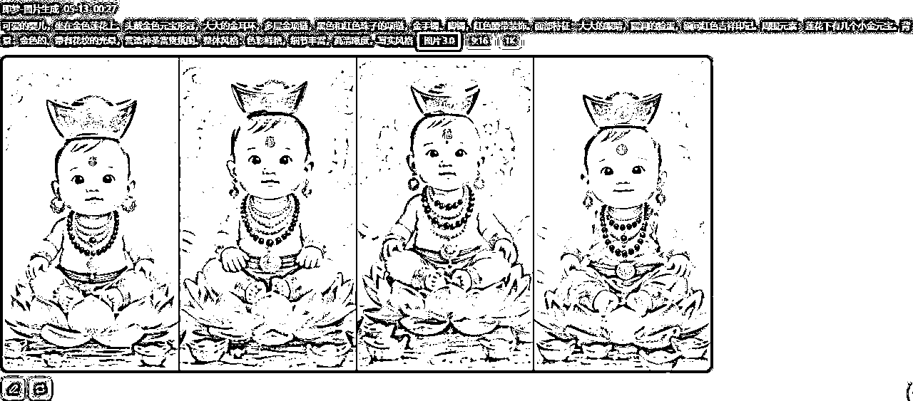

2. 一群婴儿穿着红色传统服饰，衣服上绣有金色福字图案，头戴同款福字红帽，手中提着装满草莓的竹篮，走在金黄色田野小路上；小路两侧长满野草，画面中还有几只白兔相伴；整体暖色调，洋溢着喜庆欢快的氛围；细节丰富、高清晰度、写实风格，比例「9:16」【豆包效果】。

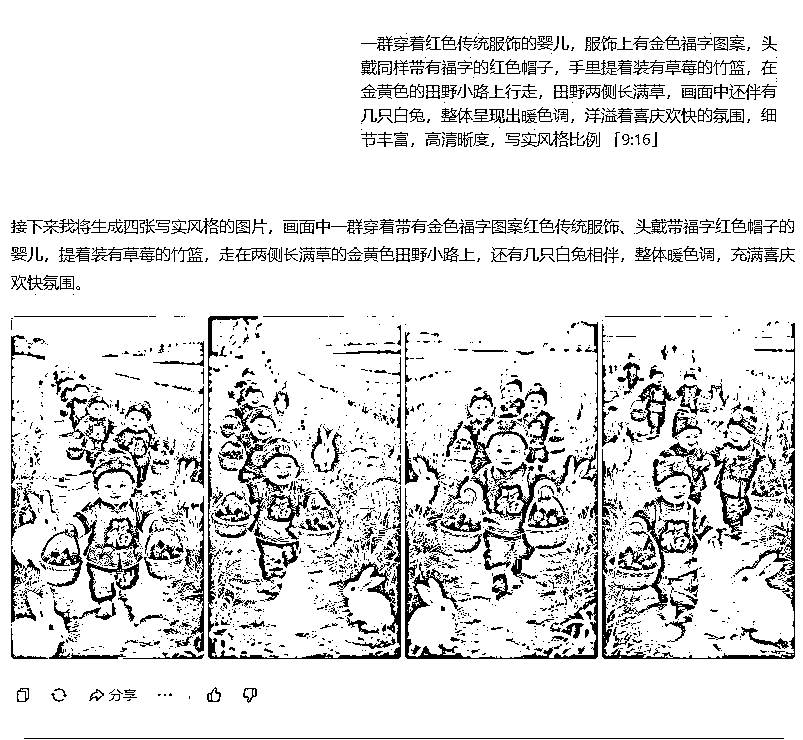

3. 一对可爱的3岁双胞胎小女孩，发型一致，都扎着双马尾，发间点缀粉色发饰；穿着同款白色短袖T恤，T恤上有粉色花朵和绿叶的印花，搭配浅灰色长裤和粉色搭扣小皮鞋。两人各捧一个桃子，笑着看向镜头，站在一条小径上；小径两侧是红、粉、黄各色花丛，背后是翠绿草地，画面充满童真和自然气息。细节丰富、高清晰度、写实风格【豆包效果】。

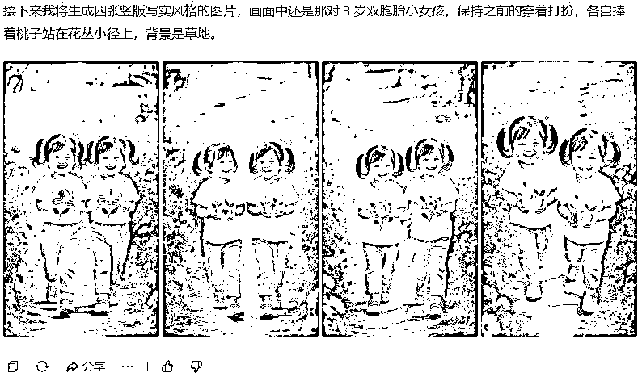

4. 画面中央是个可爱的婴儿，头戴金光闪闪的精致冠冕，冠冕以金色为主，镶嵌红蓝宝石，顶端垂挂着金色链饰，非常华丽；身穿一件金色传统服饰，面料带着丝绸般的光泽，衣上绣有蓝色花纹，和冠冕相得益彰。婴儿双手环抱一条体型较大的金鱼，鱼鳞金光闪烁，橙红色鱼尾和鱼鳍舒展飘逸，眼睛乌黑明亮，灵动鲜活。背景是宁静的山水：远处山峦层叠，植被茂密，深浅不一的绿色铺满视野；近处水面平滑如镜，倒映四周景致。画面整体为暖黄色调，光线柔和，透着古典、富贵且祥和的气息，仿佛承载着吉祥如意、富足安康的寓意。细节丰富、高清晰度、写实风格，比例「9:16」【豆包效果】。

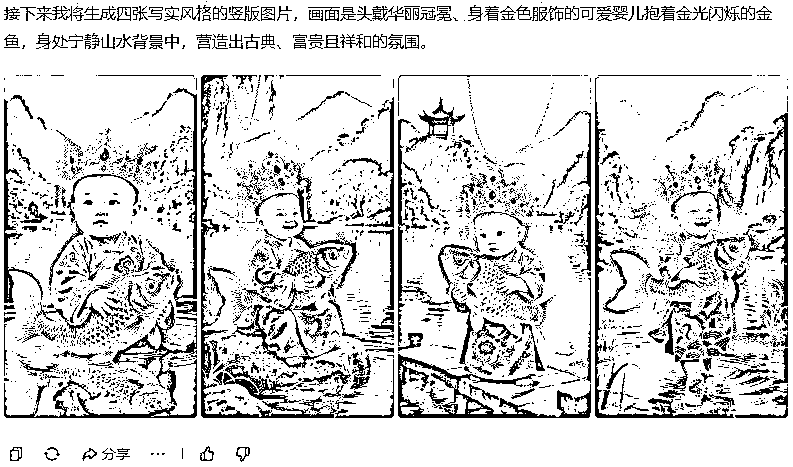

5. 转眼到了一岁抓周，给小姑娘来一张节日主题照：圆嘟嘟的脸蛋、齐整的双眼皮、头上扎着小揪揪，穿一身火红吉庆古装，挺直小身板站着，腮边自带娇憨红晕。四周的暖黄光影把节味儿烘托得刚刚好，孩子一对眼睛直直地望着镜头，那股自然劲儿特别出片【即梦 2.0pro】

成品效果预览：没买会员的即梦账号保存文件会自带水印，对外发出前先用剪映把底部水印裁掉。

BEFE55F3-DCF0-4C2F-A350-BE0D2F7C10B4.mp4【在线播放】

两条经验：一、想找更多高水准对标，多去搜“萌娃”“人类幼崽”“萌宝”这类字眼就行；二、教程录制时为了赶进度用了快速模式，正儿八经实操时建议直接开大师模式，出片质感更强。

# 2.4 视频发布走哪些通道 @郭耀天 @黄岛主

不少朋友以为视频号的内容只能在手机上发，其实发布渠道并不单一：手机可以用，电脑同样可以。

# 2.4.1 手机端怎么发

手机上操作，一共有三条路子。

路子一：从“发现”页直接发。

路子二：从“我的”页进去发。在🛰️里点底部“我”，找到视频号入口，点进去就是发布页面。

路子三：靠“剪同款”发。看到带特效的素材，自己又不会做特效时，直接选“剪辑同款”就能一键搞定。

需要留意：并非每条内容都挂了这个功能按钮。刷到下面这样的视频，就可以试着走这条路，发出来的片子自带同款特效。

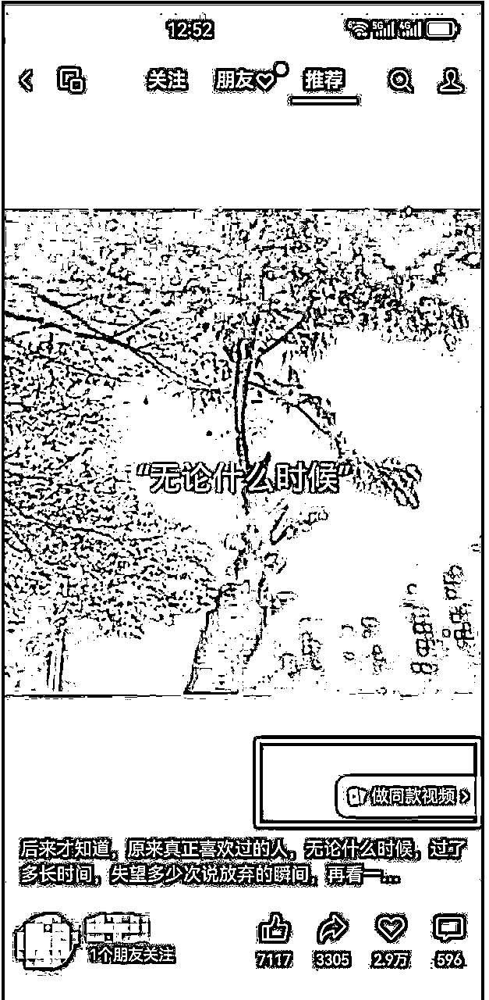

# 2.4.2 电脑端怎么发

电脑端不仅能发视频，还能提前设定定时推送。

如果内容本来就是在电脑上剪完的，那从电脑发是最省事的路径——片子不用先挪到手机里，打开“视频号助手”后台就能操作：https://channels.weixin.qq.com/login.html

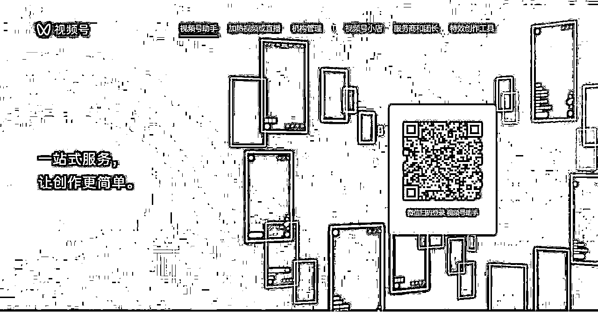

登录进去之后，首页“内容管理”里列出的视频，都能作为发布入口：

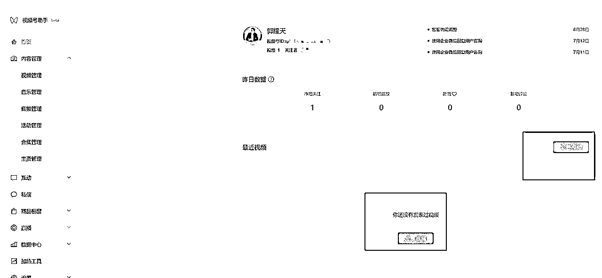

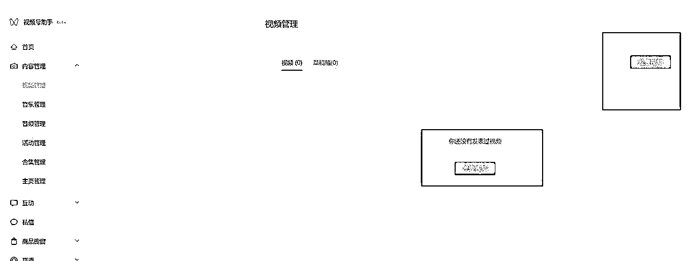

# 2.4.3 发布环节的实战技巧

# 2.4.3.1 通用操作要点

最关键的一条：后期千万别忘了开原创！！！！

把重点再敲一遍：加入「创作者分成计划」之后，每个片子都要标上原创，不然等于白干。之前有位圈友，一条视频跑到六百多万播放，结果漏了原创标记，损失差不多两千块。

账号初期能标原创也尽量标；不过有些新号后台压根没有“原创声明”这个按钮，所以前期不会强求。

每天几条、什么点发

起号阶段，比较通用的做法是一个号每天发 5 条来试水温。别一次性全抛出去，隔一两个小时放一条最稳。

5 条都跑不出爆款的话，可以再补一发两条。

时间、精力都够用的情况下，建议多账号并行，把风险分散开。但有个硬性规则：一个手机号只能注册一个视频号，一张身份证最多完成 2 个视频号的认证。想多几个号一起跑，就得先备好几套手机号和🛰️号。

流量最好的窗口基本在白天，太早太晚都不合适。早上 7 点到晚上 9 点之间发布比较保险。发太早，目标人群还没醒；发太晚，人家已经睡觉，没人点赞互动，数据会很难看。

标题、标签、封面和定位

直接参考同行的套路就行：标题写得干净利落，话题标签和视频主题搭得上，封面挑一张顺眼的，然后就能发。愿意多花一步功夫的话，再带上定位信息，被更多人刷到的概率会高一些。

话题标签怎么挂：在描述输入框里点一下“#”，就能把标签加上去。

拿早安祝福类内容来说，领域可以选“情感”，也可以选“生活”。

把熟人关系用起来

片子发完以后，主动把视频号内容转到朋友圈，或者直接发给🛰️好友，请他们来一波观看和点赞。

有内容在爆，暂时压住新片

如果前面某条视频正在爆量、流量还在往上冲，这时候别急着发新内容，否则大概率会把爆款的推荐给“顶”下去。等前面那条的自然流量慢下来、不再被推了，再发新的。

发完记得去评论区铺两条留言

加入「创作者分成计划」后，视频一发出，自己先上去评论几条，或者用小号补几句，广告才有机会早一点冒出来；不然就得等路人凑够评论数。按现在的规则，评论超过两条，广告位才会被激活。

内容来源：《视频号儿女祝福流量变现副业，起号后单天收益 1000+，实操一条龙玩法分享给你》@黄岛主

# 2.4.3.2 吃透推荐机制

视频号内容发出之后，一共有 6 次推荐机会，时间分布是：3+6+18+24+24+24。

这话怎么理解？绝大多数作品发布后，会在第 3 个小时、第 6 个小时、第 18 个小时和第 24 个小时分别吃到一波来自系统的自然推荐。

其中，发布后的头 3 小时被称为“黄金三小时”，这段时间必须拼执行力：朋友圈、互助群、红包群……所有能用的社交资源都拉起来，全力冲完播、点赞和评论。

进入第 48 小时到第 72 小时之间，系统会启动第二波灰度推荐。

如果 72 小时过去之后，作品的播放、点赞、评论、收藏还在持续上涨，那恭喜你——内容基本确认上热门了，后面还会被平台反复加推。

就目前视频号的推荐逻辑来说，社交权重占的比重挺大。那些好友多、社群多、又有👸号沉淀私域流量的人，做视频号营销推广有天然优势，比普通人更容易冲成头部账号。

# 2.4.3.3 不想让🛰️好友看到，有啥办法？

有些朋友不希望通讯录里的人刷到自己的视频号；也有人是用家人的账号在操作，家人并不想让熟人看见。这些情况都能处理。

操作方式：点视频号右上角“...”→ 找到「在个人名片上展示视频号」，把这个开关关掉，🛰️好友就看不到你的视频号入口了。

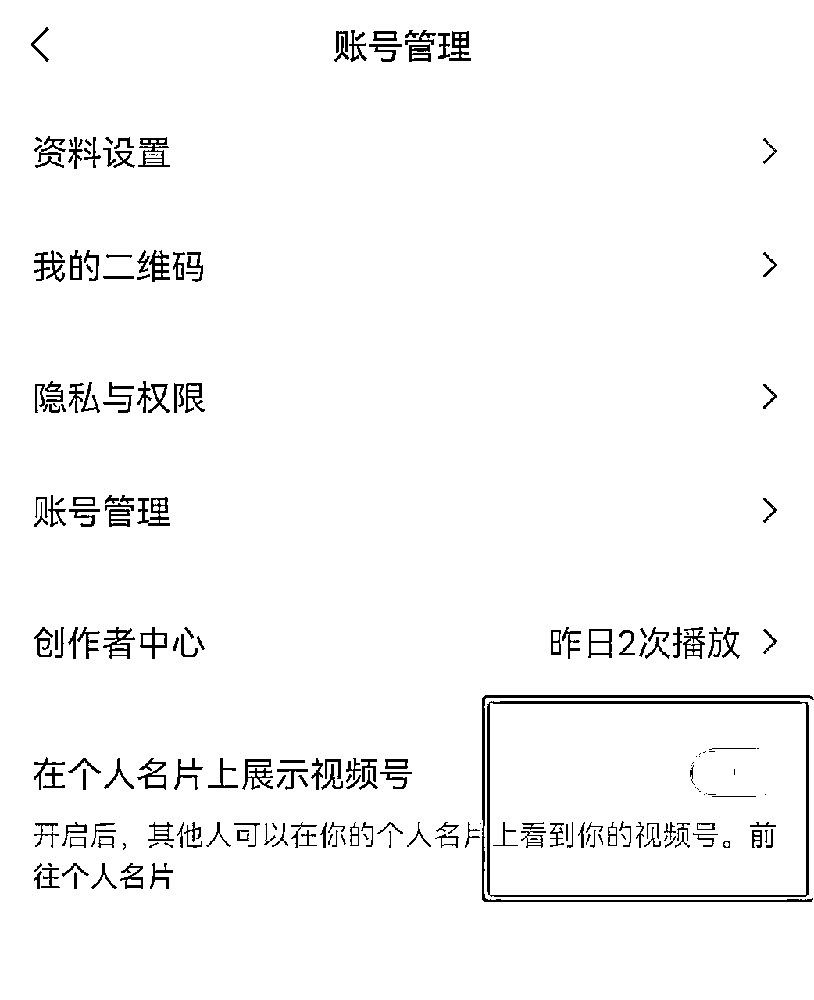

# 三、【项目实操 2/3】开通分成计划，领取收益

# 💡

# 章节预习

开通「创作者分成计划」是这个项目的命门所在。没有开通计划，后面发再多视频也挂不了广告，自然谈不上收益。

第一个阶段里，我们已经走完了视频创作和发布流程。把这件事不断重复下去，就会慢慢逼近开通计划需要的条件：

① 有效关注人数（粉丝数）达到 100 及以上
② 内容合规：平台偏好优质原创、画面精致、真实正向的作品
③ 创作者本身得是优质的原创作者

✅条件达成后，计划怎么开？有没有加速办法？去看「3.1 如何开通分成计划」
✅有收益之后，去哪里领？提现失败又怎么处理？看「3.2 如何领取收益」
✅分成计划被收回，还能怎么恢复？详见「3.3 分成计划被取消，如何恢复」

可以按下面的路线图开始：

1、了解分成计划的玩法和开通方式（约 0.5 小时）
2、制作 AI 热门视频，达标后开通分成计划（约 3～5 天）
3、每天更新 2～3 条视频（每天约需 2～3 小时）

现在就可以按这几个步骤做准备了。

# 3.1 分成计划怎么开

# 3.1.1 开通条件有哪些

视频号能不能快速跑起来，起号这步非常关键。起号没做好，分成计划就很难顺利拿下，时间也会被白白拖掉，所以说掌握快速起号的方法很重要。目前想要开通视频号分成计划，下面三个条件要同时满足：

1. 有效关注人数不低于 100 人；
2. 内容符合平台规范；
3. 账号不是政务类账号。

获得邀请的创作者，可以点开「视频号团队」的私信进入权益页面申请，也可以从「创作者中心 > 创作者服务 > 创作分成计划」里找到入口并提交加入申请。暂时没收到邀请的话，后续留意平台通知就行。

# 3.1.2 开通流程拆解

第一步：摸到入口，递交申请

路径一：账号达标的话，入口会在下面这些地方出现。

登录视频号，按「创作者中心 → 创作者服务 → 创作分成计划」的路径找过去，点「申请加入」：

*再补一句：还没被邀请的创作者不用急，等邀请一到，入口自然就显示出来了。

路径二：盯住开通提醒。尤其是内容火了以后，后台推送会非常多，这时候要格外留意平台私信。

开通提醒就在私信里。如果看到类似截图里的提示，说明你已经进了推荐名单，点进去把权限申请掉就行。

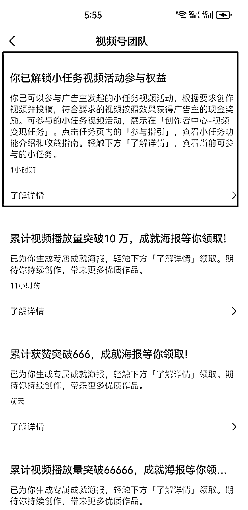

顺带说明：视频号没有“养号”这回事，注册完直接发就行。我们当时就是当天注册、当天发，第一条视频就爆了，第二天分成计划就下来了。如果按上面第二条路径去申请，一天之内就能开通；再多发几条内容，条件就过了。前提只有一个——内容一定要垂直。

开通计划只是起步，真正的目的是计划到手之后，多做出爆款，把收益做出来。

第二步：发原创视频，广告自动展示

加入分成计划以后，创作者要做的只有一件事：发视频时打开「原创声明」。其他什么都不用管，广告就有机会出现在评论区下方。

已经参与分成计划的视频，可以到「创作者中心 → 创作者服务 → 创作分成计划 → 参与收益中的视频」里查看：

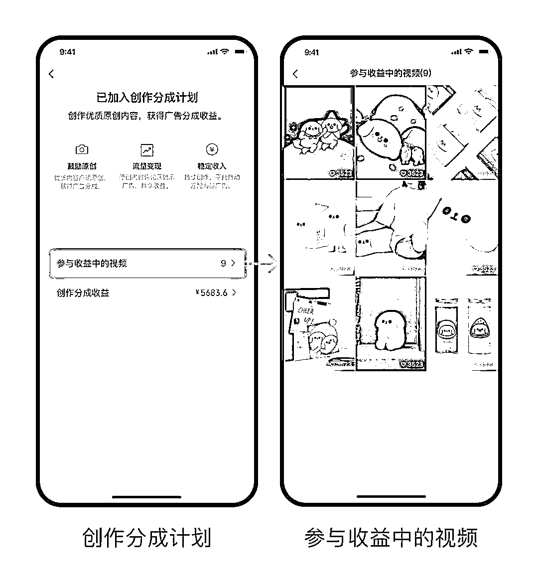

# 3.1.3 快速开通有没有捷径

前面说的是常规开通流程。想再快一步？确实有路子，下面这几种方法都可以试试。

# 3.1.3.1 靠优质内容等内邀

这种方式属于内部邀请。只要内容是原创、质量过关，哪怕粉丝很少，也可能被平台主动邀请。讲真，只要你认真做内容，100 粉根本不是坎。

平台认定的优质标准：画面分辨率 720p 以上，时长超过 15 秒，内容方向垂直，有明确引导，画面不抖、不晃动。

# 3.1.3.2 先把优质作者身份做出来

这套起号方式目前用的人最多。起号速度中等，但胜在稳。

先传五到十个随拍视频上去。传的过程中随时盯着后台提醒：点进创作者中心 → 创作者服务 → 收入变现，就能看到“优质创作者”内容规范是否满足。

如果那里显示「满足内容规范」，马上转头去剪辑你目标领域的爆款内容，发布后完成涨粉，开通就顺理成章。

视频发布的间隔可以控制在一两个小时一条。我们测的时候一天发 5 条，两天发完 10 条，直接达标。

当然，追求更快，也可以直接上活粉，硬凑 100 个关注，比如请人来点关注。粉丝一满 100，马上点申请就能开通。

但这样做有踩违规线的风险。介意风险的话，还是用内容老老实实涨粉。

注意事项：做上面这些动作时，千万别跟人互关，一定一定记住。否则就算粉丝数凑满了，系统照样提示“粉丝不足”——平台对刷粉查得很严，而且互相抱团关注的粉丝重合度太高，一眼就能看出来。

# 3.1.3.3 先涨粉再起号

这是速度最快的一种起号方式。根据我们的测试，新号前 3 条内容有流量扶持。新号可以直接发成品内容，粉丝满 100 后，看看原创等规范达不达标；达标了就去申请开通。

如果还没达标，就随手拍几条原创视频发出去，专门用来满足内容规范。

我们实际测下来：新视频爆掉、粉丝过 100 之后，再发一条以上的随拍原创就过了。

这种模式的缺点也很明确：账号定位必须从一开始就定清楚，不然后面想改方向很难。

涨粉除了靠爆文，还可以用直播，或者通过“问一问”切到视频号回答问题来引流。攒够 100 粉并不难，一条视频跑起来，涨粉几千上万都很常见，所以抓紧干就对了。

如果试了上面几种模式还是显示未达标，那就继续拍相关视频，优先随拍原创，再把你想要做的领域做进去。随拍视频也有要求：画面别抖别晃，清晰度至少 720p，时长 15 秒以上，内容垂直、有导向。

# 3.1.3.4 内容和涨粉同步启动

内容质量够硬的话，就直接发成品。涨粉的同时，原创优质作者的标准也会一并达成，随后就能顺手申请开通分成计划。

# 3.1.3.5 申诉开通

如果发了十多个原创视频还是没达标，这时候可以申诉，而且大部分人都能申诉成功。

只要你的内容一直保持原创，就可以直接申请申诉。

申诉入口（需要在🛰️手机端打开；如果链接请求异常无法打开，可以到项目禁言群的群公告里找一样的一个）：
https://channels.weixin.qq.com/pandora/pages/appeal/index#account-detAIl

# 3.2 收益去哪领 @拾文

# 3.2.1 收益怎么算

「视频号分成计划」的收益计算方式，腾讯从头到尾没给过明确公式：

只说广告分成和个人视频质量、播放数据、投稿数量、广告行业选择等因素有关。当你持续产出优质原创内容时，广告分成也会水涨船高。

# 3.2.2 收益怎么看

去「创作者中心 → 创作者服务 → 创作分成计划 → 创作分成收益」就能看到。创作分成收益页面的口径说明如下：

# 3.2.3 收益怎么提

提现入口

原创视频发布成功的第二天开始，创作者就能到「创作者中心 → 创作者服务 → 创作分成计划 → 分成收益」查看每天预计能拿多少。点「去提现」，收益直接进🛰️零钱包。

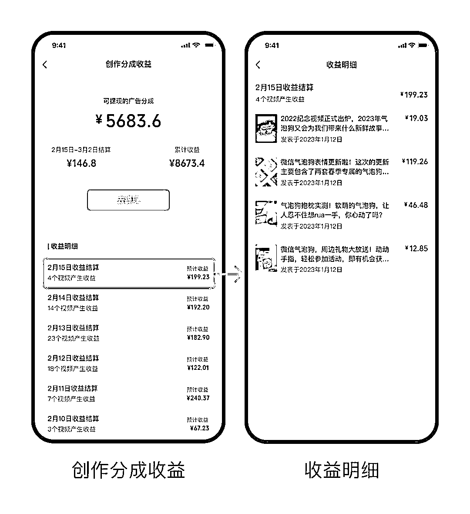

结算节奏

每个月的收益分两次结算（遇到法定节假日会延后）：

上半月的收入，当月 22 日起可提；
下半月的收入，次月 7 日起可提。
提现之后基本是秒到账。

扣税细节看官方文件：https://ad.weixin.qq.com/docs/10

想合规节税，可以去研究「6.2.1 MCN 统一收款」。一般 MCN 机构收 3% 左右的费用，也有收到 6% 的。

# 3.2.4 提现失败怎么办

如果遇到提现失败，照着下面这份《商家转账失败解脱指引》来操作：

# 3.3 分成计划被取消，如何恢复 @郭耀天

分成计划始终把优质、原创放在第一位。内容不符合要求，轻则被要求整改，重则被取消权益。

收到“内容整改通知”：你需要再发布至少 10 条平台认可的优质原创内容，之后平台会帮你恢复权益；如果 10 条已经发完了，就耐心等一下审核，结果会通过「视频号团队消息」发给你。

收到“权益取消通知”：

如果是发过非原创、非优质内容，或者内容方向发生变动导致的取消，那就持续发原创优质视频，重新达标后权益会被激活，到时候按照邀请私信再申请加入就行。

如果是视频号认证身份信息发生变化导致的取消，可以先把认证信息改回来，重新达标后权益也会激活，再去申请加入。

如果觉得平台的违规判定有问题，也可以申诉：

因整改审核失败、或发表非原创/非优质内容而被取消权益时，在通知页面底部点「申诉」，按提示提交证明材料：

# 四、【项目实操 3/3】持续复盘优化，把质量和产量同时拉起来

# 💡

# 章节预习

这一章要解决的问题：内容发出去之后，怎么根据数据表现来做复盘和迭代。

按下面的节奏走就行：

1、掌握多种提升收益的手段（约 1 小时）
2、坚持复盘，把内容效率做上去，让收益继续涨（每天约 1 小时）
3、搞清常见问题怎么处理（约 1 小时）

现在就开始筹备吧。

# 4.1 收益怎么往上提

# 4.1.1 决定收益的命门 @白丁

视频号分成计划这个项目，非常挑赛道。收入全部藏在评论区里，评论区的点击量基本决定了这条视频能吃多少。

所以这套玩法的赚钱逻辑就四个字：内容＋评论。

评论点击量属于很难干预的数据，硬去动它，一个不小心就是违规甚至限流。

那怎么把收益做高？先看这两张图：

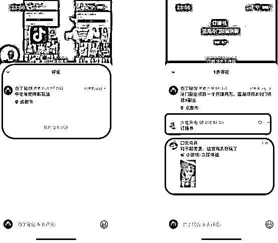

两个号都已经开通了分成计划，但图一没广告，图二有广告，为什么？

前面说过，分成收益来自位于第 3 到第 5 条评论之间某个位置的卡片广告——但这说的是评论数量多的情况。评论少的时候，有两条评论广告就会触发，所以光一条评论是带不出广告的。

这里就有个操作技巧：视频发布后，马上用自己的主号或者小号去补一条评论，能把流量收益的损耗降到最低。

就这么一个动作，收益至少多 20%。

现在用户早就养成了“看见评论就想点”的习惯。你那条评论写得好，能带动一大片人跟评；评论越热闹，内容加热效果越好。

其他数据就别碰了。再说内容。

内容=视频素材+文案。

视频能不能爆，素材本身占很大因素。这就需要你有网感，能判断什么样的话题有爆点。这是一种功夫。我一直觉得，一个项目赚不赚钱，和技能是不是匹配有很大关系；技能到位，运气又刚好撞上这个项目，钱就是顺带的事。

网感不是天生的，能靠训练磨出来。最有效的办法就是拆同行：把同行的爆款素材下载归档，一条条列出爆款原因。大量素材堆在一起之后，你会发现很多爆款背后的规律高度一致——这就是共性。找到爆点，做内容时往那个方向发力，坚持一段时间，你会觉得做爆款实在太轻松了。

再就是文案。视频号对文案的要求非常苛刻。可以试试“开头固定钩子＋补充完整内容”的格式，既能让内容重复度降下来，也更容易被平台收下。

在视频号里，网感在线，文案又能打，想不爆真的很难。

方向和方法都对了，到最后拼的就是执行力：雷打不动地更新。账号 80% 的收益来自 20% 的视频。方向不偏，坚持更新，总有爆的一天；视频号爆一次就是上千块的收益。

内容来源：《视频号分成计划娱乐解说玩法，一条视频一天 4815 元》@白丁

# 4.1.2 为什么我的收益比别人低 @郭耀天

很多人在实操中会发现，自己的收益跟别人对不上。要弄明白这个问题，得先搞清楚钱从哪里来：这笔收益并不是腾讯出的，而是商家在视频号评论区投放广告，把钱交到平台，平台再按你的账号流量和点击去结算。

明白了钱不是平台掏的，收益差距就容易理解了：赛道不同，点击价不一样。

比如某个领域的广告主预算充足，收益自然可观。而且广告是智能匹配的，如果分给你的广告单价很低，你能拿到的也必然少。

# 4.1.3 想提高收入？三条路可以走 @郭耀天 @思蒙

假设你的作品正好赶上热度爆发，可广告主当期预算吃紧、投放力度减弱，供应的推广位不够，到手的收益也会被压低。收入高低本质上不由我们掌控，能下功夫的地方无非两个方向：要么多产内容，让命中爆款的概率变大；要么切入付费能力强的赛道，财经、美容、酒类背后的广告主不差钱，而泛娱乐类目的议价空间就小得多了。

路线一：锁定年轻用户多的赛道

已经拿到分成的伙伴里，有人抱怨单价太低，说到底分成计划还没有全量爆发。你观察一下现在的广告池子，游戏类占了大头，剩下的多半是腾讯自家的推广和网剧。很多人去做祝福、早安类视频，转发数据确实好，但观众以老年人为主，金主几乎不投这个人群，收入自然垫底。想提高客单价，就往年轻人聚集的方向走：科技、娱乐、情感，这些领域的人群标签值钱，广告出价也就更高。

路线二：把评论区互动激活

分成收益是从评论区广告里来的，所以内容得先有爆款潜力，能引发转发和传播，评论才会跟着起来。第二，要主动制造评论：自己留几条、小号补几条，广告被触发的时间会提前——按当前的规则，评论区攒够两条以上评论，广告才会出现。内容本身也要有互动入口，像“找图中的人物”“找图中的动物”“看图答题”这类选题就很好用。也可以在视频里故意抛个钩子，引导大家参与。举个例子，有伙伴用一张图让用户找头像，观众看完把答案打在评论区；也有人把语录放出来，问一句“这句话说得对吗？评论区告诉我”。

路线三：把创作效率提上去，用数量去博概率

视频号分成这种低门槛项目，骨子里就是拿数量换概率的游戏。能多发一条就是一条，能多开一个号就多开一个号。实操中你一定见过：有些人的作品和你水平相当，看不出哪里特别，可号就是爆了，纯粹是概率落在头上。选对方向、掌握剪辑技术之后，剩下的就是拼量。单条爆的概率是1%，发10条、同时布局10个号呢？每个号都是1%的概率，叠加起来命中机会是不是高多了？为了让量跑得起来，你要在实操里不断打磨效率——素材找得快、文案写得好、剪辑出片快，都是熟能生巧的事，练多了自然有进步。

内容整理自6月8日@思蒙的《短剧CPS的进阶技巧及常见问题答疑》。

# 4.2 高频问题排查手册 @郭耀天

做这个项目时经常碰到相似的问题，下面把圈子里常见的困惑和解决办法整理在一起。

# 问题一：掉广告怎么防？

哪怕你的视频是纯原创、播放量很高，也可能遇到掉广告，简单讲就是评论区找不到匹配的推广位，几百万播放甚至千万播放的内容同样逃不过。有几位伙伴试出过一些土办法，不敢保证百分百有用，但逻辑上讲得通。大多数人用的是剪映，其实视频号官方还推出过一款叫“秒剪”的剪辑工具（官网：https://miaojian.weixin.qq.com/），用秒剪处理过的视频，似乎更容易获得推荐流量。

方式一：从剪映导出成片，放到秒剪里过一道，再导出来即可。
方式二：把剪好的视频扔进秒剪，任意套一个滤镜，再把画质颜色调低到10以下，个人常用的值是5。
方式三：导入视频后用秒剪的“治愈调节”模板，该模板自带音乐和滤镜；把原音打开，自带的滤镜叫“橘子海”，参数调到10。
方式四：使用橘子海滤镜，参数调到10后继续：亮度3、对比度4、饱和度4、色温5，这四项都不能超过5；暗角调到9，不要越过10；锐化14，不能超过15；贴纸加3～4个，个性文字放2个。

另外，建议发布作品不要用WiFi，改用4G网络，WiFi覆盖面小，4G的曝光范围更大。

# 问题二：为什么后台“参与收益中的视频”是0？

“参与收益中的视频”展示的是该账号过去7天内产生过收益的内容。如果数字是0，通常有这几种原因：
1. 发出去的内容，评论区从未展示过广告；
2. 近7天内容没有实际产生分成收入，持续发布优质原创作品，一旦产生收益就会显示在专区里；
3. 账号正在内容整改期，或者分成计划权限已经被拿掉，内容无法再参与广告分成。

# 问题三：哪些内容不会被推荐？

可以从三个维度判断：成片质量、内容价值、关键词关联。

成片质量不达标：声画错位、分辨率低、画面卡顿模糊、大段黑屏、剪辑逻辑混乱，一句话——用户观感差的视频，基本没有推荐机会。

内容价值不够：平台对内容有两个要求，一是追得上热点，二是给得出价值。这和其他平台没什么两样。假如发的内容既没有热点、也没有话题度、更谈不上传播价值，那就是一个公开的私人朋友圈，靠社交推荐只能被自己和好友看到，别想有流量。内容同质化、热点过期同样不会被推；低质内容不是平台想要的，自然会被过滤。

关键词关联弱：视频号的推荐模型会读取画面、标题、话题标签、位置等信息来做精准分发。作品和关键词之间对不上号，平台也不会给推荐。

# 问题四：加入分成计划会影响视频流量吗？

没有影响：流量取决于内容质量和选题方向；广告只出现在评论区，和视频本身互不干扰。

# 问题五：广告需要手动展示吗？

不需要。加入分成计划之后，发布视频时只要勾上“原创声明”，评论区下方就有机会自动挂上广告，不用额外操作。平时可以在“创作者中心-创作者服务-创作分成计划-参与收益中的视频”查看哪些视频正在参与分成。

# 问题六：评论区一直没广告怎么回事？

先排査基础条件：没加入计划的话，光声明原创也不会有广告。进了计划，发布时一定要开原创声明按钮。发完之后自己先评一两条，广告很快就会跟出来。广告的前提是评论区有人发言，一般出现一条他人评论，再补上自己评论，广告马上到位。

如果已经加入计划、也声明了原创，还是没有广告，就往这几个方向看：
1. 暂时没有与该视频受众人群匹配的广告；
2. 视频属于平台不支持挂广告的类型：非公开浏览状态的视频；含有商业推广内容的视频——包括信息流广告、短视频商品分享、视频变现任务、互选平台等；违反《🛰️视频号运营规范》的内容；
3. 账号处于整改期或分成权益被取消，无法参与分成。

# 问题七：以前发过别的内容，账号要如何养？

直接拍随手视频连续发，这样的老号养成功过。要是担心不过审，就把非原创和不同类的内容全删掉，持续更新随拍。更新几十条之后还是不符合内容规范，那就可以把账号注销，重新注册新的号。

# 问题八：老号以前流量不好，适合发新项目吗？

先发几条随拍试探流量。有流量的话可以直接开分成计划；没有流量，换个赛道再测试，测试之后依然没有流量，直接注销重新起号。

# 问题九：开通广告分成后，以前的视频需要删除吗？

能删就删，或者隐藏，看你的选择。如果老视频符合内容规范、质量过关、而且是原创，完全可以留着不用动。

# 选修篇：进阶玩法和工具清单

# 💡

# 章节概要

跑通最小可行的项目闭环、熟悉操作流程后，可以来看选修篇。无论想放大项目规模，还是挖掘新玩法，本章都值得精读：

✅【项目拓展】更多运营经验和技巧
✅【项目放大】让分成收入进一步增长
✅【实战工具】工具让效率更进一步

如果基础篇还没读完，先把必修的基本功练扎实。时间和精力允许，欢迎尝试选修篇的进阶内容。接下来的内容会带着你走得更远，开始你的探索吧。

# 五、【项目拓展】运营经验总汇 @郭耀天

# 💡

# 章节概要

必修篇之外，视频号还有很多有用的运营细节，我们整理了多位老师的经验：

✅5.1 视频号注销流程
✅5.2 视频号更换管理员
✅5.3 检测账号是否限流违规
✅5.4 恢复账号的变现权限
✅5.5 避坑经验
✅5.6 其他拓展问题

说不定你正在头疼的问题，在这一章就能找到答案。

# 5.1 视频号注销方法

运营视频号时总有那么一些号：发什么都不来量，或者违规太严重、评论区被关，平台不再给流量，分成计划跑不起来。对于这种账号，最干脆的办法就是注销后重新注册。早期注销要等7天甚至更久，现在视频号规则更新后，24小时就能注销成功：

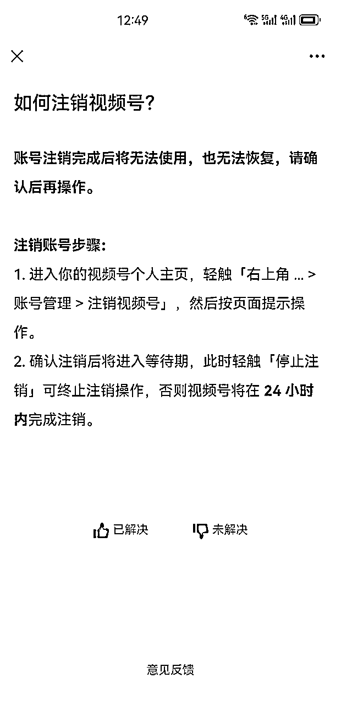

如果提交注销满24小时还没有成功，或者想立刻注销，点这个按钮即可：

# 5.2 视频号管理员更换指南

有时需要快速把账号处理掉，还有一个更快的路子——转移管理员。找一个还没注册过视频号的🛰️号，把当前视频号的管理员换过去，同样能达到注销效果，之后视频号就能重新注册。操作不难，前提是有这样一个干净🛰️号，市面上有相关资源，自己去找就行。

有两个入口可以进入更换管理员页面：

「我 > 视频号 > 右上角 ... > 账号管理 > 更换管理员」
「发现 > 视频号 > 右上角人像 > 头像 > 右上角 ... > 账号管理 > 更换管理员」

点“我”，进入视频号，再进账号管理：

点“更换管理员”，把管理员权限转给其他人，账号就相当于注销了。

需要留意的事项：

1. 可迁移的资料：账号基本信息（头像、昵称、简介、认证）、历史发布内容及动态数据、粉丝；账号设置（隐私设置、运营人员设置等）；商品页面的商品；推广充值余额。
2. 不会迁移：视频号私信。
3. 新管理员🛰️号要求：从未注册过视频号；两周内没有被盗号、封号、修改密码；账号处于安全状态；已经绑定手机；未被当前视频号拉黑；已关注当前视频号；与原管理员是🛰️好友；能被搜索加好友。
4. 迁移通常需要几秒到几十秒，期间不能发作品、评论或者直播。

# 5.3 怎么判断账号被限流或违规了

点进视频号，进入创作者中心，找到账号诊断，账号状态一目了然：

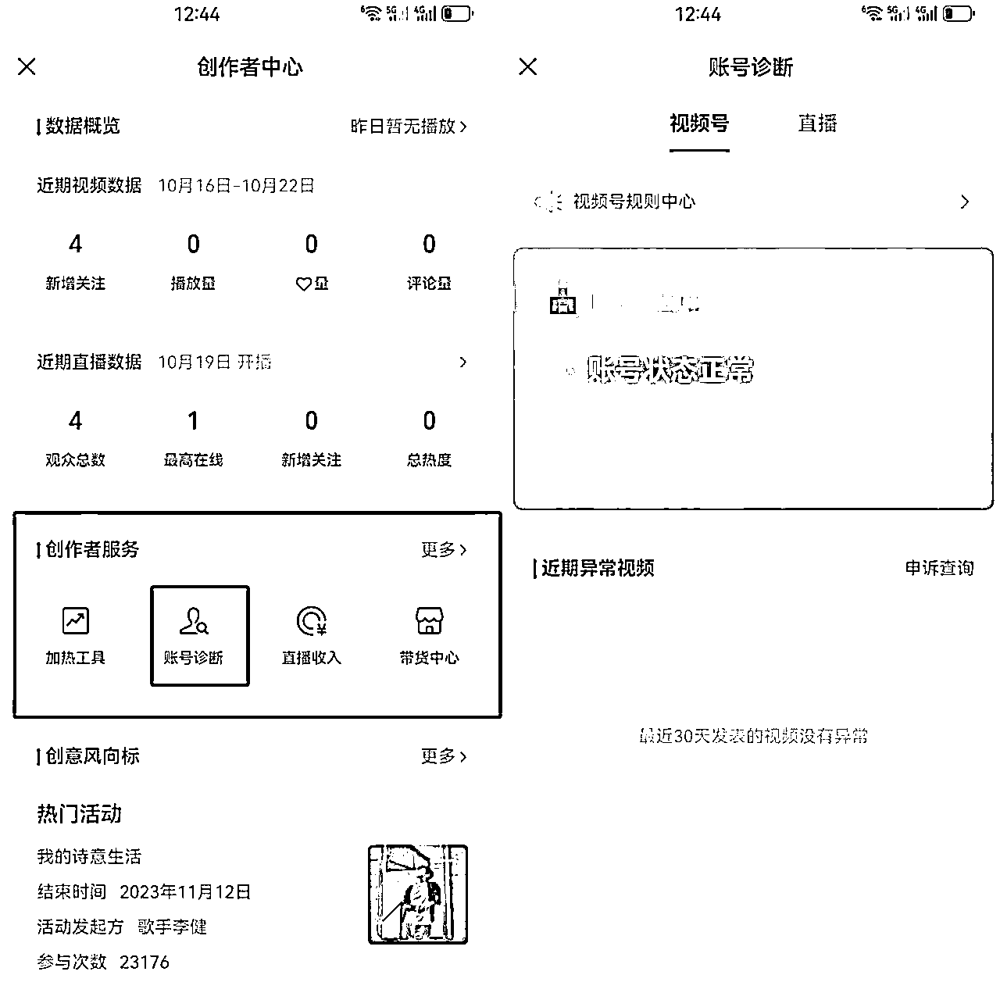

也可以尝试用下面的链接自查（要求在🛰️手机端打开，该链接偶尔会请求异常、无法打开，可以到项目禁言群群公告找能用的链接）：https://channels.weixin.qq.com/pandora/pages/appeal/index#account-detail?appeal_entrance=1

如果担心内容本身违规，进入视频号后台，点开想加热的内容，点击“加热”。加热不了说明这条内容可能有问题，能加热说明算是正常状态。流程参考：

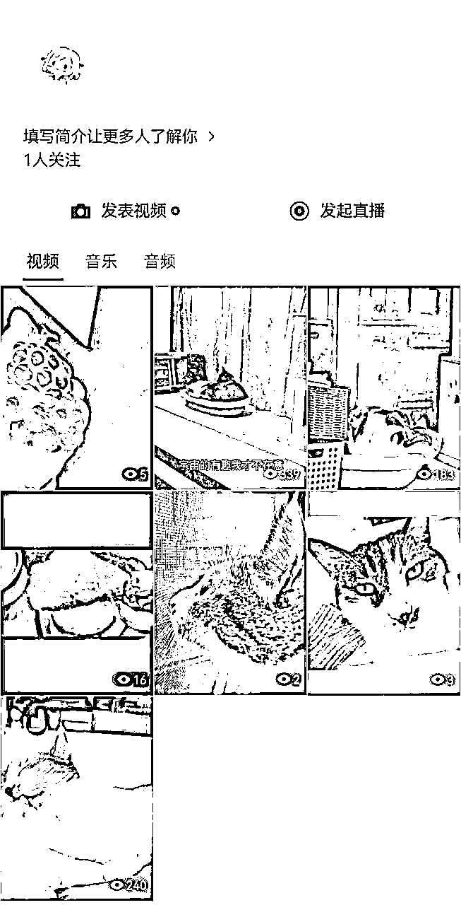

打开后台
选择要加热的内容，点击右上角“...”
点击“上热门”
进入加热计划页面，成功进入就没问题

遇到加热不了的视频，可以隐藏或删掉——反正也没有流量，留着没价值。

# 5.4 账号变现权益怎样恢复

以下内容摘编自官方手册。适用于短视频商品分享、互选平台、视频变现任务等变现权限被取消，或者被要求内容整改的账号，属于优化建议。整体思路：平台鼓励账号发布原创、画风统一、出镜人一致的内容；不鼓励账号在发布某一类型内容后，被判定非原创时，又靠随手拍、风景片来混过审核。

1. 收到整改或取消权益的私信，如何定位问题？

收到这类私信通知，就代表账号必须优化了。可能是原创度不过关、质量不过关，也可能两者同步出问题。收到权益取消通知时，点开私信详情页可以进入申诉页面，在那里能看到账号的详细状态，也能看到被判定为质量问题还是原创度问题。

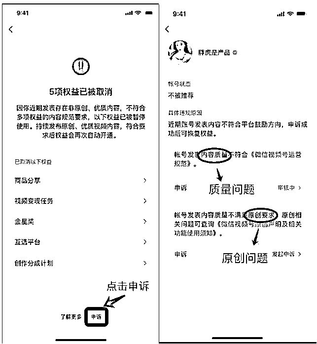

2. 为什么会标成原创度有问题？

除了搬运平台内其他账号或站外内容外，出镜人不统一、画风前后不一致、垂类内容跳跃太大（比如今天发美食明天发游戏）等，都算作搬运嫌疑，被打上非原创标签。

3. 为什么会标成质量有问题？

内容同质化严重、重复发老作品、套模板低成本量产、图片拼成PPT视频、画面里留联系方式或二维码、音画不同步、文字过度遮挡画面——全都属于质量问题。

4. 怎么才能拿回权益？

收到内容整改私信：最少先发10条新内容，才有恢复的可能，具体怎么发请看第5、第6点。收到权益取消私信：如果你觉得平台误判了，不用发新内容，直接在申诉页面提交材料，比如作品底稿、原文件、首次发表的截图、剪辑工程文件等，平台会结合你发布的内容重新评估。如果平台判定没有错，就算把旧内容全删了、或者立刻发10条原创，权益也不会马上恢复；需要在平台稳定持续发布原创内容一段时间，才可能被酌情恢复。

5. 发什么内容才能算通过整改？

如果你是创作者，发与账号风格、人设一致的作品。美妆账号就继续发同一个IP出镜的美妆内容，没有必去拍风景和自拍，更不能临时换到情感赛道——换了还是会被判定为非原创。

6. 发什么内容会被判定恶意、权益关得更严？

千万不要发与账号定位无关的内容去试探规则。本身不是随手拍风景、育儿亲子赛道的创作者，不要发随手风景、桌面、翻书、自拍、自家孩子玩闹、宠物日常、情感鸡汤这些没有价值的内容来“洗白”账号。

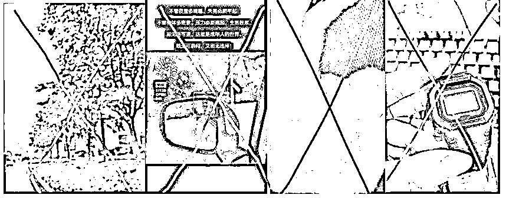

不要用画风突变、垂类漂移的方式混过去：美妆号突然发宠物，小剧场号突然做美食，汽车号突然放音乐，一眼就能被识别。也不要用无关IP内容来凑数：原本没有真人出镜的账号，突然批量发出不同IP的内容；或者原本真人出镜的账号，在因为IP不统一被处罚后开始猛发同IP内容——平台是能回溯历史记录的，不会因为短期操作就恢复权益。这类投机取巧会被定性为恶意对抗，至少90天内别想恢复权益。还是把心思花在正常创作上，别走捷径。

备注：不涉及变现权限的普通作者，或者本身就是拍风景、育儿、宠物、亲子的创作者，发随手拍、宠物、儿童等符合规范的内容，完全不受影响。平台真正限制的，是那些有明确垂类的账号借生活化内容来恢复权益。

# 5.5 踩坑经验复盘 @流浪虎

腾讯给的规则到目前为止也谈不上清晰，磕磕绊绊是常态。下面几位老师的实操经历里踩过不少坑，大家注意绕开。

1、忘记点原创声明
一个视频跑出600多万播放，结果忘了开原创，预估少赚2000元。

2、爆款评论区失控，账号进了小黑屋
一条视频转发量达到35.8万，评论涌进来太多，有人把风向带偏，大量评论被吞，账号也被禁。所以大爆视频一旦出现不友善的苗头，最好直接关评论区。

3、一天发太多视频
有账号一天发30条，然后被关小黑屋7天。一个账号每天别超过9条，5～6条最稳。

4、重复发很久以前的爆款
发半个月前爆过的视频，账号再次被关。老爆款可以重发，但最好压在一两天内，隔太久会被系统检测到。

5、爆款之后会限流
好几个账号测试后都发现大爆之后有限流，但持续时间一般不超过7天。如果7天之后仍没有流量恢复，可能是内容本身有问题，考虑换新号。

内容来源：《视频号创作者分成收益怎么赚？追好热点，打造爆款视频》@流浪虎

# 5.6 更多拓展疑问解答

广告以什么形式出现？出现的频次如何？

# 广告与推荐机制答疑

评论区里可能会插入广告，形态包括图文或短视频。平台会综合用户体验和创作者收益，统一控制广告露出的密度。

临时不希望出现广告，该怎么处理？

已经参与创作分成的人，若某条新片不想带广告，发布时把「原创声明」关掉即可。若打算彻底离开该计划，让旧片和新片都不再出现广告，可把具体情况梳理清楚，按这个路径提交：「视频号 > 右上角人像 > 创作者中心 > 创作者服务 > 帮助与反馈 > 底部意见反馈」，平台会处理。

哪些作品更容易被推荐？

① 画质过关：上传内容清晰、没有水印遮挡，字幕与声音对得上，播放顺畅，观众看得舒服，才具备被推荐的基础；
② 内容本身要能打：热点、争议点、鲜明立场更容易被平台和用户接受；说到底，要么蹭上热点，要么信息量和可看性足够，这样才留得住人，账号也走得远；
③ 关键词别含糊：系统会依据用户画像分发，包括所在地、兴趣、关注的话题、点过赞或留过言的视频等。因此运营时，标题、正文、话题、定位都要埋入合适关键词。

账号里为何找不到「原创声明」按钮？

新号在养号期、还没进分成计划时，看不到该按钮很正常，不必纠结；此时即便标了也没有收益，照常发布即可。等进入分成计划后，每条内容都必须勾选原创，否则收益拿不到，这一点务必记牢。

申请期间尽量保持内容同质，视觉风格和版式统一，通过率会更高。

满100粉了，为何仍进不了分成计划？

门槛有三项：原创、内容合规、粉丝破百，缺一不可。没通过通常意味着还有短板，尤其内容合规最易出问题。若你确信全部达标却仍未受邀，可按「3.1.3.5 申述开通」尝试申诉。

百粉能靠他人关注凑吗？

可以。只要原创和合规没问题，在群里招呼真实用户点关注，积累活粉，就能达到开通条件。但来路不明的粉丝别乱买，尤其是僵尸号，不但开不了计划，还可能把账号废掉。

旧作品被限流怎么办？

先连发十条生活类随手拍试试水；若系统明确告知限流天数，等期限结束再继续发随拍。

内容不合规时，还要接着发吗？

先做账号体检，把有问题的作品清掉；再挑作品尝试加热，能加热说明状态正常，不能则代表内容仍有毛病。

旧素材能否复用，或搬到小号发？

可以。视频号支持授权，若想让同一素材出现在多个账号，先完成账号授权，之后就能重复调用，把素材价值吃干榨净。教程见「6.2.2.1 多账号内容授权」。

企业号为何没有分成广告？

现阶段蓝V和媒体类账号不在分成广告开放范围内，未来或许会调整，眼下只对个人号开放。

发布方向怎么定？

条件齐了先申请原创计划，通过后再开始更新。情感文案、搞笑、感人等方向都能试，测出自己账号哪种数据更好，之后深耕那一条线。

# 六、放大收益：分成计划增收指南

# 💡

# 内容速览

当变现已经稳定，下一步就该把盘子做大，让收入再上一个台阶。放大项目，常见路径包括：

✅ 批量开号、铺矩阵，用数量换命中率👉「6.1 注册多🛰️号，搭建矩阵」
✅ 提高执行效率，让同样时间产出更多，比如优化矩阵管理👉「6.2 矩阵号如何高效管理」，以及更快找到素材👉「6.3 获取更多快捷素材」
✅ 多试几个赛道，可能撞见意外爆款👉「6.4 尝试更多赛道」
✅ 拓展其他变现口子👉「6.5 更多变现途径」

下面拆开讲具体怎么做。

# 6.1 多号注册与矩阵搭建 @郭耀天

做矩阵的逻辑不复杂：成批开号、成批发片，把前面跑通的流程复制到更多账号。

难点在于，一个自然人最多实名五个🛰️号，这个量不够铺矩阵，因此得想办法扩坑位。

注意，要突破的不是视频号，而是🛰️实名上限：规则写明一人最多五个实名号，想再多只能换人。可总依赖他人实名也不现实。挂在陌生人名下，对方一旦把号冻结，解冻流程很折腾，号很可能报废；熟人还好商量。

扩坑位的思路是：把暂时不需要支付的🛰️号冻结，腾出一个实名名额。

关键顺序别搞反：先注册视频号，再冻结。被冻结的号不占那五个名额。冻结后能否直接注册新号，目前尚未验证；但按现有操作可以注册。另外有个前提：账号里务必留点钱，哪怕几分。有余额时执行清除才是冻结，没余额就成注销了。

实测目前每月仅能冻一个号，连着操作会被提示频繁而卡住。

路径如下。

🛰️「我」→「钱包」→ 底部「帮助中心」→「实名问题」：

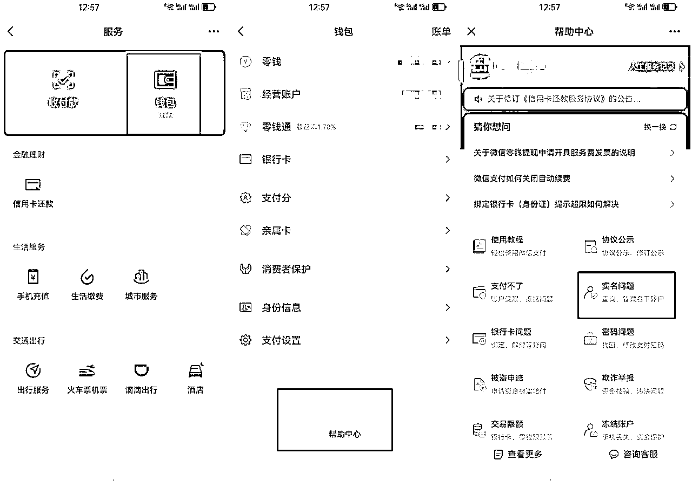

也可从腾讯客服入口走：

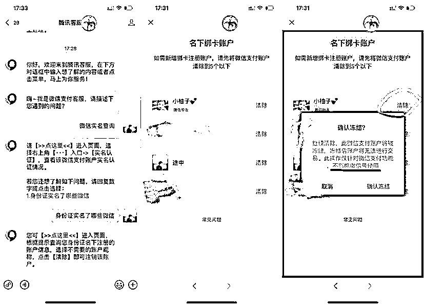

后期提现要求账号处于激活状态。处理并不难：冻结中的号不能提现，只要冻一个，就能释放另一个；你随时可让五个号保持可用，其余全冻。

解冻同样不复杂，定位到被冻的🛰️号，照下图操作：

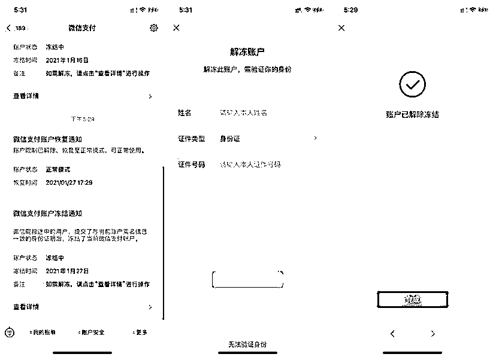

若账号用员工身份实名，离职前必须优先处理：第一时间解除其名下所有号码的实名，并注销🛰️支付。若号还要继续用，马上找在职人员补实名，沿用前述扩坑位方法，支付不受影响。

附一份实名登记表模板：

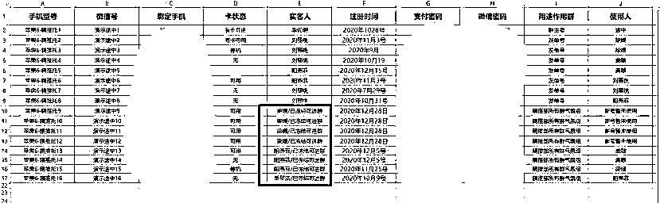

操作中你还会看到：同样质量过关、水平相近的号，有的起量很快，有的始终半死不活，这背后是账号底子和概率共同作用。矩阵里可以挑出表现好的号重点养，差的直接注销换新。

# 6.2 矩阵号的高效管理法 @郭耀天

管理矩阵抓两件事：用MCN统一收款压税点，以及批量发布内容。两者都能抬高单位时间的收益。

# 6.2.1 用 MCN 统一收款

批量做分成计划时，若以个人身份收款，税负可能很高，顶格能到四成。部分情况次年可在个税APP申请退回，但这取决于收入水平；收入过高而未达退税标准，就退不了。

想合规压低扣点，可以走MCN收款。下面是把MCN注册下来的流程。机构开通且视频有收入后，发起结算并按规则寄票，税点可按3%或6%执行。

第一步：进入MCN申请页
操作不难，浏览器搜“视频号MCN”，或直接访问👉https://channels.weixin.qq.com/mcn/login

第二步：提交资料并开通
登录后按页面提示录入企业信息、对公账户信息并完成验证，通常很快通过。细则见官方说明👉https://support.weixin.qq.com/cgi-bin/mmsupportacctnodeweb-bin/pages/YC5kUcvysXxktmMx

第三步：关联账号
进入MCN后台，依次点「作者管理」→「视频作者」→「邀请作者」，按提示把目标号拉进来即可👇

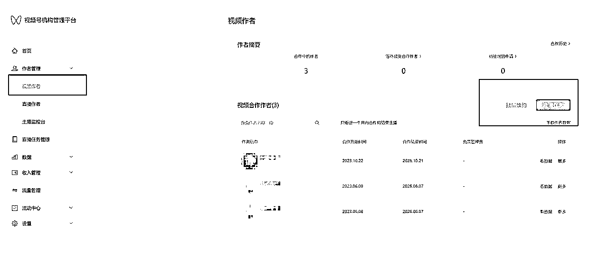

第四步：寄发票
当前按半月结算一次，平台会列出前半个月的待结款项。产生收入后发起结算，按要求寄票即可到账，整体收益更高。常见机构税点为3%，也有6%的：

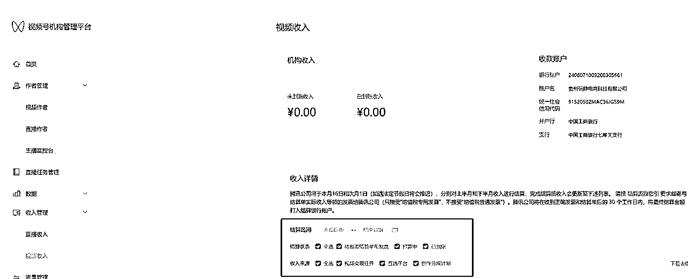

# 6.2.2 内容怎样高效发出

# 6.2.2.1 多号内容授权

爆款可以开白名单给其他号复用，让多个账号一起铺。操作：创作者中心 → 创作者服务 → 更多 → 账号管理 → 原创保护记录 → 授权账号：

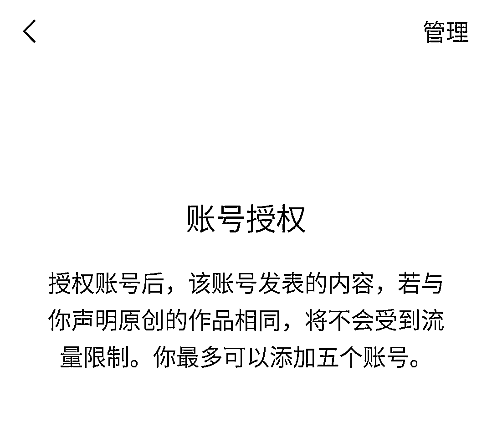

这是新上线的能力：把素材授给另外五个号发，重复内容也不吃流量限制，等于五号齐推。用自己的内容直接铺，玩法很实用。

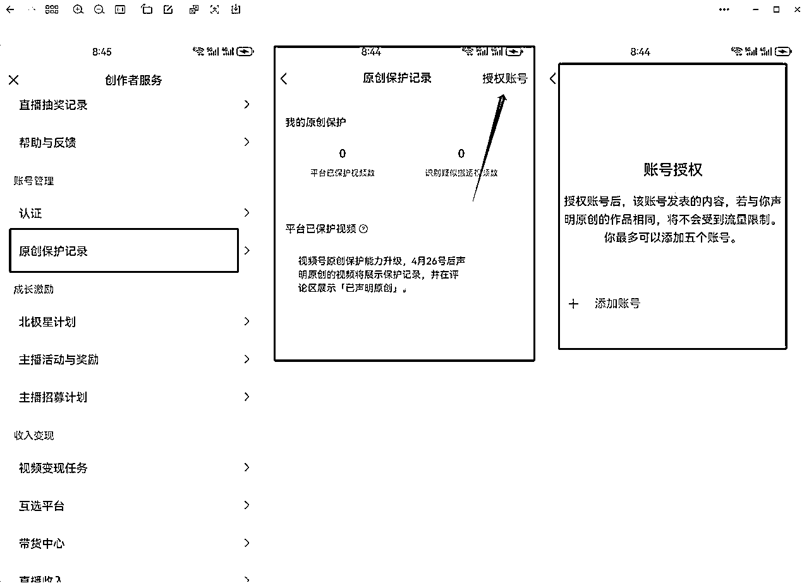

# 6.2.2.2 交给管理员代发

若绑定的是亲友号或其他不常登录的🛰️号，可增设管理员代发。路径：电脑端进视频号助手 → 设置 → 人员设置 → 绑定运营者。绑定后，用运营者账号登录即可发布。电脑登录时会弹出账号选择，挑要更新的那个即可：

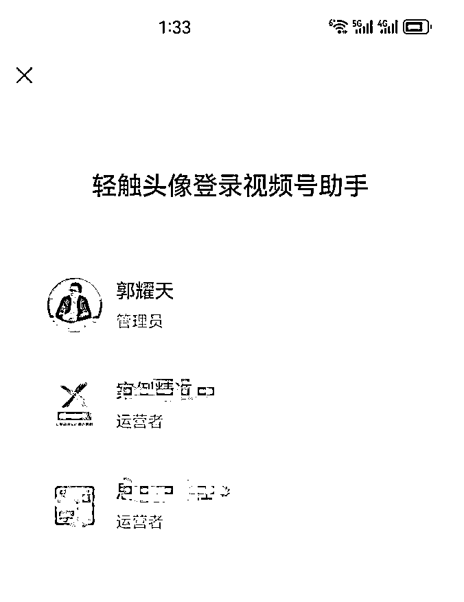

# 6.2.2.3 借助第三方工具发布

市面上有第三方登录服务，把视频号授权过去后，可完成自动回复等动作，用起来省事。例如快视（官网：www.timexxs.com）。不少平台要会员才开放完整能力；有需要的人可在工具箱里挑合适的第三方接入，多号运营者尤其适合：

# 6.3 更快找到可用素材 @郭耀天

国内素材大多被反复用过，不妨把视线放到海外。不过海外取材有门槛：怎么访问、怎么用、怎么下、怎么切？海外主流阵地包括YouTube、TikTok、Instagram、Triller、Snapchat，其中YouTube最具代表性，高清素材也多出自那里。下面以YouTube为例，讲怎么把素材搞到手。海外平台访问需要特殊网络环境，这部分请自行解决。

# 6.3.1 进入 YouTube

访问YouTube需要🪜，话题略敏感，请自行研究。可访问https://www.youtube.com，或在浏览器搜YouTube进入。

若没装翻译工具，页面大概率是英文。可用网页翻译，或装浏览器插件，选择很多。我更常用火山翻译，免费，搜到安装即可：https://translate.volcengine.com/

说明文档：火山翻译浏览器插件使用说明书。装好后在任意网页右键，选“使用火山翻译”即可转中文。

YouTube支持中文搜索，但英文关键词往往更准。

# 6.3.2 视频怎么下载

第一步：拿到链接
进入YouTube，定位目标素材，点分享，复制链接：

第二步：用链接解析视频
需要借助YouTube下载器。此类工具很多，付费免费都有，免费版已够用。下面几个可直接上手：

https://ytshorts.savetube.me/
https://wzds.llsbcq.com/
https://www.videofk.com/zh-CN/YouTube-video-download
https://y2mate.la/zh-cn18/
Gihosoft TubeGet

百度盘：https://pan.baidu.com/s/1fuigBg90Sw8_YNpVnu6BOg?pwd=iiq7 码：iiq7
夸克盘：https://pan.quark.cn/s/450d56dcd10e

其他工具：多格式解析可试👉https://YouTube.iiilab.com/

挑格式时通常选高清1080，点右下角开始下载：

也能用插件抓取。主流浏览器都有扩展，很多能直接下YouTube，更省步骤。我目前用Edge，打开扩展页：

进入后点“获取更多扩展”，搜“YouTube下载”，我装的两款如下：

装完插件再开YouTube，可解析的视频底部会出现下载按钮，点一下即可保存。

第三步：网页端下载
以https://wzds.llsbcq.com/为例演示：把上一步拿到的链接粘到站点里：

页面翻译后大致如此，点“获取链接”：

再点下载，文件会自动开始拉取：

YouTube视频体量往往很大，动辄几小时甚至十几小时，这类素材得先切开。

# 6.3.3 切割视频备用

切割工具网上不少：

LosslessCut：
百度盘：https://pan.baidu.com/s/1q9yYIxRJB30WlFkOJ7yfig?pwd=qycw 码：qycw
夸克盘：https://pan.quark.cn/s/594de39665f3

BoilsoftVideoSplitter：
百度盘：https://pan.baidu.com/s/1gTH5B4GMHQtF8wxL2v_ZbA?pwd=29eg 码：29eg
夸克盘：https://pan.quark.cn/s/cd0de8040d70

BoilsoftVideoSplitter 汉化版：
百度盘：https://pan.baidu.com/s/1VhoFXiM9qN4UUrldE1LUbA?pwd=aqkh 码：aqkh
夸克盘：https://pan.quark.cn/s/82cd8e7df29a

在线切：https://split-video.com/zh/

下面挑两个说说用法。

# 工具一：LosslessCut

下载后解压，打开程序。若界面为英文，点这里把语言切成中文。把视频拖入或导入，点“编辑”：

到编辑页后选“分段”，按需生成若干段。此时可设置切割段数。该软件单次上限300段；素材过长就分多轮切，同样能满足制作需求：

切之前还能调基础项，例如保留音轨、编辑轨道等。

# 工具二：BoilsoftVideoSplitter

BoilsoftVideoSplitter汉化版也挺顺手，切割次数不限，解压后直接开：

点“打开”载入要切的视频。比如这段11小时素材，可直接处理：

有些文件导入后不能预览，不必理会，直接点“分割”：

像这条11小时视频，可设成600段，点“设置分割”：

随后指定切片保存位置：

程序便开始切割：

切完的片段就能进入后期加工，作为视频号内容发布。

# 6.4 【新增】更多赛道分享 @代一

# 6.4.1 小人国美食

小人物下厨类内容近期在各大平台热度很高。看这个号，此前发其他AIGC视频，数据平平；转向小人国美食后，粉丝猛涨。这类片子兼具治愈感和趣味性，做饭流程受众面又宽，放到视频号大概率也能起量。

制作步骤：
1、截取对标画面，反推提示词来学习：

2、反复测试调优，沉淀可用提示词：

# 💡

请生成一段微缩世界小人物烹饪 XXX 的短片，包含七个环节：1. 获取食材；2. 处理食材；3. 备菜；4. 准备烹饪；5. 做菜；6. 盛菜；7. 吃饭。

# 古风小人做菜视频：一套提示词玩转分镜与成片

首图的视觉核心可以这样定：微缩世界当中，一群身着汉服的小人儿来到食材的原产地收集原料，每一份食材在他们面前都显得格外硕大。请沿用这个框架，为场景 1 到 7 分别写出聚焦主体的画面描述。其中【微缩景观，一群穿着汉服的可爱小人】是固定表达，需要原样保留。另外有四点硬性条件：其一，食物与小人的体型反差必须明显；其二，烹饪环节要置身于古风厨房；其三，结尾的用餐画面里必须有一只巨型碗，穿汉服的小人们围着做好的大份食物开动；其四，各分镜之间要保持连贯，避免混入过多无关元素。

3、每换一道菜，只要把新菜名发给豆包，就能收到配套的分镜描述。生成时选择豆包的“图像生成超能创意 1.0”，画风设为 3D，画面比例锁定 9:16。

为免去反复调试的麻烦，我已经把这套打磨好的提示词封装成了一个智能体，输入菜名即可取回全套指令：
https://doubao.com/bot/vFYG2yDy

4、拿到分镜描述之后，既可继续留在豆包操作，也可改用即梦完成生图和视频生成。就个人实测感受而言，即梦出片的质量通常会更好一些。

不过即梦要消耗积分，豆包免费且不限次数，具体如何取舍看自己情况。也可以先用豆包批量抽卡，遇到不满意的再让即梦兜底。

接下来把每个分镜的提示词逐一交给 AI，完成文生图抽卡。从结果里挑出最满意的一张，点击“生成视频”，这个功能豆包和即梦都支持。

随后把豆包生成的动作提示词输入进去，让 AI 将静止画面变成动态影像。

豆包每天有 10 次视频生成机会。即梦虽然没有次数限制，但 5 秒视频需扣除 10 积分，10 秒视频则需 20 积分。

等全部分镜都顺利转为视频后，统一保存到本地。直接下载会带着水印，可以留到剪辑时裁掉；也可以在浏览器里装一个去水印插件，Chrome 扩展商店搜索即可找到。

5、所有视频下载完成后，进入成片剪接环节。素材按烹饪顺序依次导入剪映，最好下载时就标好序号，后面整理会省心不少。先把画面比例调一致，有水印的区域同步裁干净。

接下来为每个分镜配上合适的氛围音效，画面里有什么动作就搜什么声音，素材叠得足一点，听感会更热闹、更有生活气。最后加一首美食类 BGM，导出即可。

成片演示：
肉末豌豆.mp4【在线播放】

如果想尝试别的风格，在生图环节微调提示词就能实现。这类内容还能开通橱窗，挂一些美食类商品；也可以发散出小人养宠物、小人国运动会等衍生赛道。

# 6.4.2 国外爆款视频＋英语学习二创，在视频号再吃一波流量分成

龙哥之前分享过一条风向标：国内已经验证过的爆款视频，可以通过手绘漫画的方式进行二创剪辑，凡是其他平台火过一轮的内容，搬到视频号后依然有极大概率再爆一次，不少圈友已经跑出结果。这个逻辑同样适用于海外内容——把国外数据表现亮眼的视频，套上英语学习的外壳重新制作，再发到视频号，起量机会依然很大。例如外网热度极高的那段父子对话视频，在配上英文原声字幕与中文翻译之后，以英语学习内容的形式重新发布，照样冲到 10 万+。

专门做这个方向的账号数量可观，数据也都相当能打。

素材可选择的范围很宽：国外爆款的英语对话、英语采访、英语演讲、美剧片段、电影名场面等，只要经过足够的二次加工，就能成功标为原创，从而解锁创作者广告分成。这条赛道还能自然延伸到英语教育领域的多种变现方式，比如带英语课程、卖学习产品、直播教学、付费卖课等，值得一试。

操作步骤：

1、先去 TikTok、YouTube 等海外平台寻找流量靠前的英语对话类视频。如果打算做美剧混剪、英语采访或演讲等分支，也可以自行搜索素材下载。推荐搜索这些词组：搞笑英语日常、萌娃、Stevetvshow、励志英文演讲、英语播客节目、英语脱口秀……

2、用浏览器插件或在线解析站点抓取视频。圈友分享过一个很好用的入口：https://cobalt.tools/；也可以到赚钱搜“YouTube 下载器”，不少圈友都自己做过。把链接复制进去即可下载，操作并不复杂，尽量挑 1080P 高清版本。

3、将视频放进修剪工具处理。剪映“文本”栏里的“智能字幕”可以同时出英文字幕与中文翻译，不过需要开通会员。不想付费的话，就先识别英文，再用其他工具手工翻译并叠加中文。这一步正是“英语学习外壳”的灵魂。字幕处理完后，剩下的事就简单了。可以先裁切画面，让上下留出黑边，为后续的二创留足空间。

然后到“画面”里的背景填充选择一个好看的样式；如果没有合心意的，也可以自备一张专属背景，用画中画的方式叠进去。

处理好遮挡后，把字幕位置重新调整。最上方的留白还能再加一句标题文案。最后铺一段贴合场景的 BGM，音量压低一些，确保对话听得清楚。全部完成，导出即可。

效果演示：
英语对话.mp4【在线播放】

这条赛道与前面的思路相通，英语类爆款内容在全球范围内几乎取之不尽。细分方向很多，前期可以多参考同类账号的头部作品，用不同类型的素材测试数据反馈，跑通之后再固定深耕某一类。

# 6.5 视频号还有哪些赚钱路子 @郭耀天

视频号的变现路径比想象中要多，下面列举的只是目前比较常见的几种，整理出来给大家参考。

# 6.5.1 内容全网分发，一份素材多处开花

视频号的内容生产门槛不高，做出来的东西也不该只发布在视频号，还能同步到抖音、快手和📕。抖音和快手适合涨粉，部分领域可以直接带货，尤其📕的变现效率相当突出。粉丝攒到 1000 后，就能申请📕商单接广告，收益很不错。所以内容千万别只发视频号就结束，它能去的地方还有很多；粉丝量做起来后，直接把账号出售也是一条路。现在这些内容同样可以发到今日头条、百家号，收益都不错。核心思路是把素材价值放到最大，让它被反复利用：东边不亮西边亮，视频号没火起来，其他平台可能就爆了。同步更新只要花上一两分钟，一个平台赚几百块，多个平台加起来数字就漂亮了。

# 6.5.2 视频号生态内的其他变现尝试

以下玩法只给思路，不做展开。感兴趣的可以在龙哥盟索引站（👉索引站首页）搜索相关关键词，找到更完整的玩法拆解。

**游戏任务**：如果视频选题偏娱乐、游戏类，可以到“创作者服务>视频变现任务”里挑一个能参与的游戏任务，通过该任务入口发布内容。这样作品会挂上游戏链接，新用户点击进入游戏后，看广告或充值所产生的收入，都会按平台规则分给创作者。

**广告变现**：视频号流量好、尤其处于细分领域的账号，很容易收到广告邀约。很多广告其实藏得很软，外人不一定看得出来。平台目前也提供视频号互选广告，但对粉丝量有 10000 的要求；暂时不够格，也可以通过私下接单解决，比如做工具号，这类单子一直不少。

**IP 变现**：和抖音的玩法如出一辙——自己做出人设，在视频号持续输出干货，再把流量引到私域，围绕个人 IP 打造产品与服务。现在做的人已经很多；如果能真人出镜，或者在某个方向持续提供价值，这件事确实值得干。

**短视频带货**：视频号粉丝涨起来后，发短视频时就能插入产品，直接完成带货。开通带货有相应的条件，满足后即可使用。现在市场上有不少人在做，尤其是书单类帐号，几乎条条视频都在卖书。

**直播带货**：点开视频号就能看见大量直播间，其中不少以卖货为主。自己手里有粉丝，或者掌握了一些玩法、有直播人才资源，完全可以下场。

**课程变现**：课程方向极其普遍，做账号的人基本都会开发自己的课程，或者代卖别人的课，例如英语口语、驾照考试、创业培训，都属于这一类。

**实体门店变现**：视频号现在重点做同城，你完全可以拍摄自己店里人气爆棚的画面，在视频下方挂上门店链接，把同城客流直接引到店里。

**CPS 变现**：多见于小说和游戏内容。把小说某个精彩章节放到前端，让读者心痒难耐，顺着链接付费阅读，创作者即可赚到分成。

**会员服务变现**：以前带过社群的，可以直接在短视频里抛干货，吸引有需求的人，想继续深入就加入付费社群。

**视频号打赏变现**：如今视频号上有一批语录主播，主要收入就来自打赏。我见过一个主播，单日收入突破百万。只要有才艺、有口才、有能力，这事也能做。

**音乐推广变现**：版权方每个月都会放出推广任务，单条收益约在 200 到 2500 之间。音乐号正好借这种方式获得稳定进账，算是不错的方向。目前可供推广的渠道也在不断增多，可以多加关注。

# 七、【实战工具】让项目提速的顺手装备

# 💡

# 本篇导读

这一章集中列出项目实战中常用的工具，帮大家省去找工具的时间。工欲善其事，必先利其器，选对趁手的家伙，效率能提升不少：

✅7.1 实战工具包

✅7.2 常用工具

⚠️需要留意：
视频号工具全部来自网络收集整理，请结合自身需求选取，具体用法要自己摸索；工具随时可能失效，链接打不开属于正常现象，遇到合适的尽快保存。

# 7.1 实战资料包

文件：视频号航海｜实战工具包

这些工具是从历次视频号航海实战中慢慢攒下来的，来源很杂：可能是航海交流群里的灵光一现，也可能是星球里的帖子推荐，还有可能来自项目教练的安利。进入文档后，左侧目录可以直接查看有没有自己需要的，也能用 Ctrl + F/command + F 搜索关键字来定位。多数工具条目下都附带网址、网盘链接或压缩包；部分工具时效性较强，失效也属常见，届时可在包内寻找功能相近的替代品继续使用。

# 7.2 高频常用工具 @郭耀天

下面这份清单涵盖了几款出镜率较高的工具，大家按需取用即可。

# 7.2.1 视频号下载方案

以下几个下载入口各有千秋，挑顺手的来就行。

① https://github.com/lecepin/WeChatVideoDownloader

② https://pan.quark.cn/s/edac9e880758

③ 圈友专用：超实用分享

④ 视频号下载器
地址： https://pan.baidu.com/s/1MJPbZxju8hg0RDMIBaWyMQ?pwd=mu3f 密码： mu3f
夸克备用：https://pan.quark.cn/s/6397c860872e

⑤ WeChatvideoDownload
百度地址：https://pan.baidu.com/s/1oFeYR6AzXcGrzh23ONbrmg?pwd=v69u 密码： v69u
夸克备用：https://pan.quark.cn/s/246bca853c31

# 7.2.2 智能切割

地址：https://pan.quark.cn/s/44c993720746

# 7.2.3 聊天记录视频生成工具

免费入口：

http://www.11fx.cn/tool/wx/ （可一键成片）

https://www.yeyulingfeng.com/tools/wx/

https://www.bAItuling.com/chat/

http://www.12tool.com/wxduihua.html

https://wx.gravityengine.cc/

http://sc.appbs.cn/1.html

付费入口：

https://vjietu.pro/

https://www.quduihua.cn/（图文、视频均可搞定，算是目前较专业的平台，价格略高，手机端和电脑端都有）

https://weixinduihua2.com/index/wechat/chat.html

本地软件：

夸克网盘：https://pan.quark.cn/s/d3ec326c3160

百度网盘： https://pan.baidu.com/s/1-l1oL5RerecNBc9lH6Em6w?pwd=t6bf 密码： t6bf

# 7.2.4 剪辑软件选择

剪辑软件是视频运营的标配。多数需求下，手机 App 已经能圆满解决；电脑端工具则要一点学习成本，但功能上限和专业性也更高。如今智能手机里的剪辑应用越来越容易上手，不管专业创作者还是新手小白，都能快速适应。无论习惯用手机还是电脑，下面这些选择都值得参考。

手机剪辑端：

秒剪、剪映、快影

电脑剪辑端：

剪映（官网：https://www.capcut.cn/）、会声会影、Premiere

# 7.2.5 找选题的热点雷达

一条好的视频号选题，既要贴近受众的喜好，也要有足够热度，才能形成传播与转化。以下站点可以帮你持续追踪全网热点：

即时热榜：http://www.jsrank.cn/
多平台热搜聚合器，可以一眼扫遍全网动向。从🧣、🛰️、B 站、知乎到抖音，从科技、娱乐、财经到游戏，各大平台的实时热点都不错过。

知微事见：https://ef.zhiweidata.com/
同样聚焦互联网热点，还附带了深度的事件分析。可按时间段查找热点，也能看到事件的影响力指数，分类相当完整。

百度风云榜：https://top.baidu.com/
百度热搜实时刷新，以一站式方式呈现当下最热的人与事。对内容创作者来说，这里能快速感知大家正在关心什么。

果汁排行榜：http://guozhivip.com/rank/
可以快速查阅各领域的权威排名，实时跟随全网动态。它把各大平台的热搜榜、排行榜聚合到一起，覆盖面很广。

煎蛋：http://jandan.net/
名字容易让人想到食物，实际是一个分享全球新鲜事的网站。找灵感没头绪时不妨逛一逛，常能遇见很有意思的见闻，给你带来不同的视角。

Anyknew: https://www.anyknew.com/
适合追求效率的读者，约 5 分钟就能遍历全网资讯，用最少的时间获取足够多的信息，日常使用非常顺手。

# 7.2.6 图片素材站

https://pixabay.com/
收录超过 93 万张高质量照片、插画与矢量图，支持免费商用，无需署名。

https://unsplash.com/
公认度很高的无版权图库，以风景类为主，数量充裕；不过不少图片滤镜偏重，颜色略显浓烈。

https://www.pexels.com/
图片质量相当在线，还设有“一周精选”栏目，适合定期来淘图。

https://visualhunt.com/
素材体量极大，且支持按颜色查找，选图效率很高。

http://streetwill.co/
胜在图片精致、风格小众，缺点是更新节奏偏慢。

http://magdeleine.co/browse/
设有编辑精选，整体画风也比较有质感。

http://www.freemagebank.com
生活类图片居多，简笔画素材的质量同样令人惊喜。

http://cupcake.nilssonlee.se/
色调稳重饱满，很适合当作背景底图使用。

# 7.2.7 配音方案与工具

无论做什么类型的短视频，配音都举足轻重。配音风格会逐渐成为账号的辨识符号，质量高低也直接影响内容观感。下面这些配音渠道可以按需选用：

🛰️小程序-配音神器：

讯飞配音：http://peiyin.xunfei.cn/

牛片网：https://www.6pian.cn/

变声专家：https://www.bianshengzhuanjia.com/

讯飞语记：https://iflynote.com/

# 7.2.8 数据复盘

视频号运营还需要用数据说话。通过分析工具，可以了解观众中意的内容元素、视频时长、主题类型，从而针对性地调整制作方向；也要认真对待每一条评论，用持续优化换取更多忠实用户的沉淀。

视频号助手

**视频号运营工具箱：数据、分发与剪辑**

做视频号，从看清数据到管好多个账号，再到批量处理素材，下面这些工具可以按需搭配使用。

视频号自身就能围绕关键词、话题、日期、地区等维度做数据分析。创作者可查看播放量、喜欢数、转发量等指标，再借数据判断受众兴趣与行为，反过来调整投放策略和视频制作。

友望数据（http://www.youwant.cn/）能高效挖掘优质博主，方便你参考对方账号定位来校准自己的方向；榜单覆盖较完整，分类颗粒度细，数据也更全面。

新视（https://xs.newrank.cn/data/home/index）是新榜体系内的平台，在社交数据分析领域，专业水准与功能覆盖都位居第一梯队。它汇集热门作品和优质脚本，可连续观察内容传播走势，还能衔接👸号链路，适合打算让视频号与👸号协同的品牌方。

# 7.2.9 多号统一管理

快视的扫码入口：https://video.timexxs.com/#/?referralCode=375539420  
官网：www.timexxs.com  
操作手册见“快视手册”。

它的功能包括：完成一次登录授权后，所有拥有管理或运营权限的视频号会集中到同一页面；视频、评论、私信和通知可在多个账号间并行处理，不用来回切换；多条视频能一次发布，也支持定时。

此外，云略（https://www.yunluepro.com/?chl=bAIdujuzhenhao）、视小龙（http://www.shixiaolong.net/）、矩阵通（https://matrix.newrank.cn/）也可作为备选。

# 7.2.10 批量去重方案

处理重复素材时，可以试试这些方式：

第一个：http://www.cr-soft.net/crvideomate.html  
第二个是咔咔一通剪：夸克网盘 https://pan.quark.cn/s/e9239581226c；百度网盘 https://pan.baidu.com/s/1YdCtsfJz_crFpG7ps4lF_w?pwd=fsfy 提取码：fsfy  
第三个：百度网盘 https://pan.baidu.com/s/1gPr329cC8Rj8ghjG8Tm0Ng?pwd=pcuw 提取码：pcuw；夸克网盘 https://pan.quark.cn/s/fe08dc861871

# 7.2.11 手写效果模拟

手写模拟器：https://pan.quark.cn/s/3e74b5625e3b  
使用示例图：

# 7.2.12 无损切分视频

视频无损切割可用以下工具：

LosslessCut：百度网盘 https://pan.baidu.com/s/1W5eztZb3LnDGYH1OElB3pQ?pwd=q5gd 提取码：q5gd；夸克网盘 https://pan.quark.cn/s/7bd2b3c6719f

BoilsoftVideoSplitter：百度网盘 https://pan.baidu.com/s/1gTH5B4GMHQtF8wxL2v_ZbA?pwd=29eg 提取码：29eg；夸克网盘 https://pan.quark.cn/s/cd0de8040d70

BoilsoftVideoSplitter 中文版：百度网盘 https://pan.baidu.com/s/1VhoFXiM9qN4UUrldE1LUbA?pwd=aqkh 提取码：aqkh；夸克网盘 https://pan.quark.cn/s/82cd8e7df29a

网页端切分入口：https://split-video.com/zh/

# 7.2.13 YouTube 视频获取

需要保存 YouTube 视频时，可试试：

https://ytshorts.savetube.me/  
https://www.videofk.com/zh-CN/YouTube-video-download

希望各位顺利打通整套项目流程，尽快满足广告分成计划开通条件，先把“第 1 块钱”赚到手，一起龙哥盟！

防失联：+MM188166M（李李），长期更新。

