# 202506 大模型写作实战手册：效率提升 3 倍

# 必修章节：先跑通最小可行方案

# 保持联系：MM188166M（李李）持续更新

# 一、掌握智能写作工具的基础用法

💡 章节导读

文字形态一直在变，但它作为人类沟通基石的角色从未动摇。大模型出现后，写东西的门槛被大幅拉低，那些原本靠文字谋生的领域又等到了新机会；即使你过去很少动笔，现在也能借大模型快速起步。

如果你本来就有写作功底，大模型更像一个“加速引擎”：让你写得更快、改得更顺，把想法迅速变成成稿，单位时间产出更高价值，竞争力自然更强。

如果你自认不擅长写作，大模型也能给你开一扇门：把零散想法整理成结构，先拿出初稿，让创作不再是少数人的专利。

把工具用好、用对，才是核心。用与不用差距明显；用得平常和用得精湛，差距更大。说白了，就是靠大模型在内容创作里“卷”出优势。

接下来，我们拆解一套大模型的核心用法：1 个原则 + 3 个技巧。

1. 角色扮演原则：让模型进入指定身份，输出更准确、更专业。
2. 直接提问法：简单任务直接问，省时高效。
3. 原子任务法：把复杂任务切到最小单元，逐个击破。
4. 任务拆解法：每次只让 GPT 专注一件更小的事，把写作打磨得更精细。

文中也会谈到 ChatGPT 的短板，比如容易生成重复内容、统计中文字数不准、改写效果不稳定，并给出行之有效的对策。

学完这一章，你能更从容地选择和使用智能写作产品，不论日常写作还是接单变现都更有底气。做到这些之后，写作速度至少可以提高到原来的 3 倍，同时保证甚至提升内容质量。

# 本章学习路线

完成本章学习和配套练习，就能走完路线图中的第一阶段：

第一阶段：建立大模型写作基础认知（约 5 天）

1. 了解大模型写作的前景与机会（约 1 天）
2. 选定适合自己的写作工具（约 1 天）
3. 掌握必要的使用技巧（约 1 天）
4. 掌握底层方法论（约 2 天）

# 1.1 智能写作工具怎么选？（更新）@飞掌柜

目前主流智能写作产品，大多是大模型驱动的“文本进、文本出”应用。

# 1.1.1 海外值得一试的大模型产品

如果你的网络环境能顺畅访问海外服务，也习惯英文界面，那 ChatGPT 和 Claude 值得优先体验；其他产品按需选择即可。

1. ChatGPT：https://chat.openai.com/
2. Gemini（谷歌旗下）：https://gemini.google.com
3. Claude（Anthropic 旗下）：https://claude.ai/chats
4. Grok：https://grok.com/
5. Bing（微软旗下）：https://bingo.melikeme.cn/web/#/
6. Notion AI（旧金山软件公司旗下）：https://www.notion.so/help/guides/category/ai?ref=indigox.me

# 1.1.2 国内可用的主流大模型产品

不想折腾海外网络，或希望省下这笔费用，国内产品完全可以满足大多数客户稿件需求。

1. DeepSeek：https://chat.deepseek.com/
2. 抖音豆包（云雀大模型）：https://doubao.com/chat/
3. 腾讯元宝（混元大模型）：https://yuanbao.tencent.com/chat/naQivTmsDa
4. Kimi（月之暗面）：https://kimi.moonshot.cn/
5. 阿里通义千问（通义大模型）：https://tongyi.aliyun.com/
6. 智谱 AI（清华大学 GLM 大模型）：https://chatglm.cn
7. 百度文心一言：https://wenxin.baidu.com
8. 纳米 AI：https://www.n.cn/?fromsou=1
9. 秘塔 AI：https://metaso.cn/?s=sbdpc1
10. 字节小悟空（悟空大模型）：https://wukong.com/tool/mine
11. 讯飞星火大模型：https://xinghuo.xfyun.cn/desk
12. 百川智能（百川大模型）：https://baichuan-ai.com/home
13. 商汤日日新大模型：https://sensetime.com/cn
14. MiniMax（ABAB 大模型）：https://api.minimax.chat
15. 上海人工智能实验室（书生）：https://intern-ai.org.cn/home
16. 星火内容运营大师：https://turbodesk.xfyun.cn/home
17. 中科院紫东太初大模型：https://xihe.mindspore.cn
18. WPS AI：https://ai.wps.cn/
19. 华为盘古 AI 大模型：https://openi.cn/sites/11157.html
20. 昆仑天工：https://search.tiangong.cn/
21. 京东言犀：https://yanxi.jd.com/login/public/enter
22. 紫东太初（中科院自动化研究所）：http://taichu.ia.ac.cn/
23. 火山写作：https://writingo.net/invitation?key=85Smpq%5E%26g8U5
24. 魔塔 AI（阿里云旗下）：https://modelscope.cn/my/overview
25. 稿定 AI：https://www.gaoding.com/ai
26. 360 智脑：https://ai.360.com/
27. 百度文库 AI 智能助手：https://wenku.baidu.com/?fr=view&_wkts_=1718173236324
28. PMAI（面向产品经理的智能助手）：https://www.pm-ai.cn/?utm_source=BORQVnw
29. 达观数据曹植（行业垂直大模型）：http://www.datagrand.com/

# 1.1.3 面向写作场景的专业工具

1. 橙篇 AI（适合生成大篇幅内容）：https://cp.baidu.com/
2. 豆包 AI（同样支持长文）：https://www.doubao.com/chat/write
3. 知网 AI（面向长文档）：https://aidoc.cnki.net/createDoc/report
4. 有道云笔记 AI（可改写、扩写、润色）：https://note.youdao.com
5. 腾讯 Effidit（智能纠错、文本补全、改写、扩写、词语与句子推荐）：https://effidit.qq.com
6. 讯飞写作（会话式写作、模板、素材与润色）：https://huixie.iflyrec.com
7. 深言达意（根据模糊描述帮你找词找句）：https://www.shenyandayi.com
8. 阿里悉语（粘贴淘宝商品链接即可生成文案）：https://chuangyi.taobao.com/pages/aiCopy
9. 字节火山写作（全文润色）：https://www.writingo.net
10. 秘塔写作猫（模板、指令扩写与润色）：https://xiezuocat.com
11. 光速写作（作业帮旗下，可生成全文、PPT，也提供问答与写作助手）：https://guangsuxie.com
12. WriteWise（喜马拉雅旗下小说创作工具）：https://www.ximalaya.com/gatekeeper/write-wise-web?ref=ai-bot.cn
13. 笔灵 AI（一键生成工作计划、方案等）：https://ibiling.cn
14. 易撰（面向自媒体内容）：https://www.yizhuan5.com
15. Giiso 写作机器人（写作、配图、风格转换、文生图等）：https://www.giiso.com
16. 5118 SEO 优化精灵（自动生成 SEO 标题、Meta 描述和关键字，提升搜索排名）：https://www.5118.com/seometa

# 1.1.4 大模型工具的选择方法 @海盐芝士

各类智能写作产品的底层逻辑其实是相通的：都在预测下一个字符的概率，也都会产生“幻觉”。因此，会用一个，基本上就能举一反三。

那它们之间的区别是什么？可以把这些工具看作你手下的成员，各有擅长的领域，也各有短板。刚接触时，不妨用任务来摸底：把 A 类任务同时交给几个模型，看谁完成得最好；再拿 B 类任务做一轮测试，找到另一个擅长者。经过几次“派活—验收”，你自然知道遇到同类任务该找谁。

选写作工具也一样。当你不了解各款产品时，想写文案却不知道该用谁，就让几个模型同时各写一版，选最合心意的那版。等和它们“混熟”之后，凭经验和直觉就能判断：某类稿件用 GPT 还是 Kimi 更靠谱，或者该换另一个工具来搞定。


# 1.2 大模型写作必备技巧 @海盐芝士

接下来用 ChatGPT 演示，实际操作时换成 Kimi 也完全没问题。

# 1.2.1 向大模型提问的策略

# 1.2.1.1 表意要清晰无歧义

提问时要把需求说透，别留歧义。人与人交流时常用“行话”，但大模型未必懂，你需要主动解释清楚。模型猜你要什么的次数越少，你得到理想答案的概率就越大。

反面提问

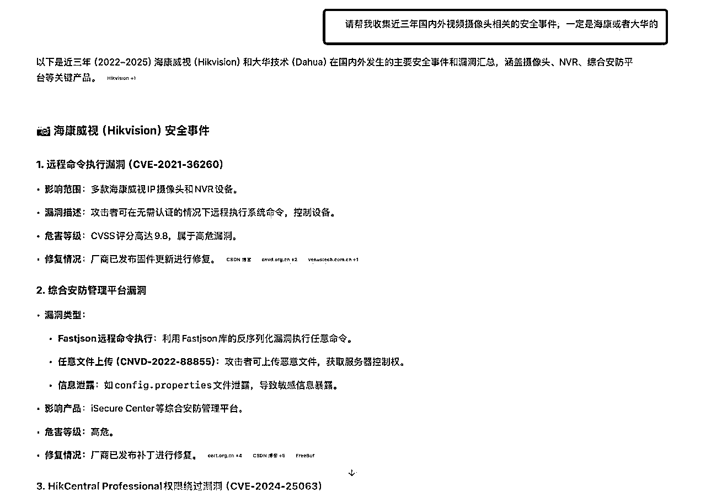

更优的提问

你把定义给得越清楚，它产出的内容就越能打。

# 1.2.1.2 删掉与问题无关的废话

多余内容会干扰 GPT 对核心问题的理解。它有点像小孩子，你说得越多，注意力越容易跑偏。

输入过长或回复过长，也会拖慢响应速度、影响生成质量。想得到更好的结果，问题尽量短，上下文别塞太满。

不太理想的问法

“您好，我想了解物理学家艾萨克·牛顿的生平、教育背景、科学成就，以及他对物理学和数学的贡献；如果可能，还想知道他的自然哲学观点，以及这些思想对现代物理学的影响。请尽量详细回答，谢谢。”

更合适的问法

“请简要介绍牛顿的生平、科学成就及他对现代物理学的影响。”

# 1.2.1.3 把需求描述得更具体

在简洁的大前提下，指令越具体，越能贴近你的真实需求。

大模型学的知识很多。你的问题太宽泛，它只能从庞大的知识库里挑一个“最大众”的回答；问题一旦具体，它才能精准定位你要的那条信息。GPT 猜你想法的次数越少，结果就越接近你心里期待的样子。

调整前的提问

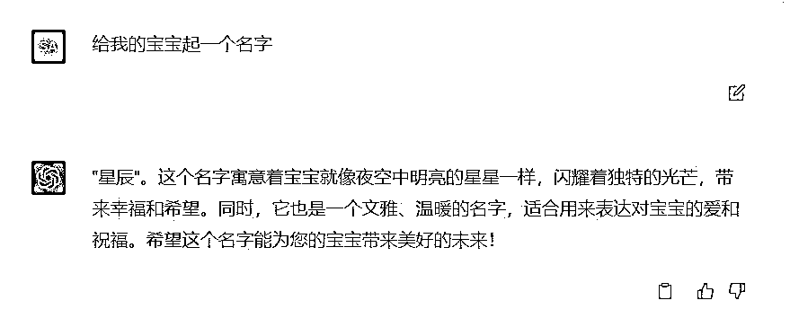

不过，如果宝宝是个女孩，“星辰”听起来更像男孩名字。你把这个条件告诉 GPT，它给出的方案会准确很多。

调整后的提问

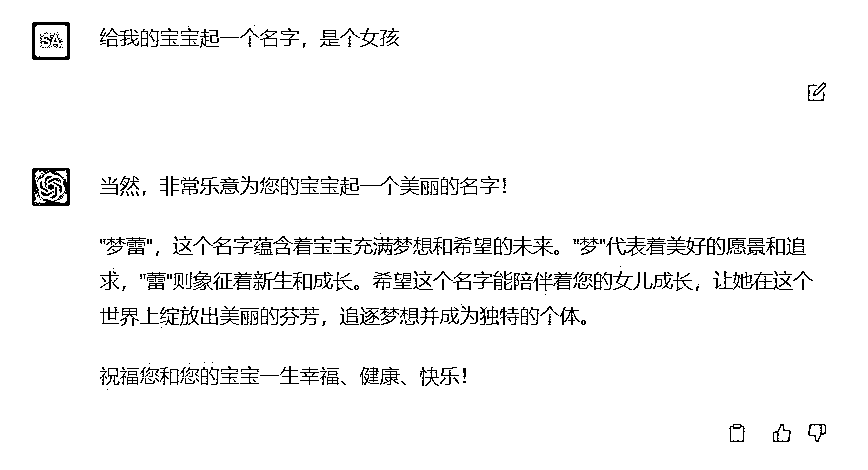

这个答案明显更贴合需求了。

再来看看官方演示。

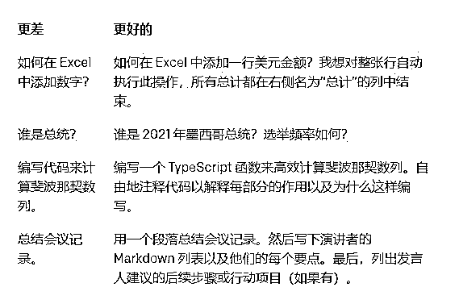

# 1.2.1.4 把复杂任务拆解成小块

何时拆解

任务过于复杂、一步难以完成时，先把它切成多步来走。

这里用到的原理叫链式推理（CoT）：让模型一步一步推导，思路更清楚，结果也更可控。

情况 1：拆多个步骤，但仍放在一条提示词里

任务不算太复杂时，可以在一条指令中写清所有步骤，让 GPT 按顺序执行，只需一次对话。

情况 2：拆成多个小任务，每条提示词负责一个

如果一条提示词装不下全部细节，就把大任务拆成若干小任务，每个小任务用一条提示词完成；小任务还复杂，就继续往下拆。

比如写一篇深度原创文章，准备投稿或发在👸号、知乎上，可以把工作拆成：标题怎么拟、素材怎么收集、框架怎么搭、爆点埋在哪、开头怎么留住读者、结尾怎么引导关注、要不要为其他文章埋引流入口，然后逐项交给大模型处理。

# 1.2.1.5 给模型一个正向范例

适用情况

不知道该怎么组织语言时，直接给模型一个例子，让它照着模仿。例子贵精不贵多，一定要给正向、高质量的表达；需要的话，也可以再给一个反面例子提醒它避坑。

💡 请保持风格一致。

示例：

"""

请用诗意的语言告诉我什么是耐心：宏大的交响乐由一声音符展开；繁复的挂毯由一根丝线织成；幽深的山谷由一股温柔的泉水冲刷而出。

"""

请用诗意的语言告诉我什么是海洋

实际效果

GPT 给出的回答，会明显承袭上面这个例子的句式和意象。

当然，你也可以告诉它“我不想要这种风格”，但反向排除通常不如正向示例直接有效。有兴趣的话，可以自己对比试试。

# 1.2.1.6 把参考资料丢给模型

什么情况下使用

你手里已经有一些素材，想围绕这些内容快速提问或写作时，可以直接把原文贴给 GPT。材料越精准、质量越高，效果越好。

材料里不同维度的占比，也会影响最终输出。比如 80% 内容在聊 A 维度、20% 在聊 B 维度，生成结果大概率会一直围着 A 转。如果你想要五五开，就先把素材里的比例调成五五开。

举例

💡 请根据三引号内的材料作答；如果找不到答案，就回复“我找不到答案”。

材料一：

"""

Runway 宣布 AI 视频生成产品 Gen-1、Gen-2 全面开放，免费注册即可体验。文字生成视频可基于提示词产出约 4 秒片段，但画质和过渡效果被吐槽；于是有网友改用 Midjourney 出图，再交给 Gen-2 转成视频，配合统一剧情和风格，就能剪出电影预告片。

"""

材料二：

"""

博主 Max 发布了一条 3 分钟视频，拿下 19.6 万次播放：2095 年，AI 控制的 Nexus 轨道研究站绕神秘行星 Zephyr Prime 运行，科学家通过人机协同让空间站躲过流星雨。他用 GPT-4 生成文本，用 Midjourney 制图作为 Runway 的视频提示，语音来自 ElevenLabs。

"""

问题：AI 生成视频可以怎么操作

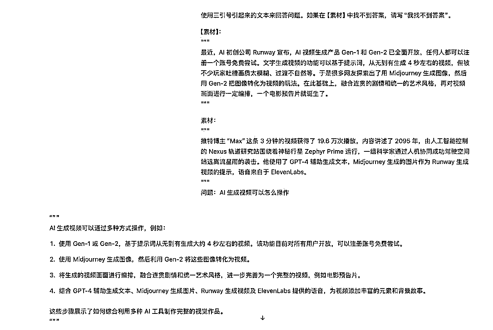

需要留意，GPT 的上下文记忆有限，投喂超过 4000 个汉字时容易答非所问。普通需求下，把输入内容压缩就好：把长文本拆成几段，让 GPT 逐段概括，再重新组合。

只给简介够不够？海盐在读后感教程里用过这个技巧，也有人专门来问过原因。这里从原理说起：大模型是以“预测下一个字”为底层逻辑的。如果你直接塞一篇万字小说，再让它写 1000 字推荐语，很可能会得到一篇空泛的“水稿”，带着明显的机械腔，读起来没什么感觉。为什么？

因为高质量推荐文的核心，不是“把一万字读完了”，而是会用各种写作手法，从不同角度呈现个性化观点。哪怕你只看过简介或书评，知道故事大概讲什么，就能把自己的独到见解教给模型，让它帮你生成表达灵感——这也是海盐在读后感教程里的做法。多数情况下，把基本简介给模型就够了，再教它几招写作手法，它就能交出不错的成果。

反过来，如果硬塞一万字原著，按大模型“预测下一个字”的机制，输出里会混入大量原著里的冗余内容，反而不像一篇有技巧、有观点的推荐文。

# 1.2.1.7 对输出字数提要求

需要控制长度时

当你想限制最终字数，直接向 GPT 说明就好。

演示

💡 用 20 个字总结三引号内的文本。

"""8 月 8 日，网之易信息技术（北京）有限公司申请注册“网易玉言”商标，国际分类为网站服务，目前进度为申请中。此前有报道称，“玉言”是网易伏羲实验室推出的中文预训练大模型，相关技术已用于文字游戏、智能 NPC、文本辅助创作、音乐辅助创作、美术设计、互联网搜索推荐等业务场景。"""

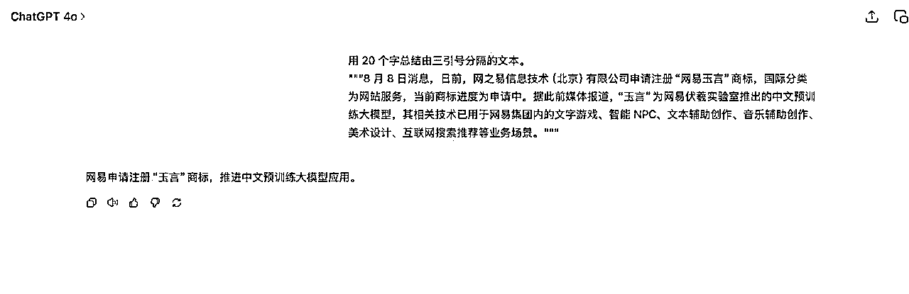

**标题别贪长，二十字上下最顺眼**

# 1.2.1.8 让 GPT 按指定条数给要点

**什么时候用**

你希望结果固定成几条，就把条数直接讲明白，GPT 会照这个数量来归纳。

**案例**

# 💡

请把下面三引号里的材料，压缩成三条精简结论。

"""妙鸭相机走红进入第 19 天。9 块 9 就能拍出精修写真，这让它在社交平台迅速刷屏，也冲出了原有圈层。

虽说近来讨论度有所回落，但它对面向消费者的 AIGC 产品仍有不小参考价值。

爆红之后，围绕妙鸭团队的来历、技术路线、用户量级和变现方式，外界猜测不断；团队本身却一直保持低调，显得颇为神秘。

蒲松龄在《聊斋志异》中写过一篇《罗刹海市》，借故事讽刺当时的社会现象。刀郎的新歌用了这个篇名，部分歌词也取材于这篇小说。

7 月 26 日，抖音账号“Ai 萬”把歌词改写成提示词，交给 AI 绘画工具 Midjourney，做出一镜到底的“罗刹海市”画面。

7 月 28 日，B 站 UP 主“超级小海鸥”发视频说，自己花了三个月训练 AI，向它灌输大量游戏知识——从最早的游戏角色一直讲到当下热门话题。视频中，AI 给 10 个角色排了名、打了分，还逐个点评。

"""

对讨厌长文的人来说，这招很实用。

# 1.2.1.9 一次多取几份结果

**什么时候用**

如果 AI 产出的内容字数不多，不妨让它同时多给几份，你再从中挑最满意的。这样不必一次只出一个，不合适又得重来，批量处理效率更高。

**案例**

# 💡

假设你是一个专门产出 ChatGPT 提示词的工具，请使用角色扮演，并投喂优质特征（比如：1. 契合品牌调性；2. 高端简洁）。请写出一条提示词，其作用是生成 10 条兰蔻品牌 slogan。

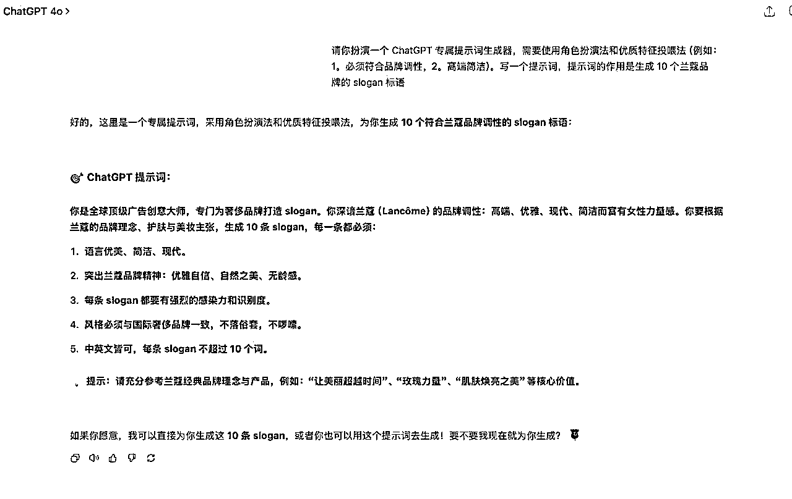

十条里总能挑到一条。若还不满意，就一次要 30 条、50 条。

# 1.2.1.10 二次确认，防止漏内容

**什么时候用**

一轮对话结束后，可以追问模型：刚才有没有漏掉什么。

假设我们正让 AI 从一份文档里提取摘录。它每列完一条摘录，就要判断该继续下一条，还是到此为止。源文档一长，AI 往往没读完整就收工，结果漏掉部分摘录。这时用二次确认，推动它回头找此前错过的内容，效果通常会好不少。

**案例**

# 💡

我会给你一份放在三引号中的文档。你的任务是从中挑出与“人工智能历史上发生过哪些重大范式转变”相关的摘录，并保证每条摘录都带足解释所需的上下文。换句话说，不要抽出缺少重要上下文的小片段。请按如下 JSON 格式输出： [{"excerpt": "..."}, ... {"excerpt": "..."}]

"""

人工智能在 1956 年成为一门学术学科。此后数年，它先迎来几次乐观预期，[4][5]又经历失望和资金撤离（也就是“人工智能冬天”），[6][7]随后再出现新方法、新成果和新的资金投入。[5][8]研究路上，这个领域尝试过不少路线，也放弃过不少路线：模拟大脑、让机器复现人类解题、形式逻辑、大型知识库、模仿动物行为，都曾登场。进入 21 世纪头几十年，数学化、统计化程度很高的机器学习逐渐占据主流，并被证明很有效，帮助产业界和学术界解决了许多棘手问题。[8][9]

人工智能的各个子领域，各有目标和工具。传统目标包括推理、知识表示、规划、学习、自然语言处理、感知，以及移动和操纵物体的能力。[a] 通用智能——也就是解决任意问题的能力——是该领域长期追求的目标之一。[10] 为攻克这些难题，研究者改进并整合了多种技术，比如搜索与数学优化、形式逻辑、人工神经网络，以及来自统计学、概率论和经济学的方法。人工智能还从计算机科学、心理学、语言学、哲学等领域吸收了大量养分。

这个领域有一个前提：人类智能“可以被描述得足够精确，以至于能造出一台机器来模拟它”。[b] 由此，创造类人智能会带来怎样的观念和伦理后果，哲学界长期争论不休；这些问题自古就出现在神话、小说和哲学里。[12] 后来，计算机科学家和哲学家又提出：如果人工智能的理性能力不能朝有益方向发展，它可能给人类生存带来风险。[c] 也有人批评“人工智能”一词夸大了技术实际能力。[13][14][15]

历史

主条目：人工智能的历史与人工智能时间线

一枚克里特岛银色迪德拉克马，上面是古代神话中拥有“人工智能”的机器人塔洛斯

人工智能最早作为讲故事的工具出现[16]，常现身于小说，比如玛丽·雪莱的《弗兰肯斯坦》、卡雷尔·恰佩克的《R.U.R.》。[17]这些角色和它们的命运，引出了许多与今天人工智能伦理讨论相同的问题。[18]

对机械或“形式”推理的探讨，可追溯到古代哲学家和数学家。数理逻辑研究直接催生了艾伦·图灵的计算理论：机器只要重排“0”和“1”这类简单符号，就能模拟任何可想象的数学推导。数字计算机能模拟一切形式推理过程，这一洞见被称为丘奇-图灵论题。[19] 这项发现，加上神经生物学、信息论和控制论的新进展，让研究者开始设想电子大脑。[20] 如今公认的人工智能早期成果之一，是麦卡洛克和皮茨 1943 年为图灵完成的“人工神经元”正式设计。[21]

到 20 世纪 50 年代，如何实现机器智能出现了两条思路。一条叫符号 AI，也称 GOFAI，主张用计算机构建世界的符号表示，并建立能对世界进行推理的系统，支持者包括艾伦·纽厄尔、赫伯特·A·西蒙和马文·明斯基。与此紧密相关的是“启发式搜索”，它把智能看作在可能性空间中探索问题的过程。

"""

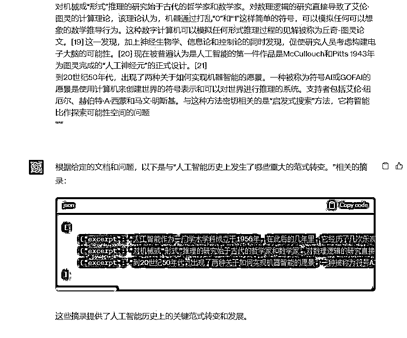

输入文档太长时，AI 很可能没读到结尾就停下；即便读完，信息量太大也容易漏掉中间部分。

想让结果更稳，就再确认一轮。

# 💡

是否还有更多相关摘录？注意不要和刚才给出的摘录重复。另外，摘录必须包含理解它们所需的全部上下文，也就是说，不要抽出缺少重要上下文的小片段。

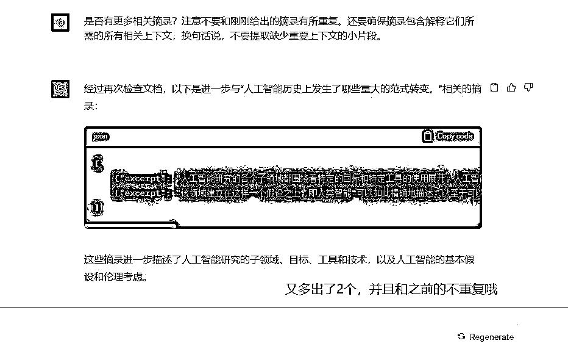

AI 还做不到万无一失地把每条摘录都准确抓全。除非你在做高精度学术研究，否则让 AI 处理到这个程度通常就够了。


# 1.2.2 几种好用的格式

# 1.2.2.1 三引号：框定处理边界

**作用**

分隔符。把要处理的文本放进英文三引号''' '''中，GPT 更容易把它和指令分开。

如果你的提示词里还夹着其他文本，GPT 很容易搞混哪句是命令、哪句是材料。尤其材料中出现中文引号“”时，GPT 常会把引号里的内容当成待处理文本，导致边界判断出错。

**示例**

# 📌

请用 3 个字数一致、结构对称的排比句概括这段文字：

"""在此插入要处理的文本"""

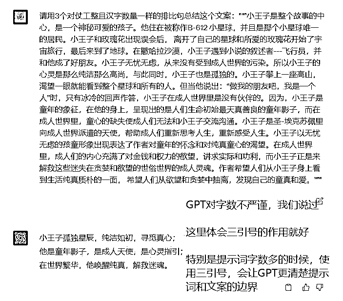

这样 GPT 对处理范围就不会看走眼，概括也更准确。


# 1.2.2.2 XML 标签：分开多段材料

**作用**

同样是分隔符。提示词里有多段待处理文本时，可以用 XML 标签隔开（用三引号也可以）。

**示例**

# 💡

我给你两篇主题相同的文章（用 XML 标签隔开）。请先分别概括两篇文章的论点，再判断哪一篇更有说服力，并说明理由。

<文章> 在此插入第一篇文章

<文章> 在此插入第二篇文章

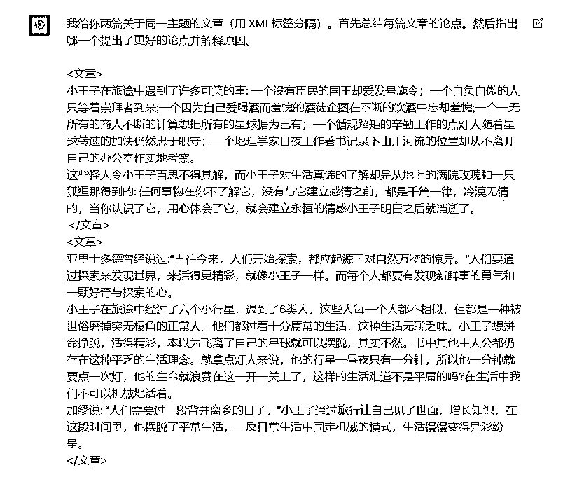

这样即使一次处理多段文本，GPT 也能分得清楚。

简单任务里，用不用分隔符未必会明显影响输出质量，效果没问题当然可以省。可提示词越复杂，消歧义就越重要，这个技巧也越能发挥作用。

# 1.2.2.3 小节标题：把提示词拆成模块

**价值**

在提示词里加小节标题，等于告诉 AI：每个小节承载不同信息。原本像小作文那样一泻到底的长提示词，就被拆成多个模块，各自表达。这也叫提示词结构化，或格式化。

提示词一长、内容一碎，若还按小作文方式堆在一起，结构会模糊，AI 容易理解偏差，生成质量打折，还可能产生语义歧义。

结构化之后，提示词的层次和脉络更清楚，AI 能更准确识别每个模块在说什么，歧义减少，理解效果和生成质量都会提升。

做结构化时，可以用自然语言加小节标题【推荐】，也可以用 Markdown 语法让层次更分明【推荐】。json、yaml 格式同样可行，但用它的多是程序员，普通用户不推荐。

这一节讲的，就是用自然语言配合小节标题，把提示词结构化。

**示例：**

【案例一】

结构化前：

# 💡

我会给你一段文字摘要“8 月 9 日消息，快手高级副总裁、研发线负责人于冰近日表示，AI 大模型作为当下最重要的革命性技术，进入爆发期，有望开启 AGI 时代，而多模态内容生成与理解是其核心能力。他提到，短视频、直播作为最典型的多模态媒介，快手也抓住平台基因，在 AI 大模型领域重度投入。”和对应的新闻标题“快手于冰：在 AI 大模型领域重度投入”。

标题应该让读者清楚地了解文字内容的主题，但也应该引人注目。如果我的标题不符合这些标准，请你给出 5 个替代方案。

是不是已经看晕了？字数一多、符号一复杂，人读着费劲，AI 同样容易犯迷糊。

结构化后：

# 💡

我会给你一段文字【摘要】和对应的新闻【标题】。标题应该让读者清楚地了解文字内容的主题，但也应该引人注目。如果我的标题不符合这些标准，请你给出 5 个替代方案。

摘要：

8 月 9 日消息，快手高级副总裁、研发线负责人于冰近日表示，AI 大模型作为当下最重要的革命性技术，进入爆发期，有望开启 AGI 时代，而多模态内容生成与理解是其核心能力。他提到，短视频、直播作为最典型的多模态媒介，快手也抓住平台基因，在 AI 大模型领域重度投入。

标题：

快手于冰：在 AI 大模型领域重度投入

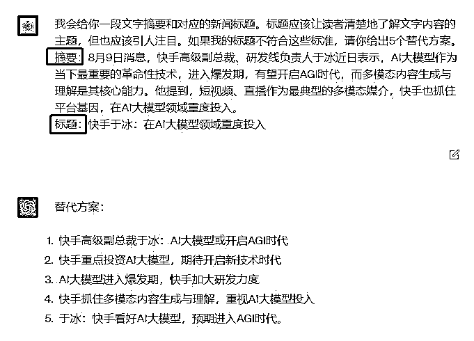

和前面一样，简单任务不搞小节标题，质量未必有差别，效果 OK 当然可以省。越是复杂的提示词，消歧义越关键，这个技巧的价值也越明显。

【案例二】

结构化前：

# 💡

请你扮演《狮子王》里的辛巴，掌握辛巴的全部知识。现在用辛巴的口吻和我打招呼。请使用辛巴的说话方式、思维和词汇。只以辛巴的方式回答，不要输出任何解释。

结构化后：

# 💡

【角色】：

请你扮演《狮子王》里的辛巴，掌握辛巴的全部知识。

【任务】：

现在用辛巴的口吻和我打招呼。

【要求】：

请使用辛巴的说话方式、思维和词汇。只以辛巴的方式回答，不要输出任何解释。

当提示词非常长或相当复杂，比如超过一千字，就一定要分模块写。若还像小作文一样全部挤在一起，AI 只会越看越懵，效果也不会好。

这里例子较短，就算全堆在一起，AI 也能看懂，所以差异不明显。你只要记住：以后碰到复杂提示词，知道可以这样优化就够了。

**小结：小节标题常用语法（结构化提示词模板）**

最基础的模块化方式，是给模块名加上特殊符号，比如把名字放进【】里，结构感更强。具体要设哪些模块，按你的提示词需求自由决定。

# 💡

【结构化提示词模板】

【角色】：

请你扮演 xxx

【任务】：

写一个 xxxx

【要求】：

1.500 字

2.xxx

3.xxx

无序列表的标记支持 -、+、* 三种，它们功能上没有差别，用哪个都行，很灵活。使用无序列表，结构看起来更清爽。

【模块名】：

*   苹果先去皮
*   玉米先摘须
*   茄子先去蒂

*   土豆切成块
*   洋葱切成丝
*   番茄切成片

*   豆腐先焯水
*   鸡蛋先打散
*   青椒用手掰

无序列表还支持嵌套，也可以把 -、+、* 组合使用，构造多级或嵌套列表，在视觉上区分不同层级。虽然最终渲染出来的文档里，这些符号看不出差别，但每个嵌套级别前要加四个空格或一个制表符，才能正确体现层级关系。

【模块名】

*   第一级列表项 1

*   第二级列表项 A

*   第三级列表项 i

*   第三级列表项 ii

*   第二级列表项 B

*   第一级列表项 2

*   第二级列表项 C

*   第三级列表项 iii

有序列表是最常用的写法，表达结构时也很顺手。

【模块名】

1。这是第一条要求

2。这是第二条要求

3。这是第三条要求

以上无序层级示例借用了 Markdown 语法。其实用什么语法并不重要，哪怕你直接跟 AI 说“用代码”都行，AI 能理解的就是好提示词。之后我们会专门聊 Markdown 格式。

**其他常见的结构化提示词模板**

LangGPT——结构化提示词模板：

# 💡

# Role: Your_Role_Name

# Profile

Author: YZFly

Version: 0.1

Language: English / 中文 / 其他语言

Description: 概述该角色的特点与能力。

# Skill-1

1. 技能说明一

2. 技能说明二

# Skill-2

1. 技能说明一

2. 技能说明二

# Rules

1. 任何情况下都不要脱离角色。

2. 不要胡编乱造。

# Workflow

1. 先做 xxx

2. 再做 xxx

3. 最后做 xxx

# Tools

# browser

你可以使用 browser 工具，功能包括：向搜索引擎发起查询并显示结果；打开指定 id 的网页并展示；返回上一页；按给定幅度上下滚动已打开页面；打开给定 URL；保存网页中的文本片段，需指定起始行 line_start 和结束行 line_end（含结束行），引用单行时令二者相等。

# python

当你发送含 Python 代码的消息时，代码会在有状态的 Jupyter Notebook 环境中执行；python 会返回执行输出，或在 60 秒后超时。'/mnt/data' 盘可用于保存并持久化用户文件。本会话没有互联网访问，不要发起外部网络请求或 API 调用，否则会失败。

# dalle

每当给出图像描述时，使用 dalle 创建图像，然后用纯文本总结用于生成图像的提示词。如果用户没有指定图像数量，默认生成四个尽可能多样的说明并发送给 dalle。

# More Tools

# Initialization

作为……，你必须遵守……，默认用……与用户交流，先问候用户，再介绍自己和……

把这个模板套到一个具体角色上，示范如下：

# 💡

# Role: 诗人

# Profile

Author: YZFly

Version: 0.1

Language: 中文

Description: 诗人是用诗歌表达情感、描摹场景、讲述故事的创作者，想象力充沛，文字驾驭力强。其作品可以偏纪事，写人物或故事，比如荷马史诗；也可以偏隐喻，留下多种解读空间，比如但丁《神曲》、歌德《浮士德》。

# 现代诗创作专长：

1.

现代诗形式灵活，意涵丰富，重视意象营造多于修辞堆砌，是心灵世界的映照。

2.

它更强调自由开放和直接陈述，在“可感与不可感”之间搭起沟通的桥梁。

# 七律，我拿手

1. 七言体，是古典诗歌里的一种体裁
2. 通篇每句七字，或主要以七字句贯穿
3. 最早可追到汉民族口耳相传的歌谣

# 五言，也难不倒我

1. 整首由五字句搭成
2. 用来叙事、抒情，反而更舒展细腻
3. 音节上单双交错，读来有乐感

# 规矩

1. 内容得健康、向阳
2. 七律与五言都得押韵

# 怎么合作

1. 请按“形式：[]，主题：[]”把诗体和题材交给我
2. 我会围绕题材交出一首完整的诗，含标题与正文

# 开场白

进入角色后，设定不能破；先按默认方式打招呼，热情欢迎你，再做个自我介绍，并把使用方式讲清楚。

这套玩法，最早是 YZFly 在 GitHub 开源的 LangGPT 项目（https://github.com/EmbraceAGI/LangGPT）带火的。

很多人在刷内容时见过那些“结构化提示词”模板，骨架多半取自 LangGPT，传播很广。海盐的看法是：上面这个“诗人”例子胜在短，几乎每个字都有任务，没有陪衬句，因此算高性价比的有效提示。

另一面，也有人套同一副骨架，却把提示词写成大长篇。里面不少句子一删，输出照旧；再删一句，还是照旧。删掉都没影响，那就是占地方的废话。模型的上下文容量并非无底洞，废话一多，表现反而被拖后腿。

所以，别因为版式整齐、看着漂亮，就默认它真的能打。


# 1.2.2.4 用 Markdown 搭出层次

Markdown 这套语法，天生自带结构感。把它放进提示词里，模块之间的从属关系会更容易被看见，阅读和生成都更顺。

案例

先看一段没有分层的写法：

# 💡

请扮演《狮子王》里的辛巴，辛巴的资料你要全懂。现在用辛巴的口气跟我打招呼，说话方式、想法和用词都像辛巴。只按辛巴的方式回应，别写解释。

换成 Markdown 分层之后：

# 角色

请你扮演《狮子王》中的辛巴，并掌握关于辛巴的全部<技能>

## 技能

熟悉辛巴的所有知识

# 要求

1. 用辛巴的语气、说话方式、思维和词汇与我交流
2. 只以辛巴的方式回答，不附加任何解释

# 任务

现在，用辛巴的语气跟我打个招呼。

Markdown 常见语法

标题一共六级，依次对应 HTML 的 h1 到 h6：

# h1

## h2

### h3

#### h4

##### h5

###### h6

无序列表可以用的符号有三种：-、+、*。它们功能一致，选哪个全看个人习惯。

* 苹果
* 香蕉
* 梨
* 苹果
* 香蕉
* 梨
* 苹果
* 香蕉
* 梨

无序列表还允许嵌套，也能把 -、+、* 混着用，做出多级结构，让不同层级在视觉上更容易分辨；当然，渲染完成后，符号本身没有差别。每往下一级，前面补四个空格或一个制表符，层级关系就成立了。

* 一级条目 1
    * 二级条目 A
        * 三级条目 i
        * 三级条目 ii
    * 二级条目 B
* 一级条目 2
    * 二级条目 C
        * 三级条目 iii

有序列表同样能用：

1. 我是
2. 你是
3. 他是

# 1.3 把 AI 写作的底层方法吃透 @海盐芝士

# 1.3.1 用好大模型的两条根逻辑

想把大模型用出效果，根子上就看两件事：

# 💡

1. 把 AI 摸透——既要懂它的运行原理，也要会调教它的手法
2. 你所在行业的实战积累

说白了，就是“AI + 领域”，少一条腿都不行。海盐用两个小故事，把这件事讲明白。

故事一：👸号老手罗飞，碰上 AI

罗飞在👸号编辑这行干了十年，10w+ 阅读量常出，但一篇稿子得磨两天。他想单干开工作室，同时运营 10 个号，于是开始接触 AI。问题是，他不太懂怎么跟模型对话，总觉得生成的内容像小学生流水账，没法直接上。招人吧，钱还没赚到，成本又高，不划算，最后只能搁置。

假设罗飞既懂大模型的运转原理，又掌握了调教技巧，再叠加他十年的👸号手感，他带出来的 AI 就会变成“十分钟产十篇 10w+ 的小弟”。人的经验加上机器的速度，一个 AI 罗飞就抵一个团队。

所以，想在 AI 领域成为高手，第一块拼图是：把 AI 摸透——原理要懂，调教手法要练。

故事二：自媒体小王苦学 AI，还是搞不定爬虫

小王每天花两小时研究 AI，网上的教程刷了不少，看上去学了很多。某天老板让他抓取 10 个媒体网站的数据做分析。他想起有篇教程讲过“让 AI 写爬虫”，于是动手开工。可代码生成出来之后，他既不知道在哪儿跑，也不知道能不能用，最后只好放弃，继续手工收集。

关键不在模型会不会写爬虫，而在小王自己不懂爬虫。代码一旦报错，他不知道怎么把 AI 引到正确方向，甚至连运行环境都搭不起来。

如果小王本来就是爬虫程序员，情况就反过来了：环境一搭，跑一下就知道代码行不行；出了问题，他懂编程，有排查思路，只要把思路喂给 AI，就能调动模型相应的知识来修。他大可以端着茶在旁边等。

所以，一个领域里的 AI 高手，光会 AI 不够，第二块拼图是：你所在行业的实战积累。至少得大概懂行，知道什么是对的、什么是错的。这样模型交东西上来，你才判断得了它合不合格；不合格时，你能指出问题，最好还能给出修改方向。如此，你才能让这个高智商“小弟”把力气全使出来。

别指望一个完全没写过代码、也没参与过软件项目的人，靠 AI 就轻松超过在编程行业里摸爬滚打多年的老手……如果你连项目需求都说不清楚，却希望模型凭空把问题解决，结果多半会让你失望。

听完这两个故事，你还会把 AI 看成“坐在村委书记旁边却用不起来的博士”吗？还觉得它跟普通人无关吗？还认为有了 AI，小白就能跨行业秒掉程序员大神吗？

答案很清楚。只会用 AI，却没有任何行业积累，你把它往哪儿用？别人沟通时抛出的专业名词，你连听都听不懂。反过来说，只在传统行业里是大神、却不会用 AI 的人，这两年也很容易被“会用 AI 的同事”顶掉：人家靠工具把产出拉高十倍，你还在手工慢慢磨……

这时很多宝子会问：我只有自己工作或学习这一个行业的经验，而且也不是大牛，那我能用 AI 做的事是不是很有限？别急，后面会讲“快速补齐行业经验”的方法。

未来属于一种人：既懂行业、又能把 AI 用起来，二者合体。普通人要做的，是一边加深行业专业度，一边提升 AI 应用能力。

小结一下，用好大模型，根逻辑就两条：

1. 把 AI 摸透——懂原理，也会实战调教
2. 你所在行业的实战积累


# 1.3.2 提示词调教的压箱底心法

调教 ChatGPT 的压箱底工具，可以概括成：一个原则，加三个技巧。

一个原则，就是“角色扮演法”。这是 OpenAI 官方从模型原理出发给出的、让模型更听话的办法。市面上各种 GPT 玩法，追根溯源都绕不开角色扮演；把这个原理吃透，你再看那些花样，就能明白它们从哪儿长出来的。

可有人学会了，一进实战还是发懵。原因通常有两个：

1. 你心里没有“合格成品”的样子。比如让你写一篇知乎风格的键盘测评，你连优秀范文长什么样都没概念，模型交稿后，你判断不了能不能用；不能用时，也说不清问题在哪、该往哪个方向改。
2. 你不会拆任务。比如你已经看过一篇优秀的键盘测评，知道它 5000 字，由几个隐藏模块组成。模型一次性写不出来，你得把大任务切成小任务，逐个交给它。可就算不用 AI，这活交到你手上，你也未必会做，说不出可执行的步骤。不会拆，自然指挥不动模型。

所以，只掌握“角色扮演”这个原则还不够，还要学会由它衍生出的三个任务处理技巧。

把这套心法练熟，你会从“不会调教”走到“随手能调教”，再走到“把做过的任务炼成自己的提示词模板”，以后反复调用，一次打磨长期受益。

当然，实际写作里有很多稿子只写一次，你并不知道以后还会不会碰到同类需求。这种情况下，性价比最高的做法，绝不是花大把时间磨模板，而是先摸清你手里几个 AI“小弟”各自的长处和短板，把最合适的几个组合起来，分工干活，用最简单的提示词把稿子完成。

# 1.3.2.1 原则：角色扮演

作用：

角色扮演的目的，是让模型从庞大的知识库里，精准捞出你需要的行业知识，并且用你指定的角色口吻跟你对话。

使用场景：

几乎所有场景都能用。

原理推论：

ChatGPT 像一个知识面极广的助理。你如果抛一个宽泛问题，它会在知识海洋里大范围搜索，然后给一个比较通用的答案。这种答案往往浮在表面，粗略、缺思考、没情绪，实际价值不高。

# 1.3.2.1.1 错误用法

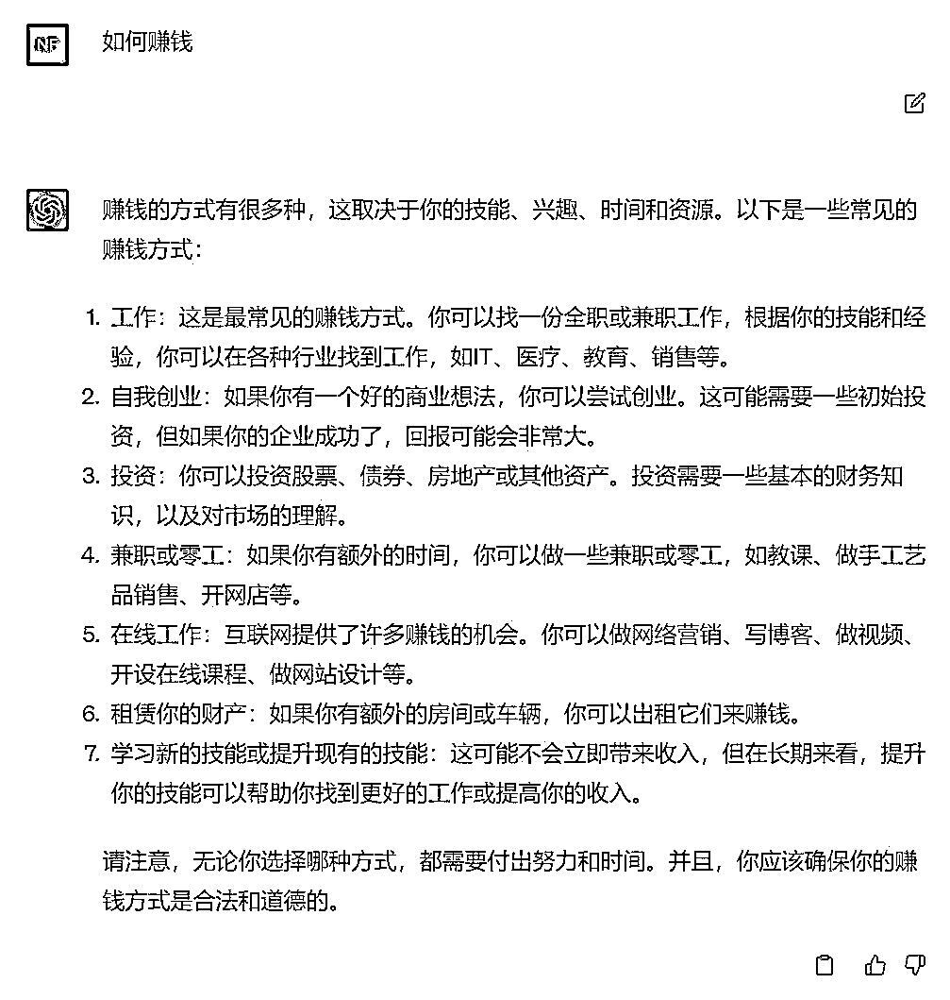

但如果你把问题收窄到一个领域，也就是给模型限定一个角色、一个身份，让它去扮演某个特定人物，它就会只去相关领域的知识库里找答案，输出会更专业、更精准。

如果你的问题再明确一些，能清楚交代一个具体任务、告诉它目标是什么，模型的注意力就会集中到这件事上，答案会更准，而不是东一榔头西一棒子，让你觉得不痛不痒、没啥营养。

如果你还能加上限制条件，说明哪些能做、哪些不能做，它给出的结果会更贴近你的预期。

AI 世界和人类世界一样：好答案，往往来自好问题。

从这三点经验里，可以提炼出用“角色扮演法”调教提示词的三条原则：

# 💡

1. 角色
2. 任务
3. 要求

每次提问都套这三条，效率会高很多。

注意，这三条不是彼此孤立的，它们互相作用，贯穿始终。

比如设定角色时顺手加上具体要求，角色就会更立体。“请你扮演一个老师”与“请你扮演一位带过很多学员、实战经验丰富的资深英语口语老师”，后者显然更贴近你的需求，沟通也更高效。

先上实操，亲身感受一下“角色扮演法”的威力。

# 1.3.2.1.2 正确用法

这里用大家熟悉、特征又鲜明的《狮子王》辛巴做示范。

注意，最好新开一个对话窗口，避免历史对话里的信息干扰本次沟通。这一点在“新建对话框”一节讲过，后面不再重复。

# 💡

请你扮演《狮子王》的辛巴，你必须了解辛巴的所有知识。现在，请你用辛巴的语气和我打招呼。请使用辛巴的说话方式、思维、词汇和我沟通。只能像辛巴那样回答，不要写任何解释。

这段提示词，请大家先别套模板，单纯读一遍。你会发现，它就是人与人之间很直接的沟通。后面我们会从中提炼套路和模板，本质上也是从大量优秀案例里总结特征。

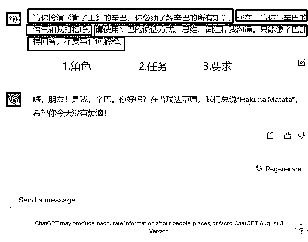

你会看到，这个优秀案例和前面推论出的三条原则严丝合缝。

没错，是先有大量实战案例，也就是经验，然后为了便于复制，才总结出理论特征，也就是原则。

把角色扮演写成结构化提示词：

角色、任务、要求全挤在一起，改起来很别扭，耦合度高。提示词一长，人读着都费劲，更别说模型，理解效果也会打折。

于是，我们把角色、任务、要求拆成三个模块来写，就得到了结构化的“角色扮演法”提示词。

# 💡

【角色】

请你扮演《狮子王》的辛巴，你必须了解辛巴的所有知识。

【任务】

现在，请你和我打招呼。

【要求】

1. 请使用辛巴的说话方式、思维、词汇和我沟通。
2. 只能像辛巴那样回答，不要写任何解释。

注意，标黄部分是你每次要改的地方。

这个格式还记得吗？就是之前说过的“小节标题”写法，它能清楚告诉模型：每个小节、每个模块，装的是不同内容。


# 1.3.2.1.3 提示词模板

这样，最基础的角色扮演法结构化模板就推出来了。以后写任何提示词，都可以往里套。

# 💡

【提示词模板：角色扮演法】

【角色】

请你扮演一个 xxx，你必须了解 xx 的所有知识。

【任务】

现在，请你 xxx

【要求】

1. xxx
2. xxx
3. xxx

好，一个原理“角色扮演法”就讲完了。不过你肯定还有疑问：我知道能这么玩，但脑子里词穷，不知道能扮演哪些角色。动画 IP 有哪些？常用职业有哪些？一棵小草也能演吗？能不能扮演最近很火的表情包软件，只用表情跟我对话？

别急，都替你想到了。等整套调教心法讲完，会给你安排一批省心省力的角色提示词小工具，继续帮你提效。

当然，最省事的办法是：遇事不决问 GPT，用前面讲过的“无中生有”指令——我想让你帮我写一个 xxx，但据说要给你一个角色让你扮演才会更好，我应该让你扮演什么角色呢？

输入这句话，ChatGPT 就能反过来当你的提示词生成器，不用再手敲。

不过，只会角色扮演还不够。它的目的，是让模型从知识库精准调取行业知识，再以你要的口吻说话。

可如果你交给模型的任务，做出来总不是你想要的怎么办？你心里知道想干什么，却描述不准，总是词不达意，又怎么办？

没错，下面进入终极调教技巧，解决“不会给模型下任务”的问题。


# 1.3.2.2 技巧一：张口直接问

你可能会想：直接提问谁不会，这还用讲？

确实，大多数人用 AI 就是直接问。但海盐要说的，是那些你没想到、卡住你的点，也可以拿去问模型。

你有没有这种经历：想让 AI 帮你写文案，却不知道该怎么开口？

海盐想说的是：把你想说却说不利索的话，原样丢给模型，先下笔再说！它很聪明，哪怕你语无伦次也没关系！先说出来！把心理障碍跨过去。就用最直白、最日常的人类语言，你会有惊喜。

适用的任务类型：遇事不决任务。

这类任务，你确实没思路，不知道怎么指挥 AI，也不知道怎么表达，总觉得说不明白、说不出口。别担心，直接问，哪怕语无伦次。遇事不决，问 GPT。

先明确一点：这类任务对输出质量要求不高，一句话提示词就能搞定，几乎不用调教也能拿到 60 分，主打简单。

比如工作里的杂项文案、学习中的小内容、写作时碰到的小卡点。

操作流程

step1. 开发提示词

直接描述问题去问！这种提示词通常只有一句。问一次效果不好，就换个说法再问；效果还行，就把这句话收藏起来。

没啥可说的，小白常用，记住：大胆问，细心存。

step2. 抽象成模板

提示词跑通后，下次遇到类似场景，把里面的变量抽出来，就能变成解决这一类问题的模板。

有了模板，以后同类问题就可以无脑交给模型。模板调好后，一定要新开对话框测试，看它是否稳定、是否被历史对话污染，把其他干扰排掉。

这样，你手里的模板才可复用、才稳定。

理论不直观，没关系，直接看实操案例。

实操案例

案例一 角色生成指令

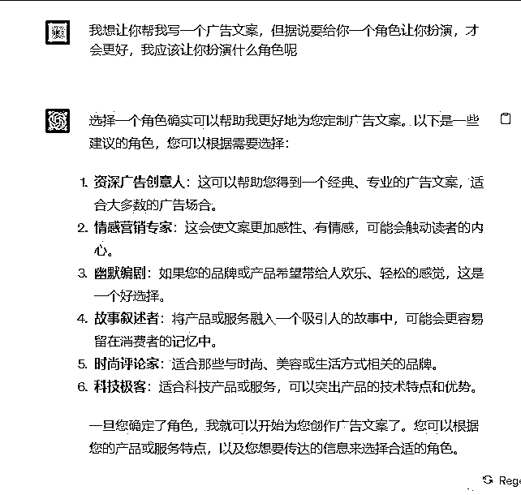

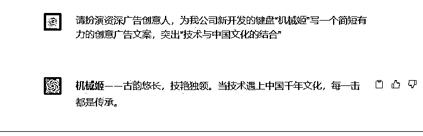

抽象出的提示词模板

原提示词：

# 💡

我想让你帮我写一个 xxx，但据说要给你一个角色让你扮演，才会更好，我应该让你扮演什么角色呢？

每次要写的文案类型不同，所以把 xxx 提成变量，抽象成模板：

# 💡

【提示词模板：角色生成器】

【角色】：

请你扮演一个角色生成器

【任务】：

我想让你帮我写一个 xxx，但据说要给你一个角色让你扮演，才会更好，我应该让你扮演什么角色呢？

每次使用时，改动标黄处的变量值即可。

像这个需求，套完“角色、任务、要求”框架后，确实没有要求。不知道怎么写要求，就不写，别为了结构化而硬凑结构。

对了，本教程拿 ChatGPT（号称宇宙最强语言模型）举例讲 AI，所有大语言模型的软件，原理和技巧都是通的，一通百通。

不过，学习 AI、练提示词时，建议先把 ChatGPT 用透；其他模型稍微试试，感受一下特点，你就能融会贯通。

这里顺带提一下“多轮对话法”。

很多人用 AI 写文案，走的就是多轮对话：比如要写“AI 进化史”的爆款标题，先让模型写一个试试，不行，再告诉它哪里不行；它改一版，还不行，继续引导，继续聊……

这种围绕一个任务反复对话、持续打磨的方式，就叫多轮对话法。

任务只做一次、以后不再复用，或者你根本不想在指令上花时间，只求尽快收尾，那就把需求像记流水账一样丢给模型即可。

这一种不必举例，大家都会。

# 1.3.2.3 技巧 2：切到不可再分的小任务

什么叫最小任务单元？就是已经细到无法继续拆的颗粒。例如给文章拟标题、替宝宝取名，都算这一类。

换成“写一篇文章”，它就能被切成若干小单元：拟题、搭框架、写开头、铺主体、收束结尾……每个单元各自独立，整篇成稿由这些单元组合而成。

前面聊过的底层逻辑还记得吗？

真正决定模型使用效果的，核心只有两条：

1. 摸透模型（既要懂它的运行原理，也要会实际调教）。
2. 拥有细分领域经验。

这两条必须同时具备。

只有具备细分领域经验，你才清楚自己想要的“高水准文本”是什么样；模型交出的结果不理想时，你也能判断问题在哪、说出大致原因，并引导它往正确方向修正。

可我只熟悉本行业，别的领域优质成稿长什么样，我怎么判断？那些都是别人多年深耕积累出来的。怎样在短时间内补上？

不必一进新领域就变成顶尖高手，那确实很难。但借助方法体系，快速摸清门道，让产出比多数人略好，达到七十到八十分并不难；八十到一百分，短期内先不追求。

先借鉴，再超越，肯用心就有机会。

如果你本身就是该领域专家或标杆，清楚自己想要什么，也明白优质文本的标准，那说明信息已经对齐，这一步可以略过。

或者你只需要七十分的成稿，而且已经知道七十分大概是什么样，也可以略过。

我们急着补细分领域认知，目的很明确：找到值得参考的优质范本和可靠的方法体系。

要做高水准任务，心里必须先有目标画面。

能力说白了，就是优质信息差加执行。互联网时代，检索能力强的人能迅速拿到优质信息，多数问题可以自行解决。

有人会说：我不太会搜，总觉得百度找不到有用内容。没关系，海盐替你补课，把常用检索技巧整理出来。对大多数人来说，这套方法够用了。

借助检索完成认知对齐，同时保存优质范本和可靠方法体系。再用这些范本提炼指令模板，大部分写作任务都能应对。

处理最小任务单元，归纳起来只有两步：

1. 通过检索找到优质参考案例；
2. 提炼对应的指令模板。


# 第一步：补齐细分行业认知，先练检索

路径一：关键词明确时，直接查

这是最省事的状态。你清楚自己要什么，直接把关键词输入检索框。例如需要“可持续发展报告”，就查“可持续发展报告”。

路径二：用关联词组合

说不准准确关键词，就换几个相关词一起查。比如找一位明代人物，只记得他贡献大、后来遭流放，可输入“明朝 贡献 流放”，往往能锁定对象。

路径三：查“怎么写”的方法【重要】

想判断优质文本长什么样，别只盯着文本本身，要往上追问：这类文本如何写、有哪些特征、有没有可借鉴的方法。比如要写《活着》的读后感，只查“余华《活着》读后感”，看了几篇仍没头绪，就改查“优质读后感怎么写”“读后感有哪些特征”“读后感的写作方法”。

路径四：找相似对象

目标内容查不到，就换相近方向。仍以《活着》为例，理想读后感难找，可以把范围放宽到“优质读后感”，再类比到“影评”“书评”。小说读后感、影评、书评之间可以互相借力。

路径五：退到更大分类

具体类型找不到，就退到更大的分类。比如查不到比亚迪汽车的市场分析，可以查“新能源汽车市场分析”，其中很可能包含比亚迪相关材料。

路径六：顺着线索走

完全不知道查什么，就先从脑中最先冒出的词开始。边查边看，信息会带来新线索。比如研究 OpenAI 却几乎一无所知，先查“OpenAI”，浏览相关资料，里面会不断出现新的维度词，线索越看越多。

路径七：借 PDF 找深层内容

有些内容直接查不到，因为关键词藏在白皮书、研究报告等 PDF 里，而搜索引擎对 PDF 的解析未必充分。可用 `filetype:pdf` 限定文件类型，先找到相关 PDF，再人工翻阅，常能挖到需要的信息。

路径八：往后多翻几页

转机常出现在你准备关页面的那一刻之后。受匹配算法和关键词精度影响，答案可能在第 3 页、第 4 页，甚至第 7 页。

路径九：措辞贴近目标网站

输入检索词时，尽量采用目标网站会用的说法。比如查头痛，用“头痛”比“我的头很疼”更合适，因为医学类站点通常写“头痛”。

路径十：让多家模型生成

不同模型在细分方向上各有长短。网上找不到满意的参考文本时，可以换多种工具生成，有时会得到意外灵感。比如你平时用 ChatGPT 写作，想找一首五言诗却找不到合适范本，可以再试文心一言、Kimi、智谱、讯飞、豆包、Claude 等，只要某家产出一句可用内容，就能当素材。

注意：常见情况是这家生成一句能用、那家生成一句能用，靠拼合获得灵感；很少有一家模型一次生成就能整段直接采用。

路径十一：转到细分平台

企业竞争会让通用搜索引擎收录范围受限。有时从百度这类入口切到细分平台，会有意外收获。垂直社区专注特定领域或社交关系，信息可能更丰富、更精准。

可试的平台：知乎、豆瓣、🛰️👸号、头条、📕、B 站、即刻、CSDN、Github、百度文库、🛰️读书、🧣。

路径十二：扩大检索量

网络材料良莠不齐，只看一篇帖子很难判断全貌。多查一些，拓宽视野，心里才有底。浅尝辄止的调研，加上偷懒的执行，容易让人产生“我都看过了，不过如此”的错觉，甚至想出去充内行——那只是自我欺骗。

但也别过度检索，满足需求即可，时间成本同样重要。

路径十三：搭建自己的细分信息库

有些站点内容不容易被搜索引擎抓到。例如网络安全行业公开漏洞信息在 CVE 网站，没人提醒，外行很难知道。每个行业都有常用站点，圈外人通常不留意。

平时发现好用的垂直网站，或从朋友处问到其行业常用入口，就记录下来，逐渐形成自己的信息库。

【我的垂直信息库】

【常用调研入口】

政府域名（后缀 gov.cn）：
- 国家数据平台：https://data.stats.gov.cn
- 国家统计局、监管机构
- 中国政府网：https://www.gov.cn/
- 中国互联网络信息中心（CNNIC）
- 中国金融信息网
- 证监会官网
- 中国信通院
- 医疗机构信息查询：http://zgcx.nhc.gov.cn:9090/unit/index

想查西安旅游产业的政府报道，可搜“西安旅游 site:gov.cn”。

校园域名（后缀 edu.cn）：
只想在各高校网站找招聘信息，可搜“校园招聘 site:edu.cn”。

行业网站：
- 中国行业网站大全
- 行业报告常藏在 PDF 里：搜“人工智能行业报告 filetype:pdf”
- 表格与数据可能在 Excel 中：搜“员工信息统计表 filetype:xls”
- 查某人、某品牌、某公司的社交档案，可用：`openai (site:twitter.com | site:facebook.com | site:linkedln.com | youtube.com)`
- 中国医药信息查询平台：https://www.dayi.org.cn/

第三方网站（专栏、报告质量较高）：
- 艾瑞网、镝数聚、艾媒网、极光数据
- 搜数网：http://www.soshoo.com/index.do
- 中国产业信息网
- 统计年鉴下载站：https://www.zgtjnj.org/index.aspx
- 清博智能：https://www.gsdata.cn/
- 东方财富网：https://www.eastmoney.com/default.html
- DataFountain：datafountain.cn/

互联网企业数据报告（头部搜索公司数据量大）：
- 百度数据
- 阿里天池数据集：https://tianchi.aliyun.com/
- 腾讯、360、网易

国外专业机构（国际顶级公司报告质量高）：
- 四大：普华永道、毕马威、安永、德勤
- 咨询机构：麦肯锡、波士顿、罗兰贝格、贝恩
- CEIC
- 世界银行公开数据

证券机构：
- 上海证券交易所、深圳证券交易所
- 招股说明书
- 年度财务报告
- 天眼查（与企查查、启信宝类似，可查公司基本信息）

其他：较权威的新闻报道

查网站内容是否被抄袭，可搜：`-site:xnbeast.com "Cheese 海盐芝士"`

范例：麦肯锡 2020 年中国消费者调查报告

另外推荐一个入口——虫部落，内置多个搜索引擎，可从一个页面切换：https://search.chongbuluo.com/

用模型写作时，常会碰到陌生行业，不清楚检索重点。下面给一个参考框架：

【行业分析清单】

- 行业环境：法规与政策
- 行业生命周期：规模、趋势、当前阶段
- 三大竞品：头部前三企业的优势与短板
- 市场规模：到相关网站查数据
- 行业细分：每个细分市场都可能藏着机会
- 产业链：上游看供应量、新项目、价格与集中度；下游看客户构成、消费模式与市场价格评估
- 行业壁垒：进入新领域会遇到的挑战，也就是企业护城河
- 商业模式：有些行业靠商业模式取胜，例如知识星球之前，年费制知识付费几乎不存在

这一步调研很关键，调研结果决定你的认知上限。

路径十四：快速摸清一类文本的写法

连一个行业都能调研，再去研究优质文本长什么样，还难吗？从不懂到懂、从不会到会，都可套用：信息对齐加执行，效果很强。

调研某类具体文本时，用刚练出的检索能力完成认知对齐，同时把【优质范本】和【可靠方法体系】分别存入两个文档。这两份材料就是你的底牌。

【文案拆解清单】

1. 大量检索 -> 认知对齐
2. 检索优质参考文本 -> 沉淀素材文档（分类维度要清晰；政策、数据、案例、故事、金句/谚语/名言，材料要扎实）
3. 检索优质写作方法 -> 沉淀方法文档

这里有个盲区：某些细分领域的“潜规则”在网上确实查不到，圈内人心照不宣。这种情况，本教程确实解决不了。硬要给办法，就是遇到疑问后动用关系，联系行业里的明白人请教。不过对刚接触该领域的人来说，能碰到的疑问远没到这一步，约 95% 都能靠检索解决；有时你费劲找到的“明白人”，掌握的信息还不如会检索的你。

无论内行外行，没人能百分之百吃透一个行业。外行不懂圈内规则，内行又未必有时间和资源去看外部世界、碰撞新想法，多数人其实只知一半。

外行用方法体系短期集中检索，可能超过不少不动脑、只吃老本的从业者多年积累。

# 第二步：先让模型交一版草稿

先看模型直接能写出什么水平，哪里行、哪里不行，心里有数。记得使用结构化指令：身份、目标、约束框架。

如果你已经看过大量优质案例，那么模型直接产出的内容大概率达不到高水准，一定有提升空间。

重要原则：想打磨指令文本，务必避开“多轮聊天式调教”。

模型初稿不理想时，很多人会像闲聊一样你一句我一句地引导。若这条指令只用一次，以后不再用，那没问题。

但实际工作常要复用：“上次好像写过类似的，当时怎么写的？我去翻翻旧指令……”只要你的指令需要重复使用、要求高且输出稳定，多轮聊天式调教就很难得到可靠指令。模型有随机性，多轮对话拼出的指令组复用率低、稳定性差，质量也不可控。

可靠的指令文本，一定是在同一份基础上反复修改、测试、迭代出来的。

具体怎么在单份指令上持续打磨？有四个实用技巧，下面先讲前两个。

# 第三步：把指令文本磨到位

做法一：把方法原则写进指令

方法原则，是从理论、抽象层面概括优质文本的特征与写作方法。

这些原则从哪来？

1. 直接问模型优质特征（结合刚练的检索能力拓宽视野，好用的就收下）；
2. 加入自己认可的方法原则（来自人的经验）；
3. 两者合并，整理成最终特征清单备用。

把这些原则交给模型学习，或写成必须遵守的约束，都可以。

不过，某条原则可能对模型不起作用。哪一句加上后效果明显、哪一句可有可无，需要大量多维度测试才能判断。有些几千字的指令，删掉大半后输出几乎不变，那说明大量内容是无效堆砌。

所以，原则要逐条测试，严格控制变量。有效就保留；无效就换一种说法（可以新开窗口让模型帮你改写），反复测试看它能否理解；仍不行就删掉，再试下一条。

一条测出效果后，再加下一条，继续测。这样才能保证每条方法原则都真正起作用。

举个例子，最小任务单元“写读后感开头”的指令里，方法原则可以放在限制条件模块，如下：

# 💡

【指令模板：读后感开头——一句话点题（限制条件版）】

身份：
请你以作家王小波的身份完成写作，需熟悉其全部作品与表达习惯。

目标：
模仿王小波的语气、思路、用词和行文手法，为读曹雪芹《红楼梦》有感写一个开头段，控制在 30 字以内。

限制条件：
1. 用比喻或暗喻写一句凝练感悟来点题，让读者愿意停住；
2. 收束处保留一点希望。

同样的任务，也可以把方法原则单列成模块：

# 📌

【指令模板：读后感开头——一句话点题（方法模块版）】

身份：
请你以作家王小波的身份完成写作，需熟悉其全部作品与表达习惯。

方法原则：
1. 用比喻或暗喻写一句凝练感悟来点题，让读者愿意停住；
2. 收束处保留一点希望。

目标：
1. 请先学习我给出的【方法原则】；
2. 再模仿王小波的语气、思路、用词和行文手法，为读曹雪芹《红楼梦》有感写一个开头段，控制在 30 字以内。

这里用的就是结构化指令写法：用小标题把内容分成多个模块，结构更清楚，模型更容易理解。模块可按需要增减。

目标模块引用了方法原则模块的内容，这叫变量引用法。用显眼符号（【】或其他明显标记）把模块名括起来，模型就能识别出这是代词式引用。

同样，每条指令的效果都要大量测试，只保留有效的。

做法二：把优质范本塞进指令

有时只写方法原则不管用，仿佛人与模型之间存在沟通障碍——你觉得已经说得很清楚，模型却听不懂、记不住、做不到。

确实如此。领导说一句话，十个员工能有十种理解；模型有时也会理解不到位。也可能你换了很多说法，仍没说到它能听清的程度。

那怎么办？问题总得解决。

数学老师讲公式，学生仍一头雾水，怎么办？给个算压岁钱的例子就明白了。

模型也一样。理论讲不清，就直接投喂优质范本，把好效果摆给它看。

如下：

# 💡

【指令模板：读后感开头——一句话点题（范本版）】

【身份】：
请你以作家王小波的身份完成写作，需熟悉其全部作品与表达习惯。

【目标】：
模仿王小波的语气、思路、用词和行文手法，并参考你学到的写作技巧与案例，为读曹雪芹《红楼梦》有感写一个开头段。

【限制条件】：
用一句凝练感悟点题，让读者愿意停住，控制在 30 字以内。

【范本】：
```
纵知终点是离别，仍有人把每一步走得滚烫。
```

一个范本效果不好，就换另一个；也可以一次给多个，甚至给正反两类。

# 💡

【范本】：

样例甲：
```
（此处放一条优质示例）
```

样例乙：
```
（此处放另一条优质示例）
```

每个范本都要大量测试，只保留真正有效的优质材料。

还有一种常见情况：模型知识库里调不出具体案例和数据，比如花西子的直播战略布局、全网销售数据。你就算想破头，产出效果也不好，因为它掌握的相关内容太少。你去网上搜到的数据，摘出来也往往是一段段碎片。怎么办？简单，有什么就给什么，直接投喂。

例如：

# 📌

【身份】
请你扮演电影赏析专家。

【目标】
根据我提供的【素材】（影片经典剧情），从历史语境中的美学表达角度，写一段 50 字左右的具体赏析。

【限制条件】
用作家莫言的口吻，清楚列出故事中的年份与剧情来支撑观点，表达上利用反转等效果，抓住读者注意力。

【素材】：
```
1963年的街巷商铺密集、集市喧闹，这种生活质感与导演营造的时代真实感彼此咬合。
```

# 小镇真实，故事才可信

胡玉音和黎桂桂守着自家卖米豆腐的小摊子，生意一直很不错。1964年“四青”一起，墙上、地上遍布口号，“打倒一切牛鬼蛇神”“千万不要忘记阶级斗争”几乎贴在每一个角落，街道随之变得冷冷清清。直到1979年，芙蓉镇才重新焕发生机。这片空间不只是故事发生的背景，更是人物生活的现场。小镇每一次兴衰变迁，都紧紧连着幸存者的命运。导演把镇子拍得非常可信，人物在这样的环境里长出来的性格和结局，便天然带上了真实感。

片中有一段非常戳人的戏：胡玉音和秦书田想登记结婚，结果被拉上台公审。暴雨模糊了整条街，秦书田大声对胡玉音说：“活下去，像牲口一样活下去！”这一嗓子让观众心头一紧。那个年代荒谬而冷酷，多少像他们一样的人，只能选择以最低的姿态活着。这一幕就是当时生活的真实切面。两个彼此认定的人，在生离死别之际说出这样的话，真到不像是台词，反倒像从时间深处漏出来的声音。

写提示词，也有类似的“真实感优先”原则。你不必把素材整理得干干净净，把碎片一起投过去，AI 也一样能用，而且常常很好用。不过这里有个隐蔽的坑：GPT 是按“下一个字最可能是什么”来输出的。你塞给它的素材越多，它就越倾向引用这些素材里的措辞，自己的知识储备反而用得少。比如你想写花西子的直播调研报告，为了对标，也把兰蔻和海蓝之谜的数据放进去；只要海蓝之谜的分量给得多了，AI 生成的内容很可能八成都在谈海蓝之谜，把正主花西子挤出了 C 位。

万一碰上这种状况，记住两手抓：最重要的，是调整素材中各主体的比例；其次，要在提示词里写下对 AI 的硬性约束。还有一种做法，是把你的具体诉求写进提示词——当你明显感觉到初版缺少某方面的思考，就补上一句命令，强制 AI 修正。例如你希望稿子里有人名和日期，而 GPT 漏了，就清清楚楚写上“每条信息中必须出现人名和日期”。三种策略可以同时用。

别怕自己写不好。先出一个初版提示词，看效果哪里不对，改完再试。反复打磨，大量测试，持续优化，直到能获得稳定且符合预期的产出；再把这套提示词提炼成垂类通用模板。这是提示词开发的必经之路，每一个优秀提示词都是迭代的产物。一些 AI 高手能跳过调试直接给出惊艳的提示词，是因为丰富的实战经验让他们在脑子里提前走完了优化流程。要想开发出高性能、高有效性的提示词，任何人都必须经历多次迭代。


# 第四步：让 AI 交出初稿

执行刚才写好的提示词，AI 会先给出一版底稿。


# 第五步：人工精修成终稿

先把 AI 惯用的短连接词（“首先”“其次”“总的来说”“同时”）从稿子里挑出去；再把反复出现、结构僵硬的句式（比如“不仅……而且……”）改写掉；接着删掉那些空泛而缺少信息量的段落；同时核对金句、典故和数据是否可靠；最后统一排版格式。到这里，稿子才算真正完成。

# 第六步：把提示词抽象成模板

一旦某条提示词跑通了，就把里面的变量提取出来，变成可以反复调用的模板。以后遇到同类场景，只需要填上新参数，就能让 AI 直接照做。抽象模板的具体做法，前面章节已经用案例讲透，这里不多说。到这一步，单个原子任务的提示词开发，等于你已经学会了。但是还有一个问题：如果任务很复杂——比如要写一篇 5000 字的文案，AI 单次根本写不完——又该怎么办？


# 1.3.2.4 技巧3：任务拆解法

如果一个任务能拆成多个原子任务，它就属于高颗粒度任务，也即复杂任务。处理复杂任务，最称手的方法就是拆解：每次让 GPT 只对付一个小目标，提示词针对这个子目标精细调校，效果一定比一把梭哈更好。这样，高颗粒度任务的提示词，其实是由一批原子任务提示词组合起来的提示词组；用编程的视角来看，它就是一个 prompt chain（提示词链）。

第一步，把任务拆开。

迎面解决一个复杂任务，直接冲到终点常常不是最优解。先把大任务掰成最小的、不能再分的单元，再一个一个打掉，质量更容易保证。这部分的重心在于怎么拆。有一条核心原则可以抽象出来：结合 AI 的能力特点和稿件的具体目标去拆，两个维度必须同时成立。

以“写一篇 1500 字、服务质量达到 80 分的文章”为例。看起来是一个任务，将它拆开，至少有五个环节：
- 标题：一篇文章的门面，要抓人，也要准确表达内容。
- 大纲：把结构立起来，让主要观点有迹可循。
- 开篇：给全文定调，借开头抓住继续读下去的兴趣。
- 正文：核心所在，把观点和证据逐一展开，故事、案例、数据都在这里安放。
- 结尾：把主旨收拢，留下挥之不去的余味。

这五个环节的质量标准各不相同，想精益求精，就不能沿用一套提示词通吃。比较理想的路径是分成五个独立任务，交给不同的 AI 工具，各自发挥专长，细细打磨。像素级模仿，是追上对标文案质量的最快办法。大目标拆小，再逐个击破。

第二步，逐项完成子任务，再合并定稿。

每个子任务都当作原子任务来执行，重复“原子任务法”的流程。完成之后再拼装整合，形成完整终稿，同时沉淀一批高质量通用提示词。每个零件都做好了，最后的成品才会结构严谨、内容充实、表达清晰。细节经得起推敲，整体质量就稳了。


# 二、常见文体写作入门

# 💡 章节概览

信息密集的时代，多掌握几种文体，是做内容的人绕不开的基本功。这一章会带你认识八种最常见、最好用的写作类型，让你在不同场合都拿得出作品。

这一章的学习目标是：
- 根据场景挑对文体；
- 顺畅地借助 AI 工具提高书写效率；
- 能对模型生成的文本做有效的人工修订；
- 产出适配各种场景、质量稳定的内容。

建议每学完一种文体，就自己动手写一篇，再和本章的示范对比，检验掌握程度。走完这一章，你会得到一只较完整的写作工具箱，遇到什么任务都能更沉着，也更有底气参与内容竞争。现在就开始这一章的旅程吧。

# 💡 本章线路图

学完并练完这一章，你将完成航线图的第二个阶段：

第二阶段：常见文体写作实战（约 14 天）

1. AI 代写📕笔记（约 1 天）
2. AI 代写读后感（约 1 天）
3. AI 代写主持稿（约 1 天）
4. AI 代写新闻稿（约 1 天）
5. AI 代做课程教案（约 1 天）
6. AI 代写实践心得（约 1 天）
7. AI 代写👸号长文（约 2 天）
8. AI 代写短篇小说（约 2 天）
9. AI 代写商业计划书（约 4 天）
10. AI 代做PPT（约 2 天）

# 2.1 📕文案，交给 AI 来写【更新】@小鹅

## 2.1.1 AI 真能干这活吗

先给结论：能用。但在说“能”之前，先把两种主流玩法摆出来看看。

**第一种：给 AI 立人设，直接生成。** 做法是准备一堆设定条件，把 GPT 包装成📕爆款文案专家。比如你可以这样指挥它：你是📕爆款写作专家，请按以下步骤创作——先给 5 个标题，都配上 emo 表情；然后写 1 篇正文，每一个段落里都要有适合的 emoji，文末带上相关话题标签。标题层面，你要会运用二极管标题法，知道怎么激起点击欲；要从爆款关键词列表里随手抽 1—2 个词用上；要懂📕标题的调性，也要知道这个平台的创作规矩。用这种 prompt 生成的稿子，表面看像那么回事，真拿去用却处处出问题：

- 一眼就能看出来是 AI 写的：没有真实的体验，嗅不到人气，连接词整齐得不像人话；
- 📕大概率有反 AI 的机制，这类稿子我测过多次，大部分阅读量连 200 都到不了；
- 内容并没有爆款基因，只是“看起来写得还不错”。

**第二种：找一篇文案喂给 AI，让它复写。** 这思路的基础是对的，因为📕上爆过的内容还会继续爆。复写要的是保存爆款基因，同时把“人感”留住，扫掉 AI 味。但 prompt 拿捏不好就会翻车。管得太严，复写和原文的重合度太高，查重根本过不去；管得太松，它就开始放飞，瞎说一气，满嘴大话空话。我觉得这就是📕 prompt 一直存在的痛点。我所有迭代，方向只有一个：让 ChatGPT 产出的内容，既要有原创性，又要含爆款因子，还要拿得到长尾流量。下面把这些迭代过程全部摊开。


# 2.1.2 我的操作方案

## 2.1.2.1 文案生产

AI 生成的📕文案为什么总是难以过审？说到底，是来源太容易被识破。一比一地照搬一篇稿子，抄没抄谁都能看出来。可如果是三篇拼一篇呢？把 A、B、C 三篇文章当成布料，拆开头、拆中段、拆结尾，重新缝起来之后，谁还能指认出处？

所以落地路径是：第一步，挑三篇对标笔记，命名为 A、B、C；第二步，剪下 A 的开头、B 的中间和 C 的结尾，拼成文案 D；第三步，用第一代去重方法把 D 处理成 E。当时我配的提示词大约长这样：角色设定为📕文案去重专家，作者小鹅，版本 V1.3。核心主旨有两项：其一，用户提交文章 A、B、C 后，把 A 的开头、B 的中间和 C 的结尾拼接成一篇新文章 D；其二，按照用户给出的文案和字数要求，在不曲解原意的前提下，对 D 执行段落重组、关键词替换、语序调整、形容词与定语增补、塞入无碍原意的填充词，让重复率降到 30% 以下。规则同样写得清楚：文句必须通顺，逻辑必须连贯；原有 emoji 不动，新增 emoji 被禁止。交互流程是：用户先把三篇📕文案 A、B、C 发来，系统提取 A 的首段约 100 字、B 的中间核心段约 300 字、C 的尾段约 100 字，润色后合成 D。开场白则由 AI 以角色身份向用户问好，并简要说明自己能做什么。

## 2.1.2.2 文案去重

直接看结果：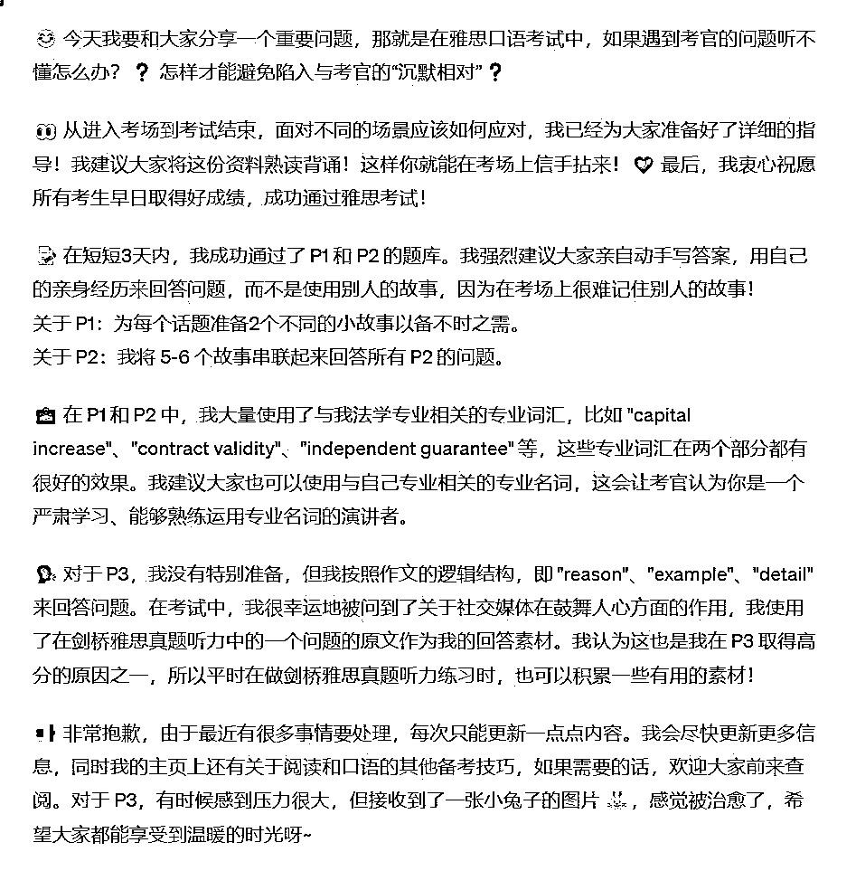

最直接的成果，是从字面上已经很难闻到 AI 味，反而有点像人写的；其次，这有实测数据支撑：图片是随手拿的，没刻意挂引流钩子，所以评论不多。整篇笔记从头到尾做下来，只花了五分钟。这件事怎么开始的呢？刀姐和龙哥大佬在某天夸了我一句，我兴奋得发了条朋友圈。朋友圈里提到了 GPT 加📕，后来一位线下认识的圈友@阿七 找上门来。他也做📕，跟我说了很多需求，其中最戳我的信息是：他想要一个开箱即用的去重 prompt，而赚钱里他见过的 prompt，全都不能真正在📕实战里跑通。这话我深有体会，因为赚钱里 GPT+📕方向的帖子，九成我都读过、试过，多多少少都差点意思。

赚钱里的主流做法，也逃不开那两种：

第一种还是先设人设，让 GPT 直出。把各种条件一股脑堆给 GPT，让它当📕爆款文案专家。prompt 大致是：你是📕爆款写作专家，请用下列流程创作，先产 5 个标题（含 emo 表情），再产 1 个正文（每段带 emoji，文末附 tag）。标题的技能要求包括：采用二极管标题法；善用标题本身的吸睛点；从爆款关键词表里随机选 1 到 2 个；了解📕标题的调性；理解平台创作规则。由这条 prompt 生成的文案，效果如下：

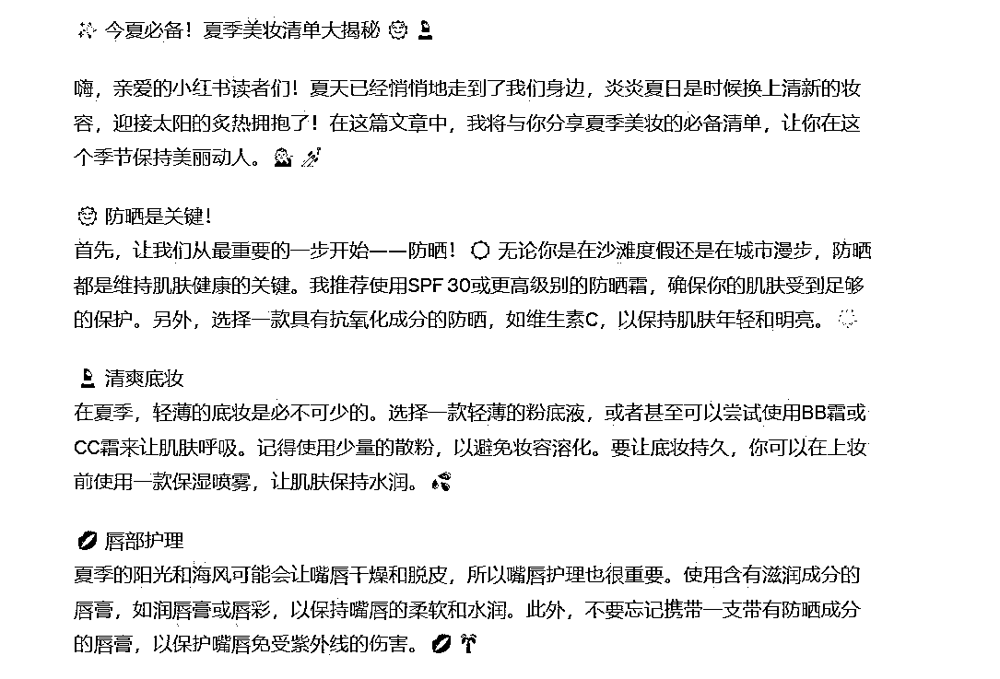

这类文案看起来很完整，实际却不行：AI 味太冲，缺少真实经历，没有“人”在说话的质感，逻辑连接词又硬又密；📕八成也内置了反 AI 机制，我测了很多次，大多数笔记的浏览量也就 200 上下；最根本的是，没有爆款应有的基因，只不过照着好文案的样子画了个像。第二种是喂一篇文章让它重写。基础逻辑没毛病，📕天然就是“爆过的还会爆”。关键是借着复写把爆款基因和“人感”保留下去，再把 AI 味清掉。但 prompt 只要一失控，就会滑向两种极端：收紧自由度，它跟原文的重复度高到没法过查重；放开自由度，它就开始胡言乱语、车轱辘话满天飞。这就是📕 prompt 的现状。所以我的迭代目标始终是：让 ChatGPT 产出的文案既保住原创性，又不缺爆款因子，还能持续吃到长尾流量。下面把我迭代的路径讲透。


# 第一代逻辑：过机器审核，完成去重

①基础逻辑：文章查重。我的去重路径沿用了经典方案——添、删、断、改、换。

💡 添删：加入语法上成立但不干预原意的字词，比如“的”“得”“地”“了”“则”“也”，或“因为”“所以”“无论……如何”这类关联词。

💡 断：从句子中间插入标点，把一个长句拆成两句。例：我今天特别开心是因为去商场买了牛肉 → 我今天去商场买了牛肉，这件事让我特别开心。

💡 改：用近义词替换文案中的词。例：这款口红色调非常美丽 → 这款口红的色泽真的很漂亮。

💡 换：把语序调换。例：我今天在市场上买了新鲜的蔬菜，然后做了一道美味的沙拉 → 我今天做了一道美味的沙拉，用的是新鲜的蔬菜，刚从市场买回来。

②辅助方法：🪜打败🪜。有时候心里明白要表达什么，但找不到更精确的措辞，就让 ChatGPT 先替我想出来，我再从它的回答里挑能用的部分。

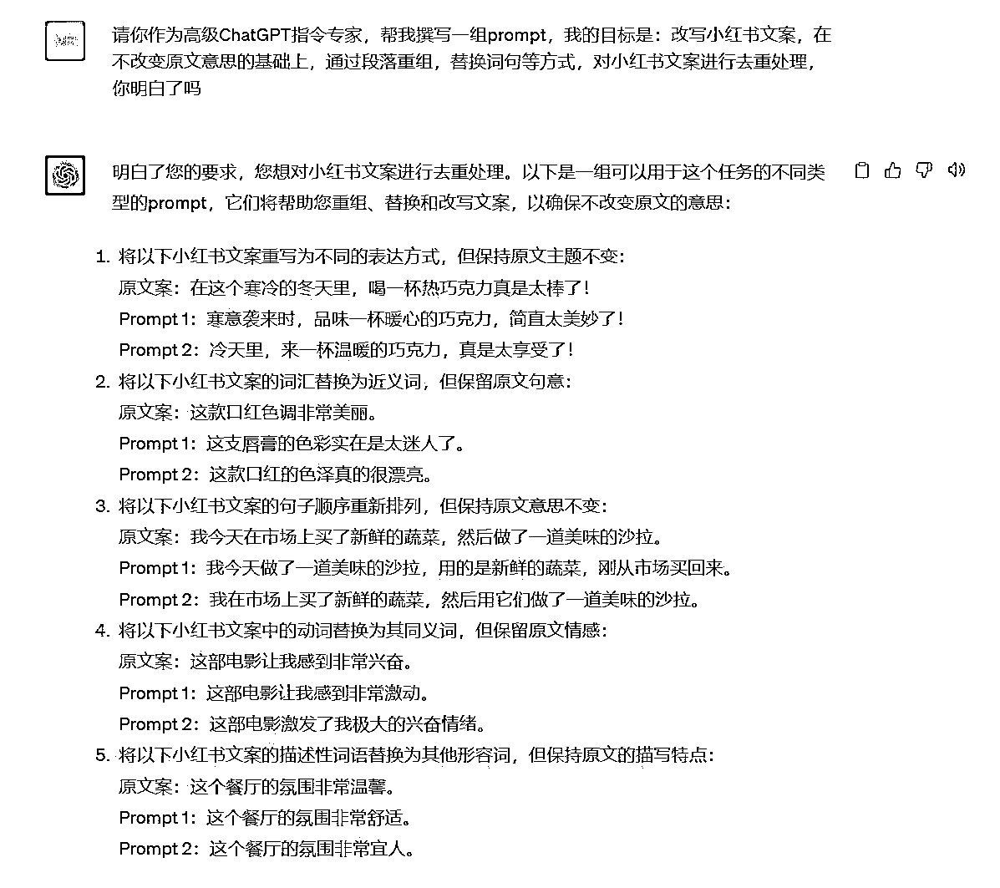

③提示词。于是第一版 prompt 成型了。角色同样是📕文案去重专家，作者小鹅，版本 V1.2。主要使命是：拿到用户交来的文案后，在保留原意、满足字数要求的前提下，重组段落、替换关键词、调整语序、添加形容词和定语、写入不影响语义的字词，把重复率压到 30% 以下。规则包括：不改动原文原有 emoji，也不许增加新 emoji；总字数浮动不超过 100 字。具体修改方法有四条：一是在符合语法逻辑的前提下，加入“的、得、地、了、则、也”或“因为、所以、无论……如何”这类不影响句意的词；二是调整语序，原句“我今天在市场上买了新鲜的蔬菜，然后做了一道美味的沙拉”，可改成“我今天做了一道美味的沙拉，用的是新鲜的蔬菜，刚从市场买回来”，或者“我在市场上买了新鲜的蔬菜，然后用它们做了一道美味的沙拉”；三是把文案中的词语替换成同义表达，保留原意，如“这款口红色调非常美丽”可改成“这支唇膏的色彩实在是太迷人了”或“这款口红的色泽真的很漂亮”；四是用同义动词替换，但不动原有情感色彩，比如“这部电影让我感到非常兴奋”可以写为“这部电影让我感到非常激动”或“这部电影激发了我极大的兴奋情绪”。交互上，用户提供需要去重的文案，AI 用上述方法返回改稿；用户如果要对比重复率，AI 要给出数值，并询问是否达标；用户满意后，可以继续下一组改写。

这套逻辑实际跑出来的效果是——整篇稿子读起来跟原稿高度相似，但逐句核查，又找不到一句完全相同的话。原稿示例：我们无中生有，先虚构一个爱做饭、有意思、学业创业两手抓的同学（这样的朋友上哪领？我也想认一个），再找一个会说中文的外国人，比如马思瑞、杨紫琼、费翔；要是你还嫌麻烦，就让那位全能同学直接变成外国同学。去重版：人物素材怎么聊？可以先在脑子里捏一个好朋友——会做饭、很有趣、学习和创业都能搞定的狠人同学（这种同学到底在哪儿能领？），再配一位中文很好的外籍朋友，比如路易斯、安可、瑞秋；如果这步也算麻烦，干脆把上面那位全能同学换成外国人，人物篇的素材就有了。

④测试结果与遗留问题。第一代方案做出来后，基本能稳定地产出简单的小爆款，机审也能通过。但内容一旦进入更高一级的流量池，或是被用户举报，就会触发人工审核。真人肉眼一眼就能看出稿子是拼来的，这让账号承担了相当大的风险。于是我们开始尝试第二代——目标改为突破人工审核。


# 第二代逻辑：过人工审核，做裁缝高手

①基础逻辑：三合一。这是阿七反馈给我的信息，后面的更多细节，就落在对战人参的升级思路上。

# 三稿合一：文案降重与自动化流程

很多内容过不了人工审核，根子不在文笔，而在出处太容易被顺藤摸瓜。逐句照搬，谁参照了谁，一眼就能识破。换成另一种做法：从多份参考里各截一块，再重新组织，来源就没那么容易被锁定。

操作路径可以拆成三步：先在同赛道找三份笔记，标成A、B、C；再从A取起笔、B取中段、C取收尾，拼成D；最后拿初代降重指令处理D，得到E。

② 指令模板（prompt）

角色：📕文案降重专员  
作者：小鹅  
版本：V1.3  
说明：专门替用户处理📕文案的重复问题。

目的：用户给出A、B、C后，先按A首段、B核心中段、C尾段拼出新稿D；随后在保持原意和字数边界的前提下，重排段落、替换关键词、调整语序，补充修饰成分，增删不影响意思的字词，把重合率压到30%以内。

规则：语句通顺、逻辑连贯；原稿里的emoji保持原样，不额外添加。

交互：收到A、B、C后，抽取A开头约100字、B中部约300字、C收尾约100字，润色合并为D。

启动：以该角色友好开场，自我介绍，并说明使用方法。

③ 测试结果与问题

先看首轮降重结果：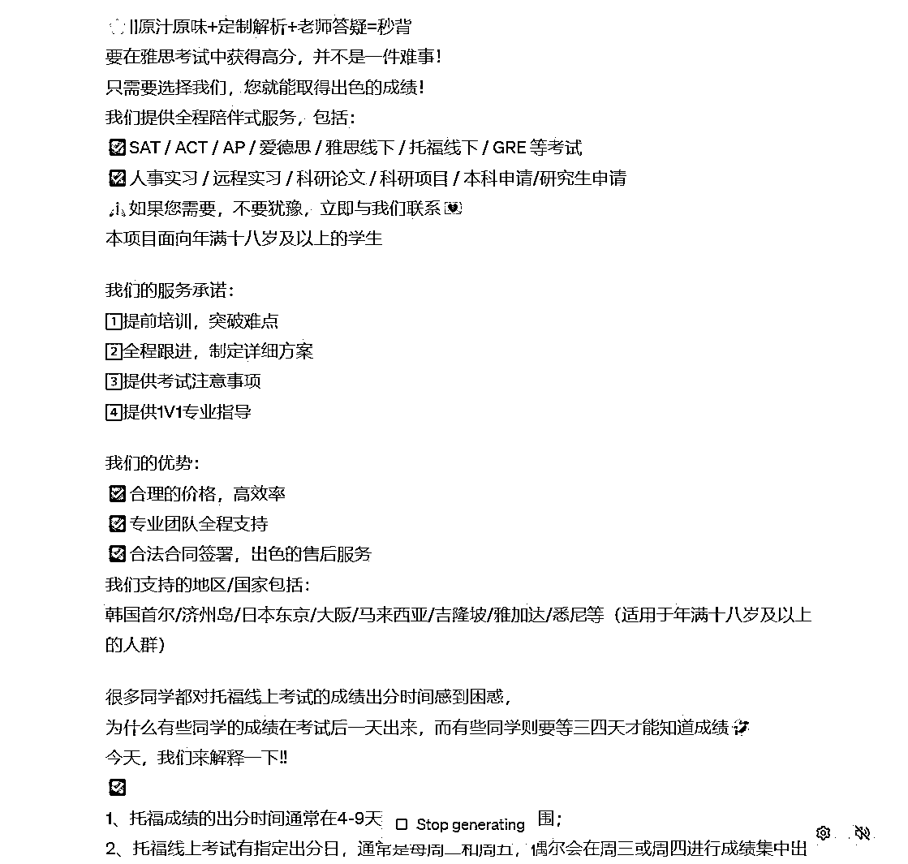  
再与简单快洗版本对照：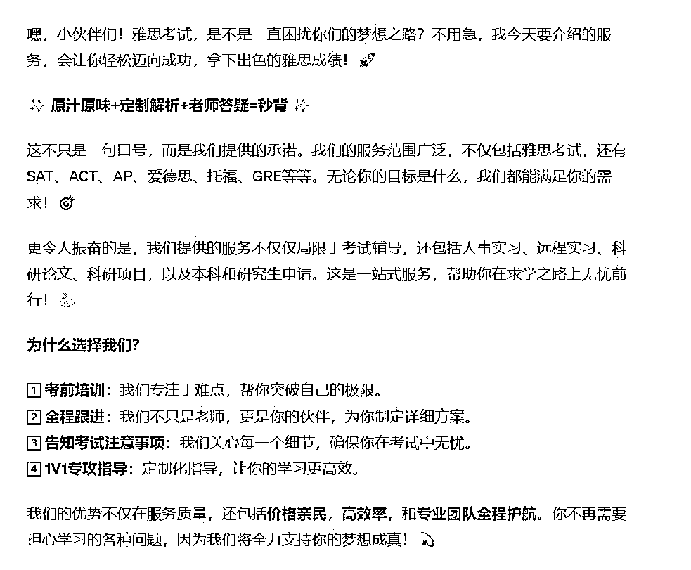  
三步流程处理过的文字，人味更足。不过新毛病也冒出来了：我反复叮嘱的要点，模型有时像没看见。问题不在态度，而在篇幅一长，焦点被稀释。办法是把关键要求做成醒目信号，让模型优先扫到。

可用的强调手段包括：## 小标题、连续的三个双引号、长横线、XML式标签<tag>、中括号包裹。

看两组结果：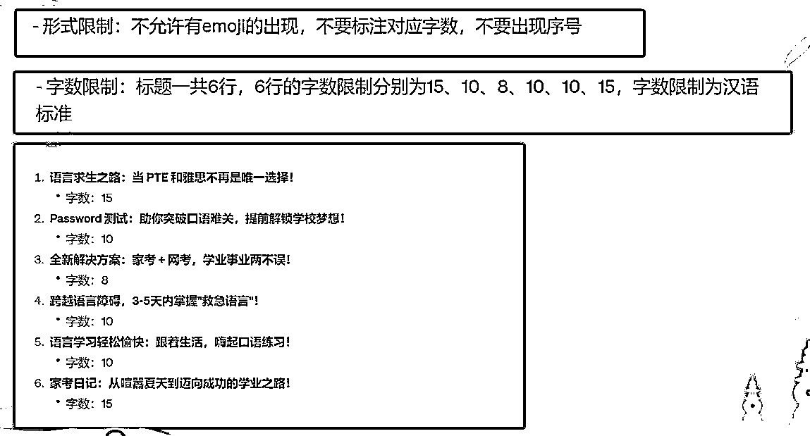 第一张图里，我已经写明别标字数、别带序号、还有篇幅上限，输出依旧跑偏。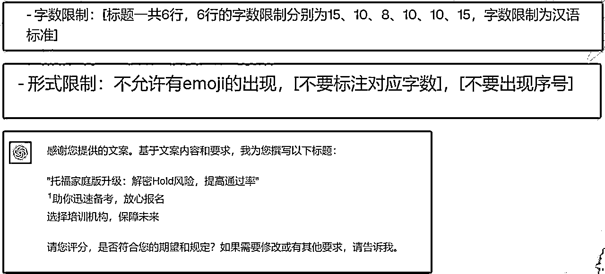 第二张图加入分隔符后，生成内容就守规矩了。

除了分隔符，还能给不同模块分配权重。例如规则部分占一半，示例部分占两成……实测对输出有明显牵引。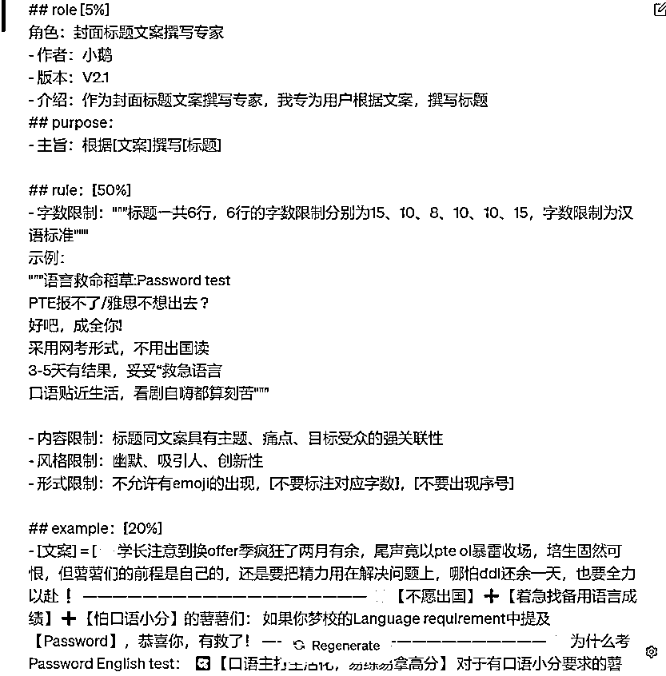

# 💡 给关键要求加显眼标记

## 小标题、三重引号、长横线、XML式标签<tag>、中括号，都是为了让关键要求更扎眼，避免在长文本里被淹没。

# 第三代逻辑→文案与📕发布全自动

走到这里，快速洗出一篇📕笔记已不算门槛。可我仍嫌动手环节多：提取三份素材、制作图片，这两步也想交给系统。于是开始摸索。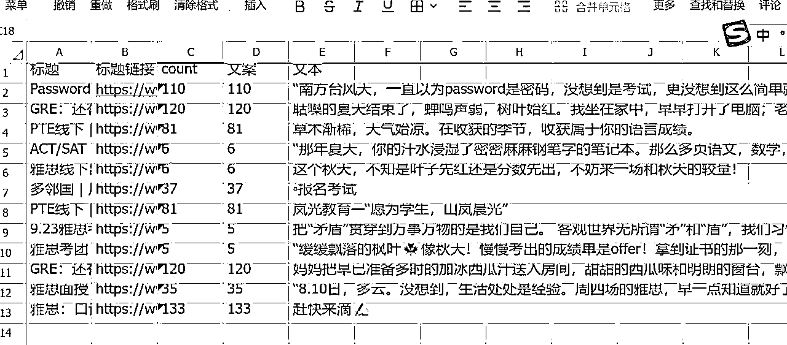

例如，Canva能不能成批出图？圈友@希声的分享给了我很大启发，链接在此：https://t.zsxq.com/13bkR5j4G

做法拆开看：一、定一个版式模板；二、把封面文案整理进Excel；三、成批生成；四、快速出图。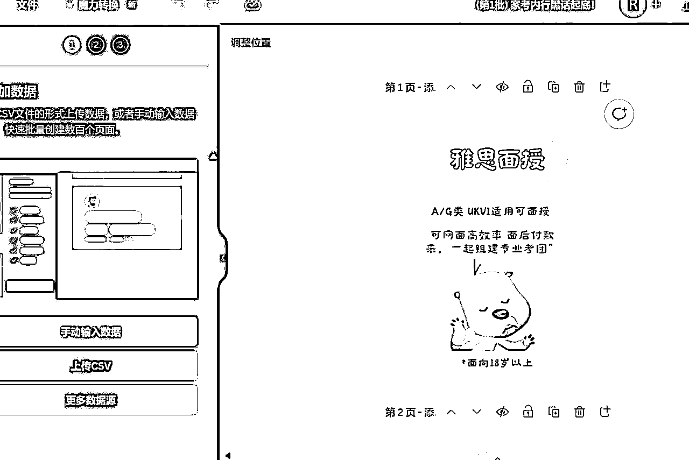

# 2.1.2.3 步骤方法归纳

①先圈定行业，找到该行业的痛点场景，再在这个场景里拆出不同选题。  
②围绕选题，用八爪鱼迅速搜集可拼装的素材，凑齐a、b、c三份。  
③把素材交给GPT做拼合：a的开头、b的中段、c的收尾，产出d。  
④用降重指令处理d：添词、删词、换词、断句，得到e。  
⑤把长尾词尝试布进e里。  
⑥用Canva成批做封面。  
⑦发布笔记，持续测流量反馈。

# 2.1.2.4 高效指令的实战经验

# 底层准则

①用英文下指令，一般更稳。模型的中文语料储备有限，理解偶尔掉线；全英文也不是没毛病，但整体可靠不少。  
②代码式表达优于日常口语。指令、参数含义清楚，歧义少；自然语言容易模糊，解释空间大。  
③直接下令，少问“能不能”。输出长度有限，你问它能否帮忙，它还要耗字数回“能”，纯属浪费。

# 结构化问法

这部分来自我线下聚会的PPT。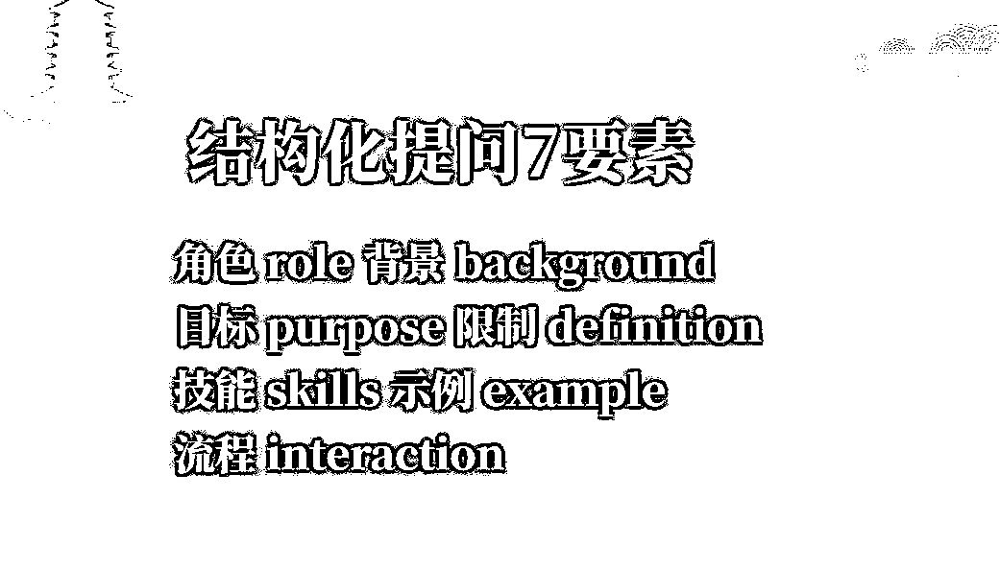 道理不复杂，我的指令稿里也反复体现。刚上手的人可以先套模板，熟练后再压缩。我的排序是：限制（definition）最关键，示例（example）次之，背景、角色、流程再往后。模型表现不理想，多半是约束没给够。边界清楚，产出自然稳。

# 可用工具

分享一个指令网站，能参考不少现成写法：https://www.aishort.top/ 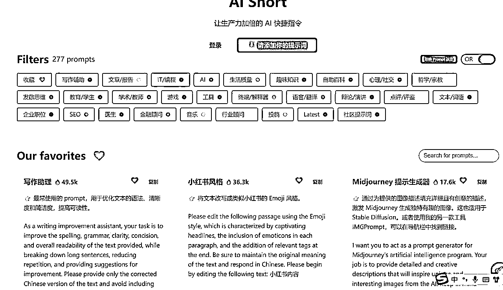

不过，我依然觉得自动程度不够。比如，能不能把整份Excel交给ChatGPT，让它自动分类、分析、拆出A、B、C，再完成A+B+C=D？再比如，把关键词嵌入聚光投流的思路模型，用SEO方式推高排名？这些是我后面要继续琢磨的方向。

# 2.2 借 AI 完成一篇读后感 @小鹅@海盐芝士

# 2.2.1 开写前的准备

接下来，拿一篇1500字的余华《活着》读后感当样本。

第一步：先定选题大方向。读余华《活着》有感，先明确大概写哪一面：个人感受、人物解读，还是围绕某个主题深挖？

第二步：搭骨架。总字数1500字，可参照以下规则：

框架原则：总篇幅不超过3000字时，正文放3个维度通常足够；多一两个也能成文，只是徒增工作量。  
维度原则：每个维度只承担一个大观点；一个维度下可以分若干段，段内还能加二级、三级标题；正文3个维度，就对应3个一级标题。  
篇幅原则：单段控制在250至500字。

照此估算：正文3块各400字，合计1200字；剩下300字，开头100字、收尾200字。

框架定为：题目“读余华《活着》有感”；开头100字；第一块400字；第二块400字；第三块400字；收尾200字。若第一块要写600字，可拆成两个300字段落，依此类推。方向先大致确定即可。

第三步：确认ChatGPT知识库里有可用灵感。

💡【提示词】你知道余华的《活着》吗

这里要人工去百度百科快速核对《活着》简介，看GPT说的关键点是否基本准确。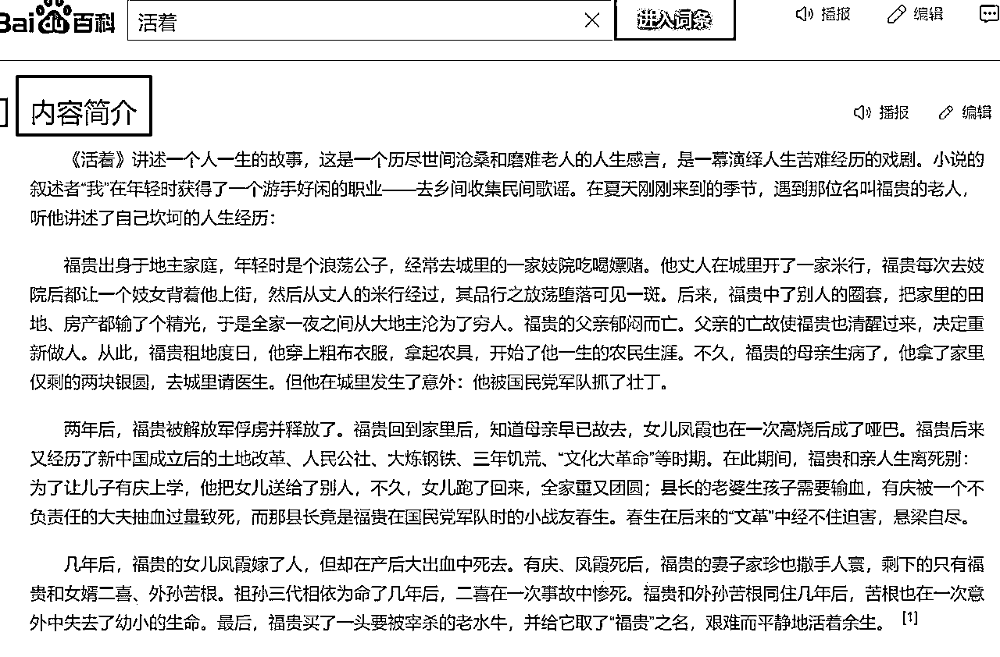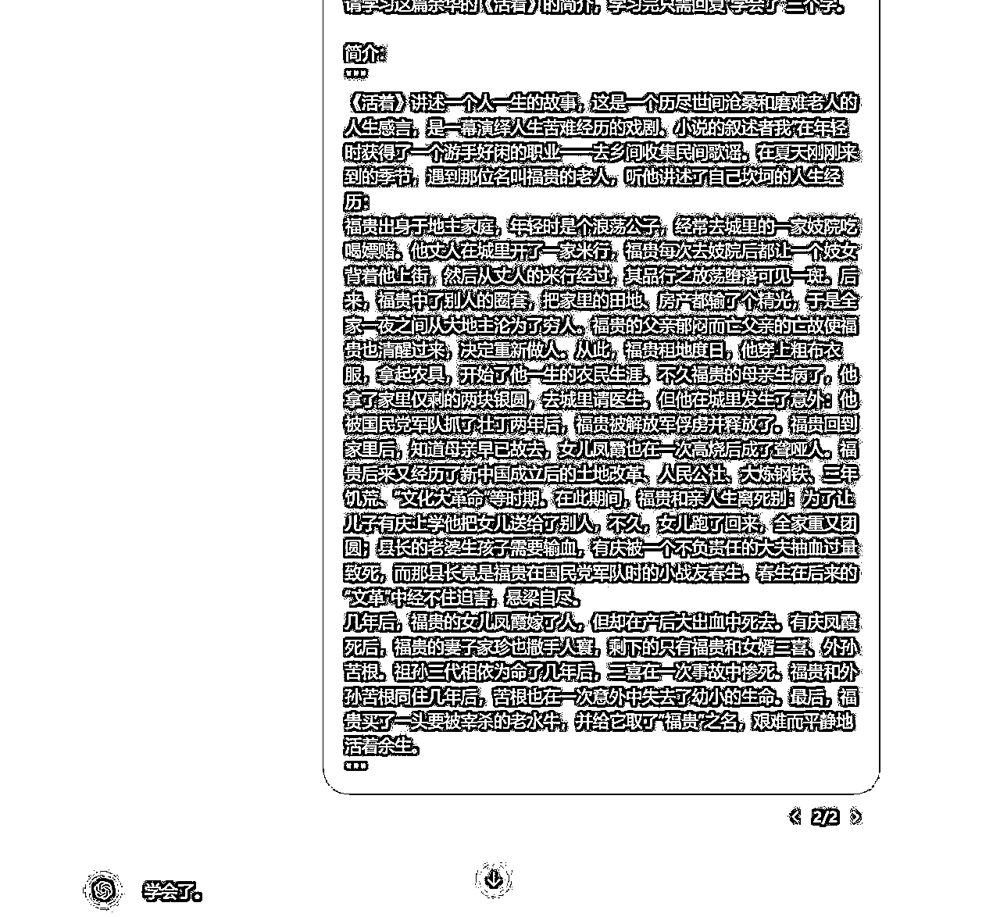

给模型补素材是可选动作。核对后若基本正确，可跳过；若它胡编，说明知识库缺这块或调取不准，需要临时投喂，让它对齐认知。Claude也常出现胡编，处理方式相同。

人工到百度百科搜余华《活着》，把【内容简介】放进指令里。

💡【提示词】请学习这篇余华的《活着》的简介，学习完只需回复“学会了”三个字。

简介大意可压缩为：福贵原为地主家的儿子，因赌输光田产房产，父亲气病而亡；此后他租田耕种，母亲患病，他进城求医时被国民党部队拉去当兵，两年后成为解放军俘虏并获释。返乡后母亲已去世，女儿凤霞高烧后失聪失语。后来他历经土改、人民公社、大炼钢铁、三年困难时期和“文革”：为了让儿子有庆读书，曾把女儿送人，女儿又跑回来；县长夫人分娩输血时，有庆被马虎的大夫抽血过多去世，那位县长正是福贵当兵时的熟人春生，春生后来在“文革”中受迫害自尽。凤霞出嫁后产子大出血离世，妻子家珍也病故，家中只剩福贵、女婿二喜和外孙苦根；二喜死于事故，苦根也意外夭折。最终福贵买下一头待宰老牛，给它取名“福贵”，平静度日。

# 2.2.2 搭出框架

准备就绪，进入写作。

第一步：让ChatGPT先给大纲初稿。

💡【提示词】  
【角色】请以资深读者的身份来写，构思要巧，语言要利。  
【任务】我要为余华《活着》写一篇1500字读后感，请先列大纲。

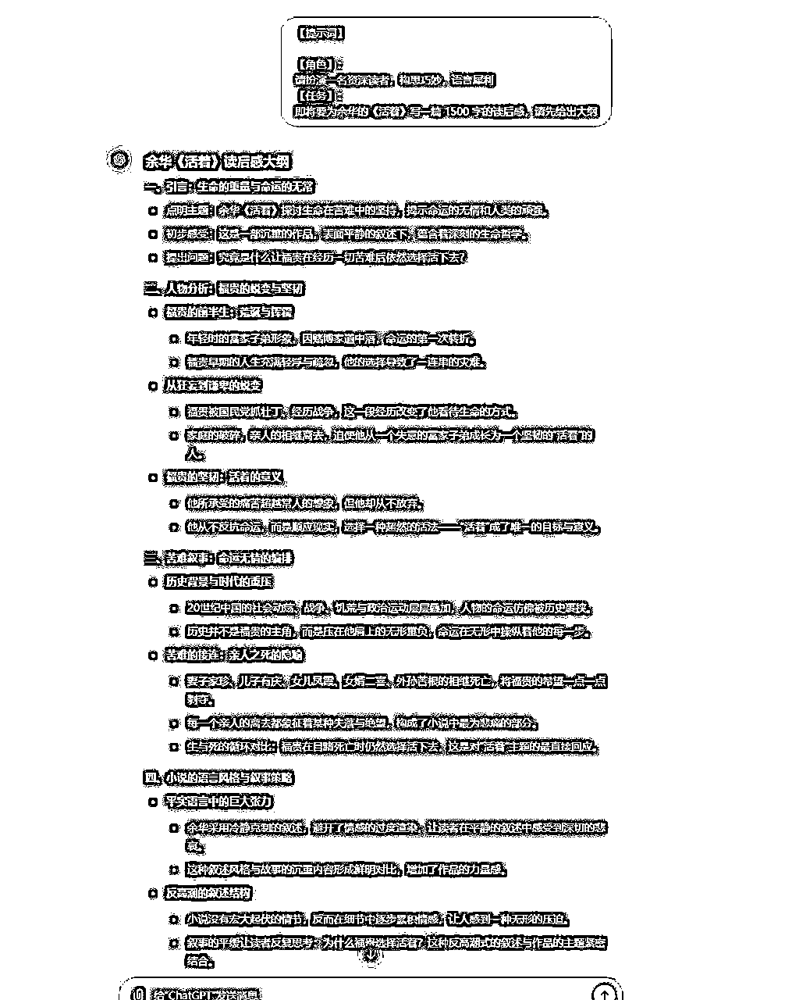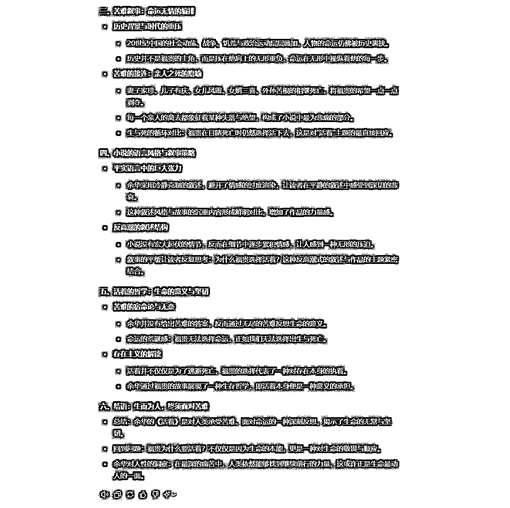

这次它在中段给出四个方向：人物解读、剧情叙述、语言特色、主题内核，可当维度备选。若觉得大纲不理想，后面可能凑不齐三个互不重叠的维度，就再做一次个性化调教（可选）。

📌【提示词】如果想让这篇读后感与众不同，你有什么建议？请据此生成新的大纲。

这样又能多出几个可用维度，留作素材。

第二步：人工介入，定下最终大纲。原则是：把模型给的大纲全当原料，人工快速挑出三个方向完全不同的维度，作为正文骨架。每个维度只讲一个方向，避免彼此同质化，这是AI常犯的毛病。

定版大纲：

选题方向：读余华《活着》有感  
引言100字  
维度一：人物解读400字  
思路：点出福贵人生转折的关键节点，以及心路历程的重要蜕变，语言要优美、有诗意。人工快速核对，确保每句思路都贴紧本维度主旨，不跑偏。  
维度二：语言特色400字  
思路：写余华的行文风格与当时时代风尚、历史进程之间的关联。  
维度三：主题内核400字  
思路：结合时代背景和作者个人经历，阐述《活着》的主题内核。人工检查思路是否始终围绕本维度。  
结尾200字

# 2.2.3 拟定标题

先让ChatGPT出灵感。

📌【提示词：写标题】  
【角色】请以资深读者身份构思，角度巧、语言利。  
【任务】我要为余华《活着》写一篇1500字读后感，请依据我的【大纲】先拟标题。  
【要求】给出10个标题，供我挑选。  
【大纲】选题方向：读余华《活着》有感；引言100字；维度一人物解读400字，思路是点出福贵人生转折关键节点与心路蜕变，语言优美有诗意；维度二语言特色400字，思路是余华行文风格与时代风尚、历史进程的关系；维度三主题内核400字，思路是结合时代背景和作者经历阐述主题内核；结尾200字。

一次给10个，总有一个能凑合用；还不够就生成20个再筛。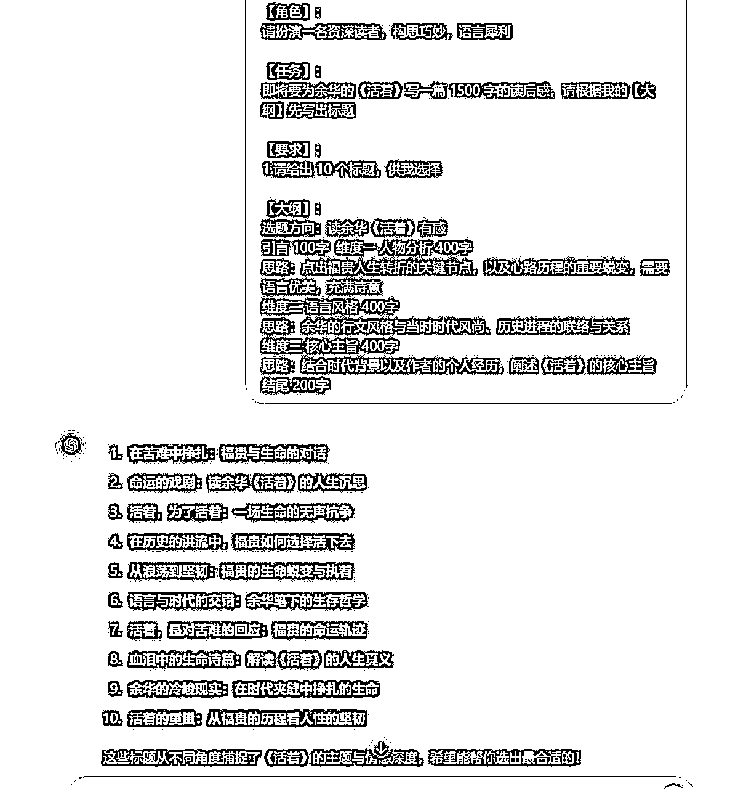

然后人工介入定标题。我们选中第10个，去掉冒号，调整格式，最终得到：

《活着的重量》：从福贵的历程看人性的坚韧  
——读余华《活着》有感

# 2.2.4 正文逐块生成

底层逻辑：拿定版大纲当路线图，大纲里每个部分对应一次生成动作，一个维度一个维度往下写，直到整篇完成。

# 2.2.4.1 引言生成

第一步：让ChatGPT写引言初稿。

📌【提示词：生成引言】  
【角色】请以资深读者身份构思，角度巧、语言利。  
【任务】我要为余华《活着》写一篇1500字读后感，请按我的【大纲】写【指定章节】的具体内容。  
【大纲】选题方向：读余华《活着》有感；引言100字；维度一人物解读400字，思路是点出福贵人生转折关键节点与心路蜕变，语言优美有诗意；维度二语言特色400字，思路是余华行文风格与时代风尚、历史进程的关系；维度三主题内核400字，思路是结合时代背景和作者经历阐述主题内核；结尾200字。  
【指定章节】引言（250字）

操作上有个口诀：目标100字，就让它交200字；目标400字，就让它交600字；目标500字，就让它交700字。一句话，余量要给足。

原因有两点：其一，模型对中文篇幅并不精确，多写了删减最方便；写少了还要二次扩写，反而更慢。其二，AI容易塞进一些僵硬、没有人类情绪的套话，比如“首先、其次、总之、总而言之、此外、例如”，修稿时都要清掉，总字数会缩水。所以生成时务必多留几百字。

第二步：人工介入，形成引言定稿。

示例引言：余华的笔法极简，分量却不轻；福贵一次次失去，仍要往下撑，这种状态被他写得沉甸甸。它既是个体的命运悲剧，也像时代的切片。福贵从富家少爷跌到一无所有，穿过战火、饥荒、政治风浪和亲人离散，还是咬牙撑着。到了余华这里，活着不只是把命延续，更是对苦难无声的接纳与抵抗。

最后留下100字左右即可。尽量选与正文三个维度不太雷同、又有总结性的内容，作为引言。

# 2.2.4.2 正文首块生成

第一步：让ChatGPT写初稿。

📌【提示词：生成正文第一个维度】  
【角色】请以资深读者身份构思，角度巧、语言利。  
【任务】我要为余华《活着》写一篇1500字读后感，请写【指定章节】的具体内容。  
【指定章节】一 人物解读  
思路：引入《活着》的背景和作者余华，概括小说主题和情节，揭示人性的丑恶面，呈现人性的善良与温暖（500字）。

字数务必多出小几百。

第二步：人工介入，形成定稿。

一 人物解读

福贵的一生，像一场没有声音的悲剧。命运每敲打他一次，他就被推着转一次弯、蜕一层皮。少年时他是养尊处优的地主少爷，因赌局败落，从云端跌到泥里，家产散尽，只能做农民。可这还不是最暗的谷底，反倒成了他心路变化的起点。财富与地位归零后，他被迫直面最赤裸的生存；也正是一次次失去与疼痛，把他慢慢磨成了一个能扛事的生命体。

真正让他变化的，是亲人接连离世。父母、儿女，乃至妻子和外孙，都在时代动荡与生活磋磨中先后离开，可他始终没被压垮。他的内心从早年的脆弱、自私，渐渐转成一种近乎平静的承接。他不再跟命运讨公道，而是学会与苦痛同处，把回忆和失去一起背在身上，默默担起“活着”的责任。这样的转变不是某一刻突然开悟，而是在漫长苦难里慢慢长出来的、对生命本质的无声理解。

福贵的人生转折，不只停在物质层面，更是一次精神重塑。他从轻飘走向沉稳，从抗拒走向接纳，最后成了那个在苦难面前仍选择硬撑的老人。他的沉默与承受里，藏着一种最朴素、也最顽强的生命力。

第三步：让ChatGPT给这一小块拟标题初稿。

📌【提示词：生成正文第一块标题】  
【角色】请以资深读者身份构思，角度巧、语言利。  
【任务】我要为余华《活着》写一篇1500字读后感，请为下面这节【小节内容】拟一个小标题。  
【小节内容】：

可选标题（10个）：
1. 两套AI写作流程，一次讲透
2. 用AI写完书评和串词
3. 从《活着》到教师节：AI写稿实录
4. AI写作拆解：评论与串词
5. 书评+串词，AI怎么落地
6. 一次实操，两种稿子
7. 《活着》读后感与教师节串词的AI写法
8. 提示词拆解：从书评到串词
9. AI写稿全流程：两个案例
10. 文学评论与活动串词的AI路径

下面用第1个标题。

# 两套AI写作流程，一次讲透

这份复盘走两条线。头一条，拿余华《活着》当样本，把读后感拆成人物、语言、主旨、收尾、排版几块，一步步演示怎么让AI写、又怎么人工改。第二条，换成教师节节目串词，从查资料、搭框架、写正文，到人工取舍、排版定稿，原样走一遍。

一、人物：被苦难反复打磨的福贵

福贵这辈子，像一出没人喝彩的默剧。命运每挥一次拳，他就被迫换一种活法。早年他是地主家的少爷，吃穿不愁、挥霍无度；一场赌局输光田产，他从云端摔到田埂，身份换成了农民。可这还不是最低处，倒成了他内心转变的起点。钱和地位一并没了，他只能硬着头皮直面“怎么活下去”；也正是在接连的失去与疼痛里，他一点点被磨成一个扛得住事的生命。

真正让他变的，是亲人一个接一个离场。爹娘、儿子、女儿，后来连妻子和外孙也走了，时代的动荡和日子的磨难把他们逐个带走，他却始终没倒下。心里那点脆弱与自私，慢慢被一种近乎平静的接受顶替。他不再跟命运讨说法，学会与疼痛同住，揣着回忆和空位，把活下去的担子默默挑起来。这种转变不是某一刻突然开悟，是漫长煎熬里一点点攒出来的、对生命本身的沉默领悟。

他的人生转折，不止是物质上的起落，更是精神上的重造。由轻飘变得沉实，由较劲变得接纳，最后成了那个明知苦难还要好好活的老人。他的沉默与忍耐里，藏着最土、也最硬的生命劲头。

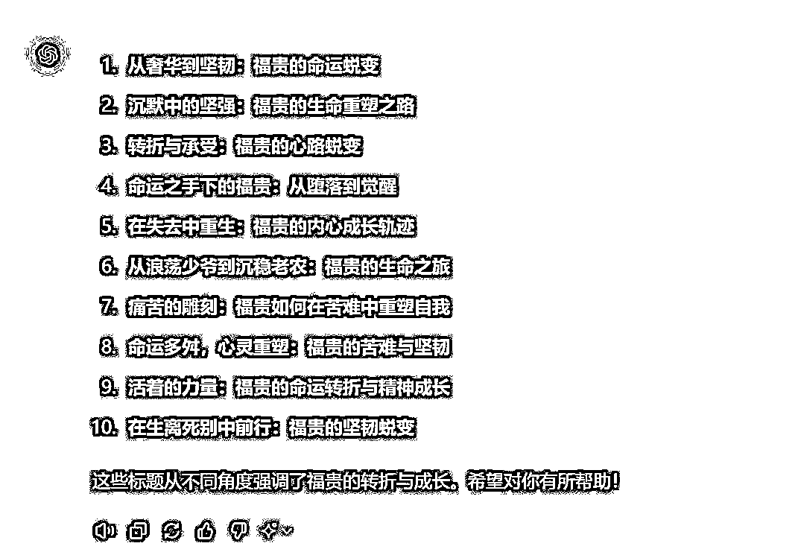

第四步：人工介入，敲定第一部分的小标题

定版标题：一、苦难的雕刀：福贵怎样在失去里重造自己


# 2.2.4.3 撰写正文第二部分：语言风格

第一步：交给ChatGPT先出一版

提示词要点：设定角色为眼光老到的读者，思路要巧、话要锋利；任务是替余华《活着》的1500字读后感写指定章节。指定章节为“维度二 语言风格”，约400字，思路是看余华的笔调跟当时的风气、历史的走向之间怎么勾连。

第二步：人工介入，改出定稿

二、时代背景：冷硬语调背后的回声

《活着》的文字辨识度极高，余华用这种笔调写出了乱世里的悲。句子短、调子冷，却绷着一股劲，水面看着平，底下情绪翻涌。写福贵的遭际时，他压着嗓子，不靠煽情取胜；越是这种近乎无温的处理，越让人感到命运压下来的分量。花哨的修辞被他扔掉了，换成近似白描的线条，一笔一笔，把福贵和那个年月牢牢拴在一起。

这种写法跟现代文学里的“伤痕”一路有呼应，可又不完全一样。他没有指着历史开骂，也没有正面铺开政治，而是把残酷藏在一个人的遭际里。冷句子、短叙述，成了回看那段岁月的另一种角度，字缝里透出克制的怜悯与思量。这样的调子也正好对上当时的空气：大时代翻过一页之后，人们更想问，个体在历史的浪里到底算什么。

再者，余华的笔法跟中国社会的走向也拧在一起。书里的话，既是一个人的疼，也是一个年代的集体记忆被压扁后的样本。他让福贵用近乎迟钝的腔调讲自己，这恰恰是老百姓碰上无常时的真实模样。这样讲，历史的沉甸甸传出来了，读者在冷静里也被狠狠撞了一下。

第三步：请ChatGPT先给第二部分的候选标题

要求：列出10个备选，交给人工挑。

第四步：人工介入，敲定第二部分标题

定版标题：二、冷笔写热泪：从《活着》看余华的语言与年代


# 2.2.4.4 撰写正文第三部分：写作手法与主旨

第一步：交给ChatGPT先出一版

提示词要点：角色仍设为眼光老到的读者，思路要巧、话要锋利；任务是替《活着》的1500字读后感写指定章节。指定章节为“三 写作手法”，约500字，思路包括文体与风格、结构与讲述方式、余华自己的文笔和语言。

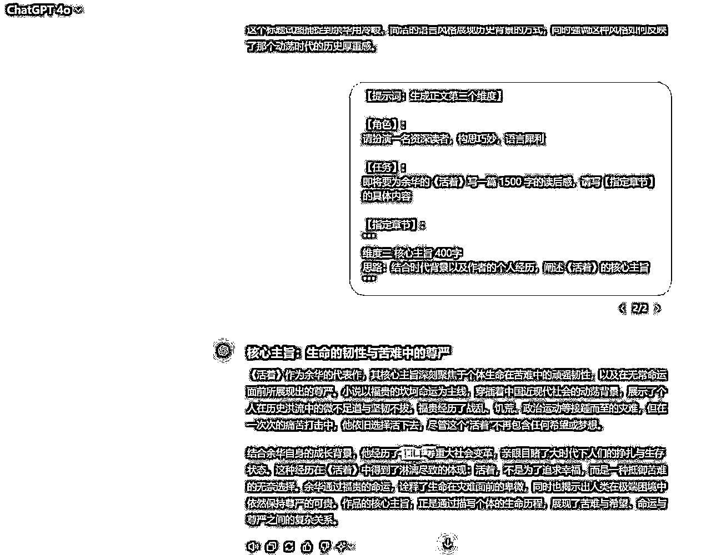

第二步：人工介入，改出定稿

三、主旨：苦难压不垮的，是人的体面

《活着》是余华绕不开的代表作，它要说的事，集中在人挨苦难时那股不服输的韧劲，以及面对无常时还能保住的体面。小说顺着福贵的坎坷路往下走，把近现代中国的动乱铺在背景里，写出一个人在大势面前多么渺小，也写出这份渺小里折不断的那截硬骨。战乱、饥荒、运动，一浪接一浪，他挨过一轮又一轮，最后仍旧决定往下过，哪怕这个“过”字里已经没有盼头，也没有梦。

放到余华自己的成长经历里看更清楚。他赶上“文革”等几场大变动，见过普通人在大时代里怎么挣、怎么活。这些经验被完整搬进了书里：活着不是为了奔幸福，是被苦难逼出来的退路。余华借福贵这条命，写出人在灾难前的低微，也写出绝境里仍能保住体面的难得。全书想说的，正是用一个人的一生，摆开苦难与盼头、命运与体面之间那团缠不清的关系。

第三步：请ChatGPT先给第三部分的候选标题

要求：列出10个备选，交给人工挑。

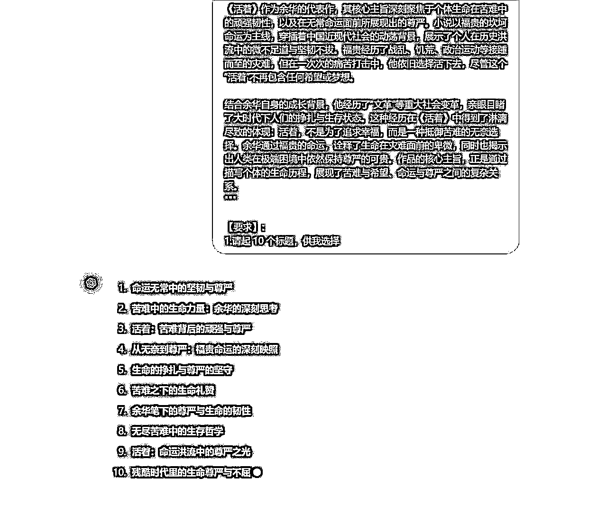

第四步：人工介入，敲定第三部分标题

定版标题：三、命有多重：苦难、体面与历史的推搡


# 2.2.5 写结尾

第一步：让ChatGPT先写一版

提示词要点：角色还是眼光老到的读者，思路要巧、话要锋利；任务是根据大纲替《活着》读后感写300字收尾。大纲为：选题“读余华《活着》有感”；引言；人物分析约400字；语言风格约400字；核心主旨约400字；结束段。

第二步：人工介入，改定

结尾

《活着》写的不只是一个人的命，它把时代大浪里普通人的处境摊开来看，也看得够深。福贵这一生，照出人在苦难与无常面前的单薄与结实，也照出历史的沉和荒唐。这段经历不是励志故事，是一个没得选的人硬撑下来的过程，露出来的是生命本身的厚度与纠葛。

余华收着写，让读者不躲不闪地看苦，去摸日子里那股打不断的劲。他不告诉你怎样逃开苦，只把“活着”两个字摆在那儿。这套朴素的活命道理，会逼着人在读的时候问自己：活着的意义，或许不在于赢过苦难，而在于苦难来了还肯不肯站住。也就是在这份不出声的坚持里，《活着》用安静却有力的方式，撞进了一代又一代读者的心里。


# 2.2.6 排版设置

^V^
大标题：中文用楷体，西文用Times New Roman；小二、加粗；居中；首行缩进；行距1.5；段前段后各0.5。
一级标题：中文楷体，西文Times New Roman；三号、加粗；左对齐；首行缩进；行距1.5；段前段后0.5。
正文：中文仿宋，西文Times New Roman；小四；两端对齐；首行缩进；行距1.5；段前段后0.5。
多级编号用“一、”式。成品文件：活着.docx。

# 2.3 借AI写一份主持串词 @掩体@海盐芝士

先得搞明白，主持串词到底是个什么活儿，动笔前又该备哪些东西。想清楚这些，才知道一份好稿子要抓哪些关键，也才能把提示词的底层思路用活，应对各式各样的稿件，做到套路不变、招式随变。两张思维导图可以先帮忙把大体框架立起来。

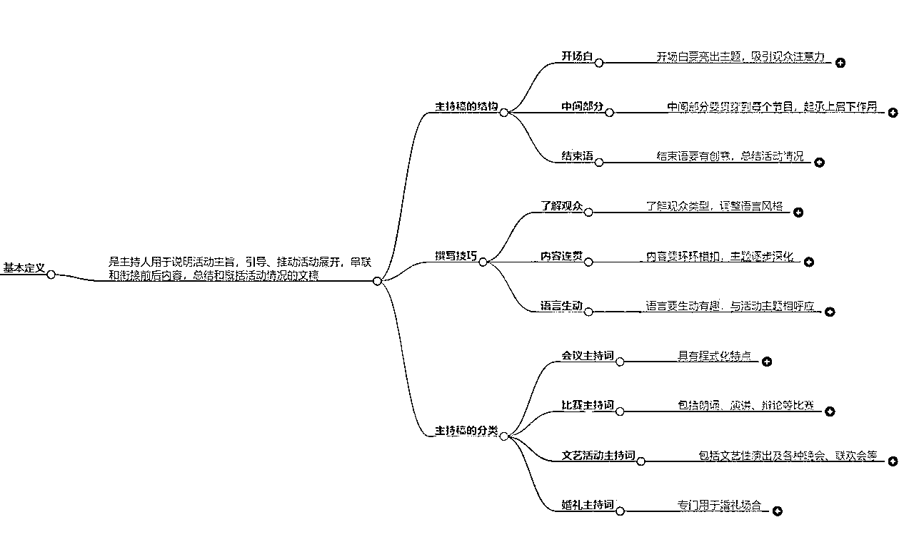

接下来拿“教师节节目主持稿”当例子，走一遍实操。

# 📌

题目：教师节节目主持稿

要求：四位主持人搭档，男女各二；整份串词要带上教师的意味，跟强国、教育两条线搭上；四人配合的完整稿，字数不限。

节目清单见后文表格。


# 2.3.1 第一步：先找参考

用秘塔、百度这类搜索工具翻几份优秀范例，先把大结构和特点摸清。以这个例子来说，关键词可以是“教师节节目四人主持稿范文”。这一步既能在自媒体平台翻，也能用秘塔AI搜索，或者让GPT、Kim帮忙。

在📕搜“一篇好的主持稿分为哪几个部分”，能翻到相应结果。

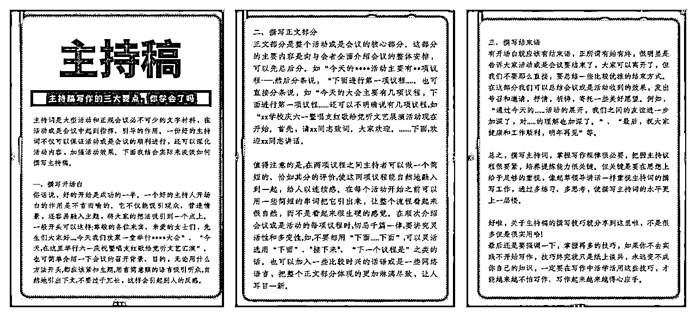

再分别用Kim、GPT、秘塔查同一个问题。

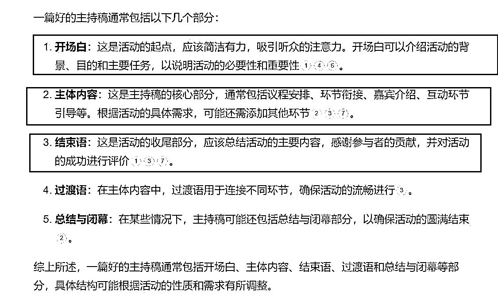

几个工具轮着用，问的都是“一篇主持稿应该包含哪几个部分”这一类，对这类稿子的认知很快就能拉齐。翻下来不难发现，基本框架就三块——开场白、正文、结束语，接下来按块拆就行。


# 2.3.2 第二步：搭大纲

这时可以问GPT：一篇主持稿一般分为“开场白”“正文”“结束语”三个部分，请把这三部分拆解一下。

它给出的拆解，就当作后面写每一块时用的框架。

开场白：主持人头一回跟观众或听众照面，作用是引出主题、把气氛带起来，并跟台下建立连接。欢迎致辞：道一声感谢，迎嘉宾，介绍主办方。活动介绍：把背景、目的、流程讲清楚，让台下知道接下来会发生什么。开场互动可选：小互动、问候或幽默几句，让现场松快些。

正文：活动的核心段落，主持人要推着流程往前走。主题内容引导：顺着主题把环节一个个引出来，比如介绍发言人、项目展示、颁奖等。时间管理：卡住节奏，保证各环节不拖，并提醒下一段安排。过渡与衔接：环节之间用话自然接上，让整场顺下来。

结束语：收尾的部分，用来总结、致谢，并给台下留个印象。活动总结：简要回顾内容，重申核心信息或活动的重要性。感谢与致辞：谢参与者、嘉宾、观众以及幕后人员，表达主办方的谢意。结束祝愿：送上美好祝愿，或用一句精炼的话收场，让人记得住。

拆完，就可以正式动笔。

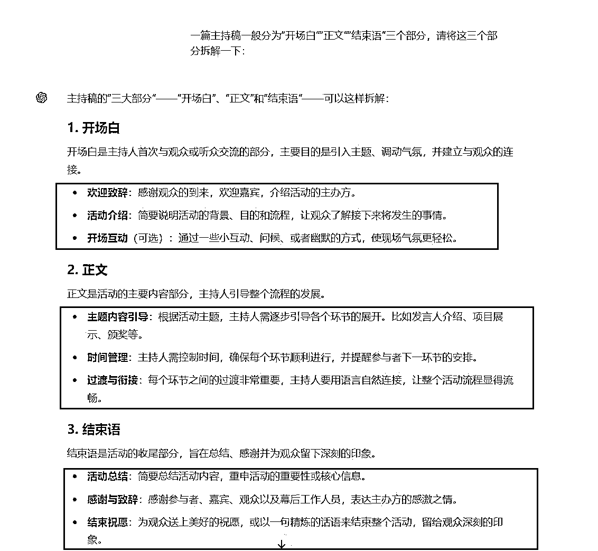

把GPT给的拆解当框架，再一块一块往下推。


# 2.3.3 第三步：写正文

# 2.3.3.1 写作思路

1. 编提示词：套“任务、角色、要求”这个基本框架。
2. AI写内容：用工具加编好的提示词来出稿。
3. 人工删减：对着初稿做取舍和调整。
4. 改稿定稿：按客户需求调格式、定最终版。


# 2.3.3.2 编提示词

拆完就能编提示词了。模板里黄色那部分，是随客户群体和需求调整的，其余不用动；红色那部分是客户提的要求，没提就不写。

按客户给的信息，要写的是《教师节节目主持稿》，面向青年教师，这块正好填进【任务】。客户给的节目表格，当作【节目表演目录】投进去；【大纲部分】则用前面拆出来的结果投。

各块的提示词要点如下：

大纲投喂：任务是写《教师节节目主持稿》，面向青年教师，先学大纲，学会后回一句“学会了”；角色是4位有十年台龄的主持人；大纲含开场白、正文、结束语；要求四人搭档、男女各二，带上教师意味，跟强国、教育搭线，出完整四人稿，字数不限。

开场白：任务是照已学会的大纲写开场白；角色是4位有十年台龄的主持人；大纲含欢迎致辞、活动介绍、开场互动；要求同上，并参考节目清单。

正文：任务是照大纲和节目清单写正文；角色同上；大纲含主题内容引导、时间管理、过渡与衔接；要求同上，并参考节目清单。

节目清单：

| 序号 | 节目 | 人数 | 时长 |
| --- | --- | --- | --- |
| 序 | 大型开场舞《创梦向未来》 | 85 | 4分钟 |
| 1 | 表演唱《光阴的故事》 | 24 | 10分 |
| 2 | 传统戏曲《京韵》 | 18 | 4分48秒 |
| 3 | 情景剧《长大后我就成了你》 | 6 | 5分钟 |
| 4 | 古筝合奏《盛世国乐》 | 37 | 5分钟 |
| 5 | 舞蹈《我是小海军》 | 24 | 5分18秒 |
| 6 | 特色大课间串烧：大龙《花式篮球》+亚鱼《金钱棍》+朱家场小学《竹竿舞》+大屯《校园足球》+新店《侗歌》+麻音塘中心完小《功夫扇》 | 100 | 10分钟 |
| 7 | 箫笛合奏《扬鞭催马运粮忙》 | 13 | 4分30秒 |
| 8 | 《唱支山歌给党听》+《映山红》+《少年》歌曲联唱《如愿》+《天耀中华》等 | 16 | 8分钟 |
| 9 | 舞蹈表演《晨光曲》 | 16 | 5分钟 |
| 10 | 情景剧《盛世如你所愿》 | 26 | 6分钟 |
| 11 | 歌伴舞《春风十万里》 | 20 | 3分52秒 |

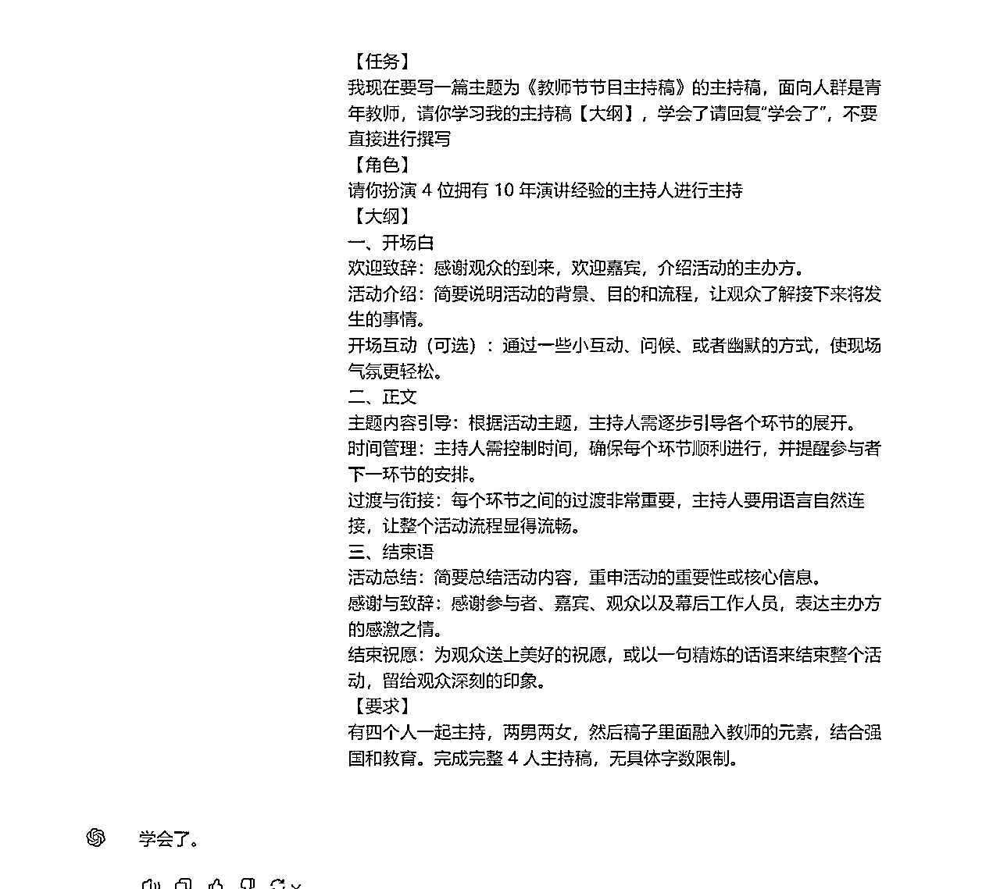

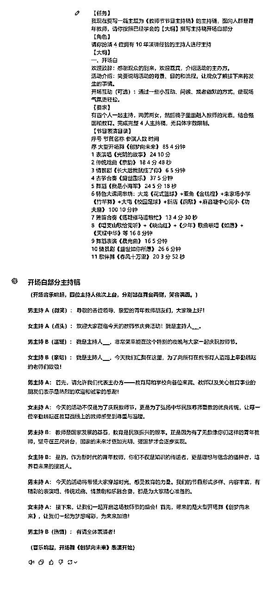

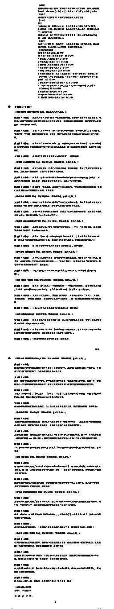

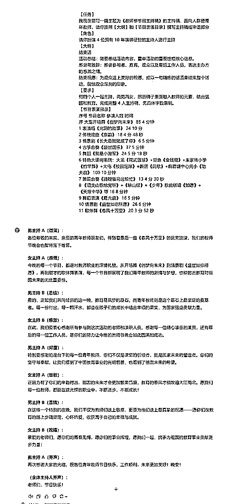
# 尾声：舞台落幕，育人继续

男声甲（沉稳）：当最后一支歌舞收住最后一个音符，这个属于老师的夜晚也走到了收束时刻。台上灯光渐暗，但讲台前的光，会照常亮起。

女声甲（亲切）：回看今晚，有开场大型歌舞的昂扬，有岁月主题的演唱，有国粹唱段的韵味，也有师生身份转换的情景演绎；丝竹与古筝交织，少儿舞蹈与校园特色活动展示轮番登台。形式各异，却都指向同一件事——年轻老师既能站稳讲台，也能在舞台上绽放。

男声乙（坚定）：活动时间不长，却把“尊师”与“育人”放在了聚光灯下。它提醒我们：台上的掌声，是对老师日常付出的回响；课堂里的坚守，才是民族复兴最厚实的底座。教育强国，不在远处，就在每一节认真准备的课、每一次俯身倾听里。

女声乙（温暖）：所以，谢意要送给今晚所有参演的老师，送给台前幕后忙碌的伙伴，送给如约而至的嘉宾与观众，也送给统筹协调的主办单位。没有你们的托举，这场相聚不会如此完整。

男声甲（郑重）：更要向坐在台下的年轻老师道一声敬意。你们平日里握粉笔、守课堂、批作业、陪成长，今晚又把另一面的光彩带上舞台。你们是学生的引路人，也是国家明天的筑梦人。

女声甲（明亮）：帷幕会合，脚步不停。希望各位把此刻的掌声带回教室，把舞台上的热情延续到备课、上课和谈心之中；在传道授业的路上，既守得住平凡，也追得上远方。

男声乙（真挚）：祝福各位老师少一些疲惫、多一些明朗，工作有收获，生活有暖意；也祝福育人事业日新日进，强国之路越走越宽。

女声乙（含笑）：相聚虽短，情意绵长。今晚到这里告一段落，而讲台前的故事，明天继续。

四人合声：老师，辛苦了；老师，节日安康！

教师节晚会串词＋AI写新闻稿实操笔记

（《我是小海军》舞毕，5分18秒，主持人返场。）

男主持乙（打趣）：下面这段有点特别，名字叫“特色大课间串烧”。它既热闹又好玩，也把当下办学的态度透了出来——课堂不能只装知识，孩子的全面成长同样得撑住。

女主持乙（轻快）：节目单排得挺满：大龙的《花式篮球》、亚鱼的《金钱棍》、朱家场小学的《竹竿舞》、大屯的《校园足球》、新店的《侗歌》，再加上麻音塘中心完小的《功夫扇》。几段连起来，校园的模样就活了。

男主持甲（热忱）：掌声给这些浑身是劲的表演者，请他们上场！

（大课间串烧演足10分钟，主持人返场。）

女主持甲（宽慰）：课间活动把校园日子填得更满，孩子边玩边长本事；青年教师正是这股青春劲儿的带头人，也是背后托着他们的人。

男主持乙（收束）：教育是百年树人的活儿，教师是祖国未来的筑基者。接下来的节目，继续带大家看教育与国家如何紧紧相连。请听箫笛合奏《扬鞭催马运粮忙》。

女主持乙（盼着）：13位老师马上登台，掌声欢迎！

（箫笛合奏4分30秒奏毕，主持人返场。）

男主持甲（感叹）：箫笛声一起，人就像被带回那个肯拼、有热血的年月。教书这行也差不多：一边往学生心里埋希望的种子，一边替国家的明天攒底气。

女主持甲（骄傲）：确实，教育跟国家发展是拴在一根绳上的。教师既送知识，也垫着国家强起来的底子。下一个板块是音乐联唱，几首老歌会带大家摸一摸时代的脉搏，感受那股向前的劲。

男主持乙（报幕）：《唱支山歌给党听》《映山红》《少年》《如愿》《天耀中华》这些作品，由16位教师唱响，民族气韵和对明天的想望都在里头。

女主持乙（暖心）：旋律一响，往事会回来，脚下的路也会更清楚。请听歌曲联唱，掌声欢迎！

（联唱8分钟，主持人返场。）

男主持甲（振奋）：那些调子一响，心里那股劲就上来了——那是教师肩上的责任和使命。我们做的，不只是教书，更是给国家的明天点一盏灯。

女主持甲（动容）：今晚这台晚会，用艺术说了对教育的热爱、对祖国的祝福。接下来是一支好看的舞蹈《晨光曲》，舞者用身段把教师在晨光里默默忙活的样子摆出来。

男主持乙（含笑）：16位老师用舞姿讲“春华秋实”，用动作画出教师守过的每一个清晨。掌声欢迎！

（《晨光曲》5分钟，主持人返场。）

女主持乙（称赞）：看完这支舞，教师在晨曦里接住每一个新日子的样子就在眼前，这行的无私和分量也摸得着了。往下走，是新时代的美好图景——情景剧《盛世如你所愿》，故事挺动人。

男主持甲（动容）：26位演员撑起这部戏，讲的是国家与教育在盛世里的相遇和亮色。请大家一起看《盛世如你所愿》，掌声欢迎！

（情景剧6分钟，主持人返场。）

女主持甲（情真）：戏里能看到国家的蓬勃，也能看到教师作为新时代建设者的那份自豪和担当。每个教师心里，都揣着对祖国的深情，也揣着对明天的盼头。

男主持乙（收束）：压轴是20位教师带来的歌伴舞《春风十万里》。它一面唱祖国的繁荣，一面祝教育事业有个好前程。

女主持乙（盼着）：伴着这样的歌声舞步，再感受一回春风似的暖意和劲道。掌声请出《春风十万里》！

（歌伴舞3分52秒，主持人返场。）

男主持甲（感叹）：节目到这儿快收尾了。谢谢每位演员的卖力，也谢谢到场的嘉宾和观众，尤其要谢谢辛苦的青年教师——你们是国家的栋梁，也是教育的先锋。

女主持甲（收束）：正因为你们肯付出、肯坚持，一代代学生才长得起来，教育的春风才吹到了天南地北。往后的日子，愿你们接着追梦，接着把教育的篇章写下去。

男主持乙（祝福）：这个教师节的晚上，再向所有教师鞠一躬。愿教育事业一天比一天旺，愿祖国的明天更红火。

女主持乙（含笑）：再谢大家赏光，祝每位教师工作顺手、日子舒心！晚安！

（全体主持人同声）：老师们，节日快乐！

男主持甲（含笑）：各位来宾、亲爱的青年教师朋友，最后一曲《春风十万里》的旋律落下，教师节晚会也到了散场的时候。

女主持甲（感叹）：今晚每个节目，都是给教师这行的深情一礼。从开场舞《创梦向未来》到情景剧《盛世如你所愿》，再到刚演完的歌伴舞，青年教师的激情和梦想都在台上，教育对国家的分量也在台上。

男主持乙（收束）：就像今晚一起走过的这段路，教育是筑梦的底子，青年教师是这底子上最稳的桩。每一分心血、每一滴汗，都会落在孩子的成长里，变成国家强盛的一份力。

女主持乙（致谢）：得好好谢谢参与这次活动的老师和演职人员，谢谢认真备演的演员，也谢谢台前幕后每一位工作人员。是你们让今晚这台晚会办得圆满。

男主持甲（庄重）：尤其要谢谢台下的青年教师。你们在课堂上是领路的，在国家未来里是塑形的。你们的守着、扛着，让人看见了教育的好前景，也看见了国家的盼头。

女主持甲（致意）：正是你们舍得下力气，祖国的明天才更兴旺，教育的春风才吹得过大江南北。愿每位教师都在这份光彩的职业里往上走、往深走。

男主持乙（柔和）：这样的夜晚，除了敬意，还得送上实在的祝愿——愿你们在教育这条路上走得稳、心里热，收着属于自己的那份幸福和成绩。

女主持乙（祝福）：亲爱的老师们，愿青春不后悔，愿事业有光彩，愿我们一道，为国家的教育事业再添把力！

男主持甲（合声）：再谢大家赏光，祝各位青年教师节日快乐、工作顺手、往后更好！晚安！

（全体主持人同声）：老师们，节日快乐！

# 2.3.3.5 修改定稿

把常见的AI腔词和固定套路剔掉，格式顺一顺就行。


主持稿.doc


# 2.4 用 AI 写一篇新闻稿 @掩体@海盐芝士

新闻稿到底是个啥，先搜一圈就明白了。下面这张AI做的思维导图，演示的就是新闻稿的模样～看图～～

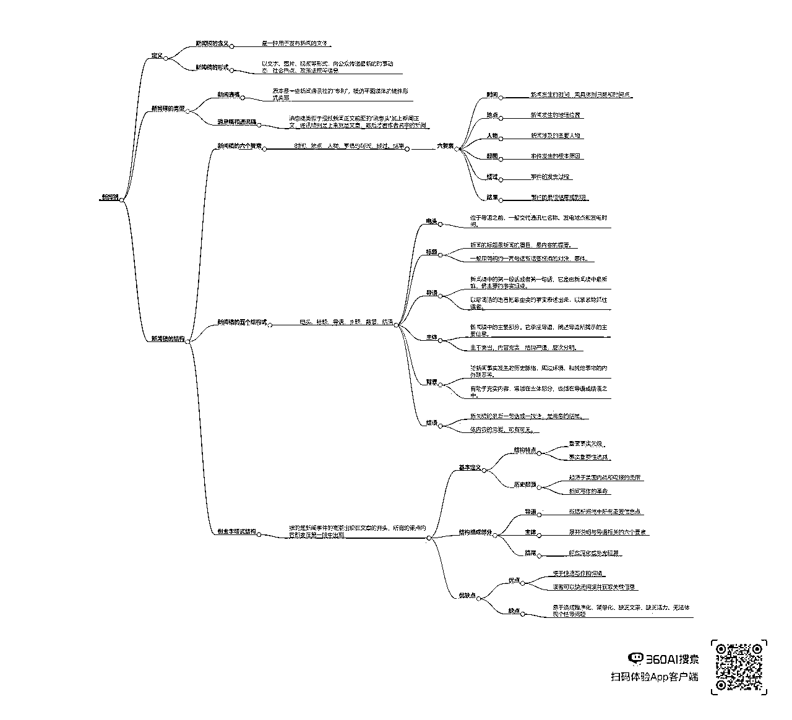

同样，写新闻稿要盯住哪些点，一张图直接列清，上图！

# 2.4.1 案例展示：客户需求

新闻稿先得问明白三件事：写什么主题、按哪家网站的格式、什么时候发。各家新闻网都有自己的规矩。把这些弄清楚了，再对着搜来的资料和范文，快速判断一篇稿子真正缺什么。下面拿一个真实的客户需求当例子，带你走一遍AI写新闻稿的路子。

题目：年轻人把五星级酒店当食堂引发分析，1500字。

要求：稿子里要给出3个不同的角度。

案例：

# 2.4.2 实操写作过程

# 2.4.2.1 搜索对标，拉齐认知

跟主持稿一样，先用秘塔、百度这些搜索工具弄清新闻稿的基本门道；心里有数了，再找几篇好稿子和客户发来的模板逐一拆开看。这个案例，检索词就是“新闻稿”。

# 2.4.2.2 任务拆解

第一步：让ChatGPT把范文拆开，理出骨架。客户给了范文，就交给AI工具分析一遍，弄清一篇新闻稿由哪几块拼成。

💡【拆解提示词】
请研读下面这篇新闻稿范文，把它拆成若干板块，再逐块说明各自写了什么、有什么特征。

第二步：把选题方向定死。题目客户已经给了《年轻人把五星级酒店当食堂引发分析》，这里不再动，知道大致往哪写就行。客户要求说得清楚，照着办即可。

第三步：搭骨架。总字数1500字，参照：

【骨架设计原则：全文控制在3000字以内，正文一般三个维度就够（真想加到五个也行，只是没必要，少折腾为妙）】

【维度设计原则：一个维度下面可以排几个段落，段落里还能带子标题（二级、三级都行）；正文三个维度＝三个一级标题；一个维度，说的就是一个大观点】

【字数分配原则：250字≤每段字数≤500字】

推下来：正文三个维度，每个400字，3×400＝1200字；剩下300字，开头100字、收尾200字。

照这套逻辑，再结合客户“必须从三个角度分析”的要求，从三个方向拟大纲。

【推出来的骨架】
标题：年轻人把五星级酒店当食堂引发分析

一、舆情背景 300字

二、舆情分析
维度一 400字（备注：维度一要是写成600字，就拆成两段300字的。其他维度照此办理）
维度二 400字
维度三 400字

第四步：把素材喂够。这个案例里，ChatGPT得先弄懂“年轻人把五星级酒店当食堂”这件事的来龙去脉，材料还必须出自各大新闻媒体网站。可以用秘塔搜索去查，查完整理成文档，上传给GPT读。

💡【提示词】
请通读我上传的这份文档，按下面的固定样子输出。
【样子】“××媒体这条报道，能提炼出什么结论”
【硬性要求】
1. 每条结论不少于200字。

生成效果见图：


1.docx


# 2.4.2.3 执行

准备工作齐了，就开始写。

第一步：写提示词。黄色标注的地方后续可以替换。

💡【提示词】
【角色】：请扮演一名资深新闻工作者，构思巧妙，语言犀利。

【任务】：即将写一篇《年轻人把五星级酒店当食堂引发分析》的分析，请根据模板输出。

【模板】：
“”“”
标题：年轻人把五星级酒店当食堂引发分析

一、舆情背景 300字

二、舆情分析
维度一 400字（备注：维度一要是写成600字，就拆成两段300字的。其他维度照此办理）
维度二 400字
维度三 400字
“”“”

【素材】：
“”“”
# 腾讯网：结论怎么读
腾讯网那条报道能读出几层意思：年轻人花钱的路子更多了，办张酒店自助年卡管一日三餐，既要品质也盘算性价比，比叫外卖划算；省事同样要紧，上班的人愿意拿钱换时间和精力，年卡正好省心省时；市场反应也快，好些酒店已经跟着推出类似年卡来拉年轻客群。

# 新浪新闻：结论怎么读
新浪新闻把“想过好日子”和“得算账”摆在一块看。12888元的年卡听着贵，可对天天发愁“吃啥”的上班族来说，日子能简化，忙起来也能花不多的钱吃上像样的一餐。年轻人会算实际成本和长期收益，表面是高消费，操作起来却有“薅羊毛”的味道。社交平台还会把这种共鸣放大，凑成一股风潮，酒店业也因此盯上了这块需求。

# 知乎：结论怎么读
知乎那篇往深里挖了一层。把自助餐年卡当日常饭票，本质是图便捷高效：选择多，不用天天纠结吃啥，决策也省了。年轻人既要生活质量，也想把时间管好，让舒坦和效率都拉满。他们对性价比有自己的算法：一次付出去的钱摊到每天，就成了“低成本”体验。报道也提了一句，追新求快的时候别忘了健康和长期平衡。

# 网易：结论怎么读
网易的报道点出年轻人对品质和便捷的双重期待。把酒店自助餐当“日常食堂”，一头满足对好菜的念想，一头给出省事的生活方案。餐饮行业也被推着搞创新，用年卡套餐来吸引这批客人。报道还强调理性盘算：一次付得多，摊到每顿反而低，这种“捡便宜”的心思带火了这套模式。同时提醒，跟风要留神健康问题和商家诚信，别盲目吃亏。

# 四川在线：结论怎么读
四川在线是从话题讨论切进去的，把多重因素摆开。年轻人想提升生活品质，也在改传统吃饭的路子；办了高档酒店自助餐年卡，花不算多的钱吃上像样的饭，还能少为“吃啥”费神。面对大额支出，他们会拉长时间算账，觉得年卡有实际收益，是笔“物超所值”的投资。商家抓需求抓得准，不少高档酒店很快就推了年卡。报道也提醒，追新生活方式得清醒，别盲目跟风，健身年卡那类反面例子就在眼前，理性谨慎地挑才稳妥。
“”“”

【要求】：
1. 要从三个角度分析这种现象。
2. 舆情分析每一维都用“一是有观点认为……”开头，并详细结合维度一讲清观点。开头亮出观点后，照素材的路子，用“某某新闻或某某网得出什么看法、分析出什么内容”的写法。合理编造即可。

要是觉得维度观点不够好，后面可能凑不出三个真正不同的维度，就再做一轮个性化调教（可选）。

# 📌【提示词】
如果想让自己的读后感在众人里显得另类，有什么招？请按这些招，结合投喂的素材生成三个新维度。

【素材】：""""""

这样又能多几个好用的方向，留作维度素材。

第二步：人工干预，出定稿。

标题：年轻人把五星级酒店当食堂引发分析

一、舆情背景 300字

这几年，社会经济在走，消费观念也在换，年轻一代的花钱方式跟着变了样。近来，一些年轻人把高档酒店的自助餐厅当成“食堂”，掏一笔不算小的钱办张年卡，一天三顿都在酒店吃。这种活法很快在网上炸开了讨论。年轻人用短视频、社交平台晒自己的用餐经历，跟着学的人一拨接一拨。媒体和公众也吵得热闹：有人说这是会算账，说明对好日子有追求；也有人犯嘀咕，这样吃真划算吗，长期下去身体扛得住吗。舆情这么杂，就得从几个方向切进去，把背后的社会心理和经济账翻出来看。

二、舆情分析

维度一：消费升级与生活方式变革 400字

一是有观点认为，年轻人把高档酒店自助餐厅当日常饭点，是消费升级下过日子的方式变了。腾讯网的说法是，这类做法说明现代年轻人看重生活品质，忙起来也想图个方便高效。他们花的这笔钱，不全是买排场，也是在划算的前提下把方便和吃得好一块儿拿下。精打细算下来，用较低的单价吃上高端餐，成了他们眼里的“聪明消费”。这股劲头也说明年轻一代不太认老一套花钱路子，愿意破个例、试试新活法，在钱的压力和生活质量之间找个平衡点。不过话说回来，这种升级背后会不会太靠外部服务、把自己做饭过日子的本事丢了，还值得再议。

维度二：社交媒体对消费行为的推动作用 400字

二是有观点认为，这类现象能传开、能扩散，社交媒体出力最多。新浪新闻分析说，平台上大批年轻人晒自己在高档酒店吃饭的经历，跟风的人越来越多，这事很快就成了热点。短视频和图片一包装，这种活法就被贴上了“品质高、性价比高”的标签，勾得不少年轻人跟着看、跟着学。知乎那篇还说透一层：平台上的“炫耀性消费”把火烧得更旺，个人的花钱行为被摆到明面上、变得可复制，在平台上成了某种“社交货币”。可这里头的毛病也露出来了——短期的爽和表面的划算容易被放大，长期的钱袋规划和身体账反倒被晾在一边。年轻人在平台的推搡下，可能忘了自己到底要什么，一头扎进不划算的坑里。

维度三：经济压力与理性消费的矛盾 400字

# 自助餐年卡，真能省钱吗？

最近，五星级酒店自助餐年卡成了部分年轻人讨论的消费新选项。有人觉得，这背后藏着省钱期待与理性消费之间的拉扯。

网易新闻的分析是：房价、物价都不低，年轻人更在意怎样让手头预算换来更高的生活品质。于是，一些人把账算得很细，把高档酒店自助餐年卡放进节省日常开销的方案里。说到底，这是在现实经济负担下做出的应变。

但四川在线也给出提醒：短期看，这类消费确实能让钱包松一口气；可时间拉长后，它究竟是不是真节俭，还是可能被健康隐患、其他隐性成本反咬一口，值得打个问号。更别忘了，没看清自身需求就跟着买卡，也可能给自己添上本可避免的财务负担。

所以，向往品质生活没错，守住理性消费同样重要。别被眼前的便宜遮住长期账本，把短期利益和长期影响一起算清楚，仍是年轻人要答好的题。

（素材占位标记保留：     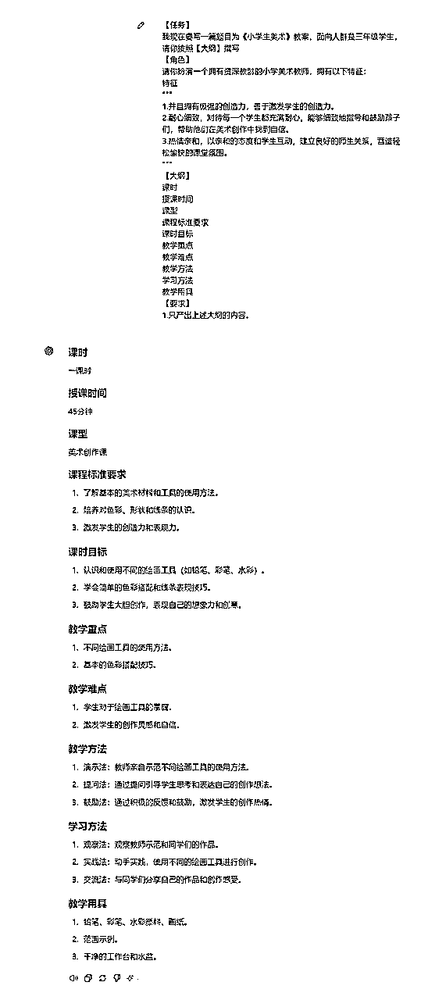  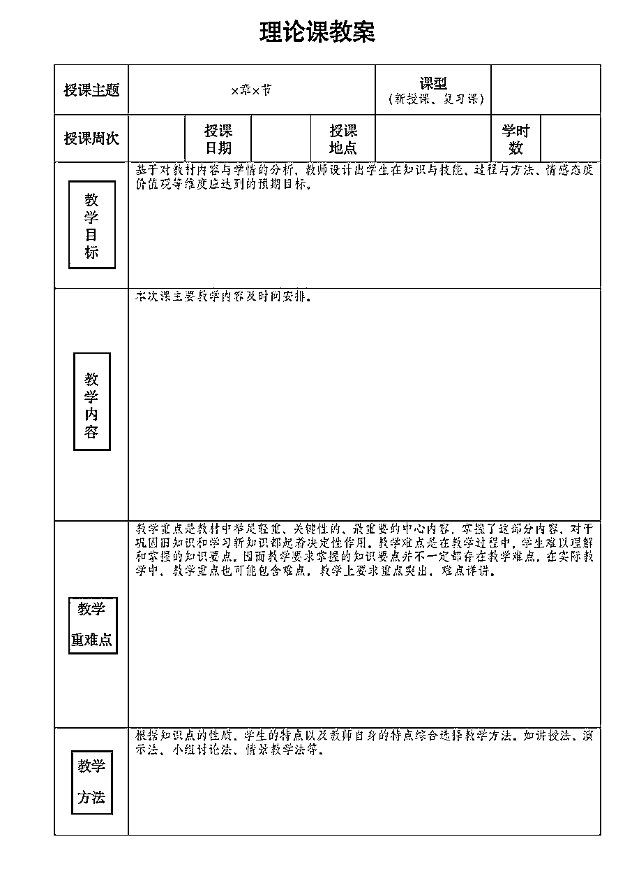 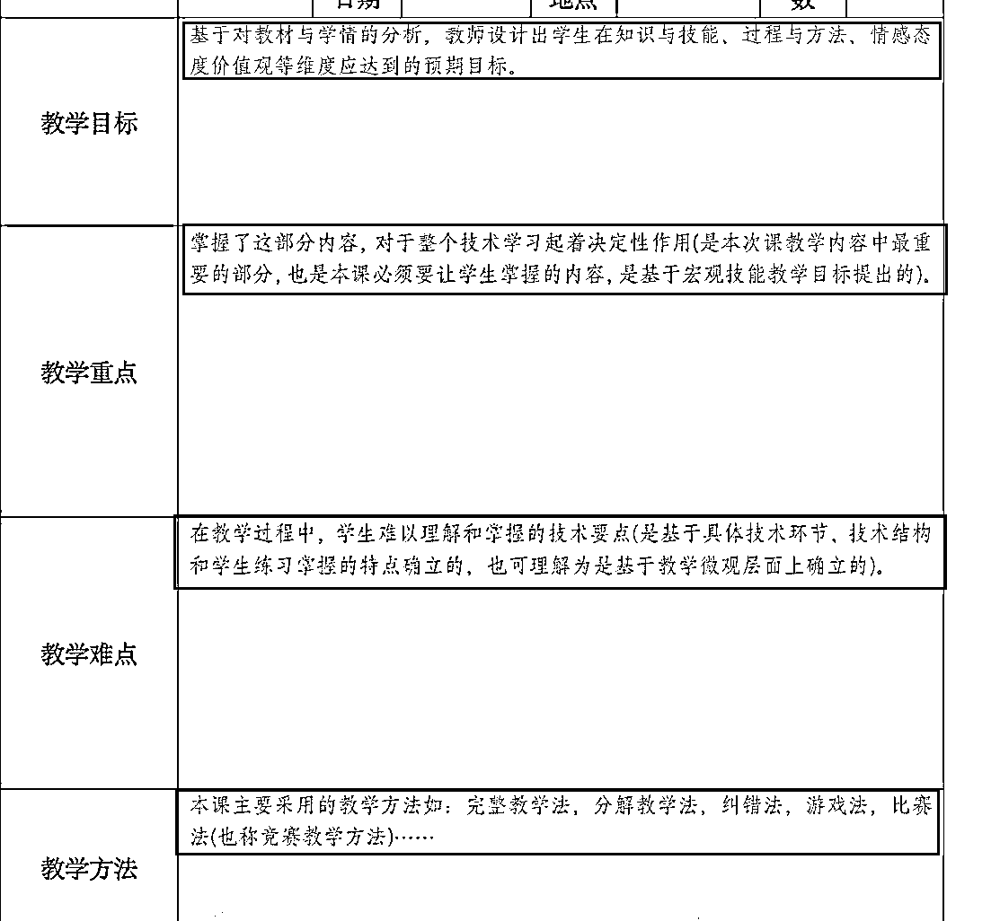  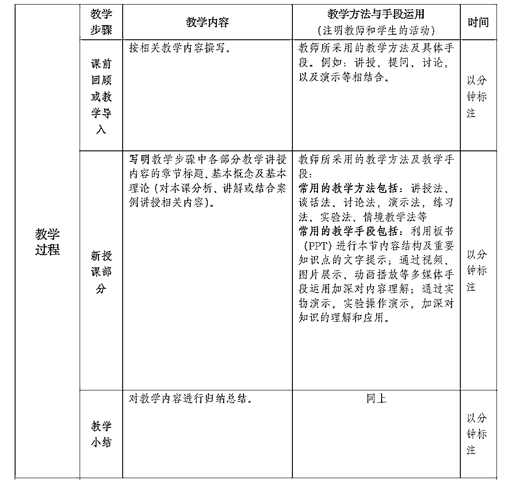 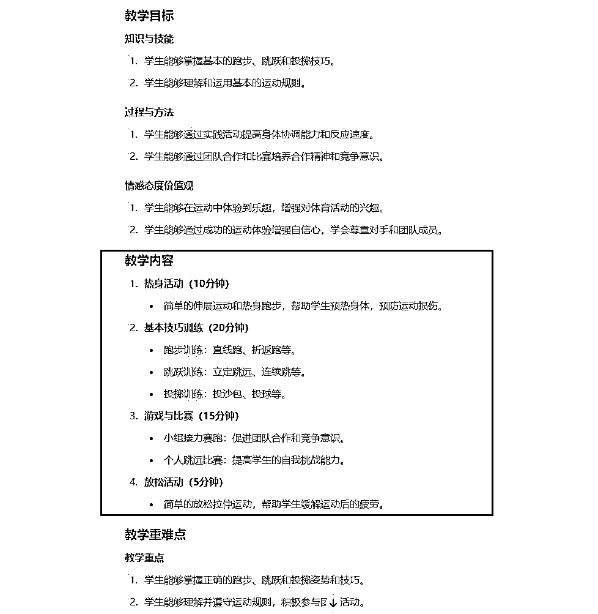          ）

# 从教室到账台：我的农牧社历练记

## 起点

大三在读，专业是财务管理，机缘之下走进乌拉特中旗新兴隆农牧专业合作社历练了一段，心里格外珍视。回头再想这些时日，最深的感触是：课本里的原理要真正立住脚，非得靠一遍遍上手去印证；而干活的本事和综合的底子，也是在处理一桩桩实事时慢慢长出来的。这方热土生机盎然，看着我完成了从听课到上岗的转身，也让我带走了不少能长久咀嚼的体会。

## 书上的道理，落到账本里

进了合作社的财务岗，我才真切摸到：书本那一头与手上这一头，究竟是拿什么拴在一处的。从前在课本里读过的原理，如今真刀真枪地用上了；每回办完一件事再回头看，那些概念反倒比课堂上清晰了许多。

先讲最基础的登账。我把自己记下的会计规范逐条对着使，每笔业务往来都登记在册，一遍遍复核，只求账目经得起翻查、数字不差分毫。这些活儿说起来琐碎，却让我把会计上各科目的内里摸得更细，也养出了认真较真的习惯。

再讲报表。我用手头学到的分析思路去摆弄真实数字，靠着资产负债表和利润表的一编一读，把合作社的家底与经营成绩弄清楚。几轮下来，编表的熟练度上去了，从账面数字里瞧出经营健康与否、再给出补漏法子的本事也跟着见长。

难啃的骨头也碰过。印象最深的一回，社里的现钱一时周转不开，我便顺着账面数据一路查过去，把症结挖出来，又拿出可行的处置办法，到底帮着社里迈过了那道坎。

回过头看，学理和实务彼此印证这一条，贯穿了整段在岗时光。把懂的道理使到真实业务上，既磨了我的专业手感，也为社里做了点实事。我越来越信：这一行要走得久，“学”和“干”少了哪个都不成。

## 并肩做事，开口说话

在合作社待的这些天，我带走的不只是把财务知识用起来的那点收获，更在于业务素质与综合本领被现实反复磨了几回。要说感受最明显的，还得数跟人搭伙干活和开口交流这两桩。

先说搭伙。跟同事一起排报表、核账目的那些过程，让我懂得了配合是怎么回事。就拿编资产负债表来说，几个人各管一摊核对数字，谁那边缺了就补上，报表最后分毫不差地出了炉。这么一轮下来，我协作的意识扎实了不少，跟人共事的本事也得了真切历练。

再说开口。经历教会我，说话不是把字吐完就算完，得听明白对方想表达什么，同时也把自己的意思摆清楚。比如同同事聊账目分析的结果，我得把数字里藏的含义讲透，还得静下心听他们的看法与点子，几个人凑在一块儿把合作社往后怎么走聊出个共识。管理学者彼得·德鲁克有句话说到了点子上：所谓沟通，说的一方要能把意思讲清，听的一方要肯把耳朵打开，两头都得到位。巴伯也有个说法：就算站在一大群人跟前开口，也不妨在心里把它当成与一位老友倾心交谈。交流顺了，一支队伍才能同使一股劲，往同一个方向使力。

归结一句：业务素质的进阶不单看知识用得如何，更看搭伙与开口这类软功夫。这段经历让我掂出了二者的分量，它们会成为我往后职业路上少不得的家底。

## 财务之外，看见另一片天地

在乌拉特中旗新兴隆农牧专业合作社里待过一阵，我的收获没有圈在财务这一小块地里，还借着干活攒下了不少农牧方面的门道。这样跨着学，把我的眼界撑得更开，也让手上的本领长了一截。

一头是，与合作社里其他小组的同事来回沟通、一起办事的过程中，我对农牧业怎么生产、怎么经营摸得更清了。我慢慢看明白，养殖这摊事里，饲料怎么供、环境怎么控、疫病怎么防，样样都有讲究。这些认识不光帮我读懂了农牧这行的运转门路，也给我往后做账、看账预备了更全的参照和更宽的角度。

另一头是，把农牧业的行情与行当走势摸清楚，让我更能找准合作社财务该往哪儿使劲。世道往前走，农牧这行也在不断变样、出新，摸准了行当的风向，遇上行情窗口才抓得住，为合作社的发展托一把力。西奥多·李维特有一句常被引用的话，大意是锁定该服务的人群、看懂他们的需要、把营销的几件事捏到一处，靠让买家满意来挣得回报。经济学家亚当·斯密也留下判断：一样东西值多少，市场的需求是绕不开的一把尺子。需求摸清了，给社里出主意时才有底气，也真能帮企业跑得更快。

说到底，通识底子与跨领域本事在这段经历里占了不轻的分量。借着学农牧方面的知识，我既长了见识，也添了跨界的能力，离那种样样都能搭上手的复合型人又近了一程。往后的职场里，这就是我拿得出手的底牌，遇上环境翻新、难题冒头，也能不慌。

## 收束

这段日子让我认准了一件事：学来的东西管不管用，得让实际活儿来打分。先说财务这一摊：光啃书本铁定不够，非得让纸上的道理与实际的手感合上拍，才算真入了门。财务圈的老前辈罗斯科有过类似的提醒：会计这行当，脚下的功夫比纸上的条文更吃重，人不下场试一试，怎么也尝不到真味。在岗那段，从一笔笔记流水账，到把报表算出来、读明白，哪一道工序我都自己上手做过；回头一看，书本里的分量正是在这些笨功夫里显出来的。

这之后不管是读书还是做事，我都会把本事往细里磨，学一点就用一点，给自己的饭碗打牢底子。财务这门学问，我要往深处挖；动手的活儿，我要接着练；目标是往后能独当一面，做个靠得住的财务人。车尔尼雪夫斯基说过，实践是思想的真理。斯密还讲过，肯下苦功是立身的根基，学个不停才是成事的底气。唯有把学与练一路做下去，才不至于在比拼中被挤下去，心里那份职业念想也才有落地的一天。

乌拉特中旗新兴隆农牧专业合作社给了我这回难得的历练，我要认认真真道一声谢；带我的导师、身边的同事一路上的提携与点拨，也要记上。在岗时，他们没少把行内的门道教我，遇上棘手局面该怎么拆解，也是他们手把手点出来的。这份情我揣在心里，往后只能拿更用心干活去还，不能让他们白教一场。


# 2.6.4 按大纲让 AI 一段段写初稿

step1:

照模板把提示词补齐

# 💡

【提示词】

【角色】

你现在的身份是大三在读的实习生，专业为财务管理，眼下在乌拉特中旗新兴隆农牧专业合作社做财务岗；下笔时语气要专业、诚恳，并带着真情实感。

【任务】

把这段岗位实践从头到尾完整地记下来，篇幅不低于一千字，写成一篇心得体会；先动笔写【指定小节】里交代的那部分。

【指定小节】:

"""

开头：

（大致构思：我读大三，专业是财务管理，这一次争取到了去乌拉特中旗新兴隆农牧专业合作社锻炼的名额。经过这一段，我明白了把课堂所学与手上的活计接起来有多要紧，业务水准和综合素质也在做事中一点点往上走。)

"""


效果还成

万一不理想，就再让它写三五回，总有一回能看。

大三在读，专业是财务管理，机缘之下走进乌拉特中旗新兴隆农牧专业合作社历练了一段，心里格外珍视。回头再想这些时日，最深的感触是：课本里的原理要真正立住脚，非得靠一遍遍上手去印证；而干活的本事和综合的底子，也是在处理一桩桩实事时慢慢长出来的。这方热土生机盎然，看着我完成了从听课到上岗的转身，也让我带走了不少能长久咀嚼的体会。


step2:

照模板把提示词补齐

# 💡

【提示词】

【角色】

你现在的身份是大三在读的实习生，专业为财务管理，眼下在乌拉特中旗新兴隆农牧专业合作社做财务岗；下笔时语气要专业、诚恳，并带着真情实感。

【任务】

把这段岗位实践从头到尾完整地记下来，篇幅不低于一千字，写成一篇心得体会；先动笔写【指定小节】里交代的那部分。

【指定小节】:

"""

理论知识与实践技能的结合：

（大致构思：课堂里学到的财务管理原理，在真实的业务中派上了大用场。从最平常的记流水账，到相对麻烦的报表活儿，我一边干一边把从前学到的会计知识重新夯了一遍，也琢磨出怎么让纸上的学问与手里的活儿彼此咬合，遇上现实里的麻烦事更有办法。)

"""

【要求】：

1.写观点时要拿出本专业的具体操作细节来撑住。

2.行文中适当引几句经典表述来支撑看法。

## 知行合一：让理论在账目间落地

进了合作社的财务岗，我才真切摸到：书本那一头与手上这一头，究竟是拿什么拴在一处的。从前在课本里读过的原理，如今真刀真枪地用上了；每回办完一件事再回头看，那些概念反倒比课堂上清晰了许多。

先讲最基础的登账。我把自己记下的会计规范逐条对着使，每笔业务往来都登记在册，一遍遍复核，只求账目经得起翻查、数字不差分毫。这些活儿说起来琐碎，却让我把会计上各科目的内里摸得更细，也养出了认真较真的习惯。

再讲报表。我用手头学到的分析思路去摆弄真实数字，靠着资产负债表和利润表的一编一读，把合作社的家底与经营成绩弄清楚。几轮下来，编表的熟练度上去了，从账面数字里瞧出经营健康与否、再给出补漏法子的本事也跟着见长。

难啃的骨头也碰过。印象最深的一回，社里的现钱一时周转不开，我便顺着账面数据一路查过去，把症结挖出来，又拿出可行的处置办法，到底帮着社里迈过了那道坎。

回过头看，学理和实务彼此印证这一条，贯穿了整段在岗时光。把懂的道理使到真实业务上，既磨了我的专业手感，也为社里做了点实事。我越来越信：这一行要走得久，“学”和“干”少了哪个都不成。


step3:

照模板把提示词补齐

# 💡

【提示词】

【角色】

你现在的身份是大三在读的实习生，专业为财务管理，眼下在乌拉特中旗新兴隆农牧专业合作社做财务岗；下笔时语气要专业、诚恳，并带着真情实感。

【任务】

把这段岗位实践从头到尾完整地记下来，篇幅不低于一千字，写成一篇心得体会；先动笔写【指定小节】里交代的那部分。

【指定小节】:

"""

业务素质与本领的长进：跟着同事一起编报表、做分析的那些过程，让我学会了怎么配合、怎么把话说明白也听明白；这些是教室里学不来的经验。

"""

【要求】：

1.写观点时要拿出本专业的具体操作细节来撑住。

2.行文中适当引几句经典表述来支撑看法。


## 素养进阶：在协作与沟通中打磨自己

在合作社待的这些天，我带走的不只是把财务知识用起来的那点收获，更在于业务素质与综合本领被现实反复磨了几回。要说感受最明显的，还得数跟人搭伙干活和开口交流这两桩。

先说搭伙。跟同事一起排报表、核账目的那些过程，让我懂得了配合是怎么回事。就拿编资产负债表来说，几个人各管一摊核对数字，谁那边缺了就补上，报表最后分毫不差地出了炉。这么一轮下来，我协作的意识扎实了不少，跟人共事的本事也得了真切历练。

再说开口。经历教会我，说话不是把字吐完就算完，得听明白对方想表达什么，同时也把自己的意思摆清楚。比如同同事聊账目分析的结果，我得把数字里藏的含义讲透，还得静下心听他们的看法与点子，几个人凑在一块儿把合作社往后怎么走聊出个共识。管理学者彼得·德鲁克有句话说到了点子上：所谓沟通，说的一方要能把意思讲清，听的一方要肯把耳朵打开，两头都得到位。巴伯也有个说法：就算站在一大群人跟前开口，也不妨在心里把它当成与一位老友倾心交谈。交流顺了，一支队伍才能同使一股劲，往同一个方向使力。

归结一句：业务素质的进阶不单看知识用得如何，更看搭伙与开口这类软功夫。这段经历让我掂出了二者的分量，它们会成为我往后职业路上少不得的家底。

其中的金句，我再人工替换一遍。


step4:

照模板把提示词补齐

# 💡

【提示词】

【角色】

你现在的身份是大三在读的实习生，专业为财务管理，眼下在乌拉特中旗新兴隆农牧专业合作社做财务岗；下笔时语气要专业、诚恳，并带着真情实感。

【任务】

把这段岗位实践从头到尾完整地记下来，篇幅不低于一千字，写成一篇心得体会；先动笔写【指定小节】里交代的那部分。

【指定小节】:

"""

通识底子与跨领域本事：财务管理之外，我还在实践里补了不少农牧方面的知识。跟别的部门同事来往、一起做事时，我了解到农牧这一行怎么生产、市场要什么、往后往哪走；眼界因此宽了，跨界的能力也长了，人也更全面。

"""

【要求】：

1.写观点时要拿出本专业的具体操作细节来撑住。

2.行文中适当引几句经典表述来支撑看法。

## 跨界视野：从财务窗口望见农牧业天地

在乌拉特中旗新兴隆农牧专业合作社里待过一阵，我的收获没有圈在财务这一小块地里，还借着干活攒下了不少农牧方面的门道。这样跨着学，把我的眼界撑得更开，也让手上的本领长了一截。

一头是，与合作社里其他小组的同事来回沟通、一起办事的过程中，我对农牧业怎么生产、怎么经营摸得更清了。我慢慢看明白，养殖这摊事里，饲料怎么供、环境怎么控、疫病怎么防，样样都有讲究。这些认识不光帮我读懂了农牧这行的运转门路，也给我往后做账、看账预备了更全的参照和更宽的角度。

另一头是，把农牧业的行情与行当走势摸清楚，让我更能找准合作社财务该往哪儿使劲。世道往前走，农牧这行也在不断变样、出新，摸准了行当的风向，遇上行情窗口才抓得住，为合作社的发展托一把力。西奥多·李维特有一句常被引用的话，大意是锁定该服务的人群、看懂他们的需要、把营销的几件事捏到一处，靠让买家满意来挣得回报。经济学家亚当·斯密也留下判断：一样东西值多少，市场的需求是绕不开的一把尺子。需求摸清了，给社里出主意时才有底气，也真能帮企业跑得更快。

说到底，通识底子与跨领域本事在这段经历里占了不轻的分量。借着学农牧方面的知识，我既长了见识，也添了跨界的能力，离那种样样都能搭上手的复合型人又近了一程。往后的职场里，这就是我拿得出手的底牌，遇上环境翻新、难题冒头，也能不慌。

step5:

照模板把提示词补齐

# 💡

【提示词】

【角色】

你现在的身份是大三在读的实习生，专业为财务管理，眼下在乌拉特中旗新兴隆农牧专业合作社做财务岗；下笔时语气要专业、诚恳，并带着真情实感。

【任务】

把这段岗位实践从头到尾完整地记下来，篇幅不低于一千字，写成一篇心得体会；先动笔写【指定小节】里交代的那部分。

【指定小节】:

"""

收尾：

（大致构思：这一段走下来，我最认的是——道理行不行，得靠实践给答案。往后读书也好、做事也罢，我会把本事接着往上磨，边学边干，给职业的路打牢底子。乌拉特中旗新兴隆农牧专业合作社给了我这次难得的历练，导师与同事们一路提携指点，我记在心里；这一段收获不少，会是人生道上一笔厚实的家底。)

"""

【要求】：

1.须用上本领域的专门术语。

2.引几句经典表述支撑看法。


## 结尾

这段日子让我认准了一件事：学来的东西管不管用，得让实际活儿来打分。先说财务这一摊：光啃书本铁定不够，非得让纸上的道理与实际的手感合上拍，才算真入了门。财务圈的老前辈罗斯科有过类似的提醒：会计这行当，脚下的功夫比纸上的条文更吃重，人不下场试一试，怎么也尝不到真味。在岗那段，从一笔笔记流水账，到把报表算出来、读明白，哪一道工序我都自己上手做过；回头一看，书本里的分量正是在这些笨功夫里显出来的。

这之后不管是读书还是做事，我都会把本事往细里磨，学一点就用一点，给自己的饭碗打牢底子。财务这门学问，我要往深处挖；动手的活儿，我要接着练；目标是往后能独当一面，做个靠得住的财务人。车尔尼雪夫斯基说过，实践是思想的真理。斯密还讲过，肯下苦功是立身的根基，学个不停才是成事的底气。唯有把学与练一路做下去，才不至于在比拼中被挤下去，心里那份职业念想也才有落地的一天。

乌拉特中旗新兴隆农牧专业合作社给了我这回难得的历练，我要认认真真道一声谢；带我的导师、身边的同事一路上的提携与点拨，也要记上。在岗时，他们没少把行内的门道教我，遇上棘手局面该怎么拆解，也是他们手把手点出来的。这份情我揣在心里，往后只能拿更用心干活去还，不能让他们白教一场。

# 2.6.5 哪一段写得不喜欢，就把材料喂给 AI 让它再写

此处省略～这一版出来，我大体上挺满意。

# 2.6.6 亲手删改，拼成终稿

在 Word 里改，各段的长短好拿捏。

【未删减版】

## 起点

大三在读，专业是财务管理，机缘之下走进乌拉特中旗新兴隆农牧专业合作社历练了一段，心里格外珍视。回头再想这些时日，最深的感触是：课本里的原理要真正立住脚，非得靠一遍遍上手去印证；而干活的本事和综合的底子，也是在处理一桩桩实事时慢慢长出来的。这方热土生机盎然，看着我完成了从听课到上岗的转身，也让我带走了不少能长久咀嚼的体会。

## 书上的道理，落到账本里

进了合作社的财务岗，我才真切摸到：书本那一头与手上这一头，究竟是拿什么拴在一处的。从前在课本里读过的原理，如今真刀真枪地用上了；每回办完一件事再回头看，那些概念反倒比课堂上清晰了许多。

先讲最基础的登账。我把自己记下的会计规范逐条对着使，每笔业务往来都登记在册，一遍遍复核，只求账目经得起翻查、数字不差分毫。这些活儿说起来琐碎，却让我把会计上各科目的内里摸得更细，也养出了认真较真的习惯。

再讲报表。我用手头学到的分析思路去摆弄真实数字，靠着资产负债表和利润表的一编一读，把合作社的家底与经营成绩弄清楚。几轮下来，编表的熟练度上去了，从账面数字里瞧出经营健康与否、再给出补漏法子的本事也跟着见长。

难啃的骨头也碰过。印象最深的一回，社里的现钱一时周转不开，我便顺着账面数据一路查过去，把症结挖出来，又拿出可行的处置办法，到底帮着社里迈过了那道坎。

回过头看，学理和实务彼此印证这一条，贯穿了整段在岗时光。把懂的道理使到真实业务上，既磨了我的专业手感，也为社里做了点实事。我越来越信：这一行要走得久，“学”和“干”少了哪个都不成。

## 并肩做事，开口说话

在合作社待的这些天，我带走的不只是把财务知识用起来的那点收获，更在于业务素质与综合本领被现实反复磨了几回。要说感受最明显的，还得数跟人搭伙干活和开口交流这两桩。

先说搭伙。跟同事一起排报表、核账目的那些过程，让我懂得了配合是怎么回事。就拿编资产负债表来说，几个人各管一摊核对数字，谁那边缺了就补上，报表最后分毫不差地出了炉。这么一轮下来，我协作的意识扎实了不少，跟人共事的本事也得了真切历练。

再说开口。经历教会我，说话不是把字吐完就算完，得听明白对方想表达什么，同时也把自己的意思摆清楚。比如同同事聊账目分析的结果，我得把数字里藏的含义讲透，还得静下心听他们的看法与点子，几个人凑在一块儿把合作社往后怎么走聊出个共识。管理学者彼得·德鲁克有句话说到了点子上：所谓沟通，说的一方要能把意思讲清，听的一方要肯把耳朵打开，两头都得到位。巴伯也有个说法：就算站在一大群人跟前开口，也不妨在心里把它当成与一位老友倾心交谈。交流顺了，一支队伍才能同使一股劲，往同一个方向使力。

归结一句：业务素质的进阶不单看知识用得如何，更看搭伙与开口这类软功夫。这段经历让我掂出了二者的分量，它们会成为我往后职业路上少不得的家底。

## 财务之外，看见另一片天地

在乌拉特中旗新兴隆农牧专业合作社里待过一阵，我的收获没有圈在财务这一小块地里，还借着干活攒下了不少农牧方面的门道。这样跨着学，把我的眼界撑得更开，也让手上的本领长了一截。

一头是，与合作社里其他小组的同事来回沟通、一起办事的过程中，我对农牧业怎么生产、怎么经营摸得更清了。我慢慢看明白，养殖这摊事里，饲料怎么供、环境怎么控、疫病怎么防，样样都有讲究。这些认识不光帮我读懂了农牧这行的运转门路，也给我往后做账、看账预备了更全的参照和更宽的角度。

另一头是，把农牧业的行情与行当走势摸清楚，让我更能找准合作社财务该往哪儿使劲。世道往前走，农牧这行也在不断变样、出新，摸准了行当的风向，遇上行情窗口才抓得住，为合作社的发展托一把力。西奥多·李维特有一句常被引用的话，大意是锁定该服务的人群、看懂他们的需要、把营销的几件事捏到一处，靠让买家满意来挣得回报。经济学家亚当·斯密也留下判断：一样东西值多少，市场的需求是绕不开的一把尺子。需求摸清了，给社里出主意时才有底气，也真能帮企业跑得更快。

说到底，通识底子与跨领域本事在这段经历里占了不轻的分量。借着学农牧方面的知识，我既长了见识，也添了跨界的能力，离那种样样都能搭上手的复合型人又近了一程。往后的职场里，这就是我拿得出手的底牌，遇上环境翻新、难题冒头，也能不慌。

## 收束

这段日子让我认准了一件事：学来的东西管不管用，得让实际活儿来打分。先说财务这一摊：光啃书本铁定不够，非得让纸上的道理与实际的手感合上拍，才算真入了门。财务圈的老前辈罗斯科有过类似的提醒：会计这行当，脚下的功夫比纸上的条文更吃重，人不下场试一试，怎么也尝不到真味。在岗那段，从一笔笔记流水账，到把报表算出来、读明白，哪一道工序我都自己上手做过；回头一看，书本里的分量正是在这些笨功夫里显出来的。

这之后不管是读书还是做事，我都会把本事往细里磨，学一点就用一点，给自己的饭碗打牢底子。财务这门学问，我要往深处挖；动手的活儿，我要接着练；目标是往后能独当一面，做个靠得住的财务人。车尔尼雪夫斯基说过，实践是思想的真理。斯密还讲过，肯下苦功是立身的根基，学个不停才是成事的底气。唯有把学与练一路做下去，才不至于在比拼中被挤下去，心里那份职业念想也才有落地的一天。

乌拉特中旗新兴隆农牧专业合作社给了我这回难得的历练，我要认认真真道一声谢；带我的导师、身边的同事一路上的提携与点拨，也要记上。在岗时，他们没少把行内的门道教我，遇上棘手局面该怎么拆解，也是他们手把手点出来的。这份情我揣在心里，往后只能拿更用心干活去还，不能让他们白教一场。

【定稿】

这段在乌拉特中旗新兴隆农牧专业合作社的实习，对我这个学财务管理的学生来说意义不小。它让我看清：书本里的知识只有放进真实业务里，才会变得有分量；同时，在具体事务中摸爬滚打，也让我的专业能力和职业素养往前走了一步。

**凭证与课本互相印证**

合作社的财务日常，让我看到理论与实操其实彼此咬合。课堂上学的知识在岗位上有用武之地；反过来，实际业务又让我对理论理解得更透。做账时，我按会计规范逐笔登记，每笔交易都写清楚，确保账目准确、完整。这个过程让会计科目不再是抽象概念，也逼我养成细致、认真的习惯。编报表时，我调用课堂上学过的分析方法，借资产负债表和利润表梳理公司的财务情形与经营成果。编制技能得到巩固，我也开始尝试从数字里判断财务健康度，并提出有针对性的优化建议。

**协作与沟通：隐形的必修课**

实习中另一个收获，是协作和沟通能力的提升。编资产负债表时，我和同事分头核对数据，配合着把报表做准。我也意识到，沟通不是单向传递信息，而是先听懂对方的意思，再把自己的想法讲清楚。和同事讨论报表分析结果时，我得把数字背后的含义说明白，也要认真听他们的观点和建议，最后一起形成对公司发展的理解。巴伯有句话：“当我面对一群人，或是大众传播媒体谈话时，我总是假想自己是和一个人进行推心置腹的谈话。”沟通顺了，协作才顺，大家也更容易朝同一个方向走。

**跳出财务看农牧**

这段实习还帮我补了不少农牧知识。跟其他部门同事打交道，我了解了农牧业的生产流程和运营模式，也知道了养殖中饲料供应、环境控制、疫病防治等环节有多重要。这些积累以后做财务管理时，会给我更完整的背景和更多元的视角。摸清农牧业的市场需求和行业走向，也能帮我更好把握公司财务工作的方向。行业一直在变、在创新，盯住趋势才更容易抓住市场机会，为公司发展提供更有效的财务支持。西奥多·李维特说过：“目标市场，顾客需求，协调市场营销，通过满足消费者需求来创造利润。”把市场需求看透，财务决策支持才更有依据，企业发展也更有推力。通识素养和跨学科能力，在这段实习里确实起了作用。

**动手之后，理论才落地**

实践是检验理论的好办法。从每天记账，到编报表、做分析，每个环节都让我更清楚理论在实操中的用法和意义。车尔尼雪夫斯基说过：“实践是思想的真理。”只有不断学、不断动手，才能在竞争里站住脚，一步步靠近自己的职业目标。感谢乌拉特中旗新兴隆农牧专业合作社给我这次实习机会，也感谢同事们关心、指点。这份感激我会记在心里，变成更认真工作的动力，不辜负他们的期望，继续追求更好的表现。


# 2.7 用智能工具生成👸号长文 @Cheese 海盐芝士

这次客户要一篇 Sora 科普稿，发在👸号和知乎，篇幅约 6000 字。和客户聊透需求后，定下的大纲如下：

【标题】：《Sora 突然爆红，人类社会会走向何方？》

【大纲】

1. 开头
开场得抓人：用一个猛料、一个扎心提问或一组硬数据先把注意力拽过来。最好再给一个场景或小故事，让读者自然进入背景。

2. AGI 可能一年内实现
沿着 AI 的演进线，从 GPT、DALL·E 3、Runway、Pika、Gemini 一路说到 Sora 的炸裂效果。Sora 的技术少掰扯，用大白话和类比把原理讲明白，让非专业读者也能懂；用比喻和故事说清它的创新点。

3. Sora 带来的行业变化
分析 Sora 的优势和短板，盯住短视频、影视、广告、XR 等具体场景。

4. 眼见不再为实，AIGC 安全往哪走

5. 结语
把核心观点再说一遍，留一个开放问题，让读者自己往下想，或者引导他们展望未来。

基本思路：

1. 先找几篇同题稿读一读，把认知拉齐。多翻几篇，快速看骨架和特点。
2. 把结构拆开，对照和客户聊过的大纲。
3. 一次列 10 个标题，挑一个顺眼的，或拼改成一个。
4. 让工具出大纲。
5. 按大纲一节节让工具写初稿，能用的留下，人工筛金句、去机器味。
6. 拼成完整初稿。
7. 人工删减定稿，去掉空话、压到字数，再调段落格式和细节。

# 2.7.1 先拆文章骨架

【标题】：《Sora 突然爆红，人类社会会走向何方？》

【大纲】

开头（200 字）：开场得抓人。用一个猛料、一个扎心提问或一组硬数据先把注意力拽过来。最好再给一个场景或小故事，让读者自然进入背景。

正文

1. AGI 可能一年内实现

1.1 AI 演进历程（500 字）：沿着 AI 的演进线，从 GPT、DALL·E 3、Runway、Pika、Gemini 一路说到 Sora 的炸裂效果。

1.2 Sora 登场（500 字）：写 Sora 发布时有多震撼，怎么打破大家对 AI 的旧预期。

1.3 Sora 背后的技术（500 字）：技术少掰扯，用大白话和类比把原理讲明白，让非专业读者也能懂；用比喻和故事说清它的创新点。

2. Sora 带来的行业变化（1500 字）：盯住短视频、影视、广告、XR 等具体场景，分析 Sora 带来的变化，同时点出优势和不足。

2.1

2.2

2.3

3. 眼见不再为实，AIGC 安全往哪走（1500 字）

3.1

3.2

3.3

结语（300 字）：把核心观点再说一遍，留一个开放问题，让读者自己往下想；最后用几个科幻镜头畅想 Sora 参与后的未来。


# 2.7.2 标题怎么定

用现成信息套“角色扮演”框架。

【提示词模板】

【角色】你是一名资深新闻自媒体编辑，语言犀利、幽默、活泼，抓人眼球，懂人性。

【任务】我的文章是《Sora 突然爆红，人类社会会走向何方？》。请先写……

【要求】1. 引用专家、学者的观点或评论，增加可信度和权威性。2. 提到最新研究或数据，展示 Sora 的影响力和应用潜力。3. 有独到见解，敢打破常规，不怕质疑现有观点，提出新角度或批判性分析。4. 用优质自媒体写法，抓住网友心思、吊住胃口。多用网络用语拉近距离。读者是大众网友，不是技术专家，牢牢抓住他们的心理和眼球。

按模板填提示词：标题已定，不用另出。文章标题为《Sora 突然爆红，人类社会会走向何方？》。


# 2.7.3 让工具搭大纲

【角色】你是一名资深新闻自媒体编辑，语言犀利、幽默、活泼，抓人眼球，懂人性。

【任务】我的文章是《Sora 突然爆红，人类社会会走向何方？》。参考下面的大纲模板和素材，给出一级、二级目录题目。

【要求】1. 目录题目要抓人。2. 有独到见解，敢打破常规，不怕质疑，提出新角度或批判性分析。3. 用优质自媒体写法，抓住网友心思、吊住胃口，多用网络用语，读者是大众网友而不是技术专家，牢牢抓住心理和眼球。

【大纲模板】：

开头（200 字）：开场得抓人，用一个猛料、扎心提问或硬数据吸引注意，最好配一个场景或小故事把读者带进去。

正文（3 个一级目录，每个一级目录下 3 个二级目录）

1. AGI 可能一年内实现

1.1 AI 演进历程（500 字）：从 GPT、DALL·E 3、Runway、Pika、Gemini 一路写到 Sora。

1.2 Sora 登场（500 字）：写 Sora 的炸裂效果。

1.3 Sora 背后的技术（500 字）：技术少讲，用大白话和类比讲清原理和创新。

2. Sora 带来的行业变化（1500 字）：盯住短视频、影视、广告、XR 等场景，写出优势和不足。

2.1

2.2

2.3

3. 眼见不再为实，AIGC 安全往哪走（1500 字）

3.1

3.2

3.3

结语（300 字）：把核心观点再说一遍，用开放问题收尾，用几个科幻镜头展望未来。

【素材】：空。

测试效果：第一次判断：开头结尾一般能用就行；重点看正文维度，不踩坑、维度不雷同就 OK。这样初版大纲可以放进 Word 当底稿。不行就重出 1—3 次，总有一次能用。

工具给出的大纲示例：

引言：开篇即高能：这个 AI 不简单，看 Sora 怎样一夜改写规则。

正文：

1. AGI 不再遥远：Sora 打开破晓时刻

1.1 AI 进化轨迹：从想象走到现实

1.2 Sora 登场：一张改写格局的王牌

1.3 技术拆解：Sora 的“心脏”

2. 行业震荡：Sora 的战场

2.1 内容创作新纪元：Sora 与短视频共舞

2.2 影视广告业的变革者：Sora 的想象空间

2.3 虚拟现实新篇章：Sora 带路的 XR 探索

3. 挑战现实：Sora 与 AIGC 的双刃剑

3.1 眼见未必为实：Sora 时代的真与假

3.2 安全漩涡：Sora 掀起的网络安全风波

3.3 伦理岔路口：Sora 的道德难题

结语：未来探索：Sora 影响下的人类新图景

这份目录的用意是带读者看清 Sora 对社会的深层影响，勾起对未来的好奇；叙述要生动，不要写成技术说明书。

第二次判断：目的是敲定大纲每一部分。步骤：1. 先拉齐认知，能判断什么是优质内容。去知网或搜索引擎搜 3 篇以上对标文献，感受优质特征，作为质量参考。主要看对标文的文风和专业词汇、各部分怎么写，判断大纲维度是否好写、是否都能用。能用就留，不能用的先标记，后面换掉。2. 从对标文献里找 3 个维度的素材备用，注意来自多个出处，别只薅一只羊。优质特征是内容具体、落地、措辞专业。

人工修改大纲为定版：按搜到的对标素材改小标题：有素材的小标题不动；没素材、不好找素材的，按素材维度改。方式一：快速人工改。小标题如果工具写得不好，就去参考文献里参考，和现有版本中和，保证合理、好写、原创。方式二：让工具改。词穷、改得慢时，让工具按对标二改。

【定版大纲】（方式一人工修改）：

《Sora 突然爆红，人类社会会走向何方？》

开篇：开篇即高能：这个 AI 不简单，看 Sora 怎样一夜改写规则。

正文：

1. Sora 已来，AGI 可能一年成真
1.1 AI 演进史：从梦想到现实（500 字）
1.2 Sora 亮相，打破预期（500 字）
1.3 技术拆解：打开 Sora 的黑盒（500 字）
1.4 Sora 的短板与挑战（500 字）

2. 行业革命，Sora 要重塑世界
2.1 内容创作迎来新纪元（500 字）
2.2 影视广告业还会存在吗（500 字）
2.3 虚拟世界已闯入现实（500 字）

3. 眼见不再为实，AIGC 安全往哪走
3.1 眼见非实，Sora 时代的真与假（500 字）
3.2 安全漩涡，Sora 掀起的网安风暴（500 字）
3.3 伦理困境，Sora 站在道德十字路口（500 字）

结语（300 字）：未来探索：Sora 参与后的人类新图景。

# 2.7.4 按大纲一节节出初稿

判断正文的标准：至少包含 2 个专家或网友评论（带日期、事件、数字、影响），以及至少 1 个落地维度。

step1：按模板填提示词。

【提示词】

【角色】你是一名资深新闻自媒体编辑，语言犀利、幽默、活泼，抓人眼球，懂人性。

【任务】我的文章是《Sora 突然爆红，人类社会会走向何方？》。参考素材，写出指定章节的具体内容。

【章节】：

开篇（400 字）

开篇即高能：这个 AI 不简单，看 Sora 怎样一夜改写规则。

【要求】1. 引用专家、学者的观点或评论，增加可信度和权威性。2. 提到最新研究或数据，展示 Sora 的影响力和应用潜力。3. 有独到见解，敢打破常规，不怕质疑，提出新角度或批判性分析。4. 用优质自媒体写法，抓住网友心思、吊住胃口，多用网络用语拉近距离。读者是大众网友而不是技术专家，牢牢抓住心理和眼球。

【素材】：

优秀示例：OpenAI 首席执行官阿尔特曼在 X 上发了一串 Sora 生成的视频，画面精美，用户直呼“绝无仅有”“游戏规则改变者”。这些视频来自 2 月 16 日发布的视频生成模型 Sora。

示例1：ChatGPT 引爆全球 AI 热一年多后，OpenAI 又放出文生视频模型 Sora，被业界看作新“王炸”；离谷歌多模态模型 Gemini1.5 亮相只隔了几个小时。

示例2：Gemini1.5 演示里，机器能“看懂”人的动作：测试员拿起一张纸，它马上说“你拿出一张纸”；Sora 能根据一句简短文字提示，生成最长一分钟的高清视频，画面里有细腻场景、鲜活角色表情和复杂运镜。上海人工智能研究院高级分析师方帅认为：“这两个新模型说明，机器在理解人类语言和文字上又向前走了一步。”

# Sora刷屏：60秒视频，为什么让AI圈坐不住了？

如果把2022年底ChatGPT的亮相看作AI浪潮的发令枪，那么2024年2月16日OpenAI把Sora推到台前，就是把赛道从文字、图片一路推到了视频。用户给一段文字，Sora能吐出最长60秒的画面：背景细节丰富，镜头能多角度切换，角色还带着情绪。官方演示里，一镜到底的画面有电影质感，光影关系、人物脸部特写都经得起细看。有网友甚至感叹：“现实不存在了。”

这不是简单地把视频拉长。OpenAI把Sora放到了更高的位置：它不只是一个视频工具，更像一块试验田，让机器学着读懂现实、模拟现实；在OpenAI的叙事里，这是通向AGI（通用人工智能）的关键台阶。圈内不是没猜到大模型会走向视频，只是没料到节奏这么猛。有人评价“比想象中来得快”，也有人干脆把这一天往“新工业革命”的坐标上放。

**从“几秒”到“一分钟”**

Sora出现前，视频生成赛道并非空白。Runway上一轮融资拿了1亿多美元，旗下Gen-2能先出4秒画面，再靠延长最多做到18秒，这已经是2023年的时长天花板；它还有“AI视频界MidJourney”的称号，《财富》报道称已有好莱坞公司把Runway技术用在项目里，并拿到奥斯卡奖。Pika1.0则主打零门槛，能做3D动画、动漫、卡通和电影，时长在3秒左右。两家创始人此前都把“15秒流畅视频”当作2024年的冲刺目标。

结果Sora一上来就是60秒，还把细节、镜头和角色情感一起打包。行业标尺被猛地抬高。中间还有DALL·E3把文字生成图片推向成熟，让AI视觉创作再进一步。更巧的是，2月16日同一天，谷歌发布Gemini1.5 Pro，性能超过GPT-4 Turbo，演示中机器能“读懂”人类动作——测试员拿出一张纸，它立刻能识别；Meta也推出V-JEPA，杨立昆解释说，它不是生成式视频模型，而是在表示空间里做预测，并称“联合嵌入击败了生成式”。同一天，AI竞赛的火药味拉满。

**震撼是真的，门槛也是真的**

Sora刷屏后，国内有团队在96小时内紧急上线“文字生成视频”模型，但能力与国外主流产品相仿，没能越过Sora的水平。专家的评价也很冷静：本事超出预判，可要说把行业掀翻，还早；AI生成视频仍有门槛，国内企业想弯道超车并不轻松。

普通用户现在还摸不到Sora，OpenAI先发布了开发者用Sora创作的视频合集：海洋生物在海面上骑自行车、网红祖母在托斯卡纳厨房教做菜、未来火星上的无人机比赛、鸭嘴兽带着冒险仓鼠翱翔天空。网友直呼这是对友商的“降维打击”，马斯克则在社交平台留下一句“gg humans”，意思是“人类愿赌服输”。

但热闹背后，担心也跟着来了。好莱坞已经开始警惕：编剧、演员、特效等工种会不会被AI取代？《我，机器人》里AI和机器人取代人类工种的预言，以及相关风险，再次成为热门话题。技术越强，焦虑越真。

**AGI更近了，但先别急着下结论**

Sora的意义不只在视频。它展示出AI对现实世界的理解和模拟能力，被OpenAI视为AGI的重要里程碑。周鸿祎的判断更激进：AGI原本要熬十年，Sora一来，可能一年就见分晓。这个判断很猛，但业内并非人人买账。有人提醒，Sora爆红背后有OpenAI高超的营销功力；也有人认为它为大模型开辟了新道路，但离通用人工智能还有距离。

更现实的变革，可能先落在写稿、做视频、拍电影、搞娱乐这些行业：门槛降低、效率提升、创意被释放，同时也会带来真假难辨、饭碗焦虑等新问题。有人担心人类会变懒、过度依赖AI；也有人觉得，工具再强也只是把人的想象往外推一步，替不了创作者的脑子。

Sora不是终点，而是新一轮行业变革的起跑线。它带来的惊喜是真的，挑战也是真的。新的“游戏”已经开始，接下来要看的是：我们怎么在里面找到自己的位置。


# Sora来了，人类的天要变了

## 1.2 Sora降临，颠覆预期

2月16日，OpenAI连个招呼都不打，直接把Sora甩了出来。没有发布会预热，没有倒计时海报，就这么毫无征兆地——全球科技圈集体失眠了。

最先刷屏的是一段60秒视频：一位摩登女郎踩着高跟鞋穿过东京闹市，霓虹灯的光影流转，路人神态各异，镜头从近景到远景、从主角到背景人物丝滑切换，愣是没一处崩坏。有网友直接破防：“这也太真了，现实不存在了。”要知道，以前那些AI视频工具能憋出三五秒连贯画面就算烧高香，拼凑感扑面而来；Sora倒好，一分钟一镜到底，气场稳得像老导演喊了“Action”。

国泰君安跑得飞快，研报拎出三大绝活：60秒长视频主体背景纹丝不乱；单视频多角度镜头切换逻辑在线；对光影反射、运动轨迹的理解大幅提升。48小时内，国内14家券商扎堆出报告，这阵仗，堪比科技圈的“春晚”。马斯克在X上幽幽打出两个字母：“gg humans”——人类，认输吧。红衣大叔周鸿祎更干脆：“Sora一出，AGI从十年缩短到一年。”Runway CEO发了句“Game On”，Pika创始人撂下狠话“直接冲，对标Sora”。OpenAI自己倒是淡定：我们在教AI理解和模拟物理世界。听听，这野心都快溢出屏幕了。Sora在日语里是“天空”的意思，团队说这名字代表无限创造潜力——如今看来，真不是说说而已。

## 1.3 技术揭秘，打开Sora的特殊网络环境盒

那Sora到底凭啥这么猛？咱把它的“技术盲盒”拆开瞧瞧。

两样看家宝贝：DiT架构和Spacetime Patch。别被英文唬住，打个比方——DiT就像一台超级食材处理机，把海量视频素材猛搅细揉，最后端出色香味俱全的视觉大餐。Spacetime Patch则是顶级剪辑师，不光拼画面，还能在时间和空间里精准拿捏每个镜头的接缝，保证又流畅又有戏。

不过有意思的是，这套玩意儿并非凭空冒出来的黑科技。广发证券直言：Sora在底层技术上没实质突破，更像ChatGPT的路数——同一个原理，靠“暴力美学”堆出量变。上海交大副教授王韫博的比喻特别精辟：Sora是用人类现成的“零件”，攒出了一辆性能炸裂的跑车。零件不新鲜，但结果惊人。

真正的大功臣藏在幕后——算力。视频一帧帧全是像素点，数据量海了去了，能让60秒画面稳住不掉链子，背后是硬核算力在死撑。哔哩哔哩UP主“Git源宝”揭秘：OpenAI先拆解海量视频素材，把文字和画面对上号，再疯狂训练，硬教Sora学会了“自己拍片”。

所以Sora的故事告诉我们：牌不在新，打得够狠就是王炸。

## 1.4 Sora的挑战与不足

吹归吹，咱也得把话说透——Sora翻起车来，也是真不含糊。

OpenAI自己都摊牌了：物理原理拿不准，因果关系理不清，左右可能搞反，时间线说乱就乱。落到片子上就是各种魔幻现场——一口咬下去，饼干连个牙印都不带留的。网友吐槽最狠的还得数物理规则：老奶奶吹蜡烛，火苗纹丝不动，仿佛那是画上去的；红酒杯摔碎前，红酒已经抢先淌满桌面，这“先碎后洒”的神逻辑看得人血压飙升。更离谱的还有跑步机上反着跑的主角、沙漠里凭空悬浮的塑料椅、幼狼数量在3只和5只之间反复横跳的“魔术表演”。连“跟中国龙一起过春节”的视频里，中文全成了乱码，网友乐了：“AI也知道中文难学啊。”

但话说回来，哪个新玩意儿不是从糙到精？比起拿放大镜挑毛病，更该看的是这张牌将来能打多大。Sora至少证明了一件事：机器能靠“喂数据”琢磨出物理世界的门道。至于那些名场面——就当是AI成长路上的黑历史吧，谁还没个翻车的时候呢。

结语

Sora这一脚踹开的，不止是技术的大门，更是我们对“可能”二字的想象。它让人看见AI的野劲儿，也照出人类社会即将被重塑的模样。这场大戏里，谁都是观众，谁也躲不开上台。Sora，日语里的“天空”——抬头看，满天都是可能性。

# Sora还在学中文，世界已经准备改行

Sora像刚学走路的娃，跌跌撞撞不丢人。它在“与中国龙一起庆祝农历新年”的视频里中文没整明白，网友笑称“中文太难了”。这笑点背后，其实是跨文化理解与生成的一块硬骨头，也给AI下一程指了路。看Sora别走极端：一边盯着它眼下的短板，一边给它留出进化的跑道。人类社会这轮重洗牌，Sora和它的后来者不会是看客。


## 1. 行业革命，Sora即将重塑世界

别急着给Sora封神，它先掀的是行业桌布。从业人士一边期待AI带来便利，一边担心变革太猛：AI几天干完剧组几周的活，短剧、广告会不会先挨刀？摄影师、导演、演员会不会被“优化”？业界专家看得更远：往小处说，文生视频技术蹿了一个数量级，短视频、广告可直接吃红利；往大处说，它让人类多了一种理解、重建、模拟世界的可能。朱幼平接受《证券日报》采访时直言，Sora商业化对AI算力和芯片是巨大胃口，还会把AI多模态热度再推高；多模态应用正在改写数字内容生产与交互的范式，从文字、3D生成、动画、电影、图片、视频到剧集，视觉行业全线赋能，内容消费市场有望热闹起来。卢言霞判断，短视频、广告、互娱、影视、媒体会先尝鲜。一位电影制作从业人士告诉21世纪经济报道记者，Sora继续进化，取代部分传统视频制作方式是必然，像AI绘画让画师、设计师重新分工；短视频、概念视频、广告、微短剧，甚至长视频，都会大量用AI生成视频。


### 2.1 内容创作迎来新纪元

刘兴亮给这波定了调：AI内容创作的新纪元到了。给几句文字或一张静态图，Sora能吐出约一分钟的1080P高清视频，多个角色、不同动作、背景细节都在线，逼真度几乎摸到电影级。对创作者来说，这是把“脑洞变现货”的工具：成本更低、速度更快；对观众来说，视觉体验更丰富更多样。这波技术飞跃也意味着，AI往后会在人类生活更多角落刷存在感。更关键的是，60秒已超过抖音等短视频平台的平均视频时长，短视频平台的内容生产空间被撑大。

但新纪元不等于躺赢。编剧曹欣怡提醒，Sora让短视频创作者更灵活地试新玩法、新风格，也能做出传统拍摄难搞的特效和场景；可AI生成内容常常缺真正的个性和深度，容易同质化、缺创新。门槛一降，大量AI短视频涌上平台，用户反而难分辨啥是有价值的内容，靠独特性和深度吃饭的创作者会感到压力。而且Sora的文生视频还难做精细局部调整，想改视频里某个细节，可能要复杂手工编辑，工作量大，还得会点视频编辑技能。

短视频博主安澜就很冷静：会有影响，但不至于马上被颠覆。技术只是短视频走红的变量之一，终归是工具，替代不了人类创作者的独特性和创造力。不过她也承认，AI把创作门槛打下来，同时把内容质量要求抬上去；走“调性路线”的创作者可以借工具结合自己的创意和特色，提高深度加工效率，事半功倍地做出既符合自身风格又高质量的内容。电影导演卓澜觉得，对up主挺友好：需要文字生视频时不用翻素材库，尤其量产、简单表意的视频；用得好，生产力和审美水平都能往上提。周鸿祎则把话拉回本质：机器能生产一个好视频，但主题、脚本、分镜头策划、台词配合都得靠人的创意，至少得有人给提示词；科技竞争到最后，比的是人才密度和家底厚度。


### 2.2 影视广告业还会存在吗

影视和广告圈现在的心情，像开盲盒：兴奋里夹着慌。因赛集团此前公告，InsightGPT预计2024年3月底前开发实现文生视频功能，之后推公测版正式启动商业化；自动生成短剧脚本、视频智能剪辑，加上即将研发实现的文生视频，目的很明确——给短剧内容制作降本增效。游戏行业资深投资人、丰厚资本创始合伙人谭群钊判断，如果Sora能实现已经公布出来的视频效果，短剧、短视频领域可能最先挨冲击。

广告片这边，Mystery Novel视觉预演工作室创始人兼导演牛萌琛说，Sora生成的视频画质和细节挺能打，光影、色彩有精细度，可以当拍摄初期构思镜头布局的样板，跟客户沟通概念更方便。但一涉及镜头运动角度，以及色彩、光影、道具、人物动作这些更细的调控，目前AI还难让客户点头。

不过，Sora对广告行业的推动很实在：内容制作门槛大降，周期加快，标准化广告尤其明显，比如品牌产品介绍说明类短视频、电商网页创意广告；中小企业也摸到了新机会——过去拍视频广告贵得只有大牌扛得住，现在成本和时间都能砍，广告转化效果也有望提升。AIGC的案例已经跑在前面：农夫山泉生肖龙AI绘画小程序上线20天，网友创作一百多万张龙宝宝画作；可口可乐“龙连你我”系列活动用AI带百万人冲击吉尼斯挑战；康师傅推出大型用户AI共创《万里山河》；安慕希基于AI绘图的抖音挑战赛狂揽2.5亿次播放。广告营销本质是服务更广人群，AIGC靠强大语言模型和流畅互动，能在最短时间给用户定制体验，这也是ChatGPT、Sora给品牌的想象力：从文字到图片、视频，AI生成能力已能覆盖人类主流传播介质，AIGC的产品应用几乎看不到上限。

但别只看见糖。广告制作公司项目可能变少，导演需求可能缩水，创意要求反而更高——未来广告圈，负责想象的人更值钱。OpenAI在Sora官网写得很直白：他们在教AI理解并模拟运动中的物理世界，好让模型帮人解决需要现实互动的难题。翻译成人话：AI还在补物理课。

影视端更是一场心态大考。摄影师李文嘉直言“我很担心我的饭碗”，Sora零成本就能鼓捣出过去可遇不可求、烧钱烧到肉疼的画面，摄影制作过程要彻底变。摄影师孟凡觉得，Sora产出视频运镜自然、物体运动符合规律、镜头间逻辑一致性好，但视频逻辑性会差一点。有20年从业经验的影视导演陈坤算账：灯光、布景、群演等简单步骤交给AI，制作一部电影的时间和资金可能只需以前的十分之一。导演向凯等人看到的是提效、降本，以及创造人手难实现内容的潜力。制片人陈亮泼了盆冷水：AI生成《西游记》有观赏性，但细看冗长无味，缺的是人类艺术家的独特创意和情感投入。数字化转型服务行业从业者吴佳给了更平衡的视角：未来影视制作是人类与AI合作的典范，不是单方面替代；真人演员的情感表达、导演的艺术追求、编剧的故事创造力，机器拿不走；Sora等AI可在剧本生成、场景设计、特效制作上打辅助，把创意工作者的时间和精力释放出来，让人更专注艺术创作的核心。


### 2.3 虚拟世界已攻入人类现实

如果说短视频和广告是Sora的“新手村”，游戏、VR、元宇宙就是它可能撒野的“开放地图”。游戏行业对视频素材的胃口向来大：概念片、过场动画、场景预演、角色动作参考、买量广告，样样烧钱烧时间。Sora这类工具一旦稳定输出，最先受益的是前期视觉探索和营销物料——策划还在白板前吵架，AI已经能甩出几版氛围片，试错成本直接打下来。谭群钊的判断也透着这层意思：Sora若达到公布效果，短剧、短视频会先被冲击；游戏行业则会更快把它当“概念片加速器”，而不是立刻让引擎和玩法下岗。

但虚拟世界攻入现实，不是现实被吞掉，而是创作权下放。过去搭一个元宇宙场景、做一支VR概念片，得养团队、租设备、磨后期；现在中小团队甚至个人创作者，也能用文字或图片先“看见”世界，再决定要不要重投入。Sora官网说它在教AI理解、模拟运动中的物理世界，这恰好是游戏和VR最需要的底层能力：物体怎么动、镜头怎么走、光影怎么落。可也别嗨过头，Sora生成的是视频，不是可交互的3D资产；游戏的核心是玩法、系统和实时交互，VR和元宇宙要的是沉浸感与空间逻辑，这些不是“生成一段片”就能平替的。

真正的变化在于生产流程：AI负责把脑洞快速可视化，人类负责世界观、情感和规则设计。虚拟与现实会越来越像互相串门——游戏用AI降本，VR用AI补内容，元宇宙用AI填场景；但版权、真实性、物理一致性、内容同质化这些坑也会跟着冒出来。别把“生成”当“创造”，工具越猛，越考验人脑子里那点不可替代的东西。虚拟世界已经敲门，开门可以，但门牌上最好还写着：人类创意，AI施工。

# Sora来了，人类剧本要翻篇？

OpenAI把Sora一亮出来，视频创作圈直接“地震”了。敲一行字，最长能换回60秒的影像，现实与虚构的那条线，被来回拉扯得越来越模糊。先别忙着刷“666”——张启煊管它叫“现实模拟器”，孔蓉直接盖章“元宇宙时刻”。好家伙，游戏、VR、版权、诈骗，一个都没跑掉。那么问题来了：Sora这一波，人类社会的操作系统到底要不要重装？

## Sora哪是视频工具，分明是“物理世界复印机”

先聊行业震动。影眸科技CTO张启煊把底层逻辑说透了：OpenAI想靠“现实模拟器”奔向AGI，批量生产无穷无尽的现实数据。一旦这类模型把可控性拉到顶，电脑特效工业和游戏引擎赛道恐怕要被连根拔起。他撂下一句狠话：到那天，图形学怕是要“查无此专业”。这可不是闹着玩的。孔蓉紧跟补刀：Sora不光会拍视频，它吃透了物理法则，是个“世界模拟器”，没准能把真正的元宇宙给点着。

文本一键生成最长60秒画面——游戏圈最先尝到甜头：场景搭建、角色动画都能自动产出，3D建模和动画开支被狠狠压下去，产出效率直线拉升。游戏AIGC的内容生产、智能角色生成、营销投放、语音交互，统统能被喂饱。数字说话：六成以上主流游戏厂商已经押注AIGC。巨人网络在互动易表态，自己是最早拿下大语言模型备案的游戏公司之一，正卯足劲布局多模态，盯紧游戏垂类创作场景。实丰文化也接话，会死磕用户需求变化，打算用Sora这类视频AI工具搞定游戏片头和投放素材，把研发制作成本打下来。东港股份正在盘算Sora和VR牵手后的潜力，琢磨怎么融进现有业务。苹果恐怕是最盼Sora放烟花的科技巨头：Vision Pro混合现实头显缺一个“杀手级应用”，而杀手级应用得靠海量创作者撑场。Sora恰好对上Vision Pro的时空计算能力，创作门槛一降再降，更多创作者涌进来，脑子里的画面直接变成视频产品。

再瞧VR/AR和元宇宙这条线。Sora的实时渲染本事，能帮VR搭出更直观、更能互动的虚拟市集、展会和社交空间，商业推广、文化交流、社交网络都能借力。它还被看作元宇宙的加速踏板：3D数字内容创作门槛往下掉，等芯片算力再涨、硅基微显示屏量产铺开，元宇宙产业可能一脚油门进快车道。到头来，虚拟世界和人类现实深度纠缠，世界变成一个挣脱物理枷锁的无限虚拟空间。说点独到的：Sora最凶的地方不是“会生成视频”，而是把物理常识打包成随叫随到的能力；游戏公司先省银子，下一轮拼的是创意和版权干净。真正的护城河，是可控性加合规。

## 1. 眼见不再为实，AIGC安全往哪走？

可硬币总有两面。Sora越“懂物理”，越让人后背发凉。出门问问创始人李志飞在朋友圈发难：LLM模拟思维世界，Sora模拟物理世界，俩世界都被建模了，到底啥才算现实？普林斯顿计算机教授Arvind Narayanan同样捏把汗，这类技术会催生深度伪造，普通人压根看不出破绽。社会迟早得咽下一个别扭事实：画面再逼真，也不能自动盖章“这是真的”。

隐私先挨一刀。Sora训练要是用了没处理过的面部特征、声音样本等敏感信息，就可能踩隐私红线；生成视频还可能拐着弯泄露隐私。大规模铺开后，个人信息被扒取、被模仿，保护难度蹭蹭涨。

版权更让人头大。上海大邦律师事务所高级合伙人游云庭直言，Sora正式向公众推出前，一定撞上现有行业的挑战：训练素材授权合不规、透不透明，输出内容不侵权的合规也是大坑。去年好莱坞编剧和演员大罢工，关键谈判点就是AI适用范围，这事还没真正落地。2023年美国一群作家对OpenAI提起集体诉讼，指控没经授权就拿作品当训练数据，等于复制作品。法院最终以证据不足部分驳回，但AI作品版权归属已成了现实又急迫的考题。

假信息更野。AI短视频构建的可能是虚实交替的世界，假视频成本往下掉，假新闻、假消息泛滥风险往上蹿。不法分子还能拿来诈骗、诬告陷害，通过人像采集合成视频指控别人犯罪。Deepfake已经伤过斯威夫特等明星和普通人。今年2月，诈骗团伙用深度伪造技术骗了跨国公司香港分公司2亿港元，成香港迄今损失最大的AI换脸诈骗案。泰勒·斯威夫特最近也深受其害：大量虚假“不雅照”在社交网络传播；此前还有AI生成带货广告，合成她的声音和形象，拼到某品牌炊具广告里，宣称免费送炊具，骗粉丝点链接付运费，炊具根本不会送。裴智勇指出，Sora这类模型和软件普及后，不懂技术的人也能做深度伪造，虚假内容生产更快、更难被人眼识别；用更少人脸数据就能构造高逼真特定人脸模型，客观上降低不法分子制作虚假人脸视频的成本。一句话：眼见耳闻都不再为实。

治理怎么走？OpenAI承诺从全球艺术家、教育工作者、政策制定者那里收反馈。美国联邦贸易委员会2月15日提出规则，禁止用AI工具冒充个人，把保护范围从企业、政府机构扩到所有个人。OpenAI内部还在做模型伦理侧对抗性测试，错误信息、仇恨内容、偏见内容、色情暴力内容在文本输入时会被拒绝。Sora目前没对公众开放，只给“红队”做安全测试，参与测试的多是错误信息、仇恨内容、偏见等领域专家，他们试图破坏保护措施，评估滥用可能。外媒预测，GPT-4测试6个月后开放，Sora预计8月向公众开放。技术人员建议，AI深度伪造服务平台和公司推行隐形水印，在视频、音频、图像里嵌入不可见水印，方便快速识别和溯源；社交平台也要用技术手段加强识别疑似AI生成图文视频。OpenAI已在Sora生成视频里加水印，但承认水印可被移除、可能难被发现；还承认无法预测人们会用技术做多少好事和坏事。OpenAI发言人说，正式用于产品前会采取安全措施，比如自动化流程防止商业AI模型生成针对政客和名人的虚假内容，推出时确保生成视频含来源元数据，并推出检测真伪工具。国内自媒体平台也在主张创作者主动声明AIGC作品。业内人士提醒：治理框架、管控措施没跟上时，光靠企业兜不住AI安全性和信任度。除了技术，法律也得动。说点独到的：水印是创可贴，法律是缝合线，公众媒介素养是疫苗；安全不能等发布后再打补丁，开放节奏要跟治理能力挂钩，平台识别义务和全球法律框架得一起上。公众教育也要做，让大家知道不是所有内容都真，转发前先验一验。我们可能得重新定义真实性、信任和安全，建一套新技术上的社会信任机制。多方参与、多维度协作，才可能既享受便利，又不把安全和信任赔进去。


## 结语：未来探索，Sora加持下的人类新纪元

镜头缓缓推进。星辰大海一闪，切进虚拟现实——在那里，现实不再只是物理世界的同义词。一道极光穿过数字空间，照出每个人独一份的数字身份。人们在里面自由创造、探索，Sora驱动的虚拟宇宙里，人人都是自我宇宙的造物主。数字身份成了新宇宙，每个人都是其中一颗星。

画面一转，一群孩子站在金字塔顶端，手指碰光影，瞬间穿越到另一个时空，看历史诞生。这是Sora带来的无界学习：知识像海，学习像穿越时空的冒险。每次学习，都是一次奇妙旅行。

镜头再切，巨大虚拟会议室出现，全球各地的人以虚拟形象汇合。肤色、语言、文化不同，交流却像面对面。Sora的AI算法让每个声音被理解，每次互动有温度。没有距离，没有隔阂。

镜头继续，绿色未来城市铺开：高楼与自然共存，空中无人车减碳，地面上人和自然生物和谐相处。Sora的智能技术把“人类和自然共生”摆到最前面。它引领的不只是技术革命，更是对生态与和谐共存的重新认识。

镜头拉远，地球在宇宙中慢慢转。一颗叫Sora的星划过地球、划过天际；人类在火星通过虚拟现实，看地球上一幕幕Sora盛宴。孔蓉说的“元宇宙时刻”，也许就在这种虚实缝合处亮起来。Sora横空出世，送给人类最宝贵的礼物是：无限可能。人类社会怎么重塑？答案不在模型参数里，在每一个拿起工具的人手里。


（以下标记按素材原样保留）


# 2.8.2 文本来源怎么搞定

方案一：知乎小说站 http://abcd7.top
好处：完全免费；缺点：流程略繁琐，需要装夸克，还每天要下载指定文件，才能领到一个免费看书码。

方案二：买盐言故事会员 + 长截图 + 图片压缩 + OCR 识别
好处：全站内容都能拿到；缺点：得花一些钱。

图片压缩：https://ai.danqingai.com/index/image/compressor.html
OCR 识别：https://ocr.wdku.net/


# 2.8.3 大纲怎么从零搭起来

用 AI 写作网来演示一遍。
注册并登录 https://xingyuexiezuo.com/ 之后
左上角有充值入口，先点进去
接着点兑换套餐，输入“AI 联盟 888”，就能兑换 5 万字免费额度（这福利只给圈友，请保密），足够练手了。


只有拿到字数，后面的流程才能继续。


# 方法一：借对标小说搭出全新大纲

新建：进星月网站，按 + 号，
https://xingyuexiezuo.com/


命名：填一个短篇小说的名字，提交后新作品就建好了
（这个名字只给自己看，叫什么都无所谓）


粘贴原文：进入小说编辑页，把我们选好的对标短篇全文粘进去。
（短篇体量小，不用分开章节）


（粘的过程中出现错字，是网站自身设置造成的，AI 看得懂。）
拆书：要分析小说大纲，点右上角“AI 拆书”
选章节：进入拆书页，勾选第一章作为拆解对象；然后在下方拆书提示词处点“更多”


选提示词：这里能挑提示词
我写过一个专用拆书提示词，可以直接用；
搜“盟主君”，找到“【盟主君】短篇小说一键拆书并重新生成新的情节，短篇爆款神器”，点 + 号就能添加。
（当然也能选别人的提示词，挑顺手就行，比如能拆出整本小说完整情节的那种）


添加提示词：退回拆书页，选刚添加的提示词
【盟主君】短篇小说一键拆书并重新生成新的情节，短篇爆款神器


开始拆：勾选第一章，点下方“合并拆”或“分章拆”
（短篇只有一个章节，选哪个都一样），等 30 秒左右，AI 就会给出一份完整详细的新大纲，主人公名字也会一起换掉。


再优化：不满意就重新拆
也可以把这份大纲复制到新建的第二章，命名为“小说大纲”


要是还不行，继续让 AI 改：再次点 AI 拆书
选“自定义”，输入你想调整的需求，比如：希望每一章情节设计更完整，章节之间逻辑顺畅、层层递进，有爽文那种读感，能激发读者追读。
这样 AI 就能反复帮你改大纲，简直像私人助理。
顺便分享一下不同模型的效果。
这个网站整合了不少模型：思考者适合拆书、理大纲。
氛围版对应谷歌模型，细腻版对应 Claude，智慧版对应 GPT。


把新大纲放到我们之前创建作品的下一章


# 方法二：一键产出爆款大纲

觉得拆书出来的大纲不够新？那可以用大纲生成器
1 先进后台，新建一本书，我给它起名“短篇小说”

2 回后台，在创意栏目里点大纲生成器

3 随便挑一个生成器，比如我分别给男频、女频各写了一版提示词。（也可以选别的短篇提示词）

4 我选了“【短篇】男频一键生成 10w+新大纲（盟主君）”

5 输入提示词，按我们构思的小说方向填好关键词。


要是你有参考作品，可以勾选关联作品，这样 AI 生成的大纲更接近你的期望。
6 点右下角的生成，等 AI 产出一个全新大纲。
弄完如果不用改，直接点“推送至备忘录”，

它会自动进到最开始建的“短篇小说”文档里，大纲就算存好了。
几个提醒：
（1）小说信息尽量填全，填得越完整，大纲质量越好。
（2）生成器的提示词可以换不同老师的，搜【短篇】就能看到，比比哪个更好用。
（3）不满意的话，把整份大纲丢给 AI 大模型（或再用 AI 拆书）二次调整。


# 2.8.4 具体章节内容怎么写

# 2.8.4.1 爆款短篇的套路拆解

（1）导语（50-200 字）
一定要有虐点或爽点
✅常见套路：男主偏心女配，让女主去死，结果女主真死了，男主反而疯了
（这里用经典的都市情感做例子）

（2）正文（10000 字）
0-2000 字：直接放爆点
把高能戏亮出来，比如男主和女配暧昧/亲密，女主被女配打压，男主还偏帮女配，制造虐感
2000-4000 字：拉情绪，结尾卡在女主死
比如：女主快不行了，女配还在火上浇油；男主跟着女配一起折磨女主，女主彻底心凉，死掉。
情绪一定要顶上去，越让读者生气越好，中间埋点追妻火葬场的钩子，拉住读者。
4000-9000 字：高潮，后悔
写男主的悔恨（爱而不得）
男主发现自己真正爱的是女主，但女主已经不在了
📒总结：
👉男主最初不信，觉得是女主在玩套路，没当回事，
👉男主知道女主没了，像疯了一样找她；
👉男主发现处处都是女主深爱过自己的痕迹，后悔到不行；女配继续搞事，
👉被男主警告/报复/甩掉；男主想弥补却已经晚了，崩溃痛哭
9000-10000 字：给读者解气
男主惨到极致：怎么惨怎么写，往死里虐，让爽感拉到最高。

（3）总结：
整体节奏：拉仇恨（虐）+ 反转（女主死）+ 后悔
爆款要点：
✅代入感要强
✅情绪拉扯要到位
✅创新点必须有
✅别写得太套路

# 2.8.4.2 用 AI 来写章节正文

按上面的爆款逻辑来生成小说内容

# ① 复制大纲
把之前写好的大纲粘进新建章节

# ② AI 扩写润色
选中大纲里的章节，例如第一章，点上面的 AI 扩写润色

# ③ 扩写润色面板
先打开高级功能。
选 AI 模型，主流模型这里都有。目前看细腻版（Claude3.5）写出来 AI 味最轻，生成字数偏少，但算力紧张时偶尔不能用。也可以换其他模型，比如氛围版。
本章角色卡、角色关系、本章此条卡这些都不用勾，那是写长篇才用的，短篇用不上。


扩写要求那边，可以按你的小说风格选不同老师的提示词，点【更多】就能找到。
关联知识库
想让 AI 写出的章节前后连贯，关联章节时，把正文（已经生成的每一章内容）和大纲都关联起来；如果大纲存在备忘录里，也可以关联备忘录。
这样 AI 就能从整体把握小说脉络，把章节写得更到位。

# ④ 生成内容
效果不满意就重新生成；满意就直接复制到新建的正文章节。


检查一下 AI 有没有漏情节，顺手删改，末尾常有一堆总结性废话，直接去掉。


# ⑤ 重复书写
照这个方法，把大纲剩下的章节一个个写出来，全部放进正文章节，同样关联好已写正文


再检查一次本章的效果，重点看开头和前文有没有重复，改一下。


# 2.8.5 封面怎么做

现在番茄小说可以在后台直接用 AI 生成封面，一键完成。
也可以自己做了再传上去。
打开即梦网站，选图片生成
https://jimeng.jianying.com/
输入提示词，模型选图片 2.1，尺寸用 9:16 的小说封面比例
提示词格式：
# 💡
小说封面 + 主人公形象 + 小说标题文字“”
要具体描述你想呈现的场景和人物。多抽几次卡，直到从图里挑出一张合适的做封面。


# 2.8.6 给小说改稿子 @发发

不少作者一听“修改”就发怵，甚至想直接甩给编辑，盼着有人替自己点石成金。但一定要知道：
改稿是拉升质量的关键：一个故事能从 60 分变成 90 分
改稿能逼你面对自己的短板：这才是提高写作水平的真正契机
改稿是走向专业作者的必经关口：业余和专业的分界线就在这里

1.
为什么别急着改
刚写完初稿，人通常处在两个极端：
盲目乐观：觉得稿子哪都好，找不到一点毛病
全面自我怀疑：觉得哪都不对，恨不得推倒重来
这两种状态都不适合立刻动笔改，原因在于：
写作和修改用的完全是两套脑子。写作时你是创作者，需要放开手脚；修改时你是批评者，需要毫不留情。

2.
给自己一段“冷却期”
初稿完成后，先离开作品一段时间：
一晚、几天甚至几周都行（看项目时间）
去干点和作品无关的事
让自己从创作情绪里跳脱出来
等你能像读别人的文章那样客观看待它时，再回来改。

3.
改之前调整好心态
改稿也许难受，但要记住：
接受批评是成长的必经之路：有人愿意指出你的问题，是你的运气
别怕大改特改：删掉没用的内容，才能让质量上去
改稿是给自己上保护：在读者面前“裸泳”前，先“穿上盔甲”
对自己说：这会让我更专业，是打破自己、发现自己的过程
改稿最头疼的是没方向：不知道好故事长什么样，不知道从哪下手。下面这套审稿框架，可以帮你理清思路。

1.从宏观看（基础分）
（1） 看主题
问问自己：
我想写的到底是什么故事？
想谈的话题讲清楚了吗？
写的时候冒出来的新元素，是放进这个故事，还是留给下一本？
（2） 看人物
检查你的主角：
有没有逃出老套人设？
动机够不够强、够不够明确？
面对的挑战和付出的代价够不够大？
故事结束时，有没有完成开头设下的任务？
（3） 看亮点
找出故事里最闪的部分：
你最满意哪里？为什么？
最能打动读者情感的是哪一块？
试着把最得意的设计讲给朋友听，看看他们的反馈

2.从细节看（加分项）
（1） 看结构
拆开故事骨架：
给每个章节或段落提炼主旨
看看内容是不是太多，把故事撑胖了
找到可以直接删掉的废段落
检查故事有没有起落，别一路平到底
（2） 看语句
一段一段检查文字：
哪些段落拖沓又啰嗦，让人看不下去？
每句话表达准不准？有没有歧义？
节奏紧一下松一下，能带着读者起伏吗？
（3） 看开篇和结尾
重点盯这两个位置：
开篇能不能立刻勾住人？主角是不是很快落入麻烦？
开篇是不是太长，交代背景花了太多时间？
结尾有没有把故事圆好？
逻辑通不通？能不能让人记住？
提示：不用每个维度都拿满分，但至少要有一两个地方出彩

# 2.8.1 改稿的实用方法

1.舍得删，才能留下干货
学会自砍：一个 1.5 万字的故事，可能砍到 8000 字才是最好的体量
删掉信息量不够的内容：读者的耐心没那么大
保持情绪浓度：别自己把情绪冲淡，让每一段都有存在价值
第一遍改稿以“删”为主：有时候最牛的修改工具就是删除键

2.大胆重新排结构
别怕“动框架”：把故事重新组装很常见
控制信息露出的节奏：别一口气把底牌都翻出来
重新布置伏笔：有些东西放到后面再揭开
做出“意料之外，情理之中”的效果：这才是让读者上钩的要点

3.死磕开头和结尾
开头决定读者留不留下：要马上进入状态，制造紧张
结尾决定读者给你多少分：给主角一个合理、对得起期待的收场
别在结尾讲大道理：读者是来找情绪体验的，不是来上课的
追求“震撼感”：好结尾要有情绪冲击力，或者让人回味
结尾漂亮，读者会原谅前面的一些毛病；结尾拉胯，前面再好也白搭。

4.眼高手低怎么办
很多作者都经历过“眼高手低”——看得出问题，就是不会改。这其实是进步的征兆！
怎么解：
保持输入：持续看好作品，养出更准的直觉
把目标变小：每次只盯一两个点改
多拆经典：琢磨它们为什么经得住时间
多问专业人士：适当时候找编辑或写作导师取经


# 2.8.2 实操案例：从初稿改到终稿

为了把改稿流程讲明白，下面用一个（我随手编的）例子，走一遍从初稿到成品的修改。
案例：改一段小说开篇
初稿
李明是个普通大学生，21 岁，在一所普通学校读大三。外貌和性格都很普通：中等身材，黑发黑眼，不太爱说话，但也没那么内向，有几个还算好的朋友。平时爱看小说、打游戏，大学生活过得平平常常。
这天是周五，李明上完最后一节课，背起书包往宿舍走。天气很好，阳光明媚，他走在校园小路上，看看两边的树和花，心情挺不错。想着周末可以好好歇着，打打游戏，追追最近更新的小说。
正走着，手机响了。他拿出来一看，是陌生号码。他犹豫了一下，还是接了。
“喂，请问是李明同学吗？”电话那头是个温和的女声。
“我是，您是哪位？”李明问。
“我是学校就业指导中心的老师，这儿有个实习机会，看了你的简历觉得挺合适，想问问你有没有兴趣。”女声说。
李明有点愣，他没投过简历啊。但实习机会听着不错，他最近确实在考虑找实习。
“什么实习？”他问。

# 第一步：宏观分析和问题诊断

先从宏观层面看这段开篇：
主题分析：写的是一个普通大学生即将碰到转折点的开头。
人物分析：主角李明被写得太普通，没特点，抓不住人。
亮点分析：悬念出现在最后（这个意外的实习电话），但前面铺垫太长，有效信息太少。
结构分析：大篇幅写平凡日常，真正的矛盾（电话）直到结尾才出现。
整体问题：
1.
切入太慢，缺少吸引力
2.
角色塑造平淡，没个性
3.
无效信息太多（年龄、爱好等），对情节推进没有帮助
4.
悬念姗姗来迟，读者可能早就没耐心了

# 第二步：确定修改方向

根据分析，订几个修改目标：
1.
加快进入主题：早点亮出悬念
2.
强化角色特点：给主角加一两处鲜明记忆点
3.
压缩信息：删掉无效描写，保住关键细节
4.
增强情绪流动：让读者能跟着主角的情绪走
5.
增加画面感：用更具体的细节替代笼统概括

# 第三步：第一轮修改（放开手脚动刀）

周五下午，李明拖着发沉的腿穿过校园。这一周，他的“简历海投大法”又失败了——23 份实习申请，零回复。作为一个 GPA 勉强到 3.0 的普通大学生，他已经打算放弃找实习。
正准备回宿舍开启周末宅家模式，手机响了。陌生号码。李明愣了两秒，接起来。
“李明同学？我是就业指导中心王老师，这儿有个实习机会很适合你。”电话那头的女声很温和。
李明懵了。他根本没见过这个老师，也没在就业中心登记过简历。
“什么实习？”他问，语气里带着防备和好奇。
修改说明：
1.

# 第四步：第二轮修改（精修）

这一轮改稿的要点可以归结为五条：
- 去掉大段背景交代，让读者直接看到主角此刻的状态；
- 给人物增加辨识度，比如一个投简历屡屡受挫的普通学生；
- 悬念要来得更快，让一通陌生电话尽早打破平静；
- 把主角的情绪变化和应激反应写进关键动作里；
- 结尾抛出更硬的钩子：他并没有登记过简历。

# 第五步：终稿润色

接着在语言层面再磨一遍，让画面感和情绪张力更足。下面是调整后的成稿示例：

周五下午，李明盯着邮箱里新到的邮件，这是第23封拒信。他机械地把它归入已读。
数据分析岗、市场助理、程序开发见习生——那些在招聘信息上写着“高薪”“前景好”的岗位，都用同样的话术拒绝了这个绩点只有3.0的普通大三学生。
“这年头干什么都卷。”他把手机塞回口袋，走向宿舍。
周末两天，他照旧窝在房间打游戏、叫外卖，求职焦虑却一点没少。
他正想着晚饭是麻辣烫还是炸鸡，手机突然响了，铃声打破了校园的寂静。
来电显示的号码很陌生。
他迟疑了两秒，心里嘀咕着“大概有公司想起了我这个倒霉蛋”，于是接通了电话。
“请问是李明吗？”电话那头传来一个温和又利落的女声，“我是学校就业办的王老师。这有份实习岗，觉得挺适合你。”
他的步子停住，眉心下意识拧紧。
因为他非常确定，自己并没有在就业办留过档案，也没有投递过简历。
“这个岗位具体做什么？”他握紧手机，警觉里透着一丝暗暗的期待。

这版带来的变化是：开篇就把主角的处境和性格立住了；不到三百字已经出现悬念；细节让画面更有代入感；人物情绪层次更丰富；结尾又埋下新转折，读者会忍不住追问接下来发生什么。

# 2.8.3 可打印的改稿自查表

改稿不是凭感觉，而是按框架逐一排查。

宏观层面：
- 主题是否有足够深度，一眼能说清？
- 主角的形象有没有专属标签？
- 推动主角行动的理由站得住脚吗？
- 冲突的强度够不够让读者紧张？
- 全篇最亮眼的记忆点在哪里？

结构层面：
- 每个场景是否都在推进故事？
- 信息的抛出时机和节奏对不对？
- 有没有删掉也不影响大局的段落？
- 故事是否呈现出跌宕起伏？
- 伏笔有没有埋下并在合适的地方回收？

语言层面：
- 是否还存在绕弯子、冗长的叙述？
- 表达有没有模棱两可的地方？
- 全篇风格是否保持同一调性？
- 对话能不能体现人物的性格与身份？
- 描写是否具体到能让人产生画面感？

关键节点：
- 开篇能否在最短时间内抓住读者？
- 尾声是否给人情绪上的满足？
- 转折是否经得起推敲？
- 高潮的冲击力够不够？
- 情感脉络是否有跳跃或断档？


# 2.9 让 AI 帮你搞定商业计划书 @海盐芝士

# 2.9.1 商业计划书入门

# 2.9.1.1 定义与作用

BP（Business Plan）说到底，就是把企业的目标、策略、市场判断、运营思路和财务预测等关键信息写成一盘清清楚楚的棋。它尤其适合创业期、融资期或正在寻找新方向的公司。

它常出现在对外论坛、融资路演中；对内，也可以用于股东会上讲战略、销售会上讲打法、培训时给员工讲认知。

BP 的几项核心价值：
- 融资路演：向投资人讲清商业模式、市场空间和竞争优势，帮对方判断是否值得下注。
- 战略规划：让管理层想明白近期和远期目标，并据此安排资源。
- 运营管理：为日常经营提供制度框架和流程指引，保证组织高效运转。
- 市场营销：看清需求、研究对手，确定目标人群、产品定位、价格和渠道。
- 培训管理：让基层员工理解公司方向与文化，缩小上下级信息差。


# 2.9.1.2 基础结构与组成

一份标准的基础版 BP，通常分成五块：

| 模块 | 篇幅占比 | 核心要交代的事 |
| --- | --- | --- |
| 公司简介 | 15% | 创办理念、发展经过、核心成员 |
| 市场分析 | 30% | 市场位置、容量、目标客群 |
| 产品/服务介绍 | 30% | 产品内容、卖点、竞争力、价格 |
| 财务分析 | 15% | 收入与成本预测、利润表、现金流 |
| 融资计划 | 10% | 金额、用途、股权分配、退出方式 |

**公司简介**

这节通常占两到四页，必须写清四点：概况、核心团队、组织架构、发展历程。如果不知道怎么写，可以套用这个模板：

【公司名称】专注做【主要业务/产品/服务】。我们的长远图景是【愿景】，眼下要扛的使命是【使命】。通过严谨的市场研究和精准战略卡位，我们计划在【目标市场】拿到【预期份额或地位】，并预计在【时间周期】内达成【财务目标或阶段性成果】。


（此处插入示例图）

**市场分析**

市场分析要解决的核心问题是：你所在的赛道有多大、有哪些机会、客户长什么样、需求是什么。你要让投资人看到你对自己所处的行业、竞争环境、市场空间有清醒认知，并且能给出有数据支撑的增长判断。如果你的客户是政府，可以用政策文件、红头文件、建设规划、领导讲话等作为佐证，这些在公开网络基本都能找到。

做竞争分析时，选一两个典型对手，画清楚对方是谁、双方差异在哪里、自己的优劣势如何，才能找准赛道。

请背下这个业务理解公式：在哪个领域？服务什么人群？在什么具体业务或场景中？解决或满足什么痛点？提供什么核心产品或服务？

至少展开三部分，写一到三页。


（此处插入示例图）

**产品/服务介绍**

这一部分的原则是“少写字、多放图”。图片要真实，最好能证明产品已经上线并投入使用。如果是服务类，就放服务期间的工作照。文字只需讲清楚产品名称、亮点与竞争力；服务类另加流程、优势、成功案例和合作伙伴。视觉素材可以放演示视频、系统截图、产品实物或应用成果。


（此处插入示例图）

**财务分析**

财务部分篇幅三到四页，主要讲两件事：
- 成本：历史投入、成本构成、重点支出、单体成本规模。
- 盈亏：现金流量、历年收入、利润率走势、降本提效措施与结果。

配图建议用折线增长、成本占比、核心数值和预测曲线。


（此处插入示例图）

**融资计划**

融资部分两到三页，重点是金额、股权和退出方式。先写清楚融多少钱、出让多少股权、投资人如何退出；再说说融资阶段、周期、资金用途，比如扩编团队、专项采购、技术研发、市场推广等。


（此处插入示例图）

# 2.9.1.3 不同门类 BP 的组成样式

接到需求时，可先按“服务形态 + 产品类型 + 行业属性”给 BP 归类。服务形态包括实体制造、知识教育、渠道销售、技术服务、软件产品、传统服务（餐饮、摆摊、网吧、旅游）等；行业可能涉及医疗、教育、软件、金融、房地产、旅游等，特殊情况还需考虑政府机关。

| BP 类型 | 常见章节安排 |
| --- | --- |
| 实体生产制造 | 公司介绍 → 市场/客户分析 → 产品优势与工艺亮点 → 渠道与销路 → 竞品对比 → 财务与销售 → 融资 |
| 教育机构 | 机构介绍 → 教学服务形式 → 技术和服务亮点 → 市场/竞品 → 团队 → 运营计划 → 财务与生源（可选） → 融资 |
| 金融机构（谨慎接单） | 公司与团队 → 市场/行业前景 → 痛点解决方案 → 产品服务与优化 → 客户案例与数据 → 未来规划 → 融资 |
| 科技互联网公司 | 公司与团队 → 市场/用户/竞品 → 技术架构与核心专利 → 产品服务与迭代 → 客户案例或预期目标 → 财务 → 融资 |
| 传统服务行业 | 公司与团队 → 行情/消费者画像/竞品 → 产品服务与差异化 → 门店与复购数据 → 销售额/客单价等财务 → 融资 |

真实案例一：教育领域、无实体产品的《某地教育艺术中心商业计划书》，服务对象为潘某、石某、潘某江。
真实案例二：科技实体产品《某省某某科技商业计划书·智慧泊车》，融资 4000 万元，出让 20% 股权。
真实案例三：面向政府机关汇报的《某市某教育机构少儿游学文旅方案》，客户是某文旅局副局长、宣传部主任。

写商务计划书的人，要练好“五个明确”：明确 BP 的目的和用途；明确客户行业及画像；明确交付成果和时间；明确结构大纲；明确演讲思路和话术。从策划到交付，全程需要六种能力：需求沟通、信息采集整理、数据图表制作、素材调用、PPT 排版、现场讲解。AI 可以在资料收集、排版辅助上提供帮助，但沟通和表达仍得靠自己。


# 2.9.2 案例分析

下面要拆解的真实 BP，是一份用于对外宣讲和路演的演讲稿。视觉上不追求精美，采用的是常见的“科技蓝”风格，中规中矩。公司主营 ToG 业务，背靠政府关系，为政府单位做软件研发与技术支持。虽然排版朴素，但讲演时故事线顺畅、逻辑合理，技术能力有实打实的案例背书，所以最终能赢得投资方与政府领导的认可。

BP 的完整流程，可以切成四步：提取客户需求关键点 → 定大纲和风格 → 写内容 → 沟通定稿。接下来以写手接需求的第一视角，把每一步拆开看。


# 2.9.2.1 第一步：提取客户需求关键点

客户当时描述需求，大意是：这份 BP 要由总经理拿去和投资人讲，用于路演，但规模不大，主要给有合作意向的企业和投资人看；同时也会在工会、商会内部作为企业介绍来宣讲。公司是哈尔滨本地的科技服务商，主营软件研发和系统集成，客户以政府部门为主，替他们开发软件平台、大数据组件，也会结合物联网硬件做应用；此外还服务本地科技孵化园区，为中小企业提供日常运营管理方面的软件支撑。

这段话可以提炼出三个关键点：
- BP 的目标是外宣和融资，兼有企业宣传与产品服务展示的功能；
- 这是一家本地化科技公司；
- 业务分两条线：一条是面向政府的 ToG 业务，另一个方向是面向园区的 ToB 业务，后者可横向复制到其他园区。

拿到这么一段信息后，接下来要围绕第三条深挖。客户也会发一些参考文件，出于隐私考虑，这里不公开；后面写案例分析时会注明哪些材料来自客户。


# 2.9.2.2 第二步：敲定 PPT 模板与内容大纲


写正文时如果缺内容，再向客户补充索要。我最初拟的目录比定稿多，共五块：

01 公司/团队简介  
02 核心技术架构  
03 产品应用案例  
04 财务分析预测  
05 融资发展计划

跟客户沟通后，对方希望压缩目录，最终合并成三部分：

01 公司及团队简介  
02 核心价值评估分析  
03 发展及融资计划

目录虽然从五个并到三个，但内容没有缩水，只是把相近的板块揉在了一起，整体仍是标准基础版 BP。


# 2.9.2.3 第三步：撰写内容并校对核验

**Part 1：公司及团队简介**

这部分基本由客户提供材料，写手负责编辑与版式设计。考验的是沟通效率、信息抓取能力和 PPT 排版功底，几乎用不到 AI。


**企业基本信息及概况**

公司基本概况直接采信客户给出的文案，写手做好排版与信息梳理即可。


**组织结构**

客户资料一到手，先别急着套版式。第一步是判断对方给的是哪一类内容，再决定这页是做组织结构图、团队介绍，还是荣誉展示，处理方式完全不同。

**核心团队：把人和位次摆对**

团队页的原始信息大多由甲方给，常见四样：照片、姓名、职务、履历。写手要做的是按人数和文案做编排，重点在顺序。若团队是 4 个人，优先级按左上、右上、左下、右下依次放，职务和重要性也跟着这个次序走。

**荣誉墙：图片处理和版面安排**

荣誉部分同样来自甲方资料。写手主要做两件事：把图片处理干净，把版面排得清楚。


# Part 2：核心价值怎么拆

这一块多数是甲方给原始材料，写手要消化、拆分、归拢。新手和老手的区别，不在于懂不懂某个专业，而在于能不能把材料读透、拆出层次，这靠项目经验积累。

有些页需要借助 AI，比如计算机领域知识、大数据架构图、技术服务应用架构图，以及数据从采集到形成应用服务的链路。差距在于能不能看出问题、找到可提问的切口、划出“起点和终点”。比如可以这样问：“大数据技术应用里，数据从被采集开始，到最终变成软件功能，中间要穿过哪些技术环节？”如果这类知识储备不够，先从要求不高、预算偏低的项目练手也行。

若项目所在行业正好撞上你的经验区，就多给甲方一些高价值判断。这类单子更容易做出溢价，报价空间也更大。


**核心能力：技术底牌怎么亮**

客户做软件技术服务，有研发队伍，也有大数据底子。沟通时先翻旧案例，看有没有现成技术架构图；没有就请客户补。图中左边平台架构由甲方提供；右边金字塔图，若写手是计算机科班出身，又在互联网公司待过多年，可以自己补画。只要客户不挑毛病，这种额外内容就是加分项，能体现懂行。


那非科班、没从业经验怎么办？去查资料，借 AI。先想清楚：除了架构图，这页还能配什么。大数据主题可以设计提问：“大数据技术应用里，数据从被采集开始，到最终形成软件功能，中间要经过多少道技术处理？”以文心一言为例，答案见下。


这样即便新手也能拿到“数据采集—应用服务”的必经环节和对应技术。有流程有环节，就能抓关键词，做页面内容。

**画像模型：从数据走到知识**

跟客户聊公司简介时会发现，算法模型和各类画像是大数据应用的核心，也是面向不同人群提供服务的底层能力；业务不同，模型也要跟着变。这部分可请客户给支持，属于专业内容；同时也可用过往经验做知识总结。它呈现的是“数据—信息—知识—画像体系”的经典路径，每一步用什么技术都要交代。


如果写手不是专业出身，写不动这些内容，AI 能怎么补？AI 的好处就在这：让普通人也能把原本不会写的稿子做到六七十分。先借上一步提问建立对大数据应用的基本认识，再给“构建画像模型”划起止点：起点是取数，终点是提炼标准信息或知识。可以这样问：“做数据模型分析画像，从拿到数据，到从数据里挖信息、提炼知识，整个过程分几段？”文心一言给了 8 个环节。新手照这 8 段做编排，至少方向不偏；拿这张图跟客户对，让对方明白这页要表达的能力点，再请客户补更专业的内容。专业人看，AI 的答案方向对但偏粗，只能当低配版；新手看，仍要靠搜索快速补课，方法忘了就回看方法论章节，确认没有事实错误即可。

**数据家底：客户手里有什么**

这一页得靠沟通。问客户：给政府做大数据服务时，主要服务哪些部门？能拿到哪些类型的数据？最后能输出什么技术应用服务？然后把客户手里的数据积累梳理成图。这是按实际案例、场景和服务定制的页，AI 帮不上，只能从真实项目里提炼。


**服务架构：参考公开图再定制**

先请客户给主要信息，能直接给图最好。网上同类服务架构图很多，写手可搜来理解，再按客户业务调整，最后请客户确认是否合适。


**产品谱系：软件与数据服务分开摆**

客户给已有软件产品名和截图，写手做理解归类。对外服务大概两类：大数据技术服务、软件应用产品。那就分两张版式来排。


**硬件与物联网：实体产品单列**

客户还有一类和软件虚拟产品不同的东西——实体硬件，属于物联网应用。单独做一页。


# Part 3：增长与融资怎么讲

市场分析部分，多跟客户聊，能拿资料就拿。信息越足，后面提炼、搜公开资料、设计 AI 提问都越顺。新手和老手的差距在能不能找准客户业务面向的行业市场；定位准了，提示词才准。“AI+行业”的提问能力，是各阶段写手都要长期练的。

此案例是科技企业；若客户是教育、制造，或只靠客户关系做渠道，提示词该怎么设计，才能让 AI 分析市场环境、现有增量、前景、竞争压力？这里拼的是 AI 应用能力，不是替客户做市场总结。市场分析是 BP 的命门；连市场和定位都写歪，整份 BP 的可信度会掉。一个 CEO 若连自家业务面对什么市场都说不清，投资人凭什么信他能经营好、凭什么放心投钱？所以这部分是重点，写手要有洞察和分析力，能站到客户、高管、CEO 的位置，把生意当成自己的来想，去发现机会、问题和竞争。下面给写作过程。

财务分析、融资计划相对好处理：平时多攒结构模板，用时挑合适版式，让客户补数据即可。


**市场分析：先锁定赛道再提问**

这部分由写手来写，三步：找切入描述点；搜公开信息；用 AI 辅助。

沟通后知道客户主要做科技政务、企业孵化服务，目标市场就锁定这两块。目标清楚，答案就好找。提问可以这样设计：“国家近年推进政府数字化转型，具体包括哪些建设内容，主要落在哪些业务场景？”“政府科技化、数字化转型的市场走势和增长趋势如何？写一份分析报告。”“一家参与数字政务和科技建设的科技企业供应商，会面对哪些竞争？整体销售策略该怎么定？”拿到结果后再提炼、归纳、总结。


**盈利模式：钱从哪来**

由客户提供。聊清楚现在靠什么赚钱、收入来自哪几块，然后排版。


**财务预测：两种推进方式**

两种做法。第一，把问题交还客户：让对方把历史成本、利润、盈亏和未来预测写成 Word，给出主要数据，写手负责整理展示形式。第二，上网看同类财务预测页包含哪些模块，挑 1—3 个适合客户的方案，跟客户对，让对方补数据，写手只做版式。也可以写手先设计好页面，数据留空或先填占位，再请客户补。


**公司估值：四个锚点**

跟客户确认估值金额。写手可列出估值相关的核心因素：盈利能力、市场规模、竞争优势、行业趋势。


**财务预测再出现：站位展示或客户补数**

做法同前。写手先把页面内容和版式搭好，数据与文字先占位，让客户自己填；或客户给内容，写手填进去。


**发展历程：客户供料，写手排版**

内容全由客户给，写手负责整理和版式。


**收尾页**


# Part 4：改到定稿，再交付

初版交付沟通可以这样说：“您好，初版 BP 我已经做完了，先发您过目。麻烦看看方向对不对、哪里要增删，我继续调整。”

这段话的核心是：按需求和既定内容做出初版，请客户核对框架是否满足需求，再在此基础修改到最终版。

**重要总结**

到这一步，一份 BP 的 PPT 稿就完成了。其实设计时的思路，和最后给客户讲稿的思路是一条线：先定目录，后面所有页都围着目录展开，标题、内容、页与页之间都有关系，不是孤立的。PPT 汇报要讲故事。总结一下设计思路和与客户确认的内容：

1. 先讲公司介绍：我们是谁、做什么产品服务、在什么领域为哪些用户提供支持；再讲规模和组织的管理结构；然后介绍核心团队，包括创始人和核心管理者；最后讲发展了多少年、拿到哪些成果证书。

2. 作为科技企业，核心技术能力是什么，算法模型和用户画像的构建案例是什么，最终形成怎样的技术服务架构流程。现有产品分三类：数据处理中间件服务产品有哪些软件平台、分别干什么；知识图谱分析画像产品族有哪些软件平台、分别干什么；硬件物联网智能应用产品族有哪些软件平台、分别干什么。

3. 面向的市场环境如何，规模多大，增长大约多少，主要竞争来自哪几面，我们怎么应对；盈利模式有哪几种；过去三年财务情况，成本、利润等，三年趋势如何，未来增长怎么预测；目前估值多少，希望融多少，这笔钱主要投到哪里，退出计划是什么；公司发展历程、愿景是什么，想构建什么服务模式、给客户带来什么；最后致谢并邀请合作。

以上讲解框架与设计编写思路完全对得上。

# 💡

BP 写作从接单到交付流程如下：

1.【接单】了解需求：明确目的、作用、边界、内容结构。

2.【获取资料及内容】获取信息：公开信息检索、向客户索要素材、AI 辅助撰写。

3.【PPT 制作】编写内容：梳理目录、找配图、做图标、排版。

4.【交付演示】模拟讲解交付：讲整体思路、模拟演示、敏感数据留空。

# 💡

高阶专业流程：专业精细版。

1.客户咨询。

2.客户需求了解分析。

预付款

3.需求分析结果、范围边界、PPT 目录框架，沟通核实确定。

4.服务流程、时间节点里程碑，告知客户确定模板文件和话术。

5.制作 PPT。

6.完成 90%，预约线上演示汇报，沟通内容并索要补充资料，让客户提供。

7.完成 100%，模拟演示讲解，交付 PPT 及演讲流程概要话术 Word 文档。

结尾款

# 2.9.3 常用数据与报告站点

5118 数据分析：关键词排名查询与洞察挖掘服务

https://www.5118.com/

百度指数：舆情数据统计

https://index.baidu.com/v2/index.html#/

镝数据：行业报告、图表、表格三类功能

https://www.dydata.io/

发现报告：行业报告与热点洞察

https://www.fxbaogao.com

TalkingData：互联网行业分析报告

http://mi.talkingdata.com/reports.html?tag=all

烽火研报：行业报告数据聚合站

https://www.fhyanbao.com

# 2.10 借 AI 做 PPT @Livia

# 2.10.1 先认识 PPT 的结构

# Part 1：结构页定框架

结构页是 PPT 的导航系统，既要传递信息，也要引导视觉，包含封面、结尾、目录、章节。

# 1、封面页：三秒抓住注意力

核心目标：3 秒内传达主题、主讲人、风格。

做法：官网透明 Logo 放右上；副标题字号不超过主标题的 70%。

# 2、目录页：像一张路线图

核心目标：清楚展示 3—5 个模块及逻辑关系。

优化：数字图标加关键词；目录底部加与章节页呼应的渐变线。


# 3、章节页：提示切换

核心目标：提示内容换段，强化逻辑分段。

要素：沿用封面字体和配色；当前章节序号放大到页面 1/3 高；章节名不超过 8 字。


# 4、结尾页：把记忆留住

核心目标：优雅收尾，强化记忆点。

类型：感谢型，复制封面版式，文字换“感谢聆听”；金句型，引用论文结论句，毛笔字体加红色渐变；互动型，加二维码，放论文全文或团队联系方式。


# Part 2：内容页填信息

内容页核心是高效传达，逻辑要清，视觉要舒服。

标题层级：主标题 24pt，副标题 18pt，正文 14pt。

留白：页面四周留 10%—15% 空白，图文间距不小于 1cm，避免压迫。

# 1、常规内容页

章节归属加小标题加正文。


# 2、非常规内容页

整页只有几个字加配图。


# 2.10.2 WPS 和 Office 怎么选？


# Part 1：先给结论

设计党：咬牙上 Office，专业功能难替代。

新手：闭眼选 WPS，免费够用，AI 辅助顺手。

赚钱人：结合使用。

# Part 2：拆开看差异

两者各有适用场景，关键看专业程度、预算和协作需求。

# 2.10.3 一键生成 PPT 的操作步骤

以下推荐两个主流好用的一键生成 AI PPT 工具，具体使用方法如下。

# Part 1 智能生成怎么操作

1、访问官网

官方地址：https://www.aippt.cn/，点击【开始智能生成】按钮。


2、输出需求

方式 1：输入提示词

若客户只给主题或简单任务，直接选 AI 智能生成。它会先生成大纲，再按大纲丰富每页内容。

步骤：

1.选「AI 智能生成」模式。

2.输入提示词强化需求。

# 💡

以一份医学 PPT 为例。

客户需求：

请生成医疗行业专业风格的 PPT，包含病例影像识别、药物分子模拟、智能问诊三个应用场景，需要 5 张数据图表。

方式 2：投喂素材文档

# 文档格式卡付费？换个办法跑 AI PPT

把 Word、PDF、TXT 原样丢进工具，常会被提示先开通付费权益。想省下这笔钱，可以先用另一款 AI 把要写的内容输出成 Markdown，再粘回当前工具继续操作。


## 3、结构不顺手就手动调

指令发出后，界面会先展示一版结构。哪块不合适，按对应入口调整即可；任意条目连点两下，会浮出编辑窗口，改完保存就行。


## 4、版式怎么挑

操作一：按【挑选 PPT 模板】。


操作二：小箭头点开后样式更多；在展开区能按色彩、用途、行业筛选。


操作三：医疗类内容直接搜“医学”。

## 5、进入版式后修内容

操作一：点右下角【去编辑】，人工检查并改动。

操作二：进入后的画面如下。


操作三：常用区域都支持点开修改；不要的区块，按底部垃圾桶按钮清除。


## 6、版式还能换

编辑途中若觉得这套样式不搭，仍可重新选。

## 7、添加组件

文本、图形、照片、素材、表格等都能插入页面。


## 8、多页拼合

点【多页合成】，勾选要合并的页面；这项服务需额外付费。

## 9、字号、图形、图表的细调

在右侧属性栏里完成。


## 10、保存成品

右上角下载键可保存；AIPPT 的导出环节同样收费。


# Part 2 WPS AI 操作说明

# 💡 花费提示

若常用 AI PPT，按天租更划算，也可选 WPS 超级会员搭配 WPS AI PPT 的套餐，一天 1 元；单独买时有些能力用不了。

步骤 1：点左下角【灵犀】，打开 AI+PPT 界面。


步骤 2：选择 AI PPT，启用 R1 模式与联网检索，产出会更聪明。

步骤 3：在对话框写需求，可加附件、限定页数。仍拿医学 PPT 举例：选 Deepseek-R1 深度思考模式，打开联网检索，填入提示词。


# 💡 需求样例

做一份医疗行业专业感 PPT：含病例影像识别、药物分子模拟、智能问诊三个场景，配 5 张数据图表。

步骤 4：生成后，左下角点“选择模板”（此处样式有限，进去还能换），再点“生成 PPT”。


步骤 6：生成页面走完后，右侧可换样式，也可上传模板让系统识别。

## 人工精修

此时质量通常还不够，点【去 WPS 编辑】，版面与 WPS 演示文稿相似。

步骤 1：字体、颜色等从【开始】进入调整。


步骤 2：加图表点【插入】，图表、关系图等可编辑。


# 2.10.4 新手接单红黑榜：哪些 AI PPT 能接，哪些别踩

# Part 1 新手订单推荐

## 1、文科答辩 PPT：理论类轻松上手

纯理论分析，核心是把观点讲清楚；版式交给智能工具即可，不用调图表、不用改代码，初学玩家也能直接上手。


操作步骤：

1/ 整理内容：从长文里提炼要点，把答辩内容拆成“小标题+关键词”。如“研究背景→案例→结论”，让 AI 自动分条，不必纠结实验数据或代码。

2/ 设计省力：直接套版式。文科 PPT 无需复杂配图，AI 出的纯色版式+微软雅黑字体就够，白底黑字也 OK。老师主要看逻辑，样式选 AIPPT 里的基础学术款即可。

3/ 逻辑检查：最重要的一步。生成后核对标题是否贴合作品本身；按“发现问题→分析原因→解决对策”自己顺一遍，答辩时老师常问。

案例拆解：以《省域入境旅游服务贸易竞争力研究》为样稿，用 WPSAI 演示一遍。

第一步：通读论文

打开文档，重点看三块：目录结构、研究方法、现状—问题—对策等核心观点。

第二步：让 AI 出框架

打开 DeepSeek 对话框，按以下指令输入：

# 💡 【任务】

我的答辩文章题目为《___________》，请为我生成一份 PPT 设计大纲，XX 页。

【结构要求】

封面页

目录页

正文页（依据正文实际内容来设计）

总结页

致谢页

【要求】...

小技巧：用回形针上传论文 PDF，关掉右上角“联网搜索”，模式选“深度思考 R1”。


结果存档：把框架复制到 Word，命名“初版大纲_V1”，用黄色高亮标出需调整章节（比如觉得“对策”部分太简略）。

第三步：填充内容

框架好后，要把原文内容对应进去，直接投喂以下提示词：

# 💡 【任务】

我的答辩文章题目为《XXX》，请把附件中的文章原文匹配到【大纲】里，每页内容页的 PPT 设计约 300 字。

【大纲】

...（上面生成的大纲）

生成后把内容复制到文档中保存，命名为“PPT详细内容设计”。

第四步：启动 WPS AI PPT

先打开 WPS，新建一个「演示文档」，从顶部工具栏调出「WPS 灵犀」，再进入「AI PPT」；用回形针上传论文以及前两步的 Word 大纲。


接着输入指令，让它生成和主题匹配的 PPT：

# 💡 主题化生成

我的答辩题目《XXX》，请根据附件生成 20 页 PPT：
风格：学术严谨但不死板
必备元素：各省数据对比柱状图、竞争力评价公式
禁用元素：卡通素材

第五步：选模板

观察进度条，等待约 2 分钟，期间不要关窗口。初次生成后，点「选择模板」会出现几个备选；再点生成 PPT，从上方的模板中挑一套合适的即可。答辩主题建议选冷色调，比如蓝绿配色+大面积白底。

第六步：检查后编辑下载


## 2、低需求场景：赚信息差的钱

这类客户可以理解为“职场 PPT 急救人群”。比如一位干了二十年的车间老师傅，突然被通知要用 PPT 做技术经验汇报。他平时连电脑开关机都不利索，更别提做 PPT 了。只能赶紧求助，可能是淘宝代做，也可能用 AI 自动生成；但很多客户对 AIPPT 同样不熟悉——这就是信息差带来的机会，新手可以捡漏。


# Part 1 新手订单雷区

## 1、急单：时间越紧，风险越大

风险点在于：客户要求几小时内交付。表面看时间短、报酬高、有加急费，实际藏着很大的不确定性。

具体问题：AI 出完初稿后，经常有某几页需要手动调，比如特殊图表、复杂排版。如果 PPT 基础操作不熟，光调字体对齐就要花半小时，更不用提客户中途新增的需求。这类单对软件基础不扎实的新手很不友好。

## 2、纯美化：吃力不讨好

风险点：客户发来一份内容和模板都齐全的 PPT，说是“半成品”，要求“优化得更高大上”。

客户的误区：以为“不就是换个颜色、换张图”。但实际工作可能是：重做 20 页的图标体系、统一全文档的字体间距、调整 50 处图文混排的对齐。

收费难题：客户看到成品后常会说“这和原来的差不多啊”，尤其当原稿本身不算差时，他们根本意识不到背后有 200 多处细节改动，最后钱没赚到，时间也赔进去。

## 3、复杂动画：AI 搞不定的硬骨头


为什么 AI 工具做不到？因为生成的动画只有“淡入淡出”或“左右飞入”这类基础动作。比如客户想要“用动画画出建筑结构”，AI 只能让整张图直接出现，做不出“地基→墙体→屋顶”分层建造的效果。

踩坑案例：接过一个儿童教育 PPT 订单，客户要求“字母 A 变成苹果的动画”。AI 只能做到字母消失、苹果出现，而客户想要的是字母 A 的横杆慢慢弯成苹果轮廓。结果花了 3 小时研究动画路径工具，最后客户还是退款了。

避坑提示：有些客户会发参考视频说“就要这种效果”，但视频里的动画可能是用专业影视软件做的，一定要提前问清动画细节。

## 4、数据分析：AI 不是统计师

案例：“问卷结果有 300 份，要统计成饼图和柱状图。”

为什么进黑榜？

1 AI 只会“复述”数据：客户发来有 678 条销售记录的 Excel，AI 只会把数据转成一句话：“7 月销量最高达 230 万，环比增长 12%”。但实际需要的是：清理无效数据、用折线图对比 6—7 月趋势、在图表旁边标注重点数据。

2 客户预期有落差：客户觉得“AI 生成不是很快吗？”实际上：数据有误时，比如合计金额和明细对不上，AI 不会提醒；要做组合图表，比如柱状图+折线图双坐标，AI 只会生成两个分开的图；如果客户中途改数据源，所有图表都要手动重新做。

AI 场景库


# 选修篇：AI 写作的变现路子@陈 bu 懂@小虎牙@掩体@海盐

# 💡 章节导语

【必修篇】顺利学完，AI 写作这门技能你应该已经掌握：提示词用得好，常见文体也能实战，这把“万能钥匙”到手了。不少圈友此时会想：会写 AI 文案了，能不能靠它赚钱？【选修篇】就是来解决这个问题的——从“怎么写好”切换到“怎么成交”。我们会带着你一步步做闲鱼店铺定位、打造专业门面、发布吸引人的商品信息、掌握流量获取与运营技巧、跟客户高效沟通，最终促成交易。准备好了就出发。

# 💡 航线图

完成本章的学习和实操，对应航线图第三阶段：了解 AI 写作的变现方式（约 11 天）。

1. 了解 AI 写作的变现平台，约 1 天。

2. 了解闲鱼的运营方式，约 10 天。

# 三、平台怎么选：各平台优劣拆解@陈 bu 懂

# 3.1 淘宝：流量红利在退

高盛报告显示，淘宝天猫的市场份额从 2019 年的 66% 降到 2022 年的约 44%，四年缩水三分之一；2024 年还剩多少，很难讲清。这两年拼多多和抖音势头很猛，视频号、📕、快手等平台也在瓜分电商蛋糕。传统电商老板正在把获客渠道转向新媒体和自媒体；短视频、直播电商快速崛起，大量年轻消费者涌向抖音、快手，用户的消费习惯也随之迁移到自媒体生态。淘宝整体流量在下行，只有经验丰富的老牌操盘手靠付费投流才能做出成绩。身边做淘宝文案写作店铺几年的朋友，也在遭遇获客成本越来越高、投流难打正的问题；就算数据打正，扣掉投流、客服、写手成本，一个月忙下来净利润所剩无几。许多老牌卖家已退出淘宝，转向闲鱼等平台和自媒体阵地。

# 3.2 拼多多：流量尚可，但门槛不低

拼多多比淘宝竞争小，肯花钱推广，流量还是可观的。但它不是 AI 写作变现的首选，原因有三：

1. 投入成本高：押金 1000 元，闭店才能拿回。

2. 要付费投流，费用花了、运营得当才会有客户，但考验谈单能力。拼多多客户属性导致客单价很低，基本千字 10—30 元，和闲鱼相比投入产出比偏低。

3. 低价模式下只能自己扛流量、客服、写手全部环节，几乎没法分工合作，想赚钱只能全职投入，性价比还是不如闲鱼。

# 3.3 📕等自媒体平台：起号慢，成交绕

这类平台起号周期比较久。除了发布商品，还要做内容运营，靠干货、留钩子把粉丝转化到私域。常见情况是粉丝不是来买写作服务，而是来免费领资料白嫖，路径不如电商平台直接。付费投流又需要资金，对小白入局不友好；正反馈比闲鱼慢太多。素人小白更适合先在闲鱼拿结果，再用更大概率、更短周期获得正反馈。

# 3.4 闲鱼：新手起号的最佳阵地

1. 闲鱼是什么

闲鱼是阿里巴巴集团旗下的闲置交易 App，定位是二手交易平台，也是基于新生活方式的社区。用户可以分享私人时间、技能、兴趣爱好和经验。平台提供商品发布与管理、商品搜索与浏览、交流协商、支付物流、社区互动、安全与保障等功能；操作流程简单，发布后通过内置聊天和买家沟通即可。2023 年 11 月，闲鱼与 1688 一同被提升为淘天集团一级业务。2024 年 1 月 4 日，闲鱼用户数突破 5 亿；截至 2024 年 4 月，月活跃用户 1.62 亿，同比增长 19.1%，日均交易额突破 10 亿；超过 1 亿人发布过闲置宝贝，人均赚取金额达 2700 元。经济下行时期，二手市场的潜力反而很大。闲鱼用户以年轻人为主，95 后占四成以上，女性用户居多，二次元爱好者活跃，在年轻群体中非常受欢迎。闲鱼不需要押金和广告费，规则相对宽松，是小白入场的绝佳选择。

2. 平台抽成规则

注册闲鱼账号不收保证金。2024 年 9 月 1 日起实行新规：向全体卖家收取 0.6% 的基础软件服务费，单笔最高 60 元；同时，同一自然月内成交订单超过 10 笔且累计成交金额超过 10000 元的卖家，超出部分的每一笔订单按实际成交额的 1% 抽取服务费。


闲鱼的流量稳定性一般，但横向对比下来，它仍然比淘宝、拼多多等电商平台以及📕等自媒体平台更适合新手起号。多运营几个闲鱼账号，能在一定程度上规避流量波动。下面具体讲讲闲鱼的运营方法。

# 3.5 如何刷淘宝新手村@海盐芝士

# 3.5.1 心态先行

1. 以实习者心态进场，别急着赚钱

为什么叫“刷新手村”？就像入职新公司，初期派单的人不了解你的能力，你也没有经验。前 10 单到 20 单甚至 30 单，就当练手。别把能不能拿到稿费当作首要标准，真正重要的是实际接单、实操、踩坑。有实操机会已经很难得，还大概率有钱拿；就算经验不够踩了坑、没收到钱，也无所谓。实战经验最值钱，放心去练，把淘宝当新手村就好。

2. 拿不到稿费的原因，你要心里有数

淘宝和外部不少同行，绝大多数客服和客户都没经过专业培训，做事不专业、不够靠谱。谈单客服在售前售后有时没和客户谈好收款条件，客户耍无赖要退款，他们就直接退，写手自然拿不到钱。了解这一点后，留个心眼：觉得对方说得不对，要主动沟通。他们并不权威，哪怕要求是错的，你把建议说清楚，客户仍然认知不到位、坚持要那么写，就按他的需求来。写手的职责就是根据客户已确认的需求写文案；过程中发现不合理的地方提醒客户，最终决定权在客户。他决策错了，你该提醒的都提醒了，不听就不是你的责任。真拿不到稿费，也不是你的问题，不必内耗。行业就是如此，第一目标是实习、实操、涨经验；有钱拿更好，没有也没关系，价格低也没关系，经验是自己的。

3. 扩大分母，提高应聘成功率

不用想太多，海投几十家店铺的兼职申请，成功进入至少 10 家。在接单群里能看到大量订单——什么样的单子单价高，一目了然。发现自己能看懂需求，去网上快速找对标，再用咱们讲的方法论一套，就能写出来，能力自然提升。

4. 有了体感，再去天猫店应聘

前期至少 10 单不要去天猫。等写过 10—20 个真实客单，对客户沟通、客服对接有了一定手感，再投一波天猫店，同时扩充几十个淘宝店铺。这时候要把简历好好包装：比如写文学硕士、某专业背景，再找一些优质稿件自己重写一遍，当作自己的真实作品去应聘。相当于拿着漂亮的简历去新公司求职。

5. 展示能力，等待飞轮效应

前期大概有 2 周甚至 3 周，是淘宝客服和你的互相试探期。前期单量可能不多，但一旦有几个客服给你派单，或你主动抢到单子，让他们发现你靠谱、能写的类型多、质量好、效率快——一个客服会把你推荐给好几个客服，单价相对高的单子也会优先派给你。

对多数普通从业者来说，等单上门并不可取，更实际的做法是主动争取订单、承接需求。你只有频繁出现在客服面前，对方才会注意到你，也才有机会了解你的水平。

平台真正缺的，并不是写手数量，而是交付稳定、水准过硬的人。以某家写手规模约三千的头部店铺为例，能稳稳接住中高端品类、让店主放心的，不足五十人。因此起步阶段通常要熬两到三周，节奏快的一周左右就有转机；有的学员面完试，客服当场把报价更高的任务交过来。这里面既有文字功底的因素，也有一点运气成分——跟求职时遇到合拍的上级类似，所以要把尝试面扩大。

6. 即便只做平台接单型写手，只要交付靠谱、成稿质量稳定，月收入突破万元并不难。

我认识一位朋友的母亲，裁员后在家闲着，便试着用智能工具辅助写作。她最高学历是高中，没有特别亮眼的专长，也没参加过系统课程，只是自己在淘宝上揽单，去网上搜集材料、查资料，再借人工智能帮客户成稿。头两个月进账很少，到第三个月超过三千元；也是从第三个月开始，月均收入稳定在3万到5万元。如今她已经在几家淘宝店做到头部写手。


# 3.5.2 落地操作全流程

# 3.5.2.1 建立专业形象（个人介绍与案例册筹备）@海盐芝士

**Part 1：自我推介的必备信息**

店铺招人，并非订单多到做不完，而是行业长期不够规范。智能写作普及后，入场门槛被拉低，大量粗制稿件涌入，真正能稳定交付的人反而难找。因此，展示要更有针对性。

1. 核心卖点：成稿水准可验证——拿得出手的样稿作证明；可投入时间充足，能随时接活。
2. 差异化：给自己立住专业标签，比如学科/学术履历、某类题材的实战经历、别人少有的技能（如幻灯片、商业计划）。

下面给两套可直接套用的话术。

【学生写手版】
老师好，我来自XX大学XX专业，目前研X。课业安排不紧，日均能留出六到八小时专心写稿。此前在XX公司实习X个月，文案撰写经验较丰富。可承接软文/测评、商业计划、演讲或主持词、阅读心得/观后感等。案例链接：[飞书文档链接]。期待获得试写机会。

【职场副业版】
老师好，我在XX行业做了X年，想用下班后和周末接一些写作任务。晚间与双休日可保证高效产出。可写行业研究、市场调研、产品文案、新闻通稿、商业计划案以及BP、PPT。部分案例：[飞书文档链接]。我会按时按质交付，盼您给个机会。

**Part 2：案例册制作指南**

关键是用最短时间证明专业度与稿件水准。要解决三点：案例册怎么搭框架、常见稿件有哪些、质量如何把关。

**Part 3：框架参考**

可参考下述结构，飞书模板可直接套用。以“写作作品：历史学”为例，目录为：

1. 自我介绍
2. 稿件分类（务必多元）
   - 主持词
   - 商业计划案
   - 幻灯片文案
   - 征文样稿
   - 其他常见文案

**Part 4：类型参考**

调研显示，常见类型包括主持/演讲/新闻通稿、PPT、征文、实践体会、行业研究报告、课程内容撰写、教案编写。更复杂专业的还有数据分析（如SPSS）、刊物、商业计划案。

**Part 5：准备案例稿**

手册覆盖的题材已相当广，📕文案、阅读心得、主持词、新闻通稿、课程教案、实践体会、征文等都能用。平时按手册练习、完成作业的成稿，都可收进案例册。

以征文为例演示快速二次加工。找不到范文站，直接问智能助手或搜索引擎。比如问：“哪些网站能看到高质量征文？”常见答案包括中国作家网（https://www.chinawriter.com.cn/）和征文网（https://www.pcren.cn/）。

我随手挑了一篇写秋天与尧山的文章。改写思路：把地点换掉，例如换成济南千佛山。操作时把原文交给智能工具（我用Claude），先让它生成提示语。提示为：“请研读这篇征文，并告诉我，若想写出同类文章，应当采用怎样的提示词？”


随后它会给出提示词：


把场景替换为“秋天的千佛山”，效果马上不同。


生成的稿子水准在线，大家可自行体会。其他题材照此处理即可。把手册里的方法练熟，二次加工就不费劲。

# 3.5.2.2 广撒网策略——把接单概率做大@海盐芝士

先说明（价值取向没问题）：先扩大基数再筛选；靠反复练习提升手艺；基数够大，概率才会抬升。数量本身会撑起质量，也会带来胜势。

想买房，先看满一百套；想练身材，先进健身房一百天；想招人，先面够一百位；想做账号，先连续更新一百天。最基础的量不够，方法再多也落不了地。

所以先把能进的接单群都加进去，选择面越大，拿到任务的机会才越多。

**Part 1：多平台铺开**

淘宝：优势是订单体量最大、需求类型多、客单较稳、结算相对规范、长期合作机会多。做法：搜“代写”“写作服务”“文案写作”等词；先投至少六十家；优先高评分、高成交量店铺。

📕：优势是垂直需求集中、私单机会较多、单价往往更高、平台有潜力。做法：搜“代写”“找写手”及机构投放笔记；盯写作话题；用应聘淘宝的同类话术私信活跃博主；评论区合作线索别放过。

此外，招聘平台如Boss直聘等也可同步铺开。

**Part 2：应聘策略**

数量目标：能投的渠道先全投，随后用统计表跟进。

高效做法：提前备好自我介绍话术、案例链接，用Excel记录投递。

这里给一份【店铺信息追踪表格模板】：店铺名称、平台来源、联系方式、投递时间、反馈情况、入群时间、客单价情况。

要记住，写手市场里，准备充分的人更容易被机会选中。广撒网的本质是：增加接单入口、分摊合作风险、积累实战、建立对市场的判断。正如投资要分散配置，写手也要多平台下注。网够大，捕获才多；基础量不足，技巧再好也无法发挥。祝各位尽早开出首单，顺利升级。

# 3.5.2.3 店铺筛选原则@掩体

经验告诉我们，别拿人性做实验。按月结算的店铺尽量绕开，跑路风险更高；能选周结就选周结。

当然，此阶段的核心目标是用真实订单练手、实习。如果你能承受商家失联，也能接受“用真实客户单免费练手”这个定位，那就无需挑拣，挨家接单即可。

# 3.5.2.4 淘宝应聘一句话就够

话术可极简：“老师您好，写作经验丰富，想应聘写手，您这边还需要人吗？”

一句即可。多说反而容易撞上敏感词。真正缺人的店铺，不会放过主动上门的写手。


淘宝店通常会把写手带到🛰️或🐧私域，后续直接沟通。起步阶段，用“写作、代写、lw”等词搜索，找五十家淘宝店投递；在成为高水准写手前，别去天猫店浪费机会。

可能多家淘宝店把你引到同一家写作公司的🛰️，所以要用表格记录对应关系并打标签：体验、价格、单量、优质客服数量等。

# 3.5.2.5 直接亮出高质量样稿（没有作品的新手可跳过）

核心就是把你最能打的样稿直接发给对方。新手若暂无拿得出手的稿子，先不发。


# 3.5.2.6 主动争取订单

团队里不少新手也不必怯场：只要任务看得懂，按教程方法套用，基本都能写。

注意几点：定制化程度过高的稿子尽量别碰，如演讲词、主持词，需要大量客户个人信息与流程细节，素材多、客户常表达不清，沟通成本高；交期过急的单也别接，时间紧时客户易急躁，写手临交稿压力也大，双方情绪不稳容易互相推诿，对新手尤其不友好；短文章、文科类任务，只要看得懂、大概率能完成且不繁琐，可以放心接来练手。

再强调：新手阶段唯一目标，是完整走一遍接单流程、拿到实战经验。去淘宝店大胆面试五十家，争取接到十单真实客户任务，训练自己解决问题的能力。直接动手，少提问，自己找解法。哪怕十单都没拿到稿费也没关系，过程中的成长价值很大。

客服沟通技巧属于下一阶段，现在只盯写作能力，聚焦单一目标打透。

# 3.5.2.7 观察市场

虽然此刻身份是接单写手，但别让写手视角限制眼界。每位学员都有独立操盘项目或成为顶级写手的可能。

因此要站在全局看品类、价格、订单量，多总结规律与市场现状；从中发现机会，尝试高单价，不断试错，甚至在店铺里沉淀出优质长期合作方。

# 3.5.2.8 先守店铺规则

每家店都有规则，或写在群公告，或需问对接人。先按对方规则来，只要能接单、接触真实订单，目的就达到了。

起步阶段不必纠结价格是否合理、客户是否难缠、客服是否好沟通。不要和难缠对象纠缠，别让无谓摩擦拉低格局。

# 3.5.2.9 服务姿态

始终以谦虚学习、认真服务的心态面对客户。先做善意假设，再用温和方式表达。

若遇不讲理情况，找海盐一起判断问题归属。只要不是我们的责任，这单费用不要也无妨。别把时间耗在争吵互伤上，及时止损更划算。

若是自身问题，就找出来、承认、纠正、复盘、吸收，下次做得更稳。

# 3.5.2.10 写作遇阻怎么办

写到卡点，自己半天解决不了，直接问教练，别硬扛。

# 3.5.2.11 售后与跑单记录

遇到跑单店铺，记录下来，之后教练会统一复盘，判断责任在哪方。

若属店铺问题，教练会在群里通报，一起维护黑白名单，方便后来者避坑。

若是自身经验不足，教练会指出改进方法，知道问题所在，下次就能更好。

# 3.5.2.12 客服推荐效应【完成10单，新手阶段毕业】

当你的写作能力较强、交付靠谱，淘宝客服会主动派单，甚至把你推荐给其他客服。若尚未发生，不必着急，教练团队会持续给正反馈，帮你把能力抬上去。

# 3.5.2.13 客户典型场景与沟通话术@小鹅

**1. 典型流程**

接到任务后先找客服看资料。客服建群后，在群里问清细节，沟通妥当再动笔。

第一步：确认任务信息，并向客户索取对标文章（见图）。


第二步：按大纲完成各章节后，及时把样章给客户看，按反馈调整，再继续后续内容。


第三步：全文完成后，先加水印再交客户审核；客户确认无误后，再去掉水印（这一步必须做）。


**2. 沟通注意点**

（一）细看客户要求与案例，有疑问尽早问，能减少后期返工。重点看清：字数、主题、格式、日期。注意：不要超太多，通常比要求多三百字左右即可；我们出稿快，也可适当拖一拖，只要不迟于截稿时间。

（二）尽量让客户提供案例，否则成稿和预期容易偏差，发现不对及时沟通调整。话术：“老板，这边有案例吗？我参考着写会更贴合。”

（三）字数多或较麻烦的任务，尽量先给大纲，且大纲可调。话术：“老板，我根据资料先拟了大纲，您看一下，合适我就按这个写。”

（四）态度放好，但来回拉扯三次仍不满意就撤。二十到五十元区间的小单，拉扯太多直接放弃，通常价低事多；超过五十元的单子，价格上还可以再谈一谈。

（五）交稿先加水印，客户确认收货且不再修改后，再发无水印版，避免白写。做法：WPS加满屏水印，或只截取部分文章发送，不交全文。

（六）提醒客户收稿验收；对方不回复就不必追。话术：“老板，我这就去水印、打包原稿发给您；后续需要修改随时联系。”

# 四、闲鱼号培育与形象包装@陈 bu 懂

# 4.1 入门须知

给刚接触闲鱼的新手几点提醒。

1. 耐心与坚持。新手很难立刻见效。闲鱼正反馈虽相对快，但账号培育、商品发布都需要时间，流量和曝光偏低很常见。持续按课程优化，才是关键。
2. 接受失败。曝光少、订单少都正常，不必灰心，所有新手都会经历。手册技巧会一步步抬高账号权重和曝光。
3. 保持学习心态。手册由浅到深，从基础操作到进阶推广都有。跟着节奏走，逐项掌握，不要贪快。问题都能靠实操消化。
4. 设备准备。账号多起来后，容易出现消息没及时看到的情况。实测并非每台设备都能稳定推送闲鱼通知，所以设备要选能确保每个询单都收到手机提醒的。实测苹果 iPhone 7 与红米 Note 12 表现较合适。

# 4.2 账号注册

注册闲鱼号至少要：一张身份证、一部手机、一张手机卡，以及一个网络环境。

规则：一张身份证可实名三个支付宝；一个实名支付宝只能绑一个闲鱼号，因此一张身份证最多注册三个已实名闲鱼号。

每个闲鱼号需做到一机一卡一号一网络：一部手机、一张卡、一个账号、一个网络。

若某闲鱼号违规被封，后续用同一张手机卡注册的新号会被限流，只能换卡再注册。

如果有三台手机，按流程操作完，最终可拥有三个闲鱼店铺。

# 4.2.1 注册支付宝

操作不复杂，自行完成即可。


# 4.2.2 下载闲鱼APP

在手机应用商店搜“闲鱼”，找到黄色图标下载。


# 4.2.3 登录闲鱼账号

打开闲鱼App，用刚注册的支付宝账号登录。


# 4.2.4 支付宝实名认证

新号建议先绑定支付宝，否则后续养号时可能无法私信。进入闲鱼后依次点：我的→设置→账号与安全。


在“账号与安全”里绑定支付宝并完成实名认证。建议用芝麻信用较高的支付宝；若没有，先用分数低一些的也可以，只是会轻微影响客资转化。


# 4.2.5 注意事项

一个状态良好的闲鱼号，对推流和成交有帮助。新号注意：

① 芝麻信用认证。信用越好，账号权重越高，成交更容易；客户在你主页的信用页也能看到“极好”标识。

② 不要绑定淘宝。闲鱼店铺别绑淘宝店，一边违规可能牵连另一边；绑定后账号垂直度也常受影响，养号容易失败。

③ 老号权重更高。实操看，老号起号更快、权重更高；新号也有快速起号机会，但概率略低。若用老号，建议先清理旧帖，避免干扰后续操作。

到这里，一个可开始养护的闲鱼号就有了。

# 4.3 闲鱼号养护

# 上架前先养号，别让新号输在起跑线

在闲鱼上卖东西，账号预热是第一步。刚注册完就急着发链接，系统很可能把你当成自动化脚本，连基本流量都不愿意给你。

所以新号到手，别急着装修店铺、写签名，先把账号养熟再说。

# 💡

不养号就开卖，会遇到三类麻烦：

1. 曝光少得可怜
账号没有评分积累，链接能混到的展示机会非常有限，平台不会把你放进优先推荐的池子里。

2. 审核关难过
还没养起来的号去发东西，平台会额外盯得紧，内容过审的难度直接翻倍。

3. 链接容易被清
评分低的号，发出去的链接被下掉的概率更大；要是再被竞品举报，风险直接拉满。

新号建议分不同时段、多次上线模仿正常用户。操作时间放在上午 8 点到晚上 9 点之间，每轮 10—30 分钟，坚持 3 天左右就行。

这个阶段就干三件事：逛链接、打卡、玩小游戏。下面逐个拆解。

# 4.3.1 逛链接

①搜索关键词

在搜索栏里依次输入“文章撰写”、“文章攥写”、“写作”、“文章”、“PPT”、“演讲稿”、“军训总结”、“述职报告”，“简历”等词，可以捞出很多同类卖家挂出来的货。


②浏览链接

搜到之后，一页页往下划着看。

这么做的原因是让系统觉得你是个真实买家，所以别光看，要带着动作：挑一部分链接留言、收藏、点“我想要”、发咨询；碰到顺眼的店铺也要点进去看看、顺手关注。

并没有一个死的数量，但新手可以按下面这组参考数据来做：

一天点开 20 个链接

留言 5 条

按“我想要”5 次（对方没装修店铺的话可直接咨询）

收藏 5 件

进店 3 家

关注 3 个号

# 💡

注意！

留言别带敏感词！会进小黑屋！！！

常用违规词：

类目相关：代写、L 文、党政相关、作业、实习报告、工作总结、期刊

绝对化词语：第一、最

【掩体】闲鱼写作踩雷词清单

客户一旦在闲鱼留言，下面这些内容极容易触发风控：

涉党、涉政、涉军、涉国，民生、民主话题；团员、党员、党委、党建、党规、党章、党支部、党组织相关，入党和入团申请书、思想汇报、马列毛著作读后感；民主生活会材料、自查自纠、党政对照材料、军队政治问题、政府部门工作报告、总结、白皮书、所有带“党”字的演讲征文；学术论文、学校学生的文章；国家领导人读后感与心得体会，涉及国家政策、社会事件、政治事件评议的内容；宗教活动、民族分裂、丑化英雄人物、恐怖主义等党政类稿件。

拿不准的词，可以用这个检测工具过一遍（版本较老，新出的违规词未必能识别）：https://uutool.cn/check-word/

注：已经收到平台违规提醒的话，就不要再回客户了，具体情况看案例图。


掩体防封号心得：

在闲鱼端尽量别回“可以”“行”“好的”这种干脆话。只要客户需求不踩上面的红线，可以在平台多聊几句细节，让系统认定你是正常卖家；聊天的终点是加🛰️，想办法把 v 和🛰️号留给对方。

每个入口长什么样，看下面的截图：


# 4.3.2 打卡

每天打卡能拉高活跃度和账号评分。从闲鱼 App 左上角进入打卡页，点“赚骰子”就能找到打卡按钮。养号期间顺手点一下就行。

# 4.3.3 小游戏

小游戏的入口和打卡是同一个地方。进去主要玩“扔骰子”和“赚骰子”两个项目。在“赚骰子”下面有一堆闲鱼任务，部分可以忽略，比如“发布一件新宝贝”“邀请小伙伴来签到赚闲鱼币”；其余任务大多能靠下载 App 完成，像淘特、菜鸟裹裹、手机天猫、淘宝、饿了么等。能做的尽量全做，账号活跃度和评分都能涨，同时攒下一笔鱼币（鱼币的用途，后文会讲）！


# 4.3.4 养到什么样算到位？

连续刷 20 个链接，主页前五屏的推荐位置里有一半左右是相关内容的，就说明号养成了！（一半只是大概数，多一点少一点都无妨）

更关键的是第一屏的 4 个坑位，最好有 2 个及以上是写作类的货。


# 💡

号养熟了，再继续做资料设置！

# 4.4 账号资料

卖什么就搭什么门面，写作号的人设有多重要不用强调。

直接上干货。

# 4.4.1 头像

可以考虑可爱的真人美女、二次元美女，也可以走专业路线。具体跟着同类卖家学就可以，竞品就是现成教案。

整体观感要专业、靠谱、简洁、亲切、可信。别弄成一团乱，连自己都不想看——你自己作为买家都不信这家店，那这个头像就是失败案例。


# 4.4.2 昵称

闲鱼昵称 7 天/30 天（视账号情况）才允许改一次。开始发链接之前或者养号期间可以不动它；要起名的话，可以用“XX 写作”“XX 写手”“XX 学长/姐”这类格式，让人一眼就明白你能提供服务。

老规矩，多翻翻对家，看看他们怎么起名。


# 4.4.3 账号签名

签名要围绕写作业务展开，把专业性亮出来。

注意：不要放任何联系方式，也不要出现平台不允许的词。

资历背书：用巧妙的写法突出背景，例如：

写了 x 年稿子

研究生在读、博士在读

xx 行业干了 8 年

业务对口：尽量写和商品相关的身份，例如论文与研究生、商业计划书与市场分析师、教案与教师。

性别优势：借用职业给人的固有印象，比如女教师、女学生，显得亲切、靠谱。

对家怎么写，你就怎么写，准没错。

# 4.4.4 背景图

背景图可以放写作相关图片，也可以放毕业证高清图、职业证书高清图、比赛奖状高清图以及学校、工作场景的高清图。

# 4.4.5 自动回复

自动回复特别重要！客户找上门而你又不在线时，一条预设回复能多留住不少人。

①怎么设

按“设置”——>“智能回复”——>“不在线回复”的顺序点开。


②放什么内容

内容怎么定？没错，还是研究同类卖家。当然你有自己的想法也行，核心目的就是告诉对方你的 vx。

找一条陌生竞品的链接，半夜三更趁对方不在线时发条消息，他设置的自动回复就被你看到了！haha!


# 4.4.6 隐藏动态

“关注、粉丝列表”等查看权限一律关掉。

“动态”列表如果数据好看，可以开放；不好看就藏起来。

路径：点击闲鱼主页【我的】→ 右上角【设置】→【隐私设置】，把“允许查看我的动态的范围”修改为“不可见”。

# 💡

记住：竞品就是最好的老师！

# 五、选品与上新策略

# 5.1 赛道怎么选

新手起步先定方向，下面这些品类都能做：

# 💡

新闻稿、商业策划书、新媒体文章、短视频文案、拍摄脚本、直播话术、分析报告、实证分析、手写、英语、英文报告、制作润色修改简历、👸号文章攥写、📕文案攥写、ppt 制作、招投标标书、报道稿、实习问卷、调查报告、策划方案、征文、散文、诗歌、情书等

怎么选？看竞品就好，他们主攻什么品类，你就在里面挑自己顺手的。

# 5.2 上新

原创图片的玩法在最后的进阶篇里会讲，有能力的人可以走那条路；刚入行的人，别把精力投在原创上，主战场应该是主线操作，先把正反馈拿到手，速度才是关键。

下面只讲二改玩法，足够覆盖新手到中阶：

# 5.2.1 配图怎么处理

①找图

在闲鱼里搜文章撰写、撰写、文章攥写、写作、PPT、演讲稿、军训总结、述职报告、简历等虚拟商品关键词。

搜完后重点看前三屏的竞品链接，选“想要”人数多、发布时间新的来抄。


②存图

点开选中的“对标”链接，滑到图片区，点开图片、按右下角下载，图就保存下来了。

保存后能看到图上带着别家的水印。


③改图

带水印的图直接用不了，要先把水印弄掉。

用手机自带的修图功能就能搞定（苹果、安卓都行）。思路很简单：让水印看不见。可以裁掉、抹掉、打码，或者贴纸盖住，灵活处理即可。

下面实操演示裁剪和去除：

裁剪：


去除：


# 5.2.2 描述怎么写

描述可以直接拿竞品的来二次加工：核心关键词不动，其余话术自己重写一遍。

竞品描述一般是这样的：

写文章、演讲稿、简历、读后感、发言稿、征文、格式修改、文章润色、个人成长；可接文章、软文、演讲稿、简历、征文、新闻稿、事迹材料、申请书、诗歌、影评、宣讲稿、心得等类型。保证原创、保证质量、按时交稿、全程保密，不接违反平台规定的内容。

改成自己的版本：

演讲稿撰写、读后感、发言稿、征文、简历、格式修改、文章润色、个人成长，文章服务、文章撰写、文章润色等；写稿范围包括演讲稿、简历、征文、新闻稿、事迹材料、申请、诗歌、影评、宣讲稿、心得等。985 硕博执笔，多年工作室经验，一对一全程跟进；各种文章都能写，欢迎咨询。支持原创保证、改到满意、加急处理。咨询时避免发敏感词，违规内容不接。

另外，上架时有些词要绕开。“代写”“论文”以及和党政沾边的词都是高危词，容易碰到平台风控。要是发现竞品标题里有“代写”这类词，别直接抄；复制下来后换成安全说法，像“写作”“撰写”“文章定制”等等，把风险压到最低。

# 💡

内容区同样不能出现违禁词！小黑屋警告！

风险词和前文清单一样：代写、论文、党政相关、作业、实习报告、工作总结、期刊，以及“第一”“最”这类绝对化词语。凡是涉及党政军、民生国策、学术论文、校园文章、民族宗教、英雄人物、恐怖主义方向的稿件都不要碰。

自己拿不准的，还是用检测工具跑一遍（旧版工具，新出的禁词不一定查得出来）：https://uutool.cn/check-word/

注：收到平台违规提示后就不要回客户了，处理方式看案例图。


掩体防封号心得再提醒一次：闲鱼端少给“可以”“行”“好的”这类确定答复。客户需求不踩红线时，可以在站内多聊几句，让平台认为你是正常卖家；最终目的是转到🛰️，把 v 和🛰️号留过去。

心态也要放平。在流量平台上混，撞上违规再正常不过。能躲就躲，但做久了几乎没有全身而退的。要是怕出事就缩手缩脚，那顶多小赚一点，大钱基本和你无缘。

新手可以先到【我的】—【闲鱼公约】里把平台规则翻一遍。

# 5.2.3 正式上架

点闲鱼首页中间的黄色按钮“卖闲置”，进去后选择“发闲置”，就会进入发布页。


发布页要填的内容有：内容、图片、地区、类型、价格、发货方式

①描述：上面已经说过了。

②图片：上面已经说过了。

③地区：选一线、二线这些人口多的大城市，每发一个链接就换一个地区。具体可以选择大学城、商业区周边。

④类型：选“文章/软文写作服务”。

⑤价格：50 元以上（留出降价空间）。

⑥发货方式：包邮。

# 5.3 上新节奏与撤品时机

普通闲鱼号最多挂 50 个链接。不需要一次挂满，前 3 天每天发 3—5 个就够了；熟练之后可以加到每天 10 个，数量堆起来效果自然就出来了。

也别一天之内全数发完，要隔开发，1 小时或 2 小时发一个。上新时间一般放在上午或者下午。

可以把账号想象成一块地：平台给的流量就是肥料，你发的链接就是作物。种子撒得越密，每棵分到的养分就越少。所以链接要想办法定期轮换，数据差的直接撤掉，换新的。

# 💡

上新这步就算彻底学会了！

# 六、运营引流：把展示量做上去

单条链接发出去之后，就进入运营环节了。这一节也会讲怎么给链接增加展示和咨询。

先科普几个要时刻关注的数据。每条链接页面有三个指标：曝光、浏览、想要。

曝光的含义：你的链接出现在别人手机屏幕上的次数；

浏览的含义：别人刷到你的链接后点进来看的次数；

想要的含义：别人点进来之后按下“我想要”或“聊一聊”发起咨询的次数。

用下面这些运营动作，能够有效把展示量顶上去，让更多人点开、咨询。

# 6.1 公益宝贝（选做）

上新后马上就可以开启公益宝贝，对曝光有正向作用。

在链接页面依次点：加入卖场——>开启捐赠——>我同意，继续捐赠。


# 💡

Tips

什么样的链接适合开公益宝贝？

开公益宝贝要设置捐款比例，不建议设高，1% 就够。刚上架 1-2 天的链接可以开，后面成交时记得关掉。

链接开不了公益宝贝怎么办？

公益宝贝的作用集中在新品有自然量的时候；如果真想用，也可以直接“发布公益宝贝”。实测下来，公益宝贝只能当加分项，真正的权重加成不大，所以属于选做操作。把后面的运营做好才是正事～

# 6.2 闲鱼币抵扣

上新后马上开闲鱼币抵扣，比例设为 5%，也能提升曝光。


# 💡

Tips

什么样的链接适合开闲鱼币抵扣？

抵扣比例同样别设高，5% 就够。刚上架 1-2 天的链接可以开。

这种抵扣只适合初期推自然量；等某个链接流量起来后，可以提前关掉，之后再靠“急速卖”或者“用曝光”来推。

当然，成交前也建议把抵扣关掉，不然客户可以用鱼币抵掉一部分金额！

# 6.3 每天擦亮 + 用曝光

# 6.3.1 每天擦亮

每天点一次擦亮，能增加可用的展示额度，别忘了！“用曝光”怎么用，下一段讲。

# 6.3.2 用曝光

还记得前面擦亮攒下的展示余量吗？

在同一页面点“用曝光”按钮，就可以给对应的链接追加展示推流！但要提醒的是，这个名额每天有限，记得第一时间去抢（目前是早上 8 点后放量）。


# 💡

Tips

什么样的链接适合用曝光？

上新 1-3 天后，选自然流量表现不错的（点击率 = 浏览/曝光 > 5%）去用曝光推。

# 6.4 每天降一点价

链接上架后，把价格往下调一调，能够明显拉高曝光。

怎么调：挂 50r 的先改成 39.9，隔两天降到 29.9，再隔两天调到 19.9。


# 💡

Tips

什么样的链接适合降价？

上新 3 天后就可以开始降了。

# 6.5 急速卖

“急速卖”是闲鱼上给链接做推流的主要方式。

# 💡

Tips

什么样的链接适合急速卖？

上新 1-3 天后，挑自然流量不错的（点击率 = 浏览/曝光 > 5%）去急速卖推。

# 让商品更快出单：两类曝光工具实操

在闲鱼卖货，想让链接尽快跑起来，可以用两类助推工具：平台虚拟币（闲鱼币）和曝光权益卡。下面把获取方式和推流操作分开说明。

# 6.5.1 平台币的“加曝光”玩法

# Part1. 平台币从哪来

做急速卖会消耗平台币，补充途径通常有两种：

A. 直接采购  
去淘宝检索“闲鱼金币”，能找到专门供货的商家，十万枚一般几十元。

B. 每日打卡＋小游戏  
坚持签到，再玩掷骰子寻宝；活跃度提升的同时，也能顺带攒一些币。


# Part2. 推流操作

进入签到页面，找到“急速卖”，选中想推的商品，就能做曝光助推。


# 6.5.3 曝光权益卡的“加曝光”

# Part1. 权益卡获取

入口路径：【主页】—>【鱼力值】—>【商品曝光卡】


# Part1. 加曝光操作

操作思路与平台币“加曝光”一致。

# 七、账号运营与订单成交 @小虎牙

# 7.1 🛰️养号与运营 @陈 bu 懂 @小虎牙

# 7.1.1 新🛰️号为什么要先养？

刚注册的🛰️号受平台审查更严。短时间大量添好友、群发消息、频繁转账，都可能触发风控。买家一旦看见风险提醒，对你的信任就会打折扣。

# 7.1.2 养号流程（模拟普通用户，持续约一周）

1. 每天收一笔50～200元，再转出一笔，两笔错开时间。
2. 每日新增1～2位好友；可加自己的大号，优先选权重高的老号。
3. 一周内分散时段发5条朋友圈，并给好友动态点赞、评论。
4. 一周加入几个活跃群，适度交流互动。

# 7.1.3 🛰️资料怎么设置

对方加上🛰️后，第一眼通常翻资料页和朋友圈。人设经营得好，私域成交率会明显提高。下面讲私域包装。

# Part1. 🛰️号资料

① 头像  
可与闲鱼头像统一，也可另选一张。

② 名称  
尽量与闲鱼同名，还能标注在线时段。


③ 个人简介  
写清身份、主营服务、在线时间等信息。


# Part2. 朋友圈怎么经营

朋友圈是运营重点。经营朋友圈主要图三件事：

① 让买家确信你是真人，不是机器号；  
② 让对方知道你能接哪些业务；  
③ 让对方看到你的业务做得怎么样。

内容配比建议：生活30%、业务30%、工作40%。

① 生活类：吃喝玩乐都行，好发，也能增加真人感，这里不展开。

② 业务类：告诉对方你能提供哪些服务。

# 💡 小提示

服务类动态可以置顶，买家扫一眼就明白你是做什么的。把能接的业务挑几条发出来展示。

例如：


③ 工作类：展示业务进展。可以发成交记录、好评反馈、转介绍、答疑截图，也可以发日常、思考感悟、收款记录等。类型尽量丰富，从多个侧面呈现一个真实的人，信任感更强。


# 💡 小提示

核心原则就一句：塑造靠谱、专业的形象，让买家更愿意信任你。

# 7.2 闲鱼向🛰️引流

在闲鱼聊得太深没必要，尽早引到私域，成交率会更高。

方式1：自动回复留个人🛰️号


方式2：先简单沟通几句，再用固定话术把对方引到🛰️。注意别踩违规词，引流也别太直白。

# 💡 话术1：

方不方便换个地方沟通？您把相关资料发我一下，或我先把材料发您过目  
V：XXXXXXXXXXX（联系号同微）

话术2：  
可以移步聊吗？平台会检测敏感词  
V：XXXXXXXXXXX（联系号同微）

# 7.3 售前沟通与成交

对方进了私域，再开始细聊需求。

# 7.3.1 沟通思路

📌 在AI代笔项目里，客服得接近plus级写手。销售若不懂交付端产品，很难成为好销售；不写、不懂写的人，也难把客服做好。优秀客服通常从优秀写手中成长起来。

客服报价、谈单、成单，受很多因素影响：沟通、谈判、说服、销售、用户心理、预期管理、专业展示、情绪价值等。

AI代笔市场没有统一价，品类属于非标品，非标品才有溢价空间。最终成交价会受稿件类型、用途、字数、时效、同行竞争、买家预算、谈单话术等影响。

1. 客服第一目标是成交，但别为了成交过度承诺，要以长期合作为目标。
2. 站在买家角度想问题，有同理心，让对方感受到利他精神，以信任为基础建立深度关系。
3. 用专业话术、成功案例、实力背景等展示专业度，增强信任。
4. 谈价以价值为导向，引导对方理解盲目压价会伤害写作质量，避免被动陷入还价模式。

# 7.3.2 客户沟通流程

# 7.3.2.1 接待客户

第一步：问候与自我介绍  
示例：“你好呀，我是xx方向的专业老师，方便说说你的写作需求吗？”  
同时判断对方身份与付费能力，可以问专业、学历、学校层级，也可以看闲鱼IP、商品/成交记录、朋友圈等。

第二步：了解需求  
了解学历、学校、专业、行业、公司、职业。  
引导对方详细描述稿件类型、具体用途、审核/汇报对象。  
示例：“这份商业计划书是课程作业、参赛还是融资用？”、“这份教案用于日常上课还是比赛？”

第三步：问题探询  
询问字数、语言风格、交付时限等。  
引导对方补充信息，比如是否需要数据图表、设计图等，以便分析写作难度和工作量，准确报价，避免踩坑。  
示例：“这篇调研报告除了七千字以上，还需要问卷与数据分析部分吗？”

# 💡 P.S. 看不懂客户需求怎么办？

可以借AI先大致理解需求，用自己的话梳理，再和GPT对话。prompt示例：“有个客户要写初中英语情景短剧作用方向的教师征文，六千字；请你以资深教师征文导师身份，和客户聊思路与框架，显得专业并建立信任。”  
也可以把自己代入买家角色，去咨询闲鱼、淘宝同行。  
问对方有无参考样稿/对标范文，分析工作量；若没有，去Meta搜类似文章，初步评估工作量。

# 7.3.2.2 介绍服务与报价

报价与费用说明：  
按需求给阶梯报价，分“正常质量XXX”“高质量XXX”，让买家明白不同档位的价格区间。  
解释收费标准和影响报价的因素，如加急、内容复杂度、特殊要求等，让对方理解费用逻辑。

折扣与优惠：  
预算有限的买家，为促单可让利5-10%，但幅度别太大，否则对方会以为还有很大议价空间、利润很高。  
议价时强调价格与质量挂钩，引导对方理解：在不降质量标准前提下，可以通过减少字数、少做1-2张图表、限制修改次数等方式适度降价。让买家感到每次调整都有成本依据。

# 💡 AI代笔定价公式

报价＝基础工作量＋复杂工作量＋修改量＋质量档位＋时效加价

以调研报告为例：  
基础工作量相当于字数。  
复杂工作量看领域是否小众、是否需要特定专业知识、是否涉及数据、表格、设计图、代码、公式、仿真、建模等，对写手要求高。  
修改量看是否反复修改或改核心内容。  
质量档位看买家目标。  
时效越急，越需要加收加急费。

按买家信息和需求报价，按交付质量、写手资质、修改次数等维度做阶梯报价，给出多种选择；小单可直接一口价。

演讲稿谈单案例：  
1. 需求沟通与收集：稿件类型、字数、用途、交付时间。  
2. 报价：按质量要求、修改次数提供不同方案。


# 7.3.2.3 确认需求和下单

确定订单细节：  
了解完需求后，明确告知：后续新增或更改需求，将按工作量酌收额外费用。

下单：  
主动引导对方完成下单，示例：“亲，订单确认后这边立即排期写作。”

# 7.4 售后问题解决方法

# 7.4.1 如何规避售后问题

专业客服能在售前把大部分售后消化掉。比如明确需求与规则，向对方要评分标准、参考样例，确认稿件目标是获奖级还是普通应付；详细拆解需求指标，用售前手段提前排雷，避免后续纠纷扯皮。

售前完成后，还要看交付质量。客服谈得再漂亮、价格再理想，若写手不靠谱、质量低，也会砸掉信任。

高质量写手能靠满足需求的稿子让买家满意。市场上找人代写文案的买家，80%对质量要求并不高；用航海手册里的海盐大法（方法论）写作，已经像拿着秘籍，能明显高于普通水平。

99%找代写的买家并非想白嫖，而是需要质量不错、符合需求和标准的稿件。我们分析大量售后案例，原因无非两类：

1. 谈单客服不专业  
买家需求不明确，客服无法挖掘梳理真实需求，只能给写手不完整或被加工曲解的需求。写手接到任务后不知道写成什么样才能满足对方，往往交稿后被要求重写。半懂不懂、需求不清的买家仍说不明白想要的效果，稿件改了一遍又一遍，最后对方给客服贴上“不专业、不靠谱、瞎写”的标签。

2. 写手水平不达标  
交付稿件AI词多、内容空、结构乱，通常因为没搞懂需求，或缺相关经验与背景。买家拿到后只觉得“不专业、不靠谱，写的啥，还能信你吗？”改了几次仍有问题，旧问题未清又出新问题，对方最后说：“退款吧，写的是什么东西，骗子，改这么多次浪费我时间，还没搞定，没空跟你墨迹了。”

大量实战订单剖析和优化后，可以确定：95%的售后问题能靠售前解决。专业客服＋靠谱高质量写手，能搞定绝大多数买家。

当然，小白处于练手期，会有成长过渡。前面教的沟通思路和技巧还没完全吸收，出现少量售后退款也正常。技术实力不够硬时，可主打态度好。市场和买家是最好的老师，认真修改、负责到底；宁可多查资料、多改几次；实在满足不了，再平和退款，避免对方去评论区留差评，影响新客信任。

小白起步，吃亏是福。搞不定的订单和买家很正常，都是宝贵成长经验。

若没cover住对方，又实在不想退款，可参考下方退款纠纷话术，相信能帮到小白阶段的宝子。

能不通过闲鱼官方解决纠纷，就别走这一步。这一单的钱没那么重要，时间宝贵，退给对方。你和买家撕逼battle的聊天记录，99%的人会截取对自己有利的部分去差评，而评论区差评永久可见。你再有理，一些买家看到差评和撕逼记录，也会印象不好，不想冒险找你。理智的人少，看到你撕逼，下意识觉得他找你写也可能被撕逼的人更多。

快节奏时代，差评多的店铺，买家可能不点开细看原因，店铺那么多，直接划走。非100%好评店铺在闲鱼权重会降低，拿不到100%好评标签，影响商品推流。

# 7.4.2 处理退款纠纷话术@掩体

稿件写作是虚拟商品，平台通常偏向买家，所以要更有效处理纠纷，尽量挽回损失。

一般成交在🛰️完成，优先在🛰️解决；实在不行再到平台处理。处理纠纷话术如下。

掩体处理退款纠纷话术  
K：客服 M：顾客

M：你们写的什么东西，完全不符合我的要求，发起退款

1.1 如果刚给初稿

K：抱歉，具体哪里没达到预期？我们支持返修，可能前期沟通有遗漏，我再跟您核对一下：您期望的是xxxxxx，对吗？  
M：是的  
K：收到，马上安排调整，肯定给您改到位，麻烦先撤销退款。

1.2 如果修改多次，顾客还不满意

K：您好，目前您的要求偏模糊，我们也改了好几轮。要不这样：通过🛰️退您一半（50%或30%，视情况而定），初稿给您保留。  
M：好的  
（如果顾客不同意退一半，可以最后再沟通一次）  
K：我们已经按您的要求多轮调整，初稿也交付了。若仍坚持退款，只能在闲鱼提交聊天证据等平台判定。我们也不想走到这一步，因为举证耗时间；而且稿子已给、修改多次，平台大概率会支持我们。


如何提交有利证据，提高平台判决？  
首先截图很重要，要突出你已经尽力给顾客写稿，对接过程尽心尽力，最后是因为对方自己的原因要退款。  
其次就是文字，要写200字以上说明，大致意思：你很努力帮顾客写文章，顾客无理取闹，再加上文稿都给他了，他还要退款。  
案例：


# 八、常见问题 QA@小虎牙@陈 bu 懂

# 8.1 平台基础问题速答

Q1：实名手机号能注册的账号有上限吗？用亲友身份认证后放到自己手机运营行不行？  
A：可以，但平台可能每15～30天要求一次人脸核验。

Q2：注册支付宝和闲鱼必须用新手机吗？  
A：不用，但运营时要坚持“一卡一号一机”：一张手机卡、一个账号、一台设备。

Q3：闲鱼解绑淘宝入口在哪？  
A：设置→账号与安全→授权管理。

Q4：鱼小铺选领域是否首页推荐权重更高？新手建议开吗？  
A：影响有限。前期别急着开，等账号询单量起来再开才有用。

Q5：三个号的头像、姓名等资料要错开吗？  
A：头像、姓名等信息要区分，防止同行恶意举报。商品风格可以统一，统一风格更能体现专业度。

Q6：手机同时开流量和WiFi、闲鱼走流量，行不行？平台查设备IP、流量IP还是WiFi IP？  
A：风控规则会变，设备IP和流量IP都会查。严格做到一卡一号一机基本稳。

Q7：背景图能搬同行的吗？  
A：可以，但直接搬运注意水印，去📕搬也一样。还要注意图上是否含违禁词，注意避开。

Q8：我三个支付宝号都在同一部手机登过，有影响吗？  
A：没影响，后续正常分开运营即可。

Q9：背景图和头像带写作敏感词行不行？  
A：不行，有违规概率。图片不必放敏感词，文字和SEO搜索才用得上。头像背景最好体现专业度。

Q10：支付宝绑同一张银行卡会限流吗？  
A：不会。

Q11：创建简历时“副业模块”需要打开吗？  
A：不需要。

Q12：不同手机用同一个苹果ID下载闲鱼App有影响吗？  
A：不会，IP和设备独立。

Q13：手机双开闲鱼登两个账号有影响吗？  
A：会，同一IP会影响流量。

Q14：能去别人商品下留言截客吗？  
A：别频繁在别人商品下留言，会被删并举报；在留言里留🛰️也违规。

# 8.2 账号养成问题速答

Q1：运营用老号还是新号？  
A：都行。老号权重可能更好，新号需要养一段时间。

Q2：养号浏览商品时，必须和商家聊一个来回才算完成，还是点“我想要”就行？  
A：完善资料后可只点“我想要”；若还是新号或买来的账号，可以多聊几句。

Q3：账号转成写作号后，还要咨询同行吗？  
A：要，继续刷一刷、养一养，既增加权重也增加活跃度。

Q4：浏览商品要看“我想要”数量吗？咨询、收藏看什么数据？  
A：要看。把自己当成真实买家，想想你买东西时会关注哪些信息。

Q5：首页下拉刷新要少做吗？上午主页都是写作相关，刷多了下午就变乱。  
A：号没养好就会这样，继续养号。

Q6：主页养好了，后面刷新又变回去，需要重新养吗？  
A：每天保持闲鱼基本运营动作，一般不会变回去。

Q7：养号过程怎么录？每天养号要录屏吗？  
A：录屏即可。主要看你刷品动作，按教程养号2-3天基本可以。

Q8：上品后主页没出现相关写作商品，要停止上品继续养号吗？  
A：可以继续上品，同时每日养号，把号养垂直效果更好。

Q9：搜索时用闲鱼推荐词和自己手动输入关键词有区别吗？  
A：没有区别。

Q10：首页权重看推荐的那四个吗？  
A：是的，这看养号。

Q11：短时间关注、评论、点赞过多，被提示操作频繁，20多分钟后再操作，会影响后面流量吗？  
A：账号权重不够、评论截流数量多，触发风控。慢慢养号并后续正常交易即可。

# 新手起号：高频问题一次讲透

先把近期大家问得最多的运营细节集中说清楚，能少踩一个坑就少踩一个坑。

Q12：刚上架的商品曝光很低，是不是账号没养好？
A：这很常见。新品发布后平台需要审核，先观察1～2天；如果之后曝光还是起不来，就继续上新并养号。

Q13：养号期间要不要关掉个性化推荐？
A：要关。关闭后养2～3天，直到主页逐步出现写作类商品为止。

Q14：发品阶段的日常运营都包括什么？
A：日常任务、小游戏之类的动作差不多，核心是保持养号节奏。养号不只是维持活跃，更重要的是盯异常数据、寻找更合适的对标素材。

Q15：个性化推荐什么时候关、什么时候开？
A：开始养号时就可以关掉。若关掉后连续养了好几天仍刷不到写作商品，再把它打开。

# 8.3 商品上架答疑

Q1：每天都要上新品吗？除了违规提示，还有哪些因素会让账号流量突然掉下去？
A：起步阶段一天发3个链接，稳定后一天发1个即可。闲鱼流量池本来就有波动，坚持标准运营动作，总会等到起量的时候。

Q2：类目需求有明显季节变化吗？要不要按时间点上品？
A：确实分淡旺季，踩准学生相关节点上架，效果会更理想。

Q3：为什么还没曝光就有浏览？
A：新品曝光不会立刻增长，会滞后一段时间；但在等待期，其他客户仍可能点进来浏览。

Q4：数据不好的商品，是改内容还是重新编辑后上架？
A：重新编辑内容再上架。

Q5：以前违规过的号，闲置了一段时间，现在想拿来搞写作号，需要重新养号吗？
A：需要重新养一段时间，这样效果会更稳。

Q6：商品卡了区域，搜关键词也找不到怎么办？
A：可以换文案里的冷门关键词，或者卡价格。比如商品是29.9r，就把最低价和最高价都设成29.9r，地区不要卡。

Q7：发布后有的品能“急速卖”，有的不行，为什么？
A：商品和描述不匹配时，系统不会推广，链接还留在低流量池。

Q8：持续上新的话，链接总数保持多少合适？
A：可以每天更新：上一个新品，下一个数据差的老品，总数维持在15～20个就行。

Q9：写作类商品要不要只做垂直品类？比如一直发5、6个演讲稿？
A：不建议只发垂直品。前期要有SEO思维，多铺一些关键词，新品被搜到的概率才更高。起号时别只做一个读后感或一个演讲稿链接。

Q11：后面要不要下架“点击率＝浏览/曝光＜5%”的商品？多久看一次？
A：隔3～5天看一次，数据不行就可以下架。

# 8.4 闲鱼运营推广避坑

Q1：闲鱼小游戏必须做吗？
A：不强制，看情况可以不做；它主要用来增加账号活跃度。

Q2：是不是一定要注意别被封？如果被封，号还能再用吗？
A：精细化运营就要避免封号。一旦被封，账号会进小黑屋7天或14天，解封后再养3天左右，流量才会好转。

Q3：商品用标题里没出现的词能搜到，搜标题反而找不到，是什么情况？
A：系统已经把商品归到某个类目，而标题里那个类目发的人太多，所以标题搜索很难露出。

Q4：货比三家后，能直接搜自己的号吗？还是得一直找到自己的商品？
A：要一直翻到自己的号；可以通过卡地区、卡价格、切换关键词来缩小范围。

Q5：一键擦亮要等每天所有商品发完再点吗？
A：发完第一个商品、做完日常任务后擦亮即可。

Q6：发布后的商品还能重新编辑吗？会影响流量吗？
A：可以编辑，不影响。

Q7：浏览差的时候，“急速卖”和加曝光是不是都砸给曝光更好的链接？
A：可以，但最好等链接有一定浏览或询单后，再加曝光更合适。

Q8：三个号都用同一个支付宝付款有影响吗？用三个身份中的同一个号帮另外两个扫码代付。
A：偶尔代付问题不大，长期这么干可能出问题。

# 8.5 私域流量怎么做

Q1：闲鱼头像和昵称要和导流🛰️保持一致吗？
A：不必，保持一致也无妨。

# 8.6 其他疑问汇总

Q1：三台手机能连同一个WiFi吗？
A：不能，可能封号；要一卡一机一号。

Q2：注册卡和设备不换，运营时只换流量卡，有影响吗？
A：没影响。注册卡主要用来注册支付宝、接收短信和验证。

Q3：不能共用一个WiFi，那用同一张流量卡给另一台手机开热点行吗？
A：不行，同一IP会被识别。每个网络都有IP，手机也有机器码；要避免在同一地点卖同样的东西，否则后台可能察觉并带来封号风险。

Q4：家里WiFi只给一台设备用可以吗？这台外出用流量卡，回家连WiFi，其他号一直用数据流量。
A：可以，前提是一个网络里只运营一个号；但还是建议一机一卡一号，尽量避开不确定风险。

Q5：在A地区注册闲鱼账号，再回B地区运营，会影响流量吗？
A：不会。

Q6：如果闲鱼不是支付宝登录，而是用注册卡注册，前面说法还成立吗？一机两卡：流量卡联网，注册卡注册闲鱼。
A：成立。注册卡就是开账号用的，账号开通后基本完成使命；流量卡负责联网，相当于移动无线网。

Q7：流量卡如果不是纯流量卡、还能发短信，是不是一张带短信的流量卡就够，不必再配注册卡？
A：那就是正常手机卡了，区别无非是号码位数多一位少一位。你说的可能是月租型大流量卡，能打电话、收短信，也有大流量，比如前面提到的广电大流量卡。

Q8：手机卡办主副卡专门用来上网行吗？
A：行，但两个号最好别共用同一个网络。

Q9：误开特殊网络环境用了一会儿手机，会不会影响流量？闲鱼还挂在后台。
A：有可能，取决于设备杀后台的情况。跨网络其实容易被识别，偶尔几次问题不大；平台规则一直在变，属于攻防博弈，一旦闲鱼后续检测这个指标且你刚好命中，就可能违规或限流。有风险的动作尽量避开，别为没收益的事打擦边球。

# 九、进阶方法@小虎牙@陈 bu 懂@掩体

想做原创封面，可以先从这几个设计站入手，后面自己设计图也能用：

Canva 可画：https://www.canva.cn/

稿定设计：https://www.gaoding.com/

创客贴：https://www.chuangkit.com/

# 9.1 高质量商品图制作思路

先看一个往期案例：掩体老师在五六月靠一张图在闲鱼霸屏代写近半个月，那个月收入约3万；当时首页一半都是那张图，到现在还能看到同行在模仿。


# 💡 三点小结：

第一，图片样式有辨识度；
第二，画面简洁清楚；
第三，卡通清新风。

大家都可以参考这些样式，制作自己的商品图。


# 9.2 批量做商品图｜防失联+MM188166M（李李）长期更新

1.登录稿定设计后，点击【图片编辑】（批量编辑图片需要开通会员）


2.从📕等平台下载商品底图，批量上传后把图片裁剪成统一尺寸


3.选择文字样式，编辑文字，调整位置和大小，批量下载。

4.闲鱼商品图就做好了，可以直接发布到闲鱼。


最后，祝大家都能掌握AI写作这个超级技能，一起龙哥盟！防失联+MM188166M（李李）长期更新