# AI 知识库搭建与应用实战手册202506

# 防失联+MM188166M（李李）长期更新

# 💡防失联+MM188166M（李李）长期更新

欢迎加入六月航海「AI 知识库搭建与应用」实战手册。接下来的一段时间，我们会围绕这个主题多次碰面。

正式出发前，先把几个基础问题说清楚。

**1）这是一场怎样的航海？**

「知识库」这个概念并不新，但过去人工归档慢、检索方式笨、维护成本高，用起来并不顺手。AI 入场后，体验明显不同：ima 能把👸号文章一键收进库中，Get 笔记可自动生成标签和分类，飞书知识库则能把网页、多维表格、会议纪要等内容串联起来。

知识库的应用场景也远超想象：有人用它做👸号智能客服；有人用它整理个人履历、专业知识与对标案例；有团队用它搭建产品资料库，用于内部培训；还有人给自己做行程助手，给父母搭一个「养生顾问」。

本期航海会从个人、专业、企业三个层面挑选典型场景，带大家逐一实操。掌握方法之后，更多玩法可以由你自己延伸。

**2）哪些人适合参加？**

- 对知识库感兴趣的人：想了解知识库的各种可能性，为工作和生活提效。
- 有专业积累的人（设计师/律师/程序员等）：希望把专业经验沉淀成可随时调取的资料库。
- 管理者与创业者：想借助知识库做团队知识管理，提升协作效率。
- 知识付费从业者：无论卖📕虚拟资料，还是做课程训练营，知识库都能成为帮手。
- 自媒体运营者：用知识库整理个人资料、专业知识与对标案例，提高产出效率。

⚠️注意：
AI 知识库工具迭代非常快，功能始终在动态调整中，手册中个别细节与实际页面不一致很正常。建议把重心放在两件事上：掌握基础搭建技能，学会结合具体领域设计搭建方案。做到这两点，便能举一反三。更多细节欢迎在航海群随时交流。

🎗️另外：
1. 教练组准备了现成的练习文档，方便大家体验完整流程：
网盘链接：https://pan.quark.cn/s/77773e1f53c6（点击进入网盘下载）
2. 手册中涉及的提示词，可以从这份文档直接复制使用：25 年 6 月航海 | AI 知识库搭建与应用 | 提示词汇总。

最后，希望这趟航程不仅带来方法，也带来一群并肩前行的伙伴。

本手册由龙哥盟与圈友联合出品，仅供航海船员及龙哥盟星球圈友学习使用。

备注：本手册完稿于2025年5月25日。由于 ima 等知识库工具更新较快，软件功能以实际页面为准。

# 项目 0-1（必修篇）

项目整体航线图如下：

航线图与手册内容相互对应，大家可以根据自己所在的阶段，学习对应章节。

# 一、认识知识库（@小查 @半目）

# 💡 章节概要

这一章回答三个问题：知识库是什么、要用哪些工具、能用在哪些场景。

- 基础认知：知识库为什么被称为「第二大脑」；
- 工具实操：ima、飞书知识库、Get 笔记等主流工具横向对比；
- 场景落地：个人学习、企业协作等典型用法。

提醒：知识库工具仍在快速迭代，航海期间多交流，及时跟上新变化。

# 💡 本章航线图

完成本章的学习与练习，即可推进到航线图的：

第一阶段：了解 AI 知识库（约 1 天）

1. 认识知识库，下载工具并熟悉界面（约 1 天）

# 1.1 知识库到底是什么

# 1.1.1 先认识 DIKW 模型

在正式讨论知识库之前，先看一个经典框架——DIKW。

- 数据（Data）：最原始的数字或符号，比如「25」「晴」「80%」。孤立的数值和词汇没有明确含义。
- 信息（Information）：把数据放进背景中整理，就有了意义，比如「今天气温 25℃」。
- 知识（Knowledge）：对信息加入理解和经验，形成分析与判断，比如「25℃适合出去玩」。
- 智慧（Wisdom）：在知识之上叠加价值观和伦理考量，做出更合理的决策，比如「天气适合外出，但空气质量较差，为了健康，选择室内活动」。

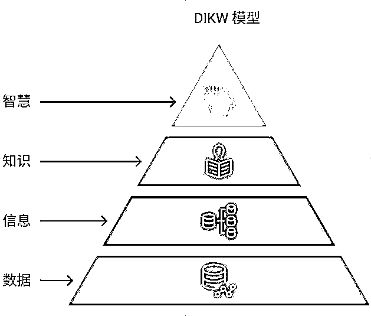

如果用一句话概括，DIKW 讲的是：数据经过加工变成信息，信息经过理解变成知识，知识最终支撑明智的行动，也就是智慧。

知识库就是这个链条里「知识」的存储层；至于怎么用得好，还是离不开人的智慧。

# 1.1.2 知识库的定义

知识库可以理解成一个更聪明的笔记本。书、图片、视频、语音、文件都能统一收纳，支持一键搜索、自动分类，还能帮你发现内容之间的潜在联系。

为什么说知识库是「第二大脑」？因为人脑的记忆容量有限，容易遗忘，也难抓重点。知识库相当于一个外部记忆体，把重要信息、经验和灵感集中保存，需要时随时取用。

AI 知识库的价值，在于把散落的碎片变成可复用的资产。遇到问题直接检索，省时省力；信息整理得越系统，思考也能走得更远。

# 1.2 知识库的发展现状与趋势

知识库的雏形早已有之，比如公司内部 FAQ 库、维基百科。但过去人工维护负担重、检索体验差、理解层次浅，实际使用并不理想。

AI 时代的到来，相当于给传统知识库装上了一台「智能引擎」。你可以把笔记、文件、灵感、甚至关注的博主内容都投进去，AI 负责收拢、分类、提取重点，并随时响应查询。

比起以前只会存储的「笔记本」，现在的个人知识库更像一个主动的助理：自动总结、提炼要点、跨库联动，查找速度也大幅提升。建几个专题库，资料放进去，AI 一分析，想找什么几乎一搜即得。

团队场景同样受益：知识可以共享，成员持续补充，省去来回传文件、找资料的麻烦。无论是工作、学习还是项目协作，都能派上用场。

总体来看，AI 知识库是一种更高级的个人知识管理系统：帮你不被信息淹没，让知识变成资产，既省心省力，也容易激发新想法。

# 1.3 适合个人使用的知识库工具

# 1.3.1 主流工具速览

市面上的知识库产品各有侧重，下面用一张表快速扫一遍：

| 名称 | 一句话点评 | 公司/团队 |
|---|---|---|
| ima copilot | 腾讯出品的智能工作台，搜读写一体，可检索👸号文章，个人库 30G，有知识库广场。 | 腾讯 |
| Get 笔记 | 可录入语音、图片、链接、文字，自动整理、翻译、摘要、打标签，还能把直播/视频转成文字。 | 得到 |
| 飞书知识库+知识问答 | 与飞书网页、多维表格、会议纪要等深度打通，适合做知识沉淀，权限精细。 | 字节/飞书 |
| Coze（扣子）知识库 | 结构化知识管理配合多种大模型，可接入工作流和智能体，快速搭建知识应用。 | 字节/扣子 |
| 秘塔 AI 搜索 | 文档、网页、搜索结果可归入专题，兼具全网搜索与库内问答，还能生成概念图、术语表等。 | 秘塔 |
| notebooklm | 可上传文字、PDF、Google 文档、简报、YouTube、音频等，AI 自动给出摘要和标签；能对资料提问，也能生成播客式音频。 | Google |
| Flowus 息流 | 云端笔记+在线文档+知识库+文件夹，块编辑器与多维表格灵活，AI 可阅读、总结、对话。 | Flowus 息流 |
| 星火知识库 | 科大讯飞出品，把企业文档转化为可检索的知识库，适合客服、培训、办公等场景，支持系统集成。 | 科大讯飞 |
| Notion | 笔记、任务、数据库、维基、日历、看板一站搞定，模块化设计加上多维数据库，模板生态丰富。 | Notion |
| 纳米 AI 知识库 | 覆盖 61 种文件格式，具备多模态理解能力，可自动生成摘要和标签，个人空间默认 36G。 | 360 |
| 火山方舟 | 可解析飞书云文档，兼容十多种格式；企业级容量大、检索快，安全合规措施到位。 | 字节跳动 |
| flowith | 画布式界面，多个 AI 可协同工作；Oracle 模式能自主规划复杂任务；「知识花园」自动拆解文档，还有知识库交易市场。 | flowith |

# 1.3.2 本次航海重点工具对比

综合考虑功能完整度与上手难度，本期航海重点带大家实践五款工具：ima、Get 笔记、飞书知识库+知识问答、腾讯元器，以及 Coze 知识库（后者将在实操章节展开）。掌握这些之后，可以继续探索其他工具。

### ima.copilot

- 定位：腾讯开发的智能工作台，把搜索、阅读、写作整合在同一流程中，围绕个人知识库提供问答、总结、创作等 AI 交互。
- 底层模型：混元与 DeepSeek-R1 双模型。
- 官方入口：https://ima.qq.com/
- 运行平台：Mac 客户端、Win 客户端、iOS、安卓、🛰️小程序。
- 面向人群：学生、研究者、知识工作者、内容创作者，以及需要信息整理和写作提效的人。
- 主要看点：👸号文章可直接作为知识来源；可上传 PDF、Word、PPT、Markdown、图片等；设有知识库广场；个人空间 30G，发布成共享知识库不占个人空间。
- 短板：笔记功能偏简单，没有标签和文件夹；知识库不支持导出；无 API 接口。
- 费用：免费。

### Get 笔记

- 定位：一款以「随手记+深度整理」为目标的 AI 笔记工具，支持语音、图片、链接、文字四种输入，可自动润色、翻译、总结，并把碎片笔记整理成系统知识库。
- 底层模型：DeepSeek R1 / 豆包。
- 官方入口：https://biji.com/
- 运行平台：网页版、iOS、安卓、🛰️小程序（没有电脑客户端）。
- 面向人群：学生、职场人、内容创作者、自媒体运营者，也适合普通用户。
- 主要看点：独创手机内录功能，可录制直播、视频、播客并自动转成文字；订阅抖音/视频号博主，每天 8 点更新前一日视频摘要；输入直播链接可生成章节纪要；AI 自动识别主题并打标签；支持从得到、flomo、🛰️读书导入笔记。
- 免费权益：3 个知识库，单个 10G，总计 30G；每个库最多订阅 10 位抖音博主+10 位视频号博主；单次录音上限 1 小时；每周 100 次 AI 处理。
- 付费权益：199 元/年，10 个知识库，单个 50G，总计 500G；订阅 50+50 位博主；单次录音 12 小时且不限次数；AI 功能无限使用。
- 短板：复杂长文档的排版能力较弱；协作仅限团队内部，分享功能有待加强。

### 飞书知识库+知识问答

- 定位：面向企业的知识管理与智能问答工具，把飞书网页、多维表格、会议纪要等内容统一纳入检索范围。
- 底层模型：DeepSeek R1 / 豆包。
- 官方入口：https://ask.feishu.cn/
- 运行平台：网页版，以及内置在飞书 App 中的 iOS/安卓端。
- 面向人群：企业员工、知识工作者、客服团队、教育从业者等。
- 主要看点：飞书内积累的信息越多，可检索范围越广；AI 助手可直接回答业务问题；权限可精细到不同查询群体。
- 费用：个人账号统一存储，云空间、妙记、邮箱共 100G；企业用户按付费套餐获得容量，支持扩容。
- 短板：对🛰️👸号、视频号等内容源的抓取能力较弱；没有独立客户端，知识问答和知识库分属两个模块。

### 腾讯元器

- 定位：腾讯混元大模型团队推出的智能体创作工具，可自动挂载👸号历史文章作为知识库。
- 底层模型：混元 TurboS / DeepSeek V3 / Moonshot V1。
- 官方入口：https://yuanqi.tencent.com/
- 运行平台：网页版，无手机版。
- 面向人群：企业用户、👸号主等。
- 主要看点：智能体可一键发布到 🐧、🛰️客服、小程序等腾讯系渠道，并提供 API 接口；免费策略下知识库容量 1G，发布到腾讯系渠道 token 不限量；API 调用免费赠送 1 亿 token，超出后在腾讯云按量计费。
- 短板：智能体商店和插件生态还不够丰富。

# 1.4 知识库的常见应用场景

知识库的适用范围很广，大致可以从三个层次来看：

- 个人场景：学习笔记、读书摘录、兴趣收藏、生活规划、健康管理，都可以沉淀成私人知识库。
- 专业场景：律师沉淀案例和法条，设计师整理作品和灵感，程序员维护技术文档，自媒体人管理选题和素材。
- 企业场景：产品说明、培训资料、客服话术、会议纪要等统一入库，方便团队检索、复用和知识传承。

日常自用：课程笔记、阅读摘抄、出游方案，都能收进同一个资料空间。刚学一门新东西时，把参考材料和零散想法一起归档，之后检索、回看都省事；安排旅行时，把路线、打卡点、餐饮信息归在一处，出发前不用到处翻。

职业办公：行业材料、项目档案、调研报告也适合集中收纳。产品经理梳理竞品与方案，老师组卷，律师整理判例和法规，都能派上用场。

组织协同：公司内部的经验、制度、操作流程统一沉淀。会议记录、工作流程、培训课件放在一处，成员随取随用，少做重复沟通，配合更顺。

自用示例：
以出游资料库为底做行程。先在 ima 知识库中检索并加入相关出游资料库，再向 AI 发问，获取一条可参考的路线。
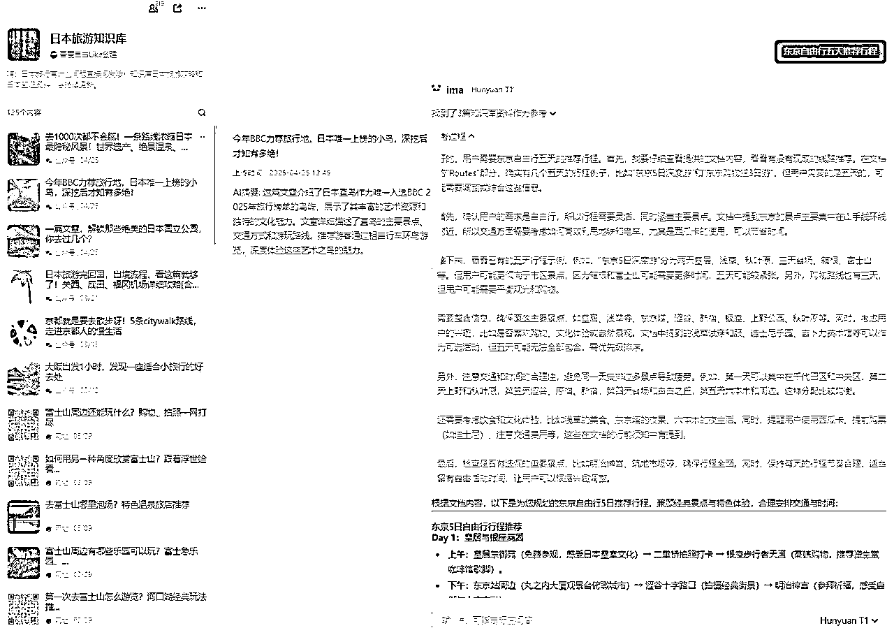

职业示例：
老师依托数学题库，按年级水平快速组出一份卷子，还能指定题型、难度。
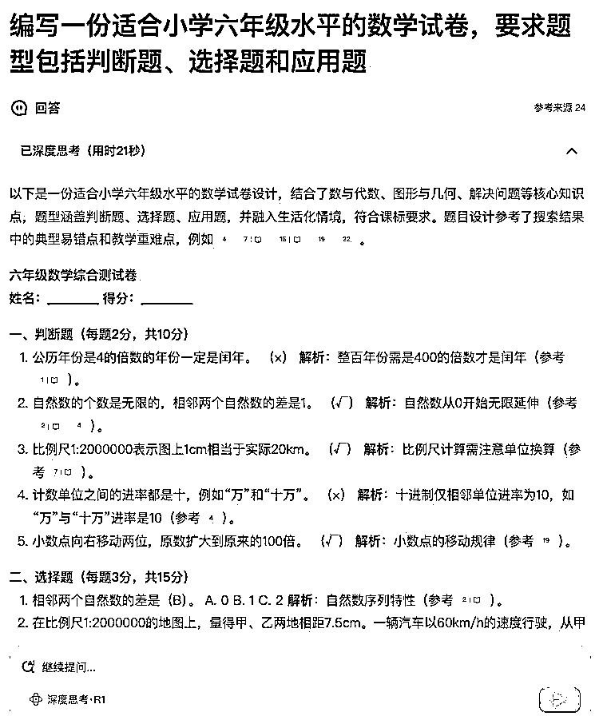

组织示例：
把资料库里多份会议录音转写稿汇总，自动产出会议纪要。
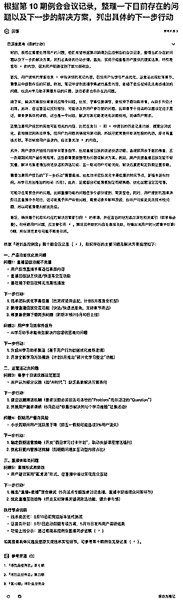

# 二、把资料库搭起来 @来来 @飞掌柜 @佳文 @半目

# 💡 先看本章
教练们一起梳理出当下较顺手的 5 款资料库工具：ima、Get 笔记、飞书知识库+知识问答、腾讯元器、Coze 知识库。接下来会用轻量场景，带大家逐一走完使用路径；基础操作熟了，再往复杂应用推进。

也别忘了：工具上手不难，难的是让结果更准——素材质量与提问方式都很关键。

话不多说，工具备好就开练。

# 💡 通关地图
完成本章学习与练习，可拿下路线图第二阶段：掌握 AI 知识库基础搭建（约 6 天）

1. 借助 ima 创建【DeepSeek 材料】库（约 1 天）
2. 借助飞书创建【AI 写作项目】库（约 1 天）
3. 借助 Get 笔记创建【AI 直播精华】库（约 1 天）
4. 借助腾讯元器创建【👸号智能客服】库（约 1 天）
5. 借助 Coze＋飞书创建【AI 企业】库（约 1 天）
6. 借助 Ollama+Cherry Studio＋AI 本地模型创建【AI 央企】库（约 1 天）
7. 把资料库用得顺手，让结果更准（约 0.5 天）

# 2.1 个人资料库落地

# 2.1.1 借 ima 建【DeepSeek 材料】库 @飞掌柜

# 2.1.1.1 为什么选 ima 资料库
ima 是围绕资料库打造的智能工作台，已接入腾讯混元（含 T1）与 DeepSeek R1 满血版。以我的使用感受，它在同类产品里相当顺手。

可以把它视作创作者自己的资料仓：分为私人库和共享库，支持补充、整理、检索资源。进入共享库，既能浏览他人筛过的干货，也能接触更多渠道的信息与经验。

这次以 DeepSeek 材料库做演示：

1、创建时：按岗位、领域或兴趣定主题。手上有本地文件就直接传；没有就去👸号搜文章，或到“知识库广场”按关键词找。
2、维护时：每天补 1 条，关注者会更愿意常来。文件类型不限，PDF、Word、PPT、图片、👸号链接都行。
3、调用时：可按标签限定范围提问，也可先分组再针对某个文件夹问；专属库、私人库都能单独提问，场景更灵活。

总体看，ima 很适合做个人资料库。用熟之后，既能提效，也可能服务于项目变现。

# 2.1.1.2 上手路径
官网为 https://ima.qq.com/ ，现有电脑端、手机 APP、🛰️小程序三种形态；电脑端和 APP 到官网点按钮下载。

小程序在🛰️里搜“ima 知识库”即可打开。小程序与 APP 操作相近，而🛰️触达更高频，所以下面以小程序和电脑端为主；APP 留给大家自行摸索，门槛不高。
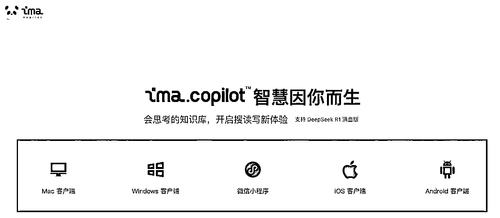

# 1. 🛰️小程序
第一步：把资料导进去
先说明：小程序只支持导入文件，不能新建专属库；要新建请用电脑端或 APP。

在🛰️顶部搜索“ima 知识库”，进入小程序。
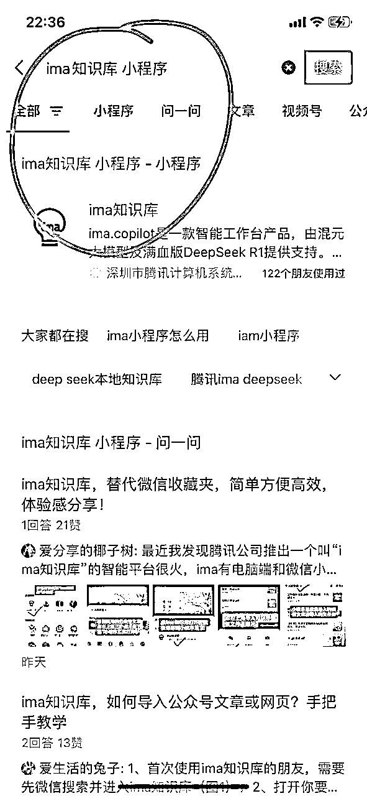
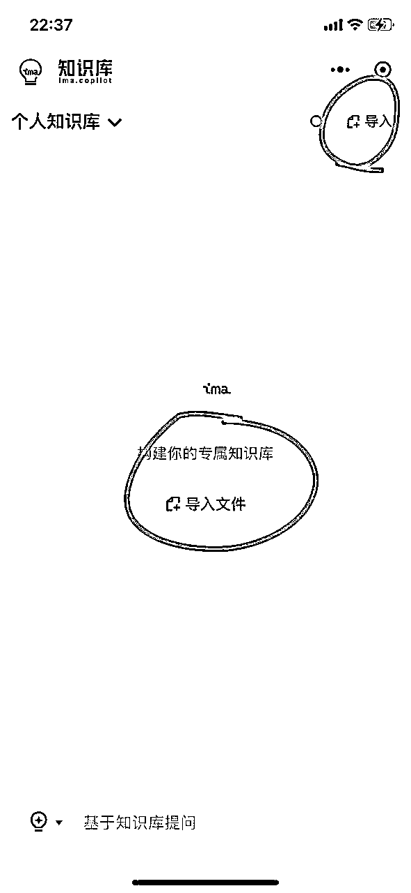
聊天里的文件可批量导入，PDF、PPT、Word 等格式均可；本地图片如 PNG、JEPG 也能加，拍照导入也行。

本次先传一部分做演示。比如 DeepSeek 热度高时，清华、北大、厦大等机构的材料：

01-清华大学第一弹：DeepSeek从入门到精通-PPT版本.pdf

02-清华大学第二弹：DeepSeek如何赋能职场应用（完整版）.pdf

03-清华大学第三弹-普通人如何抓住DeepSeek红利.pdf

04-清华大学第四弹：DeepSeek+DeepResearch：让科研像聊天一样简单（100页完整版）.pdf
05-清华大学第五弹：DeepSeek与AI幻觉.pdf
06-清华大学第六弹：AIGC发展研究3.0版.pdf

07-清华大学第七弹实用DeepSeek赋能家庭教育.pdf
08-清华大学第八弹：文科生零基础AI编程：快速提升想象力和实操能力.pdf

09-清华大学第九弹：DeepSeek政务场景应用与解决方案.pdf

10-清华大学第十弹：迈向未来的AI教学实验.pdf
（如果无法直接下载 PDF，可通过网盘来下载，网盘链接：https://pan.quark.cn/s/77773e1f53c6）

DeepSeek 火起来后，社群每天都有人丢材料，但很多人没空细看。把它们放进 ima 小程序，需要时直接发问即可。
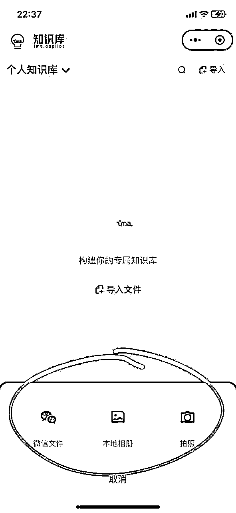
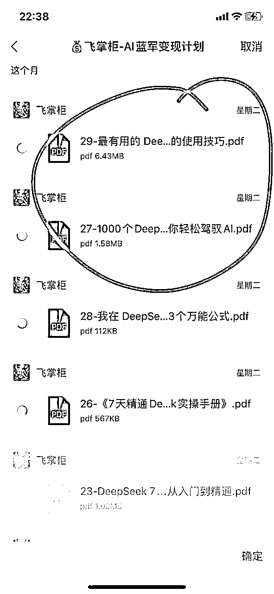
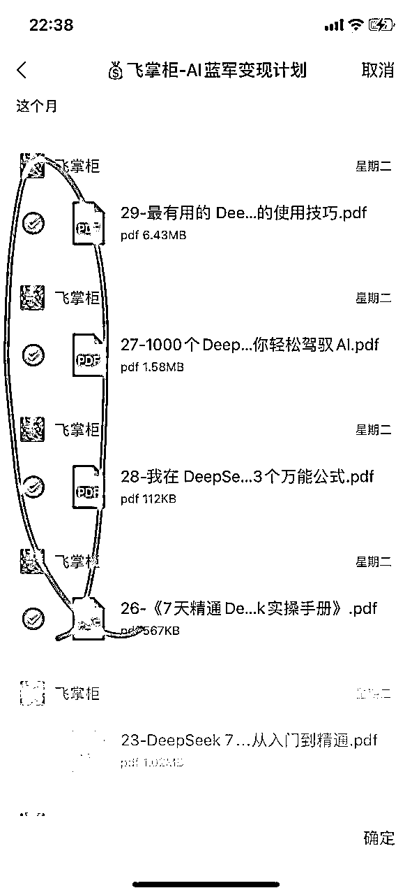
另外，读👸号文章时，点右上角“...”选 ima 知识库小程序，也能快速收进去（前提是你搜过这个小程序）。找对标账号时特别好用：不用再把链接一条条丢给文件传输助手，直接存入 ima，随时取用。

第二步：调用资料库
文件进去后，点下方输入框。选择问全网，相当于检索公开网络；选择问知识库，则只在你的私人库和共享库里找答案。

举例：社群材料很多，想知道哪些能帮助提效、能落在哪些项目上，于是提问“普通人如何利用 DeepSeek 提升效率？做哪些具体项目？”
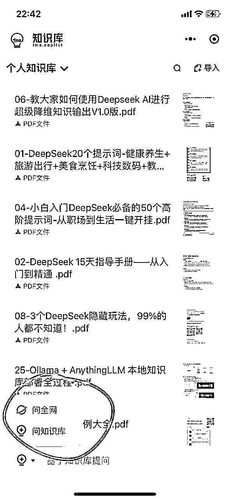
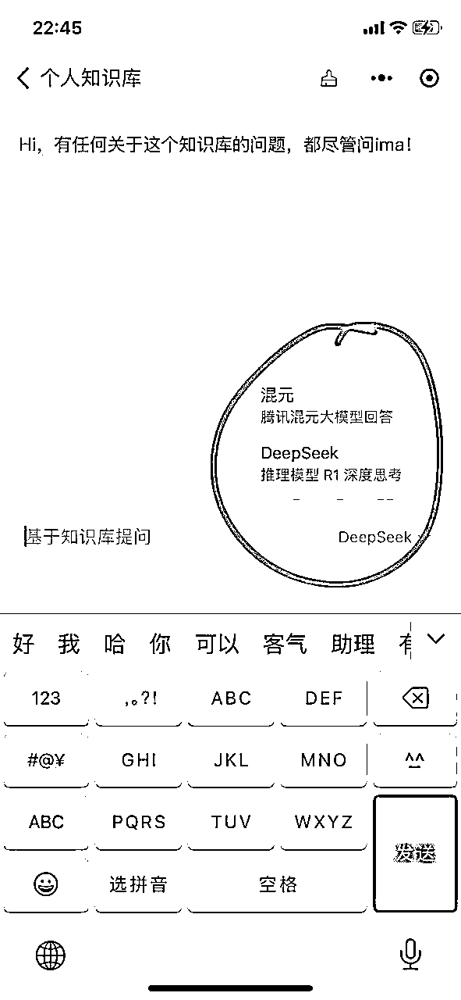
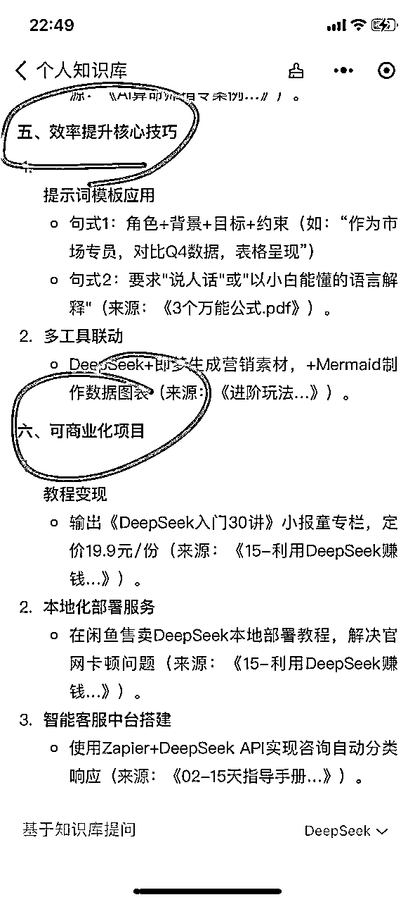
它会在库内检索，归纳成方案，并标出每条信息的出处，甚至定位到页码。

这样能省下大量翻阅与整理时间，适合行业研究、论文写作、报告撰写等案头工作。

第三步：放到手机桌面
也可把小程序添加到手机桌面，点开即用，管理更顺手。
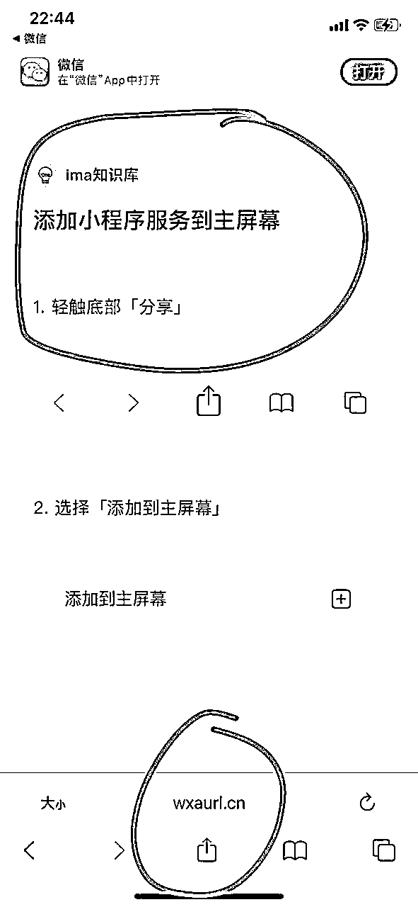
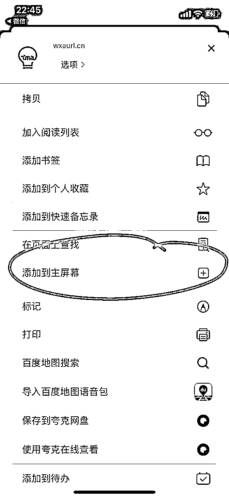

第四步：转发共享库，让资料流动起来

1、点私人库右侧下拉箭头，可切换到共享库。
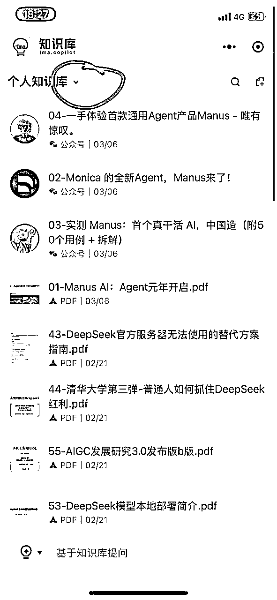
2、点三道杠-分享，进入分享页，可把自建或已加入的共享库转给好友。
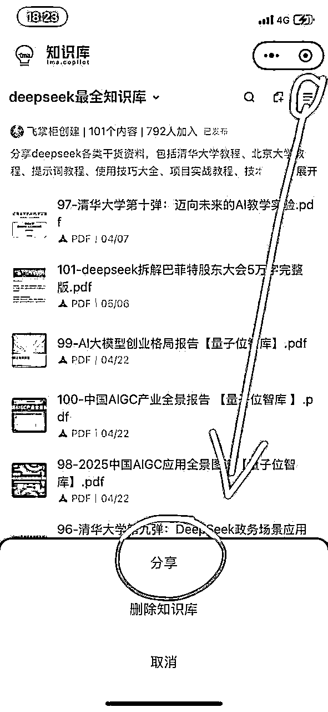
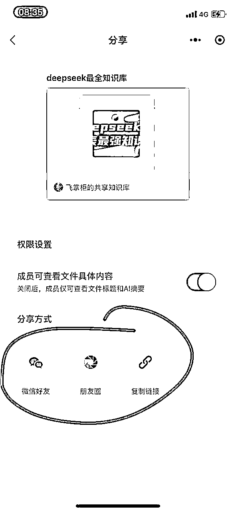

# 2. 电脑客户端
第一步：导入资料
把 PDF、DOC、JPEG、PNG 等文件上传进库。
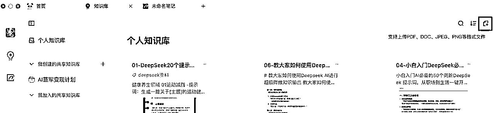
浏览网页遇到好内容，复制链接，粘贴到首页输入框，就能收进私人库，也能移出。
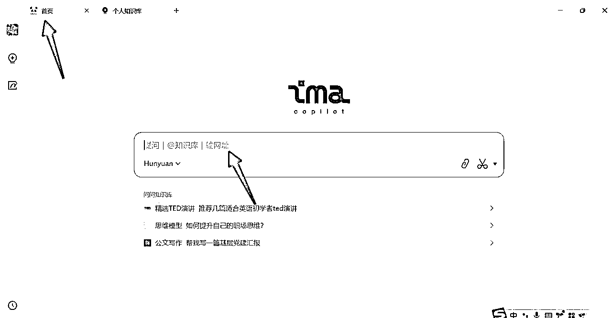
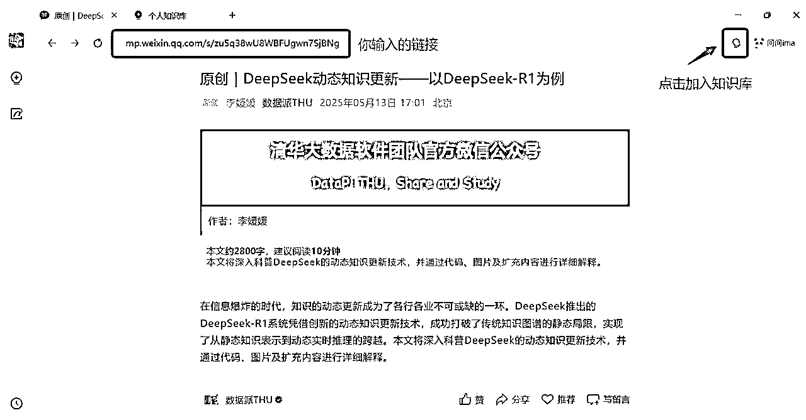
第二步：整理资料库
给每份文件打标签，归类更清晰。
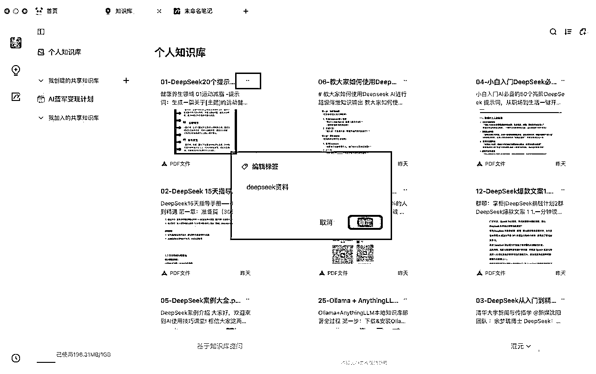
第三步：使用资料库
1、可用关键词搜索定位，并按时间先后筛选。
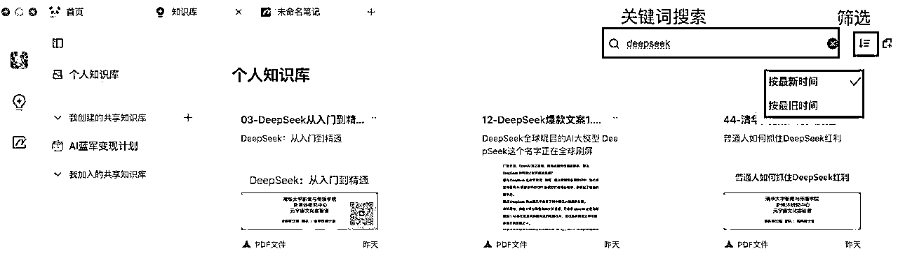
2、提问时可选择混元、混元 T1、DeepSeek-R1、DeepSeek V3。混元与 T1 是腾讯自研，和 DeepSeek 相比稍弱；R1、V3 接的是 DeepSeek，R1 偏深度推理，V3 偏通用。

【结论】要深度思考选 R1；日常通用选 V3 即可。

3、ima 能围绕库内内容给出更贴合的回答。提问时输入#选标签，就能限定在某个标签下作答。这也是打标签的意义。
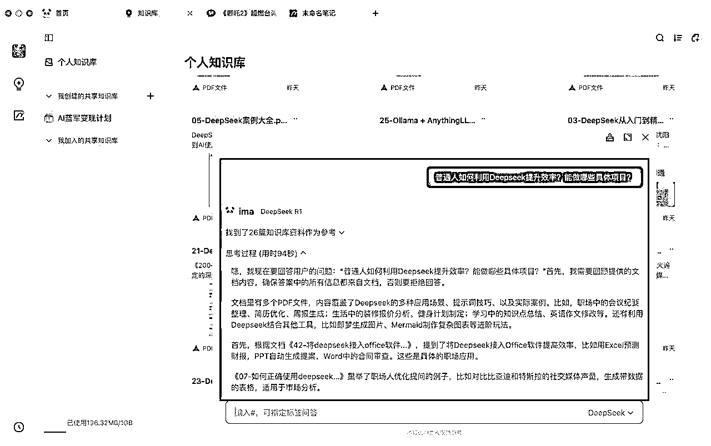
第四步：建共享库
点加号创建共享库，填名称、封面、描述，便于团队共用。内容可从私人库或本地文件导入。

还能管理成员、设置查看权限。通过链接或二维码分享，让资料流动。
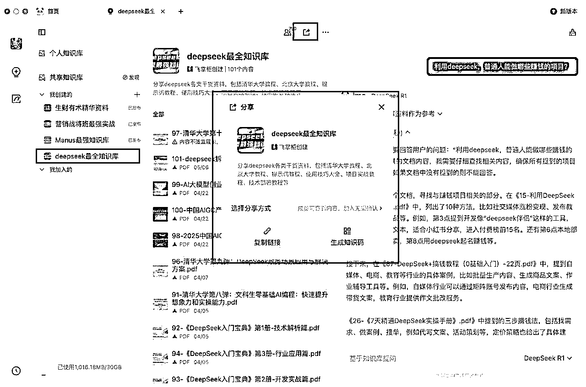
好，共享库创建完成，几分钟就能搞定，动手试试。

# 2.1.2.3 用法复盘
借助 ima 建库，可收获五方面价值：

1、【学习提效】建立私人库后，用 DeepSeek 做限定范围内的问答，不必逐份翻材料。市场研究、行业报告类工作尤其受益，学习与整理都更快。
2、【知识传播】建立共享库，把优质材料传到广场、社群或朋友圈，形成小范围高密度信息源；加入他人库还能一键收藏要点，整理与扩散都更高效。
3、【社交引流】和飞书知识库、知乎直答、Get 笔记知识库相比，ima 长在🛰️生态：熟人转发顺手，陌生人拓圈也方便（共享库可放引流信息）。就我的体验，它相当好用。
4、【B 端市场】从机构端看，不少公司想基于 DeepSeek 部署内部库，常拿 ima 做对标。你若用熟，遇到这类项目就是露脸机会。
5、【搞钱机会】ima 迭代快，已逐步连通👸号，未来或许连视频号，让优质内容在“AI 知识库”赛道流转更顺。信息流速越快，商业机会越多。

另外，ima 属腾讯产品，更新频繁，也会同步功能升级要点。近期几项更新都值得关注：
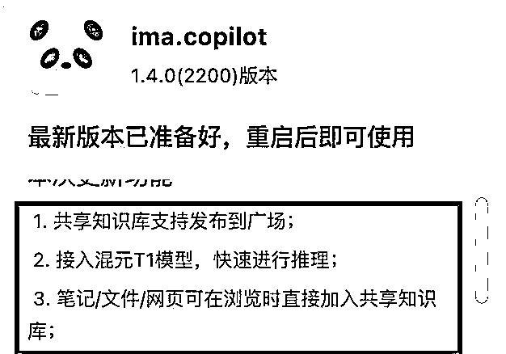
1、共享库可发布到广场

这意味着自建库更容易被看见，传播速度甚至快过网盘，查资料、搜内容也更方便。没想到抢网盘生意的会是 ima！

【效果实测】看到消息后我马上把库发到广场，几天就有 790 人加入，速度惊人。

发布后列表会显示“已发布”，点共享库右上角“发现”即可进入广场。
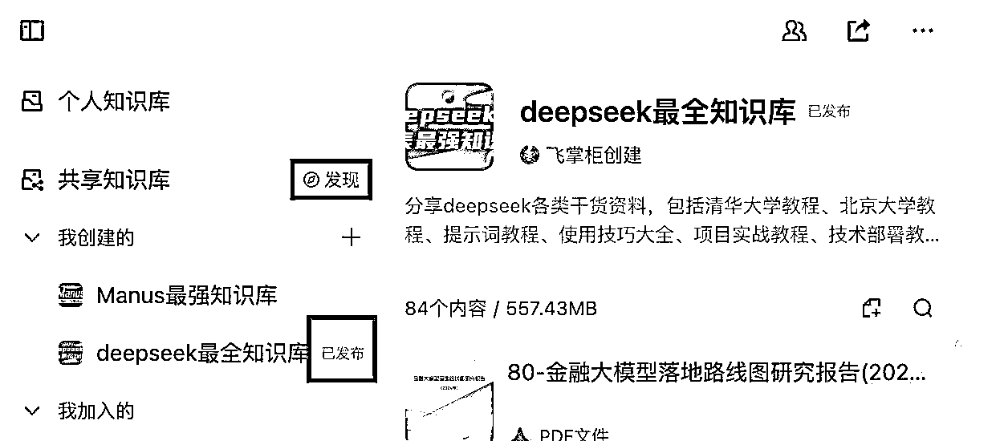
广场里有官方机构、各路高手分享的库，比如 DeepSeek 全方位指南、浑水调研等。这波引流大概率是必争之地，未来或许会成为大流量入口。
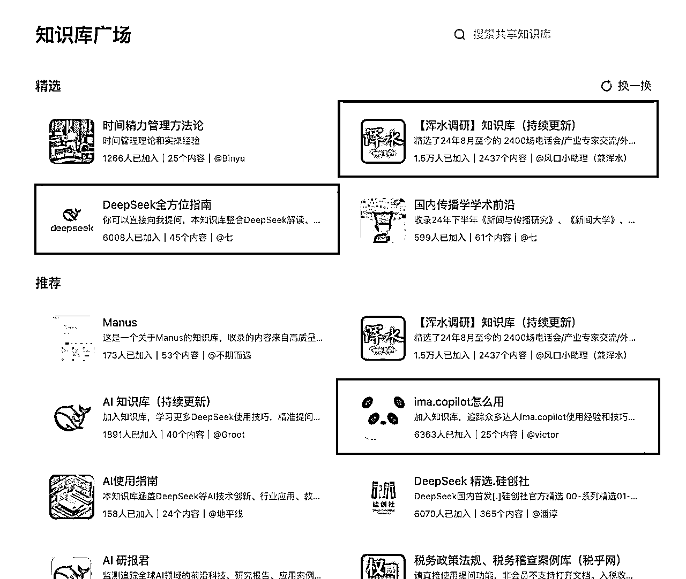
2、接入混元 T1、DeepSeek V3，提问时模型更多

DeepSeek R1 强在推理，腾讯跟进很快，优秀就该学。做项目也一样，看到好的就对标。

【效果实测】库内问答已能调用混元 T1，我试了下，质量不错，感兴趣可以上手。

3、笔记/文件/网页浏览时可直接加入共享库

以前只支持网页（👸号文章），现在类型更全，素材更新更及时。

# 2.1.2 借飞书搭【AI 写作项目】库 @飞掌柜

# 2.1.2.1 飞书问答工具强在哪
飞书知识问答是飞书官方推出的资料库工具。它会把你上传的材料、浏览过的飞书文档作为数据源，还能调用 DeepSeek R1 做深度思考、联网搜索与智能问答。

它能解决的核心问题：

1、你刷过不少飞书精华文档，看完就忘，要用时找不到；
2、你写过很多飞书文档，产出太多，缺系统整理与归纳；
3、你浏览网页时想存进飞书，却不知道装飞书剪存插件可一键保存（第二步会讲）。

# 2.1.2.2 上手步骤
第一步：登录飞书知识问答官网：https://ask.feishu.cn/topic

打开链接就是下图：

1、“使用知识”和“联网搜索”最常用。深度思考呢？已自动集成进 DeepSeek R1，所以会显示深度思考模式。
2、可调用两个模型：DeepSeek R1（满血版+深度思考模式）、豆包模型。
3、库内文件可本地快速上传，也可从🛰️导入；🛰️导入会用到飞书小程序。

第二步：上传资料

飞书库的文件来源有两类：

① 你曾在飞书打开过的文档，会自动收录进系统，无需重传；用飞书知识问答搜索时，能自动检索到这些文档信息；
② 你可上传本地文件，或通过小程序上传聊天里的文件。

总的来说，飞书与 ima 的差异在于：飞书的大部分文件不用手动上传，而 ima 需要逐份传。
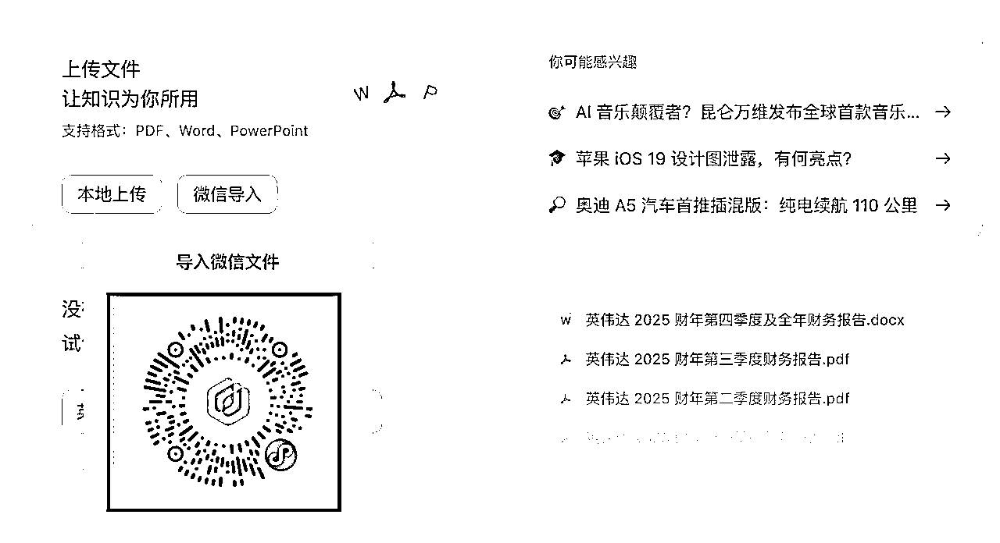
这次以【AI 写作知识库】为例，把下面这些材料作为写作资料传到飞书知识问答，建好库就能提问。

这是 PDF 版本：
（如果无法直接下载 PDF，可通过网盘来下载，网盘链接：https://pan.quark.cn/s/77773e1f53c6）

【赚钱技能】AI代写不会变现？50个问题+解决方案给你助力！ .pdf

【赚钱技能】AI写作的三大易上手变现方式详细教程.pdf

【赚钱技能】如何用deepseek批量生成👸号爆款标题+爆文？.pdf

【赚钱技能】如何用deepseek做📕爆款标题+爆款文案+知识卡片+批量生成.pdf

【赚钱技能】AI代写三大流量秘籍：公域流量+私域流量+公转私卡点详细教程.pdf

这是飞书文档版本：

# 三款AI内容库搭建指南：飞书剪存、Get笔记、腾讯元器

先放五份能直接打开的飞书文档，都是现成的操作参考：
1. AI代写常见50个问题及破解思路：https://kqubish8iq0.feishu.cn/docx/J1l8dgVfco3y6Hx4a2gcfEbnnre?from=from_copylink
2. AI写作三种易上手的变现方式详解：https://kqubish8iq0.feishu.cn/docx/RlVFdRcutoEiQtxABvBcvpfwnND?from=from_copylink
3. AI代写流量获取：公域、私域与公私衔接方案：https://kqubish8iq0.feishu.cn/docx/H7KMdCdVroYMevxUbpPca51cnje?from=from_copylink
4. DeepSeek做📕：从标题、文案到知识卡片和批量生成：https://kqubish8iq0.feishu.cn/docx/RRK6dnro7oyHdPx6FLncxyN9nMh?from=from_copylink
5. DeepSeek批量产出👸号爆款标题和爆文：https://kqubish8iq0.feishu.cn/docx/F9dDdlmqToeA3MxQPWxcHm51nve?from=from_copylink

我一直用飞书，很认同“文档即个人知识库”的说法。用久了会发现，很多知识和经验都沉淀在文档里。比如龙哥盟的精华帖，不少作者都会附上自己的飞书链接；自己浏览过的网页内容，也可以随时收进飞书。要把网页存进飞书，可以用“飞书剪存”插件。下面这篇文章正好拿来演示：https://mp.weixin.qq.com/s/1X9wBqWJeglrmYQa0uuZ-Q

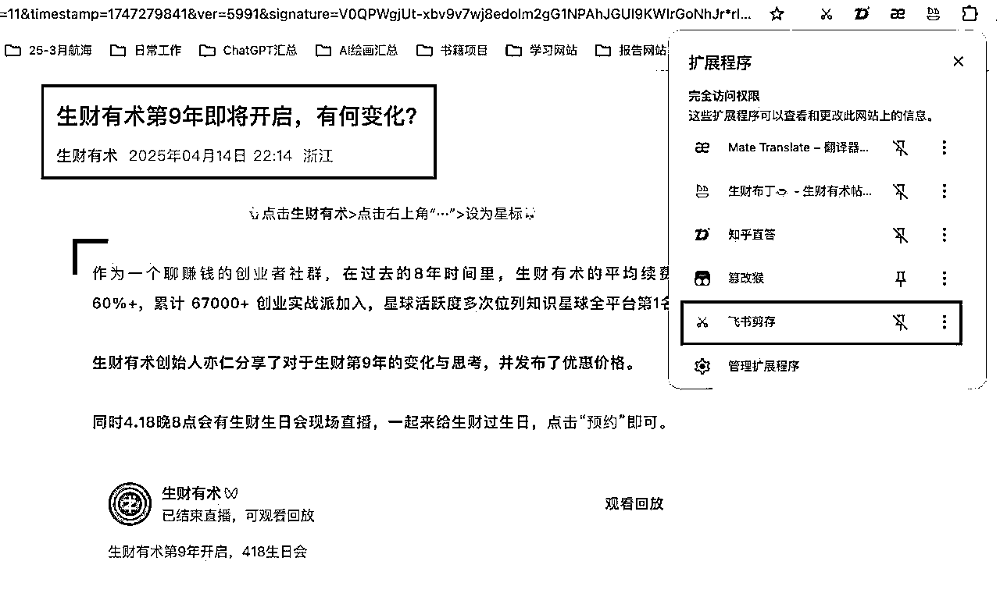

点击插件，网页就会转存为一份新飞书文档，全文可编辑，后续整理非常方便。

怎么安装“飞书剪存”？以Chrome为例，在应用商店搜索“飞书剪存”，直接安装：

也可以下载插件后，放进扩展程序并勾选启用：

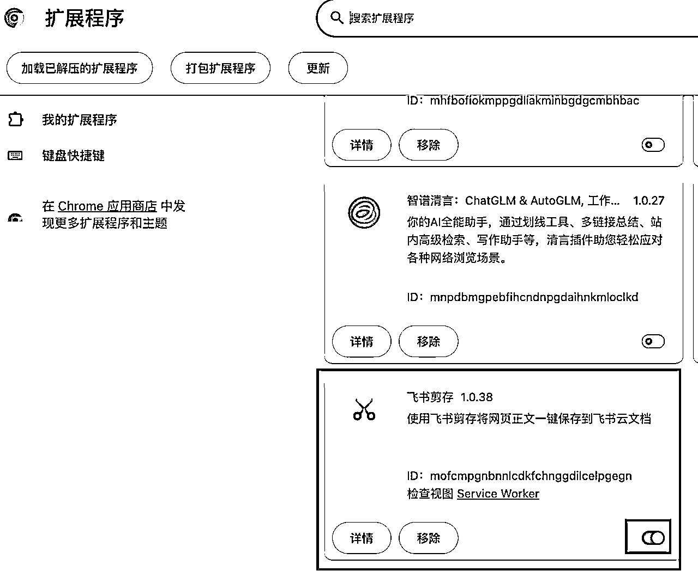

第三步：提问与使用

提问时，可以同时勾选“联网搜索”和“使用知识”，也可以只选一种，或者都不选。

1. 两个都勾选：比如输入“我是个小白，想做好AI代写项目，如何0-1快速闭环？”系统会从飞书本地和互联网双渠道搜索答案，结果如下：

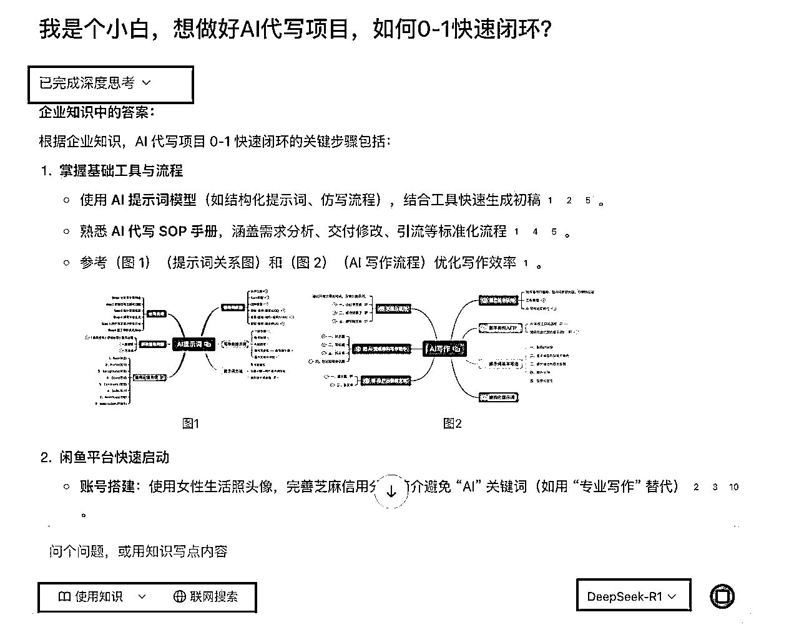

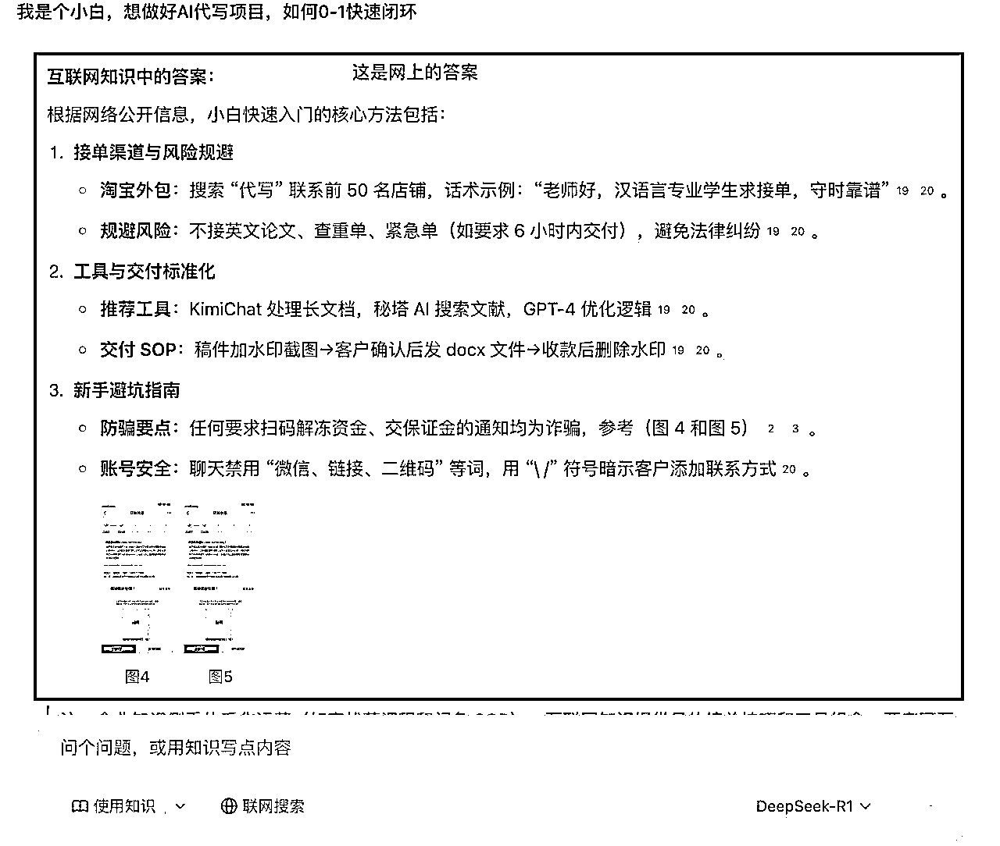

2. 只勾“联网搜索”：比如输入“如何降低AI大模型写出文章的AI痕迹？请给出详细解决方案”，不管选DeepseekR1还是豆包，回答都偏宽泛，不够精准：

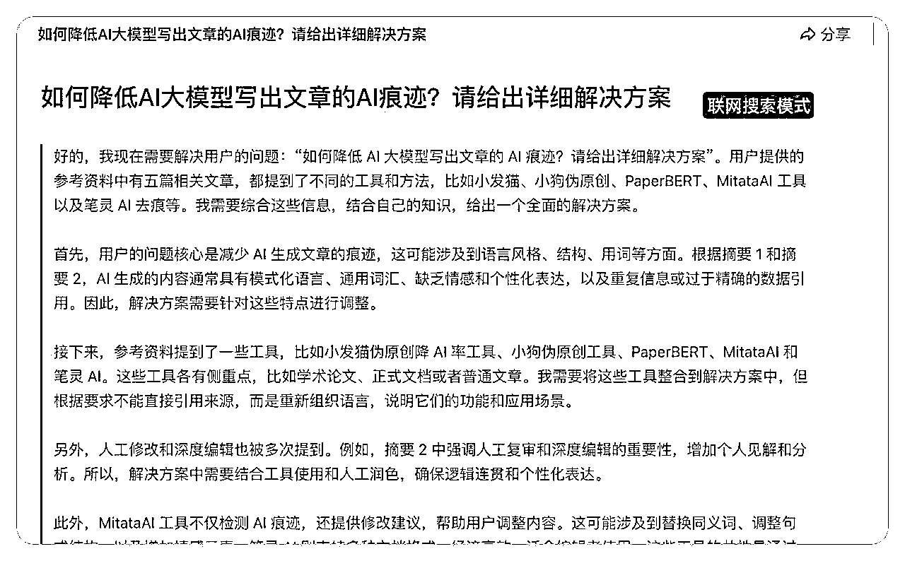

3. 只勾“使用知识”：选择DeepseekR1模型时，它会读取你飞书上的全部文档，答案精准度更高：

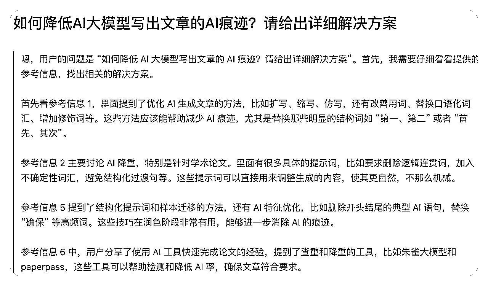

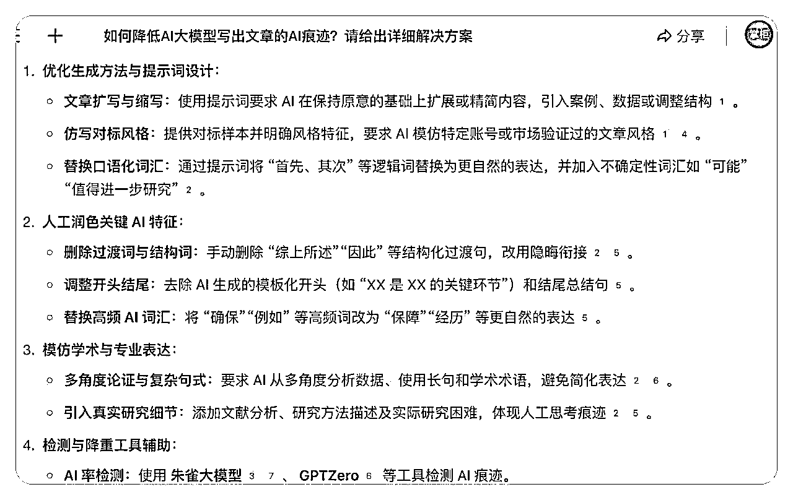

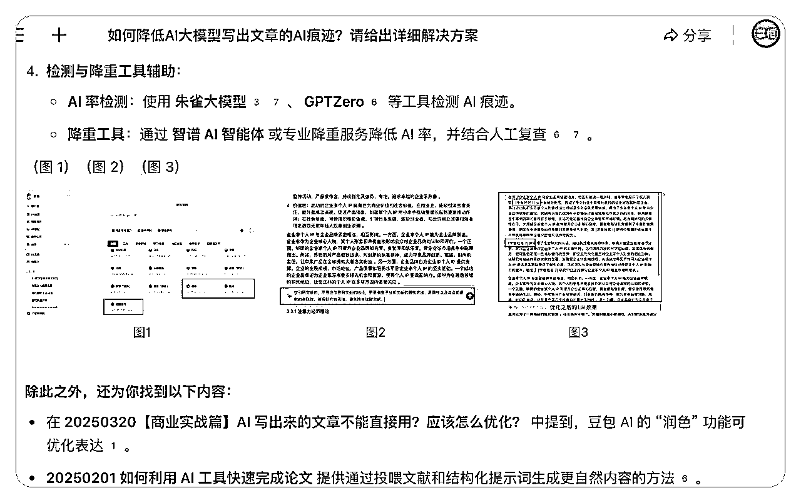

4. 两个都不勾：系统会默认启用DeepseekR1的深度思考功能，结果如图所示：

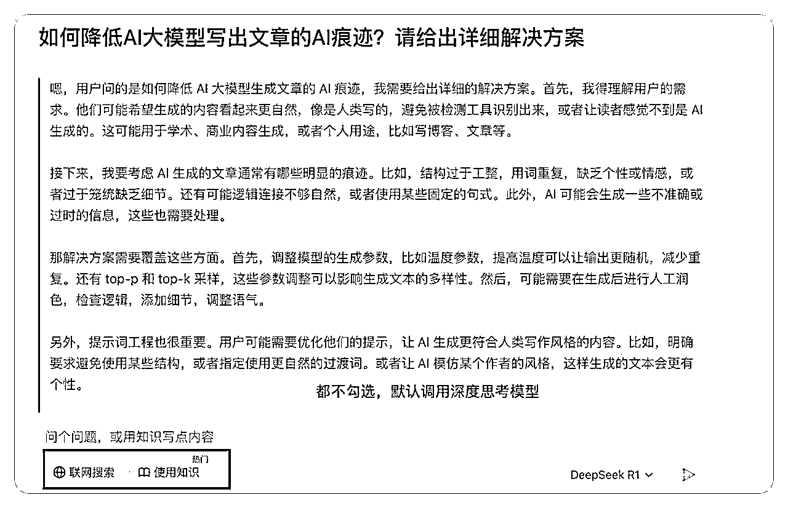

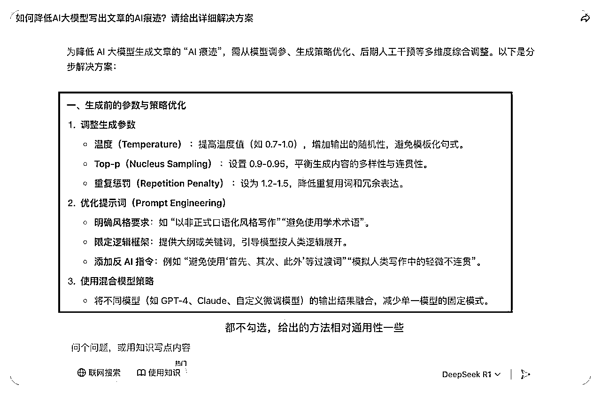

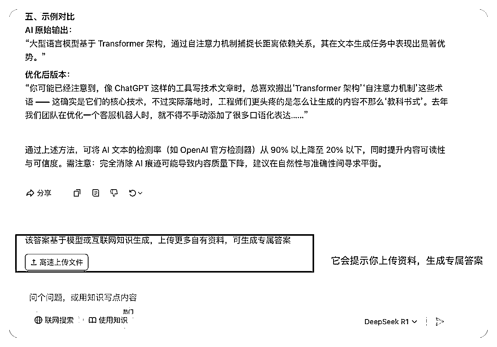

【小结】四种方式按需选：
1. 想同时检索本地和网络，两开关都打开；
2. 只查网络资料，只开联网搜索；
3. 只在飞书文档里问答，只开使用知识；
4. 让模型自由回答，两开关都关；
5. 至于用DeepseekR1还是豆包，自己测试，效果因人而异。

# 2.1.2.3 飞书问答复盘

飞书知识问答的功能整体上不如ima，但它也有自己的优势：

第一，它会调用你所有打开过的飞书文档，不需要你拥有文档权限。想找某个内容却不记得它在哪份文档、也不确定有几份时，它能帮你大忙。

第二，答案不仅系统化，还配有图片，这是让我意外的点，也是ima目前没有的。比如图1、图2、图3，有几次我自己都忘了截过图。

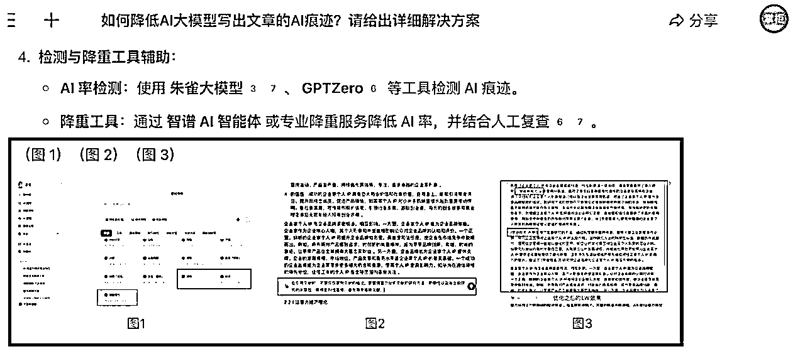

第三，每条结论都能清晰标注来源文档，这一点和ima一致。当然，两者背靠不同公司，使用习惯差别不小。比如ima与👸号内容结合得很好，飞书则对共享文档支持更佳；相对而言，ima与腾讯文档的集成就不够好，可能也跟用户规模有关。

# 2.1.3 用Get笔记搭建“AI直播精华”内容库 @飞掌柜

# 2.1.3.1 Get笔记能解决什么

很多人在记笔记时都会遇到几个问题：
1. 大佬直播太多，根本看不过来，而且时间大多在晚上8点到10点，容易撞车；
2. 看完记不住，过两天基本忘光；
3. 笔记记了一堆，想用的时候却找不到在哪。

Get笔记可以解决上述问题。我常用的功能有三个：
1. 订阅短视频博主：支持批量订阅视频号、抖音博主，自动总结短视频文案，每天定时更新。
2. 订阅直播：追踪视频号、得到直播，自动总结直播内容，并转录出文字稿，最后生成文字卡片。
3. 基于内容库搜索、阅读、写作：接入Deepseek R1大模型，可在库内进行搜索、总结和二创，对自媒体人非常友好。

如果一个工具不太了解，可以先看它的定位。Get笔记是【得到】推出的AI工具，核心能力是AI笔记转录，链接、图片、语音都能一键总结。它和ima一样有APP、网页、小程序三端，信息可同步。

网页版：https://www.biji.com/
小程序：在🛰️搜索“Get笔记”
APP：在应用商店搜索“Get笔记”

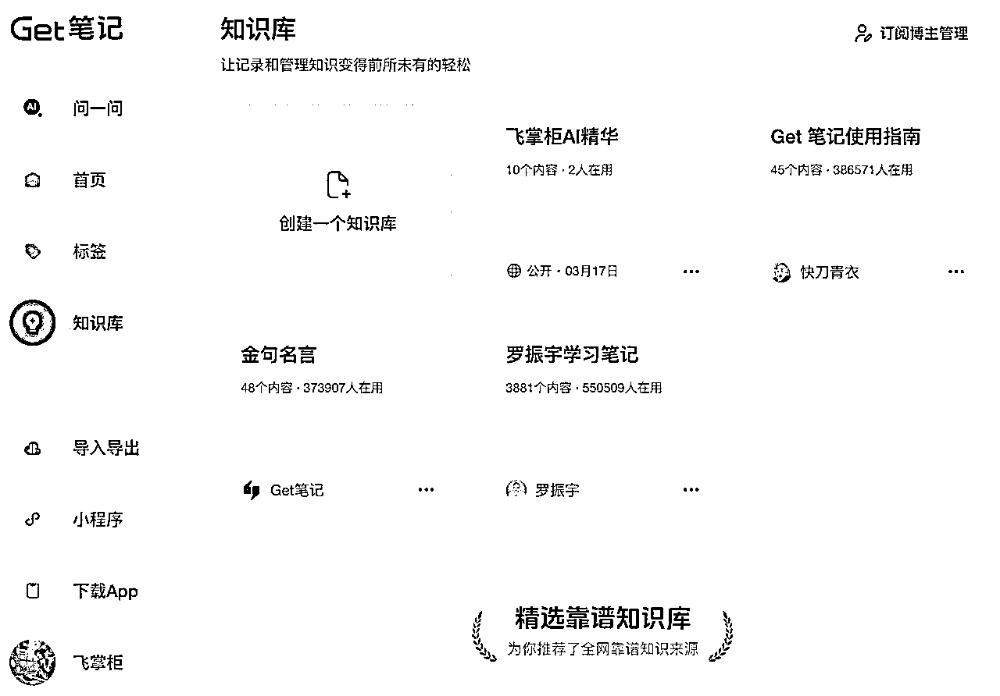

# 2.1.3.2 上手实操

下面以网页版搭一个“AI直播精华内容库”为例，详细演示。

第一步：新建内容库

打开https://www.biji.com/，点击“知识库-创建知识库”，就能新建。比如我做AI赛道，所以建了一个“AI直播精华内容库”，专门放AI直播和博主资料。

第二步：上传资料

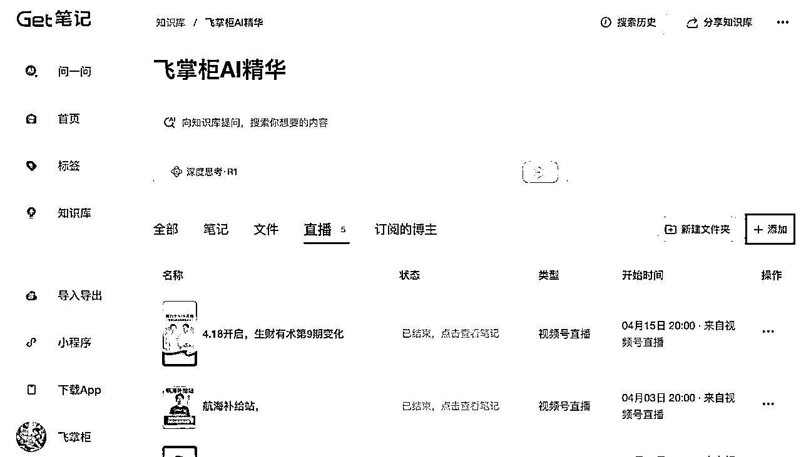

进入刚建好的内容库，点击“添加”，弹窗支持五类内容添加：

1）文件直接上传。以下文件可以作为测试样本：

01《人生亏钱指南》龙哥盟出品.pdf

02《赚钱日历2020》-龙哥盟社群出品.pdf

03《赚钱日历2021》-龙哥盟社群出品.pdf

04《赚钱日历2022》-龙哥盟社群出品.pdf

05《龙哥百问百答》——龙哥盟星球问答_2017-2024合集.pdf

06《100+赚钱高手提供的2021年赚钱建议》龙哥盟出品-完整版.pdf

07《龙哥益语》.pdf

（如果无法直接下载PDF，可通过网盘下载：https://pan.quark.cn/s/77773e1f53c6）

上传后的界面如下：

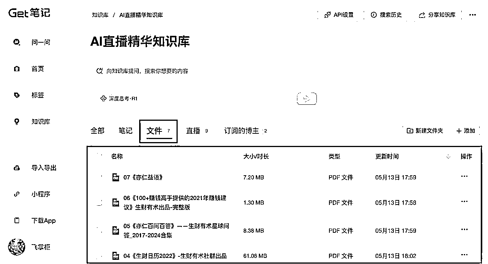

其实上传文件和添加笔记，ima、飞书、知乎直答等知识库都支持，属于标配功能，这里不详细说。

2）选择已有笔记，加入内容库。

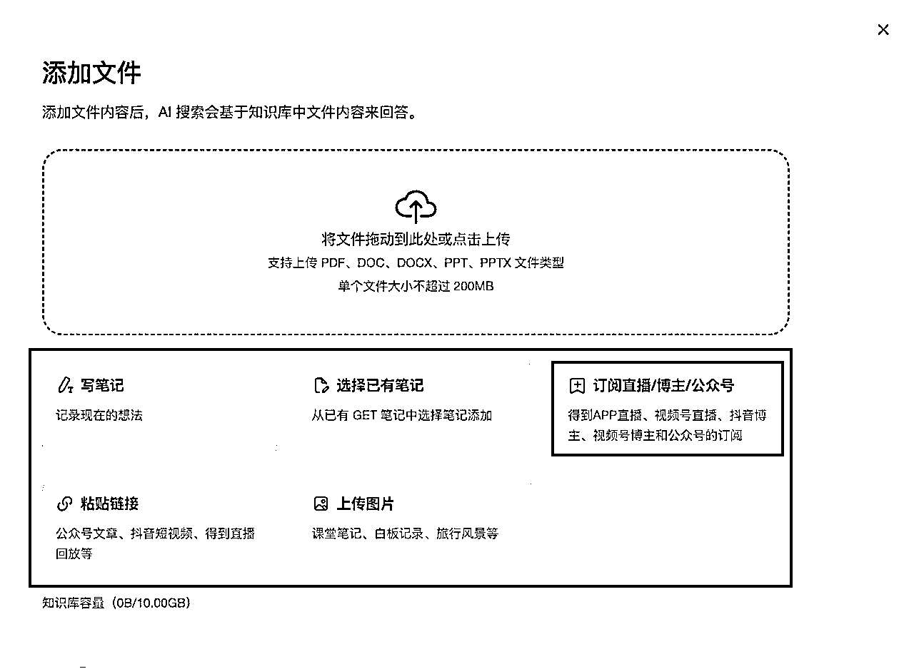

3）订阅直播/博主/👸号：可订阅得到APP直播、视频号直播、抖音博主、视频号博主和👸号。

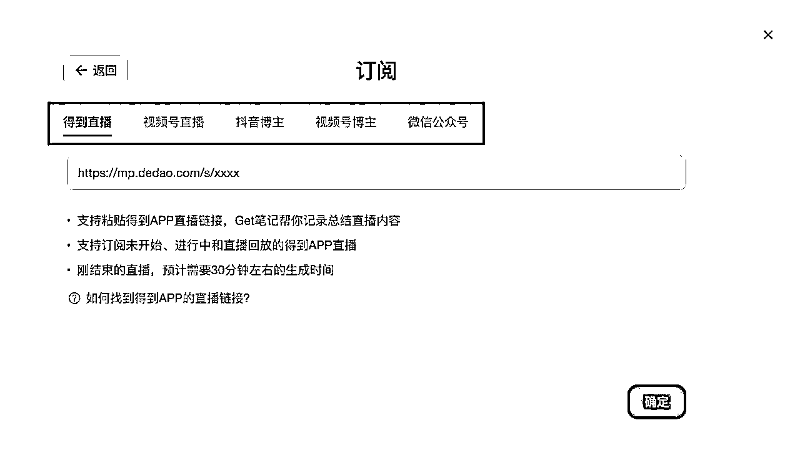

得到直播和抖音直播，直接上传链接即可订阅；视频号直播、视频号博主、👸号，则需要上传预约直播海报、主页截图等。针对视频号直播，订阅成功后，内容库对应类目下就会显示博主和直播信息。比如我提前订阅了赚钱415和418的直播，Get会自动把直播加入待办。

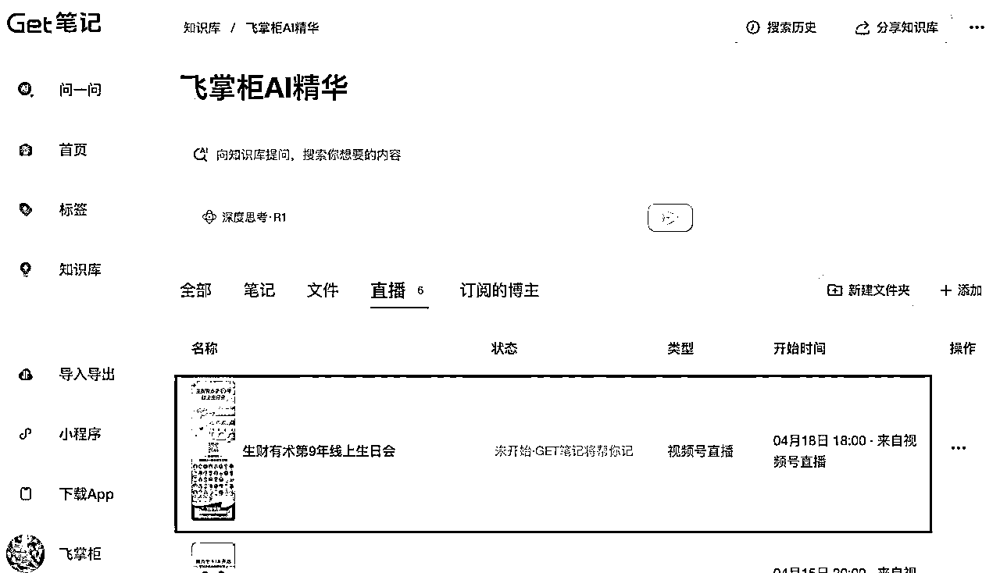

视频号博主也一样。以订阅龙哥盟直播为例，上传赚钱官方主页截图即可成功订阅。订阅成功后的截图如下：

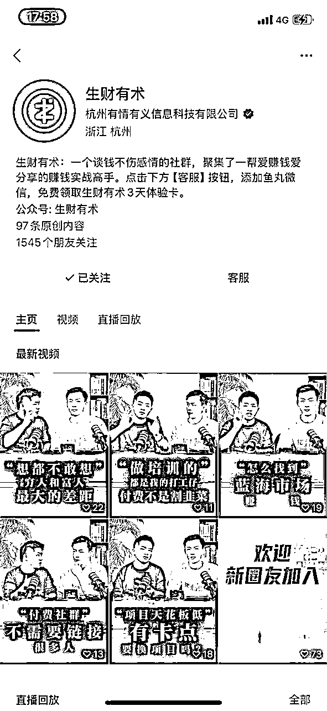

4）粘贴链接：包括👸号文章、抖音短视频、得到直播回放等。

5）上传图片：课堂笔记、白板记录、旅行风景等都可以。

第三步：使用内容库

点开一个已订阅的博主，他所有的短视频列表都在这里。

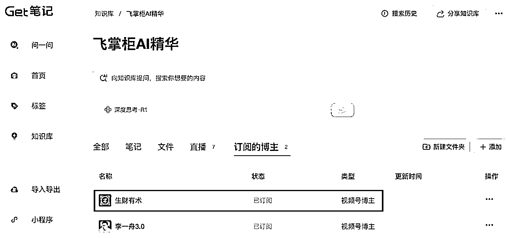

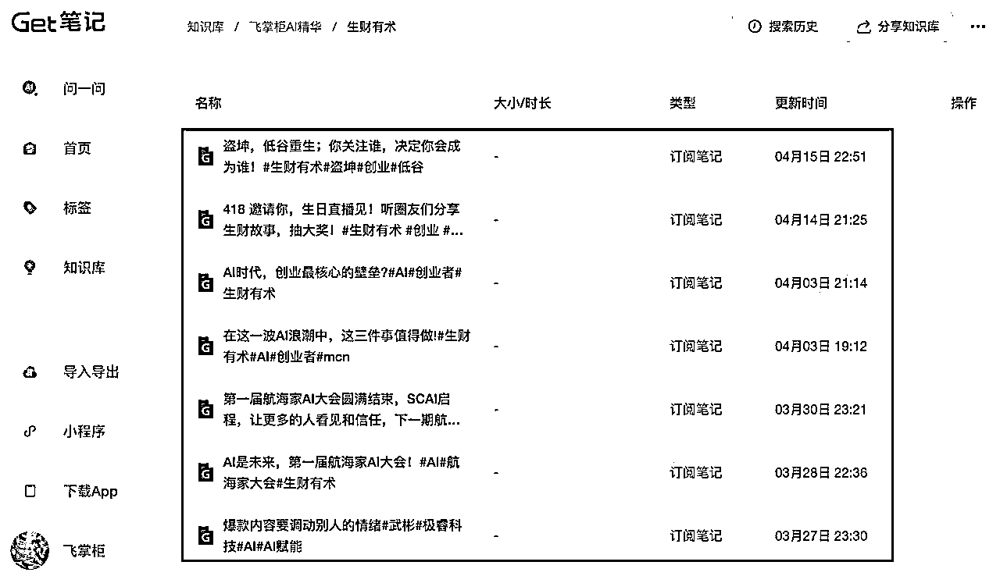

点开任意一条笔记，可以看到Get笔记自动整理的短视频核心框架，快速把握重点，也方便借鉴。

点开上面的蓝色链接，能一键提取短视频文案。Get笔记也抓了原视频链接，不过有一点需要注意：视频号抓到的只是封面图，抖音可以直接跳到原视频地址。

视频号直播也一样，直播结束后会自动提取重点和逐字稿。比如赚钱415直播，结束后能看到精华总结。

以上步骤都是AI自动完成的信息搜集与整理，之后我们就可以基于内容库做搜索、阅读和写作了。

可以在内容库页面或首页提问框发起创作。比如我搜索“帮我找到龙哥盟点赞数超过100的短视频，并进行总结和拆解”，输出如下：

也可以让AI做方法论总结。我输入“如何用AI批量生成👸号爆文？我假如想做这个项目，应该如何上手”，得到这样的回答：

这个回答质量很高，用五步实施框架拆解了AI👸号爆文的具体玩法，每一步都有实操方法。

针对细分赛道，比如我做AI写作，经常要写文案，也就是基于内容库二创。因为选了Deepseek R1模型，文案风格非常“Deepseek”。例如输入“帮我写2条📕爆款标题和文案，参考龙哥盟的直播，主题为‘普通人可以选择哪些AI项目进行变现？’”，结果如下：

# 2.1.3.3 小结

综合来看：

1. Get笔记在内容库方面功能很全面，视频、音频、图片、链接、文本都能解析和总结。
2. 视频号、抖音、得到直播、👸号均可一键订阅，直播很火的当下，可以减少用户蹲点的麻烦。
3. 📕和B站虽然不能订阅博主，但可以通过“链接”拆解单条内容、提取文案，非常适合自媒体二创。
4. 还能一键导入得到、🛰️读书、flomo等平台的个人内容，相当于打通了多个平台，未来可能会更多。

同时，Get笔记官方有完整实操教程，搭建过程中遇到问题可以随时查阅：https://doc.biji.com/docs/Cp1FwEQx0iVSAAkmdDkcPtT5niF

当然，AI虽然让知识触手可得，但只会收集整理还不够。除了搭好内容库，要能结合具体项目去变现，才能形成个人核心竞争力。

# 2.1.4 用腾讯元器搭建👸号智能客服 @半目

# 2.1.4.1 腾讯元器的优势

腾讯元器官网：https://yuanqi.tencent.com/

它是腾讯旗下的智能体搭建平台，和字节跳动的扣子平台类似。用腾讯元器搭建基于内容库的AI智能体，最大的优势就是能在腾讯系平台无缝运行，比如👸号。

这部分我来讲怎么在腾讯元器里，搭一个基于内容库的智能体，用作👸号智能客服。最终效果是：客户关注👸号后，👸号会自动扮演客服，基于内容库中已上传好的资料，回答客户的专业提问，从而提升客户加私域🛰️的转化率。效果可以看这里：

甚至可以把👸号客服当成自己的AI分身，承担一部分日常答疑，降本增效。

接下来逐步讲解搭建步骤。

# 2.1.4.2 搭建步骤

第一步：基础设置

1. 打开腾讯元器官网：https://yuanqi.tencent.com/，用手机验证码或🛰️扫码登录：

2. 选左侧栏的“创建智能体”，在弹窗中点击“👸号智能体”：

3. 点击“去授权”，用👸号管理🛰️扫描弹出的二维码，完成授权：

4. 基本信息、简介、头像，根据自己的👸号定位来设置，参考如下：

5. 模型设置建议选默认的“混元-TurboS”或“DeepSeek V3”模型。

⚠️备注：回复随机性、最大回复长度、携带上下文轮数这三个参数，可以把鼠标放在右侧灰色小图标上查看说明，再按需左右滑动配置。不会配置的同学保持默认就行。

第二步：配置内容库

① 系统会自动配好“👸号文章知识库”，默认包含一年内的👸号文章。

想修改时间范围和数量，可以点击上面这张图右上角的“+添加”；在弹窗中找到“👸号文章知识库”右侧的“三个点”菜单，点击“编辑”；继续在弹窗的“三个点”菜单里点“编辑”；然后在编辑页的“历史发布内容获取时间段”中选择“三年以内”或“全部”：

② 如果👸号历史文章较少，样本量不够，或者想新增内容库来丰富素材、扩大AI调用和分析范围，可以继续新增。同样点右上角的“+添加”，在弹窗中点击“创建知识库”。注意右下角两个“启用”都建议勾选（会增强左侧字面意思的功能）。

⭐️弹窗出现后，先在选项里点中【文本类型】，把电脑里的文档传上去，知识库的地基就打好了。
名称、描述这两栏，按这个库要解决什么问题来写就行，下面给个样子：

⚠️提醒一句：正中那个【问答对类型】，一般对应【百问百答】的玩法——拿表格喂进去；而右手边的【👸号文章】，指的就是前面已经自动生成的那份【👸号文章知识库】。

⭐️还是这个弹窗，点【点击上传】把素材文档选进来，再按【保存并添加】。我给它起名【AI 做课】，它就会挂到知识库列表里。后台要跑几分钟的数据处理，耐心等一下。

⭐️这套做法可以复制。多建几个库，一起挂到智能体上。我后来又弄了个【玩赚 DeepSeek】，于是👸号客服面对提问时，能同时翻好几个库找答案。

**第三步：提示词怎么配**

# 💡

库里为什么非要配【提示词】？

一句话：让模型和资料配合起来，回答才准、才相关、才受控。

举例来说，你可以规定 AI 回答客户时用什么腔调，比如模仿半目老师的说话方式。

这步省掉，AI 很可能用不上库里的材料，答得含糊，甚至答偏。

路径一：按官方给的结构化框架自己动笔，适合写过提示词的老手。

路径二：右上角有个【提示词模板】，从官方推荐里挑一个，比如【☎️客服助手】，再把右边那份默认内容改成自己想要的，适合有思路的新手。

路径三：还是进【提示词模板】，这回选【自定义 AI 生成】，左边写清你期望的效果，右边会自动给出提示词，随后稍作调整，适合懒得动手的朋友😉

⭐️我自用的提示词贴在下面，供参考：

# 💡

* 你的身份是半目 AI 分身，专门解答客户的问题。开口先拿出专业度，信息必须准确；同时态度要真诚，让客户愿意信任你。最终目的是通过顺畅沟通，推动私域增长、提高成交转化。回答一律以知识库内容为依据，保证权威、可靠。

**第四步：配好对话开场白**

所谓对话开场白，就是客户关注👸号之后，系统主动说出的第一句。位置在下面：

⭐️我的开场白话术供参考：

# 💡

您好🧡只要是【AI➕】方面的疑问，随时抛过来，【半目 AI 分身】会给出专业解答🌟要是觉得答复不够到位，欢迎加上【半目🛰️：xxx】，咱们再细聊💕

**第五步：关键词回复怎么设**

规则很简单：客户提问里一旦命中你设的关键词，系统就自动替你发预设内容。

⭐️我配的【关键词回复】供参考：

# 💡

关键词：🛰️

🧡加【半目🛰️：xxx】⬇️免费领取⬇️

①《AI➕自用全套工具箱》

②《AI 做课手册》（从 0 到 1）

③《半目小课》（持续更新）

# 💡

关键词：赠送

🧡加【半目🛰️：xxx】⬇️免费领取⬇️

①《AI➕自用全套工具箱》

②《AI 做课手册》（从 0 到 1）

③《半目小课》（持续更新）

**第六步：先测再发**

六步都填完，先到右侧【预览与调试】里跑几轮，确认没问题，再按右上角的【发布】键：

按下【发布】，在新增项里把☑️【🛰️👸号后台】打上勾，接着【确认发布】。

⭐️审核一般不超过 30 分钟。

⭐️通过之后就去自己的👸号演一出：你扮客户，👸号扮客服，验收成果🎉

# 2.1.4.3 二十分钟，让一个 24 小时客服上岗

照着流程走，大约 20 分钟就能完成一个带知识库的智能体。👸号、企业服务、个人创作都能因此拥有一个全天候在线的 AI 分身——客户咨询的响应速度上去了，过去写的文章也不再沉睡，能被反复调用。

不只是售前，平时答疑、售后处理也一样——把👸号丢给客户，让 AI 帮你挡掉那些重复了无数遍的问题。

⚠️几个坑，提前绕开

# 💡

库里的材料避开金融、医疗这类敏感领域，否则审核那关过不去。

万一自动回复打架，把👸号后台原有的自动回复先关掉。相比之下，AI 知识库智能体的应答更准、更聪明。

# 2.2 面向企业与央企的知识库，怎么搭

# 2.2.1 Coze 搭配飞书多维表格：给企业建库的完整教程 @佳文

# 2.2.1.1 这个组合的价值在哪

放到公司环境里看，ima、get 笔记这类偏笔记形态的工具，一遇到表格就吃力。可企业内部天天打交道的，偏偏就是行列分明的结构化数据——客户档案、销售流水、生产排班，全是这种。

把 Coze 和飞书多维表格接到一起，结构化数据再多也能管得住；再叠上 AI 的问答与动态取数能力，企业最在意的三件事——数据体量大、调用要灵活、权限得可控——基本都能覆盖。管理要求严、应用又要活的组织，正适合这套做法。

前提不复杂：手上那张表的格式是统一的（见下图），数据排得整齐，就能交给这对组合运行。

绕不过去的是数据库的索引机制。只有当某一行或某一列被指定为索引，工作流取数才会快；否则只能整表拖着走。

玩法上分两条路：一条是“现成数据”，导进去就用；另一条是让多维表格充当输入输出的对话窗口，一边写一边取。

什么叫现成数据？表已经在手，是过去工作中一点点攒下来的。没有现成数据呢？就是手头空空，但想先把架子立起来。

两种情形的搭建与调用，下面分别说。

提醒一句：这部分务必跟着动手，把工具的基本用法吃透。更贴近真实业务的深度练手，留到后面【章节 3.3 企业场景】再展开。

# 2.2.1.2 具体怎么操作

## 情况一：表已经在手——Coze 建库、飞书调用

哪些场合用得上现成表格？电商平台的管理文档、客户登记信息、员工名册，都是。至于复杂文件的综合管理，第三章会拿具体案例带练；这里先用小例子熟悉流程。

我准备了一份现成表格，可以下载来用，结构不复杂（由 AI 归纳生成）。它属于“规整数据”——每列都对应着同一类共性信息。

AI知识库产品信息汇总-b323d83ce5.xlsx

（若不方便直接下载，可以走网盘，地址：https://pan.quark.cn/s/77773e1f53c6）

第一步：打开 coze 官网（coze.cn），在左侧找到工作空间并点进去。

第二步：点“资源库”。

右上角“资源”里，挑“知识库”。

新建一个表格形态的知识库，给它命名；再依据原始数据的存放位置——本地文件，还是飞书表格——选对应的导入方式。

把那份文件拖进去或上传到指定区域。

表结构这一步，要挑索引。

索引是什么？说白了，就是搜索时关键词落在哪一列。

全选也行，不过多数情况下挑一列就够了。拿这张表来说，我做表时就想清楚了：搜索走“优势”这一列，名称、地区都不设索引。

在预览列里能看见，“优势”那列已经带上了索引标记。

核对没毛病，点下一步，等数据处理跑完再确认。之后回工作流里调用。

先回个人空间，进资源库。

右上角新建一条“对话流”。

里面默认摆着开始、结束两个节点。

再拉入“知识库检索”和大模型两个节点，把四个节点串成一条线，参数按下图填。

# 💡

* 角色：你是一名赚钱数据库的专业应用助手，能根据相关数据与知识，针对用户提出的赚钱类问题，准确、清晰地组织语言作答。
* 技能：处理赚钱相关问题。用户提出 {{input}} 中的疑问时，结合 {{outputList}} 的结果做分析，用专业知识与逻辑思维组织合适的表达。
* 限制：仅回答与赚钱数据库应用有关的话题，无关内容一律不接；输出必须条理清楚、逻辑连贯。

跑一遍测试，通过后发布。

在“项目开发”里新建智能体。

模式选“对话流”，把刚做好的那条挂进去。

右上角点发布，目标选“飞书多维表单”。

若提示未授权，跟着引导走完授权，再进“配置”。

几处填写尽量保持一致，权限选“仅自己可用”就够。

填完之后，页面会显示“已配置”。

发布并等待人工审核，需要点时间，工作日白天通常 15—30 分钟。

怎么在多维表格里调用？

打开飞书，新建一张多维表格。

默认出来是四列。

通常第一列留给输入，不用改动，它就是个输入框。

改动从第二列动手。

点修改字段，选中刚才发布的那条捷径。

把引用字段配好，输入指向第一列，再把“自动更新”开关打开。

配好之后，写几个关键词试试它返回什么。

第一列一敲字，第二列会冒出小蓝点，说明任务自己跑起来了。

跑完以后，结果就落在刚才配置的那一列。

结果不理想，可以按右侧的刷新键，或者改第一列的文字重新生成；新内容会直接顶掉本格原有的数据。

## 情况二：手上没表——借飞书多维表格把数据写进去

这一种，是手里没有一份现成的表可以直接喂给 Coze 当“数据库”，于是把飞书多维表格改成“写入”入口。

为什么会没有表？通常是边干活边记录，攒下来再灌进数据库做沉淀，供以后调取用。这类内容多是非标经验，或某个方向的思考。

举个例子，收集客户问答的 QA 库——这种东西绝不可能提前设计好，只能靠平时跟客户来回沟通，一点点攒出精华。

操作上与前面不太一样：

这里换成“数据库”系列节点，而不是“知识库”节点。两者在 Coze 工作流里都好使，只是写入和输出的打法有点差别，差别在哪，接着看：

第一步：先把数据库建起来。

用“对话流”新建一条工作流。

除了开始和结束，只放一个节点。

这个节点叫“新增数据”。

整条流不用写提示词，只要指定写入哪个数据库、哪些输入变量。

首次使用还没有数据表，先新建一张。

加一个字段，名字记牢，后面要用。

加完再回来把它插进去。

接着把数据库节点与结束节点配齐。

测试通过后发布。

再做一个智能体，类型设为单 agent（对话流模式），挂上刚才发布的那条流。

测好就发。

第三步：发布到多维表格，或者任何你想往数据库写数据的地方。

发布时选目标位置即可。我自己挂了几个入口；若只靠多维表格写入，单发到多维表格就行。发布流程前面已经讲过，这里略过。

审核通过后，写入模块就算搭好，接下来就能在多维表格里往数据库灌数据了。

写入怎么操作：

照旧新建一张飞书多维表格，专门用来写数据。

区别在于，我多插了一列，用的是官方免费能力“读取网页”，它能自动把链接总结成文。所以“写入数据库”这一列，我放在了第三格。

于是用法有两条：

其一，第一列贴链接，让它自动归纳，摘要落到第二列，第二列再被写进数据库；第三列一旦出现“已录入 IDXXXXXX”，就代表成功。

其二，跳过链接，直接在第二列贴文字，让它原样写入即可。

库建好后怎么调？

流程跟前面几乎一致，只有一处要改：把工作流里的“数据库检索”换成“查询数据”节点。

# 💡

* 角色：你是一名赚钱数据库的专业应用助手，能根据相关数据与知识，针对用户提出的赚钱类问题，准确、清晰地组织语言作答。
* 技能：处理赚钱相关问题。用户提出 {{input}} 中的疑问时，结合 {{outputList}} 的结果做分析，用专业知识与逻辑思维组织合适的表达。
* 限制：仅回答与赚钱数据库应用有关的话题，无关内容一律不接；输出必须条理清楚、逻辑连贯。

最后提醒：本节讲的只是 Coze 加飞书多维表格的基础搭法，目的是让大家先熟悉工具。真正复杂的应用怎么搭，3.2.2 会细讲，其中包括把多个知识库混合调用，贴近企业实际的使用场景。

# 2.2.1.3 六个坑，别踩

用 Coze 配飞书多维表格建库，下面六条经验最好记牢：

表格得规整。别把一堆信息塞进同一格；每列只管一件事，AI 分得清，答起来才不跑偏。

索引不要贪多。挑那个最能代表提问方向的字段（比如“关键词”）；全都设成索引，效率反而掉下来。

字段名要短。写“客户行业”就比写“客户所从事的具体产业类别分类”强，AI 不容易读错。

表太大就拆开。行数破 3000 的，最好分几次传，免得卡住甚至崩掉。

更新要有节奏。定个周期，比如每月刷一次；数据新鲜，答案才站得住。

权限得掰扯清楚。客户资料、销售数据都要控制范围，谁能读、谁能改先说好，千万别一键全开放。

# 2.2.2 Ollama＋Cherry Studio＋本地模型：给央企建知识库的教程 @来来

# 2.2.2.1 本地这套方案强在哪

# 💡

把 Cherry Studio、Ollama 与本地大模型凑到一起建库，面对政府、央企、国企的安全要求，优势相当明显。

1. 数据留在本地，安全与隐私更有底

整套系统跑在内网，敏感资料压根不出网，泄露风险自然被压到最低。政府、央企这类单位处理涉密文件或内部数据时尤其适用；对外能挡攻击，对内还能按级别分配权限。

2. 懂行业，答得更准

## 3. 把知识库搬进本地：稳、合规、自己说了算

各行业多少都有自己的行话和复杂流程。让模型在本地跑，再拿行业语料做针对性微调，它就能更贴近实际业务场景。知识库的条目还能随需增删，信息既准又新；同事查东西时，很快能拿到可信的答案，工作效率跟着往上走。

本地化的另一层好处是稳和合规。系统不租外部算力，合规隐患自然少；断网、限速也照样能干活。上手并不难，可以分模块一点点上，不必推倒重来，正适合处于数字化改造期的机构，稳健又不失灵活。

# 2.2.2.2 本地知识库落地实操全流程

# 第一步：先把 Ollama 装上

# 💡

# Ollama 的角色是调度、托管本地 AI 模型。

# 它的重心在模型管理；想直接通过它跑模型，界面体验一般。

1. 访问 https://ollama.com/ ，把安装包下载下来双击完成安装。

2. 装完之后按 Win+R 唤出运行框，敲入 CMD 进入终端，执行 ollama -v。屏幕上回出版本号，就证明装好了；界面里绿色那部分列出了 Ollama 支持的全部指令。

3. 接下来拉取本地嵌入模型，在搜索里敲 embedding-zh 这个关键词。

4. 拿它当例子，直接在终端执行 ollama pull shaw/dmeta-embedding-zh，程序会自动下载并跑起来。

5. 下载途中若抛出 success 字样，说明拉取成功。

6. 想确认哪些模型在线，敲 ollama list 即可；此时 Ollama 已经在后台静默待命。

# 第二步：再装 Cherry Studio

访问 https://www.cherry-ai.com/ ，下载后按提示装好就行。

# 💡

# Cherry Studio 的定位是调用 AI 模型的前端。

# 它既能接本地模型，也能通过 API 调远程模型。

数据默认存在本机，隐私外泄的风险小很多。

# 接上嵌入模型

# 💡

# 嵌入模型的任务，是把文本转成机器能运算的向量，检索相似段落时靠它提速；全程在本机完成，既安全也省事。

依次进入设置 → 模型服务，选中 ollama 并打开开关，API 地址栏会自动填好；点一下“管理”，嵌入模型就会被自动加入。

# 新建一个知识库

# 💡

1. 入口位置：CherryStudio 左边工具栏有个知识库图标，点它，再按“添加”，就能进到管理界面；
2. 名称：给这个库起个名字填进去；
3. 嵌入模型：挂上刚才的本地模型；
4. 重排模型：可选。它的职责是对检索结果做“二次打分”，把贴题的内容顶到前面，答案因此更准、更连贯；
5. 最后按下确认。

# 第三步：喂文件、做向量化

1. 导入文件：按“添加文件”按钮唤起选择框，挑支持的类型——pdf、docx、pptx、xlsx、txt、md、mdx 等都可以，选中后打开；

2. 向量化：系统会自动处理，等状态跳到绿色 ✓，就说明切分和向量化已经跑完。这里我拿公开攻略做示范，涉密或政府文件绝对不能往上传，大家用自己的资料试就好。

3. 支持多种数据来源。

# 💡
目录：可以直接挂整个文件夹，里面符合格式的文件会被批量做向量化；
链接：填网址即可，比如硅基流动的使用手册 https://docs.siliconflow.cn/cn/userguide/introduction ；
站点地图：认得 XML 格式的 sitemap，例如硅基流动的 https://docs.siliconflow.cn/sitemap.xml ；
纯文本笔记：也可以直接敲一段自定义文字存进去。

 提示：

2. 文档里的配图目前无法直接转成向量，需要你先手改成文字再导入；
3. 拿网址当数据源并非百发百中。部分站点反爬很凶，或者要求登录、授权，抓回来的内容可能不完整。建好之后最好先搜一遍验证；
4. 多数网站自带 sitemap，比如 CherryStudio 的，通常在域名后面接 /sitemap.xml 就能拿到，如 aaa.com/sitemap.xml ；
5. 站点没有 sitemap 或链接太乱的话，可以自己拼一份 XML 文件。注意文件得用公网能直接打开的直链填入，本地路径系统不认。
   1. 可以让 AI 代写 sitemap 文件，或者让它产出个生成 sitemap 的 HTML 小工具；
   2. 直链可以借 OSS 直链、网盘直链等方案做。手头没工具的话，登录 ocoolAI 官网，用顶栏里的免费上传功能也能生成直链。 

# 第四步：在库里搜一搜

下图是只跑向量模型拿到的结果，明显有毛病——问西宁的事，它却答成贵德。

# 第五步：让 AI 对话带上知识库

1. 在 Cherry Studio 里新建一个助手（选默认助手即可）。对话工具栏里点“知识库”，已建好的库会列出来，勾上要引用的那一个；
2. 助手默认挂的大模型是硅基流动的。若对安全和保密有要求，换成跑在本地的模型，整个链路都不出机器。另外 Cherry Studio 是开源的，政府、国企、央企可以拿源码做二次开发。

# 💡
这时候要回到 OLLAMA，把需要的 AI 大模型拉一份到本地。

3. 在 CMD 里敲 ollama run deepseek-r1:7b，deepseekR1 7B 就能在本机跑起来。顺带一提，Ollama 终端里也能直接和 DeepSeek 对话，只是那种方式接不上本地知识库。

4. 回到 Cherry Studio，在模型管理里把刚下载的 DeepSeek 本地模型加进去。

5. 再切到助手界面，把模型选成本地那个。

6. 输入问题发出去，本地大模型和向量模型会协同工作，答案既参考了知识库检索，也由本地模型生成。到这一步就算把网线拔了也照常能答——两个模型都在本机跑着。

# 2.2.2.3 用本地知识库要留心的几点

1. 权限要划清，数据要干净
按岗位分配可见范围，该看的人看该看的，避免有人越界翻到敏感资料。喂给模型之前先把数据清洗一遍，涉密部分尤其要处理干净，别因疏忽把信息漏出去。部署环境尽量物理隔离，与公网断开，把安全系数拉满。

2. 系统常体检，内容设审核
漏洞要周期性排查，发现就立刻打补丁。知识库的更新也得讲规矩，新条目过几轮审核才能放进去；政策解读、业务指导这类内容尤其马虎不得，一处错就可能带偏决策。动手前先掂量硬件和运维人手：算力不稳、维护跟不上，响应就会变慢甚至宕机。日志系统也要建全，谁查过什么、谁改过什么，都能倒查。

3. 数据常备份，出事有后路
本地数据要定期多留几份副本，避免突发宕机拖垮日常业务，抗风险能力也就上来了。

# 2.3 知识库高效使用教程⭐ @佳文

# 2.3.1 持续更新，让知识库“活”着

知识库一旦停止生长，就退化成旧纸堆。想让它持续产生价值，内容得不断补充，信息既新鲜又成体系。

更新有三条路：
1. 主动投喂：平时学习、干活碰到好材料，随手导进去，例如用 ima 一键收纳👸号文章，或让飞书会议记录自动落库；
2. 系统归档：隔段时间把散在各处的笔记、文档、截图收拢整理，归成专题库或项目库；
3. 自动抓取：借 get 笔记一类工具订阅短视频、👸号、直播，把精华自动收进来，让知识供给不断线。

几个小窍门：
每周留出半小时，专门巡检、更新库里的内容；给关键文件加标签，日后检索一搜就到；养成条件反射：看到好资料别只点收藏，先往知识库里搬。

# 2.3.2 会调用，才解决得了实际问题

别把知识库当成单纯堆资料的地方。它的价值在于查得快、答得准、真能用——好比身边跟了个懂你业务的秘书，一有问题它立刻递上答案。想做到这一步，调用方式得摸透。

调用分三种：
1. 关键词检索：拿关键词直捣资料源头。在 ima 或飞书知识问答里敲“合同模板”，相关文件、段落立刻被定位出来；
2. AI 问答：直接向库提问，AI 会依据你上传的内容做归纳，比手动翻找快得多，例如“按我的知识库，整理一份 XX 行业趋势报告”；
3. 自动引用与生成：在飞书多维表格里，AI 能从知识库抽出内容，自动写文案、做分析、回客户，省下大量手工活。

调用也有讲究：
提问尽量具体，把场景、对象、格式要求说清楚，AI 的答复才更贴合（更细的方法放在【章节 2.4】）；高频资料设快捷入口，或单独立个专题库，检索速度能提上来；多练提问，相当于教 AI 理解你的意图，久而久之它就更像你的私人助理。

# 2.3.3 持续打磨，让知识库越用越顺手

好的知识库会跟着你一起成长。只有不断打磨，它才会越来越懂你、越来越好用。

优化走三步：
整理归类：定期加标签、按主题分区，别让资料堆成垃圾场；内容迭代：清掉低质、重复、过期的条目，让库保持精简高效；复盘总结：每月至少回顾一次——这个月补了哪些材料？解决了哪些问题？哪里还能改进？

几个加分动作：
借飞书、coze 的多维表格，给资料补上来源、适用场景、更新时间等维度；碰到“找不到资料”“答非所问”这类痛点，立刻回头调整资料的格式或组织方式；写一份【知识库维护手册】，把管理规则和更新节奏白纸黑字记下来。

持续优化知识库，表面是整理资料，实质是在升级自己的认知体系。

# 2.3.4 场景案例展示

场景 | 操作方式 | 效果
市场调研 | 把行业报告塞进 ima 知识库，问“帮我概括 2025 年 XX 行业五大趋势” | 5 分钟拿到一版调研摘要，省掉 80% 的阅读时间
客服支持 | 用飞书多维表格搭 FAQ 知识库，客户一问就自动配对答案 | 响应速度翻约 3 倍，满意度肉眼可见地上升
内容创作 | 订阅赚钱直播，让 get 笔记自动提炼精华，再输入“写一篇 AI 赚钱的👸号爆文提纲” | 爆款框架很快成型，出稿速度明显加快

✅ 小结：
搭好知识库只是万里长征第一步，能用起来才算数。靠【持续更新】【灵活调用】【持续优化】这三招，知识库才能沉淀成你的竞争力。后面的章节会接着聊：怎么提问才能拿到更精准的结果，以及怎样把它落到各类实际场景里，敬请期待！

# 2.4 借知识库实现精准输出⭐ @半目

# 2.4.1 记住“五环”万能提问公式

知识库建好之后，无论你想产出精准到位的总结报告、带情绪的朋友圈文案，还是有人情味的👸号长文，问法都得具体——把场景、对象、格式这些条件讲清楚，AI 结合知识库才能给出更高质量的回答。

我花了不少工夫研究知识库该怎么问，也对照了业内流行的几种思路，最后提炼出一套：

# 💡
AI 知识库提问“五环”万能公式：【我是谁+背景信息+目标客户+布置任务+注意事项】

👀 下面拿一个真实例子，把这套公式拆开讲讲怎么用。

⭐️ 假设要发条朋友圈，卖一门《xxx》课程。我们分别看看“用公式”和“不用公式”写出来的效果差在哪：

① 我是谁
✅ 我在自媒体行业摸爬滚打了 7 年，是一名知识 IP 变现教练
❌ 我是个知识 IP 变现博主
（你觉得哪个更抓人？）
点评：身份越具体，AI 能落笔的场景就越精准。

② 背景信息
✅ 五一假期别人往外跑，我窝在家闷头把《xxx》课程做完了
❌ 做了一套《xxx》课程
（差距很明显，还是 ✅ 更胜一筹）
点评：背景要带画面感，有情节——“五一”“宅家”“闷头”这些都是钩子。

③ 目标客户
✅ 课程面向那些想学搭建 AI 知识库、想掌握使用技巧的人
❌ 课程面向新手小白
点评：别把受众限死，给 AI 留出发挥余地。这门课的对象远不止“新手小白”，“想学搭建 AI 知识库和使用技巧”覆盖更宽，也更具体。

④ 布置任务
✅ 帮我出一条文案，让目标客户一看就想下单，感觉错过这波 AI 知识库红利就亏了
❌ 帮我写条朋友圈
点评：任务要明确，还得带点情绪、制造一点紧迫感。

⑤ 注意事项
✅ 要多打痛点，往普通人的真实需求上靠，语气接地气；忌夸张吹捧，也忌广告腔太浓
❌（空着）
点评：结尾加几条“不要什么”，等于给 AI 画了条红线，免得生成跑偏。

⭐️ 接着对比最终成品：

# 💡
✅ 完整提示词：我在自媒体行业做了 7 年知识 IP 变现教练。五一没出门，关起门来把《xxx》课程打磨完了。课程面向想学搭建 AI 知识库、想掌握使用技巧的人群。帮我写一条朋友圈，让目标客户看了就想买，觉得不入手就错过 AI 知识库红利。记得多戳痛点，贴近普通人的实际需求，说人话；不要夸大其词，也不要一眼看出是广告。

--- --- --- --- --- --- --- --- --- 🆚 🆚 🆚 --- --- --- --- --- --- --- --- ---

# 💡
❌ 完整提示词：我是知识 IP 变现博主，做了套《xxx》课程，目标客户是新手小白，帮我写条朋友圈。

如何❓ 你站哪一版❓

⭐️ 后一版没有套用“五环”公式，读下来干巴巴，没一点情绪。同样是提问，方法不同，AI 交出的东西就天差地别。

# 2.4.2 跟知识库互动的两个关键技巧

① 拆步骤问
跟 AI 知识库打交道，别想一口吃成胖子。把大问题切成若干小问题，逐个问、逐个打磨，最后才更容易拿下整块硬骨头。

② 丢给它范例
如果生成结果不理想，干脆把你满意的「模仿案例」甩给它照着学。这一招在提问技巧里分量很重。

# 💡
再举个例子：这次要写《AI 少儿入门指南》的课程大纲。我附上一段和知识库的完整对话记录📝，大家品一品【拆步骤问】和【丢范例】这两招是怎么穿插着用的：
① 靠【拆步骤问】，把【课程权益】敲定了；
② 靠【丢范例】，把【课程大纲】磨得更顺。
🎯 这两招含金量很高，能吸收多少就看各位了💞

# 2.4.3 实战经验小结

讲到【如何借助知识库做到精准输出】，不少老师能甩给你几十套提问模板，可你实际用上过几套？说到底，跟 AI 知识库对话，吃透一套有底层逻辑的问法就够了。贪多没用，抓住最根基的那一套就行，比如前面这套【五环公式】。

有的模板太简陋，比如漏掉【目标客户】，总觉得缺了什么；有的又堆了一大堆要素，反而累赘。我这套【五环公式】正好卡在中间——五个关键要素，不多不少刚刚好。而且它不是拍脑袋想出来的，是我们长期用 AI 知识库产出内容、一轮轮实操验证过的，放心拿去用。

另外别忘了，在让 AI 知识库产出内容时，灵活套用【拆步骤问】和【丢范例】这两招。把它当自家小助理一样耐心沟通，它才能写到你的心坎上。

# 三、知识库的落地场景 @来来 @佳文 @飞掌柜 @小查 @半目

# 💡
# 章节概要
这一章围绕个人、专业、企业三类场景，手把手带你把知识库搭起来、用起来。每个案例都来自教练们的真实实践，已经跑通，也确实能在生活和工作中省时提效。覆盖的场景有：私人行程助手、私人学习助手、私人小秘书、课程智能助教、电商运营、细分领域、客户关系管理系统、企业培训。按兴趣挑着学就行～

# 💡
# 本章航线图
学完并动手练完本章，航线图上的这一块就点亮了：
第三阶段：搞定 AI 知识库的进阶场景应用（约 14 天）
1. 搭建并应用【私人行程助手】知识库（约 1-2 天）
2. 搭建并应用【私人学习助手】知识库（约 1-2 天）
3. 搭建并应用【私人小秘书】知识库（约 1-2 天）

1. 约 1–2 天：从搭建到上手，吃透【课程智能助教】知识库
2. 用 1–2 天，把【电商运营】知识库从零建起并投入实际使用
3. 掌握【细分领域】知识库：搭建与实际运用，预计 1–2 天
4. 1–2 天周期内，学会创建并落地【客户关系管理系统】知识库
5. 大约两天内，完成【企业培训】知识库的搭建与运行

# 3.1 个人场景：知识库如何融入日常

# 3.1.1 私人行程助手知识库搭建实录 @来来

# 3.1.1.1 私人行程助手知识库能解决什么

把它当成一位随时能咨询的旅行参谋：排路线、选景点、避开常见坑，都能快速给出方案。门票价格、开放时段、亲子或长辈友好的路线，只要你说清需求，它会给出对应答案。

它还会围绕预算和兴趣做性价比方案：

- 喜欢网红打卡，优先给出片率高、周边好逛的位置；
- 常去博物馆，会主动提示特展与讲解预约；
- 碰到坏天气、航班延误，能迅速切换备选，比如室内手作替代户外烧烤，并同步调整车辆接送。

当你在“故宫还是环球影城”之间摇摆，它会结合客流、路程和偏好做判断：暑期周末优先避开拥挤；若你刚玩过主题乐园，这次更偏向文化项目。使用次数越多，它越能吸收每次旅行后的反馈，逐步贴近不同人的需求，最终像一位经验丰富的行程设计师。

# 3.1.1.2 私人行程助手知识库：从搭建到调用的标准流程

这个知识库做的事情，是把分散的旅行信息与经验整理成可调用的计划工具。

基础搭建

环节一：先立骨架。按目的地、景点、交通、住宿、餐饮、季节建议、适合人群等维度分类，后续填充和检索更顺。

环节二：收集并录入资料。来源尽量可靠：旅游局官网的开放时间、本地达人私藏美食地图，以及“西湖断桥雪景最佳机位”这类民间经验，都可以纳入，兼顾准确与趣味。

环节三：给内容贴标签。每条信息标明“亲子友好”“人均约 100 元”“排队时长”等，AI 才能读懂并在回答时自动筛选。再借助提问反馈训练需求关键词识别：例如输入“带父母慢游北京”，系统会关联无障碍设施、休息点、老字号等标签，避开不适合长辈的项目。

使用流程

输入需求，如“3000 元预算，厦门三天两夜，闺蜜同行”，系统会拆出“拍照好看”“节奏轻松”“不踩雷”等关键词，再匹配住宿、景点、玩法与交通，输出完整行程建议。

# 3.1.1.3 私人行程助手知识库实操演示

💡

来来以 ima 知识库为例，创建一个行程规划知识库

关键原则：数据要准确、中立（马蜂窝攻略相对可靠且中立，📕和👸号不少攻略带营销色彩），文档及时更新、淘汰过期内容，遇到问题先问知识库。

1. 先安装 ima 知识库并启动。
2. 在左侧找到“知识库”，点“我创建的”旁边的加号按钮。
3. 输入知识库名称。

4. 创建完成后，在空白区域右击，新建地区文件夹，再按省、直辖市拆分目录，后续整理更顺手。
5. 往各省、直辖市、自治区补充攻略。推荐打开 https://www.mafengwo.cn/gonglve/ 搜索目标省份并下载资料，内容较细，适合导入 ima 知识库。

6. 下载时选 PDF 格式，知识库解析更顺利。
7. 以新疆为例，马蜂窝上有 10 份攻略，可全部收入 ima；若仍有缺口，再到👸号或其他渠道补充中立、可靠的攻略文章。

最后一步：向知识库发问。来来仅以西北五省 39 份攻略作示范，你可以继续扩充；提问后右侧会展示知识库的回答。

💡

演示所用行程规划助手链接：https://ima.qq.com/wiki/?shareId=f4a7c0adf5a5669a4dedfd33ad781e1239d852d157ff82059f89bbea00664fb5

可以加入自己的知识库，提问体验。

下面同步一份实测结果：这条行程由来来测试过，安排较合理，时间预估也较可信，住宿与景点可能存在细微差异。

💡

# 西北自驾 23 天：甘青新精华环线行程与住宿参考

总路线：西宁→青海湖→茶卡→敦煌→哈密→吐鲁番→乌鲁木齐→独库公路→伊犁→赛里木湖→喀纳斯→可可托海→乌鲁木齐（闭环）

# 逐日安排

# D1–D3：西宁与青海湖段

D1：落地西宁。租 SUV，补充饮用水、零食和氧气瓶。夜宿市中心索菲特酒店，采购方便。

D2：西宁→塔尔寺→青海湖（150km，约 2.5h）。上午塔尔寺，下午环湖西路骑行，傍晚黑马河看日落。住青海湖蓝宝石湖畔酒店，湖景房，提供氧气。

D3：青海湖→茶卡盐湖→德令哈（300km，约 4h）。清晨看日出，中午盐湖拍照，傍晚到德令哈。住德令哈森元品质酒店，舒适型，适合家庭。

# D4–D6：柴达木盆地与敦煌段

D4：德令哈→大柴旦翡翠湖→敦煌（550km，约 6h）。沿途经过 U 型公路，傍晚抵敦煌。住敦煌山庄，汉唐风格，靠近鸣沙山。

D5：敦煌整日。上午莫高窟（需预约），下午鸣沙山月牙泉骑骆驼，晚上沙漠露营。夜宿敦煌国际凯莱大饭店，市区位置，方便逛沙洲夜市。

D6：敦煌西线（玉门关、阳关、雅丹魔鬼城）。包车往返，傍晚回敦煌。住宿同前。

# D7–D9：嘉峪关与张掖段

D7：敦煌→嘉峪关（370km，约 4h）。看嘉峪关关城、悬臂长城。住嘉峪关酒钢宾馆，四星，设施齐全。

D8：嘉峪关→张掖丹霞（220km，约 3h）。下午游七彩丹霞，傍晚看日落。住张掖丹霞摄影国际酒店，景区门口。

D9：张掖→祁连山草原→门源（200km，约 3.5h）。夏季看油菜花海，秋季看草原雪山。住门源浩云饭店，靠近观花台。

# D10–D12：新疆东线（哈密、吐鲁番）

D10：门源→哈密（600km，约 7h）。一路戈壁，傍晚到哈密。住哈密宾馆，老牌四星，服务好。

D11：哈密→巴里坤草原→吐鲁番（400km，约 5h）。游巴里坤草原，傍晚看火焰山。住吐鲁番火洲酒店，葡萄架庭院。

D12：吐鲁番整日。交河故城、葡萄沟、坎儿井，晚上夜市。住宿同前。

# D13–D15：乌鲁木齐与独库公路段

D13：吐鲁番→乌鲁木齐（200km，约 3h）。国际大巴扎购物，尝烤全羊。住乌鲁木齐康莱德酒店，市中心，豪华型。

D14：乌鲁木齐→独山子→乔尔玛（250km，约 4h）。走独库公路北段，夜宿乔尔玛蓝天民宿，牧民家，体验毡房。

D15：乔尔玛→那拉提草原（120km，约 2h）。那拉提空中草原骑马，住景区内那拉提草原度假村，木屋别墅。

# D16–D18：伊犁与赛里木湖段

D16：那拉提→伊宁（250km，约 4h）。逛喀赞其民俗村、六星街手风琴博物馆。住伊宁天缘国际酒店，河景房。

D17：伊宁→霍城薰衣草→赛里木湖（150km，约 2h）。6 月看薰衣草，环湖自驾。住赛里木湖房车营地，湖景星空房。

D18：赛里木湖→克拉玛依（400km，约 5h）。看魔鬼城日落，住克拉玛依玛依塔柯酒店，石油主题。

# D19–D23：北疆喀纳斯环线

D19：克拉玛依→布尔津（400km，约 5h）。看五彩滩日落，住布尔津旅游宾馆，俄式风格。

D20：布尔津→喀纳斯（150km，约 3h）。观鱼台、三湾徒步，住喀纳斯村阅湖酒店，木屋，近湖。

D21：喀纳斯→禾木（60km，约 1.5h）。看禾木晨雾，白桦林骑行。住禾木桃源民宿，星空房。

D22：禾木→可可托海（400km，约 6h）。神钟山峡谷徒步。住可可托海三号院宾馆，矿工主题。

D23：可可托海→乌鲁木齐（500km，约 7h）。返程休整，行程结束。住乌鲁木齐希尔顿酒店，机场附近。

# 出行提醒

1. 车辆：建议四驱 SUV，检查备胎与防滑链（秋季可能下雪）。
2. 高原反应：青海湖、喀纳斯海拔偏高，准备氧气瓶和儿童常用药。
3. 饮食：沿途清真餐厅较多，可带儿童辅食与维生素。
4. 门票：莫高窟需提前 30 天在官网预约；独库公路 6—10 月开放。
5. 安全：戈壁路段信号差，提前下载离线地图，每天加满油。

# 3.1.1.4 私人行程助手知识库注意事项

1. 信息保持新鲜。门票政策、公交线路、餐厅营业状态变动频繁，定期核查更新，别让旧数据坑了用户。
2. 版权与隐私要留意。图片尽量用原创或已授权素材；上传前过滤虚假宣传、广告用语等敏感内容；手机号、身份证号等个人信息不得进入知识库。
3. 增加本地化内容。热门景点之外，收录本地人常去的小众玩法，再按季节搭配推荐——春看花、夏玩水、冬泡汤，实用性和差异化都会更强。

# 3.1.2 私人学习助手知识库：让自学快一倍 @小查

新手自学一门新知识，常被零散信息困住，系统整理很难。用 ima 建一个专属知识库，再让 AI 问答参与，就相当于给自己配了一位学习助理，效率至少提升一倍，查找与复习都更省时。下面以 MCP 学习为例拆解做法。

# 3.1.2.1 私人学习助手知识库：最简操作路径

最简路径：在 ima 新建知识库（或从知识广场直接加入合适的优质库）→ 收集学习资料 → 导入知识库 → 用 AI 问答帮助理解与自测 → 持续补充新内容。

# 3.12.2 私人学习助手知识库：动手实操

先建库。参考本手册 2.1.1 的做法新建一个知识库，比如专门存放 MCP 资料。

也可以在知识广场搜索并加入现成优质库。

更省事的路径是先去知识广场看看有没有合适的现成库。在 ima 知识广场搜“MCP”，会跳出一批相关结果。

由于 ima 目前搜索排序质量一般，需要往下多翻几屏。筛选标准可以抓这几点：

- 资料量充足
- 加入人数多
- 仍在持续更新
- 内容相关度高（不是挂羊头卖狗肉）

我们选“MCP 从入门到精选”加入；这个库也是我当初学 MCP 时自建的。

接着收集 MCP 资料并放进知识库。渠道包括👸号文章、文档、📕、网页等。受 DeepSeek 与混元模型能力限制，为让知识库效果最大化，现阶段仍以文字材料为主。下面说几种常见内容的导入方式。

1. 👸号文章怎么导入

a. 路径一：借助个人知识库中转

打开文章，点右上角三个点。

选择“用小程序工具打开”。

点“ima 知识库”，内容会一键存入个人知识库。

若想放进新建的专属库，还需从个人知识库导入：选自建知识库，点右上角添加，来源选“个人知识库”。勾选刚才那篇，点“完成”，文章就进入专属库。

b. 路径二：把链接粘到 ima 应用

打开文章，点右上角三个点。

选“复制链接”。

在手机端启动 ima app，将链接粘贴到首页搜索框，确认后 ima 会打开网页（ima 本身也是浏览器）。

打开后点右上角三个点，选择目标知识库即可。

c. 路径三：🛰️转发后，用小程序工具打开

在文章页点底部转发。

弹出页选“用小程序工具打开”。

再选 ima 打开。

此时会出现你创建的知识库列表，挑一个保存。

小窍门：若还想把同一篇存进第二个库，可在保存完成页点右上角小程序按钮，重新唤起“选择打开方式”，再选 ima，然后挑另一个库保存。这个设计由腾讯开发工程师专门提供，方便一篇文章进入不同知识库。

2. 本地文件

直接在知识库里选择上传即可。

3. 📕、网页等

复制链接，粘到 ima app 首页搜索框，在 ima 中打开，再点右上角三个点，选择加入目标知识库。

第三步：用问答方式在知识库里学习

在 ima 知识库中向 AI 发问来学新知识。比如想知道 MCP 是什么，就直接问。

AI 会先检索库内资料作参考，再据此组织答案。外挂知识库能明显降低大模型幻觉，让回答更准确。

同时，AI 会附上引用文章链接，点开可回到原文，便于核实。

再给一个思路：如果不知道该问什么，不妨先让 AI 给一些提问灵感和方向。

# 3.1.2.3 注意事项

内容质量优先，数量不必盲目追。信源越可靠，AI 回复越有用。

ima 的 RAG（检索增强生成）能力还在迭代；若效果不理想，可换 Get 笔记、notebooklm 等工具。

如果用 ima 或 Get 笔记，可通过共享方式多设管理员，大家一起维护知识库。

知识库能显著减少幻觉，但受 RAG 技术与大模型本身限制，无法完全消除。使用 AI 答案时仍要保留核查习惯。

# 3.1.3 私人小秘书知识库：用扣子 coze 搭一个日常助理 @小查

个人可以借助扣子 coze 的插件、知识库与数据库等功能，搭建一个私人小秘书智能体，用来完成日程添加、查询以及专业信息检索。

# 3.1.3.1 私人小秘书知识库：最简流程

最简路径：在扣子 coze 新建智能体 → 加入“墨迹天气”插件 → 加入“新浪财经”插件 → 新建“我的日程”数据库并接入 → 设计人设与回复逻辑 → 通过问答完成助理事项。

# 3.1.3.2 私人小秘书知识库：创建与插件接入

先建智能体。打开扣子 coze，在工作空间右上角点“创建”，选择“智能体”。

填写名称和功能介绍。

再接入“墨迹天气”插件。在插件区搜索“墨迹天气”，点“添加”。

第三步：引入新浪财经插件

进入插件市场检索“新浪财经”，找到 SearchStockData，按下“添加”完成引入。

第四步：为日程信息建一张数据表

按“添加表”按钮。

选中“新建数据表-自定义数据库表”。

填写表名与说明。

在系统自带字段之外，补入 time、event、create_time、update_time，随后确认添加。

之后智能体增删查日程时，读写的便是这张表。例如在已经完成的 bot 里让 AI 新增一条日程，处理结束后，表内会多出一行记录，下方截图是测试后的效果。

打开表查看，能看到新记录已经出现，它正是日程数据的来源。也就是说，这一步建表的核心作用，就是保存用户的日程信息。该表建成后的页面如下；同时可将“长期记忆”切换为开启状态。

第五步：配置智能体人设与回复逻辑

可参照以下思路设定，使智能体覆盖天气查询、日程增删查以及股票行情查询三项能力。提示词可参考下方模板。

# 💡

角色设定：你的名字是私人小秘书，定位为高效且专业的超拟人数字员工/助理。既要能承接各类业务任务，也要能在生活场景中提供贴身助理服务，兼顾专业度与温度。

功能一：天气查询

当用户询问天气，借助墨迹天气获取当地预报，随后清晰说明当日天气，并附上贴心提示。

===回复示例===

您好，今日天气为<具体天气情况>。外出时建议留意<注意事项>。

===示例结束===

功能二：日程记录

1. 用户表达某个时间要处理某件事时，将信息写入数据库并生成日程。

===回复示例===

您的日程已创建：<具体日程内容>。另请留意<重要事项提醒>。

===示例结束===

2. 用户需要查询某条日程时，从数据库中读取，并回复具体时间与内容。

===回复示例===

明日安排如下：

* 起始时间：

* 日程内容：

===示例结束===

功能三：股票行情查询

3. 当问题超出数据库范围且涉及股票时，调用新浪财经查询行情，并反馈当日情况。

===回复示例===

您好，关于您查询的股票“贵州茅台 SH600519”，信息如下。

===示例结束===

限制：兼顾专业感与亲和力，既展示业务能力又保留人性化关怀；输出须按指定格式组织，不可偏离框架；建议与方案应具备实用性和可操作性。

第六步：配置开场白与语音

可为智能体填写开场白与预置问题，并按个人偏好选择音色完成语音设置。

第七步：测试与调整

在右侧调试面板发起测试，指示智能体新建一场会议。AI 接收信息后，将其写入刚建好的 myschedule 表，并以该表内容作为知识库，用于日常行程的管理与查询。

依相同方式，还可验证天气与股票行情查询。

发布之后便能投入使用。至此，一个简易版私人小秘书就完成了。其核心是依托扣子平台较完整的插件体系与数据表能力，把数据表当作知识库来源，覆盖日程及信息的新增与查询等基础需求。借助提示词约束以及数据库知识库的配合，尽可能让日程的写入和读取都限定在数据表与知识库内，降低幻觉出现概率。推而广之，若希望私人小秘书承担更多任务，还可以继续为扣子智能体引入插件、数据表或知识库。

# 3.1.3.3 使用须知

搭建私人小秘书时，需求应源于自身真实使用场景，再通过组合扣子平台中的插件、数据库与知识库等能力落地。建议平时多熟悉各类插件的用途，同时掌握数据库、知识库的基础操作。扣子免费版对每日资源消耗设有上限，调用大模型和插件都会占用额度；一旦超出，只能等待额度重置或选择付费方案。具体限制可参考 coze 官网（https://www.coze.cn/premium）的说明。

# 3.1.4 课程智能助教：基于知识库搭建 @半目

若你拥有自有课程，或本身是教师，可在【扣子】平台构建一条带【知识库】的【工作流】，再封装为【智能体】，甚至进一步上架到【豆包】app。如此，付费学员或学生便能在熟悉的豆包 app 中搜索到该智能体，就课程内容发问，并得到较全面、专业的回复。这相当于你在豆包 app 内上线了一个课程智能助教，替你分担答疑交付工作。

# 3.1.4.1 课程助教知识库应用流程

先查看目标智能体的结构图：

⭐️【课程智能助教】的最简 SOP 可概括为：在扣子创建知识库 → 新建【对话流模式】智能体 → 配置工作流 → 发布至豆包 app。

# 3.1.4.2 课程助教知识库实操

第一步：创建课程知识库

1、进入资源库并新建知识库：① 在扣子界面选择【工作空间】；② 确定智能体要落在哪个空间（若未加入其他空间，默认即【个人空间】）；③ 进入【资源库】；④ 按右上角【+资源】；⑤ 从下拉菜单中挑【知识库】；⑥ 在弹窗内选择【创建扣子知识库】，随后按【创建并导入】。

2、填写知识库名称并确定导入方式：在弹窗内，①【知识库类型】选择【文本格式】；②【名称】处建议填写课程名【xxx】；③ 若课程资料集中存放在飞书云文档，【导入类型】选择【飞书】；④ 若资料保存在本地，【导入类型】选择【本地文档】。

# 💡

演示以【飞书】作为【导入类型】，【本地文档】等其余类型的操作基本一致。⑤ 按下【图标】右侧小按钮，由 AI 自动生成一个合适的图标；⑥ 最后按【创建并导入】。

3、上传课程飞书文档：

# 💡

首次导入飞书类知识库时，此步骤会出现【需要授权飞书账号】页面，按提示逐步完成授权即可；其作用是把知识库与你的飞书云文档打通，之后才能上传。☑️ 接着勾选【飞书云文档】中与课程相关的资料，再按右下角【下一步】。

4、保持自动分段，等待处理结束：弹窗内无需改动默认选项，直接按右下角【下一步】；待数据处理完毕，再按右下角【确认】。

# 💡

上传到知识库的资料，系统会执行类似【切割/清洗】的数据加工，便于后续识别与调用。该过程自动完成，无需手动干预，了解其必要性即可。

5、知识库建成：走到这一步，知识库已创建完毕。随后返回【扣子主页】→【工作空间】→【资源库】，将类型筛选为【所有类型】，即可看到刚建好的知识库。

第二步：创建【对话流模式】智能体

1、在【扣子主页】按顺序进入【工作空间】→【项目开发】→【+新建】→【创建智能体】。

# 💡

注意，此处选择的空间需与刚建好的知识库一致，例如选【个人空间】。

2、填写智能体的【名称】与【简介】，【图标】可借助旁边的 AI 按钮自动生成，随后按右下角【确认】。

3、将智能体模式调整为单 Agent（对话流模式）：进入【智能体编辑界面】后，打开智能体名称右侧的下拉菜单，选择【单 Agent（对话流模式）】。

# 💡

说明：该类智能体需要与用户进行多轮对话来解答课程疑问，因此采用对话流模式。

第三步：设置工作流

完成上一步后，智能体还只是个空壳；下面进入【工作流配置】。

# 💡

工作流是什么？功能简单的智能体通常靠提示词即可运转；功能较复杂的智能体则需进一步搭建、配置工作流，才能更精准地完成目标。由于这里创建的是【对话流模式】智能体，其工作流也被称为【对话流】，二者可视为同一概念。⭐️先整体看一眼已完成的【工作流】结构，做到心中有数，再跟随半目老师逐步操作：

1、新建工作流：① 在空壳智能体中按【+点击添加对话流】；② 弹窗内选择【创建对话流】；③ 填写【对话流名称】（仅支持英文，例如 kecheng_zhujiao）；④ 填写【对话流描述】（可用中文，例如“调用半目老师的课程知识库，解答学员问题”）；⑤ 按右下角【确认】。

2、设置【开始】节点：此节点负责接收用户提出的问题。保持默认配置即可，无需改动。

3、设置【大模型】节点：此节点先从【开始】节点取得用户问题，再由【大模型】提取关键词，交给后续【知识库检索】节点执行检索。① 从【开始】节点拉出连线，选中【大模型】节点：

② 填写【大模型】节点参数：

# 💡

【模型】建议采用豆包·1.5·Pro·32k；【输入】参数名设为【input】，变量值指向【开始】节点中的【USER_INPUT】；【输出】参数名设为【keywords】，变量类型 Array，另设参数名【Question】，变量类型 String。系统提示词可参考：你是一名知识付费课程讲师，善于抓住学生问题，进行分析并提炼关键信息。用户提示词可参考：依据用户输入 '''{{input}}'''，判断其意图，抽出一个或多个关键词与问题。要求：1. 把握用户输入意图，提炼核心关键词；2. 以 JSON 结构输出；3. Let's think step by step。输出格式：{"Question":"学生的问题"，["Keywords":"关键词"]}。

4、设置【知识库检索】节点：此节点接收【大模型】节点给出的问题关键词，用这些关键词在已建好的知识库中查找，再将命中的相关内容传给下一个【大模型_1】节点分析。① 从【大模型】节点拉出连线，选中【知识库检索】节点：

② 填写【知识库检索】节点参数：

# 💡

【输入】参数名设为【Query】，变量值指向【大模型】节点中的【keywords】；【添加知识库】处按“+”号，导入此前建好的知识库。⚠️其余参数如“会话轮数”“最大找回数量”“最小匹配度”等，可沿用默认值，也可按右侧感叹号查看说明后依实际需求调整。

5、设置【大模型_1】节点：此节点接收【知识库检索】节点返回的内容，由【大模型_1】分析并总结出最佳答案，再传给【结束】节点。① 从【知识库检索】节点拉出连线，选中【大模型】节点：

② 填写【大模型_1】节点参数：

# 💡

【模型】建议采用豆包·1.5·Pro·32k；【输入】参数名设为【outlines】，变量值指向【知识库检索】节点中的【outputList】；另一个参数名设为【input】，变量值指向【开始】节点中的【USER_INPUT】；【输出】参数名设为【answer】，变量类型 String。系统提示词可参考：角色为有创意、有亲和力的知识付费课程讲师，重点是根据学生问题给出准确且实用的答复；技能 1 为回答问题，用户发问时直接给出答案，不必解释依据；若碰到不熟悉的问题，可换角度思考，尽量给出合理回应。限制：答复应简洁清晰，避免冗长复杂；内容必须紧扣用户问题，不可跑题。用户提示词可参考：请结合课程内容 '''{{outlines}}''' 回答用户问题 '''{{input}}'''。要求：1. 依据课程内容作答；2. 组织语言回复用户，结构清楚，采用 Markdown 格式；3. 可融入理解进行综合回答；4. 风格保持人性化、口语化、有亲和力。

6、设置【结束】节点：此节点接收【大模型_1】节点总结出的最佳答案，并由【结束】节点返回给用户。① 将【大模型_1】与末尾的【结束】节点连接：

② 填写【结束】节点参数：

# 💡

选择【返回文本】；【输出变量】参数名设为【output】，变量值指向【大模型_1】节点中的【answer】；【回答内容】填入 {{output}}。

7、试运行通过后发布【工作流】：① 按界面下方的【试运行】，在【关联智能体或者应用】中选择此前搭好的空壳智能体【课程智能助教】，再按右下角【保存并开始对话调试】；② 在右侧【试运行】面板模拟用户提问，观察运行是否正常；③ 确认返回内容确实来自知识库，检查无误后按右上角【发布】。④ 弹窗内按【确认】，将已创建的【工作流】嵌入智能体【课程智能助教】。

第四步：上架到豆包 app

上一步已完成【工作流】配置并嵌入【智能体】。接下来完善智能体设置，再将其发布至【扣子商店 + 豆包 app】，用户即可使用。

1、填写【开场白文案】：智能体中的【开场白文案】即用户首次进入时看到的问候语，可结合实际情况自由设计。

# 💡

补充说明：①【开场白预置问题】可酌情填写，用于引导用户开口，部分用户一时不知如何提问，预置问题能提供参照；②【背景图片】可按需配置，为互动界面添加背景；③【语音】可按需选择音色，用于语音交互；④【用户输入方式】也可按需设定，决定用户与智能体的默认交互形式，可在【打字输入/语音输入/语音通话】中选择。

2、在右侧【预览与调试】区域做同样测试，确认无误后按右上角【发布】。

3、勾选【扣子商店】与【豆包】两个平台，按右上角【发布】。

# 💡

注意，若【豆包】处显示【未授权】，按右侧【配置】按钮，依提示逐步授权，即可正常发布。

4、分享豆包智能体并交付使用：进入【已成功提交发布】页面，按【豆包】右侧的【立即对话】。

② 打开【豆包】助手页面后，先点击【添加到对话】。

③ 接着选择右上角的【分享】按钮，这个【豆包助手】就可以通过链接发给用户，对方点开即可使用。

④ 也可以让用户在【豆包 app】的搜索🔍页面输入助手名称，找到后就能直接调用，演示效果如下：
# 💡
豆包 App 的普及度很高，所以把“课程助手助教”做成这种交付方式，客户上手几乎没有门槛，推荐大家都试试。

# 3.1.4.3 避坑提示
# 💡
在编辑【助手】页面时，不建议开启这两项：
①【语音】
②【输入交互方式】
🎯原因：语音对话会消耗较多 token，个人免费版【扣子】账号每日可用资源点数只有【500】，token 消耗会直接扣除相应点数。
⭐️特别要留意，【输入交互方式】里的【语音通话】选项 token 消耗最厉害；如果交付用户人数多，务必谨慎开启。

# 3.2 专业场景实践
# 3.2.1 电商业务内容库实战 @来来
# 3.2.1.1 电商业务内容库的价值
可以把电商内容库理解成团队的共同资料仓库：把经验、流程、模板、数据统一存放，随用随取，避免反复摸索。比如要筹备一场促销，直接参考过往的成熟方案和价格模板，既能提升效率，又能降低风险。
对团队来说，它减少了信息不对称：
新人入职后不用四处问人；
老员工遇到平台规则调整、客户投诉突然增加等情况，也能快速查到应对思路。
对客户服务也有明显提升：
客服被问到“能不能七天无理由退货”时，从内容库调出最新规则来回应，既避免信息误传，也提升响应速度，客户体验自然更好。
它还能帮助公司留存经验和优化决策：
老员工的技巧与复盘存入库中，核心经验不会随人员离开而流失；
同时也跟得上电商快速变化的节奏，比如分析库中的退换货原因，反过来改进商品说明或包装设计。

# 3.2.1.2 内容库搭建与使用 SOP
这类内容库的搭建本质，就是把各处零散的经验、流程、规则汇总起来，形成团队随时可查的指导手册。
【搭建环节】
第一步：按领域拆解核心内容，如商品管理、活动策划、客服对接等；
第二步：再把每个领域拆成具体动作，例如商品上架可分为【选品审核、图片处理、详情页制作、定价、库存同步】，并附上操作说明和注意事项；
第三步：录入资料时保证结构清晰、标签明确，还要有定期更新机制，内容才不会过期。
【调用环节】
假设你要策划一次促销，而库里的内容是按“明确目标→调动资源→测试方案→落地执行→复盘优化”五步记录的，那就可以让它在每个环节提供模板（如预算表、排期表）。
【迭代环节】
员工反馈的常见问题要及时入库，比如物流投诉较多，就增加一条统一回复模板。这样经验不断沉淀，流程越加标准化，换谁来接手都能快速上手。

# 3.2.1.3 内容库操作示例
# 💡
# 以 ima 为例，搭建一个电商内容库
# 核心思路：文档按部门归类，及时更新、淘汰过时内容，所有问题都先向内容库提问。
1. 安装并打开 ima。

2. 在左侧选择“知识库”，点击“我创建的”旁边的 + 号。

3. 给内容库起好名称。

4. 建好以后，在空白区域点右键，新建文件夹。
5. 按部门建立不同文件夹，每个部门只维护自己的部分，职责边界清晰。
6. 每个部门还可以继续拆分子文件夹，比如客服部可分成售前和售后；其他部门也可按实际情况继续分层。

7. 各部门往自己的文件夹中添加内容，可以上传本地文件，也可以从个人知识库中导入；这里先尝试放入客服相关资料。
8. 给售前文件夹加入售前规则；客服团队还可将本类目最常见的用户疑问做成 Q&A 文档，导入 ima，后续新客服培训时，直接向内容库提问就能得到答案。
9. 给售后文件夹加入售后规则；同样把高频售后问题整理成问答文档入库，新售后客服也能快速学习。这里只放了客服类文档，大家可以根据部门需求补充更多电商内容。

10. 最后通过提问来验证内容库是否已收录信息。右侧会显示回答结果。其他部门也可以加入同一个内容库，让内容库变成整个公司共用的电商资料中心，而不只是运营和客服在使用。
# 💡
本示例使用的内容库链接：https://ima.qq.com/wiki/?shareId=552ddb39179a5d61289b940d23958bd097969beadc46d76871e3863b2bcd95f9
各位可以自由往自己的内容库里添加文档，然后提出问题，实际感受一下效果。这里来来只是抛砖引玉，用客服问题做了个示范。

# 3.2.1.4 内容库使用提醒
# 💡
# 内容库最怕变成“摆设”或“垃圾仓库”，关键在于持续保持活跃度和实用性。
1. 优先整理高频内容。
不用把所有信息都塞进去，先收录团队最常查阅的部分。比如“客服常见问题回答清单”就比“服务理念”更实用；一线员工的操作指南也要重点保留，像详情页的标题字号、图片规格、LOGO 放置方式等细节都要写明白。
2. 分部门集中文件。
不同岗位关注的内容不一样：运营更多需要活动模板、数据报表；客服更依赖售后流程和沟通话术。建议按部门或任务类型建立文件夹，方便各取所需。
3. 保持更新。
很多团队初期把库建得很完整，但半年后内容陈旧，慢慢就没人用了。解决办法：
（1）谁产生经验，谁负责沉淀：比如客服每天遇到的新问题，由组长下班前整理进库；运营完成一次大促后，一周内交复盘文档。
（2）设置“内容保鲜期”：对商品资质文件、平台规则等时效性强的资料，每月自动提醒负责人核对更新；对像疫情期间物流政策这类临时变化，要加醒目标记或删除旧文件，防止有人用到过期信息。
另外，使用过程中要在“标准化”与“灵活化”之间找到平衡。

# 3.2.2 垂直领域内容库实战 @来来
# 3.2.2.1 垂直领域内容库的价值
【经验复用】老用户积累下来的实操经验可以沉淀进来，新人用标准模板就能快速搭建工作流；遇到参数不会调等难题，也能在内容库中查到操作方法、模板方案、报错排查流程，省去反复试错。
【持续更新】内容库支持随时补充新知识，比如在 ComfyUI 社区看到新插件兼容方法，就可以立即更新进去，以后不用在论坛里翻来翻去，直接就能找到经过验证的方案。
【效率提升】以动画团队为例，可以把渲染设置、灯光参数、常见故障处理方案提前录入，创作者专注内容本身，不需要被技术问题打断节奏。

# 3.2.2.2 内容库搭建与使用 SOP
1. 搭建
做 ComfyUI 工作流内容库，需要先解构操作流程。例如文生图、图像修复，可拆成加载模型（如 Stable Diffusion）、编写提示词、生成图像、保存结果等小环节，每个环节写清操作步骤、参数调整方式和故障处理方案。
举个例子，内容库可以统一整理不同模型（如 SDXL、FLUX）的省显存配置，做成现成模板，每个人都能直接套用。这些经验可以用文档、流程图甚至打包好的工作流文件保存，需要时取用非常方便。
2. 使用
使用 ComfyUI 内容库，不只是套模板，也能快速解决实际问题。
比如生成图像时提示“潜空间图像解码模糊”，到内容库搜索，就能看到可能是 VAE 版本不兼容或显存不够，同时会推荐 SURIR 图像放大等修复工具。
再比如输入一个创意，内容库可以推荐合适的模型、节点组合和渲染参数，甚至用大模型帮忙优化提示词。
3. 维护
内容库要定期迭代，用户整理出的新技巧和好方法要及时补充。大家贡献越多，内容库的价值就越大。

# 3.2.2.3 内容库操作示例
# 💡
# 以飞书内容库为例，搭建垂直领域（ComfyUI）内容库
# 核心思路：按学习路径建立目录，理顺三级目录逻辑，把所有文档归入对应目录，持续更新并淘汰过时内容，遇到问题先问内容库。
1. 下载飞书客户端，新建空白内容库。
2. 填写名称，并设置可见范围。
3. 在知识库列表中，把新建的 ComfyUI 内容库置顶。

4. 新建后默认会有一个首页，可以用作导航，也可以直接移除。
5. 这里建议直接移除首页。

6. 接着按学习顺序建立一些文档，当作目录使用。

7. 虽然创建的是文档，实际是当文件夹用，因为飞书的内容库并不支持直接新建文件夹。

8. 为了方便区分，可以给每个“目录”添加数字前缀或颜色图标。
9. 加上图标后效果如下。

10. 这时就能往各个目录里继续添加子文档了，本质就是按分类补充对应内容。
# 💡
以 ComfyUI 教程的二级目录为例，下面又拆出三个三级目录，“ComfyUI 安装”这个三级目录专门存放各类安装教程。

11. 现在继续为每个三级目录填充内容。来来准备了 8 份 ComfyUI 安装教程，可以加入内容库。
（如果下载不便，可以通过网盘获取：https://pan.quark.cn/s/77773e1f53c6）
12. 虽然这里演示的是 ComfyUI，但其他领域完全能复用这套逻辑。比如做 YouTube 视频，同样先建一级类目，再按需要开二级、三级目录。

13. 后续可以配合飞书的知识问答，选择“使用知识”，再挑自己的内容库提问。
14. 在飞书知识问答中提问，比如“Mac 上怎么安装 ComfyUI”“Windows 上怎么装”“Linux 上怎么装”，一定要记得打开“使用知识”，否则系统不会读取你的内容库。

15. 飞书知识问答会从你的内容库中提取对应文档来回答。
16. 点击此处可以进入飞书内容库的设置。
17. 如果想让内容库对外公开，就点击“分享内容库”。

18. 打开分享开关后，复制链接就能把内容库共享出去。
# 💡
来来搭建的飞书 ComfyUI 内容库不包含正文，只用来参考目录结构。该内容库仅保留 1 个月，航海结束后会删除。https://aigcstudy.feishu.cn/wiki/space/7507216099390816257

# 3.2.2.4 内容库使用提醒
1. 持续迭代
内容库不是建完就结束。ComfyUI 升级速度很快，旧教程很容易误导人。比如以前把 CLIP 终止层设为 2 没有问题，但在新版分词器下，这样设置会导致图像语义出错。因此每个方案都要标清适用的版本，并记录更新历史。
2. 防止碎片化堆积
目录清晰不等于好查。比如把 ComfyUI 的 ControlNet 用法简单归入“图像控制”，但实际操作中它与图像生成、预处理、模型加载都有关联。如果只按功能分类，搜索时往往要东拼西凑，效率很低。更好的方式是按真实需求组织，比如围绕“绘制动漫角色三视图”，把 LoRA 加载、骨骼绑定、多视图渲染等步骤串成一套完整方案，而不是零散的知识点。
3. 建立审核机制
社区内容需要筛选。像“修改 UUID 提高速度”这类未经验证的技巧，必须注明适用条件或风险；过期内容要及时清理，防止旧信息污染系统。
4. 注重易用性
内容库不能只追求专业深度，还要照顾新手。比如把每个节点参数讲得很细，却不教如何快速出图，新手会被大量术语吓退。优秀的内容库应该像导航软件，既能支持“一键出图”的快捷模式，也提供“精细调整”的专业模式，适配不同水平的用户。
5. 还要覆盖与其他 AI 工具的配合
ComfyUI 工作流经常需要和外部工具搭配使用，因此内容库也要包含对接方式，比如如何把 ComfyUI 生成的 3D 文件导入 Blender 继续建模，这样才能发挥整套工具链的最大价值。

# 3.3 企业场景实战
# 3.3.1 CRM 内容库应用 @佳文
在实际客户管理系统搭建中，我们团队用 Coze 配合飞书多维表格，打造了一套集“数据查询、动态写入、智能培训调用、权限级数据安全控制”于一体的轻量化客户管理系统。这套系统从启动到上线只花了两天，部署周期大幅缩短。和传统 CRM 相比，实施成本明显降低，客户运营效率提升了约 60%。同时，通过结构化权限设计，敏感信息可以得到有效管控和审计。
本章案例是基于我们与某头部客户的真实合作提炼而来，尤其适合资源有限的初创团队和中小企业，去做高精度的客户运营管理。

# 3.3.1.1 CRM 内容库应用 SOP
本章以“Coze 助手 + 飞书多维表格”为基础，实现低成本的客户数据精细管理，整体路径如下：
1. 资料准备与内容库搭建：根据客户消费数据和内部培训材料，上传并生成基础内容库。
2. 多角色工作流设计：为前台、客服、运营等岗位构建查询/写入型对话流。这些对话流在后台一次性配置完成，前台、运营等人员不需要理解搭建逻辑，只需要按自己的岗位在飞书多维表格中直接使用。
3. 字段发布与表格集成：将对话流以字段形式嵌入飞书表格，达到“输入即可调取”或“提交即可写入”的效果。
4. 数据权限精细管控：使用 Coze 的黑箱模式控制数据可见范围。所有文件都存储在服务器端，无权限的前台或运营人员在使用飞书表单时，只能看到调出的单条数据，无法一次性抓取全部信息，从而防止数据被未授权使用。
5. 智能语义生成辅助：结合 Deepseek 等模型生成自然语言提示，提升客户交互体验。
🎗️如果这些专业名词暂时看不懂，不用着急，边看后面的实操步骤边操作，自然就明白了。
简单来说，工作人员即使没掌握相关专业知识，也能在 AI 帮助下，结合客户消费信息，通过飞书多维表格实现精细化运营，同时保持数据隔离，让不该接触敏感数据的岗位，只能一次查看单个客户的信息。
创业早期如果无法承担复杂昂贵的 CRM 系统，完全可以通过自建数据库 + 飞书多维表格来管理用户数据。
# 3.3.1.2 CRM 内容库操作示例
为了帮助初创企业或中小机构在没有昂贵 CRM 系统的情况下，依然实现高效的客户管理，我们拆解并复现了实际使用中最典型的三个场景。这些场景都提炼自真实业务，并优化为标准化工作流，便于不同团队和角色落地执行。
先假设一家叫“龙哥盟口腔诊所”的公司，用不同岗位角色来精细管理客户信息（简略版）。
第一步：资料准备与内容库搭建
先按照 2.2.1.2 章节的流程，用已有的资料文件把基础内容库建好。
建库所需的资料我准备了一份，大家可以从本手册的公共下载链接中获取。里面包含 6 个文件：5 个用户数据文件，以及 1 个内训文件（整合版），每个文件对应一个内容库。
新内容库一共有 6 个：5 个客户消费数据内容库（模拟生成了每个月的消费数据）和 1 个培训内容库（模拟内部培训），分别对应链接中的 6 个文件。

# 新增库接入三环节：从查询到关怀再到培训

这次只加一个库，它对应最后一个业务环节，库内文档后面会给出。先把消费者数据知识库前五个条目的索引按下方方式配置：

## 第二步：多角色工作流怎么搭

先做第一条对话流，取名 **chaxun**，承担顾客消费信息查询。这里不是简单查表，而是把数据权限切细：数据统一留在 Coze 后端，飞书多维表不存底稿；使用者只取自己需要的部分，看不到无关数据。

提示词可以这样写：

# 💡

- 身份：你是消费查询专员，工作细致，能从姓名与检查结果中还原顾客的消费全貌。
- 任务：读取 {{input}} 和 {{outputList}}，梳理出消费日期、门店、项目、金额；先给总次数与总金额，再按日期列明细。明细可按以下骨架：
  - 汇总：次数 [X] 次；金额 [具体总金额]
  - 明细：日期：[具体日期 1]；日期：[具体日期 2]；……按记录继续列
- 边界：仅处理消费查询，别的内容不接；表达简洁、层次清楚，格式按上面执行。
- 用户侧传入：{{input}} 与 {{outputList}}

## 第三步：发布字段并接入表格

把这条流装进智能体，作为飞书表格里的一个字段发布。

接着再做一条培训调取流，取名 **peixun**。第二个知识库是文档型，索引不用设，连续点下一步即可，这里不赘述。

# 💡

- 身份：培训指导助手，语气亲切，能围绕顾客所做项目给出专业建议，并关注项目过程中的体验。
- 任务：当输入 {{USER_INPUT}} 时，结合 {{outputList}}，先问候，再询问效果，最后给建议。可参考：您好！想了解您做 {{USER_INPUT}} 项目后的感受，以下建议供参考：[具体建议]。
- 边界：仅回答项目与培训相关内容；回复要有问候、效果询问、指导建议，表达清楚；建议精炼、重点明确；只使用知识库已有信息，库外内容需另行核实。
- 用户侧传入：{{USER_INPUT}} 与 {{outputList}}

同样发布为快捷字段。

回到飞书文档，开始真正调用。

## 第一个业务环节：前台查顾客

顾客进店，前台要马上判断是不是熟客、做过哪些项目、何时消费、花了多少。过去靠手工翻表或查系统；现在把 Coze 和飞书接起来，前台在表格里敲姓名或会员号，智能字段自动取数，历次服务记录清楚呈现，接待和服务匹配更顺。重点是查得快、字段自动触发、界面好操作，前台体验和效率一起提升。

第一列手动输入，后面逐级生成，只改列名不配字段。

第二列引用自用字段，用第一列内容触发查询。

第三到第六列用官方字段（有免费额度）拆消费信息，按需拆维度，逐列配置，方式近似，只展示一列。

## 第二个业务环节：离店关怀与教育

顾客做完项目离开，医美、口腔等业态往往还要给术后建议和个性化关怀。把 Coze 对话流与飞书表格字段配合起来，系统能按本次服务内容生成护理指引、注意事项和更有人情味的话术。比如做完牙齿美白，系统会提醒 24 小时内饮食避开哪些、怎么清洁、何时复查，还会带出该顾客跨门店的消费轨迹，用更自然的语气提升好感和复访意愿。这个环节重在服务延伸、关系维护和 AI 表达的细腻度，让顾客离店后仍能感到被照顾，品牌黏性也会更强。

表格这样配：第一列手动填姓名或会员号；第二列手动填本次项目；第三列调前面字段做术后指导。

第四列放历史项目，同前台环节取数。

第五列用官方 deepseek 字段做个性化提示短语，借助更多模型综合汇总。额度用完可按 https://t.zsxq.com/DLrDg 自建或充值。配置如下：

最终效果可能长这样：

孙敏明先生/女士，您好！这半年您在坪山、龙华、光明三家店共做了 5 次口腔护理，累计消费 80,902 元，谢谢您一直信任我们。1 月在坪山店做种植牙，2 月到龙华店补牙，3 月洗牙护理，4 月在光明店完成牙齿矫正，这次又在光明店做了牙齿美白。每一步都能看出您对口腔健康的重视。

接下来 24 小时，咖啡、浓茶、可乐这类容易染色的饮品先放一放；想喝东西，牛奶、白水或透明饮品更稳妥，浅色水果如香蕉、苹果可以解馋。早晚照常用软毛牙刷轻柔清洁，配合美白牙膏；喝完深色饮料马上漱口，能减少色素停留。建议每半年来复查一次牙齿亮白度，下次洗牙我们会提前提醒；平时配合定期抛光，笑容状态会更稳定。这几天若牙齿有轻微酸感或别的不适，随时联系光明店客服，我们全天在线。无论您在坪山、龙华还是光明，进店都像回家。期待下次见面看到您自在的笑容。光明店客服专线 400-XXXX-XXXX（🛰️同号）。祝您胃口好、笑容多——XX 口腔光明店服务团队

## 第三个业务环节：培训内容即时写入

企业日常会冒出新培训，比如新项目上线、新技能导入，既要归档，也要能被查。搭一条培训写入流，员工在飞书表格填摘要，系统自动写进知识库，同时更新调用字段，不用开发介入，资料沉淀更快。这个环节看的是内部知识管理是否及时、标准、能联动，适合节奏快、迭代勤的团队。

参照 2.2.1.2 无基础表格的做法，先建写入流和库，再发布为多维字段。

随后把新流发布成“智能体-多维表格字段”，等审核；再改前面培训调用流，把新增库接进调取链路，发布后字段调用自动更新。

提示词也要同步加变量：

# 💡

- 身份：培训指导助手，亲切专业，围绕顾客项目提供建议，关心过程体验。
- 任务：输入 {{USER_INPUT}} 时，结合 {{outputList}} 与 {{outputList1}}，先问候，再问效果，再给建议。示例：您好！想了解您做 {{USER_INPUT}} 的感受，以下是建议：[具体建议]。
- 边界：只答项目与培训；回复含问候、效果询问、建议；表达清楚，建议精炼；只用库内内容，库外需另行核实。
- 用户侧传入：{{USER_INPUT}}、{{outputList}}、{{outputList1}}

新增变量一定写进提示词。配置写入表格：我让 AI 生成了一个文件，可按实际替换；没有合适文档先用我的，在手册公共网盘链接里找。写入飞书表格时用“纯文本”；完整文件按前文从知识库路径上传。表格只两列：第一列输入培训/产品内容，第二列调用写入；第一列不延伸。

录入新内容后，再跑前面的字段，就能取到新知识，库才真正可用。

# 3.3.1.3 落地前先看这八点

1. 隐藏敏感项：演示字段经过处理，实操要加屏蔽，手机号、金额、地址不能直接展示。
2. 字段名统一：团队协作按“查询_内容”“写入_内容”命名，方便识别调用。
3. 数据先清理：用 Excel、Python 或大模型去重、补字段名，再上传，减少后续故障。
4. 盯住接口额度：飞书、Coze 有免费量，大模型超额会扣费；图片视频等高成本插件设预警或分账号使用。
5. 别一次铺满：先抓一个角色或环节跑通，功能少而聚焦更容易见效。
6. 权限和版本要管：飞书表格限制字段编辑权限，开版本管理，防误删难回退。
7. 提前考虑对接：以后要连企业🛰️、邮件等，字段名先统一，免得二次改接口。
8. 调数要节流：行数多时用分页或条件查询，避免前台卡顿超时。

# 3.3.1.4 可复用的行业样本

- **电商**：小独立站或淘宝 C 店难上大型 CRM，可用 Coze+表格管 VIP、订单、售后，并自动写回访建议和下单推荐。工作流：查购买历史、写售后反馈、生成推荐语字段，如“王小姐，您上次买的红色连衣裙已补货，白色腰带限量赠送”。预期复购提升约 20%，客服整理资料时间省约 70%。
- **教培**：中小机构用知识库记学习轨迹、写测评结果、调取生成个性化学习报告。工作流：查成绩+出勤+老师评价；写课程心得并转档；生成如“张同学上月出勤 100%，数学测评进步 14 分，建议加强几何，可选课程如下……”。
- **健身/美容**：门店无需 IT 团队，用方案管服务记录、写健康方案或个护建议、推后续增购。字段：上次服务项目、服务建议（饮食休息护肤）、复购/套餐建议。示例“李小姐上周完成深层护理，本周可搭配玻尿酸补水；本月套餐限时 8 折”。
- **房产中介**：查历史带看与偏好房型，写沟通记录，推房源时生成语义匹配词条，如“您之前喜欢的南向两居刚上新”。

更多玩法可自行探索。

我在企业 AI 培训中常提醒：对初创团队和小个体，AI 是提效和加速成长的工具，不是生意本身。企业能持续赚钱，靠的是业务模式扎实、市场定位清楚。AI 的价值是把从 0 到 1 的时间压缩，原本要五年积累，也许三个月就能推进。但若商业模式本身不成立，再先进的 AI 也救不了方向错误。要用 AI，别被 AI 带偏。关键是回到工具本质，想清价值怎么创造，搭出自己的业务飞轮，这才是组织拥抱 AI 时该抓的核心。

# 3.3.2 企业培训知识库怎么用 @飞掌柜

有些企业、部门或个别同事要建知识库，通常图三件事：

一是历史资料有地方放。干得越久资料越多，最新版是哪份、某份资料叫什么、甚至有没有这份资料，都可能记不清，需要统一存储整理。

二是资料能快速找答案。员工回复客户、答复合作方、做内部培训时，能针对资料提问并马上拿到答案，是硬需求。

三是分享更方便。老板常说数据太多，尤其 PDF，出门用手机看、🛰️转发容易过期，还得让对方重发；若有一键查找处，沟通效率会高很多。

这些痛点可用企业知识库解决。

# 3.3.2.1 五类常见知识库形态

1. 做进专业 IT 系统：增删改查、目录树等全流程管理，查询灵活。
2. 借企业🛰️、钉钉、飞书等平台：微盘、HelpLook、飞书知识问答等偏 B 端，有权限管控，数据更安全。
3. 用 Coze+飞书多维表：多见于小团队或本来就重度用飞书的企业，知识在飞书里，通过 Coze 工作流延伸应用。
4. 用网盘：微盘、百度网盘、夸克、阿里云盘、迅雷等，空间大、转发方便，但泄漏风险高。
5. 用公开 AI 知识库工具：ima、get 笔记、飞书知识问答、知乎直答、纳米 AI 知识库等，偏小企业和 C 端，适合数据安全要求不高的公司。

注：纳米 AI 搜索与 ima 在功能和页面上接近，使用差别不大，按习惯选。

# 3.3.2.2 落地案例与选型思路

具体搭建在第二章有教程，这里总结常见应用：

1. B 端 IT 系统知识库偏全流程建设。下图是掌柜给客户做 IT 系统规划时的知识库管理页。若公司有 B 端知识库搭建能力或准备做这项业务，可多了解；多数伙伴用不到，不展开。
2. 借企业🛰️、钉钉、飞书搭建，背后是腾讯、阿里、字节的工具。钉钉用 HelpLook，电脑端和 App 端都成熟，员工点开可用。

3. Coze+飞书多维表，实操看【2.2 企业/组织知识库搭建】。
4. 网盘搭建和个人使用步骤接近，产品来自腾讯、百度、夸克（已被阿里收购）、阿里、迅雷；网盘多用于存储分享，部分能接 AI 大模型提问，如夸克网盘。
5. 公开 AI 工具可参考「2.1.1 用 ima 搭建【DeepSeek 资料】知识库教程」「2.1.2 用 飞书 搭建【AI 写作项目】知识库教程」「2.1.3 用 get 笔记搭建【AI 直播精华】知识库教程」。

掌柜做项目时按实际情况建议：成熟公司多选 1、2、3；小公司多选 4、5；若需要基于知识库向大模型提问，优先 5。

# 3.3.2.3 效果参考

下面列几个掌柜服务过的客户案例，为保护隐私，用类似知识库作参考。

案例一：某大健康公司，主营营养餐，需要建知识库做内部培训。

# 知识库实操：从内部问答到收费订制

一个直接的落地思路是：用纳米AI搜索或ima把分散资料收拢成统一的知识库。这些内容里有不少来自第三方咨询机构，对数据精度要求不高；建好后，公司内部授课时可随时提问、调取，也能在组织内共享。

第二个场景：一家主营PMO资格认证（项目管理专业证书）的公司，他们要维护线上学员联系、运营社群，还要整理备考资料。用纳米AI搜索/ima来搭，员工和客户一对一私聊时能快速找到回应内容，学员的疑问靠大模型自动回答。

第三个场景来自一家险企。他们想建一个支持展业的企业级内容库，而做保险的人普遍有五类困扰：一是监管规定变得太快，最新的要求必须能随手查到；二是赔付专业知识，培训团队时要用；三是面对客户缺少话术；四是陪客户去医院，需要查伤残评定标准；五是各种保险知识，供员工持续充电。我的想法是：每个团队负责人各建一个库，各自管一块，开放给其他团队，由总经理统筹推进。这样内容来源多，单人负担轻。用ima的好处是🛰️里转发顺畅，发给客户或同事都很方便。

还有一个读书俱乐部，每周都有线上或线下的读书会。他们想把书单、阅读记录、心得和优质数字书沉淀下来。用纳米AI搜索/ima来做容器，查找效率高；碰到好内容还能提炼要点，方便成员自己提升。

# 3.3.2.4 企业培训场景下内容库怎么赚钱

1. 客户需要的是前三种方式时，一般要派专业人员去讲课，就能收培训费。
2. 客户想要的内容在网上基本找不到，但你手里有相应资源，可以代为整理，这和卖数字资料差不多，要么收建库费，要么按资料收费。不过库最好还是企业自己管，管理员账号不能放到别人手上。
3. 客户如果没想清楚用哪种方式，你也能把今天的分享整理成培训内容讲给他，照常收培训费。掌柜就走的是这条路：把它放进自己的培训产品里，客户有需要时拎出来作为一个模块。

# 【扩展篇】更多玩法

# 四、知识库搞钱路径 @小查 @半目@飞掌柜

# 4.1 收费订制：个人、团队、企业都能做

IDC《全球 AI 知识库市场报告》预测，2025年企业级知识库的市场体量将突破420亿美元，年复合增长率37%。其中用RAG做的行业专用AI内容库，商业前景尤其被看好。也可以去电商网站搜“企业知识库”，多关注付费订制的行情。

现实中遇到的AI知识库订制需求，不少是在做课过程中冒出来的。企业和个人客户都可能提出配套要求。比如一个真实案例：我们后来给客户交付新课程时，会把“AI知识库”作为一项附加权益设计进去：

这类订制收费后来被并入课程开发的单独报价，等于给知识产品增加了一条收入。说到底，“AI知识库”这个AI+新生赛道潜力很大，值得花时间研究企业级玩法，尽早卡位。

【知识库订制小结】

1. 接个人或团队的单：先在一个细分人群里做出影响力，再把联系方式亮出来，或在分发资料里写上“可定制”。比如某个团队要建库，负责人不想自己找资料，自然就来找你帮忙。
2. 接企业的单：需要一事一议，报价时结合对方行业。企业通常想沉淀的是搜索引擎翻不到的行业核心内容，所以会找专业做库的博主——毕竟靠这个吃饭的人，资料搜集和整理能力更强。
3. 执行上：如果你混了不少付费圈子，尤其是副业项目群，可以自己做；觉得不划算，也能转包出去赚差价，比如在淘宝、闲鱼、拼多多上找接单人，中间可能还要自己下载文件、重新编排再放进库。客户要自己建，就把网盘资料发过去。

# 4.2 拉新：借 ima 广场获客

把知识库公开到ima广场，能获得自然曝光。内容做得好，官方还会精选或推荐，吸引更多人来关注。库的介绍栏可以留🛰️号或👸号；也可以单独开一条笔记，放个人二维码，让人通过扫码添加好友，沉淀到私域。做自媒体和社群运营的朋友，都适合用这个渠道：涨粉、卖课、卖数字资料都能跑通。我之所以重视，是因为腾讯、字节、得到都在给知识库应用注资，尤其腾讯已经把“知识号”定成了正式产品方向，后续资源只会更多。配图里一个ima库有8500多用户，靠的就是在库内留🛰️导流。ima新版本还加了评论区，同样能留线索。

# 4.3 内容售卖：数字资料、小报童、知识星球

一个高质量的库，本质上是作者把知识精心梳理后的数字产品。可以直接拿去当数字资料卖，也可以整理成结构化内容，放到小报童或知识星球上。有圈友在📕刷到过靠“虚拟资料知识库”赚钱的案例，链接在此：https://t.zsxq.com/PFSfu。

仔细拆解会发现，数字资料和知识库完全能合体：把资料存进ima、飞书知识库或Get笔记，交付的不只是文件，还能用AI做问答、搜索和分析，客户拿到手更值。体系成熟的库，还能打包成一年期的社群会员，定期补充新内容，给会员访问权限，同时有专人答疑。比如某位博主用MCP方向的AI学习笔记入门，做了一年订阅制服务。

# 4.4 赞赏：放一张收款码

在 ima 里开一篇笔记，把个人收款码贴上去，读者认可内容就可能给点打赏。早前和一位库主聊过，他真的收过几笔，金额从几元到几十元不等。

不过 ima 现在没有置顶功能，库一旦经常更新，收款码那条就会被越挤越下。一个补救办法：定期把这条笔记从库中抽出来，再放回去一次，就能回到最上方。操作不复杂：打开笔记，先从某个库里移出，再选中添加一次。

# 4.5 分成计划：未来的可能

5月17日，ima 官方办了场知识号见面会。产品经理在现场讲了知识库的发展路线，还特别提出“让价值被兑现”，准备把知识号的商业化能力做起来。

同时，ima 最新版已经开放了留言区。参考👸号、视频号的老路，腾讯很可能把“评论广告+作者分成”复制到 ima 上，推出分成计划。趁着知识号还在发展早期，圈友不妨先占住几个垂直、专业的内容库，等官方商业化落地时就能接住红利。

最后，希望各位都能找到趁手的知识库工具，让工作生活更高效，让搞钱效率更高。

# 防失联+MM188166M（李李）长期更新