# 202506 航海｜AI 内容账号从 0 到 1 实操手册

> 来源：[https://ocn93f5d9olj.feishu.cn/docx/PxnCdTu6zoQe50xlHt9cpVr6nmf](https://ocn93f5d9olj.feishu.cn/docx/PxnCdTu6zoQe50xlHt9cpVr6nmf)

# 先给个提醒：防失联+MM188166M（李李）长期更新

# 💡防失联+MM188166M（李李）长期更新

六月的航程开始了，这份手册会陪你把一个 AI 内容账号真正跑起来。

时间拨回去年十月，龙哥抛出了圈内第一个"超级标"。还没读过的朋友，传送门放这儿：https://t.zsxq.com/MZnOX

什么叫超级标？按龙哥给出的标准——

"盘子要足够大，装得下几百乃至上千名圈友；跑得好的人里，能有几十位甚至更多，一年额外挣到几十万、上百万；要是冒出天赋型选手，冲上千万也不是没可能。"

而 AI 内容账号，恰好就是这第一个超级标。接下来的航程，我们陪你一起摸索。

不过启程之前，先把期待值往下压一压：这不是一门速成生意。你很可能连更三五十条，点赞依旧只有个位数。做上一两个月、三个月，甚至熬满半年，成绩才会慢慢显形。

这本手册想解决的，是让你起步就少走弯路，然后把力气花在正确的地方。整体分四步：

第一步：把账号定位和方向敲定（这步最关键）。找到与你契合的"AI＋内容"切口，让定位变成一条能一直往前长的路径。

第二步：把各平台的注册与基础搭建做完，让第一次露面就站稳。

第三步：靠持续更新给账号贴上标签。用前 10～30 条作品完成"起号"——注意，起号成功的判据不是粉丝多少，而是平台算法能够比较准确地把你推给对口人群，初始流量因此越来越稳。

第四步：把内容运营体系搭稳。围绕内容、用户、活动三条线扩大账号价值；同时梳理市面上常见的变现路径，帮你把变现这件事想明白。

准备好了，就往下走。

本次航海的航线图长这样：

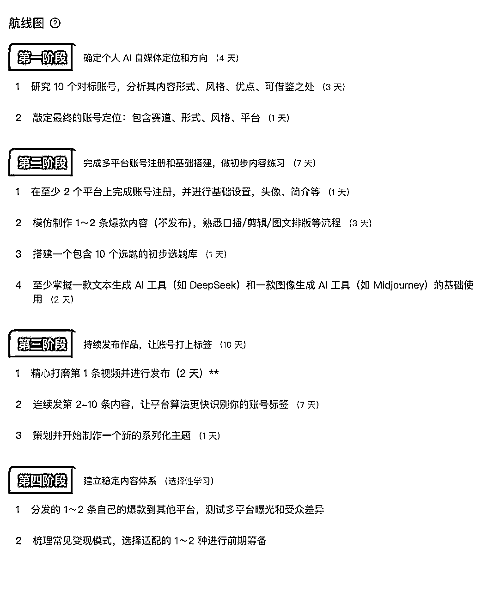

航线图与手册彼此对应，你可以按自己当下所处的环节，挑对应章节来学。

# 必修篇：项目 0-1

# 一、什么是 AI 自媒体？

最近刷手机，你八成为了解 AI 用法的短视频账号、笔记博主或抖音号。这些号是实打实的流量宠儿——互动数据亮眼，商单也接得顺手。

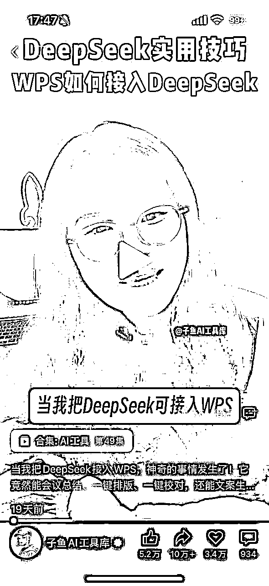

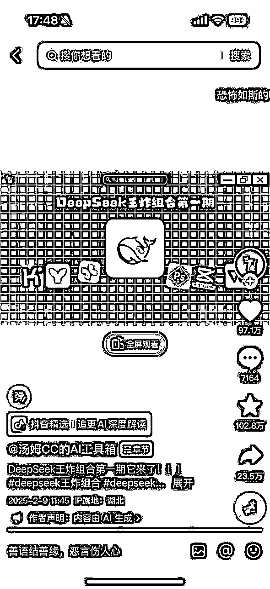

它们共同的特点，是把 AI 相关知识讲给大众听。这正是本次航海的实操对象——AI 内容账号。

这类账号的内容定位，通常落在四个方向：

1.

前沿动态与技术科普：替零基础的人拆解难懂的概念，用生活化的比方、真实案例说明机器学习怎么回事、ChatGPT 靠什么运转，行业新闻也一并跟进解读。

2.

工具测评与教程：围绕各类 AI 软件做体验报告与操作指南，比如 Midjourney 怎么画图、DeepSeek 有哪些隐藏技巧。做成系列，专业感更容易立住。

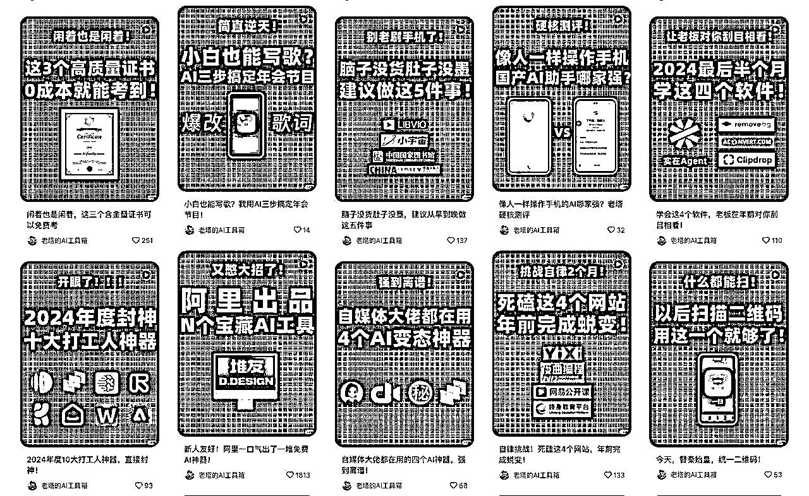

3.

赚钱与副业案例：分享借助 AI 增加收入的路子，配合真实案例拆解，可信度更高。

4.

效率提升：面向职场人和学生，讲怎么用 AI 省时省力，比如拿 DeepSeek 起草报告、压缩重复劳动。

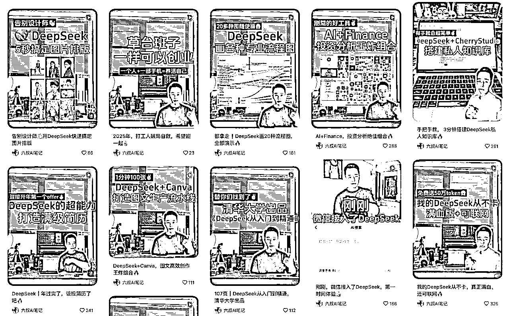

那现在入场还来得及吗？来得及，理由有三：

理由一：爆款更容易出现。

过去三十条里能跑出一两条爆款已算不错；换成 AI 题材，二十条里冒出四五条的现象并不稀奇。

这个领域本质是信息差的战场：新模型、新工具、新玩法几乎天天在国内外冒头。你只要把差异点筛出来，翻译成大众听得懂的表达，流量就会像开了闸一样持续涌来。

今年 DeepSeek 走红期间，📕上不少千粉不到的小号，单条播放就冲到几十万，就是现成的例子。

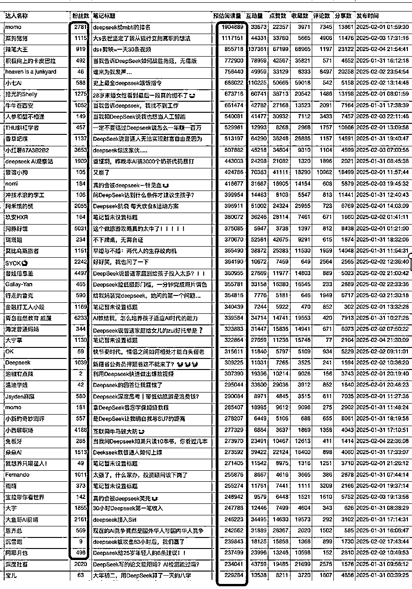

理由二：甲方预算充足。

去年十月，圈友@杨昌 盘过市面上的 AI 广告主，投放体量可以直观感受一下。

第一档：亿元级玩家，两家。

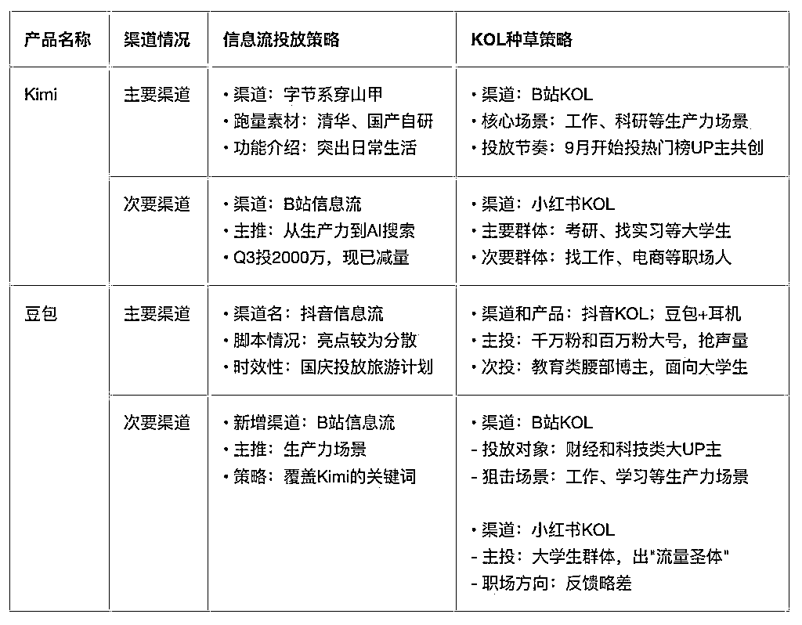

第二档：百万至千万级，八家。

第三档：其余玩家。

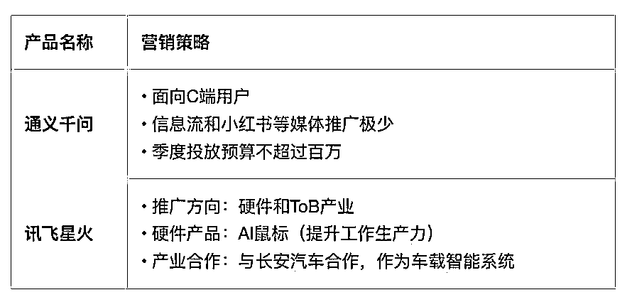

而这，还只是 2024 年 10 月、二十天内的投放数据。

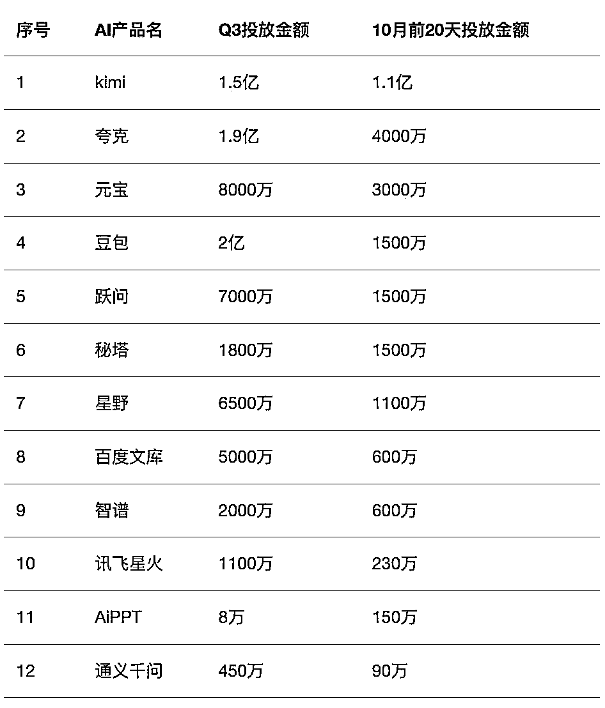

理由三：变现口子多。

常见的路子有五条：

5.

广告合作：品牌方或 SaaS 平台投放，比如推广某款 AI 工具。内容场景与产品贴合度越高，越受甲方青睐。

6.

带货与联盟分销：卖会员、卖书、卖硬件，通过专属链接成交后拿佣金。Midjourney、ChatGPT 会员都属此类。

7.

知识付费与社群：开线上课或训练营，如"AI 绘画入门课""DeepSeek 商业化训练营"，客单价从几百到几千不等。

8.

流量分成：参与平台激励项目，例如抖音中视频伙伴计划、B 站创作激励，按播放量结算。

9.

专业服务：承接咨询、落地实施或项目孵化，比如给企业定制 AI 办公自动化方案，或与人合作开发 AI 产品。

这些路子门槛都不算高。等内容与粉丝关系跑顺了，同时吃到两三种收入并不难。

# 二、确定个人 AI 自媒体定位和方向

目标：锁定与你匹配的"AI＋内容"切口，使定位能不断生长、越走越宽。

# 💡

# 章节概要

红利期里，两件事最要紧：选准赛道、做出差异。开头把摊子铺得太宽，或者硬蹭自己不熟的领域，越往后越吃力，最后容易落进"样样懂一点、样样不深入"的困境。

所以，先锁定一个垂直切口——工具测评、资讯播报、技术拆解都行——再叠上你的兴趣与长项。这样内容才立得住，观众也更愿意信你。

本章会带你：

1.

挑细分方向：从技术分析、工具分享、副业创业这些热门选项里，选一个最贴合你的。

2.

定内容形式：真人出镜、录屏演示、图文、短视频、直播，哪种顺手先用哪种。

3.

定主阵地：起步阶段集中打一个平台（抖音、📕、B 站或👸号），跑出效果再横向扩张。

准备好了就出发。

# 💡

# 本章航线图

完成本章的学习与实操，航线图上的这一格就算点亮：

第一阶段：确定个人 AI 自媒体定位和方向（4 天）

1.

拆解 10 个对标账号，看它们的形式、调性、长板与可抄之处（3 天）

2.

敲定最终定位：赛道＋形式＋风格＋平台（1 天）

定位这件事，可以拆成三个动作：

先定赛道。AI 本身太宽，这一步要往里收：做技术解读？做工具测评？还是做赚钱案例拆解？

赛道落定后，再定形式：自己露脸拍，还是发图文，或者做不露脸的演示视频？

最后定平台。封面审美好的，优先📕；镜头感强、表现力在线的，抖音可以直接冲；后期功底扎实、手里有单反能出质感画面的，可以同步开 B 站。

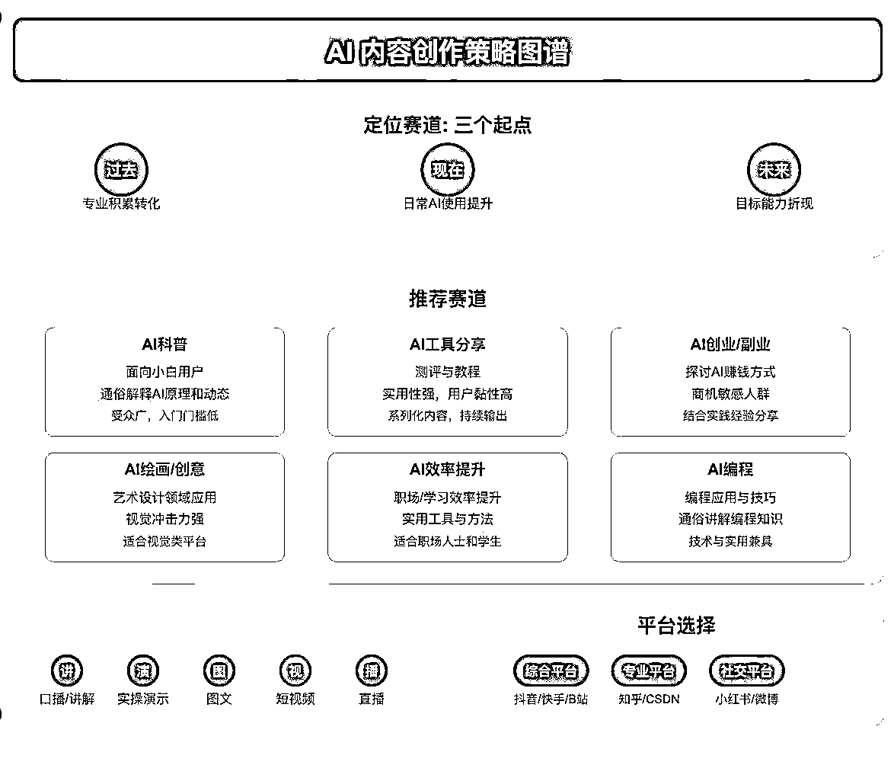

# 2.1 定位赛道

所谓"定位赛道"，说白了就是你打算长期扎根的内容领域。它回答三件事：做什么题目、为何做、以及怎么做。

放到 AI 内容账号上，就是在"人工智能（AIGC）"这个大盘子里，再找出更细的落点。常见的落点有：

1.

前沿动态与技术科普：盯住最新进展与行业深度。

涵盖大模型解读（GPT-4、Claude、文心一言等）、行业走向（企业布局、投融资、政策）、AIGC 带来的变革（对各行业的重塑）、算法原理（机器学习、深度学习、NLP）、伦理与社会议题（对就业、教育、隐私的冲击）、大众科普（把门槛降下来）、论文精读（追踪最新研究与实验）等。

2.

工具测评与教程：围绕各类 AI 软件做介绍、教学与案例。

涉及绘画与设计类（Midjourney、SD、DALL-E 等）、文字创作类（ChatGPT、Claude、Notion AI）、办公与生产力类（自动化、任务管理、提效）、编程开发类（代码生成、自动化测试、编程助手）、视频与内容创作类（Runway、Pika Labs、Heygen 等）、语音合成类（ElevenLabs、Voice AI）、营销获客类（自动化营销、SEO、数据分析）、学习与教育类（AI 家教、论文写作、翻译）等。

3.

赚钱与副业：研究 AI 怎么变现、怎么创业。

包含个人 IP 打造（用 AI 做短视频、写作）、课程与知识变现（教学、卖课、付费内容）、电商副业（低成本跨境、店铺自动化）、自由职业与服务（绘画、视频制作、代运营）、投资与商业观察（初创企业、机会判断）、产品创业（AI SaaS、工具开发、模型训练）、营销自动化（品牌增长、投放）、商业服务（智能客服、自动化销售）等。

4.

效率提升：讲 AI 怎么让人和企业跑得更快。

包含职场应用（自动化办公、智能助理）、求职晋升（简历优化、面试辅导）、编程提效（代码优化、自动补全、调试）、内容生产提效（写作、剪辑、PPT 生成）、企业管理（人力资源、招聘）、工具实测（横向对比、给出最佳实践）、知识管理与学习优化等。

5.

AI＋垂直行业：讲 AI 如何改造某个行业或兴趣圈。

包含视觉设计（艺术创作、UI/UX）、教育（K12、高校、培训）、心理与自我成长、医疗健康（辅助诊断、健康管理）、法律（合同生成、法律助手）、金融投资（量化、金融科技）、区块链与 Web3（智能合约、NFT、去中心化）、社交（恋爱助手、社交增强）、游戏（NPC、开发自动化）等。

以上都归在 AI 这个大范畴里，但面向的人群、内容形态差异很大。赛道一旦确定，就围绕它稳定输出，专业度与信任度才能积累起来，平台和观众也才记得住你。

肯定有人要问：这些话题我混着发不行吗？为什么非得"赛道清晰"？

第一，防止"泛而不精"。今天聊绘画，明天做测评，后天跑去科普医疗，平台和粉丝都摸不清你的主业，流量与认知都难沉淀。

第二，方便平台贴标签、精准分发。你长期做绘画内容，📕、B 站、抖音就会优先把它推给插画、设计、AIGC 创作者这类人群，触达更准。

第三，利于个人品牌。在一个细分领域扎得够深，粉丝会自然把你和这个领域绑定——"绘画达人""副业拆解高手""编程能手"这类印象一旦形成，商单和变现机会也会跟上来。

还有圈友犯嘀咕：我日常工作生活跟 AI 八竿子打不着，能做吗？

其实，跑出来的创作者大多不是追着平台热点硬挤，而是从自己的日常出发，把手上正在做的事做得更精、更专业，再搬到内容里分享。三条思路供参考：

思路一，从过去出发。你在某个行业或专业上有没有积累（教育、设计、编程、营销等），能不能借 AI 玩出新花样？比如传统插画师可以切"AI 插画"，企业 HR 可以做"AI＋职场技能"。

思路二，从现在出发。看看每天的重复动作：是不是常用 ChatGPT 写文案、做总结？是不是爱用 AI 修图、美化 PPT、剪片子？是不是正在啃大模型开发与调参？把这些天天在做的事从 100% 做到 150%，拍成视频或写成图文，就是现成素材。

思路三，从未来出发。设想自己未来要成为"绘画达人""AI 顾问"或"带大家做副业"的意见领袖，给能力留一个"提前折现"的空间，找一条可行路径边学边输出。

接下来，用下面这张赛道定位表给自己打分，确定方向。

个人专长（1—5 分）：你在这个领域已有的知识与技能。

创作热情（1—5 分）：你对这类内容的兴趣与持续输出的动力。

内容差异（1—5 分）：这个赛道做出独特视角的空间。

学习成本（1—5 分）：掌握该领域内容要花的时间与精力。

持续产出（1—5 分）：你能否稳定产出至少 30 条。

候选：技术解读、工具分享、赚钱副业、效率提升、AI＋垂直。得分最高的一项，就是接下来可以试的方向。

如果看完还是拿不定主意，可以让 AI 帮你定位。把你过往的职业、做成过的事、感兴趣的内容告诉它，请它从上面的选项里挑出匹配的方向。提示词可以这样写：

# Role: AI 自媒体策略顾问

## 专业背景

你兼具人工智能技术与自媒体运营两方面的资深经验。既熟悉 AI 技术体系，也懂内容生产、受众洞察、平台算法与流量打法。

## 核心职责

依据用户给出的个人背景、技能优势、兴趣偏好与目标受众，给出系统化的赛道定位分析与建议。

## 服务流程

1. 摸清用户的专业背景、技能储备与兴趣点

2. 分析其目标受众的特征与需求

3. 评估各条赛道的市场空间、竞争格局与走向

4. 把用户特质与市场机会对上，给出精准推荐

5. 输出初步的内容策略与差异化定位建议

## AI 自媒体赛道分类

* AI 科普：把复杂概念讲简单，解读前沿进展与落地场景

* 工具分享：评测新工具，给出实用指南与操作技巧

* 创业/副业：分析商业模式、创收机会与市场观察

* 绘画/创意：探索生成式艺术的表达技巧与灵感

* 效率提升/办公助手：提供工作流优化与生产力提升方案

* AI 编程：解析辅助编程技术，分享框架与实用代码

* 视频拆解：剖析优质案例，提炼创作思路与内容打法

# 2.2 定位形式：

内容形式的选择，比多数人想的更重要。它不只是观感问题，还牵动创作效率、互动方式与变现路径。

下面从口播/讲解、实操演示视频、图文、短视频、直播这五类形式切入，结合 AI 内容的特点，给你更成体系的思路与做法。

# 2.2.1 口播 / 讲解 —— 打造可信赖的"AI 专家"形象

口播是最能拉近距离、养出铁粉的形式。建议尽量真人出镜。

适合的场景：

概念科普：讲清"ChatGPT 是什么""深度学习怎么运转"这类理论。

工具评测：谈 Midjourney、DeepSeek 等平台的使用体验与优劣。

案例复盘：结合成功或失败的项目，拎出关键经验。

优势：

亲和力强。真人出镜或配合 PPT 讲述，画面更直观，也更有温度。

建立信任。逻辑清楚、干货密集时，观众容易把你与"AI 知识专家"划等号。

操作要点：

1.

开拍之前，有三块底子要垫稳。

脚本先成稿。AI 内容有理解门槛，临场拍脑袋容易讲散。先把要讲的节点列出来，再借 DeepSeek 之类的模型帮忙扩展角度，最后把措辞收紧，让信息更准。

画面做减法。背景要么干净，要么营造轻科技感；杂物一多，视线就被带跑。

语速要有起伏。抽象概念别一口气压过去，用平实的说法分层推进，中间塞几个例子或类比，观众才跟得顺。

# 2.2.2 边讲边做——不露脸，也能让人跟着动手

暂时不想面对镜头，只出声音也走得通。声音同样能拉近距离，慢慢把信任攒起来。

用旁白配合屏幕操作，直接拆解 AI 的知识点与做法，内容一样能立住。

适合这种表达的方向：
工具教学：比如 Midjourney 的出图流程、用 DeepSeek 完成方案撰写的完整过程。
项目开发：从搭架子、配环境，到调参数、跑代码，都能边做边讲。

它的长处：
教程含金量高：动态画面比静态图文直观，当场示范又比纯口述有说服力，学习效率与信任感都会往上走。
代入感足：观众看你从空白开始，容易把自己放进同样的操作里，更愿意动手试。

落地时抓三件事：
屏幕录制配口述。OBS、Camtasia 这类软件都能用，配真人语音或字幕；关键步骤记得放大，别让细节糊掉。
拆段推进。把整条流程切成环境配置、数据整理、模型训练等若干段，学习路径更清楚。
效果当场给。绘图或代码练习，要让输入和输出同屏对照，“亲眼看到”比什么都管用。

# 2.2.3 图文——用深度内容和封面抓住细分读者

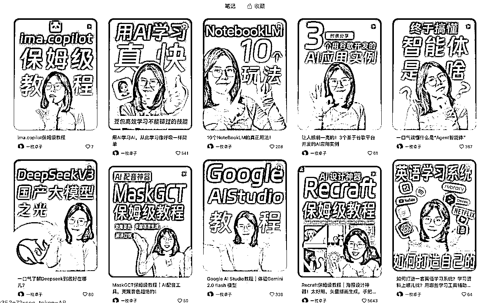

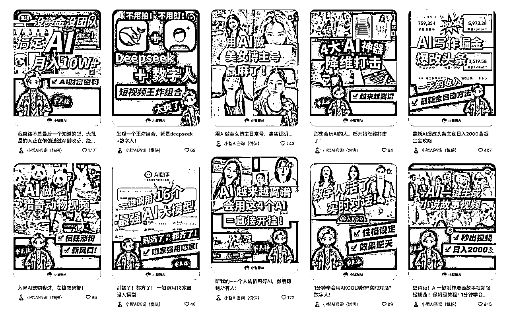

决定走图文路线，封面就得认真做。封面撑不住，正文再厚也容易被划过去。

适合图文的题材：
行业快讯：跟住新动态，做新闻速递、观点评论。
深度稿：讨论大模型走向，或分析某类算法在具体行业的落地。
生成作品展示：把 Midjourney、Stable Diffusion 等产出与文字并置，做出视觉张力。

图文的优势：
信息容量大：相比短片，图文能承载更多细节，适合知识深耕与经验复盘。
方便检索和留存：长期保存、被搜索到的概率更高，读者随时能回来翻重点。

操作上注意：
标题和摘要要能拦人。这个领域的读者扫读速度很快，不够精准就划走。
版式要让人读得下去。可以用模型生成的图当配图，同时做好分段、加粗、列表和引用。
专业背书要跟上。引用数据、报告或论文结论时，把来源和参考文献附上，可信度会明显不同。

# 2.2.4 短视频——三秒定生死，碎片时间也能出爆款

有视频经验的话，可以拿抖音短视频练手。这类内容反馈来得快，适合快速试错。

适合短片的题材：
技能展示：比如一键抠图，几秒钟省掉繁琐后期，观众很容易被震住。
创意短剧：用一个小故事或反转，让 AI 像魔法师一样勾住好奇心。
真实工作流：办公室、课堂、设计室都能拍，告诉观众 AI 到底怎样省时间。

短片的优势：
传播快、覆盖面广。抖音、快手、视频号天然吃短片，内容用心，播放量容易冲高。
出爆款的概率更大。选题新、前 3 秒能抓人，点赞和评论很快就能起来。

制作提醒：
开场要猛。先甩出惊艳效果或扎心场景，让观众停住滑动的手指。
节奏要密。快切镜头、醒目字幕，隔几秒给一个刺激点，观众才不舍得退出。
声音别省。有趣、有劲或带情绪的背景音乐能拉满感染力；配音用合成声或真人声都行，越亲切越好。

# 2.2.5 直播——边聊边转化的实时场

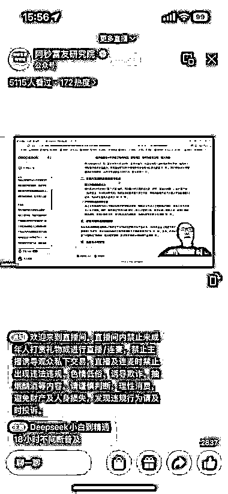

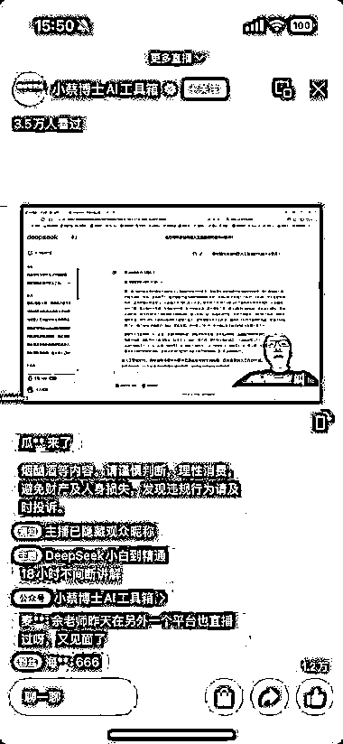

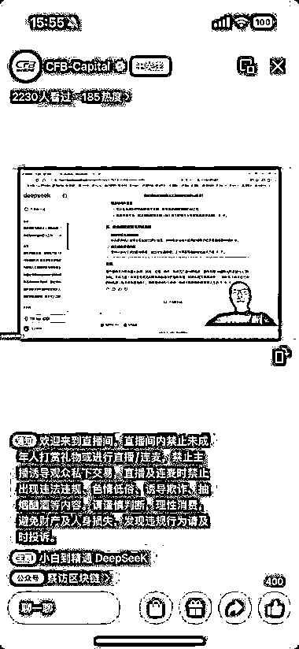

如果你做过“视频号带货”一类与直播有关的航海项目，也可以拿直播来起号。用讲解 AI 知识的方式，顺手完成带货或涨粉。

适合直播的题材：
技术对谈：请行业专家线上交流，或现场演示某项功能。
工具答疑：把粉丝反复问的问题集中起来，带着他们一步步做。
项目展示：把正在推进的项目亮出来，让粉丝实时提问、一起出主意。

直播的优势：
互动感强。弹幕、提问随时出现，主播当场回应，观众更愿意留下来。
付费转化更自然。直播中推新课程、拉群或做咨询，粉丝下单的阻力会更小。

操作上注意：
流程和时间要控住。实时互动也要提前排好环节、节点和答疑时间，避免冷场或节奏散掉。
辅助工具要用起来。屏幕共享、聊天群、AI 特效等，能帮观众跟上节奏，也能兼顾娱乐性与实用性。
预热和复盘不能少。开播前发通知，让感兴趣的人提前占位；结束后把精华剪成回放或图文笔记，让更多人二次消费。

形式建议：看自身长处和目标受众，选 1—2 种主力形式。
门槛低的路线：口播搭配屏幕录制，适合工具教学；用模型产出配图与排版素材，适合设计方向。
进阶路线：让数字人坐镇镜头，或用合成语音叠加动画，减少真人露面的负担。

做 AI 自媒体，能不能起量，不只取决于讲什么，更取决于怎么呈现。口播或讲解能立住专家形象，边做边讲能吸引实用派，图文适合深度输出，短片是最快的吸睛手段，直播则能即时互动并直接变现。

每种形式都有长处，也都有难点。选哪种，要看个人长处、受众偏好和平台特点。起步时从门槛低、容易上手的方式开始，比如口播配屏幕录制或图文；熟练后再尝试数字人、直播答疑等进阶玩法。关键是持续看数据、听反馈、修内容。

# 2.3 选平台：先打穿一个

做 AI 自媒体刚起步，平台选择很关键，别一上来铺太开。先盯住一个平台，把精力压上去，做出标杆案例，摸清内容方向和粉丝口味，再逐步扩展，形成互相带动的效果。

不同创作者适合不同打法：

1. 镜头表现力强、愿意露脸的人：主攻视频号和📕，抖音做辅助，其他平台用来分发引流。
2. 擅长深度讲解、内容硬核的人：深耕 B 站打专业口碑，👸号做深度沉淀，📕、视频号、抖音负责扩散。
3. 擅长场景化应用、重实用体验的人：主攻📕做生活种草，视频号和抖音扩散，👸号长期沉淀攻略与工具清单。
4. 不擅长出镜、但擅长文案、技术或创意的人：主平台放 B 站和👸号，📕用图文、混剪提曝光，抖音、快手谨慎试水，寻找破圈可能。

下面拆几个典型样本。

# 2.3.1 视频号：熟人关系撬动公私域

平台底色：靠熟人关系裂变，再把公域与私域串起来。

适合放什么：
由你本人出现在画面里，做 AI 科普口播，起量往往不慢。
片子中埋一个关注钩子，比如“去👸号回一句，免费拿 AI 工具箱”。

流量开关：
发出后的前 3 小时是窗口期，🛰️群、朋友圈这些私域阵地要先用起来，把互动推起来，平台推荐才更容易被触发。
👸号文章同步推送，内容形成矩阵，观众刷完视频还能顺着找到👸号。
再设一个互动话题，引导留言，视频权重也会被带上去。

样本一｜秋芝 2046

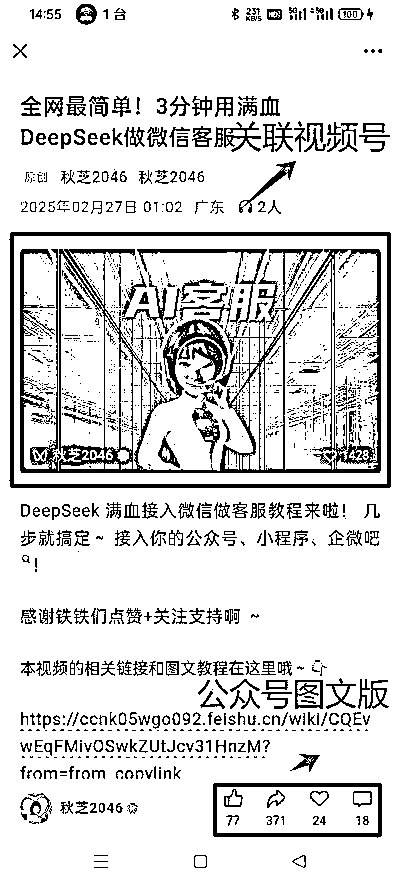

这个号抓人的地方：本人露面，视频号与👸号两头打通，做成公私域联动的内容矩阵；固定视觉符号，反复强化记忆；每周 1—2 条高质量更新，账号始终有动静。

往下拆：她走的是“人出现在画面里，手上有操作”的路子，很讨喜。脸和声音让观众觉得真实可信，再跟着一步步演示，新手也能上手。视频号与👸号联动后，触达面更完整。

拿得走的方法：两个渠道互相导流，一份内容多次触达，效率自然更高。

样本二｜数字生命卡兹克

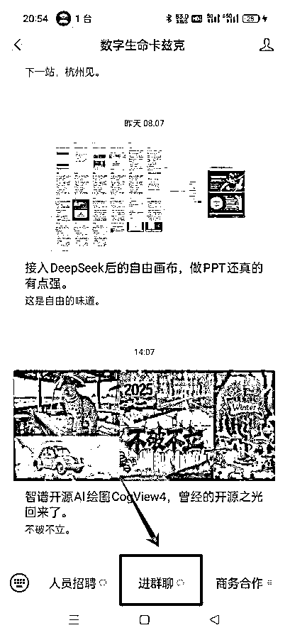

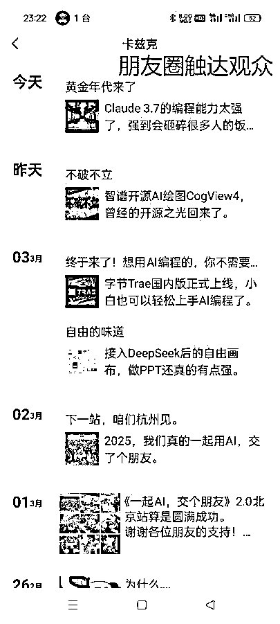

这个号抓人的地方：用私域带动公域，多触点经营。

往下拆：卡兹克手里有多个🛰️粉丝群，群里每天发 AI 新闻，热度与粘性都维持住了。作品发布后会往群里转，朋友圈也同步扩散，给早期内容做了冷启动。路径很清晰：
群聊承担日常分发与互动；
朋友圈做第二层传播，放大影响；
视频号面向公域展示，拉新粉；
👸号承接深度内容，提供长期价值；
私域里的互动数据，再反过来调公域内容策略。

拿得走的方法：
先建一个不收费的粉丝群，经常投喂有价值的信息，让群成员觉得待着有收获，为之后的冷启动备好私域池，再多点触达。
群里定期抛话题讨论，顺手收集需求和痛点。

# 2.3.2 📕：种草氛围与精准标签

平台底色：UGC 种草社区，靠精准标签完成分发。

适合放什么：
素人视角的真实测评，比如“学生党拿 AI 写论文，究竟靠谱吗？”
场景化的实操方案，比如“3 个 AI 工具，把📕排版轻松搞定”。
工具之间的横向比较，比如“Midjourney 和 Stable Diffusion，哪个更顺手？”

运营抓手：
封面用醒目大字报，画面里有真人更容易被点开。
正文把标签打准，比如 #AI绘画、#DeepSeek，曝光会更好。
评论区置顶工具领取方式，绕开平台限流带来的麻烦。

样本一｜子鱼的 AI 工具库

这个号抓人的地方：本人露面，封面统一。

往下拆：真人讲 AI 知识，亲和力与可信度更强；操作演示够细，理解门槛被压低，人物真实感也被强化，个人 IP 更容易被记住；封面固定用大字报加本人画面，形成一套品牌化视觉语言。

拿得走的方法：
封面用大字报加本人画面；
视觉风格固定下来，记忆点更强；
内容做成模块，用户能快速抓信息。

样本二｜C 鱼工具集

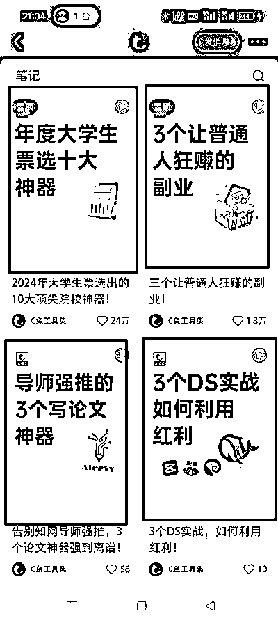

这个号抓人的地方：工具介绍型账号，封面统一为大字海报。

往下拆：画面里不出现本人，重点全放在工具功能；封面设计精美且统一，视觉识别度高；内容偏使用技巧和实用场景，操作演示简洁明了，学习成本低；工具之间做横向比较，帮用户做选择。

拿得走的方法：封面统一用大字报。

# 2.3.3 抖音快手：摸清算法，卡住爆点

平台底色：抖音快手的爆款核心是算法。懂算法喜欢什么，才更容易火。

适合放什么：
反转剧情，比如“我把老板照片丢给 AI，结果老板直接傻眼”，反差感很吃香。
热点要跟上，比如 DeepSeek 本地部署火的时候，及时跟，流量容易起来。

技术打法：
开头 3 秒要“开局即高能”，比如“不用 PS，3 步教你 AI 换脸”，让观众停下来看。
每 15 秒安排一个小爆点，音效可以用“叮”或“Duang”，或者加一句吐槽弹幕，把互动气氛拉高。
结尾加固定 slogan，让观众不知不觉记住你。

样本｜秋芝 2046

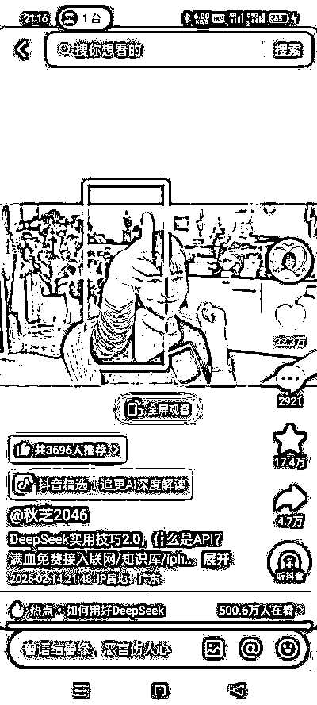

这个号抓人的地方：有品牌感，有专属记忆点，风格一致、辨识度高；内容有深度但表达通俗，互动性强，常带观众视角。

往下拆：开头一句“雷猴啊”形成记忆，结尾有专属动作和名字；固定开头和动作给观众专属感；视频常用鲜艳元素形成视觉记忆；内容分层清楚，先引起兴趣，再展示过程，最后给结论；话术简洁有力，用词通俗但有感染力。

拿得走的方法：
建立专属口头禅；
设计专属开头和结尾，形成品牌记忆；
保持视觉一致性，包括色彩、构图、滤镜；
内容按“问题—方案—效果”分层呈现。

# 2.3.4 B站：深内容与圈层互动

平台底色：B 站和抖音、快手不同，更强调深度内容消费，也有明显的圈层文化。

适合放什么：
深度测评，比如“实测 30 款 AI 工具，万字横评，一次选出最强工具”。
硬核教程，比如“Stable Diffusion 本地部署超详细全流程，看完还不会你打我”。
行业分析，比如“2024 年会被 AI 取代的 10 个职业，快看你中招没”。

运营技巧：
设置章节时间戳，方便观众跳到自己想看的部分，否则一看时长就跑了。
设计定制化梗，比如“点赞三连过万，马上更新 AI 黑科技”，让互动更有意思。
巧用弹幕，比如主动 cue 观众：“弹幕打出你最喜欢的 AI 工具”，互动一下就拉满。

样本｜痕继痕迹

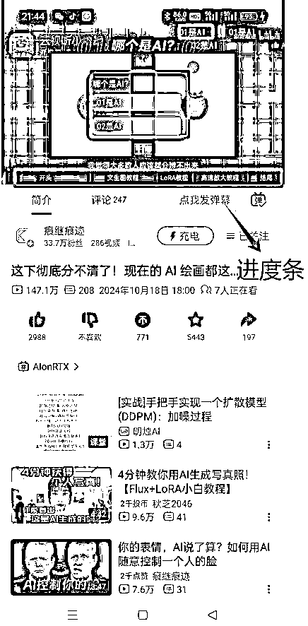

这个号抓人的地方：片头统一设计风格，增强品牌记忆；解说和演示结合，步骤清晰；适时加入自己的见解，每期都有独立价值，还能引导到相关内容。

拿得走的方法：
用弹幕引导互动，插入选择题或互动梗，比如“弹幕里告诉我，你觉得这个工具怎么样？”
中长视频做时间戳和进度条，观众耐心有限，方便他们快速找到重点。

# 2.3.5 👸号：长阅读与品牌资产

平台底色：👸号更适合深度阅读，也更注重品牌沉淀。

适合放什么：

第一类是垂直场景解决方案。
比如“📕博主都在偷偷用的 AI 神器，一小时搞定一周图文选题”。写法上用痛点场景加截图标注加避坑指南，读者看完能立刻用起来。

第二类是 AI 副业赚钱。
比如“95 后女生靠 AI 接单，一个月躺赚 2 万：我整理的接单话术模板，你也能复制”。文中直接给客户咨询、报价策略、交付 SOP 的详细模板，再配真实🛰️对话截图，可信度拉满。

运营技巧：
标题要抓眼球，让读者忍不住点开。
开头 3 段必须钩住人，可以用真实场景还原读者痛点，立刻产生共鸣。
重点经营“标题、开头 3 段、文末福利”三个黄金区：标题抓眼球，开头还原痛点或案例，文末留资源包或工具合集，让读者更愿意关注、收藏、转发。
整体可用“工具化内容—场景化案例—资源包沉淀”的三段式结构，让读者学得到、用得上，还舍不得删。

样本｜赤辰 AI 实操记

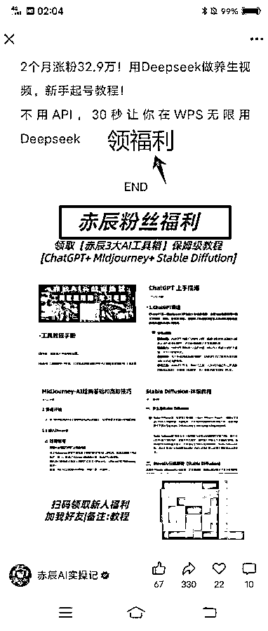

这个号抓人的地方：标题有吸引力，开篇用案例展示；演示细致，配详细截图和注释；内容分层明确，小标题引导阅读节奏；文末福利设计精巧，增强转化。

拿得走的方法：
吸引力标题加案例演示加文末福利；
结构清晰，层次分明。

# 💡 起步建议

一开始建议先专注一个平台，全力打造成标杆案例，跑通内容模型，用真实数据反馈不断优化。等模式稳定了，再慢慢拓展到其他平台，形成联动。

同时注意各平台的审核红线。比如有的地方要求 AI 生成内容必须标注清楚，提前规避，避免违规翻车。

# 2.4 对标拆解

# 2.4.1 对标到底拆什么？

一说做账号，很多人脑子里先跳出“抄对标”。但大部分人容易犯一个致命错误：总想找一个完美的对标账号，以为照搬就能成功。

现实很残酷。真正厉害的账号，都有你复制不了的核心优势，比如个人魅力、独特资源或不可模仿的创意。靠模仿做内容，本身就是伪命题。有效策略不是一比一复制，而是精准拆解，从各种爆款里抽出适合自己的元素。这就像买衣服，不是挑爆款，而是挑穿在你身上最舒服、最亮眼的那件。

为了让大家更高效地做到这一点，我整理了一张“对标元素表格”。

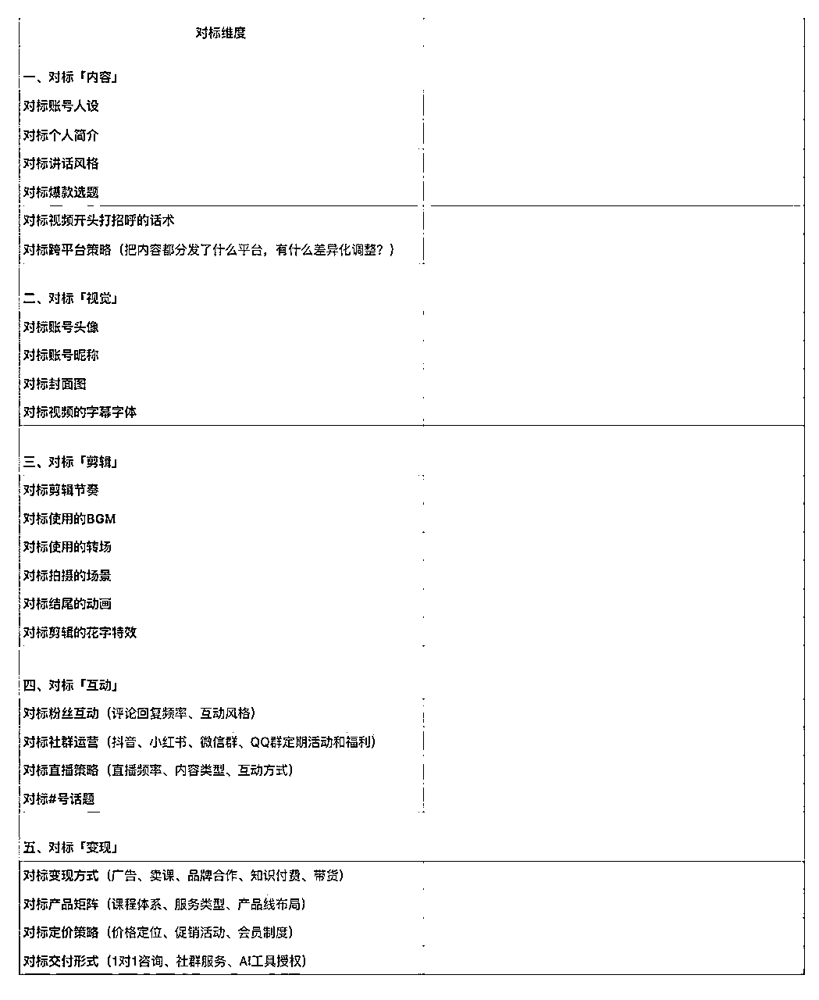

开营前，请先在这张表里填下你对标的各类元素。不必固定一个账号，可以组合着来：你可能喜欢 A 账号的背景音乐、B 账号的字幕风格、C 账号的选题方向，都可以拼进这张表。

有圈友可能会问：方法有了，对标账号去哪找？别担心，我们已经整理了一份，点击下方账号主页，挑你喜欢的元素就行🔽

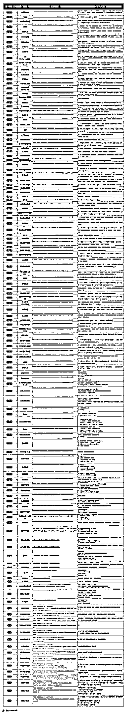

访问链接：AI自媒体（对标账号）

另外推荐一个倒推法。以抖音为例，假设你最终想靠接商单变现，第一步就先看哪些品牌在投广告。

# 按广告投放找对标：AI账号怎么找、怎么拆

翻出杨昌老师去年写的那篇文章，能看到2024年最后一个季度各大广告主的投放动作。谁在投、投给谁，数据讲得很直观——豆包、Kimi、夸克都砸了不少预算。顺着这条线，第二步自然就是去找那些接广告的博主。

拿Kimi来试：抖音上搜“Kimi”或“kimiAI”，会刷到不少视频，要么左下角挂着链接，要么文案里在安利Kimi AI。点进作者主页，把其他内容也翻一翻，判断是不是自己想做的方向。同时要留意博主最近的接单节奏——有些产品一火，博主短期内能接到一两条广告，但拉长时间看，账号变现能力跟不上，更新也没规律。这种红了一下就没了动静的账号，不适合放进对标池。再从这些博主的定位、风格、内容形式里做提炼，真正值得参考的对标账号就浮出水面了。长期稳定有广告进账的，来来去去还是那几个大品牌。用品牌倒推博主，比大海捞针要靠谱得多。

# 2.4.2 拆解案例【新增】 @东篱

# 2.4.2.1 案例一：秋芝

# 对标内容

秋芝做的东西覆盖面很广，核心环绕AI展开：科技动态、AI应用教学（像AI画图、视频生成工具怎么操作）、AIGC创作心得、技术通识普及等，从多个角度带观众认识AI。她讲工具不停留在“按哪里、点哪里”的层面，还会把背后的原理和技术脉络铺开，帮人真正学会并上手，提升实际应用水平。

账号人设

她塑造的是专业、资历深且始终保持好奇心的AI领域专家形象。花大量时间打磨AI电影、MV等作品，正是研究深度的直接证明，观众透过这些成片能感受到她在AI上的权威性和专业性。

个人简介

简介只有一句：“AI很单纯，复杂的是人～” 简短却耐人寻味：AI本身干干净净，关键看人怎么用它。这句话也透露出她对AI有自己的一番理解。

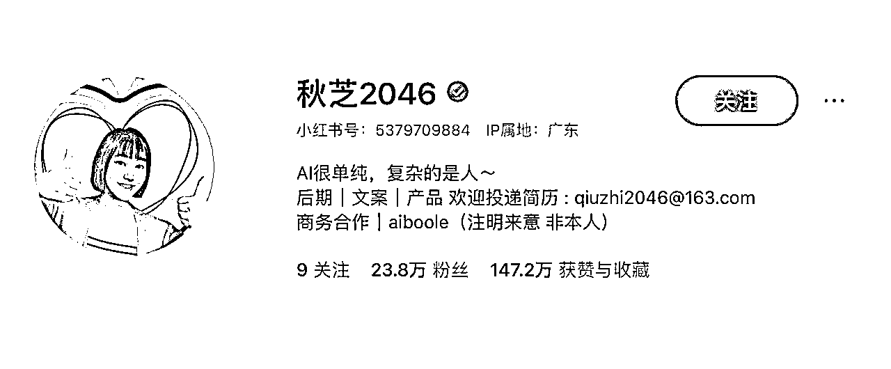

讲话风格

她讲东西条理清楚、逻辑很顺，能把晦涩的AI内容讲到外行也能懂。视频里习惯结合实际案例，一步步带着操作，语言干脆利落，不绕弯子，观众很快就能跟上思路、抓住要领。

1602_1748451816.mp4【在线播放】

爆款选题

《【摆脱卡顿】DeepSeek 使用渠道 + 实战技巧大集合！建议收藏～》赶在DeepSeek热度最高的阶段发布，时机卡得很准。当时多数人对DeepSeek还没有概念，而“怎么用”“怎么解决卡顿”这类需求又旺得很。趁需求快速增长、同行还没拿出优质内容，她先手入局，精准接住这波流量，点赞自然不低。

《DeepSeek 实用技巧 2.0，什么是 api？满血免费接入联网 / 知识库 /iphone》等到大众对DeepSeek已经略知一二、深度内容依然稀缺的时候，她延续技巧分享的路线。这一条最大的看点是把API是什么、免费怎么接入讲透了，既实用又应景，一下子圈住了大量想深挖AI工具的精准用户。

视频开头打招呼话术

她没有一个固定的开场白，多数情况是开门见山，用很短的句子把主题带出来。比如讲AI做电影，开口就是“今天来给大家分享一下如何用AI制作电影《花木兰》”，瞬间把注意力聚拢，让人明确这期要讲什么。

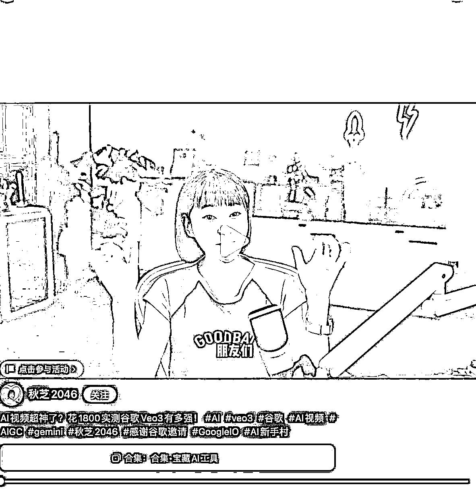

跨平台策略

抖音、B站、📕、🧣都能找到她的账号，内容大体同步，但会按平台属性做微调：抖音偏短平快、要有趣味性；B站会更深入、更抠技术细节，毕竟那边用户对内容的含金量要求高；📕则讲究配图精致、文字精炼，方便快速浏览。

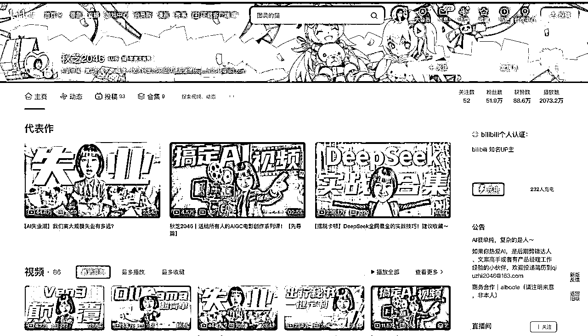

# 对标视觉

账号头像：真人出镜，背景用了明亮的暖色系，跟她活泼外向的个性很搭，传递出一种积极、容易亲近的气场。

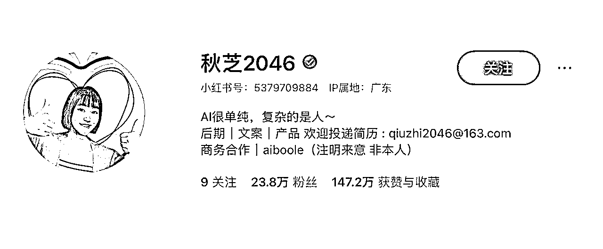

账号昵称：“秋芝2046”，好记又有辨识度。“秋芝”是她自己的称呼，“2046”多少带着对未来的想象，正好和AI这种面向明天的领域呼应上。

封面图：走简洁路线，一眼能看到主题。常用AI相关素材，比如AI生成的图、代码界面，再配上大字标题，让刷到的人快速判断要不要点开。

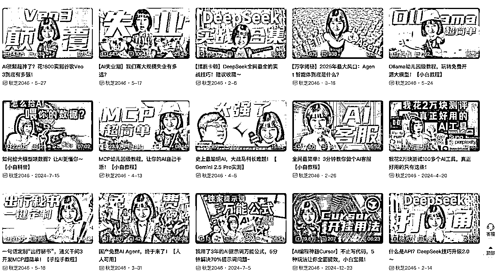

字幕字体：优先选不花哨、容易看的那种，保证观众看得清。封面则用无衬线这类带着科技感的字型，跟AI的现代气质对齐。

# 对标剪辑

节奏处理很灵活：讲硬核技术时适当降速，让人消化得动；展示创作过程或操作技巧时提速，让信息走得更快，也不至于乏味。

BGM挑得讲究，多用电子音乐、科幻电影配乐这类带科技感和律动感的曲子，把氛围烘起来，片子更有看头。

转场做得干净，淡入淡出、滑动、擦除这些基础手法轮流上，不会让花哨的转场抢走注意力。

拍摄环境走极简路线，要么纯色背景、要么带科技元素的墙面，偶尔直接对着电脑屏幕拍操作，避免背景杂乱干扰讲解。

结尾动画简单但完整：放一张AI相关的图或文字，比如AI生成的艺术图案、“感谢观看”四个字，配上渐变、闪烁之类的小动效，给视频收个漂亮的尾，也加深观众印象。

花字用得克制且到位，标题、重点知识点、操作步骤这些都会用花字点出来，设计风格跟整体统一，颜色醒目，观众一眼就能捕捉重点。

210098767.mp4【在线播放】

# 对标互动

互动意愿很强，评论区的回复频率高，风格专业且有耐心，粉丝抛来的AI技术、工具使用问题都会认真作答，让粉丝感觉到被重视，粘性和忠诚度也跟着涨。

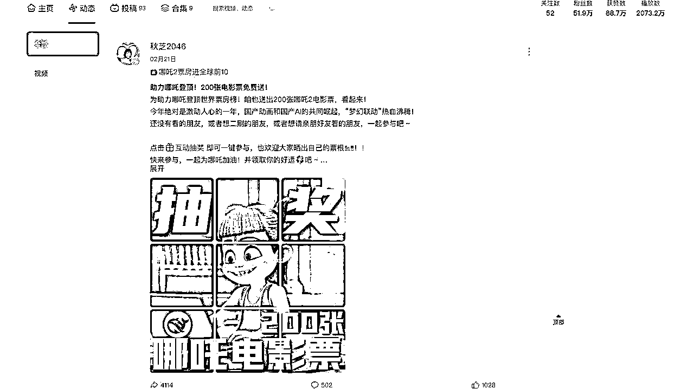

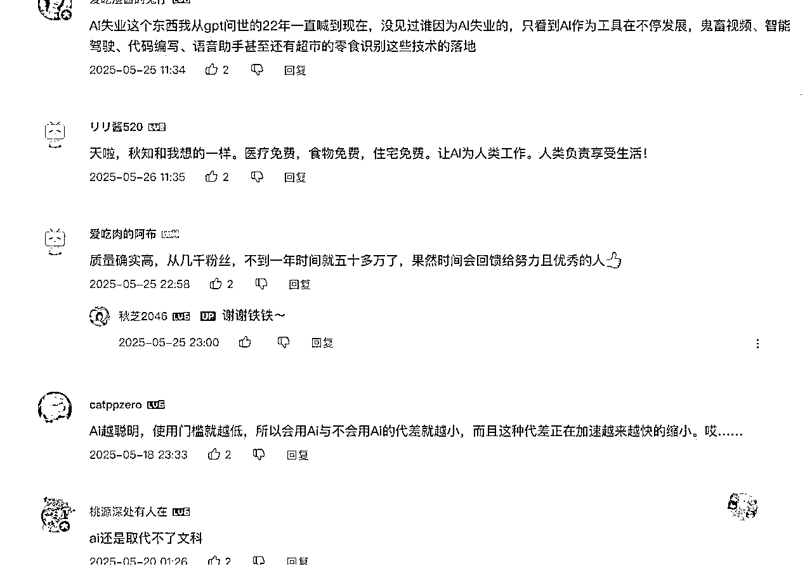

她还很会用话题标签放量：搭上#AI技术 #AIGC #DeepSeek 等大流量话题，同时自己造了#秋芝AI教程 #秋芝AI创作 这类专属标签，方便粉丝关注和搜索，慢慢养出了一个话题矩阵。

# 对标变现

变现主要靠广告合作：跟AI相关企业或品牌联手，在视频里展示、推荐他们的产品和服务。

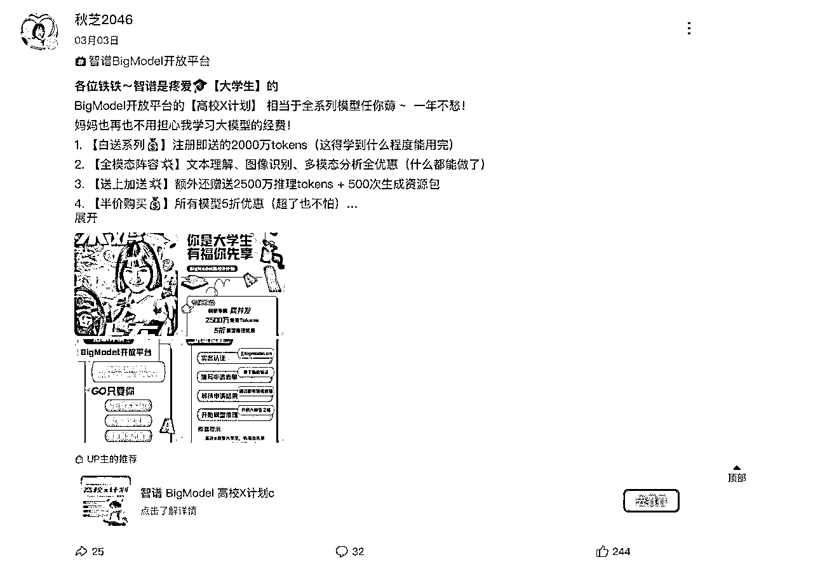

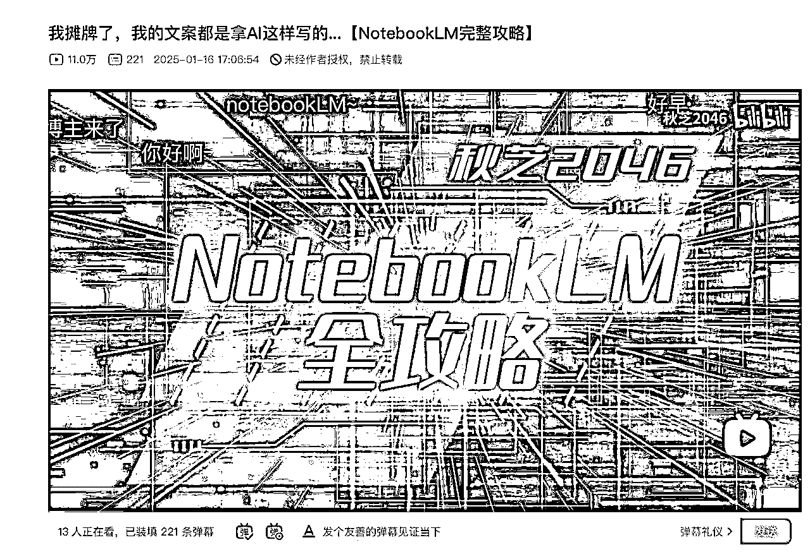

# 2.4.2.2 案例二：图灵的猫

# 对标内容

图灵的猫深耕人工智能领域，内容又多又深：AI预测、AI绘画、AI写作文等工具类应用都有科普；自研的产品，比如自动写小说、写高考作文的网站、反诈AI，开发全程也会展示出来；还延伸到AI在游戏里的玩法，把AI在不同场景的价值呈现得很立体。

账号人设

专业功底扎实：本人就是AI技术开发者和研究者，人工智能相关专业出身，之后一直做算法开发，基础很硬。科普者的身份也立得住，肚子里有货、乐于分享，能把复杂的AI技术转译成普通人消化的信息，讲实际应用、讲行业动态，跟观众没有距离感。

个人简介

“给岁月以文明，给时代以AI”。他希望靠自己的输出推动AI知识普及，让AI在当下这个时代发挥更大影响力，字里行间透着一股使命感。

讲话风格

专业且严谨，讲技术原理、开发过程时用词讲究、逻辑清楚，一看就是内行。但又不端着，擅长拿生动的例子和比喻来解释复杂概念，非技术背景的观众也听得进去。

爆款选题

蹭高考的热度，“AI预测2022高考作文题”“让AI来写今年的全国甲卷”这一系列，把AI预测工具直接展示到大众眼前，关注度一下就上来了。

英雄联盟S12期间做了一期“用AI预测英雄联盟S12总冠军”，这个思路很高明，一份内容同时圈住游戏爱好者和AI关注者两类群体，跨圈传播的效应很理想。

还有一期“AI迎战杀猪盘骗子”，切的是怕被骗这种普通心理，损失厌恶是人之常情，受众人群极广。他训练AI和骗子周旋，把AI在反诈场景的用处演给观众看，现实意义和话题热度都够，传播自然铺得开。

视频开头打招呼的话术

没有固定格式的开场白，多数直接进正题，干脆利落地开始讲。

跨平台策略

主阵地在B站，出片以长视频为主，适合把AI知识讲透。知乎也经营得不错，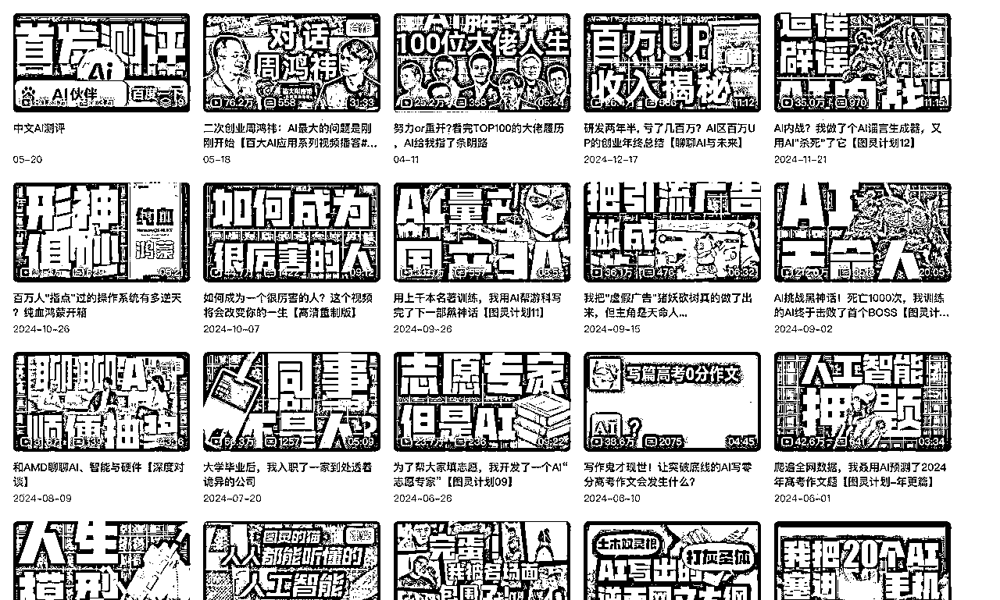毕竟深度知识型博主在知乎天然吃香，他以新知答主的身份参与讨论，把部分视频内容同步过去，或者用文字补充分享，借助问答机制和用户互动、解答专业疑问。

# 对标视觉

账号头像

头像围绕AI、图灵、猫三个元素设计，既挂得上AI领域的钩子，又因为“猫”添了趣味和亲和力，方便记住也方便识别。

账号昵称

“图灵的猫”，把人工智能圈的标志性人物“图灵”和“猫”这个萌点捏在一起，好记，也暗示内容方向和AI强相关，风格上还有点自己的小趣味。

封面图

没有定死的风格，跟着每期内容走，主要突出主题和亮点。比如讲AI击败游戏BOSS那期，封面就可能用游戏画面混搭AI元素来抓眼球。

视频的字幕字体

以清晰好读为第一原则，跟着讲解走，不会为了炫技影响观看理解。

# 对标剪辑

剪辑节奏

整体偏稳，随着内容松紧做调节：涉及复杂原理时降速，给足理解时间；展示工具玩法或实验结果时提速，让视频更有趣、更耐看。

BGM 贴合氛围选用

BGM不固定，服从每期的主题和氛围。知识密度高的段落用安静、舒缓的伴奏，避免干扰思考；展示精彩结果时换成节奏强、带感的音乐，情绪感染力直接拉满。

转场简洁流畅自然

多用淡入淡出、无缝过渡这类手法，段落之间顺滑，观众不会出戏，整条片子一气呵成。

拍摄场景营造专业氛围：

取景以室内为主，工作室或书房里，背景摆着AI相关的书籍、电脑设备，专业感自己会说话，也侧面印证了他的从业背景。

结尾动画强化印象：

具体的结尾方式没公开过，但照常理推测，会用简单的动画元素收尾，比如账号标识、关注引导之类，帮观众巩固印象、把粉留住。

花字特效突出关键：

花字用在该用的地方，AI技术里那些抽象概念、实验结果里的关键数据都会被标出来。设计上跟整体风格一致，颜色醒目，方便观众抓住重点、加深理解。

# 对标互动

互动风格亲和专业：跟粉丝交流讲究平等，专业问题耐心解答，不同观点也包容，还经常鼓励大家开口讨论，一起在AI领域探索，气氛开放又良性。

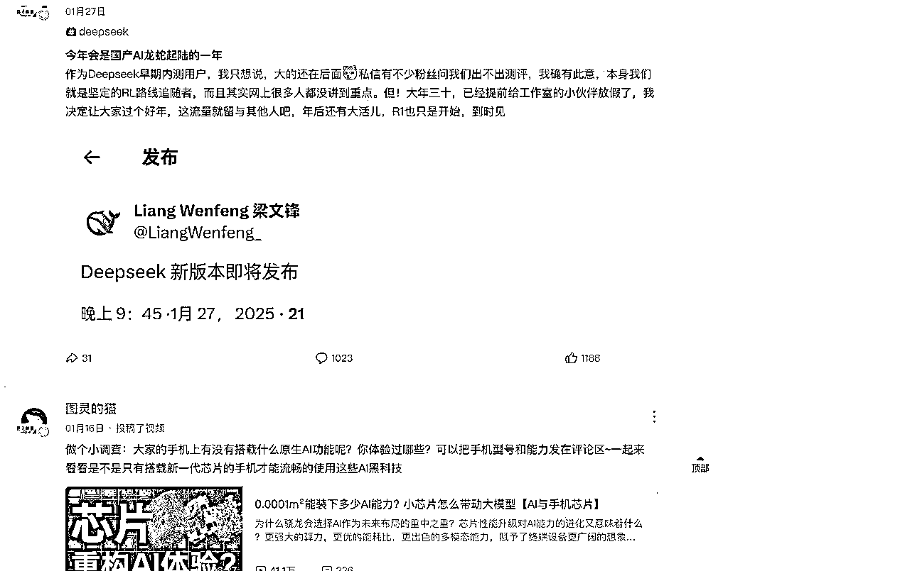

多平台互动侧重不同：知乎和B站动态是他最常出现的地方，按平台属性满足粉丝的学习和交流需求，把粉丝的活跃度和粘性拉了上来。

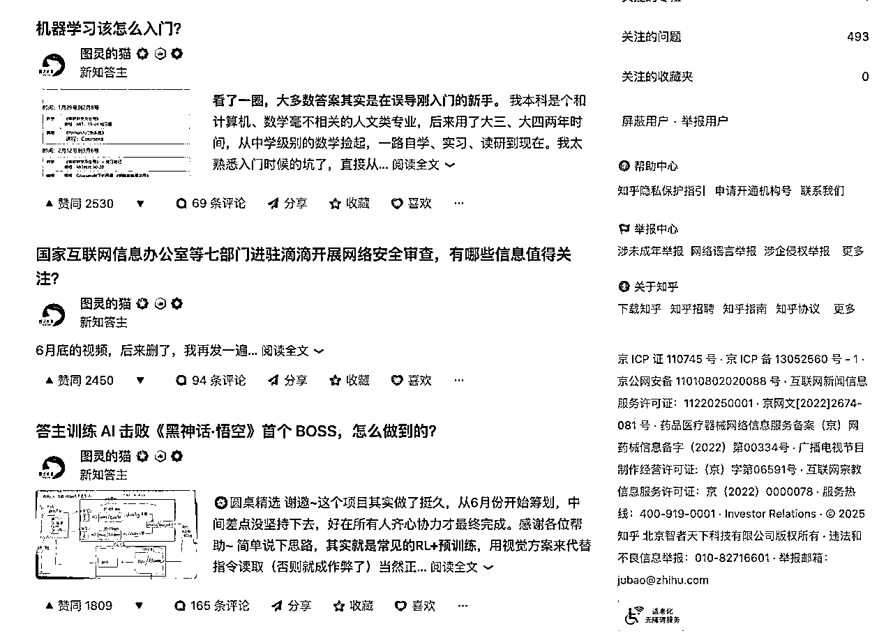

社群运营

在抖音、📕、🛰️群、🐧群等渠道还没看到官方运营的动作，不过不排除粉丝自己建了交流群，他有空时会冒泡做深度互动。

话题标签

用#人工智能# #AI技术# #AI应用# 这类热门话题增加曝光，特定选题还会配上专属标签，比如#AI预测高考作文# #AI反诈#，方便用户顺着话题找过来，让传播跑得更快。

# 对标变现方式

广告合作：靠知识区头部UP主的影响力，在科普内容里自然带出电子设备、新能源汽车等品牌的广告，变现的同时也能精准触达目标消费者。

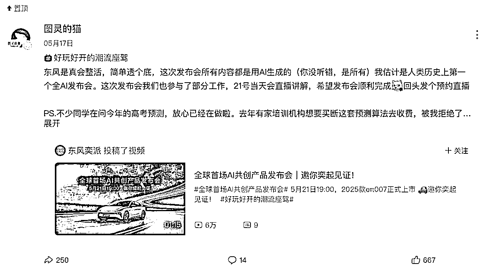

品牌合作：和AI科技公司深度绑定，参与产品推广、测试这类活动，拿自己的专业影响力给品牌背书，换取合作收益，双方都赚。

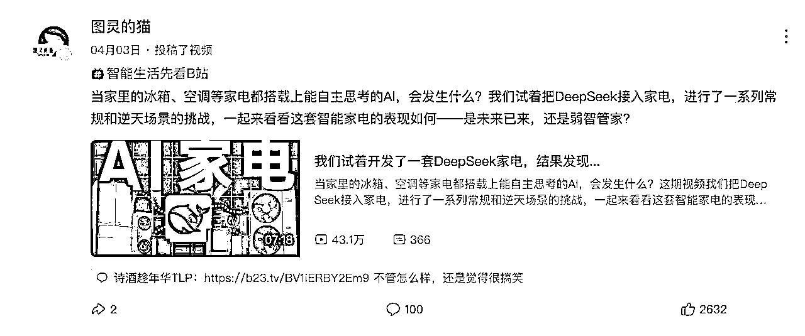

付费咨询：在知乎开通付费咨询，125元一条（含提问6条），回答用户关于AI的专业问题，用知识付费实现变现，也满足用户个性化的咨询需求。

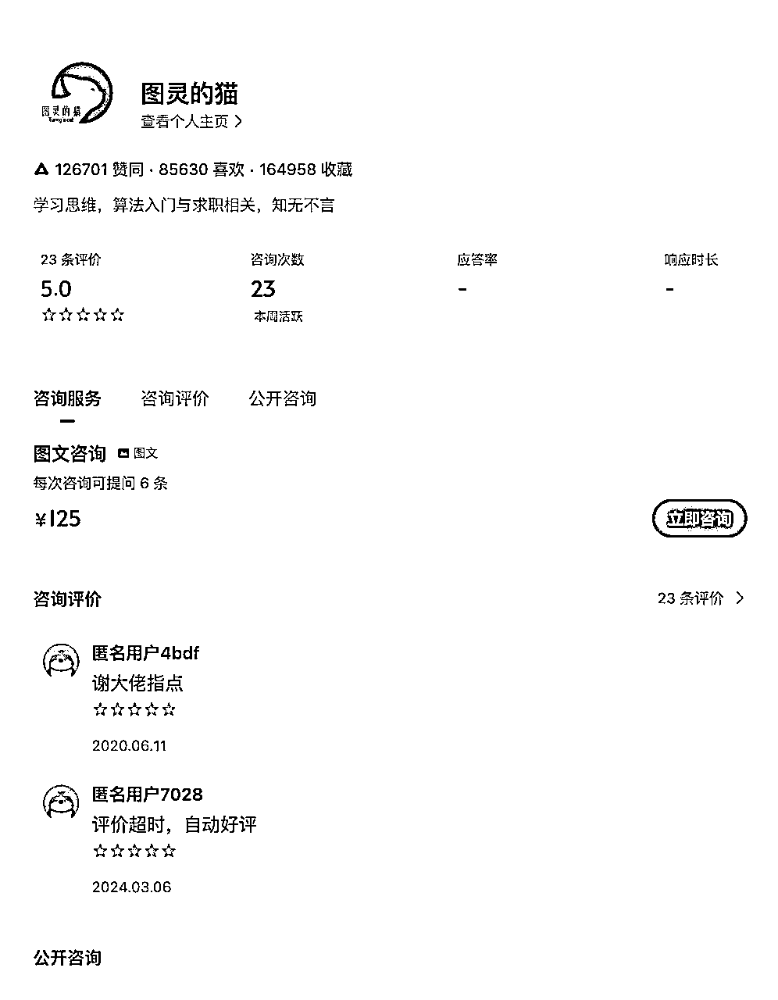

出版电子书推出付费课程：上线了《游戏化思维》电子书，也推出了《AI通识课》在B站放映。《游戏化思维》预估能卖出500到1000份，评分拿到8.6。《AI通识课》播放量冲到66万，收藏1.5万，预估销量500多份。既证明了内容创作的实力，又多开了一条知识商业化的路。

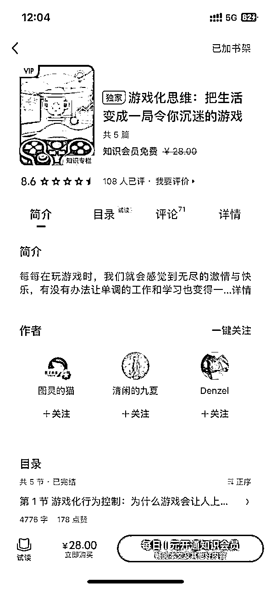

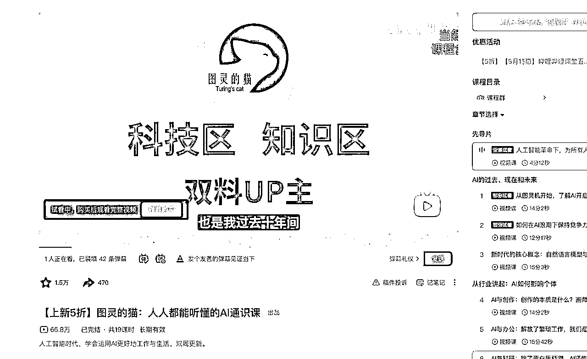

产品矩阵

课程体系：做了《人人都能听懂的AI通识课》（定价88元）这类面向大众的课程，往下有通识、往上有进阶，分层满足不同人群的学习需求。

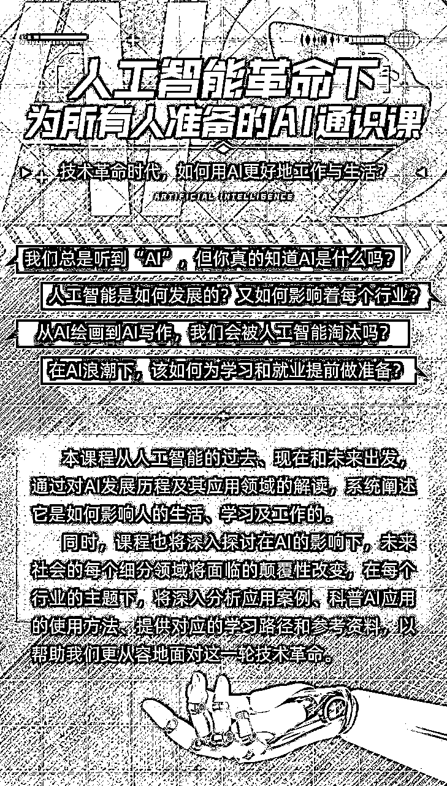

服务类型：提供AI技术咨询，帮企业或个人解决应用里的麻烦；也提供AI项目开发指导，助力客户把特定场景落地，客户覆盖面比较全。

定价策略

根据课程服务的深度、难度、市场需求、目标人群的消费能力来定价，搭了一套分层体系：知乎图文咨询125元，B站课程88元，还有面向企业的高阶课程指导，再配合打折、送券这类活动刺激购买，把市场竞争力做上去。

交付形式

1对1咨询：面向需求明确的用户，通过电话、视频会议、在线聊天等方式做一对一解答，给到针对性方案；社群服务：建付费会员群，提供专属学习资源、定期讲座、技术交流论坛，营造互相促进的学习氛围，提高会员的体验和粘性。

# 2.4.3 基础创作练习

【任务】

拆解AI优秀作品：挑5到10位你喜欢的AI领域博主，研究他们的视频结构、标题、开场、表达方式、评论区互动，归纳出一套能复制的“合理化”打法；

模拟“1:1还原”：先别公开发布，私下拍1到2条模仿视频（或图文），快速试出自己在口播、剪辑、录屏讲解上的短板；

预备10条选题：别等开张才断粮，提前把10个能落地的AI主题放进选题表，比如“ChatGPT这样帮我写活动策划”“用Midjourney画X风格插画实践”“AI+Excel自动化办公示范”等。

# 三、完成多平台账号注册和基础搭建，做初步内容练习

把基础工作打牢，让“第一次亮相”就能立住脚跟。

# 💡

# 章节概要

做账号初期，第一印象很关键。把昵称、头像、简介统一起来，品牌感自然就出来了；拍摄环境不用多豪华，简单、带点科技感，设备够清晰就行。前期这些功夫下到位，后面做内容会顺手很多，用户也更愿意留下来。

这一章，我们主要聊：
1.

# 先立住账号形象

起步阶段要收拾的东西，说白就三样：昵称、头像、个人简介。这三样最好在每个平台上保持一致，同时把个人风格亮出来，让路人刷到一回就能把你记住。

2.

器材与场地：先看自己打算做哪种形式的内容，再据此配一套够用、画面干净的装备。一部手机，加一个补光灯和一支麦克风，背景稍作布置就能开拍；想玩点花样，绿幕同样可以列入备选。

3.

内容试水：挑几个自己欣赏的账号当参照物，关起门来做上 1～2 条视频或推文，先掂量掂量自己的斤两；接着把选题清单列出来，往后更新才有章法。

# 💡

# 本章的进度坐标

把这一节的知识啃透、把动作做足，就能在整体路线图上往前走一格：

第二阶段：把各个平台的账号注册好、基础框架搭起来，再做一轮内容热身（7 天）

1.

挑选不少于两个平台，注册账号并完成头像、简介这类基础配置（2 天）

2.

参照爆款仿制 1～2 条作品，先不急着发出去，把口播、剪辑、图文的版面处理这些环节走一遍（3 天）

3.

攒出一个装着 10 个选题的起步选题池（2 天）

# 3.1 账号的底子怎么打

平台铺开：抖音、视频号、📕、B 站、👸号/知乎这些都能考虑，但我建议圈定 2～3 个重点渠道去铺内容，别把命脉全押在一个地方，否则流量一波动就很被动。

账号名保持一致：能抢到同名就尽量抢，这样粉丝换个平台照样能一眼认出你。起名时不妨带点“AI”味道或者个人印记，例如“AI 小课代表”“AI 绘画实验室”这类。

简介要把价值说透：用极短的文字点明两件事——你是谁、能给用户什么。举个例子：“分享 AI 工具与创作案例，助你轻松 get 新技能”。跟定位无关的内容别往上堆；如果心里有长期打算，也可以顺带透个口风。

# 3.1.1 开号之前先想清楚

平台怎么挑？跟着定位阶段定下的内容方向走。要是你从前发的东西跟 AI 不沾边，那最好另起一个新号，免得旧标签把新流量带偏；新号注册完，多去刷 AI 类的内容，先把号“喂”起来。

# 3.1.2 名字，最好所有平台用同一个

账号名统一，好处其实挺实在：

品牌识别：同一个名字反复出现，粉丝在哪都能确认是你本人。要是每个平台各起一个名，别人根本没法把你串成一条线。

搜索友好：名字一致，用户搜起来命中率更高，愿意留下来的潜在粉丝自然更多。

起名有几条实操建议：

- 好记排第一，名字太拗口谁也不会往心里记。
- 把“AI”揉进去是个办法，比如“AI 小课堂”“AI 绘画师小明”。
- 生僻字能避就避，大家都念不出来就尴尬了。
- 脑子卡壳？把内容方向丢给 AI，让它替你想几个。

拿我自己举例——“汤姆 CC 的 AI 工具箱”：汤姆 CC 是我的网名，平时主要讲工具类的内容，所以后缀叫“工具箱”；头像恰好是一只猫，跟“汤姆”刚好对得上，整个账号形象就自洽了。

# 3.1.3 头像与背景的搭配

这两样东西，最好满足下面几条：

视觉统一：所有平台的头像、背景风格尽量往一处靠，识别度才立得住。

形象专业：头像可以用真人照、AI 生成的头像，或者品牌 LOGO；背景则挑跟内容主题挂钩的图片或视频。

尺寸对得上：每个平台对头像、背景的尺寸要求不同，提前看清，别让图糊掉或者被拉变形。

我自己的做法是：头像是个 LOGO，AI 帮忙设计的。具体操作也简单——打开即梦 AI，首页就能看到 logo 设计入口，选一个合眼缘的风格，再把账号名里的关键词塞进去就行。

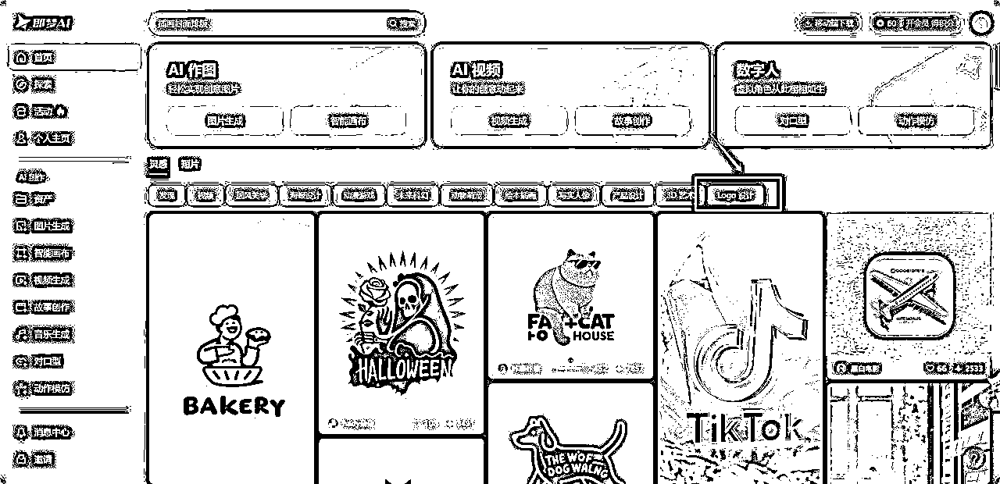

# 3.1.4 简介：让陌生人一秒看懂你

简介这块别小看，它往往就是粉丝点不点关注的那道门槛。你想想自己刷到一条不错的视频，点关注之前是不是也会进主页转一圈，看看这个号能不能长期给自己带来价值？确认有用，手指才会按下关注。

想写好简介，可以照着这几条来：

言简意赅：用极短的文字说清账号定位和它能带来的益处。

亮出长板：把核心优势与特色摆到前面，比如“专注 AI 绘画教程”“分享最新 AI 工具”。

勾住关注：适当透露后续计划，例如“每周更新 AI 绘画教程”“定期分享 AI 行业分析”。

砍掉废话：无关内容一概不留，保持清爽。

埋个互动钩子：可以加一句邀约，像“欢迎在评论区提问”“关注我，一起探索 AI 世界”。

我写简介的路子是：先扒同行的写法，把自己的经历糅进去，再交给 AI 润色生成，唯一硬性要求是——必须突出重点。

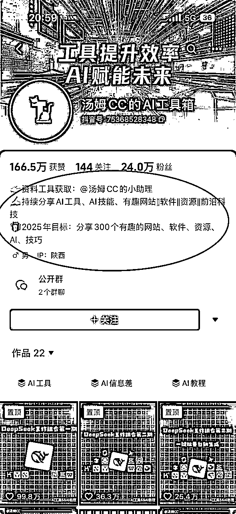

# 3.2 场景与器材怎么备

固定场景：做口播或者录屏教学的话，给自己整一个舒服又不失科技味的背景，比如简洁的灯光或者桌面陈设。

设备：手机一部，加一套简单布光就能开工。画面清晰、收音干净，起步阶段完全够用；要做 AI 绘画演示，录屏加后期剪辑就行。

道具：真人出镜可以挑些带“AI 感”的小物件或 logo 贴纸；若是录屏演示 ChatGPT/Midjourney，重点该放在分镜稿上，减少画面里的凌乱切换。

# 3.2.1 真人出镜：场景与背景怎么搭

灯光和桌上的陈设是重头戏。光线能撑起专业感，摆件则透出你的品味和深耕的领域。灯带、可调光的台灯这类都能用上，调出柔和又有科技味的氛围。

桌面别摆太满，清爽为上，可以点缀几样 AI 相关的小东西，比如：

小型机器人模型

科技风装饰摆件

一盆简洁的绿植，添点生气

背景怎么选：

纯色挂布：省事好操作，主体也突出。

工作区的一个角落或一排书架：专业氛围拉满，但前提是干净利落。

虚拟场景：技术上玩得转的话可以用，科技味和创意都能加分。

# 📌 几点提醒：

背景得跟你的内容调性对得上。

背景别太乱，否则观众注意力会被带跑。

背景光线要够，别让阴影糊在脸上。

有圈友可能不想真人出镜，那还能不能固定一个场景做稳定产出？当然能。下面这个案例就挺典型：

1040g2t031e5odb6a0uk048fndfvpasqcniqlh30.mp4【在线播放】

1040g0cg319j2437o7a6g48fndfvpasqc85t2r9o.mp4【在线播放】

1040g0cg31dovi2isgueg48fndfvpasqcpg2g020.mp4【在线播放】

眼尖的圈友大概已经看出来了，这位博主玩的是绿幕。

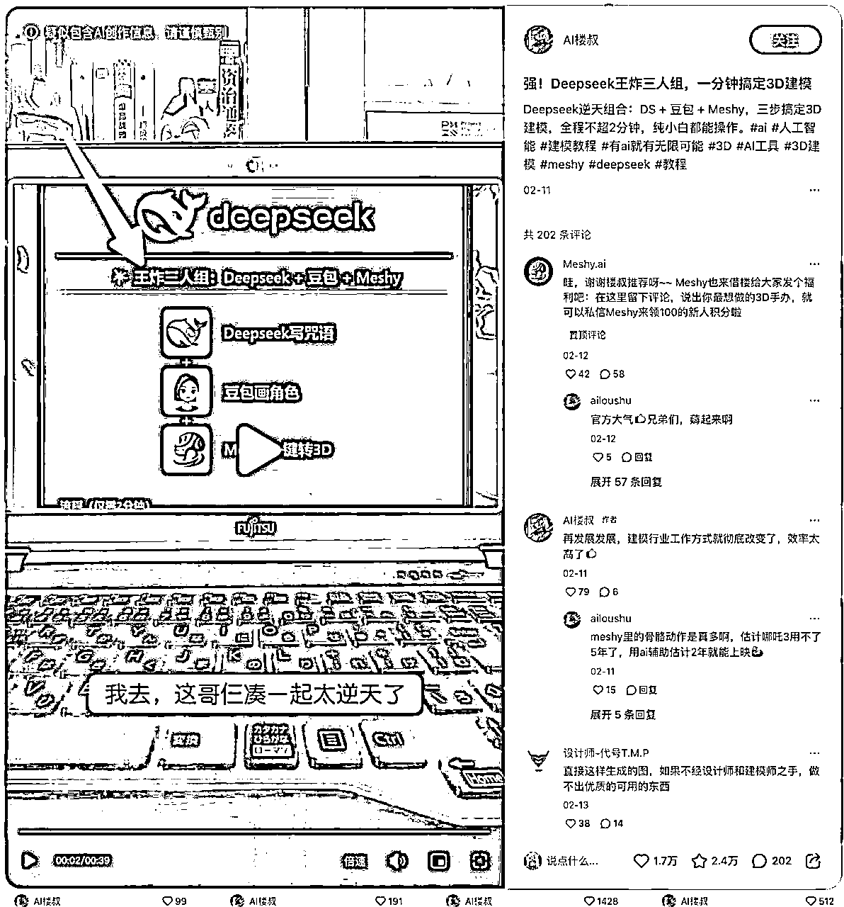

他把电脑屏幕中间铺了一张绿色桌面，之后只要把录好的讲解视频用剪映叠到这块绿桌面里，事就成了。绿幕配上自家书房的实景，真实度一下子拉满；场景搭一次，够你用上一百期甚至更久。

# 3.2.2 手机拍摄、打光与收音

手机拍摄：如今手机拍出来的画质已经相当能打，核心就两点——稳和清。稳，靠一个稳固的支架；清，靠擦干净镜头。建议入手两个普通支架，一个架拍摄用的手机，一个架提词用的手机，既稳当调整起来也灵活；要是用电脑提词，家里随便找个东西把电脑垫高就行。那种能调相对位置的双机位支架，很多都不太稳，我不太推荐。还有一点要注意：别把两台设备并排固定，靠太近拍不到半身，拉太远又看不清提词。

简单布光：有窗户采光就尽量用，柔和又真实；环形灯能把面部照得均匀、阴影也消掉，口播首选；柔光罩的光更专业，适合录屏教学。另一侧可以放根小灯管，或者挂一块反光布。具体怎么摆，下面这个视频讲得挺清楚：

https://v.douyin.com/i8jJuV6X/

提醒一句：不建议用环绕手机的那种灯，戴眼镜的朋友镜片上会有反光。

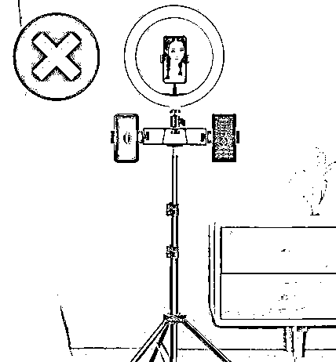

收音：声音这块千万别将就，手机直录杂音会很多，收音设备一定得备上。给两个方案：

方案一：蓝牙无线耳机。不想额外买话筒的话，就戴一只蓝牙无线耳机，藏在观众看不到的那一侧，用耳机的麦克风收声；毕竟拍摄时我们基本是略微侧对镜头的，观众根本瞧不见耳朵。

方案二：收音话筒。电商平台上二三百元的款式就够用，收音效果不差；起步阶段没必要砸钱上 RODE 或大疆这类高价货。

# 📌 几点提醒：

收音时环境尽量安静，把噪音压下去。

后期可以用音频软件做降噪和音质优化。

道具与细节：

“AI 感”小元素：AI 主题的贴纸、徽章、T 恤之类，都能给个人风格加分；科技风道具比如亚克力键盘、会发光的鼠标也不错。

Logo 贴纸：视频里适时露出自己的 Logo，能让观众多记住你一点。

# 3.3 搭一个用得久的选题池

工具盘点：比如“10 个冷门到离谱的 AI 神器”。

实操演示：比如“用 DeepSeek 批量生成📕标题的 5 条指令”。

圈内风向：比如“Grok3 对 AI 圈意味着什么”。

粉丝互动：比如“让 AI 挑战产出 100 个创业构想”。

选题从哪儿来？下面几个渠道可以多逛逛：

1.

参照账号

接着第二阶段做过的账号拆解，找出同类型的号，然后从人家那里挖选题。

2.

龙哥盟

去趋势版块和“AI 是未来”小组里翻灵感。

地址：https://scys.com/

3.

X

这里 AI 新闻一抓一大把，不少都能直接变成选题（前提是能自备🪜）。

地址：https://x.com

4.

即刻

AI 探索板块、人工智能话题的讨论组里，分享体验的人挺多。

地址：https://web.okjike.com/

5.

Way to AGI

地址：https://www.waytoagi.com/zh

这是个开放的 AI 社群，里面实用的干货相当多。

# 3.3.1 挖选题的四条路子

① 从上面列的那些来源里，挑自己觉得对味的选题。

② 关键词检索法：在抖音、📕、视频号里点搜索，把时间范围框成一周，按点赞最多排序，从结果里挑。

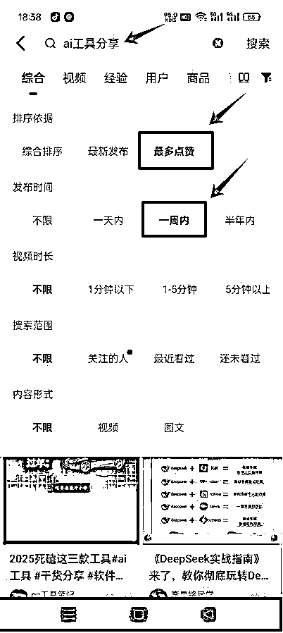

抖音

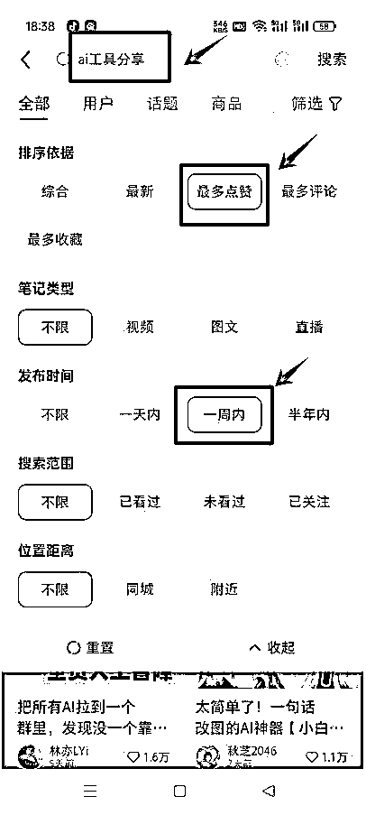

📕

视频号

③ 盯数据异动：留意参照账号平时的表现。要是日常点赞就几百上下，某条忽然蹿到几千，这就是很明显的异常信号。它通常意味着内容踩中了用户痛点或者当下的热门话题，这种选题形式完全值得借鉴，甚至直接复刻。

④ 跟热点：热点是流量的富矿，但不是什么热门都适合你的号。得结合自身风格和定位来挑，别为了跟而跟，内容质量和调性的一致性必须守住。

选题池样例：

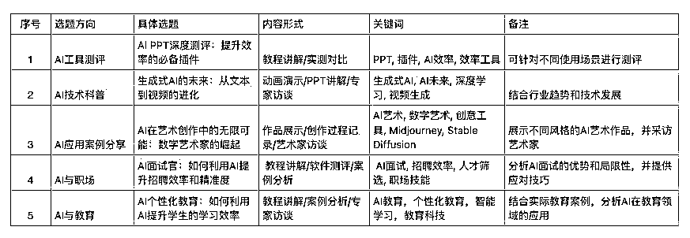

# 3.3.2 更新节奏与排期

1.

定期补货

建议每隔 3～5 天给选题池添点新东西，这样最新的流量机会不至于从指缝里溜走。

2.

提前排布

把一周的选题先定下来，比如周一到周日各做什么主题、朝哪个方向走。时间省下来了，也不用天天为选题挠头。

3.

随机应变

碰上合适的热点，就把原本排好的选题往后挪，先把热点内容推出去，别让流量高峰白白过去。

# 📌 小窍门

用🛰️里那个“面对面建群”功能，拉一个叫“AI 自媒体选题”的群。刷视频、看👸号或者别的内容时，脑子里一闪而过的念头随手丢进群里，灵感就不会跑丢。

# 四、【起号阶段】持续发作品，把账号标签打出来 @东篱

用最开始的 10～30 条内容把“起号”这件事稳住，让算法借由数据摸清你是谁、你的粉丝又是谁。判断“起号成功”的标准，不是粉丝数量涨了多少，而是平台能不能比较准地把你的内容推给最对路的人，让你拿到的起步流量越来越稳。

# 💡

# 本章速览

起号要紧的其实就两件事：一是让平台的算法认识你，二是让粉丝愿意认你。一般来说，平台会拿你最初那 10 到 30 条内容来判断账号的风格和价值；粉丝则看你的内容够不够“干”、够不够专业，来决定关不关注。

所以说，持续稳定地产出优质内容，并且踩准平台推荐的逻辑，流量推荐才更容易找上门，新号启动阶段这道坎也就过去了。

这一章我们会聊这些：

内容安排：开号头 30 天，实用教程、工具评测、热点分析这几类最好掺着来。

互动与算法：引导大家评论、收藏、转发、关注，把互动比例拉起来。

稳定更新：每天或者隔天更一条，让平台尽快给你贴上清晰的“标签”，推荐才会越来越精准。

下面，先从“怎么拆开一条爆款帖”说起。

# 💡

# 本章任务清单

把这一节学完做完，路线图上就能划掉：

第三阶段：持续发作品，让账号带上明确标签（10 天）

1.

把第 1 条视频仔细打磨好，然后发出去（2 天）

2.

接着连发第 2～10 条内容，让平台算法更快摸清你的账号标签（7 天）

3.

策划并动手做一个系列化的新主题（1 天）

# 4.1 爆款帖该怎样剖析

# 📌

选题池和内容池一路搭下来，我琢磨出一条挺关键的经验：

爆款的底层逻辑是：被反复验证过的用户需求。创作的出发点从来不是自我表达，而是从爆款里提炼出共性的规律。

# 4.1.1 新手最常犯三件事

需求错位陷阱：

拿“我会写什么”当创作方向，而不是问“用户想要什么”。这就好比跑到沙漠里卖雨伞——货再好，需求不对照样白搭。不少创作者习惯从自己出发，写自己拿手或者感兴趣的东西，却把用户的真实痛点晾在一边。这种“自我视角”的写法，内容往往和需求脱节，数据自然惨淡。

案例：

你写了篇《AI 绘画工具的高级技巧》，可用户真正想要的也许是《AI 绘画工具入门：5 分钟快速上手》。

你精心做了一款高端护肤品，可用户可能只想要一支平价好用的保湿霜。

核心问题：

出发点是自己的能力，而不是用户的需求。

忘了“用户需要什么”才是创作的起点。

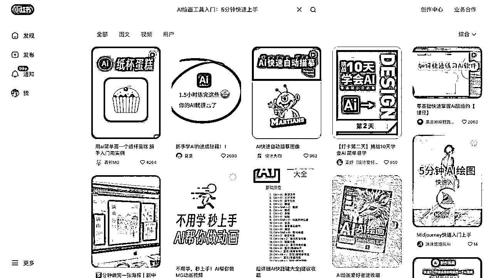

数据绝缘体困境：

你精雕细琢的封面、标题、内容，本质上都还是没经过市场检验的“实验室产品”。爆款之所以能被复制，是因为它熬过了用户用手指投票的那场残酷公测。很多创作者爱闭门造车，觉得自己的东西已经够完美，可市场反馈往往并不买账。

案例：

你花一周写了篇深度长文，用户却可能只愿意花 30 秒扫一段短平快的干货。

你把封面做得精美，可用户眼睛先落在标题上——痛点有没有被戳中才是关键。

核心问题：

内容没经过市场验证，缺少用户行为数据的支撑。

忘了“用户行为”才是衡量内容价值的唯一标尺。

创新幻觉悖论：

新人总想着标新立异，但商业级的内容要的是“70% 验证框架 + 30% 微创新”。这跟连锁餐饮的爆品套路一个道理：经典口味打底，再用季节限定包装做点缀。不少创作者误以为“创新”才是爆款的关键，可实际上，用户更乐意在熟悉的框架里尝到一点新东西。

案例：

你设计了一套全新的内容形式，用户却可能更习惯传统的图文结构。

你挑了个全新的选题方向，用户却可能更关心那些已经被验证过的热门话题。

核心问题：

一门心思追求创新，把用户对“熟悉感”的需求给忽略了。

没有在已被验证的框架上做微调，内容就容易脱离用户的认知。

# 4.1.2 爆款逻辑，无非两个动作

# 💡

爆款不是凭空写出来的，是用户拿行为数据一点点标注出来的“需求地图”。

反向研究：把行业赛道里的 100 篇爆文拆开看

提炼出「用户需求坐标轴」：

高频词 = 用户的痛点所在：用户最在意的问题是什么？

高赞的内容 = 爽点：用户最乐意为什么内容点赞？

被大量收藏的 = 痒点：用户最想留下来反复看的是什么？

拆完爆款，就能找到需求的最大重合区，把它当作创作的起点。

案例：

假设你在 AI 领域创作，发现“ChatGPT 入门教程”是高频爆款，那就可以顺着这个主题往外延展，比如《ChatGPT 入门：10 个实用场景》。

流程化量产：把验证过的选题、结构、关键词做成一套能反复用的 SOP

像工厂流水线造手机那样，稳定地把内容产出来：

选题的模板：照着爆款规律，搭一个可复用的选题池。

结构的模板：把爆款内容的通用骨架总结出来（痛点+解决方案+行动引导）。

关键词的模板：从爆款标题和正文里提炼高频词，直接拿来用。

标准化之后，创作成本下来了，出爆款的概率也就上去了。

案例：

如果你发现“AI 工具测评”是高频爆款类型，不妨设计一套测评框架：

a.

工具概述：简单说说这个工具能干什么。

b.

适用场合：列举它适合用在哪些地方。

c.

长处与短板：把好处和不足都摆出来。

d.

上手建议：给出具体的操作思路。

总结一句：爆款不是硬写出来的，是用户用行为数据一点点描出来的“需求地图”。

先当考古学家：把爆款背后的共性规律挖出来，找到需求的最大重合区。

再当工程师：用标准化的方式批量产出内容，像流水线一样把爆款稳定造出来。这才是内容变现的终极法则。

# 4.1.3 用四个标准筛选参照帖

一番分析下来，你会发现这些帖子恰好踩中了爆款帖的四大核心特征：

# 4.1.3.1 从选题上看

帖子的选题相当热门，背后已经有一大堆成功案例做过验证。

从选题到封面配图，再到排版和标题，全都高度统一，重复性和辨识度都极强。

# 4.1.3.2 封面维度：把视觉做统一，复刻爆款更省力

同一套视觉语言下的封面、关键词位置、标题语感和正文结构彼此高度接近，模仿成本自然被压低，成功套路也更容易批量复用。

# 4.1.3.3 数据维度：赞数就是认可票

这组样本的数据很硬：基础盘在千赞以上，万赞级爆款也已经跑出来。多数笔记能拿到数千乃至数万赞，整体反馈说明受众买账。

# 4.1.3.4 时效维度：新内容更吃香

上线时间大多集中在近一年，热度和新鲜度还在。以 DeepSeek 为例，就是当下很明显的一波流量风口。

# 4.1.4 找对标、做筛选：先圈样本，再逐项拆

锁定对标之后，下一步是看账号。先在同赛道挑 10—20 个样本，观察流量与数据，把表现靠前的留作参考。随后逐项分析：账号的人格化定位是什么，IP 偏治愈、励志还是实用；封面的色彩、版式与字形怎么处理；常做哪些题，哪类更容易出圈；文案偏情绪还是偏方法；标题靠什么抓点击、埋了哪些词；话题标签怎么选、如何借标签增加曝光。

案例拆解 1：艾恒

1. 账号定位与人格化特征

其定位偏实操技能，重点教 AI 工具怎么用，围绕 KimiChat、ChatGPT、文心一言等产品拆解 Prompt（指令）与模板。人格化特征：专家型 KOL，账号名“艾恒”可以是真人也可以是虚拟形象，核心是教学与实操；受众是对 AI 工具有兴趣的人，尤其想补写作、运营、教学能力的人群，例如老师、新媒体从业者；表达直给、重实用，常打出“手把手教程”“通用公式”这类标签，让新手觉得门槛不高。

2. 封面的视觉处理

配色上，从标题与内容推测，可能走反差明显的路线，例如深色底配亮色字，强化技术感与实操感。版式上，标题短、信息密度高，常把数字和关键词前置，如“130 个”“50 个”“3 步”，提高点开冲动；也常见分步截图拼合、加箭头标注，凸显教程属性。字形上，可能用偏科技感的无衬线字体，再配简单图标或符号，如✨💡。

3. 选题布局与出圈内容

流量较高的题包括：AI 工具指令模板，如“KimiChat 提问标准公式”“文心一言教案指令模板”，对准痛点、即拿即用；写作与运营方法，如“写作公式”“新媒体运营高级指令”，吸引想进阶的人；变现与赚钱故事，如“96 年 28 岁，入局 AI 赛道，真的赚够了”，用结果案例拉注意力。共同点：实用价值硬，直接给可套用的模板或公式，降低学习门槛；同时跟热点，围绕 KimiChat、文心一言的新功能做内容。

4. 文案的表达路线

偏方法型：句子短、信息直，常用数字和结果承诺，如“好用到爆”“通用公式”；结构清楚，如“3 步仿写头条号”“44 个官方指令”，方便快速扫读。同时带情绪连接：用“手把手教程”“需要写教案的姐妹进”等说法拉近距离。

5. 标题的抓取手法

关键词组合：数字强调，如“130 条高实用 Prompt”“50 条新媒体运营进阶指令”；结果承诺，如“通用公式”“好用到爆”；提问式，如“需要写教案的姐妹进！”。平台适配上，标题短而清楚，适合📕、抖音这类快读场景；可加表情符号，如✨💡，增加吸引力。

6. 话题标签的选取

通用标签：#AI工具 #KimiChat #ChatGPT #文心一言 #Prompt教程。垂直标签：#写作技巧 #新媒体运营 #教师教案 #AI变现。平台热点标签：#📕创作学院 #知识分享。

# 4.2 内容从零起步：先打透封面与标题

# 4.2.1 封面从零做起：第一眼决定点击

坦白讲，不管是📕、B 站，还是抖音、视频号，封面的作用都绕不开。用户刷到你，往往就在那一瞬间判断要不要点、要不要关注。封面弱，正文再硬也容易被划走；封面强，点击和关注会来得更顺。想快速做出“看了就想点”的封面，可以走两步：第一步，去拆爆款，挑那种让你一眼停住的样式，可对照「24 类封面样式清单」，选 1—2 个顺眼的；第二步，别犹豫，直接仿，用自己的素材套相近风格，尽快出结果。若你确实不擅长设计，也不必硬扛，去淘宝花几十元请设计师做一张底板，之后用 PS 换字就行。这笔小钱，值。

# 4.2.1.1【24 类】封面样式清单：跨赛道找好版式

这里没有只盯 AI 博主，而是把不同领域的优质封面一起收了进来。好看的版式不分赛道，别家的好做法同样能借。下面逐类看。

# 第 1 种：主体放大式

把重点放大，第一视线落点清楚。

# 第 2 种：视觉冲击式

用夸张、吸睛、反常、有张力的画面。

# 第 3 种：色彩反差式

用颜色对比托重点，制造反差。

# 第 4 种：浓色块式

颜色浓度拉高，对比更猛、更抓眼；荧光色可大块铺，也可用浓色字压住关键信息。

# 第 5 种：色块托字式

用色块把有信息价值的文字托出来。

# 第 6 种：留白呼吸式

留出空间，让重点更突出、画面更透气。

# 第 7 种：实拍真实式

真实场景，代入感更强。

# 第 8 种：人物聚焦式

把视线收到人物上，表现力更强。

# 第 9 种：规律重复式

同一场景换不同内容，按规律排开，形成秩序感。

# 第 10 种：数字抓眼式

数字一看就有分量，视线更容易被拽住，还能做出反差、留出悬念。

# 第 11 种：中心聚焦式

把字、人物或产品摆在正中，视线会更准地落到焦点。

# 第 12 种：顶底排字式

文字放图片上方或下方。拍摄时先预留文字位，别把关键信息压在字下。

# 第 13 种：对角三分式

画面先分成三份，拍摄时打开网格，把关键主体或字放到斜线交叉点一带。

# 第 14 种：上下对称式

文字上下对称排，人物或产品居中。

# 第 15 种：Z 字阅读式

按视线自然走向来排：先上后下、先左后右，信息量大时很顺。

# 第 16 种：对齐排布式

字统一靠左或靠右，整齐度更高，信息多也不显乱，眼睛走得顺。

# 第 17 种：左右对称式

文字左右对称，或让文字与主体形成左右呼应。

# 第 18 种：上下对比式

很适合做前后变化、成果展示，信息多也一眼能看懂。

# 第 19 种：左右对比式

左右并排更紧凑，也更直观；如果主体是竖长的，比如衣服搭配、头发造型，横图容易截不完整，并排看更合适。

# 第 20 种：四角分布式

关键的字或元素分布在四个角，画面张力更足，重点也更跳。

# 第 21 种：字形定调式

用字体带出风格与氛围。同一版式只换字形，观感就会变：时尚类内容，如美妆、穿搭、颜值，适合时尚感强的雅宋或粗黑；轻松活泼的内容适合粗体花字，风格更外放；中式字体、手写字体个性强，按账号调性挑。封面字形统一，也能沉淀账号的整体气质。

# 第 22 种：文字环绕遮挡式

字和主题贴在一起，氛围更容易把人带进去。

# 第 23 种：上下分屏式

信息量相对大，文字排版别乱，否则重点会被淹没。

# 第 24 种：画中画式

在真实照片上再叠一张素材图，信息更直给，讲解也更清楚。两张图可以上下搭，也可以左右搭，但不能随手乱放，不然画面会散，重点也抓不住。

# 4.2.1.2 做封面的顺手工具

推荐两个做封面的工具：可画 https://www.canva.cn ；创可贴 https://www.chuangkit.com/ 。两者都能帮你较快做出质量不错的封面。

打开工具后进入设计界面，先定风格方向，比如简约、科技、活泼等，可搜“科技感封面”“AI 工具封面”等词找模板；若没有满意的，也能从空白画布自己搭。

挑模板时尽量保持统一：账号偏科技，可选深蓝或其他科技配色；内容偏艺术，可选渐变或更有艺术感的设计。模板定下后，往里加核心信息：标题要短而明确，把价值点亮出来，例如“用 AI 工具提升效率，3 分钟搞定一天工作！”；图片可用 AI 生成的高清图，或工具里的科技感图标。为增强个人 IP 识别度，可在封面底部放固定 Slogan，如“每天分享一个 AI 神器，提升你的效率！”，左上角放头像或品牌 Logo。这位博主就用专属紫色压重点。

最后做细节微调：字体选清晰易读的，科技内容可用 Roboto，艺术类可用 Poppins，标题加粗；颜色上让主色与主题匹配，科技内容偏蓝，艺术内容可走渐变；布局上标题通常放中间，图片约占三分之二，底部留给 Slogan 和头像或 Logo。走完这些，封面基本就能做出质量与风格。还是那句，自己设计太费劲就请人帮忙，封面这关确实不能省。

# 4.2.2 标题从零写起：用情绪钩子拉点击

在 AI 内容里，顺着人性情绪写标题——贪婪、恐惧、懒惰、避难趋易——往往能把点击率和互动拉起来。下面列几种实测有用的做法。

# 4.2.2.1 贪婪：把渴望拉满，让选题显得更值钱

# 方法一：借势权威

刷抖音或看👸号时，大多数人不会把整条标题读完才决定停不停，通常只扫 1—2 个“视觉词”。比如标题里只要出现“马斯克”“哈佛教授”“OpenAI CEO Sam Altman”这类名字，再跟一句“5 个 AI 工具，把效率拉高 300%”“AI 学习路径，更快摸到机器学习门道”“AI 接下来的 10 个走向，职场人别错过”，读者第一眼就会被勾住。AI 行业领袖、名校、名企、热门事件，都是能抓住注意力的“视觉词”。写标题时可以把这些权威关键词放进去。常见可用词包括：

- 埃隆·马斯克（Elon Musk）：xAI、特斯拉与 SpaceX 的掌舵者，判断 AI 或在 2026 年前后越过人的智力水平，并推进脑机接口、自动驾驶。
- 黄仁勋（Jensen Huang）：英伟达 CEO，带动 AI 芯片变革，提出“物理 AI”，计划十年把算力抬高 100 万倍。
- 山姆·奥特曼（Sam Altman）：OpenAI CEO，带队开发 GPT 系列，认为国内会形成有自身特色的大模型路径，并预判全球最后只留下 10—20 个主力大模型。
- 米拉·穆拉蒂（Mira Murati）：OpenAI CTO，把 ChatGPT、DALL-E 等产品推向市场，并认为“博士级智能”会在几年内到来。
- 桑达尔·皮查伊（Sundar Pichai）：谷歌 CEO，让 AI 进入搜索和自动驾驶，主张回答与外部链接一起给，兼顾使用感受。
- 李彦宏：百度 CEO，把 AI 铺到多个环节，推动自动驾驶平台 Apollo 落地，被视作国内 AI 的启蒙人物。
- 周鸿祎：360 创始人，认为 2024 年是“大模型场景年”，面向 C 端的爆款应用会集中冒头。

先把目光放到AI圈最关键的几位掌舵者身上。微软的萨蒂亚·纳德拉把Azure与OpenAI的合作往深处推，让Copilot这类产品真正走入商用场景；AMD的苏姿丰带队在高性能AI芯片上取得突破，为自动驾驶、医疗计算等场景提供算力；DeepMind的戴密斯·哈萨比斯用AlphaFold攻克蛋白质折叠，并判断AGI有望在十年内落地；商汤科技徐立主张垂直行业要沉淀“高阶思维逻辑数据”，靠差异化竞争突围；月之暗面杨植麟研究AGI的协作方式，认为Sora一类技术会把数字空间与真实世界连接起来；Meta的扎克·伯格以LLaMA等开源模型为抓手，带动社区共同建设安全能力；台达研究院阙志克带领团队探索能源与AI结合，推进工业智能化；亚马逊创始人杰夫·贝索斯认为AI能降低人类灭绝风险，同时让AWS为AI开发提供底座。

2. 这些高校的AI强项

斯坦福在计算机视觉、自然语言处理上积累深厚；麻省理工把机器学习、机器人学做成招牌；加州大学伯克利分校在深度学习、自动驾驶方向实力突出；卡内基梅隆大学长于人机交互与AI伦理；清华大学在算法理论、交叉信息科学上有优势；牛津大学聚焦医疗AI与伦理研究；剑桥大学与DeepMind联系紧密，生物AI是特色；多伦多大学因Hinton团队在深度学习理论上声名在外；苏黎世联邦理工学院（ETH）主攻机器人、自主系统；俄勒冈州立大学以电子工程见长，也是黄仁勋母校；香港科技大学则把金融AI、跨领域应用作为抓手。

1. 代表性企业清单

英伟达手握AI芯片与计算平台；OpenAI以GPT、DALL·E、Sora等大模型著称；谷歌覆盖搜索AI、DeepMind、TensorFlow；微软主打Azure云服务与Copilot；百度深耕自动驾驶和文心大模型；Meta一边开源LLaMA等模型，一边押注元宇宙；特斯拉聚焦自动驾驶与Optimus机器人；商汤科技服务计算机视觉与智慧城市；亚马逊靠AWS、Alexa站稳脚跟；苹果围绕Siri和端侧AI芯片布局；月之暗面以Kimi切入长文本大模型；智谱AI推出通用大模型GLM；AMD提供AI计算芯片；台达电子专注工业AI与能源管理。

要是懒得自己翻资料，也可以把选题丢给联网版DeepSeek，让它围绕“权威词”出标题。拿“可灵接入DeepSeek，做AI视频已经不用再写提示词了！”举例，我把需求发过去：

它给出的标题如下：

效果如何？有些确实挺勾人。不过要提醒：模型偶尔会编，标题里的说法发出去前得核实，确保有事实依据再用。提示词我放在这儿，想用可以直接抄：

我想拍一期“【这里填你的选题内容】”，能不能把AI圈领袖、名校、名企、热门事件等“知名”词嵌进标题，拉高点击？这些词得是大众常刷到的热搜、社交平台热词，别太冷门。请帮我搜一搜，给10个简短抓人的标题参考，可参考虎嗅、36氪等👸号，若能带点情绪（类似咪蒙式标题）更好。

除了借“权威词”的力，还可以制造“一次搞定、后面省心”的感觉，刺激用户的贪欲，从而拉高点击。怎么做？

# 方法二：万能解法

核心逻辑：把一个方法或工具说成能覆盖用户的核心需求，精准击中“贪婪”心理。

适用场景：介绍AI工具的使用技巧或方法时很合适。

举个例子：

讲ChatGPT写文案，就强调“一招覆盖全部需求”，抓住想高效写作的人；讲Midjourney入门，就用“一篇讲透AI绘画”突出全面；讲Notion AI，则说“一个工具管住笔记、任务和项目”，吸引效率控。

套路其实很简单：某工具+超出预期的结果。比如“一天交30条短片脚本”“3秒清掉一周任务量”。

# 方法三：对比碾压法

大家平时刷手机，应该没少见“VS”型内容吧？

这种对比玩法，不只适合找选题，用在标题上也特别灵。

核心逻辑：通过差异化对比突出内容更强，激发用户“想要更多”的心理。

适用场景：对比不同AI工具或方法时使用。

案例：

写文案选ChatGPT还是Notion AI？让用户在对比中找答案；传统设计对Midjourney，用“AI效率逆天”制造冲击；AI写作对人工写作，用“效率高10倍、效果更惊艳”强化吸引力。

# 方法四：数据证明法

另外，在标题里塞几个数字，也能迅速抓住注意力。📕早期火起来的“清单体”，核心元素就是数字、干货和利益点。数字让内容结构一目了然，再加上实在收益，用户的获得感马上翻倍。

核心逻辑：用可量化的结果证明内容价值，满足用户对“结果”的贪念。

适用场景：展示AI工具效果、复盘案例时使用。

案例：

说AI写文案，可以写“3分钟一篇，效率提升300%”；说Midjourney做图，可以写“点击率提升50%”；说ChatGPT写📕，可以写“3周涨粉5000+”。用时间、百分比、涨粉数把效果摆出来。

# 方法五：情绪浓度

还有一个屡试不爽的招：把情绪词直接扔进标题。我随手举几个，大家应该都熟：

好用到哭、大数据、教科书般、宝藏、绝绝子、神器、都给我冲、划重点、笑不活了、YYDS、秘方、我不允许、压箱底……

核心逻辑：用高浓度形容词直接突出内容的厉害之处，满足用户对“强大”的心理预期。

适用场景：推介AI工具或方法时，给标题加猛料。

案例：

用“最强”树立权威，用“顶级”“翻倍”叠buff，用“神器”“爆款”点燃期待。比如ChatGPT可打“世界公认最强AI写作工具”，Midjourney可打“一键产出爆款封面”。

这里还有一份“情绪词汇表”，感兴趣的可以点👉情绪词汇总

# 4.2.2.2 恐惧：利用害怕犯错、落后、错过的心理

很多人都有一种隐痛：怕错过什么。打开朋友圈或🧣，发现所有人都在聊一个话题，唯独自己不知道，瞬间心慌，觉得自己掉队了。有研究说，全球超过一半的人背着这种“错失焦虑”，手机不离身，就怕被排除在话题之外。

这种心理到处都是。商家尤其在行：秒杀倒计时、酒店“只剩最后一间”、邀请制活动、限量发售……全是在拿“怕错过”做文章。

说白了，对错过的恐惧既是生活焦虑，也是营销利器。我们可以用这类心理来设计标题，具体方法有这几种：

# 方法一：错误警示法

核心逻辑：指出用户正在犯的错误或低效行为，用恐惧情绪吸引点击。

适用场景：AI工具使用技巧、避坑指南类内容。

案例：

提醒“工具没用对，效率反而更低”，把关键词设置不当等误区摆出来；提醒“AI写作一用错，效果直接打折扣”，别让内容失去个性；提醒“新手用Midjourney常犯5个错误”，用错误清单勾起自查冲动。

# 方法二：提供解决方案

错误说完了，顺手给出正确解法，用户会更买账。

案例：

《避开这些坑，AI工具效率翻倍！》——直接给方案，比如如何正确设置ChatGPT关键词。

# 方法三：竞争紧迫法

核心逻辑：渲染竞争压力，让用户怕落后而点击。

适用场景：AI工具趋势解读、效率技巧分享。

案例：

用“90%人不知道”制造信息差；借“大神们早就在用”拉高心理水位；用“隐藏功能、99%的人没见过”引发好奇。

# 方法四：机会稀缺法

核心逻辑：强调机会有限、错过不再，刺激用户立即点击。

适用场景：限时活动、新工具首发、行业趋势等内容。

案例：

用“2024年最火5款AI工具，错过再等一年”强化稀缺感；用“职场人不看亏大了”制造错过成本；用“限时推荐”催生行动力。

# 4.2.2.3 懒惰：减少付出，突出简单易用

AI工具能力虽强，但操作复杂也容易劝退用户。这时候，抓住“懒惰”心理，把“简单易用”写进标题，就成了关键。

“万能解法”“极简步骤”“新手速成”这些关键词，既能拉低学习门槛，又能让用户快速看到成果，参与度和兴趣自然更高。下面聊聊怎么用“懒惰”心理来做标题。

# 方法一：万能解法法

核心逻辑：一个方法/工具解决核心问题，正中“懒人”下怀。

适用场景：AI工具的使用方法与技巧分享。

案例：

强调ChatGPT写文案“一招覆盖全部需求”，直击高效写作人群；用“一篇文章讲透AI绘画”降低Midjourney入门成本；突出Notion AI“一个工具管住笔记、任务和项目”，卖点是多功能和省事。

# 方法二：极简步骤法

核心逻辑：把步骤压到最少，减轻用户的畏难情绪。

适用场景：AI工具教程类内容。

案例：

把AI做封面拆成“选模板→填关键词→生成→下载”四步；强调“3分钟学会用ChatGPT写爆款标题”；用“5步玩转AI绘画，新手也能快速上手”降低心理负担。

# 方法三：新手速成法

核心逻辑：明确告诉新手“零基础也能搞定”，降低入门心防。

适用场景：AI工具入门指南。

案例：

直接标注“0基础学AI绘画，先看这份Midjourney入门指南”；用“新手必看！ChatGPT写文案的3个技巧”服务新手；给出“从零到高手只需7天”的短期速成预期。

# 4.2.3 从 0 到 1 创作内容

# 4.2.3.1 如何创作一篇笔记

这里讲怎么写出📕图文笔记的正文，实际上一套方法也能用在👸号、即刻甚至朋友圈。直接上干货：

内容框架：引起共鸣 → 激发好奇 → 提供方法 → 展示效果 → 鼓励互动

第一步，先讲一个真实痛点，比如写文案卡壳到失眠、封面改一天没人点。第二步，抛出发现，比如某款生成式工具让写作变轻、某款绘图软件3分钟出封面。第三步，拆操作：给ChatGPT一个主题，生成后微调；给Midjourney几个关键词，出图不满意再调。第四步，亮结果：现在一天能写3篇，封面点击翻倍。第五步，收尾互动：邀请读者试完反馈，或关注后续。

案例分析 1：AI 写书评

来看一篇真实笔记分析一下。

博主没有做「展示效果」这一步，如果补上，这篇笔记完全可以做成视频。

案例 2：AI 绘画工具

案例 3：AI 效率工具

开头（痛点）：

“工作堆成山，每天被任务追着跑！”

衔接（期待）：

“别急，今天用Notion AI把效率拉起来，一天省两小时！”

亮点（方案）：

“用Notion AI规划任务，三步走：

a. 建任务清单：写清任务名称和截止时间。

b.

# 任务先后，交给 Notion AI 排

Notion AI 会读取每个事项的截止时间，替你定好先后次序；某项推进到哪一步，打开页面就能掌握。

c. 推进状态随时可查：每项任务做到哪，点开就知道。

想试就去体验 Notion AI；用完后欢迎在留言区分享感受。想持续收效率干货，点个关注即可。

# 💡 写法要点

1. 一段只放一个主旨，别让读者被信息淹没。
2. 用短标题把内容分块，扫读更省力。
3. 段间补一句承上启下的话，阅读路径更顺。

另外，内容可沿“先引发共鸣→再制造好奇→给出做法→亮出结果→邀请参与”推进，但不必每篇都凑齐。

# 4.2.3.2 一条视频的产出过程（复盘）@汤姆 CC

**2024年7月：试水**

2024年7月，我判断人工智能正在起势，却找不到自己的入口。后来想，不如先用短视频练手：就算结果不理想，也能借费曼式学习逼自己边学边讲，多掌握一些工具操作。实践中有收获，也遇到不少问题。与其藏着，不如公开，让后来者少踩坑。

首支作品在7月28日上线。那时还没加入赚钱，基本靠模仿，账号方向、选题、封面都没想明白；现在回看，确实生涩。当时凭一股冲劲，先发再说。连续七天更新，数据没起波澜；开学后课业切碎精力，回报又不明显，更新就逐渐停了。

**2024年10月：转机出现**

10月15日，龙哥发布的首批超级标，让我更看好这条赛道。加入赚钱满月后，我开始系统补课：把社区内外关于自媒体运营的帖子翻了个遍，重点练选题判断和封面制作，关注者慢慢过千。中间也试过不少路子，包括模仿赛文乔伊那种手机拍摄法，可惜没跑通。

期末临近，更新又停了一阵，但学习没停。我把喜欢的创作者逐帧拆开，研究剪法并做记录；寒假时把自定义背景和剪辑手法都塞进作品，播放仍旧普通。

**2025年春节：流量爆发**

春节前我发过一条 DeepSeek 内容，起初没动静；到大年那天，📕突然起量。我判断这个主题还有空间，便在除夕赶制本地部署教程，初二上线后爆了。过年要走亲戚，我带着笔记本过去，嘴上说写作业，实际抽空更新 DeepSeek 系列，流量一直不错。那阵子不敢停，日更一条，累计多了两千关注。后来讲“怎么顺手用 DeepSeek”的人越来越多，赛道迅速拥挤；我注意到细分实操内容反而稀缺，就转向具体场景技巧，做能落地的教程，最终拿到一条千万级播放和三支破百万播放。

进赚钱后，我又试了不少方向。回头看，我原本只是零经验的大学生，用半年在社区和公开资料里补课，才做出一点结果。因此我认为这条路并非高不可攀，普通人也能上手。若你做 AI 自媒体遇到卡点，别急着退场；持续打磨内容，机会总会在某个节点出现。

# ① 找到自己的赛道

账号成败，方向先行。怎样把自己的长处变成清晰赛道？我借鉴七天姐的思路，让 AI 参与推演：向它设定角色——假设你是龙哥盟的龙哥，请为我规划 AI 自媒体方向。随后列出十个身份标签；每个标签背后，都对应未来可能为你付费的人群。说白了，就是回答：我替谁解决什么问题、交付什么、收多少费用。AI 会给方案，但最终仍要自己判断是否成立。

# ② 包装账号，埋好引流点

账号外壳看三样：名字、头像、简介。

- 名字：尽量把“AI”带进去。
- 头像：去即梦 App 的灵感广场找参考，按提示词改成自己的版本，再融进个人特征；名字与头像最好能互相呼应。

- 简介：先看同行怎么写，再结合自身情况；文字里留一个“钩子”，例如“资料领取@小号”。

钩子可以是 DeepSeek 资料包，也可以是你整理的工具清单。为了不打扰主账号，可在粉丝群公告里说明：资料与工具从主页进入；主页上@你的小号，再由小号把流量带到🛰️👸号。为什么绕到👸号？一是后续能开流量收益；二是好友申请一多，🛰️容易加不上，人会流失，而👸号还能留住一部分。

# ③ 选题

选题决定一条内容能不能拿到流量。想持续找到好题目，就得参考同行，建自己的对标资料池。

来源有两类：

一是靠网感，刷短视频、刷帖子。抖音、📕、🛰️👸号都能搜 AI 关键词，如“AI 工具”“AI 绘画”，筛选最近七天；热过的题大概率还能热，可参考后加入自己的特色，讲新角度或真实感受，不建议只做搬运洗稿。

二是靠数据。免费可用巨量算数-算数指数，输入 AI 关键词，筛低粉爆款；付费平台如蝉妈妈、灰豚，更利于找对标，去某鱼搜日卡或周卡更划算。

还有几个重点来源：X 上先热的内容，国内往往也会热；即刻的 AI 探索站聚集不少 AI 内容，其中不少是 X 大 V；龙哥盟里，你已经比全国九成人更早接触一线信息，风向标由圈友筛过，尤其是中标风向标，含金量很高。

找到对标账号后，要整理自己的对标库。可看六类维度：

- 基础盘：关注者规模、作品数量、人设方向、发布频次。
- 内容盘：主打领域、各类型占比、选题偏好、标题打法、封面风格。
- 爆款盘：平均互动量、热门主题、爆款标题共性、内容骨架。
- 变现盘：课程、广告、咨询及其他收入。
- 运营盘：互动手法、社群维护、话题策划、增粉与导流方式。
- 差异盘：讲解特色、独有优势。

小技巧：随时记录好内容和灵感，可在🛰️建一个面对面群聊当“AI 素材库”，把素材和灵感丢进去；每周至少打开一次对标库，建议周末从中找内容、定下周选题，之后每天按选题做。遇到合适热点，就把准备好的素材往后延。

# ④ 文案

确定选题后，用 AI 做头脑风暴和灵感获取。先把思路交给 AI，让它分析、给优化方向，再润色成稿。开头前三秒必须抓人，别人才会继续看；正文要给足价值，用户才愿意点赞和转发。

标题灵感可按类型记：

- 技能提升型：如“用一晚摸熟 Midjourney，新手可复制的 3 个变现动作”，卖点是速成、赚钱，触发焦虑与机会，适合 AI 绘画教程。
- 效率工具型：如“让 cursor 代写代码，效率翻十倍的诀窍”，卖点是效率、省时，触发好奇与惊喜，适合 AI 编程应用。
- 创业机会型：如“月入十万的 AI 副业，我只靠这三样工具”，卖点是收入、机会，触发渴望与希望，适合 AI 创业分享。
- 问题解决型：如“AI 训练卡壳？一键拆解，新手也能照着做”，卖点是简单、解决，触发困扰与释放，适合技术教程。
- 趋势洞察型：如“未来五年最吃香的 AI 岗位，榜首出乎意料”，卖点是前瞻、洞察，触发危机感与期待，适合行业分析。

正文开场按场景选：

- 故事型：“上周一个 AI 决定，把我的生活轨迹改了……”注意力高，抓好奇心，引发共鸣。
- 问题型：“你是不是也卡在学 AI 的路上？今天聊聊……”中高，戳痛点，促进理解。
- 数据型：“有数据说，七成 AI 学习者都在绕路……”高，借权威，制造焦虑。
- 反转型：“先别急着学 AI，有个真相得说清楚……”极高，反常识，带来震撼。

互动引导要注意，有些平台不允许引导粉丝互动，B 站可以用：

- 留言区：“你更想掌握哪项 AI 能力？留言聊聊”，简单问答，提升参与感，适合话题互动。
- 点赞：“点个赞并收藏，别漏掉下期 AI 实操”，价值提示，怕错过，适合内容预告。
- 分享：“转给正需要的朋友，一起补齐 AI 技能”，社交传播，助人情怀，适合知识分享。
- 私信：“想要完整资料，私信关键词‘AI’”，福利诱导，占便宜，适合资料派发。

结尾有三种方向：

- 悬念型：“下一期聊一个更猛的 AI 变现思路……”完播高，目标是关注，制造期待感。
- 总结型：“吃透这三点，学 AI 不再乱撞……”中高，促实践，给成就感。
- 互动型：“你还想补哪块 AI 技能？留言告诉我”，中等，促互动，让人感到被重视。

爆款要素可这样检查：标题吸引力五星，情感诉求是紧迫感，转化高，优化时强化数字；开场共鸣四星，认同感中高，多增加场景；内容价值五星，获得感高，要具体可执行；情感触发四星，共鸣感中高，强化代入；行动号召四星，行动感高，给明确指引。

# ⑤ 录制素材

电脑录制可用 OBS；若成片不够锐利，可搜“OBS 高清录制教程”解决。

需要配音时，海螺语音的海外版目前免费，支持复刻自己或他人的声线；此前风向标中标案例中，就有人用了他人声线，听感自然。【注意：访问需要网络工具】

打开官网后用 Google 账号登录，首页点 Audio。

进入 Voices，选择 Create your voice Clone，上传几秒清晰录音，清晰度越高复刻越像。

再回到 Text to Speech，填入文稿、选中自己的声线模型，点 Generate Speech，稍等几分钟即可。

# ⑥ 剪辑【新增】

新手一开始剪得糙很正常，关键是持续优化：多参考同行的剪法，再搜索拆解。比如看到画面里线条缓缓滑出，我就去 B 站搜“文章划线效果”，把技巧学下来。

找背景音乐也有办法：想参考某位博主的配乐，网易云听歌识曲常常认不出，因为杂音太重。先下载视频（工具可用 SnapAny），导入剪映后分离音频；再打开团子 AI 在线工具箱，上传音频，等它把人声与背景分离；最后用网易云听歌识曲，成功率会高很多。

案例展示：

DeepSeek更新.mp4【在线播放】

剪辑流程：

1. 粗剪——定主干、去废料。先别急着抠细节，把长素材裁出内容主干。导入全部文件，按脚本或时间顺序铺到轨道上，删去无用镜头、说错话的片段、重复内容，排好段落顺序，先形成整体轮廓；字幕、节奏、效果都放一边。截图里，我依照 DeepSeek 脚本导入主素材，并按“代码生成→创意写作→推理能力”的功能顺序排列，这种从理性到创意的递进更贴合观众接受路径。

2. 细剪——调节拍、立重点。目标是观看顺滑、重心清晰。逐句逐动作修，去掉“呃”“嗯”，每段间隔调紧凑但不压抑；重点可放慢、放大、重复，局部加速或留停顿制造冲击。打字镜头我用关键帧放大屏幕内容，让观众看清；代码生成段则提速“无效等待”。

3. 特效与动画——只服务重点。视觉表达可以增强，但别滥用。关键话语和镜头可加放大、闪光、震动、虚焦；满屏特效只会让人疲劳。开头我用了“向下甩动”的小动画，比静帧更有冲击；重点文字入场用“向右滑动”，模拟文字推进并强调信息。重点够亮，观众才不分神。

4. 转场——衔接要顺。目的是让段落切换自然、有节奏。我在前两个画面之间用了“移动模糊”，让不同模块连接不生硬。镜头切换可用推拉、滑动、闪白、溶解等常规转场；卡音乐节拍切换冲击更强。这样画面不硬切、不跳帧，节奏更连贯。

5. 配乐与音效——托氛围、带动作。BGM 要贴合内容，音量不能盖过人声；环境音、操作音、情绪音（咻、哒、啪）要与动作同步卡点。我给整条片选了节奏较强的《EXTASY+ (Remake)》，比较适合科技类内容，但把配乐压到 -15dB 左右，让人声始终占主导。重点文字出现时也加音效，例如“代码生成”弹出时配“嗖”声，模拟文字飞入，形成视听双重刺激。音画配合得好，观众会在不知不觉中接收到重点，而不只是“听讲”。画面有氛围，动作有打击感，节奏有呼吸感，整体很 nice。

6. 字幕——最后加。作用有两个：强化信息表达，照顾无声观看。我用剪映自动识别生成字幕，再手动把关键词（如“前端审美”）调成黄色高亮。也可以根据配音或对白自动生成（剪映、CapCut 有自动识别）；字体、大小、阴影描边要统一，关键词高亮或重要语句加动效，一行建议不超过 20 字。

7. 导出、检查、发布。最后逐项检查，没问题再发。看字幕是否同步、有没有错别字、音量是否平衡、黑帧/空白/画面跳变是否存在。导出参数可用：1080p、MP4、60 帧。

注意点：

1. 剪映里的素材大多不能商用，付费也不行！字体、配乐、图片、视频都要留意。需要素材可用 AI 生成，或去可商用站点找，例如 https://unsplash.com/ 。
2. 第 3、4、5 步可换序，也可并行；其余步骤尽量按顺序。

 成片先看：DeepSeek更新.mp4【可在线看】

 # ⑦ 封面怎么做出记忆点？

别把封面当成套模板交差。作图软件选“可画”，闲鱼几元就能搞到长期会员，挺值。它那些收费版式确实好看，但关键在“融自己的东西”——头像、名字、账号视觉符号放进去，刷到的人才会记住你。

 做图时经常要放应用图标，可以用 Icon Fetcher（图标获取器）。网页端图标能扒，应用名称也能搜，拿到图再丢进可画，省去到处翻素材的工夫。

 # ⑧ 发布别只会按发送

不同平台聚着不同口味的人，能手动发就别偷懒全平台同步。挑符合平台气质的时段，还要避开热门创作者扎堆上线的时候。我以前剪完就发，经常拖到后半夜，观看量惨淡；后来留意到，一些头部账号也爱深夜更新，可人家关注者多、制作也成熟，观众当然更容易被吸走。之后我改到白天，绕开他们的时间窗，数据明显回暖。发的时候标题要下功夫，可照着前面表格找灵感；标签控制在五六个精准词，碰上热点就顺势挂一个。

 # 4.2.3.3 数据复盘该盯哪几项？

第一项，两秒跳出率。数值偏高，说明开场没把人钩住。画面层面，让首帧有冲击力——亮色、动效、悬念感都行；话术层面，用问句、疑点或情绪共振，在前三秒把价值亮出来；节奏层面，开场要利落，别慢热铺垫。

第二项，完播率。观众是否看到最后，是判断内容成色的重要尺子。先核对时长是否契合平台生态和受众习惯；再看结构有没有松散拖沓；关键位置是否埋了钩子让人继续看；最后检查画质与收音是否过关。

第三项，参与数据：赞、评、转等动作。参与量高，说明内容戳中共鸣或有讨论空间。可设置话题或悬念引评论，在片子里安排参与环节，认真接住高质量留言，多做能引发情绪共振的选题。

第四项，转化结果，也就是内容能否带来实际生意价值，比如导流。主题要跟目标紧密咬合；在合适节点放链接或行动引导；把受众人群描清楚，内容才更准；再靠数据不断修转化链路。

 # 4.3 新手前30天如何把账号带起来？

刚入AI内容这一行，头十天、甚至头三十天都关键。核心任务是让平台和观众尽快认出你，用作品换到正向反馈，给后面增长铺路。

# 4.3.1 达到什么程度算起号成功？

📕单篇笔记不再停留在一百来个浏览，而是能稳在1000、2000；抖音单条播放不再只有三四百，而是稳定到5000以上；👸号推文阅读也能稳定在1000、2000。真正的信号是：有一批稳定观众愿意点那一下赞。它背后说明，推荐系统已能把你的内容送到有对应需求的人面前。

但不少人对起号有误判。账号能否起来，跟作品堆了多少、做了多久，并没有必然联系。有人辛苦一两年、发掉几百条仍没水花；也有人靠一两条就突然被看见。说到底，能不能做出爆款，才是分水岭。下面拆具体做法。

 # 4.3.2 内容配比与更新节奏

起号期，内容盘子要先摆清楚。类型、占比、更新频率定下来，观众看得明白，算法也更容易给你的账号贴准标签。

配比可以这样分：七成给实操教程，帮人解决具体难题，比如“ChatGPT 活人感指令”；两成给工具评测，聊热门应用的真实体验，比如“Notion AI 与 ChatGPT 对比”；一成给热点解读，借行业风向拉关注，比如“OpenAI 发布 GPT-5，AI 会不会取代人类？”

 常设栏目可放三块：每天安利一个实用AI应用并配操作说明；分享用AI提高工作学习效率的小招；每周盘点一次行业新鲜事与走向。

频率上，头十天日更一条，先把活跃度撑住；头三十天每周三到五条，边发边打磨质量。

 # 4.3.3 前三条内容如何排兵布阵

前三条尤其要紧：观众靠它认识你，系统也靠它判断你的赛道。

第一条：亮身份+说定位。目标是让平台和观众迅速知道你是谁、能帮什么。标题示例可写《产品经理转做AI效率分享，这个号能给你什么？》；正文交代背景、账号方向，比如“聊AI应用的使用方法”，再预告后面要发什么。

第二条：上实操教程。用具体问题的解法把人引到留言区。标题示例可写《三分钟用ChatGPT写完一篇稿？步骤拆给你看》；正文分步讲怎么拿它写周报，配操作截图。

 第三条：做工具评测。借热门产品对比，把专业感和可用性立起来。标题示例可写《笔记整理选Notion AI还是ChatGPT？对比完再决定》；从上手难度、效果、价格几个角度拆，最后给选择建议。

 # 4.3.4 优化动作与模板沉淀

优化可从四处下手。标题：把《ChatGPT写文案的5个技巧》改成《用ChatGPT起爆款标题，三分钟能搞定？》这类更勾人的说法；封面：用AI出高清图，再压上醒目短句，如“AI神器”“效率翻倍”；正文结构：图文里加“使用场景”“效果对比”两块，实用感更强；互动引导：短片收尾加一句“你用ChatGPT写过文案没？来留言区聊聊经验。”

长期动作有三条。固定视觉模板：确定短片样式后，封面统一风格，比如黄底+应用图标；建素材库：把常用操作步骤、关键词、案例归档，创作时随取随用；定期复盘：每月看一次数据，按反馈微调模板，比如补字幕、缩短片长。

 # 💡 起号期关键动作清单

一，目标别飘：尽快拿到正向反馈，让系统认清你的账号。二，内容先规划：类型、占比、频率都要明确，方向才不散。三，前三条要精准：定位清楚，迅速吸引观众和平台注意。四，节奏要控住：在冲劲和可持续之间找平衡，质量和活跃度都别丢。照这套走，新手在头十天或头三十天更容易把号带起来，也为后续增长打好底。

 # 4.4 推荐算法怎样分配曝光

# 4.4.1 拆开CES打分看

📕愿不愿给流量，CES打分是一道重要闸口。算法口径是：赞一次记1分，收藏一次记1分，留言一次记4分，转发一次记4分，因笔记新增关注一次记8分。合起来就是：CES打分=赞数×1+收藏数×1+留言数×4+转发数×4+新增关注数×8。

分值越高，内容权重越重，平台放出的流量也越多。举例：10个赞、5次收藏、3条留言、2次转发、1个新增关注，得分是10×1+5×1+3×4+2×4+1×8=43分。系统会把它放到同类内容、相近时段里横向比，你的分更高，流量倾斜就更明显。

# 💡

一句话：参与越多，得分越高，曝光越大；留言和转发的分值最重，所以把留言区做热，是拉高CES打分的关键。

 # 4.4.2 提高曝光的三处发力点

一是标签要准：选和内容强相关的词，比如#AI工具 #效率提升。二是封面标题要抓人：封面抢眼，标题直戳痛点或利益。三是主动引互动：结尾抛问题，请观众留言，比如“你用过哪些AI工具？欢迎在留言区分享！”

 举个例子，有的文章话题选得准，留言区也设了互动钩子，封面还能戳中痛点，曝光自然更容易起来。

# 4.4.3 互动为什么能抬高权重

📕的推荐机制很看用户参与，尤其留言和转发，因为它们代表深度卷入。参与率高，不光能抬CES打分，还会让平台判断你的内容有价值，从而加推。

参与行为对权重的影响从高到低是：关注>转发>留言>收藏>赞。观众因内容关注你，说明价值感最强；愿意转发，说明有传播力；肯花时间留言，说明内容引发了思考或共鸣；收藏代表内容有长期用处、可能回看；赞只是初步认可，权重偏低。

一句话收束：留言和转发是抬权重的关键，因为它们代表深度卷入。参与率高=CES打分高=推荐流量更多。

 # 4.4.4 互动量怎么抬起来

# 4.4.4.1 用问题降低开口难度

在笔记收尾抛问题，请观众讲经验或提问。本质是把参与门槛降下来，让人有话可接。

AI应用类可问：“你平时拿ChatGPT干哪些活？”“哪款AI应用最替你省时间？留言告诉我，下期替你测～”

效率类可问：“你压箱底的提效小招是什么？欢迎分享～”“你用过哪些效率应用？留言区聊聊～”

热点类可问：“AI会不会让一部分人丢工作？”“GPT-5发布，你最期待什么？”

 # 4.4.4.2 用话题点燃讨论

借争议或趣味话题勾起表达欲，把留言量抬上去。

争议向可以聊：“AI绘画会抢走人类画师的饭碗吗？留言区说说～”“AI写的文案，真能压过人类吗？”

趣味向可以玩：“用AI生成一张你的自画像，来留言区晒图！”“如果AI能替你完成一件事，你最想让它做什么？”

 # 4.4.4.3 回复要快，还要有来有回

积极接住观众留言，把互动做深。本质是让人感到被认真对待，从而愿意继续聊。

观众说“我用ChatGPT写周报，真的省了很多时间！”可回：“太棒了！你平时还会拿它做什么？欢迎多分享使用场景！”或回：“是的，ChatGPT写周报确实省事！你试过用它写邮件吗？”

观众说“我觉得AI应用还是没法完全替代人类。”可回：“我同意！你觉得AI在哪些地方还需改进？”或回：“确实，AI眼下还有不少局限。你最希望它未来解决什么问题？”

 总结：把互动做起来的关键动作

抛具体问题：结尾给一个容易接的话头，降低参与门槛。造讨论话题：用争议或趣味点勾起表达欲。及时接留言：积极回复，形成来回，内容权重也会跟着涨。照这三步做，参与率能提，平台推荐流量也更愿意来，账号成长会更快。

 # 4.4.5 标签如何挑

# 4.4.5.1 热门标签借势

热门词的作用是借平台热度多拿曝光机会。示例：#AI工具 #ChatGPT #AI绘画 #效率提升 #职场必备。

 # 4.4.5.2 精准标签找人

精准词用来吸引目标人群，提高内容匹配度。示例：#AI写作技巧 #Midjourney教程 #AI效率工具 #AI自媒体运营 #AI变现。

 # 4.4.6 关键词如何埋

# 4.4.6.1 标题里放关键词

标题自然带核心词，才有机会被点。比如：《三分钟用ChatGPT写周报，真能搞定？》《Midjourney入门：从零到高手的AI绘画指南》《5个AI工具，把工作效率拉高300%？》《ChatGPT帮你写爆款标题，AI写作神器怎么用》《用AI绘画做📕封面，点击率提升50%！》

 # 4.4.6.2 正文里自然带关键词

正文多次提到核心词，能提升匹配度，但别硬堆。比如第一段讲应用功能：“ChatGPT在写作上很能打，文案、标题、周报都能较快出初稿。”第二段讲使用场景：“我拿它写📕文案，三周涨了5000+粉，效率大约提了五成。”第三段说长短板：“长处是出内容快，短板是偶尔还得人工润色。”

 # 4.4.6.3 留言区也能接关键词

回复留言时巧妙带入核心词，也能增加相关性。观众问“ChatGPT真的能写文案吗？”可回：“能，我拿它写📕文案，三周涨粉5000+，你也可以试。”观众问“AI绘画工具难学吗？”可回：“不难，我用Midjourney做📕封面，点击率提了50%，从基础教程入手就行。”

 # 选修部分：变现先别急

# 五、【变现阶段】先摸清变现路子

变现是“水到渠成”的事。优质内容做出来、忠实观众沉淀住，收入自然会找过来。它不是定位时一上来就死盯的目标，而是内容和受众关系成熟后，自然长出的多条收入管道。AI内容创作者若能坚持到这个阶段，通常会遇到下面这些主要模式。

# 💡

# 本章要点速览

# 💡 赚钱之前，先理清路径

账号成长到一定阶段，收入就不该只靠一条腿走路。品牌投放、平台分润、卖知识产品、橱窗卖货、接定制需求，这些都是做 AI 内容的人绕不开的方向。但顺序不能颠倒：先把作品质量做上去，让关注者沉淀下来，后面的认可和持续进账才站得住脚。

先把常见路子过一遍：

品牌投放：借星图、蒲公英这类官方通道接单，或者直接和品牌谈，来钱相对快。

播放分润：参与各平台给创作者的奖励项目，数据越亮眼，回报越高。

课程与专业服务：办训练营、卖付费内容，或者为关注者做 AI 方案定制，用专业能力和社群信任换报酬。

建议先浏览一遍，心里有数，等真到那一步再行动。

# 本章航线图

学完并动手做完本章，航线图里的这一项就能勾掉：

第四阶段：建立稳定内容体系（选择性学习）

1. 挑一到两条自己表现不错的内容，搬到别的平台试试，看看曝光和受众反馈差在哪里

2. 把常见赚钱方式理一遍，选一两种合适的先做准备

# 5.1 接品牌单：新手最先跑通的赚钱路 @Anny

品牌投放往往是很多人最先走的一步。卖课需要长期专业沉淀，直播卖货背后得有货源和供应链，相比之下，接品牌单子门槛低，也更容易先跑通。

但在动手接之前，得先把各平台的规矩搞清楚。平台是长期吃饭的地方，守规则才能走得稳。

① 抖音的商业合作生态

抖音商业化成熟，品牌和创作者的对接大多走星图。关注者过万，就能去申请星图资格。

星图网址：https://www.xingtu.cn/

星图上的协作常见两类。第一类是固定打包价：品牌报一个数，比如一条片子一千元，你按约拍完发出，最后数据好坏都不影响这笔钱。新手很适合这种，没有考核压力。我第一单星图就是打包价，金额也是一千元，但被认可的感觉至今记得。

第二类是结果付费：一般先给兜底费用，再按下载、注册等实际结果追加。去年我跟某款 AI 产品协作，没有兜底，结果片子火了，光下载分润就超过两万，比普通打包价高出一截。当然，数据不理想时收入也会很难看。有些大品牌的星广广告会带兜底，相对稳一些。

官方通道之外，还有一些品牌走“水下交易”，也就是私下成交。它确实灵活，品牌方也能省平台服务费，但风险得自己扛。水下结算方式很杂，有的按点赞算，一个赞两毛或五毛，片子发出一周后按实际点赞结。听着公平，可数据一旦不好，可能还不如打包价。

我自己就在水下交易上吃过亏。说好发出后一周打款，结果拖了四个月。对方还是知名品牌，换成小品牌，钱可能直接没影。所以现在除非是长期协作的老客户，否则我都坚持走官方通道。

常见的商单赚钱方式

② 📕种草协作

📕的商业氛围更浓，用户也习惯了看种草内容。关注者到一千，就能申请蒲公英平台（官方广告平台），开始接品牌协作。

蒲公英网址：https://pgy.xiaohongshu.com/

定价方面，📕也基本按粉丝量的 10%～20% 这个行业惯例来。但如果对接的是 PR（公关公司），对方可能会要佣金，通常在 20～40 元。这个要提前说清楚。有些 PR 想赚点辛苦费，可以理解；但如果佣金超过 30%，就要慎重了。

📕上还有一种“伪合集”玩法：笔记里看着推荐了好几个产品，实际只有一家品牌付了钱。这样既能降低被判定为硬广的风险，内容也显得更自然。不过它对内容策划能力要求不低，新手还是先从单品协作老老实实做起。

规则搞清楚后，下一步就是怎么接到第一条广告。这个过程可能有点长，别急，先把下面的流程看一遍，为以后接单做准备。

# 5.2.2 星图接单全流程【新增】@Anny

# 5.2.2.1 第一单星图广告怎么起步？

先申请星图资格。满足条件后（比如关注者数量、视频条数等），到「创作者服务中心」找到星图入口申请开通。开通后记得设置定价，并留下🛰️或邮箱，方便广告主找到你。抖音定价可以参考粉丝量的 10%～20%。

✅ 开通星图的门槛：现阶段【粉丝数≥1 万】，但平台有时会放宽，建议多留意后台提示。

定价提示：首单可略低于市场价，核心是攒案例，但别压得太狠，否则后面抬价会很被动。

广告主来联系：通常走🛰️或邮箱，加好友后自报家门，说明是代理还是品牌方，并附上星图下单链接、任务要求文档等。

# 第一步：接单前核实

1. 核实对方底细：是否星图下单、是否正规协作。非星图的线下单要留神，尤其预付费、诱导挂链接的。

2. 把需求看明白：对方一般给一份 brief 文档或口头说明。下面几项务必确认：

• 品牌主是谁
• 有没有竞品冲突
• 是否需要口播
• 拍摄时长、发布时间、参考内容
• 封面、话题、标签有没有指定要求
• 敏感画面能不能用马赛克代替删减

# 第二步：脚本与对标

1. 找对标：brief 里常附参考视频，也可自己找相似风格的爆款。多数广告视频本质是“模仿加改造”。

2. 脚本先过审：别一拍脑袋直接拍，先把脚本写好发给对方确认，免得白忙一场。

# 第三步：拍摄、送审与调整

1. 拍完先发给媒介审：对方会提修改意见，多是封面、节奏、字幕、打码之类的小问题。

2. 修改别嫌烦：这是协作流程的一部分。只要脚本过了，视频大方向一般不会让你重拍。

# 第四步：提交星图任务

1. 扫码提交任务：审核通过后，媒介给协作码或邀请链接，扫码进入任务，填价格、上传视频即可。

注意❗有的协作先下单再创作，有的则视频先过审再下单，取决于对方习惯。比如我常协作的品牌媒介，确定每周有任务后，任务码还没下来，我们就先把视频备好了。

第一次协作的话，建议先接受任务码并提交定价，等对方下单后再创作，这样更稳妥。

1. 上传注意事项：

• 视频内容与脚本保持一致
• 封面图别乱选，免得违规
• 发布后别私自删视频

# 第五步：定时发布与成果确认

1. 发布时间由广告主安排：你上传后对方再审一遍，与你敲定时间后定时发布。

# 第六步：收益结算

1. 到账节奏：通常发布后 3 个工作日左右，T+3 抖音自动结算。

2. 星图会抽服务费：当前约为任务金额的 5%（平台手续费）。

其他补充事项：

有一点必须重点提醒：尽量别碰水下交易！哪怕对方是耳熟能详的大牌，哪怕媒介把“打款快”说得天花乱坠，也建议走星图或星广。平台收点服务费，但安全有保障。

我自己就踩过坑：协作方是个人尽皆知的品牌，说水下打款一周到账。结果一周拖成一个月、两个多月，最后拖了四个月才被迫结清，还是撕破脸才拿到。

总之，私下成交一定要慎重。

# 5.2.3 📕推广流程

官方视频教程：http://xhslink.com/f3hoBD

📕-蒲公英接广合作流程.mp4【在线播放】

🚪关键节点：

#00:17#查看协作邀约信息
#00:44#提交协作笔记
#01:16#修改协作笔记
#01:44#正式发布协作笔记

下面把各步骤重点归纳一下。

# 第一步：接受协作

品牌方会在蒲公英筛选博主并发出协作邀约。达人可在手机端「消息通知-商业合作」查看邀约，点「感兴趣」后与品牌私信沟通，拿到🛰️，细谈协作。品牌方也可跳过邀约，直接在后台发起协作，达人会在手机端消息通知里收到订单并查看。

觉得商单合适，就接受协作、开始创作。

手机端和电脑端蒲公英后台都能管理「待接受」的订单。

# 第二步：创作笔记

加上商家🛰️后（有时对接 PR，不影响整体流程），对方会发来广告素材。拿到素材先自查：有没有敏感词、图片是否合规等。

下面整理了📕内容侧的规则与规范，建议仔细过一遍，少踩违规的坑。

1. 社区公约解读
笔记内容怎么规范、商单笔记怎么规范。

2. 审核规则解读
首图封面或标题怎么规范、水印问题怎么避免。

3. 其他可关注
规则中心（路径：📕应用-我-左上角图标-创作中心-规则中心）
📕创作学院
薯队长
薯管家
蒲公英小助手
📕生态站（路径：📕应用-随手举报一篇笔记-消息-消息通知-进入生态站）

4. 敏感词/违禁词检测工具
笔记稿件建议用几款不同的在线工具过一遍，防止因敏感词/违禁词导致审核不通过或笔记违规。推荐两个：
句易网：违禁词、违规词、敏感词在线检测工具
链接🔗 http://www.ju1.cn/#/
零克查词：违禁极限词/禁用词在线查询工具
链接🔗 http://ci.lingke.pro/

若发现敏感词、图片尺度偏大或表述夸大，先修改，再和商家沟通，达成一致后发布并提交审核。若没问题，直接用商家素材发布、提交审核。

注意：这一步要把广告发布时间谈好。比如一天来了 3 个邀约，怎么办？都发吗？新号建议发完一条协作笔记后，至少隔 1 天再发第二条。多个商家同时邀约时，可在🛰️上详谈，把发布时间错开协商好。

# 第三步：提交笔记，等待审核通过

协作笔记怎么提交？在📕应用编辑好内容，点「高级选项-品牌合作」绑定订单，选中对应协作订单，再回到发布页提交即可。

这时笔记还没正式公开，其他用户看不到。提交后会进入平台与品牌的审核确认环节。

审核没通过的话，消息通知和蒲公英后台都会收到提醒，按要求修改即可。审核没过可联系商家重新给素材，再走一遍「第二步：创作笔记」。

如果改的是图文，直接在编辑页修改后重新发布协作笔记；如果改视频，得先解除笔记与订单的关联：进笔记编辑页，在高级选项里取消关联，回到发布页重新发布时再绑定订单。

如果连续 3 次审核都不过，建议这条广告别接了，直接取消协作。后台找到该订单取消即可，平台不会处罚。当然，取消也要维护好和商家或 PR 的关系，以后可能还有协作机会。

# 第四步：发布笔记，等待订单完成

审核通过后进入发布环节。和品牌方约定的时间一到，点手机端「消息通知」里的前往发布笔记，或笔记详情页左上角「合作品牌已确认」，就能正式发布。

# 第五步：收益到账，完成提款

品牌确认订单完成后，协作款项到账。如果品牌方没主动确认，7 天后系统也会自动确认，收益照常到账。

对接商家的话，直接结算订单收益；对接 PR 的话，对方可能要求抽佣。一般加🛰️后，PR 会聊广告内容和佣金，抽成通常在 20～40 元。能接受就协作，接受不了就拒绝。

不是所有 PR 都抽，只有想额外赚一笔的才会。等笔记发布完、收益到账，按谈好的分成私下转给 PR 即可。

提款：订单确认后 7 天，可在📕钱包统一提款，提款扣 10% 的税。

# 5.2.3 广告怎么挑 @皮皮酱

我的号十条里九条是广告，但涨粉和赚钱都没耽误。原因有两个：一是笔记数据一直好且稳，二是我很挑，对广告尤其挑。

# 5.2.4 可接的广告

1. 有预算投流的品牌
提前找 PR 确认，或搜一下该产品已发广告的数据。投流就是品牌方花钱给你的笔记做推广，非常香！！原本数据一般的笔记很可能被推到千赞以上。

2. 大品牌
a. 母婴类如帮宝适、飞鹤
b. 美妆护肤类如欧莱雅、兰蔻
c. 家居类如美的、戴森、3M

大牌自带流量，既能提高搜索曝光概率，也能让更多大品牌 PR 看到你。

# 5.2.5 最好不要接的广告

接一条一万元的广告，比接十条一千元的划算得多。下面这些我直接 pass：

没几家店铺在卖的杂牌、小牌子；
图文直发（伤账号、易违规）；
医药类（专业门槛太高）；
不符合自己消费观的（比如十几块钱一瓶的婴儿水，纯智商税）；
差评多的（会让路人转黑）；
日系品牌（没别的原因，就是不喜欢！！）；
脚本已经写好，品牌方却硬要修改里面提到的缺点的（看个人接受度）；
佣金要求离谱的（只有那种很水的买来的号才会给 30%～40% 甚至 50% 的高佣金）。

我们大大方方做内容，宁缺毋滥。

把更多时间花在打磨脚本上，只接自己真正觉得实用、好用的产品，博主这条路才能走得更远。

内容来源：《全职妈妈做博主·关于我把 50 块钱的商单翻了 260 倍的 4 年实操经验》

# 5.2.6 协作前谈妥的细节 @虾饼

协作形式分两种：报备笔记和非报备笔记。报备笔记是前面说的官方认可的品牌协作，平台会收取“保护费”；非报备则是私下协作，悄悄打暗广。

非报备又分单品和合集：单品指一篇笔记里只含这一个产品的广告；合集指多个产品同时付费，出现在同一篇笔记里。

单品里还有个“伪合集”概念：笔记里看似出现多个产品，真正付费的只有一家，这样能最大程度避免被判定为私自推广。

和 PR 沟通时，下面几件事要谈清楚：

排期：初稿、终稿和最终发布的日期。

许可转发：是否许可品牌方在电商或内容平台发布，是否免费，许可周期多长。尾部博主一般给免费许可，周期三个月到半年。

许可投流：是否许可品牌方在📕投流，是否免费，周期多长。投流能帮博主涨数据，但万一品牌爆出丑闻，笔记还被拿去投流，会影响账号形象。所以最好约定周期，比如一年内免费许可投流，一年后再看是否继续、是否加钱。

笔记发布后的保留周期：通常一年或永久。

竞品限制：在你发布这篇笔记的前几天到后几天，不能再发布该品牌方的竞品的相关笔记。

线下活动邀请：美妆和穿搭类的品牌可能会邀请达人出席他们的产品发布会之类的活动。

内容来源：《职场小白裸辞做📕宠物博主，一个月收入顶一年工资》

# 5.2 其他赚钱形式

# 5.2.1 流量变现（平台奖励/中视频伙伴计划等）

核心逻辑：
借助平台流量分成计划，把内容播放量变成收入。

具体做法：
平台奖励：抖音、B站、YouTube 等会依据视频播放量、互动量等指标给创作者分成。
中视频伙伴计划：比如 B 站的中视频计划，按视频播放时长和互动数据发放奖励。

举个例子：
抖音流量变现——加入抖音创作者激励计划，每万次播放能拿到一定金额分成。

视频号创作者分成：
在视频号发 AI 教程视频，播放时长和互动数据达标后，就能拿到平台奖励。

*如果对视频号创作者分成这种赚钱方式想深入了解，可以翻阅本期航海的《AI 赋能视频号分成计划》手册。

# 5.2.2 带货变现

AI 博主同样能靠带货赚钱。AI 类账号的带货空间不小，不局限于实物商品。

比如：
AI 相关的电子笔记或资料包

AI 相关的工具（可以关注赚钱 AI 编程相关的帖子，现在普通人用 AI 开发自己的工具已经不难了）。

比如下面这位博主，在📕店铺里卖一个去水印工具，已经变现接近两万元。

当然，AI 相关的实物产品也很适合放进橱窗售卖，最直接的就是 AI 相关书籍。

# 5.2.3 知识付费变现

不少圈友应该刷到过 AI 相关的课程，那这类内容怎么做出来呢？（其实并不难）

这次我们直接讲做课的关键步骤，一条条拆开说。

# 5.2.3.1 课程定位：先想清楚三件事

先聊定位。什么是课程定位？一句话概括：你卖什么，卖给谁，帮对方解决什么问题。拿我举例，我的用户是自媒体创业者和想搞副业的人，我帮他们借助AI和提示词，把知识付费产品做出来，并顺利上架。

这句话千万别小看。以后你的朋友圈签名、👸号简介、📕主页，这些别人第一眼看到的地方，都要放它。陌生人问你是做什么的，你说不清楚，人家只会觉得你不够专业。定位搞定，再起个自带流量的课名，就可以正式开工。

那怎么给自己定位？核心是找到爱好、擅长、赚钱三者之间的平衡点。建议你选个没人打扰的时间，单独待在书房或沙发上，开着电脑或捧着手机，静下心，按下面的顺序想五个问题：

# 💡
① 我对什么最有兴趣？
② 我擅长做什么？
③ 我还想学什么？
④ 找几位对标博主，判断这条赛道有没有人跑通，跑得如何？
⑤ 和而不同+差异化

前四点主课讲得很细，这里重点说第五点。以我自己为例，当初想进入课程制作这个领域，我去抖音、📕、视频号、知识星球逛了一圈，发现做课的人已经很多，有些规模还不小。如果闭着眼冲进去，和所有人挤在同一个赛道，恐怕现在还在排队。后来我换了个思路：用AI来做课。同样是做课，但我的切入点是“AI+做课”，瞬间就和大部分同行拉开了距离。这就是差异化。所以，找到一个小而刁钻的角度，再去切市场，这一点非常重要。

说完“不同”，再说“和”。不同就是差异化，那为什么要“和”？还是拿我举例。你如果看过我的课程海报，会发现我的自拍、配色、整体风格，一眼看上去就是做知识付费的人。这很重要。要是我的朋友圈整天没个正形，穿着打扮也不像老师，说话更像段子手，你还敢下单吗？先让自己看起来像这个行业的人，再叠加差异化，这样的差异化才有根基，以后才能走得远。

好了，五个问题想清楚之后，请回到书桌旁，熄灭烟头，放下酒杯，写下最终答案：

# 💡
一句课程定位：你能通过出售某种产品/服务，满足某类人的某种需求。

# 5.2.3.2 课程取名：名字起得好，流量自己来

课名好不好，直接影响曝光量。确定自己做什么课，也确认这门课有市场（同行已经卖得不错），接下来就可以进入做课流程。第一步，当然是取一个“自带流量”的名字。那课名怎么取？有什么门道？AI能不能帮忙？

1. 取课名的四个原则

# 💡
① 课程名称要控制字数
② 课名里尽量包含行业关键词
③ 数字能多就多
④ 多突出结果、成果、效果

后三条很好懂，主课里有详细说明。我重点讲第一点：字数限制。课名通常分两种：

一种是短课名，5到7个字，比如《AI·7天做课营》。这种名字适合出现在海报、宣传图、文章标题上，短小精悍，放哪儿都合适。

另一种是长课名，12到21个字，也叫副标题。我的课程副标题是《知识付费2.0爆款课速成秘籍》。长课名的作用是把主题讲得更透，经常用“秘籍”“手册”这类词，目的是吸引用户，一般放在主标题下方。长课名也能单独当主标题用，很常见。

这两个类型不冲突。关键看场景：海报和宣传物料上，放短课名；课程平台上，放长课名。长课名字数多，能塞进去的关键词也更多，搜索和推荐都更容易被看到。

2. AI提示词取课名

刚才讲的四个原则，没必要全部满足，尽量靠近就行。如果你拿着原则还是不知道具体该取什么名字，那就让AI帮你打开思路。以《AI少儿入门指南》为例，DeepSeek配合“取课名”的提示词，能生成一批候选名字。AI给出的灵感词，可以拿来做排列组合，再对照刚才的四个原则，尤其是“包含行业关键词”这条，最终就能得到自己满意又自带流量的课名。

# 5.2.3.3 制作课程目录：一眼就想买的目录怎么来

那种让人看完就想下单的课程目录，用AI能自动生成吗？

做课这件事，可以说是“简单又复杂”。简单在：只要会借助AI，把各个环节的效率提上去，做课根本不需要苦熬几个月。复杂在：如果不会用AI，或者用不对，结果要么几个月做不出一门课，要么做出来卖不掉，亏到没脾气。今天单独讲课程大纲制作这一环，把实操步骤完整拆开。

课程大纲制作，我总结了一套“七步法”。做课AI工具，我一般推荐DeepSeek，网址是 https://chat.DeepSeek.com/ 。

很多新手刚玩AI时特别上头，觉得什么都能交给AI，结果到后面变成被AI牵着走。之前我演示过用AI直接生成大纲，效果确实让人眼前一亮。然后就有同学说，AI做课不过如此，大纲自动生成我也会。其实没那么简单。下面直接把我的思路和流程全部摊开。

第一步，先不要碰AI，也不要去找对标课程。别惊讶，这一步很关键。把自己想象成学员。以《AI·7天做课营》为例，学员第一次用AI做课，第一步应该做什么？答案是学AI大模型。第二步呢？掌握提示词。第三步呢？一步步往后推。同时也可以问自己：我当初第一次用AI做课，是怎么折腾过来的？

对，就坐那儿硬想。把你脑子里这份“原始的、还没被AI和同行污染过”的做课流程，原原本本写出来。

具体怎么写？不是乱写，有章法。先把课程要解决的几大模块列出来。拿《AI·7天做课营》来说，我当时写的是：

# 💡
✅大模块：
--------------------------
01. 做课要用的AI模型和工具，以及提示词打磨
02. 课程大纲设计+内容填充
03. 录课软件与设备怎么搭
04. 海报和PPT制作中的AI技巧
05. 课程上架与多平台卖课
06. 用AI做课程营销，省时省力

然后回到第一个大模块，继续往下拆小问题。我当时拆了21个：

# 💡
✅小问题：
--------------------------
01. AI大模型那么多，怎么挑
02. 两种经典提示词框架的用法
03. 怎样结合案例优化提示词
04. 用AI分析用户需求，做准确课程定位
05. 怎么把课程大纲写到让人想买
06. AI辅助书写完整目录
07. 用AI自动填充课程内容
08. PPT制作中的AI妙招
09. AI生成的课程海报怎么用
10. 设备搭建的良心推荐
11. 录课软件盘点，哪些值得用
12. 录课素材包直接套用，又快又好看
13. 做课需要的剪辑技巧
14. 新手老师怎么样快速上架
15. 把上架流程拆到每一步，分平台讲清楚
16. 不同平台卖课，方向怎么分配
17. 短视频卖课怎么用AI
18. 图文卖课怎么用AI
19. AI怎么帮你搭建私域卖课场景
20. 课程体系和价格体系怎么设计
21. 内容做好、服务用心、IP长期经营

这个过程，想得越细越好。相当于把你脑子里关于这门课的所有想法都挖出来、掏干净。这些就是你的独家干货。

再举一个《AI少儿入门指南》的例子。这门课的大模块和小问题可以这样整理：

# 💡
✅《AI少儿入门指南》大模块：
--------------------------
一、少儿AI启蒙
二、AI工具百宝箱
三、AI激发创造力
四、AI解决实际问题
五、AI通往未来

# 💡
✅对应的小问题：
--------------------------
1. 认识AI，先打基础
2. AI应用太广，未来必备
3. 给孩子挑合适的AI工具
4. 学会几个AI小窍门
5. 用AI画图
6. 用AI作曲
7. 借助AI理思路
8. 借助AI解数学题
9. 看看AI的未来世界
10. 成为AI小行家

# 💡
✅组合之后，《AI少儿入门指南》的目录雏形就出来了：
《少儿AI启蒙7堂课：智能时代孩子的新技能手册》
一、少儿AI启蒙
1. 认识AI，先打基础
2. AI应用太广，未来必备
二、AI工具百宝箱
3. 给孩子挑合适的AI工具
4. 学会几个AI小窍门
三、AI激发创造力
5. 用AI画图
6. 用AI作曲
四、AI解决实际问题
7. 借助AI理思路
8. 借助AI解数学题
五、AI通往未来
9. 看看AI的未来世界
10. 成为AI小行家

你会发现，这一步完全不靠文采，只要把要点摊开摆整齐就够了。记住这个“大模块+小问题”的组合，后面演示AI生成时还要用到。再来看我海报里的课程大纲部分：

最终版里，四大模块和我当初拆的大模块基本一致，四模块下的十节课，是从21个小问题里精选浓缩的。

# 5.2.3.4 录制课程内容：设备这样搭，录课直播都省心

先讲设备搭建的核心观点：

1. 买做课设备时，一定要想着以后还要直播卖课。便宜的东西随便买，贵的东西必须考虑长远。
2. 装备堆到顶，不如技术练到家。用顺手现有的设备，普通人也能拍出专业感。
3. 预算多少、场地多大、需求是什么，这三条决定最终方案。

下面结合我和同行的经验，从“最省钱”和“最推荐”两个角度给方案，最后也说一说高端玩家怎么玩。

【最省钱】的录课方案，而且还能兼顾直播

1. 一台手机，一副带麦克风的耳机

手机：我手里这台是华为Mate20，录课和直播都没问题。苹果的话，iPhone11以上也可以。麦克风不能省，不然收音全是底噪。有线、蓝牙耳机都行。这套配置只适合拍人像，不需要展示课件，属于最低配。

2. 手机+麦克风+电脑+手机支架

这套组合我很推荐，是做课直播入门的省心搭配。手机、麦克风、电脑、支架四样凑齐，不贵也不寒酸，关键是效果让人满意。手机方面，iPhone11以上、华为Mate20以上或最近三年内的旗舰机型基本都能用。支架建议买“放桌上+站地上+可手持”三合一，我用的是绿联那款，现在四十多块钱。

麦克风分两种：有线的，推荐悦米USB麦克风，某宝卖249元，收音干净，信号稳定。

无线的，推荐BOYA mini博雅指尖麦克风，一拖一Type-C版，京东149元以内。我自己用的无线款是MOMA猛犸LARK MIX，体积小，效果更好，京东399元以内。

电脑这边，只做课的话办公本足够；如果以后要直播卖课、剪视频，就买好一些的，笔记本6500元以上，台式机4500元以上。我自己的笔记本是华为Matebook，台式机是联想拯救者刃7000K，录课加直播很稳。暂时不想买电脑，也可以去支付宝搜“人人租”小程序，租一台联想拯救者Y7000，建议按那个配置租，价格你们多比几家。

这套组合里，手机在组合里扮演什么角色？摄像头。笔记本自带摄像头为什么不行？画质一般，角度还固定。手机连电脑当摄像头的步骤如下：

# 💡
📒具体方法：
① 电脑安装iVCam，官网：https://www.e2esoft.cn/ivcam/
② 打开iVCam，手机扫码装App
③ 安卓/鸿蒙手机需要先开开发者模式，找到USB调试并打开
④ 苹果手机直接在App Store搜iVCam安装
⑤ 数据线或无线连接（无线需要同一WiFi），推荐无线，能省出充电口给麦克风或充电线。我实测无线很稳定
⑥ 在录课或直播软件里添加摄像头，选择iVCam

# 💡
⚠️几个注意点：
① iVCam是付费软件，一年68元，可以先试用再买。我测过，效果不错，长时间连接也稳
② 手机当摄像头时，尽量用后置摄像头，画质更好
③ 手机壳最好摘掉，不然发热严重

【最推荐】的录课+直播设备搭建

1. 摄像头+麦克风+电脑

手机当摄像头的好处是省钱，一些旗舰机的镜头确实好；但问题也明显：长时间录课或直播，手机会发烫，还要装软件、抢充电口、动位置。所以更推荐直接买一个USB摄像头，插在电脑上，位置固定，也不发热，就像下面这样：

摄像头推荐罗技c1000e，我自己用的就是这款，性价比很高，某宝1399元。预算更高可以看看OBSBOT寻影TINY2，京东1999元以内。

2. 摄像头+麦克风+电脑+三脚架+灯光

还有一个容易被忽略的问题：家里的灯光偏暖偏暗，采光不好的房间，白天录课都得开灯，灯又不够亮，画面灰蒙蒙。这时候要专门补光。灯光布置方法：方形灯和球形灯各一只。方形灯放在人的左前方，大约45度，负责给脸补光；球形灯放在右前方，大约45度，负责照亮背景。摄像头距离人大约一米。方形灯推荐KOOLIFE补光灯，带脚架和遥控器，京东299元。

球形灯推荐金蝌灵跃300W，三色可变，带2米加粗支架，京东399元以内，双11时271元出头。三脚架用来固定摄像头，距离保持在一米左右。

# 录课直播设备清单，照着搭

先看三脚架：SOMITA 闪拓 ST-666 是一款适合单反/相机的便携专业三脚架。它和前面提到的罗技 c1000e 摄像头匹配度很高，横拍、竖拍都能安排；大家不妨多试几种角度，找到最适合自己录课或直播的机位。京东现售¥75，赶上双11特惠价¥50多。

我现在这套录课直播方案包括：摄像头、麦克风、双屏电脑、三脚架、灯光、提词器和绿幕。和前面介绍的方式相比，多出了提词器与绿幕。下面是我录课直播间的整体布景：

看现场图，桌子中间的黑色方盒就是提词器，摄像头藏在其中。对新手老师来说，刚面对镜头容易紧张，可以用提词器过渡；因为镜头嵌在提词器里，眼神能一直对准摄像头，画面观感会更自然。等练习多了，后期完全可以脱稿，镜头前会更放得开，效果也更好。

有人会问：软件不是也能提词吗？效果通常不如硬件提词器。软件提词一般只能贴在屏幕边缘、尽量靠近镜头；硬件提词器则把镜头装在里面，视线能直接对着镜头。提词器不是刚需；镜头感不强、条件允许的新手老师可以考虑。

提词器可看奇叶大屏幕提词器，京东现价¥288，双11特惠价¥240多。

绿幕通常摆在身后约1米处，用于录课或直播时做人像抠像，方便随时切换虚拟背景。面积方面，直播间超过6平方米再考虑绿幕；不足4平方米就别用了，效果容易不理想。

# 💡 绿幕抠图避坑清单

绿幕最头疼的是抠图不干净，注意这些：摄像头素质要过关，设备太差很难抠干净；绿幕上的光要够亮且均匀，这是影响抠图效果的最大因素；人与绿幕至少保持1米；衣服避开浅绿、蓝等接近绿色的颜色；头发别太蓬乱，发丝边缘容易糊；绿幕周围别堆杂物，布面要平整、少褶皱；按我的经验，能用实景就优先实景，绿幕调试很折腾，晚上更让人头疼。

绿幕可看贝阳直播绿幕：3×2米背景布加2×2米背景架（横杆穿孔款），京东价¥158。

# 5.2.4 专业服务也能变现

如果你掌握某些垂直领域的AI技能，也能借助账号变现。看看这个案例：

这位博主的视频由AI数字人加AI配音完成；他把这项能力上架到📕店铺，提供“AI虚拟定制”服务，销量已经破万。

国产大模型不断取得突破，AI也在重新定义各大应用平台的能力。这对AI内容创作者是难得的机会：一方面，不少品牌都需要专业内容传播；另一方面，个人影响力起来后，账号会成为一张独特名片，带来更多优质商业合作。现在入局，时机正好。

祝各位在AI自媒体赛道持续深耕，把收益放大，也享受内容创作的乐趣与意义，一起龙哥盟！

# 防失联+MM188166M（李李）长期更新