# 202506 航海｜让抖音搜索替你接客户

# 开篇提醒：加李李 MM188166M，防失联、追长期更新

# 💡

欢迎登船。六月航海的主题，是抖音DSO获客实操。

DSO即抖音搜索优化：先做行业功课，再筛出真正有搜索量的词，按词生产视频或图文，并让这些作品在搜索结果中占据更靠前的位置。排名越靠前，被目标用户撞见的几率越大，搜索曝光和流量才会逐步累积。

放到2025年看，搜索仍是一个有红利的入口。推荐流是平台把内容推给用户；搜索流是用户带着明确需求来找答案。后者意图更聚焦，转化概率通常更高。

适合两类伙伴：一类自有业务团队，希望在抖音补充客源；另一类熟悉流量生意，能对接有后端转化的团队，通过卖流量、拿分佣获利。

本次航线：行业调研→账号搭建→选词技巧→内容输出→排名监测→复盘调优。目标很明确：跑通流程，提升获客效率，少踩坑。

需要提前说明：平台规则随时会变，手册部分内容可能过时。开船后请关注最新变化，多在群里交流，跟上平台玩法和趋势。

航线图如下：

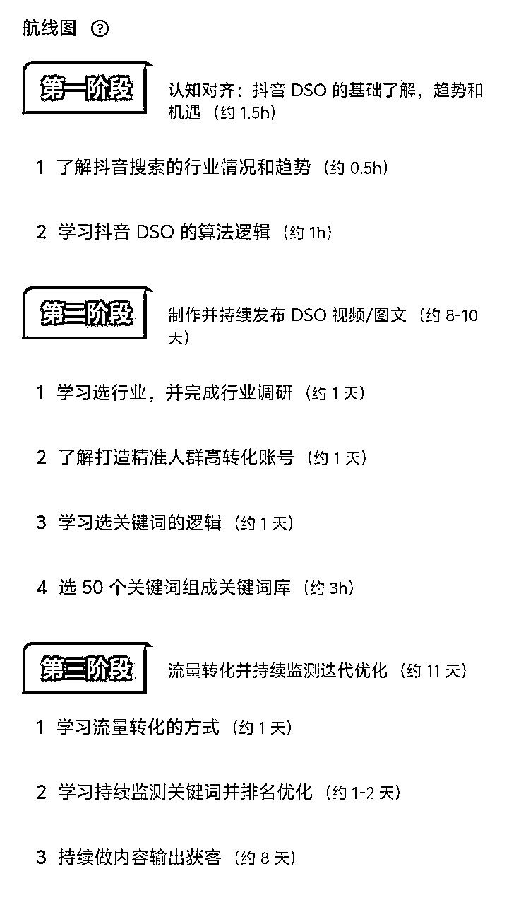

图和手册彼此对应，你在哪个环节，就翻到对应章节学习。

# 必修篇：把最小可行流程走通

# 一、抖音DSO到底是什么

# 💡

本章目标

先建立基本认知：它指什么，哪些人适合。

按航线推进：

1、了解抖音搜索的行业情况和趋势（约 0.5h）

现在可以开始准备。

# 1.1 抖音DSO指什么

DSO这三个字母，对应的是抖音搜索优化。它有三根支柱：词要选得准，内容要铺得够，转化要接得住。具体做法，是通过一系列运营动作，把发布在抖音上的作品往搜索结果前排推。用户搜某个词时，你的作品更容易先被看到，进而产生兴趣，完成留资、下载或购买。

搜索流和推荐流是两种节奏。推荐流像短跑：平台根据用户近期的浏览、点赞、评论等行为迅速分发，作品若一两天内没跑出数据，很快会被新内容盖过去，且推荐场景偏娱乐，竞争越来越挤。搜索流更像长跑：搜索的人带着问题而来，作品一旦占住词下位置，就能长期被看见；内容足够扎实，在某个词下待上一年甚至更久并不罕见。

# 1.2 谁适合做，哪些行业更匹配

人分五类：

内容创作者：美食、美妆、旅行、知识科普等博主，可通过搜索优化让作品被目标受众发现。

线下实体店：各地实体老板想用较低成本从抖音获客，DSO有助于沉淀更精准的私域流量。

电商商家：抖音电商持续扩容，搜索优化会直接影响商品曝光和成交。

品牌营销人员：需要借抖音提升品牌知名度与好感度。

自媒体新手：经验不多但愿意学，DSO上手门槛相对低，掌握方法后可以快速实践。

行业分四类：

急需型：律师、家政、保姆等；

强搜索型：保险、贷款、装修、工厂、医疗、养生、定制等；

知识付费型：教培、证书、IP孵化、求职培训、留学培训等；

消费品型：个护、化妆品、生活必需品等。

# 二、为什么值得做抖音DSO

# 💡

本章目标

看清抖音搜索的行业现状，想明白为什么值得投入。

按航线推进：

1、了解抖音搜索的行业情况和趋势（约 0.5h）

可以开始准备。

# 2.1 抖音搜索的行业情况

抖音DSO正在成为品牌和商家争取流量、推动增长的一种重要手段。要判断值不值得做，先看行业大盘。

2024年抖音创作者大会上，抖音内容生态负责人披露：近一年抖音搜索总规模同比增长51%；每月有80%的抖音用户会使用搜索；超过22%的流量与用户搜索兴趣有关；人均月搜索次数100+；打开APP 30秒后搜索的用户占比67%。

用户搜索习惯已经形成，高意向人群的流量承接仍存在巨大缺口，DSO红利正在释放，经营和营销都很难绕开。搜索能带来四类好处：

（一）更精准地触达目标受众

例如，卖家用健身器材的商家，当用户搜索“家用跑步机推荐”“小型哑铃健身教程”等词时，如果商家作品排在前面，就能出现在有健身需求的人面前。主动搜索的人关注度和兴趣度更高，转化为消费者的可能性也更大。

（二）提升内容可见性与传播力

例如，美妆品牌发布新口红视频，通过DSO优化冲到“新口红推荐”“显白口红排行榜”等词的前排。大量相关用户看到并点击，点赞、评论随之上升，排名更稳，还会引发自发分享，传播范围进一步扩大。

（三）助力品牌形象塑造与忠诚度培养

例如，一家环保家居品牌用DSO把环保产品制作过程、环保理念科普等内容铺到“环保家居”“可持续生活方式”等词下。用户反复观看后，会更了解并认可品牌价值观，忠诚度逐步建立。相比传统广告，这种方式更自然，也更容易赢得信任。

（四）搜索与内容联动带来增量

例如，用户看完美食博主做蛋糕的视频，可能去搜烘焙原料、工具，甚至直接搜品牌蛋糕下单。商家做好搜索承接，不仅能获得自然搜索流量，还能抢占品类心智，反过来促进成交。数据显示，抖音平均每1000次搜索可带来60次成交，搜索与内容联动的增量价值明显。

# 2.2 做抖音搜索的必要性

# 2.2.1 用户搜索需求爆发式增长

抖音搜索的使用量增长迅猛。抖音生活服务《2023年数据报告》显示，过去一年用户搜索生活服务相关内容达593亿次。找美食、查攻略、看产品、学技能，越来越多人把抖音搜索框当作获取信息的入口。

# 2.2.2 抖音平台全力支持搜索

传统搜索是用户主动在搜索框输入关键词；看后搜则是用户看完感兴趣的视频后，系统预测其可能想搜的内容，把词呈现在首页搜索框、猜你想搜、视频标题话题标签、评论区小蓝词或评论区吸顶词等场景。用户点一下，搜索动作就完成了。

例如，用户刷到户外运动装备视频，评论区可能出现“户外登山鞋”“专业登山背包”等小蓝词，点击即可进入对应搜索结果页。

电商行业搜索表现：

当用户搜索品类词、品牌词等带商品指向的关键词时，搜索结果前排主要以直播间、商品卡为主，说明购买意向较强。

例如，搜索“耐克运动鞋”，页面会优先展示耐克直播间和相关商品卡，方便直接进入购买页；而搜索“运动穿搭灵感”这类泛场景词或兴趣词，前排更多是穿搭视频、图文教程等内容。

本地生活行业搜索情况：

用户通过抖音搜索本地美食、旅游景点、休闲娱乐场所等信息的频率很高。以餐饮为例，搜索“附近美食”“特色火锅”“网红餐厅”等词时，抖音会结合地理位置推荐周边餐厅信息，包括店铺地址、菜品介绍、用户评价以及团购链接等。商家通过优化店铺信息、发布吸引人的菜品视频、积极引导用户评论等DSO手段，可以提高店铺在本地生活搜索结果中的曝光度和排名。

# 2.2.3 搜索行业竞争与挑战

随着抖音搜索的重要性提升，关键词竞争也越来越激烈。热门词被大量品牌和商家盯着，大家都想占据前排。因此更要抓住当前窗口期，提前掌握搜索打法，把行业里的好词占住，才能获得更好的效果。

商家和创作者还需要持续关注平台规则变化、用户搜索习惯演变以及竞争对手动态，及时调整DSO策略，才能在激烈竞争中保持优势。

# 三、抖音DSO靠什么排序

# 💡

本章目标

理解DSO排序逻辑，为后续内容生产提供方向。

按航线推进：

1、学习抖音 DSO 的算法逻辑（约 1h）

可以开始准备。

抖音DSO的目标是：当海量用户搜索某个关键词时，平台能高效呈现与关键词契合、符合用户兴趣且真正有帮助的内容，同时维护平台生态的健康与多元。

平台如何判断某个关键词下哪条作品该排上去？影响搜索流量的关键点如下：

作品发布初期，抖音会做文本识别：识别视频中的文字信息，如标题、字幕等，也会把语音内容转成文本分析。例如，一条旅游攻略视频，算法通过标题和字幕判断主题是某地区旅游推荐，就会把它放进对应关键词的作品池。

所以做搜索流量作品时，要多覆盖关键词，让平台能识别出你属于哪个词下的作品。

作品刚发布后，平台会先让它在短时间内排在前边，再根据初期表现，如播放完成率、点赞率、评论率等核心指标，决定是否保持排名。

因此作品需要保证：

内容质量过硬。抖音有严格的视频质量评估体系，除了清晰度、稳定性等基础指标，还看原创性、价值性、专业性。

内容能解决用户问题，让用户愿意看下去，并在看完后产生互动。

内容合规。一旦发现违规，视频会被立即下架；严重违规的创作者账号还会受到警告、限流、封禁等处罚，以维护平台健康积极的内容生态。

基于这套逻辑，项目实操分三步：

1、精准选词，找高流量、高转化的词，围绕关键词制作对应的视频/图文内容；

2、流量变现：做好引流转化；

3、监测关键词数据，并持续迭代优化。

下面详细展开实操内容。

# 四、选词、做内容、发布DSO作品

# 💡

本章目标

这一章讲账号装修、选高转化关键词、制作并发布短视频/图文内容。跟着做，持续选词发内容，流量会逐步进来。

按航线推进：

1、学习选行业，并完成行业调研（约 1 天）

2、了解打造精准人群高转化账号（约 1 天）

3、学习选关键词的逻辑（约 1 天）

4、选 50 个关键词组成关键词库（约 3h）

5、制作并持续发布 DSO 视频/图文（约 8-10 天）

现在开始准备。

# 4.1 行业DSO的调研

在抖音平台或AIDSO中找自己感兴趣的用户/行业，做全方位分析：账号装修、内容模式、营销模式等。

# 4.1.1 选择一个行业

所有线索行业，都可以用搜索流量的逻辑来做，比如高决策成本类：3C电器、机械化工、奢侈品、家居家装、旅游出行、房地产、汽车行业、职业/兴趣教育培训、招商加盟、本地生活服务等。

还有刚需型行业，如商务服务（法律/财税）、本地服务（家政/护养/月嫂/保姆）等，以及副业赚钱相关行业，如电影/知识网盘、游戏插件等。

为什么线索类行业更适合搜索流量？因为线索行业需要在线上通过布局短视频或图文内容，实现客户咨询和留资；而搜索流量的打法，正是生产符合用户搜索需求的内容来获客，两者非常契合。

每个行业都要有一个认知：抖音一定会把免费给你的流量用来卖钱，这意味着做抖音如果不投流，很难获取免费流量，更别说精准流量。所以在当下内卷时代，做搜索流量具有划时代意义：

首先，搜索流量能精准获客，因为搜索背后反映的是用户主动搜索需求，用户主动留资的线索最精准；其次，搜索流量有明显成本优势，搜索流量获客成本仅为付费推广的20%，甚至大部分玩家玩的是自然流量；另外，搜索流量具备长尾效应，优质内容可保持2年以上持续曝光和引流；最后，搜索流量具备信任溢价，主动搜索场景下用户付费意愿更强。

可以说，布局抖音搜索流量，是接下来个人、商家、企业、品牌在抖音实现流量获取和用户增长的重要营销手段和商业闭环。

# 4.1.2 行业DSO情况调研

做调研要通过数据分析，判断赛道卷不卷、能不能做出成绩。

判断赛道卷不卷的标准，可以从搜索行业大词、行业达人情况、搜索结果页来预判：

1、搜索行业大词：看行业大词的月覆盖人数以及关键词下作品活跃度。若一个行业核心词、业务词月覆盖人数较高且作品活跃度高，代表此赛道难度较高。

例如：对比“旅游”“装修”两个赛道，先对比月覆盖人数以及七日搜索；在七日搜索相似的情况下，月覆盖越高的行业越卷。然后做二次确认，对比作品活跃度：如果旅游行业前几名的日期比装修行业更“新鲜”并且点赞量较高，就能判断旅游行业比装修行业难做。

看七日搜索/月覆盖的百分比，百分比越大难度越小。

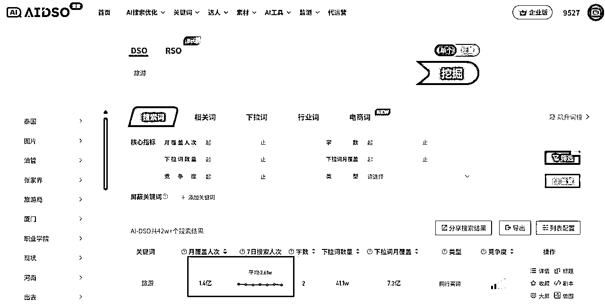

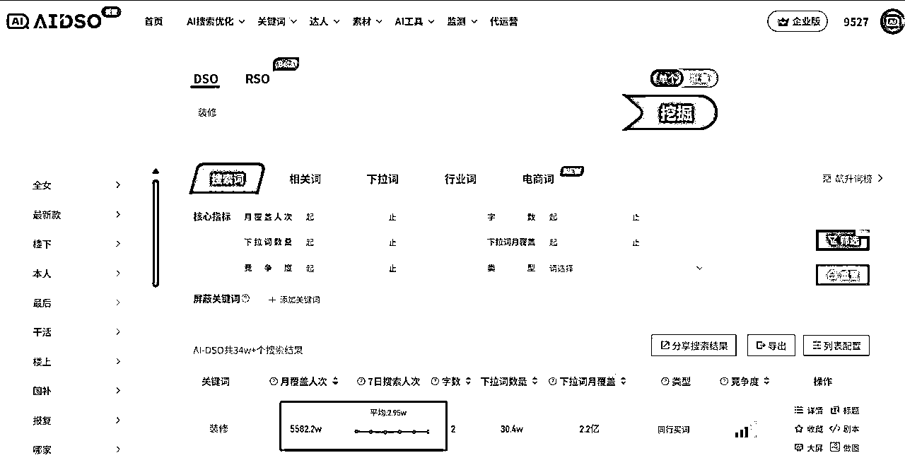

看行业核心词前几名的作品活跃度、点赞。

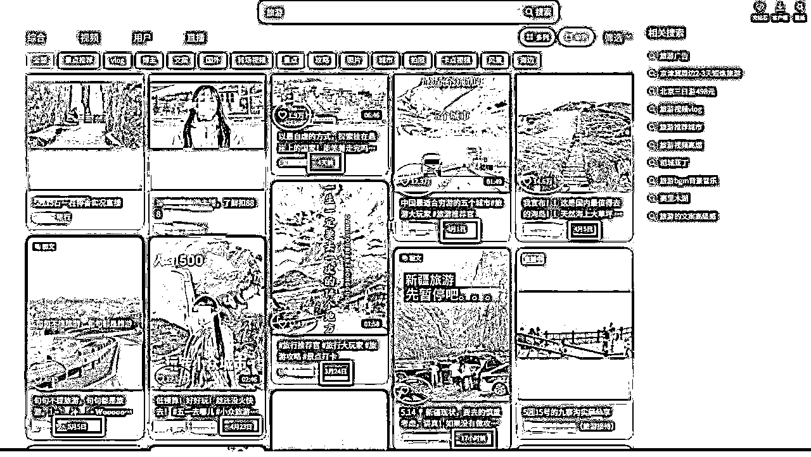

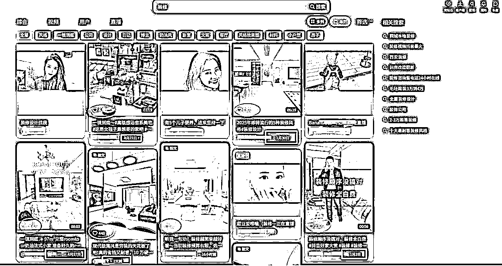

2、看头部账号/IP流量占比：如果某赛道流量高度集中在少数头部账号（如TOP 10%的创作者占据90%的流量），说明该赛道竞争激烈，新人难以突围（例：企业培训-张琦）。

附：行业账号情况不了解，也可在AIDSO上查看。

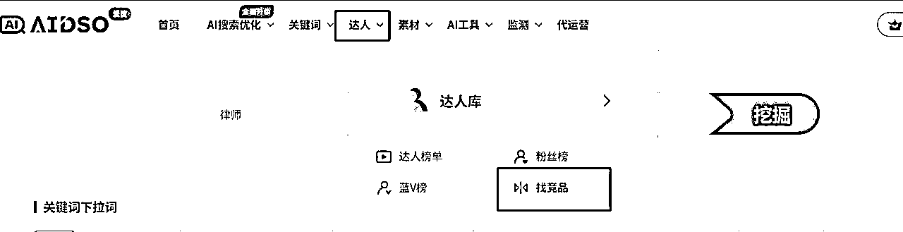

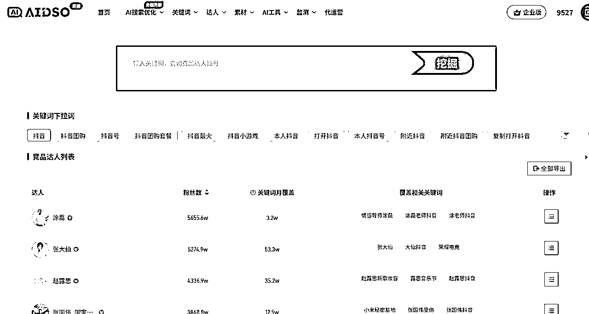

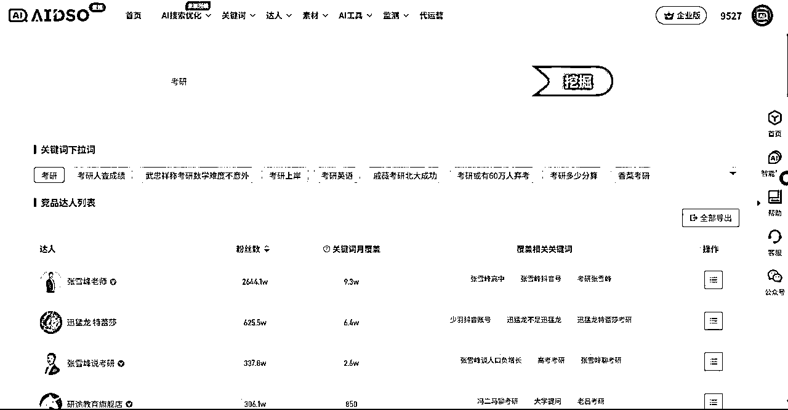

3、看有没有按DSO（抖音搜索）逻辑生产内容的账号，及其账号数量和权重：若一个赛道较多账号在做DSO逻辑且互动量、粉丝量较多，考虑自己的情况是否能比他们更好，才能获得更好的效果。

如何判断能否做出成绩？首先定义搜索流量合格的标准：能否做出一条搜索流量占比90%以上的视频/图文。当然，这只是从内容角度考虑；做搜索流量的核心，还是要看内容带来多少线索以及后端完成多少转化。

做搜索流量想快速拿到成绩，一看行业卷的程度，二看团队认知水平和执行效率。行业卷不卷，通过前面的数据分析能大概判断。当然，风浪越大鱼越贵，卷不一定是坏事：越卷的行业，会自动淘汰水平差的团队和人，有门槛，才能更好推动整个行业快速发展，以及拉高从业者的业务和服务水平。只要团队具备相应业务能力和执行效率，加上正确打法，通过搜索流量拿到结果是早晚的事。

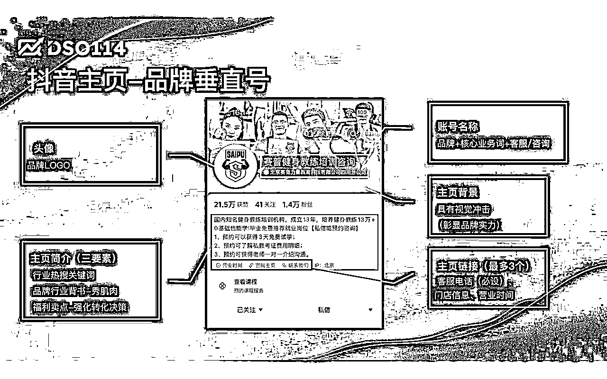

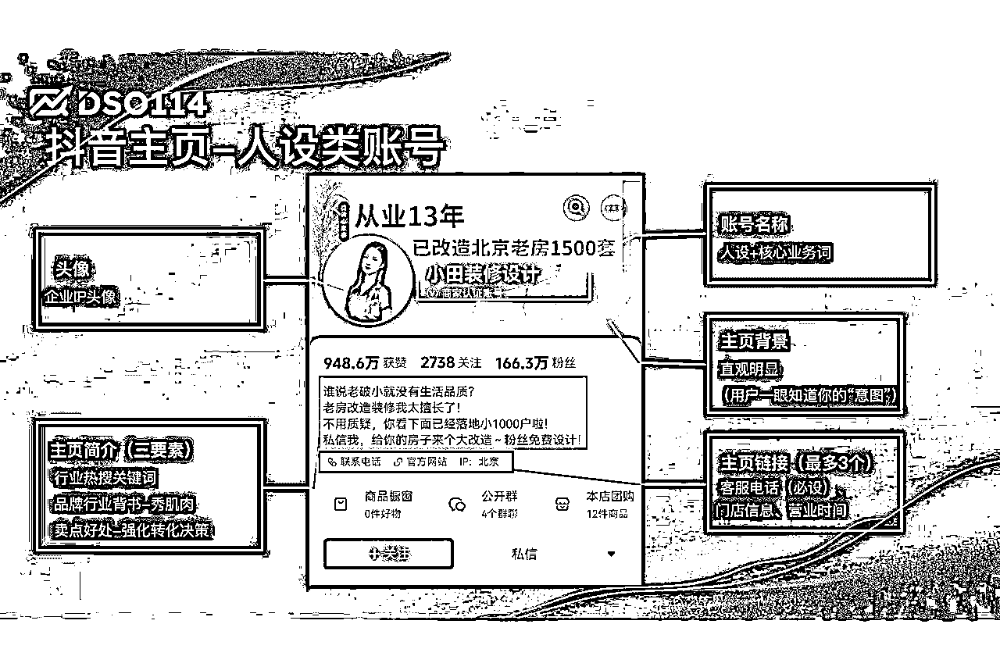

# 4.2 搭建符合DSO的账号

# 4.2.1 抖音主页装修

# 企业账号：品牌垂直号与人设型账号

植入核心业务词。

品牌账号：品牌名＋主营词＋客服/咨询入口，让用户一眼知道这里是官方咨询通道。

人设IP号：人物名＋主营词，例如“北京装修小龙哥”“郑州老季二手房”。

简介可以用三段式：行业定位＋角色背书＋用户收益。

第一段，行业定位。

行业要切得足够具体，落到明确的消费群体和方向。

以服装为例，从泛服装切到女装，再切到大码女装，业务词就落在“大码女装”；汽车同理，从卖车收窄到二手车，再到精品二手豪车，核心词自然变成“二手豪车”。

第二段，角色背书。

先确定你以什么身份面对客户：是普通打工人、老板、设计师、装修师傅、美妆达人，还是擅长讲段子的内容人？

背书要回答两个问题：和同行相比，你的优势在哪里？客户为什么要选你？这就是竞争力。

第三段，用户收益。

把客户能获得的好处说清楚：这个账号能提供什么价值，用户看完能得到什么。

大码女装客户想穿衣显瘦，就直说“显瘦20斤”；二手豪车客户想少花钱开好车，就写“低价开豪车”。

参考案例：

案例1（服饰行业）：大码女装

# 抖音主页装修与搜索获客实战手册

先摆两个账号，后面拆方法时更容易代入。

账号一：一位主理人做150斤大码女装，背后是开了13年的女装工厂店。她每天输出显瘦、显质感的搭配思路；粉丝进群能领100套胖妹妹穿搭灵感；关注她，相当于给自己一个“视觉瘦20斤”的盼头。

## 案例2：二手车

车界老王，在二手车行业干了20年，卖出二手豪车20000+。私信他可领取《选车避坑指南》，帮买家低价开好车。

主页简介要埋行业大词，按四块来搭：背书、案例、福利、行动指令。

企业官方类可参考：

金夫人：为中国家庭拍婚纱照。全国400多家门店，超600万对新人认可；主打高品质情感婚纱摄影；热拍风格包括古风情缘、前世今生、目的地婚礼。

人设IP类A：

深耕8年的室内设计从业者。免费设计、免费量房、免费报价；全国各地150+城市可服务。私信免费领取设计名额。

人设IP类B：

我是浩哥，做海南高端定制游7年，亲自接待8000+顾客。兄弟局、情侣蜜月、闺蜜轰趴、家庭度假、公司团建都能接；提供贵宾楼豪车接送、专属管家独栋别墅、游艇派对、海陆空深度体验。你点开对话框的那一刻，服务就开始了。

置顶视频放1—2条为宜。企业秀肌肉，品牌或创始人成长故事都可。品牌账号：机构背书（市场规模、官方认证、供应链优势等）+优秀案例，构建并强化用户品牌心智。人设IP号：走“平凡英雄”曲线，激发共鸣、形成共识。用创始人或主理人讲故事的形式，讲出身贫寒、创业路上经历诸多不易、最终取得成果、做到一定规模等。

# 个人账号：把案例和服务摆到台前

个人号与企业人设型账号同理，强化人设背书，案例、服务都要亮出来。

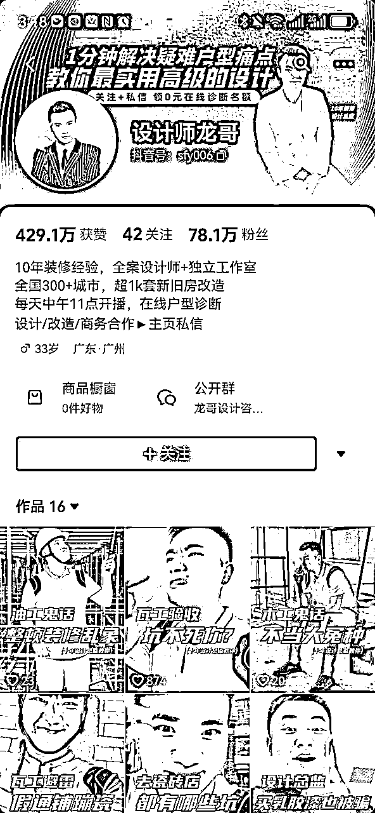

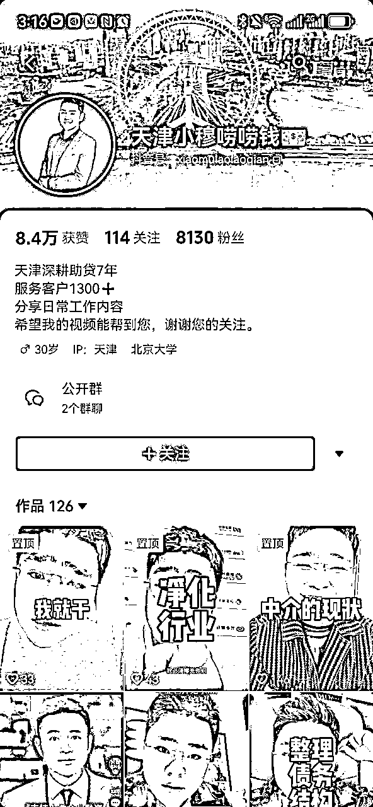

其实企业蓝V账号和个人号做内容的逻辑一样，只是蓝V可以挂载线索组件，个人号没有该功能。如图，这是企业蓝V账号线索组件的功能展示，后面会详细讲企业蓝V号的搭建流程。

# 4.2.2 蓝V企业号：装修前先想清两件事

做企业号基建前，先把两个问题的答案想清楚：

1、企业的核心竞争力是什么？也就是我能提供的、同行没有的、用户需要的。
2、能给用户什么“行为好处”？把留资这个动作“合理化”，让用户心理上能接受。

核心竞争力与行为好处都要体现在以下装修板块：商家主页、高级预约组件、私信欢迎语、回复话术等。

企业号后台链接：https://leads.cluerich.com/

# 主页链接：三个入口别漏配

入口在运营工作台→店铺管理→主页装修。

联系电话：设置客服电话，承接急需求用户。
查看地址/门店地址：若上团购，在抖音来客完成入驻配置。
认领门店：入驻抖音来客（链接：https://life.douyin.com）。
抖音来客入驻准备包括营业执照、法人信息、门店信息（门头牌匾、地址等）。

# 商家主页：一屏讲清你是谁

商家主页可直接展示在主页，方便用户了解品牌全业务生态。主要元素包括：机构核心业务置顶、机构背书、优秀案例、机构环境（服务场景）。

商家模板（线索商家）可这样配：
服务产品——企业核心业务置顶，配图/文案卖点充分；
店铺活动——引流福利，比如预约即送……；
线下门店——抖音来客；
团队成员——行业名人IP；
官方相册——线下服务场景配图；
本地通——推荐生活服务行业的商家开启。

举例如下：商家主页

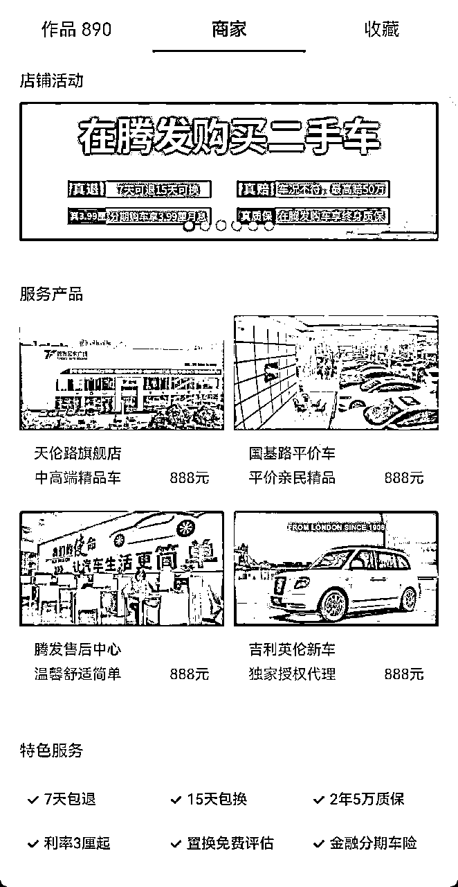

# 高级预约组件：让咨询更顺滑

入口：运营工作台→服务管理→高级预约组件。

商品大图：覆盖用户需求、卖点充分，可对标同行，也可在美图等软件找模版。
服务标题：会展示在视频下方，要仔细斟酌编辑，配吸睛文案，比如免费预约咨询、预约即送**。
企业简介：写企业规模、年限、成绩、服务。
产品简介：与商品大图信息类似。
适用门店：本地或区域性业务可认领，前提是已在抖音来客完成入驻。

温馨提示：
提示1：高级预约组件审核严格，提交前仔细阅读企业号功能组件审核规范。
提示2：信息不建议“充分填写”，体现核心信息即可。信息越多越容易拒审。
提示3：若不清楚拒审原因，可联系右下角官方客服，咨询“人工”触达。
提示4：主营/热门业务建议单独创建预约组件。

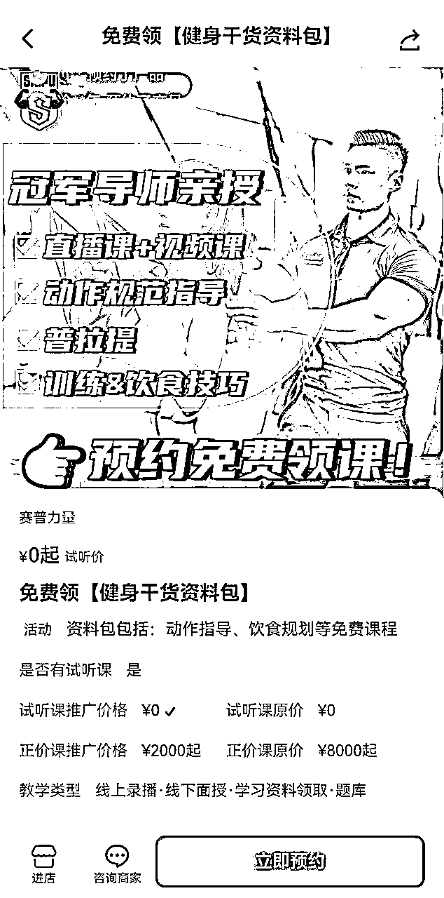

示例：竞争力写冠军导师（师资），行为好处写预约免费领课。

# 客服配置：欢迎语与自动回复怎么设

欢迎语参考模板：感谢语+背书话术+业务介绍+引导福利/优惠信息+客服在线时间+转化入口。

示例：您好！欢迎咨询天鹅到家，全国领先家庭服务平台！我们是一家与公安机关联网的家政公司！选大平台、才有保障！提供保姆/月嫂/育儿嫂上户服务！客服小鹅8:00-20:00提供1对1线上答疑！欢迎打扰！
官方门店周年庆！预约咨询即可领取门店优惠！

示例：竞争力写IP经验+案例背书，行为好处写免费3套设计方案。

自动回复有两条路径：
路径1：运营工作台→咨询管理→自动化设置→关键词匹配；
路径2：运营工作台→客服中心→智能客服→自定义知识。

核心价值：根据用户咨询高频词设置自动回复，提高服务效率（3分钟回复率>50%，否则私信限流）及线索转化率。

可参考以下形式：
形式一：欢迎语+问题引导。底层逻辑是构建私信问答闭环+完成流量筛选。操作路径：运营工作台→自动化设置→自动回复（进入对话/关键词匹配）。欢迎语预设附加问题；关键词匹配预设问题并设置针对性回复。

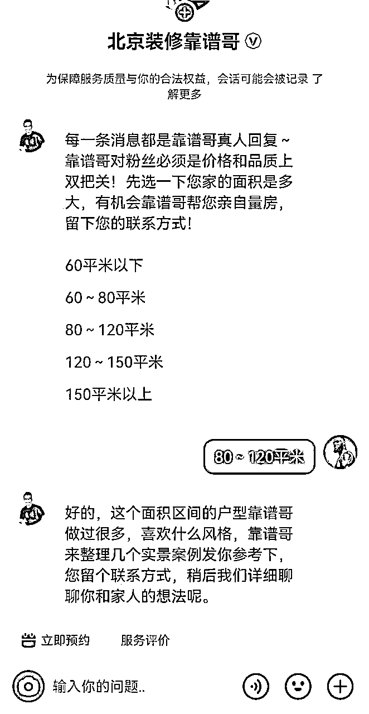

形式二：欢迎语+表单预约。底层逻辑是引导用户自主预约，节省客服沟通成本。操作路径：运营工作台→自动化设置→自动回复（进入对话）。欢迎语附加“高级预约组件”或“一键留资”；高级预约组件需提前创建，过审之后可选。形式二适合刚需性行业（如法律、家政等），这类用户往往更习惯私信沟通留资。

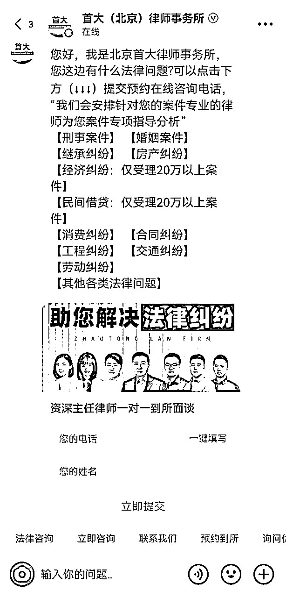

# 独立店铺：短视频下方也能留客

入口：运营工作台→店铺管理→独立店装修。它可直接挂载短视频下方，形式接近抖店橱窗。

装修要领（配置≥4个模块，模块名称可自定义）：
背景图：体现业务信息，让用户一眼识别企业是做什么的。
预约：勾选在线预约，用主营预约组件承接；也可直跳私信咨询；还可配置客服电话承接急需求用户。
精选服务：核心/热门业务置顶。
经典案例：成功案例、明星推荐等。
服务类型：填写全部业务。
官方相册：机构环境或服务场景配图。

# 4.3 选出能带来转化的搜索词

# 4.3.1 先圈定业务核心词

从自身业务出发，确定核心业务词、行业词。比如产品是床垫，业务词可写“买床垫、床垫怎么选”，行业词归入“家居软装、床上用品”。注意排除与业务不相关的词，比如“床垫回收、床垫除螨”就不算业务词。

# 4.3.2 找到主流量词

手动查找：在AIDSO网站→关键词。网址：https://www.aidso.com/

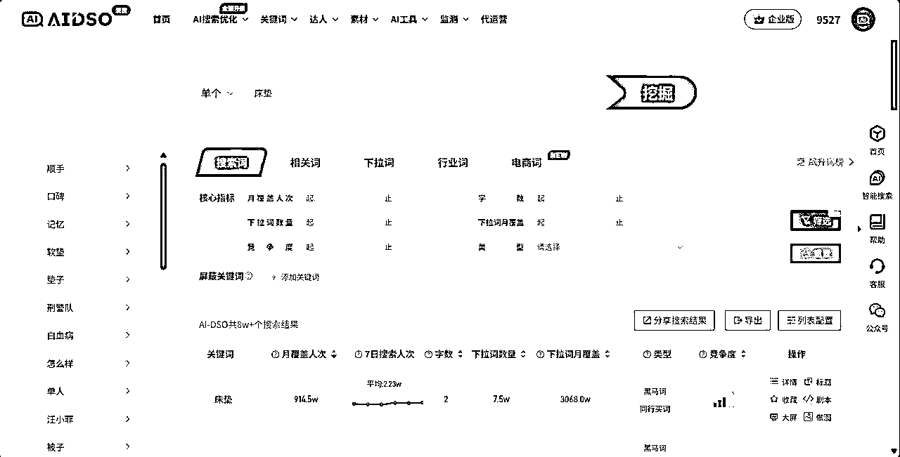

关键词选择要重点看四个数据：月覆盖人次、7日搜索人次、下拉词数量、竞争度。

月覆盖人次：看近30天挂这个词的内容触达了多少人，也就是该词在平台发布内容覆盖的人数。覆盖人数多，代表发这个能获得更多流量，但不一定好上排名。
7日搜索人次：指近7天在抖音搜索该词的人数。数值越高，代表该词越有价值，做上排名的重要性越高。
下拉词数量：指包含该词的下拉词有多少。下拉词越多，上排名难度越大，因为用户搜索时可能分流到下拉结果。
竞争度：总体竞争难度。

示例如下：

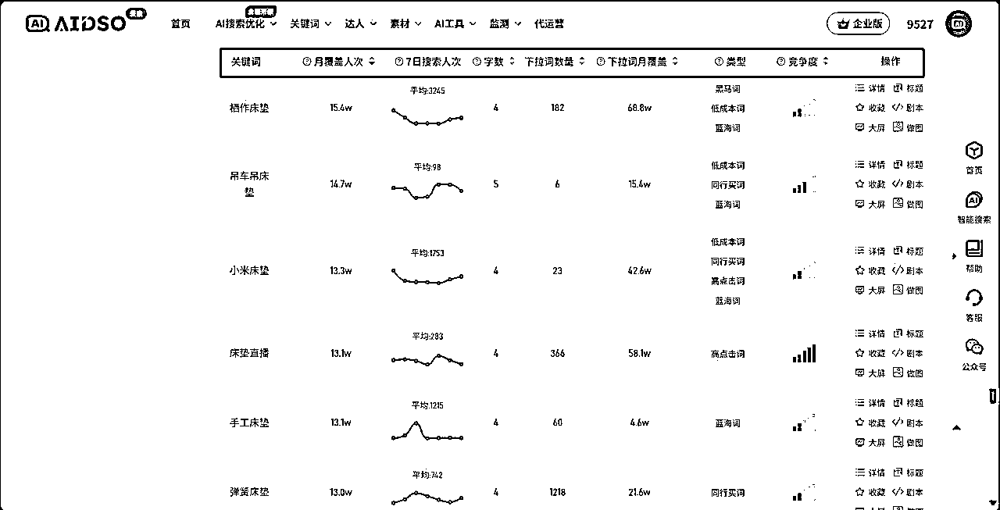

# 4.3.3 借热门趋势与话题

关注当下热门事件、流行趋势以及抖音平台内的热门话题。比如某时期流行“露营”，与露营相关的产品或内容就可选“露营装备推荐”“露营美食做法”等结合趋势的词，获取更多流量。可在抖音热点榜、抖音热榜话题页查看当下热门内容，也可直接到AIDSO看最近飙升词榜。

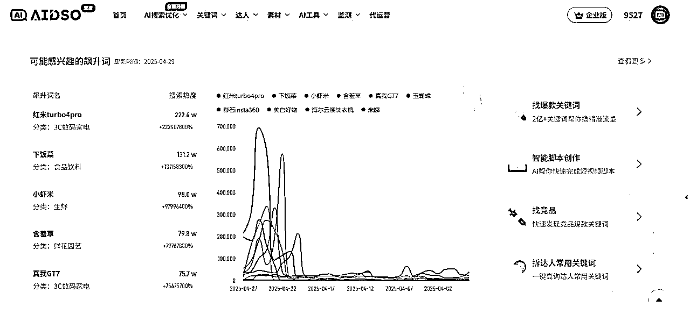

# 4.3.4 按账号阶段挑词

账号情况决定你选关键词的筛选数据。若急功近利，很可能得不到结果，参考示例数据较稳妥。

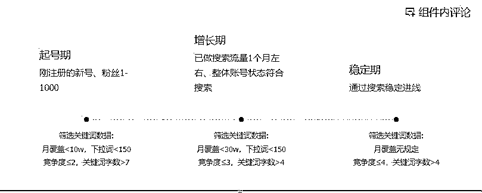

# 4.3.5 参考竞品关键词

分析同类型账号或竞品发布视频使用的关键词。查看他们热门视频的标题、描述、标签中的关键词，从中发现高转化潜力的词。

利用抖音搜索框：输入与主题相关的词语，抖音会自动弹出热门搜索词。比如搜“健身”，可能出现“健身操”“健身饮食”等，这些都是热门且有搜索量的关键词。

# 4.4 制作DSO短视频/图文

制作符合DSO的视频和图文。搜索作品与推荐作品有很多不同，判断一个关键词做图文还是做视频，要看该关键词下搜索结果的前几作品情况。若一个关键词搜索结果前几视频多，那就做视频；若图文多便做图文。

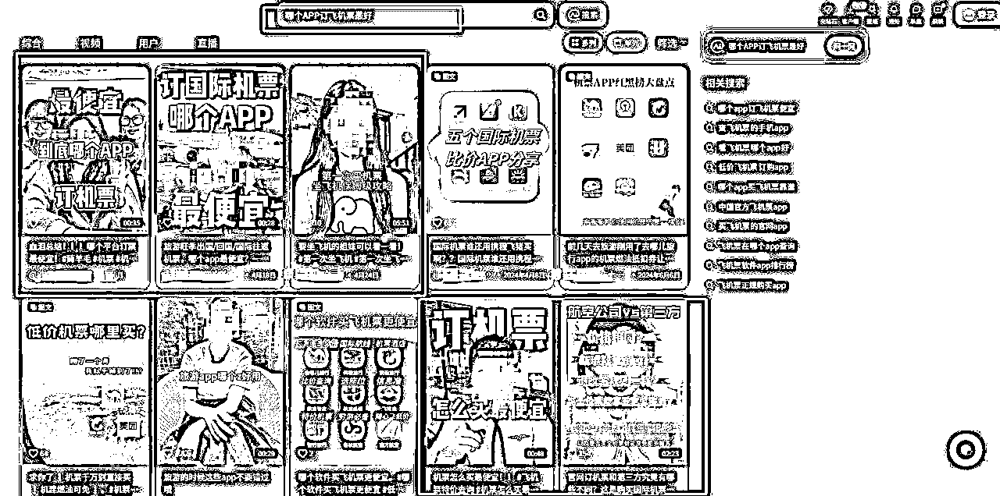

✅关键词搜索结果视频多，此关键词做视频

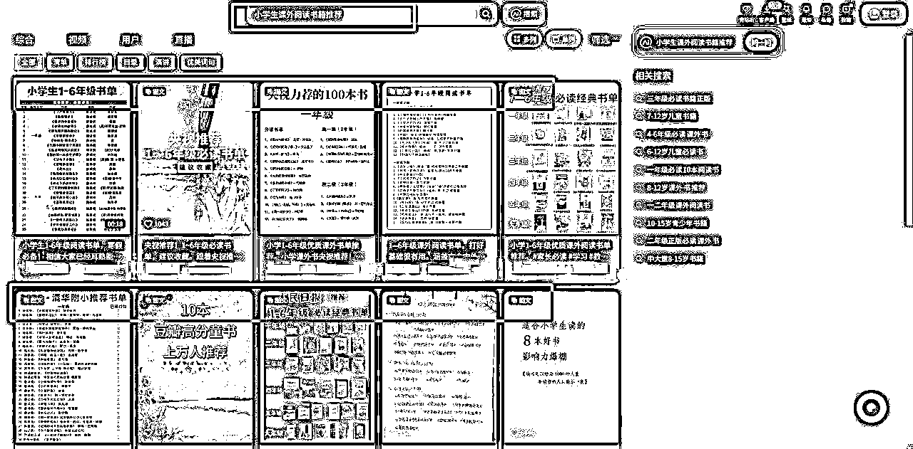

✅关键词搜索结果图文多，此关键词做图文

# 4.4.1 制作DSO短视频

制作符合DSO逻辑的视频时，视频的文案、画面、字幕、背景区、视频封面、视频前3秒，这几方面尽量覆盖上关键词。

# 4.4.1.1 确认视频形式

写脚本以及制作视频前，先确认自己做什么类型。可依据关键词含义去搜这个关键词的受众人群会想看什么视频内容，也可根据关键词前十个作品判断形式。

示例：选择关键词“考研怎么选学习以及专业”

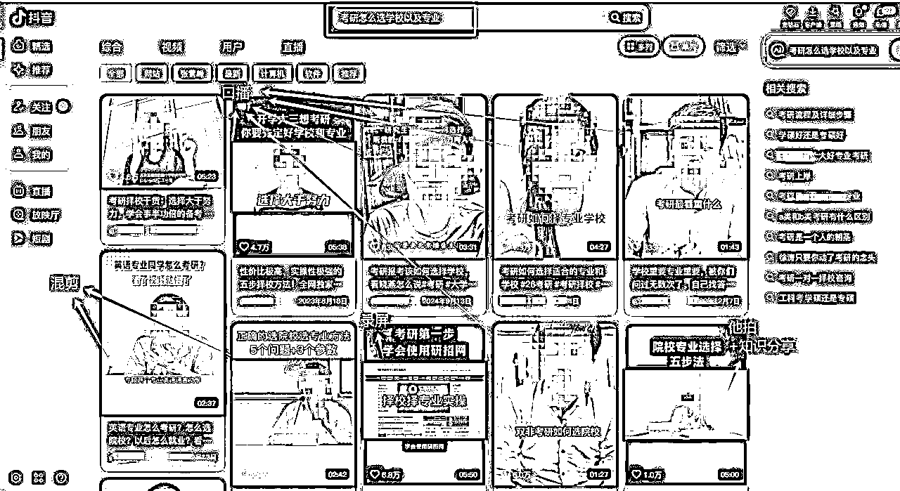

点击关键词抖音搜索看到以上作品情况。

步骤1：分析前几个作品的形式。这个关键词前几有四种形式，前几都是口播。
步骤2：考虑口播形式自己是否可以做。如果可以做，可以直接看前几内容大概是什么样，去进行脚本撰写（不能原样抄袭）。若做不了口播形式，就考虑剩下三种形式自己可以做哪个。

优先级：关键词下最多的视频形式；依据关键词内容定位确定视频形式。

剧情类（Vlog）：通过设计有起承转合的故事剧情吸引观众，可包含搞笑、悬疑、情感、励志等题材。例如关键词“0成本创业适合做什么？”，讲述职场成长的故事，把你业务侧能带给用户的帮助放进去，这种形式能让观众产生情感共鸣。

口播类：创作者主要通过语言表达传递信息，如新闻资讯播报、观点评论、故事讲述等。例如时事评论员对近期热点事件发表看法。口播类适用于各行业，且操作难度低。

技能教学：主要教授各种实用技能，像烹饪技巧、健身方法、化妆教程、摄影教学、乐器演奏教学等。比如关键词是“健身教练证怎么考”，可以详细展示考证步骤，以及自己的相关业务，让观众跟着学习并来找你咨询。

知识分享：创作者将自己擅长领域的知识以通俗易懂的方式讲解出来，如历史知识、科学原理、财经知识、法律常识等。比如关键词是“怎么学会投资？”，内容通过生动案例讲解经济学中的供求关系原理，分享一些实用小常识，帮助观众增长知识，从而信任你，对你的业务感兴趣。

混剪类（录屏、素材混剪）：将多个不同的视频片段进行剪辑组合，配上合适的音乐和解说，形成一个新的有主题的视频。比如关键词是“北京旅游团”，把旅游时拍摄的各地风景片段混剪在一起，以及自己的业务宣传，制作成一个混剪视频，用户通过视频感兴趣去咨询。

# 4.4.1.2 脚本撰写

脚本撰写时注意关键词：前三秒要包含关键词，中间尽量覆盖关键词，结尾也要包含关键词。若没有脚本经验与思路，可用AIDSO的AI脚本工具来写，输入关键词生成符合关键词的脚本。

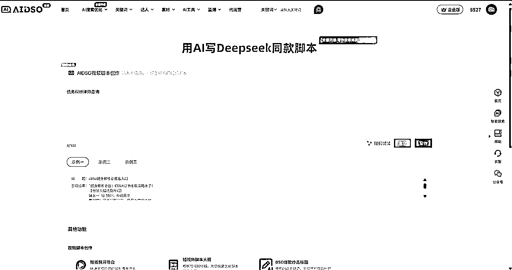

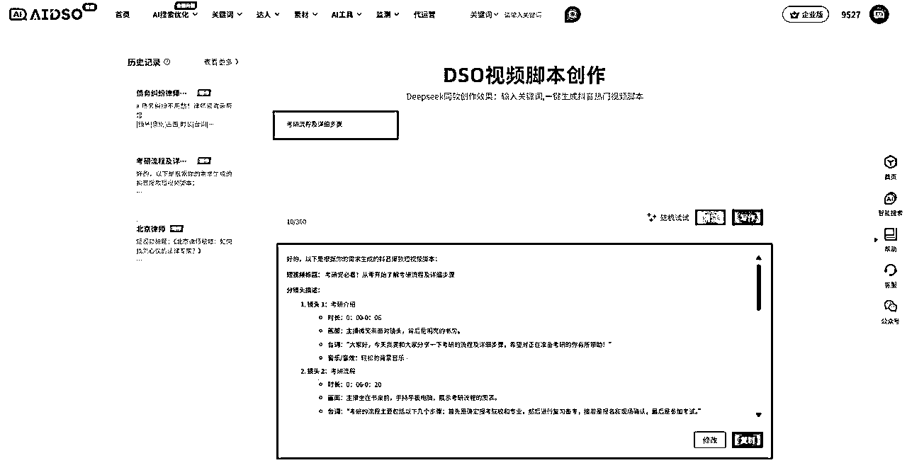

# 4.4.1.3 视频剪辑

视频剪辑工具用剪映。剪辑中不管是字幕还是特效，都要以凸显关键词为主。若没进行过视频剪辑，可去各大网站搜索视频剪辑教学学习，这里不详细讲解。

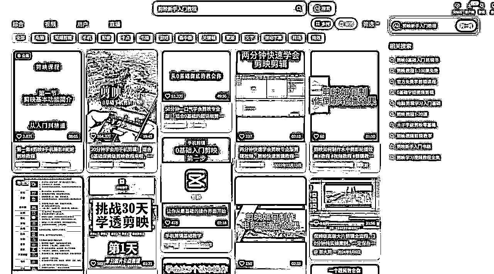

# 4.4.2 制作DSO图文

制作符合DSO逻辑的图文时，图文的标题、文案、图文封面，这几方面尽量覆盖上关键词。

# 4.4.2.1 确认图文模板以及形式

制作图文前同样先确认自己做什么类型。依据关键词含义去想象搜这个关键词的受众人群会想看什么样的图文内容，也可根据关键词前十个作品判断形式。

示例：选择关键词“三天两夜旅游推荐”

点击关键词抖音搜索看到以上作品情况。

步骤1：分析前几个图文作品的封面模板。此关键词下的模板形式大概分为三种。
步骤2：寻找素材做类似的封面，去各大素材网站寻找素材。
步骤3：去美图秀秀/醒图/可画/其他作图软件中寻找作图模板。点击前几个作品的内容观看，分析受众群体的喜好，去找受众群体年龄层喜欢看的模板。

# 4.4.2.2 确认图文内容

图文内容需要根据关键词搜索含义来分析，去其他网站上找一些内容供参考。

例如：你所在行业是考研教培，选关键词是“考研怎么选学校以及专业”。先思考什么样的人群会搜索这个词；再思考搜索这个词的人群会想看到/想得到什么东西；最后想怎么结合这个词去拓展/种草自己的业务。整理这些文案以及配图素材。

# 4.4.2.3 制作图文

运用制图软件作图：美图秀秀、可画、醒图、稿定设计等。

制图要求：
每一张图文都要包含关键词；
一组图约3—6张；
图片清晰、图片比例3：4（📕比例）；
素材清晰，文字字体要让用户看清；
图片与文字的占比合理。

制图注意事项：
图片配色不能太多，最好是企业色+相近色；
同一组图除封面外要统一模板。
以美图秀秀电脑端为例（手机端同理），进入美图设计室：https://www.designkit.com/

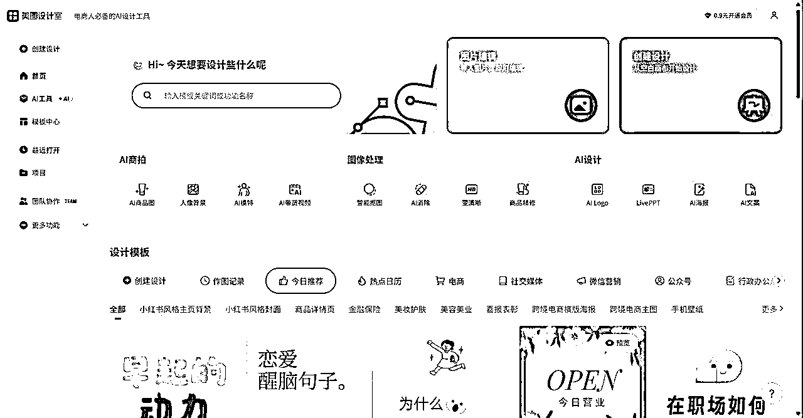

自己创建画布，直接点击创建设计，尺寸选📕封面即可。

进入所创建界面就可以直接作图：左侧操作栏有编辑框可以修改，右侧可复制/查看每一个页面。

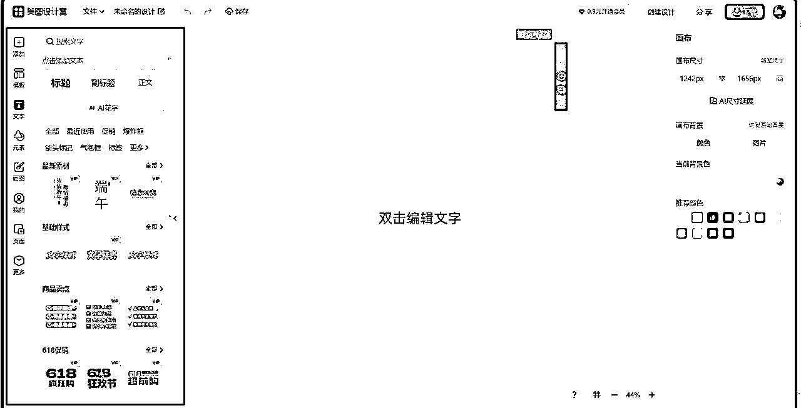

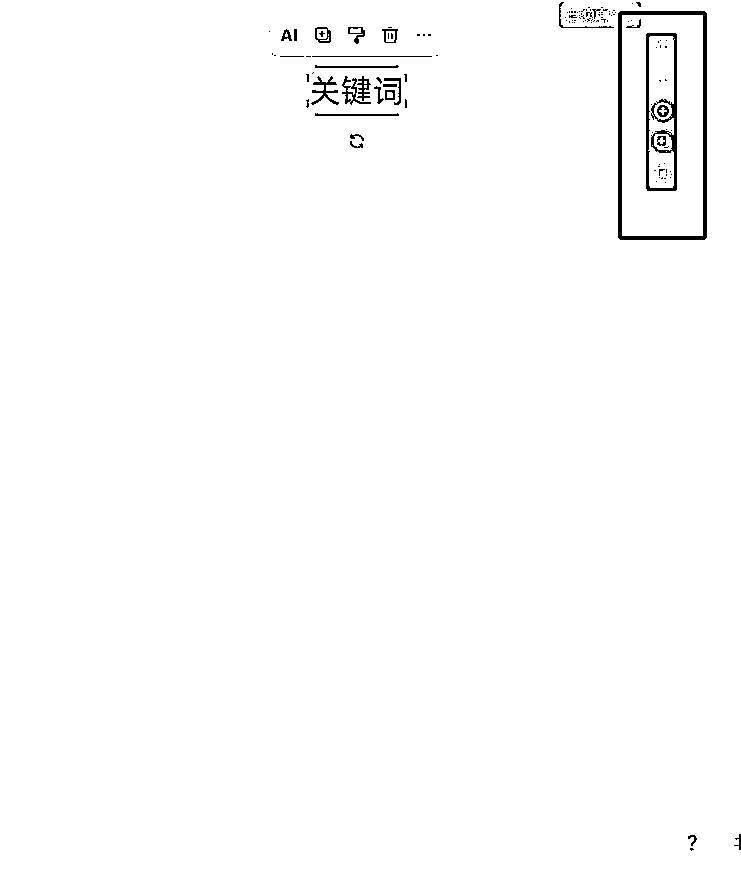

也可以直接选模板制图，点击自己心仪的模板去做。

在画布上添加字体与图片即可，完成后点击右上角下载，即可下载全组图片。

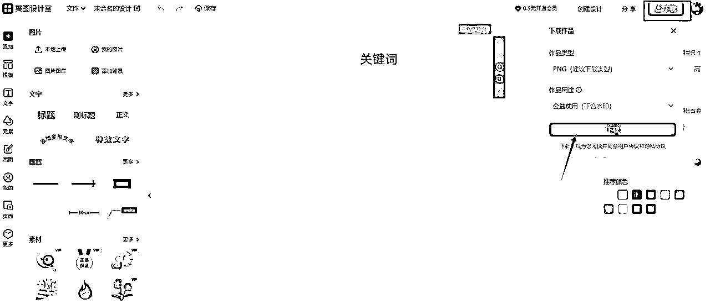

想修改之前的图，还有作图记录可以点击修改。

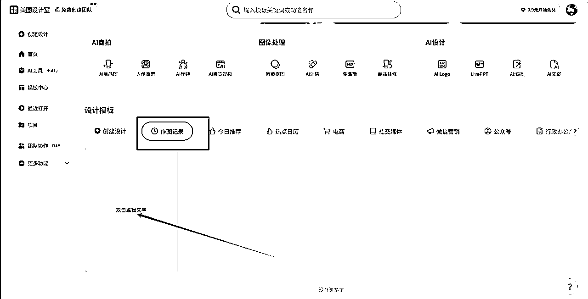

思路：1.封面；2.解答关键词；3.解答关键词+附加信息；4.业务侧+钩子。封面是图文重点，要把握搜关键词的用户心理，确保用户能在搜索结果下选择你的作品观看。

# 4.5 发布视频/图文

# 4.5.1 发布时间

分析行业人群，观察行业人群的上线时间，在行业人群上线前1—2个小时发布作品。

例如：行业受众群体是大学生，人群上线时间为9:00—23:00，因为大学生不会太早起，并且闲暇时间多，就在这期间多发布视频。若受众人群为白领，就要推算其休息时间，因为这类受众群体多休息时间刷抖音。

若实在不清楚，前期新号可多测试，观看数据趋势，总结特点，看哪个时间段发布的互动数据好，多测几次就总结出规律（新号建议一天发5~7条，早6—晚22每隔2小时发布）。

# 4.5.2 发布文案

手机端直接点击发布编辑，电脑端进入抖音创作者中心后台发布。

标题：包含完整关键词，可加前缀和后缀，整个标题要符合关键词含义。
文案：包含1-2次关键词，整体文案要符合关键词含义，不要无意义地重复堆积。
话题：第一个话题必须是关键词，剩余4个关键词可添加行业相关关键词（关键词库）。就算关键词话题应用为0也要使用！

案例参考（关键词为：专科生怎么考研究生需要什么条件）：

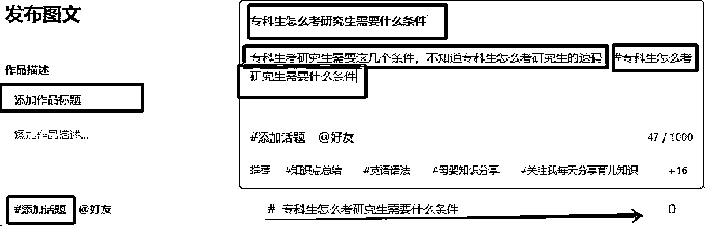

# 4.5.3 合集创建

合集很重要，能让合集下所有作品进行加权，还有延长作品更新时间的作用。合集也要围绕关键词去做，合集名称、合集封面、合集简介都要是关键词。合集标题只填关键词，简介文案至少一次展示关键词，合集封面包含关键词且要醒目。合集创建在抖音创作者中心（https://creator.douyin.com/）内容管理下方。

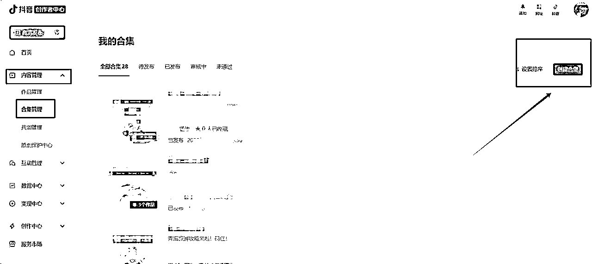

DSO作品发布前检测表：DSO作品发布前检测表（圈友可用）。圈友可点击链接复制文档自己使用。

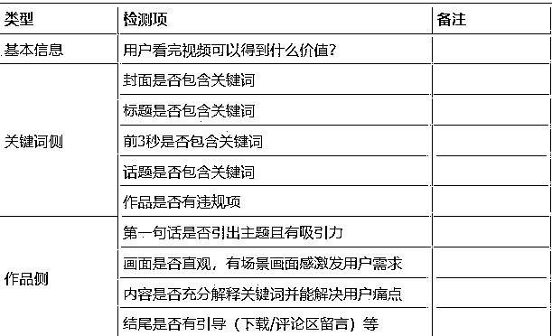

# 4.5.4 如何发布

以电脑端为例，手机端直接进入抖音点击下方“+”号发布。

① 先访问抖音创作者服务平台（https://creator.douyin.com/），用抖音App扫码完成登录。

② 进入工作台后，在页面里找到“高清发布”并点开。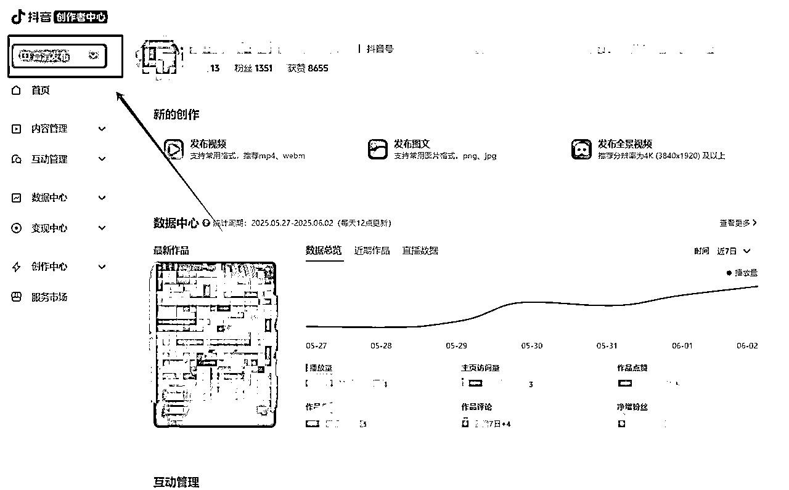

③ 把已经做好的短视频或图文素材拖拽到投稿区域。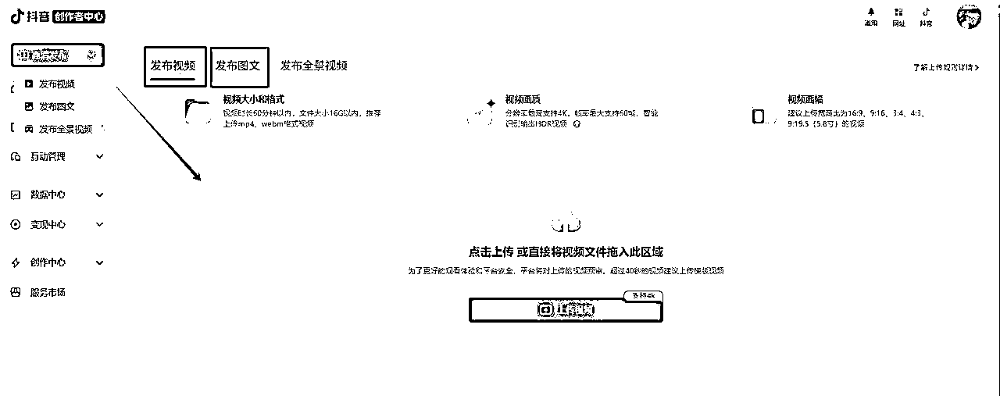

④ 接着补全作品标题与正文（规范参照4.5.2），再挑好封面、挂上合集（相关设置见4.5.3）、配好背景音乐。确认无误后提交发布。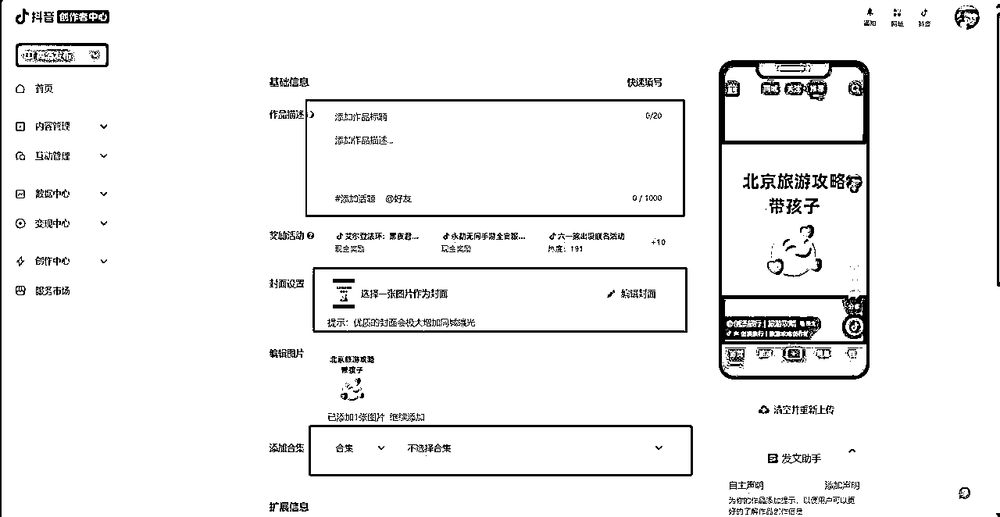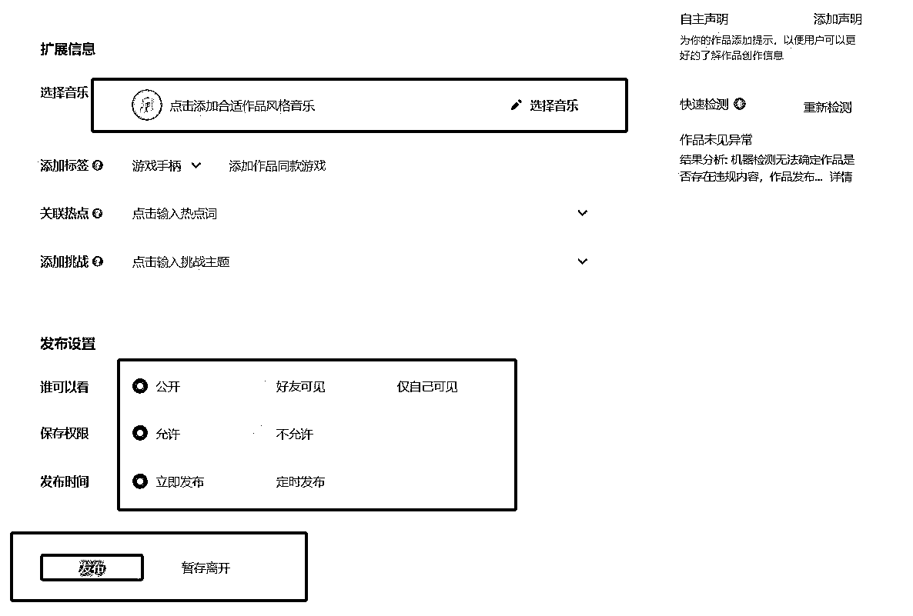

# 五、流量获取与成交承接

# 💡

本节提要

这一章我们把引流与转化讲清楚，并带大家动手实操一遍。

跟着航线图推进即可：

1、先掌握流量转化的路径（预计1天）

那么现在，就动手准备起来吧。

# 5.1 流量从哪里来

1.

选准词＋做精品内容。

以装修赛道为例，用AIDSO查询就能发现“一儿一女两室装修”这个搜索词既有体量、竞争压力又小。以它为中心做选题，大概率能触达正筹划儿童房的年轻父母。构思时你甚至能勾画出对方的年龄层、家里几口人、心里期待的居家氛围——画面感一出来，内容自然更有穿透力。其实不管做什么生意、在哪个赛道，选词够准、内容够硬，都能把搜索流量吃下来，这正是DSO最有辨识度的地方。

2.

选准词＋借势热点。

人们天生爱看热闹、爱追八卦。一旦冒出正向的、又能和自家品牌或产品搭上边的事件，就可以顺势借一波热度。相比按部就班的选题路子，这样产出的DSO作品往往曝光更高、人群也更对口，引来的流量质量不差。

3.

按DSO思路做多种内容形态。

搜索流量能用的形式很多：图文、短剧、真人出镜讲解、技巧教学、素材混剪……都可以玩。分享个小窍门：在AIDSO里查你想做的词，点进去观察同行都用什么形式。图文占多数，就跟图文；真人讲解占多数，就跟讲解。顺应平台大盘偏好，成功率会高不少。

4.

把吸顶词与小蓝词做优化。

先厘清两个概念。吸顶词，指的是观众看完作品后去搜索最多的那个词，也就是“看后搜”；搜的人多了，它就会固定在视频上方，带一层半透明底色，滑动页面时不动。小蓝词，则是评论区里呈蓝色可点的词，点一下直接跳转页面。发布作品时，可以把标题或核心词前置为吸顶词来抢注意力；系统也会依据内容自动抓取关键词作为吸顶词，用于分发推荐。另外可以请身边人先看完作品，再去搜你希望被看到的词——记得用不同的网络IP，并切到手机流量操作。小蓝词怎么来？在评论区留一个词，长按后选“搜索”，重复15至20遍，多数情况下它就会变蓝。

5.

把线索组件与资料包用起来。

做搜索流量时我们常建议大家去认证蓝V，本质是为了解锁线索组件。开通之后可以配置话术引导、欢迎语等，既能把有意向的客户稳稳接住，也能顺带收下联系方式，为后续二次跟进铺路。教培这类行业，还可以在蓝V号里挂资料包与测评表，吸引更多关注，这招在教培圈里几乎百试百灵。

# 5.2 成交怎么承接

1.

想让成交更顺，账号基建必须先打牢：蓝V认证、简介打磨、线索组件、引导话术、欢迎语、资料包这类动作一个都别少。老话说“工欲善其事，必先利其器”，前置工作做得越扎实，成交率越有底气。

2.

本地生活、家政服务一类，尤其那些客单不高、决策快的产品与服务，客户在后台留言之后，先用信息组件的自动回复顶上，再安排人工客服跟进答疑，随后把对方引到私域，或直接推动下单。

看几个示例：

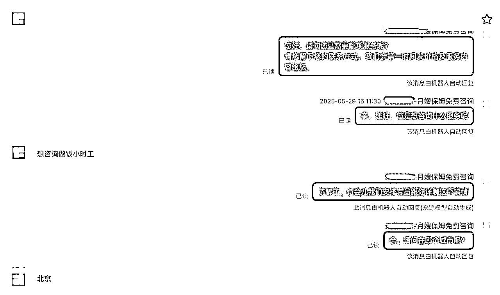

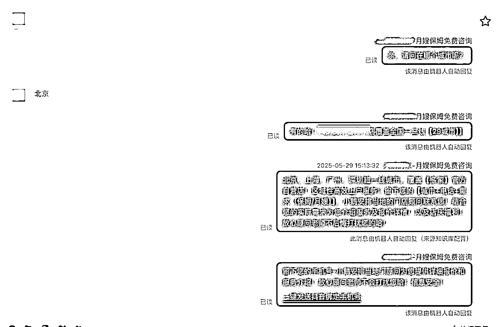

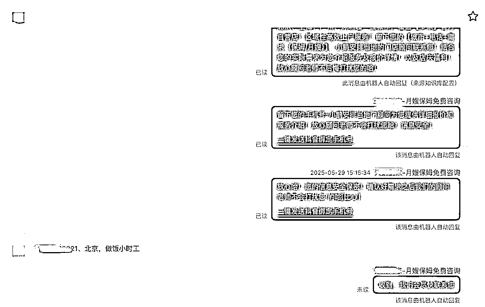

3.

律师、贷款、礼品定制一类，属于客单价偏高、决策链更长的类型，需要客服先在后台沟通，再把客户导进私域承接。这类业务平台审核偏严，私信里直接做转化容易被判违规。更关键的是，私域里能靠朋友圈内容持续影响用户判断，把购买意愿慢慢养起来，也能用一对一沟通提供更贴合需求的专业服务。

4.

教培、国学、身心疗愈这些方向，同样更适合先沉淀到私域再谈成交。原因是它们普遍存在二转、三转的空间，想持续往上做单，就得把有意向的人留在自己的池子里。这些用户是你的“人群资产”，日后做需求调研、推新品、跑销售时都会派上大用场。

5.

说到底，搜索流量要转化得好，后端得有一支能打的销转队伍。搜索来的流量精准度高，成交相对容易，因此一条都不该浪费，必须精细化经营。销售人员要对自己产品烂熟于心，再叠加朋友圈内容运营、一对一答疑、限时优惠、临门一脚的促单动作，效果会非常直观。站在公司角度，除了持续打磨产品与服务，还得把销售激励和培训机制建起来，哪怕中途有人离职或出状况，项目也能照常推进。各家产品不同、团队体量不同、能力也不同，建议对照自身短板逐项补齐。

提醒：上面这些方法仅供参考，具体落地请结合自己的行业情况来，遇到问题可以在群里沟通。

# 六、关键词跟踪与效果调优

# 💡

本节提要

作品发出去之后，要盯住关键词带来的流量变化，靠数据复盘去优化，把表现往上推。

按航线图安排学习：

1、学会持续跟踪关键词并优化位次（约1~2天）

现在开始准备吧。

# 6.1 每天查看关键词相关作品表现

# 6.1.1 按关键词来看

位次情况（操作路径：AIDSO（抖音搜索选词工具）➡️ 监测 ➡️ 监测排名）

核心词尽量守在前1~3位。

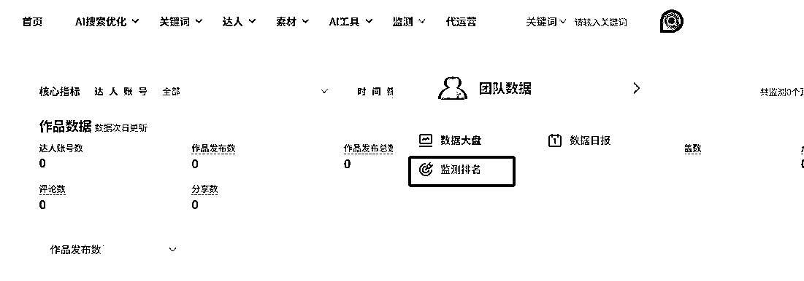

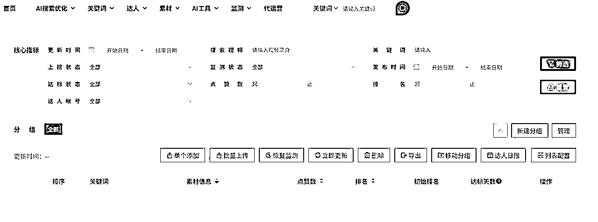

成交数据（建议每周至少汇总一次）

从企业号后台进入，打开数据分析里的BI工具，再点开图表：

1. 先导出作品维度的数据报表（锚点点击、组件预约、私信收线索等）；

2. 再把每条作品带的第一个#话题标签单独拆出来，做透视汇总。

# 6.1.2 按内容形式来看

图文类作品看这些指标：

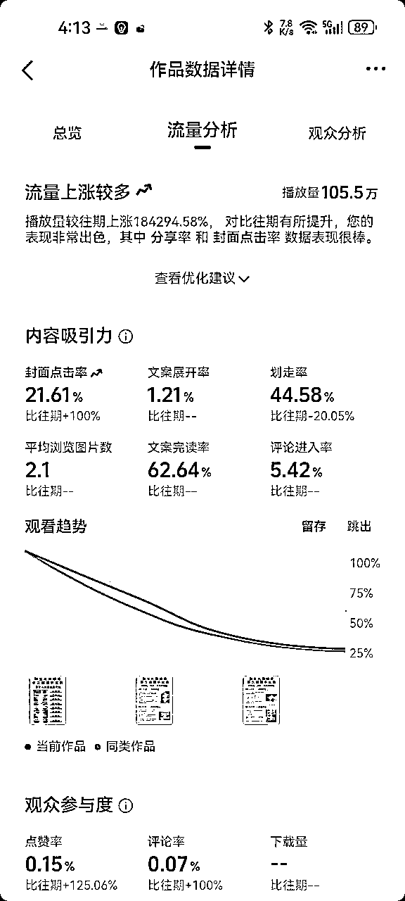

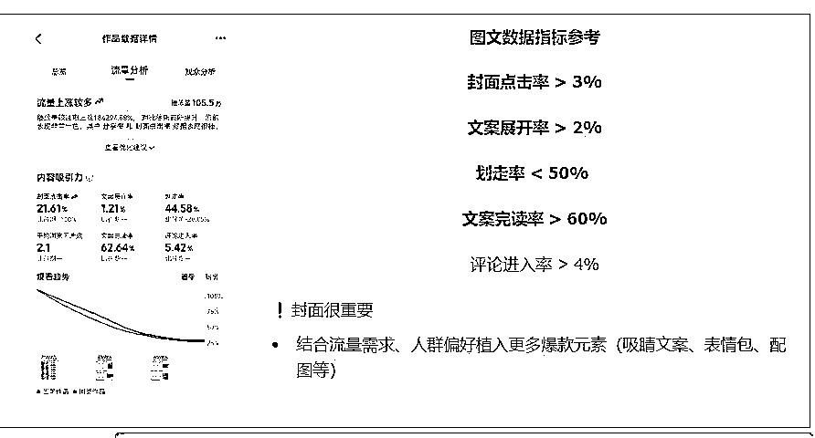

视频类作品看这些指标：

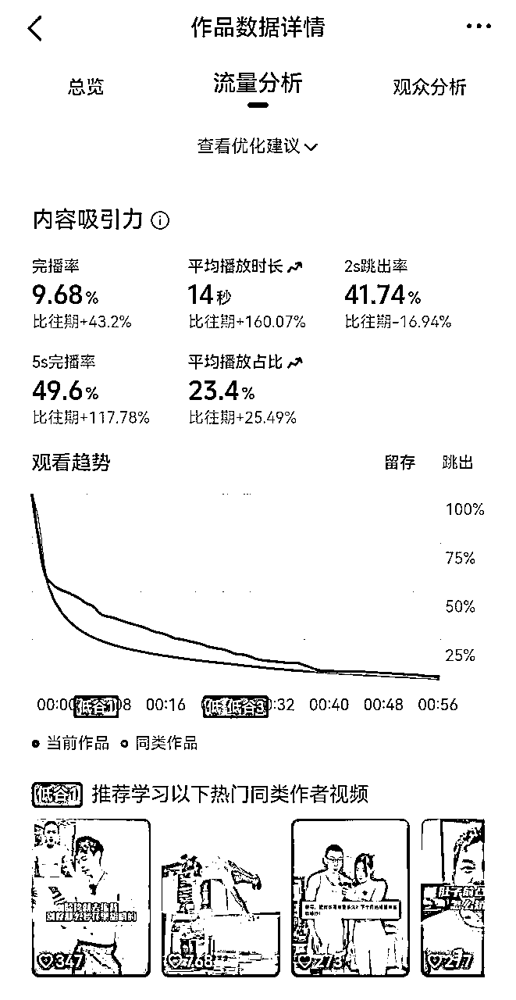

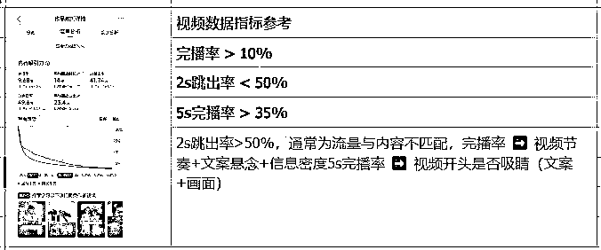

搜索场景的核心指标（入口：作品数据分析）

综搜渠道带来的流量比例

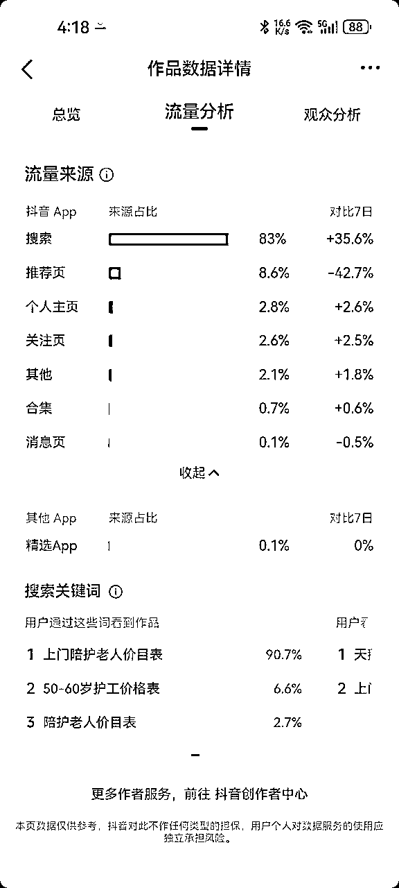

额外搜索流量

系统推荐的词＋观众看完后主动搜的词

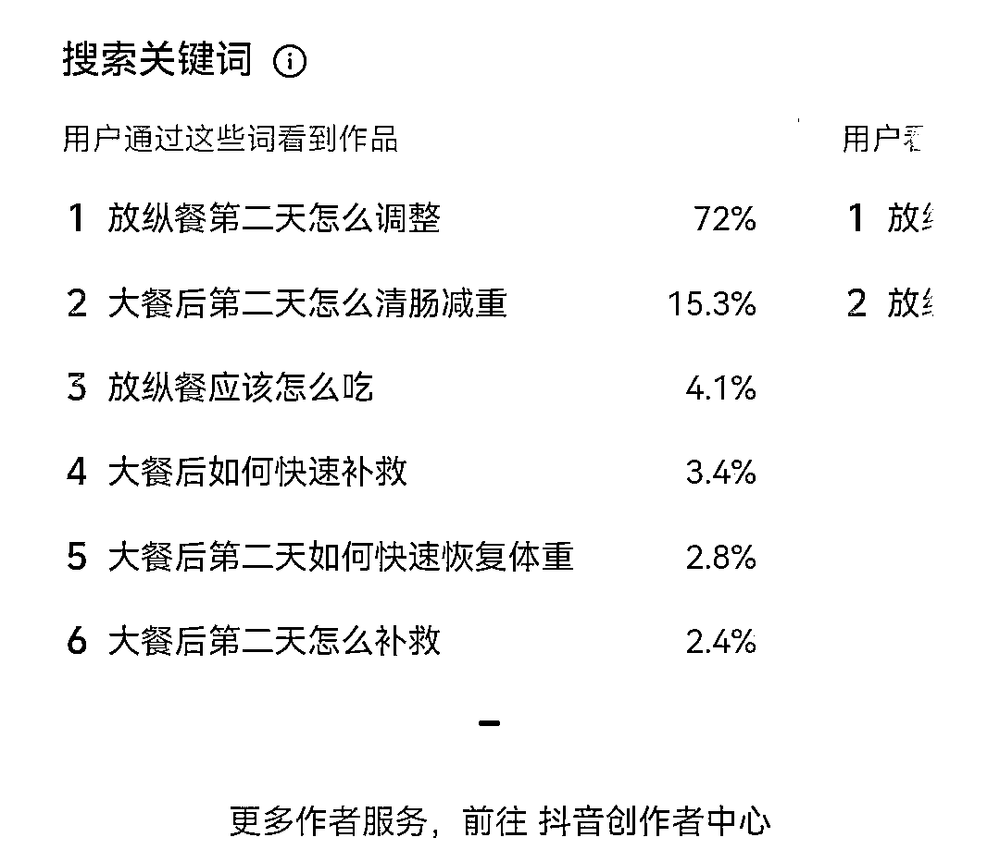

# 6.2 反复调整、提升数据

# 6.2.1 守住核心词位次

# 6.2.1.1 选题与内容组合

围绕核心词铺开多个角度的选题与呈现方式，比如记录过程、传授知识、表达观点……

举例：关键词“5平米卫生间装修多少钱”

呈现思路

记录过程——从方案设计到施工收尾完整拍下来（设计→选材→现场施工要点→费用清单）

传授知识——用专业内容教人选材、避开施工坑，并给出预算参考

表达观点——以从业者视角点评行业里的乱象，例如糊弄业主、报价不透明等

# 6.2.1.2 账号组合打法

企业号＋员工号＋KOC（关键消费领袖）＝多视角呈现

企业号：负责垂直方向的持续输出

员工号：以专业身份展示服务能力

KOC：站在消费者立场，做产品或服务的体验测评

# 选修篇：进阶玩法一览

# 七、抖音DSO常用提效工具

写稿类：

· AIDSO 官网 —— https://www.aidso.com/

· DeepSeek 对话站 —— https://chat.deepseek.com/

· 豆包（写稿＋文生图）—— https://www.doubao.com/

做图类：

· AIDSO 一键生图 —— https://www.aidso.com/keywordImg

· 美图设计室 —— https://www.designkit.com/

· 即梦 —— https://jimeng.jianying.com/

做视频类：

· 即创 —— https://aic.oceanengine.com/

· 剪映 —— https://www.capcut.cn/

· 超级编导 —— https://superdir.cn/

# 八、抖音DSO实战案例盘点

案例一：爱律维
赛道：律师
结果：借力DSO，单月精准垂类留资达到5500+；已发作品中八成拿到目标词排名；综搜渠道占比九成以上；全程没有投流，每日仍能增加100+条线索，且曲线还在向上。

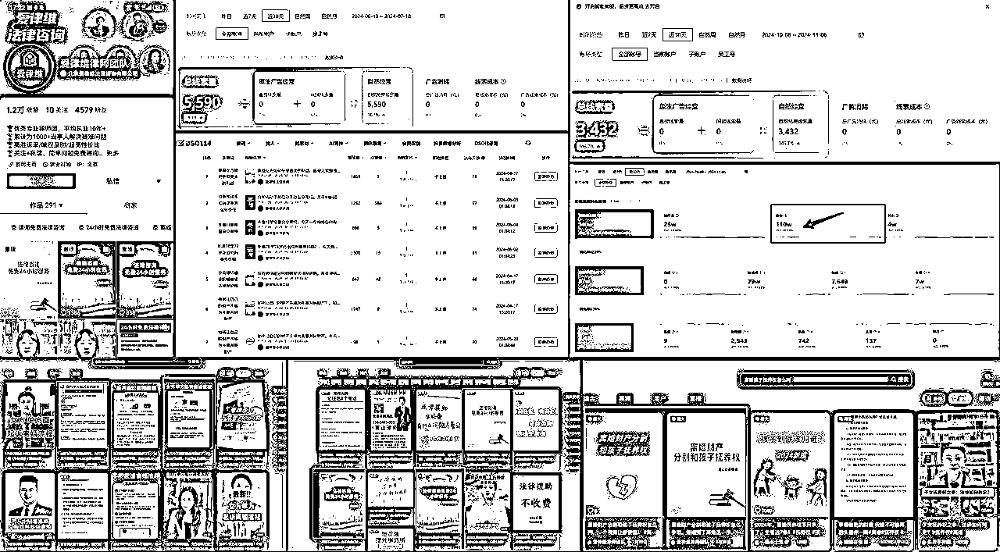

案例二：多比特象棋
赛道：APP
结果：上线首月应用下载破1000；八成已发作品拿到目标词排名；综搜渠道占比超过七成半；不投流的前提下，后期每天还能多出80+次下载，势头仍在延续。

案例三：两狮摄影
赛道：本地服务＋婚纱摄影
结果：收获精准垂类留资200+；七成已发作品拿到目标词排名；综搜渠道占比超过八成半；在零投放条件下，把高单价产品做出了高频成交，数据继续走高。

案例四：赛普
赛道：健身教练认证培训
结果：首月精准垂类留资1000+，此后单月线索稳定在3000+；八成已发作品拿到目标词排名；综搜渠道占比超过95.5%；不投流的情况下，每天多80+条线索，正效性5%，数据保持增势。

案例五：天鹅到家
赛道：家庭服务
结果：首月精准垂类留资300+，之后单月线索稳定在3000+；八成已发作品拿到目标词排名；综搜渠道占比九成以上；零投放条件下，每个月能多3000+条线索，仍在稳步上行。

案例六：洋葱学园
赛道：在线教育
结果：单月作品播放量500万~1000万+；半数以上作品综搜渠道占比超过八成半；不投流的情况下，每天为APP带来50+次新下载，数据持续爬升。

案例七：引力星球
赛道：休闲游戏类APP
结果：单月作品播放量500万~1000万+；半数以上作品综搜渠道占比九成以上；零投放前提下，每天为APP带来50+次新下载，保持稳定增长。

案例八：住小帮
赛道：家装设计·APP推广
结果：三个月作品播放量超2000万；半数以上作品综搜渠道占比八成以上；不投流的情况下，每天为APP带来400+次新下载，数据仍在上升。

案例九：豆包
赛道：AI工具类·APP推广
结果：靠一组账号协同铺量，首月作品播放量660万+；四成已发作品拿到目标词排名；综搜渠道占比九成以上；零投放条件下，每天为APP带来2700+次新下载，增长势头未减。

最后，愿各位都能把这套流程跑通，把获客效率提上去，摆脱抖音获客的困扰，一起龙哥盟！

# 防失联＋MM188166M（李李）长期更新

