# 202506 航海 · MCP 应用探索实战手册

> 来源：https://ocn93f5d9olj.feishu.cn/docx/E8m8d1whTo2cHPxCHmYcb33rnsb


# 长期更新 · 防失联 MM188166M（李李）


# 写在前面｜防失联 + MM188166M（李李）长期更新

# 💡

过去我们与 AI 打交道，通常是“我们提问，AI 回答，然后我们手动执行”。其实很多人都盼着 AI 能再进一步，主动替我们搞定那些琐碎、跨平台的麻烦事。

MCP（模型上下文协议）就像给大模型接上了“灵活的四肢”和“全能的接口”，让它不再只是聪明的脑袋，还可以直接调用软件、执行复杂流程、介入真实世界的操作。检索最新资讯、读写文档、调用接口、操控其他应用……这些都不在话下，AI 的角色由此从“提建议”升级为“动手做”。

本期的“MCP 应用探索”航海，会陪伴你从零开始，走通 MCP 的配置与实践全链路。具体会涉及四个方面：

1. 核心认知：用直白的方式搞懂 MCP 到底解决了什么问题、背后的原理是什么，以及它为什么能给 AI 带来质变。
2. 环境准备：把必要的工具链装好，为后续运行打好底子。别担心，即使是技术新手，照着说明也能顺利完成。
3. 配置方法：学会到哪儿找 MCP 服务、怎么获取配置信息，并完成基础接入，让 AI 真正“长出手脚”。
4. 实战应用：通过真实工作流，看看 MCP 如何在内容创作、信息整理、图像制作、办公提效、数据分析等场景中大显身手。

不过开始之前要先说句真心话：MCP 的配置与调试，偶尔会遇到小坑，需要你多一点耐心和细致。好在有这份手册全程带路，社群的教练和同学也会随时搭把手。

学 MCP 就像学骑车，光看不练永远学不会。只有自己动手，把它用进实际工作流，才能体会它的威力。

准备好了吗？那我们就正式出发吧！

下面是本航海项目的整体航线图：

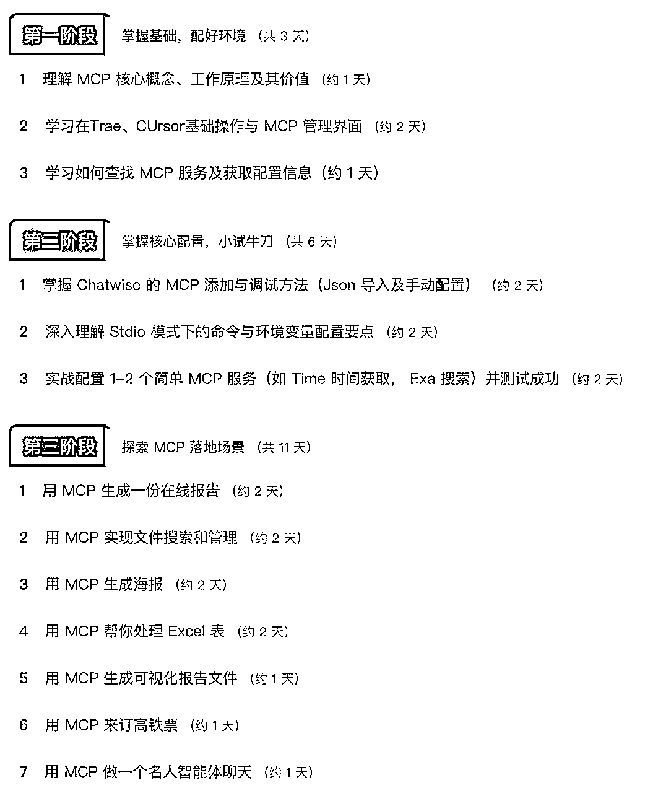

这份航线图与手册内容紧密对应，你可以根据自己的进度，翻到对应章节按步骤学习。


# 一、项目概述（作者：@阿杰）

# 💡

# 本章航线图

完成这一章的阅读和动手操作，你就走完了航线图的第一阶段——

第一阶段：打牢基础，配好环境（共 3 天）

1. 搞懂 MCP 的核心概念、运行原理和价值（约 1 天）
2. 熟悉 Trae、Cursor 的基础操作和 MCP 管理界面（约 2 天）
3. 学会发现 MCP 服务，并拿到可用的配置信息（约 1 天）

那么，现在就开始第一阶段的实操吧。

2025 年被称为智能体元年，这一领域注定要迎来集中爆发。不过，在 AI 智能体的演进中，有两个相互关联的难题横在眼前：

第一个难题：智能体（Agent）怎么与外部工具打交道？比如连数据库、跑代码这类操作。

第二个难题：同一个平台上的不同 Agent 之间，以及不同平台上的 Agent 之间，如何通过协作共同完成任务。

这两个难题本质上都指向“标准化协议”。在计算机世界里，统一协议是高效沟通的基础。

MCP 要解决的就是第一个难题；而近期谷歌推出的 A2A 协议，则是冲着第二个难题来的。

可以说，MCP 的问世必然会大大推动智能体的普及进程。

甚至可以说，大语言模型（尤其是 DeepSeek 这类模型）如果配上 MCP，几乎就等于一个智能体了。

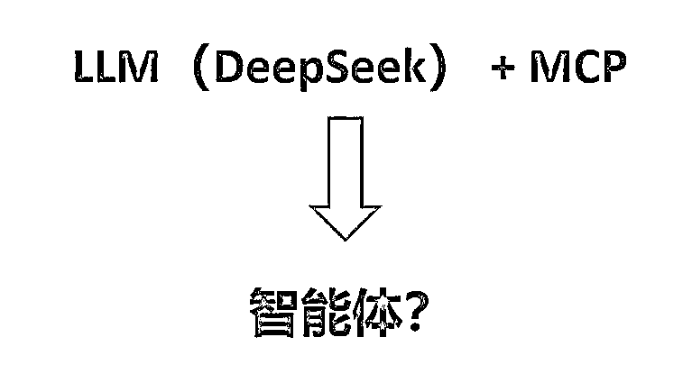

如果大模型无法使用外部工具，那它终究只是个聊天机器人，连“查询天气”“查看当前时间”这类小事都做不到。

因此，能否调用工具，是大模型能否进化为智能体的关键一步。

MCP 正是大模型连接外部世界的接口。只需要几行配置，就能接入海量现成工具，智能体的开发门槛因此被大幅拉低。尤其是随着 Cursor、Windsurf 这类 AI 编程工具的兴起，连不会写代码的普通人和小白，也能借助代码去开发属于自己的智能体。

怎么直观理解 LLM 和 MCP 的区别？

你可以把 LLM 想象成一个超级聪明的机器人朋友，外号“语言大师”。它饱读诗书，中英文都能聊，写文章、答问题、编故事样样在行。

这个“语言大师”就是大语言模型（LLM）。它靠已有的知识储备来推测你的意图，生成合理的回复。

比如你请它写一封请假邮件，它会按照学过的邮件套路，给你写出像模像样的一封。

但问题来了：如果不止想让它写邮件，还想让它直接把邮件发出去，它就没辙了。因为“语言大师”只能用脑子里的知识来回应，动不了手。

这时候，你需要一个“万能助手接口”，让“语言大师”能调起其他工具，比如替你发邮件。

这个接口，就是 MCP（模型上下文协议）。

一句话总结：

# 💡

LLM 是一个聪明的机器人朋友，能说会道，帮你写东西、答问题；

MCP 则像是交给这个机器人的“万能遥控器”，让它能操纵更多工具，替你完成更多实际任务。


# 1.1 MCP 到底能做什么？

下面分别从程序员和普通用户两个视角，来看 MCP 的实际价值。

# 1.1.1 程序员视角

先看“开发部署”。

程序员每完成一个项目，都要把版本发布到对应的测试环境。这通常要涉及 GitHub API（合并代码）、Jenkins API（构建镜像）、Slack API（通知团队）等多个平台，每个平台都有各自的使用门槛。

有了 MCP 之后，你只需要用自然语言把需求告诉大模型，大模型调用对应的 MCP Server，像链条一样依次触发相关 API，项目部署就能轻松完成。

再看“数据库查询”。

不管你是后端还是数据库开发者，过去都得先学 SQL 语法。而且不同人写出来的 SQL 质量参差不齐，查询效率也天差地别。

以前，如果需求是“查出某集团某个部门上个季度的销售额”，你得手写一段精确的 SQL。

现在呢？把这句话发给大模型，它再调用 MCP Server，就能自动转换成对应的 SQL 语句，把数据查出来，需求轻松落地。

从这两个例子可以看出，MCP 大大降低了程序员入行的门槛。同时，程序员也需要学会怎么使用 MCP，才能跟上趋势。

第三个例子：Manus 智能体。


Manus 前阵子火过一轮，大家可能都听说过。至于它到底强不强，这里不展开讨论，但至少方向是对的——以后一定会出现更多类似甚至超越 Manus 的智能体。

Manus 执行一项任务时，往往要完成网页搜索、网页访问、信息抓取等大量步骤，涉及几十个外部工具。

问题也随之而来：工具的调用量太大了。

如果用传统方式开发，程序员需要给这几十个外部工具分别编写函数，每个函数动辄几百行代码。写过的人应该都有共鸣——这工程量相当吓人。

更麻烦的是，要写出这些函数，还要把它们和大模型的调用逻辑整合在一起，整个架构会变得极其复杂。

但如果使用 MCP，只要各方都遵循这个协议，就能轻松借助 LLM 大模型和各种 AI 客户端，访问形形色色的数据源与工具，复杂度和工作量都大幅下降。

# 1.1.2 大众用户视角

再看普通用户能从中得到什么。

旅游规划

比如出门旅行时，你可以通过 MCP 去访问天气 API、交通 API、地图 API，让 AI 为你生成一份带有实时信息的行程方案。

想想看，每逢假期要出门，如果有这样的智能助手帮忙，能省下多少时间？当然，节假日出门哪儿都是人山人海，还是建议大家错峰出行。

其实，没有 MCP 也不是做不了这件事，只不过需要程序员提前在代码里写好如何调用天气、交通、地图这些 API，难度不是一般的大。

联网搜索

再比如大模型联网搜索。以 DeepSeek 这类模型为例，在对话时常常需要联网获取最新信息，但这过程中可能遇到两个问题：

第一，不是所有大模型都支持联网。有的模型本身没有联网能力，有的则是你用的客户端不支持，比如旧版的 ChatGPT 就不行。

第二，即使支持联网，未必能接上你自己习惯的搜索引擎。比如你习惯用谷歌，但模型偏偏不支持，那就很尴尬了。

看下面这张图会更直观。

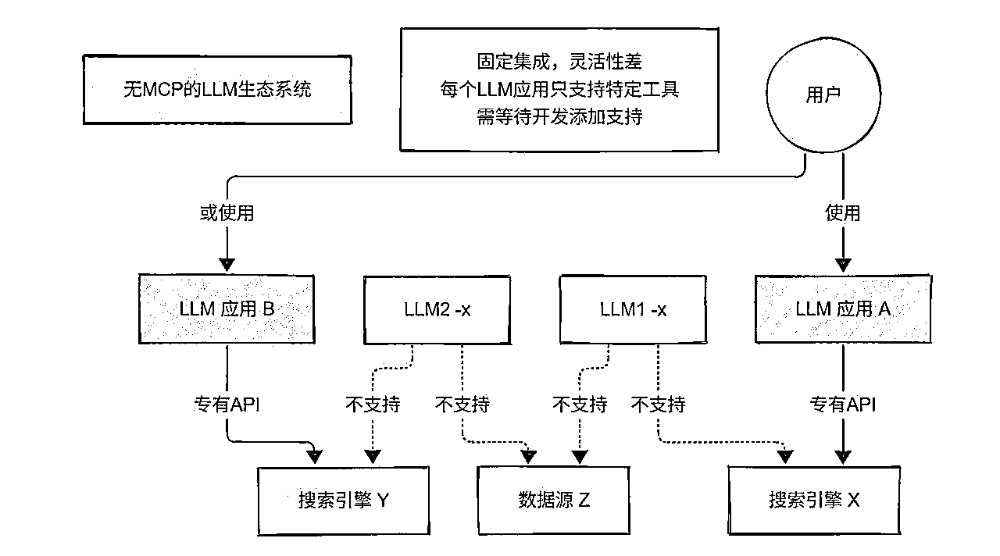

在没有 MCP 的情况下，用户只能干等开发者去适配某个特定的搜索引擎。

而有了 MCP，只需要做一次简单配置就够了。

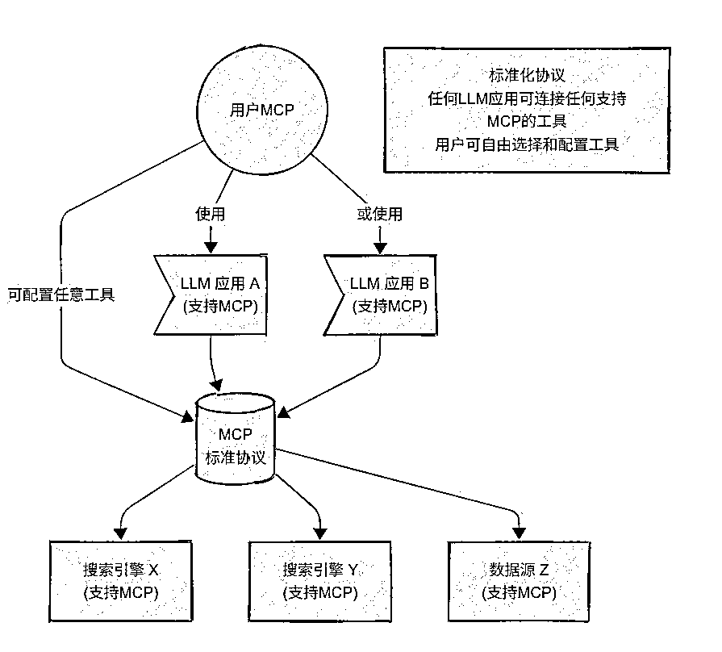

不管是什么搜索引擎，只要它遵循 MCP 协议，你想访问哪个都行。

业绩查询

假如你是公司员工，想查上一季度的营业数据，同样可以借助 MCP：让大模型调用 CRM 系统的 API（取客户数据）、财务系统的 API（调报表）、邮件系统的 API（发总结报告），把整个流程串起来搞定。

当然，随着生态发展，MCP 能做的远不止这些。举这些例子，是希望大家先建立一个初步认知。

# 1.2 MCP 是什么？

官方网站：Introduction - Model Context Protocol

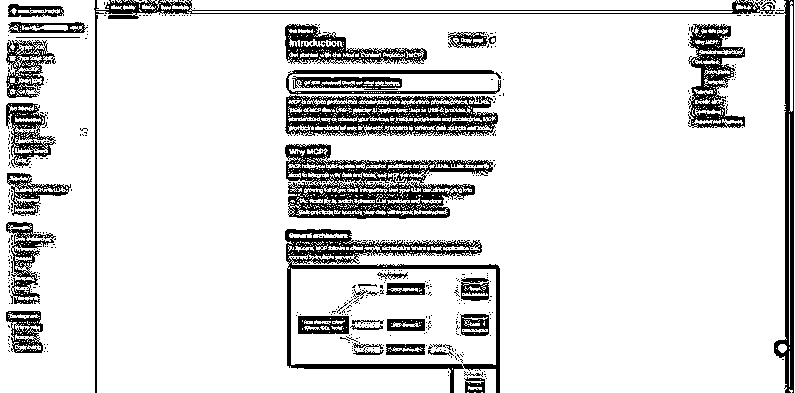

# 1.2.1 如何理解 MCP？

MCP 的全称是 Model Context Protocol，即“模型上下文协议”。它由 Anthropic 公司于 2024 年 11 月底推出。提到 Anthropic，你可能有点陌生，但它旗下的 Claude 系列模型想必大家都知道。

MCP 的核心目标是：为大语言模型提供一套统一、标准的方式，与外部数据源和工具进行通信。打个比方，它就像电脑上的 USB 接口标准——通过同一个接口，可以连接鼠标、音箱、耳机等各种各样的外设。

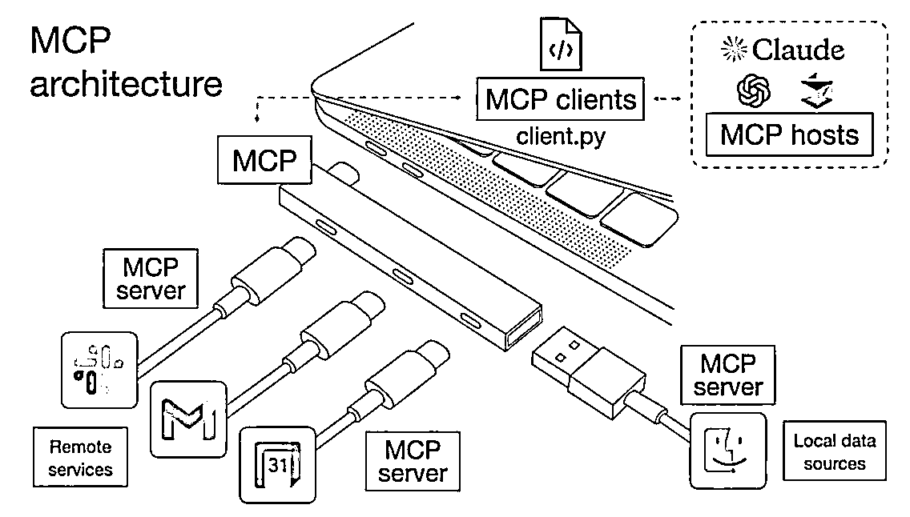

在传统方案中，AI 要集成外部工具，需要为每一个数据源单独搭建连接，本质上是一个“M × N”的问题：M 个大模型，N 个插件。

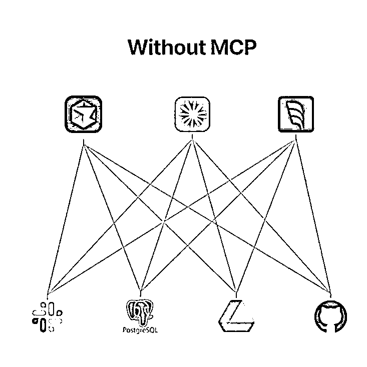

而有了 MCP 协议之后，这个问题被化简为“M + N”的关系。

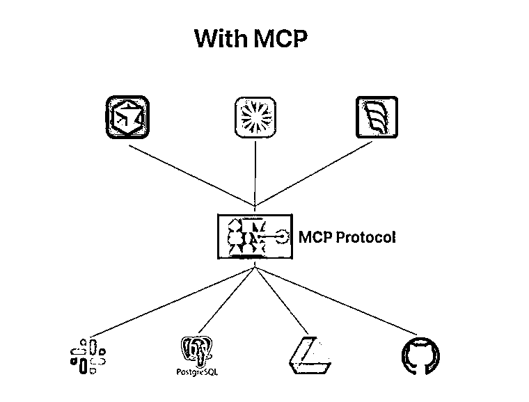

我们只需要按照这套协议去接入各种工具就行。

# 1.2.2 推广时间线

# 1.2.3 哪些平台支持 MCP 工具查询？

随着接入 MCP 协议的 Server 越来越多，未来 AI 可以直接调用的工具数量会呈指数级上升，这相当于从根上打开了 Agent 能力的天花板，AI 生态也会因此变得更加开放、更加强大。

不过，目前社区里的 MCP Server 质量参差不齐，不少缺少教程和文档，也有些代码本身就有问题。大家只能多看官方文档，再靠点经验摸索。

换个角度想，这也是“第一个吃螃蟹”要付出的代价，当然，红利也会落到先行者头上。

# 1.2.3.1 GitHub

官方参考：GitHub - modelcontextprotocol/servers: Model Context Protocol Servers

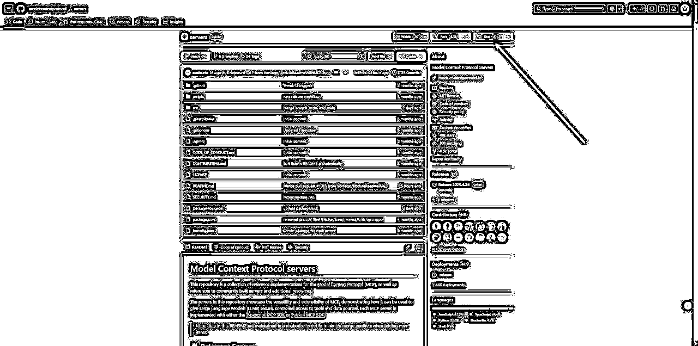

热门汇总：awesome-MCP-servers/README-zh.md at main · punkpeye/awesome-MCP-servers · GitHub

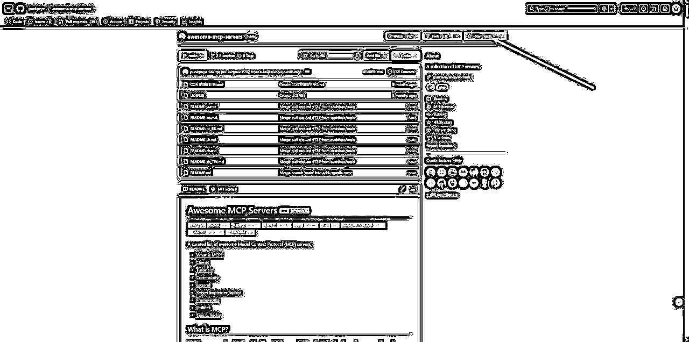

# 1.2.3.2 其他平台

# Glama：MCP servers | Glama

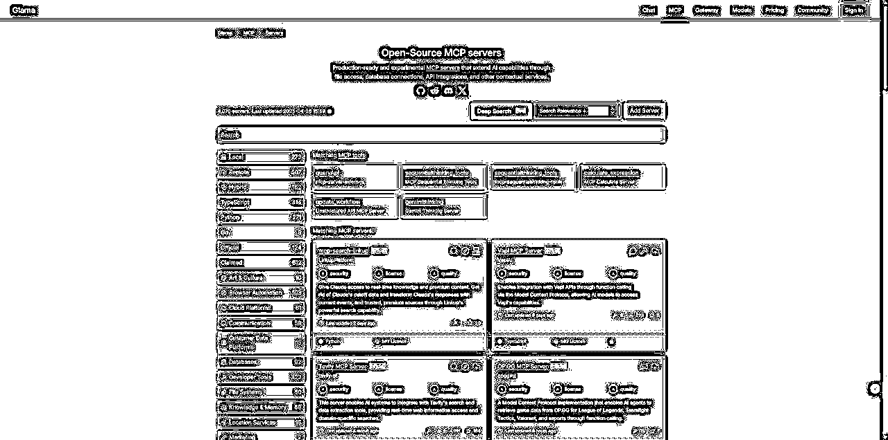

# Smithery：Smithery - Model Context Protocol Registry

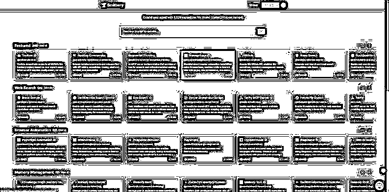

# Cursor：MCP Servers for Cursor

# MCP.so：MCP Server（MCP 服务器）

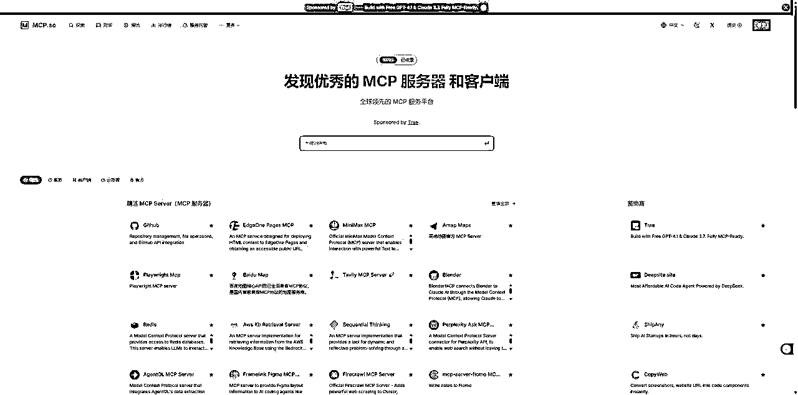

# 阿里云百炼：百炼控制台

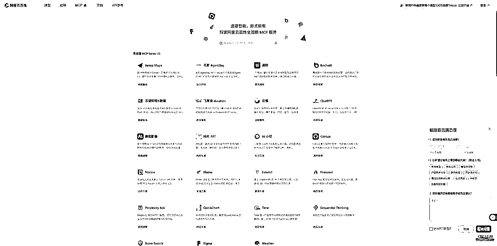

# 1.3 MCP 应用场景与通信机制

# 1.3.1 应用场景

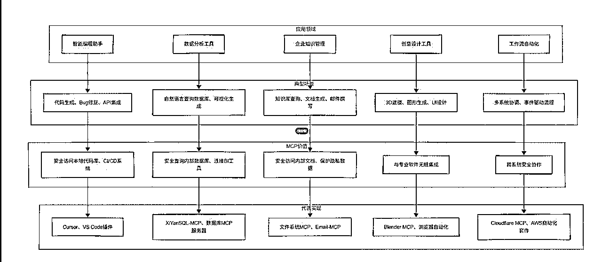

下面这张图展示了 MCP 的典型应用场景，这里不再展开，直接看通信机制。

# 1.3.2 通信机制

根据 MCP 规范，目前支持三种通信机制。所谓通信机制，简单讲就是信息传递的方式。

# ① stdio（标准输入输出）

这种模式下，客户端（如 Cursor）和服务端（MCP Server）都运行在你自己的电脑上。客户端通过程序的标准输入（stdin）发送消息，服务端读取后处理，再通过标准输出（stdout）把结果返回。整个过程不走网络，通信简单、快速、稳定，也是 MCP 默认的通信方式。

优点：
- 不需要外部网络
- 通信速度快
- 可靠性高，容易调试

缺点：
- 配置稍显麻烦，需要提前装好命令行工具
- 单进程通信，无法并行处理多个请求
- 进程资源占用较大，不适合本地同时跑大量服务

# ② SSE（Server-Sent Events，服务器发送事件）

从名字能猜到，这种模式下客户端和服务端不在同一台机器上了。MCP Server 不再运行在本地，而是部署在云端或远程服务器。用户只需要配置一个 URL，本地客户端（如 Cursor）就能通过网络调用远程的 MCP 服务，完全不用自己搭建和维护服务器。

像阿里百炼的 MCP 服务市场里就有很多这样的服务，例如高德 MCP，走的正是 SSE 协议。

优点：
- 支持服务器主动推送消息，适合实时数据流
- 基于 HTTP，容易穿过防火墙和代理
- 适合远程单向推送
- 配置简单，基本一个链接就能搞定

缺点：
- 需要保持长连接，比较耗服务器资源
- 断线后不能自动恢复，稳定性一般
- 不支持无状态服务器，扩展性有限
- 如果用第三方提供的服务端，安全性也需要留意

# ③ Streamable HTTP（可流式 HTTP）

这是 MCP 最新支持的传输方式，可以理解为 HTTP 通信的升级版。它不像 SSE 那样要求一直保持连接，而是客户端和服务器随时都能彼此发消息，支持双向流式传输，双方像在“对话”一样灵活高效。相比 SSE，它更适合需要双向互动、通信更复杂的远程场景。

优点：
- 支持双向实时通信，两端都能随时主动发消息
- 基于标准 HTTP，兼容性好，也支持无状态服务器
- 资源利用更高效，适合高并发和云端部署
- 弥补了 SSE 的断线恢复和单向通信问题

缺点：
- 实现起来稍复杂，需要支持 HTTP 流式传输和动态升级
- 作为新机制，生态和工具支持还在逐步完善中

# 1.4 安装 MCP 服务所需的开发环境（重要！！！）

除了 Cherry Studio 会用内置的 bun 和 uv 单独起环境之外，像 Cursor、Cline、Trae、Windsurf 等主流 AI IDE，都需要我们先安装好 MCP 服务所依赖的开发环境。

日常开发和使用 MCP 服务，大部分时候走的是 stdio 方式。所以，在开始之前有必要做一些准备。

目前 stdio 本地环境主要有两种主流方案：

一种是 Python 编写的服务，需要安装 uv；
另一种是 TypeScript 编写的服务，需要安装 npx。

当然，Java、Go 等语言现在也能编写 MCP 服务，大家可以去查查相关资料。不过目前主流仍然是 Python 和 TypeScript。为了正常使用这些 MCP 服务，我们需要安装对应的开发软件。

# 1.4.1 安装 Node.js

如果你还没装 Node.js，可以看 @阿杰 的这篇《Node js 安装》，这里就不重复展开了。

# 1.4.2 安装 Python

如果还没有 Python，同样可以参考 @阿杰 的这篇《Python 安装》，这里也不多说了。

# 1.4.1 安装 uv

电脑装好 Python 后，可以用下面的命令安装 uv：

pip install uv

另外，Windows 用户也可以在 PowerShell 中运行下面这行命令来安装：

powershell -ExecutionPolicy ByPass -c "irm https://astral.sh/uv/install.ps1 | iex"

我自己用的是第一种方式，因为后面我们还可以用 Python 来开发自己的 MCP 服务。

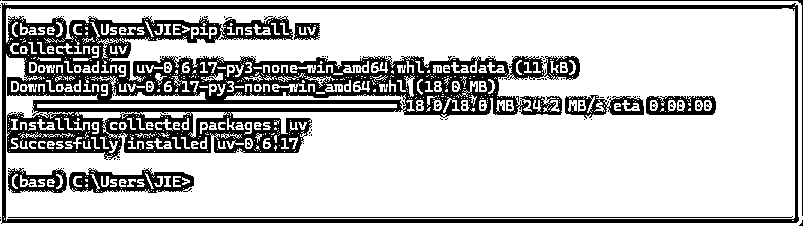

安装完成后，请重启终端，然后输入下面的命令验证是否安装正常。

# MCP 实战：Trae 与 Cursor 双端配置

动手前先确认 uv 工具链是否正常：

```bash
uv --version
uvx --help
```

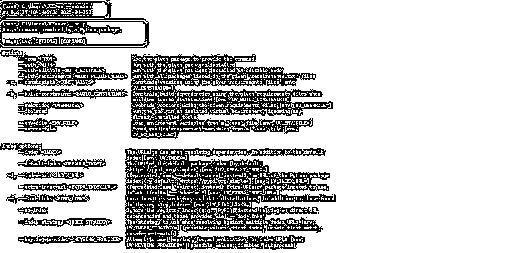

只有 uv 就绪，由 uvx 拉起的 MCP 进程才能顺利运行。

# 1.4.2 让 npx 就位

Node.js 22 及之后版本通常已经随附 npx。装好 Node 后执行 `npx -v`，能看到版本号就说明可用。

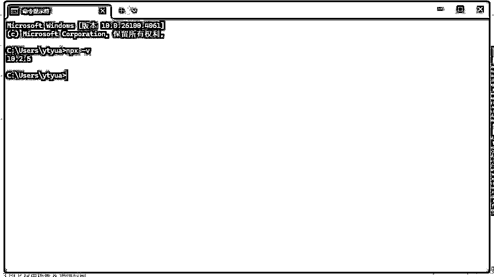

npx 正常后，依赖它启动的 MCP 服务器才具备运行条件。

# 1.5 在 Trae 里接入 MCP

# 1.5.1 下载与安装

Trae 已加入 MCP 支持，可从官网获取：Trae - AI 原生 IDE。

# 1.5.2 写入 MCP 配置

启动 Trae。

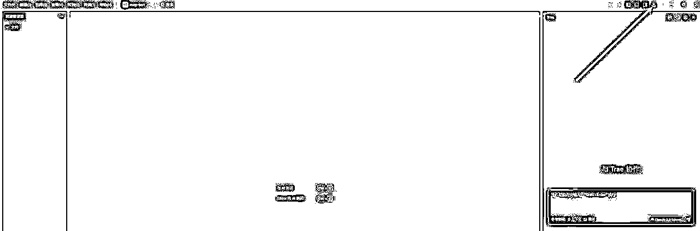

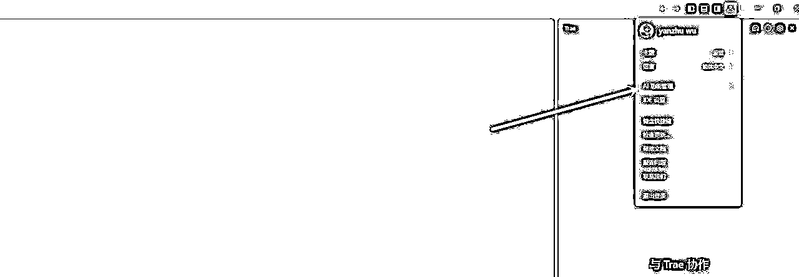

选中 MCP 入口。

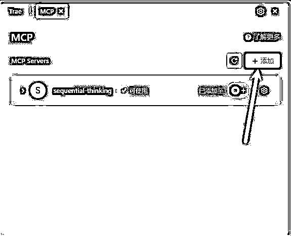

点新增，会看到 Trae 官方市场；若要接自己编写的能力，走手动配置。

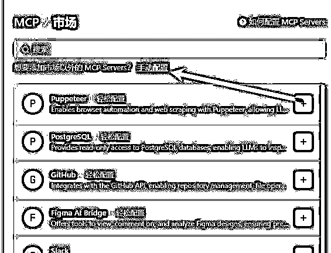

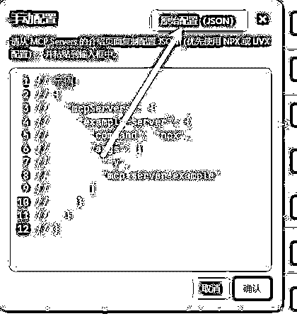

选原始配置，编辑器会打开 MCP.json，把参数直接填进去。

# 1.5.3 实战：生成行程方案

先准备几类 MCP 服务器。

# 1.5.3.1 准备所需服务器

本例会用到表格、高德和文件系统三种能力。

# ① 表格服务器安装

先把 Excel 项目源码取回：GitHub - haris-musa/excel-MCP-server: A Model Context Protocol server for Excel file manipulation。有 git 可直接 clone；也可以下载 zip 解压到本地。

打开终端，进入项目目录：

```bash
cd 你的项目目录
```


装依赖前请确认 UVX 可用，然后执行：

```bash
uv venv
uv pip install -e .
```

启动 excel-mcp-server：

```bash
uv run excel-mcp-server sse
```

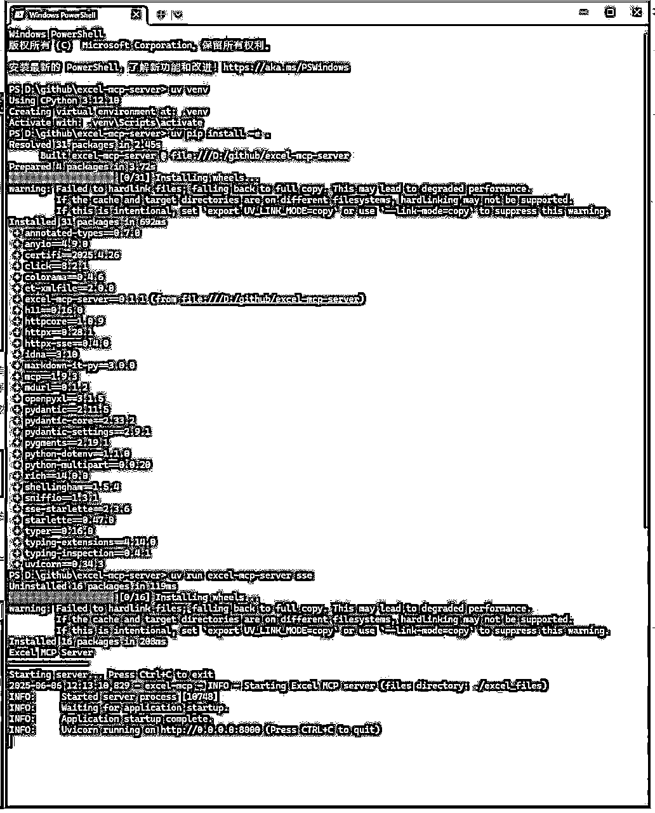

需要换端口时，按系统选择：

```bash
# Bash/Linux/macOS
export FASTMCP_PORT=8080 && uv run excel-mcp-server sse

# Windows PowerShell
$env:FASTMCP_PORT = "8080"; uv run excel-mcp-server sse
```

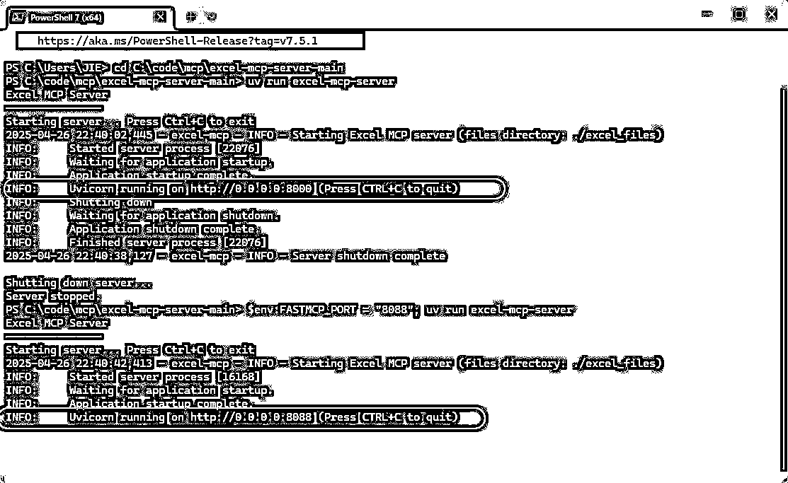

回到 Trae，添加这个能力。

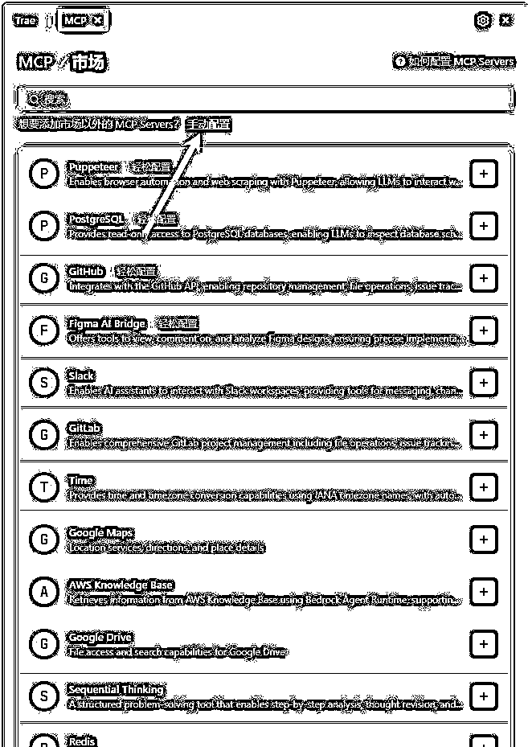

粘贴配置，并把 url 与 env 换成实际值：

```json
{
  "mcpServers": {
    "excel": {
      "url": "你的服务地址：http://localhost:8000/sse"，
      "env": {
        "EXCEL_FILES_PATH": "你的授权目录：/path/to/excel/files"
      }
    }
  }
}
```

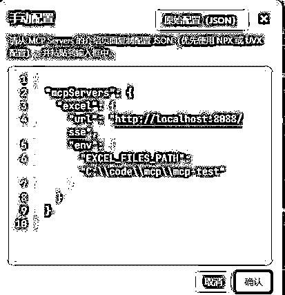

确认后，能看到运行状态以及可用功能。

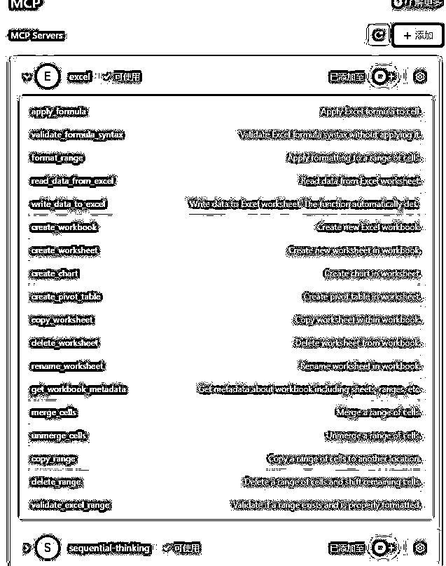

再做一次连通测试。

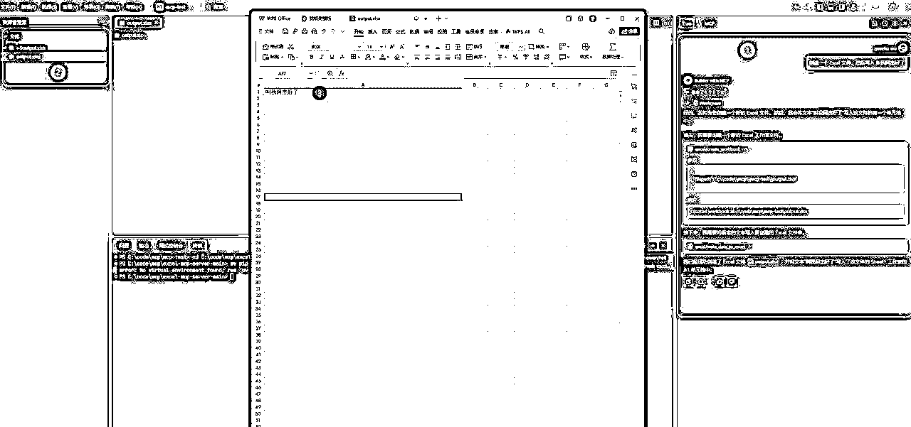

从测试结果就能判断该工具能否正常调用。提醒：以 sse 方式启动时，终端需要常驻后台；手册 3.4 节已补充 stdio 方案。

# ② 高德能力接入

打开高德 MCP Server 文档：概述-MCP Server | 高德地图 API。

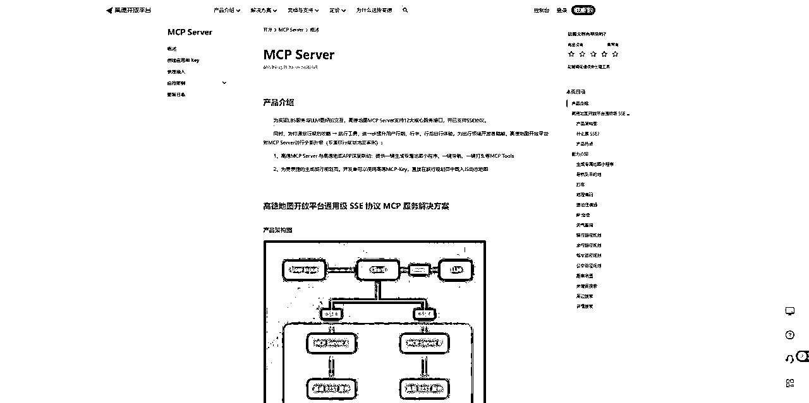

登录高德平台，注册成为开发者：注册成为开发者。

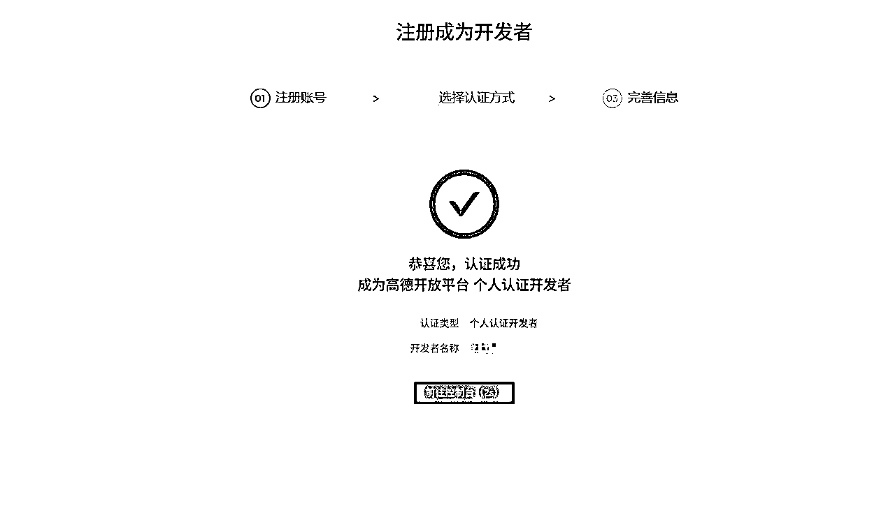

进入应用管理 https://console.amap.com/dev/key/app，创建应用并添加 key。

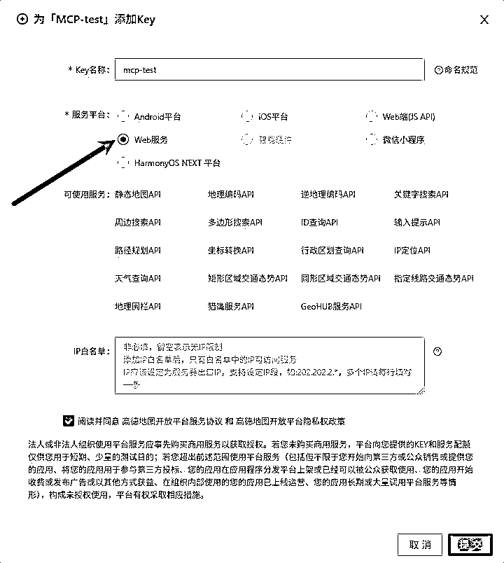

复制 key，填入以下配置：

```json
{
  "MCPServers": {
    "amap-amap-sse": {
      "url": "https://MCP.amap.com/sse?key=您在高德官网上申请的 key"
    }
  }
}
```

再回 Trae 添加高德能力，粘贴后查看状态。

# ③ 文件系统能力

Trae 已内置该能力，可以跳过。其他客户端若没有内置，可参考下面做法：在 Trae 市场搜索。

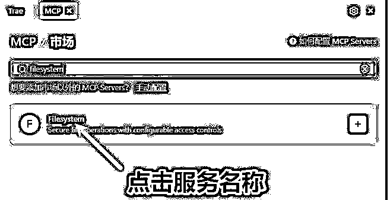

预览页向下滑即可找到配置代码。这里采用 npx 方式，按系统复制。

macOS：

```json
{
  "mcpServers": {
    "filesystem": {
      "command": "npx",
      "args": [
        "-y",
        "@modelcontextprotocol/server-filesystem",
        "/Users/username/Desktop",
        "/path/to/other/allowed/dir"
      ]
    }
  }
}
```

Windows：

```json
{
  "mcpServers": {
    "filesystem": {
      "command": "cmd",
      "args": [
        "/c",
        "npx",
        "-y",
        "@modelcontextprotocol/server-filesystem",
        "C:\\code\\MCP\\MCP-test"
      ]
    }
  }
}
```

目录路径记得换成自己的授权位置。

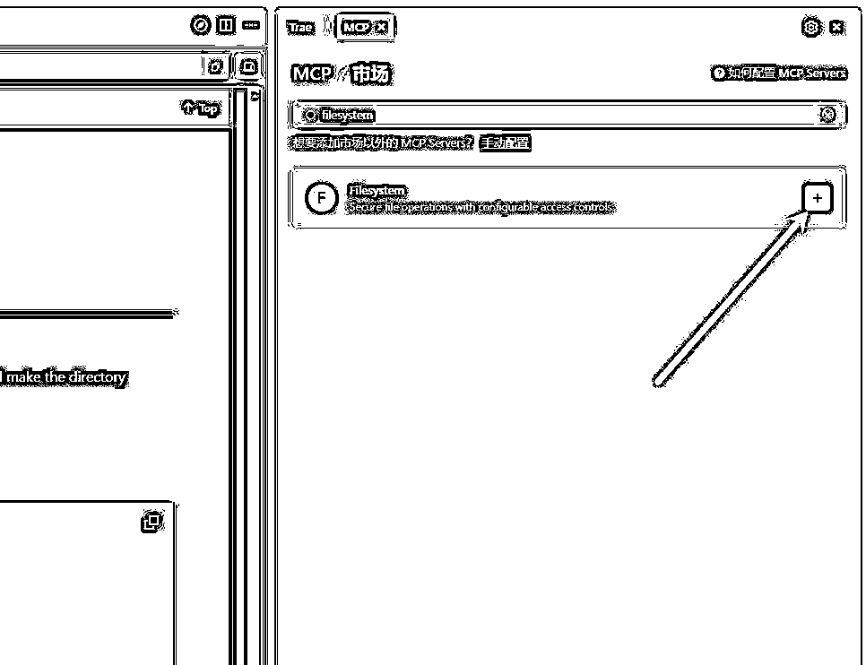

粘贴后，案例所需能力就齐了。

# 1.5.3.1 开始实操

Trae 要求在智能体中调用 MCP，先选一个智能体。

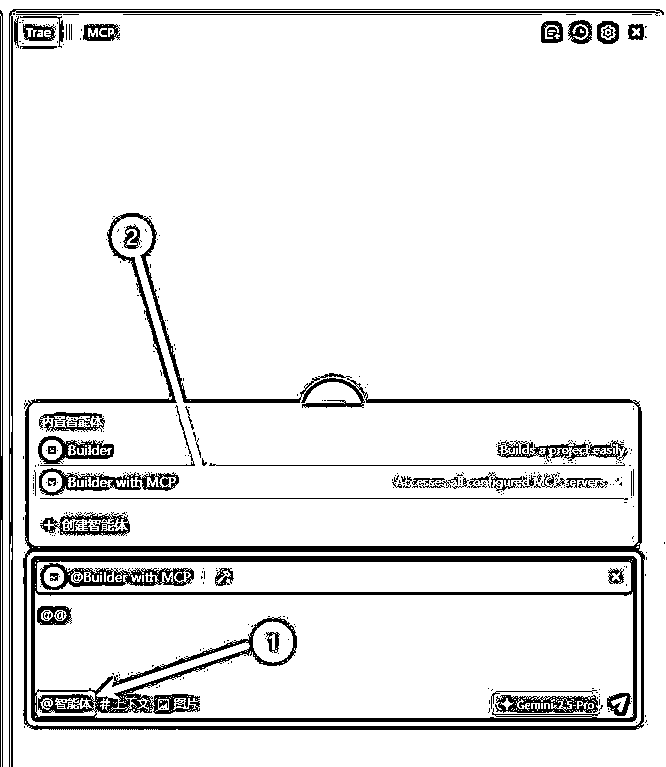

把下面任务交给它：请依据下列流程，生成一份杭州一日游攻略。

```mermaid
flowchart TD
开始["开始任务"] --> 获取地铁线路["从高德地图 MCP 服务获取杭州东站到西湖的地铁线路"]
获取地铁线路 --> 创建 Excel 表 1["创建 Excel 表格：beijing_trip"]
获取地铁线路 --> 创建 Excel 表 2["创建 Excel 表格：subway_trips"]
创建 Excel 表 1 --> 存储数据 1["将杭州东站到西湖的地铁数据存入 beijing_trip 表"]
创建 Excel 表 2 --> 存储数据 2["将杭州东站到西湖的地铁数据存入 subway_trips 表"]
存储数据 1 --> 获取美食信息["从高德地图 MCP 获取西湖附近的美食信息"]
存储数据 2 --> 获取美食信息
获取美食信息 --> 筛选美食店铺["筛选至少三家美食店铺"]
筛选美食店铺 --> 创建 Excel 表 3["创建 Excel 表格：location_foods"]
创建 Excel 表 3 --> 存储美食数据["将美食店铺信息存入 location_foods 表"]
存储美食数据 --> 创建文件夹["创建'杭州旅行'文件夹"]
创建文件夹 --> 创建 TXT1["创建第一个 TXT 文件"]
创建文件夹 --> 创建 TXT2["创建第二个 TXT 文件"]
创建 TXT1 --> 提取数据 1["从第一个数据库表中提取内容"]
创建 TXT2 --> 提取数据 2["从第二个数据库表中提取内容"]
提取数据 1 --> 存储 TXT1["将提取的内容存入第一个 TXT 文件"]
提取数据 2 --> 存储 TXT2["将提取的内容存入第二个 TXT 文件"]
存储 TXT1 --> 生成 HTML["生成精美的 HTML 前端展示页面"]
存储 TXT2 --> 生成 HTML
生成 HTML --> 存储 HTML["将 HTML 文件存放在'杭州旅行'文件夹中"]
存储 HTML --> 完成["任务完成"]

subgraph 子任务 1["子任务 1：获取地铁线路并创建 Excel"]
获取地铁线路
创建 Excel 表 1
创建 Excel 表 2
存储数据 1
存储数据 2
end

subgraph 子任务 2["子任务 2：获取美食信息并存储"]
获取美食信息
筛选美食店铺
创建 Excel 表 3
存储美食数据
end

subgraph 子任务 3["子任务 3：创建文件夹和 TXT 文件"]
创建文件夹
创建 TXT1
创建 TXT2
提取数据 1
提取数据 2
存储 TXT1
存储 TXT2
end

subgraph 子任务 4["子任务 4：生成 HTML 前端展示页面"]
生成 HTML
存储 HTML
end

classDef apiCall fill:#f9d5e5，stroke:#333，stroke-width:1px
classDef excelOp fill:#eeeeee，stroke:#333，stroke-width:1px
classDef fileOp fill:#e3f2fd，stroke:#333，stroke-width:1px
classDef frontendDev fill:#e8f5e9，stroke:#333，stroke-width:1px
class 获取地铁线路，获取美食信息 apiCall
class 创建 Excel 表 1，创建 Excel 表 2，创建 Excel 表 3，存储数据 1，存储数据 2，存储美食数据 excelOp
class 创建文件夹，创建 TXT1，创建 TXT2，存储 TXT1，存储 TXT2，存储 HTML fileOp
class 生成 HTML frontendDev
```

本案例模型使用 DeepSeek V3-0324。

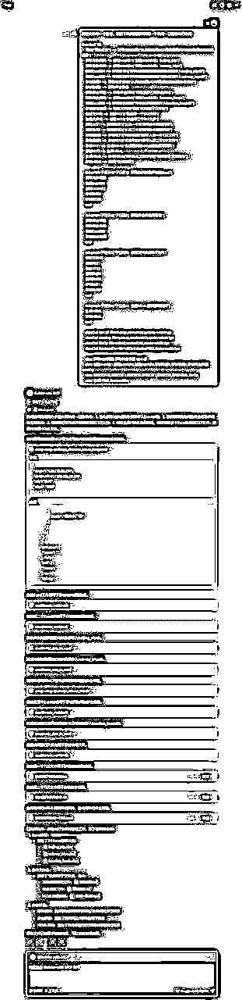

# 1.5.3.3 最终效果

先看表格。

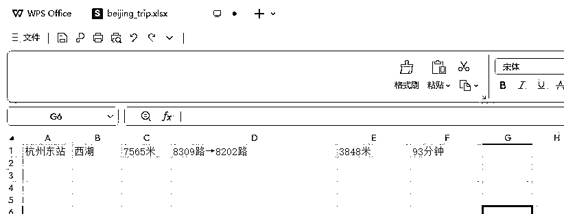

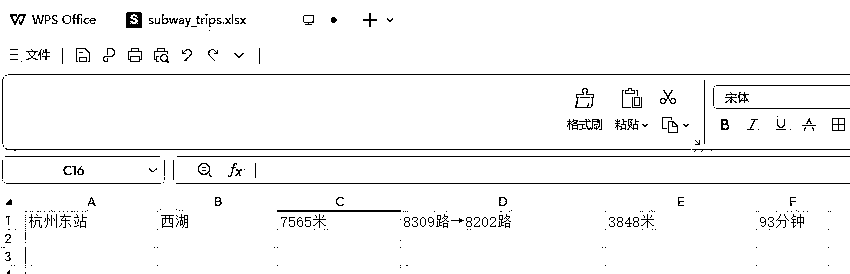

再看两个文本文件。

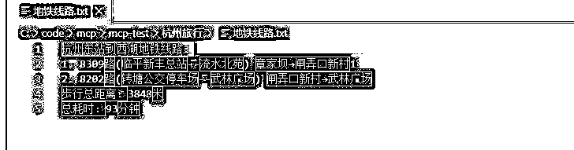

最后是 HTML，页面观感一般（捂脸）。

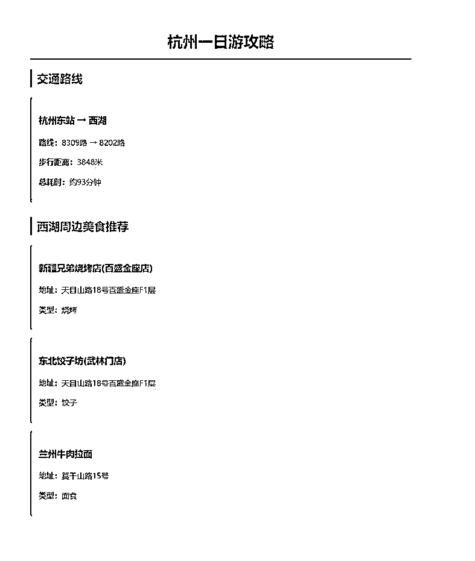

# 1.6 Cursor 中接入 MCP

上一轮 Trae 生成的 HTML 不够漂亮，可能是模型原因，也可能是提示词原因。换到 Cursor，可选模型更多。

# 1.6.1 准备 MCP 配置

Trae 中已配好，不必重搭。打开 Trae 的 MCP.json。

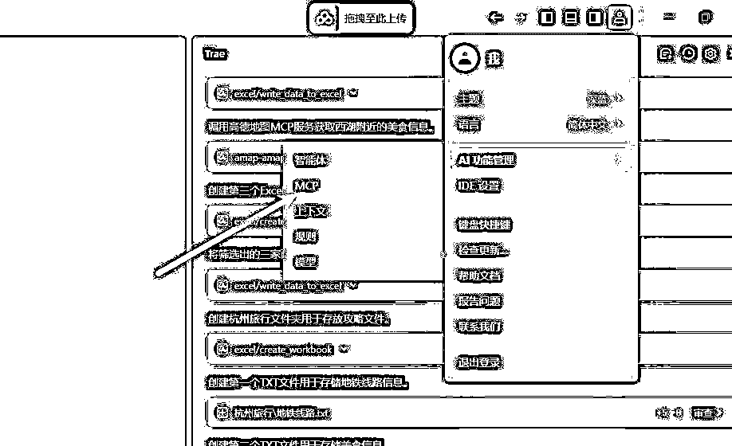

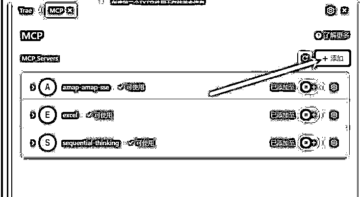

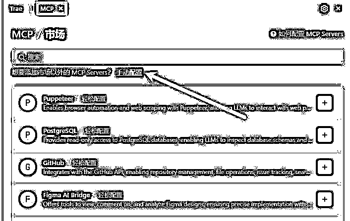

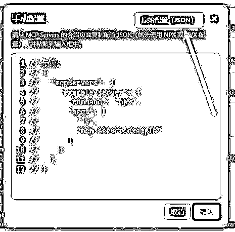

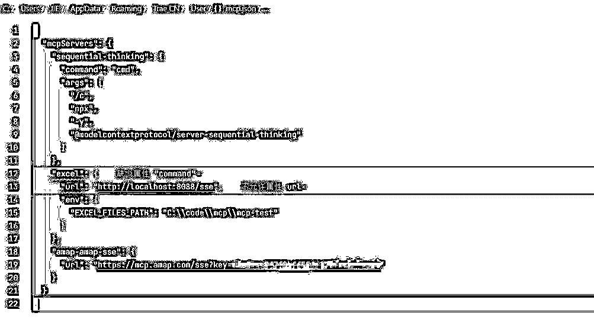

复制这段配置，另建文件夹，例如 MCP_test2，用 Cursor 打开。在项目内新建 `.cursor` 文件夹，再建 MCP.json，把刚才复制的内容粘贴进去：

```json
{
  "MCPServers": {
    "excel": {
      "url": "http://localhost:8088/sse"，
      "env": {
        "EXCEL_FILES_PATH": "C:\\code\\MCP\\MCP-test2"
      }
    }，
    "amap-amap-sse": {
      "url": "https://MCP.amap.com/sse?key=您在高德官网上申请的 key"
    }
  }
}
```


# 1.6.2 查看运行状态

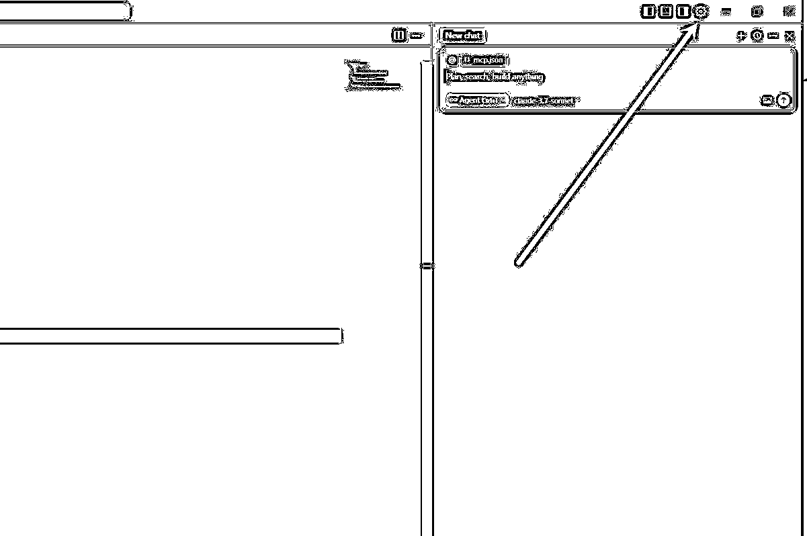

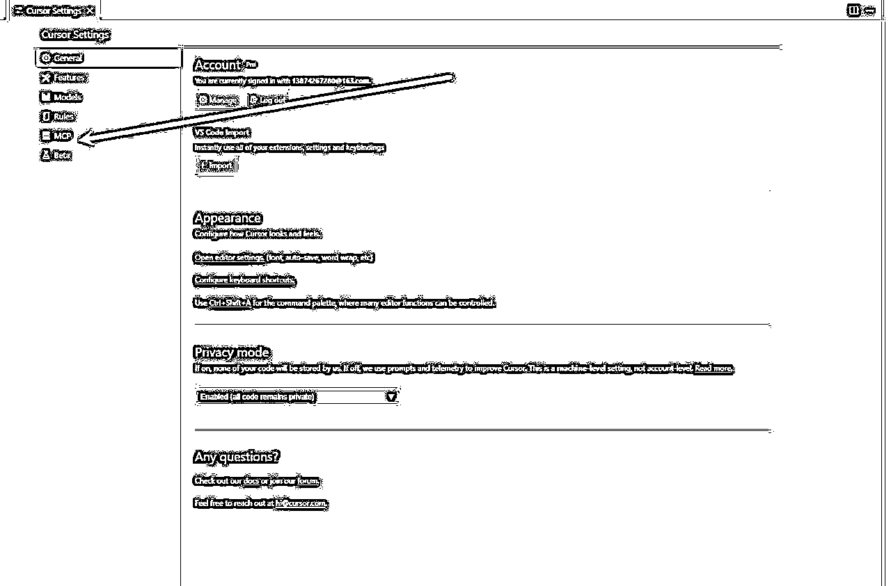

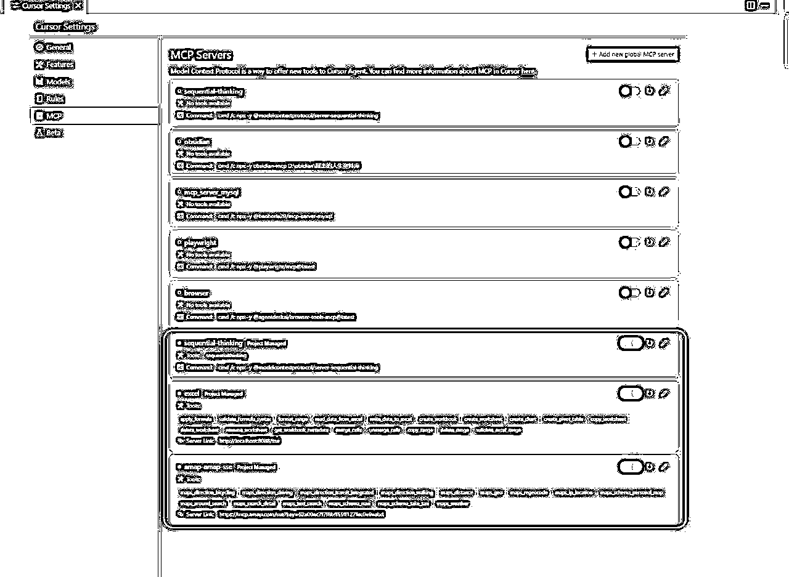

把各能力逐一启用。写在项目内 MCP.json 中的配置只对当前项目生效；若想所有项目共用，可点击 Add new global MCP server 添加全局项。

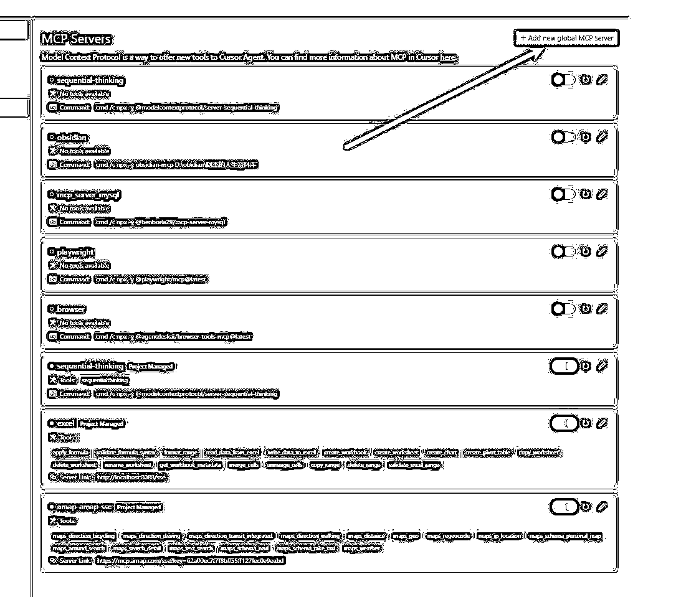

# 1.6.3 实操

任务与 1.5.3.1 相同，直接复用上面的提示词和流程图即可：请依据同一份流程，生成杭州一日游攻略。

# 1.6.4 成品亮相
第 4 个子任务收尾时，交付物有两件：一个可展示的前端 HTML 页，以及把它保存下来的结果。先看整体产出。


Excel 产物先亮相。
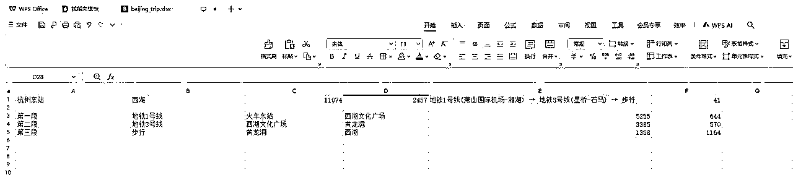


文本文件接着查验。


HTML 页最后登场。


# 二、MCP 上手捷径 @歸藏
# 💡
# 本章通关地图
本章学完并动手跑通，路线图会推进到第二阶段：
阶段二：吃透关键设置，动手试水（合计 6 天）
1. 在 Chatwise 中学会新增、排查 MCP，含 JSON 导入与手动填写两条路径（约 2 天）
2. 弄懂 Stdio 模式下命令、环境变量的设置要领（约 2 天）
3. 亲手接入一两个轻量 MCP，比如 Time 取时、Exa 搜索，并验证通过（约 2 天）
下面就从第一阶段实操开始。

# 2.1 轻量体验
扣子空间（https://space.coze.cn/）更像一位能替你跑腿的智能协作伙伴，而非单一工具。它可调度内置 MCP，让 AI 把多个能力串起来办复杂事：先调研，再产出 PPT 或网页，页面中还能放入音频、图像。用户对 AI 的期待不断加码，看了大量 MCP 智能体案例后，只靠有限工具的模型已难让人满足。
先讲入口。提示词框之外，页面有三块：
- 附件：可放常见文档，给模型补齐任务所需的背景材料。
- 扩展：MCP 工具箱，预置十多个常用服务，覆盖多数日常任务；拿不准就全选。
- 模式：探索模式全程自动，输入后等结果；规划模式先出步骤供你审，后续还能补信息、选方向，适合需要精细掌控的任务。


# 2.1.1 旅行方案：网页、PPT、PDF 一次拿走
回放链接：https://space.coze.cn/s/7_P4pzVQ--g/
先看一个基础例子。不勾扩展也能用：搜索、网页制作、演示文稿与 PDF 生成都是平台自带。我让它为 4—6 月新疆游设计多套行程，并配套网页、PPT、PDF；几分钟内它就搜齐资料。

它随后按我的要求做出网页，不少朋友觉得这个主题不错。提示词放在下面，可直接取用。


MCP 实战 | 提示词参考
提示词大意：请为 4 到 6 月北疆一周游规划多套行程供挑选，用网页做可视化，并再产出一份 PPT。网页版式取 Bento Grid；深黑背景配亮橙强调；关键信息用超大字号或数字；大小元素形成视觉反差；中英混排，中文粗大、英文小字点缀；线描图形充当可视化或配图；高亮色靠自身透明度做层次，不同高亮色不互混；滚动动效参考 Apple 官网；在线图表组件与主题同色系；Framer Motion、HTML5、TailwindCSS 3.0+、必要 JS 以及 Font Awesome 或 Material Icons 图标库均走 CDN；主图标不用 emoji；内容要点不删。
PPT 模板也很可爱，旅游气息足；它还给页面配了图片，不是纯文字，成品比预想更好。


# 2.1.2 飞书文档变身精致网页
回放链接：https://space.coze.cn/s/sy4L5Z-PVWk/
扣子空间的隐藏王牌，是能读取飞书文档与表格。对常用飞书记录的人来说，这几乎等于私人知识库：让空间分析、整理文档内容，再转成别的格式分享。比如我让它读取此前写的 MCP 入门教程，再按提示词做成网页，效果很稳；完全可以在页尾放按钮，引到🛰️等处阅读。

若想精准读取某一篇，最好提供文档 ID；ID 就在飞书链接末段。

要访问飞书信息，先在扩展区勾选飞书文档并授权；按引导在飞书安装 Coze 插件即可。


# 2.1.3 音频生成玩新闻播报
扩展区里还有音频生成，我顺手复刻了上周的 AI 播客加网页案例。没想到真成了，播放器还是它自己搭的，没用原始控件；这次没认真打磨提示词。试听入口：https://space.coze.cn/s/20-bkkZ7A0Q/
MCP 实战 | 提示词参考
提示词大意：请搭一个以我为中心的个性化播客系统：按我的位置和本地资讯生成播客音频，并配一个设计精致的网易云音乐风播放页。

上班族常被重复劳动吃掉时间，创意人又容易在找素材、处理素材时分心。过去国内用户只能羡慕海外模型与 Agent 工具，门槛和成本都高。如今 AI 的角色变了：它读懂目标，调度多种能力，陪你把想法落地。清晨它备好当日摘要；项目里补上你的短板；创作中既当听众又当搭档。

# 2.1.4 高德查天气，顺手出网页
先看这个例子。访问百炼平台（https://bailian.console.aliyun.com/?tab=MCP#/MCP-market）的 MCP 市场，找到高德服务。阿里自家出品，这里的能力比外部版本更全。开通后需建应用来调用：切到应用 Tab 的应用管理，点“新增应用”，建议选智能体应用。

进来先选模型，默认千问 Max 即可；我试了 Deepseek，似乎暂不支持 MCP，期待后续补上。

接着在智能体中点“+MCP”，侧栏勾选刚开通的高德 MCP。

最后填写提示词即可开跑；不会写也没关系，百炼带提示词优化按钮，写完点一下就行。
MCP 实战 | 提示词参考
提示词大意：你是前端工程师，熟悉 HTML5、TailwindCSS 3+、JavaScript 与相关库；能按用户给出的地点拉取当天及未来七天天气，做出网易云音乐风格的动态天气页。要点：天气数据要准确及时；HTML5 结构语义清晰；样式用 CDN 版 TailwindCSS 3+，白底、高亮色接近 #FE1110，大字号或大数字抓重点，大小元素拉开对比，高亮色仅做透明度渐变；动效用 CDN 版 Framer Motion，参考 Apple 官网随滚动触发；图表图标用 CDN 版 Font Awesome 或 Material Icons，主图标不用 emoji，在线图表与主题同色系；文字中英混排，中文粗大、英文小字点缀；代码可维护可扩展、注释清晰。限制：必须符合网易云音乐风；白底加近 #FE1110 高亮；中英混排；要点不删；主图标不用 emoji；滚动动效仿 Apple；所需库均走 CDN；HTML 通过 Artifact 输出。

随后在右侧输入查询地址，模型会自动查天气并生成网页。不想自己写，也可用我的分享：https://bailian.console.aliyun.com/share/e1204f6a3d2f4d419f55a492c8aa8699?memoryId=e1384d68e5a044eeaa1dfeb558322d66


# 2.1.5 网页总结自动记进 Flomo
再看一个组合玩法：把待总结的网页链接丢给 AI，它先抓正文、做摘要，再写进 Flomo，并打上标签。这里要用两个 MCP：Firecrawl 负责网页内容，Flomo 负责笔记写入。先取 Key：到 Firecrawl 的 API Keys 页面（https://www.firecrawl.dev/app/api-keys），在侧栏复制 Key 备用；再到 Flomo（https://v.flomoapp.com/mine?source=incoming_webhook）复制专属记录 API 备用。然后回百炼 MCP 广场开通这两个能力，开通时填入刚拿到的 Key。

回到应用 Tab 新建应用，选好模型，挂上这两个 MCP。

接着写提示词。起初发链接后 Firecrawl 抓不到内容，我一度怀疑 Key 有问题；去官方试却能返回。细看请求发现参数为空，模型不知道填什么；在提示词里塞入示例后便恢复正常。你可参考下面的写法。

MCP 实战 | 提示词参考
提示词大意：你是内容整理助手。收到网页链接后，用 Firecrawl MCP 抓取 Markdown 正文，读懂后用中文提炼关键信息并做简洁总结；再调用 Flomo MCP 把总结写入笔记，排版清楚易读，并加合适标签。标签只选 1 个，放在最前，格式为 #词语，标签后换行，# 与词之间不留空格；总结必须为中文。
Firecrawl 调用可概括为：工具名 firecrawl_scrape；参数包含 url、formats（markdown）、onlyMainContent、waitFor、timeout、mobile、includeTags（article/main）、excludeTags（nav/footer）、skipTlsVerification 等。
拿一篇文章测试，MCP 能返回 Markdown 正文，总结也会自动落到 Flomo 里。


# 2.2 进阶操作
下面的演示用 ChatWise 完成；同样思路可搬到 Windsurf 或 Cursor。这次会用到高德、Exa、Obsidian、Minimax 四个 MCP。
先办高德：到开放平台（https://console.amap.com/dev/key/app）申请个人 API，按要求完成开发者认证；进控制台“我的应用”新建应用，选中要建 Key 的应用，点【添加 Key】，服务平台选【Web 服务】，再复制 Key 待用。

# 一站式打通 MCP：ChatWise 接入到播客页落地


先完成 ChatWise 这一侧的接入。把下面对应的指令与环境变量填进去，密钥位置换成你自己申请到的值，别留空。


**可复制配置｜高德地图**

命令：npx -y @amap/amap-maps-mcp-server
环境变量：AMAP_MAPS_API_KEY="用你申请的高德 API Key 替换这段文字"

接下来处理 Exa。它同样需要密钥，好在申请不收费：进入 https://dashboard.exa.ai/api-keys ，创建后把值取出来备用。

**可复制配置｜Exa MCP**

命令：npx -y exa-mcp-server
环境变量：EXA_API_KEY=用你申请到的 API 替换这段文案

Obsidian 部分要先做准备：打开「第三方插件」→「社区插件市场」，找到 Loccal Rest API（即 Local REST API 插件），安装并开启。


开启之后，在该插件的设置界面里可以拿到 API Key。随后前往 https://coddingtonbear.github.io/obsidian-local-rest-api/ ，点击右下角「Authorize」，把刚拿到的 Key 填进去，服务即可启用。


另外还要准备 Obsidian 仓库的本地路径：点左下角仓库入口，进入仓库管理，选择「访达中显示仓库文件夹」。定位到目录后，按下「Option」再点右键，复制路径，留作后面填写。

这时回到 ChatWise。

**可复制配置｜Obsidian MCP**

命令：uv tool run MCP-obsidian --vault-path 替换为你 Obsidian 仓库的文件路径
环境变量：OBSIDIANAPIKEY=用你 Loccal Rest API 插件中的 Key 替换这段文案

若连接不成功，可参考船员写法：

obsidian

uv tool run mcp-obsidian --vault-path D:\mcp-test
OBSIDIAN_API_KEY=xxxx

MiniMax MCP 也建议一并接入。它的服务覆盖了自家模型矩阵，音频、图像、视频生成模型都在其中。先去 MiniMax 后台申请 API：https://platform.minimaxi.com/user-center/basic-information/interface-key ，适当充值即可。接着在后台创建 API，并记下 Key。


之后在 ChatWise 里配置 MCP：设置→工具→左下角加号→选 Stdio，再填写信息。这里要新建一个目录专门存放生成内容，按下 Option 再点右键取得该目录路径。填好后点下方查看工具按钮；能列出工具就说明正常；若出现错误，把错误信息复制给 AI，请它帮你调整。

**可复制配置｜MiniMax MCP**

命令：

uvx minimax-MCP

环境变量：

MINIMAXAPIKEY=替换为申请的 API Key
MINIMAXMCPBASEPATH=替换为储存生成内容的文件路径
MINIMAXAPI_HOST=https://api.minimax.chat

若连接不成功，可参考船员写法：

minimax

uvx minimax-mcp -y
MINIMAX_API_KEY=xxxxx
MINIMAX_MCP_BASE_PATH="D:\mcp-test"
MINIMAX_API_HOST=https://api.minimax.chat


随后在 ChatWise 把这几个 MCP 启用。后面的操作门槛很低，按步骤走即可。


关键部分来了：所有 MCP 的调用顺序和具体要求都写在下面这段提示词里。复制到 ChatWise 回车，就可以等网页和音频生成。

**可复制提示词｜个性化播客系统**

请生成一个以我为核心的个性化播客页面：依据我的位置、当地资讯和收藏内容制作播客音频，并配一个网易云音乐风格的精致播放页。

一、信息采集与内容生成

1. 位置与天气

调用高德地图 API（gaode MCP）取得我的当前位置，并获取当前天气、温度区间和空气质量。再结合天气给出合理的穿衣建议。

2. 本地新闻

通过 Exa MCP 查询我所在地区昨日的重点新闻，挑出 3-5 条最有影响力或可能与我相关的内容，并用简明方式总结每条要点。

3. 收藏内容分析

通过 Obsidian MCP 读取我最近 7 天内收藏在{剪藏文件}文件夹的文章，提炼关键主题和有价值的见解，整理成 2-3 个值得分享的要点。

4. 播客脚本

设定一个虚拟主播角色，赋予其独特个性和语言风格。按以下结构组织内容：开场问候→位置介绍→天气播报与穿衣建议→本地新闻速览→个人收藏内容精华→结束语。总时长控制在 3-5 分钟，加入自然转场和适当幽默，保持专业播客的流畅感。

5. 音频合成

使用 MiniMax MCP 选择最适合虚拟主播风格的声音，生成自然、富有表现力的播客音频，确保语速、语调和停顿符合专业播客标准。

二、网页设计与实现

视觉设计

参考网易云音乐的视觉气质，以白色为底色，搭配 #FE1110（或相近）的高亮色。主次分明，用超大字体/数字突出核心内容。中英文混排：中文使用大号粗体，英文作为精致小字点缀。高亮色采用自身透明度渐变制造科技感，避免不同高亮色互相渐变。

界面元素

使用简洁勾线风格的图形化元素呈现数据和配图。播放控制区域要醒目且易操作。设置明确的内容区域划分，包括播客标题、日期、天气信息、新闻摘要和个人收藏内容板块。

交互与动效

模仿 Apple 官网的滚动动效体验。实现音频播放进度条与时间显示。关键内容在滚动时有优雅的出现和强调效果。

技术实现

使用 HTML5、TailwindCSS 3.0+（通过 CDN 引入）和必要的 JavaScript。引入专业图标库，如 Font Awesome 或 Material Icons（通过 CDN）。实现响应式设计，确保桌面和移动设备都有良好体验。避免使用 emoji 作为主要图标，保持设计的专业性。

内容呈现

播客文字内容完整展示，分段清晰。天气和新闻数据通过简洁图表可视化展示。为个人收藏内容添加简洁的标签或分类标识。

输出要求

6. 完整的播客脚本文本
7. MiniMax 生成的音频链接
8. 可直接使用的完整 HTML/CSS/JS 代码，实现上述所有功能和设计要求

如遇任何 API 访问限制，请使用合理的模拟数据，并在最终输出中标注。

由于 MiniMax 返回的图片和音频都是网页链接，你可以直接复制生成的网页代码，部署到 Youware（https://www.yourware.so/）上分享给其他人。

教程到此收尾。整套流程已经接近一个小型产品，除了 MCP 配置这一步，其余环节成功率很高。别把用 AI 写程序想得太难，门槛已经降得很低；需求描述得足够清楚，产品就能跑起来。MCP 能接的服务很广，支付类也在其中；上面的播客生成之后，再挂一个支付宝 MCP 就能加入收款环节。未来开发者生态会演变成什么样，确实很难预判。


# 三、MCP 落地实战：把任务真正跑起来

# 💡 本章要做什么

前两章已经把理论和环境准备铺好了。现在要把知识变成实际产出。学习最终要落到动手，而 MCP 的价值，正是在真实问题里体现。

通过本章，你会具体学到：

全流程项目构建：从一个需求出发，调用多个 MCP 服务（如信息检索、文件读写、图表生成、网页部署），组合它们，端到端完成一个完整任务。

多样化场景应用：探索 MCP 在数据报告、文件管理、AI 创作、办公自动化甚至生活服务（如订票）中的具体应用，看它如何解决以往需要跨多个软件、手动操作的繁琐工作。

MCP 搭建思路：学习如何分析问题、拆解任务，并选择合适的 MCP 工具来高效实现目标。

准备好就开始吧～

# 💡 本章路线

完成本章节的学习和实操，即可完成路线图第三阶段：

第三阶段：探索 MCP 落地场景（共 11 天）

1. 用 MCP 生成一份在线报告（约 2 天）
2. 用 MCP 实现文件搜索和管理（约 2 天）
3. 用 MCP 生成海报（约 2 天）
4. 用 MCP 帮你处理 Excel 表（约 2 天）
5. 用 MCP 生成可视化报告文件（约 1 天）
6. 用 MCP 来订高铁票（约 1 天）
7. 用 MCP 做一个名人智能体聊天（约 1 天）

# 3.1 一句需求，产出在线报告 @小查

我们在 Trae 里搭一个智能体，调用多个 MCP 服务。只需一句话，就能完成“信息检索—网页生成—自动部署”的整条流程。

# 3.1.1 先把 Trae 装好

Trae 是字节旗下开发的 AI IDE，定位类似 cursor 的 AI 编程软件。新版本全面支持 MCP，并提供了智能体功能，能让 AI 更快满足需求。

下载地址：

国际版：trae.ai
国内版：trae.com.cn

国际版可用 Claude、ChatGPT、Gemini 等国外大模型，且目前不限量；国内版只能使用 DeepSeek、doubao 等国内模型。建议优先用国际版，登录过程中需要魔法。

# 3.1.2 配好三个 MCP Server｜备用联系：MM188166M（李李）长期更新

打开 Trae，点右上角齿轮按钮，把 MCP 和智能体两个标签选中，让它们显示出来。


在 MCP 标签下，选择“添加 MCP Servers”。


这里要添加三个 MCP：Tavily、Sequetial-thinking 和 Edgeone-pages。简单说下功能：

Tavily：负责网络信息搜索与提取。
Sequetial-thinking：通过结构化思维过程来解决问题，让大模型按结构化方式规划任务。
Edgeone-pages：腾讯出品的 MCP 服务，可以把 HTML 网页自动部署并展示。

下面以 Tavily 为例说明添加方式。市场里有两个 Tavily，选第一个（工具分别是 tavily-extract 和 tavily-search）。


点加号按钮，弹出添加 MCP Server 的对话框。


不必按官方说法先复制 JSON 再粘回来，有个更简单的办法：打开 idoubi 大佬的 MCP.so 网站里 Tavily 页面 https://MCP.so/zh/server/tavily-MCP/tavily-ai ，直接复制 JSON 代码，粘贴到上面的配置对话框。


注意，Tavily 需要你自己的 API Key。先去获取 key，再用它替换 your-api-key-here，替换后两边的双引号一定要保留。


注册 Tavily 并拿到 API KEY：打开 https://tavily.com/ ，注册并完成邮箱验证后登录，页面会自动显示一个 key，复制下来。


然后把 key 回填到 MCP 配置里，配置完应类似这样（注意两侧双引号）。


配置成功后，列表中会显示绿色对勾，状态为“可使用”。


如果没成功，先检查是不是第一次使用导致必要依赖没装。用 Trae 的 MCP 需要提前安装 Node.js，安装方法可参考 Trae 官方说明书：
https://docs.trae.ai/ide/model-context-protocol?_lang=zh

同样的方法配置 sequential-thinking 的 MCP Server：搜索找到它，点击添加，把提前在 MCP.so 找到的配置代码粘贴到弹窗里（https://MCP.so/server/sequentialthinking/modelcontextprotocol）。

配置 edgeone-pages 时，国际版 Trae 市场中没有，选择手动配置；也是先去 MCP.so 搜索，再把配置代码粘到对话框（https://MCP.so/server/edgeone-pages-MCP/TencentEdgeOne）。


三个 MCP Server 都配置完成后，应该能看到三个绿色小对勾。

# 3.1.3 创建专属智能体

在 Trae 里创建一个智能体，把上面配好的三个 MCP 服务串起来。

在智能体页签下，点击创建智能体。


对智能体进行设置，比如起名叫“数据爬虫”，提示词做简单定义，并勾选刚刚配置好的 3 个 MCP。


3.1.4 让智能体接管对话。

回到 Trae 的页签，点击对话框左上角默认的 Builder 按钮，弹出对话框后可以选择 Builder with MCP 或自定义智能体“数据爬虫”。


对话框左上角会变成“数据爬虫”。点它右侧的锤子工具，可以看到这个智能体包含的工具列表：除了自建的三个，还包括内置的 4 个工具。

# 3.1.4 准备 prompt.txt

在电脑上新建一个目录，在里面创建 prompt.txt，把简单提示词列进去。这个文件用于规范整个工作和输出网页样式。这里先给一个简单版本，圈友可以根据实际情况写更复杂的提示词。

可以直接下载这个文件使用🔽


# 💡 备用联系：MM188166M（李李）长期更新

# 信息来源怎么标

搜索 Qwen3 大模型信息时，请：

1. 标注每条信息的来源链接
2. 确保信息的时效性和权威性
3. 优先使用官方文档和可信来源

# 网页样式规则

部署网页时需遵循：

1. 使用现代化 UI 框架布局
2. 采用响应式设计适配多端
3. 配色方案：
主色：#1a73e8
背景色：#ffffff
文字色：#333333
4. 布局要求：
清晰的信息层级
卡片式内容展示
合适的留白和间距

# 执行流程怎么排

1. 先进行整体规划
2. 分步骤执行：信息采集→内容整理→页面优化→部署发布
3. 每个步骤设置明确的质量检查点

# 3.1.5 一次对话跑完整条链路

直接和智能体对话来完成任务。我们的任务是：让智能体调用 MCP 工具，检索“QWEN3”相关新闻信息，整合内容，生成网页，然后自动部署。拆开看是四件事，但跟智能体交互需要提几次命令？只需要一次。

**智能体指令｜复制后发送**

# 💡

1. 整个过程先用工具 sequential-thinking 进行规划。
2. 使用工具 file system 读取 /prompt.txt 文档，理解里面的要求。
3. 使用 tavily 工具搜索关于“Qwen3 大模型”的信息。
4. 整合信息，生成一个精美的网页。
5. 通过工具 edgeone-pages 进行部署。


智能体开始调用 MCP 工具：用 sequential-thinking 做规划，用 Tavily 搜索 Qwen3 信息，按 prompt 要求整合内容生成网页，并调用 edgeone-page 进行部署。


把同一批任务交给不同的大模型去执行，输出细节或许各有不同，但整体上各家都能顺利完成。

Gemini-2.5-Pro 的完成记录：https://MCP.edgeone.site/share/NzfLkLGWWlF2fST-I0T5h

Deepseek V3-0324 的完成记录：https://MCP.edgeone.site/share/RhkUPQjR7IILSxVYtsPWk


Claude 3.7 的完成记录：https://MCP.edgeone.site/share/l9pxpVLbqZsDK3kERd3wA


# 3.2 MCP 实战之文件搜索与管理 @相柳

# 3.2.1 先把运行环境配齐

要让 MCP Server 能正常跑起来，需要提前把这些基础组件备好：

- npx：基于 Node.js，要求 Node 不低于 18。
- uvx：Python 工具链里的快速执行器，需手动装配。
- Docker（可选）：用来隔离和运行应用的容器平台，按操作系统装对应版本；如果要用 GitHub MCP Server，就离不开 Docker。

## 3.2.1.1 装好 Node.js

先从 Node 官网取 18 或更新的版本，一路点下一步装完。然后在控制台执行两行命令核验：

```bash
node -v
npx -v
```

如果输出版本信息（比如 v18.19.0、10.2.0），就说明没问题。之后把 Trae IDE 重启一下，让 Node 配置在新会话中生效。

macOS 用户可以先看看 brew 里能不能检索到 node：

```bash
brew search node
```


发现有的话，直接用 brew 装：

```bash
brew install node
```

brew 太慢的话，也可以下载官方安装包：

```bash
curl -o node-installer.pkg https://nodejs.org/dist/v20.14.0/node-v20.14.0.pkg && open node-installer.pkg
```

随后跟着向导完成安装，期间可能要输入管理员密码。搞定后，把当前终端窗口关掉再新开一个，环境变量才能真正生效。最后用这条命令做一次总检查：

```bash
node --version && npm --version && which node && which npm
```

能看到版本号即表示一切正常。

## 3.2.1.2 装好 uvx（Python 工具）

uvx 是 uv 附带的命令行工具，用来快速执行 Python 脚本。先把 Python 3.8+ 装好，再执行：

```bash
python --version
```

确认能显示版本。接下来安装 uv（uvx 会随之装上）：

macOS / Linux：

```bash
curl -LsSf https://astral.sh/uv/install.sh | sh
```

或者：

```bash
pipx install uv
# 或
pip install uv
```

Windows（PowerShell）：

```powershell
powershell -ExecutionPolicy ByPass -c "irm https://astral.sh/uv/install.ps1 | iex"
```

验证命令：

```bash
uvx --version
```

能打出版本就搞定了。

## 3.2.1.3 Docker（按需安装）

仅当使用 GitHub MCP Server 时才需要 Docker。Docker Desktop 的安装步骤因系统而异：

- macOS：从 Docker 官网/商店下载对应芯片的 .dmg 包手动安装；有 Homebrew 的话也可以执行 brew install --cask docker。
- Windows：运行安装程序，在向导中勾选 Use the WSL 2 based engine。

装好后，用 docker --version 检查版本；再跑 docker info 查看详细信息，能正常输出即表示 Docker 已运行。


# 3.2.2 用 Trae 客户端来操作

## 3.2.2.1 Trae 客户端获取与安装

打开官网 https://www.trae.com.cn/ 点下载，页面会自动匹配你当前的系统。


双击安装包，把应用拖进 App 文件夹，再打开应用。前期引导可以直接跳过，直到跳出登录页面。


输入手机号、过真人验证、填验证码并登录。成功后关掉网页，回到客户端即可。


界面布局和操作方式与 Cursor 基本一致，默认模型是豆包。

## 3.2.2.2 挂载 MCP 服务


点“添加”。


会弹出一个确认窗口，必须把配置内容粘贴进去；直接点确认会报错。


所以要按规范格式来写。继续加 filesystem：点击右上角的“添加”，搜索 filesystem。


把整个卡片点开，或进入详情页的介绍区域，就能找到 JSON 配置。


这样便添加好了。

如果 uvx 或 bun 不太合适——它们经常连海外地址导致超时——可以切到 python 或 npx 模式。具体配置如下：


Everything：

```json
{
  "MCPServers": {
    "everything-search": {
      "command": "python",
      "args": [
        "-m",
        "MCP_server_everything_search"
      ]
    }
  }
}
```

filesystem 类似，只要把路径替换成你自己的目录即可，比如：

```json
"/Users/zhy/", //替换为自己的用户目录
"/Users/zhy/Documents/aicoding" //替换为自己的其他目录
```

完整 JSON：

```json
{
  "MCPServers": {
    "filesystem": {
      "command": "npx",
      "args": [
        "-y",
        "@modelcontextprotocol/server-filesystem",
        "/Users/zhy/",
        "/Users/zhy/Documents/aicoding"
      ]
    }
  }
}
```

当 MCP 状态显示为可用/打勾时，就可以到智能体中使用了。


## 3.2.2.3 用 MCP 搜索并操作文件

Trae 的智能体本来就支持 MCP 调用，无需再做额外配置。


在 Trae 标签里打开“@智能体”，选中 builder with MCP，然后输入查找需求。


它会问你是否执行，点“运行”就开始处理：


也可以新建一个智能体，通过提示词做优化：


给它明确一下用途，提示词可以这样写：

```text
你是一个文件归集助手，用户会让你在电脑里面找对应的文件，你需要读出这些文件的位置并将它们复制出来到指定的文件夹。你有两个工具可以试用： everything：这是一个在电脑内查询文件的工具 filesystem：这是一个操作电脑文件的工具
```

在对话框中选择新建好的“文件归集助手”，我换了一种问候方式继续测试。


这次查找速度不错。换视频及其它后缀反复试了几轮，效果不稳主要归结为几个原因：

- Trae 工作空间里存在干扰目录，但实际影响接近于零（表现是只搜工作空间内容，比如指定路径为 /Users/zhy/06，但响应里能看到其他文件夹的处理痕迹，只不过最终只显示指定路径的内容）。
- Mac 的目录层级和 Windows 不一致，导致处理流程不完整，可以从响应中看到。表面路径是“用户-zhy-下载”，但复制路径时 /Users/zhy/ 只到上一层；得进入下载的子文件夹再复制，才能拿到 /Users/zhy/Downloads 这样的完整路径。
- 对于搜索结果不理想的目录，要确保 everyone 用户具备只读权限。


当目录没有访问权限时，就可能搜不到东西。原因在于 trae.app 访问被拒后，会绕到缓存或临时文件夹，也可能直接返回无结果。

当需求是查找关键词时，请调用 everything MCP；当需要进行文件/目录操作时，请调用 filesystem MCP。


以上就是本小节的全部内容。

## 3.2.2.4 模型怎么选

推荐 deepseek-V3-0324。这类任务的指令非常明确，不需要太强的推理或思考模型；相较豆包，V3 的逻辑表现更稳一些。当然，如果你习惯豆包，继续用它也没问题。

## 3.2.2.5 换个平台部署

这套部署方式原则上可以迁移到其他平台，但能否运行要看平台所支持的环境。例如本文的配置放在 cherrystudio 上，就可能因网络或环境问题导致启动失败或更新服务器报错。


# 3.2.3 用 Visual Studio Code 跑通

其他支持 MCP 的客户端也可以组合使用，比如 Visual Studio Code + CodeBuddy + MCP。

## 3.2.3.1 下载 Visual Studio Code

打开 Visual Studio Code 官网（Visual Studio Code - Code Editing. Redefined），下载对应系统的安装包。下载后双击安装并启动。

## 3.2.3.2 配上中文语言包与 CodeBuddy

在扩展市场安装中文语言包和 CodeBuddy。


安装后可在偏好设置中切到“中文简体”，退出并重新加载。接着点闪电图标进入 CodeBuddy。

CodeBuddy 提供多种模式：

- Craft：需求拆解、代码生成
- Chat：工程理解、技术问答
- Code review：代码评审
- Unit test：生成单元测试文件

这里主要用 Craft 模式。


## 3.2.3.3 填好 MCP 配置

把两个 MCP 分别写入配置：


内容如下：

```json
{
  "MCPServers": {
    "everything-search": {
      "command": "python",
      "args": [
        "-m",
        "MCP_server_everything_search"
      ]
    },
    "filesystem": {
      "command": "npx",
      "args": [
        "-y",
        "@modelcontextprotocol/server-filesystem",
        "/Users/"
      ]
    }
  }
}
```

若还要继续增加，在客户端对话框蓝色括号后输入英文逗号，再接着写下一个 MCP 服务。


添加成功后，如上图所示，两个 MCP 名称都会亮绿灯。也可以选择安装市场上的 MCP，点“安装”确认后会自动加入。这里我们选择返回。


## 3.2.3.4 让 MCP 找文件、动文件

我们来实际调用一下。


从图中可以看到，目标文件很快就找到了。接着让它处理文件：


我写错了目录，但 CodeBuddy 自动纠正，并显示出调用了哪个 MCP，最终找到正确目录并完成迁移。


再验证一下操作结果：


已经完成了。

Visual Studio Code（简称 VS）内置 default 和 deepseek v3 两套模型，优先推荐 V3。其他如 Cursor 等客户端，操作方式与 Trae、VS Code 相差不大。


# 3.3 用 MCP 做海报 @AI 产品黄叔

让大模型+MCP 自动从文章里抽取金句，再调用即梦 MCP 生图，你敢信吗？图片一次生成几十张，随便挑：


即梦 3.0 在文字海报方面绝对处于世界领先水平，单次生成图片只需 1 积分，每天登录还能拿 66 积分，所以基本等于零成本。

打开即梦 MCP 的 GitHub 地址：https://github.com/fengin/image-gen-server ，跟着黄叔的流程照做，相信你也能接上。

# 3.3.1 环境要求

我这边是 Mac 系统，需要先装两个环境：

- Python 3.10+：https://python.p2hp.com/downloads/
- Node.js v20+：https://nodejs.org/zh-cn

提前装好 Node 和 Python 就行，安装很简单，按流程一步步点下一步即可。

环境就绪后，先挑个位置新建一个目录，用 Cursor 打开它（Windsurf 操作同理）。随后打开终端，逐条粘贴下面两行命令，一次只执行一条：

```bash
python -V
node -v
```

它们分别用来确认 Python 与 Node 的版本。只要 Python 不低于 3.10、Node 不低于 20，就可以继续往下走。

版本没问题后，把即梦 MCP 的 GitHub 仓库拉到本地。继续在终端里一行一行粘贴以下命令，回车后会自动执行：

```bash
git clone https://github.com/fengin/image-gen-server.git
cd image-gen-server
pip install -r requirements.txt
pip install uv
```

# 3.3.2 调整配置项

下一步要改两个文件里的配置。先看 server.py：


这里有两个关键值。先处理第二个 `IMG_SAVA_FOLDER`：它指定即梦生成的图片保存到哪个目录。你可以新建一个文件夹，再把它的完整路径复制过来填上。

第一个是 `JIMENG_API_TOKEN`。获取方法：登录即梦，打开调试面板（找不到入口可以搜一下，Chrome 按 F12 即可）：


在面板里找到那串数字，双击选中并复制，然后粘贴到 `JIMENG_API_TOKEN` 等号后面。

server.py 里还保留着作者开发时的默认模型——当时用的是即梦 2.1，现在版本已经到 3.0，所以需要手动调整：


搜索 `model`，把原来的值替换为：

```python
model="jimeng-3.0",
```

另外，images.py 里也要补一条映射，在相应位置加入这行：

```python
"jimeng-3.0": "high_aes_general_v30l:general_v3.0_18b",
```


还有最后一处：搜索 `sample_strength`，把它的值改成 1。这个参数影响出图精细度，设为 1 后细节表现会更扎实：

```python
sample_strength: float = 1,
```


# 3.3.3 接入 MCP

最后一步，把 MCP 配好。


进入 Cursor 的设置，找到 MCP 面板，点击 Add new global MCP server，然后粘贴下面这段 JSON：

```json
{ "MCPServers": { "image-gen": { "command": "uv", "args": [ "run", "--with", "fastMCP", "fastMCP", "run", "/Users/superhuang/Documents/image-gen-server/image-gen-server/server.py" ] } }}
```

其中黄色路径要换成你前面建好的文件夹地址。如果你用的是 Windows，则使用下面这份：

```json
{ "MCPServers": { "image-gen": { "command": "uv", "args": [ "run", "--with", "fastMCP", "fastMCP", "run", "D:\\XXX\\image-gen-server\\server.py" ] } } }
```

同样，路径部分改成你自己的目录。

粘贴后如果出现红色区块，多半是 JSON 格式有误，不用紧张。


先全选这段代码，点击 Add to Chat，然后在对话框里输入：

```text
帮我检查 MCP.json 的格式是否全部正确
```


点击 Send，Cursor 会自动修正格式。稍等片刻，右下角会出现 Accept，点一下即可。再回到 Cursor 设置里查看 image-gen 的 MCP 状态，前面亮绿灯就表示配置成功。

到这里，就可以开始生成图片了。

先在输入框里用 @ 引用当前这篇文章，再把下面这段完整提示词贴进去：

请仔细阅读“即梦 MCP”这一篇文章，并帮我找到值得分享的金句。工作流是这样的：第一步，先找到文章中值得分享的金句，如果比较少，可以自己进行总结第二步，把生成的金句全部填入到下面的{输入文字}部分，并调用下面的 Prompt 进行专属提示词生成：# 高级文字风格设计提示生成器根据您输入的文字内容{输入文字}，系统将智能分析其情感、风格和深层内涵，从我们多元化的风格集合中匹配或融合最契合的设计元素，为您定制专属设计语言提示词。## 创意风格集合（智能匹配系统）光韵夜影： 轮廓式霓虹勾勒，线条飘逸纤细，弧度自然，呈现透明质感与内部发光效果工业质朴： 金属粗砺纹理，铁锈斑驳装饰，浮雕立体结构，机械工艺感，点缀铆钉细节童趣涂绘： 线条随性不拘，手绘自然质感，笔触欢快灵动，边缘圆润，多彩渐变装饰甜心风潮： 梦幻少女气息，圆弧柔和字形，融入泡泡糖果元素，字体可爱圆润，点缀星星心形动漫爆炸： 漫画式震撼效果，线条张力延伸，笔画放射状爆发，营造强烈视觉冲击科技方块： 结构对比鲜明、几何分割重组，排列规整，未来科技感强烈清逸笔迹： 手写风格自然舒展，线条均衡流畅，微妙拖尾效果，构造带几何美感，起收笔干净利落文艺钢笔： 优雅连笔设计，细线交错变化，双行排布结构，字体飘逸富有情感金属科幻： 机械边缘结合流线设计，霓虹点缀装饰，转角锐利分明，金属质感突出，融入编码芯片图案虚拟空间： 深色背景衬托，字体结构数字解构风格，切割感线条，创造未来科技视觉体验复刻年代： 字体厚重带颗粒感，老式印刷机效果，墨色不均匀，边缘微损，浓厚怀旧气息狂放书艺： 草书奔放风格，飞白技法应用，节奏富有变化，笔触刚劲有力西方古典： 哥特风格变体，垂直比例修长，字形笔直尖锐，装饰细节丰富，透露神秘庄重氛围动感秀逸： 笔触由粗到细，结构紧密流畅，飞白技法明显，强对比突显字体动态美感解构粗笔： 夸张多变笔触，自由连笔技法，结构错位变形，展现活力张扬跳脱视觉效果简约留白： 极致纤细无衬线设计，留白空间充足，字距呼吸感十足，现代日式构成理念行草题韵： 毛笔行书韵味，结构丰满均衡，起笔有力果断，传统标题设计风范冰晶破裂： 字体边缘呈冰晶裂纹效果，如同冻结破碎的玻璃，笔触锋利冷峻科幻光切： 字体由光切割面构成，高光边缘闪烁炫彩，融合机械感与未来科技感街区涂鸦： 多彩涂鸦艺术，粗线厚重描边，结构跃动有层次，手写印刷风格混合自然木刻： 字形边缘自然毛边，木质雕刻感强烈，整体氛围温暖质朴电竞动力： 黑红强对比色调，笔画尖锐犀利，高亮边框装饰，能量条元素点缀，营造竞技紧张感## 智能分析系统规则简短有力文字（1-4 字）：匹配工业质朴、动漫爆炸、金属科幻、冰晶破裂、电竞动力等强视觉冲击风格优美诗意文字：匹配狂放书艺、行草题韵、简约留白、文艺钢笔等艺术风格活泼可爱文字：匹配童趣涂绘、甜心风潮、清逸笔迹、街区涂鸦等轻松风格严肃正式文字：匹配复刻年代、西方古典、简约留白等高级简约风格哲理思考文字：匹配行草题韵、狂放书艺、简约留白等传统艺术风格科技主题文字：匹配科技方块、金属科幻、虚拟空间、科幻光切等未来风格情感浪漫文字：匹配光韵夜影、文艺钢笔、清逸笔迹等情感风格怀旧复古文字：匹配复刻年代、自然木刻等复古风格## 输出格式"{输入文字}"/"ENGLISH"，[主要风格特征描述]，[背景设置]，[排版特点]，[视觉效果描述]，[情感氛围]，[高级感/艺术感描述]，杰作## 示例输出### 输入：半城烟沙"半城烟沙"/"HALF CITY SMOKE AND SAND"，创意手绘古风字体设计，潦草风书法字体，水墨纹理背景，淡雅灰色调或黄昏古城背景，艺术排版错落有致，大面积留白，飞白效果，毛笔肌理，线条流畅且富有意境，极简主义，东方禅意，艺术构图，高级感，浪漫而苍凉，杰作### 输入：数据狂潮"数据狂潮"/"DATA TIDE"，科技方块风格，深色背景，结构高对比、几何拆分，重构排列，未来感强，字形排布偏数字解构风，线条切割感，带代码与芯片图形装饰，视觉冲击力强，极致清晰度，冷冽高级感，杰作### 输入：恋爱成分表"恋爱成分表"/"LOVE INGREDIENT LIST"，甜心风潮风格，粉色系背景，少女梦幻气质，圆润字形，带泡泡与糖果质感，字体可爱圆润，点缀星星与爱心，POP 风格，排版灵动活泼，柔美浪漫，甜蜜氛围，清新可爱，杰作请输入您想要设计的文字内容，我将为您生成专业设计提示词。第三步，把生成的提示词，然后调用 image-gen MCP 生成比例 16:9 的图片把图片保存到文件夹 /Users/superhuang/Documents/image-gen-server/image-gen-server/images 里金句可能有多个，每次生成一个金句图片

然后按下回车。接下来 AI 会自动提取金句、生成专属提示词，并调用 image-gen 把金句制作成图。


# 3.4 借助 MCP 处理 Excel 表 @智昊

这一周我一直在找能处理 Excel 数据的 MCP 服务。起因是财务给我派了个大活：从几十张各子公司交来的单据汇总表里筛出不合规内容，再整理成一张新 Excel。每行文字都得人工读一遍、复制粘贴一遍，实在扛不住，所以我下定决心用 n8n 搭个自动化流程。

可真动手之后才发现没那么简单。前前后后试了将近 10 款 Excel 相关的 MCP 服务，体验都不理想。后来我耐着性子去 MCP.so 逐个尝试，终于找到一个相当顺手的，就是这个：https://github.com/haris-musa/excel-MCP-server

不过旧版配置稍微麻烦：需要先在本地启动应用，再让 client 通过 SSE 方式监听 8000 端口才能用，和之前那种复制粘贴就能接上的 MCP 完全不同。因此，想跟着操作的朋友务必按步骤来，遇到问题可以直接问 Gemini、Claude、DeepSeek 或 ChatGPT。

06-06 更新：haris-musa 后来补充了 stdio 方式的服务搭建方案，下面的内容也按新方案做了调整，用起来简化了不少。

# 3.4.1 先读 GitHub 上的 README.md

会用 MCP 的人，最好有耐心把作者写的说明看完。动手前先读 README.md，能少走很多弯路。

打开 https://github.com/haris-musa/excel-MCP-server 这个页面。


往下滚动，能看到作者写的 Quick Start。


这个 MCP 服务要求 Python 至少为 3.10。好消息是现在使用方式已经简化：在本地直接执行 `uvx excel-mcp-server stdio` 就能启动服务，不再需要克隆仓库。

来试一下：打开终端，输入 `uvx excel-mcp-server stdio`，回车。看到它开始安装后，等终端变成下图的样子，就说明安装成功、服务已经启动，正在监听 MCP client 的请求。

接着继续往下看文档。


现在只要用 stdio 模式，这个 MCP 服务就能常驻在 AI IDE 里，省事很多。打开 Cursor。

# 3.4.2 在 Cursor 中填写 excel-MCP-server 配置

先参照 1.6 打开 Cursor，然后把下面配置里 excel-MCP 那一部分加到你的 MCP.json 中。

参照下面的写法：


这样，Cursor 里的 excel MCP 就配置好了。我这里把名字改成了“excel-stdio”。

按 Ctrl+S 保存并关闭，回到 MCP 配置页面查看状态。亮绿灯就说明没问题。

搞定了。


作者 haris-musa 在环境变量说明里写得很清楚：使用 stdio 模式时，不需要额外声明 EXCEL_FILES_PATH，所以现在可以直接开始干活。

# 3.4.3 开始使用

接下来，我只要用 Cursor 打开“纯牛马”这个文件夹，就能愉快地“加班”了。


# 3.5 用 MCP 产出可视化报告 @饼干哥哥

# 3.5.1 寻找合适的 MCP

接下来要解决的是“多个 MCP 去哪里找”的问题。

可以去 MCP 市场看看，比如魔搭社区 https://www.modelscope.cn/ 和 https://MCP.so/。这里以魔搭为例：点开「MCP 广场」，在下方直接搜关键词。


今天这个案例至少需要 4 个 MCP Server：

1. Excel-MCP-server：让 AI 读写 Excel 文件。


2. Sequential thinking：强制 AI 进行深度思考，弥补大模型容易考虑不周的问题。
3. QuickChart-MCP-Server：直接生成可视化图表。


4. File system：让 AI 读写本机文件。这里我直接用 Cherry 内置的版本，大多数 AI 编程工具（如 Cursor）也自带，一般不需要额外安装。


不过 Cherry 毕竟是对话工具，需要先指定一个可用的文件路径，避免 AI 随意改动电脑里的其他目录。

# 3.5.2 安装 MCP 服务

在 Cherry 里怎么安装 MCP Server？操作路径是：设置 → MCP 服务器 → 添加服务器 → 从 JSON 导入。


弹窗出现后，把对应工具的配置依次复制进去即可。

这是 excel-MCP-server 的配置：

```json
{
  "MCPServers": {
    "excel": {
      "command": "npx",
      "args": ["--yes", "@negokaz/excel-MCP-server"],
      "env": {
        "EXCEL_MCP_PAGING_CELLS_LIMIT": "4000"
      }
    }
  }
}
```

这是 quickchart-MCP-server 的配置：

```json
{
  "MCPServers": {
    "quickchart-server": {
      "command": "npx",
      "args": ["-y", "@gongrzhe/quickchart-MCP-server"]
    }
  }
}
```

如果粘贴后出现报错，重新点进去、再打开一次开关，通常就会自动安装好。


另外两个 MCP 我直接通过 Cherry 内置搜索找到并安装。四个工具都到位后，要确认每个都亮绿灯才能正常使用。


# 3.5.3 准备测试数据

我拿之前做 SQL 查询时的订单表来测试。先把 Excel 文件移动到 file system 设定的路径下，因为 Cherry 只能在这个文件夹范围内活动。

# 3.5.4 选择合适的大模型

这个案例完全依赖 MCP 操作，因此很考验大模型调度工具的能力。至少要选支持 function call、并且编程表现较强的模型，比如 gemini 2.5 pro、claude3.5、grok3、deepseek v3。

其次要优先考虑上下文较长的模型，否则 Excel 数据一大，大模型容易报错。比如我的表里有三年数据，让 AI 直接统计每月订单数时，就触到了上下文长度上限。Grok 的窗口在同级别里算长的，再大就只能找 Gemini；但 Gemini 2.5 Pro 已经收费，我试了 2.5 Flash，结果它直接无视真实数据、开始编数。所以最终还是用 grok3 来做测试。

# 3.5.5 开启对话

先选角色，再开 MCP：

要在 Cherry 里开启一段新对话，可以先去智能体市场检索「数据分析」，出现在结果里的角色都预置了完整的提示词。


挑一个合适的点进去，进入对话框。输入框下方藏着 MCP 配置区，把接下来要用的几个 MCP 工具分别勾上，当前会话里的 AI 才算真正拥有这些能力。

好，现在正式进入数据分析环节。

先来一轮小测试：问问这张表里都有哪些数据，顺便检验 Excel MCP 是否靠谱。


它的处理顺序是：先借助 file system 工具扫描文件夹、列出其中的文件，再从里面锁定我们指定的 Excel 文件，随后调用 excel-MCP-serve 读取表格内容并给出答复。


一切正常。现在加码：让它一趟流程同时完成数据分析和可视化报告的制作——

请基于这份表格，生成一份网页版数据分析报告，希望覆盖的维度尽可能全，图表形式尽可能多，最后将成品文件落在本地。


回复篇幅太长，这里只截取了一部分。能看到它已经在这一步开始调用 quickchart-MCP 来绘图了：


七张图全部就位后，它开始拼装 HTML：


就在刚才设定的 Cherry 文件夹里，一个 html 文件已经生成完毕。鼠标双击打开，里面是基于 Excel 数据绘制的各类图表。


到这里，Cherry 里的多 MCP 调用链路顺利跑通，一份数据解读报告也随之出炉。报告效果看着有些朴素，说到底这次是为了演示调用流程，提示词方面没有刻意打磨；想让页面更精致，可以直接套用我之前分享过的 HTML 提示词模板：

MCP 应用探索 | 可复制提示词

【角色】你是一位资深的[专业领域]专家，擅长用 HTML、CSS、JavaScript 制作[具体类型]内容。

【目标】请为我设计并产出一个[具体描述内容类型和主题]的[内容类型]。这件作品应当[描述目标和用途]。

【流程】请按下述步骤走——[思考/分析]：[写明分析思路]；[方案设计]：[写明整体规划]；[实现细节]：[写明落地步骤]。

【审美】整体风格[描述风格或参考对象]；配色方案[描述色值或色彩倾向]；字体选择[推荐具体字体]；视觉元素[说明图标、插图等要求]；交互动效[说明期待的效果]。

【技术】开发框架[如 TailwindCSS、Bootstrap 等]；脚本库[如 React、Vue 等]；响应式[描述各设备上的表现]；性能[描述优化重点]。

【素材】图片来源[如 Unsplash、自定义等]；图标库[如 Font Awesome、Material Icons 等]；外部引用[列出需引用的第三方资源]。

【交付】代码质量[如注释、组织等要求]；兼容性[说明适配要求]；文件格式[说明最终交付形式]。

【备注】[其他特殊要求与提醒]。

【示例】想让 AI 发挥稳定，把找来的案例图片或 HTML 源码一并放进提示词里，让它对照学习，效果是最好的。

# 3.5.6 Python 直接跑

用 Cherry 分析数据，除了上面那条路，还能调用它自带的 Python 执行能力。

对，你没看错——Cherry 可以直接运行 Python 代码。换句话说，过去需要把 AI 写好的代码搬到编辑器里手动执行，如今在 Cherry 里就能一步到位。

怎么操作？看这个例子：

MCP 应用探索 | 可复制提示词

请按月份汇总每月的订单笔数，只输出 Python 代码就好。

这时候，AI 的回复中还没有出现运行 Python 的入口，需要先做一点配置。


打开左侧的「设置」，在代码块相关配置中开启「代码执行」，同时把下方的几个功能开关一并打开。设置完成后，代码右侧会立刻多出一个运行按钮。

不过有一点要留意：Python 跑在 Cherry 提供的沙盒环境里，与本地电脑之间没有互通的通道。所以指望它直接读写本地文件，目前是行不通的😓；但如果只是跑一些常规 Python 逻辑，则完全没有问题。

毕竟这个能力刚刚上线，要真正打通本地文件交互，还得等 Cherry 继续迭代。


# 3.6 用 MCP 订高铁车票 @成峰

说实话，做旅行规划时最让人抓狂的是什么？

没错，就是订票！😫

高铁、航班、各家 App 来回切，路线、价格、时间搅成一团，头都大了！

更别提那些还要时不时来一句"票看了吗"的家人朋友……

每次都在幻想：要是能有个私人助理，把路线、价格、时间统统整理妥当，再给点专业建议，那该多幸福啊！

现在，这个愿望真的能实现了！！！

今天要分享的是：如何亲手打造一个超强的订票规划助手，高铁、飞机全都能管。

你只要输入出发地、目的地和时间，AI 就会自动：

把高铁和飞机的路线全部查一遍

组合出多种出行方案

逐项对比价格与耗时

给出最优建议

比如 5 月 14 日，我要从杭州去日本。用这个智能体，AI 直接丢给我好几条路线做对比，每条路线的价格、耗时标注得清清楚楚：


甚至连综合建议都替我拟好了！也太贴心了！👇

# 3.6.1 订票体验：过去 vs 现在

把时间拨回从前，订票的画风是怎样的？

先去 12306 查高铁，再切到飞常准看航班，然后折回来比价格、对时间……反反复复折腾，头晕眼花😵‍💫。

偶尔还会漏掉某条路线，或者不小心错过更划算的组合。

现在有了这个智能体：

线路、票价、时刻一次理清，相当于白捡一位零成本私人行程秘书

再也不用担心被催票，出行安排得明明白白

想拿极致低价、想多去几个城市、想把多个目的地串成一条线？AI 也能给你排得妥妥帖帖！


# 3.6.2 设计思路（超简单！)

1. 装好 12306 和航班查询 MCP
2. 建一个交通规划 agent
3. 填入时间与目的地，开始规划

全套流程只需 20 分钟，一起动手试试吧！

# 3.6.3 进入魔搭社区

魔搭是一个大模型社区，使用前需要先注册并登录：

https://www.modelscope.cn/home

GitHub 登录、手机短信登录都可以，非常省事。


登录之后，在社区里找到 12306 和飞常准：


# 3.6.4 领取 12306 MCP

点进 12306，再点开里面的链接：

代码出现后，按下复制按钮：

把它保存到 Trae 中。


# 3.6.5 领取飞常准 MCP

在 MCP 市场里点开飞常准，先进入配置页，领一把飞常准的密钥。

领密钥非常简单！填个邮箱、设个密码就可以了。

打开官网 https://MCP.variflight.com/ ，点击注册：


把用户名、邮箱、密码三项基础信息填写完整，点击创建账户：

页面跳转后，点击"去登录"：


登录完成：


点击创建 API key：

名字随便起，比如"1111"就行：

点 copy，将密钥复制下来：


这一步极其关键：记得先去页面顶部激活邮箱，证明邮箱真实有效，密钥才可以使用，否则报错会一直缠着你：


把密钥粘到魔搭里，点击连接：


这样，魔搭里的飞常准 MCP 就妥妥到手啦！是不是格外顺利？😎

接下来，在 Trae 里也照做一遍，新建一个：


12306 和飞常准双双搞定，你的进度已经走完一大半！👏

# 3.6.6 搭一个交通规划 agent

名称：交通规划

提示词写作如下：

MCP 应用探索 | 可复制提示词

这是一个交通安排的工作流文档，可以参照以下思路执行

1 先取当前日期

2 找出起点附近的主要交通枢纽

3 找出终点附近的主要交通枢纽

4 归纳从起点到终点的几条可行路线，高铁与飞机可以混搭

5 逐条查询路线的票价和旅途耗时

6 权衡各条路线的优劣势

7 一切只依据返回的数据来规划

工具：飞常准和 12306

按截图把各项信息填妥，然后点击创建。

创建完成之后，立刻就能投入使用。


也可以在聊天窗口直接 @ 对应的智能体。

# 3.6.7 下达出发需求


随后，多套方案就会出现在你面前。


那些更个性化的要求，AI 同样接得住。

比如说，想追求极致低价、尽可能多去几个地方；

想把多个地点串联成一条动线；

这些统统可以实现！想留出一定的时间跨度？我也实测过，没有问题。

MCP 市场日渐丰富，自己搭一个旅行 agent 早已不是难事！

人人都能成为旅游专家，传统旅行社的位置，恐怕开始有点晃了。

欢迎你也来尝尝鲜～

# 3.7 用 MCP 开一场名人聊天 @成峰

前几天重翻以前读过的书，撞见《人类简史》里的一句话：

"农业革命是历史上最大的骗局"

读到这行字，我忽然停住，一个念头从脑海里冒了出来：

"要是能有其他人一起探讨这个观点就好了，比如让马斯克、孔子和尼采坐到同一张桌上聊……"


这个念头其实再合理不过。想想看，我们读书时，是不是常常被困在作者一个人的思路里？划了一堆线，本质上还是在被动接收信息，根本没有真正的思想碰撞……太单调了！！！

而那些真正深刻的洞见，往往诞生于各种视角相互撞击的瞬间。

诶，等一下……我好像可以借用 AI 把这个想法变成现实？！

没错！我要让历史名人一起来读我的书！而且只需要🛰️读书 MCP + Trae 就能做到！

脑补一下这个画面：

你正捧着书，划下一句重点，接着……马斯克、孔子、尼采和萨特突然围坐过来，就你划的那句话热火朝天地讨论起来！！！（是不是有点小激动？😏)

我试着让他们聊"人类是唯一会相信故事的动物"这句话，效果出乎意料地精彩：

【孔子】此论甚妙。人之所以为人，正在于能以礼乐传承智慧，此乃故事之本源也。

【马斯克】故事是人类第一个虚拟现实。从进化角度看，这是我们构建火箭和殖民火星的认知基础。

【尼采】故事即权力！弱者用故事安慰自己，强者用故事塑造世界。这是超人崛起的起点。

读完这几个观点，我的第一感受是：比起让 AI 干巴巴地归纳全书，这种形式可高出太多了！每一种视角都给我带来新启发，仿佛真的置身于一场穿越时空的头脑风暴之中！

放宽心，这场"思想派对"筹备起来毫不费力！我已经把坑都趟遍了，现在手把手教你怎么零基础复刻～

跨时空读书会，三步就能开起来（真心不难！）

不需要什么复杂技术，照着做就行：

1. 拿到🛰️读书的划线内容

2. 排好名人辩论阵容

3. 安心享受观点的多维碰撞

书读得再多，也不如和思想者同读一本书。

# 3.7.1 第一步：拿到🛰️读书登录信息

你或许会觉得这一步很麻烦，其实简单得很：

登录🛰️读书 → 用 cookiecloud 存好登录信息 → 把这份信息交给🛰️读书 MCP

下面展开细说：

1. 先去谷歌应用商店下载 cookiecloud 插件（长这个模样👇）


点一下插件图标，界面就弹出来了：


照图填写，注意！一定要牢牢记住你设置的账号和密码！

为什么要绕这么一圈？

因为🛰️读书的登录状态隔一段时间就会刷新（多半是为了防爬虫），有了 cookiecloud 就不用每次手动去抓了，系统会自动接力更新！是不是很贴心？

配置好之后，再去🛰️读书页面登录一次，让它抓取数据。想立刻同步的话，点一下"手动同步"按钮就行！


# 3.7.2 第二步：配好🛰️读书 MCP

在 AI 功能管理页面，需要新建两个部件：

1. 🛰️读书 MCP——负责取数

2. 🛰️读书智能体——负责处理


先把🛰️读书的 MCP 建起来：


将下面这段代码粘贴进去（外表看着高级，实质只是告诉系统该去哪里寻找你的🛰️读书登录信息）：


别忘了把代码里的账号密码替换成你自己的！不然系统会把示例当成你的真实凭据……那就闹笑话了😅

点确认保存后，接着建🛰️读书智能体：

把名称填好，勾选🛰️读书 MCP。


提交创建。


# 3.7.3 第三步：启动跨时空读书会！

调用智能体，报出书名，系统便会自动把你所有的划线内容捞出来：


上面就是抓取回来的内容。


另存为一个新文件。

接下来是最有看点的部分：该邀请哪些大咖来点评你的划线呢？我用的是下面这条提示词——

MCP 应用探索 | 可复制提示词

这个提示词用于要求下列序号中的人物，围绕书里的内容展开讨论，并不断生成人物对话：1. 马斯克 2. 孔子 3. 尼采 4. 萨特

我把它单独存成一个提示词文件，命名为"名人大辩论提示词.md"。

阵容完全可以跟着书走！比如读《三体》，就把刘慈欣、霍金、阿西莫夫、卡尔·萨根喊来；读《金瓶梅》的话……咳咳，该请谁你心里有数😏

把提示词和划线内容一起丢进对话框，你瞬间化身读书会主持人：


# 3.7.4 第四步：把讨论变成聊天界面

先把讨论结果保存下来，再用下面这条提示词生成精美的分享样式：

MCP 应用探索 | 可复制提示词

【身份】你是一位国际顶尖的数字杂志艺术总监和前端开发专家，曾为 Vogue、Elle 等时尚大刊设计数字版面，擅长把奢华杂志美学与现代网页设计融在一起，打造令人惊艳的视觉体验。请设计一款高级时尚杂志格调的知识卡片，用精致奢华的杂志排版承载日常信息，让用户获得翻阅高端杂志般的视觉享受。

【设计】
· 样式：iOS 消息
· 头像：改用 UI Avatars 服务生成文字头像，并为每位人物设置独特背景色，与消息气泡的颜色相互呼应

【技术】
· 使用 HTML5、Font Awesome、Tailwind CSS 以及必要的 JavaScript
· Font Awesome: https://lf6-cdn-tos.bytecdntp.com/cdn/expire-100-M/font-awesome/6.0.0/css/all.min.css
· Tailwind CSS: https://lf3-cdn-tos.bytecdntp.com/cdn/expire-1-M/tailwindcss/2.2.19/tailwind.min.css
· 中文字体: https://fonts.googleapis.com/css2?family=Noto+Serif+SC:wght@400;500;600;700&family=Noto+Sans+SC:wght@300;400;500;700&display=swap
· 可以加入微妙动效，例如页面载入的淡入、轻微的悬停反馈
· 代码保持简洁高效，优先保证性能与可维护性
· 颜色和间距建议用 CSS 变量统一管理，让整体风格保持一致

【输出】
· 交付一个完整的 HTML 文件
· 代码优雅、符合最佳实践，CSS 要体现对细节的极致打磨

请以国际顶尖杂志艺术总监的眼光和审美标准，创造风格各不相同却同样惊艳的数字杂志式卡片，让用户感到"这不是普通的信息卡片，而是一件值得收藏的数字艺术品"。

照着这条提示词去生成页面，效果见下图：


# 想把作品上线？先看这份免费建站参考

如果你准备把项目部署到线上，方便别人访问和分享，不妨翻一翻这篇攻略：《白蹭腾讯云！腾讯 EdgeOne MCP 免费部署网站攻略》。

# 读书这件事，换了个玩法

它把我的阅读体验整个翻新了。现在读书不再只是单向翻页，更像把不同时代的思想者请到同一张桌边聊天。

信息铺天盖地的当下，人太容易困在自己的回音壁里。用这种方式，我能听见来自不同年代、不同背景的智者发声，也能透过书页看见更大的世界。

更意外的是，时间一长，我会不自觉地借用他们的思路。读着读着，脑子里就蹦出：“要是尼采碰上这个问题，会怎么拆？”“换成孔子，又会给出什么答案？”

这大概就是天天和思想巨人们聊天的副作用吧。

别等了，今天就把你的跨时空读书会开起来。也欢迎在评论区说说你请了哪些名人，以及你们聊出了哪些精彩内容。

# （番外篇）为你的项目找到合适的 MCP 服务 @智昊

既然看到这里，再送你一点经验。

有技术背景的人大概知道 API 是接口调用：在自己的系统里通过 API 调别的系统，让外部能力补上本系统单独做不了的任务。MCP 的内核其实类似——让大语言模型完成它原本独立做不到的事，所以可以把 MCP 看成新时代的 API。比如用 Time 这个 MCP 让模型知道当前时间；用 Fetch-MCP 让模型抓网页；用 Browser-tool 让模型直接读浏览器控制台；用 everything 让它在电脑里找文件。

MCP 能做很多事，但别把它神化。别被一些 AI 自媒体带跑：会用 MCP 不代表高人一等。有人拿高德 MCP 写了长篇旅游攻略，最后连个同行搭子都没找到，这不也挺真实？真正关键的是什么？工作流。工作流。还是工作流。重要的事说三遍。

没有 MCP 时，想让模型把代码传到 GitHub，得先问“怎么上传”，再自己操作；有了 MCP，直接说“在我 GitHub 上建个仓库，把代码传进去”。没有 MCP 时，要把 DeepSeek 生成的提示词复制到即梦再出图；有了 MCP，直接说“把这个提示词交给即梦生成图片”。没有 MCP 时，想保存聊天过程，得翻到最上面复制、粘贴、调格式；有了 MCP，直接说“把我们的聊天记录导出成 Markdown，放桌面”。

所以，凡是当前需要你从大模型输出里复制出来、再贴到另一个应用里的环节，本质上都可以交给 MCP。MCP 的核心逻辑就是优化工作流，把多步骤合成一步。先想清楚你要模型帮你做什么，再去找对应的 MCP 服务。用技术解决问题，而不是为了炫技。

那么，开始吧。

# 4.1 好用的 MCP 市场网站

MCP 服务本身也可能有漏洞，因此优先选 star 多、官方认证、用户量大的服务，相对更稳妥。手册 1.2.3 部分可参考，这里介绍几个我在用的。

1. 魔搭社区 MCP 广场：https://modelscope.cn/mcp

新手首选。这是国内 AI 大模型社区魔搭做的 MCP 广场，收录了 2000 多个 MCP 服务；左侧可按分类查找，也能直接搜索。点开目标服务，使用指南就在页面上。


2. Awesome-MCP-ZH：https://github.com/yzfly/Awesome-MCP-ZH

国人维护的 MCP 服务介绍仓库，推荐列表很多。点进去可跳到对应 GitHub 仓库看安装方式。


3. Pulse：https://www.pulsemcp.com/

国外 MCP 服务站点，收录丰富、支持搜索、介绍详细。选一个仓库，点右上角 Github Repo 就能到对应 GitHub 仓库。


4. MCPMarket：https://mcpmarket.com/zh

同样是国外站点，交互类似魔搭社区，更新稍快。顶部有分类导航，可直接按类找服务。


选中一个 MCP 服务进入后，看 README 就能找到安装指南。


# 4.2 用工作流视角做优化

仔细回看你和大模型的交互记录。理论上，凡是它告诉你怎么做、你做完再反馈给它的过程，都可以由 MCP 接管。基于真实观察找到合适的 MCP 服务，这一步最关键。

举个例子。

我是 AI 开发者，用 Notion 管待办。以前把 AI 生成的文本复制到 Notion 文档很麻烦。后来逛魔搭时看到一个叫 notion 的 MCP 服务，说能让 AI 直接往 Notion 文档写内容。我觉得不错，就用它。

这就是我找 MCP 服务的核心流程：

1. 复盘和模型的交互，找出我们帮 AI 获取信息、按 AI 指引执行操作的部分；
2. 分析这些获取信息和执行操作具体怎么做；
3. 去 MCP 服务网站找能替代这些交互操作的 MCP；
4. 找不到就自己做，用 fastMCP 或 fastapi_mcp，这个以后有机会再聊。

以 playwright 为例。我之前用 Cursor 搭网站，构建过程总报错，很烦。报错有时一大串，复制不下来，逐条复制也麻烦。更崩溃的是，测试出问题时还要跟它描述“我做了什么操作、变成了什么样”，也不知道它听没听懂；它回一句“哦！我懂了，一定是 xxxx 出了问题，让我来修”，过一会儿修完，问题照旧。

于是我觉得需要一个网页自动化工具，就去 MCP 服务网站找。


我先从 Fetch 看起。Fetch 是爬虫，不是我要的。


Tavily 是搜索，也不是。


我一个链接一个链接看过去，直到找到 playwright。


介绍里说它能做网页自动化，似乎符合需求，再细看。


它能给网页截图，能打开网页，能切换 tab，还能看控制台——就是它了！安装 Playwright 吧。

# 4.3 读懂仓库 Readme，再装 MCP 服务

MCP 服务目前主流配置有两种：stdio 和 sse，手册 1.3.2 部分有写，这里简述。

1. stdio 协议：通常部署本地，本地起 server、本地 client 调用，不能并发，可理解成 1 对 1 专属客服。
2. sse 协议：一般部署云端，通过 IP 或 URL 访问，支持并发，可理解成服务台。

很多同学喜欢跳着找那串 json 塞进 mcp.json，然后喜提 -32000 史诗级报错。我还是建议大家认真完整看完 MCP Readme。

这里以 Playwright MCP 为例：

https://github.com/microsoft/playwright-mcp


看看 readme 讲了什么。


这是一个使用 playwright 的 MCP 服务，功能看着没问题；需要 Node.js 18 及以上。用法部分给了一串 json，按你之前学的方式调用即可。

# 4.4 MCP 服务安装失败怎么排查 防失联+MM188166M（李李）长期更新

终于到这。一般 AI IDE 的报错只显示成下面这样：


除了 -32000 什么都不清楚，总之就是 MCP 服务没起来。

请记住：MCP 服务的搭建，本质上就是 IDE 在后台开了一个常驻终端，并执行 json 里那串代码。

再强调一次：搭 MCP 服务，说穿了就是让 IDE 后台常驻一个终端，去跑 json 里的那串代码。

最后再说一遍：MCP 服务能起来的关键，就是后台终端执行了配置里的那串代码。

所以别怀疑，一定是你哪配错了。怎么办？打开终端，把 json 对应的代码敲进去执行，看它到底报什么错。

要记住，MCP 服务启动其实就是执行一个 .py 的 Python 脚本或 .ts 的 TypeScript 脚本，没别的东西；连不上就是脚本执行错误，没有其他可能。所以你自己在终端执行那个脚本就行。

比如安装 Playwright。我用 trae 示例，这玩意特别容易报错。我找到 json 串，点确认。


咦，居然能用了，等我再操作一下。


哎，还是失败；不过原始错误信息露出来了，这就好办，直接拿去问 AI。


明白了，我去改。


成了。就这么简单。

但有些同学报错长这样：


我#￥%@￥%#￥%……#%@#……%*￥&……￥%……&……

这种看不出怎么办？还记得刚才反复强调了三遍的那句话吗？MCP 服务搭建的本质，就是 IDE 后台开常驻终端，执行 json 里那串代码。现在只要把 json 变成终端能执行的一段代码，敲进去看报错。

打开终端。

MCP 应用探索｜可直接复制的提示词

```json
{
  "mcpServers": {
    "playwright": {
      "command": "npx",
      "args": [
        "@playwright/mcp@latest",
        "--visi"
      ]
    }
  }
}
```

我现在的 json 串长这样。那终端该输什么？问 AI，它会告诉你。


然后去终端执行 AI 给的指令。你看，它和 IDE 返回的报错是不是一样？


记住这句话：MCP 服务搭建的本质，就是在 IDE 后台起一个常驻终端，执行 json 里的那串代码。

现在基本 99% 的 MCP 部署报错你都能解决。

总结一下：

1. 先在 IDE 导入 MCP 服务配置；
2. 报错就看 IDE 报错，能看到终端实际报错就复制给 AI 处理；
3. 看不到实际报错、只有 -32000 或 Trae 那种乱码，就问 AI 怎么在终端执行这串 json；
4. 按 AI 指引去终端起 MCP 服务，看实际报错；
5. 终端报错后，把报错扔给 AI，让它教你怎么处理。

就聊到这里。希望大家都能借 MCP 工具增强自己的 AI 工作流，获得更顺手的交互体验！


最后，愿大家把 MCP 用起来，做出更多提效工具，一起龙哥盟！

# 防失联+MM188166M（李李）长期更新