# 202506 航海｜视频号带货：从零起号通关手册

> 出处：[https://ocn93f5d9olj.feishu.cn/docx/FUPTd9PnGoCok7xCHYXcYHwRnCg](https://ocn93f5d9olj.feishu.cn/docx/FUPTd9PnGoCok7xCHYXcYHwRnCg)

先加个联系方式防走丢：MM188166M（李李），资料会持续迭代。

# 💡 加 MM188166M（李李）防走丢，长期更新

各位航海伙伴好，这份手册对应六月航海「视频号直播带货」主题。相较三月那一版，本次把百货、图书等细分类目拆得更透，选爆款的思路、开播的具体打法也补得更全。

微信生态日活用户超过十二亿，这为视频号电商提供了相当扎实的消费底盘。用几个词概括它的电商特点：客单价不低、老客回头率高、粉丝黏性强、成交转化顺畅、退单比例小，而且新手摸门槛并不难；不少垂直类目里优质内容还不多、头部账号也没占满，正是适合新人试水的窗口。本手册围绕门槛不高的开播运营与短视频技巧做拆解，帮大家弄懂账号起步到变现的路径。眼下平台给的直播流量算得上充裕，也允许同时运营多个账号。

另外要说明：任何项目都会变，手册中的部分细节可能过时。请持续盯平台的新规与新玩法，开船以后多在群里交流。下面这张航线图跟手册章节是配套的，你可以按自己进度挑着看。

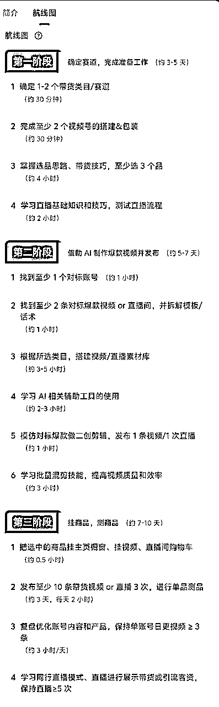

# 必修篇：把最小闭环跑通

# 一、【项目概述】先看懂视频号直播

# 💡 本章要点

这一章的目标，是把视频号直播这件事的整体轮廓先立起来：平台现在处在什么位置、有哪些特性、机会点在哪里、主流打法长什么样。本次航海想解决的，是零基础到跑通第一单的问题，所以先建立全局认知是必要动作。

# 1.1 项目现状@李诚

# 1.1.1 平台情况

微信这个超级入口的用户规模无需多言，视频号直接承接了这部分流量红利。2024 年平台电商交易额同比翻了一番，达人分销单季增速 140%，订单量涨幅超过两倍。

另外，视频号并非孤岛——它与公众号、社群、小程序都是打通的，商家可以借“微信小店带货者”做全域经营，靠社交关系链把私域盘活。从这些动作看，平台对带货这件事的态度是明确的，扶持政策也在陆续出台。

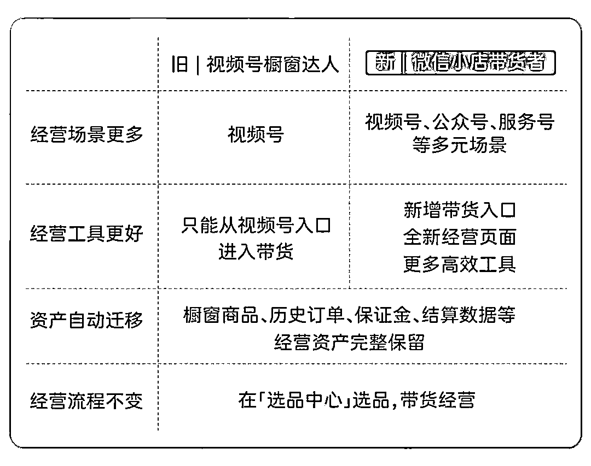

从交易特征来看：客单价高、复购与黏性好、转化效率强、退货不多，同时新手上手成本低。垂直赛道里优质内容和成熟账号仍然稀缺，特别适合从零起步。眼下直播间流量给得比较足，多账号一起跑也被允许。三月那批学员的实际结果也验证了这一点。

# 1.1.2 收益空间

视频号电商的盘子一年比一年大，越来越多微信用户已经习惯在这里下单。横向对比抖音、快手、拼多多，视频号上的商品定价普遍高一些，因此毛利垫得更厚，带货佣金也就更可观。

这里不少商品属于兴趣驱动型消费，中老年群体对新鲜玩意儿接受度高、愿意花钱试，靠自然流量一样能跑出曝光。跟短视频挂车相比，开播的转化链路更短、更直接，下单比例和佣金回报都更高。

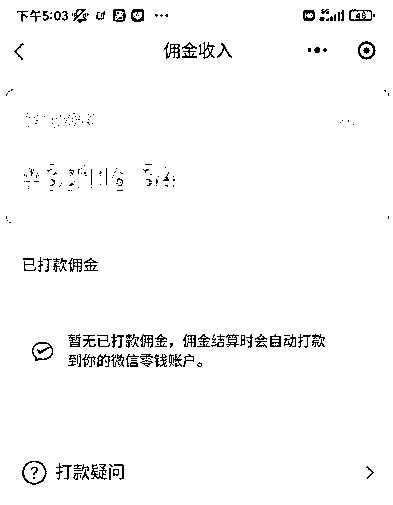

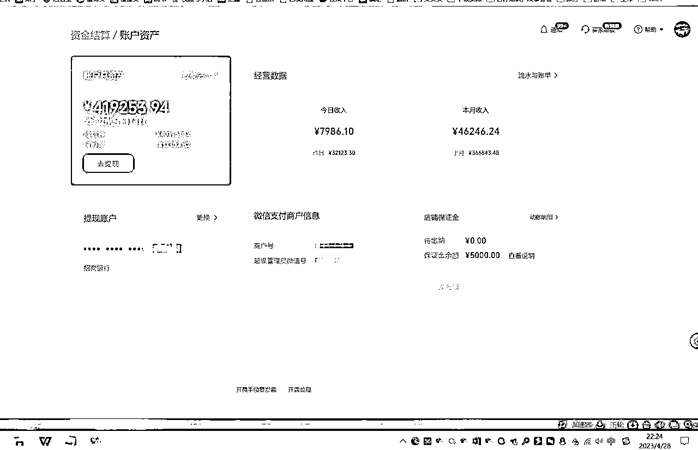

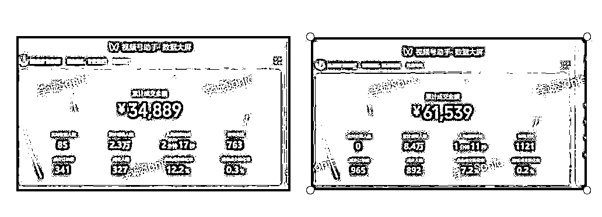

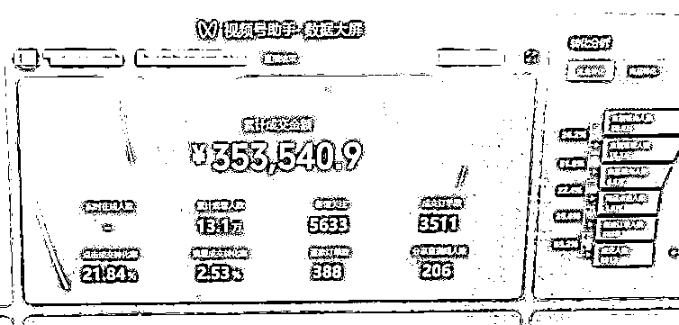

↑跟着新闻热点挑品，同款商品经常在多账号、多店铺一起爆。

# 1.2 核心玩法

# 1.2.1 最小 MVP 与关键动作

现在主流的做法是：先发带货短视频，等某条视频数据跑起来，马上开播接住这波人，把成交放大。所以零到一的最短闭环可以这么拆：选赛道 → 搭账号 → 挑品 → 照着爆款做视频并发布 → 开播卖货 → 复盘调整 → 出单。

有几个点要单独强调：

账号这块——新手建议至少备两个号，条件好就上三到五个，让亲戚朋友帮忙注册也算。素材剪辑、内容把控、平台风控这些环节都可能触发限流，一旦中招，往往要等上一周。

做视频、发布、开播这块——照着爆款做出高质量的片子，是整个项目的命门，建议每个号每天稳定发 3 到 5 条。平台审核越来越紧，混剪时最好掺进一部分实拍镜头（大约四分之一到三分之一），过原创的概率会明显提高；本次还会教大家用 AI 数字人产出视频来提速，不想露脸也能做。

还有一点：二次混剪时别让原作者的真人正脸大面积出现，容易被投诉下架，严重的直接封号；明星、网红这类素材尤其敏感，露脸比例一大，系统就会弹出核验提示，要求出示授权。开播之前，先拆同行直播间的话术和脚本，再自己试播打磨。

测品这块——带货账号要先交 100 元保证金才能开通选品，这笔钱后面能退。每天能发多少条带货视频，跟粉丝量挂钩：不到 1000 粉，一天最多 1 条商品分享视频；1000 至 9999 粉，上限 2 条；1 万至 99999 粉，上限 5 条；10 万粉以上，可以发 10 条。粉丝不足 1000、普通视频挂不了商品时，也能在评论区把人引到橱窗成交。

# 1.2.2 内容推荐机制

1. 社交推荐——这是视频号最特别的一条。你发的内容是否被看见，很大程度取决于好友和好友圈子的动作：发布、点赞、关注、评论、转发，都会把相关视频推到更多人的首页。
2. 个性化定位推荐——微信给每位用户都打了标签，性别、年龄、职业、兴趣、所在城市都算，系统据此从内容库里挑出可能合胃口的视频推过去。
3. 搜索推荐——用户在微信搜一搜里的行为会影响权重，点赞评论表现好的视频更容易被优先展示，搜过的主题也会更常出现在推荐流里。
4. 同城推荐——系统按发布定位，把内容分发给同城用户。线下商家可以利用这一点做本地生意。

# 二、【实操 1/3】开播前：定赛道、挑好品

# 💡 本章要点

整体情况摸清之后，就进入正式起步阶段。想带货，账号准备和选品这两件事绕不过去。本章把开播前要落实的准备工作梳理了一遍：办手机号和备机、注册并完善账号、锁定一到两个带货赛道、完成第一次选品。

其中选品和挖需求是关键中的关键。为了让你少走弯路，这里配了视频号的选品攻略和一套快速筛品的办法，帮你把这门核心技能拿下，快速进到实操。

# 💡 本章路线

学完并照做，就到了航线图的第一站：锁定赛道 + 完成准备，大概 3 到 5 天。

1. 定下 1 到 2 个带货类目/赛道（约 30 分钟）
2. 搭好并包装至少 2 个视频号（约 0.5 小时）
3. 弄懂选品逻辑与技巧，选出至少 3 个品（约 4 小时）
4. 补一补开播的基础知识与技巧，把流程试跑一遍（约 2 小时）

那就从这几步开始动手，进入选品环节吧。

# 2.1 工具清单

# 2.1.1 号卡与设备

新手起步建议备两个号，所以要准备：至少一部手机（支持应用多开，或者干脆多买一部）；至少两张电话卡（每个号对应一张实名电话卡）。

号卡怎么办：三大运营商都有副卡业务，一张身份证最多认证 5 个微信，走“一拖四”，副卡月租 10 元左右；移动的万能副卡同样是 10 元/月，一张身份证能领两张，但两张之间要隔 90 天，营业厅和 App 都能办，去营业厅有时还能免掉首年月租；电信 App 里搜“无忧卡”，一个月 5 元，通常第二天就送上门；移动另有 8 元保号套餐。

手机怎么选：既要登录账号，也要拍点素材。只拍短视频的话，千元级安卓机足够，而且安卓系统自带应用双开；如果后面想放大做直播，iPhone 的推流稳定性更好，但它不支持双开。预算允许的话，同时跑 3 到 5 个号也行，成本相应上升。

# 2.1.2 拍摄器材

1. 拍摄设备与软件：手机就够。现在的手机像素拍短视频绰绰有余，拍摄时用后置镜头效果更好。担心看不见自己的画面，用镜拍的办法就能解决。手上有单反当然画质更佳，但考虑到大多数人的情况，后面还是以手机为主来讲。软件方面，千万别开美颜，用系统原相机即可。

2. 提词设备与软件：可以让两部手机分工，一部拍、一部提词；手机拍 + 电脑提词同样可行。手机端有提词拍摄、快题词这类应用，拍摄时字幕直接显示；剪映里也内置了提词器。各大应用商店都能搜到。

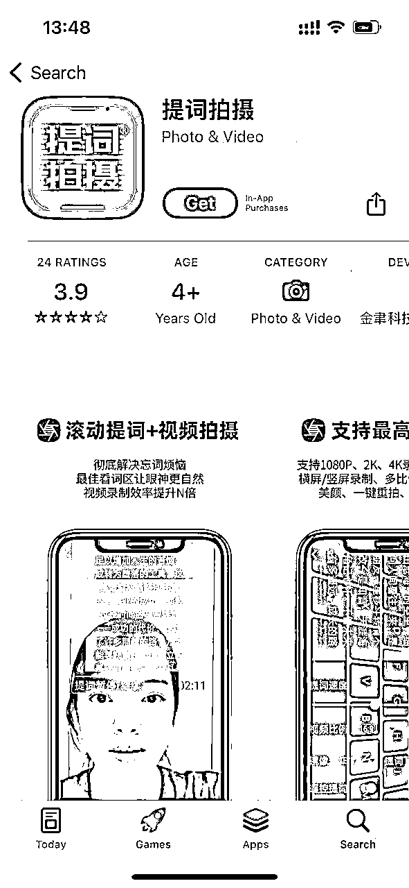

电脑网页端：https://cn.teleprompter-online.com/

3. 蓝牙遥控：身边没人帮忙拍的话，配个蓝牙快门，按起来省事。

4. 收音话筒：声音是硬指标，手机直录杂音偏多，收音设备必须安排。方案一，用蓝牙无线耳机——拍摄时我们多半侧对镜头，观众看不到耳朵，把耳机戴在背对镜头那侧，用耳机麦收音就行。方案二，买支话筒——淘宝、拼多多两三百块的型号效果已经不错，起步阶段不必上 RODE、大疆这种贵价货。

5. 拍摄支架：买两个普通支架最实在，一个架拍摄机、一个架提词机，稳当又灵活。提词用电脑的话，家里随便找个东西垫高就行。那种能自由调整相对位置的双机位支架也能考虑，但万向软管结构大多不稳，不太推荐。

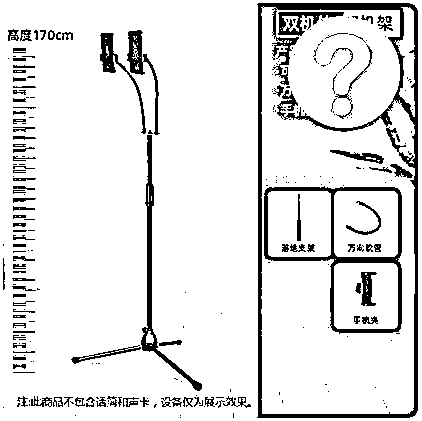

注意：别把两台设备固定并排摆。离太近拍不到半身，离太远又看不清提词屏。

6. 补光灯：球形灯比较合适，从左侧或右侧上方打过去；记得选支持三种色温的型号，方便配合不同内容调氛围。另一侧补一根小灯管，或者挂块反光布。具体布光可以看这条教程：https://v.douyin.com/i8jJuV6X/

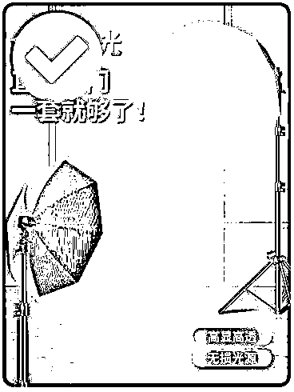

注意：别用环绕式补光灯，戴眼镜的人镜片会反光。

# 2.1.3 剪辑工具

手机端快影、剪映都能应付日常需求，剪映还能直接导出 60 帧。剪映手机版在各大应用商店都能下，电脑版在 https://www.capcut.cn/ 。有电脑建议用电脑剪，操作更顺手。

说句实在的：一件小道具，从刷到、下单到真正用上，能耗掉你不少时间。有人为找一支在黑板上写得顺滑又好看的笔，折腾了大半天。所以起步阶段别追完美，先发出去。好相机、好手机、摄影灯、服装、麦克风、精搭的场景和道具，都属于加分项，后面慢慢补。刚开始把这些时间省下来多拍几条、多发几条，把精力放在创作和运营上更划算。

来源：《从 0 到 1000 万粉，给短视频创作者的 80 条建议》

# 2.1.4 数字人工具

即创数字人平台（限时免费，需投少量抖+开通权限，教程见下）：点此进入。成片教程：4a5dc2010836cc2fa8966061044563e6.mp4【在线播放】

蝉镜数字人平台：点此进入。

# 💡

生财有术专属福利：蝉镜 AI 数字人

做自媒体的都懂，想提高产出效率，数字人是绕不开的工具。我们特地跟国内头部的 AI 数字人厂商蝉镜聊了一轮，给圈友要来了专属权益。

【1】蝉镜 AI 数字人是什么

蝉镜出自蝉妈妈，主打用全栈数字人技术把内容生产变简单。

产品优势：国内头部平台；数字人生成、口播视频、配音、文案等功能一站集成；内置 100 多套专业模板与公共数字人，覆盖电商及各类业务场景；几分钟就能产出可用的数字人内容。

适合谁：自媒体从业者、MCN、传媒公司、代运营、企业主等。

用在哪：引流、获客、打造 IP、内容生产、开播、卖货等。

【2】专属权益怎么拿

第一步，走下面这个专属链接完成首次注册（之前注册过的，直接看第二步）。系统会自动发 600 生财专属蝉豆 + 60 新用户蝉豆，够免费做 11 分钟数字人视频。

https://www.chanjing.cc/refc/?type=hzBuy&id=j2Y11akayXaJL8GK0mhNwKi5WPn4Nguj2cM3vSQO2Xc

第二步，用电脑端买任意版本会员，推荐人一栏填：A 生财有术。每买一次额外送 600 生财专属蝉豆（可做 10 分钟数字人视频），前 5 次下单都送（连续包月按前 5 个月算），系统会在购买后一周内自动到账。

注意必须走电脑端下单，买完手机、电脑两端都能用：https://www.chanjing.cc/home

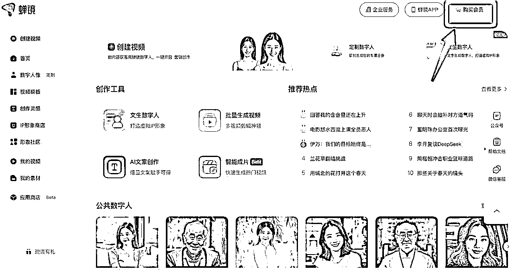

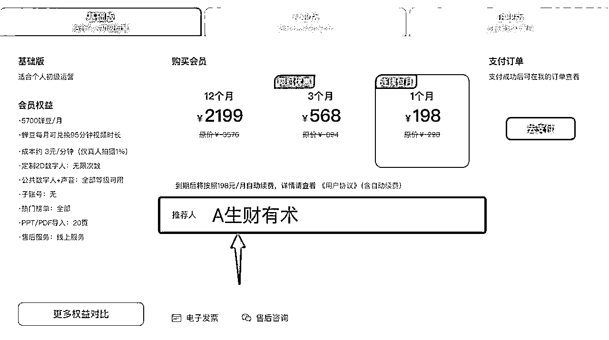

A2E 数字人平台：点此进入。

哼哼猫（全平台批量去水印）：点此进入。

豆包大模型声音复刻（试用）：点此进入。

视频去字幕去水印（每天 10 次免费额度）：点此进入。

# 2.2 账号筹备

# 2.1.1 注册、登录与养护

注册：按下面六步走，号就建好了。

1. 打开微信「发现」，点「视频号」。
2. 在「视频号」页面点右上角「人像」图标，进入主页。
3. 主页上点「发表视频」，跳转到创建页。
4. 在创建页填头像、性别等信息，勾选“我已阅读并同意《微信视频号运营规范》和《隐私声明》”。
5. 不想被微信好友刷到你的内容，就把「在个人名片上展示视频号」关掉。
6. 创建完成。

登录：用应用双开，一部手机挂两个微信；也能把多个号的运营者统一绑到自己的大号上，之后用网页版逐个登录操作。

有个坑要提醒：多个号绑定同一微信号当运营者时，这个号同一时间只能登其中一个。比如微信号 A 同时绑了号①和号②，扫码进①之后再去登②，①会被踢下线，想回去得重新扫码。

多号养护：批量注册的微信号容易被封，就算只注册了两个也要留心。养号的核心是让系统觉得你是真人，具体有五招：补齐头像、昵称、背景图等资料；改好微信号、登录密码和支付密码，零钱里放几块钱；每天发两三条朋友圈，长短不限；随意加 5 到 10 个好友，每天聊几句；每天刷一刷视频号、看看直播。

# 2.1.2 账号包装

定位还没定的，先翻到手册「2.3 定赛道&选品」那节，确定要做的方向（比如渔具、百货），再倒推账号定位。方向清楚了，头像、昵称、简介、置顶视频的优化才有依据。

# 2.1.2.1 设置路径

点创建视频号，会进到下面这个界面，右上角【···】进【设置】：

在【设置】里点【资料设置】：

进【资料设置】后，分别点【头像】【名字】【简介】逐项填好。

# 2.1.2.2 包装实操

1. 账号名称

先看官方对昵称的要求：名字要贴合你的账号类型，好名字本身自带搜索流量。最常见的思路是把相关关键词拼起来，比如健康、书籍、认知这些词。用关键词组合的好处是，别人搜的时候更容易撞见你。但顺口好记的名字基本都被占了，所以注册前多备几个备选，挨个试。一年最多改 5 次名字，没灵感就去各平台看看同类账号怎么起名，或者用通用格式，比如【xx-同款在橱窗】。

@麦洛 补充一句：昵称一年只有 5 次修改机会，建议先上个通用名，比如“xx-同款商品在橱窗”。简介建号之后随时能改，路径是：主页头像 → 右上角 … → 头像 → 简介。简介控制在三行内，超了会被折叠。里面可以放成交引导，比如“同款商品在👇🏻下方购买”。不建议随便留微信号，导到微信成交效率很低，精力却耗得厉害。

来源：《视频号直播建议指南》

2. 头像

头像决定别人记不记得住你。可以用纯文字（名字缩写），也可以用图文。拿不准什么样合适，就去搜你所在赛道的大 V，看人家怎么设置的。制作上，图怪兽这类站点就能搞定，或者找些无版权图片。

图怪兽：https://818ps.com/

资料卡、置顶、挑货：视频号带货起步路线

作图先备两个入口：Canva（canva.com）和创客贴（chuangkit.com）。两个风险提前记：注册商标图案别随手用；真人头像少拿来当账号门面，容易和定位打架。

1. 个人简介

资料卡随时能改。先想清楚账号定位，再翻成熟大号的写法作参照。带货号要让用户一眼看到入口，比如“拍同款？点下方商品卡即可”。微信联系方式，起步阶段建议先不放，免得被同行盯上；等粉丝起来、账号稳了再补。真要放也别太直白；写了微信号或手机号的，换几个号检查会不会被折叠。成熟写法可参考：加V、资料申领、商务对接。

2. 置顶视频

最多两条，排序别随便。建议第一条放流量款或热点款，第二条留给转化潜力最高的商品视频。带货号还可把“怎么下单”的教程置顶。

p.mp4【在线播放】

置顶路径：打开目标视频，点右上角三点菜单，在弹层里选“置顶”。

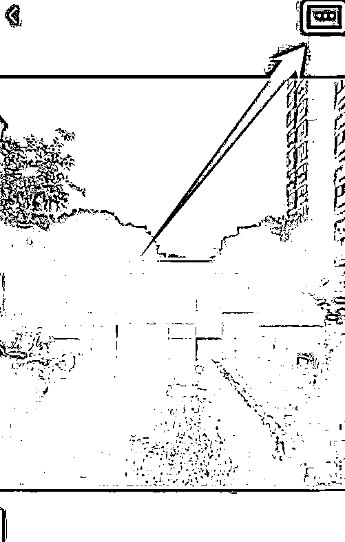
资料出处：《8 月初阶视频号航海实战手册》

# 2.3 类目先行，单品后落

别急着盯单品。先把类目框住，比如渔具、百货；再落到具体货，比如鱼竿、包饺子器。起步阶段别铺太宽，守住一个方向，把挑货和内容做深。下面这些方向适合新手参考。

# 2.3.1 赛道选择看受众

关键变量是受众。这个平台以一三四线城市的长辈为主，也有少量年轻人。带货方向要围着他们的日常和兴趣转。

拿粘鼠板举例很直观：住老小区或乡下的长辈有鼠患，刷到就可能有反应；大城市租房的年轻人缺这个场景，自然不理解为什么有人会点赞下单。

已经验证过的方向包括：AI课程资料包、日用百货、家居好物、地方特产、图书、新奇玩具、三农用品、绿植、服饰鞋包。货品可按场景理解：食品养生、时令用品、图书、服饰、家居适老、绿植园艺、收纳清洁、厨房卫浴、洗护、健身、渔具养鱼、知识课程、定制周边、护理器械、露营烧烤、节庆礼品等。

百货的细分逻辑是：长辈退休后有钱有闲，愿意为爱好花钱。钓鱼不只买竿和饵，还可能配渔网、防晒衣、钓鱼鞋、凳子、驱蚊用品；养鱼也不只鱼缸，还有鱼盆、鱼池、水族箱、过滤器、恒温棒、增氧棒。账号卖的不是单个货，而是替用户做决策、给情绪价值。用户认同你，就可能持续跟着买。

# 2.3.2 挑货流程

# 2.3.2.1 人群、类目、价格

挑货三要素：人群、类目、价格。底层顺序是：先锁定目标用户→找需求→切细类目→找匹配货品。

人群已定：50岁以上为主，少量年轻人。类目决定卖不卖得动。50岁女士需要假睫毛吗？大概率不需要。包饺子器也许有人买，但用户还要判断“我需不需要”。食品类更容易触发“想不想要”，同样场观下转化会好一些。挑货时多站在父母一辈的角度感受。

价格影响利润和销量。算一笔账：A 日成交700、每件毛利1元；B 日成交100、每件毛利7元；C 日成交100、每件毛利10元。A与B总利润相同，选客服压力小的；B与C单量相同，选利润高的。高客单往往销量低，低客单往往销量高。新手想快速拿正反馈，先从低客单练手，出单后再优化。

# 2.3.2.2 工具、判断与验证

先用工具找方向，但要清楚：外部拿不到微信侧查询接口，工具数只能作旁证，最终拍板靠自己。

工具一：考古加 www.kaogujia.com

案例一，热度视频选品。搜“父亲节”“礼物”等词。

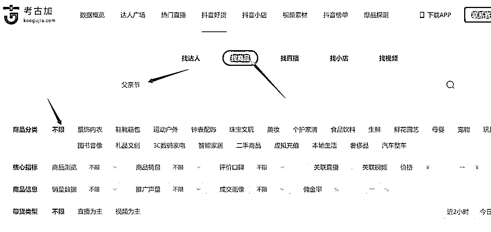
入口在抖音好货的找商品页，把关键词填进去搜。

类目层级按需要选：想广撒网看一级；想精准可到三级。这里以三级为例。选好后按销量排序，进详情页看近期走势。

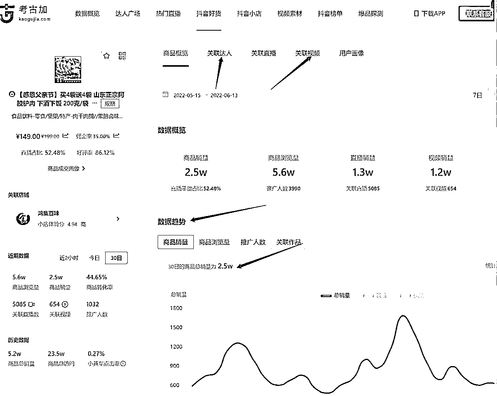
数据不错时，重点看两项：挂车达人的作品质量，方便模仿；相关短视频的表现，方便二次创作。

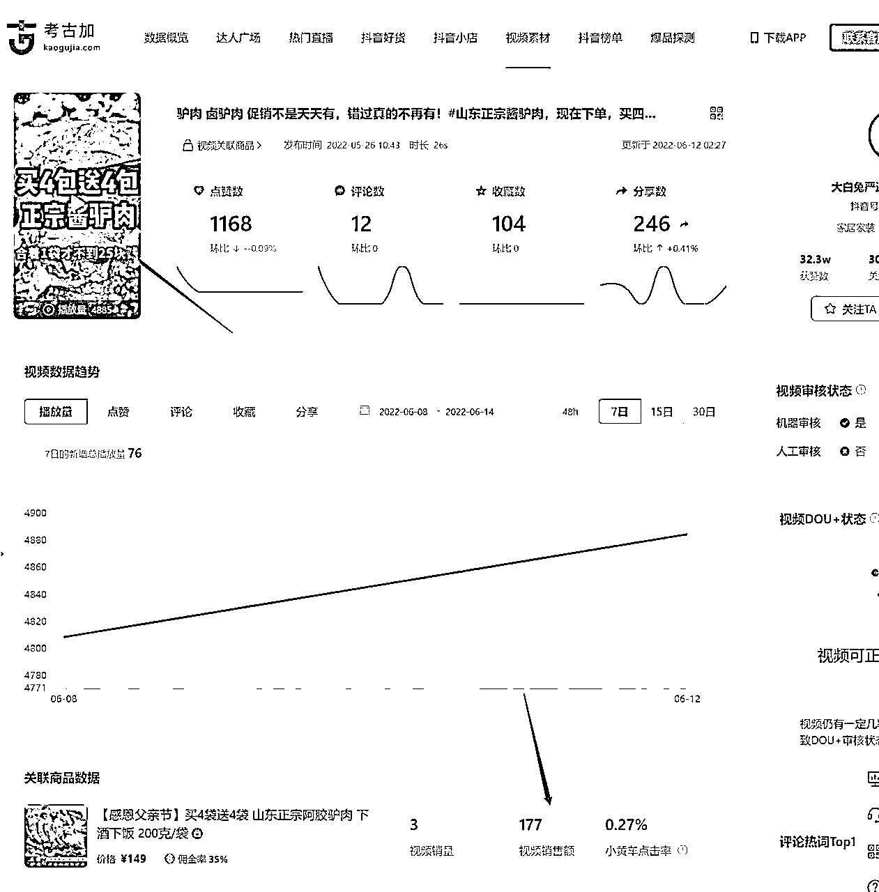
案例二，细分类目选品。路径是抖音好货→找商品→商品分类→带货类型。

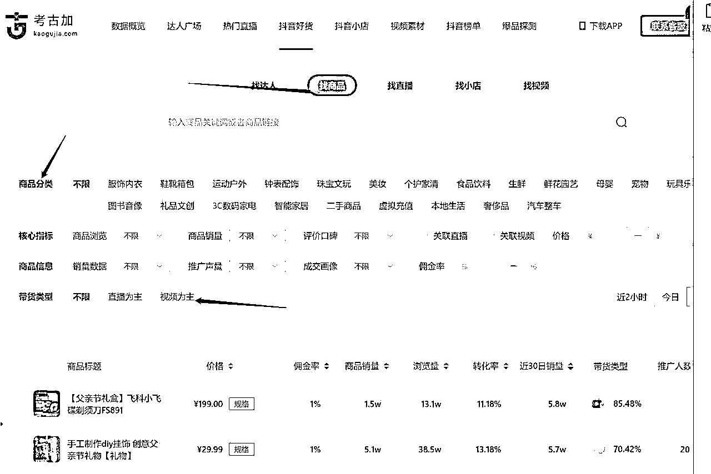
同样按需要选层级。比如图书音像下的细分类目：

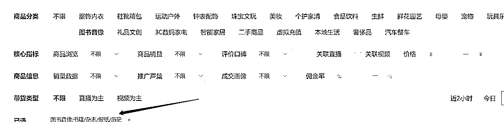
选【图书音像 - 书籍/杂志/报纸 - 历史】，会出现商品：

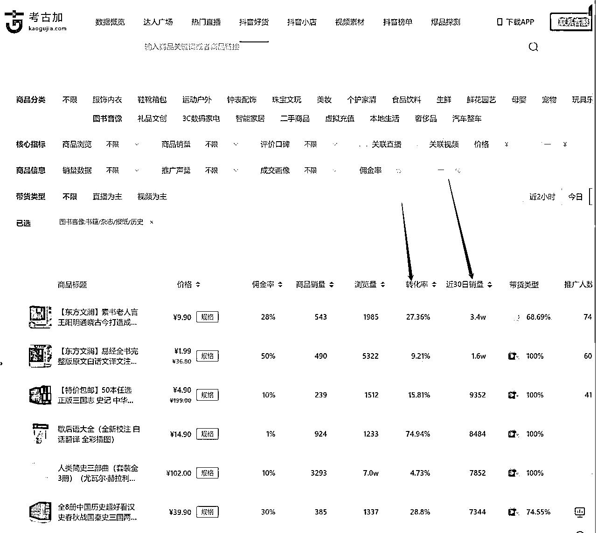
看30日销量和转化率，定位具体产品：

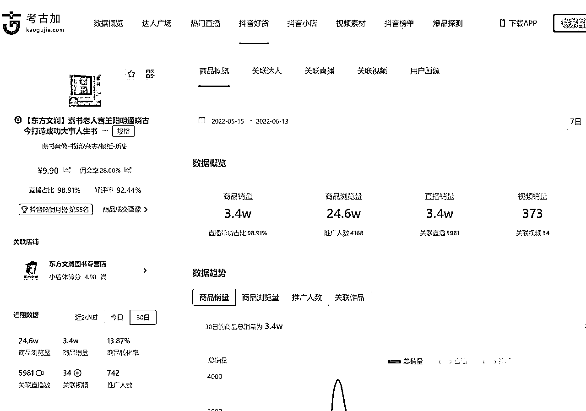
再进详情页看相关视频或达人。这个工具的价值在于帮你联想商品、看基础数据；筛选时还可加价格、成交画像等条件。价格别太低，留利润；画像优先50岁以上，41-50也能看。看中的货用表格记下来，慢慢建自己的货品库。

工具二：巨量算数 https://trendinsight.oceanengine.com/

可看关键词指数、关联分析、人群画像，官网榜单也能查热度。

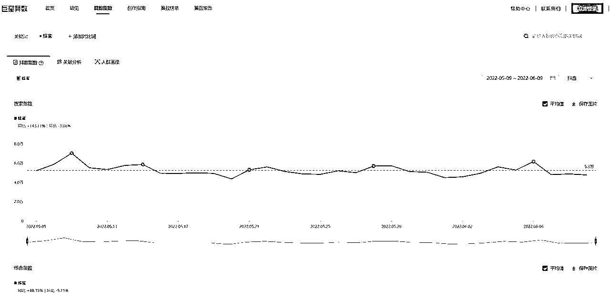
工具三：微信指数（微信内搜“微信指数”）。用蜂蜜举例：

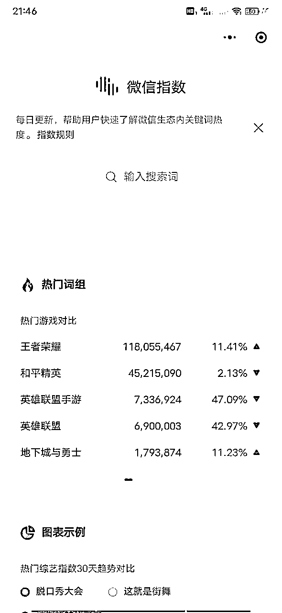
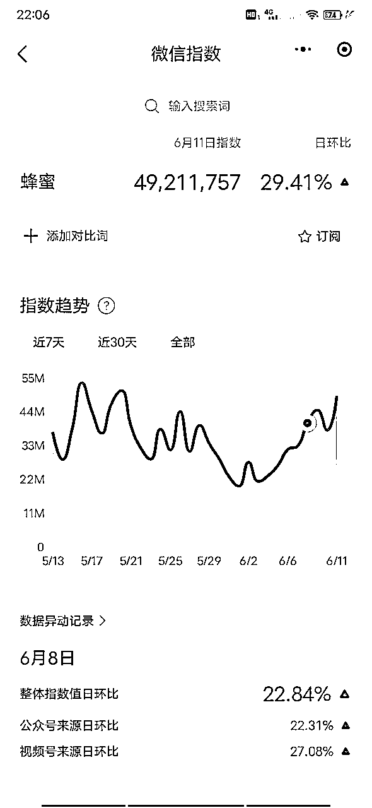
结果页能看到该词在微信体系内的数据。工具不求多，摸透一两个就够。

第二步，主观筛选。年轻人追的潮玩、游戏设备，这里未必有人接，可先排除；自己不喜欢的东西，视情况放弃；父辈的消遣和爱好，可以试。经验可参考，但经验也会错：有人抖音百货做得好，这里没起色；有人年初做绿植，近期在这个平台收益不错；商圈里火锅店扎堆，底料是否也有市场？过往经历都是素材。每天还要刷抖音、快手和视频号，把可卖的货截图备选。跟品很快：有人某款刚起量，三天内就冒出多个同行跟卖。刷一天，初选20个产品并不夸张。

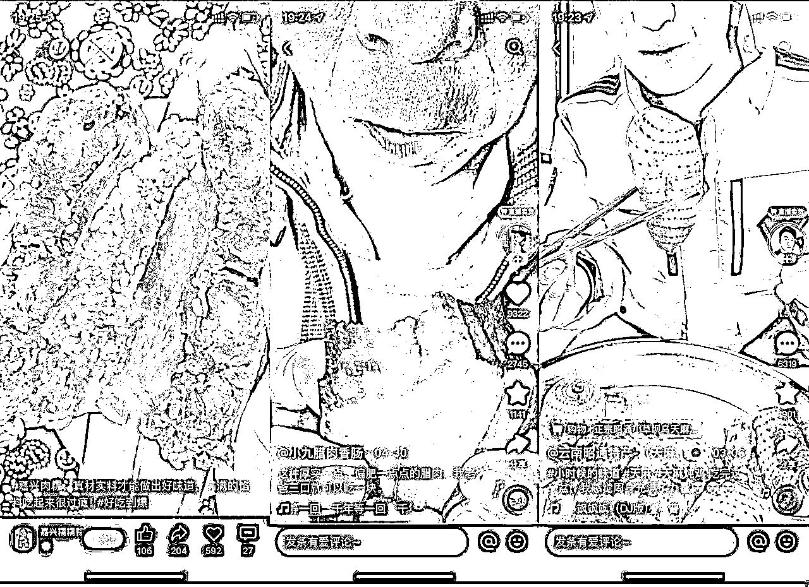
第三步，客观验证。假设选蜂蜜（仅演示），要确认竞争、视频来源、商品来源。

1. 看对手。在号内搜“蜂蜜”，观察是否有人做、竞争强弱、对方视频数据和销量。搜不到结果可能是蓝海；搜到很多账号，点进去看是否真卖货。

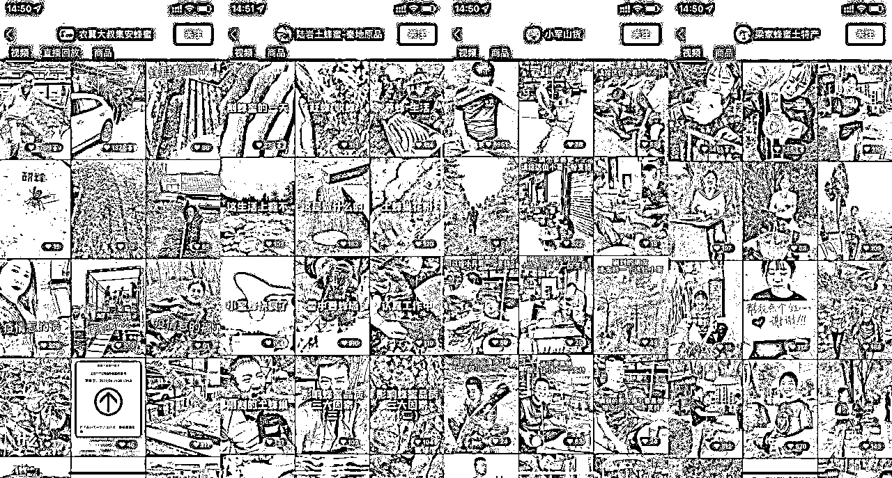
2. 看视频来源。去抖音、快手搜同款，观察单一品类达人多不多、视频数量够不够、点赞和销量如何。素材要贴合本平台调性；同样货，不同视频差距很大。尽量避开真人主体内容，容易触发真人验证。

3. 看商品来源。去PDD、淘宝、1688搜同款，前期有货且利润空间够即可。选品中心没有，也可找朋友帮忙挂小商店。

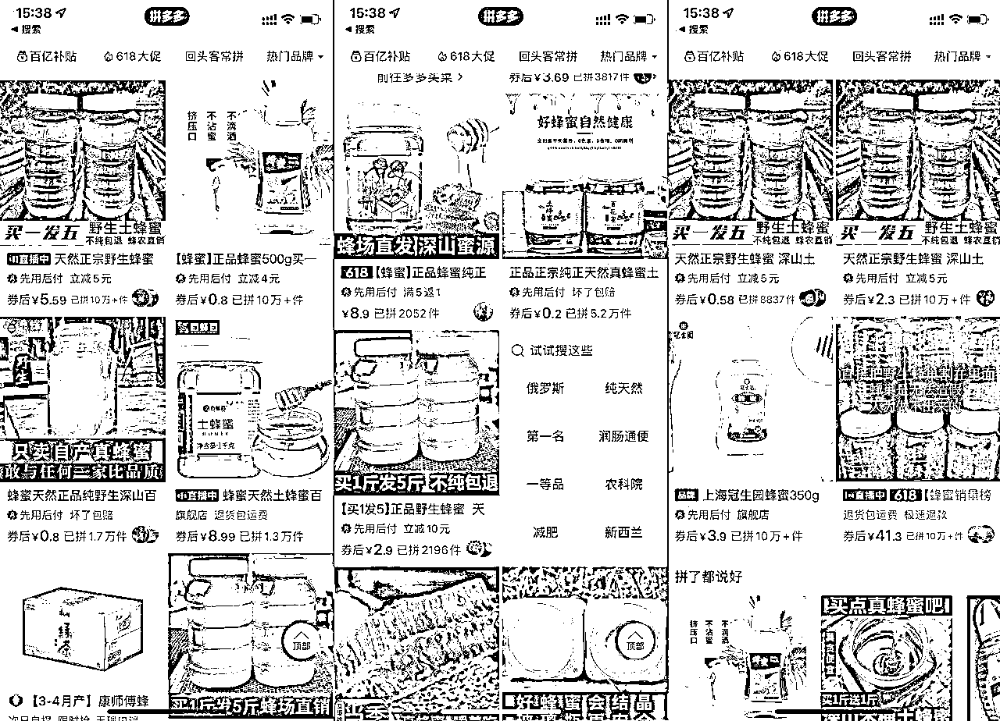
三个条件同时满足，概率就高：号内竞争弱或无同款；抖音快手有质量数量都不错的参考视频；电商平台有货且利润足。挑货是反复选择与验证，努力只是提高概率，没人能保证爆。多练，爆单看时机。

# 2.3.2.3 快速挑货法

嫌流程长，可只用这套“视频号-视频带货”选品法。

步骤1：看直播广场-购物分类。找看着像普通人运营、不是专业MCN/PGC，但场观超过500的直播间。特征：头像封面一致、没有样品展示、环境与货无关、主播互动少。场观过500说明量起来了，可能是系统推荐，也可能短视频引流。

步骤2：看该号短视频。找对标账号里超100赞的爆款，以及它带的货，可能是潜力品。

步骤3：去数据网站验证。看销量、带货达人数，避开红海。常用精选联盟、考古加；考古加更新快、门槛低，精选联盟有粉丝/小店/保证金限制。

步骤4：找模仿对象。选粉丝数百万以下、月销售额10w以上的达人，从他们的视频里找素材；再到号内搜关键词，避免撞车。

圈友@李诚的选品表可参考：

👉李诚 Sonic - 视频号选品表

走完这些，挑货和视频素材方向基本都有了。

# 2.3.3 避坑

平台规则变得快，上周能卖的品，这周可能就封号。几条红线：中医、医药相关不上；不要搬运剪辑他人大范围露脸内容，容易触发真人验证；选品中心没有的货，可对接做后端店铺的圈友合作。

# 2.3.4 案例：图书与百货

百货案例：

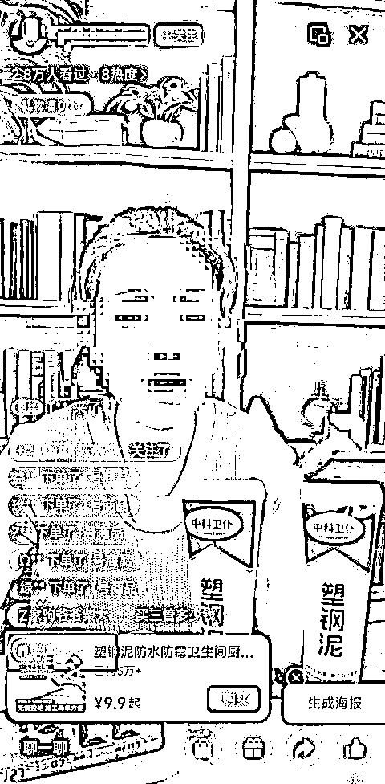
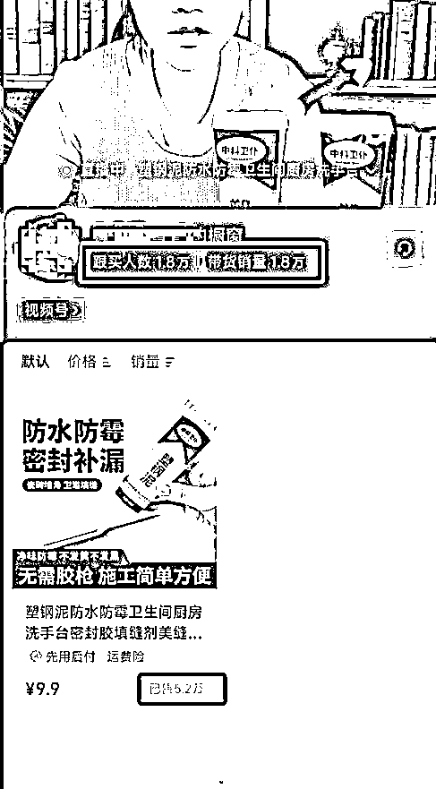
塑钢泥：达人账号，直播分享产品、低价高成交。9.9元塑钢泥单场6682单，场观2.8万，橱窗总销量1.8w；视频展示使用场景，直播讲解并引导下单。注：单场销量为截图时订单数，非整场完整数据。

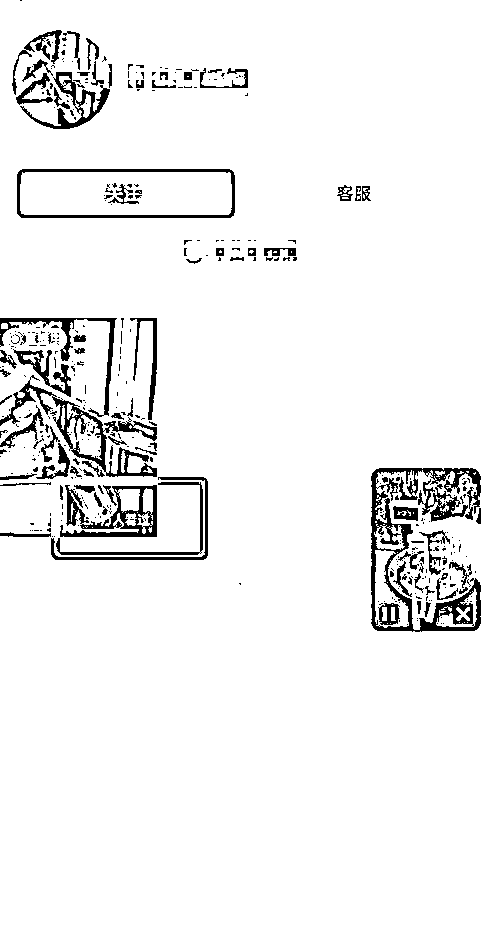
不锈钢勺子：店铺账号，直播分享产品、低价高成交。单场1879单，场观5.8万。

**4.5 元起的钢制餐勺，一场直播成交 1879 单，新号也能起量**

先看一个低客单样本：最低 4.5 元的餐勺（不锈钢材质），在一场直播里卖出 1879 单；截屏时订单数还在往上走。这个号刚开，直播时主播把餐勺拿到镜头前展示，边口播边带观众拍下。主推商品就是这把餐勺。主页商品橱窗的累计成交暂未形成规模，属于新店阶段。观察结论：镜头里产品呈现清楚，直播间累计观看 5.8 万人次，该单品成交 1879 单，展示加口播对转化帮助明显。口径说明：上述数字是截屏那一刻的订单量，不是整场结束后的最终数据。

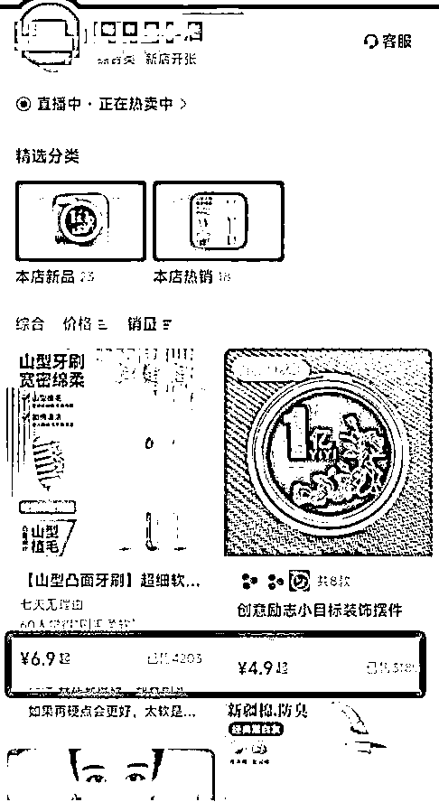

**4.9 元创意硬币：新号一场直播 3046 单**

第二个样本是达人开播号。主推 4.9 元创意硬币，一场直播成交 3046 单，截屏后订单仍在增长；直播间累计观看 1.7 万人次，账号也是刚起步的新号。出单方式不是只靠口播：先用实景短片演出使用情境，再在直播间介绍产品并推动观众下单。内容上，剧情短片展示硬币怎么用，直播完成成交。主页橱窗累计同样处于新号阶段。观察结论：低客单加实景短片加主播介绍，形成“看得懂、买得轻”的转化链路，属于靠低价冲量。口径说明：3046 是截屏时订单数，不代表整场完整成交。

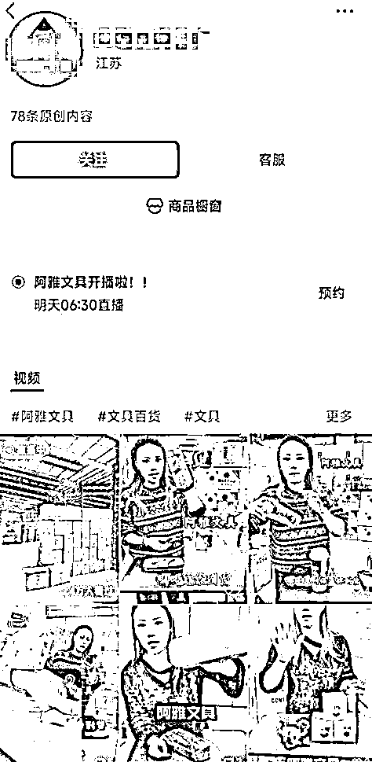
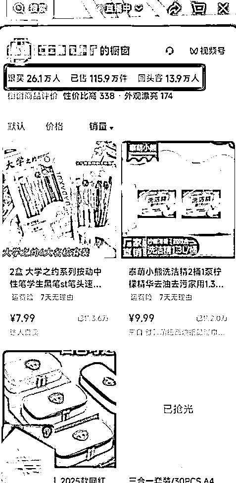

**9.99 元修正带仓播：单场 79 单，账号橱窗累计 115 万单**

第三个样本做的是文具仓播。9.99 元全自动修正带，一场卖出 79 单，直播间累计观看 2.3 万人次；账号主页商品橱窗累计成交已达 115 万单。这个号由达人开播，出单由直播加短片共同完成：短片演示使用情境，直播间里主播介绍多款产品并带观众拍下。主推商品是 9.99 元全自动修正带，采用多产品仓播形式，截屏时销量仍在增加。观察结论：实景短片配合仓库式直播展示，主播讲解清晰，靠低客单走量；账号总成交 115 万单。口径说明：79 单为截屏时订单量，不是整场最终数据。

**图书选品思路与参考账号 @夏俊虎**

做图书单品直播，不必一开始铺太多品。先挑几套主推书，前期买几套样品就能开播。另一个办法是刷广场跟品：看到已经跑起来的直播间，直接跟进同款。下方文档放了推荐书单与直播话术，包含“单品图书选品推荐 包含直播话术”。可参考的账号如下：真人出镜类直播间，先看账号一（2 号书仓清库中）。

**真人出镜多品直播样本一：13 天橱窗 2986 单**

这是一个达人号。直播间先用 deepseek 低价书拉停留、做成交数据，再把粉丝带到小黄车买正价品。出单方式是直播展示加主播口播，没有短视频。主推综合类图书。主页商品橱窗在 13 天里累计 2986 单。观察结论：场景布置不复杂，背景是一块实景画布；账号近期刚起，适合拿来做参考样本。口径说明：2986 为 5 月 22 日截屏时订单数。真人出镜类直播间，另可参考账号二（华北供应仓）。

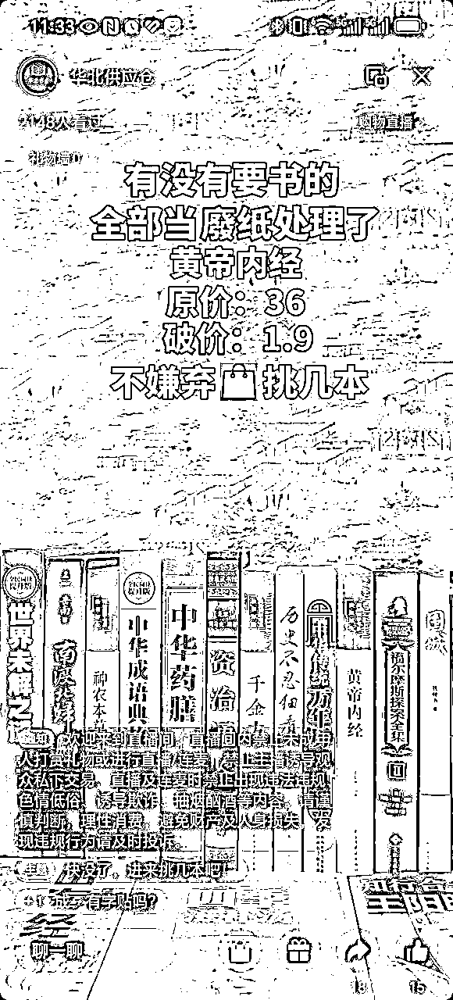
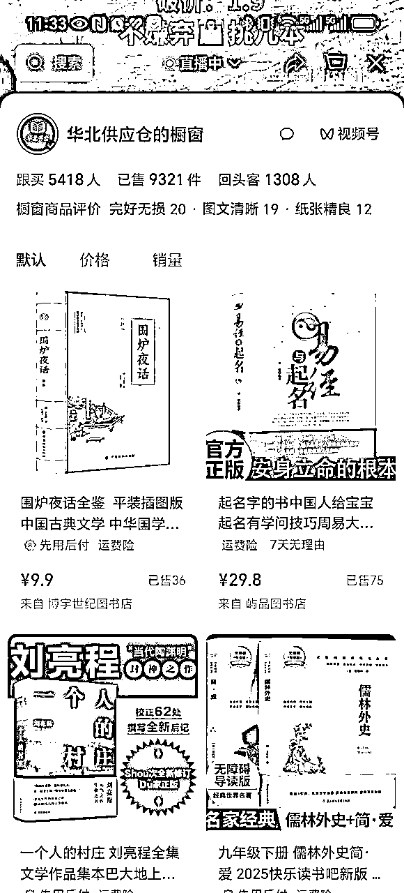
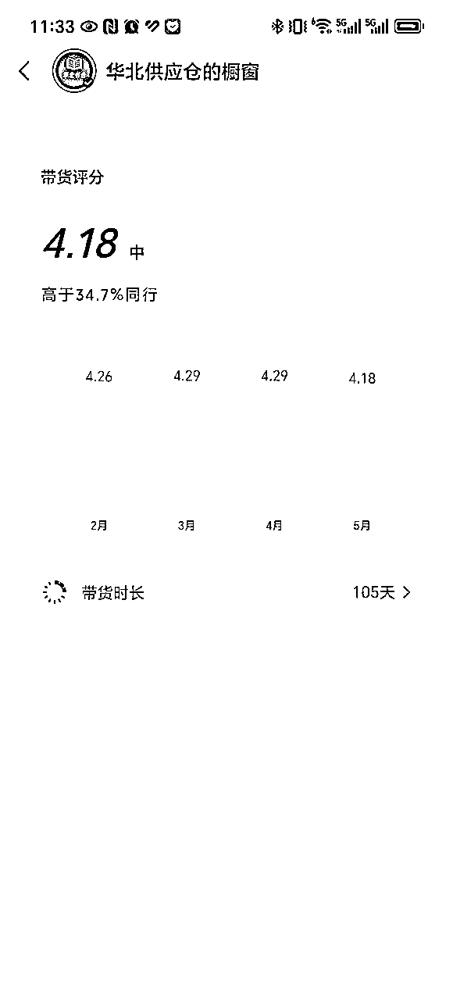

**真人出镜多品直播样本二：三个多月橱窗 9321 单**

同样是达人号。直播间把“黄帝内经”低价书做成醒目噱头文字，用低价品留人、做成交数据，再引导观众去小黄车买正价品。出单方式为直播展示加口播，没有发布短视频。主推综合类图书。主页商品橱窗累计 9321 单，用了三个多月。观察结论：布景依旧简单，背景为实景画布；新起号可作对标。口径说明：数字为 5 月 22 日截屏时订单量。手播类直播间，参考账号一（知往读书）。

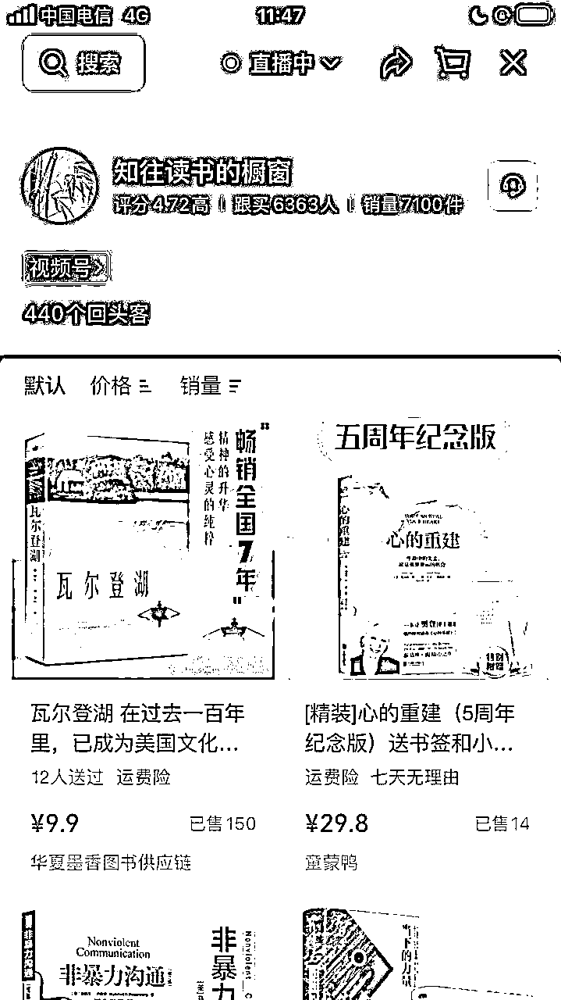

**手播单品样本一：139 天橱窗 7100 单**

这是达人号。直播间用《中国历史很好看》原价 228 元与破价优惠做钩子，吸引观众下单。出单靠直播展示加主播口播，没有发布短视频。主推单品类图书。主页商品橱窗累计 7100 单，用时 139 天。观察结论：场景不复杂，几本精装书摆成背景即可；账号近期新起，值得参考。口径说明：7100 为 5 月 22 日截屏时订单数。手播类直播间，参考账号二（阿咚的书房）。

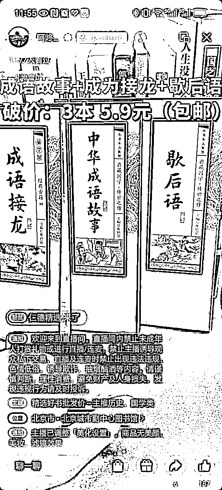
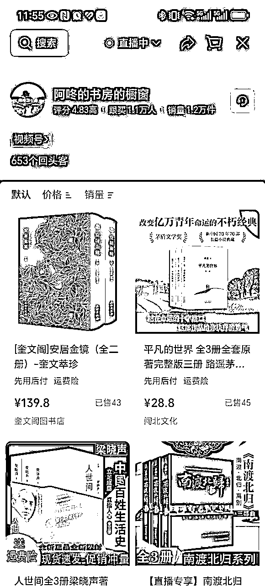

**手播单品样本二：一年多 10 天橱窗 1.2 万单**

这个达人号的直播间用低价品做钩子：三本书 5.9 元包邮，直接推动观众下单。这类低价书一单佣金约 1 元，一场直播卖得顺时也能出几百单。出单方式为直播展示加口播，没有短视频。主推单品类图书。主页商品橱窗累计 1.2 万单，用时一年零 10 天。观察结论：布景简单，几本精装书即可；账号近期活跃，成交可观，可作参考。口径说明：1.2 万单为 5 月 22 日截屏时订单数。

# 三、【实操 2/3】爆款视频怎么做、怎么发

# 💡

# 本节要点

选品是地基，但视频能不能让人看完并下单，还取决于流量与转化。想多出单，要么把流量做大，要么把转化率抬高；这两件事都指向同一个动作——做出能爆的内容。

这一节重点讲：如何找到可借鉴的爆款视频。建议按六步推进：

✅ 第一步：筛出值得参考的爆款片
✅ 第二步：拆开它，模仿着学
✅ 第三步：按爆款逻辑搭自己的视频骨架
✅ 第四步：剪出来，二创或原创都行
✅ 第五步：发布
✅ 第六步：把评论、私信、打招呼消息及时回掉

下面进入视频制作环节。

# 💡

# 行动路线

完成 3.1 的学习与实操后，就能推进到航线图第二阶段：借助 AI 做出爆款视频并发布，预计 5—7 天。拆开看：

1、锁定至少 1 个参考账号，约 1 小时；
2、找到至少 2 条参考爆款视频或直播间，拆模板、拆话术，约 1 小时；
3、按所选类目建视频或直播素材池，约 3—5 小时；
4、熟悉 AI 辅助工具，约 2—3 小时；
5、仿照参考爆款做二创剪辑，发 1 条视频或做 1 场直播，约 1 小时；
6、练批量混剪，提升产出质量与速度，约 3 小时。

# 3.1 锁定参考账号

# 3.1.1 什么账号值得参考

做视频号带货，筛参考账号可以看三类条件：

第一，账号是否长期只做一个品类。领域里有没有这样的号，关系到我们能不能拿到可下载的片源；同类号多不多，决定我们能不能挑出更优样本。

第二，这个达人的视频量够不够。片子多，能参考的周期才长；只有 10 条，显然不够用。

第三，看点赞与成交表现，研究对方在抖音上的打法。

还要避开一个坑：二创、混剪尽量别碰真人露脸内容，容易遭作者投诉，轻则下架，重则封号。

# 3.1.2 参考账号怎么找

# 路径一：跨平台搜号

做法很直接：去短视频平台搜你想做的账号类型，抖音、快手、小红书都可以。比如做家清个护，就在这些平台搜【洗衣液】【家用】等词，找同类号。搜到后先关注，后面系统会继续推相似账号。视频号这边要反过来操作：别关注自己的其他视频号，因为本人微信的视频号无法取关；也别关注你要对标的视频号，你关注的号会分发给微信好友。

# 路径二：从选品反查账号

以食品饮料为例，用考古加可以这样找：打开考古加，进商品页，点视频热推榜，类目选食品饮料，再挑产品，最后查看关联的带货视频。具体见下图：

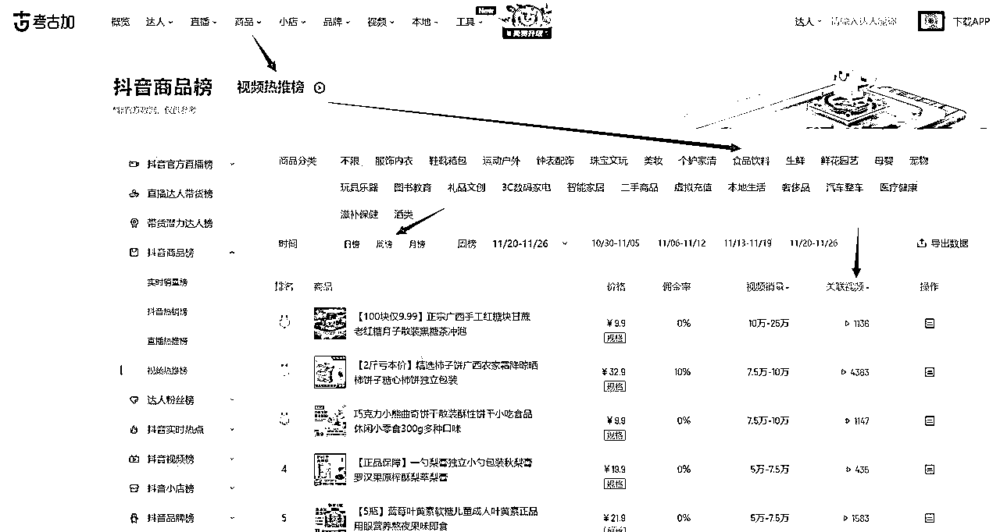

图里的“达人”栏，就是可参考的账号入口。

# 3.2 做出能爆的内容

# 3.2.1 爆款短视频的思考框架 @李诚

1、热点意识：平台会给热点内容流量倾斜，用户也爱看。不知道怎么追，就盯抖音热榜，什么热跟什么。

2、爆点密度：爆点是让片子起量的元素。一个视频里爆点越密，火的概率越高。

3、开篇三秒：前三秒必须抓人；抓不住，用户很难看完。三秒之后故事要能留人，最后几秒把情绪推起来，促使用户转发、评论。

4、爆款自评表：新手没把握时，可以按表格给自己的片子打分。分数越高，通常爆的概率越大。

# 3.2.2 找到可参考的爆款片

做视频的第一步，是先找到别人已经跑通、值得学的片子。两条路：

# 3.2.2.1 路径一：借其他平台的热片

抖音火过的内容，搬到视频号可能再火，也可能没水花，平台调性不同。可以用两个角度练判断力。

角度 1：看数据。1、在抖音搜关键词，时间选一天内或一周内，按点赞排序；2、用【抖查查】（www.douchacha.com）的视频飙升工具，点赞量看 5—10w 或 10—50w 即可，不必盯 200w+ 的片子。

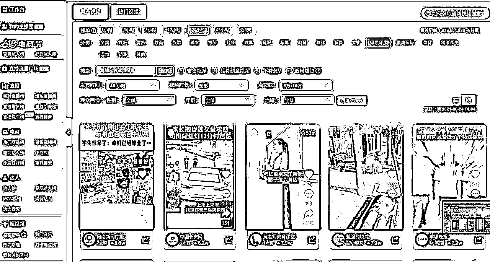

角度 2：看调性。去【新视】（https://xs.newrank.cn），把你所在类目 15 天内的上榜视频过一遍，找视频号用户偏好的感觉。

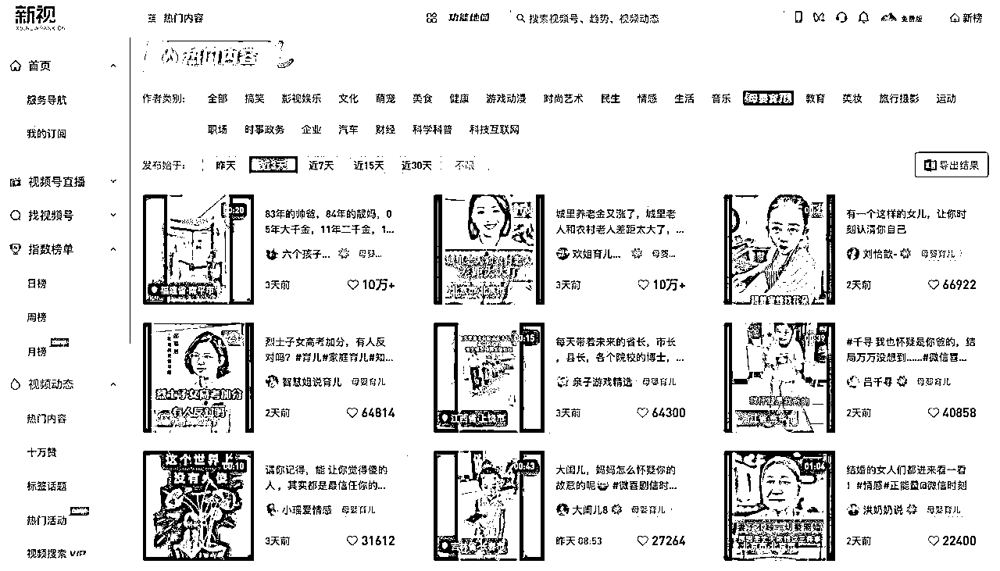

内容来源：《微信视频号变现，单条视频佣金 25000+，5 条视频涨粉 15w》

# 3.2.2.2 路径二：研究视频号里的强同行

1、用数据网站找。以友望数据为例（友望数据：http://www.youwant.cn/）：进入友望数据，点视频号查找，进视频号排行榜，再选行业分类，找到自己的领域。

2、在视频号里直接找。自然刷：刷同领域内容，看完并点赞，系统之后会持续推同类视频，这样能攒一批同行号。搜索：懂搜索会更省力。每个垂直领域都有词，比如商业认知类，可以搜商业、认知、思维、格局、励志、职场、马云、马化腾等，能搜出一批目标视频和同行号。

注意一个大坑：优先找近期短时间涨粉快的小 v，别一上来就学大 v。大 v 往往做了很久，甚至有成熟团队，起号时的平台规则与现在不同；他们起步播放已在万级，不是 0 粉阶段，参考价值有限。上来就学大 v，过一阵容易怀疑人生。要学垂直领域里短时间涨粉快的小 v，这种样本才有价值。

内容来源：《视频带货月收入 10w+，分享从获取流量—制作爆款视频—带货变现的完整过程》

# 3.2.2.3 保存参考爆款素材

找到参考片后，把素材存下来，后面剪辑要用。

✍️批量下载工具：

（付费）多平台批量下载：哼哼猫，每天有免费额度，批量下载强，支持平台多；
（付费）多平台采集：可采指定作者视频；
（免费）单个抖音采集：抖音图文无水印下载；
视频号采集工具及教程：视频号下载工具【免费/无损下载】；
（免费）抖音直播录制：批量采集抖音工具，密码：2nkd；
录屏：万彩办公大师、FastStoneCapturecn。

内容来源：《8 月初阶视频号航海实战手册》

# 3.2.3 拆片方法 @李诚

选题与用户思考：

人性共振：打情感共鸣，如孤独、焦虑、怕生病；打利益驱动，如省钱；也可利用猎奇、反差。

热点嫁接：结合平台实时热词，如“旅游旺季攻略”，用工具分析评论高频词，提炼痛点。

结构拆解：

四段式：0—3 秒高潮前置，如“户外钓鱼最值得买 5 个必备好物”，或用金句开场；3—15 秒快速戳痛点，如“洗碗海绵细菌超马桶”；核心内容可用平行结构，多角度展示产品，也可用递进结构，让情绪逐步升温；结尾引导互动，点赞、评论，或引导进直播间完成转化。

爆点元素：看选题方向、脚本结构、画面节奏（转场、特效）、配乐情绪、文案话术。比如母婴类在 0:15 秒加入婴儿哭声，增强共情。

# 3.2.4 仿做并建立素材池

以我自己的素材池为例：【场景演示】【使用效果】按实际情况仿拍替换即可。

第一步：定目标和主题。开始搭池子前，先明确类目与产品，针对性地选素材源，提升实用性。

第二步：分类整理。按类型、场景、风格归档，用文件夹、标签方便查找。具体操作：先按画面素材搜集，想清楚需要什么画面、背景、场合、物品、行为；再把素材切成小段，建议 3—5 秒一段，每个画面多备几段；切好的片段放进专用文件夹，前期费点劲，后面能长期复用；找完视频后做爆点拆分，分为 A（前 3 秒：痛点、话题、提问等）+B（产品介绍、卖点、解决问题）+C（引导转化），再测试、迭代。

第三步：收集高质量素材。尽量用高清图片、视频片段，观感更好，也更吸引观众。部分产品和素材可从商品评价里找。素材可在 pdd、淘宝多搜一些素材库。

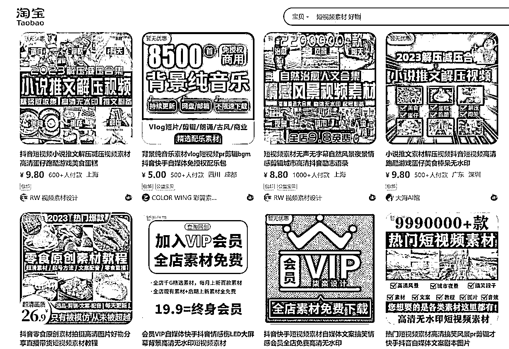

第四步：持续更新。定期往池子里加新素材，保持新鲜度。每天看同行同品爆款，有合适的就下载、拆分、入库。

# 3.2.5 剪辑基础与原创处理

视频处理建议：混剪、二创、原创，别直接搬运。短期靠更精细的混剪规避审核；想长期稳定收益，原创更受鼓励，也更该走。剪辑时，把产品展示、书籍展示、部分画面或背景换成自己实拍的素材，用来通过平台的原创审核。比如脚本结构是：黄金开场+产品介绍+使用展示+同行对比+优惠活动+引导购买。其中“产品展示”可用自拍素材，或其他平台的好评图、好评视频替换。二创流程可概括为：拆解爆款素材—批量混搭组合或套模板—视频去重。

第一步：拆解爆款素材。前面【3.2.2】讲了怎么找参考爆款。找到后拆分素材，放入不同素材池，如下图。

第二步：批量混搭或套模板。软件：剪映（电脑端）。素材混搭：分析参考片片段，按不同片段排列组合，填入新素材。示例：开头 1+效果 1+拆包 1+场景 1+场景 2；开头 1+效果 2+拆包 3+场景 5+场景 1；开头 X+效果 X+拆包 X+场景 X+场景 X……以此类推。

第三步：去重，增加特效、画中画、配乐等。方法 1：1 个视频画中画+1 个图片画中画+4 个贴图素材+2 段音频+重新编辑的标题等，完成二次剪辑去重。

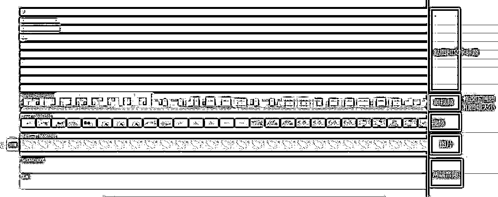

方法 2：原视频位置放背景图，素材置于背景图之上，加画中画+边框+贴图+音频等，完成二次剪辑去重。

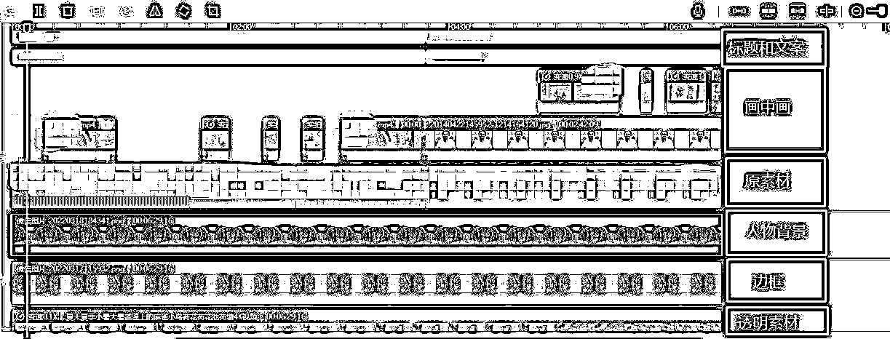

内容来源：《8 月初阶视频号航海实战手册》

模板做好后，后面做片效率会高很多。除了这个办法，圈友 @figo 还分享了批量去重、批量制作内容的思路。这里摘录一部分，完整内容见《如何剪辑视频和制作剪辑模板》。

1、用 CRVideoMate 软件做基础混剪，参数如下（可自定义）：

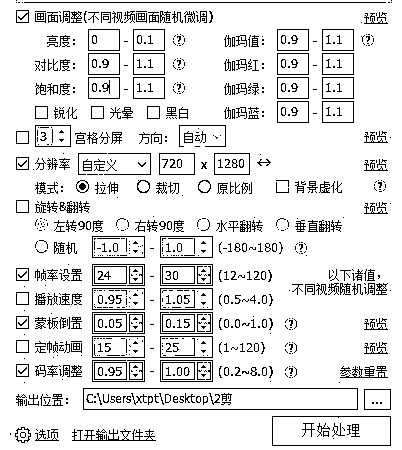

2、做水印 PNG 图片，使用软件自带的水印功能：

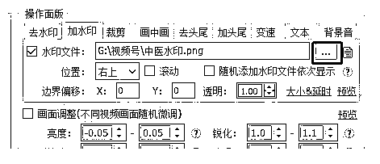

↓添加水印效果如下↓

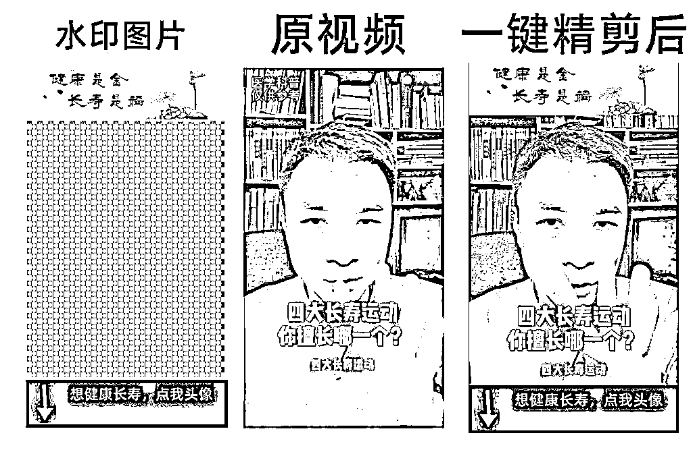

3、直接加水印会挡住原视频重要位置，可以压缩原视频高度，参数如下：

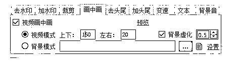

小提醒：这里说的“上下数值”，本质上是给水印预留的高度，它不能低于水印图形本身的尺寸，否则水印会压住画面内容。我填的是150，大家按自己的素材调大调小都可以。

处理完的成片效果见下方↓

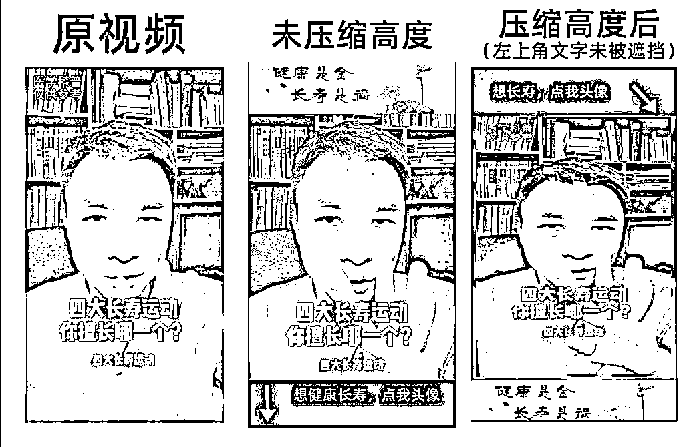

另外，这款工具能建多套水印，做到一类商品配一套图案；参数也能导出，方便对应不同剪辑场景。

CRVideoMate 软件下载地址：http://www.cr-soft.net/crvideomate.html

粗剪、精剪具体怎么操作，可参考文档：《如何剪辑视频和制作剪辑模板》

内容参考自：《利用批量剪辑软件 CRVideoMate，一键完成视频号精剪去重，可带个性化图案》

第四步：补入原创画面

这一块展开讲篇幅不小，感兴趣的朋友可以去翻3月航海|视频号直播（中老年）手册：

https://scys.com/view/docx/QlaudsihZobcABxvDoGcHXSnnWf#RL4DdEAquoo7TexTRH5ctCRxnVb

# 3.2.6 案例：百货类短视频带货方法 @李诚

百货类视频模板可以围绕这8个要点来搭：

1. 开场就得抓眼球：用新奇、有趣、能勾住人的方式起头，快速把注意力拉过来，让观众产生兴趣和好奇，愿意接着看。可以结合产品相关热门话题、小故事，或者一个出人意料的事实。也推荐用创意剧情、特效、实验等独特手法呈现产品，让短视频更有辨识度。比如用夸张实验展示清洁用品去污力强。

2. 多角度呈现产品：这是核心部分，要全面展示外观、细节、材质。比如保温杯，先看整体，再看杯盖、杯身细节，打开看内部，让观众建立清晰的视觉印象。

3. 把产品放进生活场景：让消费者直观感受产品在日常中的使用和价值，激发购买欲。如便携榨汁杯，拍清晨起床后、户外野餐等使用画面。

4. 讲清操作步骤：详细介绍使用方法和操作流程，确保观众明白怎么用。复杂产品可分步演示，便于掌握。如智能扫地机器人，要讲如何开机、设置清扫模式、连接手机APP等。

5. 亮出独特卖点：突出品质好、功能强、设计独特、性价比高等优势，与同类形成差异。可用对比、实验直观展现。如自家保温杯和其他品牌做保温测试，突出保温更好。

6. 借用户口碑加分：适当展示好评截图或视频片段，增加可信度和说服力，让观众更相信质量和效果。

7. 说清优惠活动：明确告知当前折扣、满减、赠品等，刺激购买欲，促使尽快下单。

8. 配好音乐与字幕：选适合产品风格和视频氛围的背景音乐，增强吸引力和感染力；同时加清晰准确的字幕，帮助理解，重要产品信息和促销信息用字幕突出，让观众更容易注意。

百货类脚本可以套用这三种结构：

问题解决型

开头（0-5秒）：先点出一个生活里常遇到的麻烦，比如“厨房油污每次打扫都费劲，你是不是也头疼？”，迅速勾起共鸣。

中间（5-30秒）：带出要推荐的商品，先看外观和特点，再讲它怎么解决前面那个麻烦；可以用实拍操作或小实验展示效果，比如拿清洁用品一擦，油污很快没了。

结尾（30-45秒）：收束产品优势，强调它能切实解决问题、让生活更省心，比如“有了它，厨房清洁轻松不少，日子也更舒服。”

短视频带货课件 - 豆包 (12).mp4【在线播放】

场景融入型

开头（0-5秒）：先给一个和产品有关的生活画面，比如温馨卧室里有人正准备睡觉。

中间（5-30秒）：顺势带出商品，比如床头柜上的香薰机，打开后有柔和灯光和舒服的香味。接着讲功能、材质，以及它怎样让这个场景更有氛围、更舒适，比如“它既能散发香气，又能加湿，睡眠环境会更舒服。”

结尾（30-45秒）：再回到使用画面，人在香薰机营造的氛围里安心入睡，画面温暖。然后总结产品带来的好体验，引导下单，比如“想要夜晚更惬意、睡得更香，可以试试它。”

管道疏通剂10w_x264_x264.mp4【在线播放】

对比型

开头（0-5秒）：先摆出两个相近产品，或者同一产品用前用后的差别，比如普通拖把和新型拖把，或者普通拖把拖完还有污渍、新型拖把拖完地面干净发亮。

中间（5-30秒）：细说两者差别，把要推荐的商品优势讲透，比如新型拖把设计特别、更省力、清洁更彻底；可以现场对比，分别拖一遍，展示它更轻松也更干净。

结尾（30-45秒）：总结对比，强调划算和实用，比如“对比下来，这款新型拖把更省力、清洁也更干净，家里打扫可以优先考虑。”然后引导购买。

短视频带货课件 - 豆包.mp4【在线播放】

# 3.3 数字人视频：借AI省力做带货

如果你对数字人视频感兴趣，25年6月航海【AI数字人口播IP】手册里讲得更详细，可以去补充学习。

眼下数字人是一种省力工具：借助它产出带货视频，再通过挂车、橱窗或直播完成变现。

它主要解决两个痛点：

1. 主播表现力。很多人天生不擅长镜头表达，短时间也练不出来，但用数字人照样能做口播带货。

2. 内容产出效率。你可以用公共模型数字人，也可以录制自己的数字分身，持续批量生成带货视频，靠数量冲结果，不用一次次重拍口播，省下大量时间精力。

会一点基础剪辑就能操作。

# 3.3.1 挑一个合适的数字人

工具可以从前面章节里挑，具体看【2.1.4 数字人制作工具】。推荐“蝉镜”或“即创”，这两个生成效果比较稳；尽量选自己的形象，能避开侵权风险。

工具定下来后，再说数字人模型怎么选：

这个方向参与者不少，模型选得对不对很关键。比如老年数字人数量少，用的人反而可能扎堆；平台排在前面的模型用的人也多，原创审核更容易卡住。如果非要用，就得多做去重处理（只有过了原创，才能一拖五发布、一鱼多吃）。

数字人的气质最好和商品调性搭得上。比如养生类产品配一个18岁帅哥就不太对味；当然也可以故意做反差，最终看数据反馈。

某个数字人视频跑火后，尽量继续用同一形象拍。在即创平台搜姓氏就能找到，保持同一张脸很关键；比如即创里刘思远和刘天豪其实是同一个人。就像你在短视频平台对某个人产生兴趣后，不管大号、小号还是切片号，平台都会给你推他的内容，观众认的就是这张脸。

直接拿素材群原素材里的人脸，爆款概率更高，但原创审核更容易不过，需要多轮去重；风险和收益是绑在一起的。

# 3.3.2 数字人视频怎么做

常见做法有三条路：

形式一：自己的形象配自己的声音。适合镜头表现不错但时间紧的人，用数字人提升效率。

形式二：平台数字人形象配音（简单快捷）。如果不方便出镜，或者镜头表现确实弱，可以直接用平台里表现力好的数字人形象。

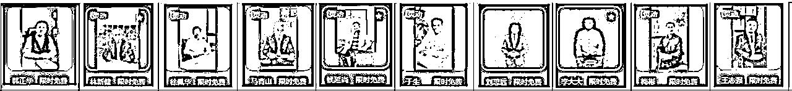

形式三：自己的形象配爆款声音。服化道和镜头表现相对好练，声音却要大量练习；做个人IP也更适合用本人形象。好处是声音可以随时换。

下面分别说怎么落地。

# 3.3.2.1 形式一：本人形象+本人声音

① 准备文案

新手：直接用群里的爆款文案，或者把刷到的爆款素材文案提取出来。

有经验、想长期做IP的人：把找到的爆款文案结合自己的IP和人设做简单调整。

先把文案读熟：拍之前至少过几遍，自己快速默读一次。凡是容易卡顿的错别字、拗口处都要改。比如“里面记载着人体的脉象和八卦阴阳五行河图洛书之间的关系”，可以改成“里面记载着脉象和阴阳五行之间的关系”。一定要熟，不然拍出来读稿感特别重。

② 准备提词器

用提词器就不必背稿。推荐剪映、度加剪辑。

③ 灯光安排

除非内容需要特殊氛围（比如悬疑、恐怖感），口播画面要亮一些，尤其脸部。整体色调可以调，但人脸必须明亮。房间采光好就白天拍，最自然；采光差或阴雨天、晚上，建议加一盏补光灯。

背景方面：衣服和背景颜色要拉开，方便后期抠像。比如白色厨师服别在白墙前录，不然抠像边缘会不自然。原则是深色衣服配浅色背景，浅色衣服配深色背景。

④ 拍摄设置

正面机位：人物大约占画面三分之二，可用九宫格辅助线定位。上半身露出三分之二到二分之一比较合适；太远脸小看不清，太近脸大，容易把看稿等不自然动作放大。镜头平拍。仰拍容易显得盛气凌人，口播时身体前倾还会有压迫感，普通文案慎用；俯拍画面又很怪。

人物左右居中、正对镜头，像面对面聊天，更容易传递情绪。侧身机位：身体侧转10到30度比较合适，类似访谈角度，适合情感、知识、干货类讲解，也是目前数字人录制常用的机位。（见下图）

侧身的好处：对表现力要求低一些，一直看稿或看电脑的动作没那么明显，适合刚入门的人。缺点是少了和观众的眼神交流，对话感会弱一点。

提升表现力的小方法：

1. 记得微笑。微笑最能拉近距离，拍摄时保持微笑，会显得更有亲和力。

2. 头部和眼神。千万别让人看出在读稿，一旦像读稿，观众对你的信任感马上就散了。明显的读稿痕迹包括：头完全不动、眼睛长时间盯一处、眼珠左右转（明显在看提词器）。改进方法：头部轻轻晃动，能弱化一直盯提词器的僵硬感，也更自然；眼神偶尔看向提词器后方或旁边，前提是稿子够熟，偶尔一两句脱稿没问题；还可以在提词器后面放个物件，把它想象成观众。

3. 手势。手一直保持同一个姿势会显得很僵。改进方法：手里拿个道具；准备两三套自己最顺手的动作（比如双手摊开、轻轻摇晃），隔几秒换一个，刻意练一练。

朗读方面的技巧：

1. 情绪比平时说话再足一点。日常聊天的语气上镜会显得低沉，读文案时把感情放出来。注意别像念课文或诗歌。

2. 一句里要有轻重。有人觉得自己说话太平，可以试试每句话刻意区分轻读和重读。比如“我才敢说出五星级大厨永远都不会告诉你的6大秘密”“第一不能放生抽，放了生抽以后会让韭菜变色，影响食欲”。

3. 一句里要有停顿。如果一口气不停，感情也很难出来。比如“我才敢说出 五星级大厨永远都不会告诉你的6大秘密”“第一 不能放生抽，放了生抽以后 会让韭菜变色，影响食欲”。

4. 分段录。说错词别慌，停一下，把这一句完整重说一遍，后期剪掉错的就行。为了避免剪辑太费时间，长文案建议分段录制。

⑤ 正式录制

AI数字人要靠真人口播片段做驱动素材，所以想让数字人效果更真实自然，就得按真人出镜口播的标准来录。

录制要点：画面比例尽量照着对标账号的人物角度一比一还原；每个账号拍1到3条，方便不同场景使用；单条时长控制在30秒到1分钟左右；内容可以自由发挥、自我介绍，或者背几段古诗，重点是表达清楚、自然、有感情。

特别提醒：现在视频号发数字人视频，有一定概率触发真人出镜或AI数字人验证。为了避免账号验证不过被废，强烈建议用真人口播素材来做数字人视频。

上传到蝉镜数字人平台

PC端网址：https://www.chanjing.cc/?invite_code=tWb6n

第一步：进主页，点“数字人像-创建我的数字人”，上传真人口播视频，再按脚本要求上传真人授权视频，完成创建。注意，蝉镜免费账号目前只能定制1个数字人形象；不满意可以删了重做。想拥有多个形象，可以注册多个账号分别克隆，或者开会员。

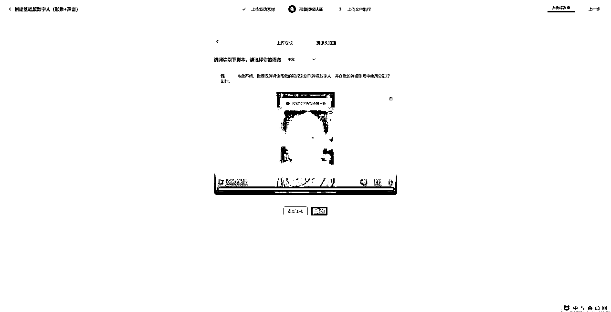

第二步：点开建好的数字人，选文本驱动或上传音频驱动。若选文本驱动，可先挑公共AI音色，输入文案，试听语音，满意后生成数字人视频。再回主页，在“我的视频”里找到生成结果并下载。

# 3.3.2.2 形式二：数字人形象+声音（新手推荐）

操作演示：

蝉镜平台：

11月15日.mp4【在线播放】

即创平台：

11.14数字人生成.mp4【在线播放】

# 3.3.2.3 形式三：本人形象+爆款声音

第一步：按前面章节的方法克隆自己的形象，建议用蝉镜。

第二步：直接用现成语音库生成爆款声音。这类工具不少，PC端可以用剪映自带音色。

蝉镜里也有不少AI音色：

还可以用小程序：配音神器

网页端还有腾讯智影：

第三步：做数字人视频。制作时选上传音频，把音频传上去，生成的口型会自动对齐。

克隆视频号里的爆款声音：

视频号里长期跑出大爆款的口播作者，声音条件往往很好；他们的内容已经验证过，受视频号用户认可，可以直接克隆声音来用。

第一步：按前面章节克隆自己的形象，建议用蝉镜（前期成本低）。

第二步：处理原始声音。把爆款声音下载下来，用剪映降噪、美化，再导出备用。

第三步：克隆声音。

方法一：用飞影，可单独克隆音色。缺点是要付费。先克隆声音，上传找到的爆款语音。

克隆好后，去创作音频。

制作视频。

注意：第二行要缩到上一行，别留空格，不然会出现咯噔噪音。

方法二：用免费语音工具，推荐fish audio：

https://fish.audio/zh-CN/text-to-speech/

优点是还原度较高、免费；缺点是一次只能生成约170字、30秒左右，长文案要分多次。里面有很多现成真人音色可用。

使用前先注册，国内邮箱即可。点左上角构建声音，命名，上传音频，点创建。

点语音合成，导入文本，用自己克隆的音色生成，生成后下载。

第四步：做数字人。制作时选上传音频，传上去后口型会自动匹配。

# 3.3.3 混剪与去重

# 3.3.3.1 基础混剪

核心思路：把数字人口播画面和商品素材剪在一起，提升成交转化。

11月14日商品混剪.mp4【在线播放】

常见问题：字幕打架。数字人视频的字幕和原素材字幕叠在一起不匹配怎么办？可以用剪映的字幕背景功能，把字号调大、加背景，基本盖住原字幕（圆角也顺手调一下更好看）；也可以不处理，中老年观众其实不太会盯这些细节。

剪映常用快捷键（先选中素材）：

按住Ctrl并滚动鼠标滚轮，可缩放时间轴；按住Alt滚动滚轮，可快速前后移动；Ctrl+B切开素材；按Q向前裁，按B向后裁；点预览条上的按钮，能快速定位某一帧。

# 3.3.3.2 去重处理

尽量让画面MD5值别和原素材一致。

11.14去重操作.mp4【在线播放】

# 3.3.3.3 抠像处理

有些已经验证过的大爆款视频，可以直接抠像、去重后发布，把素材流量吃透。用绿幕或纯色背景的素材更好抠，否则容易抠不干净；自己二次拍摄时也尽量用纯色背景。

抠像功能入口：

人物抠好之后，下一步就是铺新背景：先把处理完的片段向上挪一层，再将准备好的底图拖进封面所在的主轨道。底图最好和画面情境对得上，例如做菜调料类配厨房图，绿植种子类配花园图。

视频教程：

11月16日 (2).mp4【在线播放】

抠像参数：

# 3.3.3.4 素材怎么归置

1.

高热度开场片段

近几天表现不错的开场片段，建议剪出来存好，方便反复套用在不同商品的素材上。开场片段之所以关键，是因为它直接影响观众是否愿意继续往下看，也关系到平台会不会给推流。

高热度开场片段可参考：

养生方向：

哪有什么 XX，今天我告诉你关于 XX 的真相（或者本相）

谁说 XX 一辈子甩不掉跟谁急（根据产品），主要参考句式，开头谁说非常重要

根本没有什么 XX，XX 都是骗人的

为什么 XXX

如果 XXX

2.

商品素材

2024 年 6 月视频号直播航海手册：5.5 目录章节

https://scys.com/view/docx/NLfHd5K54oXv28xibv9cXOOZnsU#F58AdxOgIoQpLOxJxSGcfFjbnYg

3：背景素材

底图也能借助 AI 提示词做出来

提示词：办公室，背景墙书架，有纵深感

# 3.4 把视频发出去

# 3.4.1 发布入口在哪

视频号发内容有两个入口

手机 App 端

视频号助手网页端（https://channels.weixin.qq.com/）

下面以手机端为主来讲，网页端逻辑接近，差异部分可自行尝试。

# 3.4.2 手机端怎么发

步骤本身不复杂，但有些细节值得留意。

描述：配一段与商品有关的文字

话题：挑热度高的话题。假设你卖芒果，垂直的 #芒果 话题可以加，类目的 #水果 话题也可以加

提到：这个功能我们不用。做带货暂时没找到合适场景

所在位置：填上你附近的地址。位置对分发也能起到一点作用

活动：通常不加。活动建好后，里面能编辑一些信息（比如直播活动、私域引导等），每条视频都挂同一个活动，有助于增加曝光

链接：前一篇里讲过，带货链接主要放在这里

# 3.4.3 电脑端怎么发

https://channels.weixin.qq.com/

除了手机 App，视频号助手也能完成发布，好处如下：

1.  网页端可以定时发

1.  网页端能绑定视频号运营者

1.  评论管理更省事

定时发布视频

举个例子：一个号要发 10 条内容，按 1 小时 1 条来排。如果你手上账号多，用手机逐条发不仅累，还容易出错。提前把 10 条传好，再用定时发布统一安排，会轻松不少。

少量、按间隔定时发，对平台分发没有负面影响，也不会压流量。

要留意的点：

网页端和 App 端发出来效果相同，流量不会因此受影响

话题别漏！话题别漏！话题别漏！能加就加

单账号一天发 10 条上下比较合适。别贪数量，间隔也别太短

# 3.4.4 多个账号怎么发

假设你手里有 5 个视频号要更新，哪怕有两台手机，来回切账号也够麻烦。

这时可以用「绑定运营者」：把 BCDEF 五个号都绑到 A 号名下，A 号登录视频号助手后，这 5 个号的发布、评论管理等功能都能统一操作。

1、评论、私信、打招呼消息回复 @麦洛

这些消息要回，目的是把对方引导到下单，回复内容得贴着对方的问题走，别只顾自己说

碰到一两条「负面评论」别往心里去，更别吵起来：

争吵带不来收益，持续做事、持续进步才有用。

遇到这类评论，可以不理，可以删，也可以在视频号助手里把「精选评论」打开，让不想展示的内容不露出来

内容来源：《视频号直播建议指南》

2、多号评论如何统一管 @麦洛

如果你正在直播，或者账号切换太麻烦，但又想靠评论区引导大家去橱窗下单

那就用「绑定视频号运营者」，把多个号的评论区放到一处管理

如果评论区「不好听的声音」偏多，也能开启「精选评论」，只放出你希望其他浏览者看到的内容：

这一步不难，视频号助手还有其他功能，大家可以慢慢摸索。

发内容时把间隔拉长一点，通常不会有事。

要是视频没有流量（0 播放），原因可能不少，比如：

账号被平台判成营销号

内容已经被别人搬运过

可以按顺序排查：

先换一条内容发，如果别的视频有流量，说明问题在内容本身，换内容即可

如果发什么都起不来，多半是账号问题。拿另一个号发同样内容试试，若流量正常，原号注销即可

从目前反馈和实操情况看，平台对搬运内容的打击力度越来越大，后面「5.1 视频零播诊断和解决方案」会细讲。

内容来源：《视频号直播建议指南》

# 3.4.5 发完之后要留意什么

内容发出去后，还有一点别忽略：

新手要护住自己选中的品，尽量别让微信好友知道，免得增加竞争对手。

所以下面两件事要留心：

1.  朋友圈里有同行的话，别给自己的内容点赞，也别转发到朋友圈（容易暴露你选的品）；

1.  别关注自己的其他号，也别关注你对标的号（你关注的对象会推荐给微信好友）。

# 3.4.6 数据去哪看

微信 → 发现 → 视频号 → 右上角人像 → 我的视频号 → 创作者中心

# 四、【实操 3/3】挂商品，测商品

# 💡

# 章节概要

选品和内容发布都走完后，接下来要判断：挑的品到底适不适合？

多数新手很难提前看准一个品，前期不妨多放流量视频，等某条视频跑起来，再挂商品去测。若带货视频爆了，尽快开直播，成交转化通常能明显提升。

本章收录了几种效率较高的测品方式，按自己情况挑着用。

建议重点看：

✅交叉测品法：既能比较多个账号强弱，也能同时看出多款产品分别适合哪类受众，再据此打磨产品素材和视频细节。

其他方式可按需选择：

✅集中测品法：每个品类每天 10 条内容，集中发在同一个号。

✅分布式测品法：人群定了、品类还没定时，先把不同品类的内容同时发出去，哪类跑起来就继续做，其余删掉。

✅暴力测品法：对标视频直接拿来发，3 天 0 播放就换，跑起来再认真打磨。

✅带货 / 流量视频比例：两类内容按一定比例穿插着发。

✅137 法则：盯第 1、3、7 天的账号表现，哪一环节不对就及时放弃该品。

# 💡

# 本章航线图

学完并做完本章，航线图第三阶段就算完成：挂商品，测商品（约 7-10 天）

1、把挑中的商品放进主页橱窗、视频挂载、直播间购物车（约 0.5 小时）

2、至少发 10 条带货内容，或直播 3 次，做单品测试（约 3 天，每天 2 小时）

# 4.1 挂商品

视频号带货现行规则：

粉丝达到 1000 才能挂小黄车和直播带货，不足 1000 粉只能把产品放进主页橱窗。满 1000 粉后，可以主动申请开通，也可以等官方自动开通，主动申请一般更快。

注意：若搬运或违规内容过多，即便粉丝够了 1000，也可能开不了小黄车和直播带货。

注：官方计划在 2024 年 3 月 13 日把直播挂商品门槛从 1000 粉下调到 100 粉。

千粉要求怎么解决：

1.个体户开店，可免掉 1000 粉限制（几十元能开 5 个店铺，1 号 1 店，账号只能带自己店铺上架的产品）

2.先发祝福类视频涨粉，再隐藏

刚起步不必死磕千粉，先把内容做好，把产品放进主页橱窗，引导用户去橱窗下单，等整个流程跑顺，第二、第三个号再考虑冲千粉。

# 4.1.1 挂商品怎么做

挑好品后，要把商品挂进视频号。核心是两件事：

1.

在个人主页橱窗里挂商品（一般从选品中心挑好再加进去）

2.

发内容时挂商品（从主页橱窗里选商品来挂）

# 4.1.1.1 主页橱窗挂商品

个人主页可以展示商品橱窗，粉丝数没有硬性要求，但账号要完成实名认证，并缴纳 100 元保证金，之后才能在选品中心加商品：

1.  创作者中心点「带货中心」

1.  带货中心点「去选品」

1.  在选品中心搜到想带的商品，点「加橱窗」就行。

想把橱窗长期稳着做，建议先过一遍官方规则合集：

《视频号橱窗带货规则总则》

《【视频号橱窗】管理规则合集（可对外）》

《视频号橱窗达人违规管理规则》

《视频号橱窗开放类目一览表 -2022 年 5 月 17 日发布版》

# 4.1.1.2 发内容时挂商品 @纸壳 @李诚 Sonic

现在发内容挂商品，基本都要走购物车，所以第一步是拿到购物车权限。

自 5 月 16 日新规《视频号短视频商品分享权益、加热商品功能调整公告》实施后，过去 0 粉也能硬挂车的做法已经行不通。想挂车，就得先开通购物车权限。

开通购物车权限，要满足：

1.

有 1000 粉丝，或者开通小店（新手不建议一上来就开店）

2.

内容符合规范

3.

完成微信支付实名认证

圈友@纸壳 做过大量测试，整理出一套开通购物车权限的方法。

第一条，如果粉丝没到 1000，有两条路：

1.

发好运祝福、婆媳关系、社会百态之类的内容来涨粉；

2.

开一个个体店，只点开店，不填资料，也不交店铺保证金（这里说的是达人带货保证金，不是店铺保证金）。

第二条，内容规范并不难。用手机版视频号拍摄，配合系统自带贴纸、特效等功能，连续两天至少发 10 条内容，大概率能通过审核。

这两点基本做到，开通购物车权限的条件就差不多了。

另外，市场上也有带购物车权限的号在卖，一个大约 400-800 元。想快速上手、先找找手感，直接买号也是一条路。

如果橱窗里已经加好商品，发内容时按下面操作：

1.  扩展链接里选「商品」（也就是购物车）

1.  在橱窗里挑这条内容要带的商品（前面讲过怎么把商品加进橱窗）

1.  完成

已经拿到购物车权限的账号，还要留意每日挂车内容数量和粉丝量限制，具体看《视频号短视频商品视频发布频次管理规定》。

内容来源：《视频号带货建议指南》；《视频号短视频挂车投流常见问题和解决方案》

# 4.1.2 挂商品要注意的点

在「选品中心」加商品时，可能会碰到这些情况：

想带的品找不到：选品中心里没有你要的商品（机会就白白流走）

佣金偏低：帮别的商家卖，利润空间小

僵尸商品：有些商家随手挂的商品早就不发货了

商品被选品中心下架：商家商品一旦下架，已发出去的带货内容就失效，没法继续出单

转化偏低：商家不太处理从商品入口来的咨询

退货偏高：商家发货慢，买家等不住就退

所以更稳妥的做法，是把商品挂到你信得过的小商店里（后面会说明「值得信任」为什么重要）。

操作路径：

1.  小商店管理员向你发出关联视频号邀请

1.  在选品中心点右上角「橱窗管理」（进入方式：创作者中心 → 带货中心 → 去选品）

1.  选中你绑定的小店

1.  挑好要带的商品，点「添加橱窗」

1.  完成（截图里的店铺仅作演示，商品不构成带货建议）

为什么强调「值得信任」：小商店管理员能改佣金率，万一你的内容爆了，不良商家把佣金调成 0 ，你从第二天起就可能拿不到佣金。多留个心眼。

还要特别注意：新注册的视频号目前不能再绑定小商店，也没法把小商店商品加进橱窗。

# 4.1.3 带货数据在哪看

创作者中心 → 带货数据 → 今日数据 → 佣金

注意：提现会收手续费。

如果数据不理想，就要考虑优化迭代，详细内容放在「5.2 整体复盘优化」里讲。

# 4.2 高效测品

# 4.2.1 交叉测品法 @李诚

多数新手并不清楚一个品能不能起量，前期可以多铺流量视频，等视频跑起来再测品。

交叉测品是我实测后觉得效率较高、出结果也快的方式，建议新手优先用。

用 3 个号来举例，方便理解交叉测品的思路。若号少、产能也少，就把测试周期相应拉长。比如每天发 6 条要测 3 天，每天发 4 条就要测 5 天。

3 个号测 3 个商品的做法：

每个号每天发 2+1，即 2 条流量内容 +1 条带货硬内容，精力够就做 2 组（2 条流量内容 +1 条带货硬内容）

把测试号的基础播放和内容基础播放记录下来，两个号同步比对，反馈数据结果。

举例：

A 号：X 商品 2 条流量内容 +1 条带货内容，Y 商品 2 条流量内容 +1 条带货内容，连续观察三天

B 号：Y 商品 2 条流量内容 +1 条带货内容，Z 商品 2 条流量内容 +1 条带货内容，连续观察三天

C 号：Z 商品 2 条流量内容 +1 条带货内容，X 商品 2 条流量内容 +1 条带货内容，连续观察三天

通过 3 个号 3 天的数据，既能看出 ABC 三个号谁更强，也能判断 XYZ 三款商品哪款受众更合适，再回头优化产品素材和视频细节。

如果带货内容跑爆了，马上开直播，成交容易被放大。

直播方法见【章节 6.1 开启直播带货】

# 4.2.2 其他测品方式 @兰心

# 4.2.2.1 集中测品法

假设有 5 个号，也选好 5 个品类，可以让每个品类每天 10 条内容集中发在同一个号上，同步测试。

举例：每个品类搬 10 条内容，共 50 条。5 个品类各挑 2 条，分别发到 5 个号上；哪条跑起来，就把那个号定为该品类的垂直号，继续发该品类内容，另外 4 个号接着测。若第一天 50 条发完没反应，就每天继续 50 条，连测 2-3 天。

# 4.2.2.2 分布式测品法

人群已经明确，但品类还没定，可以同时发不同品类的内容，哪类跑起来就继续做，其余删掉。

号不多、又在几个品类之间犹豫时，可以把不同品类素材一起发，哪个先起量就追哪个，剩下的直接删。

举例：你想做宝妈人群，却在育儿书籍、育儿好物、婴儿服饰之间拿不准，而且三类视频都备好了，那就三类一起发，哪类先跑起来就做哪类。

# 4.2.2.3 暴力测品法

对标视频直接搬来发，3 天 0 播放就换，跑起来再认真打磨。这种方式适合号多的人，不去重确实爆款概率偏低，但省下的时间可以多养几个号。

# 4.2.2.4 带货 / 流量内容比例

有人主张七三，有人说五五。

其实没有绝对固定比例，更多取决于账号状态和你自己的选品经验。比如号多，就可以按不同比例编组，哪种效率高就加大哪种。若对选品很有把握，就多发放带货内容，穿插一两条流量内容。

如果还不确定品行不行，前期多铺流量内容，跑起来再测品。

4.2.2.5 137 法则

第 1 天：播放破 300，账号正常、内容正常，继续。

第 3 天：还能破 300 播放，一切正常就继续；若没有，可以考虑换对标视频，把原来的隐藏。也可以拍一段窗外风景配音乐发出去，看有没有播放——有播放说明号没问题，是去重不够。

第 7 天：去重没问题，但内容上不了推荐，直接注销重来。如此循环，直到每个号都能稳定播放、稳定出单。

内容来源：《如何高效测品》

# 五、开启直播带货

# 💡

# 章节概要

前面说过，带货内容一旦跑爆，就要尽快开直播放大成交。直播是新手用较低成本放大业务的有效路径。这里整理了一些直播相关内容供参考：

✅直播推流机制

✅直播场景怎么搭

✅直播话术提升参考

✅直播间货品攻略

✅直播违规注意事项

# 💡

# 本章航线图

学完并做完本章，航线图第三阶段即可完成：挂商品，测商品（约 3-5 天）

1、研究同行的直播模式，在直播中展示商品或引导客资，直播次数不少于 5 次

# 5.1 开启直播带货

# 5.1.1 平台推流机制 @大树

先把平台推流逻辑弄明白，做起来才有方向、有依据。视频号直播带货，除了看人气数据，更要看成交数据，以及公私域流量。

这些指标能帮助账号在短视频平台提升影响力、人气和直播质量，从而更顺地推广产品。不过平台政策和算法会变，及时了解最新规则和趋势很重要。

# 5.1.1.1 人气权重

1、曝光进入率

这个指标指观众从平台曝光渠道进入直播间的比例，也就是进入直播间人数/平台曝光给到的总人数。

直播间在曝光时展示给用户的内容，主要是标题、封面和直播画面；

用户在视频号信息流里上下滑动时，影响进入率的主要是标题+直播画面+主播当下的话术；

用户在直播广场上下滑动时，影响进入率的主要是封面+直播画面；

这些因素会决定观众愿不愿意点进来，用这个比例能判断看到直播间的人里有多少真正进入了。

# 直播起量前，先把后台这组数据看明白

打开直播后台，先盯“内容力”里的有效进房率。这个数字越高，说明曝光之后愿意点进来的人越多，平台继续给直播间分发流量的可能性也越大。

## 2、观看时长分层：30秒、60秒、180秒

这一栏看的是观众在你直播间停留了多久，以及不同停留档位各占多少。系统会把观看行为切成30秒以内、60秒、180秒几个区间，再结合推荐规则判断直播内容有没有吸引力、运营水平怎么样，并据此分配权重层级。观众待得越久、有效观看占比越好看，直播间被推荐的概率和流量规模往往也会被放大。

## 3、互动表现与关注转化

观众和主播之间产生交流的行为都算互动，包括问答、评论、送礼、连麦；点赞、转发、分享也归在互动动作里。关注率或转粉率，体现的是主播人气上升和粉丝增长；用户点关注后能收到开播提醒，这意味着关系更深一层。两项指标越高，通常说明主播和内容更受认可、用户黏性更强，后面转化成交也会更顺。

## 4、礼物热度值

视频号开播时，界面左上方是场观，右上方是“热度”。热度本身也是互动数据，能反映直播间当下的活跃程度，而礼物贡献在热度值里占的权重不低。引导观众送粉丝灯牌、加入粉丝团，就是很典型的拉热度动作。愿意进粉丝团的人，基本已经是账号的铁杆粉丝，后续可以长期维护、做转化和裂变，也可以请他们转发到朋友圈、社群等渠道，帮直播间继续引流。

# 5.1.1.2 成交权重：密度与点击转化

## 1、成交密度：单位时段内完成的订单量

视频号公域的推荐逻辑，主要看两个密度——成交密度和互动密度，它们能带动自然流量推荐；其中成交密度的分量又高于互动密度。所以想把公域流量做起来，核心是把单位时间里的成交频次做上去。

成交密度对自然推荐的拉动非常直接。可以按在线人数的10%来估算目标单量：比如直播间有100人在线，就尽量做出10单。客单价是一块还是一百块并不是重点，关键是争取每5分钟成交一波，连续三波5分钟成交密度叠在一起，就有机会触发平台继续推流。

## 2、商品点击成交率

商品点击成交率=成功下单量÷商品链接点击人数。这个比值越高，说明产品越能打，对平台扩大曝光也有帮助。可以按不同货品角色设定标准：福利品做到七成以上，承接品做到四成以上，利润品做到两成以上，以此让整体商品点击成交率维持在30%左右。若数据不达标，就要回头优化主播表达、商品链接，以及选品和排品，后文会继续展开。

# 5.1.1.3 公私域联动：用私域换公域（重点）

视频号和抖音有一个本质区别：视频号能经营私域，还能拿私域流量去撬动公域。平台对“从私域往直播间导人”这件事，会配套给公域推荐作为奖励。换算一下就是——每通过私域渠道带一个用户进你的视频号直播间，平台就按比例把直播间推给公域新用户，引导他们进来。不过，如果只是拉人头凑数，比如拉来的不是目标受众、进来不买、秒退，撬动效果就很差；反过来，私域用户进来后愿意停留、愿意互动、愿意下单，平台给的公域流量“奖励”就会更多。

## 1、分享

分享这一环，在视频号里优先级很高。直播间可以被用户转发到朋友圈、群聊或好友那里。每一次转发都可能带来新流量：比如亦仁把直播间转到朋友圈，他的朋友刷到后可能就点进来看。越是精准的人帮你分享，带来的流量越大；他是你的用户群体，他朋友圈里就藏着不少同类潜在用户——物以类聚，人以群分。整场直播都要主动去要分享，同时用策略引导，但方式得和直播间结合得自然，生硬、尴尬、强硬、机械地索要都要避开。直播间互动有一条底线：你让用户做点什么，自己也该给点什么，双方做等价交换。

## 2、预约

视频号直播间左下角支持弹预约，能把下一场直播的提醒推给当前观众，为下一场开播提前蓄水。

# 5.1.1.4 不同阶段的考核重点：冷启、增长、转化

## 1、冷启动期：0-2000场观

冷启动阶段重点看人气，曝光进入和停留是核心。系统会盯着直播间的“内容消费表现”，用曝光进入率和有效观看占比去找对这类内容感兴趣的人，再在后续推荐中持续放大。这几个指标如果偏弱，直播间就可能拿不到稳定的自然流量。想看内容力数据，去直播间数据大屏的内容力板块。

## 2、数据增长期：2000场观-10000场观

增长期看的是流量够不够精准，商品点击率和支付转化率成为关键。平台重点考“商品点击成交率”——多少人点开了商品，其中又有多少人真正下单；不看金额，只看下单人数和下单单量。用户的行为开始从纯看内容转向掏钱，平台也会给账号打上更精准的标签，把更匹配的人推荐进来。

## 3、成交转化期：10000场观以上

到了成交转化期，平台看的是直播间把流量用得多好，关键数据是GMV、观转率和GPM千次观看成交金额。有了相对精准的人群后，考核重心就落到“流量利用率”上——同样的流量，你能卖多少，同行能卖多少；谁给平台带来的利益大，平台就把更多流量分给谁，这就是赛马机制。具体看三个数：成交金额GMV、整体观看成交转化率（平台给这些精准流量，你能转化多少订单）、GPM千次观看成交金额（推荐一千个进入直播间，你能卖多少钱）。这些都是跟同行赛马的关键，做直播就是在关键数据上跑赢对手，才能拿到更多流量。

# 5.1.2 直播场景：让用户看得见，转化才会来

老话说，场景搞不定，直播做不好；场景搭得妙，流量少不了。什么算场景？用户能看到的全部画面——直播封面、直播画面、主播、产品包装，只要能被看见都算。外场景指直播封面加实时缩小画面，点进去就是直播实时画面。好看、吸引人、有差异化的场景，能提高曝光点击率、拉长用户停留，自然也就能带动平台更多推流。

# 5.1.2.1 封面与画面：第一眼决定点不点

从直播广场还没点进直播间的时候，用户先看到静止封面，再看到动态的实时画面。这个环节听不到主播说什么，只能靠文字信息和画面来判断。封面就是一张海报，最重要的信息要装进去，简洁明了，让人一眼知道你是干什么的，每个展示位都别浪费。比如：“泰国进口乳胶枕——睡到自然醒”。直播广场上的动态场景就是实时画面，画面会直接影响曝光进入率；有没有吸引力、能不能让人想点进来，非常关键。官方也明确强调过曝光进入率的重要性。画面里的标题可以像“一觉到天亮”“谁适合乳胶枕”这样直给。

# 5.1.2.2 画面文案：短、准、有钩子

画面文案的要点是短、准、有钩子：简洁、说主题、讲重点、一目了然、能勾人。吸引力型比如“福利直接贴一米”“布鞋九块九”“奥莱正品撤柜”；品牌宣传型比如“回力官方直播”；痛点卖点型比如“三分钟搞定素颜出门”；信用背书型比如某官方指定供货商、某工艺大师。

# 5.1.2.3 场景搭建：把产品放回使用现场

同一个产品，场景一换，信息就变了，好场景自己就能卖货。关键是要给购买者一个想象空间，让他能想到拥有产品之后的改变。说白了，就是把产品放回用户真正使用它的地方，让用户感受到使用时的状态，想象到效果。

产品视角：镜头以产品为视觉中心。比如手播卖西洋参，画面就对着产品，突出卖点、功能和细节。重点在于：别只拍精美包装或者原始状态，要重点呈现产品在使用场景里的鲜活状态。卖生鲜水果，就把最新鲜、洗过的水果摆出来，展示果肉；卖护肤品，就把瓶瓶罐罐从盒子里拿出来，展示质地和形态；卖电风扇，就让它一直开着、转着；卖食品饮品，就煮好、泡好，以能吃的状态展示。

整体氛围感：茶室里卖茶叶，突出高端；仓库里卖茶叶，突出性价比，做出仓播感，让人有下单冲动；茶园里卖茶叶，突出原产地正宗；大卖场里卖茶叶，突出热闹氛围。不同客单价、不同类目的产品，都要用匹配的场景塑造不同感觉：塑造科技实力就放在实验室；塑造家庭氛围就放在卧室、客厅；塑造新鲜采摘、原生态就放在果园、菜地。每个场景都要贴合人群购买偏好和产品实际使用氛围。

原产地：如果是真实且不好复制的原产地，就用最真实的场景说话，走出室内，更容易让用户产生信任。比如在新疆葡萄园里卖葡萄干，和在房间里卖葡萄干，差别很明显，吸引力和信任度都不一样。

产品包装：卖产品还是卖包装？用户是通过镜头感知产品价值感的，视觉效果很重要，很多产品包装比产品本身还贵。

产品摆放：同一个陶瓷杯，放在普通桌面、放在木制盒子里、放在打着灯光的玻璃柜里，呈现出的价值感完全不同。

# 5.1.3 直播话术：留人、建信、促单

直播话术要解决三件事：留人、建立信任、促成订单。

# 5.1.3.1 拉流话术：让外面的人想进，进来的人不走

拉流的目的很明确：要数据、破层级、做权重。什么叫拉流？进直播间的人就是流量，用一两句简短、和对方有关的话把人勾住，让他留在直播间；外面没进来的人听到有福利，也可能进来看看。进来的人不走，持续留人，在线人数就会越来越高；留下的人比离开的人多，在线被拉高，就说明拉流成功了。

示例口径：欢迎刚进来的姐妹，这里是专业某品类直播间，主播手上这顶帽子专柜价899，今天只收邮费，想要的打1；丝绸面料，适合某类姐妹，名额已经报了一些，还剩一些，两分钟后上架，后面还有福利给大家。

执行要点：简单清晰告诉观众你在卖什么，并给出留下的理由，比如马上发券、仅限今天、马上改价、稍后还有福利。

# 5.1.3.2 立人设：用背景换信任

立人设要回答一个核心问题：为什么你要听我的。做法是摆事实、拿证据、讲故事，让人信服。

示例口径：我们家是帽子工厂，有3000平方厂房、100多个工人，一天能生产一批帽子，长期给品牌做代加工；这款帽子贴上商标就是大几百，你看这个款式在某宝某猫上卖多少（配合道具做价格对比）。

执行要点：说明产品靠谱，再给理由，比如技术背景、源头工厂、全网热卖、口碑好评等。

# 5.1.3.3 讲主题：把今天为什么做活动说清楚

讲主题要有逻辑：我来干什么，为什么这样做。

示例口径：我们家一直做线下，最近刚来线上，准备做自己的品牌。大家都知道，开店也好、做直播也好，先得有人；我们也不太会直播，所以准备拿一批礼物出来，姐姐们啥也不用做，待着领礼物，帮我捧捧人场、热闹热闹，稍后2分钟一轮安排，不耽误大家时间，今天的福利还有不少。

执行要点：增强信任，讲清楚今天为什么做活动，给出让人信服的理由，也让后面的活动和利益点顺理成章。

# 5.1.3.4 点对点：读公屏做成交

点对点要体现专业度、容易成交、有故事感。可以请水军带动没有互动的人。示例：某位姐妹打了1，给她留一单。

# 5.1.3.5 塑品话术：把产品价值感抬高

塑品要从更高维度塑造产品。不是只围绕材质、工艺打转，而是从更高角度把产品和价值关联起来，常用词包括大牌同款、纯手工制作、明星同款、进出口等。

1. 痛点需求：引起共鸣
2. 产品卖点：为什么买？能解决什么问题。
3. 价值塑造：讲故事塑品、类比品牌

示例口径：（手工款）这个版型出自京派旗袍非遗匠人之手，京味十足，上身更显女性气质。想了解的话，北京大栅栏有这位匠人的店，去逛能看到同款。

# 5.1.3.6 转品话术：自然过渡到下一款

转品要做到无中生有、顺其自然、利他口吻。示例：刚才有人问眼镜还有吗？这副是回馈老粉的，昨天答应过，新朋友先等等，这波结束再给新朋友安排福利。

# 5.1.3.7 催单逼单：给今天下单的理由

催单要回答：为什么今天买？今天不买会损失什么？开价后可以多留一点时间让用户拍，但要营造紧迫感。示例：大家手太快，库存没了，后面也补不了。还有占着单没付的吗？再留一会儿，超时不付就把名额放给真正要的人。

# 5.1.3.8 保障话术：提前打消顾虑

保障要提前回答：买了后悔怎么办？看了没用怎么办？不满意怎么办？给出承诺。示例：我在这承诺，全部正品，假一赔十。质量检测报告和相关部门认证都摆在这。收到货不满意，七天无理由退换。老客户反馈一直不错，已经帮上万名客户处理过问题，放心下单。

# 5.1.4 直播间货品攻略：选、组、排、测

# 5.1.4.1 选品：货盘定胜负

选品决定打法、决定主播、决定场景、决定人群。视频号选品可以看几个维度：优先爆品，其他平台跑得好的品可以搬到视频号再卖，借助蝉妈妈、抖查查、飞瓜看各品类销量榜；有货源优势，电商最终拼供应链，供应链强是硬优势，优先考虑；贴合视频号人群，平台以40岁以上二三线女性为主，她们没被其他直播电商反复教育，不太比价，退货率也低；推荐品类包括服饰箱包、滋补食疗、零食特产、美容护肤、日用百货。

# 5.1.4.2 组品：搭配出更高价值

组品要因品而异，要有组合思维，为抬某个产品的销量可以设计搭配。关联组合：搭周边，比如防晒霜配隔离霜和面膜，鞋子配袜子。拆分组合：把整体拆开，比如眼镜配镜盒和镜布。

# 5.1.4.3 排品：安排上架顺序

排品要依据直播脚本，符合价格从低到高、成交难度从易到难的逻辑，提前设定好主播表达。钩子品负责开播拉流量、做互动和停留数据，特点是价值感高的标品低价挂车，比如苹果手机1000块、四个哈密瓜1块钱。福利品负责做成交密度，以标品为主，大家对价格有认知，而且你的价格确实比心理价位更划算，下单门槛和决策成本小；价格相对低，比如5包纸巾1块钱、一袋洗衣液2块钱。承接品负责承上启下、丰富直播间品类，中间价位，比如几十块钱的东西，可以有微利。利润品可以是几十也可以是几百，利润率高、毛利率高，能带来较高收益。形象品是直播间做形象的价位，比如3980不卖，用来衬托其他利润品便宜。

# 5.1.4.4 测品：用数据决定换不换

任何产品都有生命周期，产品也要拿到直播间检验，用户行为是判断是否更换的标准。测试产品受欢迎度，主要看销量。通过弹购物车观察用户点击率：曝光点击率高，说明用户对这款品感兴趣，所以后台要经常盯数据，随时做好换品准备。让主播在后半场介绍产品做测试；也可以把产品放进直播场景或让主播佩戴，引出话题讨论，比如水军带节奏：主播你带的项链很好看，多少钱？主播你身上的衣服卖不卖？

# 5.2 【新增】图书/百货直播案例分享

# 5.2.1 图书直播：低门槛的长期赛道

图书类目涵盖国学、中医、养生、当代经典文学、中小学生课外书、人物传记。视频号的图书直播带货在平台已经跑了两年多，抖音那边则有四五年历史——从抖音有直播带货开始就有了，目前仍有很多号在播；仓播卖书一直有不少账号在做，量也不差。这个方向适合普通个体入手，侧面也说明它是能长期做的赛道，主要模式就是直播卖书赚佣金，不用自己发货，找后端的微信小店挂到橱窗，开播前上架到小黄车就行。

目前视频号图书直播有两种玩法：一是露手开播，也就是俗称的手播，不用真人出镜，在视频号依旧跑得通，也适合新手最快拿到正反馈；二是真人出镜，需要布置吸引人的场景，比如仓库背景或书架背景，也就是俗称的仓播，近期还有更省事的做法——买一块实景画布就行。下面介绍两个项目的概况和完整操作方法。

# 5.2.1.1 模式一：露手直播，不用真人出镜

模式一是图书手播直播间，也可叫单品图书主推直播间——全场主打一本书，通常选历史国学或中医类书籍。到视频号直播广场搜“图书”，能翻出很多类似的对标直播间。账号一：六个多月卖出四千多单，客单价不错，利润也好看。

第二个对标号更猛：只做了一年两个月，卖了六万多单，利润相当可观。

这两种直播间，新人照样可以马上学起来。近期视频号里做这种模式的人不少，只要同行跑出了结果，咱们跟上就行——同行是最好的老师。据我了解，不少是兼职或宝妈在做，而且都拿到了不错的结果。入门门槛不算高，把场景和样品书准备好，核心在于主播的情绪感染力、能坚持拉时长，以及把直播间转化做起来。

# 5.2.1.1.1 具体操作流程：从账号准备开始

先准备一个能正常开播的视频号，账号名称和简介照着对标号来就行，让人一眼看出你是做图书的账号。

# 书类直播间实战手册

用户刷到直播时，最先映入眼帘的是开播头图和图上的字，这几乎等于给房间定了第一印象，也直接影响曝光后有多少人愿意点进来。所以这块值得认真打磨，最直接的办法就是挑几个同行样本拆解学习。

头图制作门槛并不高，限制也少：去小红书拿现成图片，或者用自己开播现场的照片，都可行。

图上文案要把卖点亮出来，比如“卖书找源头”“惊爆价”“福利好书”。目的只有一个——给人一个点进来的理由；头图标题在这件事上权重很高，做法仍是向同行取经。

主播、货品、场景这三件事，要参照高观看、高转化的同行，热卖场就是我们的学习样本。

手播图书场景怎么搭：上方三张图可作样板；也可以逛直播广场，锁定观看量过两千、最近稳定开播、成交表现不差的同行去学。

拍摄时留意这几点：

1. 画面里的书要完整、清晰；精装书适合放在后方做氛围。
2. 只有一本时镜头自上而下；摆多本时改从侧方取景。
3. 手机直拍常显得画面偏满，正式开播后拿另一台设备盯画面，再判断焦距和取景范围要不要动。
4. 贴片文案向成交好的房间看齐。

我们跑过不少单品场：这类房间的人均驻留大约一分钟，讲解套路不复杂，业内叫循环话术，通常两分钟走完一遍，开播后就围绕书反复说。

若主推便宜书，原价与到手价的落差必须反复点明，强调当日力度大、下手值；这段内容几乎要占到讲解时间的一半。

若主推贵书，重点放在内容价值、稀缺感和库存不多上，书本身的分量要讲足。

选品注意：自己在选品广场挑货，书商要挑卖得多、口碑好的。盗版一旦出事，带货分会被拖累；小供货方售后不稳，极端情况下还可能牵连橱窗被限制。

别只盯佣金比例，看总销量和店铺评分更稳。微信小店有高、中、低三档评分，低档尽量别挂，优先中高档，同时把销量大的店铺排在前面。

一、开播前要备齐的五件事

1. 把三类书加入橱窗：低价引流款、本次主推款、走量高佣款；总数压在480以内，按价格由低往高排，起价2.9元。顺序排得顺，进房的人更愿意多待；主推款占住一号位，方便反复讲。
2. 把开播画面先搭好。
3. 选品时录一段对标房间半小时的直播，重点听主推书怎么讲，那段内容就能长成你的讲稿。
4. 开播前把主推款讲稿练顺，别磕巴。
5. 背景放轻柔纯音乐，比如《痴情冢》《吟游诗人的诗歌》；开播时试听，音量不能压过主播。

收播后回看录像，与学习样本逐段对照，把弱项改掉。

WeChat_20250330171014.mp4【在线播放】

直播间透明贴图文字制作方法

二、单品直播间可参考的同行

（第一铭书屋）（灵隐神尘云书阁）（书进万家）（小川阅读）（阿咚的书房）（华东图书仓5）

文档中列的是要挂进橱窗的商品。上传时从末位往前提，顺序本身就是排品的一部分；一号位留给本次主推。建议先铺480个，留20个空位给开播中临时补书——视频号购物袋上限是500个。

单品打法不等于开播只摆一本。开播前购物袋仍要铺满四百八十本：有人对主推款无感，可能顺手买别的；她翻袋选书的过程，也在替你累积停留。只要对书有需求，大概率能挑到想买的并下单。

一号位放主推单本，讲解更顺手。

【金山文档 | WPS 云文档】视频号推荐排品表

https://kdocs.cn/l/cecBtJblpJNn

排品提醒：起新号或换链接时，可直接把表中商品添上。该表参考视频号多个图书类目直播间的上架次序整理，链接已附，复制粘贴即可快速铺货，大家按需替换。上传从表尾开始，一号位最后放，按顺序逐个来。

三、直播间常用图书话术参考

这里收了一些常卖书的话术。碰到没有现成稿的书，照着这个框架套着说就行。

【金山文档 | WPS 云文档】视频号图书话术参考

https://kdocs.cn/l/cm2SqElC8uH5

四、图书直播间如何起号

健康房间会慢慢形成粉丝画像。播久了、有成交，系统会给你贴标签；标签决定它把哪类人推给你。图书号冷启动，常见三条路：

1. 靠时长和观看量硬熬，让系统把购书人群送进来，同时洗画像。先用便宜货做出密集成交，再往高价款引，给账号贴标。
2. 在熬时长、冲观看量的同时做小额付费，加快画像成型，攒购书粉，缩短冷启动。但前提是主播、货品、场景都过关，不然等于白烧预算。新手先自然流跑三到五场，场场有成交，再考虑付费助推。记住：投流只是锦上添花，不是救命稻草。
3. 用短视频攒流量和关注。有剪辑基础就发图书混剪，或真人出镜口播，把人引进直播间成交。

提醒：以上都建立在直播间本身合格。画面乱、画质糊、收音差，用户扫一眼就走，技巧再多也难转化。开播先把浅层指标做起来：停留、关注、互动、点赞、粉丝灯牌；同时把成交做稳。平台看到这些信号，才知道该推什么人给你。

五、单品直播间微付费起号投流指南

建议至少播过三到五场，主播、货品、场景都及格再碰付费。前几场收播后立刻回看，拿自己和样本比，找差距、做调整，再考虑用付费加速。

付费有风险，预算要谨慎。它只能把更可能买书的人送进来，留不留、买不买，取决于现场呈现、讲稿、主播的情绪带动和转化功底。等这些基本过关再试，不然钱容易打水漂。

开播先轮转低价福利书，约两元一本，出三五单后切到主推款，一直讲到收播。互动、停留、点赞、关注、粉丝灯牌仍要持续做；没有这些数据，微信豆可能花不出去，加热也不消耗。

六、投流步骤

1. 打开视频号加热页，用要投流的微信扫码进入

2. 选“加热直播”，新建标准订单

3. 加热对象可用视频号昵称搜自己的账号

4. 订单参数按新号起号模板填

观众年龄：41—51岁、51岁以上

观众兴趣：图书、家居日用、服饰内衣、食品饮料、厨具、文玩、农资园艺、生鲜八大类

手播直播间低价品微信豆出价

手播直播间高价品微信豆出价

这套打法可参考，新号用得好能明显压缩冷启动时间；但预算有风险，操作要稳。

投前先自查：布景是否乱、画面是否糊、灯光是否够；主播吐字是否清楚、表达是否顺、有没有情绪张力、语速会不会快到听不清。

现场合格时，付费能帮你快速起量。等卖出两三百单、冷启动跑通、人群变准、账号有标，就可以转自然流。判断人群准不准，看千次观看能否做到500元以上；也就是一千场观至少带来五百元成交额。

# 5.2.1.2 模式二 主播露脸的多品轮播场

这类房间由主播出镜，多本书轮流讲，一场准备十套左右循环即可。场景主要有三种：

一是绿幕。能用较低成本做出仓库、书架背景，再配清仓口播、限时优惠和催单话术拉转化。不过平台偶尔会判违规，多半是抠图边缘不干净。手里有五个以上账号的人，可以快速搭绿幕开播，尽早拿到反馈；它的优势是换景便宜。

二是画布背景，三是实景书架。后两种在场景本身上不违规。现阶段更建议先用背景布开播，等跑出结果再考虑实景书架。

主播露脸的多品场，开播前购物袋会铺四百多款书，平台上限五百。品类以中医、国学、养生，少儿课外读物，以及热门经典为主，也要盯紧抖音上的爆款。价位从1.9元到499元都有；便宜书用来做福利、冲成交，也能把人留在房间。

九块九到二十九块这一段利润薄，二十九以上佣金率相对好看。一场几个小时的直播下来，各价位通常都会出单，整体利润约在两成半到三成。冷启动阶段可以配合小额付费或亏本卖书，账号稳了以后投流花费不多，所以也可把净利看作三成左右。

开播还要准备展示用的样书，就是图里前排那十几本，备十五到二十本即可，照图挑。后面播几场、有销量了，微信小店客服会来找你带货，可以谈免费寄样，或达到一定单量后返还费用；到那时基本不用自己掏钱买样书。

绿幕直播 实体背景布直播 真实实体书架

二、前期准备 图书上架

上架有两种思路：一是直接用我们对接的微信小店给的近期爆品文档；二是找对标号，把他的直播间商品一比一搬过来。

前者快、操作省事；后者麻烦些，但可能没那么卷。各有利弊，看个人。

第一种方式：直接上架下面文档里的书。

视频号推荐排品表，上传从文档里490号开始，排品有次序，别随手乱上。

https://kdocs.cn/l/cecBtJblpJNn

排品提醒：这份表由视频号微信小店商家提供，参考各图书类目直播间的上架次序整理，链接已附，复制粘贴即可快速铺货，大家按需替换。商品从表尾开始上，一号位最后放，按顺序逐个来。

3月17日(1).mp4【在线播放】

电脑上架图书方法视频

第二种上架流程和找对标方法

找样本跟品：逛视频号直播广场，同行很多。挑观看量三千以上、卖得好、转化不差、热卖书多、橱窗近半年成交五千单以上的房间，直接跟。对方橱窗有什么，你就上什么。

图里第三个短视频就是样本房间的录屏：进房后打开购物袋拉到底，从下往上录；上架也按这个方向来，因为最上方是一号位。便宜书要放在购物袋靠前的位置。再提醒一次，商品顺序会影响用户停留，也会间接带动观看量。新客刚进来，打开袋子全是贵书，没有吸引力，很可能直接划走；你外面贴的低价钩子和袋内第一屏的高价品一冲突，人就流失了。所以低价书放前面，先让人停下来翻，翻着翻着看到感兴趣的书，就可能自己下单。

上架时在电脑端按书名搜，标题与样本保持一致；结果太多就加价格条件缩小范围，找到后加入橱窗。

视频号目前没有类似抖音黑盒宝典那样一键搬橱窗的工具，只能一本一本加。

下面这个号约四个月做到三十三万单，很值得学。它的场景正是我们建议的实景背景布，布置简单、上手快，适合新手。

25519c9d18a7d94a18fe2062b27e1d62.mp4【在线播放】

样本房间里的书通常经过筛选，录屏后到微信小店上架。挑供货小店看两点：店铺评分要高，佣金比例要合适；优先规模大、销量高的后端。同行带得好的店，也可以跟着上。刚开的后端图书货源尽量别碰，先看总销量，低于五千单的店少加——它可能只是个体户单人运营，你这边突然爆单，它发不过来；拖上几天不发货，顾客退款，你白忙一场。

销量大的后端，售后通常更稳，服务更有保障，也能减少被投诉的概率。上架时还要看店铺评级。视频号小店分高、中、低三档，低分商品卖多了会拉低达人评分。平台对达人有综合评分，商品售后评价也在内；橱窗分是动态的，掉到4.1以下，直播间就不能投流，还会影响小店给你开图书定向高佣。

后期上架可在后台挑平台近期热销款：商品排序选“热销优先”，再设价格区间，就能看到当下卖得好的书，也能按价位筛。

另一个选品渠道是刷抖音，追爆款。抖音上热卖的书，通常一个月后视频号也会起一波流量；比如董宇辉带过的《额尔古纳河右岸》，以及每年茅盾文学奖、诺贝尔文学奖相关热点书，评选后往往有流量和销量，要尽快跟。观众在直播间反复问的书，也是真实需求，侧面说明它近期会爆；收播后赶紧找后端小店要链接补上。

日常还要做一件事：每天抽一小时逛视频号直播广场，看高观看房间在卖什么；同行最近起量的书，你还没有就尽快补。

刷到高观看的同行，别只看热闹，要拆他的主播状态、货品组合和场景细节，能学的立刻用到自己房间，持续迭代，才不容易被甩下。逆水行舟，不进则退。

尤其要盯同行的贴片——也就是钩子文案。这是绿幕清仓类房间变化最快的一环，直接牵动观看量和停留。好的钩子能勾起好奇，人先停下，才可能听你讲、顺手买。

另外，视频号的规则比抖音更新更频繁，多看同行能帮你及时捕捉玩法变化，保持敏感度。

三、账号起号建议

主播露脸场冷启动有两条路：小额付费和福利品。我们目前主要用福利品，因为现场承接力不够时，付费流量来了也接不住。新人刚开播，主播、货品、场景都在磨合，先用低价福利款起，心态和节奏都更稳。所谓亏品起号，就是平台卖2.9或5.9的近期爆款，你直播间卖1.9，每单亏一到四块。

通常新号备四个通品：原价3.9或2.9的书，直播间卖1.9，每个品准备五十到一百单；偶尔能碰到2.9再卖1.9的，数量会少些。

再备一个价格杀手款：原价5.9，直播价1.9，一场放二十到四十单。

一般三到五场能跑通，稳定后就可以停掉或减少亏品。

第一天准备四个福利款，开播人少时就循环讲，讲到观看量破两千；然后慢慢穿插5.9、9.9、19.9的书，继续轮着说。注意讲贵一点的书时，1.9的福利款仍要挂在购物袋里，别撤。它是用来留人的：房间成交越多，系统越愿意继续推人；没成交，进人就少。

这就是首播的讲法。第一场至少四小时打底；如果进人一直不错，能播六小时以上更好。我们也见过同行首场就起飞，卖出大几千成交额，那种就是靠拉时长。有两个人轮班，播七八小时甚至十几小时都行。单场成交越多，观看量越大，账号标签越容易形成，第二场推流也会更猛，人群更准。

开播时如果有条件，拿两三台互动备用机挂在自己房间；需要互动时用小号接话，把气氛带起来。

# 图书起号：低价洗标签，千次产出定成败

图书直播最容易踩的坑，是刚起号时看着有人气、实际却没成交。这套方法的关键只有两步：拿低价款把进场人群的偏好一点点拧正，再用每千次曝光能换回多少销售额，判断账号有没有真正站稳。

第二场开播，照着首日的节奏走。一上播，四个1.9元的福利款依次过一遍；四款讲完，接着上9.9、19.9、29.9的书，再逐步往39.9以及更高价位带。这样排的原因，是让房间里的观众越来越对路。不然哪怕冲进来一万观看，最后只卖几百块，也等于白忙。广场上那些几万观看的号，成交常常只有几千，根子就在受众画像混着杂流。所以得把进场人群的成分一点点调正。

第三场照第二场的剧本再走一遍。一般连播三场到五场，人、货、场三样都及格，账号就差不多能跑通。

怎么算启动成功？盯每千次曝光的产出。平台给一千次曝光，销售额至少一千，底线五百。到了这条线，说明流量对路，账号也算站稳。没到线，就还在孵化阶段，画像也没洗干净。这种状态别急着砍掉亏本福利，低价款接着上——其实赔得有限。一场下来福利品贴三百上下，佣金通常能收回三四百，基本打平，真亏的情况很少。

福利款铺多少，直接决定你能拿到多大的观看规模。所以福利品不妨多备，后期卖不掉还能退。眼下我们用的启动方法，就是靠便宜款把号养起来。

号起来以后，讲书改成高低价穿插。实时在线少，就切回便宜款；在线数上来，再适当推高客单的。主播得练出随时切换的敏感度。一整场固定讲十套左右高价书、四五种低价书就够了，转化好的书多返场几次。话术我们有现成资料，会发到群里。观众点名要某本书、橱窗里却没有，立刻去选品后台补上，挂进小黄车。

图书这个类目本身天花板不高，所以在视频号还没那么卷。启动成功之后，五千到一万的观看量是最舒服的区间，这个盘子下一场卖个大几千已经很可观。再往上冲，流量只会变泛，想收回来还挺麻烦。因此前期别用亏本福利去硬堆大场，在线太高你也接不住。

还有一种情形：连播三四场，号没起来，成交也疲软。观看量看着不差，流量也进来了，可千次产出就是上不去。这时候得靠小额付费投放推一把。用微信豆直投直播，目标选成交，时长六小时。开两条计划，出价分别70和100，每条预算200元、2000豆。定向范围可参照下方几张截图。

上播之前用短视频给房间加观看

想多拉些粉丝进场，正式开播以前可以发几条引流短视频，全靠自然流，眼下效果不错。下面这几类适合提早两小时发。列出的几个号都是参考账号。平时刷到同行的直播，顺手点进主页看看，遇到能借鉴的短视频，立刻仿一条发出去测。口播图书短视频能拍，AI图书短视频也能做。每天照常播、照常发；万一哪条爆了，导进房间的效果会翻倍。这类视频建议不挂车。

WeChat_20250312110312.mp4【在线播放】

WeChat_20250312110315.mp4【在线播放】

四、避坑提醒

踩红线最多的地方是噱头文案，这块要格外当心，发现不对马上换。所以我们写噱头文案基本跟着同行跑，不自己造。去广场挑那些观看高、又没违规的同行房间，看人家用什么，直接拿来用。另外，讲书时不能碰任何政治人物，党政军相关的知识也别提。医药健康类图书相对容易越线，养生类字眼说出来倒不违规。

上播以前，主播得把视频号官方的规则手册翻一遍，知道哪些话是禁区。

每年六至七月，以及年末寒假到来前，视频号图书类目都会迎来一次流量高峰，我们近两年实操都是这个节奏。不少图书房间一整个暑期挣的，抵得上上班族一年的收入，甚至几年的，这条赛道确实值得深挖。况且图书的需求不会断，新书新品会陆续上市。

参考房间的场景布置和BGM，可以照着搭。背景音乐推荐《痴情冢》和《吟游诗人的诗歌》。

2966c7e62e88e9492941dced8146b2f0.mp4【在线播放】

af6cd43703aa651f2ca5bac4a6ac2684.mp4【在线播放】

五、上播前的筹备清单

用电脑起播，先确认粉丝满200。接着在电脑端打开视频号助手，进商品列表把橱窗货品挂上去。弄完打开电脑版微信，给广场配图配标题，再贴上房间的噱头贴图。看看参考账号用了哪些素材能直接借，图片到小红书找相近的，标题也从参考房间扒。

1、直播标题（快没了，来挑几本）可参考。

2、下方这张是房间的噱头贴图，用来勾住新观众，可参考。

3、这张是封面海报，可参考。书店或图书仓库背景都行，配上文字即可。封面和文案做得好，观看量往往更大，因为它直接左右进房率。

六、讲书话术参考

讲书话术都在这份资料里，多翻几遍，自己多练，做到随手抽一本书都能开讲。

入口在这：

👉https://kdocs.cn/l/cm2SqElC8uH5

互动指标——停留、评论、关注、粉丝牌——要时刻记着，成交要多做。主播一上播就得进状态，说话带劲，情绪给足，语气得有高低起伏，别平得没味道。每场结束之后复盘人、货、场哪里还能优化，回放及时看，数据及时拆。复盘这一步省不得。

# 5.2.2 百货带货样本剖析

运动产品--助力挂钩

视频号带货样本：9.9元的运动助力挂钩，一场3172单，18.2万人次观看，橱窗已售8084单。

账号性质：新起步的达播号。
呈现方式：直播成交＋短视频还原使用场景带单。
单品战绩：9.9元款一场3172单，数字还在往上走。
内容呈现：现场讲解、实拍操作、短视频还原场景、直播成交。
售卖单品：运动助力挂钩。
橱窗已售：8084单。
点评：9.9元的挂钩，一场跑出3172单。靠场景短视频加现场演示讲解、引导下单，18.2万人次观看换来3172单。

说明：此处单场数字为截图时点统计，不等于整场最终结果。

生活好物--空气炸锅烤签

视频号带货样本：6.9元的空气炸锅烤签架，一场5887单，9万人次观看，新店开张。

账号性质：达播号。
呈现方式：直播成交＋短视频还原使用场景带单。
单品战绩：6.9元款一场5887单，数字还在往上走。
内容呈现：现场讲解、实拍操作、短视频还原场景、直播成交。
售卖单品：空气炸锅烤签架。
橱窗已售：5014单。
点评：6.9元的烤签架，一场5887单。场景短视频配现场演示讲解、引导下单，9万人次观看做出5887单，利润可观。

说明：此处单场数字为截图时点统计，不等于整场最终结果。

生活好物--老花镜

视频号带货样本：老花镜一场7710单，19.4万人次观看，累计3万单。

账号性质：达播号。
呈现方式：直播成交。
单品战绩：12.9元起的老花镜，一场7710单，数字还在往上走。
内容呈现：现场讲解成交。
售卖单品：老花镜。
橱窗已售：3万单。
点评：12.9元一副、19.9元两副的老花镜，一场7710单。直播高频推品配合展示讲解、引导下单，19.4万人次观看做出7710单。

说明：此处单场数字为截图时点统计，不等于整场最终结果。

三农产品--山楂干

视频号带货样本：山楂干一场1148单，2.7万人次观看。

账号性质：达播号。
呈现方式：直播成交。
单品战绩：6.9元起的山楂干，一场1148单，数字还在往上走。
内容呈现：现场讲解成交。
售卖单品：山楂干。
橱窗已售：5000单+。
点评：6.9元250g的山楂干，一场1148单。直播高频推品加展示讲解、引导下单，2.7万人次观看跑出1148单。

说明：此处单场数字为截图时点统计，不等于整场最终结果。

儿童玩具--指尖陀螺

视频号带货样本：指尖陀螺一场288单，2万人次观看，累计4.3万单。

账号性质：达播号。
呈现方式：短视频种草＋直播成交。
单品战绩：3.6元起的指尖陀螺，一场288单，数字还在往上走。
内容呈现：短视频展示＋现场讲解成交。
售卖单品：指尖陀螺。
橱窗已售：4.3万单。
点评：3.6元起的指尖陀螺，一场288单。短视频种草配现场实景展示讲解、引导下单，2万人次观看成交288单。

说明：此处单场数字为截图时点统计，不等于整场最终结果。

服饰鞋帽--光腿神器

视频号带货样本：光腿神器一场889单，3.6万人次观看，累计1.9万单。

账号性质：达播号。
呈现方式：短视频种草＋直播成交。
单品战绩：79.9元2条，一场889单，数字还在往上走。
内容呈现：现场讲解产品，直播成交。
售卖单品：光腿神器。
橱窗已售：1.9万单。
点评：79.9元2条的光腿神器，一场889单。实景短视频配现场展示讲解、引导下单，3.6万人次观看成交889单，毛利可观。

说明：此处单场数字为截图时点统计，不等于整场最终结果。

# 5.3 直播红线与避坑要点

整个流程摸熟之后，还得学会绕开违规。视频号管得极严，一旦踩线，账号受到的损伤基本没法挽回。明面上写限流三天或七天，可处罚期一过，这个号的流量大多也回不来，只能换绑或者注销重开。因此团队不够老练时，别碰无人或半无人直播，翻车概率太高。

眼下的违规分两类：一类出在小店商品售后上，包括标题、图片等；另一类发生在房间内，主播话术、场景布置都算。

# 情况一：售后问题（商品端）

1）承诺未兑现（延迟发货、发不了货）：商家没有依照平台要求或与买家的约定完成发货，也没把先前答应的服务做到位。罚则通常是橱窗停用三天，相关商品同步下架。

怎么破：如果确实出于各种缘故没能按时发，赶紧向平台报备，或者跟买家协商退单。报备直接在商家后台操作（见下图），也可以发邮件给官方（weixinlive-JF@tencent.com）。只要报备过、理由站得住，后面哪怕被误判，联系平台对接人交涉，大概率能撤销处罚、把号救回来。

注意：报备最多覆盖15天，到期就得再报一次，否则照旧按违背承诺处理。

完整条款见：《视频号橱窗商家【违背承诺】实施细则》《关于延迟、无法发货报备的指引公告》。

2）推了不该推的商品：达人通过橱窗推广平台明令禁止出售的品类。说白了就是卖禁售品，或者商家缺少相应资质就开通类目卖货，超低价商品也算在内。

例如皮色料（珠宝玉石类禁售）、无资质送手表（商家不具备售卖资质）、莫桑钻商品（平台明确限制出售）、平台禁售的低价珍珠饰品（推广平台明确限制出售）。

怎么破：先弄清平台哪些类目开放、哪些未开放、哪些需定向准入，还要摸清部分定向准入产品的销售底价。一般房间只能卖绑定小店且已开通类目的商品。其他类目想在房间卖，或者当赠品送出去，都得先查规则资料，确认不在禁售范围。

完整条款见：《相关商品橱窗类目准入规则》《视频号橱窗类目、商品资质总览》。

3）发布违禁信息：发布的信息或商品触犯《广告法》及其他法规。

主要有两块：一是药食两用的滋补品，直播中容易被判虚夸功效；二是主播或直播团队被平台整体封禁，或者涉及违规违法组织。

例如：有主播口播称吃亚麻籽油对血管有好处、对大脑有益，被认定虚夸普通食品功效而受罚；有商家展示甲款却发乙款，售卖“幸福小丸子”（壮阳类产品）受罚；有主播在话术里说“男士的能量站，内行都懂，起步六十分钟”受罚；还有主播宣称古玺堂精油可缓解腿痛、颈椎与膝盖不适，被认定把护肤品的医疗作用说大了。

以上情形一律封播十五天。

怎么破：主播话术要避开绝对化用语、虚构文案和欺骗性表述，同时把平台划定的红线情形摸清楚。

完整条款见：《视频号橱窗达人【发布违禁信息】实施细则》。

4）误导性宣传：达人违规使用绝对化用语、编造限时促销文案，欺骗、误导用户的情形。

判罚逻辑大概这么几类：实物与描述不符、品质缺陷、买家举报、纠纷单子多、发货物流出岔子。

例如：某号所售货品与页面描述对不上（少件），买家感受差，被举报和差评的次数偏多；某号所售货品与页面描述对不上，还伴有发货环节出问题，买家感受差，被举报和差评的次数也偏多；主播口播宣传商品有祛斑功效，但提供的特证化妆品批件所载名称与商品名称对不上，无法认定批件对应的就是这款商品。

怎么破：误导性宣传是高频罚点。核心在于房间展示的货跟实际发出的货品质对不上，引发买家举报或纠纷，就会被判虚假宣传。另外，如果承诺了发货速度、几天能到，实际没做到被举报，同样算虚假宣传。

所以货品质量要抓好，展示样品和实际发出的货保持一致；主播话术也要收着点，别为了催单乱承诺；最后售后环节必须跟上，客服得快速接住咨询和处理售后。

完整条款见：《视频号橱窗描述不符/虚假宣传纠纷处理判责标准》《视频号橱窗交易纠纷处理规则》。

5）信息不合规：主要是货品核心信息缺失和类目错放。

例如：货品名里没标重量；玉石、镶嵌类货品缺品牌、缺克重；标题漏了品牌；翡翠手绳被错放到翡翠手镯或吊坠类目；正红菇这类干货本该归入食品饮料>粮油调味>南北干货，商家却放进了生鲜-蔬菜-根茎类。

怎么破：不合规信息主要针对定向准入商品或比较特殊的商品（可能要产地、品牌、克重等），核心信息一缺就可能被判定违规。

完整条款见：《视频号橱窗达人【发布不合规信息】实施细则》。

# 情况二：开播现场违规

1）不正当营销：达人通过假意许诺福利、空头抽奖、口头赠品等方式聚拢人气，哄着观众点关注，最后却不认账。

例如：

①口播宣传：全场一折、一折甩仓、全场X元起或X折起、免费送XX、某品牌货品标个位价、整场清货、清空、卖完撤摊、专柜打X折、特殊材料货品标个位价、公屏扣XX就送、新观众免费送……

②现场物料/举牌：出镜人员或画面背景出现一折、X元、免费送等字样（涵盖但不限于纸质印刷品、电子屏幕、灯牌、外部软件叠加的贴片等）。

③标价超低却加收运费：货品定价远低于市场价、进货成本，另收一大笔邮费来吸人。

④平台盯防的位置：房间口播、视频号昵称、简介、直播标题、弹幕互动等。比如：厂家直发、全场一折让利；标题写全场9.9，属于靠低价吸人；房间里直接拿出货品让人白用；新观众每人领两份小礼物的字样；拿一元货品做钩子，实际卖价高于页面写的价。

怎么破：不正当营销是眼下罚得最狠的一条。只要沾上低价、赠送、福利这些词，多半会被判定为不正当营销。现在的视频号规则不允许靠低价拉人，标价得守住9.9这条线，让利幅度别太狠，官方会认为是恶性竞争、拼价格。所以抖音、快手那套玩法，放在视频号未必行得通。

完整条款见：《视频号橱窗达人【不正当营销】实施细则》。

2）低质内容：无人直播与录播。画面放的是预先储存的录像，并非此刻正在发生的真实直播。除非特殊报批，否则平台眼下并不支持这两种模式。这里单独澄清一下：绿幕直播并没有被禁，但绿幕后面循环播放某段视频当背景，是不被允许的。

不过从今年2月起，平台放开了一个场景——服装类直播间可以把模特走秀的视频当作背景，画面要清晰、铺满全屏，目前只有这种用法能过审。比如“百丽集团旗舰店”“佑游健身”这两个号至今仍在持续开播，可以去看看。

详细规则请参考《视频号橱窗达人【发布低质量内容】实施细则》。

3）直播间封面、背景、头像、主题、评论区、昵称等地方，不要出现“扣xxx送xx，新人送xx，关注送xx，免费送xxx”等【虚假福利或不正当营销行为】。

比如：
- 扣1，分享朋友圈送手镯
- 关注送项链
- 扣666免费送梳子
- 新人免费领大礼包
- 进来免费送、0米送

这些本质上都是用礼品引诱观众在直播间互动。更多敏感词参见《视频号直播敏感词汇注意事项》《视频号直播违禁词大全》。

此外，不同品类还有各自的规矩。

例如生鲜类直播间：第一，必须在镜头里展示实物商品，带包装的需要拆开包装露出内容物，不能用绿幕来替代商品展示。也就是说，为了证明是实物，包装要和内物一起出现在画面中。卖生鲜肉的直播间，要同时亮出带包装的产品，不能只摆肉；卖冰冻鱼的，不能只放新鲜鱼在画面里，需要展示冰冻包装鱼，以免误导顾客。第二，商品标题、包装上的品名、直播间展示的商品实物，三者必须保持一致。

最后分享一个经验：如果直播过程中后台两次弹出直播处理通知，立刻下播并重新开一场新直播。原因是第三次弹窗至少禁播1天；重新开播后计数归零，能有效降低禁播风险。

内容出处：3月8日《视频号直播违规避坑》@宏

# 六、【复盘优化】精细化运营与工具提效

# 💡

# 章节概要

视频数据不达预期怎么办？这个问题几乎人人都会遇到，值得我们认真研究。

在视频号做短视频带货，复盘要重点关注以下内容：

✅选品思路持续打磨
✅视频内容持续优化
✅引流方式持续迭代

视频发布之后，做好数据记录，及时复盘，不断优化调整。

另外，工具用得好，内容生产效率能大幅提升，测品也会更快。

下文提供一些优化思路，也欢迎各位多总结经验，反哺更多人。

# 💡

# 本章航线图

完成本章的学习和实操，即可走完航线图的第三阶段：挂商品，测商品（约每天3小时）

1.
持续复盘优化账号内容和商品，保持单账号每天更新视频 ≥ 3 条（约每天3小时）

# 6.1 视频零播放诊断和解决方案

视频号实操中经常遇到的0播放问题，晓文老师和秦松老师从问题诊断、原因分析、解决思路等维度做了详细解答。被这个问题困扰的同学可以按需学习，借此优化账号和视频表现。

零播放问题如何诊断？

零播放为什么会出现？

怎样避免零播放？

零播放后怎么处理？

详细内容见：《高频问题解答 | 视频号 0 播诊断及解决方案》

# 6.2 复盘优化的整体思路

# 6.2.1 认知要先调整

眼下，视频号赚钱的案例满天飞，给人造成一种错觉：好像一进场就能轻松拿到百万播放，涨粉1000很简单，爆单很容易。

但这只是错觉。

新手不要有一夜暴富的期待，也别指望短期内做出百万播放量。

关键在于马上行动。光看不做，再漂亮的数据都是别人的；只有真正下场干，成绩才有可能属于你。

所以，还没动手的朋友赶紧行动起来，量变终将引发质变。

看起来再简单的方法，也是别人总结出来的，只有自己消化吸收了，才能变成真正的本事。不动手、不实践，一拖再拖，几天没进展就开始焦虑，越来越想逃避。这很正常。

但越到这种时候，越要靠坚持和正反馈撑着。大家都是成年人，学习是对自己负责。直面问题，实事求是，多和老师圈友交流。暂时没做出成绩不要紧，最重要的是有没有学到知识，能不能跑通一个完整闭环。

跑得快不一定走得远，走得慢往往走得更稳，抵达终点的路径不止一条。

留在牌桌上，就永远有机会；千万别下牌桌。

视频号门槛低、复制性极强，不受地域限制，所有普通人都可以参与。

# 6.2.2 商品怎么优化

1. 你选的品缺乏吸引力

举个例子：同样卖手机充电线，有人选的是普通数据线，把线身、接口展示了一遍，跟观众手里的线没什么两样，自然提不起购买欲。

另一条视频选的是华为超级快充数据线，直接展示快速充电界面，精准戳中“充电要快”的需求，还跟用户已有的普通线形成了对比。

同样一个品类，产品选择不同，视频做得再精致，效果也可能天差地别。

2. 用户压根不需要，或是产品生命周期已经结束

夏天卖棉袄，质量再好也没人要。用户在这个时间段没有这个需求，自然出不了单。

同样的道理，有位做渔具的朋友曾经跟我说，11月和12月视频带货出单量骤减，他一开始以为是视频质量问题，或者竞争对手变多了。

我问他：冬天是不是没什么人钓鱼？他说对，天冷根本不适合钓鱼，几乎没人出钓。所以问题不是视频播放量，也不是用户，而是产品选错了。

产品选错的根本原因，是没有洞察到用户需求的变化。春夏秋钓鱼的人不少，冬天钓鱼的人就大幅减少。

3. 到底怎么选品

选品之前一定要自问：这个品在视频里的展示效果够不够好？展示效果好的品，不需要过多剪辑就能带来可观的播放和转化。

同时，要基于数据来做选品决策，不要想当然。数据是验证用户需求最可靠的标尺。

具体的选品优化方法，与我们寻找优质选品的逻辑是一致的，有时间可以学习这份选品手册：《通用能力 | 如何定位和选品》

# 6.2.3 视频怎么优化

1. 去重手段要做足

如果是二次剪辑，要尽量提高视频的独特性，用足去重手段，以免因为内容跟别人重复而被限流。

可参考的去重方法：
去水印、改分辨率、加片头片尾
调帧率、加滤镜、变速播放、换背景音乐
镜像、滑动、画中画、视频蒙版、图片蒙版、背景颜色/图片/视频、模糊拓边等

2. 画质要过关

素材要挑清晰的，别拿模糊视频硬剪。模糊素材再经过二次剪辑会更糊，容易被抖音判定为劣质内容，平台自然不给流量。

素材来源渠道：
视频号同行、抖音、快手、小红书、微博、微视、西瓜视频、TikTok、YouTube。

最推荐两个平台：抖音和快手。

3. 用热门话题或引流视频做冷启动

新号虽然没有粉丝基础，但平台一般会给一些流量扶持。可以不急着发带货视频，先找最新的热门话题或引流视频来发，前提是这类内容的观众画像和你的账号粉丝画像相符。

先发1-2条这样的内容，攒一点基础粉丝，把账号权重提上去，再发带货视频，起步播放量通常比新号直接发带货视频更好。

比如有位圈友，前一天下午发了一条容易引发讨论的引流视频，带来50多万播放，也涨了一些粉，后面视频的播放表现随之改善。第二天早上发的一条视频小爆了一下，出了几十单。

4. 尝试做原创内容

原创视频在不同赛道和类目下差异很大，这里不展开具体流程。建议按赛道找对标账号，拆解对方脚本模型，从仿拍局部到仿拍全程，逐步迭代出自己的优质内容。

# 6.2.4 成交引导

视频数据不错，但带货数据很一般，问题多半出在成交引导环节。

我们一般用以下几种方式引导用户下单：

1. 评论区引导

话术参考：
- 点【我的头像】——点【商品】——找到您需要购买的商品

- xxx同款，点下方作者头像，再点【商品】，即可购买。

小号提问、原账号回复的方式也可以参考：
小号：xx 怎么买？
原账号：点开头像，进【商品】，就能找到视频同款

要注意的是：

视频号规则持续变化，审核标准也变得越来越严格，已经有船员因为「评论区引导购买」被判定违规限流。

在评论区引导用户购买时不要太露骨，类似「视频同款点我头像」这类字眼尽量别用。

再延伸一点：评论区的留言要定期筛选，把不利于成交的内容清理掉。

2. 主页简介引导

话术参考：
视频同款🔸点下方【商品】购买
视频同款🔸点下方【商品】购买

3. 账号昵称引导

参考格式：XX 好物 - 同款点头像

4. 视频置顶封面引导

话术参考：点右上方商品，立即购买视频同款 xxx

（视频置顶引导-参考图片）
视频置顶引导-参考视频.mp4【在线播放】

5. 头像引导

用头像直接引导下单，话术参考下图：

# 6.3 批量操作工具

# 6.3.1 批量下载爆款视频

有哪些工具可以用：
（免费）微信小程序“轻抖”
（付费）多平台批量下载软件“哼哼猫”，每天有免费额度
（免费）单个抖音采集工具：抖音图文无水印下载

视频号嗅探下载器：
百度网盘下载地址 提取码：mx4v
蓝奏云下载地址 密码：4v6t

使用建议：
量少的时候，用【小程序轻抖】或者【哼哼猫免费额度】就够用；
下载量大，尤其要给多个账号供货，推荐用【哼哼猫】，目前最稳定。

同类软件和小程序很多，可以多测几款，挑顺手的用。

# 6.3.2 批量制作带货视频

说到产量，无非是拉长工作时间、加快制作速度、缩短单个视频耗时、增加人手这几条路。能优化的方向，始终是“时间”和“线程”两个维度。

但产出的天花板很低，账号规模很容易被卡住。

针对这个痛点，圈友@奇杰用一年多的时间反复实践和打磨，总结出一套高效混剪方法，也就是「单人日产 200 条」批量混剪技术。

到底有多高效？

奇杰现在一个人就供着30多个抖音账号的视频内容。满负荷状态下，一天能混剪200条以上，同时兼顾去重和混剪。所谓的满负荷，指的是每天7-8小时的工作，而不是熬夜硬肝。和最初相比，生产力翻了数十倍。

具体操作可以看这两个教学视频：
4.「好物分享」单人日产200条系列_batch.mp4【在线播放】
5.「绿植盆栽」单人日产200条系列_batch.mp4【在线播放】

内容出处：3月13日《单人日产200条之‘批量思维’》@奇杰

# 6.3.3 批量上传视频 @郭晓文

《（免费/付费）生财施仁视频批量全自动上传工具》

这个工具可以预先设置标题、发布间隔，支持批量上传和定时发布短视频。

实测能省下大量时间，而且流量不会受影响。

内容出处：《视频号带货入局全流程分享》

# 6.3.4 批量管理多账号 @麦洛

如果在直播过程中不方便切号，或者两个账号来回切太麻烦，但又想通过评论回复把用户引到橱窗；

可以用「绑定视频号运营者」功能，把多个账号的评论集中起来统一管理。

如果评论里有大量「负面声音」，还可以打开「精选评论」，只展示你想让浏览者看到的内容：

这一步不复杂，视频号助手的其他功能可以自己慢慢摸索。

发视频时把间隔时间适当拉长一些，就不会有问题。

如果视频没有流量（0播放），可能的原因不少，比如：
- 账号被判定为营销号
- 视频内容此前已经被搬运过

可以一步一步排查：
- 如果视频号发其他内容有流量，说明问题出在视频本身，换内容即可；
- 如果账号发任何内容都没流量，那大概率是账号出了问题。换一个账号测试相同内容，如果有流量，把原来的号注销就可以。

从近期的反馈和实际操作来看，官方对搬运的打击力度越来越大，这一点我们在前面的「5.1 视频零播诊断和解决方案」中也提到过。

内容出处：《视频号带货建议指南》

# 6.4 视频号常用工具箱 @Alan

# 6.4.1 抖音快手数据查询工具

蝉妈妈——蝉妈妈数据-抖音直播&短视频电商数据分析服务平台，用来看大盘、类目、单品
巨量算数——巨量算数-解析内容风向，解码营销未来，用来看关键词和趋势

还有飞瓜、抖大大、抖查查、新抖、壁画看看、炼丹炉等可以选择。

# 6.4.2 视频号数据查询工具

新视（价格小贵，淘宝可以买月卡）：功能较少
百准（较贵）：功能一般
友望（很贵）：功能较多，友望数据—youwant.cn

# 6.4.3 视频下载与上传

批量多平台采集（付费）——用户视频采集王[采集指定作者视频]-K8软件-百淘商城-软件交易-源码交易-自媒体-虚拟资源交易网站
抖音批量采集（免费）——夸克网盘分享 提取码：5Ubq
单个抖音采集（免费）——抖音无水印工具_最新抖音在线无水印解析_抖音图文无水印下载_TikTok Downloader no...
视频号下载工具——视频号视频下载
抖音视频去水印批量下载、抖音直播录制——两款抖音工具 密码：2nkd
录屏工具——万彩办公大师、FastStoneCapturecn
圈友良辰美分享：视频号自动&批量上传定时发布教程

# 6.4.4 视频剪辑

批量去重剪辑软件（前99条免费，月费39）网盘可直接下载，官网链接：CR VideoMate - CR-部落

剪辑工具：
PC端：剪映PC版、PR、AE、Final Cut（上手相对容易）
移动端：剪映、快影、秒剪（视频号官方）、字说（文字弹幕生成）、来画动画（PPT转视频）

字幕工具：网易见外、突字幕、蜜蜂剪辑、Arctime视频字幕压制

PS：去重逻辑学习必读
- 去重逻辑：视频去重技术，从一级到五级，你在哪一级 - 知乎
- 防搬运技巧：https://www.douyin.com/video/7038496081491086623
- 短视频技巧+爆量素材策略：本月营销干货一文回顾

# 6.4.5 去水印工具

在线批量去水印：在线短视频去水印解析-刘明野的工具箱
去水印下载：若干 Shortcuts
小程序：大航海去水印、抖抖去水印、抖音去水印、皮皮去水印、提词宝
PC端：抖音分析师、哼哼猫
其他免费软件：短视频无水印下载工具，多平台支持，免费使用

# 6.4.6 直播工具

直播伴侣（免费）——直播伴侣-下载
OBS 推流（免费）——Open Broadcaster Software | OBS

# 6.4.7 其他工具

文案工具：顶尖文案、文案狗
敏感字查询：句易网（2022年最新广告法、淘宝抖音违禁词敏感词在线查询检测工具）
头像封面制作：Canva、在线LOGO设计网站、图怪兽、创客贴
音乐下载：云猫转码
音效网站：爱给网、耳聆网、淘声网
无损无压缩传文件工具：百度网盘、数据线、闪传、AirDorid
多账号管理：抖老板、小火花、视小龙等

圈友补充：
@好奇的神仙：Mac免费录屏可以用screenflow
@司尘：去抖快水印小程序“快乐抖工具箱”，看一次广告之后免费一直用
@HZH：自己写了个视频号批量上传小工具，支持定时发布，用易语言写的，会报毒。视频号辅助助手 密码：fwxe
@Fredrich：popplayer播放器内录也不错
@张亮（济南）：智影-3D数字人虚拟主播
@shine_fore*：视频号视频下载，微信里有个小工具“去水印易解析”，不用装第三方软件和抓包
@.：视频号批量全自动上传工具，实时更新文档《（免费/付费）生财施仁视频批量全自动上传工具》
@Mr 海华：邦迪录屏工具，百度网盘 提取码：4prk
视频去重叠加素材：百度网盘 提取码：tcki

内容出处：《视频号工具箱合集》

# 选修篇：更多玩法和赛道推荐

# 💡

# 章节概要

当项目跑通最小MVP，基本掌握操作流程之后，可以来翻翻选修篇的内容。

不管你想把项目进一步放大，还是探索更多玩法，这一章都值得重点阅读：

✅【项目放大】付费投流
✅【案例拆解】了解视频号带货的热门赛道

来，一起发现项目的更多可能性～

# 7.2 短视频投流

# 7.2.1 短视频投放现状 @Never

所谓视频号短视频投放，简单说就是只靠短视频购物车出单。目前这个领域仍以微信豆投放为主，我把微信豆图文投放的特点整理了一下，供参考：

1）优势

不需要开直播，恰好弥补我的短板
单兵或小团队都能运作
利润率尚可
稳定性比自然流量更强
对短视频能力提升很快

2）劣势

资金投入要求不低
需要有一定网感，能判断产品和视频的质量
单兵作战非常考验综合素质，从选品、视频框架、混剪过审、投放、供应链到售后，每个环节都得有所把控
利润率要求偏高，很难打长线产品

3）行业现状

现在微豆短视频投放比较容易掉购物车。如果这个阶段想入局，建议提前准备多个手机号和实名微信。我自己这边主要靠买号，自己养号的时间成本太高了。

从这次618大促起，视频号对短视频付费流的审核标准明显升级：就算系统初审通过，后面也随时会被拉去人工复审。曾经靠混剪就能跑量，如今这条路基本被堵死。我之前那套针对低价产品的投法，现在也不太好使了。

4）为什么还能赚钱

短视频投流能保持这么高的利润率，说到底靠的是视频号的人群结构。这里的用户对价格不敏感，愿意为溢价买单；他们不会动不动就退款，也不习惯到处比价。于是很多品质一般的东西，照样能把退货率做得很低。再加上平台治理还比较粗放，小店客服人手不够，店铺规则也不严，商家不答应退款并不会惹来多大麻烦；店铺评分差一点，钱也能正常提出来，商家自然有底气。

# 7.2.2 付费流量的底层机制

刚接触短视频平台的人，往往搞不清楚投放，甚至平时都不会注意别人投出去的素材，因为对平台的流量分发体系不熟。每个短视频平台的流量，基本都能分成两类：内容流量和商业流量，这两类流量会实时流转。大家也知道，平台推荐内容的逻辑是兴趣推荐，而兴趣推荐的根基是用户和视频身上的标签；标签又是由数据决定的，包括用户行为数据和视频的播放、成交数据。商业流量和社区流量不一样，商业流量的用户通常带着明确的购买需求，平台主要用购物车来清洗这批流量。投放时，系统很少给自然推荐流量，进来的大多是回流订单和转发流量。商业流量更看重成交密度，完播、点赞这类浅层数据反而没什么权重。

# 7.2.3 开投前的准备事项

刚入门的投手，可以从下面几个方向准备：

1. 先有个带购物车权限的账号。这个账号能投不同的货，也可以只盯一类货。投流期间账号本身不贴标签，标签只落在视频的成交人群身上；系统不太看浅层数据，主要看成交密度。

2. 挑适合在视频号上面卖的产品。

3. 做素材，原创、混剪、半原创都行。

4. 把视频号小店开起来。现在平台正在规范化，尽量少碰差评扎堆的产品，不然店铺很容易废掉。

5. 剩下就是杂项：选品/素材工具（蝉妈妈、有米有术等），投放辅助工具（诸葛、魔力、火星），个体户/企业执照（要开对公），还要备足周转资金。

# 7.2.4 官方投流工具有哪些

视频号的短视频投流，核心面向的是商业流量。官方工具一共三款：

1. 作品加热——目标是播放、点赞、关注，主要面向社群流量，目标偏浅层。

2. 商品加热——目标是商品点击数、商品成交数，面向商业流量，目标偏深层。

3. ADQ——目标是下单、点击、24小时下单，面向商业流量，目标偏深层。

# 7.2.5 实操拆解

# 7.2.5.1 产品选择

投放只是整个项目里的一环，而且不是最要命的一环，胆大心细就可以。出单以后对接供应链、做售后都不难。这里重点说一说不同客单价产品各自的特点。

1、低价产品

低价产品看起来不起眼，但优势非常实在：成交密度高，视频热度更容易被顶起来；用户做决定的门槛低，对素材的要求当然也低。你让用户看一条视频就掏200块，那个要求就高了，尤其是视频号上，很多老年用户会盯着材质、工艺、是不是纯天然、是否健康无害、发货速度快不快、拿回来和展示一不一样。所以低价品特别适合新手投手。而且这类产品很多，新奇特、性价比高的货源从来不断，能反复打、按周期打。出价也低，每次投放花不了多少钱，可以所有计划都卡赔付，对资金利用率几乎没影响。再加上退货率低，用户没花多少钱，就算货一般也懒得退，售后稍微有点技巧，退货还能压得更低。举个例子：我之前打的高尔夫马桶刷。

当时只卖2只装和3只装，1只装直接售罄。产品利润率83%，2只装卖29.9，用户完全买账。含退货的盈亏投产比是1.25，出价18块时赔付后的投产比能做到1.66到1.99。实际投放投产比是1.55，所有计划都卡赔付的状态下，回流5%，赔付比例超过20%，这个品的成交额利润率过了30%。当时只打了一天，店里就卖掉1300多套，后来购物车掉了，那天的销售额做到4.2万，利润1.3万到1.5万。

缺点是：素材已经烂大街。这类品的视频普遍很短，搬运的人又多，审核一收紧，投放要冲过30万播放都很困难，系统频繁提示疑似搬运。投产也不稳定，很多人拿十来秒的视频几乎不做处理就开跑，有时候跑出盈利，有时候直接跑亏。因为客单价低，投起来很考验心态，投产在1上下浮动很正常，必须能忍。等视频标签稳定、细节做到位了，才能用稳定的投产去接住流量。

2、中高价产品

中高价产品同样很有吸引力，我当时也一直在碰，有些品确实暴力。优势先说：销售额天花板高，当然低价也能做大，但中高价只要受众面够宽，销售额可以拉到很吓人的程度；我还没有做出过中高价位的万单产品，这是我一直在追的目标。其次，有的品类利润率恐怖，比如美妆、带功效的食品，但其他中高价品利润率会低不少，货款压力就会很大。另外，方法对路的话能撑更久，做的人少、搬运也少，只要有点技巧就能扛过更多人审，拿到更多流量，稳定性更好。劣势也很明显：对素材要求高；退货率高一些，用户花了不少钱，你想劝退不满意的用户不退货，难度大很多；有的品货款压力大，资金利用效率低；不太方便全部卡赔付，出价一高，卡赔付会拖累资金利用率（资本充足的人可以忽略）。

3、小结

低价产品适合新手。眼下比较稳的路线，是用新号自己拍原创，拍摄难度不大，可以做部分原创或全部原创。我身边就有做低价原创的朋友，能过人审，还能突破200万播放，利润很可观。如果内容团队或个人素材能力很强，可以多往中高价产品上尝试。

# 7.2.5.2 投放前先算账

不管投什么，动手之前都要先算账。这和自然流选品中心里按佣金带货不一样，投流要把全链路握在自己手里，账算不清楚会乱。

回到高尔夫马桶刷：2个装的SKU，代发价2.9元，卖29.9元。在忽略退货和平台扣点的前提下，理想投产比是1.2，也就是售价除以毛利。把平台扣点、预计售前售后都算上，保本投产比就变成1.26。这个1.26是投流时的重要参照，如果你的投放投产比正好1.26，说明投放端一分钱没赚。拆开算：你买126元的成交额，差不多卖4.2件，产品成本4.2×4.9=20.6元，平台扣点和退货大约5.4元，毛利100元。投放投产比=成交额/投放金额，只有投放端投产比超过1.26才算有利润。比如一条计划预算100元，成交额却只有99.8，投产比就只在1附近，这种投产一直跑就是亏。

# 7.2.5.3 投放前想明白三件事

1. 预算：你有多少钱用来投放，按这个数规划每天的总预算，以及每个小时大概花多少。

2. 目标：你把项目做到什么投产比才算成立，也就是目标利润率。比如上面的品盈亏投产比是1.26，那我希望投到1.5以上，并且有赔付兜底的情况下我可以接受。这些定清楚再开投。投放最好用第三方工具辅助，我目前在用诸葛智投。

3. 放大数据：数据量太少，看投产和转化没有意义。测品阶段要把视频数据推到足够大的量级。举个例子，一小时花100块，客单价30块，正常一小时出5单就能到1.5的投产；少一单两单，投产立马掉到0.9和1.2，对整体数据影响太大，失真严重，也就没法参考。

# 7.2.5.4 怎么理解流量

搞投放的都知道流速很关键，但流速到底有什么用，值得掰扯一下。所谓流速，简单说就是花钱的速度。通过花钱的素材能感受到，看视频播放量也能估摸，但最直观的还是账户花了多少钱、速度怎么变。流速代表的是视频热度。想爆单，素材就必须有高流速。你花钱买量，钱花得越快，说明热度越高，出单也就越快。流速对投产和订单的影响，有点接近统计学里的正态分布：随着流速上升，投产先逐步稳定，到一个峰值以后，再往上堆流速，投产反而会掉。因为流速太高，素材的转化能力接不住更泛的流量，投产自然回落。

# 7.2.5.5 投放的六个阶段

现在赔付条件松了一些，中低价产品可以在放量阶段就直接上卡赔付的计划。投放大致分六个阶段：

1. 测品阶段：一般开3到5条计划跑产品投产比。我自己习惯多拉一些，只要对素材有信心，试错成本可以给足。

2. 放量阶段：看预算来。投产在预期内，就盯小时级消耗速度和投产比，计划可以无限加，不用管空耗。

3. 压价阶段：放量时投产往下走，就适当压价保投产，但量级不能丢。比如50块一个成交扛不住，试45；45能出数据且投产在预期内，就批量补45的计划，而且要多补，因为50退下来以后，同样计划数的情况下，50的流速还是会大于45。

4. 卡赔付阶段：不少品现在能直接卡赔付放量，3单就赔。所以全部卡赔付，只要流速够、能耗得动，基本就是赚钱的计划在赚、亏钱的计划有赔付兜底，整体稳赚。前提是出价能出数据，且赔付后的投产比高于盈亏投产比。

5. 定向保投产阶段：中后期加定向条件，把投产比再顶一顶。

6. 异常情况：测品阶段没数据，可以先试智能出价、定向人群或定向作者，尽快跑出数据。按目前测试，定向作者加智能出价经常能跑正；如果还不行，就开双智能（智能出价+智能投放），检查账号是否有问题。

以上所有操作，都基于你清楚自己的盈亏投产比，并且用三方工具实时盯小时级投产和花费来做调整。

重点：投流时经常几百条计划一起跑，不可能逐条盯。要借助三方工具看每小时的综合投产。只要每小时综合投产在预期内，放量阶段就别去动单条计划；如果连续几个小时投产和流速都不对，才需要调整。

对于低投产、光花钱没订单的计划：

1. 放量阶段先放着。它们负责帮你拉视频热度，大批量关掉会让热度降下来，放量就没意义。

2. 卡赔付阶段盯紧它们有没有卡到赔付的希望。能卡到赔付，跑再差也行，只要能耗就留着。

3. 保投产阶段就别弄太大，适当关掉或调整，让投产和流速保持在预期内。

内容来源：7月11日@Never分享的《视频号短视频投放分享》，以及《视频号短视频挂车投流常见问题和解决方案》。

# 7.2.6 投放注意事项

# 7.2.6.1 选品与素材

视频号生意的命根子就两个：产品和内容。二流的产品配上一流的素材，仍有机会跑爆；但一流的产品配二流的素材，却不一定能爆。从这个维度看，内容比产品更关键。

1）爆款素材的底层逻辑

到底什么算一流的素材？结合过往经验和对市面上爆款内容的大量拆解，我们内部提出了“三级信任”的说法。用户看完视频，真正推动他下单的到底是什么？痛点？产品效果？还是话术？在我们看了大量素材以后，结论是一致的：核心是信任。想象一下，如果是你的朋友跟你推销产品，你是不是更容易买单？原因就是信任。视频号用户的购买链路，先信平台，再信内容。现在有些素材发出去，评论全是“不好用”“骗人的”，说明信任已经碎了。其他因素全都要建立在信任之上；信任没了，效果再炸用户也不买。

所以素材可以按信任层级来划分：

一级信任：正常展示和介绍产品，把优点、效果、实用性讲清楚，大多数素材都停留在这个层级。

二级信任：真人出镜、当场使用，让用户肉眼看到效果，信任会高不少，典型的是美妆演示。

三级信任：直接造人设。用场景、服装、造型和口播内容，把人物立起来，比如“当了十年化妆师，发现好多人根本不会涂口红”，或者“我们家的草原牛肉千层肉，都是风干晾晒出来的”。这种素材信任感最强。

优秀的素材一定是先用信任让用户放心，再用效果让用户动心。信任回答“凭什么买你的”，效果回答“我为什么要买”。把这层想明白，选素材的爆款概率会高很多，而不是完全听天由命。

2）适合挂车投流的素材特征

我们总结过爆品素材的共同点，挂车素材基本要满足几条：画面清楚、语言顺，画面糊不仅影响转化，消耗都会受影响；字幕必须有、字号要大，否则老年用户看不清；要有讲解，声音亲和、语速放慢，这一点很关键，有讲解比没讲解转化高很多；广告味要浓，别走泛娱乐路线，泛娱乐是给自然流准备的，不适合付费流；卖点要足，效果展示要明显甚至夸张，最好能打破用户的常识，比如“手电筒能这么亮？”“去油污能这么猛？”这些只是基础门槛，想做优化，还是要回到前面的底层逻辑。

# 7.2.6.2 混剪与过审

素材可以原创、混剪或半原创，但无论如何都要过审核。如果直接在助手发布、不投放，内容能进入社区流量池；一旦做加热，走的是一套单独的付费审核。眼下审核卡得严，几点建议如下。常见的审核不通过情况包括：

1. 过度营销：逼单话术堆太满，比如“工厂直销”“今天不买明天就贵”，删掉一些就好。

2. 疗效营销：功效类产品的重灾区，要把“效果明显”“价值很高”“肉眼可见”这类承诺性话术去掉。

3. 混剪博眼球：通常是因为镜头里背景和人物切换太频繁，减少不同背景、不同人物的出现次数。

4. 预计无法覆盖：其实就是去重没到位，做一次深度去重。这个报错一般不影响账号，并且说明离过审很近了。

5. 后端产品和视频里的产品不相关：供应链找不出和视频完全一样的货，往往会这样。如果差别不大，可以把产品主图缩小放在视频右下角一直展示。

# 7.3 直播间投流

# 7.3.1 直播间投放的底层逻辑

投直播间的目的，是给直播间带去持续、稳定、精准的流量，让成交量突破原来的层级、再上一个台阶，同时把利润和综合投产做得更大。付费投流后，来的是一批更精准的人群，转化难度降低，成交量自然更容易起来。说白了，投放就像在共享的用户池里，抢那些符合直播间目标的精准客户。

这件事一方面受账号标签权重影响，比如成交额、订单量、人群画像、标签和行为；另一方面也看投放策略、出价、人群设定和直播间的人货场。比如投互动，出价80，直播间就得想怎么引导用户互动；投点击，出价40，主播就要想怎么引导用户点商品。

投放拼的无非是：谁出价更合理，谁的人群标签更准，谁的直播间人货场更能留人。最终比的是关键数据完成度，UV价值和GPM越高，越容易拿到算法给的精准流量，投放投产也越好。UV价值=销售额/访客数，也就是每个访客能带来多少销售额；GPM是千次曝光成交金额，GPM越高代表流量越精准。

# 7.3.2 直播间投放类型

视频号整体分成短视频和直播两大块。短视频有MCN机构，直播有服务商体系；直播又分秀场、游戏、带货三类。所以投放也有两种：短视频投放，和直播间直投（也叫加热直播间、红点投放）。这一章重点说后者。

短视频投放，投的是挂了商品的视频，跑量后会展示在短视频广场，你刷视频时能看到一个商品链接入口。直播间投放，展示位置在直播广场或短视频广场。直播广场里的直播间，很多就是加热投出来的；你刷短视频时看到直播实时画面，点进去直接看，也是投放带来的。

我私下听说，这两个月短视频带货投放效果很猛，不少大牛都在使劲放量，日消耗拉到几十万。去年年底也有过一波，投产比很不错，好多人赚饱了，年后歇了一阵，最近又重新来劲。直播投放在个别品类上也很好，去年12月最夸张的是海鲜、菌菇、滋补干货这类。我们投过几个海参号，纯投放的投产比能做到30，还持续了一个多月，每场成交都是几十万甚至上百万。那会儿主播们特别爽，每天只问投放能不能跑起来；只要起量，成交就不用操心，当时就是通投拉满。

# 7.3.3 直播间投放工具介绍

视频号直播加热：工具怎么选，流程怎么跑

如果打算给视频号直播间做付费加热，眼下能用的通道有三条。

第一条，微信豆加热。也有人叫创作者流量包、红点工具。它直接作用于直播间，属于视频号团队自家开发的功能，操作门槛低，上手接近抖音随心推。实际反馈里，这个通道使用频率最高，投入产出比也最理想。它的局限在于放大量偏难，想把单场观看推上百万并不轻松。入口：https://channels.weixin.qq.com/promote/pages/platform/login

第二条，ADQ，即视频号原生广告。背后是腾讯广告 AMS 团队，原先更偏短视频带货，现在也能直接给直播间加温。

第三条，MP 广告主。老名字是广点通、微信广告，主要覆盖朋友圈、公众号、小程序。我近期常刷到珀伦姿这个美妆账号，它持续用朋友圈广告把用户带进直播间。既然能长期投，说明回报跑得通；这类方式也容易把场观做大，但 ROI 是否划算要另算。

三者的效果示意和投放界面，我放在下面，供大家对照。

# 7.3.4 直播投放的完整操作路径

下面以微信豆加热为主线，把从准备到复盘的步骤走一遍。先看两张图：一张是后台配置界面与操作顺序，另一张是投放后的数据表现。

# 7.3.4.1 开投前的账号调研

计划还没建，先把账号底子摸清。可以从四个角度入手。

先看人群。目标观众是谁，要落到性别、年龄、地域、兴趣四项。信息从哪里来？三个办法：翻投放账号的后台粉丝画像，能看出粉丝的性别、年龄和地域分布；翻小店历史订单的收货地址，按省、市、区汇总，能判断主力买家集中在哪些区域；再拿其他平台的用户画像做参照，比如抖音、快手、猫狗等平台的人群特征，与视频号主力人群取交集，重叠部分就可以当作投放圈包。

再看货盘。直播间客单价多少、毛利空间多厚，会直接影响地域取舍和出价高低。客单价高，优先盯一二三线；毛利厚，出价区间可以放宽。

第三看预算。手里有多少钱，决定能铺多少条计划，也决定打法。

第四看开播安排。什么时候开播、播多久，会左右投放时长和叠加节奏。若开播时段落在 19:00～24:00，流量争夺更凶，出价要更有竞争力才拿得到量。

# 7.3.4.2 把投放计划搭起来

调研做完，开始排兵布阵。

先定节奏：是一次性批量建计划，还是按直播进程分批叠加，隔多久补一轮。

再定方向：以成交为主，还是成交、互动、涨粉、商品点击多目标混投，各目标各占多少。

接着是出价：结合品类和客单价定目标价。利润空间是出价天花板，喊得太高会吃掉利润。

然后是时长：看直播总时长和直播间进人速度来配。计划组里要有短周期计划，保证开播后不断流；也要有长周期计划，保证整场都有流量接续。

最后设人群：用前面收集的信息填性别、年龄、地域、兴趣，按先紧后松的方式小步测投，再依数据慢慢放宽和修正。

一条新计划到这里就齐了。开播前建好的计划，开播后会自动跑。开播后先查计划组，每条是否正常、有没有失败或审核不通过。常见失败原因是开播前商品没挂上小黄车，正确顺序是先挂商品再开播。开播半小时再巡检一次；两小时后看计划能不能起量。若消耗不动或花得极少，属于空跑；若花钱快但场观不涨、ROI 难看，属于跑飞或空烧，要立刻停掉并重开，同时可调整兴趣标签。整场直播都要盯每条计划的细数据，据此决定停还是加，守住整体回报。

# 7.3.4.3 建单入口与下单步骤

先讲手机端怎么找到入口。电脑端仍在测试，界面差别不大，链接：https://channels.weixin.qq.com/promote/pages/platform/login

手机入口一：用微信扫码，直接进入。

手机入口二：微信【发现页】-【视频号】-【👤】-【创作者中心】-【加热工具】

图中左侧是视频加热，右侧是直播加热。做直播就选右侧，点【新建订单】，再选【加热对象】。

从 5 月 16 日起，账号要先开通短视频商品分享权益，才能用“加热商品”。换句话说，短视频加热有千粉门槛；直播加热目前不设门槛，可直接开通。

随后填加热参数，用微信豆或流量券结算，订单即完成。参数细节和微信豆换算，放在「6.3.4.4 配置投放参数」展开，这里只走操作主线。

查订单：在直播加热页点【全部订单】，历史投放单都能看到。

# 7.3.4.4 六个核心参数怎么设

需要动手填的关键项有六项：【投放目标】【目标出价】【投放时长】【投放方式】【观众类型】【下单金额】。对照下图看。

逐项拆开说。

【加热方式】

模式分两种。一种是控成本，核心看 ROI，花得快慢跟着回报走；回报不理想时，它不会猛烧，偏向守住投产比。这类模式还能配合赔付规则，所以多数投放会选它。另一种是放量，目标是把在线人数和场观迅速拉高，花钱快、流量偏泛，对主播接流能力要求高，不承诺 ROI。放量里还有“加速加热”开关，计划迟迟不起量时，勾上会在短时间集中提速，把额度烧完才停，回报通常一般，主要用于冲人气、顺带拉动其他计划。

【加热目标】

共五类：成交、互动、涨粉、商品点击、观众。

成交：盯订单转化，考核成交单量。账号得有一定成交记录和用户行为标签，这样回报更稳。它是目前最常用、效果也最靠前的一类。官方建议出价 200-1200 微信豆，品类不同价不同，海参这类要 800 以上，竞争越激烈越要靠出价抢量，上限 9999。投手之间很大程度在比出价，价合适既能起量又能保住 ROI，卡赔付也常落在这类目标上。

互动：看直播间互动量，适合会带节奏、能调动观众的主播。回报很吃主播互动能力，互动强时可能比成交目标更划算，但量不够稳定，规模也难比成交。官方建议 40-220 微信豆，常见出价 60-80，热门品类已喊到 180 以上。

涨粉：盯账号新增关注，适合新号起号阶段补权重、打标签，也可用来快速抬场观、带其他计划起量；从开投到起量需要一点时间。官方建议 100-900 微信豆，一般从最低 100 起投。早前涨粉目标回报一度很好，今年效果弱了不少，现在更多充当辅助。

商品点击：考核商品被点击的情况，回报通常一般，比观众目标好，行为数据也更丰富，但不如前三类，除非商品本身硬、需求刚。它的长处是起量快、消耗快，能迅速把场观抬起来，常用来带其他计划。官方建议 30-300 微信豆，一般从最低 30 起投。工具最早那会儿，这个目标出 2 个微信豆（当时无出价限制）也能跑出大几万场观，适合只看场观的直播间。

观众：主要用来快速拉人进直播间，以观看为主，冲场观很快，出价在 2-10 微信豆，回报偏差。它的价值在于计划跑不动时当“引子”，带动其他计划起量，属于辅助位。

五类目标里，成交最常用，互动次之，涨粉和商品点击多作配比辅助，负责拉动整组跑量。一个常见配置比例是成交:互动:涨粉=6:3:1。

【出价】

出价分智能和自定义。智能出价由系统结合算法和账号情况估算，不显示固定价，也看不到最终出价，适合新号——没标签、没成交数据、没粉丝沉淀时，让系统先跑测试，过程中动态修正，帮助摸索人群画像。自定义出价则由系统给建议区间，出价不能低于建议价，可以往上加。具体建议价前面已说。目前多数投手选自定义，因为更可控，更容易打出效果。出价不是越高越猛，也不是越低越划算，关键看品类竞争度；调高调低都是为了拿量，让计划能花出去，最终换来更好的成交 GMV。

【下单金额】

即一条计划的预算。要记住，下单金额不是实际消耗，通常一条计划大约花掉预算的六成左右。

不同目标最低预算不同：观众目标最低 100 元，即 1000 微信豆；除观众外，其他目标最低 500 元，即 5000 微信豆；最高 3 万元，即 30 万微信豆。预算越大，计划跑量和抢量概率通常越高，这是平台算法决定的，但也会占用更多资金。所以说，投放这件事也考验资金实力。

【期望观众类型】

也就是人群标签，是系统圈包的依据，分性别、年龄、地域、兴趣四块。

性别男女二选一。年龄只有五档：18～23、24～30、31～40、41～50、50+。主力消费人群多在 30 岁以上，后三档更值得关注。地域可按一线到五线划分，也可按省份，细到城市。实际操作中，除偏远区域外常会全选。兴趣有十几个类目，比如个人护理、厨具、宠物生活、家居、日用、家用电器等。基础玩法是按直播间商品所属类目匹配；进阶玩法是把类目当成消费力标签来选。客单价高的品，如海参，可以挑珠宝、文玩、酒水等消费力更强的类目。

这里有个容易踩的坑：卖珠宝的人如果直接选珠宝类目，圈到的是有珠宝购买经验的人，在新平台视频号反而不容易转化；知识付费人群或高档家具人群，想买珠宝但还没下手，可能更好收割。

人群还有两个特殊选项：一是圈竞品直播间的粉丝；二是选 10 个微信群，把广告投给群里的人。用之前要想清楚，自家主播的承接力是否强过竞品主播，这决定能不能把人留下来。

【加热时长】

可选 0.5、1、1.5、2、2.5、3、3.5、4、4.5、5、5.5、6、12、14 小时。关键要分清：投放时长不等于直播时长。时长决定流量进来的快慢和消耗节奏。经验上，拉长投放周期往往更有利于整体 ROI，所以常说要靠拉直播时长来抬回报。

【支付方式】

支持微信豆、人气卡、流量券，三者不能混用，每个计划只能选一种。换算关系：10 微信豆=1 元=1 人气卡=1 流量券；1 流量券=5UV，约等于 0.2 元买一个用户。微信豆靠人民币充值；人气卡只能用微信豆兑换，但可以赠送，比如换好后送给另一个账号；微信豆目前不能送。流量券只来自官方派发，包括活动激励、平台政策激励、私域激励等，也不能转赠。大额充值入口：电脑端 https://webeans.url.cn/#/ ，手机端 https://webeans.url.cn/mobile/pay ，支持大额和对公充值。

投放后的效果图如下，整条计划的配置大概就是这个样子。

# 7.3.4.5 投放后的盯盘与复盘

计划跑起来后，到数据分析里看整体表现。重点盯【直播间曝光进入率】【商品观看点击率】【商品点击成交率】【下单成交率】，以及【直播间互动数据】和【GPM】。用这些指标判断直播间哪一环偏弱，再做针对性优化和迭代，下一场就会更顺，形成正向循环。比如曝光进入率低于 10%，多半是封面图或实景场景有问题，可以继续打磨，把这个入口率提上来。

走到这里，从 0 建计划到跟踪效果，完整链路就通了。

# 7.3.5 投放时要牢记的五点

1. 投放是放大器，不是救命绳。真正决定成败的是人货场。人货场跑通，投放才能放大结果；人货场不成立，投手再强也难做出好数据。

2. 出价高不等于烧得快，也不等于一定抢到量。合适的价格配上能承接的人货场，ROI 才会最大化。

3. 别只盯单条计划，要看整组回报和成交规模。利润可观时，ROI 10、成交 5000 的计划，未必输给 ROI 5、成交 10000 的计划。

4. 投放很考验判断力，胆子要大、心思要细、敢试错，ROI 才可能维持在高位。平台算法一直在变，新平台尤其如此。技巧和经验都来自实战复盘，踩过坑、交过学费，才能继续走下去。

5. 当大家水平接近时，最后拼的是供应链、直播场景打造和资金规模。

内容来源：6 月 1 日《视频号直播投放介绍》@宏

# 7.4 【附】视频号投放成本保障规则

投放赔付也叫成本保障计划，是平台为投放商家控制加热成本的一项规则：按商家设定的加热目标，避免实际成本大幅超出预期。若总实际消耗微信豆/总预期消耗微信豆>120%，平台会以成本保障流量券的形式，返还超出总预期消耗的部分，最高不超过总预期消耗的 2 倍，且不超过下单金额。先看规则图，下面拆细则，方便卡赔付、提 ROI。

# 7.4.1 拿到赔付的三个条件

第一，实际消耗要超过预期消耗的 120%。预期消耗=目标出价×转化数，所以出价会影响赔付概率和金额。赔付额=实际消耗额-预期消耗额，但不超过预期消耗的 2 倍，也不超过订单下单金额。

第二，实际转化数要达到标值，且上限有范围。标值因目标而异：成交新增大于 3 单，涨粉新增大于 2 人，互动新增大于 6 条评论，商品点击新增大于 10 次。上限转化数由出价决定，出价越高，上限越低，反之越高。

第三，实际加热时长要满 1 小时。有效直播通常在 2 小时以上，投放一般也会超过 1 小时；时间太短，基本跑不出效果。

# 7.4.2 卡赔付的逻辑与关键技巧

这一节重点看底层判断和实操要点，真正执行时仍要回到前面三项门槛逐条核对。

后台经常有人问：投了计划不出赔付，到底卡在哪？

其实卡赔付这件事，核心逻辑并不复杂——把转化数据控制在平台规则允许的范围内，让系统按赔付机制给你补差额。

先搞清楚前提：计划得先跑得动，消耗得起来，这是拿赔付的基础。同时转化数要迈过门槛，拿成交来说，至少要出 3 单，不然连赔的资格都没有。

再看上限。有个公式可以直接用：上限阈值 < 实际消耗 ÷（出价 × 120%）。比如你投成交，出价 500，实际消耗 12000，那订单落在 3-20 单之间就能触发赔付；如果出价 300，区间就变成了 3-33 单。出价不一样，同样单数对应的赔付金额也不同。其他投放目标（互动、涨粉之类的）只是把“转化数”换成对应指标，算法一模一样。

接着是几个实操技巧。

第一，转化数卡在区间里，别越界。不同目标门槛不同，成交看成交单数（≥3），下单看下单量（≥3），按上面公式算出上限，就锁死了赔付区间。

第二，如果转化数不够，想办法“催”。“投成交就上低价福利品逼单；投互动就引导观众评论；投涨粉就引导点关注。目标换什么，动作就跟着换什么。”

还有一个容易被忽略的点：计划消耗的金额越大，赔付概率越高。因为只有消耗够大才更容易抢到量，而在出价相同、转化数相同的前提下，消耗越多赔付概率越大。所以别铺一堆小额计划，直接开大额计划，反而更容易触发赔付。

再说出价。出价越低，赔付金额可能越高，转化数区间也越宽。因为赔付金额 = 实际消耗 − 预估消耗，预估消耗 = 出价 × 转化数。在转化数和实际消耗都固定时，出价越低，赔得越多，可承受的转化数范围也越大。

最后说个实话：卡赔付这东西，用好了确实能抬 ROI。举个简单例子——消耗 1000，成交 2000，ROI 是 2；如果平台赔了 600，ROI 直接变 5，翻了 2.5 倍。

但千万别无脑卡。如果你的直播间承接力很猛，本来能消化 50 单，计划转化数区间卡在 3-30，你硬掐在 30 单止损，后面那 20 单的利润大概率远超赔付金额，这就是典型的捡了芝麻丢西瓜。

所以说，卡赔付是门技术活，得多维判断，不能闭眼照搬。

最后祝各位找到适合自己的类目，跑通闭环、放大收益，一起生财有术！

# 防失联+MM188166M（李李）长期更新