# 六月航海｜📕高客单蓝海实拍操作手册

发布时间：2025 年 6 月 8 日

使用说明：本手册由多位内容创作者共同完成，署名顺序不代表排名高低。写作目的在于呈现该项目的更多操作可能，方便读者理解并落地。若想快速找到某段内容，可在电脑上按 Ctrl+F、Mac 上按 Command+F，输入关键词检索。

# 开篇先聊几句

欢迎来到六月航海｜📕电商-蓝海实拍｜实战手册。接下来的学习过程中，我们会在文档里反复见面。

动手之前，先把两个基础问题讲清楚：

1）📕高客单蓝海是什么项目？前景怎么样？

2025 年的📕电商仍然处在红利窗口，且已进入放量增长阶段。平台用户的消费能力较强，主动搜索的习惯也已经形成，这与高客单蓝海产品很匹配：利润空间大、竞争者相对少，新手获得正向反馈的速度也更快。

本次航海紧跟平台趋势，主攻高客单、高利润、可长期运营的路线：

前期用一件代发轻启动：先确定高利润蓝海选品，再通过混剪二创快速验证市场；

后期当单条商品链接跑出稳定销量后，升级为实拍，同时与供应链深度合作，降低风险、放大利润。

与过去低客单混剪玩法相比，这套方法需要掌握的技能更多，时间成本也更高。新手前期也能零散出单，但想获得持续稳定的收入，通常要深耕 2-3 个月。建议大家提前做好心理准备。

2）哪些人适合走📕高客单蓝海路线？

如果你有电商选品基础、对爆款比较敏感，或者具备图文/视频制作能力、审美基础，跑通项目的概率会更高。

当然，足够勤奋也能补上不少短板。本期航海比较考验耐心；想拿到稳定收入，新手大约需要 2-3 个月掌握相关技能，不过从 0 到 1 跑通会相对快一些。

另外，因为本次重点放在高客单蓝海，手册在往期内容基础上重点调整了以下部分：

✅ 1.1.4.1 赛道定位

✅ 二、选品

✅ 3.1 测品的逻辑

✅ 3.2.2 优化商品链接转化率

✅ 3.3.6 用 AI 提效

✅ 六、转实拍

最后，希望大家在这次航行中既能收获成果，也能结识一群并肩作战的伙伴。

# 必修篇：项目 0-1

必修篇讲的是项目从 0 到 1 跑通一个最小 MVP 的全部步骤，也就是“航线图”对应的行动路径。

如果你是这个项目的新手，建议实操前先了解项目全貌：

✅ 零、项目介绍

对项目整体有大致了解后，再按核心步骤学习实操：

✅ 一、开通📕店铺

✅ 二、选品（关键）

✅ 三、测品

✅ 四、找供应商发货（前期一件代发）

✅ 五、店铺运营

✅ 六、转实拍

必修篇中，航线图和手册顺序相对应。按手册顺序学习，就能逐一完成航线图上的任务。

接下来正式开始吧！

本航海项目的航线图如下：

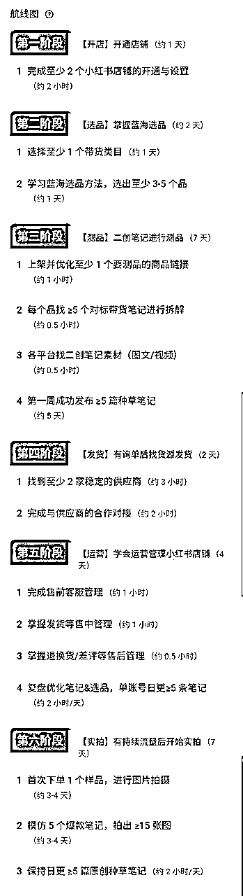

航线图和手册高度关联，你可以根据自己当前所在的环节，学习对应步骤。

# 零、项目介绍

# 章节概要

📕目前约 90% 的商家集中在女装、日用、小配饰等低客单赛道，价格和款式都很卷，一单利润常常不到 30%；

而高客单蓝海品类（例如手工银饰、中古家具、户外装备）供给量小于搜索量，平台流量池还在持续增长——供需失衡，就意味着溢价空间。

本章会结合平台趋势，介绍为什么要做高客单蓝海、以及具体怎么做，为后续实操打下基础。

# 0.1 📕蓝海电商的入局理由

# 平台趋势

📕电商发展几年后，一些大品类逐渐饱和，竞争非常激烈，但不少细分类目仍然像待开发的金矿。本期教练之一古辛最早做淘宝蓝海，在他看来，📕蓝海更有优势：客户以女性为主，能接受的客单价更高，利润也更丰厚。

📕同时具备推荐机制和搜索机制，因此创新产品等个别品类更容易做起来。创新产品层出不穷，只要📕的流量机制不改变，蓝海就能一直做，因为总有新产品可卖。

而且，相比红海类目，📕蓝海离成交更近，容易看到正反馈。只要产品选得好，出单并不难。

# 蓝海电商的特点

容易拿到正反馈：这是📕蓝海最突出的特点。

竞争比较小：所以更容易做出结果，发生价格战的概率也低。

项目寿命比较长：📕蓝海能走多远，主要看平台的流量机制；机制不变，蓝海就能持续做。淘宝蓝海后来变得难做，主要原因是流量机制发生了变化。

蓝海电商永远不用为产品不足发愁，只要掌握正确的选品方法，蓝海产品会源源不断出现。

# 成功案例

📕蓝海电商门槛较低，入门难度不大，即使没有电商经验的新人，也能比较快拿到正反馈。

只要选品正确，出单比较容易，因为竞争小。真正难的是持续稳定出单，这既考验产品的稳定性，也考验获取流量的能力。

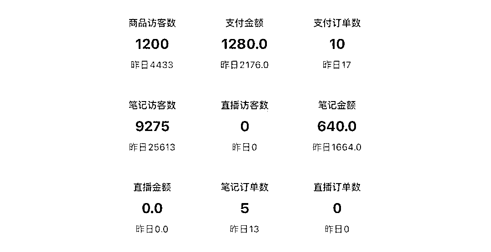

上图是一个刚毕业女孩做副业第 10 天的业绩数据。她选的那个品确实不错，之前完全没有电商经验，也能拿到结果，圈友们同样可以。

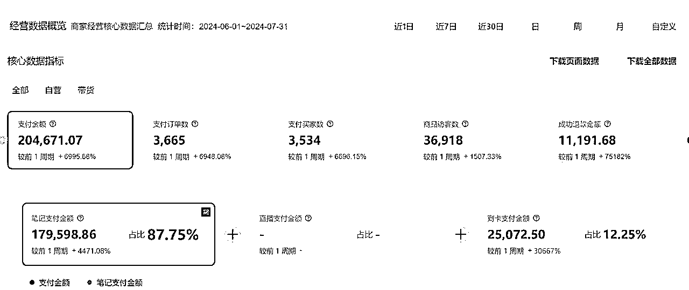

上图是圈友@叶声 做📕蓝海的数据。感兴趣的话，也可以看看他在赚钱分享的📕蓝海经验：https://t.zsxq.com/L5nG1

上面是正面案例，下面再看一个负面案例。

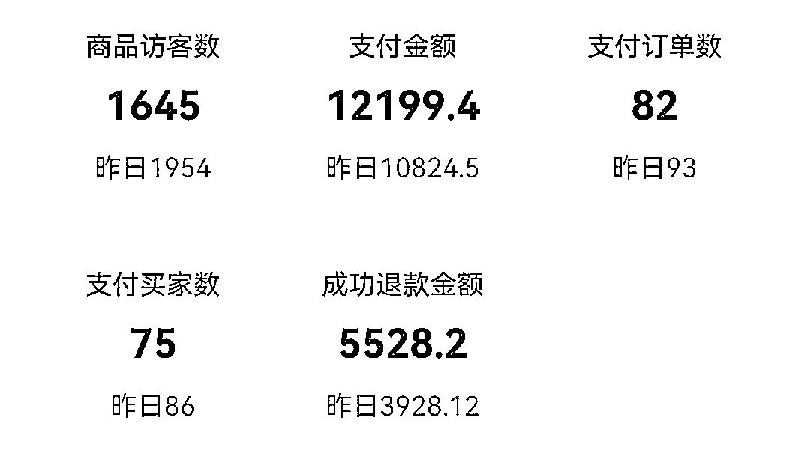

这个店铺做的是女装，该类目退货率越来越高。如果对供应链没有强把控能力，已经不太建议圈友再做。

# 0.2 玩法介绍

1. 最小 MVP 路径

a. 实施步骤：注册账号并开店 > 选品（关键）> 找笔记素材 > 发布笔记测品（关键）> 出单后找供应商 > 上架商品并发货 > 有持续流量后下单样品 > 实拍并发布笔记 > 做好店铺运营与管理

b. 时间规划：前 3 天完成店铺开通和选品，第一周至少发布 5 篇笔记，持续选品测品，争取 3 周内出首单，再转实拍

2. 项目核心关键点

a. 选品权重占比：70% 决定成败

b. 最小 MVP 思路：前期先不追求实拍，先跑通蓝海选品—混剪笔记—卖出首单

c. 内容效率优化：航海会教大家用 AI 工具辅助创作提效（Deepseek＋多维表格写爆款文案）

d. 轻资产投入：初期投入约 1000 元/店铺保证金（也可以等提现时再交），后期轻投采购样品成本预估几百元/次（也可跟老板谈免费拿样品）

3. 航海目标

a. 选品是需要多练习的技能，电商选品定生死。对新手来说，21 天不一定能赚到钱，这很正常，不要焦虑。这是长寿命项目，要关注长期收益。

# 一、开通📕店铺

# 章节概要

了解完📕电商的整体情况后，就要正式启动了。第一步是完成店铺准备。

具体包括：

✅ 准备手机号&手机

✅ 开通店铺（新手建议 2 个店铺，实在没有 1 个也行）

✅ 完成账号定位与包装

📕不同店铺的入驻门槛不同，大家可以结合自身情况，了解清楚后再进入入驻流程。

# 本章航线图

完成本章节的学习和实操，即可完成航线图的：

第一阶段：【开店】开通店铺（约 1 天）

1. 完成至少 2 个📕店铺的开通与设置（约 2 小时）

# 1.1 准备账号

# 1.1.1 准备至少 2 个账号

新手一般建议开通个人店铺，2 个个人店铺对应需要准备 2 个账号，具体包括：

1. 至少 2 个手机（不太建议 1 个手机多开，可能会被限流）

2. 至少 2 个电话卡（2 个📕号需要 2 个实名，对应 2 个电话卡）

3. 至少 2 个身份证（可以用家人的）

电话卡推荐：

三个运营商都可以办副卡，一个人可注册认证 5 个号码，一拖 4，副号月租费 10 元；

移动的万能副卡，1 张 10 元月租，1 个身份证能领 2 个副卡，第一张卡和第二张卡要相隔 90 天，去营业厅能办理，App 办理也可以，但营业厅可以操作免第一年月租；

中国电信 App 搜索无忧卡，5 元一个月，基本都是第 2 天就送上门；

移动可以办理 8 块的保号套餐。

手机推荐：

手机除了用于登录账号，也会用来做一些视频拍摄。

建议拍摄用 iPhone，型号是 XR 以上机型，拍摄效果最好；

后续放大做直播，iPhone 的直播稳定性也更好，但 iPhone 无法双开。

# 1.1.2 账号登录&养号

账号登录：

同时运作 2 个账号，你可能会问：可以用 1 个手机登录吗？

可以，但有一定风险。

如果你的手机本身就有📕应用分身（部分安卓手机有这个功能，比如红米），那么可以用一个手机登录两个📕号，我目前这样操作，账号还没出问题。

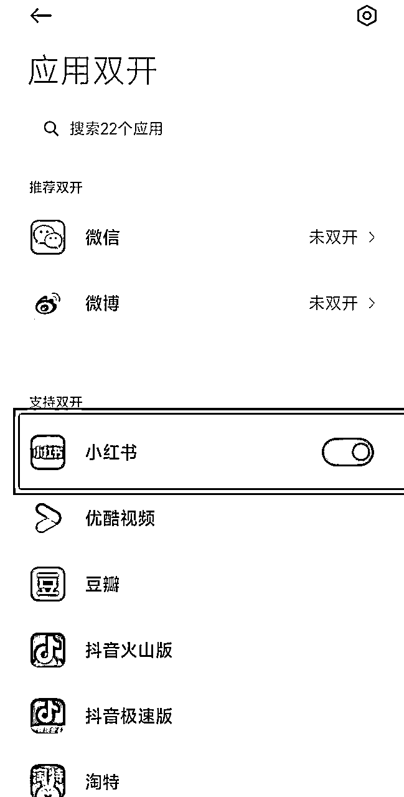

但如果你的手机没有这个功能，就不要去下载分身神器了，容易被封号。这种情况下只能再准备一个手机用于登录账号，可以去闲鱼或者拼多多上买二手手机，三四百块钱的就能满足日常需要了。

实名认证：

这里要注意：📕实名认证，一个身份证只能认证一个账号，一旦认证成功之后，只有注销账号才能解绑。

认证路径：我 - 左上角三条杠 - 创作中心 - 创作服务的更多服务 - 开通专业号 - 成为专业号 - 选择个人点击立刻申请 - 输入实名认证信息即可。

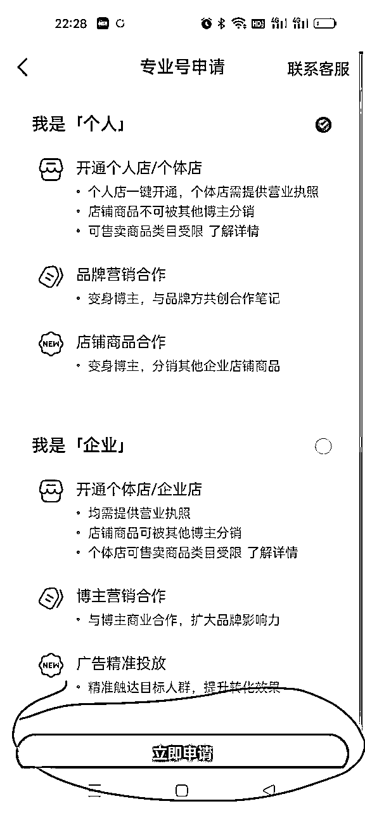

养号：

新注册的账号，每天可以刷 ＞30 分钟去养号，提高账号权重。这时候你可以根据所选赛道，去刷对标笔记。一般刷 1-3 天。不要一上来就挂车。

# 1.1.3 开通店铺

# 1.1.3.1 📕店铺分类

在入驻之前，首先要了解📕店铺的种类，因为种类不同，权益上也会有所区别。

从大方向来说，📕店铺有两种类型，一种是个人店铺，一种是企业店铺。

无论是哪一种店铺，首先都要认证专业号，因为📕账号注册后，默认为非专业号，非专业号不能参加任何商业行为，包括薯条投放、开店铺等。

所以，要想在📕变现，第一步就是先升级成专业号。

专业号也分为两种，个人专业号和企业专业号。

个人型：

个人专业号，身份标识为 XX 博主，比如时尚博主、美食博主等兴趣类的博主，基本上只要申请就能通过，而且不需要任何费用。

认证流程是：

点击【创作中心】—【更多服务】—【开通专业号】—【我是个人】-【实名认证】-选择身份证，填写相关信息即可。

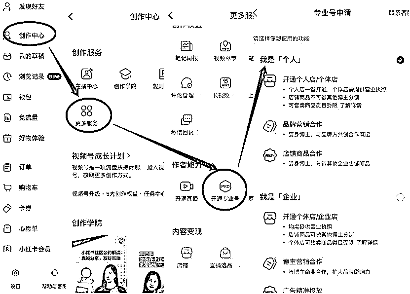

个人型专业号，可以申请开个人店铺或个体工商店。

名称为 XXX（昵称）的店；

店铺保证金最低 1000 元；

按照类目不同，平台收取 2-5% 不等的技术服务费。

企业型：

申请企业型专业号，需要上传营业执照，并缴纳 600 元费用，身份标识为 XX 品牌。

申请流程为：

点击【创作中心】—【更多服务】—【开通专业号】—【我是企业】-【填写基础信息】-【填写主体信息】-【资质公函上传】-【运营人信息填写】-缴纳 600 元费用，等待审核。

填写注意事项见下图：

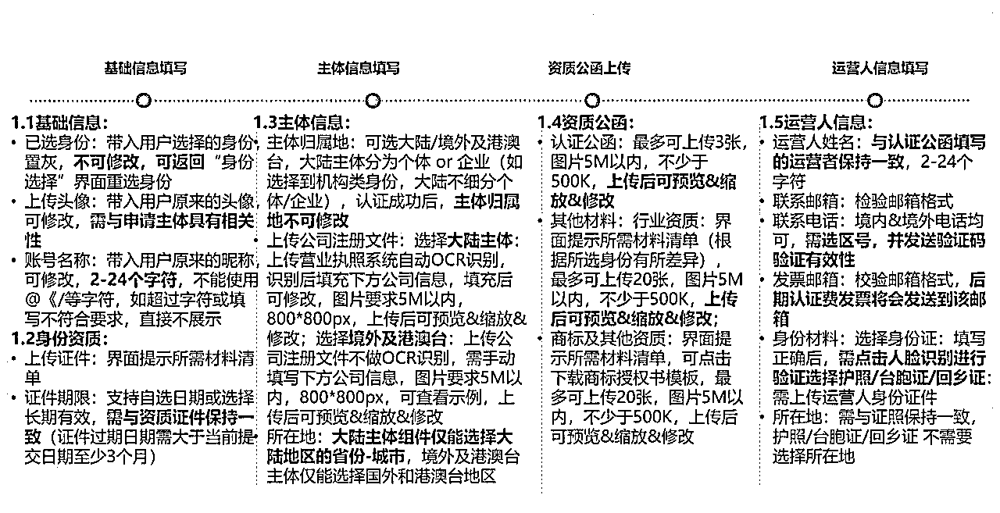

申请之后，大家要多加留意，因为申请有效期为 30 天，如果 30 天内没有完成申请，费用是不退回的。申请通过后，每年都会年审，并续费 600 元。

企业专业号，可以开普通企业店和专卖店/旗舰店。

名称为 XXX 专卖店/旗舰店；

普通企业店保证金最低 2000 元（详见《📕类目保证金明细》）；

月营业额＜1 万，平台免收技术服务费；

超过 1 万的部分，平台收取 5% 作为技术服务费。

2023 年 9 月 10 日起，一个营业执照可以申请最多 2 个专业号、2 家店铺。

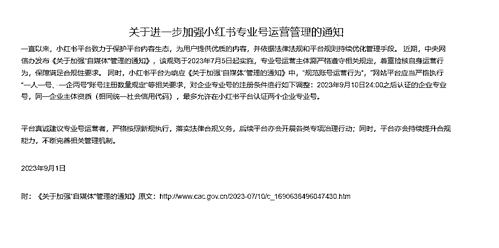

同一品牌只能开一家旗舰店，但可以同时开不同类型的店铺，比如一家旗舰店+一家专卖店，或者一家旗舰店+一家普通企业店。

企业专业号的营销权益，会比个人专业号更多一些，但两者只能二选一，大家可以根据需要自行选择。

一般来说，建议新手开【个人店】就可以，门槛较低；企业店主要是放大做矩阵的时候用到，平台对账号的宽容度也会更高。

# 1.1.3.2 【个人店】入驻门槛与流程

入驻门槛：

个人型店铺又可以分为【个人店】和【个体工商户店】。

个人店仅支持服装、百货等常见类目，个体工商店铺除了可以开常见类目，还支持奢侈品、珠宝等类目。

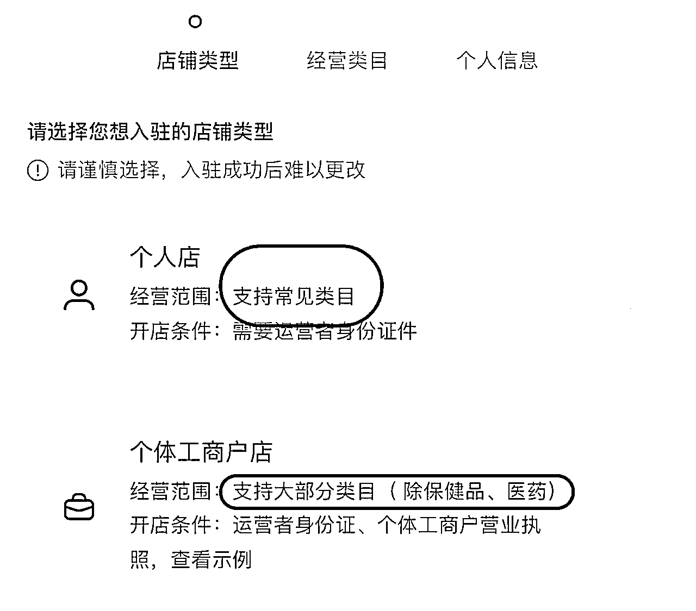

每个店铺类型，对应的可经营类目不同，打勾部分就是可以经营的类目，具体可在📕学习中心-规则中心-经营总览中查阅。

开店还要缴纳保证金，个人店和个体工商户的保证金都是 1000 元，但是有些特殊类目，比如保健品、奢侈品类，保证金会贵一点。

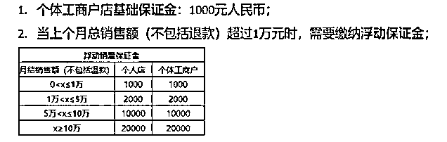

客服接待角色，个人店铺可选择平台代运营和自主客服两种模式，要注意平台代运营是需要收费的，大家可根据自身情况进行选择。

平台佣金，又叫技术服务费，按照类目不同，平台收取 2-5% 不等的服务费，收费准则详见：https://school.xiaohongshu.com/rule/detail/27/2585?jumpFrom=school

目前📕为了减轻个人店和个体工商户的开店负担，店铺入驻后无需缴纳保证金，即可发布商品上架售卖。如果该店铺累计交易额超过 1 万元后，下个月月初才需要补缴保证金，真正实现“无门槛”开店。

入驻流程：

选择个人店铺后，需要选择经营类目，之后只需要提供姓名、身份证号、手机号，并进行人脸识别，验证成功后店铺就开通了。

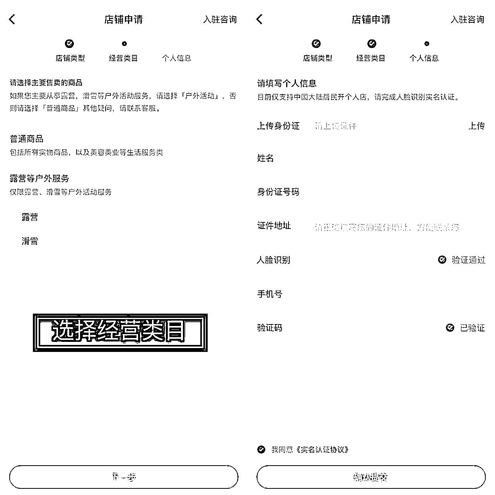

个体工商户店铺，需要提前准备好以下几点：

（1）公司信息的营业执照照片、公司名称、统一社会信用代码、经营地址以及营业执照有效期；

（2）店铺运营授权书。

同样也是先选择店铺经营类目，然后根据提示上传相关的资料。

和个人店铺不同的是，个体工商户店的审核时间一般为两到三天。

期间可以自行登录入驻系统进行查询。若在入驻过程中有任何问题无法解决，都可以在 9 点到 24 点期间直接联系人工客服进行咨询。

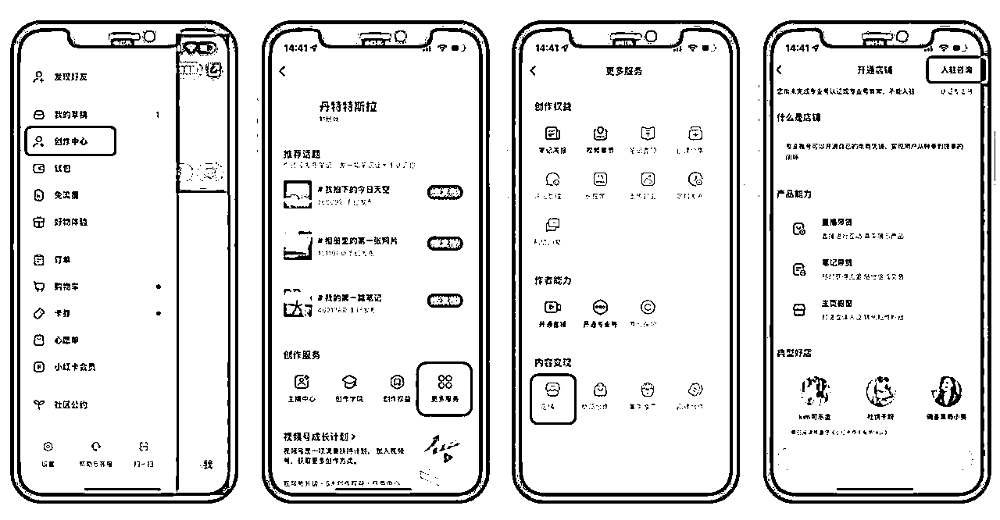

# 1.1.3.3 【企业店】入驻门槛与流程

入驻门槛：

企业型店铺，分为普通企业店、旗舰店、专卖店以及集合店。

普通企业店铺与个人店铺命名格式是一样的，“专业号账号名称+的店”。需要注意的是，企业专业号取名时要和商标对应，要不然会导致开不了店铺。

旗舰店名称是 xxx（品牌名）旗舰店，专卖店是 xxx 专卖店，集合店铺是 xxx 的海外店。

企业型店铺支持经营大部分类目，包括保健品、医药等特殊类目。

平台佣金，和上面的个人店铺一样，1w 以下不收费，超过部分按 5% 收取。

保证金根据类目不同，金额也是会略有差异，一般境内最低 2 万，境外 3500 美金。

如果你不知道如何选择，可以通过下面这张图快速判断：

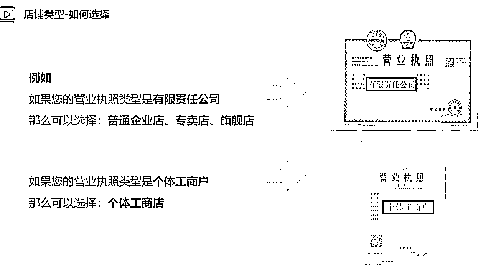

入驻流程：

企业型店铺需要准备的材料比较多，建议在电脑端📕入驻系统操作，网址为：gaia.xiaohongshu.com

我们先来说普通企业店的入驻流程，登陆后，大致需要 6 步。

第一步，首先选择店铺类型为：普通企业店。

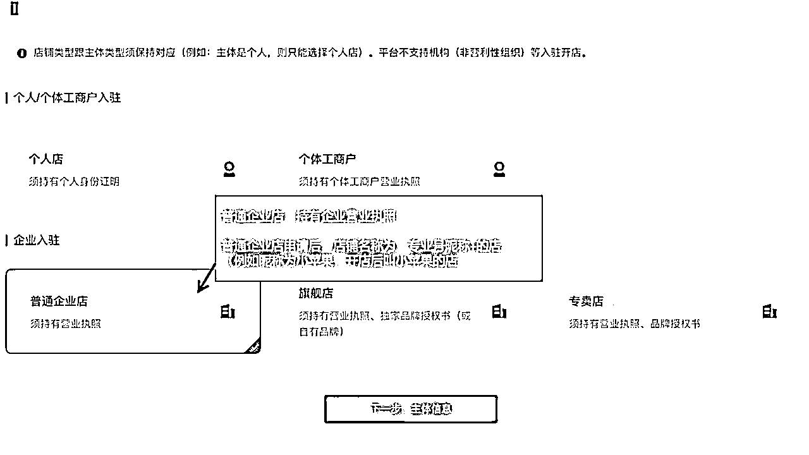

第二步，填写公司信息，上传营业执照，营业执照要拍得清晰、完整，避免扫描错误。

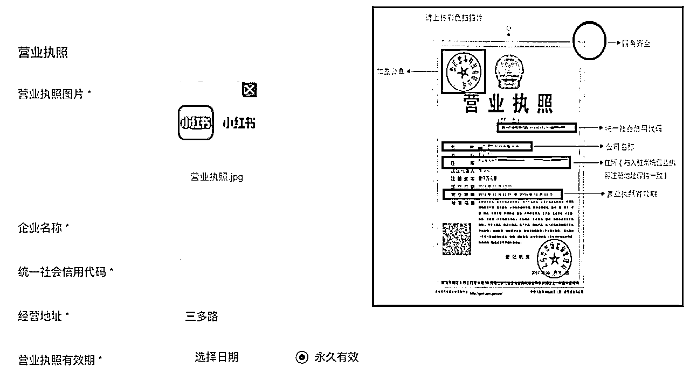

然后，填写法人或店铺运营人信息，注意，联系人要与营业执照上的法人一致。

第三步，店铺名称填写，但这个是系统自动抓取的。店铺命名形式就是“昵称+的店”，所以直接跟你的昵称挂钩，需要修改的话得去专业号中心修改昵称。

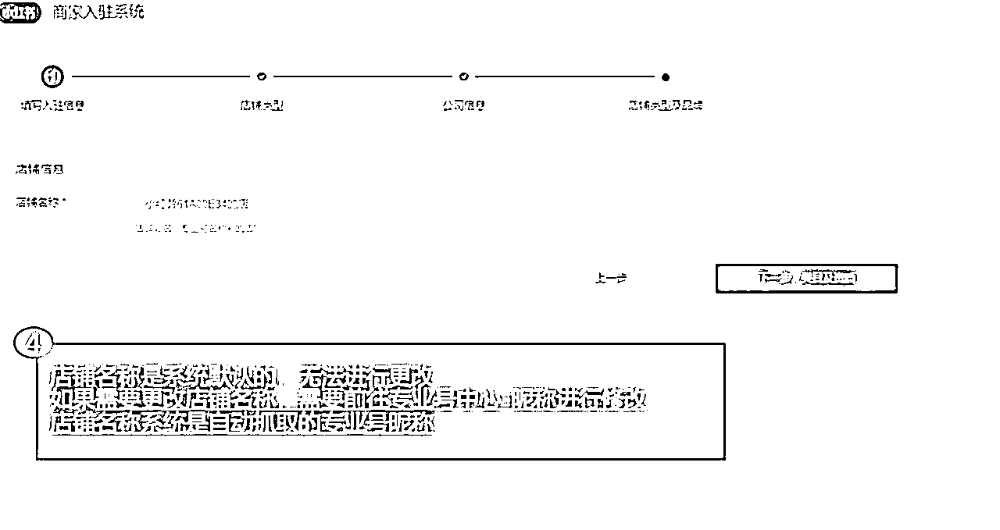

第四步，选择经营类目，注意类目必须在商标注册证上的类目范围内。

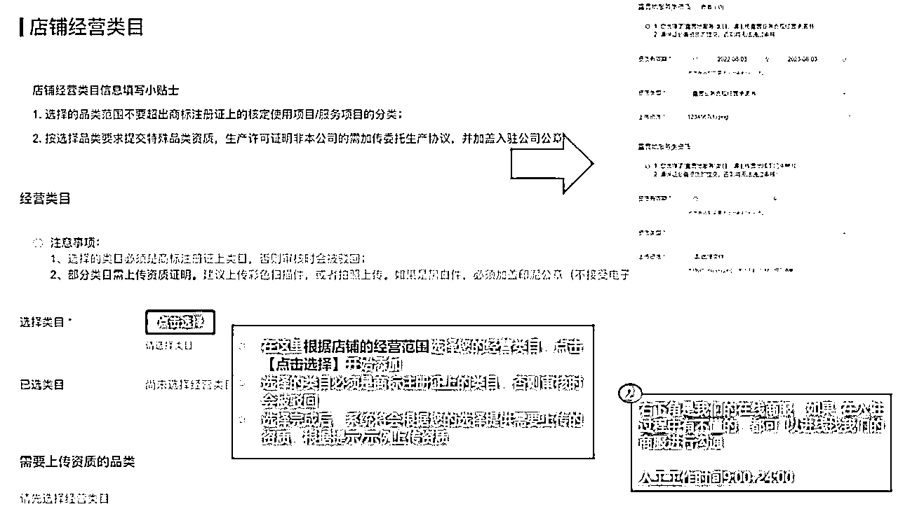

# 店铺入驻与蓝海挑货：关键步骤全梳理

资料提交完成后，平台会先进入核验环节，一般 3 个工作日内会有结果。若没通过，会通过电话或邮件说明原因；等待期间若有疑问，在线客服随时可以咨询。

核验通过后，接下来要交店铺保证金。这里有两个细节别弄错：扣款账户得是对公账户，开户人姓名还要和入驻时填写的经营人保持一致。

接着看旗舰店、专卖店的申请。整体流程和普通企业店差不多，但有四处需要特别注意：

第一，填写品牌资料。系统里搜不到你的品牌时，点“新增品牌”补上；上传 logo 时，图片样式必须和商标注册证上完全一致。

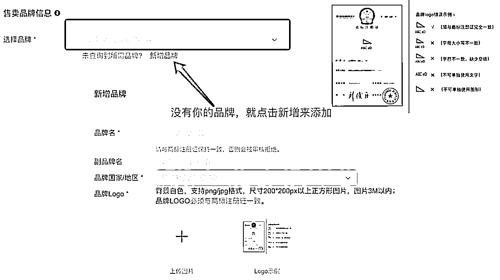

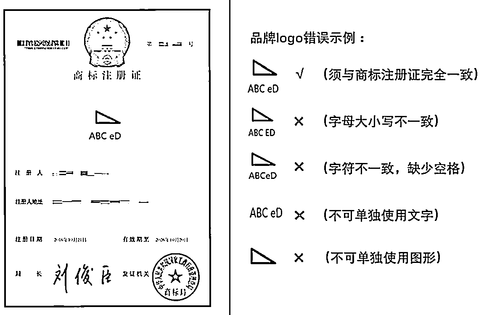

第二，分清自有品牌和代理品牌。代理品牌要保证授权链路完整，公司名称按营业执照上的名称填写。

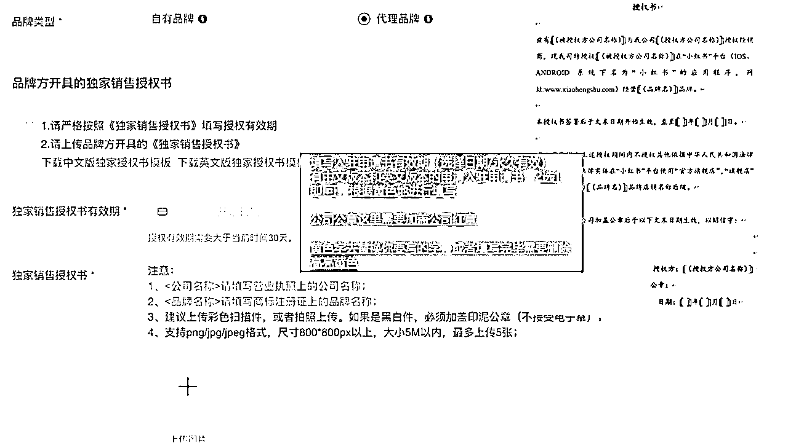

自有品牌，是指商标归自己公司或公司法人所有。注册类型分 R 标和 TM 标：R 标是注册商标，TM 标是商标注册申请受理通知书。

如果商标属于个人型 R 标，要上传商标注册证，同时附上商标权利人的身份证或护照复印件/扫描件。

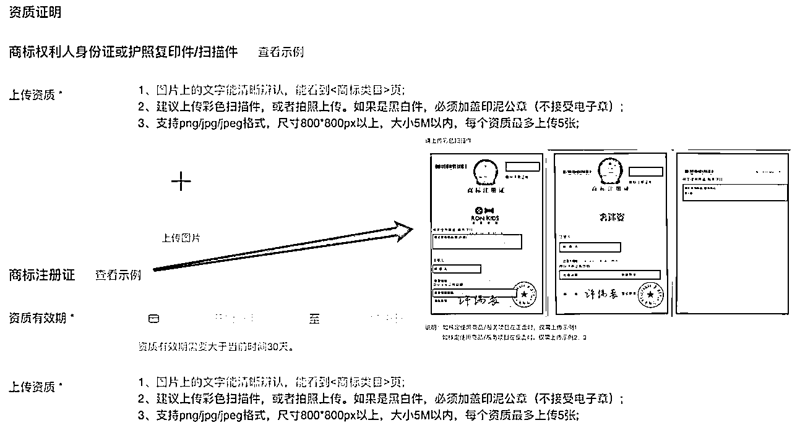

个人型 TM 标也一样：提交商标注册申请受理通知书，再附权利人身份证或护照复印件/扫描件。

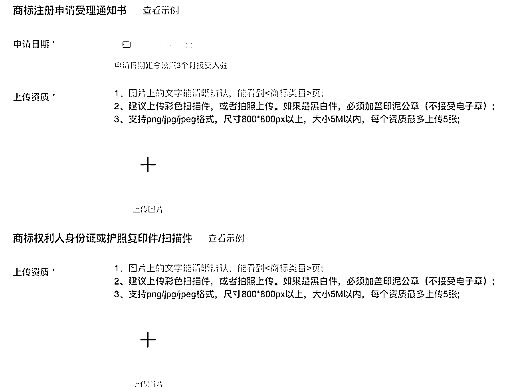

企业型 R 标或 TM 标则简单些，提供商标注册证或商标受理通知书即可。

第三，选售卖品类时要谨慎，尤其是“定制”类目，别急着勾。

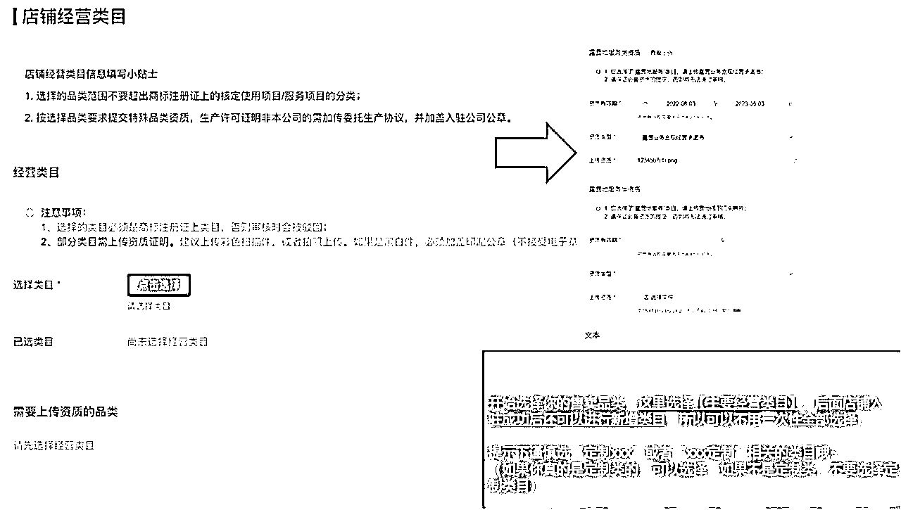

第四，审核通过后还要签合同。合同会通过线上邮件发送，并以电话或验证码确认签署。

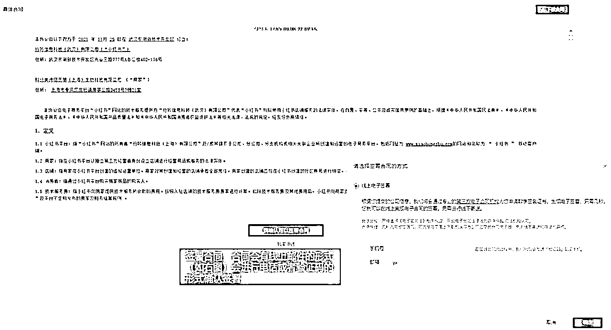

签完合同，同样要缴纳保证金，注意点和普通企业型店铺一致。

再说集合店。集合店只接受平台邀约，收到邀请后，入驻流程和旗舰店、专卖店相同。

全部申请通过后，就能上传商品正式开店了；账号首页会直接显示店铺和商品入口。

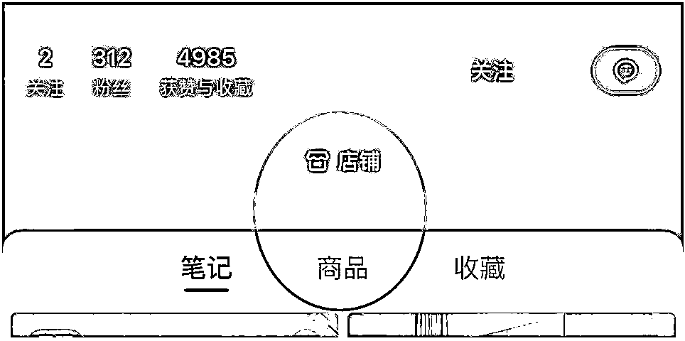

总体来看，企业型店铺的商业权益比个人店铺更多，但维护费用也更高，大家按自身情况选择。

入驻类目、审核等环节有不懂的地方，建议第一时间联系“人工服务”；商家客服回复比较及时，通常能快速解决问题。

更多店铺入驻信息，可前往（ https://school.xiaohongshu.com/helper/list?ctg=238&jumpFrom=cn ）自行查询：

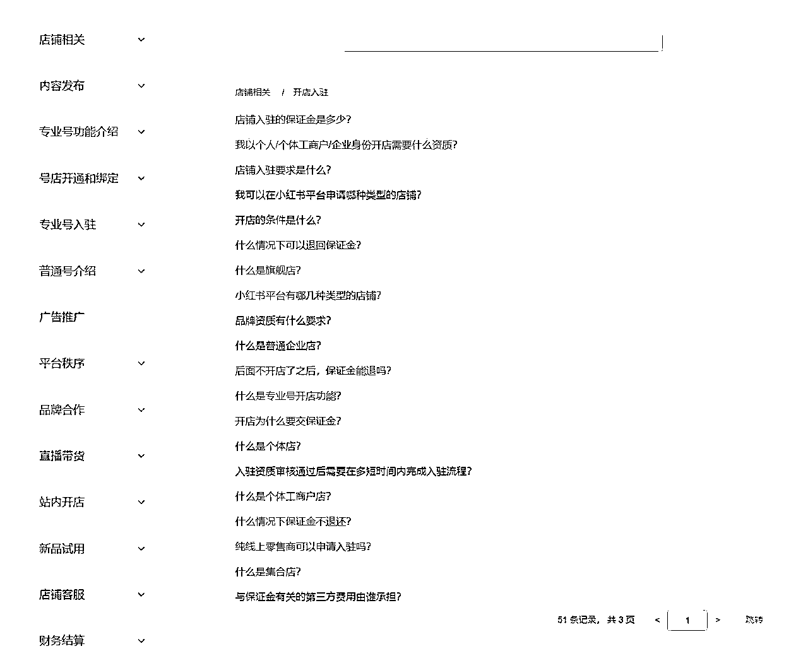

# 1.1.4 账号定位：先给账号定好方向

# 1.1.4.1 赛道定位：五种找方向的办法

选赛道的方法分付费和免费两类。从效果看，前 3 种付费方式更占优；新手前期用后 2 种免费方法也够，不用太纠结：

1.

看数据大盘（付费，有免费试用）

进入灰豚，依次点“数据大盘”和“行业流量大盘”

筛选行业，找爆文总数、预估阅读量、点赞、收藏等指标同步上升的赛道。

多项指标一起涨，说明用户正需要这类内容，可以优先在这些赛道里挑货。

（关联笔记总数可以下降）

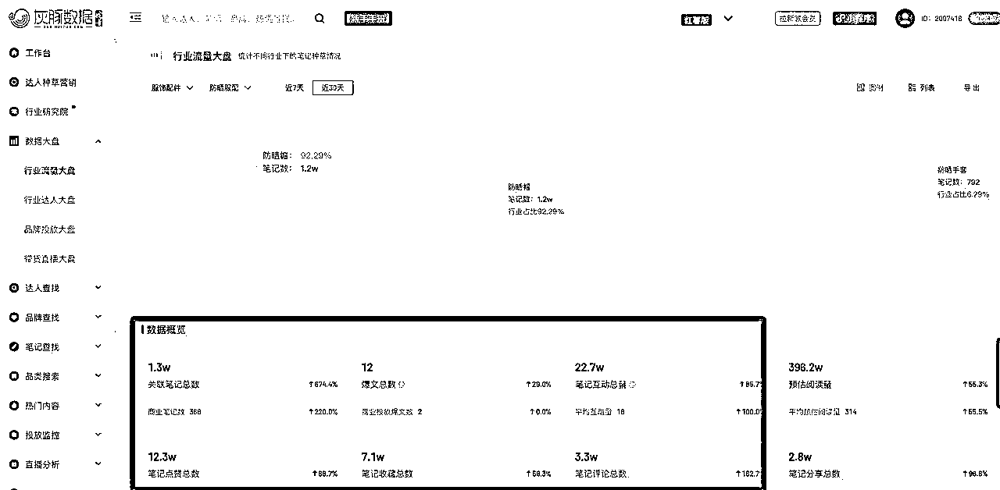

2.

看热词榜单（付费，有免费试用）

进入灰豚，走“热门内容”里的“搜索飙升榜”

看看有没有和产品相关的高搜索关键词。比如下图中的美甲款式，2025 年开春春季美甲需求旺，穿戴甲就有市场。

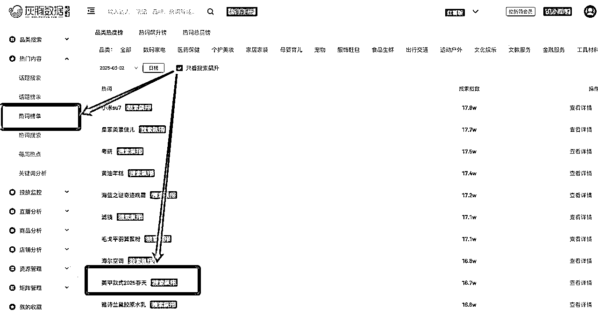

3.

看销量榜单（付费，有免费试用）

还是灰豚，进入“商品分析”下的“商品榜单”

销量榜、销量飙升榜都能看，日榜、周榜、月榜均可，重点看近期热卖品集中在哪些类目、哪些赛道。

注意挑「暂无关联品牌」的商品；带品牌的多半靠大博主带货，或直播加投流堆销量，模仿起来很难拼过。

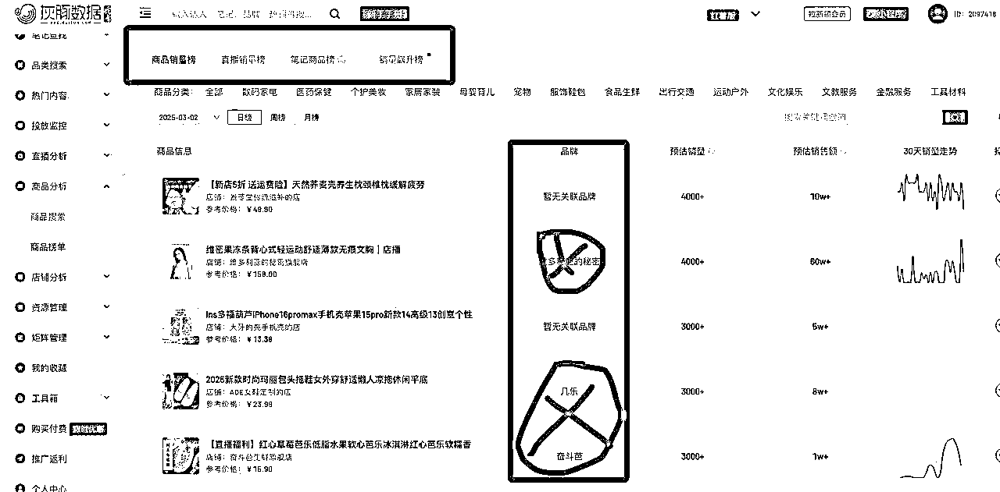

4.

千帆 app 商机中心（免费）

打开📕千帆 app，进入「商机中心」，查看机会类目、潜力商品分别落在哪些赛道。

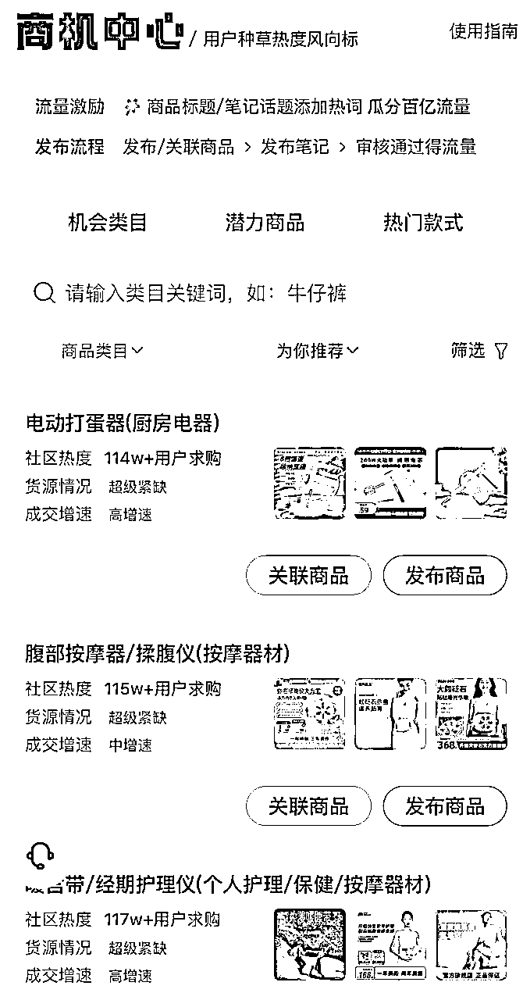

5.

社区热搜词（免费）

在📕千帆 app 打开社区热搜词，看推荐热词、热搜词、蓝海词和飙升词。

挑出与产品有关的词，再判断这些产品属于哪个赛道。

比如：

飙升词里的「香薰」「宿舍用品清单」，都是可以做的产品。

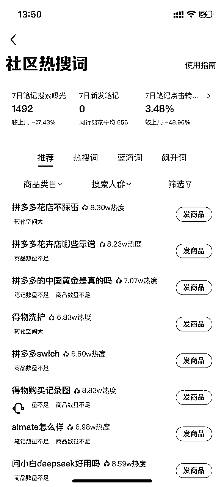

# 1.1.4.2 定位包装：照着对标做包装

📕店铺的账号包装并不复杂，这里拿百货账号举例：

第一步：找对标账号

在站内商城搜赛道关键词（例如“旋转梳子”）→ 点开高销量产品 → 从左下角头像进入账号主页。

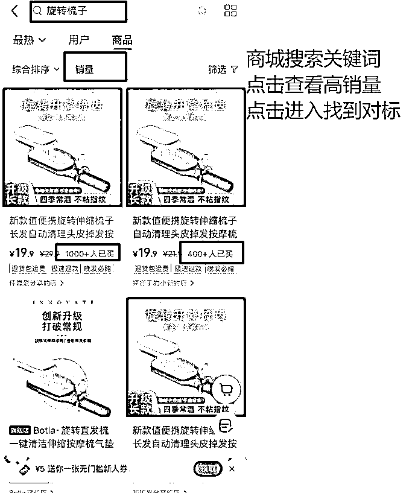

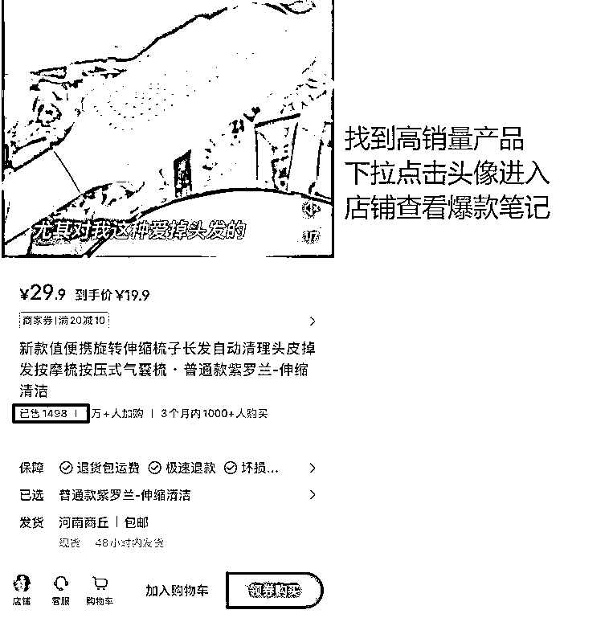

第二步：照着对标完成包装

比如我参照的号是“佳嘉爱分享”，于是把自己的账号设成“娜娜子的小新”来模仿。

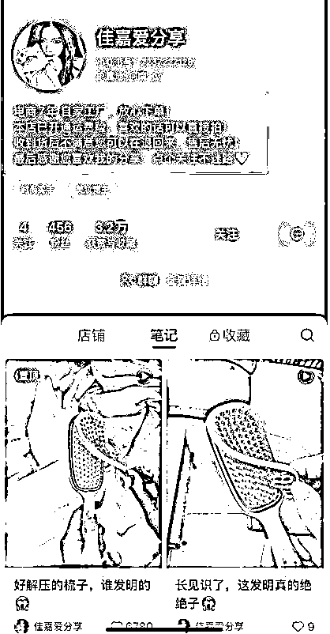

# 二、选品（关键）：成败的分水岭

# 本章要点

开店和赛道定位完成后，就该进入选品了。这个动作会贯穿整个航海，也是项目里最关键的环节。

✅ 蓝海品筛选标准

✅ 蓝海选品思路

✅ 蓝海选品方法

1.

传统电商平台-淘宝选品

2.

其他兴趣电商平台-抖音选品

✅ 蓝海选品案例

新手先在📕刷够爆款对标，弄清哪些品容易起量，积累选品体感；随后去淘宝/抖音等渠道挑适合📕的品，测品效率会更高。

# 本章任务路线

学完本章并完成实操，即可完成路线图中的：

第二阶段：【选品】掌握蓝海选品（约 2 天）

1.

至少确定 1 个带货类目（约 1 天）

2.

学会蓝海选品法，筛出 3-5 个品（约 1 天）

# 2.1 蓝海货品怎么筛⭐

1.

什么叫蓝海产品

不管是传统货架电商淘宝，还是兴趣电商📕，蓝海的判断只有一条：自己做得过就是蓝海，做不过就是红海。结合自身情况判断即可。

蓝海电商的市场容量通常不会太大，也就是销量不会特别猛。因此挑品时尽量偏向高客单、高利润，利润更稳，操作也轻松些。

蓝海电商产品分标品和非标品。

标品通常在📕能找到同行参考，好处是上手容易，坏处是容易被跟，从蓝海转红海很快；

非标品在📕没有同行参考，你就是第一个做的人。它的优点是生命周期长，缺点是起步更难。

因此，本次航海主要分享【📕电商蓝海标品打法】，帮大家尽快拿到正反馈、建立信心、走上正轨。

2.

高客单蓝海怎么选

什么产品才算合适？

选品别凭感觉，尽量挑已经爆过或正在爆的品，爆率更高。

这里总结 6 条基础原则，不管用哪种选品方法，选中的品都尽量贴合。

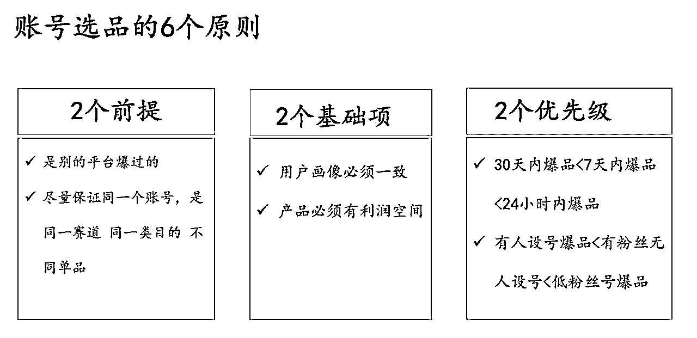

本期航海推荐的高客单选品标准如下：

价格带：建议 50-2000 元，高利润、低竞争

利润率：建议≥30%，结合竞品定价以及 1688、闲鱼货源渠道测算利润

【重要】更细的选品标准，可对照下方表格做判断：

⭐高客单蓝海货品判断表⭐

序号

检查项

怎么判

为什么

1

产品数据表现

优先看站内同行表现

（下文会具体展开）

在其他平台选到品后，最终判断要以站内数据为主、站外数据作补充，别把主次弄反；有些圈友容易过度相信第三方软件。

2

对标账号粉丝量

<5W

对标粉丝量更高，不利于模仿

3

是否侵权？

淘宝同行数量不能少于网页版淘宝一页

淘宝数据更全，更便于判断侵权。更多判断方法可看这篇文章 https://t.zsxq.com/6B9Z7

4

近期销量

看对标链接近一个月的评论数量，需>100

5

是否季节性产品

看对标链接评论是否季节性减少。比如某品 11、12、1、2 月评论只有个位数，说明是夏季用品，冬季几乎没销量。

避免选到季节性产品，反季销售不好出单

6

对标账号流量来源

以笔记为主，看对标账号笔记数量是否够多，以及是否有爆款笔记。

如果账号只有几篇笔记，却有上万销量，说明不靠笔记获取流量，有其他流量途径，不适合做我们的对标。

我们的流量来源以笔记为主，选品对标号如果也以笔记为主搞流量，更有利于起号

7

产品是否有回购

看产品链接下方账号的回购数据

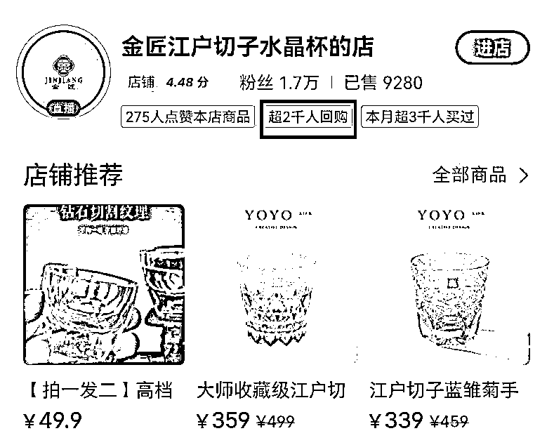

8

预估产品销量

看链接下方三个月总销量，再平均近期三个月的月均销量；如果上架还没满 3 个月，也可以通过第一条评论大概估算上架时间。

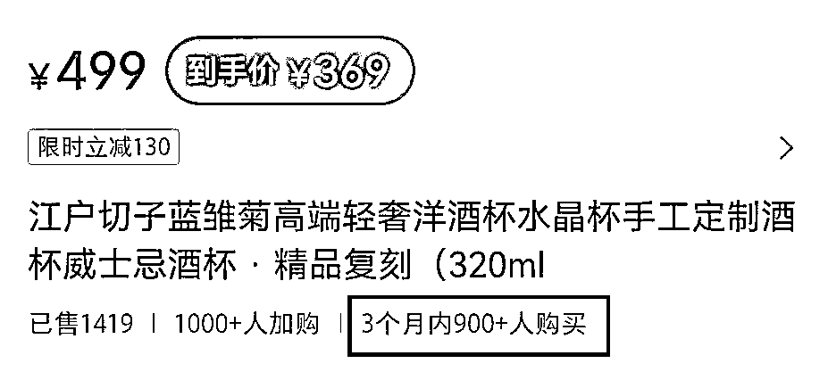

9

货源

货源以 1688 和闲鱼为主，不要拿拼多多做货源。

拼多多做货源容易出现无货源导致封店的问题，拼多多面单没处理好也容易暴露信息。

10

1688 和闲鱼没有货源咋办？

换品。利润过于诱人的除外。

蓝海选品比较稀缺，选品定生死；只要选出好品，剩下的就是水到渠成。所以本期航海不给大家推荐选品了，重点在于教大家掌握蓝海选品的方法，自己去挖掘。

# 2.2 蓝海挑货思路：三条大方向

在讲具体方法之前，先梳理一下📕选品的思路。

选品方法很多，整体来讲不外乎三个大方向：

1、日常多刷📕站内爆款选品

在📕卖东西，肯定要了解平台最近哪些品好卖。多刷多看，有条件的也可以通过灰豚看数据、找低分爆款来选品。

不过新手一般不建议直接上工具，平台多刷就够了，还能培养下网感。

2、从传统电商平台-淘宝选品（推荐⭐）

也就是从淘宝找合适的品。淘宝的分类页面有目前国内所有主流搜索电商平台里最全面的类目，而且淘宝作为电商平台相对最成熟，也不需要用到任何付费工具。

常用方法有：淘宝分类页面选品、淘宝神店榜选品、淘宝榜单选品、天猫榜单选品。

3、从其他兴趣电商平台-抖音选品

也就是从跟📕一样靠内容带货的平台找品，目前建议从抖音找合适的产品。

常用方法有：考古加选品法、蝉妈妈选品法、抖音精选联盟的创意中心选品法等。

所以在正式选品前，建议大家先刷至少 2 小时📕，对平台当前爆品增加些体感。

# 2.3 蓝海挑货方法：淘宝与抖音两条路

如果你已经完成了刷 2 小时📕这一步，接下来可以开始选品了。这里提供 2 种选品方式，优先推荐淘宝选品，其次是抖音选品（原因上面有说）。

好的选品方法用一种就够了。前期可以多试几种，有了一定选品能力之后，找到最适合自己的一种即可。

看到意向品之后，就按照【章节 2.1】给的蓝海品筛选标准来判断要不要选这个品。

# 挑货路径一：传统电商平台-淘宝

# 2.3.1.1 淘宝分类页挑货（推荐⭐）

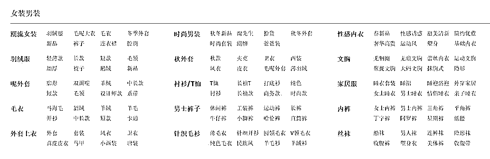

淘宝的分类页面有目前国内所有主流搜索电商平台里最全面的类目，不过和亚马逊比还差一点，亚马逊的分类词更丰富。

大家可以从淘宝分类页面里选择适合女性用户的产品词，拿到📕上去搜索。

选品初期会比较枯燥乏味，挨个去📕平台看数据，这一步没法省。

# 2.3.1.2 淘宝神店榜挑货法

淘宝神店榜是手机淘宝推出的一个板块，对📕选品来说挺好用的。

步骤如下：

1.

手机淘宝页面，点击“全部频道”

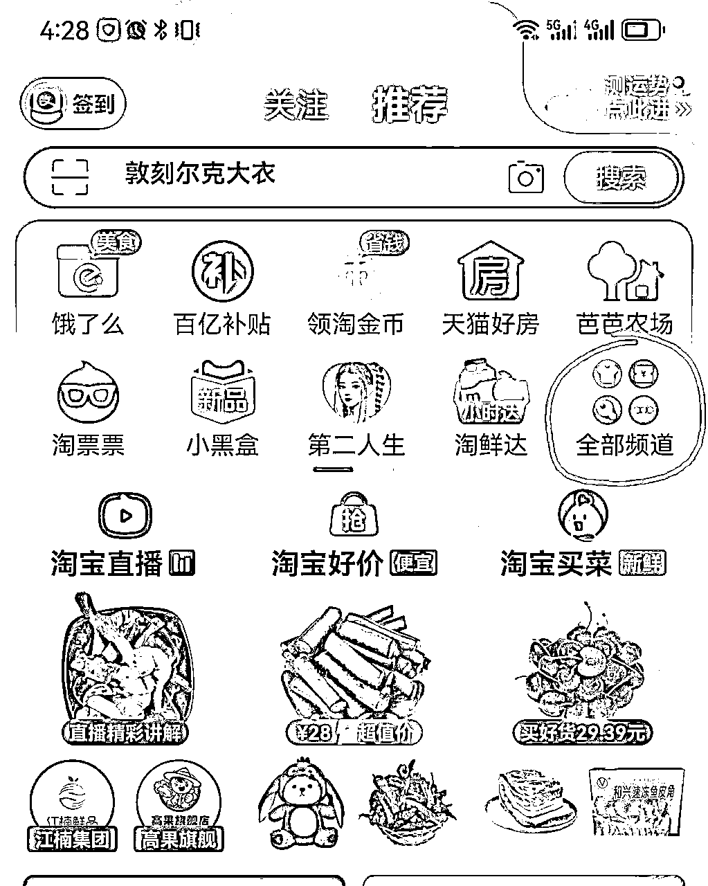

2.

搜索“神店榜”

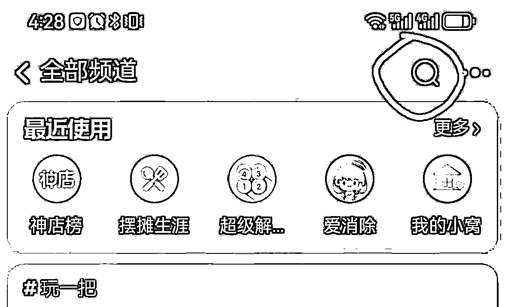

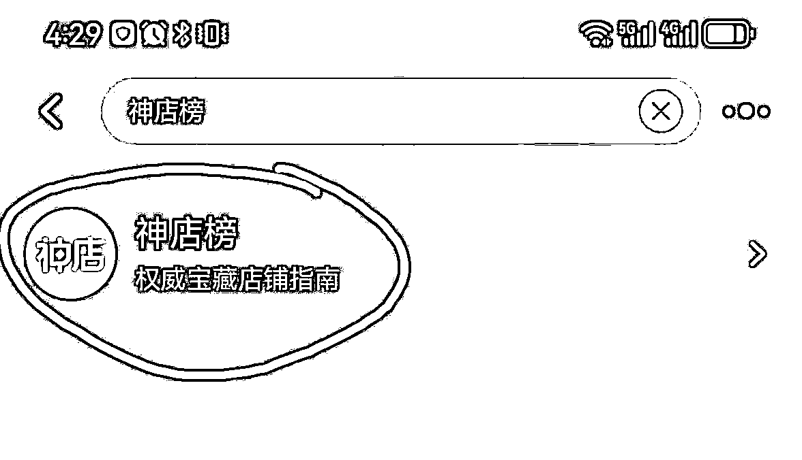

3.

进入“神店榜”后会有很多类目，点击想要的类目，比如“潮玩宠物”，然后点击“浪漫婚礼首饰热卖榜”

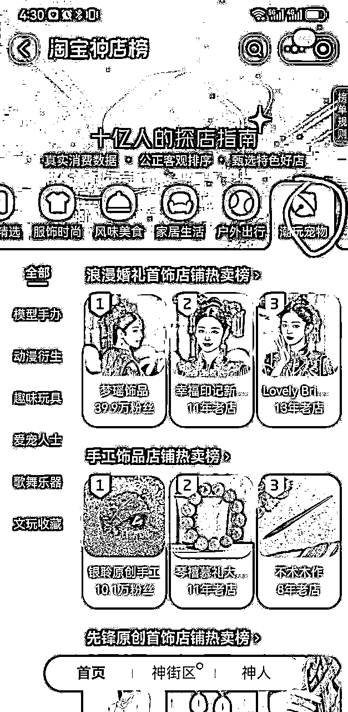

4.

进入这个页面后，几乎都是卖婚礼首饰的店铺，最上面也有几个分类项，“黑马榜”和“回头客榜”值得一看。

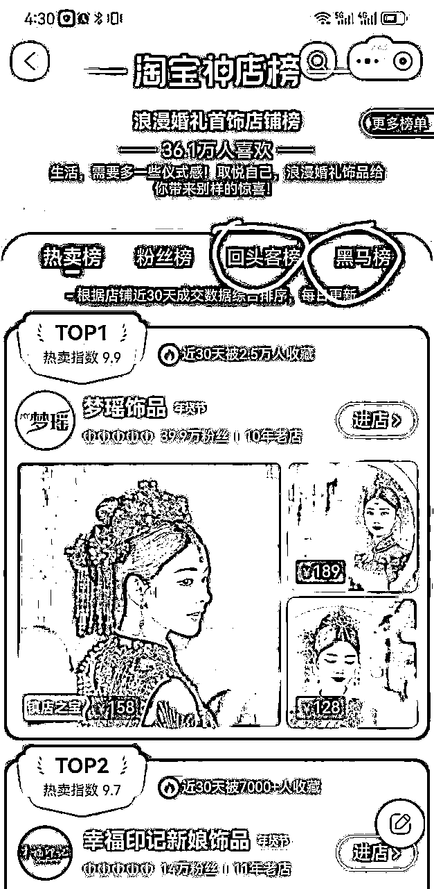

5.

点击店铺后按销量排名，就能看看有没有自己喜欢的品。如果有，就到📕搜索关键词，看看该产品在📕上的数据如何。

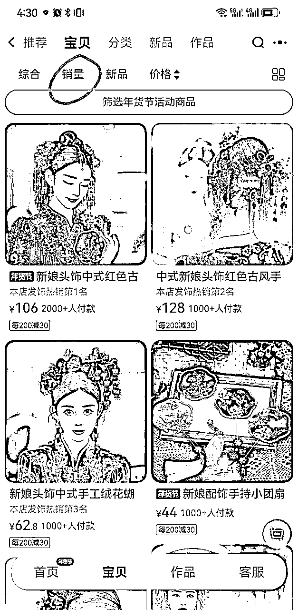

这套选品方法不仅适用于📕，还能用在淘宝、闲鱼等平台。（抖音亲测不太适用）

# 2.3.1.3 淘宝榜单挑货法

1.

手机淘宝，点击搜索框

底部会出现一个最近热销产品榜单，这个榜单每小时实时更新，里面有些品也适合拿到📕去做。

这个榜单里的品都是最近淘宝搜索热度猛增的品，时效性很高。

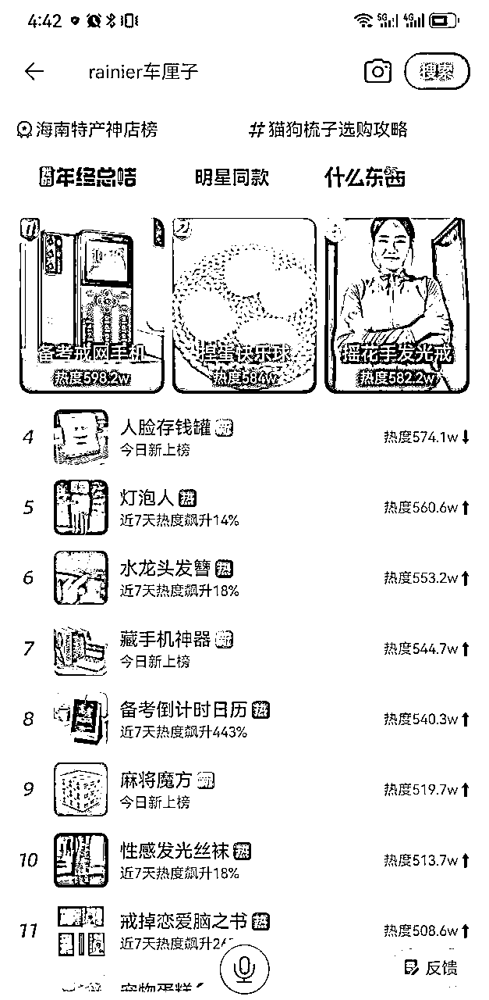

# 2.3.1.4 天猫榜单挑货法

1.

手机淘宝，点击“全部频道”

2.

搜索“天猫榜单”

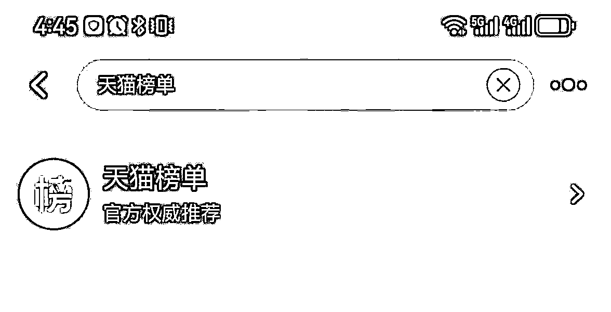

3.

顶部有很多分类选项，点击自己想要的分类，比如“母婴”，就会看到很多母婴用品。选择第一个“宝宝沐浴露好价榜”，就能看到目前天猫卖得比较好的产品

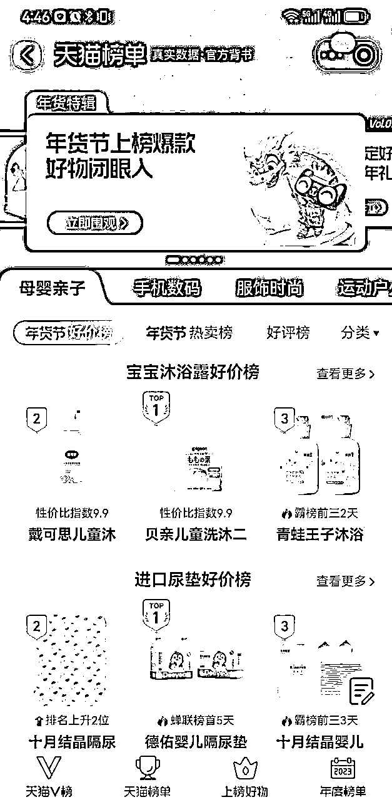

这些产品有些和📕存在信息差。天猫竞争激烈，📕的竞争可能没那么激烈。

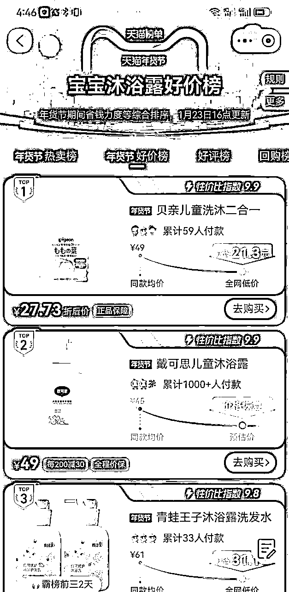

# 挑货路径二：从其他兴趣电商平台-抖音

抖音创意中心是抖音自己的数据统计，实时更新，相比考古加能更快知道新爆款。

其中建议百货等大众品类注重一下【抖音创意中心选品法】。

抖音流量和玩家更多，这类大众品在抖音先爆起来的概率更大。

📕有时候很慢热，这类大众产品基本都是混剪、素材同质化严重。等到📕已经爆起来你再去做素材，可选度会很低，所以不如直接在抖音开始爆的时候就搞过来。

我们的爆品如硅胶保湿袜、雪地靴刷子、钢丝抹布等，都是通过抖音创意中心选品法选到的。

具体步骤如下：

1、打开抖音橱窗——选择创意中心——可以选择爆款视频/图文带货形式

（还没开通橱窗的末尾附开通教程）

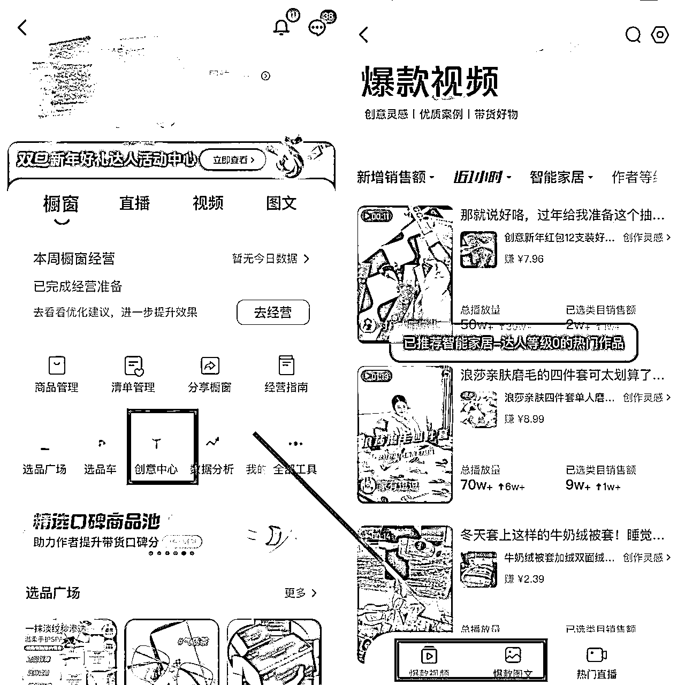

2、可以根据时间维度、品类维度以及作者等级等维度进行选择，前期大家主要看时间维度和品类维度就行；

3、近 1 小时和 24 小时都要看，这都是抖音实时统计的爆款带货视频。如果在看的过程中发现符合上面提到的【选品的 6 个原则】的品，就可以考虑进一步判断后上架测试一下。

# 2.3 蓝海挑货案例：星星命名

这里拿具体案例给大家展示一下，什么样的品是好的蓝海品。

举个📕的礼物赛道 https://t.zsxq.com/zDmVW ，这条赛道目前有很多蓝海的品可做。

比如下面这个品，高客单、高利润，至于有没有复购不好说。因为这个品不属于消耗品，也不属于兴趣爱好品，直观来看不会有复购，适合用来送礼。

这个品叫“星星命名”，用用户的名字给星星命名。淘宝竞争比较小，但淘宝上的利润没有📕高。

📕上的客单能做得更高，因为这东西严格来说也不算标品——星星有大有小，大的星星值得更高的价格。

这个品很多圈友可能好奇是怎么交付的。

“星协”是国产的一家星星命名供货商，交付主要是纪念证书，他们自己做供应链，在淘宝也有店。如果后续做得深入，可以自己干供应链，这东西不难，本质就是做“纪念证书”的。

# 高利润品怎么挖、怎么验

追求更高端货源的圈友，不妨去外网直接对接海外供应商。这类品如果真要做，我更推荐走海外渠道：交付环节完全交给对方，我们靠信息差吃差价，利润依然可观。

海外做同类产品的站点不在少数，服务水平打磨得相当成熟，整体调性也上档次。这个品类跟📕平台的氛围天然契合，做起内容来会很顺手。

有些平台还开放了分销计划，每成交一单，推广方就能抽15%的佣金，这笔钱同样可以算进利润里。

拿它当礼物送给女生，确实很有排面。

而且风险几乎为零，不用担心侵权问题——星星本就是公共资源，并不属于任何人的私有财产。

能想通这个玩法的，真是个天才。

# 三、测品：7天验证选品对不对

# 章节概要

每挑好一个品，都得靠测品来过关。在📕做测品，表面上是测产品，实际上是测运营者获取流量的能力——当然，前提是商品链接的转化效率已经优化到位。因此测品能不能出结果，除了选品本身，还要看这两个变量：

✅ 商品链接质量：流量进来之后能不能变成订单，全看它。

✅ 笔记质量：体现引流水平，不同产品适配的内容载体不一样。

特别提醒：新手初期精力有限，用二创笔记测品完全够用；等选品功力上来了，再换实拍。

接下来，正式进入测品。

# 本章行动路线

完成本章学习和实操，就能点亮航线图的：

第三阶段：【测品】用二创笔记测品（7天）

1. 至少上架1个待测商品链接，并做好优化（约1小时）

2. 每个品拆解≥5个对标带货笔记（约0.5小时）

3. 在各大平台收集图文/视频二创素材（约0.5小时）

4. 第一周发出不少于5篇种草笔记（约5天）

# 3.1 测品到底在验证什么

选品选得对不对，由测品来回答。

选品阶段通过拆解同行的链接数据，能大致估算出这个品在📕的竞争烈度、月度毛利润、流量大小。但这些都停留在纸面推演，选定的品到底能不能带来真金白银，必须拉到实操里检验一番。

选品靠的是理论分析和经验判断，测品拼的是手上的真功夫。它是检验选品是否靠谱的唯一路径。

📕测品，本质上是在考大家引流的手感。产品越细分，引来的流量就越精准，只要流量端不断，订单是水到渠成的事。

当然，大前提依然是【链接页面的转化率】已经优化到位。

测品周期：一周。

📕高客单蓝海电商走精品化路线，和店群那套铺货逻辑完全不同。同类目的产品放在一家店就行，没必要一个店对应一个品，那是白瞎。按我们的经验，一家小店放不满20个品，都算正常。

实操中的建议是：逐个来测，上架一个就验证一个。你也可以把产品全部挂到店里，但要先从选品数据最好的那个开始。

每天安排3到5篇笔记，间隔着发，别扎堆。一般跑满一周，能出单的基本就出单了。

蓝海电商出单速度通常很快——产品足够细分，流量足够精准，链接转化又没啥问题，一周还没动静，就该果断换品了。

一周内能出单，就继续深耕，重点打磨引流能力。新人的流量盘子要稳定下来，普遍要花2到3个月，出单也会跟着稳定。

还有一点要留意：部分品类自带流量高峰，比如玄学、以及各类考试节点前夕——中考、高考、考研、考公前都会冲一波流量。这些信息在选品时要靠数据看出来，然后把测品的时间窗口对上去。如果选品时完全没发现这些节点，硬生生绕开了高峰，后面做起来会非常吃力。

玄学类目利润虽然诱人，但操作门槛高，容易踩违规线，对新人并不友好。刚开始的圈友还是挑其他类目，更容易拿到正反馈。这里只是拿来举例，并不代表推荐大家都去做。

# 3.2 测品前的关键准备

正式测品之前，先把商品链接挂上去，确保链接页面的转化能力已经调到最佳。步骤如下。

# 3.2.1 上架商品链接

# 3.2.1.1 主图与详情页

别套淘宝那种精修美工模板，主图和详情页尽量保持📕原生风格，看起来更真实可信。如果以后打算用实拍图或视频，详情页也应该换成实拍风，给用户一种“看见什么，收到什么”的踏实感。

比如下面这个账号，视频和详情页就保持了同一种风格调性。

再比如这个例子，详情图直接拿笔记里的原图来用，谁都看得出是实拍。

# 3.2.1.2 商品定价怎么定

不少人觉得，把拼多多的货搬到📕、翻三倍照样能卖，但📕的用户精着呢。我专门问过50多个女大学生，大部分人的下单渠道还是淘宝、拼多多、得物，而且现在的学生党普遍会比价。

我的定价逻辑是：查一下淘宝和拼多多销量靠前的同类店铺，把价格落在两个平台的区间里。很多用户就算拿别家来比，发现我们比淘宝还便宜一点，再加上视频是原创实拍、主打所见即所得，基本就不会跑去其他平台了。

举个牛仔裤的例子：拼多多榜单上随手翻到一条，标价39；去淘宝搜同款按销量排，月销破千的价位集中在70到90，当然也有40多的。这时候我可能会定在59到69，再仔细算一遍自己的利润空间。

女装类目的浏览到下单转化率，我们大概在4%到7%。如果掉到4%以下，就要想想是不是价格没定对。其他类目我没有一手数据。也可以在定价前多刷📕，观察同行爆文左下角挂的商品累计销量，拿它当参考。

实操里头，定价的分量怎么强调都不过分，尤其是低客单价产品。很多人容易踩两个坑：

1. 觉得📕用户消费力强，闭眼猛加价。

2. 抄其他平台的价格，不做任何弹性调整。

这里分享一篇圈友@V小刀 的星球帖，里面有更细的定价方法论：📕电商系列细节篇

# 3.2.1.3 商品发布

# 手机端操作

📕APP和📕商家版APP的上架流程大差不差，跟着引导一步步来就行。

发布路径如下：

1）编辑商品

注意：

商品标题和商品主图属于必填项。

官方对主图规格有明确限制，画面尽量干净，别堆太多标注文字。

首图规格不合格，上架会直接失败；不符合首页推荐规则的话，商城首页也不会收录。

2）设置商品类目

这里展示的是个人店铺能用的类目，搜索框也可以直接找。部分类目只有企业店铺能开通，还需要对应资质。每种店铺类型可经营的类目范围都不同，可以去📕学习中心—规则中心—经营总览里查。

3）填写商品规格

同一商品下有多个型号时，才需要配置规格；只卖一个规格就不用管。

4）设置商品售价

按产品实际情况填。

5）设置库存数量

按产品实际情况填。

6）填写商品属性

按产品实际情况填。

7）填写商品详情

上传商品详情页图片。

8）选择是否包邮

根据产品情况来定，系统目前提供两种默认选项：

全国包邮；

偏远地区不包邮（偏远地区包括：新疆维吾尔自治区/西藏自治区/宁夏回族自治区/青海省/海南省/内蒙古自治区/甘肃省）。

如果想自定义运费模板，可以自己填运费金额，也可以分地区设置（只能在电脑端商家后台操作）。

先设一个默认运费，再单独补充特殊地区的价格，计价方式支持按件数和按重量。

9）设置发货时间

发货时效可以自己确定：当天发货、24h发货、48h发货、预售发货，都可以。

全部设置完，点立即上架即可。

📕走的是机器审核，速度非常快。只要内容没有大问题，发布后基本马上就过。

# 电脑端发布

📕商家助手网页版入口：https://ark.xiaohongshu.com

电脑端既可以用工具一键批量搬家，也可以手动逐一发布。

1）一键搬家工具

进店铺后台点“服务”，在服务市场里选一款搬家软件。这类工具后台基本都支持试用，挑个顺手的使用就行。

一键搬家软件入口：

2）后台手动发布

在📕商家管理后台手动发布的路径如下：

① 按产品所属类目选择好分类，点下一步：

② 填写产品对应的属性信息，带*的是必填项，其余选填：

③ 如果所选的品类没有开通（部分类目需要先提交相应资质，后台会有提示），可以在后台申请开通：

④ 全部信息填完，提交审核即可。

拓展阅读：更多产品上架相关的内容，可以前往📕商家课堂：
https://school.xiaohongshu.com/course/list?jumpFrom=school&categoryNo=20210515002

# 3.2.2 提升链接转化率的六个方法

测品之前，先保证链接的转化能力不拖后腿。下面六个方法都是我们在实操中反复验证过的，可以从这几个维度逐项自查：

# 1. 链接补评论

新上架的链接，先凑够5条以上图文评价。想提高链接转单率，人工补评价这步不能省；评价最好是带图的，数量至少5条，超过5条性价比就开始递减。

📕补单主要补的是评价，流量还是得靠笔记。5条图文评价，请亲戚朋友就能搞定；不想麻烦熟人的，就去问老客户；没有客户基础，🛰️好友顶上；🛰️好友也不好开口，就去闲鱼发布任务。

# 2. SKU设置做引导

咱们做的链接大部分是多SKU。但SKU数量一多，用户就容易陷入选择困难，转化反而会被拖累。这时候可以在SKU命名上动点脑筋，利用从众心理，把客户引向我们主推的那个选项。

拿脐橙来举例：

上面这个SKU的设计非常原始，只有满屏参数，找不到任何营销引导。用户扫一眼根本分不清哪个更好，这样的设置我只能给差评。

这张图里的SKU就有了一点小心思：最底下的选项名称前面加了“好评最多”。比上一条稍微聪明一些，但依然不算合格。

用户把所有SKU看完，目光确实会被最底下那条抓住，但问题还不少。

第一，排序不对。主推SKU应该放在前排，塞到最后排，是怕用户看见吗？

第二，主推的SKU当然要推利润最高的，推最小尺寸的果子是什么逻辑？

第三，营销话术还有很大的优化空间。

再看第三条链接，这条的SKU布局才算合格。

首先，主推链接排在前排，用户进来就能优先锁定。店主放的是第三位，其实放到第二位更合适。

第一位放店铺客单价最高的产品，用来锚定价格：用户先看到100元，再看主推SKU是80元，自然觉得80不算贵，因为前面有100垫着。

其次，营销话术到位。除了主推SKU之外，其他选项基本都有引导语。

最后，主推SKU的“好评最多”还能升级成“千人好评”“万人好评”——前提是销量撑得住。销量不够，就用“好评最多”。这套措辞的潜台词就是：大家都选这个，闭眼付款就行。

# 3. 设置优惠券

先把初始价标得高一点，再发一张大额优惠券，让用户产生捡到便宜的快感。这一招在非标品上格外好使——没有同行的价格做参照，你定出的标准就是用户心里的唯一标准。

# 4. 用漂亮的模特

需要模特来展示效果的产品，尽量选好看的模特，越漂亮越好。

比如祛痘、美白类产品，要用模特拍前后效果对比。效果图可以从网上找，也可以交给美工合成。

展示对比的模特越养眼，转化率越高——用户会产生强烈的代入感。反之，模特长得不好看，效果图反而会劝退用户。

人都爱美，女性尤其如此，谁不想看到自己更漂亮的样子呢？

# 5. 用恐惧情绪驱动下单

人的情绪里，能用来撬动转化的不少。我们实测下来效果最稳、使用频率最高的，是用户的恐惧感。

比如：

卖儿童用品的，常说“不趁早纠正孩子某个坏习惯，以后有你后悔的”“班上同学都在用了，你家孩子不跟上就要掉队”之类的话。

卖美容护肤品的，会说“你现在不舍得花钱保养，省下来的钱迟早被外面的小姑娘拿去保养”这种让人紧张的话。

但有一点要拿捏住：利用恐惧情绪是为了促成交易、为了卖货，而不是单纯把人吓跑。

# 6. 用相似性包装账号

📕上的账号、店铺、笔记从来都是三位一体，不能孤立地看。

📕骨子里不是纯粹的电商平台，而是种草社区。种草的逻辑是：我有个需求，买了个产品，用了觉得不错，分享给📕的姐妹；姐妹被这份真诚打动，也跟着下单。

所以做📕，账号定位不能是卖家，而应该是产品爱好者、使用者。

把自己定位成卖家，那其他姐妹就是买家，你们之间就是交易关系；把自己定位成某个问题的解决者、某类产品的资深爱好者，你就能和有同样困扰的人产生共鸣，彼此成为朋友，关系也从买卖变成了同好。

想一想：📕的姐妹，是更愿意相信一个和自己有共鸣的朋友推荐的东西，还是更相信一个商家的推销？

再者，用相似性包装账号，前提是搞清楚目标用户的大致画像，以及圈子里常说的那些行话。

这些都可以通过搜索关键词、翻笔记和评论区来快速获取。

所以，账号性别一栏设成女性了吗？笔记是不是从使用者的第一人称口吻来写的？记住：你的身份从来不是商人，是客户的朋友，你们有天然的相似性。

就像这个卖儿童用品的账号，人设立的是成长型宝妈，分享育儿经验，📕的宝妈群体很容易把她当成“自己人”——因为她们原本就是同一类人。

以上几点都做到位，链接转化没有明显短板之后，测品阶段只需要专注测流量就行。

# 3.3 发布二创笔记

让新手一上来就做实拍，门槛确实偏高。前期的建议仍然是以二创为主，等持续出单后再切换实拍。

# 3.3.1 图文和视频怎么定？

不同品类适配的内容载体不同，最终效果也会差很多。

这一节先用几个例子，帮大家分清什么样的品适合图文、什么样的品更吃视频，然后再按自己的选品对号入座。

百货赛道就是典型：大部分产品必须把功能、应用场景完整呈现出来，让消费者意识到“这个产品能解决我的问题”。因此，多数百货类产品更适合视频笔记。

图文笔记：

适合图文形式的产品，主要看两点：

图片能在一瞬间把产品亮点和痛点直接怼到用户眼前；

在📕上搜关键词，这类产品的爆款笔记大多以图文为主（自己可以验证）。

举3个例子建立画面感：

1. 女装对身材和搭配展示要求比较高，图文有发挥空间
http://xhslink.com/9ibh8x

2. 裤子，实拍门槛低、抠图也容易，适合图文
http://xhslink.com/isLf8x

3. 玩偶公仔，图文爆款非常多，优先考虑图文
http://xhslink.com/j3Tg8x

视频笔记：

适合视频形式的产品，主要特征也很清晰：

产品的实用功能只有在动态演示中才说得清；

产品自带猎奇感，能抓住用户继续看下去；

需要真人出镜，建立更强的IP信任感；

静态图片讲不清痛点、亮不出亮点；

搜关键词会发现，这类产品的爆款笔记普遍是视频（可以去验证）。

同样给3个例子：

4. 百货清洁类，依赖强展示，直接拍视频
http://xhslink.com/PDLEZK

5. 日用护理类，需要展现实用性和用户痛点，视频更合适
http://xhslink.com/Bn1NZK

6. 解压玩具类，视频冲击力强、能留住用户，拉长曝光
http://xhslink.com/zxxk8x

综合来看，百货商品的关键在于功能展示，所以视频笔记是更稳的内容形式。接下来，我们进入视频笔记的制作环节，用「硅胶保湿袜」这个实际案例，把每一步操作都完整带大家走一遍。

# 3.3.2【图文】笔记制作：三步复刻爆款图文

# 3.3.2.1 挑参照笔记：近期＋低粉＋爆款

找参考样本，认准三个关键词：近期、低粉、爆款。

这三个词并不是同等权重。“爆款＋近期”的优先级要高于“低粉”。换句话说，一个内容刚刚在近期火了，只要产品本身扛打，哪怕账号粉丝量不少，也完全可以拿来模仿试跑。

1. 用产品核心词（比如“无水暖袋”）去搜最热图文：

2. 继续往下刷，把点赞破千的图文陆续登记：

3. 本次登记的高赞图文如下：

http://xhslink.com/RULY6x

http://xhslink.com/3EOY6x

http://xhslink.com/uASY6x

http://xhslink.com/zTYY6x

http://xhslink.com/EF1Y6x

优先跟这些爆款中发布时间新鲜、账号粉丝偏少的对象。

# 3.3.2.2 拆解爆款，仿制图文

把上面这 5 篇高赞笔记按封面、标题、正文三块拆开，逐个模仿。

1）封面：

看这批样本能发现，多数爆款选的是“手持产品+场景实拍”的构图，这个主图拍法可以直接参考做二创，也可以照着实拍。

场景一：手上没实物。

那就利用网络素材做二次创作，重点是给图片去重。

二创路线：找图（抖音爆款素材可以直接拿）→ 去重。

❗提醒一句：素材尽量不要从📕站内找，百货类尤其要避开。原因有两层——站内很多素材本来就是从抖音搬运的，被用过的图清晰度下降；而且更容易被系统查出重复。

抖音找素材的 3 个路子：

1. 直接输入产品关键词，翻视频内容；

2. 进创意中心，锁定爆品后，最下方有“关联达人秀”；

3. 搜到带该产品的博主后，点进主页看看有没有更多素材。

图片去重也有 3 种玩法：

1. 去水印 → 裁成 3:4 比例 → 换滤镜 → 调整图片参数；

2. 或者叠画中画，加贴纸/调低透明度；

3. 或者用美图秀秀 AI 换背景，步骤如下：

场景二：手上有实物。

直接照搬爆款的实拍方式。像素不够或光线不给力，就调滤镜向爆款色调靠拢。

2）标题：

5 篇爆款的标题可以概括成这些路子：

- 感谢拼多多＋“大学几年用不坏”；
- “人手一个”＋“拼多多赚不到我的钱”；
- “四人寝全员入”＋“这回跟拼多多和解”；
- “六人寝凑了五个”＋“之前错怪拼多多了”；
- “图书馆掏出来”＋“周围人直接沉默”。

拆开之后能看到，这批标题反复落在几个词上：大学生、寝室、拼爹爹。围绕这几个词换个顺序重新排列，新标题就出来了，比如：拼爹爹再见，女大六人寝集体入手！

3）正文：

正文结构照搬，措辞适当调改即可。

要特别留意：别让文字被判雷同导致违规。拿不准尺度的话，可以看下面 3 个仿写并优化后的案例：

案例 1

原文：http://xhslink.com/RULY6x

优化后：

才知道还有不用装水的暖手袋，以前天天换热水真的麻烦，灌水那种还挺让人担心的。我也怕宿舍充电会跳闸，结果一个种草，全寝室一起凑了三单。充一次电能用挺久，也不压手，天天带出门自习，最低档就暖融融的，手一伸进去热乎乎的，住寝室的姐妹可以放心冲。

案例 2

原文：http://xhslink.com/3EOY6x

优化后：

被室友安利了这款无水的暖袋，充一次能热好久。她平时开一档就够暖，睡觉前还能塞被窝里。我怕冷，习惯开二档，一小会儿就烫烫的了。本来想买电热毯，现在已经不想了，摊开来就是一条小暖毯，巨暖和！

案例 3

原文：http://xhslink.com/uASY6x

优化后：

真的会谢，我们宿舍人手一个，室友们全是怕冷星人。我熬了几个晚上才挑到这款毛茸茸的，摸着舒服还不掉毛。带去图书馆正好班里姐妹肚子不舒服，拿给她捂了一会儿，她直夸我会买。长按就能开机，一二档都够暖。趁还没彻底降温，公主殿下们赶紧安排，能用好几年！

图文笔记的制作要点：

4. 二创必须处理图片去重，防止笔记违规；

5. 实拍时对准爆款的角度和场景，尽量 1:1 还原。

测品阶段，笔记小眼睛能稳定超过 500，说明这个品值得继续做，这时候就可以去找供应商了。

挂品流程：

1）发布笔记：

2）添加商品：

# 3.3.3【视频】笔记制作：混剪或实拍

# 3.3.3.1 视频参照笔记怎么找

视频笔记挑参照，原则和图文一模一样：近期、低粉、爆款。三个要素还是这些。

权重排序也一样：“爆款＋近期”优先于“低粉”。内容最近刚爆，产品没问题，就算不是低粉账号，也能拿来模仿测试。

1. 用产品关键词搜最热视频，还是拿“无水暖袋”举例：

2. 把爆款视频笔记收集登记。视频素材先下载下来留着混剪，笔记标题也一并收好，作为写作参考。

# 3.3.3.2 照着参照视频制作

场景一：手上没实物。

那就用网络素材做二创混剪，素材去重是头等大事。

❗同样的提醒：素材尽量别从📕站内找，特别是百货。站内素材很多来自抖音，用过的不但清晰度掉链子，还容易被系统查重。

抖音找素材的 3 个方法不变：

1. 直接搜产品关键词，找视频内容；

2. 进创意中心找到爆品，页面最下方有关联达人秀；

3. 搜到带该产品的博主，点进主页看看还有没有更多素材。

1.

混剪视频

1）找视频素材

素材从📕或抖音收集爆款视频都可以，常见格式为 3:4 或 9:16；

2）混剪去重

常用的去重手段：换音频、做分割、加转场、叠画中画等剪辑功能。

更完整的混剪去重操作，参考文档《如何剪辑视频和制作剪辑模板》。

2.

做封面

视频封面主图直接用爆款的封面，做一遍图片去重即可。

3.

写标题

把 5 个参照视频的标题记下来，按前面【章节 3.3.2.2】说的爆款标题重组法，梳理出自己的标题。

想学更细的剪辑手法，还可以看【6 月航海手册 - 3.2.4 第四步：进行混剪】。

场景二：手上有实物。

直接照着爆款实拍。

1. 先记录同领域的爆款素材，挑出自己能实现的拍摄方式，再 1:1 实拍参考。

2. 拍摄时手机一直举着拍就行，不用担心哪里拍得不好。

3. 拍完导入剪映剪辑，对照参照笔记边剪边优化。

笔记做完就可以发布了。同样等测品结果出来，再去找供应商。

视频笔记的制作要点：

4. 混剪一定要做素材去重：拿爆款素材来混剪时，最好凑 5 个以上视频，单个素材用太多次会被判违规；

5. 新手前期可以先从混剪练手，门槛不高；长远看还是要做实拍——找到爆款参照后，判断自己的条件能不能 1:1 模仿，能就实拍；

6. 单款产品的混剪视频发 5 条以内，然后换其他款测试。如果 24 小时混剪数据不到 200 小眼睛，建议把笔记删掉，避免以后被举报，删掉后还能继续测款。

# 3.3.4 发布笔记：节奏与通道

单账号每天发 3-5 条，发布时间尽量错开，别挤在同一时段。核心操作是：持续模仿爆款笔记，翻同行爆款评论区找用户痛点，复盘自己笔记的数据并优化。热点可以追，其他类目的爆款也能借鉴。

做好的笔记可以提前囤进草稿箱（不要设置定时发布，会影响流量）。

发布时最好走官方支持的不同入口，有机会拿到额外流量。活动淡季直接发就行。下面 5 个通道都可用：

通道一：从【创作灵感】入口发布图文

通道二：关注📕官方账号，跟随官方活动发

比如美妆薯、家居薯会不定期推出活动，参与有机会获得官方扶持，被官方转发还能带来大波流量。

通道三：参加热门活动，挑热门话题发布

通道四：千帆后台的商品笔记

完成每周发布任务，能领到一定量的流量券。

通道五：平台隐藏福利：生日券、后台消息等（记得在活动期限内用完）

# 3.3.5 笔记避坑指引

电商号的内容，尽量围绕产品来发，带来的流量才精准。行业知识科普、避坑笔记也可以，流量相对精准。跟产品无关的东西就别放进来了，流量再大也转化不了。

电商要的是精准流量，能转化的才算数，转化不了的来再多也没用。

有些笔记只有几百个小眼睛，照样能出单，就是因为流量足够精准。

看几个典型的反面案例：

1）标题党博眼球

什么是博眼球？说白了就是标题党玩过头。

市面上那些“吸睛标题模板”，对我们做店铺的来说真没什么价值。比如一篇“朋友来家里吃饭，居然吐槽我家寒酸”的笔记，点进去却是满桌好菜、屋子金碧辉煌，观众只会觉得被骗进来炫富，瞬间产生抵触，连带着反感这篇笔记。

再比如有人喊“快来种草这个无广国货！”结果点进去，就是天天打广告的某护肤品牌，观感直接崩掉。

2）调性不统一，定位不明确

爆款标题模板和吸睛标题，要想清楚适合什么内容再用。📕可以定位成店铺变现、引流变现、IP 变现，但三者别混在一起。

很多人的问题是：今天发生活日常，明天发挂车笔记；封面一会儿纯色底配大字，一会儿自拍，一会儿四宫格对比图，一会儿又是普通产品图……封面形式乱成一锅粥，看起来还很 low，毫无美感。

3）价格与人群错位

产品面向大学生，价格却贵得离谱，会有人买吗？

文案写原材料多贵，商品价格却低得离谱，有人会信吗？

时间有限，运营层面的内容先聊到这儿。再补一点关于团队的注意点。

内容来源：《📕店铺运营：如何提升点击率和转化率？》

# 3.3.6 AI 提升效率（推荐）@叁斤

用 Deepseek＋多维表格，可以一键生成📕爆款文案。

能实现的能力：

输入产品名 → 生成对应的种草笔记

输入关键词 → 生成📕笔记

……

# 3.3.6.1 按选品定制提示词

每个人的品类不同，提示词自然不能一套走天下。不少朋友是 AI 新手，不知道怎么根据产品调整提示词，这里给一个通用办法：直接让 AI 告诉你，完成某个任务需要你提供哪些信息。

1. 产品确定后，可以问它：我想为 xxx 产品写一篇📕种草笔记，该怎么给你指令才能写好？你需要我提供什么信息？

2. 关键词确定后，可以问它：我要你根据一个关键词做一份📕选题，你需要我提供什么信息？

3. ……

其他需求也这么办。照着 AI 列出的信息填好交过去，就是一份完整的提示词。

举个例子。

假设产品是保温杯，可以这样问 AI：我有一款情侣保温杯，需要你帮我写一篇📕种草文案，为此你需要我提供什么信息？

deepseek 会回你一份待填信息，大概这样：

按要求把信息补充完整，deepseek 就会生成一篇📕文案。

比如这个产品，我当时用的提示词是：

品名：红蓝CP保温杯

材质工艺：316不锈钢，保热12小时/保冷24小时，450ml容量

设计卖点：杯身可激光刻字，红黑磨砂情侣配色

用户痛点：普通保温杯太土，情侣款容易撞款，不够实用

核心优势：①专属刻字仪式感 ②一按就开盖很省事 ③防漏易携带

内容风格：走送礼路线，贴合生日礼物场景，正常素人分享语气，不要营销感

话题标签：#圣诞礼物推荐 #情侣日常 #高颜值水杯

deepseek 最终生成的文案在这里：

# 3.3.6.2 多维表格如何搭建

为了方便理解，录制了一段视频操作教程：

飞书更新.mp4【在线播放】

不同场景下的【提示词】整理如下：

1.

内容仿写：

以📕爆款正文为底稿，提炼出原文的核心信息、风格、框架和关键词，仿写生成 1000 字以内、重复率低于 20% 的内容。目标读者是小白用户，要口语化，让人看得懂、觉得有收获，别太 AI 腔，也别太老套。输出时适度放点 emoji，让内容更生动。最后只要输出仿写完成的正文，其他一概不要。

2.

关键词生成选题：

根据文本生成📕选题，交付一份包含选题方向与内容结构的完整方案。

人群画像：（按产品补充）

呈现形态：（按产品补充）

关键痛点：（按产品补充）

偏好标签：（按产品补充）

最终目的：（按产品补充）

附加要求：（按产品补充）

只需输出 1 个选题方向、基于该方向的 1 套正文内容结构、3 个标题关键词

输出格式参考：

选题方向：

正文结构：

标题关键词：

3.

关键词选题生成笔记

根据文本生成一篇完整的📕爆款热文，结构与要求：

1.标题：给 5 个标题选项——数字量化型、冲突对比型、悬念提问型、情绪共鸣型各一个，剩下一个自由发挥。每条 20 字以内，简洁有吸引力，能瞬间勾起点击欲或情绪共鸣，可参考平台以往爆款标题风格。

2.正文：按📕帖子调性来写，少量 emoji 增强表现力，既有创意又有爆款潜质，避免机械或过于 AI 化的表达。

3.话题词：紧跟当前热门趋势，选择与内容强相关的话题标签。

4.补充要求：

人群画像：（按产品补充）

呈现形态：（按产品补充）

关键痛点：（按产品补充）

偏好标签：（按产品补充）

最终目的：（按产品补充）

附加要求：（按产品补充）

5.输出格式参考：

标题：

正文：

话题词：

4.

产品生成选题

基于产品及其卖点，先分析产品对应的用户画像，再整理该品类在📕种草笔记中的常用关键词，据此生成选题方向与内容框架。

人群画像：（按产品补充）

呈现形态：（按产品补充）

偏好标签：（按产品补充）

最终目的：（按产品补充）

附加要求：（按产品补充）

只需输出 1 个选题方向、基于该方向的 1 套正文内容结构、3 个标题关键词

输出格式参考：

选题方向：

正文结构：

标题关键词：

5.

产品选题生成文案

根据文本生成一篇完整的📕爆款热文，结构与要求：

1.标题：给 5 个标题选项——数字量化型、冲突对比型、悬念提问型、情绪共鸣型各一个，剩下一个自由发挥。每条 20 字以内，简洁有力，能提高点击率即可，可参考平台以往爆款标题风格。

2.正文：按📕帖子调性来写，少量 emoji 增强表现力，既有创意又有爆款潜质，避免机械或过于 AI 化的表达。

3.话题词：紧跟当前热门趋势，选择与内容强相关的话题标签。

4.补充要求：

人群画像：（按产品补充）

呈现形态：（按产品补充）

偏好标签：（按产品补充）

最终目的：（按产品补充）

附加要求：（按产品补充）

5.输出格式参考：

标题：

正文：

话题词：

# 四、找供应商发货（前期一件代发）

# 章节概要

笔记有了流量和订单以后，就可以对接能够一件代发的供应商安排发货。

如果自己本身有货源，直接和对应的供货商合作就行；如果没有，这一章从几个方面整理了完整的供应商合作经验：

✅ 找供应商的考虑因素

✅ 如何快速精准找到生产商

✅ 如何筛选找到的供应商

✅ 供应商沟通技巧

✅ 供应商对接工具

✅ 供应链避坑

希望这些方法能帮你把后端建设做扎实，跑通电商变现闭环。

# 本章航线图

# 第四阶段：发货——接到询单，再落实货源

完成本阶段的学习与实操后，航线图上对应的环节即可勾选。整个阶段预计两天走完：先敲定至少两家能稳定供货的商家（约3小时），再完成与供应商的合作对接（约2小时）。

# 4.1 选供应商，核清四件事

挑选供应商时，重点确认以下四个方面：

1. **单价**：先算清供应商报价与我方标价之间是否留有足够利润，通常建议毛利率不低于30%。进价若偏高，对比同行就缺乏优势，转化率也容易受牵连。

2. **款式与产品质量**：可要求对方发实拍图核对，也可以自行采购样品做质检。只有品质过硬，后续长期配合才有稳固基础。

3. **单量多时能否走ERP**：日订单量破百之后，就该考虑接入ERP系统了，发货流程会顺畅许多。不必手动把订单导出再传给供应商，对方登录系统即可看到你的单子，直接打单出库，中间环节减少，同时也能降低平台判定无货源的风险，📕面单同样可以正常打印。

我们通常用店管家来关联供应商店铺的ERP。下面以A店铺代表供应商店铺、B店铺代表我方📕店铺，说明绑定步骤：

第一步，在店管家中登录B店铺（即子店铺），进入“关联店铺”入口，把关联代码复制下来。

第二步，供应商那边用店管家登录其A店铺，打开“关联店铺”页面，选择“立即关联”，再选好平台，把上一步复制的关联代码粘贴进去，即可完成绑定。

第三步，绑定完成后，A店铺就能显示B店铺的订单数量，供应商可直接打印📕面单并安排出库。

4. **能否走手工单、不用第三方电商平台面单**：订单量还小的阶段，ERP并非必需品，但务必要和商家敲定能手工打单这件事，如此平台就不容易判定你为无货源经营，店铺也更安全。

联系商家前，先亮明身份——你做📕店铺，打算长期做，也可以同时跟几家谈，这样对方配合意愿会更高。核心是让对方相信你后续会持续出单，而非只打听不下单的人。

# 4.2 精准锁定供应商的五个办法

1）**以图搜图**：这招往往很好用。不过也有搜不到的时候，原因通常是图片四周不够清晰，或者商品本身是A、B两个部件拼合的整体，1688无法准确识别。假如你只想采购其中某一个部件，不妨试着把组合拆开，单独搜。

2）**输入关键词**：围绕品名、特性、用途、制作工艺等维度输入检索词。

3）**从竞品链接里找线索**：竞品详情页常常标注了规格、克重、外包装等参数；买家评价区则藏着更丰富的高清实拍图和局部特写，偶尔还能发现买家开发出竞品商家没宣传的新用法。

4）**向1688厂家请教**：我曾遇到一款产品，完全判断不出它的制作工艺，连续问了十几家都回复做不了或无法定制。最后我挑了一家回复内容比较详尽的商家，直接请教：“您觉得这类东西该找什么样的工厂？”对方随口给了几个关键词，我拿这些词一搜，就找到了一批同类型的厂家。

5）**找类似工艺的产品图，再试一次以图搜图**：举个例子，有款玻璃瓶在市场上几乎绝迹，因为销量太差，工厂说买家都拿它腌榨菜用了。但我需要它来装礼盒。第一次我拿装满礼品的瓶子去搜，毫无结果；后来把瓶内东西倒空，只拍一张空瓶照片上传，搜出来的清一色全是这款瓶子。

内容来源：《11月航海 | 亚马逊入门 | 实战手册》

# 4.3 怎样筛出能长期配合的商家

无货源模式能否跑通，核心在于能否通过筛选找到愿意长期配合的商家，从而逐步搭建起自己的供货体系。具体怎么筛？

1. 在多多上物色那些**支持手工打单、包裹中不夹带卡片**的商家。

先发给对方一张非多多面单的样例作参考，同时把需要确认的问题一次问清。

把你的🛰️号留给对方，邀请对方来加你。

手工单与非手工单的对照如下：

手工打单 ✅

非手工打单 ❌

2. 筛选时要求对方发来打包和出库的现场图片。若有商家反过来询问你的情况，你也可以出示这些图片，避免对方怀疑你走无货源；接着用先前留下的🛰️号把沟通转到私域，请对方提供实拍快递单号，以证实货确实从其自有仓库发出。

打包图片

商家主动添加

拿到单号后，直接粘贴到📕后台即可完成发货。

3. 首次合作建议走平台交易；若要在🛰️上下单，请对方在平台生成一个对应金额的链接让你拍。前期先培养信任，之后就能直接在🛰️下单；金额较大的订单仍通过平台走，把🛰️作为下单沟通工具，总交易额在多多上累计。另外，可以请已加🛰️的商家推荐近期畅销的款式。

商家主动合作

商家提供相应热门款式

从后台导出订单，交给商家代为发货。

走完这些步骤，你与商家之间就形成了稳定的长期协作。进价往往比平台标价略低，对方也乐于分享热销款。即便你日均单量不大，通过🛰️下单，商家一般也愿意接代发。

筛选过程中既要找到靠谱的代发商家，也要把住质量关。不妨自己从多多下单买回来验货，平台自带运费险；品质过关再谈长期合作。

注意跟供应商签订代发合同：

订单代发合同.docx

需要特别提醒：无货源模式下填写发货地址时，务必与商家的实际发货地完全一致！！！

# 4.4 与供应商打交道的沟通门道

1）**沟通心法**：尽量把1688上的对话引到🛰️上，能通电话就别只打字；直觉告诉你对方不太可靠，就别硬着头皮合作；多替工厂那边想想，别动不动就指责；认清自己的体量，单子小就去找中小规模的厂。

2）**供应商更愿意跟哪种人做生意？**

首先，别浪费对方的时间。问题问了一箩筐却都不在关键处，供应商只会觉得你在消耗他。

其次，沟通要有信息量。你的描述是否完整、够不够专业？对材质、工艺、行业术语心里有没有数？如果一开口就把本该自己搞懂的内容抛给对方，配合意愿自然会打折扣。

有个正面案例值得借鉴：Zev的旺旺账号权重其实无关紧要，真正起作用的是他对目标产品的工艺了如指掌，甚至提前把模具雕好交给工厂，最终谈下了极优的开模价格。

最后，拿出诚意来。你有多想做成一款产品，对方是能察觉的。这其实与前两点一脉相承：你做了多少准备、对产品了解到什么程度，都在证明你的认真程度，也反映在交流时你对自己产品的掌控感上。

内容来源：《11月航海 | 亚马逊入门 | 实战手册》

# 4.5 ERP工具如何对接供应商

接入供应商ERP，主要出于两点考虑：

1. 避免包裹经过二次物流时被平台识别出无货源发货，从而冻结店铺。眼下平台对无货源模式的监管正不断收紧。

2. 能显著缩短下单耗时，结算也更省事；商家在自己的后台就能看到订单量，直接安排打单即可。

店管家ERP对接工具链接：

http://www.dgjapp.com/

店管家ERP对接教程：

商家对接教程：https://docs.qq.com/doc/DU0pySmR2WVRhakFs?&u=3d93683801c64dc5b28bfb3c55e94430

厂家对接教程：https://docs.qq.com/doc/DU1ZLVEJmbFFxdkZ1?&u=3d93683801c64dc5b28bfb3c55e94430

# 4.6 供应商合作避坑指南

假如你仍在做无货源，尚未从代拍模式彻底过渡到货源合作或自有货源模式，以下几点避坑经验能让你少绕些弯路。

1）**如何防止淘宝或拼多多给买家发短信？**

常见做法有三种：

① 收件电话不填买家真实号码，而在收货地址末尾附上真实联系方式。例如：张三 1894263109，四川省成都武侯区玉林路88号小酒馆。下单时改为：张三 18900001339，四川省成都武侯区玉林路88号小酒馆，到了打1894263109。单量一大，买家仍有可能收到短信，这时换第二种办法。

② 用字母替换数字来规避识别。做法好理解：在手机号码中挑一两位数字换成形近字母，如把1写成I、2写成z、6写成b。平台抓不到完整数字串，快递员却能读懂。示例如下：张三 18900001339，四川省成都武侯区玉林路88号小酒馆，到了打 I8942b3I09。

③ 借助中转仓。上架下单时把收货地址填成中转仓，由中转仓对包裹重新贴一次面单，新面单上才是买家的真实地址，然后再寄出。如此便能彻底杜绝买家收到短信的情况，代价是物流时效会多出一两天。

2）**上游商家不发货，或发来的货质量很差，怎么处理？**

优先考虑1688上的商家。原因在于拼多多的无货源卖家数量最庞大，多多无货源成本也最低，不少商家一人就铺开几十甚至几百家店。你下单之后，对方可能一时找不到货，或者觉得这笔会亏，于是要么不发货，要么拿劣质品搪塞。

从多多（其他平台同理）进货时，要掌握几个判断方法：

① 别盯着成交件数，尤其10万+的成交数据不必看，重点考察评价总数以及近期的评价数量。

② 留意发货时效，凡是标明了多少小时内发货的商家，出货速度一般较有保障。

③ 关注店铺在售商品数量，若多到异常（图书、食品类目除外），最好避开，这类店铺多半是无货源或经销商。

④ 看店铺的爆款情况和综合评分，评分低于四星半的直接跳过。

⑤ 核查店铺资质，点开店铺首图即可看到经营主体。如果你所售品类被打假的风险较高，尽量只选以公司为主体的店铺。

内容来源：《月销百万选品宝典+供应链避坑+打假人辨别》

# 五、店铺运营

# 章节概要

在电商经营中，售前与售后是极其关键的一环，绝大多数成交转化和复购行为都发端于此。而且，售前售后处理得好不好，还直接影响店铺权重，甚至牵涉一些潜在风险。

围绕售前、售中、售后三个阶段，本章梳理了一批实用技巧与沟通话术，并附带销售过程中的注意事项，希望能帮大家把店铺的销售表现提上去。

# 本章航线图

学完并做完本章内容，航线图上以下任务即可勾选：

第五阶段：运营——掌握📕店铺的运营管理（4天）

1. 搞定售前客服管理（约1小时）

2. 掌握发货等售中环节（约1小时）

3. 掌握退换货及差评等售后处理（约0.5小时）

4. 复盘优化笔记与选品，单账号每日更新≥5条笔记（约2小时/天）

# 5.1 售前管理：稳稳接住每一波咨询

# 5.1.1 客服管理：回复率别掉链子

记得在📕商家App中开启声音提醒，这样一有买家来问，你马上就能听到提示音。平台对客服回复率设有考核（要求不低于80%），回复慢了自己店铺的评分会被拉低。

考核细则一览：

回复效率指标：每周回复率达到85%以上
考核时间范围：自然日0点至24点
考核频次：按自然周计，每周二为考核日
罚则：50元违约金
起考条件：周会话量不少于5
另一项处罚：店铺与专业号公域流量被限3天，且申诉不受理。
告知途径：每个自然周的周二，平台会同时通过商家运营系统站内信、📕商家版App消息、📕用户版App消息三个渠道通知商家。

除客服考核之外，官方还会对服务行为进行抽检。若商家在服务环节存在违规，同样会面临处罚。详细的违规情形与对应罚则，可查看链接第七条：📕商家自主客服服务管理规则。

想把回复率提上去，可以试试这几招：

1）**预先配置团队话术**。📕上的买家可能关注了很多人、进了不少群，你若回复慢了，消息很容易被刷走，所以尽量第一时间响应。把高频回复提前存成话术，下次就不用重复打字。举例来说，买家常问的发货时间、库存情况，都可以整理成对应话术。之后把快捷码设为“物流问题”，输入这几个字就能调出整套回答。若你回复后对方迟迟没动静，可以记下其昵称，去评论区或新增关注列表里找找，或者搜索私信；但📕昵称重复率极高，找回的概率不大，也颇为耗时。

2）**配置自动回复**。📕商家App支持自动回复，命中关键词即自动发出预设内容。针对买家常问的问题，提前写好快捷话术和配套视频即可。拿鞋服类目来说，尺码、款式、有无现货、是否正品、能否退换这些售前问题，都可以各配一段话术，提升接待效率。倘若不会写，不妨以顾客身份去同行店铺提问，把对方的回复模板套过来改改自用。

3）**人为提升回复率**。手头有多个账号的话，可以拿小号扮演买家来咨询客服，这样响应迅速，回复率自然上去了。若没有小号，就请社群里的朋友互相提问，同样能拉高回复率。

# 5.2 售中管理：把发货环节做扎实

# 5.2.1 各类商品的发货标准

备注：📕目前允许商家自行设定发货时效，选项包括当日发货、24小时发货、48小时发货、时段预售（下单后若干天发出）以及定时预售（指定日期前发出）。

1）**正常可发货时**

“您好，这边拍下就能安排发出哦。”

“亲，我们这边正常发货，您那边收货方便吗？一般48小时内就能发出哦。”

2）**因故无法按时发货时的话术**

库存不足：“亲，近期订单量上涨，库存暂时售罄，我们正在加紧补货中哦。”

不可抗力（自然灾害、大型会议等）导致无法发货：“亲，受***影响，目前暂时发不出货，我们也很着急。如果您比较急用，建议看看其他家能否发出，给您添麻烦了，非常抱歉！”

# 5.2.2 发货超期：如何报备与对应处罚

超期报备怎么操作？商家在经营中若遭遇疫情、自然灾害、大型会议等不可抗力，致使无法按期履约发货，可登录商家管理后台提交订单延迟发货报备，以规避平台处罚与买家投诉。具体操作见《📕商家延迟发货报备操作指南》。

超期后的处罚规则：

同一笔订单可能同时触发多项违规赔付，以下区分说明：

1. 同时被认定超期发货与虚假发货的，对买家的赔付只计一次。

2. 被判定缺货的，可与超期发货或虚假发货的赔付并案发起。

3. 赔付天花板：同一买卖双方（以平台认定为准）在同一自然日内付款的多笔交易，若同时出现上述一种或多种情形，赔付金额合并计算，上限为500元。

# 5.2.3 对接物流与打印发货

做自有货源模式，物流对接和打包出库是绕不开的重要环节。

**物流怎么对接**

📕平台目前提供两种物流对接路径：

1. 商家自行联系快递公司，例如顺丰、中通、圆通等，谈妥后在千帆后台开通对应快递，即可直接打单。物流单号会自动回传至订单，无需手动录入。

2. 开通平台已合作的快递渠道。以京东快递为例，月单量超300即可享受3.5元/单起的价格。具体开通步骤参阅📕官方的《官方直送操作手册》。此外，千帆后台能查看各家快递的报价参考，可据此挑选并开通。

若选择自行洽谈物流，如何联系到网点负责人？有两个途径：

① 在地图App里搜索物流公司网点，定位到离你最近的那家，直接上门找负责人谈。

② 平时收快递就能接触到快递员，通过他们要到负责人的电话或🛰️。

和物流谈判的几个要点：

① 事先摸清本地快递的市场价格，这直接决定你谈判的底气。

② 首重价和续重价务必在第一次沟通时就敲定。

③ 向对方展示你的发货体量，比如月发几千单。如果暂时还达不到，就只能靠嘴上功夫撑场面了。

**打单出库的流程**

物流谈妥后即可开始打单，步骤如下：

进入📕千帆后台，依次点开订单—电子面单。

第一步，申请电子面单，选中已谈定的快递网点或已开通的官方合作快递。

第二步，设置面单模板，下载并运行📕打印组件（免费）。

第三步，勾选订单进行打印。

1. 第一步，打开订单—物流服务—新增合作，选择谈妥的快递网点或已开通的官方快递。若为自行洽谈，务必先与物流公司敲定价格，再到千帆平台新增对应网点。

1. 第二步，配置面单模板，下载并运行📕打印组件（免费）。

1. 第三步，选取订单开始打印。

第四步，回传单号。上述操作完成后，订单会自动回传刚打印出的物流单号，无需人工录入。

第五步，当面核对揽收。最好要求快递员当场把所有面单包裹收走，揽收件数须与打单件数一致。一旦对不上，立刻查明原因。若快递员把货拉回站点再统一处理，数量很容易出现偏差，后续合作也会因此不顺。

内容来源：《📕店铺运营——有货源模式的玩法》、《Jing的第13天航海日志》

# 5.3 售后管理：退换货响应要迅速

# 5.3.1 退换货的处理

买家提交退货申请后，商家须在72小时内完成审核并给出结果。具体见下表：

退换货审核表：

商家收货表：

# 售后止损：凭证、时效、运费险三重门

买家反馈商品有问题时，第一反应要快：先请对方把瑕疵部位拍清楚，最好连外箱和面单一起入镜；照片一到手，马上转给上游供货方。打个比方，生鲜店卖出一份五斤装橙子，到货时近一半已经腐烂；客服没有当场要求买家把坏果和外箱面单摆在一起拍照，买家隔了两三天才再次联系，这时已经超过签收后24小时的售后时限，再回头找上游，对方很可能拿超时当理由拒绝理赔。碰到这种情况，可以先问买家愿不愿意接受补发；如果对方接受，损失通常能压下一截。ps：质量问题的照片越早拿到越好，既能摸清真实情况，也方便和上游交涉。

非生鲜订单同样要抢在时限前处理。📕的售后审核窗口常见48或72小时，淘系和拼多多的时效往往更紧凑；不管平台留多久，都应尽早向上游递交申请，同时先跟买家确认：包装有没有开封、是否使用过、整体是否完整。这些核实清楚后，再问供货方能不能退换。📕商家后台还能设置简单的自动售后，比如未发货订单自动同意退款退货。

买常规商品时，最好把运费险一起勾上（拼多多通常默认附带）；做📕的话，商家后台可以开通运费宝。这样日后出现退换，上游退回来的运费中仍能截留一部分作为收益。
运费宝入口如下：
【PC 端】商家管理后台-交易-售后管理-运费宝

【手机端】商家 APP-首页-全部工具-运费宝

实物电商还有一招：在包裹里放售后卡，把客户引到私域。卡片一般写几句引导语，再配二维码；设计时可多翻同行样板。淘宝和拼多多上专门做这类卡片的商家不少。

# 5.3.2 负面评价的连锁反应与补救

眼下，负面评价会直接作用到店铺服务分：分数高能拿到流量扶持，分数低则面临清退风险。更现实的影响落在商品转化上。📕用户收货后，除非碰到质量问题，一般不会主动留评；没人引导的话，卖几百单也未必换来一条评价。带图差评更扎眼，图片会直接出现在商品购买页。爆款尤其要把售后做扎实，把差评概率压下去（亲测销售500+零评价）。

平台还考核点评回复率：每两个自然周一次，负面点评回复率若低于80%，每次扣一般违规积分2分。建议在用户点评后的24小时内认真回复，并真正解决对方反馈的问题。

已有差评产生，可以这样降低伤害：
1）后台申诉。按遇到的问题选择对应入口。

一般违规，商家要在平台发出违规通知之日起7天内确认调查单或发起申诉；7天内不操作，就视为认可处理，处罚自动生效。同一项违规，线上申诉最多三次。想提高成功率，证明材料要完整、真实、有效：聊天记录、截图、链接、照片、录音、快递单凭证等。细则见《📕违规申诉管理规则》。
2）商品宣传别过度夸大。
3）可致电消费者，请对方补删评论。

# 5.4 店铺运营的其他关键点

# 5.4.1 违规处置与分级规则

平台判断违规轻重，看的是商品缺陷属于哪一类，以及商家累计违规的次数；级别定下来后，再对商家或店铺作对应处理。分级原则如下：

# 5.4.2 商品名称禁止使用的词语

商品描述中一旦出现“最高级”“国家级”“最佳”“顶级”这类绝对化字眼，每次扣25分；情节严重时店铺会被冻结。和顾客交流时，若使用嘲讽、诽谤、谩骂或不文明用语，遭举报同样每次扣25分。更全的违禁词表可查“电商违禁词整理”。

# 5.4.3 食品类产品下单需注意

食品类商品，包装必须带标签，标签上要写清楚八件事：一是品名、规格、净含量与生产日期；二是成分或配料表；三是生产厂家的名称、地址和联系方式；四是保质期；五是产品标准代号；六是贮存条件；七是所用食品添加剂在国家标准中的通用名称；八是生产许可证编号。

# 5.4.4 尽早熟悉流程

如果不是团队运作，有些操作流程最好提前熟悉。以打单软件为例：订单少时手工处理还撑得住，单量一上来就容易慌乱，效率也会掉。

# 5.4.5 持续关注产品质量

做无货源模式，一旦商品开始零零散散出单，建议自己买一份样品回来验货，做到心里有数，售后比例也会降下来；同时主动和上游商家搭上线，把沟通成本压下去。
素材来源：《📕店铺，月 GMV10w+的方法总结与复盘》

# 5.4.6 如何辨别和应对打假人

打假人大致分三类：要饭型、坐班型、职业玩家型。

要饭型：这类人多数是刚入行或者专门找茬的。套路之一，是钻平台规则的空子：平台近期若严查无货源，他便举报你，然后私下谈钱；这种往往花点小钱就能打发。套路之二，是走工商举报：有人想走偏门，甚至自己被整过，转头又去整别人。真碰上工商举报，先听工商人员的建议；除非确实是自家产品有质量问题，否则不要轻易赔钱。可以向工商交一份情况说明，把起因、经过写明白，结尾明确拒绝赔付；另一边与打假人协商处理方案，通常不难收场。

坐班型：这类人每天批量买货、批量写文件、批量投诉，多数是全职干这行。他们常盯着近期出问题的品类：比如某段时间有关部门明确辣条里不能含谷氨酸钠，他们就集中打这个品，思路跟我们追选品热点差不多。碰到这类人，如果对方没在客服端提索赔就直接起诉，大概率说明产品真有问题。他们通常走工商投诉或发律师函。应对办法：联合同行一起去谈；这类人除了换投诉身份，在工商那边往往留有不少记录。各地政策不一，即便产品有问题，工商碰到职业打假人也会考虑从轻处理。再顺着上游源头拿到资质和质检报告交给工商，最终处罚通常不会太重。

职业玩家型：这类更专业，一旦被他们盯上，基本可以断定产品百分百有问题。他们只走起诉路线，索赔通常1万元起步；如果起诉金额在5000元以内，不必应诉，直接电话谈赔偿即可。应对时找处理过电商类案件的律师去应诉，律师会教你用管辖权异议、申请破产清算等手段把损失压到最低。当然，能被这类人起诉，说明店铺近期生意不错，他动手前肯定看过你的资产够不够赔。
素材来源：《月销百万选品宝典+供应链避坑+打假人辨别》

# 5.5 笔记与选品复盘

# 5.5.1 笔记复盘

# 5.5.1.1 看笔记数据

1. 阅读量
笔记发出后两三个小时阅读量不理想，或者长时间停在100-200、甚至不足100，一般逃不开几种情况：账号尚在起步期，权重低；笔记踩了违规线、触碰敏感词，或内容本身不是平台愿意推的类型；选题、标题文案或首图吸引力不够，尤其该回头审视选题切入点与首图。

2. 点赞与收藏
a. 点赞加收藏超过10、评论却是0，或者只有点赞没有收藏和评论：说明内容仍在被推送，但转化偏弱。可以在评论区引导下单。评论区优化方式：换其他账号去引导购物车，例如刷“惊喜盒子”，或者留言“已买”并配上购买截图。
b. 收藏高于点赞：意味着干货成分偏多、种草成分偏少，需要调整。优化方向是补充产品使用情境，或用文字完善产品相关信息。

如果数据不理想，再一项项排查：

# 5.5.1.2 检查笔记整体内容

笔记是否达到爆款笔记1:1的还原度（可对照【章节3.2】里的爆款笔记内容做自检）；有没有违禁词（可借助零克查词：http://ci.lingke.pro/）；同一款产品的全部测品笔记差异度够不够。一般拿5条笔记做一轮数据分析，确保这5条的选题和标题文案互有区别；如果内容雷同严重，就需要调整。

# 5.5.1.3 检查笔记封面、标题

再看封面与标题有没有参照爆款做优化。先回看爆款判断标准：评论数接近1:1到1:2，评论越多越好，而且评论中的求购意向要强。

然后拿爆款来对照检查封面和标题。

这说明爆款的封面与标题仍会继续爆，方法是提取标题里的关键词，1:1模仿爆款封面。先提取产品关键词和产品适合的季节，再叠加热门关键词，比如夏天或秋冬、衬衫、牛仔裤，或产品亮点。围绕核心关键词做组合，就能延展出更多爆款标题。

# 5.5.1.4 看发送时间

每个品类都要分时段试。比如早上发数据平平，换到晚上发数据上涨，就把晚上的发送时间记下来，并多做几篇笔记验证。

# 5.5.2 选品复盘

# 5.5.2.1 先看选品是否符合爆品标准

第一步看销量。月销超过1万，并且多家店铺同时在卖，说明它是爆品，相关爆款笔记也多。近期销量100-500、在售店铺少于5家，则属于近期爆品，少量商家发笔记就能拿到流量。月销1000-3000、在售店铺不超过3家，可能是少量自有货源品，或者是投流产品。拿裤子举例：在📕商城搜“裤子”，挑出销量高的产品，点同款进入对标账号店铺看笔记发布时间，再进账号主页看爆款笔记的时间周期做分析。

然后分析这个品的笔记数据。按上面的标准点进店铺，再看账号的笔记数据。以下是选品实测参考：笔记发布时间在近7天，销量1000+，爆品率80%；近30天，销量10000+，爆品率50%；近90天，销量10000+，爆品率20%。如何找爆品来跟？仍以裤子为例：📕商城搜“裤子”，看到店铺销量1万+，且近期加购1000+（最好看24小时加购），就可以跟品发笔记，出单概率较大。

# 5.5.2.2 结合对标账号爆款进行选品分析

找对标账号时，重点盯选品周期。落在3-90天内的爆款，要尽快跟款。选品周期怎么理解？3-7天内，对标账号的高销量品属于实时爆品；30-90天内，对标账号的高销量品属于📕需求品，生命周期更长，还会再爆。如果是当下应季类产品，参考周期要相应缩短。

# 5.5.2.3 分析垂直账号发现页爆款

账号主页垂直之后，📕会把同品类爆款直接推到你的发现页。点进笔记看发布日期，判断是否落在3-90天周期内。

如果符合周期，再去📕搜同款，看看做的人多不多。

做的人还少，说明有机会；接着去淘宝等平台查同款。若其他平台销量高，且📕评论区求链接的人多，就可以直接跟品。

# 5.5.2.4 分析电商高销量款

到淘宝、抖音、拼多多等平台挑销量高、评价好的款，通常直接对标店铺里销量最高的那款；再回📕看，如果没人上这款，或上的人少，就及时上款，搜集素材做笔记。

# 5.6 整体数据分析与优化

整体运营优化记录可参考这张表。前面的自检动作都做完后，再结合数据做优化：笔记发出后的24小时是测试期，重点看曝光量。浏览量在300-500之间徘徊，或低于200，考虑换品测试；浏览量500-1000，继续测试满5条；浏览量高于1000，可持续优化标题或主图，直到出爆款；浏览量5000+，可判定有爆款趋势，增加笔记数量，跟紧热门选题，爆款就会出来。

如果笔记数据处于上升期，却出现访客多、转化低，建议：
1. 设高额单品优惠券，拉转化。比如原价59.9，标价调到99.9，再设40元单品券，刺激用户下单。

2. 或者直接降价，提高转化；等单量每天都有提升，再适当调价增利润。

# 5.7 其他获取店铺流量小技巧

# 5.7.1 评论区小号互动晒图

评论区常见操作：用另一个账号留言“已买”，再晒出下单截图。

# 5.7.2 参加官方活动

不同时期，📕官方都会办促销活动。跟着官方推荐的活动发布商品笔记，有助于增加曝光、提升销售额。商家版后台首页能看到最新活动入口，点“立即报名”就能提报商品。

# 5.7.3 抓近期爆款关键词、跟进热门标题

多留意近期上升的关键词和热门标题，及时跟进。

# 5.7.4 爆款产品带动其他产品

店铺出现爆款后，其他产品也会被带起来。比如上架400件商品，除了爆单款，其他出单的大概有7-8款，总出单量约30件，其中一款出了10+件（评论区会问有没有类似产品）。这时相似款就派上用场，稍微引导一下，转化更容易提高。具体的铺品节奏可参考圈友@月月的每日实操流程。

素材来源：《📕店铺，月 GMV10w+的方法总结与复盘》《新手15天突破300多单，当日纯利润💰2000＋的经验分享》

# 六、转实拍：从样品到低成本拍摄

# 章节概要

等你对选品有了手感、订单也能持续，想再提升笔记质量，就可以着手实拍。实拍并没有想象中难：新手前期用低成本布景，加一部苹果手机拍摄，后期制作也很简单。下面进入实拍部分。

# 本章航线图

学完本章并动手实操，就能走完航线图中的：
第五阶段：有稳定流量后开始实拍（7天）
· 第一次下单1个样品，拍图（约3-4天）
· 模仿5个爆款笔记，拍出不少于15张图（约3-4天）
· 保持日更不少于5篇原创种草笔记（约2小时/天）

# 6.1 下单货品（物流1-4天）：样品与借样

产品开始持续出单后，新手第一次可以下单3-5个品的样品，用来拍实拍图。下单样品的流程：
第一步，先确定要下单的选品。
第二步，与供应商沟通“借样品”，先把货款转过去（快递费也自己付），并留好货品清单【如果前期借不到样品，跳到下一步】。
第三步，找身边朋友从自己店铺下单，再由上游发货；这一步做数据对后续出单很重要，建议都做。尽量让朋友下单并寄到你家，别用自己的账号下单，主要担心没有IP隔离。
第四步，收到货后正常拍摄，多拍实况图（live）和视频，不同场景多拍几条。
第五步，让朋友账号确认收货、好评，并用你拍的素材发一条晒单笔记。

注意事项：
1. 样品下单环节，直接在自己店铺拍单即可；
2. 供应商那边，如果想长期合作，可以确认对接流程：是加🛰️下单，还是走ERP下单。两种方式区别在于：🛰️下单能避免二次面单被平台判定为无货源；ERP下单适合单量多时，商家能看到你店铺后台订单后直接发货。新手前期单量少，直接走🛰️下单即可。
借样品流程：

注意事项：借样品拍照周期通常一周，长一点两周，注意别超时。

# 6.2 低成本拍摄方案：手机+简单布景

为了方便理解，教练录了一段低成本拍摄教程视频：

WeChat_20250326173759.mp4【在线播放】

刚上手的新人，最省事的路子是拿表现不错的同类爆款笔记当模板，产品图直接一比一照着翻拍，这样能绕开大量试错成本。

拍摄原片

模仿作品

要是已经拍过一阵子，也能把对标笔记的图还原得七七八八，那就可以挑战【进阶版 live】，把重心挪到审美和技术的打磨上。

具体操作流程如下：

# 3.3.1 场地布置

布景要围绕自己选的品来做，方向明确；画面整体力求清爽、有序。刚上手的朋友，纯色背景最保险，纯色地板、软乎乎的沙发、暖调床品、仿剑麻地毯之类都能派上用场。

品大，布景就得铺得开；香薰、相框这种小东西，一张书桌加块地毯也就够了。

水杯、包包、鞋子这类常外拍的品，把柏油路当背景就挺合适。

想多看些布景方案，去📕搜「布景室内」，不少博主会晒自己的布置思路，挑对味的拿来用就行。

给新手的建议：
1. 能拿到户外拍的品，比如鞋、包、水杯，直接去附近找条柏油路，拍的时候把曝光往下压一压。
2. 出不了门的品，像香薰、礼物，备一张仿剑麻地毯就搞定，花费大约35元。

# 3.3.2 光源选择

优先挑窗边、自然光充足的位置，并且保持顺光——人正对光源方向，画面就不容易过曝或发暗，出片的清晰度和色彩还原都更理想。

书桌场景也一样，尽量贴着落地窗，让自然光进得来。

万一光线偏弱，在侧后方支一盏补光灯，位置参考图1，灯与人怎么摆可以按场地实际情况调。

刚开始不妨各个角度都按下快门试试，比对哪个位置的色彩最贴近真实。

提醒一句：手头没有补光灯的话，别学图2那个角度，拍出来会有一团明显的暗影，后期修起来相当费劲。

# 3.3.3 拍摄工具的选择

首选苹果手机，它不带自动美颜，色彩还原更靠谱。下面拿苹果机型举例，聊几个参数参考。

机型上，iPhone XR 及以上都行；预算宽裕的话，Pro 版本体验会更好，具体原因后文再说。

# 3.3.4 拍摄角度与构图

拍产品时，视体积大小决定画面是拉近还是退远。

大衣、长开衫这类大件，得放进更大的场景里呈现全貌，一倍焦距（相机默认状态）就够用；

香薰、杯子这种小件，或者要拍细节，就推到1.5倍、2倍。Pro 机型还能直接切 2X，画面质感会更上一层。

品类不同，机位角度也要随机应变；至于构图风格，多刷📕取经即可。

# 3.3.5 四大拍摄注意点

1. 图片清晰度：实拍素材够不够锐利是根本。苹果手机按上面的参数调；其他品牌机型记得关掉自动美颜一类功能。清晰度过关之后，不必死磕爆款模板——绝大多数产品图走的是极简路线，模板越花哨，出货量往往越难看。

2. 突出功能性：说白了就是直击用户顾虑，在内容里把疑问解决掉。拿光腿神器举例，买家最怕褶皱和假白，那拍摄时就同步呈现平整无痕、肤色自然的卖点，顾客的信任感自然就上来了。

3. 打光：打光的意义在于让成片更贴近肉眼所见。千万避免大面积彩色灯光，靠窗的自然光最舒服，也能有效防止货不对板。

阴天光线偏暗时，补光可以这样操作：

4. 拍摄曝光度：正常自然光下，对焦产品后把曝光（小太阳）稍微往下拨一点，画面会更通透，光线也更干净，图1和图2的差别一看便知。

# 6.3 后期制作

# 6.3.1 图片后期制作

图片后期属于轻活，用不着大动干戈：

1. 调色：和打光一个道理，都是为了让颜色回到眼见为实的状态。这事没有标准答案，每张图的参数都不一样，去📕搜调色教程，反复试，直到跟肉眼看到的一致为止。
搜索关键词：调色参数、暗调调色、ins调色、清透感调色……

2. 滤镜：能不加就不加；要是手机自带的磨皮滤镜下手太重，往回拉一拉。

3. 花字：实拍图上别堆太多文字。真要用，挑一两个短词点到为止。字太抓眼会抢戏，大图的主角始终是产品本身。

方便大家理解，教练专门录了一段图片后期的教学视频：

WeChat_20250326171452.mp4【在线播放】

# 6.3.2 视频后期制作

蓝海产品的视频门槛不高。少数品类确实需要拍详细的产品演示，其余大多数交给剪映的「一键成片」和「营销视频」就能搞定。

1. 一键成片
点开「一键成片」，把图片或视频素材选进来，下一步就自动出片。
成品只有配乐和节奏卡点，不带字幕，单纯展示产品完全够用。

copy_97DB7C08-528E-409D-99F1-F50736AB78F9.MOV【在线播放】

2. 营销视频
进入剪映的「营销视频」，填上产品名称和几条卖点，一条带货视频就生成了，之后还能自己动手改。
这类片子商业气息更浓，适合需要字幕讲解的品。

copy_FDC225E5-DA01-420E-8F4F-A181D05B4B7A.MOV【在线播放】

同样，教练录了一段视频后期的教学视频方便对照：

视频.mp4【在线播放】

# 6.3.3 如何提升拍摄素材的利用率

同一张图在📕反复发，会被系统判定为「大量发布低质/重复交易笔记行为」而受罚。

可素材是辛苦拍出来的，当然想多榨出几次价值。下面几招既能提高复用率，又能避开重复判定：

1. 把 live 图变静态图
苹果的 live 图会留下按下快门前后的约3秒影像，最终取其中一帧当主画面。
如果画面里动作幅度够大，去相册换一帧作封面，这张静态图在系统眼里就约等于新图。
一条 live 图，拆出 N 张图来发不成问题。
当然，画面变化太小时，平台照样可能认成同一张。
图1是原始帧，图2换了一帧、画面里多出一只鸭子，看着就像另一张作品，其实同出一条 live 图。

2. 把 live 图变视频
live 图本身就是3秒短片，直接转成视频即可。
转换之后，再把多段素材剪到一起，拼出一条全新内容，逻辑跟混剪一致，只不过素材全出自自己之手，原创度拉满。
或者丢进一键成片、营销视频里再过一遍，同样能用。

# 6.4 注意事项

# 6.4.1 评论区运营

在📕，挂了商品链接的笔记，流量普遍低于不挂链接的。

原因在于，挂上链接后平台会优先推给「电商消费人群」——这批人在📕本就带着明确的购物意图，代价是曝光收窄，回报是转化更高。
而不挂车的笔记归入普通内容池，按算法分发给全站用户，浏览量通常会更漂亮。

所以如果这篇笔记没挂链接，务必记得在评论区置顶购买入口、引导图，或者在回复里直接把链接甩出来。

# 6.4.2 封面测试

实拍这条路，封面点击率几乎决定了生死。起步阶段别急着搞原创，老老实实照着同行的爆文拍。

翻一遍同品类，哪类封面出现频率最高、爆文最多，基本就代表它点击率最猛、最受用户待见。

以光腿神器为例，下面几张角度雷同的封面，不同账号发都能起量，说明这个角度确实行得通。

拍封面时，就针对这个角度多按几次快门，拿去测点击率。
多搜集几个「爆款封面」照着拍，试出最贴自己的那个角度。

# 6.4.3 拒绝“杂货铺思维”

📕高客单蓝海和无货源电商不是一回事，类目和产品要往垂直里做。

打个比方，聚焦“户外美学”远比泛家居用品更聪明，人群标签不会乱。

再看「盖个帽儿总店」，客单价谈不上高，但人家死磕大头围帽子这一条赛道，单品类蓝海里照样跑出几个爆款。

# 6.5 如何筛选长期合作的供应商

起步阶段先走一件代发，等单量涨起来，再谈长期绑定。

挑长期伙伴，重点看两块：

# 6.5.1 配合度

供应商要是不配合，发货和售后能把人拖垮。

1. 电子面单是否愿意配合
日订单破10单，就可以找供应商谈绑定「电子面单」，后续下单、发货都能在一个入口完成。
不过一上来就提这事，对方未必点头，建议先有单再开口。

2. 售后咨询回得快不快
一件代发前期，产品问题一箩筐，自己对货还不熟，全靠供应商帮忙答疑。
一个问题要是半天没人应，成交率多半要受影响。
而且这类供应商往往没有专职客服，规模偏小，稳定性堪忧，哪天公司没了都不奇怪。

3. 发货及不及时
📕对发货时效有硬性要求，一般24小时或48小时内，越快越安全。
谈合作时要确认对方最长48小时能出货。拖太久，平台会扣延迟发货费，通常3元一单。
另外，个别订单确实赶不上，务必提前跟客户打招呼，千万别先填单号！单号填了物流不动，照样算无效，该扣还是扣。

4. 退换货支不支持
这条不强制，得看具体原因。用户个人喜好导致的退换，部分品类本来就不支持，比如服装，多数供应商不给退。
但如果是产品自身的问题，那就必须能换；连这都推三阻四的，直接放弃。

# 6.5.2 产品方面

1. 价格
一件代发刚起步，量小，议价基本没底气。等日订单稳在50单以上，再去谈更低的拿货价。
同时要盯住自己的价格在同行里有没有竞争力。假如你的成本价正好等于别人的零售价，货还一模一样，说明供应方没给实价；谈不下来就换人。

2. 款式
手机壳、穿戴甲这类迭代飞快的品，要看供应商上新跟不跟得上，有没有自主开品的能力。
有些小众蓝海赛道对开品能力要求极高，尤其是「设计师出品」的珍珠项链、饰品。款式平庸又不愿开发新品的，很难长期同行。

3. 质量
这条没得商量，质量是命门。货不行，售后就会堆成山，处理起来费时费力，还赚不到钱。

4. 补货时效
供应商分工厂型、销售型、门店型。门店库存卖完，短期可能断货，就得等补。
靠谱的供应商补货周期在48小时以内，不会撞上📕的发货红线。
补货周期动辄一周往上的，也不适合长久搭伙。

# 选修篇：项目进阶玩法

选修篇讲的是项目的更多可能性。如果你已经跑通最小 MVP，想看看它还能怎么玩、找点灵感，这一章别跳过。

不管你是想放大项目规模，还是想解锁新玩法，都建议重点读：
✅ 七、更多选品方法
✅ 八、📕SEO
✅ 九、投放
✅ 十、矩阵
✅ 十一、直播

来，一起把项目的边界往外推一推~

# 七、更多选品方法

选品的路子五花八门，归根结底四类：

1、📕站内选品
就是在平台已有的品里淘合适的。
常用套路：灰豚数据选品法、低粉爆款选品法等。

2、抖音平台选品
去同样靠内容带货的平台找，眼下优先看抖音。
常用套路：考古加选品法、蝉妈妈选品法、抖音精选联盟创意中心选品法等。

3、传统电商平台选品
淘宝、抖音这些电商平台里翻合适的品。

4、SEO 搜索词选品
这是老玩家的进阶招式，要借助 5118 工具（https://www.5118.com/）。

必修篇已经聊过抖音和传统电商的选品思路，这里补上另外两条：📕站内选品和 SEO 搜索词选品。

# 7.1 📕站内选品

# 7.1.1 低粉爆款选品法

低粉爆款是什么？
通常指带货账号粉丝不足200，最近7天内单篇带货笔记点赞破100，且该笔记挂的商品销量超过100——这样的品就算低粉爆款。

这套方法的真正用意，是揪出📕站内正在起势、有潜力的爆品，抢在第一时间跟品截流。

跟抖音创意中心选品法相比，它更值得做女性向品类（在📕更容易先火）的朋友重视。雪莉玫U型枕、发箍、帽子等爆款素材，最早都是从📕冒出来的。

站内挖低粉爆款有两条路：借灰豚数据，或者手动刷。不同品类适合的方式不一样，起步阶段建议两条腿走路，交叉验证。

# 7.1.1.1 灰豚数据低粉爆款选品法步骤

工具不过是达成目的的手段，顺手就行：

第一步：打开灰豚数据
第二步：进入笔记查找，选择笔记搜索
第三步：勾选【带货笔记：是】
第四步：勾选【低粉爆文】
第五步：输入要对标的品类，想做连衣裙就搜连衣裙。

即便用工具，筛出来的对标账号也要满足粉丝200以下、7天内点赞过100、带货笔记商品销量超100，才值得跟。同样遵循低粉爆款法。

# 7.1.1.2 在📕内手动刷

锁定某个品类后（比如帽子），拿个小号反复搜帽子相关内容。
系统很快会给这个号贴上“帽子爱好者”的标签，源源不断推帽子笔记。

刷到推送内容时，点进作者主页瞄一眼粉丝量，低于200（越低越好）就顺手关注、点赞、留个言。
系统会逐步认定你偏爱低粉账号的帽子内容，之后优先把这类【低粉爆款】送到你眼前。

这样每天刷一刷小号，最近流行什么款、哪类封面和文案更吃得开，心里就有数了。
看着费时间，但刷的过程本身就是养品感、练网感。

# 7.1.2 对标账号选品法（截品）

品类定下来后，用小号批量关注同行——同行是最好的教科书。
每天抽20分钟，把他们的今日上新过一遍，重点盯那些发布时间相近但数据更亮眼的款，见下图红框处。
一旦发现表现突出的新品，立刻跟。

# 7.2 SEO 搜索词选品（5118.com）

聊搜索就绕不开 5118。它同样能拿来选品，但有个前提：你得先清楚“关键词根”，也就是核心关键词。连核心词都没有，搜什么呢？

关键词根哪来？可以从第一种选品法、淘宝分类页面里提炼；自己有关键词库的，直接调用。

点开 流量词库>关键词挖掘

在输入框敲入“车厘子”
点搜索，按“移动日检索量排序”，一串关于车厘子的高搜索词就出来了。这些词还能反哺📕内容，用作标题或埋进正文的关键词。

# 7.3 不同选手的选品侧重点参考

# 7.3.1 新手选品：跟最新爆品

不建议新手一上来就只卖自己中意的货，跟着近期热度走更稳，爆得越新越好。

1.0 阶段给大家一个简单判据：直接做抖音创意中心爆款榜上的产品。（可以回看抖音创意中心选品法）

注意：别死抠数据绝对值，非要求销量大于某个数、点赞大于某个数不可——能挤进抖音创意中心榜单的，本身就已经是好品了。

刚起步时，最怕什么都想学。复杂的选品方法论听起来厉害，但未必能帮你跑通结果。更务实的选择，是先吃透创意中心选品法这一招，让账号尽快产生正向反馈；有了这个底子，再逐步扩展选品思路，做出属于自己的差异化优势。

# 7.3.2 进阶玩家：同步站内低粉爆款

能走到这一步的人，通常已经具备不错的素材和封面生产能力，也拿到了真实的正反馈。到这个阶段，可以把目光转向站内正在起量的低粉爆款，把它们当作自己的选品参考。

这和 1.0 阶段最大的区别在于：如果一个产品在站内已经有了爆发的迹象，说明它不只适合抖音，在📕同样被验证过，相当于多了一层市场确认。

但同步跟爆款也有代价——别人先跑，赛道里自然有了竞争。想在后面追上，拼的是跟品速度和素材产出的质量。

# 7.3.3 更高阶：提前挖需求、造爆品

如果你的判断力更强，能在爆款还没成形前就看见趋势，那就不该只是等品，而要主动找品。

一方面可以提前占位：秋冬快来的时候，先把护手霜、脚膜、暖手宝这类应季品铺起来；假期之前，把出行相关的收纳包、毛毯、U型枕这类东西备好；夏天还没到，就着手拖鞋、居家运动工具这类夏需品。

另一方面可以继续在已被验证的爆品上做文章：火过的内容，换一种方式可能还会再火一次。能力更强的创作者，根本不用依赖别人的封面和素材模板，可以亲手做出新的爆款样式——到那时，你就是新手效仿的对象。每一支爆款，本质上都是由天赋型选手对老爆款重新加工出来的。

# 八、📕 SEO：让内容更容易被搜到

# 8.1 搜索优化的底层逻辑

SEO 的英文全称是 Search Engine Optimization，也就是搜索引擎优化。

放在📕的语境里，就是通过优化笔记中的关键词，让内容在搜索结果里的位置更靠前。

现在很多人已经把📕当成生活搜索引擎来用：平台里大约七成用户有搜索习惯，吃喝玩乐之前都会先来这里查攻略。比如圣诞节想送朋友礼物，会直接搜“圣诞礼物”，然后顺着搜索页点开那些笔记；如果前几条正好戳中需求、内容也足够打动人心，用户很容易就跟着下单，完成从内容种草到实际购买的完整链路。

因此，搜索入口带来的用户天然带着购买意图。搜索流量意味着更精准的访客，也意味着几乎不用费力就能获得转化的流量。同一个搜索词下，你的笔记排名越靠前，被看见的机会越大，对用户消费决策的影响也越强。这正是搜索优化的核心价值。

# 8.2 做搜索优化的三个理由

了解底层原理之后，再来看搜索流量到底能带来什么。

1）流量精准、转化率高

不管是个人博主还是商家账号，都在意两件事：流量和变现。流量是变现的前提，所以弄懂流量来源格外重要。平台的主要流量入口有三个：推荐页、关注页和搜索页。

推荐页是打开应用后的默认页，流量最大，竞争也最激烈，普通人想站稳很难，内容必须足够过硬。关注页的打开频率并不高，尤其关注列表变长之后，你的内容很容易被挤掉。搜索页反而是更适合普通创作者突围的地方——只要有一篇笔记能排到前面，它就能持续不断地为账号带来流量。加上搜索用户是带着问题来的，他们的目标更明确，转化率自然更高。以我们运营的账号为例，不少账号搜索端带来的粉丝占比都超过一半。

2）免费流量，不拿白不拿

一篇笔记的自然推荐周期一般只有 3 到 7 天，就算成了爆款，随着时间推移，来自推荐页的曝光也会慢慢减少。平台始终需要更多新鲜内容来留住用户，老内容想继续留在推荐位，往往只能靠投流来维持。

但搜索流量不一样：只要关键词埋得对，笔记没有违规，内容可以一直出现在搜索结果里。两三个月前，甚至一年前发布的内容，依然可能被用户翻出来。

这就像平台免费给你放了一块长期广告牌，并且不收一分钱摊位费。这样的好事，不要白不要。

3）矩阵号运营，吃下赛道流量

我经常建议大家做矩阵号，尤其是商家博主。原因不外乎两个。

第一个原因是分摊账号风险。商家博主普遍有引流需求，但平台为了保护生态和自身利益，对导流行为管得很严。有引流需求的人就像常在河边走，难免会沾湿鞋。违规被限流还是小事，账号被封才是大问题，把所有资源押在一个号上，风险系数太高了。

第二个原因是多一个号就多一个流量入口，同时还能满足用户“比价”的心理。当你的账号铺得足够密，用户货比三家之后，最终点进去的可能还是你的页面。当然，前提是关键词铺得足够准。如果用户根本搜不到你的笔记，号再多也只是空壳。所以说，花精力做搜索优化非常有必要。

# 8.3 影响排名的主要因素

聊方法论之前，先得搞清楚哪些东西会影响搜索排名。

从整体上看，影响因素主要落在两端：账号的权重和单篇笔记的权重。很多人不喜欢“权重”这个词，但做久了确实能感知到它的存在。账号的活跃度、原创率、垂直度，会影响账号权重；笔记的发布时间、点击率、互动率，则会影响单篇笔记的权重。权重越高，被搜到的可能性自然越大。

值得注意的是，笔记权重对排名的作用往往比账号权重更明显。新账号权重不高，但只要关键词铺得对、内容质量过硬，第一篇就写出爆款也完全可能。而当你拥有了一篇爆款，其它笔记也会跟着被带动起来，整盘账号的权重都会慢慢提升。

只要账号没有严重违规，正常发布的笔记一般都能进入搜索范围。前提还是那句话——内容里必须包含用户正在搜的那些词。那么什么词被搜得最多？该去哪些地方找？

# 8.4 挖出高热度行业搜索词

用户的搜索习惯虽然充满随机性，但背后仍然能摸出规律。先来看看有哪些常见的搜索词类型。

# 8.4.1 怎么选词

1）核心关键词是基础项

核心关键词就是一个产品、一篇笔记的根，通常是产品词或类目词。以护肤品为例，核心词可以是洗面奶、面霜、乳液。假如你要写洗面奶的种草笔记，那么标题、图片、脚本或正文里，至少要有一个位置出现“洗面奶”。

2）蓝海词

蓝海词不用选太多，控制在 100 个以内就行。这类词的月搜索量普遍在几万上下，发布内容时始终围绕它们进行。做完一轮之后，还可以换个新账号，再把这些词重做一遍，慢慢形成关键词霸屏的效果。

3）关联关键词

关联关键词就是跟核心词沾边的词，结构通常是“核心关键词+延伸标签”，也可以称之为长尾词。比如洗面奶的关联词有氨基酸洗面奶、敏感肌洗面奶、洗面奶测评等。

4）高转化词

高转化词是指购买意图很强的词，比如平价洗面奶推荐、洗面奶怎么买、某某洗面奶好不好用。搜这类词的用户，通常离下单只有一步之遥。

5）热搜词

热搜词分两种：一是热点类热搜词，热度高但未必匹配你的赛道，比如“阳了”“小阳人”；二是行业热搜词，通常和节日、人群、功效相关。还是拿洗面奶举例，行业热搜词可能有学生党洗面奶、某品牌洗面奶等。它的特点是流量不稳定，会持续发生变化。

# 8.4.2 挖词渠道

1）聚光平台关键词规划工具

聚光平台自带的关键词工具相当好用，可以从笔记推词、以词推词、上下游推词、行业推词等多个方向来选词。比如以词推词，输入一个目标词之后，系统会推荐蓝海词、同行买词、黑马词和高点击词，其中蓝海词和黑马词通常是竞争小、需求大的词。毕竟是官方推出的工具，数据相对精准有效。局限在于，目前只有认证且开通广告功能的企业号才可以使用。

2）千瓜数据

千瓜是为📕量身打造的数据分析平台，关键词排名、对比和下载功能都很完整。

点击左侧工具栏的“热搜词搜索”，输入关键词后会出现很多关联词，每个词都带有热度值和笔记数量。你可以自己整理一份表格，用热度值除以笔记数量来算比例，比值越大的词越值得做——因为搜索的人多、竞争压力小，适合当作目标关键词。“热搜词榜”里还有热词增量榜和总量榜可以查看。

两个搜索方式都能直接导出，统计整理非常方便。缺点是收费偏高，会员价格一个月几千块，对普通用户来说成本不低。

3）📕平台自带通道

不想花钱也有免费的办法，只是需要多花些时间去挖，主要途径有六种：

① 搜索栏下拉框

在搜索页直接输入目标词，比如“洗面奶”，下方就会弹出一长串相关词。

这些词是系统根据近期搜索热度汇总出来的关联词，挑合适的拿来布局就行。有时候也要懂得取舍，比如“洗面奶推荐”和“洗面奶氨基酸”同时出现，该选哪个？通常越靠前的词热度越高，搜“洗面奶推荐”的人更多。但把两个词分别输进搜索框，下方显示的笔记数量会给出答案：“洗面奶推荐”虽然热度高，但已经有 107 万篇笔记在竞争；“洗面奶氨基酸”只有 23 万左右，竞争小很多，更适合新手先布局。

② 搜索结果页面

输入关键词进入结果页后，很多地方都能看到关联关键词的踪迹。页面上方的标签栏会出现一行相关词，左滑还能看到更多，可以挑几个和原词组合使用。往下拉还会出现一栏“大家都在搜”，这些词既能用来做关键词，也能当作选题参考。

③ 标签浏览量

不少笔记的文本框里都会加话题标签，点进话题详情页可以看到浏览量和相关笔记。去同行的笔记里进行统计收集，效率也很高。

④ 笔记灵感

路径：主页“我”–>创作中心–>下滑找到“笔记灵感”。每一条灵感都对应着具体领域，在适合自己的领域里选择发布量高的关键词，比如上班早餐、通勤穿搭、闺蜜的冰激凌、本地美食、本地人爱吃的店。

⑤ 社区热搜词

路径：📕商家版，主页下滑到“社区热搜词”。

⑥ 爆款笔记评论区 / 用户私信咨询

案例：北京落户。需求热度可以看评论区的点赞量来判断。例如需求一：父母投靠子女需要哪些材料；需求二：北京落户+必须无业或农户；需求三：北京落户多久能审批下来。

以上这些就是常用的挖词方法。通过这些渠道找出来的词，既客观又经过市场验证，可以避免自己凭空造词却发现根本没人搜的尴尬。

# 8.4.3 用工具批量挖掘关键词

上面列了如此多的关键词来源，但如果真要一个一个手动整理，效率实在太低。📕作为主流内容平台，周围自然有不少辅助工具。这里拿我自己最常用的 5118 来举例说明：

1）行业关键词挖掘：https://www.5118.com/ciku/index

2）流量关键词挖掘：https://www.5118.com/traffic

3）下拉关键词挖掘：https://yx.5118.com/suggestdig

4）长尾关键词挖掘：https://www.5118.com/ci/xhs

5）下拉联想词拓展：https://www.5118.com/suggest

以上几个入口对应的是不同方向的挖词需求，大家可以根据自己的情况灵活选用。挖完词之后，就到了最关键的部分：到底该怎么把词布置到位。

摘自《如何做好📕 SEO 》

# 8.5 关键词布局的落点

关键词布局并不是说只在标题和正文里塞词就行，其它很多细节位置也值得利用。

# 8.5.1 昵称与简介

最常见的命名方式是“行业关键词+个人 IP”。取名时尽量避免生僻字和复杂的英文名，简单好记最重要——这样别人下次想找你的时候才记得住、搜得出。同时也不能和太多人重名。账号性别建议设置为女性，用闺蜜式人设更容易吸引女性用户下单。名字上能带产品就尽量带上，这样的名字自带搜索流量。比如卖水果可以叫“xx 果园水果”，卖衣服可以叫“xxx 穿搭服饰”。

再看这位博主“化妆师 Sisi”。当用户搜索化妆相关内容时，只要她的粉丝量和近期互动数据不错，就很容易排到前面。

注册店铺之前一定要先去📕搜一下用户名，确保名字不重复。如果发现有同名的人，要看看对方是否已经开店。有人用这个名字开过店的话，你就不能再用了；而且修改名字还得等 7 天，非常浪费时间。

# 8.5.2 图片上的文字

图片上的文字系统同样可以识别，所以这个位置不要忽略。一般是核心关键词+关联词同时出现，比如前面提过的“养生零食”“营养师补充剂”。

# 8.5.3 评论区

评论区里的文字也会参与权重搜索。用千瓜去搜热门笔记时，就有专门按评论来搜索的入口，侧边证明了评论区的文字价值。

# 8.5.4 话题标签

每篇笔记末尾应添加相关话题标签，一般放关联关键词就够了。数量控制在 10 个以内，不要加无关话题来凑数。

# 8.5.5 笔记正文

在正文里布局关键词，只需要记住一个原则：有层次地铺词，千万不要堆砌。同样的关键词要隔行、分段地自然出现。每篇笔记中，核心词、关联词、高转化词和热搜词可以组合使用，但前提是不能影响阅读体验。阅读体验一旦变差，完读率就会下降，笔记数据和权重也会受到直接影响。

# 8.5.6 标题

最后说标题，之所以放在最后，是因为它实在太过关键。标题主要承担三个任务：第一，概括笔记内容，让用户第一时间抓住重点；第二，影响点击率，好标题擅长抓住用户需求；第三，帮助搜索排序，正确的关键词布局有利于系统对笔记进行分类，推给精准人群。

标题布词，至少要从四类搜索词中选一类，比如：

核心词：迷你披萨❤️君君辅食记

转化词：闭口黑头怎么办？看看李佳琦是怎么做的吧

热搜词：小🐑人亲测有效！！喉咙的刀片取出来了！！

关联词：不夸张的彩色睫毛大测评！心机又特别！

也可以用核心词与其它词搭配，形成更多花样：

场景词：提升幸福感❗️100个办公室养生好物🌟

人群词：梨形👭进｜请收下今日份敷衍痩腿运动✅

价格词：均10💰好物合集‼️清洁/提亮/润唇/卸妆

品牌词：MAC 眼影盘平替！天王老子来了都说是亲姐妹

功效词：10元冬季国货护手霜太🐂了！保湿防开裂！

本地词：杭州拱墅店的小猫求抱抱太可爱了

有一点必须提醒：不能为了搜索流量和眼球效应，去铺和产品、内容无关的搜索词。标题与内容严重不符，用户会觉得自己被欺骗，平台也不会鼓励这种行为。

前期的选词和布词确实要投入时间精力，但把这一步做好，就能最大程度利用📕的免费流量，让用户源源不断找上门来。

摘自《做对📕关键词布局，拿捏消息 99+的流量密码！》

# 8.5.7 用账号矩阵扩大胜率

用多个账号，去抢占关键词排名的位置！一个账号能占的坑有限，多账号操作可以增加排名出现的概率，也就能提高被搜索到的几率。

矩阵方法有两种：一是同一品类用多账号布局；二是把核心关键词单独分配给不同账号来布局。

摘自《如何做好📕 SEO 》

# 8.6 店铺搜索优化案例

第一步：由于📕店铺的名字和账号名称是统一的，所以直接在账号名字里布局关键词，店铺名也就顺带完成了布局（账号命名的具体方法前面已经说过）；第二步：在商品名称中埋入关键词，这样可以提高商品被搜到的概率。比如：

第三步：写商品名时，可以先把品牌名放在最前面，品牌名之外，剩下的前 10 个字要优先安排核心关键词。下面提供几个参考案例：

【案例一】

商品：美甲；核心关键词：2023 年夏季新款

优化后的商品名：

奕妃 · 2023 年夏季新款夏日美甲多巴胺女孩组合显白爆款糖果爆闪网红美甲 · 夏日美甲-多巴胺女孩组合

这里面还藏着一个布局技巧，叫做“多关键词布局”。这个案例就同时覆盖了：2023 年夏季新款、夏日美甲、多巴胺女孩、显白爆款、糖果爆闪网红美甲、网红美甲、多巴胺女孩组合等多个词位。

【案例二】

商品：折叠衣架；核心关键词：旅游出行

优化后的商品名：

宜洁· 旅游出行 便携旅行折叠衣架（带夹）旅行出游 x3

# 📕起量实操：搜索、矩阵、开播

先看一组检索词组合：出行旅游、轻便差旅、可折叠衣架、旅途穿搭、带夹折叠挂架。

【案例三】

商品是夏季男装，主检索词为“夏天男士怎么穿”。调整后的商品名可以这样写：品牌 L-jrun 打头，串入“男士造型、夏日男装组合、条纹衬衣外搭、ins 风易搭、港味衬衫套组、潮男”等词；再用“套装①（鞋履另计）L”与“165 夏日造型/小个子过夏一套/熟龄感夏日/夏天长裤”补足卖点。

这个例子说明，商品名既能铺检索入口，也能塞进卖点：

1、检索入口：男士造型、夏日男装组合、条纹衬衣外搭、ins 风易搭、港味衬衫套组、潮男；
2、卖点信息：套装①（鞋履另计）L；165 夏日造型/小个子过夏一套/熟龄感夏日/夏天长裤。

资料出处：《如何做好📕 SEO》。

# 九、投放

打算长期经营站内市场，可以把官方广告系统聚光用起来。付费买量属于店铺运营的高阶动作，品牌店做声量和营销合作时很常见。

聚光是什么？它是官方搭建的集中投放后台，广告主常见的五类目标——商品种草、订单增长、线索收集、开播推广、赛道卡位——都能在这里完成。浏览与搜索两个关键决策环节被打通，投放还能细到单品（SPU）颗粒度，配合智能定向，给出一体化方案，让好货获得该有的曝光。

想深入玩法，看两篇扩展材料：《聚光平台投流方法》《3 月航海 | 聚光投放 | 实战手册》。

# 十、矩阵

# 10.1 单人怎样带多个账号

用账号群把收益放大，是可行路径。起步可以先开 3 个商家认证号。

❗设备、SIM 卡、网络各自独立，别让平台判定关联；否则某个号出事，可能连坐。账号之间也不要互相点赞，隔离做足。

要走批量矩阵，生产端成本必须压低，因为后面要放大。内容形式尽量轻，运营技巧要跟上。但阅读量的根仍是内容，不能只顾数量不顾质量。

# 10.2 怎样批量出内容

用较低投入持续产出，关键是找参照。封图形式可以学，爆题和标题可以攒。先锁定你的参照账号，看哪些题跑出过，再顺着方向做新稿。

第一步列选题计划：

圈 3 到 5 个参照对象，粉丝量三到五万以内；每个号挑 3 到 5 个表现好的题，合计十到二十个备选。

把它们汇总成随取随用的选题、标题库。

方向定了，接着解决批量产出。

先说重点：各平台规则不同，站内对内容重合的查重相对宽。因此可以去各大平台、论坛或垂直社区找优质稿、爆稿，重新组合成一篇“新”笔记。

操作大致是：

确定题目的检索词后，到 xxxx 搜；若是高赞视频，用转写工具提取文字，再按自己的口语习惯改。

这个 XX 包括但不限于：

抖音、站内搜索、知乎、5118、百度、🛰️、必应、垂直网站/论坛……

也可借 AI 助手（如 ChatGPT）批量改写出近似稿，再由人润色。机器稿原样发，平台可能不给量，务必二次加工。

掌握这套思路，选题基本不愁，甚至能找大学生实习生代写；哪怕对方不是本专业，也能出稿。

封图样式准备：

一篇稿子不是只能发一次。

笔记完成后，还能套不同封图风格。若这篇跑出，说明题和内容都过关，换个“呈现样式”再发，大概率还能再跑。

路径一：

站内搜你的类目词，多搜几个，点“最热”再点“图文”，看高赞笔记。

收集几个能模仿的封图样式；看发布时间，尽量选近的；再进主页，看整个号是否统一风格。

若是，就存下来，作为一个参照样式，交给一个商家认证号测试。再用同样办法给其他号找样式。

若类目词太窄，“最热”数据都差，就换相近行业词去找，不必卡太死；相似行业的爆文封图也有参考价值。同样挑数据好又能模仿的，拿去测试。

路径二：

用工具或手动把类目词下的笔记导出为表格，以赞数、发布时间为排序条件，挑近期高赞笔记，打开链接收集封图，再按前面的办法找参照版式。

路径三：

站内搜类目词，点“用户”标签，只看粉丝多的商家认证号。

进主页翻，看有没有规律性封图版式；没有也无妨，看高赞笔记。若好几篇高赞都用相似封图，这个版式也能借鉴。

给一个号选好封图版式后，再用同样方式给另外两个号选版式。不同账号用不同排版风格。

这样同一题目能分给 3 个号共用，低成本复制，提高出爆概率。

每个号单独做封图、单独选标题。平台对图片查重没那么严，文字部分略改，一般不会出问题。

所以很多爆文，本质是重复加工的段落组合：把三四篇稿拼一拼、改一改，拆成十几篇笔记，照样有流量，也不违规。

注意：

不是让同一个号频繁换封图，而是同一篇稿换不同风格，分发到不同号。有时这个号没量，另一个号就起来了。

持续增加笔记数量：

所有商家认证号都配上各自的爆文封图版式后，用近期爆题做封图，再照标题库写标题，这条笔记的基础数据就不会差，具备出爆潜力。

坚持发，一天 2-3 条，不出几天大概率有账号跑出，引流数据也不会差。

所以这个阶段就是：做好前两步，每天铺量不断更，再根据每篇笔记的数据反馈，调整封图和内容。

还可以在原封图基础上吸收其他优秀封图的长处，结合数据反馈和近期平台热点，跟进调整选题。

商家认证号起号有成功率，同行经验约 50%，供参考。

所以不用强求每个号都数据好，3 个号里有 1 个不错就算成功。

数据好的号多花精力优化，每天发布量也可以加；数据差的号保持更新、继续优化。

如果 1-2 个月还起不来，就注销重开新的商家认证号，继续上面的流程。

所以一个健康的账号群，就是反复开新号、试新号、淘汰重开，循环筛出能跑的号。

只要开号流程顺，不断有新号跑出来，就不怕违规封号和数据波动。

# 十一、直播

有开播卖货经历的人，可以结合站内受众结构和自身供应链长处来选品。当前平台的开播风格偏平缓，准备布景、脚本和话术时，建议往两个方向打磨：画面观感更舒服，商品讲解更细、更真诚。

# 11.1 平台开播的机会

先看入口。今年的开播入口更丰富。关注的主播开播会收到系统提醒；此外还有三个常见入口：

一，关注页会出现开播字样；
二，推荐页和搜索页里，正在开播的博主头像会带一圈红标和开播字样；
三，发现页顶部工具栏有独立入口，点进去就是开播广场。

广场里的主题五花八门：服饰卖货、沉浸学习、家居展示、助眠冥想，甚至有人开摄像头请网友帮忙看宠物。

其次，官方给了流量扶持，今年开播场观明显上涨。

下面是我某个周五中午随手截的卖货榜单。即便在工作时间，开播页面的在线观看量也很可观，不少场次客单价偏高。

说实话，跟其他平台比，站内开播起步算晚。但靠消费力较强的用户群，它跑出了别人羡慕的表现：转化高、客单高、复购高，退货还低。

对普通人来说，平台助推、用户质量、观看习惯三股力量正好凑齐。所以今年站内开播很值得试。

# 11.2 开播的底层逻辑

开播绕不开三件事：人、货、场。站内在这三面各有特点。

# 11.2.1 【人】人格先行，标签一致

目前站内出圈的主播，标签都很鲜明，而且和所推商品高度贴合。章小蕙走优雅贵气路线，常推高阶护肤与彩妆；董洁偏温柔清淡，选品多是舒适时装和居家实用物。

用户多半先被她们的生活方式与品味打动，于是形成“人带品”，商品围绕人来选。其他平台往往反过来，用户更盯商品本身，对博主黏性偏低。

# 11.2.2 【货】品质优先，价格带偏高

董洁、章小蕙推的很多是小众品牌和设计师作品，价格不低，但卖点独特，强调高级感、实用性和质感，正好对上站内用户想过高品质生活的需求。

常见叫卖型播场最常打低价，用户更在意性价比，结果客单低，用户也留不住。

# 11.2.3 【场】像聊天一样分享，信任更强

“不吵不闹，很舒服”
“花钱花得有被尊重的感觉”
……

这是董洁开播出圈时很多人的评价。她的风格不同于传统叫卖，更贴合站内主流用户。不是硬卖，而是真心分享自己会用的东西。用户体验好，信任感自然强。

所以想做好站内开播，要做到：人设差异化、垂直细分；货品小众、实用、有创新；场景符合站内审美，并且真诚分享。

比如做穿搭，你是小个子、极简风还是微胖型，标签越明确，越能吸引审美和身材相近的用户，受众更对路，转化也更高。

在蝉小红最近一周的开播数据里，有个珠宝博主粉丝只有 200 多，销售额却做到 300 万+。

# 11.3 给开播导更多观众

前面说了，开播主要有三个入口：关注页、推荐/搜索页头像、开播广场。那这三个入口怎么提量？

# 11.3.1 粉丝关注页

1）提前发开播通知

开播前发通知，尤其是首播，让粉丝知道你要播。一般提前 2-3 天发，讲清楚主题、时间、福利活动，引导大家预约。

预约进来的这波人，对留存、互动和转化都很关键。

2）把开播时段固定下来

熟练之后，可以固定开播时间，并写进个人简介。比如每周三晚 8 点播，慢慢培养观看习惯。

# 11.3.2 推荐与搜索结果页

1）把笔记做扎实

站内首页信息流暂时没有单独的开播推荐，只在博主头像上显示开播标记。点头像才能进入。

所以推荐/搜索页的开播流量，很大程度取决于笔记质量，平时要把笔记打磨好。

2）做好词位安排

搜索页是重要的笔记流量入口。搜索页里，头像同样会带开播标记，所以搜索页也是开播流量入口。

提升搜索流量的关键是词位安排。想提高搜索页开播流量，日常笔记就要重视词位布置。

具体做法回看 8.5 如何布局关键词。

# 11.3.3 广场页流量

1）封图与标题要抓人

广场的展现方式类似普通笔记，也是封图加标题。

所以封图、标题非常关键。要从用户痛点和需求出发，挖掘亮点和吸睛点。但注意，封图必须和开播内容相关，否则会被判违规。

2）接住首波流量

广场的推送逻辑也像笔记：先推给一小波用户试水。反馈好，系统就认为你这边内容优质，继续推给更多人；反馈差，就停止推送。

所以把人吸引进来后，下一步是做好起步承接。首波反馈看点赞、评论、关注率、停留时长、下单转化等指标。

做好承接的核心，是符合站内开播底层逻辑：在人、货、场三方面找到适合自己的风格，并贴合平台调性。

3）借官方话题起量

为了扶持开播，官方会定期推出开播计划和活动。逻辑跟写笔记带话题一样，有适合你的话题就积极参加，提升曝光。

# 11.4 开播避坑清单

新人做站内开播，容易踩雷，下面这些坑要避开。

① 别硬造人气

很多新人怕没量，就拉亲朋好友来撑场。但系统会给每个开播空间打标签。如果引来的人标签很乱，场次标签也会被带乱，系统就不知道该把内容推给谁。

② 站外引流碰不得

和普通笔记一样，开播空间不允许站外导流。🛰️、淘宝链接、二维码、手机号都算敏感信息。一旦被系统检测到，轻则警告，重则停播，甚至限制开播权限。

③ 不必讨好所有人

有些博主为了流量，用跟自身领域无关的福利吸引眼球。但这样引来的人很可能不精准，也会影响场次标签。

我们只要吸引并留下目标人群。只有精准人群，才能带来更高转化。

④ 人少也别泄气

开播空间用户流动性很大，随时有人进来。新人进来时，不一定知道在线人数，他们先感受到的是主播状态和氛围。

如果能留住他们，系统会识别留存率和互动率，再推给相似人群，慢慢形成正循环；反之就是负循环，人越来越少。

所以不管场观多少，都要拿出最好状态，保持自己的节奏。

总之，站内开播有挑战，但更多是机会。有开播想法的人可以尽快安排，期待好消息。

⑤ 笔记定位越聚焦越好

比如穿搭博主卖女装，而不是发各种生活照、自拍去卖杂七杂八的东西。卖货定位要和笔记挂钩。

⑥ 预热蓄水越足，成交越稳

什么是蓄水期？

蓄水，就是站内的开播预约功能。提前把预约发出去，开播前持续预热，比如发笔记、粉丝群互动。

这个蓄水和抖音有区别。同样主播、团队、账号运营内容，在抖音播爆款时，200 人在线可能瞬间冲到几千再到几万；站内 200 人在线可能只是 500、600，再到 1000 这样。

站内爆发性偏弱。我们也测过一些数据：同样风格、货盘、量级、时长，站内 15 万，抖音 45 万，抖音是站内的 2-5 倍。

如果每天开播，大约每天 2 万，一周加起来 14 万；但周蓄水一次，一周只播一次也是 14 万，不过需要多预热。这样，7 份精力换来的回馈，和一次集中精力差不多。

卖货这块，站内在粘性上比抖音强很多。站内用户常常买了一件后，把小黄车产品全买遍；抖音这类用户很少。

⑦ 新手别急着开播卖货

如果是新手，建议先把笔记运营好，等粉丝涨到几千，再研究开播卖货最稳。

或者过万再做开播卖货、测数据。几百粉丝就开始播，不仅煎熬，推流效果也不大。

这个构成图大家可以参考，看看影响站内开播卖货的维度有哪些，再点对点提升开播能力。

参考自：《一文说清楚，📕直播底层逻辑》《📕店铺靠笔记带货破百万营收，我做对了什么？》

最后，祝大家都能找到适合自己的蓝海赛道，跑通变现，放大收益，一起龙哥盟！

# 更多免费课程+V长期更新：6326696