# 202506 航海｜数字货品店：从零跑通的实操地图

> 来源：[https://ocn93f5d9olj.feishu.cn/docx/FN9Hda24rowc5gxCHwxcxBEZnbh](https://ocn93f5d9olj.feishu.cn/docx/FN9Hda24rowc5gxCHwxcxBEZnbh)

# 必修篇：把项目推到最小可跑状态｜防失联+MM188166M（李李）持续更新

# 💡 防失联+MM188166M（李李）持续更新

这一篇解决的是：从完全不懂，到做出一个能运转的最小模型，中间要经过哪些动作。它对应行动路线图里的路径。刚接触项目，先别急着操作，花几分钟看清全貌。

✅ 零、项目概览
✅ 一、选定细分跑道
✅ 二、注册账号并开店
✅ 三、上传电子商品
✅ 四、写出能带来订单的笔记
✅ 五、设计成交路径

章节和路线图一一对应。按顺序学，就能逐项完成任务；若已进入某一环，也可跳读对应部分。

# 零、认识电子资料店

# 0.1 它的生意模式是什么

电子资料店属于平台电商的一种。它和普通店铺的差异不在前端，而在交付：商品无需快递，因而省掉物流开支，退单率也低。多数店铺退单率几乎为零。原因很直接：内容发到用户手里，消费动作已经发生；买这类商品的人，通常也预设不退。

经营方式类似普通商家，可开直播，也能借助乘风平台投放。平台近段时间还在主动接触这类卖家，给予流量倾斜，课件类卖家就是被关注的对象之一。

# 0.2 为什么值得开一家店

在平台开店，后端的运营负担会轻不少。店一开，日常只需围绕货品和流量做文章，站外导流的合规顾虑也少了。

若你有后端承接需求，或已有产品体系，希望把成交引到🛰️完成，店铺还能充当合规入口。做法是挂一个0.1元见面礼，买家拍下后，由自动发货的小程序引导其主动加微，后续再在🛰️端转化。

更现实的一点，开店是顺着平台商业化方向走。电商是平台重点，商家入驻又是核心环节。前期可0押金进入，平台还安排商家笔记任务，完成规定发布量就能拿到流量。对缺曝光的人来说，这很实用。

# 0.3 单条跑道做深，才有复利

多数人的更优解，不是频繁换方向，而是把一条细分跑道吃透。

摸清一个领域要花不少学习成本。还没弄明白就跳到下一处，耗掉的是精力和心力，成果却未必有。先留出试错和等待的空间，在一条跑道里拿到最小正反馈，沉淀出经验和方法，再考虑向其他方向延展。

深耕越久，壁垒越厚。

举例：做职场简历方向，笔记发得越多，覆盖的关键词越广，用户搜相关问题时遇到你的机会就越高。若你卖简历模板，搜索带来的成交会持续累积，形成自动订单流。后来者想迅速取代你，并不容易。

因此，深耕说到底是相信时间复利。

# 一、选定一条细分跑道

# 💡 本章概览

方向选得对，比埋头用力更重要。路线错了，力气再大也可能白费。在好跑道里做深，通常比在差跑道里硬撑回报更高。

看两个维度：

1. 外部：市场环境，影响项目难度和收入上限。
2. 内部：兴趣和优势，决定你能坚持多久。

⚠️ 从长期看，仍建议大家做原创电子资料。因此选跑道时也可提前评估：这个方向的资料，我以后能否自己产出？跑道既是起跑线，也是上限。

# 💡 本节任务清单

学完并做完本章，可完成第一阶段：定位、开店、上架，约3天。

1. 调研10个同行商品，找细分缺口，约2天。
2. 定下1条适合的跑道和货品，约1天。

# 1.1 先盘点自身筹码，再确定站位

跑道贴合自己，做起来才顺。

不少博主表达力很强，却没认真分析自身筹码，直接进入陌生领域，最后草草结束。欲速则不达。做平台电子资料，先学会盘点手里有什么、位置该定在哪。

为何这一步关键？

不盘点筹码，后面容易选题枯竭。例如你是资深HR，却硬闯美妆。HR是你的专业区，过去积累多，在平台表达更自如，选题能源源不断，起号不难。你只是把过往经历迁移到平台而已。

这类经验真实、独特、专业，容易被算法和粉丝识别。等你再做出对应商品和服务，商业闭环才算跑通，身份也从上班族转为经营者。

具体怎么盘点？

先自问：你是否有过某个成果？取得它的过程中，是否经历波折和失败？虽然过程不顺，但你最终挺了过来，并且很愿意讲这段经历，同时它对别人也有用。

这个问题重要，因为它是一座隐藏内容矿。不刻意回想，大脑很难调出那段经历。

关键在于：这段经验能否利他。

必须挖出对别人有用的部分。否则整理出的内容太小众，既难引发共鸣，也会打击信心。所以，要把真实市场与自身优势对齐，把零散知识变成他人的刚需工具。

若仍无从下手，可用5个问题自测：

1. 你取得过什么成果，且别人没取得过？
2. 你是否在某个领域比他人积累更深，比如考公、考证、考研等？
3. 你是否有较强基础技能：飞书多维表格、Notion模板搭建、视频剪辑、AI、PS、PPT、手绘、Procreate、烹饪等？
4. 你是否有别人没有的复合标签，比如大厂、35岁、父婴博主、留学经历、正在装修、即将罗茨、数字游民、减肥成功等？
5. 在核心课题上，你是否有值得说的成就和表达欲，以及跳出常人视角的鲜活感受？核心课题包括事业、家庭、个人成长、健康、成为更好的自己。

举例：你擅长搭飞书多维表格，就可按用户需求做不同场景的飞书方案。春招季有博主用飞书多维表格做春招进度表，卖出3000多份。

若对优势没思路，就参考这5问。

识别需求重要，创造需求更重要。

你能想到的方案，别人也能想到；人人都能想到的办法，通常不是好办法，容易把脑力活做成体力活。

别卷没有门槛、只耗时间的跑道。你可能看到不少人拿到结果，但他们未必公开真正的胜负手。

做数字商品，也尽量别照搬别人的商业模式。比如别人卖中小学资料，你见销量好也跟进，最后却开不了单。根子在于你只复制了商品，那不是你的主场。对方可能是K12老师，懂学生需求，笔记能击中痛点；你的内容普通，缺乏亮点。

识别需求重要，创造需求更重要。只有造出需求，且被消费者认可，你才能建立差异化优势，也就是自己的利基市场，或者叫第一个吃螃蟹的人。

但要注意：国内市场竞争激烈，即使你造出新需求，也可能被模仿。所以前期要迅速放大结果，比如销量和笔记数。

道理很简单：低客单价下，买家通常选销量高的商品。假如在平台搜简历模板，同样产品，有人卖3万单，有人只有几十单。

所以，前期准备必须到位。

怎么创造需求？一个需求存在但未被发现的黄金准则有4条：

1. 它有一定技术门槛；
2. 它可以被解决，但很紧急；
3. 它有社交属性，能分享到朋友圈；
4. 它常让人感叹：这也能赚钱？

可以去平台看大量类似需求。

比如对应第一条：专业软件安装、CAD安装教程，都能卖几千单。

对应第二条：专业证件照P图，尤其是工牌照、海马体、新婚照等。

对应第三条：手写婚书、小朋友生日视频定制，比如奥特曼主题。

# 1.2 跑道怎么定：从经历里找答案

从经历中挑，围绕求学、工作、爱好、身份来选。

别像叶公好龙那样，把“没经历过、只是脑子觉得不错”的事当成跑道。每段经历都可以当礼物。

比如求学：你最初专科，后来专升本，再考上研究生，那可以做专升本、考研。

比如工作：你是英语教师，或做过英语家教，只要和英语教育沾边，就可以做英语。

比如爱好：你喜欢把读书心得、课程笔记做成竖屏思维导图，就可考虑竖屏思维导图。

比如身份：你女儿在上小学一年级，你是宝妈，那可以做一年级相关，或做宝妈能变现的事。

若考虑后期原创、规避版权，也可在选品阶段纳入：优先选自己有真实经验、原创能力强的领域。

比如你做过某考试的复习资料，或整理过某技能的学习笔记，这些都能作为原创素材。这样既能降低版权风险，也能让商品更有差异，更容易获得信任。别盲目跟风卖别人都在卖、容易撞车的热门资料，而是结合经历，尽量选能产出原创内容的细分跑道。

原创前期投入多些，但长期看，商品壁垒更高，复购和口碑也更好。

若仍不知道选什么，可看这4个方法【9.1 选择优质赛道的方法】，或直接让教练推荐，最快。最好跟某位教练做同一条跑道，甚至卖同款商品，有问题马上找他。毕竟，借同行过河，不如借教练过河快。

# 1.3 案例：宝妈把育儿经验做成可售资料

很多宝妈找不到合适领域，也不知道做什么副业。

其实对宝妈来说，除了做博主，目前还有一个红利跑道：卖电子资料。

先问：为什么宝妈适合卖电子资料？卖什么？

除宝妈外，很多人有定位误区：看什么赚钱都想做。同时，不少知识付费博主会宣称“报我的课就保你赚钱”。这通常难真赚，因为你在该跑道是小白，经验不足，和所有人同一起跑线。而成熟领域有大量专业玩家和机构。

他们团队作战，高度SOP化。像前段时间很火的郑州帮，标题、封面图、内容结构、内容模型都分给不同人。普通人没团队，标题、封面、内容都得自己来，很难在热门领域抗衡，最后花很多时间也没结果。

对电子资料而言，最重要的一件事，是盘点资源：你有什么、擅长什么、经历过什么、总结出什么经验？你有什么别人没有、且对他人有用的东西？

这就是你的优势资源，你的核心竞争力。

宝妈群体同样适用。宝妈领域最好的电子资料，就是成为小专家，把育儿经验封装起来。

# 01 卖出800多份食谱：做电子资料要学会找角度

有个宝妈案例很值得学。

养过小宝宝的宝妈，可能都遇到头疼问题：宝宝辅食，以及宝宝对某些食物不耐受。对新手宝妈来说，这很棘手，因为没经历过，所以需要真正解决问题的生活经验。

这个场景很像高三复习时，大家都爱看上届学霸的复习笔记，因为这类经验最鲜活、最落地、最见效。

所以，你走过的路、踩过的坑、失败后的经历、沉淀和反思，都可以总结成经验，打包卖给需要的人。

这位宝妈专注敏宝饮食。她店铺销量最好的《敏宝辅食表》定价36.9元，销量800多份；《牛奶蛋白过敏脱敏手册》同样定价36.9元，销量109份。同时还推出牛奶蛋白过敏1V1咨询，售价45.9元，卖出186份。

她没直接切入“新手妈妈指南”这类笼统电子资料，而是从具体场景、具体问题入手，给出方案。

# 02 个体经验太单薄、内容密度不够，没人下单怎么办？

很多人有这担心：个体经验相对单薄，想做电子资料时又卡在没有案例、只有理论、内容太少，无法形成看起来有市场的商品。

这时要学会吸收他人经验，快速成长，成为专家。最简单有效的方法是加各种群，比如👸号粉丝群、各个大V的群、专业宝妈交流群、育儿交流群等。

去看他们在谈什么、焦虑什么、有什么问题。他们的提问，就是你制作电子资料最好的养料。

其次，去看平台，尤其是求助帖、评论回答多的问答帖，以及高赞评论，都是需要关注的问题。

看得多了，并认真做记录，你就能快速成为专家。不用太资深，做到相对专业即可。新鲜经验最重要，能落地的隐性知识也很重要。俗称：80分教60分，60分教40分。

# 1.4 可长期做的资料方向

本期航海推荐3个主流电子资料方向，适合长期深耕：

教育资料：比如学前、K12、小升初/初升高/高考志愿规划、考研、四六级、专升本等。⚠️但如果你没有行业经验，刚做电子资料不建议碰教辅、教资这些竞争激烈的跑道，可以挖一些小众产品。

考试资料：以当季热门考试为主。本期列举的是25年上半年热门考试，比如成人自考、二建、专升本等。

成长技能：比如PPT模板、知识库、大学生实践报告、职业规划等。

其他小众方向：比如宠物训练、摄影滤镜、装修避坑等。

大家可以先看下方每个方向的对标账号店铺、内容形式，再结合自身优势与兴趣，最后选1个细分方向入手，作为自己的航海项目。

# 赛道 1：工具类资料

苹果自动指令

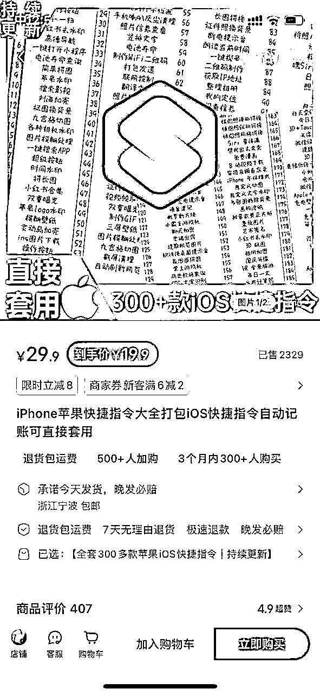

个人成长管理

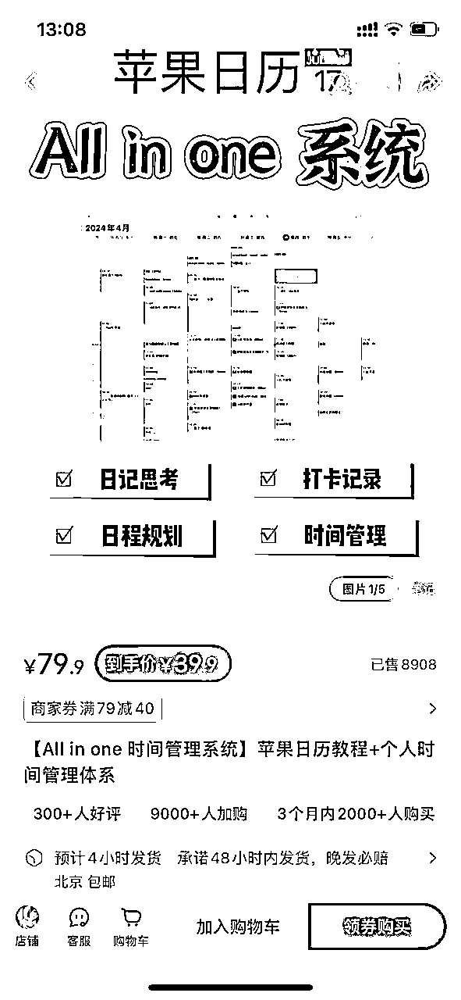

智能应用工具

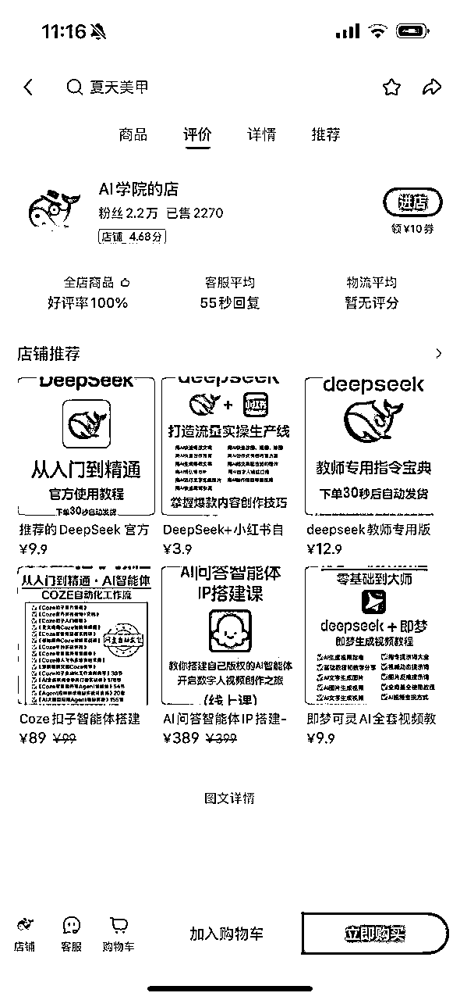

# ① 苹果快捷指令模板

适合人群：用苹果手机的人。商品核心是各类快捷指令模板，让设备更高效、生活安排更顺手。常见有记账指令、截图加壳、九宫格切图、双重曝光、图片模糊、时间记录等。

销售节奏：
- 最强：毕业季5—7月，学生与初入职场者换机换设备，需求集中；9月开学，设备更新，效率类模板更受欢迎。
- 次强：1—2月，大家做新年计划，生活效率工具关注度上升。
- 第三档：11—12月双十一和年终促销，新设备入手后开始配置；3月、10月学期中段，学习和工作流程需要调整，效率类指令也有需求。

# ② 个人管理模板

适合人群：大学生、应届生、职场新人、在职者、自由职业者、创业者。提供知识管理、日程管理等工具，帮助规划生活、推进个人和职业目标。常见商品包括日程日历系统、财务管理系统、知识管理系统、目标管理系统、健康管理系统等。

销售节奏：
- 最强：5—7月毕业季，高考生、大学生、职场新人规划需求旺；9月开学和职场调整，日程与目标类工具需求增加。
- 次强：1—2月新年目标期，个人成长和效率提升受关注。
- 第三档：11—12月双十一和年终促销，购新设备或做年度总结时开始整理规划；3月、10月季度中段复盘调整，知识管理和目标管理工具有一定需求。

# ③ 智能应用工具

适合人群：想用AI提效的入门者。提供AI入门资料和已搭好的工具，帮助在工作中更顺手地使用AI。常见商品有AI指令大全、DeepSeek知识库搭建、coze工作流、AI问答智能体等。

销售节奏：
- 最强：新项目启动时，团队要快速建知识库、优化流程，需求最大；某类AI应用或平台引发关注时，用户集中学习和尝试，需求也会上升。
- 次强：职场人遇到瓶颈、准备跳槽或晋升时，会主动学AI工具提升竞争力；产品或平台大版本升级、新功能上线时，用户需要新资料和实操指南，需求增加。

# 赛道 2：热门考试怎么卖

考证类

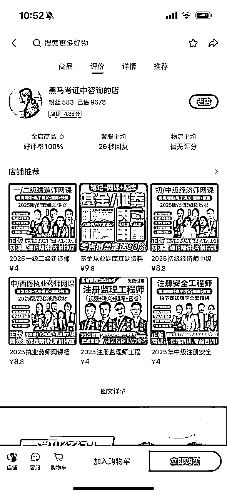

招聘类

# ① 考证类

谁在买？手上有下半年从业资格考试安排的那批人。他们缺的东西很具体：复习材料、面试点拨，以及一套能让自己稳住的备考节奏。

能上架的东西不算少：教材串讲、复习路线图、真题、模拟卷、冲刺包；形式上，网课、刷题工具、手写笔记都有人要。

什么时候卖得动？两个最旺的节点。一是报名结束到开考之前那两个月，人已经进入高压状态，规划类与复习类最抢手；二是准考证能打印以后的二十来天，押题卷、真题讲解、答题套路会被集中搜索。次一档的窗口出现在官方挂出公告、报名通道尚未打开之间——大家刚起步，需要教材精讲和一份靠谱的学习计划。

# ② 招聘类（校招版）

这条线盯的是应届生，各类校园招聘都算在内。

他们想买什么，其实很实在：简历样式、笔面材料、职业方向梳理、夏招日历、行业盘点与岗位清单、模拟面试和题库。素材形态是简历模板、求职路径指南、笔面资料、企业真题拆解。服务端还能往外延伸：刷题工具、网课、线上职业规划课、单份简历精修；也可以打包成闭环——先定方向，再改简历，接着网申、笔试辅导，最后面试陪跑。

节奏分得比较细。

6 至 7 月最旺，企业集中放岗，面试技巧和模拟题库几乎供不应求。5 至 6 月热度次之，夏招刚开闸，大家忙着打磨简历、练面试。再往下有三个小节点：4 月下旬到 5 月，部分公司提前放出职位，属于预热；7 至 8 月收尾，仍有补录名额，可材料类需求转淡，表格模板这类职场小工具反而走俏；9 月校招落幕、实习生招募启动，正好推实习向的简历样式与面试技巧。

另一条线是社招统考：笔试通知到手到开考之间最集中，多数人临时抱佛脚，销量最高，属第一档。报名结束到等笔试通知之间是准备期，热度排第二。官网挂出公告到报名开始之前，则是最弱的一档。

# 25 下半年热门考试

按月排一下，这些场次值得记住：

5 月——二级建造师 10 至 11 日；基金从业资格 24 日开考。

6 月——高考 7 日鸣锣；英语四六级笔试落在 14 日；银行从业资格（初级、中级）14 至 15 日两天；证券行业专业人员水平评价统一测试排在 28、29 日。

8 月——注册会计师专业阶段与综合阶段，都定在 24 日。

9 月——会计专业技术资格（中级）6 至 8 日；中小学教师资格笔试 13 日。

10 月——高等教育自学考试 25 至 26 日；银行业专业人员职业资格（初级、中级）同样摊在这两天。

11 月——基金从业资格考试再开一场，8 日；中小学教师资格面试预计在 8 日前后。

12 月——中小学教师资格面试 6 至 7 日。

各领域考试安排可查中国人事考试网：http://www.cpta.com.cn/testPlan/1899.html

# 赛道 3：成长技能

PPT 模板

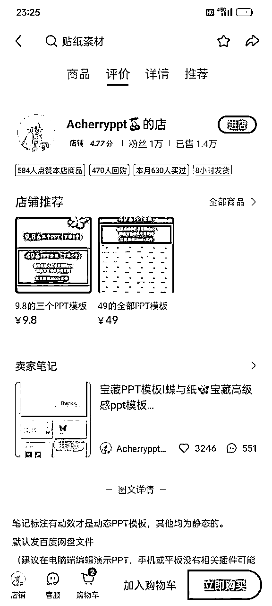

知识库

大学生实践报告

职业规划

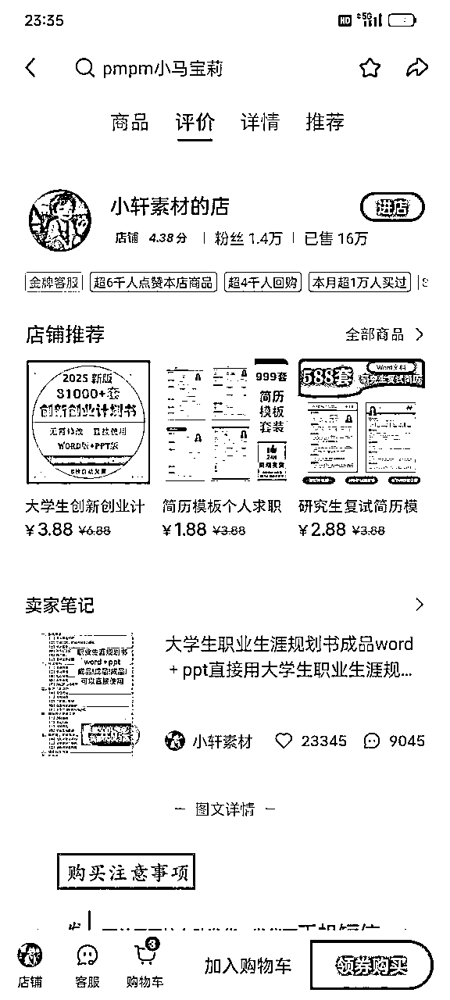

# ① PPT 模板

受众多为四类：在读书的、上班的、单干的（自由职业者与小创业者），以及讲课培训的老师。价值点很直白——替客户省下排版工夫，把成品的专业感提上去，顺带覆盖各种使用场景。

品类上可以铺：通用商务款（汇报、项目方案、市场分析）、按行业切的垂直款（互联网、教育、金融、医疗）、偏设计感的创意款（动态演示、视觉设计），还有营销推广款（📕投放策略、品牌传播、活动方案）。增值服务可以加定制设计，以及教人做 PPT 的课程。

旺季分三档：最猛的是 5 至 7 月毕业季，毕设答辩刚需；9 至 11 月求职季次之，职场新人与应聘者要拿得出手的简历和面试演示稿；12 月到次年 1 月的年终复盘、年初规划期排第三，公司和个人都得做总结与展望。

# ② 知识库

面向自学者和自由职业者这类个人买家。卖的是成体系的知识包，让买家少走摸索路，把自学效率提起来。

内容大体四块：

语言类——多语种语法速成包（英语、日语以及编程语言等）、口语实战素材（场景对话、发音矫正音频）、应试冲刺包（雅思托福高频词表、等级考试真题）；

职业发展类——自由职业者工具包（怎么接单、怎么跟客户沟通、税务怎么处理）；

技能类——Python 起步、数据分析实操、设计软件教学，外加副业变现手册（自媒体打法、电商选品、AI 工具用法）；

效率类——时间管理清单（周计划、优先级矩阵）、学习方法（速读技巧、知识体系搭建路径）。

节奏上：1 至 2 月新年计划期（语言包、效率工具）和 9 至 10 月开学自我提升潮（编程包、副业包）最旺；6 至 7 月暑假技能充电、11 至 12 月双 11 大促（课程打折、组合包秒杀）次之；5 月自由职业者日（副业、接单专题优惠）和开学前的预热促销算第三档。

# ③ 大学生实践报告

买家就是在校生。产品是范文、模板加写作指导，让学生一看就懂报告该怎么搭架子，省时省力，成品也更像样。

覆盖范围：不同学科的模板（理工、文史、商科），以及毕业设计、实习总结、课程实践这几类。附加服务有定制和一对一改稿。

旺季：5 至 7 月毕业季（毕设与实践报告要拿得出手）、6 至 9 月实习季（实习报告怎么写）最集中；9 至 10 月开学季（课程项目要用）、11 至 12 月学期过半（开始攒学期报告）是第二波；1 至 2 月和 7 至 8 月寒暑假算第三波，学生趁空档提前准备。

# ④ 职业规划

受众横跨四类：在校生与应届生、刚入职的、在职的、自由职业与创业人群。卖的是规划工具与思路，帮买家把职业路径想清楚。

可提供：职业生涯规划书、各类规划模板、SWOT 分析法、目标拆解表、时间管理工具、简历样式、行业研究报告。服务端能加规划课、一对一咨询、定制方案。

节点：5 至 7 月毕业季与 9 至 11 月求职季最旺——前者面临择业，后者忙着跳槽转行；1 至 2 月年初立目标时次之；4 至 5 月和 10 至 11 月学期过半、需要中途校准方向时排第三。

# 赛道 4：教育资料

不同学段的店铺对标与内容呈现方式：

幼小启蒙

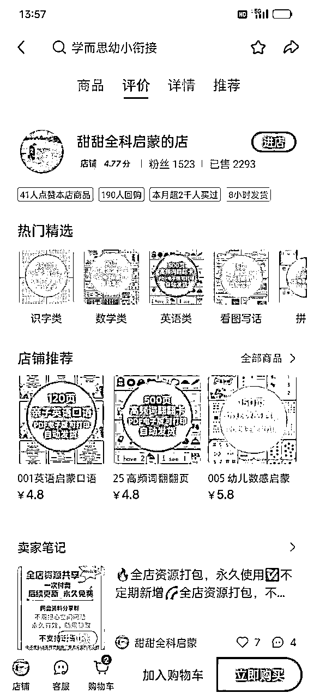

k12-小学

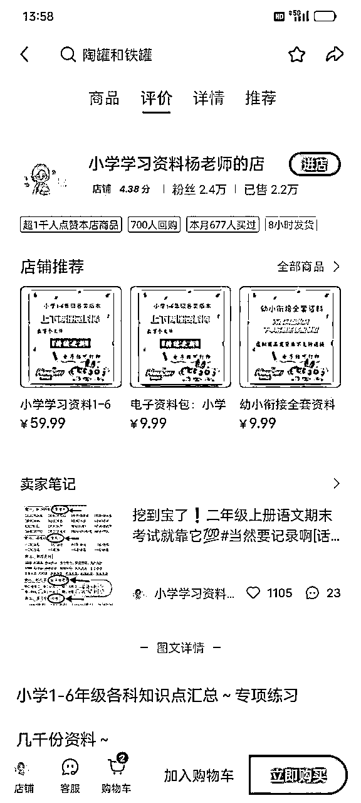

k12-初中

k12-高中

大学

考研

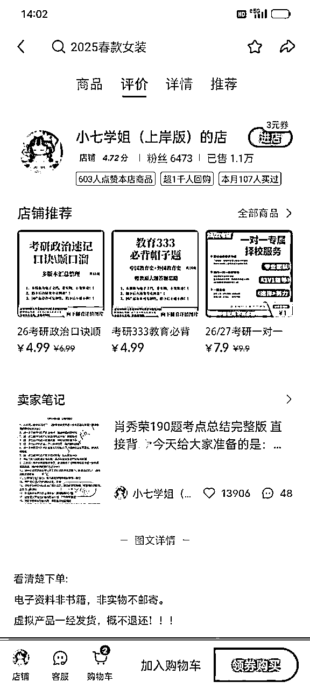

自考/成考/统招专升本

# ① 幼小启蒙

买主是年轻父母和幼教老师。产品分两块：一是给孩子打底的学科启蒙与综合素质内容（数学、语文、艺术、体育、科学）；二是给老师的教学课件、教案、工作计划表。还能做定制，比如按需出课件或教案。

节奏：3 月和 9 月开学最旺，家长要给孩子备新学期的料，幼小衔接课、拼音材料、数学启蒙是主推；4 至 5 月、10 至 11 月学期过半，家长会按孩子情况补货，亲子游戏、手工、绘本阅读这类内容好卖；6 月和 12 月学期收尾，家长买复习资料或提前准备下学期，可发些育儿心得、教育理念做引流，再挂基础产品走量。

# ② k12（小初高）

买家是各学段家长和老师。三条产品线：学科内容、期末与升学备考包、面向教师的教学素材。

学科内容覆盖语数英及文理各科——知识点梳理、基础题、解题方法、专项训练、单词背法、语法精讲、公式汇总、实验指导等；备考类有中高考真题解析、模拟卷、复习计划、冲刺包；教师端则是座位表、家长会课件、活动方案、试卷模板、教学大纲。服务可延伸为学习计划定制、线上课、答疑，还能对接机构拿授权课程与教辅，走高价单。

旺季：每学期中后段的 4 月、6 月、10 月、12 月，也就是期中期末前后，销量最高；中高考前三个月（3 至 5 月）冲刺需求最猛，模拟题、真题、答题套路最好卖。1 至 2 月和 7 至 8 月寒暑假是第二档，家长买来巩固或预习。3 月、9 月开学初期排第三。

# ③ 大学

面向在校生。三个板块：学科内容、期末复习包、教师教学素材。

涵盖各专业教材、课堂笔记、实验教程、考点梳理、复习材料、模拟卷、四六级内容（真题＋技巧＋词汇）、时间管理方法、数字模板（PPT、Excel）。服务可做学习计划定制、线上课与答疑。

节点：9 至 10 月开学，新生老生都要备料，教材、笔记、课程辅导最紧俏；5 至 6 月和 12 月至次年 1 月考试季，复习材料、真题、模拟卷需求触顶。3 至 4 月、10 至 11 月学期中需求平稳，仍有零星补充；毕业生要备毕设论文，也有人提前为考研或求职囤货。8 至 9 月开学前是第三波。

# ④ 考研

买家是在校生、应届本科生和往届生。卖公共课与专业课的复习材料。

涵盖教材精讲、重点汇总、真题与解析、英语词汇册、语法讲解、写作模板、数学公式与解题法、计划表、备考攻略、时间管理工具，以及线上模考系统和题库。服务端可加专项课、冲刺班、复试辅导。

节点：初试前 3 至 6 个月，也就是 7 至 12 月，是黄金期，政治英语数学的真题、模拟卷、押题最抢手。9 至 10 月报名阶段，基础材料、备考规划、学习计划需求走高；次年 2 至 4 月复试前，专业课与面试准备需求上升。1 至 2 月、7 至 8 月寒暑假基础内容需求稳定；3 月、9 月开学则有一波集中购买。

# ⑤ 统招专升本/成人自考/成人高考

买家是备考的学生与社会考生。提供公共课与专业课的复习材料。

公共课（语文、数学、英语、政治、信息技术等，各省不同）有教材精讲、知识点梳理、真题解析、模拟卷、答题技巧；还有个性化备考方案、时间管理工具、线上模考与题库。服务端可加冲刺班、答疑、专项课、报名指导、院校选择分析。

节点：考前两个月左右进入冲刺，真题、模拟卷、押题最旺；报名前是准备期，基础内容与计划类需求较高；成绩出来后，落榜考生转入下一轮备考，需求回升。

# 其他：小众赛道

宠物训练

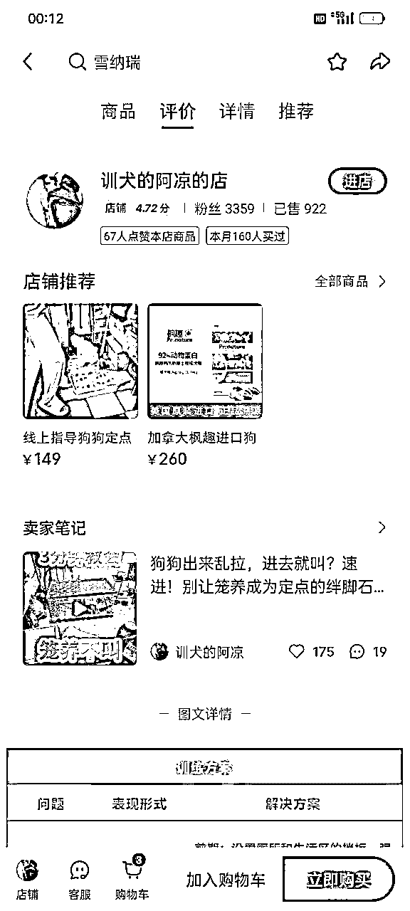

摄影滤镜

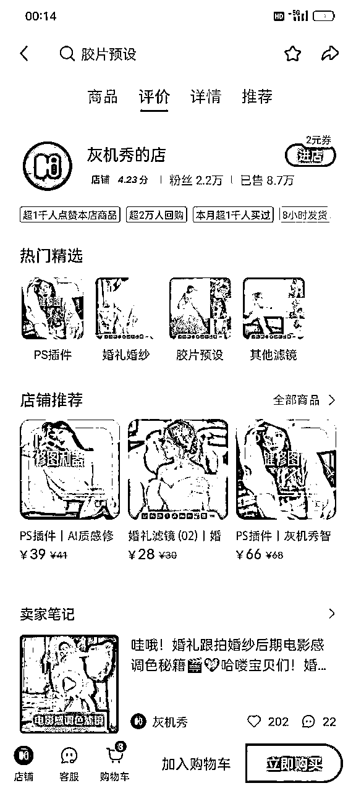

人性思维

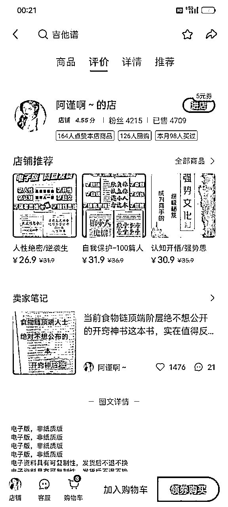

装修避坑

# ① 宠物训练

买家是养宠人、宠物行业从业者和爱好者。产品是成体系的训宠内容，可附加一对一视频指导，针对吠叫、拆家等常见行为给出解法。也能按宠物性格和主人诉求定制方案，让养宠体验更顺。

# ② 摄影滤镜

面向职业摄影师与摄影玩家。提供相机滤镜资源，以及不同场景该用哪种滤镜、怎么调的思路，帮买家把成片效果拉上去。

# ③ 人性思维

买家画像较杂：职场人、创业者与管理者、自我提升爱好者、销售与营销岗、心理咨询师与培训师。产品是成体系的人性洞察内容，帮买家看懂人、升级思维方式，在工作与生活中解决具体问题。

# ④ 装修避坑

买主包括装修新手、自装业主、中高端住宅业主、二次翻新业主、商业空间业主。提供从开工前准备到竣工验收的全流程避坑内容、工具与表格；可附加一对一咨询，按户型与预算定制避坑方案，让装修少踩坑。

# 1.5 选品

📕虚拟产品，主流选品路子有两条：

一、从爆款笔记反推爆品

二、借淘宝找品（新手推荐⭐）

新手我更建议先走第二条：淘宝的类目体系在国内主流搜索电商里最全，平台也最成熟，而且不用花钱。

不过前期也得多刷📕爆款笔记，摸清平台当下什么品走得动——毕竟各平台口味有差，顺带还能练网感。

下面拆解具体操作。

# 1.5.1 从爆款笔记找爆款选品

举例：某篇笔记爆了，点进关联商品，详情页标注着“24 小时内已有 100+ 人下单或加购”，那这份材料就是被验证过的。

确认它没有明确的版权归属，你就可以直接铺到自己店里。

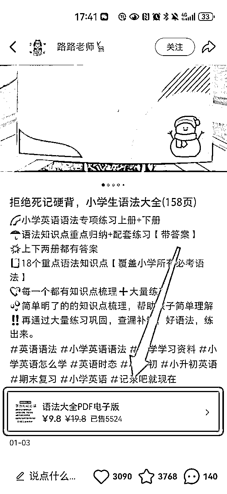

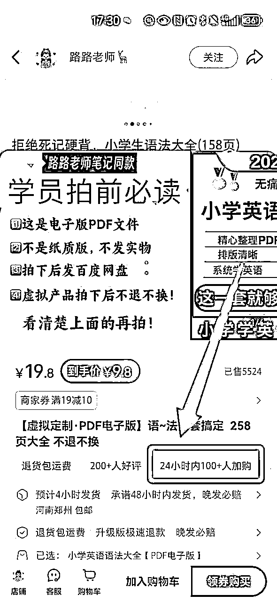

单份材料火，往往意味着这个品类火。比如爆的那篇是小学英语语法专项练习，品类就是英语语法（拿不准就看笔记的话题标签）。接着在📕搜“英语语法”，点商品栏，逐个点开详情页：

1. 只要页面出现“24 小时 xx 人加购/购买”的字样，直接上架。
2.

商品页看不到短周期加购/成交数据，只给出一段三个月的累计购买人数？先别判死刑。把评价区按时间倒序排，若最近一周能攒到二十条以上正面反馈，这个品仍可进入上架名单。

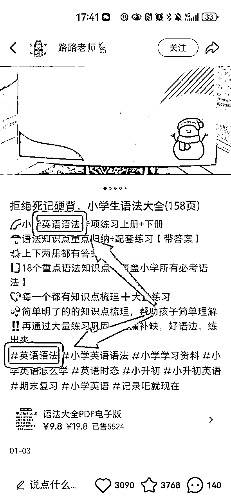

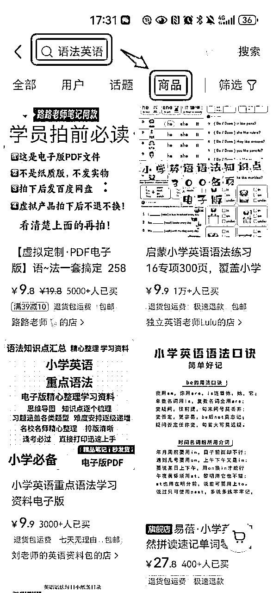

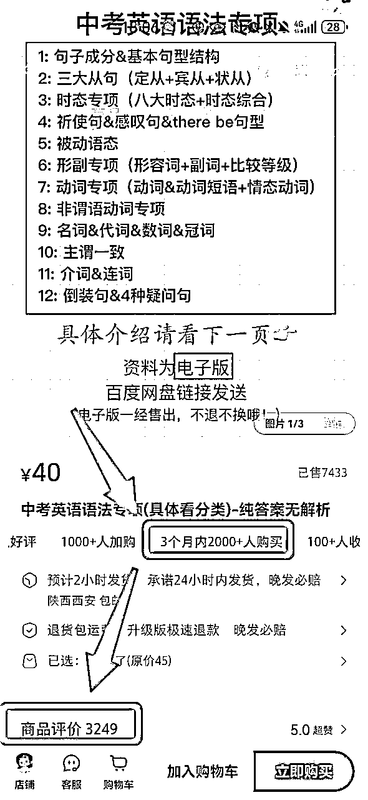

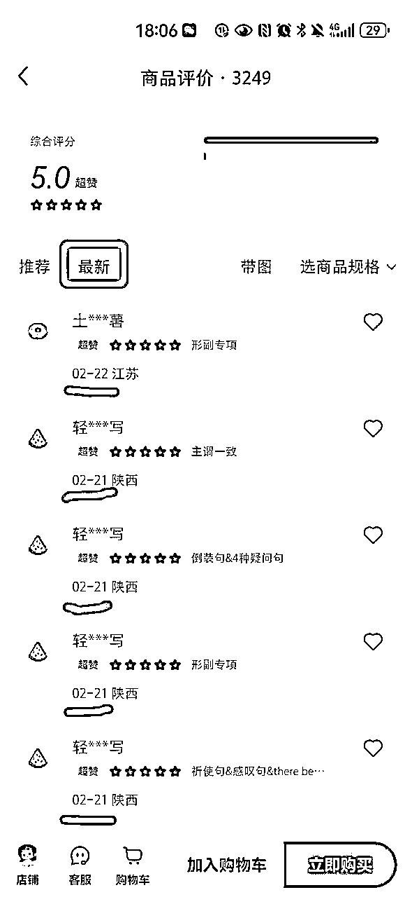

# 1.5.2 用淘宝账号养出选品池

找虚拟资料时，把淘宝当作日常信息流来刷：多搜、多看、多存。碰到销量顺眼的铺子，顺手记进收藏夹。账号行为越集中，平台越懂你想看什么，之后首页和搜索页会持续冒出同类资料与店铺，货源线索就会自己找上门。拼多多可以照搬这套动作。

关键判断：在淘宝表现好的资料，放到📕通常也不弱，这一点很关键。

# 💡 快速验品三步法

淘宝上成交不错的资料，不必做复杂分析，按下面顺序过一遍：

先去📕检索同类内容，观察帖子互动是否密集；高赞内容多，代表关注度够。接着看📕店铺里同类商品卖得怎样：如果成交规模明显小于淘宝，就说明这块供给没吃透，值得试。最后对需求周期：产品只在特定月份走俏，就要卡准窗口。比如期末类 K12 资料，需求集中在五月、六月、十二月和一月，其他时段偏淡。

三步走完就够，选品时不必来回纠结。

举个例子：

假设时间来到二〇二五年三月二日，拿 K12 举例，在淘宝随手挑了两个成交不错的品。按上面的第一条逻辑，它们都满足“淘宝有销量”这一条。

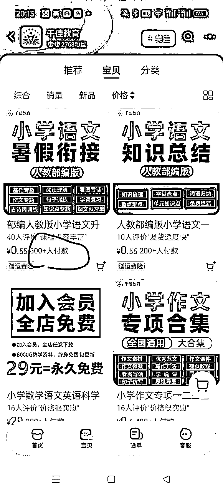

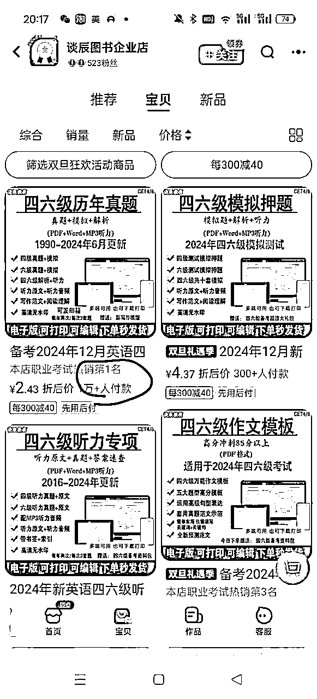

接着看📕内容热度。A 品帖子互动不错，几百赞不少，甚至破千，但店铺端成交不到三位数，这算值得做的品。B 品帖子同样有大量千赞，可店铺成交已经破万，这个直接放弃。

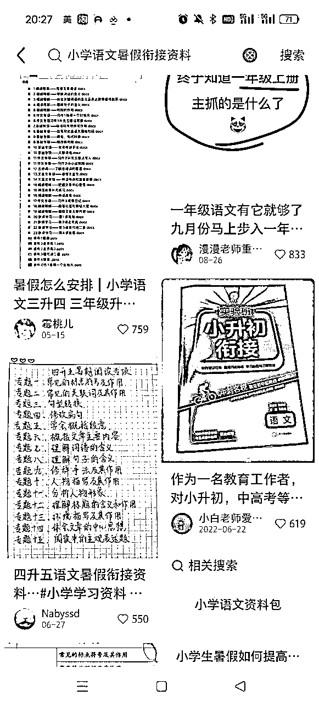

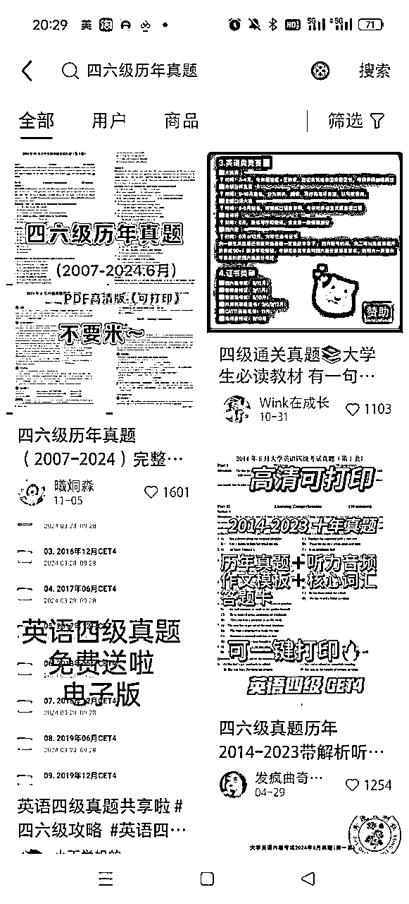

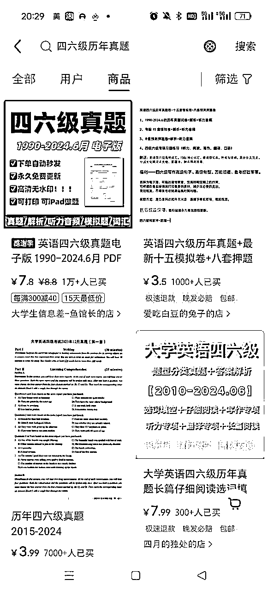

最后对需求周期。A 品是面向小学阶段的语文暑假过渡包，使用窗口在每年六月到八月，三月选它显然不合适。

这一步非常关键：确定一个品之前，一定要追溯它的需求在什么时间出现、什么时间强、什么时间弱。选品本质上是选需求，最多提前四周布局，比如五月开始铺暑假过渡内容。

# 1.5.3 虚拟资料选品参考⭐

下面这份方向清单来自赚钱官网，整理了 2024 年至今中标的📕虚拟资料风向标。为方便扫读，这里只保留方向和日期，原始出处可在赚钱官网对应风向标中检索：

**2025 年 4 月**
- 29 日｜热点事件演示文稿（PPT）
- 25 日｜手抄报素材
- 24 日｜办公常用字体合集
- 24 日｜行业培训资料册
- 24 日｜雅思备考材料
- 17 日｜外企英语 + 小学语法
- 16 日｜手写日记模板
- 15 日｜YouTube 英语学习视频
- 13 日｜教师痛点解决包
- 13 日｜官方三月成交排行
- 09 日｜📕赛道分析报告
- 05 日｜硕博求职信息差
- 03 日｜日语自学入口
- 03 日｜油管创作者视频
- 02 日｜手抄报素材

**2025 年 3 月**
- 23 日｜英语口语练习素材库
- 22 日｜商业计划书
- 21 日｜摄影滤镜预设包
- 21 日｜美食高清图库
- 20 日｜婚礼音乐合集
- 19 日｜作文智能批改工具
- 19 日｜i 人社交攻略
- 18 日｜运营知识库
- 18 日｜日语学习站点
- 16 日｜公考材料
- 14 日｜Notion 人生管理模板
- 12 日｜电商 AI 工作流
- 11 日｜纸上早教游戏
- 11 日｜大模型面试题
- 10 日｜飞书多维表格搭建（AI 协同）
- 09 日｜家政资料
- 06 日｜少儿 AI 识字课
- 06 日｜iPhone 快捷指令
- 04 日｜瘦身记录手账
- 04 日｜医学考试题库应用
- 02 日｜AI 辅助日语自学入口
- 02 日｜AI 上手教程

**2025 年 2 月**
- 27 日｜高校待遇信息差
- 26 日｜智能修图
- 25 日｜初学者钢琴曲目
- 21 日｜大学生实践报告与职业规划
- 17 日｜J 人旅行攻略演示文稿
- 10 日｜思维模型导图
- 06 日｜苹果自动记账指令模板

**2024 年 12 月**
- 24 日｜接亲歌曲听力试卷
- 18 日｜教师授课课件
- 06 日｜AI 代笔服务
- 03 日｜苹果自动记账教程

**2024 年 11 月**
- 25 日｜刷题应用
- 22 日｜大学生职业规划与简历模板
- 01 日｜多邻国 Super 会员

**2024 年 9 月**
- 12 日｜演示文稿模板
- 02 日｜教师素材＋演示文稿模板

**2024 年 8 月**
- 29 日｜教师授课课件
- 26 日｜考公考编笔记
- 21 日｜英语手绘笔记
- 20 日｜考研英语表
- 20 日｜人生管理系统模板
- 19 日｜手抄报线稿模板
- 19 日｜大学生秋招信息

# 虚拟产品开店：账号、店铺、上架全流程

先把这段时间能用的资源摊开，按需要自取；后半部分再把号怎么搭、店怎么开、货怎么上，一步步拆开讲。

## 近期资源速览

- 2024.8.6｜考研刷题工具：https://wx.zsxq.com/mweb/views/topicdetail/topicdetail.html?topic_id=4844188442448888
- 2024.8.5｜装修施工图：https://wx.zsxq.com/mweb/views/topicdetail/topicdetail.html?topic_id=2855411248481211
- 2024.7.25｜实习、离职证明参考样例：https://wx.zsxq.com/mweb/views/topicdetail/topicdetail.html?topic_id=8855411511515142
- 2024.7.24｜高考志愿填报与升学咨询：https://wx.zsxq.com/mweb/views/topicdetail/topicdetail.html?topic_id=2855411512815441
- 2024.7.24｜天池景区天气：https://wx.zsxq.com/mweb/views/topicdetail/topicdetail.html?topic_id=1522181155441512
- 2024.7.22｜强者思维素材：https://wx.zsxq.com/mweb/views/topicdetail/topicdetail.html?topic_id=2855414244224421
- 2024.7.22｜社保缴纳方案：https://wx.zsxq.com/mweb/views/topicdetail/topicdetail.html?topic_id=5122485212288114
- 2024.7.17｜宝宝起名：https://wx.zsxq.com/mweb/views/topicdetail/topicdetail.html?topic_id=5122481855424584
- 2024.7.16｜语文学习包：https://wx.zsxq.com/mweb/views/topicdetail/topicdetail.html?topic_id=1522115814248142
- 2024.7.10｜大学生PPT合集：https://wx.zsxq.com/mweb/views/topicdetail/topicdetail.html?topic_id=5122441428184184
- 2024.7.9｜工作效率SOP：https://wx.zsxq.com/mweb/views/topicdetail/topicdetail.html?topic_id=2855448541112141
- 2024.7.8｜公考面试答题稿：https://wx.zsxq.com/mweb/views/topicdetail/topicdetail.html?topic_id=5122458188114884
- 2024.7.1｜AI修图工具：https://wx.zsxq.com/mweb/views/topicdetail/topicdetail.html?topic_id=1522148588218582
- 2024.7.1｜AI工具会员：https://wx.zsxq.com/mweb/views/topicdetail/topicdetail.html?topic_id=4844252211551588
- 2024.6.28｜思维模型图集：https://wx.zsxq.com/mweb/views/topicdetail/topicdetail.html?topic_id=2855424252525281
- 2024.6.27｜纹身贴图案：https://wx.zsxq.com/mweb/views/topicdetail/topicdetail.html?topic_id=5122455428811414
- 2024.6.24｜幼儿识字PDF：https://wx.zsxq.com/mweb/views/topicdetail/topicdetail.html?topic_id=8855488281125122
- 2024.6.13｜大学备考资料：https://wx.zsxq.com/mweb/views/topicdetail/topicdetail.html?topic_id=2855488511518281
- 2024.6.12｜儿童绘本电子版：https://wx.zsxq.com/mweb/views/topicdetail/topicdetail.html?topic_id=4844241258525288
- 2024.6.6｜训犬专业电子书：https://wx.zsxq.com/mweb/views/topicdetail/topicdetail.html?topic_id=5122428584844114
- 2024.6.5｜婚内与财产协议：https://wx.zsxq.com/mweb/views/topicdetail/topicdetail.html?topic_id=5122588828248124
- 2024.5.30｜英语单词网课：https://wx.zsxq.com/mweb/views/topicdetail/topicdetail.html?topic_id=4844511542228448
- 2024.5.29｜PS插件与冷门滤镜：https://wx.zsxq.com/mweb/views/topicdetail/topicdetail.html?topic_id=8855211825148512
- 2024.5.28｜英语启蒙素材包：https://wx.zsxq.com/mweb/views/topicdetail/topicdetail.html?topic_id=2855218584584211
- 2024.5.17｜降AIGC率：https://wx.zsxq.com/mweb/views/topicdetail/topicdetail.html?topic_id=4844524128151248
- 2024.5.11｜银行校招材料：https://wx.zsxq.com/mweb/views/topicdetail/topicdetail.html?topic_id=4844582415815428
- 2024.4.23｜茶艺网课：https://wx.zsxq.com/mweb/views/topicdetail/topicdetail.html?topic_id=4844588414841528
- 2024.4.17｜幼教课件：https://wx.zsxq.com/mweb/views/topicdetail/topicdetail.html?topic_id=1522452484242222
- 2024.4.16｜公考备考材料：https://wx.zsxq.com/mweb/views/topicdetail/topicdetail.html?topic_id=4844584844151828
- 2024.4.15｜简历润色：https://wx.zsxq.com/mweb/views/topicdetail/topicdetail.html?topic_id=8855254245118482
- 2024.4.10｜亲子教育电子包：https://wx.zsxq.com/mweb/views/topicdetail/topicdetail.html?topic_id=5122188824818484
- 2024.4.8 

# 二、搭建账号与店铺

**本节要义**

做这门生意，最值钱的家当不是资料，而是账号。号一旦出状况，进账马上跟着缩水。想长期扎在这个项目里，把📕号、🛰️号都养顺，属于绕不过去的手艺。

**本节航线图**

学完并照做，航线图第一阶段就到手了：定位、开店、上架，合计约 3 天。

1. 备好两家以上的📕号、外加一家店铺（半天左右）
2. 把账号与店铺的定位、包装做到位（半天左右）

得先把旧脑筋换掉。早些年那套把流量往私域拽、跟平台打游击的路数，跟眼下是两码事。你现在是在📕开店卖虚拟产品，本身就是平台电商盘子的一部分，规矩之内的买卖，犯不着天天提心吊胆怕违规。

换个说法，一卡一机一号、只准流量不许WiFi、刻意养号这类讲究，可以不必当真，怎么省事怎么来。

（一卡一机一号这条，做过淘宝闲鱼的人格外敏感，因为官方条文里确实写过。但要看清背景：淘宝闲鱼早已进入成熟期，平台为压制大批量矩阵无货源这类伤害用户体验的做法，才立了这些杠杠。📕恰好相反，正冲电商GMV，巴不得商家多开几家铺子。）

本期给出的起步配置：一家店铺＋两个📕号（其中至少一个实名）＋两张手机卡。按眼下规则，一家店铺可以绑定四个📕号，剩下三个无需实名。

## 2.1 准备账号

### 2.1.1 准备设备

✔️ 手机：只要这台机器没吃过“永久封号”“永久限流”两种重罚，就还能接着用，轻微违规不碍事。

✔️ 手机卡：拿没注册过📕的卡来使；手上有旧号也行，以前跑过无货源等项目的号同样能接着用，前提一样是没有那两种重罚。

想省钱，去淘宝或京东搜“电信无忧卡”，5元月租开一张；也可以跑趟营业厅给现有卡加副卡，一般10元一个月。

✔️ 账号：一机一卡一号固然理想，凑不齐也不致命。一台机器同时登两个号基本没毛病，WiFi还是流量不必纠结，顺手最要紧。

#### 2.1.1.1 手机准备

单打独斗，手上设备往往不超过十台；要做到工作室矩阵那种体量，十台起步，上百台也常见。下面列几款工作室里跑得多的机型。

苹果这边：
- iPhone 7：老将，价格友好，跑流程利索
- iPhone 8：偏游戏与短视频，发热低、响应快
- iPhone SE2：存在感弱，直播、电商、短视频都撑得住
- iPhone X：直播电商短视频养号皆可，钱包宽裕再考虑

安卓这边：
- 红米10X：各项均衡
- 小米10青春版 8+128G：性能拿得出手
- 小米8青春版、小米8SE：用的人不少

安卓机型太多，不逐个说了。挑机器的铁律记几条：二手优于全新，当然成色好的新机也能捡；原装优于组装，无指纹、无面容的基本可判定拆过修过；尽量别在闲鱼淘；国行优于外版；看配置别看外壳；认牌子别碰杂牌。配置优先8+128GB；机龄上，安卓不超4年，苹果不超6年。

设备建议两台起步，机器越多，跑出成绩的概率越高。卡的话，跑营业厅办三张以上，选最低月租但带流量的套餐，流量尽量20G往上，用一张主卡拖两张副卡的模式，把需求直接讲给柜员听就行。

#### 2.1.1.2 电话卡准备

三条路：
1. 当地营业厅现场办
2. 支付宝搜“号卡中心”办
3. 淘宝或京东搜“电信无忧卡”，月租5元

#### 2.1.1.3 账号&店铺准备

**个人店**：门槛最轻，一张身份证加一个已实名的📕号，别的材料一概不用，审核很快。

**个体店**：得有个体户执照。真去办，选百货店类型比较合适；淘宝、闲鱼上找人代办，一张约莫一百块。

**企业店**：拿公司执照申请。相对个体店没多少额外好处，还得牵扯税务，麻烦，直接放弃。

**开哪种合适**：纯新手，别想太多，个人店走起。有点经验、准备铺矩阵的，先拿个体工商户去认证蓝V（600元），再开个体店，将来绑矩阵号更省事。

### 2.1.2 注意事项

下面几条是防患于未然，能躲就躲。

1）新号别急着挂商品链接

真实踩过的坑：两个刚注册的号，注册当天就开始密集发商品笔记，几天后收到通知——账号近期发布过多不符合平台规范的内容，暂不支持薯条投放。可同样操作的号里，大多数安然无恙。变量太多，是概率、是运气、还是内容本身，说不清。

稳妥起见，新号头三天照常发笔记，但链接先别挂；三天后回头编辑笔记把商品补上，之后随便操作。

2）凡是像“引流”的动作，全避开

- 简介里别出现“私戳”“后台踢我”这类暧昧词。哪怕你没那个心思，平台如今查得极严，宁枉勿纵。
- 别用📕账号回私信。哪怕你只是想把人引到自家店铺下单，措辞稍有不妥就可能被判引流。千帆App端现在支持直接回复用户消息。

3）小眼睛为0或很低，属于正常现象

2024年9月26日之后，平台基础播放量明显缩水。内容没问题却数据惨淡，一般逃不出三种情况：

- 底量本就低。从前好歹一百左右，如今只剩几十，甚至一二十
- 起量慢。先给你一两个甚至零个小眼睛，隔一天、甚至几天才慢慢涨
- 数据显示异常。笔记挂着个位数，实际播放远不止这些

还有个普遍误区：把抖音播放量跟📕小眼睛划等号，于是总觉得数据差、怀疑被限流。换算关系记一下——抖音播放量乘以8%，大致等于📕的小眼睛。

### 2.1.3 定位包装

无论做🛰️、抖音、📕、视频号、B站还是闲鱼，只要涉及立人设，这套思路都能套用，堪称通用公式。

#### 2.1.3.1 人设包装（通用版本）

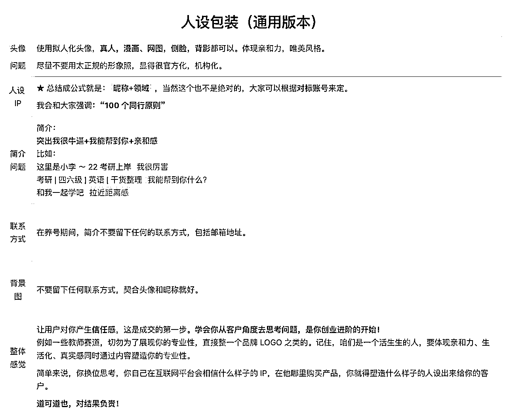

## 2.2 开通店铺

要点：
- 纯新手，个人店直接开，别的不用想
- 准备做矩阵的老手：先办个体户执照→认证蓝V（600元）→开个体店。执照经营范围含图中红线那项即可，其余随意。

开店入口（千帆直达）：手机号登录后选个人入驻
https://ark.xiaohongshu.com/?ticket=ST-68c517438149514474558399hfl9opty5x6viycd&from=ark-login

保证金提醒：金额1000元，但不必急着交，等赚回1000再补，先保证不亏。没交的时候无法提现，等要提现了再交即可。

开店流程：

1. 打开📕官方电商链接
https://ark.xiaohongshu.com/?ticket=ST-68c517438149514474558399hfl9opty5x6viycd&from=ark-login

2. 按个人身份或个体工商户入驻

3. 填必填资料＋刷脸。昵称会跟📕账号名同步，想换的话改账号名，或者入驻后在个人信息里改，这条无关紧要

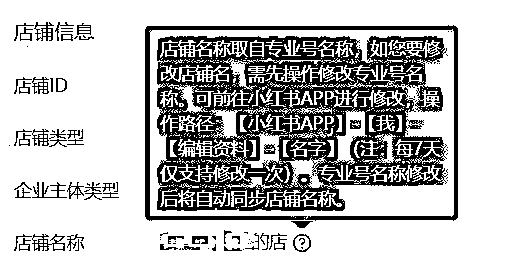

主营类目用默认的“零售批发、生活娱乐、其他”，因为虚拟资料类目要额外上传资质。地址设置、店铺信息认证照填，物流模板里的地址随便写，不影响什么；不踏实就填自家地址再模糊处理，主页只显示不展示详细门牌。

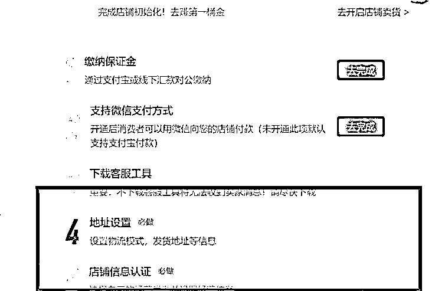

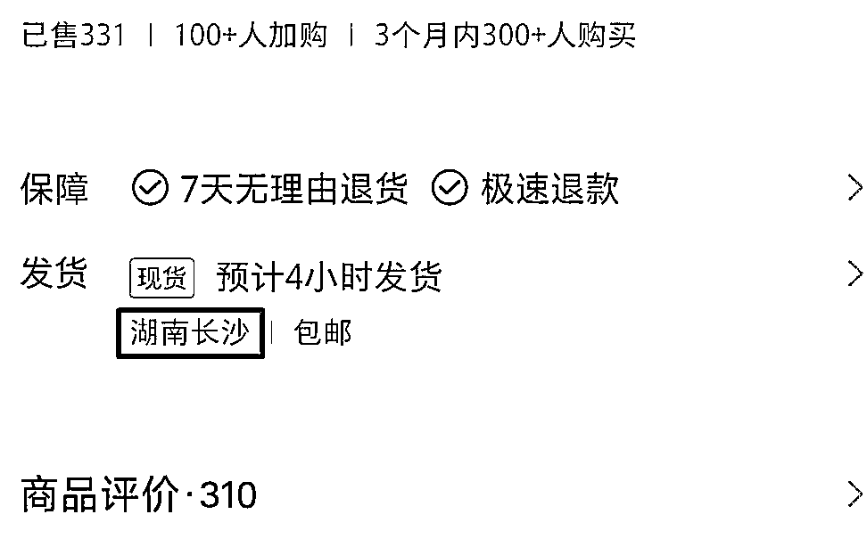

经营类型勾3或勾4，二选一。

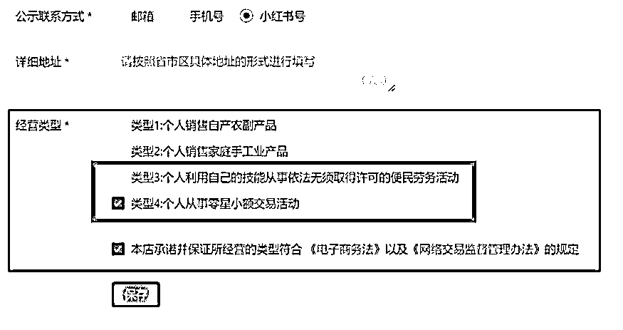

商品类目选“电子资料包”。

提交后显示审核中，通常一分钟内出结果，刷新即可进入。

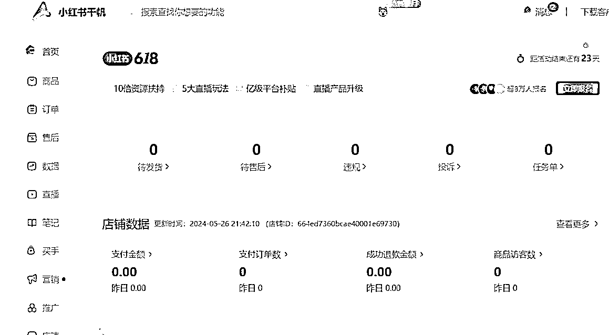

# 三、上架虚拟产品

**本节要义**

千万别把顺序弄反：货先上，笔记后发。年后这段时间，📕商城的自然搜索流量有回暖，运气在线的话，光是上架也能带来订单。另外发笔记时，直接挂上商品链接。

**本节航线图**

完成本节学习与实操，航线图第一阶段（定位、开店、上架，约3天）就到手了：

1. 找到虚拟产品并上架，约1天

## 3.1 准备虚拟资料

### 3.1.1 虚拟资料的来源

来源无非两类。

1. 整合公域无版权内容（短期打法）

把公开渠道的无版权素材扒下来归类，做成自己的引流资料包，比如班级座位表、PPT模板、人生管理飞书模板之类。

提醒：这招不是长久之计，只适合新手拿来快速跑通最小MVP；务必只收市面上无版权、可免费流通的东西，避开版权纠纷。碰上弱版权素材（像百度文库里的文档），可以到裁判文书网查一查版权方的涉诉情况，判断风险高低。

2. 自己开发资料（长期打法）

如果你手里已经攒下不少自有内容资产，又或者打算在一个小众赛道里沉下心经营，那这篇文章正好能派上用场。

AI 工具的普及，把“自己做素材”的门槛拉低了一大截。等这个项目从零到一打通之后，感兴趣的圈友可以再往前探索👉【第六章、用 AI 制作虚拟资料产品】

所以把视线放远一点，第二种思路才是更值得下注的方向，第一种只能当作过渡期的临时安排。

⭐为了帮大家省时间、尽快让项目完成冷启动，下面会把第一种思路（整合公域无版权资料）的详细链路掰开揉碎讲清楚。

# 3.1.2 小白怎么把公域里的免费资料整合成自己的资源

这套玩法的价值，在于帮新人以最快速度走完从 0 到 1 的验证。但放远看，还是希望大家跑通之后，去学怎么用 AI 产出带原创属性的数字内容，路才能越走越宽。（AI 原创虚拟资料教程详见【六、用 AI 制作虚拟资料产品】）

# ① 引流送什么，先想明白

拿「日语培训」来说。如果你只是觉得这个方向有戏，但自己对日语培训完全没有概念，那最简单的办法就是去看同行在送什么。要是对方把赠品晒出来了，就顺着他们的思路，再结合自己的感觉，挑出最能勾住用户的那几样。当然，同行的赠品清单一定要多比对，因为这些内容大多已经被人试过错，先照着描，再琢磨怎么超过它。

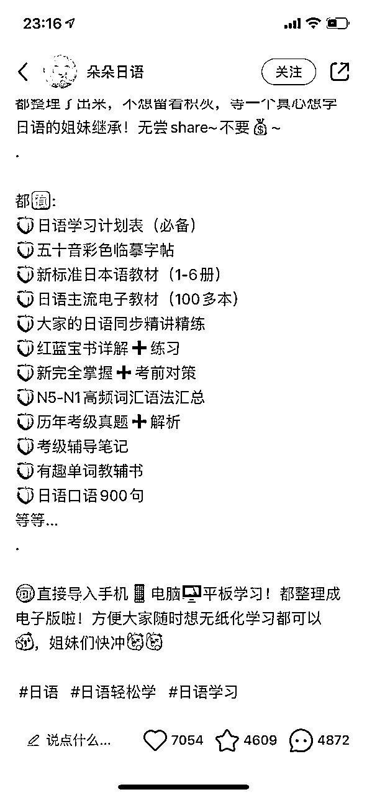

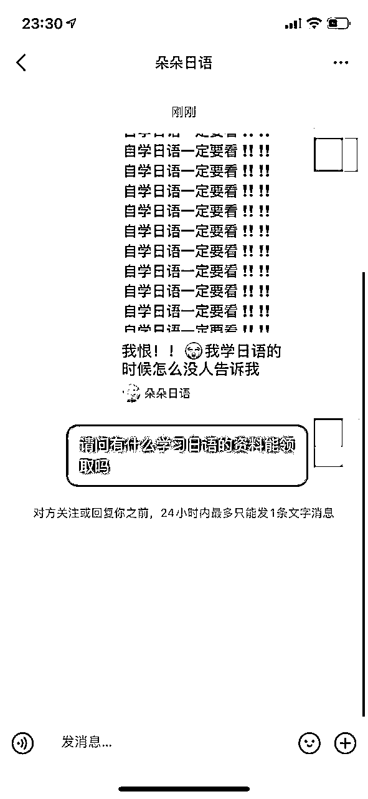

搜一下「自学日语」，同类账号呼啦啦涌出来一眼看不到头。刚好看到一个叫「朵朵日语」的号，直接把送的东西列得清清楚楚：日语学习计划表、五十音彩色临摹字帖等等。要是对方没列也不要紧，多翻几篇笔记，或者私信问一句“有什么能领”，照样能把前期的赠品清单摸个八九不离十。

# ② 资料去哪里搞

赠品方向定了之后，下面几条路都能帮你搜到不受版权限制的内容。

1、找同行伸手，推荐度★★★★★

跟同行打照面的时候，顺手就能薅走一部分内容。想做的领域资料量大，那就多薅几个号。也别把自己限制在单一平台上，抖音、今日头条、B站、视频号，甚至🐧里，都可能有同行的影子，都值得探一探。

把搜到的号多筛几轮，留下一直有更新、看着踏实的，再按内容质量分门别类列成表，这就是日后持续补货的底仓。同行发出来的东西通常都盖着水印或二维码，怎么把它们清掉、再换成自己的二维码，后面会专门讲。

2、网盘搜索器，推荐度★★★

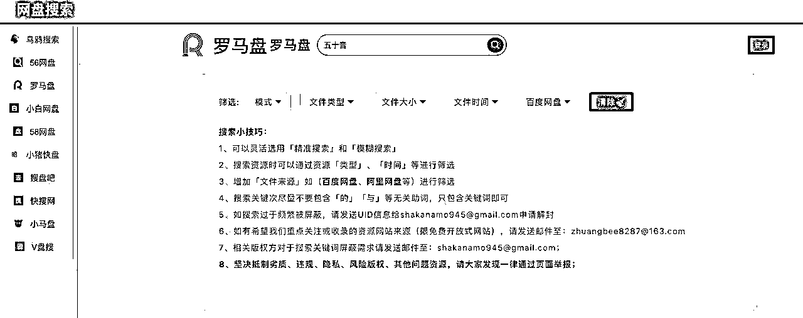

有些百度网盘的分享链接，用合集式的网盘搜索工具能直接翻出来。在百度敲「网盘搜索」，会弹出一长串网站，挨个点进去输关键词就行。但别人存档时的命名习惯千奇百怪，不一定规规矩矩叫「日语资料」，得多试几个词，比如「五十音」「新标日语」这类更具体的名字。有些站点还要扫码或先做完任务才能用，当个补充手段就好。

3、👸号渠道，推荐度★★

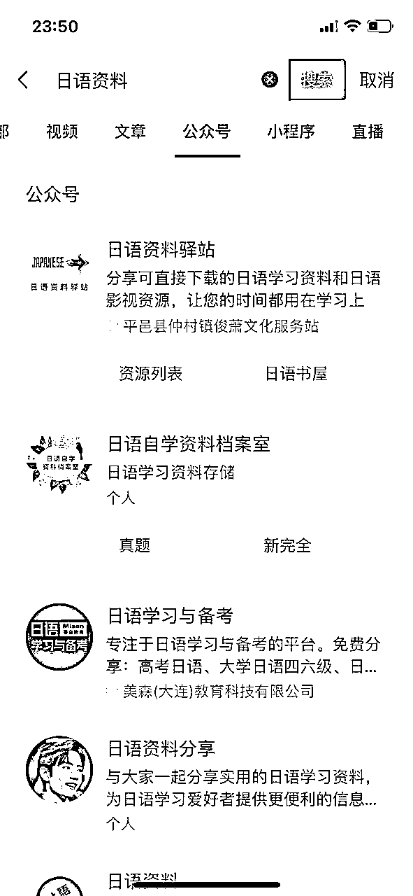

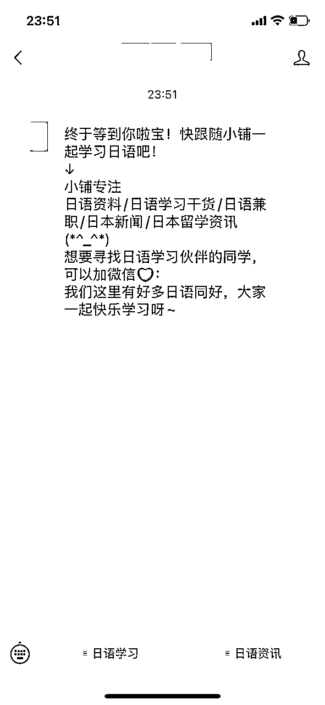

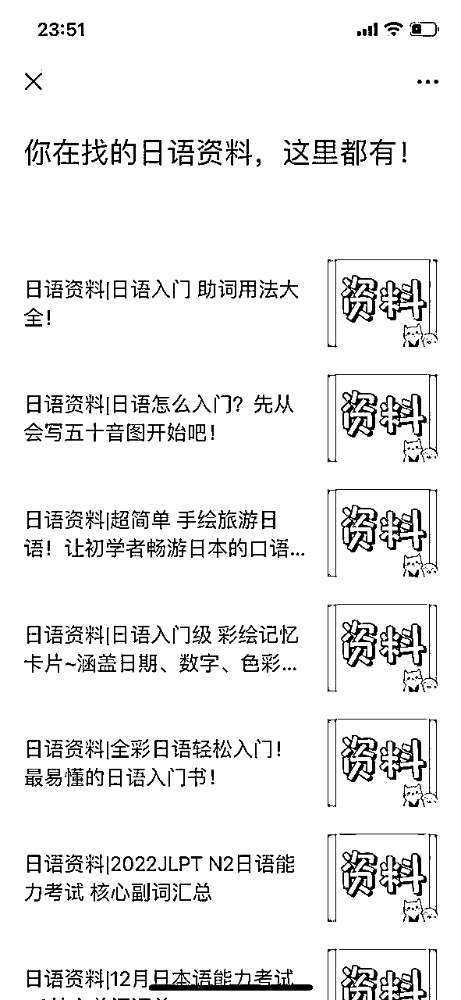

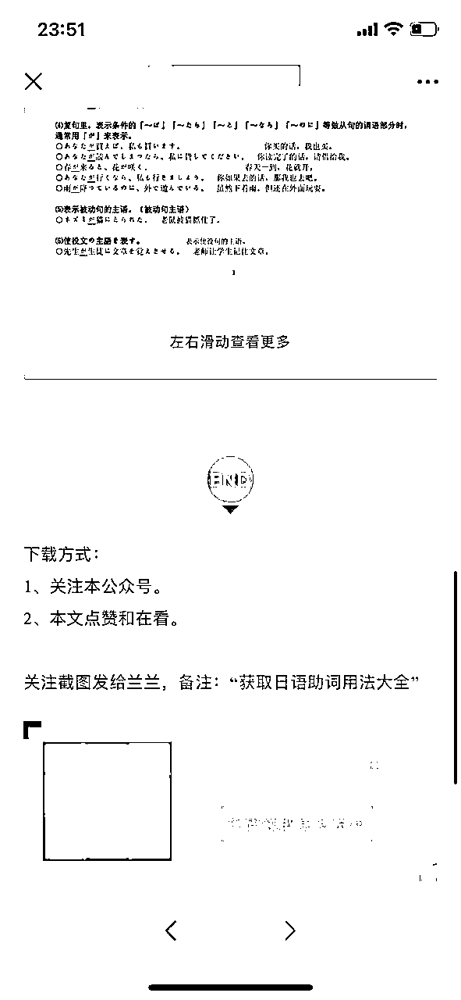

在🛰️搜索框输「日语资料」，顺着👸号或文章找下去，翻翻账号下方的菜单栏、再看看不同的文章，也可能翻出资源，然后联系号主本人领。这一路不是要花钱，就是要先转发朋友圈、完成各种指定动作，折腾程度不低。

4、电商平台（省事直接，但上新慢，适合先把基础库搭起来）

淘宝对虚拟资料的管控相当严，商家成本被顶得很高，再加上淘宝用户的消费力普遍更强，所以同一份东西，淘宝上的标价往往比拼多多贵上一截。

缺什么就直接搜关键词，挑顺眼的买下来。

只是要注意，拼多多上很多卖虚拟资料的其实是同一伙人，还会互相买对方的东西来填自己的库，重复率常常不低。

5、百度文库

百度文库的资源量很足，想要什么文件，直接搜就行。

# ③ 把资料洗一遍，建起自己的库

到这一步，手里应该积了一堆素材，但里面不少人家的水印或二维码还在。直接拿出去发，既影响成交转化，又等于免费给别家打广告。所以得先清掉旧痕迹，再盖上自己的章。

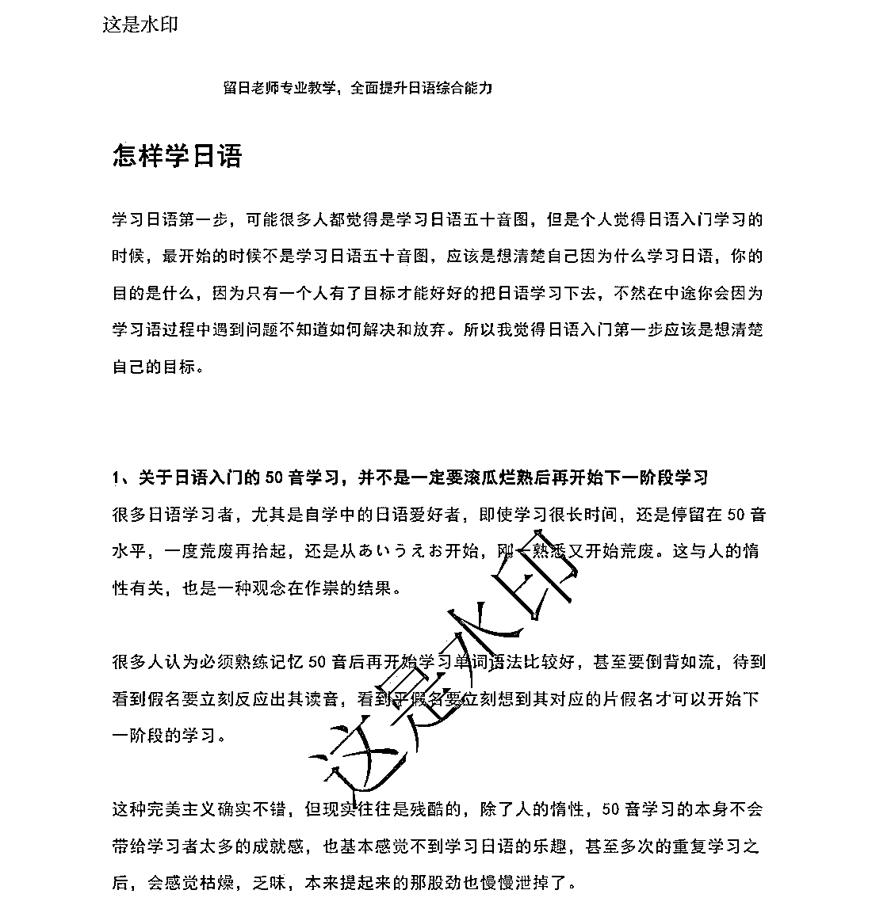

用到的东西有「WPS 会员的编辑功能」或「PDF 编辑软件」，硬骨头水印也啃得动。

PDF 编辑器怎么用：先把目标 pdf 拉进软件，一页页把水印或二维码剔干净，最后导出文件即可。

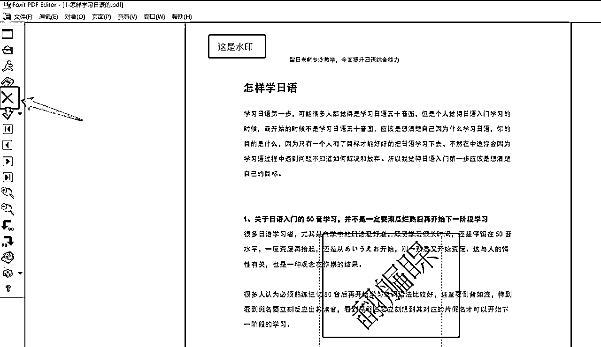

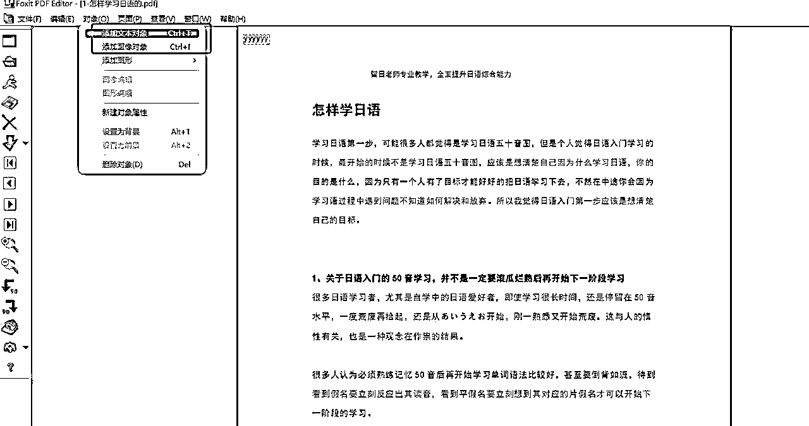

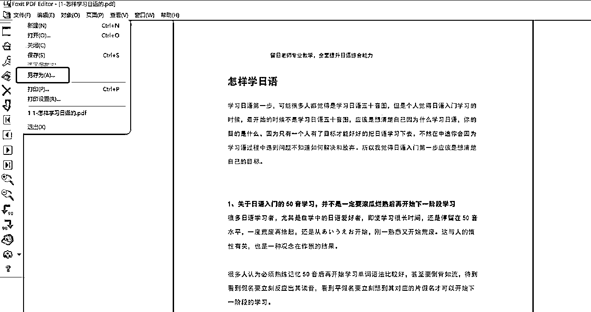

WPS 的路子（得开会员）

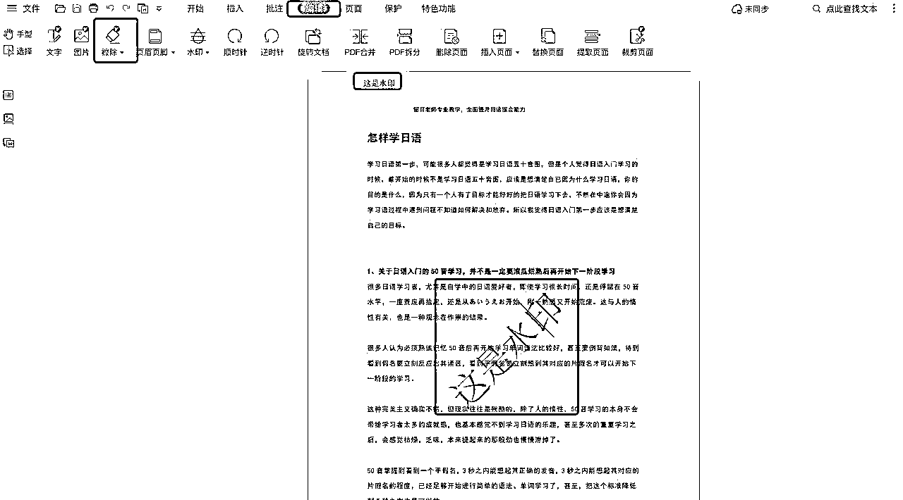

切到编辑栏，用“擦除”把水印抹掉。个别抹不掉的，就交给「pdf 文档编辑器」硬删。水印都清完后，再用 WPS 给文档加上自己的水印——🛰️号、👸号或二维码任选。

# 3.1.3 挖虚拟资料，还有这三招

# ① 挖同行正在当诱饵、但你还没见过的资料

不少同行发帖或在评论区溜达时，会拿一些我们压根没听过的内容来引客。

但不管他们亮出的是什么，旁边总会跟几句引导话术，这几乎成了定律。最常见的就是：

私信/主页 领取/获取 这类字样

看下图：

在📕上搜（把“公务员”换成你所在行业的主词即可），能碰到一大票拿资料招揽用户的人。一来可以把这些内容收回来填库，二来也能看清楚，别人都在拿什么我们不知道的素材当钩子。手里的牌越多，引流的抓手才越足。

再叠加上📕的搜索筛选功能：

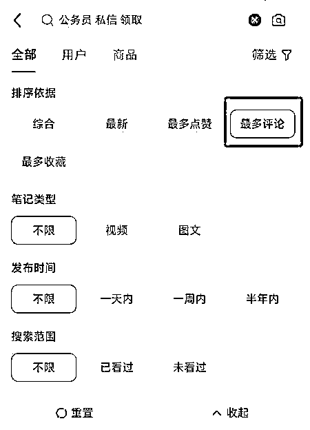

评论数最高的，通常说明这套内容的引流效果最能打：

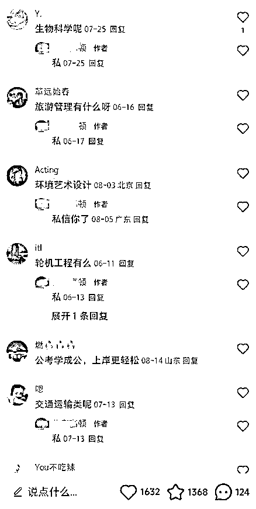

这招放在任何平台都好使，关键在于多琢磨同行拉客时爱用哪些词。

# ② 用词根来刨资料

虚拟资料都住在计算机里，而计算机能呈现的资料类型掰着指头数得过来，具体落在格式上：txt/pdf/xls 等等。

一份资料只要上了网，它总会以某种格式露脸，发布或分享的人多半也会顺手标出这种格式。所以我们可以：

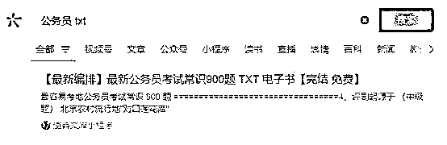

把这些词根丢进各种搜索引擎里翻，把“公务员”几个字换成行业主词即可。

此外，资料的载体形式也就那么几类：视频/文档/文件/软件/图片等等，逻辑完全一致：

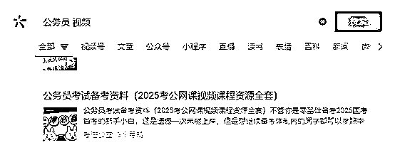

# ③ 顺着网盘链接去刨

网盘链接是个特别的存在，因为人们分享资源时最爱走网盘。

可不管是哪家的网盘、里面放着什么，链接上必然带着官网主域名：百度（pan.baidu.com）/夸克（pan.quark.com）。

这个规律可以直接拿来用：

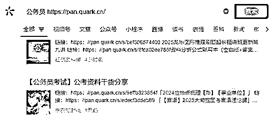

靠这一招，在任何平台、任何渠道，都能一网打尽各种没见过的内容，收为己用。

# 3.1.4 版权问题：怎么查、怎么避

1.

版权的排查

一个办法是拉一支兼职小队，让她们帮忙把资料归类、一个个过版权关，再填进我们事先设计好的分类目录里。舍不得花这笔钱的话，就只能亲自上阵：从开始收集那天就绷紧版权这根弦，收完之后再从头到尾核一遍。

2.

版权的处置

凡是强版权内容，比如机构出的课、大网站上写明版权归属的东西，直接扔，碰都不碰；

凡是弱版权内容，比如页眉页脚塞了联系方式的文档、带水印的 pdf，先把类分好，再用软件批量收拾。

弱版权内容可以这么分：

页眉页脚留联系方式的 word 文档 → 直接归类，用 BatchDoc 批量处理

页眉页脚留联系方式的 pdf → 不采用。pdf 没法批量编辑页眉页脚，硬转成 word 又容易变乱码

带水印的 pdf → 单独拎出来做去水印处理

至于完全没版权问题的内容，直接归进资料库对应的分类下。等所有文件都处理完毕，再统一盖上自己的水印。

批量处理软件：

word 页眉页脚：BatchDoc 文档处理

加前后缀批量改名：Bulk Rename Utility 3.4.3cn（批量命名）

pdf 水印修改：pdf do

# 3.1.5 资料库得勤维护、勤更新

资料备齐之后，不能觉得万事大吉。得经常盯着数据：不同资源拉来的人，转化率差多少？是不是白嫖党扎堆？跟客户聊单的过程中卡在哪一步？然后判断要不要换掉某份资料，或者把资料的描述改个说法。拿「日语语法重点」和「日语五十音资料」对照：前者瞄准的是有点底子的学习者，后者钓的是零基础萌新。实际跑下来，萌新的下单率明显更高，那我们自然更愿意用后者去拉人。

另外，项目本身的波动不大，但没有任何一份内容能一招鲜吃遍天。要时不时盯一眼同行，看看他们最近有没有拿出更能勾人、更易出单的新东西，及时把别家的好料变成自己的弹药。

# 3.2 把虚拟商品链接挂上去

1.

在千帆官网首页找到【商品管理】

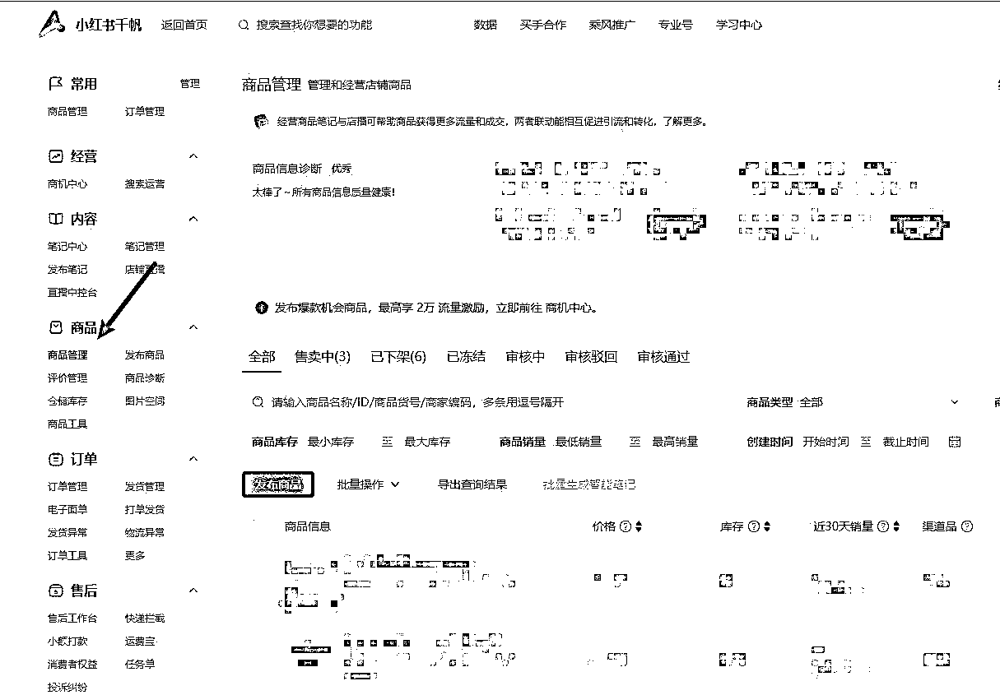

2.

类目得选准：【个性定制/设计服务/DIY > 数字商品 > 电子资料包】

3.

然后按提示把商品资料一项项补完。还有别的提示就顺着系统修改，一般出不了什么大问题。

# 3.3 价格定多少

把淘宝当作参照物，同款商品在📕上的定价，最好做到淘宝的 2-5 倍。做📕本就是冲高客单价去的，别老担心标价高就没单——📕本质是兴趣电商，不是货架电商。

# 3.4 店铺自动发货怎么配

先讲几个前提：

1.

阿奇索前 7 天免费，别浪费，先把免费的额度用了！

2.

一般是出了第一单再搞阿奇索自动发货；一单没出的话，可以先晾着。

3.

电脑没法全天开机的话，扔服务器上挂着，或者配个短信提醒

接下来是📕阿奇索自动发货的配置路径，按图的顺序走：

从服务市场进

搜“自动发货”，阿奇索就出来了

先把平台绑好

先把平台绑好

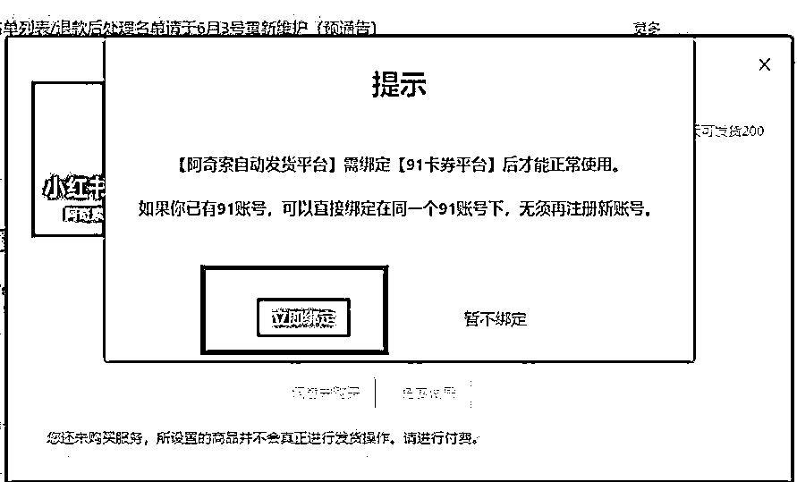

注册个账号就行

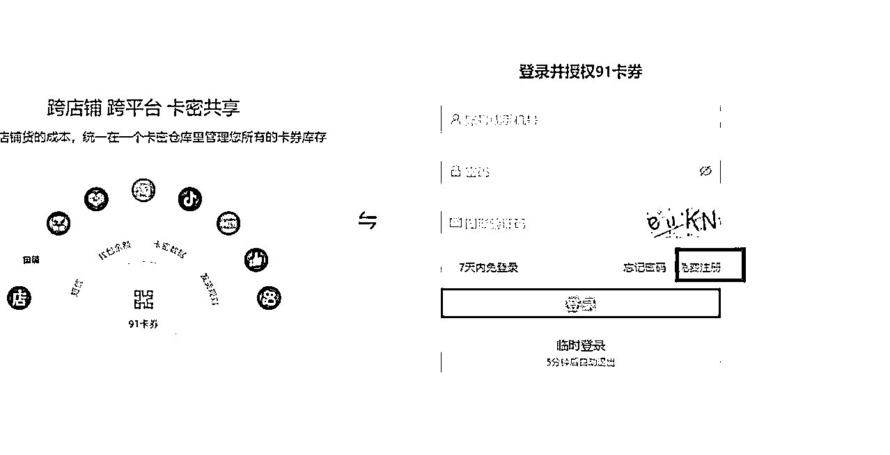

要是电脑不能一直挂着，记得隔段时间回来登一下

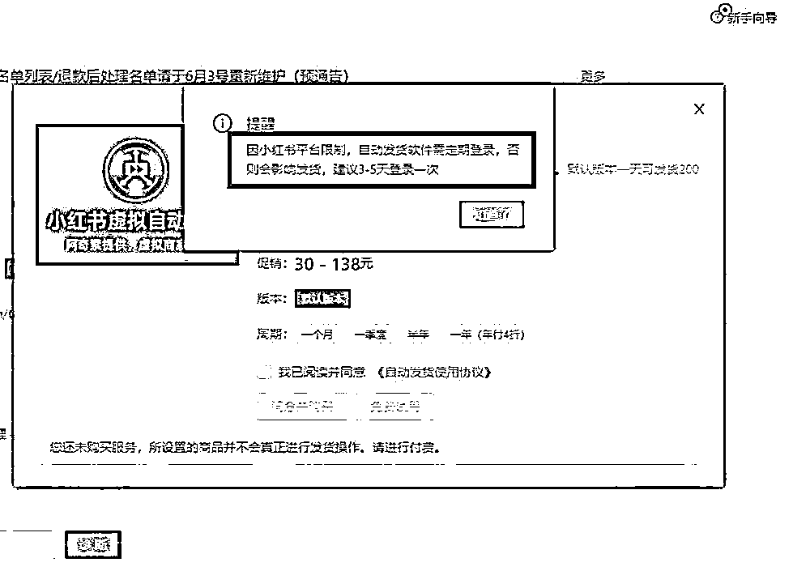

7 天免费额度先用完

需要把 App 装上

登录要用账号密码，得到千帆店铺的后台先设好

进自动发货，打开商品设置

点添加

选自己已经上架的商品

把自动回复的话术填完整

电脑要是没法长时间开着挂机，就考虑买短信发货服务

装好发货助手，它得一直挂在电脑上；做不到就买短信服务，或者放到服务器上一直挂着

在千帆后台把店铺登录邮箱绑好。因为发货助手只认邮箱登录，扫码进去不行。发货助手登不上，自动发货就转不起来。

上面这套都配齐后，自己拍一单试试，确认能否正常发货

# 3.5 上架前后被问到最多的事

问：📕店铺的版权情况怎么看？

答：开店最好别碰有版权的内容，万一版权方找上门举报，店铺可是实名登记的，跑不了。怎么判断有没有版权？一，最好不带水印；二，看同行有没有在卖，同款东西超过 3 家在卖，基本就说明能卖。

再送大家一张【免责说明】的详情页图片，出事时自保用的。

问：听说店铺都在打价格战？

答：淘宝、闲鱼、拼多多这些货架电商，比价确实凶。但📕不是这套逻辑，用户的习惯里根本没有货比三家。如果 100 个访客进来都没成交，也许是你标价太高；可要是只有零星几个访客，那就别往价格上想。

务必记住：📕用户对价格相当不敏感，别怕定得比同行高，大胆往高处标。单价拉高后订单量可能会缩，但最终落袋的利润不一定变少。

问：虚拟资料的单子，发货的时候还是要填寄件信息，怎么破？

答：选“无物流发货”就行，发货那一栏里有个选项。

问：店铺和私域能塞在同一个账号里吗？

答：店铺号是实名过的，店铺也挂在这号下面。不建议一个号同时干两件事——私域是踩红线的事，号一旦没了，店铺也得跟着陪葬。

店铺就用来跑低价走量，前期靠它赚点过渡的钱没问题；想认真做私域，单独开个新号。

# 四、做出能出单的爆款笔记

# 💡

# 章节概要：

这一章带你彻底吃透📕引流爆款笔记的打法，它是整个项目能不能跑起来的关键一环。

本章核心内容：

1.

找对标账号

什么样的号值得对标

对标账号是怎么起来的

2.

持续产出爆款选题

爆款选题都有什么共性

选题怎么挖掘、怎么验证

3.

爆款标题 SOP

标题到底有多重要

好标题的核心构成

马上能用的起标题套路

4.

笔记封面/内页 SOP

封面怎么设计才抢眼

内容排版和呈现技巧

5.

实战案例拆解

几个成功案例的深入剖析

从案例里提炼能直接带走的经验

6.

实用小贴士

提升效率的工具和方法

避开常见错误的注意事项

最后再叮嘱一遍：本章是全课程最核心的实操环节，千万要动起手来。

# 💡

# 本章航线图

完成本章的学习和实操，就能点亮航线图的这一段：

第二阶段：制作爆款带货笔记（约 4 天）

1.

照着对标做爆款笔记（约 1 天）

2.

持续更新，每个号每天发 3 篇笔记（约 0.5 天）

# 第一步：找对标账号

# 4.1.1 什么样的号才值得对标

不管混哪个内容平台，模仿都是一招极好用的打法。对标账号指的是跟你同行、同类型的他人账号，做内容的时候，完全可以照着它们的图文/视频、话题选择这些角度来学。

筛选的标准长这样：

⭕ 粉丝量低：1 万以内，超过不看

⭕ 赞数高：赞数大于粉丝数，说明内容有料、有分量

⭕ 活跃在最近一个月：周末刷的人才多，光取一周没有参考意义

⭕ 首页反复出现：刷主页时同一个封面撞见好几回，这号就是上等的对标对象，抄就完了

爆款笔记的四条命脉：爆款选题的心法、爆款封面的做法、爆款标题的起法、爆款内容的写法

⭕ 小爆款（赞藏+评论总数 ≥ 200）

⭕ 中等爆款（赞藏+评论总数 ≥ 1000+）

⭕ 大爆款（赞藏+评论总数 ≥ 1w+）

⭕ 超级爆款（赞藏+评论总数 ≥ 10w+）

# 4.1.2 对标账号去哪儿挖

1.

关键词搜索：在首页输入你想做的赛道关键词（也就是养号阶段反复搜的那些词），翻一翻排在前面的 50 篇笔记，挑出小爆款和中等爆款，再看评论区有没有“求”“需要”“私我发”这类字眼——有，就是我们要对标的目标。优先盯同赛道里做了三个月到半年以内的账号。

2.

搜索栏关键词挖掘：在搜索栏敲赛道关键词（见下图），跳出来的一串全是📕用户常搜的词，说明需求是实实在在的。直接按小爆款和中等爆款的标准，把好选题筛出来照着打。

3.

刷首页推荐：养号结束后，平台摸清了你的兴趣和互动习惯，推上来的自然多半是可能爆的同行动态。首页刷到的大部分就是同行，照样按小爆款和中等爆款的标准筛选题。

4.

从赛道热门话题里找：关注同领域的头部博主，翻出他们发过、互动量不错的笔记，点进他们带的话题标签，再按小爆款和中等爆款的标准从话题里筛选题。

5.

按时间节点（时效性）去挖：

拿几个赛道举例子。

大学赛道：

开学前：搜“新生入学攻略”、“大学开学准备”、“宿舍必备品”。

期中期末：搜“期中复习资料”、“期末考前冲刺”、“考前必看笔记”。

毕业季：搜“毕业照拍摄指南”、“毕业论文写作”、“毕业旅行路线”。

考研赛道：

考研报名阶段：搜“考研报名注意事项”、“报考院校推荐”。

初试备考阶段：搜“考研复习计划”、“考研各科目重点”。

初试成绩公布后：搜“考研复试攻略”、“复试常见问题”。

亲子教育赛道：

开学前：搜“亲子陪伴计划”、“开学前亲子沟通”。

假期：搜“寒暑假亲子活动”、“亲子旅行必备”。

成长节点：搜“幼小衔接”、“青春期沟通技巧”。

法律考试赛道：

报名阶段：搜“法律考试报名注意事项”、“考试科目分析”。

备考阶段：搜“法律考试重点法条”、“法律职业资格考试复习规划”。

成绩公布前后：搜“法律考试分数线预测”、“法律考试复议技巧”。

K12 教育赛道：

开学季：搜“开学家长必读”、“新学期家长会PPT”、“开学准备清单”。

期中期末：搜“期中复习资料”、“期末考试复习计划”。

假期里，建议去搜“寒暑假学习计划”和“K12阶段家长辅导策略”。

英语四六级的话：报名阶段搜“四六级报名注意事项”“四六级考试时间”；备考阶段搜“四六级备考必背单词”“四六级考试技巧”；成绩公布前后搜“四六级成绩查询攻略”“四六级考试成绩提升建议”。

教师资格证方向：报名阶段搜“教师资格证报名指南”“教师资格证考试科目介绍”；笔试备考搜“教师资格证复习计划”“教育学心理学重点”；面试阶段搜“教师资格证面试技巧”“教师资格证试讲教案”。

搜完之后，依旧按小爆款和中等爆款两个档位，从话题标签里挑出优质选题来对标。

# 第二步：爆款选题哪来的

这里讲两条找爆款选题的路子。新手推荐先走第一条——在话题标签里翻；等你对爆款慢慢有了手感，再上第二条——用AI＋乘风关键词词包，靠工具把选题的质量和速度都提起来。

# 4.2.1 在话题标签里翻

刷到一个爆款笔记，尤其是最近三天发的，点一下笔记下方的话题标签，进到话题页面，就能按综合、最新、最热三个入口，接着翻出更多爆款笔记。

顺手关注这个话题，之后在📕首页的“关注”页，就会持续刷到跟它相关的笔记。

# 4.2.2 用AI＋乘风词包来淘

去年📕重点推了一款叫“乘风”的工具，它是给站内电商做推广的。怎么用它来找选题？因为它有通投和搜索两种投放方式，卖家可以买词去投笔记。举个例：你是做雅思的博主，就可以买“雅思备考”“十天雅思备考”这类词，用户搜这些词时自然能看到你的笔记。

乘风后台有个【推荐词包】。搜“雅思备考”会出来一堆词包，下载点开就能看到关键词、类别、竞争指数、月均搜索指数和市场出价。月均搜索指数跟市场出价是正相关，搜索指数越高，出价越贵，也说明用户越爱搜。

这份词库能看出用户的搜索偏好。但让你自己去分析，很难得出有用的结论，多数人没那个抽丝剥茧的功夫。这时候可以喊DeepSeek来帮忙，让它挖一挖潜在的选题红利，用关键词反过来推选题。

具体怎么做？先把词库发给DeepSeek，让它做思考、总结和分析。

声明一下：我这些策略和提示词不见得是最优解；DeepSeek已经聪明到不需要用堆砌的提示词去绑住它。

我的第一条提示词是：请你照这个文档，给我20个选题方向，再给20个包含热门搜索词的标题，同时说明选题理由和覆盖的核心关键词。

DeepSeek的思考过程很有料。它说高搜索词流量大，但竞争也大，可以拉长尾词来降难度。更意外的是，它不光给公式，连正文怎么写也给出来了。公式就是【高搜索词】+【人群/场景】+【长尾词】，正文里再合理嵌入那些高价值的搜索词。

要是嫌它给的料不够，还能让它再吐一些公式和写作技巧。

整个思路就是：DeepSeek嚼透关键词，替你扩展选题，提前占住搜索流量，选题枯竭基本就追不上你了。上面是完整的操作流程和玩法。

DeepSeek还有个隐藏玩法：它既然这么聪明，不如直接问它——我们该怎样向你提问，才能更高效地用你？它还真告诉了我提问的答案。

# 第三步：爆款标题怎么造

# 4.3.1 杂交起题法

先谢谢袁隆平爷爷，优质水稻杂交出了超级稻，标题也能这么玩。方法简单，效果立见，我的爆款标题基本都是这么杂出来的。比如搜“纪录片”切到“最热”，翻前十条笔记，关键词无非“央视推荐”“绝了”“建议收藏”。最热前8条里，有6条标题几乎一样——爆款本来就是重复的。把关键词拿来不断重新排列，杂交出的标题天生带爆款基因。

小建议：平时刷到爆款标题，随手记进备忘录，没事翻翻，网感就是这样养起来的。

# 4.3.2 二极管起题法

原理是：人本能爱省力、爱即时满足；动物性驱动力是贪快乐、躲痛苦，于是引出两种刺激——正刺激和负刺激。

标题模板：
正面刺激＝产品/方法＋只需1秒＋便可开挂。小学语文最火的一句“死磕这x页纸，考试就像抄答案”就是典型。
负面刺激＝你不xxx＋绝对会后悔＋紧迫感。比如“你不看这个文章就会错过一个亿，限时删除！！！”。

抖音上大半文案都是这个路子，说白了就是制造焦虑，是有点损，但用户买单。它抓的是“厌恶损失”和“负面偏误”的心理：原始社会里，多一个机会也就多吃几口肉，可一次失误可能葬身虎口，所以进化让我们对坏消息格外敏感。

# 4.3.3 万能标题公式

另外，我备了一套万能标题公式，套上就能用：

给我背🔥，_______ 高分密码💯️
3 分钟吃透 _______ ！立刻！马上！给我学！
无痛背书法｜_______ 记不住的看看这篇吧！
谁也夺不走我 _______ 单科王的位置！
家人们！这个 _______ 真的！太好使了！️️
学霸笔记：《 _______ 》这也太详细了！
背 _______ 的诀窍，刷到就是上天拯救你！
考场能救急的 _______ 来啦！快保存！
万人催的 _______ 资料，不挂科冲冲冲！
浅哭一下😅考过后才发现 _______ 的捷径
_______ 不用背！掌握这些要点知识就够了！
_______ 的痛！！谁懂？？考前必看✔
_______别裸考！_______熬夜背！
_______风向已经很明显了
提醒一下_______参加_______考试的人
假如你从_______开始备考**，背完保底________
_______仅剩**天
玩呗，无非就考_______

# 💡

小结：感叹号尽管用，这个人群就喜欢带情绪的表达。落笔要有真实感，把读者当熟人，语言越白话越好。

# 第四步：封面和内页怎么做

# 4.4.1 排版基本原则

# 4.4.1.1 封面排版三件事

零基础做图也能上手，封面排版只记三点。

第一，尺寸：竖屏选3:4，方形选1:1，横屏选4:3。竖版笔记在屏幕上占的空间更大，能在用户眼前多停一会儿，既能承载更多信息，也不容易被一下划走。

第二，选图：可以用AI生成视觉冲击力强的高颜值图；也可以走简单明了的手写风；合集、美食、旅游攻略这类更适合后一种。

第三，文字：笔记标题最多20个字符，emoji也要占1～3个字符。所以想补充信息，就得靠封面。用户在发现页是随手刷的状态，封面上的字必须在核心位置占据足够大的画面，把概念讲干脆，直击需求，让用户马上反应过来“这里面有我想要的东西”，这才有点击的欲望。

竖版 3:4

横版 4:3

竖版 9:16

横版 16:9

# 4.4.1.2 少变也少用

原则就两条：少变，少用。

少变，是说封面版式别频繁更换。尽量把版式做成可替换的固定模板，排版、字体、风格都保持统一（颜色可以在同色系里变），主页才会整齐，粉丝也更容易认出来。

少用，是说跟主题无关的贴纸别乱贴，那玩意喧宾夺主，只会把用户注意力带偏。

# 4.4.2 内容呈现的 9 种方式

不同内容能用哪些样子出场？这里讲7种。一个账号选1～2种就行，按自己的赛道来挑。也千万别搞太多形式，不然做起来费劲，用户的观感也会变差。

# 4.4.2.1 截图法

截图是最省事的呈现方式。

但全是截图，怎么破同质化？四个办法：
1. 自己截图再发。
2. 给作品加边框、调图片参数。
3. 把内容复制给AI，让它重新写一版近似的，再截图，得到的就是一份全新文件。
4. 打印出来，直接拍纸面的效果。

这些方案我都建议用。而且，要是一个素材已经在你的号上爆了，就换个皮肤再讲一次，让它有机会二次爆。记住这句话！

截图笔记怎么制？

📌

手机上装个WPS office，打开资料截5～9页。截图能拼一起，也能单页放。先把几张资料截到一张图里，再给这张图加个标题当封面，内页就放小标题。

# 4.4.2.2 拼图法

拼图适合摆素材，让客户一眼看懂你的产品。先给案例。

拼图怎么做？其实很简单，手机自带的拼图功能就能拼。把需要的素材截好图，往一起放就成。想要精致点可以用PS，但用美图秀秀的拼图功能也够用，重点是内容能清楚展示。

# 4.4.2.3 实拍风

拍照是我特别推荐的路子。你亲手拍出来的作品，在这世上找不出第二份。同样的内容，只要角度、光线、清晰度一变，系统根本没法认定你同质化。来看案例：

操作方式：a.实拍图更容易出数据；b.AI生图；c.图片二次加工。拍照重点：镜头一定要擦干净！光线一定得足！拍完顺手调下滤镜。

# 4.4.2.4 创意封面风

拿🛰️对话做封面，借名人、熟悉的场景和有趣的创意先勾住点击，再配截图展示内容。

怎么弄？链接给你：https://vnr4jule4g.feishu.cn/drive/folder/fldcnBdyYJkxPRSFfFyzWvaCnBb

我备了79张常见爆款创意封面图，可直接下载使用。

# 4.4.2.5 目录式

目录式展示也很炸。做目录确实辛苦点，但做完就能反复用，属于一次制作、长期吃收益。

做法：🛰️功能其实很猛。以心理健康公开课为例，先把图片裁好发到🛰️上，再把文字复制下来，最后用xlsx表格排好版。

心理健康原稿.xlsx

# 4.4.2.6 固定底图法

这种适合点对点展示，也适合课件、视频素材。直接上案例感受。

思路就是：先找对应的背景素材，把作品插进去。图片、视频都行，重点是借场景或新鲜感吸睛。

背景去哪找？和找素材一个套路：去📕或其他平台搜关键词，就能找到图片背景。当然，如果你身边正好有这样的场景，我更建议自己搭一个拍出来，或者直接录。平时就要有收集素材的心。

第一步，找背景。我用的关键词是“办公室电脑桌面壁纸简约”“班级多媒体桌面壁纸”，看案例👇

第二步，做图文。要固定这个模板做图，得用黄油相机。流程：先把素材拖进去调好大小；再把要展示的PPT内容截图；最后把截好的图加进来，路径是“贴纸→导入图片”，选中刚才那张图就接上了。

模板搭建完毕，个人主页就会自动挂出这份模板。以后需要复用，点一下“使用模板”入口就能进入。

第三步：制作视频

若想用视频来展示内容，剪映是绕不开的工具。流程上，先录制课件，再进剪映调整画面、搭好模板，日后只需替换新录的课件。下面按手机端演示，会借助 WPS 这款软件。

用 WPS 打开文件，点击播放，手机屏幕会自动横过来；随后调用系统自带的录屏功能，把课件完整录下。

f9cfe675c4317a2f09a64c9131c2b6e1_raw.mp4【在线播放】

录屏完成后，打开剪映，先将背景素材导入。

点击“画中画”，把录好的课件素材添加进来。

若素材带黑边，需要做一次裁剪。

各轨道素材要对齐，再配上音乐和合适的文字，最后导出。

成片效果见下方视频，整体干净清爽；与单纯放截图相比，辨识度明显更高。

e8e5d922f75b78312a797c928aa45ece.mp4【在线播放】

# 💡 思路：由此可见场景的重要性。平时要留心收集身边可用的素材，逐渐养成积累素材的习惯。

固定背景+课件展示的视频演示：

固定背景展示课件.mp4【在线播放】

# 4.4.2.7 手写文案呈现

在📕平台，手写风格颇受青睐，是很好用的一种内容形式。

操作：拿 A4 纸或笔记本，围绕所在赛道的重点内容直接手写。

# 4.4.2.8 大字报封面

借助放大的文字，把核心信息直给用户，让主题或重点更醒目。

操作：用文字搭配表情，做成一张封面页。

# 4.4.2.9 前后对比图

把学习前后的成绩变化做成对照图，既凸显内容价值，也调动用户的好奇心。

操作：先找相关素材和表情，做适当修改，再拼成一张图。

# 4.5 实战案例拆解

# 4.5.1 案例一：幼儿园与小学教师资料赛道

# 4.5.1.1 如何做出爆款标题？

幼小教师赛道门槛低、打法直接，不必追求原创，核心逻辑就是同行哪篇爆了，就复刻哪篇。这里借用袁隆平爷爷的思路：把不同优质稻种杂交，得到超级稻。操作不复杂——先搜该领域资料词，如“期末评语”“幼儿园课件 ppt”“新手班主任干货”；筛出点赞 500+、发布 15 天内的笔记，提取标题再重组。见效很快，是实打实的流量密码。

看下图：搜“期末评语”，把关键词摘出来反复搭配，组合出的标题天然带爆款相——爆款本就来自重复验证。

🌟 高频关键词：期末评语、天花板、xx 条、走心、被校长夸、2024、存下直接套、第 x 弹、救班主任的命

👇 将这些高频词重新排列，至少能拼出 5 个新标题：

1. 2024 期末评语顶配清单，班主任的救急包

2. 用这套期末评语被校长夸了，真心省事

3. 188 条走心期末评语，校长看了直点头

4. 期末学生评语顶配版，收藏就能直接套

5. 走心期末评语第一弹，顶配模板来了

# 💡 干货笔记也一样：拆关键词、反复重组。日常浏览时遇到的好标题，随手存入笔记，多回看，网感需要主动练。

# 4.5.1.2 爆款封面与内页怎么做出效果？

✅ 封面是主页第一眼被看到的图，做得好不好，会直接左右笔记的点击表现。

# ① 资料型封面与内页（产品笔记）

先到后台素材区挑当下热门内容：开学季用“班级管理资料”，期中用“家长会 ppt 模版”，期末用“期末学生评语”。接着截取资料画面，进修图软件拼图美化，把尺寸调成 3:4。案例如下：

操作教程：

产品笔记资料封面内页制作教程.mp4【在线播放】

# ② 实拍型封面与内页（产品笔记）

1. 有打印机

做法与前面相同：从后台素材区找近期热门资料（开学用“班级管理资料”，期中用“家长会 ppt 模版”，期末用“期末学生评语”），下载前 4—6 页打印，手机实拍，背景可选键盘或桌面。案例如下：

2. 没有打印机（伪打印）

手机端仿实拍教程：

无打印机手机端制作实拍封面图教程.mp4【在线播放】

# ③ 四宫格+真人封面与美图内页（干货笔记）

干货笔记就是行业里实用性较强的内容，赞藏率通常很高，既能抬高账号权重，也能给其他产品笔记导流。四宫格加真人封面的形式更接近真人账号，容易让目标客户产生亲切感；比起冷冰冰的简约风，点击率往往更高。

做法也不难，逻辑不变：爆款有重复规律。所以不必从零原创，找到同领域干货爆文，用 AI 改写文案，再用修图软件照着复刻即可。

# 💡 以小学教师资料赛道为例：

小学老师的痛点在哪？管不好学生、家庭和工作难平衡、与家长关系难维护……我们要找的就是这类干货内容，然后复刻。

【图片部分】

封面要四张图，参考下面四张：至少包含 1 个人物元素和 3 个生活元素，人物可以不露脸。

内页数量按内容来，一段话配一张图即可。

1. 搜“借图发朋友圈”，从评论区挑 9—12 张图，截图保存。

1.mp4【在线播放】

2. 打开美图设计室 APP，点“图文去重”，把截图逐张处理。

2.mp4【在线播放】

3. 【封面】用美图秀秀拼图，选 4 张，尺寸 3:4，进高级编辑，输入标题里的重点词。

3.mp4【在线播放】

4. 【内页】用🛰️把图片转成文字，再用美图秀秀制图，把文字排上去。

4.mp4【在线播放】

5. 【文案】用提取文案小程序复制内容，粘贴到 AI 改写工具里调整，例如 Kimi 📕生成器。

5.mp4【在线播放】

6. 【标题与话题】标题改改标点或加表情；话题从原文里挑几个带上。

# ④ 图片转视频

近期📕针对视频笔记推出了力度很大的激励活动，我们判断平台接下来会重点扶持视频笔记——视频能明显拉长用户在平台的停留时长。最近一周，自营组也在测试视频笔记，感觉流量确实更好。后续图文与视频可以直接按 55 的比例发布。

# 4.5.2 案例二：教资面试资料赛道

# 4.5.2.1 如何做出爆款标题？

热门考试类赛道的爆款标题有共同套路：制造紧迫感和稀缺感，再叠加痛点与效果。

同行就是最好的老师，方法仍是收集爆款标题再“杂交”。先搜教资面试领域的资料词，比如“教资面试结构化”“教资面试真题”“幼儿教资面试押题”；筛出点赞 500+、15 天内的笔记，提取标题后重组。见效很快，堪称流量密码。

看下图：搜“教资面试押题”，把关键词摘出来反复搭配，组合出的标题天然带爆款相——爆款往往来自重复。

🌟 高频关键词：**（时间）教资面试、押题、已出/已曝光、年年考、反复考、**道、（仅剩/只需）*h/*天、风向已经很明显了

👇 将这些高频词重新搭配，至少能得到 5 个新标题：

1. 25 上教资面试押题曝光：两小时背完稳了

2. 教资面试时政押题已出，六小时背完冲 90+

3. 25 上教资面试只剩 7 天，重点就这 20 篇

4. 下周六就考教资面试，进度还是零？这套押题像抄答案

5. 教资面试倒计时 3 天，押题已出，背完一次过

# 💡 干货笔记也照此处理：拆词、重组。平时遇到好标题就存进笔记，常翻常看，网感需要主动练。

# 4.5.2.2 爆款封面与内页怎么出效果？

✅ 封面是主页第一眼展示的图，好坏会直接决定笔记的点击表现。

# ① 资料型封面与内页

先到后台素材区找近期热门内容：报名期用“教案模板”，临考期用“时政押题”“考前*页纸”等。接着截图，进修图软件拼图、美化、做标记，尺寸设为 3:4。案例如下：

操作教程：

e1455c0099f1b3bfd1aa9f7a1a528cb0.mp4【在线播放】

# ② 实拍型封面与内页

1. 打印版（图一）

做法与前面一致：从后台素材区找近期热门资料（报名期用“教案模板”，临考期用“时政押题”“考前*页纸”等），下载前 4—6 页打印，手机实拍，背景可用键盘或桌面。案例如下：

图一

图二

图三

图四

2. 打印+手写（图二）

做法不变：从后台素材区找近期热门资料（报名期用“教案模板”，临考期用“时政押题”“考前*页纸”等），下载后删掉答案，留出手写区，打印后手写。

3. 纯手写（图三）

做法一致：找近期热门资料（报名期用“教案模板”，临考期用“时政押题”“考前*页纸”等），摘录目录手写即可。

4. 没有打印机（伪打印）（图四）

手机端仿实拍教程：

无打印机手机端制作实拍封面图教程.mp4【在线播放】

# 4.5.2.3 爆款文案怎么写？

产品笔记

在标题基础上补几个字重复一遍，或参照对标笔记正文写考试计划，用 AI 改写，同时强调重点资料已经备好。也可以不写正文，直接带话题。

示例：

📚 政治鸭题 32 道 PDF

📚 教案模板 PDF

干货笔记

用提取文案小程序（红薯原图+）复制内容，粘贴到 AI 改写工具里调整，例如 Kimi 📕生成器。

5.mp4【在线播放】

# 4.5.3 案例三：PPT 模板

# 4.5.3.1 如何做出爆款标题？

方法同样不复杂：模仿同行。先搜 PPT 模板领域的资料词，比如“PPT 模板怎么做”“PPT 模板高级感”“PPT 模板合集”；筛出点赞 500+、15 天内的笔记，提取标题再重组。见效很快，就是流量密码。

看下图：搜“PPT 模板合集”，把关键词摘出来反复搭配，组合出的标题天然带爆款相——爆款来自重复。

🌟 高频关键词：太香啦、真的很重要、**套、走心、领导狂赞的、导师想看到的、私藏、不服不行

👇 将这些高频词重新搭配，至少能得到 3 个新标题：

1. 领导想看的会议 ppt 就长这样！不服不行

2. 这套 ppt 模板被领导夸了，真心省事

3. 千份导师狂赞的 ppt，选对模板太关键

# 💡 干货笔记同样适用：拆关键词、反复重组。平时刷到的好标题可以记下来，多回看，网感靠刻意练习。

# 4.5.3.2 爆款封面与内页怎么出效果？

✅ 封面是主页第一展示图，其质量直接影响笔记的点击表现。

# ① 资料型封面与内页（产品笔记）

1. 有电脑

先到后台素材区找近期热门内容，如“哪吒相关素材 ppt”“热播剧相关 ppt”、行业热点 ppt 等，下载后用电脑打开，直接借助 PPT 软件美化。

2. 没有电脑

先到素材区找近期热门 PPT 模板，如“哪吒相关素材 ppt”“热播剧相关 ppt”、行业热点 ppt 等，然后截图内容，进修图软件拼图美化，尺寸设为 3:4。案例如下：

操作教程（以下为其中一种方法，也可批量截图后再拼图）：

77918b9b47df3ad9ad9e6886ed624e19.mp4【在线播放】

# ② 实拍型封面与内页（产品笔记）

1. 有电脑

做法与前面一致：从后台素材区找近期热门内容（如“哪吒相关素材 ppt”“热播剧相关 ppt”、行业热点 ppt 等），下载后用电脑打开，直接实拍。案例如下：

2. 没有打印机（伪打印）

手机端仿实拍教程：

c0a7f4b58f3ae783be4b6834eed752b7.mp4【在线播放】

# 💡 以小学教师资料赛道为例：

小学老师的痛点在哪？管不好学生、家庭与工作难平衡、与家长关系难维护……我们要找的就是这类干货内容，然后复刻。

# 4.6 笔记小贴士

# 1）检查笔记敏感词

敏感词会让笔记进入更严格的机器审核，轻则审核延迟，重则被限流。长文案写好后，先用零克查词：https://www.lingkechaci.com 扫一遍，看有没有敏感或违规词，有的话换成谐音字或拼音。

# 2）伪原创笔记（新手推荐）

如果不知道发什么、也不清楚目标用户偏好什么，可以直接拿同行的低粉爆赞图文（含封面）做伪原创。

用美图秀秀做伪原创

发笔记.mp4【在线播放】

如何用剪映制作伪原创图片

如何用剪映导出伪原创图片.mp4【在线播放】

如何用剪映批量制作伪原创图片

如何用中小学批量制作伪原创图片.mp4【在线播放】

# 3）布局 SEO 搜索流量

提前在笔记文案里埋关键词，能让一条笔记持续吃到精准流量。SEO 的意思是：比如你做小学教师资料赛道，用户在📕搜“小学期末评语”相关字眼，就能看到你的笔记。而且主动搜索的人，消费需求和付费意愿都很强，属于非常精准的粉丝，成交率也高得多。

因此标题和文案里一定要埋关键词，比如小吃配方赛道的“夏日摆摊爆款”“xx（产品）配方”，创业比赛赛道的“互联网+”“三创赛”“xx（项目）计划书”“计划书完整版”，这样能明显提升笔记的搜索排名和曝光量。

# 4）笔记排版

📕很看重精致感，排版会带来很大优势。大多数用户都是碎片时间刷📕，因此清晰的排版能显著改善阅读体验，让人一眼看到关键信息。最重要的两个排版点：

1. 封面标题要提炼。封面必须打上笔记的核心内容，让用户第一时间判断这篇笔记对他有没有用，才会点进去浏览。

2.

# 5）结尾别忘加话题，收尾也能带流量

正文如果挤成一大段，读起来会很累。记得拆成小段、段落之间留空行，再点缀几个表情符号😊，读者滑动屏幕时会更舒服。

内容写完后，在最后补上跟这篇帖子主题紧密相关、且浏览热度高的话题标签。挑选时看两点：一是和主题对得上，二是参与人数多。举个例子，假设你要发小学期末评语资料，在文末点“#话题”，输入“期末评语”，下面会跳出一串相关标签，选排在前面的热门项就行；同时还可以加上更垂直的关键词，例如 #二年级期末评语 #低年级期末评语。

# 6）发文时间怎么选

白天可以挑 11—13 点，晚上可以挑 19—22 点。

# 7）判断帖子有没有被限流，看这三个动作

先别急着操作，先观察信号：新帖发出后的 24 小时里，如果浏览量（小眼睛👀）一直低于 100，或者连续几篇的浏览量都在 100 以内，再去做下面三件事。

1. 试试薯条推广能不能用。进入帖子 ➥ 点右上角“···” ➥ 点下面的“薯条推广” ➥ 看能不能通过推广审核。只要出现付款选择页面，就说明这篇帖子是正常的。

2. 查一下内容检测里有没有违规。点左上角“≡” ➥ 点“帮助与客服” ➥ 点“笔记申诉” ➥ 看看有没有违规记录。如果没有记录，就说明这篇帖子正常。

3. 搜一搜能不能找到你的帖子。用第三个小号在搜索栏输入帖子标题 ➥ 看能不能搜到。能搜到，就说明这篇帖子正常。

如果整个账号都被压流量，大概率是“硬广告”发得太多，或者账号权重还没养起来。这时候可以发一些有用的干货内容，或者讨论型帖子，把互动拉起来，慢慢恢复账号权重和流量表现。

# 8）传素材别让画质被压缩

很多人在传素材时很头疼：社交软件会压缩画质，用邮箱又嫌麻烦。这里分享两个我们团队长期在用的传输工具，安卓、苹果、鸿蒙、Windows 以及 Mac 都能用。切记，一定不要用📕传素材！！

1. PP 直连 https://www.ppzhilian.com （网页版，免下载，推荐苹果用户）

2. 极连快传 http://www.zqbapp.cn （稳定，需要下载，苹果没有，推荐安卓用户）

# 9）📕运营的十条心得

① 用干货帖子引流，让单篇内容承接交易。不是每篇帖子都要带货，也不是每篇都得高曝光，关键是每篇帖子要有明确目的。

② 怎么写是战术，写什么是战略。每篇帖子都要有目的，从目的出发、以结果为导向，中间再填手段和方法，否则越做越迷茫，时间也白白浪费。

③ 先模仿再创新，模仿能解决 70% 的问题。

④ 100 篇平庸，不如 1 篇精雕细琢。

⑤ 📕不是用来展现自己的。

⑥ 发一条就认真发一条，做一个品类就把一个品类尽量做透。

⑦ 建立热点敏感性，建立流量敏锐度，遇到搜索热点赶紧上。

⑧ 帖子数据不到 500，是选题和封面的问题；至于流量能有多大，要看互动指数这个流量开关有没有被打开。

⑨ 爆款都是重复的，要重复地做爆款：第一是选题和模仿，第二是高效地做内容。

⑩ 认真尚不能一定成功，不加思考的随意开始注定失败。

# 五、把流量做成成交

# 💡 本节要点

帖子最终目的是成交。要让流量发挥最大价值、提高商品转化率，主要靠：发布帖子时挂商品链接，拿到更精准的流量；小号协同大号发帖子；有成交后及时发货和做好售后，确保店铺正常运营，并及时优化。具体可以进入本章节学习～

# 💡 本章路线图

完成本章节的学习和实操，即可完成路线图中的：

第二阶段：制作爆款带货笔记（约 4 天）

1. 笔记挂商品链接，引导成交（约 0.5 天）

第三阶段：持续运营，并尝试开发产品（约 14 天）

2. 店铺运营与优化（约 14 天）

# 5.1 商品链接要在发布时就挂

先明确：商品链接要在发布时直接挂，不要先空着、等流量起来了再补。挂商品链接会影响流量，但不一定是坏影响；商品帖带来的流量，是付费流量之外我们能拿到的最精准的一类流量。

目前有两个位置可以挂商品链接：帖子标签的最后面，以及评论区置顶。上面这个位置，手机和电脑都能挂；下面评论区这个位置，电脑不能挂，只能通过手机操作。

一般来说，用电脑发布帖子效率更高，但只能挂上面这个商品链接，不过也够用了。建议最好用电脑发布，等后面有数据不错的帖子，再用手机重新编辑，在评论区挂商品链接。

# 5.2 一个店铺多个账号怎么协同

可以把📕账号理解成装帖子的载体。一个账号每天发太多帖子容易违规，所以“1 个专业号 + 3 个主理人账号”的模式，就是把帖子量分摊到多个账号，不把鸡蛋放在一个篮子里，降低违规可能性。

建议采用的运营手段是：绑定店铺的专业号不发或者少发帖子。虽然我们是正规玩法，但也存在违规风险，毕竟平台真的会时不时抽风。主要用主理人发帖子，挂商品链接。

# 5.3 发货和售后的避坑指南

📕从过完年开始整顿店铺端运营。之前只需做好前端帖子，店铺不用怎么运营；现在店铺运营也很重要，尤其是售后问题，用户负反馈率太高，真的会直接限制流量。

发货常见问题：物流设置不对。编辑商品时注意物流类型，要选有“无物流配送”这几个字的，否则没法自动发货。如果忘了选，但已经有人拍了，就去拼多多用买家的物流信息拍一单礼品单，再用礼品单的快递单号去📕发货，千万不要随便乱填单号。另外，运费模板一定要选全国包邮模板。默认的是非偏远地区不包邮，导致新疆、甘肃、海南等省份拍不了；我们是虚拟产品又不发货，选全国包邮就行了。

售后常见问题：网盘链接打不开。很多用户其实不会用网盘，尤其是很大的文件，都不保存就直接用手机下载。这个时候最好提前录个视频，给用户展示怎么使用百度网盘。用户没开会员，文件数量太多，一次性转存不下，可以告诉用户只转存一部分马上要用到的资料，其它资料随用随取，链接是永久有效的，不用全部转存。遇到用户要退款，态度一定要好，直接让对方退就行，引导用户选择退款原因时，选拍错/多拍/不喜欢，或者其它。用户如果选择不利于我们的退款理由，会被计入负反馈率，次数多了会被限流。此外，如果用户发起退款选择的原因不利于我们，就算修改了也没用，只计算首次。

# 5.4 店铺运营与优化

好评返送其它资料。用户拍下后，自动发货的同时可以有一段话术，引导用户好评，赠送其它资料。可以直接参考淘宝/拼多多同行的话术，在刷好评的同时，还能让用户确认收货，更快拿到货款。

在千帆后台可以设置自动回复，把用户经常会问的问题都提前写好答案，能立马回答问题，打消顾虑，可以大大提高转化率。一般用户会比较关心：怎么发货？能不能立马发货？资料有没有答案？资料能不能打印？能不能试看？是不是 word、能不能编辑？这些是比较通用的问题。某些特定资料，用户有特定关心的问题，这需要在当客服的过程中多和用户沟通，总结出来。同时，自动回复对客服三分钟回复率的考核也有一定提升作用。

七天无理由退款一定要开。不开七天无理由没有任何意义，该被退款的订单依然会被退款；此外，还有很多用户在下单界面看到醒目的“不支持七天无理由”几个大字，从而没有下单。

# 选修篇：项目放大&进阶玩法

# 💡

选修篇：为项目的更多玩法介绍。如果你已经跑通了项目的最小 MVP，想进一步了解它的更多可能，获得灵感，那么选修篇一定不要错过。

无论是想要进一步放大项目，还是挖掘更多玩法，都可以重点阅读本章节：

✅ 六、用 AI 制作虚拟资料产品

✅ 七、更多变现方式

✅ 八、私域引流与运营

✅ 九、更多资料赛道

✅ 十、矩阵放大

✅ 十一、投流放大

其中，用 AI 制作虚拟资料产品这个动作虽然不包含在最小 MVP 环节中，但如果你想长期深耕这个项目，强烈建议掌握这个技能，航海期间教练也会进行直播分享。

现在，快来发掘项目的更多可能性～

# 六、用 AI 打造虚拟资料产品

# 6.1 为什么值得用 AI 做虚拟产品

想做📕，或者在📕做电商卖货，一定要学会借助 AI 来辅助开发虚拟产品。特别是 DeepSeek 的 R1 模型上线后，对开发虚拟产品非常有帮助。

首先，对于 0 基础的人来讲，很难独立从 0 到 1 开发一个虚拟产品。注意，这里说的是独立开发。过程中会遇到很多卡点，比如你想做一个教程，把自己的经验嵌套进去，但大脑里只有一个混乱的大概内容，缺乏清晰框架。就像中考和高考，我们写的都是命题或者半命题作文，会给你限制空间和约束条件，你要在约束条件和限制空间内创作。而现在对于 0 基础的新人来讲，AI 可以帮你解决这个问题。

但要注意，AI 对你的帮助并不只是帮你生成虚拟产品，而是在你从 0 到 1 构建虚拟产品的过程中，AI 是你最佳助手。下面我会举几个场景，帮助你更好地通过 AI 制作虚拟产品。

# 6.2 用 AI 做虚拟产品的路径

这里需要有一个共识：不要对 AI 工具有偏见，不要试图限制 AI 工具的想象力。AI 可以帮助你完成很多你不敢想的问题，你需要放下自己的偏见和狭隘，最大限度地与 AI 进行完美协作。基于这个共识，其实就可以通过 AI 去做虚拟产品。对于个体来讲，从 0 到 1 构建原创性的虚拟产品，可以有以下关键步骤。

# 6.2.1 先认清自己

AI 可以帮你进行优势挖掘，帮助你更好地认识自己，更清晰地盘点你的优势、技能，以及能够被市场买单的认知、经验、方法论、知识点。

那么如何通过 AI 工具帮助你更好地认识自己呢？这里提供一个方法，但不是绝对正确，只是一个参考：你可以结合 kimi + DeepSeek-R1 来模仿。

首先，大多数人遇到的第一个问题就是提示词，不知道怎么写提示词。提示词的本质是一个具体的问题，以及期待 AI 能够帮你解决的问题和它需要执行的任务。如果你对这方面有恐惧，或者存在卡点，可以通过 kimi 的提示词专家，去帮你制作一个提示词。比如，针对个人优势，我的提问是：帮我设计一个优势挖掘专家的提示词，能够帮我有效挖掘我自身的优势。

最后它给我了一个提示词，可以直接套用！这个模板包含这些部分：角色是优势挖掘专家和心理学顾问；背景是用户渴望深入了解自身优势，以便更好地发挥潜力、提升自信，实现个人成长和职业发展，可能在自我认知上存在一定模糊性，需要专业引导来挖掘内在优势；画像是一位经验丰富、洞察力敏锐的优势挖掘专家，同时具备深厚心理学背景，能通过专业评估和分析帮助用户发现优势和潜力，善于运用心理学原理和方法，结合实际案例，为用户提供个性化指导和建议；技能上全面掌握心理学原理、人格评估、优势理论、职业规划以及沟通技巧，能够通过深入对话和分析帮助用户挖掘优势，并提供实用建议和策略；目标是帮助用户全面了解自身优势和潜力，提供个性化建议和策略，帮助用户更好地发挥优势、提升自信，实现个人成长和职业发展；约束是该过程应基于科学的心理学原理和方法，确保评估的准确性和客观性，同时尊重用户隐私和个人感受，提供安全、舒适的交流环境；输出格式结合文字阐述、优势分析报告、个性化建议以及实际案例；工作流包括与用户深入对话，了解个人经历、兴趣爱好、职业背景等信息，运用心理学原理和优势理论评估分析优势、找出潜在优势领域，提供个性化建议和策略，帮助用户发挥优势、提升自信，实现个人成长和职业发展；示例会给出软件工程师、销售经理、大学生等不同身份的优势分析与建议；初始化时会在第一次对话直接输出欢迎语，邀请用户踏入优势挖掘的殿堂，并请用户提供个人经历、兴趣爱好和职业背景，开始探索之旅。

当我有了这个提示词后，我就可以放在 DeepSeek 去使用，直接把这个提示词复制给 DeepSeek 就可以。你会发现 DeepSeek 也在尝试理解你给的提示词意义。后续你再去提问，就会能够让 AI 帮你梳理你的个人优势，以及个人优势可以变现的场景。其实 DeepSeek 的优势在于不断提问，通过连续提问去得到你想要的答案，所以一定要多次提问才有效果。

# 6.2.2 验证需求

很多人的需求都是伪需求，但你后续可以通过 AI 帮你测算这个需求到底是否存在，以及根据 AI 给你的参考，再帮你找到市场目前存在的产品和服务，进一步帮你考察这个需求的真实可靠性。

举个例子：我问 DeepSeek，我的背景是新能源汽车行业，拥有 5 年工作经验，给我几个能够快速制作出来的虚拟产品，要求是能够轻量化实现，可以有效解决用户的痛点。它给了我很多方向。假如你对《新能源车企面试答案库》感兴趣，你就有一个很明确的目标，这个时候测算需求部分已经完成了，就该进入下一步，辅助创建虚拟产品。

# 6.2.3 用 AI 辅助做资料类产品

很多人有一个痛点：他们有很多经验，但无法成体系分享，也就是说内心没有一个完整架构去系统呈现经验。就好比很多人只适合写命题作文，给他们一个引子，他们可以写得很好；但让他们自由发挥，就很难写好。DeepSeek 可以完美解决这个问题。DeepSeek 可以给你一个相对不错的框架，你可以用它给你的框架直接输出你的经验，同时也可以用这个框架去唤醒你隐藏在内心深处的记忆。

举个例子，比如你想写一份从 0 到 1 的装修指南，就可以让 DeepSeek 帮你生成框架。比如你可以说：我刚刚完成了一套三居室的装修，我想把这份经验系统梳理出来，形成一个 PDF 文档，这个 PDF 文档包含我装修从 0 到 1 的全过程，并且我需要你在目录中加上一些市面上没有的暗知识、隐性知识、实操知识，给我一个详细的目录。

你如果把这个提示词发给 DeepSeek，它可以给你一个差不多的目录，这个时候你心里就会有一个大致的框架了。那么对于这个框架，后续怎么添补，都取决于你自己对装修的理解和经验。这里我要说一句，为什么我要在提示词里加上隐性知识、暗知识、实操知识呢？因为这是一个很关键的深入探索。你要写出竞争力，本质上你的颗粒度要细，且你的内容市面上很少有同款。当 DeepSeek 捕捉到你这个指令时，就会重点去思考和生成哪些知识是目前市场上没有的内容，从而给你更深度的内容建议。这个部分是基于你已经有足够多的知识储备，缺乏一个“疏导逻辑”，可以通过 AI 帮你辅助。

除此之外，你还可以基于 AI + 你的需求，完全靠 AI 做一个虚拟产品出来，比如合同模板、简历模板、面试题库等等。这类虚拟产品，你可以通过 AI 工具从 0 到 1 去构建。下面我以面试题库为例，帮大家梳理下如何构建一个虚拟产品。

基于它给你的面试题，你再就每个面试题去生成专业答案。为什么要这样做？因为假如你直接让 AI 生成面试题和答案，对 AI 来讲挑战难度大，同时生成的内容颗粒度太粗，生成的答案可读性也比较差。所以，你最好是先生成问题，再生成答案。这样你的内容可用性就会比较高。并且在有问题、给问题生成答案的时候，一定要让 AI 基于一个问题给答案。比如可以看我的下图示例。

这样做的优势在于，你能得到详细的解答思路，可以让你的虚拟产品看起来内容更多、更丰富。所以，如果你想要做一个题库类型的虚拟产品，一定要先生成问题，再生成答案，从而确保内容的丰满。

# 6.2.4 AI 原创工具类产品

很多同学认为自己不懂代码，就没有办法使用 AI 去做一些独立产品。其实现在的大模型已经足够智能，同时也很流行一种叫做 vibe coding 的工作方式。

# 小切口AI虚拟品，反而更好卖

所谓“氛围感编程”，说白了就是凭感觉写点代码。眼下普通内容创作者不必是程序员，略微懂点代码即可；就算完全门外汉，遇到不会的地方直接丢给AI问就行。

那用AI从零做虚拟商品，该遵循什么准则？

底层思路只有一条：对准某个具体场景里的具体麻烦，给出能用的解法。别一上来就琢磨颠覆行业的大作，也别跟巨头抢地盘，更不必在颜值上死磕。最关键的一条是：用户确实用得着，还肯为此付费。

举个例子，📕上有创作者做了个极窄场景的小工具，专门帮律师把案件时间线快速理清，仅覆盖律师办案中的某个环节。另一些卖虚拟商品的商家，围绕课堂场景开发了不少小玩意。比如班级点名器，被点中的同学会触发彩带和欢呼音效，玩味十足。

这类东西技术门槛高吗？真不高。它未必是网站，本地就能跑，谁都能用；交付时把本地网页打包发过去即可。我拿Claude照这个需求试了一遍，很快复刻出差不多的工具，过程相当轻松。

换句话说，想靠AI做原创虚拟商品，得盯紧场景、人群和需求这三样。切口越窄越好，要解决的麻烦越明确越好。我自己也捣鼓了不少教学场景里能用的小工具，呈现效果挺不错，各位不妨看看。

小结：用AI做虚拟商品，其实贯穿从0到1全程——先帮你认清自己、梳理资源与长处，再协助判断需求真伪，最后润色并产出成品。每个环节都能让AI参与进来。

# 七、还有这些变现路

# 7.1 接品牌商单

所谓接商单，就是普通人把📕号做到粉丝过千，开通蒲公英达人身份，品牌或广告主便会来找你，在笔记里植入付费广告。达人靠合作赚钱，最低一单百元起步。

路径大致是：开号 > 选准领域 > 养号 > 拆解同类型账号并包装主页 > 模仿爆款持续产出、保持发布 > 粉丝破千并完成实名 > 入驻蒲公英接单。

具体操作可看3月航海的📕达人变现。

好处是链路短，不必折腾私域等后端。短板在于得先攒到一千粉，涨粉快慢不由人，贵在坚持。项目上限有限，单号每月大约能接十五条左右，单价180—240元，月入约两千。

# 7.2 收费打卡群

打卡社群指什么？

它用打卡任务做钩子，让用户掏钱进群，靠付费门槛加打卡动作提升活跃与留存。落到教育场景，通常提供优质资料、学习点拨和督促陪伴。

这种群怎么落地？

前提很简单：手里有粉丝，能把他们精准导到🛰️，就能开干。

创建时怎么做？先定主题和受众，比如健身、阅读、学新本事等；再定规则与价格，门槛和定价要合理，既保质量又保付费意愿；工具可选知识星球之类，建付费圈子，内容分享、成员管理、活动组织都能覆盖；接着设计打卡任务与奖励，比如每日阅读、健身打卡，用奖励拉动参与。

日常怎么运营？持续给价值，用高质量内容和互动提升粘性与满意度；多抛互动话题、及时答疑，鼓励群友讨论和转发；定期办线上分享、讲座、研讨，也可组织线下聚会、工作坊，强化归属感。

怎么拉人进群？靠专业内容、技能或价值观输出，接住用户需求；把成员互动做热，强化彼此连接，从而抬高群的付费价值；再设分销激励，老成员拉新可拿相应佣金。

管理上注意什么？群规要硬，违规必罚，秩序才稳；给成员打标签，按兴趣、活跃度等分类，推送内容更精准；报名、抽奖、打卡等环节借助专业工具，省事提效。

好处是门槛一抬，目标人群筛得更准，圈主也更好变现；付费会推着学员更投入，收入有底后还能请专人抓内容质量，服务自然更到位。难处是肯掏钱的人有限，导流不易；网上免费资源又多，付费者期待值天然更高，内容设计与运营流程都得更用心。

# 7.3 一对一督学

另一条路是督学。

督学做什么？📕上有类学习博主，自己雅思分数亮眼，却没本事录整套课教人；可照样有人追着问备考方法，于是催生了“雅思督学”这种生意。

怎么操作？和打卡群思路相近，区别是一对一。

1. 先在📕晒出某考试的高分和备考心得，圈一波粉。

2. 再发笔记说明自己提供督学服务，做引流。

3. 把学生导到私域完成成交。

4. 到私域后发一份信息清单，收集学科底子、目标分、每日可投入时间等。

5. 依据这些信息排学习计划，别一次全给，先给半份，确认成交再补全。

6. 每天照计划催进度、发资料、及时答疑问，报名等关键节点记得提醒。

7. 服务过程中鼓励学生去朋友圈或公域平台推荐你，带来转介绍。

收费按备考周期阶梯定，通常每月299上下，周期长可设优惠课包。适合高客单考试人群，比如雅思托福考生、备考MBA的职场人。

优点是客户质量比打卡群更高，目标感强、需求旺，成交更顺，客单价也更高。缺点是你得有两把刷子，新手不宜直接上手。

# 7.4 卖资料兼收徒

资料代理加收徒是什么？

它把卖货和培训揉在一起：师傅一边卖学习资料，一边教徒弟怎么在线上把资料卖出去，慢慢织成一张销售网。说白了，你自己卖资料已跑顺，再把这套打法教给徒弟，收学费，也就是知识付费。

怎么干？1. 选品：挑质量过硬的学习资料，电子或纸质皆可，覆盖各类考试和领域。2. 渠道：借📕等平台稳定获客。3. 招徒：靠广告、推荐等方式收徒弟，教他们卖资料。4. 带教：给系统培训，包括怎么找目标客户、怎么做线上推广、怎么接咨询。5. 更新：资料要保鲜，定期换内容，保证时效与准确。

好处：起步成本低，比起其他创业路子，卖资料收徒前期投入少；收益空间大，招徒加卖资料能带来不错回报；可复制性强，徒弟越多，销售网铺得越快。

短板：交付重，知识付费市场鱼龙混杂，得对每个学员负责；吃流量，能不能持续获客并留住人是关键；资料品质不稳，市面货色参差，得仔细挑；版权风险要防，确保卖的資料不碰他人知识产权。

# 7.5 分销机构课程

就是与教培机构联手卖课或卖服务。

通常挑有知名老师坐镇的机构，找市场部或商务部谈妥佣金比例，拿到常规宣传素材，就能在私域推起来。也可找本地相关机构合作。

怎么落地？渠道一：在赚钱#资源对接板块找资源。渠道二：锁定合适机构后，直接对接其市场负责人谈商务。1. 挑机构：看品牌信誉、课程质量与市场口碑，确认课程内容与你的目标市场对得上。2. 签协议：写清双方权责，包括佣金比例、结算方式、推广义务等，约定合作周期与续约条件。客单价从几百到上千不等。

好处：风险低、回报高，比自己开发课程，分销风险小、潜在收益大；互补，你只管流量，后端交付不用操心，机构兜底。短板：合作要看信任底子，容易变成过度依赖机构；流量长期归谁、利益怎么分，也得提前想清。

# 7.6 顺手带文创实物

就是在私域卖手写笔记、纸质书、教辅、学习机、母婴用品等。

先摸清目标客户，再找靠谱供应商，把品质和供货稳住，然后做宣传和销售。渠道一：在赚钱#资源对接板块对接资源。渠道二：选定供应链后，直接找市场负责人谈。

好处是除虚拟资料外还能延伸需求，接住消费者其他购买点，拉动复购。短板是吃选品，后端得有优质产品撑住供应链。

# 八、私域引流与运营

# 8.1 引流招法

# 8.1.1 群聊承接

1. 打开📕消息页，右上角点“发现群聊”，再点创建群聊。群名建议用“资料名+”的格式。

2. 进群设置，点“关联笔记”，挑点赞超过10个的作品挂上。

3. 还能生成群口令，复制后丢到评论区，但别刷得太勤。

重点！评论区引流的巧招：复制群口令后，粘贴到评论输入框先别发，把群名文字替换成“领《xxx》”（见左图示例），再点发送（效果见右图）。这样基本能置顶，导流效果也会明显提升。其中xxx换成这份资料的名字。

4. 随后用小号在群里发导流信息即可，比如“表情+🛰️号”样式（下图1），或用表情包搜索样式（下图2/3）。

5. “群管理”怎么设？开启“对新成员展示历史消息”，后来者能看到你先前发的引流内容；“进群确认”别开，想拿资料的人随时能直接进，不用你手动放行。否则客户可能刷到同行笔记，对方秒回，你就丢单了；“成员消息权限”全部关掉，防止同行进来发广告截流，也防其他领域博主来打广告。

# 8.1.2 小号艾特法

1. 先拿小号发一张🛰️号截图。路径：🛰️→我→设置→账号与安全→🛰️号，点进去截屏，或用另一台手机拍下来。

2. 在简介里@小号名字导流，大部分风险都能绕开；就算小号被封，也能立刻换号接住。

3. 小号名最好和主号有关联，比如带“xx助手”“xx助理”，用户好记，主号在评论区@它也方便。

4. 在评论区@小号，引用户去看小号发的笔记。

小结：只要没被屏蔽就算正常。若被屏蔽看不到，先查账号有无异常；没问题再重试一次，标题别设得太扎眼。

# 8.1.3 改📕号暗示

把📕号改成🛰️号，粉丝顺着账号就能找到你；胆子大的还会在个性签名里做引导。号改成🛰️后，懂的都懂，有人问就回“看红薯浩哦～”，用谐音带过。建议用小号来干这事，也就是把小号的📕号改成图示那样。

看个案例：📕号换成🛰️号，再用背景图引导大家去看这个号。这个动作建议放在引流小号上。

# 8.1.4 小号作品引流

做法是用小号发一条加🛰️的作品。小号得先养，养过之后再发，否则一上来就发，系统容易判违规。

# 8.1.5 大号收藏小号笔记

大号引导用户看主页收藏，收藏页最好只留一个作品。用这招前，先把旧收藏清掉，只保留这条引导加🛰️的笔记。客户来了，发表情包或话术都行，比如“看我主页收藏的第一个作品”。操作很简单：大号关注小号，把小号那条🛰️作品点收藏，它就会自动出现在收藏页。

那小号作品怎么做？可以照我这样来。

“笔尖处寻人”那张图，画面要乱一点，别让系统一眼识别出🛰️号。

# 8.1.6 大号转发群聊

客户找过来或在评论区留言时，用大号把群聊分享给对方，再让小号在群里做引导。

# 8.1.7 大号转发收藏笔记

前面说大号收藏了小号的加🛰️作品。客户私聊或评论留言时，点客户头像，在聊天页找到“分享笔记”，进收藏页，把那条小号笔记发过去。

# 8.1.8 置顶笔记导流

笔记发够5条，就能置顶2条。可以把两篇笔记拼成🛰️号，也可以直接发一条引导加🛰️的笔记。建议用小号发，大号非必要别干，被同行盯上，一举报就中。

再强调：新注册小号别一上来就发引导加🛰️的笔记，先养一段时间。还记得第二堂课讲的放大镜功能吗？这时能派上用场，小号做张这类图片或作品即可。

# 8.1.9 头像藏🛰️号

作品里可以写“资料点我头像”，简介也能写，但得含蓄点。小号也可以在📕群里引导大家看头像，效果也不错。

# 8.1.10 小号管理员导流

不会拉群的，翻回7月13号“📕平台基础搭建及操作”那堂课。先把小号设为管理员，再让小号在群里导流。

小号可以这样发：

1. 群里直接发“籽料看我头像”，前提是头像已换好并带上🛰️。

2. 发图片“笔尖处找我”，这张图要提前设计。

3. 发自己做好的导流作品。这里用大号演示，小号设成管理员后同样能这么干。

# 8.1.11 置顶配欢迎语

核心是靠群置顶消息与欢迎语配合，让进群的人自然去看置顶，从而实现自动导流。我用大号演示；设好管理员后，小号也有大号的置顶功能。这里只教方法，具体操作最好用管理员小号来做。注意：分享到群里的笔记要等系统审核一会儿才能置顶，也不是每条作品都能百分百成功。

# 8.1.12 贴图也能带路

贴图尺寸太小，硬塞号码不现实。可以配一句提示，或者用辅助账号把联系方式拆成两张图来放。

点一下下方这个图标。

再把做好的图塞进贴图库即可。

效果自己先预览一遍，贴图同样能直接发给对方。

# 8.1.13 直接要联系方式

有的客人对暗示不敏感，怎么提示都绕不过来，那就干脆开口要对方联系方式，配一句“把你这颗❤交给我”，顺势把话接过去。

# 8.1.14 评论区留备用号

在评论区把辅助账号@出来，多给一个触达入口。

# 💡 导流小结

导流这件事，说到底是在和对方建立连接时，把注意力带到提前备好的引导内容上。路径无非三类：一对一沟通、社群沟通，或者对方看到引导后主动找来。别把平台名直接说出口，谐音也少用；借助作品、图片等让对方主动加，做到含蓄但看得懂。

另外，引导图片要多备几版。辅助账号做好的引导作品可以不常换，但图片或贴图类引导，比如“笔尖出找我”这种，就要多做版本。长期只发同一张，容易被系统识别。

最后，多套做法一起上，别只用一个入口。主账号要稳定运营，主辅配合，以辅助账号为主。社群沟通也别来一个发一次图，高频操作账号寿命短，隔很久发一次即可，切记！

# 8.2 从聊天到落单

# 8.2.1 五步推进法

① 破冰：先把关系拉近

对方刚加来，别急着报价，先简单认识。

可以这样说：你好呀，我是XX，平时爱搜集和整理内容，认识你很高兴。想先问一句：你眼下更缺哪一类素材？

② 诊断：把想要的东西说透

摸清基本情况后，找出对方真正想要的，并把需求放大，让后续更顺。

可以这样说：你是不是也在网上找过，怕内容不全所以没下手？或者在别人那里买过，结果拼拼凑凑，白耗了时间？

③ 方案：把解决路径摆出来

需求清楚后，给出办法，让对方明白你能解决什么具体问题。

可以这样说：一些平台也有盗版资源，但找起来费时，算下来也不便宜，你说是不是？聊了这么多，真的很感谢你。要是不帮你把问题解决，我都过意不去，一定得让你拿到结果。大家时间都金贵，你肯定也想找到一套齐全、价格又合理的课件，对吧？

④ 信任：拆掉心墙

这一步别松懈，不然聊来的客人容易跑。对方听完方案还会有防御，怎么突破？最好摆出买家付款凭证，以及对方的反馈和感谢。动态页的布置很关键。

⑤ 落单：推最后一把

问题解决得差不多，如果还没付款，可以用3个方法推进：

1. 活动期送额外内容包或给活动价
2. 做无风险保证
3. 给出清晰操作步骤

可以这样说：

方法一：活动期赠品或活动价

对了，现在拍课件正好有活动，会额外送一份**内容包，名额只有5个，拍完我发你。

还有，这两天有活动价，限时xxx元，过两天就恢复原价，错过真的会后悔。

方法二：无风险保证

你放心拍，如果内容不是你需要的，两天内随时来找我退费，不让你承担风险。

方法三：把操作说清楚

点链接拍下即可，拍完把付款凭证发我，我拉你进社群。

# 8.2.2 实战聊天拆解

下面把一次真实聊天拆开看，过程见图。

# 💡 沟通原则

脚本只是参考，要结合实际情况调整，能推动落单的脚本就是好脚本。

做销售，有几条底层原则：

待人热络，但底线要清楚。

先想怎么让对方省事，别只顾自己顺手。

答复要快，不然很容易流失。

把流程固定下来，常用说法存好，省下反复解释的力气。

别和对方争高低。碰到不好沟通、情绪激动、提出退费的人，先安抚：“谢谢你的提醒，有你盯着，我们会继续改进。你先用一阵子，如果确实不合适，我们再商量，好吗？”实在挽回不了，该退费就退费。

# 8.2.3 常见卡点

# 8.2.3.1 开场第一句

嗨，我是XX老师，平时做小学老师课件整理，动态页里能看到不少。谢谢你关注，先送你作业批改记录表和学生奖励兑换券。你这边最想要哪类内容？

# 8.2.3.2 对方嫌贵怎么接

对方让便宜些时，不要急着降价，可以先从内容价值切入，把注意力从价格上挪开，让他觉得加入后拿到的更多。中间两句话要抓痛点，这得懂学科内容；弄懂这一点，销售会轻松很多。

# 8.2.3.3 用户标记怎么分

按需求类型、所处阶段、愿不愿花钱来分组，登记样例在下面。

# 8.2.3.4 套餐怎么搭

要有搭售思路，把产品做成组合，价位拉开几档，让对方有得选。对方来问后，可以发下面这段话：

# 💡

宝子，课件攒起来很花时间，收一点辛苦费，获取方式如下：

1、精美＊＊＊＊（你在公域放的内容）9.9/份，随单赠＊＊＊+＊＊＊（可搭一些便宜但实用的小表，比如作业登记表）。

2、带班老师开学内容全包49.9💰，100+套。

3、开学季全年最低入会活动，终身免费下载价值5w+的小学老师内容库，开学更省心。八成老师会选这个。

😘回对应编号，我发你。

# 💡

宝子，课件攒起来很花时间，收一点辛苦费，获取方式如下：

1、三年级课后反思15💰/年级，送24秋精美校历表+三年级语文教学计划。

2、年级教辅包69.9元，上千份内容，含知识梳理、预习单、背诵表格、单元测试、期中试卷、期末试卷等。

3、开学季全年最低入会活动，终身免费下载价值5w+小学老师内容库，开学不慌。🥇推荐，八成老师选择。

😘回对应编号，我发你。

这段话准备好后，我们就从被动销售转向主动销售。内容可以结合自己的情况调整，这里只是给大家做参考。

核心是搭售组合，单卖一件很难有优势。

同时价位分档，顺着对方想占点小便宜的心思，让他觉得拿得更多。抓住这两个点，具体说法可以自己变。

拆开看：1、2、3要能扣成一个环，后一档把前一档包进去。

比如1设计的是积分兑换券，定价9.9元，那么可以判断来领内容的人多半是带班老师；再根据人群设计2，比如“带班老师开学内容包”，里面含1。3再含2，这样整套说法就扣成闭环，落单概率也会提高。

# 8.3 动态页也能落单

# 💡

一个私域入口，就像一间铺面、一个卖场，甚至一家公司。

动态页的重要性，好比卖场里的陈列架。

坚持是关键，动态页有累积效应，堆得越久，你这间“卖场”就越大。

对标任务（找100个账号）：对标账号就是最好的教材。

1. 加100个对标账号。怎么加？用备用号、个人号去加，坚持加，并做记录表（样例见图）。

2. 对标账号分级，从好到差标成Ⅰ、Ⅱ、Ⅲ。怎么判断？看更新频率、内容成色和质量。

3. 每天刷对标动态30分钟以上，坚持一个月。

登记样例（见图）

# 8.3.1 内容配比法

# 💡

# 通用动态页模板

动态页在整个项目里的分量不用多说，很关键。

做动态页呈现时，通常会按三成、三成、四成的比例来排。

动态页包装和人物形象塑造是连在一起的。某种意义上，动态页包装是辅助人物形象塑造最要紧的一环，所以两者要合着看。如果还没看人物形象那部分，建议先补上。

同时要懂受众画像，包括年纪、消费习惯、预算、愿不愿意花钱等。

① 30%推广内容

以推广为主，呈现产品价值，核心是卖。

示例见下方

② 30%日常内容

分享平日片段，比如运动、出行、吃喝、景色。

以晒生活为主，干净但有质感，低调又有审美。让对方觉得你有追求、有生活趣味，上班之外也有意思，自然更让人放心。

示例见下方：

取图渠道：

1. 红薯社区

2. 短视频端

3. 快手端

4. 生活里、朋友的动态页

5. 对标动态页（对标账号就是最好的教材，前面说过找100个账号）

怎么找？在各平台搜“平日片段”“运动”“出行”“吃喝”“景色”等词，看到好文案好图就随手存。

③ 40%干货内容

以干货为主，带感悟、认知和帮人省事的内容。

示例见下方：

取图渠道：

1. 红薯社区

2. 短视频端

3. 快手端

4. 生活里、朋友的动态页

5. 对标动态页（对标账号就是最好的教材，前面说过找100个账号）

怎么找？在各平台搜“观点短文”“阅读记录”等词。

# 8.3.2 发布时段表

不同钟点，人的状态不一样：有人放空，有人忙工作，有人赶路，有人吃饭。虽然猜不准具体某个人，但同一钟点里，多数人的动作相近。比如清早起床先吃早饭，午后歇下来就刷会儿手机。发布时机选得对不对，会直接影响转化。

发布动态的七个好时段：

| 编号 | 时段 | 内容类型 | 发什么 |
|---|---|---|---|
| ① | 07:30-09:00 | 问候 | 一天刚起，大家多在早饭，发轻问候。 |
| ② | 10:00-12:00 | 推广 | 忙了一阵会歇会儿刷动态，适合发有质感的产品实拍图和带情节的推广短文。 |
| ③ | 12:30-13:00 | 反馈 | 午休翻动态看热闹，适合发买家反馈截图和美图，配聊天记录开篇的真诚短文。 |
| ④ | 15:00-17:00 | 干货 | 上班空档歇一歇，适合发自己写的体会型内容，纯文字或图文都行。 |
| ⑤ | 18:00-18:30 | 推广 | 晚饭后休闲，适合站在购买者视角写推广短文，结合自己的理解。 |
| ⑥ | 19:00-20:30 | 日常 | 吃饭或聚会好时段，适合发生活随拍体现审美，写真诚的生活片段短文。 |
| ⑦ | 21:00-23:00 | 回顾 | 睡前不少人会回想当天发生的事。 |

以上是发布动态的好时段，照着排一般不会错。

# 8.3.3 动态页实操样本

# 8.3.3.1 样本1：小学老师课件方向

怎么理解小学老师这个人物形象？

懂教学。

生活态度向上。

愿意输出看法。

① 反馈展示

1. 买家付款凭证。

2. 老师、家长、学生用了课件后的进步效果。真实反馈最有说服力。

② 日常展示

过节问候、生活里的小确幸、和朋友聚餐、周末逛商场、长假出门走走，都能拿来当内容。

上班之外留一点生活气，会让对标账号和家长更愿意为你的服务掏钱。

③ 认知输出

认知内容就是拿判断帮人。哪怕你不在讲台，也要把老师形象里的专业感立起来。

可以聊价值判断。

可以聊家庭教育。

可以聊实战经验。

多角度露出你的性格和真实状态。

④ 取图渠道

以红薯社区为例：

搜“干净美图”“教室”“工位场景”“老师日常”“老师随笔”等词。

合适的文案可以借来改。

觉得合适的图片，也能去水印保存。

操作：先拷贝那篇笔记的地址；再到小程序里找“小红薯无水印”，把地址粘进去，点一下去水印；最后把干净图片存下来，就能拿去发动态。

# 8.3.3.2 样本2：创新创业赛事课件方向

1. 创新创业比赛在大学阶段分量不轻，不少学生把它当回事。

2.

# 创赛摸清，人设不跑偏

先把创赛规则吃透，人设方向就明朗了。常见的做法，是把自己定位成捧回过创赛奖项的师兄师姐。3. 这种身份背后，往往有专门团队陪参赛者一起备赛、打磨。

# ① 反馈圈展示

# ② 生活圈展示

# ③ 认知圈展示
认知圈是什么？简单说，就是你对所处行业的看法、对日常生活的感触、对身边事物的态度。也可以把它理解成鸡汤、金句、哲理类表达。内容既可以来自自己观察行业后的体会，也能充当写文章、做视频的素材。平时刷到有启发的句子，顺手存下来，发圈时就有现成材料。每个人都该有一个属于自己的发圈素材池。

朋友圈文案示例

# ④ 素材获取途径
拿📕来说：直接搜“大学生创赛”“创赛现场”“挑战杯”“互联网+”“三创”“互联网项目”等关键词。有些文案能参考，合适的图片也能去水印保存。

无水印保存分三步：先复制笔记链接；再进小程序搜“小红薯无水印”，粘贴链接后点“去水印”；最后提取干净图片，就能拿去发圈。

# 九、更多资料方向

# 9.1 怎样挑出值得做的方向

# 💡
方向已经清晰的人：
1. 在教育行业深耕多年，有经验垫底，清楚客户是谁、痛点在哪，能快速对上产品。
2. 会看行业数据，判断哪些领域正在上行。
3. 网感好。比如前段时间高考志愿填报相关服务和产品，就是明显风口。

# 💡
还在迷茫的人：
1. 以前没接触过教育行业，也没实操经验。
2. 看行业分析报告比较吃力。
3. 网感普通。

这些都没关系，没人天生什么都会。好在我们在龙哥盟，能接触一线互联网信息源，已经领先大多数普通玩家。
挑方向之前，先弄明白什么叫好方向：
- 市场盘子要够大。以闲鱼项目为例，叫“闲鱼数码项目”，只能收对数码感兴趣的学员；叫“闲鱼高客单价项目”，想做高客单变现的人都能来。鱼群密集的地方，才更容易有收获。
- 消费频次要高，也就是回购要勤。像K12，每学期都有新内容，补习机构就能跟着成倍增长。
- 持续性要强。有些项目火一阵就散，短期吃流量红利；好方向往往有稳定流量。

下面讲几个挑方向的办法。

# 方法一：顺着热点周期挑方向
航海期间会出现一批热门教育活动，这些活动背后往往对应大量资料需求，可以从中找参考。

# 方法二：看官方数据筛方向
观察国内头部教育公司在做什么，比如新东方、好未来，跟着资本市场的走向通常不会偏太远。需求大的领域优先看，切入教育里热门、主流的方向。

也能查官方数据了解人群需求，比如每年考研人数、🛰️搜索指数等。

还可以留意身边广告。不管公司大小，只要持续投放、经常出现在你视野里，就说明这个行业有市场。

# 方法三：用差异化切需求
怎么靠差异化找到蓝海？把“教”和“育”拆开：“教”围绕老师，“育”围绕学生。大家都盯K12学生市场，能不能转向教师群体？可以用赛道对比表做市场定位分析，想清楚再推进。类似例子不少：都在教育孩子，能不能换成“教家长怎么教育孩子”？希望你挖到自己的蓝海。

# 方法四：从专业和兴趣切入
兴趣常常是最好的引路人。把兴趣和市场需求放在一起看：找两者的交集，选一个自己愿意做、市场也有需求的方向。

1）从成就事件里找优势
以投资人L为例。她从小对数字、原理敏感，数学一直拔尖（成就一）；读大学时父亲把四年学费一次交到她手上，她把这笔钱投入市场，手头相当宽裕，盈利在她眼里如同解数字题（成就二）；毕业后迷上股票交易，常能盯出进出时机，整体回报可观（成就三）；只要聊起投资，她扫一眼数字就能讲清背后的含义，再推出何时买入卖出。面对质疑不躲，反而喜欢用逻辑推演验证，凭专业赢得一批客户（成就四）。从小到大，她对数据、逻辑、原理敏锐，分析能力强，也一直靠这种方式取得阶段性成果。放到盖洛普语境里，这就是“分析”才干：对数字敏感，喜欢追根究底，不接受未经证实的结论，相信科学而非直觉，能看透事物本质。像这样列3—5个成就事件，找共同点。你会发现，在那些带来成就的人和事里，我们总在用某种方式拿到结果，这个经常出现的方式往往就是优势。

2）从重复行为里找优势
若某人肯长期把时间投在同一件事上，通常说明这件事对他有吸引力，背后也可能藏着优势动力。以熟人A为例，她爱出门、爱参加活动、爱交新朋友。她会不断参加活动，哪怕晚上11点也准时到场；隔一段时间不社交就无聊。生活里遇到难事，她第一反应也是出门见人，听听朋友的经历和建议。A的“取悦+行动+积极”才干很突出。认识新朋友、尝试新体验，对她来说是充电；有她在的场子不会冷，大家也开心（取悦+积极）。听到好建议马上行动、拿到反馈，又会推动她持续迭代。当然，重复行为不一定总有正反馈。比如我总想到处看消息、看商业报道、发朋友圈，也很容易溜号；另一个熟人总想学各种课程、收集各种小东西放房间，可能被人说不务正业；还有朋友平时话不多，一开口就指出问题并给方案，容易被认为是挑刺。我们都会在人生某个时刻怀疑自己走的路不对，但没意识到这些下意识去做的事，背后体现的是思维、理念、搜集、学习、取悦等才干。就像我几乎不缺发圈素材：搜集才干帮我攒素材，理念才干带来灵感，思维才干加工成文字，靠持续写做到百万级收入，可我从未系统学过写作。所以，如果你有总想去做的事，不管身边人支持还是否定，这件事多半对应着你底层才干的需求。关键是找到这个才干适合应用的场景，不断放大优势。不过，选方向的前提一定是以市场需求为第一原则。否则容易陷入空转，最后只能靠热情硬撑。

# 避坑清单
1. 定位不能模糊。反例：想走考研老师路线，本该围绕考研材料做产品，却转去卖小学作文内容。
2. 方向不能贪多求全。别把账号做成杂货铺，要像精品专卖店。小学、初中、考研、教资全塞进一个号，定位混乱，用户第一眼就会怀疑你的专业性和可靠性。做项目、做账号，专业感是命门，教育领域尤其如此。
3. 不能半途而废。别三天热情，今天K12材料，明天考研材料，后天法考材料。短期没结果，说明环节有问题；不修正，换方向也会重蹈覆辙。选定后尽量跑通闭环。若中途发现市场体量或上限不及预期，再考虑调整。在大教育盘子里，卖资料这件事不必过度担心，它只是其中很小的一块。

# 9.2 更多方向清单

# 9.2.1 大学课程资料方向
封面可以走纯文字。

也可以做伪实拍，或四宫格加真人出镜。

方向概况：
1. 面向人群：在校大学生。
2. 主打各科目复习材料，覆盖理工、人文、社科等门类，帮学生在期中、期末阶段提升复习效率。
3. 材料以PDF、WORD等电子文档出售。起步时做全科打包，后期拆成单科包和组合包，丰富SKU，适配不同学生。
4. 先沉淀私域用户，再在考研、保研、留学、考证等环节做第二层转化，提供更深的学术与职业发展材料，拉长用户生命周期。

需求节奏：
5. 第一波：期末月（6—7月、11—12月），购买复习材料最集中。
6. 第二波：期中月（4月中下旬、10月底—11月中旬），成交会再起一波。
7. 第三波：其余月份，尤其开学初和寒暑假，学生为预习、复习而买，需求较稳。

# 9.2.2 四六级备考方向
封面可用纯文字。

备忘录样式。

四宫格实拍。

赛道拆解：
1. 适合谁：准备英语四六级的考生。
2. 提供词汇表、语法精讲、历年真题拆解、模拟题、听力与口语练习等，帮考生高效准备、提升过关概率。
3. 内容覆盖备考全环节，售卖上既有听力、阅读、写作、翻译等单项强化包，也有综合套餐，适配不同考生。
4. 可与高校、在线教育平台合作，增加专项课、考前冲刺班、线上模考等服务，做第二层转化。

时间窗口：
5. 第一波：考前3个月（3—5月、9—11月），复习进入高峰，材料需求最集中。
6. 第二波：报名期（2月、8月），考生开始准备，需求逐步上来，成交也会走高。
7. 第三波：出分后（1月、7月），未过的考生准备下一轮，需求有所回升。

# 9.2.3 考研备考方向
封面可用纸质手写。

电子手写封面、聊天记录封面也可。

方向拆解：
1. 目标考生：考研备考生。
2. 提供政治、英语、数学及专业课的教材讲解、重点分析、历年真题拆解、模拟题、答题技巧等，帮考生系统准备、提升上岸概率。
3. 形式有电子书、视频课、题库、模考系统等，售卖上既有单科强化包，也有综合套餐。
4. 可与高校、在线教育平台合作，增加专项课、考前冲刺班、复试指导等，做第二层转化。

旺季分布：
5. 第一波：初试前3—6个月（7—12月），复习进入关键阶段，材料需求最旺，是成交高峰。
6. 第二波：复试前（次年2—4月），考生要准备专业课和面试，需求增加。
7. 第三波：报名期（9—10月），考生开始排复习计划，需求逐步上升。

# 9.2.4 考公备考方向
封面可用电子手写笔记、四宫格倒计时。

纯文字也可。

方向概况：
1. 面向人群：准备公务员考试的考生。
2. 提供行测、申论、面试技巧、专项题库、模拟卷等，帮考生系统准备、提升过关概率。
3. 形式有电子书、视频课、专项训练营、题库练习、线上模考系统等，售卖上既有单科强化包，也有全科综合套餐。
4. 可与培训机构、在线教育平台合作，增加专项课、考前冲刺班、面试辅导等，做第二层转化。

需求节奏：
5. 第一波：笔试前3—6个月（6—11月），集中备考，材料需求最旺，成交达到高点。
6. 第二波：面试前1—2个月（次年1—2月、6—7月），面试准备和专项训练带动需求显著上升。
7. 第三波：报名期（每年10—11月），考生开始准备，需求逐步抬头。

# 9.2.5 法考备考方向
资料封面。

四宫格加真人出镜。

四宫格加备考记录。

方向概况：
1. 服务对象：备战法考的考生。
2. 提供法律从业资格类考试（司法考试、法律职业资格考试等）的材料，覆盖宪法、民法、刑法、行政法、商法、诉讼法等核心科目，帮考生系统复习、抓住重点、提升过关概率。
3. 形式有教材精讲、重难点拆解、历年真题拆解、模拟题、案例分析、视频课等，售卖上既有单科包，也有全科综合包。
4. 可与法律教育机构、在线学习平台合作，增加专项课、考前冲刺班、复试指导、职业发展课等，做第二层转化。

旺季分布：
5. 第一波：考试前3—6个月（4—9月），进入冲刺期，材料需求最大，是成交高峰。
6. 第二波：出分后（10—12月），部分考生开始准备下一年，需求逐步回升。
7. 第三波：报名期（3月、6月），考生开始准备，需求逐步上行。

# 9.2.6 医学备考方向
四宫格加真人出镜。

手写笔记封面、电子笔记封面。

方向拆解：
1. 目标考生：备考医学类考试的考生。
2. 提供执业医师、执业护士、临床医学、药学、口腔医学等医学相关考试的材料，帮考生系统复习、抓住重点、提升过关概率。
3. 形式有教材精讲、重难点拆解、历年真题、模拟题、临床案例分析、视频课等，售卖上既有单科强化包，也有全科综合包，适配不同医学专业考生。
4. 可与医学培训机构、在线学习平台合作，增加专项课、考前冲刺班、实习指导、职业发展课等，做第二层转化。

时间窗口：
5. 第一波：考试前3—6个月（6—11月），进入冲刺期，材料需求最旺，成交达到高点。
6. 第二波：出分后及新一轮报名期（次年1—3月），部分考生开始准备，需求逐步上升。
7. 第三波：寒暑假（1—2月、7—8月），医学生利用假期提前准备和复习，需求较稳。

# 9.2.7 财会方向
实拍教材封面。

卡通封面。

电子笔记封面。

方向概况：
1. 面向人群：备考财会考试的考生。
2.

财会考证的内容生意，本质上卖的是“把书读薄”的服务。目标用户是冲注册会计师、初级/中级会计师、税务师、会计从业资格等证书的人。产品组合为一个体系：教材逐章拆解、考点难点单列、往年考题、模拟演练、财务案例复盘，再加配套教学视频。购买路径分两种：单科强化包，或者全科打包。合作端跟会计辅导机构、在线教育平台绑定，做考前集训、冲刺班和职业规划咨询，赚第二笔钱。销售节奏上，考试前 3-6 个月（5-9 月）是尖峰时段；出分后的次年 1-3 月会有一轮换血；报名期（3-4 月、8-9 月）则把新一批考生带进场。

# 9.2.8 金融证书内容

封面做法：资料实拍图，四宫格拼版，真人出镜 ；也可以走备忘录风格 。

买家是金融证书备考人群，考试目录包括特许金融分析师（CFA）、FRM、证券从业、基金从业、银行从业。卖点是系统复习、重点拿捏、通过率有效提升。

内容库：教材精讲、难点拆解、往年考题、模拟卷、案例复盘和录播课；按单科或全科组合售卖。

增值玩法：和金融辅导机构、在线教育平台合作，提供专题课程、冲刺班、职业规划指导，把公域流量转成私域复购。

卖货节奏上，离考试还有 3 到 6 个月（3-6 月和 8-11 月）时冲高；报名期（2-3 月和 7-8 月）跟上；出分后的次年 1-2 月和 7-8 月，接力棒交到新考生手里。

# 9.2.9 语言考试素材

封面示例：纸质版封面 ；电子版笔记封面 。

使用者是备考托福、雅思、GRE、JLPT、DELF/DALF、TestDaF 等考试的人，覆盖英、日、法、德、西语种。资料要解决的问题很明确：复习有章法、考点抓得住、分数能上去。

产品矩阵包括教材精讲、语法与词汇专练、听力训练、读写素材、往年真题、模拟题、口语对练材料和教学视频；销售可按单项买，也可按全科打包。

变现路径：联合外语辅导机构、在线教育平台，推出考前冲刺、口语陪练、留学申请辅导等付费服务。

时间判断：考前一个季度到半年（3-5 月和 9-11 月）是最热成交期；报名期（1-2 月和 7-8 月）开始起量；成绩公布后的次年 1-2 月和 7-8 月，又有一批人启动下一轮。

# 9.2.10 建筑证书内容

封面可参考电子版 、手写笔记版 、电子手写版 。

买家是注册建筑师、结构工程师、一二级建造师、造价工程师的考生。他们需要的是把散乱教材变成可执行的复习路径，资料加工具正好承接这个需求。

货架上有教材精讲、难点剖解、案例复盘、施工图识读、往年真题、模拟题和教学视频；单科强化或全科套餐任选。

二次商业：跟建筑辅导机构、在线教育平台合作，做专项集训、冲刺课程、职业发展咨询。

销售上，大考前 3 到 6 个月（3-6 月和 8-11 月）最旺；报名期（1-3 月和 7-8 月）需求加温；出分后的次年 1-2 月和 7-8 月，新一轮备考周期开启。

# 9.2.11 计算机证书内容

封面展示：文字标题封面 、电子资料封面 、四宫格真人出镜 。

目标用户是计算机类考证人群，覆盖等级考试（NCRE）、软件工程师、网络工程师、信息系统项目管理师、数据分析师、CISSP 等方向。卖的是知识体系、考点串联，以及更高的合格率。

产品有教材精讲、算法与编程拆解、项目实操指引、往年真题、模拟题和实验视频；可以按单科买，也可以收全套。

增值服务：与 IT 辅导机构或在线教育平台合作，开班授课、做冲刺培训、带项目实战、提供职业发展建议。

热卖周期：考前 3-6 个月（2-5 月和 8-11 月）是顶流；报名期（1-2 月和 7-8 月）需求上扬；出分后的次年 1-2 月和 7-8 月，下一届考生开始入场。

# 9.2.12 专升本内容

封面样式：真人实拍封面 、教材实拍封面 、备考资料封面 。

用户是专升本考生。资料把公共课（英语、数学、语文）和专业课都纳入进来，从教材精讲到考点归纳再到真题模拟，形成完整闭环。

产品形态包括电子书、教学视频、题库练习和线上模拟考试系统；单科强化包和全科组合包都有。

合作变现：和教育辅导机构、在线教育平台一起做专升本专项课、考前密训班、复试辅导课。

节奏上，考试前一个季度到半年（1-4 月）卖得最猛；报名期（11-12 月）需求抬头；次年 5-6 月出分后，下一轮备考需求再次出现。

# 9.2.13 育儿内容

三种封面：文字版 、备忘录版 、真人实拍版 。

用户以宝妈和家长为主。内容和工具围绕育儿理念、亲子互动游戏、教育方法、心理发展展开，最终是为了帮家庭建立更好的亲子关系。

产品有电子书、教学视频、亲子游戏手册、成长记录工具；按年龄（0-3 岁、3-6 岁、6-12 岁）和兴趣主题组装成不同套餐。

二次转化：与教育机构、心理咨询平台合作，做亲子专题课、育儿讲座、心理支持服务。

卖货节点集中在三个时段：开学季（9 月和 3 月）与暑假（7-8 月）是高峰；春节、儿童节、母亲节等节日是第二梯队；教育展和育儿展期间也会集中出单。

# 9.2.14 职业技能内容

封面走文字路线 ，另外两款也是文字封面  。

用户是职场人，涉及主播培训、美容师、化妆师、健身教练、烹饪师等职业。产品主打技能培训资料与实操指导，让学员上手更快、就业更有底气。

提供技能视频、实操手册、认证辅导、职业规划；可买单项课，也可选全套职业内容。

变现方式：和职业辅导机构、在线教育平台合作，做认证培训、实操训练营、就业辅导，让同一批用户产生多次付费。

销售高光期是行业招聘旺季（3-5 月和 9-11 月）；报名期（1-3 月和 7-9 月）也有明显增长；行业展会或职业教育展期间，需求会被进一步点燃。

# 9.2.15 TED 内容

卖的是 TED 相关资源：演讲文稿、字幕、讲者背景、幕后故事，帮用户更快吃透内容。

这些资源可按主题或系列组合，比如“科技创新”“教育与心理学”“个人成长与职业发展”。

二次变现的做法：开设深度解读课、演讲技巧课，推广讲者书籍与课程，再靠线上线下的活动强化用户粘性、提高转化。

需求高点通常在 TED 大会或 TEDx 活动前后；毕业季（5-7 月）和求职季（9 月）也会迎来一批职场新人和转型者；春节、国庆长假（1-2 月和 10 月）则是自己充电的好时机，内容需求随之上涨。

另外提醒：具体资料内容和考试时间可能随政策变化，以上信息仅供参考；如有出入，欢迎联系航海教练，我们会尽快修正。

# 9.2.16 日报时评精选

它属于公考，但不是大而全的公考，而是公考下面的细分单品（国考：今年 10-11 月；省考：明年 2-3 月；军队文职：今年 12 月）。公考赛道的大宗生意都在卖行测加申论网课，范围铺得很开；这里直接切“精选时评”，给考公学生省下大量翻材料的时间。

客户：有政治理论学习、时事分析需求的公考学生。
笔记：图书馆真实学习场景、别人笔记的压迫感、上岸经验、日报时评。
变现：引流到私域卖资料；店铺里直接挂考公资料。

# 9.2.17 宠物行为

宠物赛道最常见的商品是猫粮、猫砂、猫爬架；宠物加虚拟内容，反而是一片空白。这位博主把狗的行为训练拆开，单独讲每一个肢体动作，再打包成虚拟资料卖。

这些知识点在实体书上并不稀罕，但用户恰好刷到、恰好家里有狗、狗又恰好有对应行为，好奇心一上来，付费就顺理成章。

笔记内容：狗狗动作解读、训狗方法。
用户：养宠家庭、想读懂宠物情绪的铲屎官。
变现：卖行为解读内容；带货猫粮、鱼干、饮水机等。

# 9.2.18 影像图谱

这个类目需要一定专业背景，用户群也垂直，指向临床医学。公式是专业加资料等于小众虚拟产品。其实非医学背景也能入局：拿到产品后，笔记内容要把用户需求与痛点切准。

笔记内容：狗 CT 解剖图、复习总结、考证资料。
用户：临床专业学生、考研学生。
变现：私域引流，卖医学类备考内容。

# 9.2.19 育儿+玄学

有个账号切入得非常小众：育儿加玄学，比如“父母什么样，孩子什么命”。主流育儿账号都在直接卖 K12，它改用“孩子的命运和父母有关”这个选题，正好挑动家长的好奇心。

笔记内容：产品对比图、名人金句。
用户：宝妈、育儿群体。
变现：私域卖儿童绘本，也做家庭教育加疗愈服务。

# 9.2.20 AI+K12

英文短文素材可以直接采购；图片用免费文生图应用按指令生成；儿童朗读音频交给 AI 变声工具完成。儿童读物本身不缺，可加了 AI 元素后，家长天然觉得内容更“新”，出量就容易了。

制作难度：普通。
流程：
1. 用 ChatGPT 起草文案；
2. 用文生图模型生成配图，规避版权风险；
3. 用可画、创客贴等在线设计工具排版；
4. 剪辑软件加配音和字幕；
5. 分发到多个平台。

笔记内容：英语短文+AI 配图+AI 童声朗读。
用户：宝妈、育儿群体。
变现：私域卖双语儿童绘本、收徒。

# 9.2.21 定制 PPT

听到定制两个字，第一反应是贵。实际玩法是 AI 生成 PPT：给 AI 一段提示词，拿到大纲，再把大纲复制进 Mindshow，演示文稿就出来了。只要账号内容够垂类，大纲基本不用大改，非常省力。

笔记内容：赛道相关视频、热点向的幻灯片演示。
用户：有演示文稿需求、想省事的人。
变现：私域卖模板，也接代做订单。

# 9.2.22 合同模板

合同关联的场景大多正式且重要，所以起草合同是专业活儿，普通人容易写漏或写得不严谨，规范范本因此有刚需。多数人是事情推进到一半才发现需要合同，才开始临时准备，于是📕的“拟合同攻略”总有人搜。

笔记形式：各类合同范本展示。
用户：需要模板、不想自己研究的人。
变现：私域卖合同模板，也提供代写合同服务。

# 9.2.23 行业报告

行业报告是获取行业动向的捷径，信息质量高、视野完整。商业环境迭代太快，看懂趋势已经成为职场人和大学生的必修内容；对老板而言，行业方向清晰了，当下的战略选择才更有依据。

# 虚拟资料项目：选品、复制与投放

商业环境变化快，能提前辨认上升赛道，打工人和在校生都多一分主动权。说白了，就是判断某个领域市场盘子多大、红利还能吃多久。这类需求可以做成各行业报告封面合集，面向老板、上班族、高校学生，在私域销售报告资料包。

# 9.2.24 天涯神贴：被标价的社会观察

这个论坛曾被称卧虎藏龙，社区里集聚了不少见多识广、资源硬、背景深的人物，很多社会真相在这里被摆到台面。论坛在2022年11月22日18时宣布永久关闭，之后大量“神贴”被当作信息差在互联网上转卖。

内容载体：天涯神贴名句、片段……
目标读者：对“赚钱背后故事”有好奇心的人
收益路径：私域销售天涯神贴合集

# 9.2.25 月子餐食谱：产后家庭的硬需求

老观念认为月子养不好会落下病根，所以中国家庭对产后恢复格外上心。吃得营养，气血才补得回来，刚生产的妈妈常被全家重点照顾，饮食起居自然不能马虎。新手家长往往四处打听，或上网搜“产后吃什么补身体”一类攻略。

内容载体：电子版、纸质版月子餐食谱
目标读者：正在坐月子的母亲
收益路径：私域销售月子餐食谱

# 9.2.26 电商运营：教程需求催生资料生意

如今连长辈都明白网购生意火热。线下买卖受冲击，电商成了不少人的必选项。运营门道多，短期难精通，于是大家搜教程、找攻略、学打法，资料市场随之出现。

内容载体：电商运营表格、攻略笔记……
目标读者：准备做电商和正在做电商的人
收益路径：私域销售电商运营资料包、课程……

# 9.2.27 学习方法：高效学习的卖点

不少人把学习等同于刷考点、抄笔记、背答案，结果还是记不牢。症结往往不在努力，而在方法；方法对了，效率和轻松感都会上来。于是教人怎么学的博主越来越多。

内容载体：各种理论、方法笔记
目标读者：任何想高效学习的人
收益路径：私域销售学习方法论技巧、制定学习计划服务……

# 9.2.28 教培管理：从业者的必修课

不只学生要学，教育行业的管理者也要补管理、运营、教学规划。政策面转暖后，行业会逐步恢复，需求也会抬头。

内容载体：教培管理、运营、方法的输出
目标读者：教培行业管理者、老板……
收益路径：私域销售教培资料、教培管理咨询……

# 十、矩阵放大：把单点跑通的模式铺开

最小可行模型和变现闭环都跑通后，下一步就是放大收益，也就是矩阵化复制。这个阶段绕不开收款、人手、设备账号、场地等现实问题。它们不只出现在📕引流，任何私域或互联网项目都会碰到，因此放在选修篇给实战伙伴补课。

# 10.1 收款环节怎么落地

# 10.1.1 营业执照可借用的类目

情形一：没有经营地址，可通过淘宝等代办渠道办理。
情形二：有经营地址，自行去当地市场监督管理局办理。

# 10.1.2 商业收款码申请流程

# 1）🛰️端申请入口

a914a91b3698034e57205bb38c069c98.mp4【在线播放】

# 2）支付宝商家版开通步骤

打开手机支付宝，点底部导航栏进入【我的】；点【商家服务】，若没有这个选项，就在首页搜索“商家服务”进入；未开通商家服务的用户，勾选同意协议即可开通，然后点右上角齿轮【设置】；进入【商家服务-我的设置】，点【我的收钱码】，就能查看商家码。

# 10.2 人员怎么搭

1. 招人

大学生成本低，适合做线上兼职。渠道包括校园墙、非官方👸号、校园兼职招聘群等。

2. 找渠道

🛰️里搜“某某大学👸号”“某某大学兼职”，顺藤摸瓜就能找到不少兼职招聘渠道。社招适合筛选线下全职人员，渠道有Boss直聘，也可以在抖音、📕发布招聘信息。

# 10.3 设备与账号怎么管

# 1）多口充电设备

# 2）标签与登记

设备背面贴好标签，让号卡和设备一一对应，并做好登记。

还要采取一些措施，避免公司财产损失。针对员工或线下合伙人的重要提醒：手机在养号和使用时，都要保证号、卡、手机的安全；丢失一个号，罚款xxxx元；🛰️注册人和使用人必须分开，不允许用自己注册的号工作；所有信息严格保密，保护同事信息安全；同事离职后，注意更换实名认证。

# 3）号卡来源

方法一：员工注册号卡。员工入职后，联系三大运营商合作门店上门为员工办理号卡，同时签好相关协议，或者给员工发红包。

方法二：家人、亲戚。姑姨舅叔等亲戚都可以安排办理号卡。

# 10.4 场地怎么选

1. 起步：别急着租办公室

有些创业者凑来几十万启动金，项目没跑起来，预算却先被办公室吞掉。装修体面不等于业绩体面，租来的空间再漂亮也不属于自己。早期最该抠成本，面子可以先放一边，把现金优先砸向获客与流量。自家改造、居民楼、商住公寓都能开工，最低配置一条宽带即可启动。

2. 业务起量后再看写字楼

找写字楼如何少踩坑？可以按下面几组问题逐项确认。

租约与价格：办公楼通常按月计价，但合同起步常见一年，三年以上长签业主多半不接受，或会要求上浮。报价要分清“包票”和“净到手”：前者租金含租赁税发票，后者不含。确认租期下限、租金是否开票、每年上调比例。

物业与能耗：管理费按每平方米每月收取，需主动问。行业里20元以下常无中央空调或空调费另算；20元以上多为中央空调。管理费一般覆盖公共区域水电维修保养与清洁。确认物业费标准、空调费是否单列、电费单价、宽带月费或年费；联合办公报价通常已打包物业、水电等费用。

空调与使用限制：各写字楼中央空调开放时段不同，常受时间和月份限制。24小时供应极少，多数只覆盖上班时段（常见8:30-18:30），加班可能另收空调费。少数允许自装独立空调；若常加班或不想用中央空调，可问能否加装。确认供应时长、温度或开关能否自控、能否加装独立空调。

住宿与停车：互联网团队常通宵，但写字楼一般不能住人（带商务公寓的除外），也不能明火做饭，微波炉可用。复式或商住楼可能可居住，需主动问。停车方面，老板和员工通常办月卡，重点问月卡价格；承租面积大的客户可争取1-2个免费车位（个人业主除外）。确认车位月费/年费、年付折扣、临停单价、每日封顶。

免租与递增：毛坯办公楼可向业主争取1-3个月免租期，具体看面积和装修所需时间，可商议；带装修也常有约1周免租期，搬迁修补都要时间。租期超过一年，通常从第二或第三年起月租金上调5%-8%，个别大厦管理费也随之上浮。确认装修免租期、租金涨幅。

签约与定金：所有条件谈妥后预约签约，要弄清签约方是业主、二房东公司还是小业主。大业主和二房东通常较好沟通，很多事可请他们协助。部分情况不能直接签合同，先付定金是折中办法；若业主反悔，通常需双倍返还。确认是跟哪一方签约、结算方式怎么定。

签约前18项核对：
①租期下限？②租金是否开票？③每年上调比例？④物业管理费标准？⑤空调费是否单列？⑥电费单价？⑦宽带月费/年费？⑧空调供应时段？⑨温度或开关能否自控？⑩能否加装独立空调？⑪可否居住？⑫车位月费/年费？⑬年付有无折扣？⑭临时停车单价？⑮每日停车封顶？⑯结算方式？⑰装修免租期？⑱签约方是业主、二房东还是小业主？

# 十一、投流放大：预算有限先把账算明白

虚拟店铺买量有两个主要工具：乘风更重成交，可用于商品推广、直播预告与笔记加热；聚光更重信息流和搜索触达，适合种草及后续客咨收集。买量要花钱，不是必修项，预算充足且有经验再试。

# 11.1 乘风

乘风于2024年9月进入全量公测，早期版本较粗糙，像是从聚光中拆出电商投放功能单独运营，投放反馈并不好。根因是该平台电商成交规模偏小，用户电商行为沉淀少，数据维度不足，人群标签不够细，转化自然一般。2025年较初版有所改善，但表现仍不算突出。按判断，等到平台电商成交达到抖音的十分之一，乘风效果或许才有明显起色。新手无需急着投放。

详细手册：https://doc.weixin.qq.com/doc/w3_AfEA_waPAH4gCVL1rebSQy1UTwTlo?dver=

内容来源：https://t.zsxq.com/6FCbC

# 11.2 聚光

# 11.2.1 投放成本先测算

用聚光之前，先估算投入产出。取得私信豁免的前置条件，是每日消耗超过100元，投放进入第三天才会生效，并且要继续投放。以小学资料项目为例，期末转化率约20%-30%，按20%、客单价49元计算：若一天咨询15人，15×0.2×49=147元，高于100元日耗；若咨询100人，100×0.2×49-100=880元。是否投放，关键看内容制作与引流能力。买量可直接发🛰️；自然流量会有折损，吞🛰️、吞图等情况常见，100人咨询可能仅20-30人加到；私信通可自动发🛰️，100人咨询可来80-100人。照此测算，小学资料在不封号前提下，自然流量日引流达到6人以上，开聚光大概率能覆盖成本。这个账要结合自身客单价与转化率。聚光的信息流投放更适合高客单产品，单个获客常需几十元；做小学教辅虚拟资料，重点是私信豁免，信息流不必过度关注。

# 11.2.2 投放渠道

官方渠道起充要求5000元，可找官方渠道：📕聚光平台。

# 11.2.3 投放门槛

聚光投放需要蓝V号，即要注册个体户营业执照，并支付600元开通蓝V，之后才能投放。个人账户目前无法做聚光投放。做小学教辅还要办理出版物经营许可证，认证图书号；该证在淘宝办理约1800元。成本自行核算，有预算再试。

# 11.2.4 私信通开通条件

做引流时，这个功能最实用之处在于：消费者打开与你的私信对话框后，系统会自动弹出一段话，可把这段话设成🛰️号，例如“这里发不了电子版资料，加我🛰️：xxxx”。累计消耗满1000元后，每周二自动开通，这就是私信通。

# 11.2.5 投放策略

每份广告账户仅可关联一个蓝V身份，其他矩阵号拿不到私信豁免。可开1个广告账号，再用几个普通号做矩阵，例如5个普通号，在简介处写“需要资料@蓝V号”。矩阵号不回复私信、不在评论区互动，只在个性简介引导用户去找蓝V号，从而把投放账号的豁免权益用足。

最后，祝大家都能找到适合自己的虚拟资料产品，跑通变现，放大收益，一起龙哥盟！

防失联：+MM188166M（李李），长期更新

