# 202506 航海｜📕商单号从0粉到接单

> 资料出处：https://ocn93f5d9olj.feishu.cn/docx/ZIukdwLxLo5fhyxR8dNc1DwLnqV

# 防走丢入口：MM188166M（李李）持续更新

# 💡 防走丢提示：MM188166M（李李）长期维护

欢迎加入6月航海的📕商单号实操课。往后一段时间，我们会在这里反复碰面。

开课前，先把几个基础问题说清楚。

1）这个项目究竟是做什么的？未来空间怎样？

📕每月有2.6亿人使用、每天活跃人数破1亿，用户平均每天停留55.31分钟。这样的产品正在聚集大量高价值注意力。品牌为了反复触达人群，会借博主之手完成种草，把潜在顾客一步步变成消费者；付费商单因此成为平台上的主要收入来源之一。

内容方向方面，母婴、穿搭、护肤、美食这类成熟品类依旧有稳定需求；人工智能、家居、养生、数码等新热门也在往上走。种草内容的互动感更强，博主和粉丝之间的距离被拉近。

起号红利确实没以前猛，但顺着趋势做，把账号做出个人辨识度，仍然能获得持续收入。

2）什么人适合入场？

若你每天能挤出2—4小时，喜欢做内容，并愿意长期练拍摄、剪辑、写文案，把项目跑通的概率会更高。

和往期相比，本手册主要动了这些地方，老学员可先跳读：

✅ 1.2 项目现状

✅ 2.1.1 参考赛道 2：演讲口才

✅ 2.1.1 参考赛道 3：美食探店

✅ 2.1.1 参考赛道 4：养生

✅ 2.1.1 参考赛道 8：护肤

✅ 2.1.1 参考赛道 11：数码

✅ 2.1.1 参考赛道 12：美妆

✅ 2.1.1 参考赛道 14：旅游

✅ 3.1 如何创作图文笔记（新手推荐）

✅ 3.2.3 AI 批量制作视频内容

✅ 六、AI 工作流提效

最后，愿你这趟航行不只拿到结果，也能遇到一批同路人。

本资料由龙哥盟和圈友共同产出，仅限航海学员及龙哥盟星球圈友学习。

# 一、【项目概述】摸清📕商单号 @蓝子鱼

# 1.1 商单号靠什么赚钱

所谓📕商单号，其实就是运营一个普通账号，用笔记把粉丝做到1000以上，再进蒲公英成为达人；之后品牌方或广告主找上门，以付费形式在笔记里植入广告。

一句话概括：先把内容做出粉丝，再把粉丝变成广告收入。

⚠️与早前的【📕达人变现】相比，这个项目有三处不同：

运营策略

【📕达人变现】可以借外部图片或混剪视频拼素材，打法偏向选热门品类、密集发笔记冲粉丝，过千粉后接品牌广告。

【📕自媒体-商单】则要求创作者从自身条件出发，挑一个细分方向长期做，重原创，也重稳定输出高质量内容。

长期收益与价值

【📕达人变现】由于内容容易撞车、竞争又凶，项目稳定性弱一些，单条商单价格通常比带人设的IP号低，适合新手先拿到正反馈。

【📕自媒体-商单】看的是长线。创作者在细分领域扎得越深，品牌越愿意持续合作，收入与成长空间也更稳。

创作者心态与成长

【📕达人变现】更适合想快点见到收益的人，可能对内容质量的长期打磨投入不足。

【📕自媒体-商单】希望创作者心态稳、步子实，把自己当真正的自媒体人：主动学摄影、剪辑等基本功，持续提升创作能力，把原创内容一点点攒厚。

整体路径可以这样记：开号→选方向→养号→参照同行把账号包装好→拆解爆款并持续做笔记→稳定发布→粉丝过千→实名认证→进蒲公英→接商单收钱。

# 1.2 现在入场还有机会吗

📕天然适合种草，很多商家会来这里找博主合作。最近平台和天猫一起推出【红猫计划】，种草内容以后能直接跳转天猫后台，链路更短、效率更高。商家看到效果后，自然会追加在📕的种草预算，博主接单也会更顺。

不少人还是旧观念，以为广告只找大号，小号没戏。可今年平台对广告商入驻和博主接广的隐性门槛都有所放宽：粉丝到1000、开通蒲公英，就能对接商单。品牌不只看粉丝规模，也会衡量账号的广告性价比。

📕用户主要分布在一二线城市，女性占比超过七成，普遍学历高、付费意愿强，算得上优质流量池。也正因此，广告主不断涌入，📕达人项目随之出现。

反应快的那批人已经吃到红利，靠接广反复变现。近几年的达人数量正快速增加，后续市场仍有想象空间。

眼下做泛领域搬运，涨粉也许快，但广告单价常常只有一两百，多为图文直发，既伤账号又容易踩违规线，难以持久；

反过来做垂直人设号，前期起号要花心思，后期单价能到几百甚至上千，可接软广植入，对账号损耗小，也适合长期经营。有的账号单月接广能到30条。

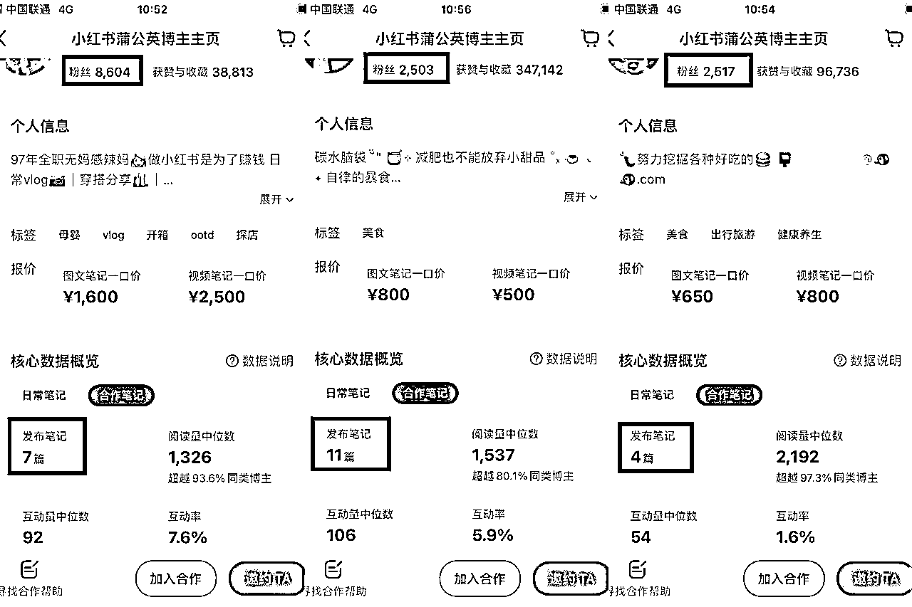

# 1.3 哪些人适合入局

这个项目适合两类人：一类天生网感好，随手发笔记就能拿到很多赞评，很快适应平台；另一类靠持续发布、复盘迭代、打磨内容，最终做出爆款。

方向很多，门槛不算高，大多数想创业或做副业的普通人都能试，也很适合当作了解📕的入门项目。

如果你有一定网感、平时爱刷📕，对内容有热情，愿意长期练拍摄、剪辑、文案等技能，跑通概率会更大。

目前想进蒲公英接广，硬条件有两条：

1. 账号粉丝达到1000；

2. 完成实名认证，且年满18岁。

年龄对多数人不是障碍，难点在涨粉。涨粉又得先发笔记，因此要定好方向、找对对标，保持耐心和更新节奏，持续产出好内容。这个项目里，稳定投入比反复犹豫更值钱。哪怕红利变薄，会做的人照样能赚。

# 二、【项目实操 1/3】选准方向，搭起账号

# 💡 本章要完成什么

了解完项目全貌，就可以动手了。

实操主线再回顾一遍：开号→选方向→养号→参照同行包装账号→拆解爆款并持续做笔记→稳定发布→粉丝过千→实名认证→进蒲公英→接商单收钱。

本章先拿下前4步，把项目地基打牢。

👉章节 2.1 方向怎么选

这一节会讲方向选择的具体方法。为降低选择成本，还会列出15个变现潜力较大的品类供参考。

👉章节 2.2 注册账号

开号和定方向没有固定先后，可以并行。建议一个账号绑一个手机号，注册全程走流量。

🔥章节 2.3 养号流程

养号在本项目里很关键，通常要2.5—3天。正式发项目笔记前先测试：发日常、风景或干货类内容，第二天“小眼睛”超过100，基本可视为养号完成。

🔥章节 2.4 收集对标账号

这步同时也是攒爆款素材。可以刷📕首页、用灰豚数据等，把各领域值得学的账号和爆款素材收进库。

👉章节 2.5 包装账号

头像、昵称、简介等都能照对标账号优化，完成包装。包装做得好，对提升账号权重和涨粉速度都有帮助。

开始学吧。希望这一阶段你能稳稳推进，把基础打扎实。

# 💡 第一阶段航线图

学完并做完本章，就走完航线图第一阶段。

第一阶段：定好定位，搭建📕账号（约3天）

1. 找热门或适合自己的方向，了解玩法（每日至少15分钟）

2. 用流量注册账号，一机一号登录（约15分钟）

3. 刷同行笔记，像真人一样养号（每天约1小时）

4. 学同行，参照对标账号包装自己（约30分钟）

现在开始第一步实操吧。

# 2.1 方向怎么挑 @李子木

# 2.1.1 可参考方向清单 @富贵 @蓝子鱼

# 📌 这份清单怎么用

为降低行动门槛，结合近期📕各方向的数据表现，以及笔记制作的难易程度，我们整理了15个变现潜力较大的方向，供你参考。

看懂基础玩法后，请主动到📕寻找自己喜欢的方向，大胆试新玩法。

# 参考赛道 1：人工智能

推荐理由：人工智能是📕近期重点扶持的热门方向，热度一直很高，对新手来说也适合用来起号。

内容说明：做这个方向别只追热点，否则变现偏弱。要把人工智能和赚钱、产品推荐、具体使用场景结合起来，商业价值才更强。

# 账号样本与爆款拆解

账号：马克张的 AI 宝库

类型：视频博主

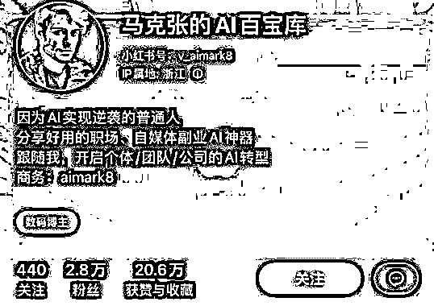

选题方向：

1. 人工智能+赚钱：讲怎么用工具做自媒体、开副业，吸引想增加收入的人；

2. 国产大模型平替推荐：国内用户用GPT等模型不方便，可以推荐好用的国产替代方案；

3. 行业重大新闻：跟踪并解读人工智能领域的重要动态，吸引关注新技术的人群。

制作重点：

4. 画面：找素材+录屏或截图，适当用文字快闪增强视觉节奏；

5. 配音：用文字转语音，保证输出统一、节奏稳定；

6. 视频结构：开头一句话点明核心，与标题和封面保持一致，先把点击拉进来；主体介绍几款工具或使用方法，给出实用建议或赚钱思路；结尾简单介绍自己，并预告后续内容，引导持续关注。

参考视频链接：http://xhslink.com/a/55oBf5ImAiZZ

# 参考赛道 2：演讲口才

推荐理由：情商口才应该是📕受众面最宽的品类之一。中国社会讲究人情世故，每天都要和人打交道、开口说话，很多人正卡在这类痛点上，所以相关内容流量很好，也容易带粉和变现。

内容说明：有人担心自己不是这行的，表达沟通也一般，怕做不好。其实不必怕。平台上同类内容很多，搜关键词就有大量参考。表达能力弱的人做这个方向，还能边做边学，一举两得。这个领域常出现单篇几万赞、直接涨粉过万的情况。

下面用一个成功账号，带你看看情商口才内容怎么做成爆款、快速涨粉。

# 账号样本与爆款拆解

账号：Bob 要加油

类型：视频博主

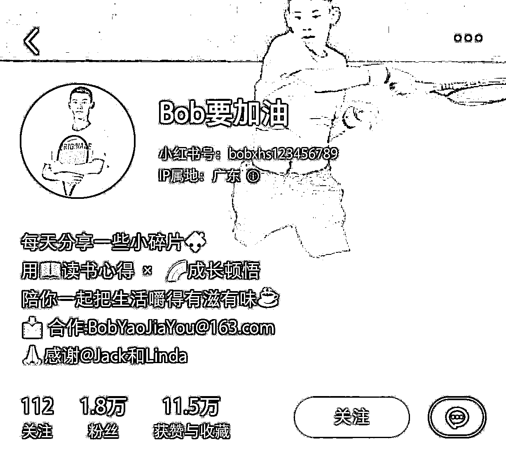

内容形式：真人对着镜头口播。场景和画面都很普通，可只要聊口才表达相关话题，数据就很好。

选题方向：这个号原本想做个人成长、分享学习心得，早期数据一般；转去讲表达相关内容后数据明显起色，于是连续更新10条，从不同角度分析表达能力差的原因。

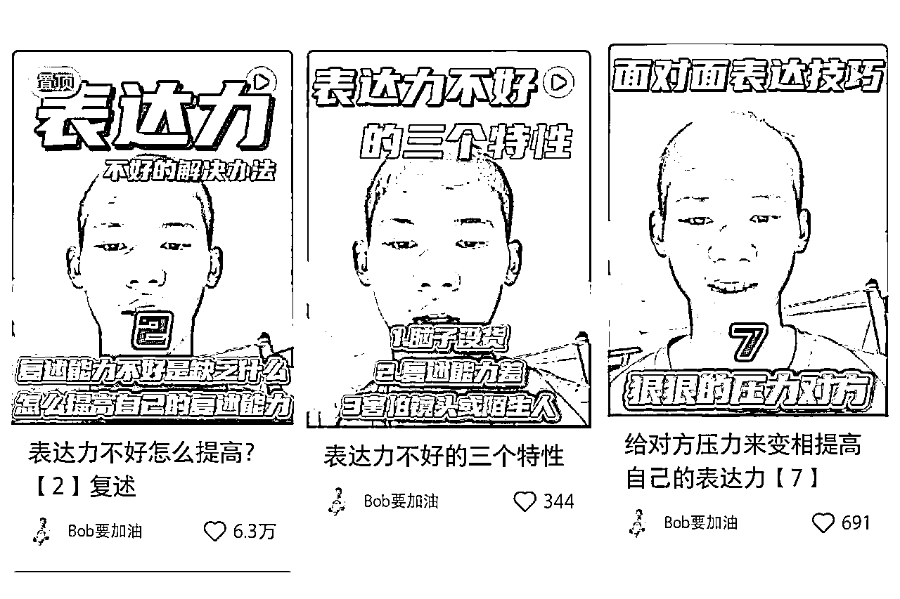

制作重点：

1. 封面图：把表达力相关词放在显眼处，让用户刷到就被关键词抓住，戳中痛点；

2. 视频结构：开场直接点出痛点，比如表达差、复述差，描述用户现状，先引发共鸣；

3. 中间：给具体解法，可分三点讲清操作；

4. 结尾：说明按这些方法做能获得什么结果。

参考笔记链接：http://xhslink.com/a/sKhrcyJdAYXbb

# 参考赛道 3：美食探店

推荐理由：📕2025年重点做本地生活，美食探店有大量商家需要好内容。把食物和博主自己的味觉记忆、生活感受、食材与店铺故事结合起来，能做出鲜明人设，增强粉丝信任，也能拉长内容尾巴，提升商业转化。

内容说明：探店素材和制作相对好上手。笔记可以评味道，也可以挖餐厅文化、主厨匠心、食材来源，以及食物承载的情感记忆。把每篇探店写成有温度、有观点、能同时打动味蕾和内心的分享，既接住用户搜美食的需求，也能沉淀忠实粉丝，让个人IP和商业价值一起长。

# 账号样本与爆款拆解

账号：一只夏夏

类型：图文博主

标题

数字量化：用数字打包美食信息，例如“西安必打卡的6家羊肉泡馍馆”，帮用户省筛选时间，提升点击意愿。

信息结构化：用数字梳理内容，例如“成都火锅地图：10家地道火锅店”，显得攻略扎实有条理，激发点击兴趣。

封面

公式引流：套“地点+场景+特色”，例如“北京三里屯 | 闺蜜聚餐 | 高颜值甜品店推荐”，精准圈住目标人群。

合集吸睛：主打“探店合集”，配美食图与关键词，例如“杭州城西银泰20家不踩雷餐厅”，突出实用价值。

正文

框架引入：用“背景+主题+大纲”开场，先讲需求引发共鸣，再点题并预告内容，带着读者往下看。

图文结合：文字说清店铺关键信息，图片展示场景细节，给用户沉浸式探店体验，提升攻略参考价值。

参考笔记链接：http://xhslink.com/a/DIMitsZPFnAcb

# 参考赛道 4：养生

推荐理由：大环境变化后，亚健康人群增多，养生逐渐变成刚需。同时传统文化回潮，中医养生受到追捧，📕上这类内容爆款率高、合作商单多、广告报价也高，值得尝试。

内容说明：有人担心自己不是专业出身、没有资质，做不了养生博主。事实是，不少普通人靠自学和积累养生知识，在📕快速起量，粉丝突破10万+、月收入过万。

下面用视频和图文两个实际成功案例，帮你了解怎么入门并运营养生账号。

# 账号样本与爆款拆解 01

账号：潘亭子（养生版）

类型：视频博主

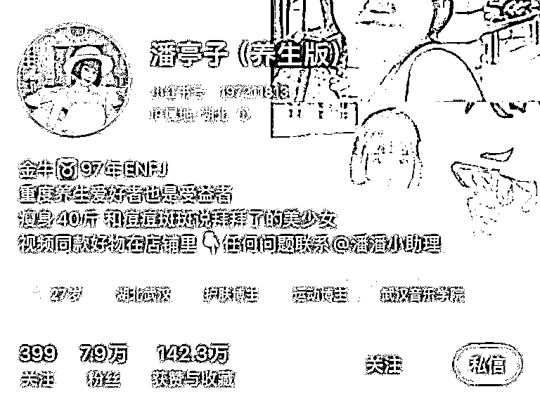

标题：

精准定位痛点，直接对准需求，例如点出“解决头发油腻、脱发问题的经络梳使用秘籍”，提高与目标人群的相关性，提升点击。

用数字增加吸引力，列清功效数量，例如“5种用潘亭子精油搭配经络刷的神奇养生效果”，突出搭配价值，吸引阅读。

放进生活场景，引发共鸣，例如“上班族午休时可用艾灸小妙招”。

封面：

突出产品优势，用醒目字体和精美图片呈现核心价值，例如“潘亭子经络刷——高效疏通经络，促进血液循环”。

对应用户需求，采用“方法+人群+效果”模式，例如“给久坐族的腹部减脂方法——潘亭子生姜艾草精油搭配揉腹操”，吸引特定人群。

正文：

先用问题切入主题，从常见养生困扰引出产品或方法，增强认同感。

把步骤说细，配图展示操作姿势和顺序，增强实用性与可操作性。

分享用户案例，用真实反馈增加可信度，直观呈现产品效果。

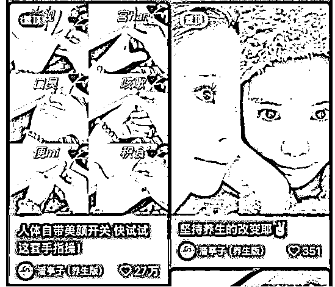

参考笔记链接：http://xhslink.com/a/yga38r85NAvcb

# 账号样本与爆款拆解 02

账号：图图爱养生

类型：图文博主

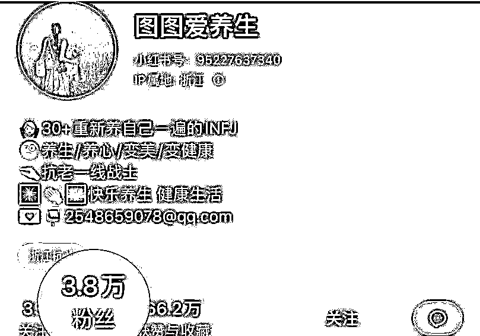

文字标题：

图图的内容多为“干货合集”。在📕，带数字的标题很能抓人，能利用用户的“贪心”心理，激起获取更多信息的欲望。比如“越吃头发越多的8种食物”“黄芪的13种搭配”“身体的7种寒气”等。这类标题简洁明确、实用性强，很适合吸引点击和收藏。

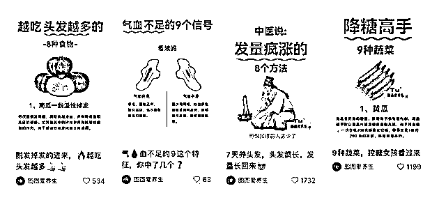

内容结构：

封面：概括内容亮点，常用两种标题技巧：

方法+人群+效果：吸引有需求的人关注；

干货合集：把多个养生小知识打包，让用户觉得一次能拿到大量实用信息。

正文：

文字部分开头说明：一句话讲背景，一句话概括主题，再给出大纲；

图片部分：详细展开内容。如下图，每篇内容基本都按这个结构做，让账号更成体系。

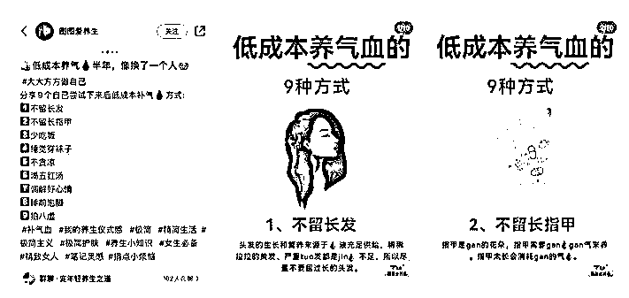

参考笔记链接：http://xhslink.com/a/QftbRMwnZ4MZ

# 参考赛道 5：家居

推荐理由：家居是今年📕平台扶持的方向，有流量倾斜。单看广告合作，不少品牌愿意找家居博主，且同粉丝量级下，家居号报价往往更高。此外，家居领域带货数据也不错，变现潜力较高。

内容说明：今年很火的一种家居内容，是图文与Plog结合。很多博主靠这种形式7天涨粉上千甚至上万。它尤其适合本身有文艺气质、喜欢文学的人。若你偏爱用文字和图片表达个人情绪，家居方向值得考虑。

下面用一个成功账号，带你了解家居内容怎么做并快速吸引关注。

# 账号样本与爆款拆解

账号：水北山南

类型：图文博主

主要内容形式：以图文配合Plog的方式展开。

# 从暗调到美食：📕 9 个能变现的方向拆解

先说说水北山南这个账号。她拍家居主打暗调侘寂风，每张图下面都配一句有诗意的短文案。

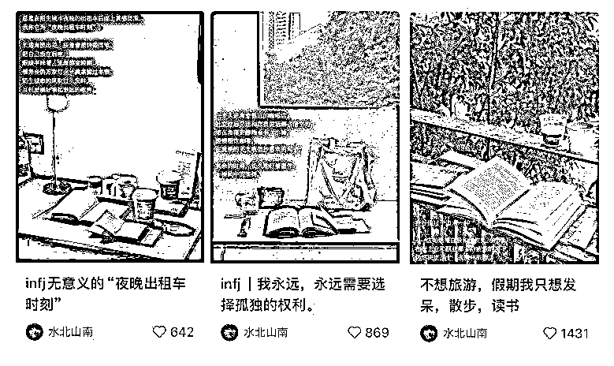

**选题怎么走：**
她的内容个人情绪很浓，但并没有闷头表达，而是会主动蹭平台热点。MBTI、情绪、独居、反社交这类话题，都被她拿来和自己的风格做结合。

**具体怎么做：**

1. **把暗调变成个人标识。** 室内室外都保持统一的深色氛围，暖黄或低饱和的色调让整个主页一眼就能认出是谁。风格统一了，辨识度也就出来了。

2. **在家里划出一平米理想生活角。** 这是📕今年比较热的概念——家里随便找个角落，好好布置一下，就能传达你想要的生活态度。爱看书的人可以弄个小阅读区，喜欢植物的可以在阳台养出一片绿。这样做的好处不只是拍摄素材不用愁、封面不用天天纠结，主页风格也稳得住。更重要的是，这个角落天然适合做广告位，家居、食品之类的产品放进去完全不突兀，接商单也顺手。

3. **让物品替你说故事。** 写配文的时候，可以挑一两件日常小物出来写，比如常用的杯子、最近在读的书、一个小挂饰，讲一讲它们为什么特别。有了故事和情绪，内容就暖和了，粉丝也更有共鸣，互动和粘性都会好起来。

参考笔记链接：http://xhslink.com/a/LI34WQ4Xv5MZ

# 参考赛道 6：美食

**为什么值得做：** 吃是所有人都绕不开的话题，天然有流量、有互动，接商单也容易。

**怎么切入：** 今年美食圈出了不少新玩法，最快上手也最省钱的一种，就是把美食、新中式审美和养生感叠在一起，分享日常健康餐。这种风格好看又不端着，普通人都能跟着做。

下面用一个已经跑通的账号来讲具体怎么做。

# 账号示例 & 爆款笔记模板：金金狗儿

账号：金金狗儿
类型：图文博主
内容形式：每天分享三餐，用图片配文字，展示健康、好吃又简单的家常饭菜。

用“然宝的日记铺”当参照来看重点：

1. **封面要符合主流审美。** 现在美食内容里新中式最吃得开。拍摄时餐具要讲究，陶瓷碗、木质托盘这类有质感的器物很加分；食物的颜色搭配也要好看，别让画面太素。

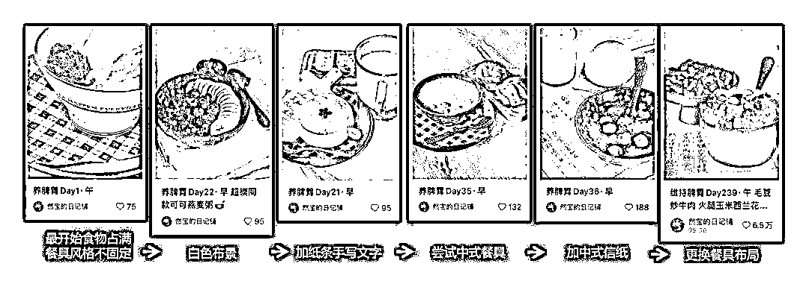

2. **食物要拍得满、拍得清。** 让人流口水是美食内容的底线。盛饭盛菜要堆满，米粒、菜料都要看得清清楚楚，画面不能留太大的空白。

3. **图文结构照这个来：** 图的部分，前 3 张先上诱人美食，第一张拍全貌，第二三张拍特写；中间 2—3 张拍制作过程，比如备菜、下锅；最后一张做个性化收尾，可以放和自己 IP 有关的元素。然宝字好看，所以她放的是手写信纸。文字部分，开头写菜名，中间放炒制步骤，最后添一句符合自己 IP 性格的话。

参考笔记链接：http://xhslink.com/a/wDVKD4cZZ5MZ

# 参考赛道 7：女生独立生活

**为什么值得做：** 这个方向是这两年才火起来的，跟📕以年轻女性为主的用户结构很搭。现在选择不婚、晚婚的女生越来越多，对独立生活技能的需求也跟着涨，所以这类内容不愁没人看，变现空间也大。

**怎么切入：** 去年"女生独立指南"系列的图文在📕已经出过不少爆款，跑出了很多大号，但大多是图文形式。今年转向视频后，数据比图文还好，成了新一波趋势。

下面拆一个案例：几个月时间，发了 200 条视频，涨粉到 30w。

# 账号示例 & 爆款笔记模板：独立女生进阶记

账号：独立女生进阶记
类型：视频博主

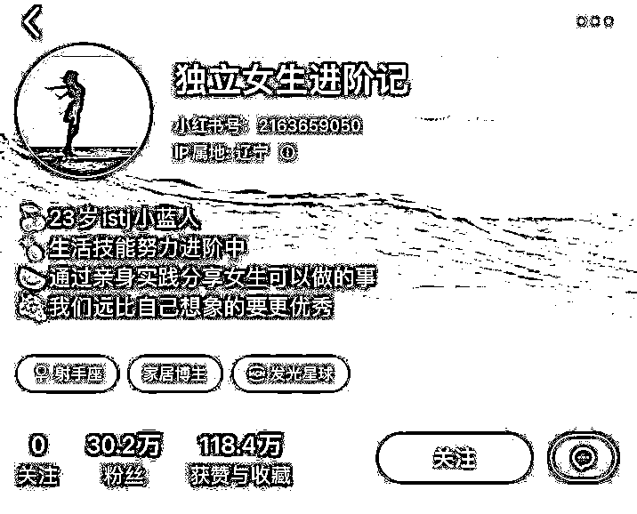

内容形式：视频，有点像教学片，人不用出镜，靠讲解和演示解决日常实际问题。节奏快、画面干净，内容紧扣观众需求。

**选题从哪来：** 留意同赛道的图文大号，把已经被验证过的图文选题翻拍成视频，出爆款的概率会高出不少。

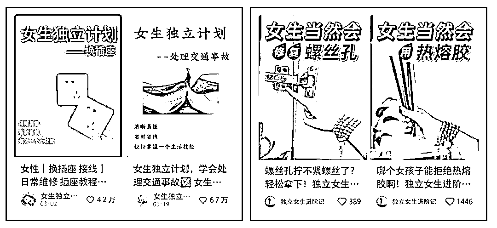

**制作要点：**

1. 内容短平快，开头就进主题，不绕弯。
2. 镜头直接怼着问题拍，背景要清爽，别让画面乱糟糟。
3. 结构分三段：开头抛一个日常常见的问题，比如"卫生间瓷砖裂了""冰箱有异味"；中间讲怎么解决，用哪些工具、具体步骤、最终效果都交代清楚；结尾总结一下，然后鼓励观众自己试试，顺手互动。

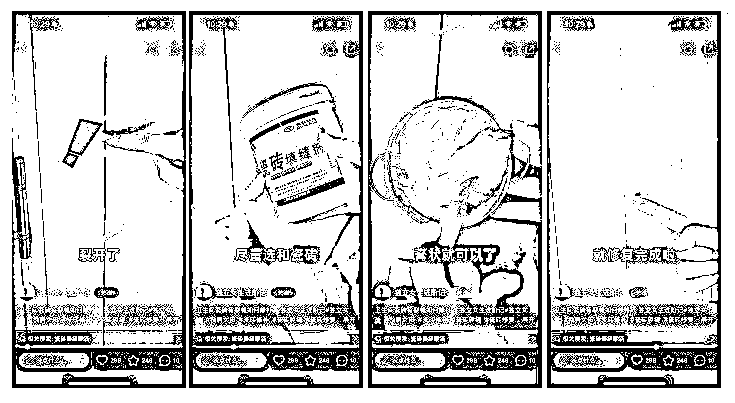

4. 从第一条视频起，如果修理过程里用了哪个产品，就自然地带出来。这样以后接商单会顺很多。

参考笔记链接：http://xhslink.com/a/uI5PN8VLm7LZ

# 参考赛道 8：护肤

**为什么值得做：** 没有几个女生不想知道怎么把皮肤养好，尤其是📕这种女性浓度高的平台。护肤一直是这里的常青类目，接商单、带货、做买手，变现通路都通。

**怎么切入：** 护肤需求大，做的人也多。新手想立住，得找一个别人没占住的角度。两个方向供参考：

- **垂直深耕：** 比如专门讲痘痘肌怎么护理，往细分里扎，做出专业感。
- **跨领域结合：** 比如把中医和护肤扯上关系，借流行趋势给内容添点新意，更容易被看到。

注意：平台最近对横测玩法的态度收紧了，想往这个方向走的人可以先观望，换别的形式试试。

# 账号示例 & 爆款笔记模板：小森林的小世界

账号：小森林的小世界
类型：视频博主

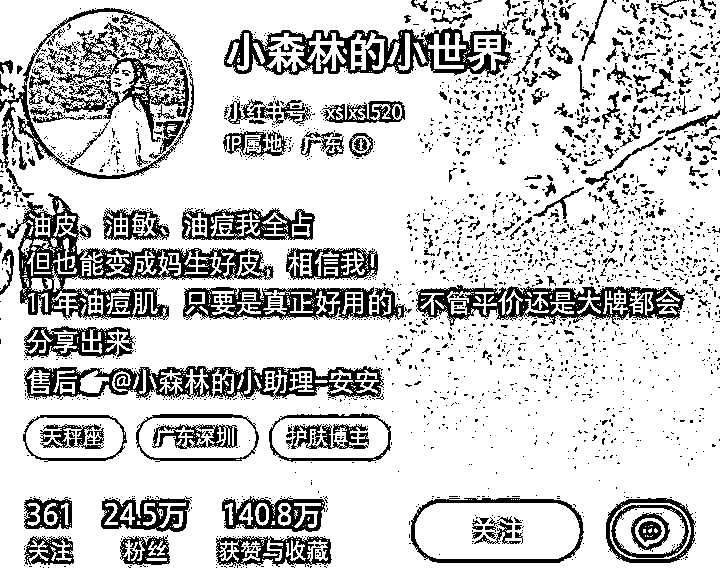

内容形式：视频，靠前后对比展示护肤成果——主要是"战痘"的成果，然后再讲具体怎么操作。

**选题方向：** 聚焦女生护肤的常见困扰，比如油皮、痘痘肌、去闭口、修护皮肤屏障、防晒，核心是解决大家最容易踩坑的地方。

**制作要点：**

1. **封面标题要有对比。** "烂脸战痘成妈生皮"是文字上的反差，护肤前的照片和现在的状态是视觉上的反差。
2. **IP 故事按这个公式走：** 我原来什么样 + 当时什么感觉 + 做了什么努力 + 现在什么样 + 现在什么感觉 + 以后会继续分享经验。
3. **关键词库要攒好：**

   - 第一组：便宜、有效、真实。例子：真实有效瘦小腿经验分享；冷白皮养成干货（便宜、有效）。
   - 第二组：直接抄作业。例子：练成流利口语（不花钱，直接抄作业）；北欧风装修干货（直接抄作业）。
   - 第三组：不花钱版。例子：马甲线练成注意事项（不花钱版）；三天入门 PS（不花钱版）。

参考笔记链接：http://xhslink.com/a/yVPcTC5fWOSZ

# 参考赛道 9：穿搭

**为什么值得做：** 穿搭在📕是变现能力最强的方向之一。人好看、穿搭好看，自然有人追着问链接，带货能力强，广告也不会显得太硬。

**怎么切入：** 穿搭竞争很卷，新人进来先守住两个原则：

1. **垂直细分：** 别去挤主流赛道，找一个小而美的切口，后面这个案例就是这么做的。
2. **跨赛道嫁接：** 穿搭可以跟其他内容类型结合，比如"穿搭 + 心情 Plog"，一下就变得有辨识度了。

还要提醒一句：穿搭博主涨粉不慢，但吸来的粉不能以男粉为主。过于暴露、刻意性感的封面图，男粉来得特别快，这种号商业价值反而低。别为了涨粉去发擦边内容，粉丝结构失衡的账号，广告主是不愿意投的。

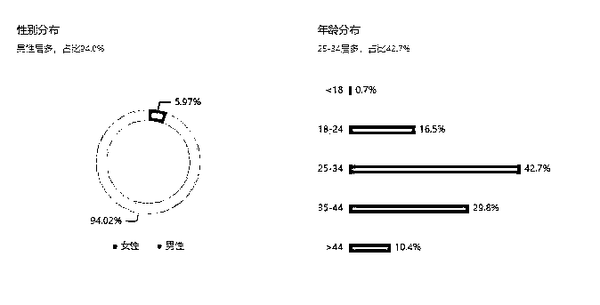

# 账号示例 & 爆款笔记模板 01：天天明星同款

账号：天天明星同款
类型：图文博主
内容形式：拆明星的穿搭组合，比如明星照片配单品图。

**选题方向：** 从热播剧、综艺和机场路透里挖明星穿搭，这些内容自带热度。

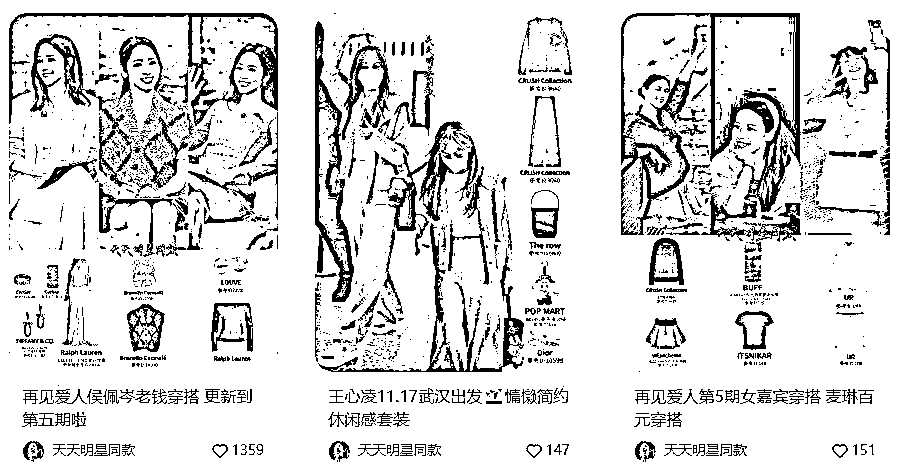

**制作要点：**

1. 选明星要看两点：话题度和穿搭审美都在线。有热度，又有带货和植入的空间。
2. 结构：封面用字幕标出自身条件，比如"腿围 xxcm，有 xx 缺点"，几句话抓住目光；标题按"综艺 / 时间 + 明星 + 穿搭风格（价格、风格等）"来排；正文简单说下综艺或明星最近的热点，再聊这期穿搭的看点。

参考视频链接：http://xhslink.com/a/SueEyhIxWiZZ

# 账号示例 & 爆款笔记模板 02：拖沓刘天王

账号：拖沓刘天王
类型：视频博主

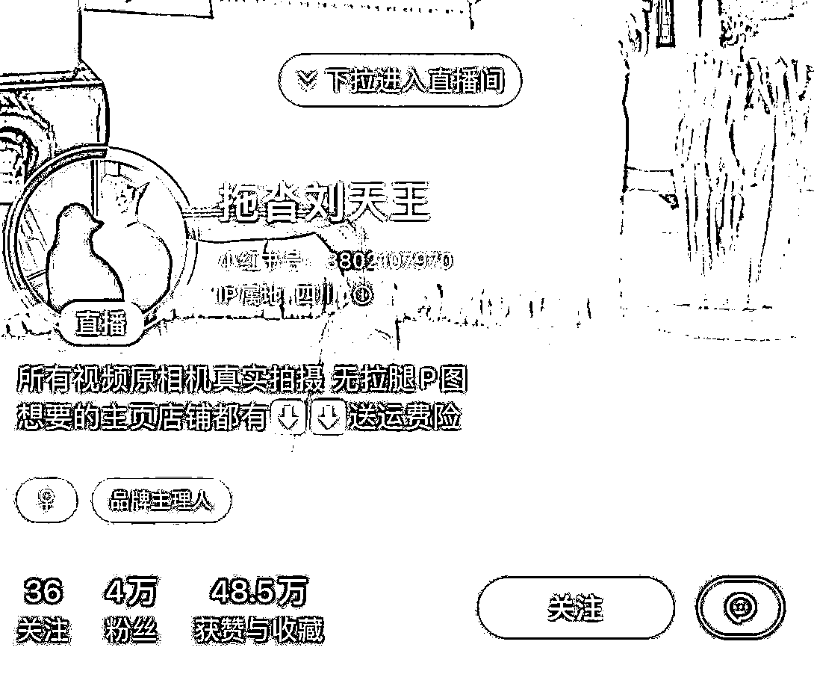

内容形式：用视频拍穿搭的前后对比，把变化放大，观众一下子就 get 到了。

**选题方向：** 只讲适合粗小腿的靴子和鞋子。这个方向带货能力很强，拖沓刘天王靠这类笔记加直播，做了几千万销售额。

**制作要点：**

1. 把身材上的不完美当成流量密码，专给小腿粗的女生推荐靴子和鞋，正中靶心。
2. 视频结构：开头同样用字幕标出自身条件，比如"腿围 xxcm，有 xx 缺点"，快速留人；中间近景拍一只腿穿靴子、一只腿不穿，对比就出来了；结尾拉远镜头看整套穿搭的效果。

参考笔记链接：http://xhslink.com/a/SoZgRWW0HRSZ

# 参考赛道 10：母婴

**为什么值得做：** 母婴是📕的经典赛道，用户消费能力在线、消费意愿也强，商单报价对比其他赛道有明显优势。

**怎么切入：** 母婴内容大致分三类：今年很火的"三拼图"Plog，写日常感悟和孩子的成长；干货类，给宝妈讲育儿知识和选购经验；好物测评类。变现最直接的是好物测评，带货效果也最明显。

# 账号示例 & 爆款笔记模板：宝藏麻麻安妮

账号：宝藏麻麻安妮
类型：图文博主

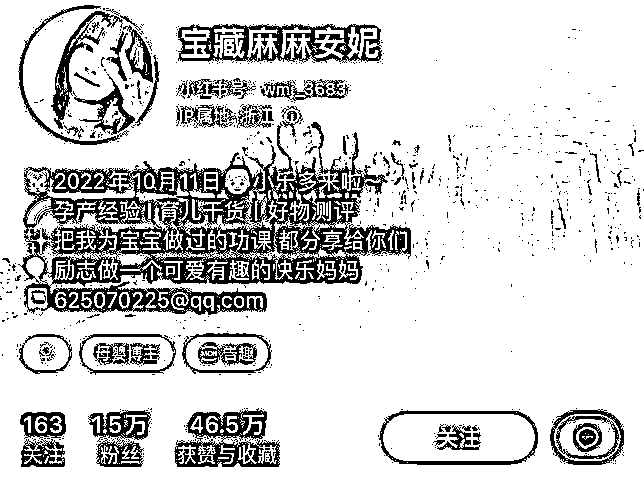

**选题方向：**

1. 母婴居家必用品的测评。
2. 跟着购物节点和达人做攻略，比如李佳琦双 11 直播囤货指南、李佳琦母婴节囤货指南。
3. 孩子关键成长阶段的养护干货。

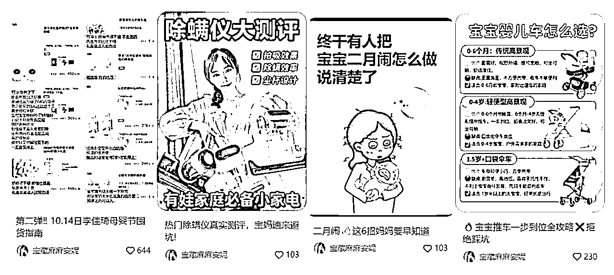

**测评结构：**

1. 封面：真人出镜，好几款测评产品一起出镜，封面标题写明测什么，花字标出测评的几个维度。
2. 副图：用 live 图组合，分别从几个重点维度对比产品差异；再放每款产品的照片、特点和点评。
3. 正文：先写为什么买这产品，再说选购要注意什么，最后逐一点评。

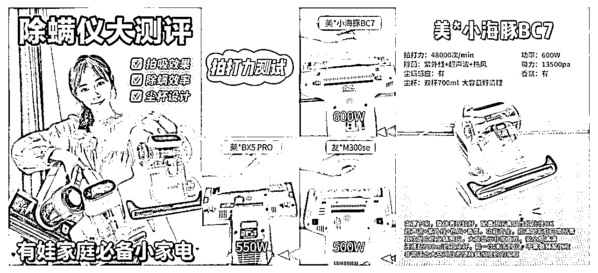

参考笔记链接：http://xhslink.com/a/0mE1RpaPOiZZ

# 参考赛道 11：数码

**为什么值得做：** 数码在📕上供给一直跟不上需求，广告主也认这个方向。而且数码是少有的男女通吃的赛道，到了大促节点，商业价值尤其高。

**怎么切入：** 主要做清单式图文测评。你以前要是写过知乎好物，转来做📕数码会非常顺手。不过有个提醒：平台最近在限制横测玩法，做这个赛道的人可以先试试别的形式。

# 账号示例 & 爆款笔记模板：枫哥评测

账号：枫哥评测
类型：图文博主

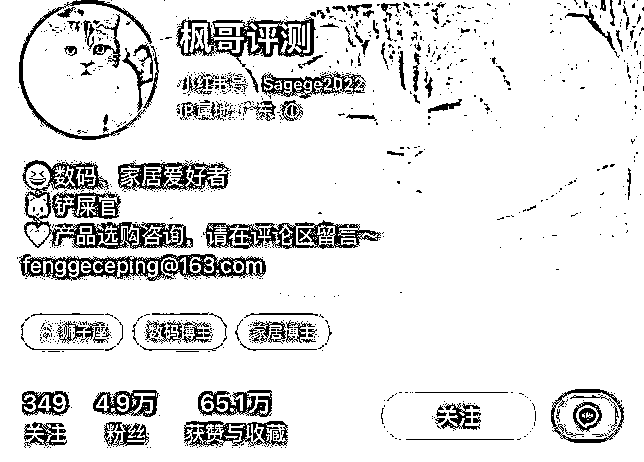

内容形式：清单式测评，图片加详细的文字说明。

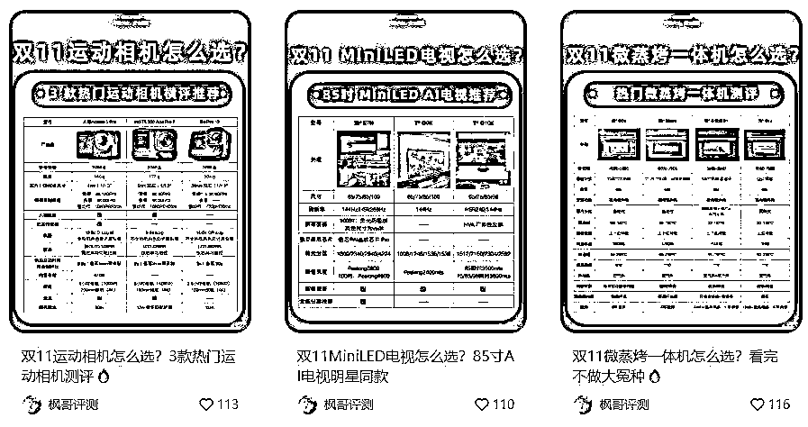

**选题方向：**

- 家电和数码产品的购买攻略。
- 多个热门产品的横向对比测评。
- 双十一、618 大促的必买清单。

**制作要点：**

1. 封面：标题直接写清测评的类目，信息要一眼能看到；用表格把多款产品的评测维度排出来，读者扫一眼就知道你在测什么。
2. 副图和内容：主要放选购指南和测评重点，让用户快速拿到有用信息；每款产品都要配参数和购买建议，结合实际使用场景来点评。
3. 正文结构：讲清楚选购的痛点 + 选购指南 + 注明图 xx 到图 xx 是产品推荐。

⚠️ 一个省钱的思路：测很多产品的时候，不一定要全部买回来。去京东、淘宝的商品详情页和评论区扒图、扒信息，也可以撑起一篇测评。

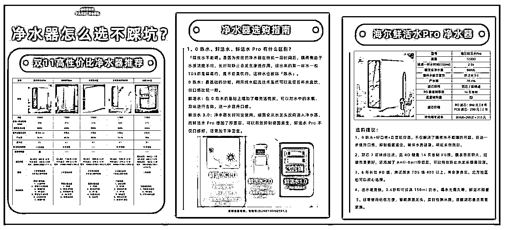

参考视频链接：http://xhslink.com/a/zrKSnCRwKiZZ

# 参考赛道 12：美妆

**为什么值得做：** 美妆算是📕的本命赛道，用户盘子大，需求常年旺盛，变现能力一直很强，哪怕卷也值得进。

**怎么切入：** 美妆跟穿搭一样卷，但细分方向比穿搭更少。所以更需要用跨赛道选题和独特人设来突围。年轻用户里大学生占了大头，他们不但愿意花钱，对美妆的热情也很高。一个"普通女大学生"定位的美妆号，涨粉和变现都会轻松一些。

注意：平台最近对横测玩法不友好，做这个赛道的人可以先换其他内容形式。

# 账号示例 & 爆款笔记模板：是花茶呀

账号：是花茶呀
类型：图文博主

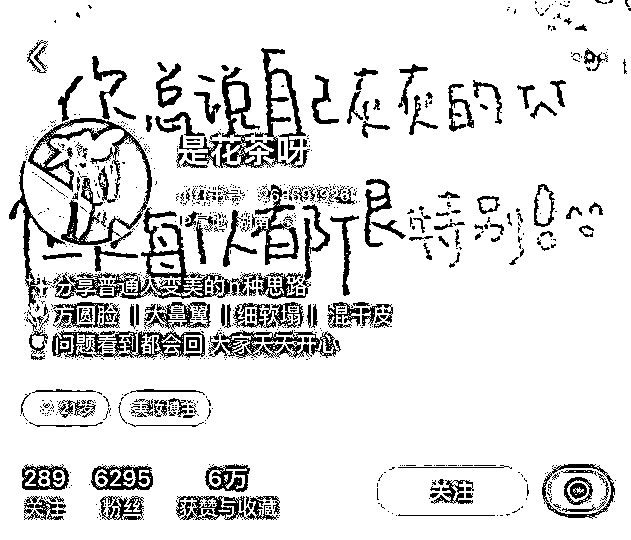

内容形式：用图片记录普通女大学生自学化妆和护肤的前后变化。

**选题方向：**

1. 人设向：一个普通女大学生靠自律、学习和护肤化妆，外貌发生了明显变化。
2. 干货向：适合普通女大学生的护肤品测评、化妆品推荐，以及正确的护肤化妆方法。

**制作要点：**

3. 前后对比必须强。美妆赛道最吃这套，一张对比图胜过千言万语。照片选择上要挑差异明显的，但别修得太过，真实感很重要。
4. 选题要蹭热点、贴人设。她那条 1.4w 赞的图文，就是借了别的博主的爆款选题，换上自己的照片和故事，照样出爆款。

参考笔记链接：http://xhslink.com/a/m81RfdDaiiZZ

# 参考赛道 13：职场

**为什么值得做：** 从"大厂离职"到"发疯工牌"再到"精神离职"，📕已经成了职场人宣泄情绪的树洞。来这儿找解压的人越来越多，同时大家也关心兼职副业、怎么增加收入、怎么稳住情绪这类话题。

**怎么切入：** 职场内容可以走两个方向：一是分享职场段子和搞笑日常，帮人排解情绪；二是输出实用干货，比如职场进阶方法、工作指南，既有吸引力，又能真正帮到人。

# 账号示例 & 爆款笔记模板：彤儿学姐

账号：彤儿学姐
类型：视频博主 + 图文博主
内容形式：视频开头点出一个职场痛点，然后分享求职干货。只要道理讲得通、痛点切得准，就会有人关注。爆款选题可以反复做，比如"年薪 70w 的大厂同事分享求职 SOP、面试 SOP"，把求职细节拆成系列内容，持续更新。

**选题方向：** 借用有背书的人的口吻，讲求职、升职加薪的硬核经验。

**制作要点：**

1. **打准痛点。** 比如学历不够找不到工作、文科生求职难、面试答不上来，这些都是真实的痛点，针对性地给方案。
2. **标题和开头：**

   - 直接把结论甩出来。比如"我发现找工作时，胆子越大，收到的 Offer 越多"，一句话钩住人。
   - 结果前置 + 背书加持。比如开头说"大厂工作 10 年的高管"，信任感就有了。

3. **正文内容：**

   - 直接给方法，摆干货，把自己的 SOP 思维导图或求职笔记亮出来。
   - 视频不用做得多精致，有背书、有方法、让人听了觉得有道理，就会有人给你点赞。

参考笔记链接：http://xhslink.com/a/SW7phFKWxlC0

# 参考赛道 14：旅游

**为什么值得做：** 📕本身就是生活方式平台，旅行内容的吸引力是天然的，出爆款不难；酒店、航空公司、文旅局、旅行装备这些品牌合作也多，变现路径很清晰。

**怎么切入：** 从 2024 年起，📕上冒出了大量旅行攻略。新手想入门，最简单的方法就是找对标模仿。如果你本身有创意，对世界比较敏感，也有内容制作的经验，那可以冲一冲文旅方向。平台现在很缺有灵魂的文旅 IP，把旅行中的细节和情绪做进故事里，做成能引起共鸣的内容，观众会买账，粉丝也会留下。

# 账号示例 & 爆款笔记模板 01：燕子

账号：燕子
类型：图文博主

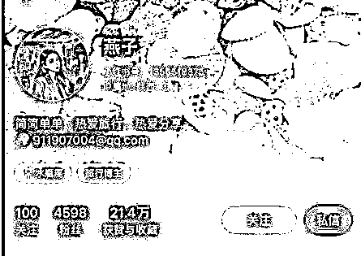

内容形式：找个图文笔记账号做参考就行，不用剪视频，人也不用出镜，i 人做起来毫无压力。

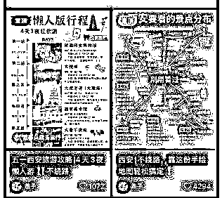

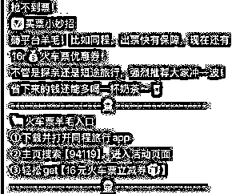

**标题：**

- 数字化表达：用具体数字让人觉得信息量很足，比如"西安 5 天 4 晚超详细行程"，用户一眼就知道这篇能查到什么，点不点就看你了。
- 打痛点：围绕旅行里常见的麻烦和特定人群来切，比如"带老人孩子旅行必看！北京亲子游避坑指南"，要找的人自然会点。
- 突出干货：用"攻略合集""宝藏指南"这类词强调可用性，比如"成都美食攻略合集！本地人私藏的 20 家老店"，让人感觉拿到就能用。

**封面：**

- 套公式："地点 + 人群 + 特色"，比如"上海 | 闺蜜打卡 | 网红拍照圣地合集"，想拍同款的人直接对号入座。
- 合集感：把"攻略合集"当核心卖点，配上数字和吸睛的图，比如"30 个国内绝美小众旅行地合集 | 避开人挤人"，稀缺感一下就出来了。

**正文：**

# 开篇两句怎么抓人

开篇可以走“三段式”：先描述大环境里的某种现象，把情绪勾出来；再亮明这期要聊的话题；最后提前给出一张内容地图，让读者知道后面有什么，愿意继续往下翻。

画面和文字各管一段：画面用来还原真实场景，文字负责把要点拎出来。两者搭着用，读者理解起来不费劲，攻略也更经得住实际操作。

参考笔记：http://xhslink.com/a/ZdYHzGNLplAcb

# 02 样板账号拆解：把旅行拍成故事

示范账号：元莱 Yilia
内容类型：短视频

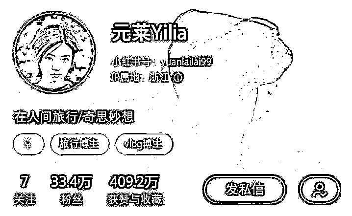

主要内容形式：
镜头对准的不是景点打卡，而是路上遇见的人、动物、草木，以及这些相遇带来的自我审视。与其说是攻略，不如说是一份旅行手记。

选题方向：
题材都从亲身经历里生长出来——比如为了圆环球旅行的梦，她把安稳日子放下了；陪着外公一项项划掉人生愿望；以及自己怎么从泥潭里一点点爬出来……

内容制作重点：

1. 立意在先。在文旅创作里，这是最吃重的一环：你的看法得新鲜、独到，还要踩在大众情绪的鼓点上，顺带露出自己的性情。她的做法是让景物承担情绪——海边的风声引出对环境的忧虑；亲手救助又放走一只雏鸟，带出对生命的追问；一段泥泞田埂，被她写成人间来路。

2. 句子要短，开头要狠。把最抓人的那句话或那个悬念扔到最前面，少写长句；多落在具体的东西、当时的心里波动、真实的场景上。细节越扎实，观众越容易走进去。

3. 慢内容，快剪辑。整体气质可以从容，但不能拖。句子之间的空白要尽可能压缩，让画面像一串连着的音符滑下去，观众才舍不得划走。

参考笔记：http://xhslink.com/a/NFet2M0Ly0SZ

# 赛道 15：留学党和海外生活 Plog，素材自带稀缺性

为什么值得做：如果你在国外读书、工作，或者相册里躺着大量海外生活照，这条路线别错过。它天生比多数人多了素材上的稀缺优势，又因为贴近日常，商业转化的天花板不低。

适合谁：对旅游方向的创作者来说，这套玩法同样能借用，核心是不断输出新鲜见闻、独到看法和不一样的视角。平时爱记录、脑洞多的人，上手会更顺。

## 样板账号与拆解：把吐槽做成照片故事流

下面这个号，更适合本身就有梗的年轻创作者。

示范账号：妈的欧洲账本
内容类型：图文博主

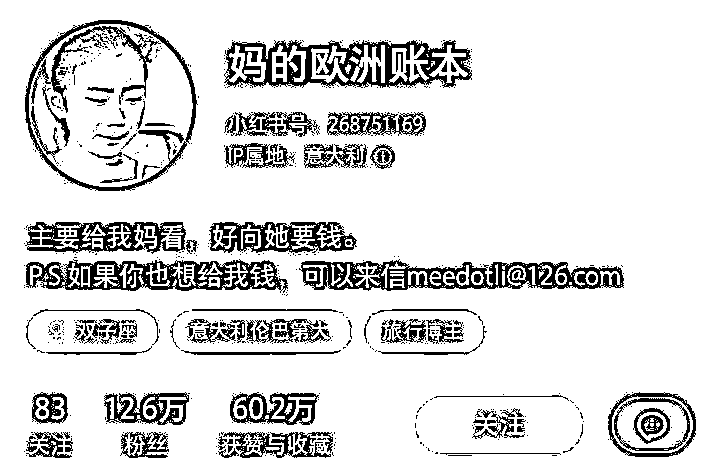

主要内容形式：
用一组照片配几段文字，串成一条有情节、主打吐槽和笑点的图片叙事。

选题方向：
专挑留学、旅居路上那些让人无语的瞬间，换一个刁钻角度讲出来。

内容制作重点：

1. 让文字有火气。她的大量素材来自气得跳脚、觉得离谱的时刻，这些槽点本身就带着情绪，读起来像朋友当场跟你抱怨，天然带互动欲。所以，当你火大、想喷、或者兴奋到不行的时候，别忍着，掏出手机边讲边录，这就是最鲜活的原始素材；事后转成文字，得空再理顺成有条理的内容，挑几句狠话压在图上，一条情绪浓度高、能勾人的图文就成了。

2. 把段子写在画面上。不想出镜的人尤其可以试：单张照片配三段式小段子，戏剧感一下就上来了。

3. 用游戏视角记录行程。把自己当成玩家，一张图对应一个关卡，配文可以是“此刻，你一个人降落在北欧”“几经周折，民宿的楼门就在眼前”，代入感立刻不一样。

参考笔记：http://xhslink.com/a/8dkFGTi6g0SZ

# 2.1.2 赛道怎么选：十个维度给自己打分 @梨云

热门方向看得差不多了，接下来要衡量自己更适合押哪一条。下面这套打分思路，能帮你把方向对上号。

从兴趣与擅长、对赛道和用户的认知、过往积累出发，拆成十项：

对赛道的兴趣：喜欢程度，决定你能走多久。
制作难度：越拿手，产出越省劲。
学习意愿：眼下不会但肯学，后面照样越做越顺。
赛道熟悉度：懂行的人写东西不费劲。
补课意愿：暂时不懂却愿意钻，后续压力会小很多。
用户熟悉度：摸清目标读者，出爆款的命中率更高。
研究用户的意愿：不了解但愿意下功夫，选题目会更轻松。
相关经验：底子越厚，切进去越容易。
背书强度：背景够硬，涨信任更快。
网感：对平台节奏越敏感，做出爆款的几率越大。

每项 10 分封顶，程度、意愿、经验、强度、能力越强，分数给得越高。算完后，总分排在前三的方向，基本就是你的主攻区。

资料出处：《📕越做越没流量？像素级带你高效模仿爆款笔记》

# 2.2 注册账号：把第一步走稳 @周恩俊

领域定了，就可以动手注册。

# 2.2.1 手机号怎么备：一卡一号，先跑通单个

通常一个号对应一张卡。想多铺几个号，可以借用家人的号码，或者再办几张卡，线上就能搞定。新手阶段先专注一个号，把流程跑熟，再考虑多号、多领域铺矩阵。

电话卡推荐：
三大运营商都支持副卡，一张身份证最多认证 5 个号，一拖四，副卡月租 10 元；
移动的万能副卡，10 元/月，一张身份证可领 2 张，两张之间需间隔 90 天，营业厅和 App 都能办，营业厅还能免掉首年月租；
电信 App 里搜“无忧卡”，月费 5 元，一般次日就能送到；
移动另有 8 元保号套餐可选。

# 2.2.2 注册动作：全程走流量，别急着实名

注册时建议全程使用移动数据，别连 Wi-Fi。注册完成后，按下面的节奏养护账号。

⚠️注意事项：这一步千万不要做实名认证。一张身份证只能绑定一个号，认证后除非注销否则无法解绑。更稳妥的做法是等号做起来、关注者过千，再去实名。

# 2.3 养号三天：让系统认准你的领域 @周恩俊

第一天：用流量完成注册。注册完先别动任何设置——头图、名字、介绍都放一放，也别急着刷内容。

第二天：开始刷你目标领域的内容，模仿真人的浏览习惯。做哪一行就刷哪一行，遇到同行的帖子要点赞、收藏、关注、留言，每次停留 20 到 30 秒。一天累计半小时到一小时即可，可以拆成几段：早上 15 分钟、午后 20 分钟、睡前 15 分钟，能多刷当然更好。

第三天：上午照旧。下午打开发现页看看，如果同行内容占到七成，说明标签已经养出来了，这时候再动手改头图、改名字、改介绍。心急的，包装完当天就能发；不急，隔天再发也行。

还有一点：垂直领域正式发东西前，先拿一条日常、风景或干货类的帖子试水，第二天“小眼睛”破百，说明号是健康的，再切回本领域。

走完这套流程再去发作品涨粉。养号这步省不得，跳过它直接发，号没反应、起不来，反而更耗时间。

资料出处：《📕达人变现项目，单人月入 2W，团队月入 10W+保姆级教程详细拆解》@周恩俊

# 2.4 找标杆号：给自己备一批可抄的样本

定位清楚之后，下一步就是锁定参考对象。有了它们，你能照着优化自己的主页形象，也能借鉴别人的内容排布和产出节奏。

# 2.4.1 两种找法：搜关键词、翻频道

1）在搜索框里敲领域词（效率最高）
输入你所在领域的关键词，翻“综合”和“最热”里排在前 50 的创作者，逐一筛出值得跟的。

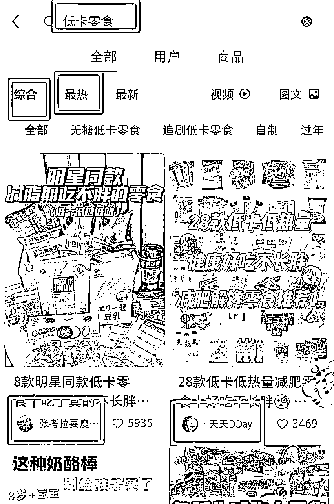

2）从【频道】进对应分类
📕的二级导航分出了家居、美妆、穿搭等多个频道。点进你的领域，就能看到该分类下的作品，从中挑合适的对象。

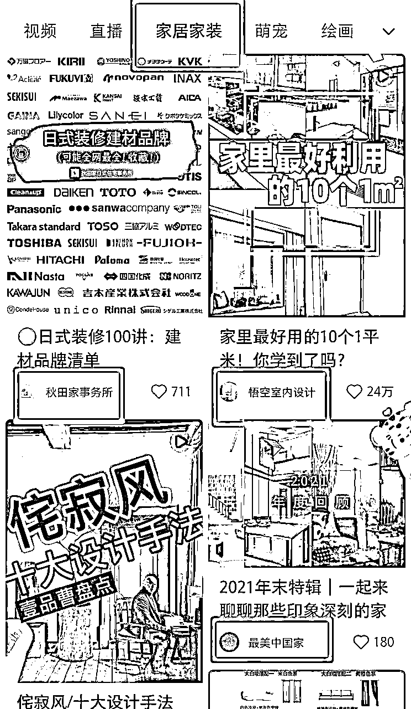

# 2.4.2 七个维度，判断这个样本值不值得跟

挑选时要过滤，别一看是明星或大 V 就照单全收，并非人人都适合当模板。可以按下面几条过一遍：

1）类目是否对得上
对方的细分方向和你是否一致或接近。做穿搭的去学美食号显然不合适。小众品类很难找到完全同款的，找相近类目的号参考即可。

2）赚钱方式（效率、空间、你有没有能力或潜力承接）
纯做内容和做精准引流的号，规划逻辑完全不同。要弄清楚对方靠什么挣钱：接品牌、导流到私域卖货，还是卖课？跟你现在或未来的路径像不像？

3）粉丝量级（近期涨得快的；或者体量不小、但腰部比头部更值得学）
量级要挑，太少没参考价值，太多也够不着。优先看近期涨势猛、起号快的。对新手而言，十万级的腰部号往往比五十万以上的头部号和明星号更有借鉴意义——头部大多签了机构，背后有团队包装，个人很难复制。

4）人设调性
快速翻一遍对方主页，判断气质跟你的 IP 合不合，以及你有没有能力产出类似风格的东西。难度过高、模仿不来的话，果断放弃。

5）赞粉比 @星月
单条内容的赞数超过账号总粉丝量的，更值得研究。别误以为赞越多内容越好，粉丝基数大的号天然会把数据抬高。刷的时候多留意那些赞数看起来平平（100 到 1000）的帖子，点进去看作者粉丝量——很多 5k、1w 赞的帖子背后是 8w、10w 粉丝，这种参考价值有限。把低粉高赞的帖子收进你的选题库，它们就是源源不断的素材。

6）一个号能反复出爆款 @星月
爆款有运气成分。偶尔一条火了，说明不了什么；但如果一个号持续出爆款，那它一定握住了某种规律，可能是首图，也可能是角度。

7）时效距离 @星月
参考近一个月内跑出来的内容或号，意义更大。自媒体这行，热度就是命。冬天大家搜羽绒服，情人节大家搜礼物，最近甲流、感冒药又成了热词。热词会随时间轮换，所以尽量挑最近、最热的对象。除了市场反应，平台对某些词的流量倾斜也带点随机性。你要做的是盯住近期冒头的内容，顺着平台的推流方向走。一个月是粗略范围，不是铁律；原则是越近越好——一周内最佳，三天内还烫手。

资料出处：《初阶 | 📕-爆款笔记｜航海实战手册》《爆款对标账号 6 要素》

# 2.4.3 拆开看：主页、选题、赚钱路径 @梨云

锁定对象后，接下来是拆解。

1）先看主页包装
拿我自己的号举例。

1. 名字：云云【名字】+ 讲学习方法【内容方向】
2. 介绍
a. 核心标签：学霸&卷王｜研究学习方法三年｜幽默风趣
b. 输出内容：学习干货｜提分技巧｜四六级｜好物分享
c. 更新节奏：一天一条

2）再看内容布局
留意对方的合集文件夹。做得好的创作者会把主页当杂志来编，每个合集相当于一个专栏，围绕一类主题持续更。这些类目往往都是被数据验证过的；某类试了一两条没水花，多半就停了。留下来的，就是你可以照着做的方向。再往下，把帖子尽量翻完，按合集梳理每类的题目、首图、形式，你就顺手攒出了一个选题库和素材库。

3）最后看赚钱路径
无非三条：接广告、卖货、导私域。

广告：去数据平台搜名字找到达人，点开“品牌合作”看情况，这是硬广。另有一种软广藏得深，数据平台查不到，得翻帖子：如果一条内容里推荐某产品，视频讲了三秒以上、图文占了不止两页，九成是软文。

卖货：主页上的【店铺】【专栏】点一点，或者蹲一场直播，有没有带货一目了然。

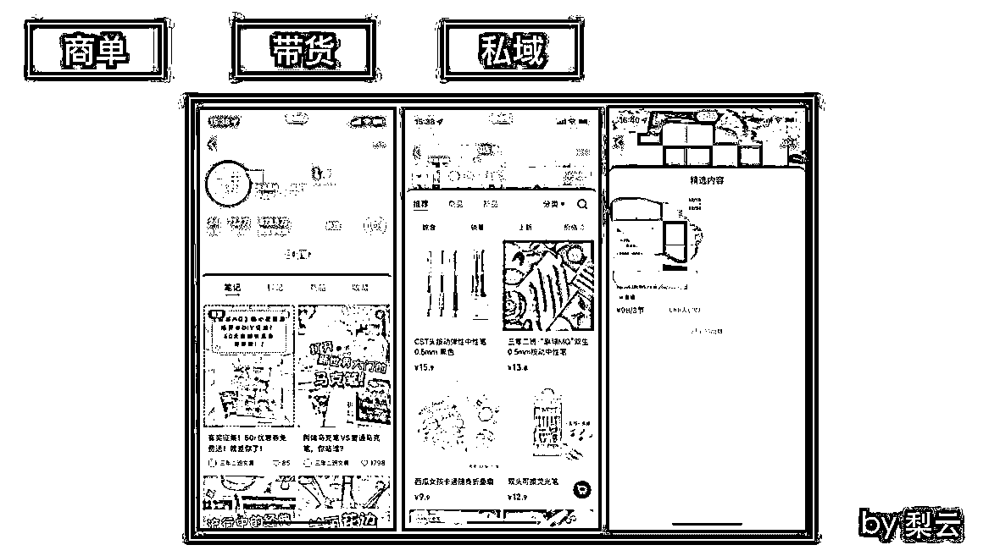

私域：分三步看。
一看画面：资料是不是故意放不全。比如一份三十页的东西只露出几页，这是暗钩——意思是“我还有，想要的来找我”。
二看文字：有没有明示或暗示，比如写着“电子版我有，拿去打印就行”，这是明钩。
三看留言：是不是清一色的整齐回复，那就很明显了。更狠的办法是自己去当一回粉丝，领份资料，看对方下一步怎么接。

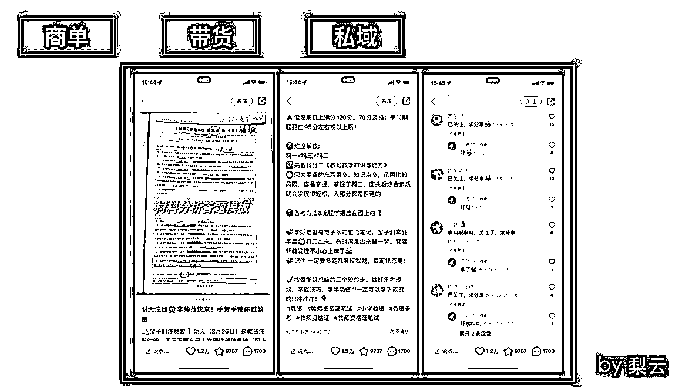

资料出处：《定位一换涨粉过万，如何利用数据分析在📕精准定位》

# 2.5 主页包装：把门面收拾干净

包装主页，等于开门做生意前先装修店面，这是读者对你的第一眼判断。一个人决定关注谁，很少只因为一条好内容。他会点进主页，扫一遍名字、头图、介绍、背景图、过往作品，然后再决定要不要按关注。

对我们而言，把资料填全还能抬高账号权重。信息越完整，平台越容易给你打上标签；有了标签，推来的流量就更对口，点开的人变多，播放浏览跟着涨，权重自然水涨船高。

具体怎么弄？回看你前面找到的参考对象，按自己的领域做调整，立住人设。

# 2.5.1 头图：干净、贴定位，别太花

头图不要太花哨，得跟你做的事对得上。制作上，可以借助图怪兽一类的站点出图，挑一张满意的用；也可以找免费可商用的图片：
图怪兽：https://818ps.com/
可画：https://canva.com/
创客贴：https://www.chuangkit.com/

⚠️注意事项：别用有商标风险的图片，容易踩侵权。

# 2.5.2 名字：好记、好认，最好带行业词

名字要辨识度高、顺口、有点意思；带上领域相关的词，会显得更专业也更可信。别堆复杂符号，也别用生僻表达。比如做美食的叫“小溪教你做美食”，一看就知道是干什么的。

四种起名套路可以抄：
名字 + 个性：大鹅的七七八八
名字 + 地域：姚老板在北京
名字 + 专业：跟着拆哥看房
名字 + 态度：阿鱼爱学习

# 2.5.3 介绍：给读者一个关注你的理由

介绍的任务只有一个：告诉别人，关注你能得到什么。比如穿搭号写“小个子穿搭分享｜感谢喜欢”。

一个可套的模板：
你是谁；
你干过什么拿得出手的事（没有就略过）；
关注你有什么好处，或者你会在哪个领域持续输出。

有的号点赞破万，粉丝却只有一百来个，问题多半出在内容不够垂直、介绍也没写明白——读者找不到关注的理由。所以写介绍千万别客气，你不把自己的价值摆出来，人家凭什么留下？

# 三、【项目实操 2/3】做内容、冲千粉、进蒲公英

# 💡
# 这章要完成什么

按标题说的，这一章要做的事很明确：不停地产出📕内容，摸索出能爆的路子，把粉丝一点点做到一千，够上蒲公英的门槛，然后顺利入驻。

门槛是什么？
① 完成实名认证，且年满 18 周岁；
② 粉丝数超过 1000。

新手起步，可以先研究并拆解一批爆款样本，慢慢找到手感；在这个基础上持续打磨、提高产出效率，数据自然会往上走。照本章的方法操作，选好赛道后，大概 10 到 15 天会看到粉丝开始动，一个月上下能摸到千粉。

核心动作拆开看无非几件：
产出内容，图文或视频皆可。
图文怎么做，见 👉「3.1 如何创作图文笔记」；
视频怎么做，见 👉「3.2 如何创作视频笔记」；
了解常见的违规情形与应对方式，见 👉「3.3 检查笔记内容，避免违规」；
冲上千粉、入驻蒲公英，见 👉「3.4 达到千粉，入驻蒲公英」。

这些事，本章都会给出答案。

# 💡
# 本章行动路线

照着学、跟着做，就能走完路线图的第二阶段。

第二阶段：做爆款内容，攒到千粉，入驻蒲公英（约 10—30 天）
1. 按赛道搭素材库，持续收集可参考的爆款（每天 1 小时左右）
2. 收集并拆解至少 3—5 条爆款图文（每天 1—1.5 小时）
3. 仿写一条图文并发布（约 1 小时）
4. 收集并拆解至少 3—5 条爆款视频（每天 1—1.5 小时）
5. 仿写一条视频并发布（约 2 小时）
6. 每天至少更一条图文或视频，直到破千粉（每天 1—1.5 小时）
7. 入驻蒲公英，完成实名认证，设置报价（约半小时）

那么，第二阶段的实操，现在就可以开始了。

# 3.1 图文怎么做：新手从这里起步 @小玲玲 @蓝子鱼

# 3.1.1 四步走：从找样本到排版成稿

素材从参考对象那里来，攒样本的过程就是攒素材。怎么找样本，回看前文【2.4 积累对标账号】。

挑素材的标准：近期跑出来的图文爆款，赞数至少 100 起。

找到之后，把文字扒出来，交给 AI 重写一遍；再做一张背景图，固定成自己的视觉模板；把改写后的文字排进去，一条内容就有了雏形。

具体怎么落地？拿一条赛道演示。

# 3.1.2 实操演示：中医养生赛道

对标笔记链接：http://xhslink.com/a/Ti9KvhPXOMXZ

1）搜关键词，摸清同行的爆款
在📕输入“中医养生”“养生干货”之类的词，筛出近期的热门帖子。重点看赞和评论高的那些，研究它的排版、题目、文案语气。

2）用工具锁定好内容
可以借助灰豚数据这类工具，也可以直接在站内搜同样的词，按赞数排序、限定近期，让题材贴着当下的风向走，踩中的概率更高。

3）把文案提出来
把选中的帖子链接丢进文案提取小程序，或者用文字识别功能抓取，确保拿到的内容完整、清晰。

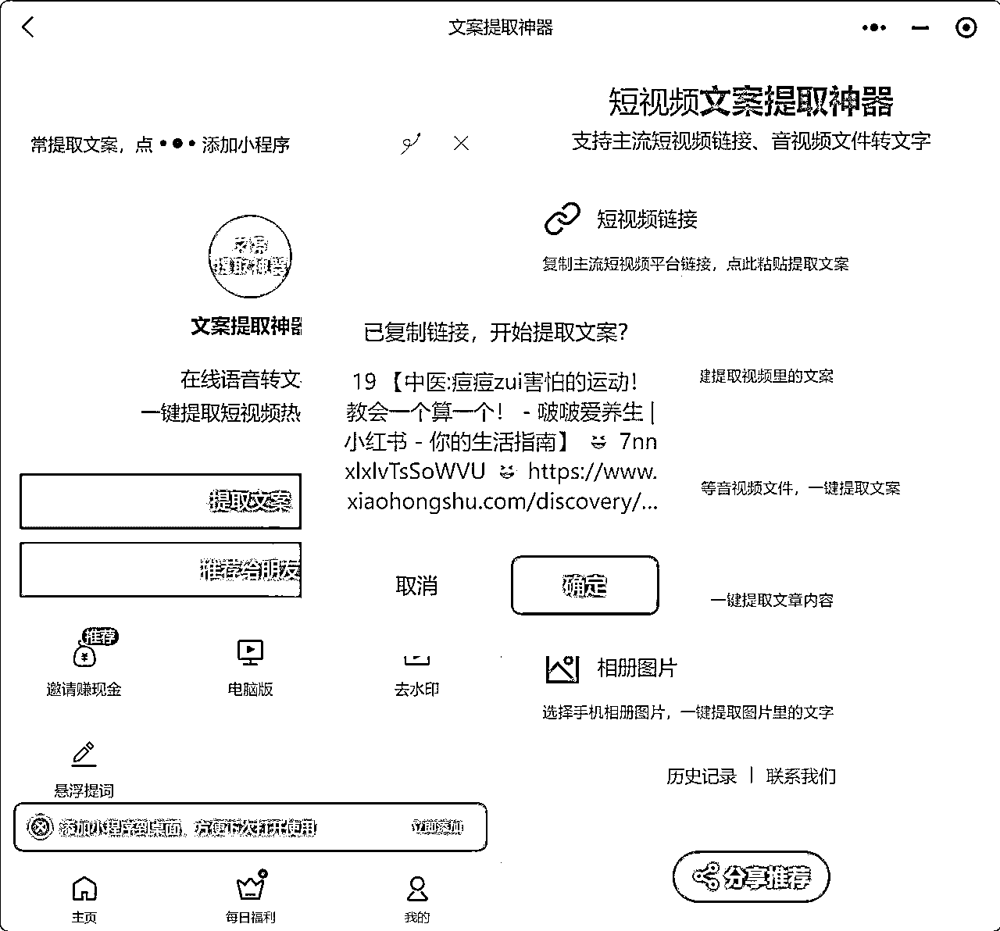

4）先给封面找一张养生风底图

打开稿定设计这类工具，挑一张和养生内容气质接近的背景。版面要清爽，元素别堆满，留出呼吸感，读者扫一眼不累。

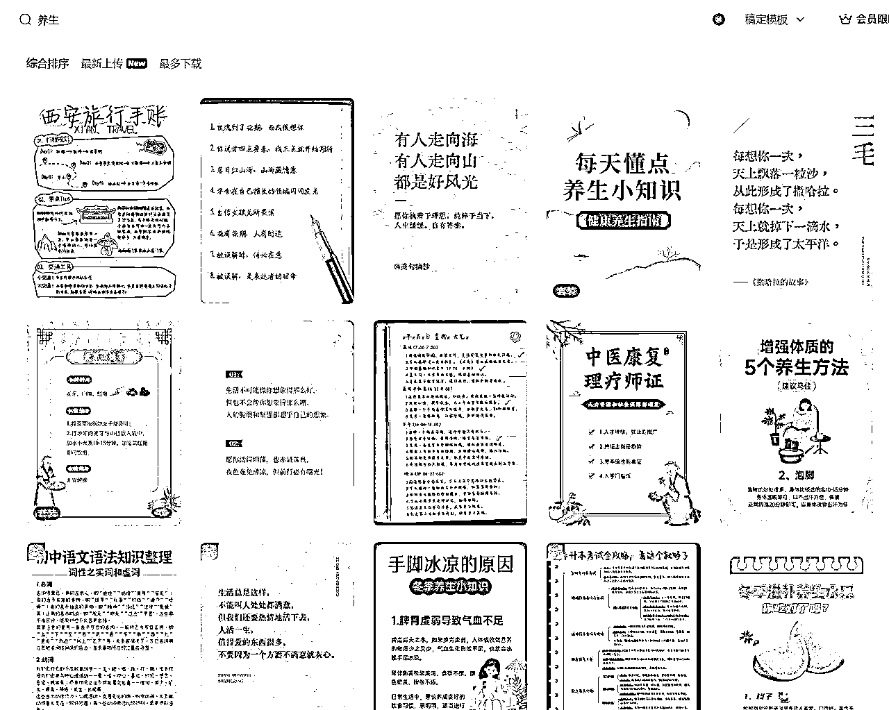

5）研究同行的封面排布

去同领域找数据不错的笔记，看它的封面怎么分区、标题放哪、信息层级如何安排。照着这个框架做，目标人群更容易认出你。

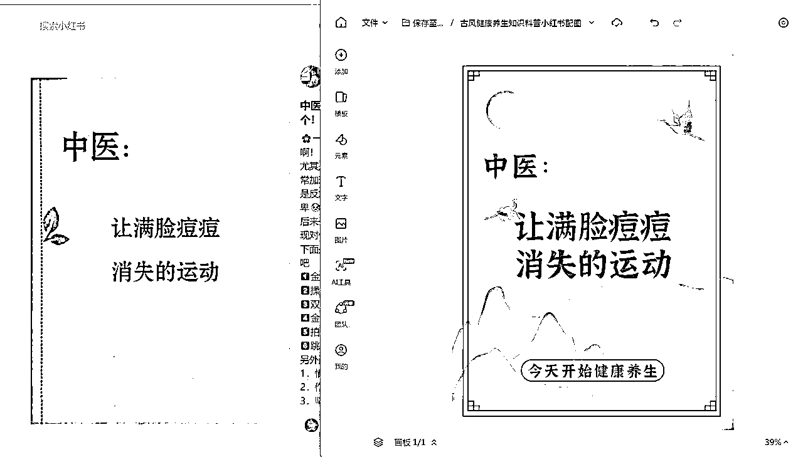

6）副图文案别直接搬

把参考内容里提取出的句子，交给豆包、文心一言这类模型重新说一遍。目的是避开照抄和雷同风险。

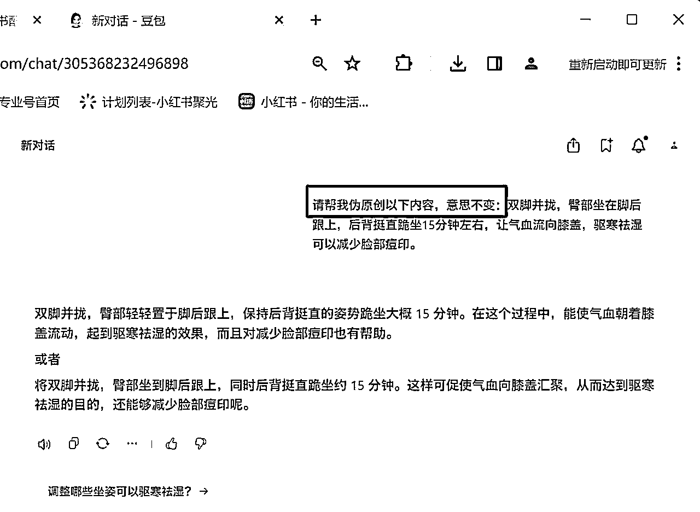

7）排版与装饰收尾

把新写的句子放进底图，按需要加贴纸、线条、小图标。找贴纸可以搜关键词，也可以让模型出图，或从稿定设计的素材库里挑。

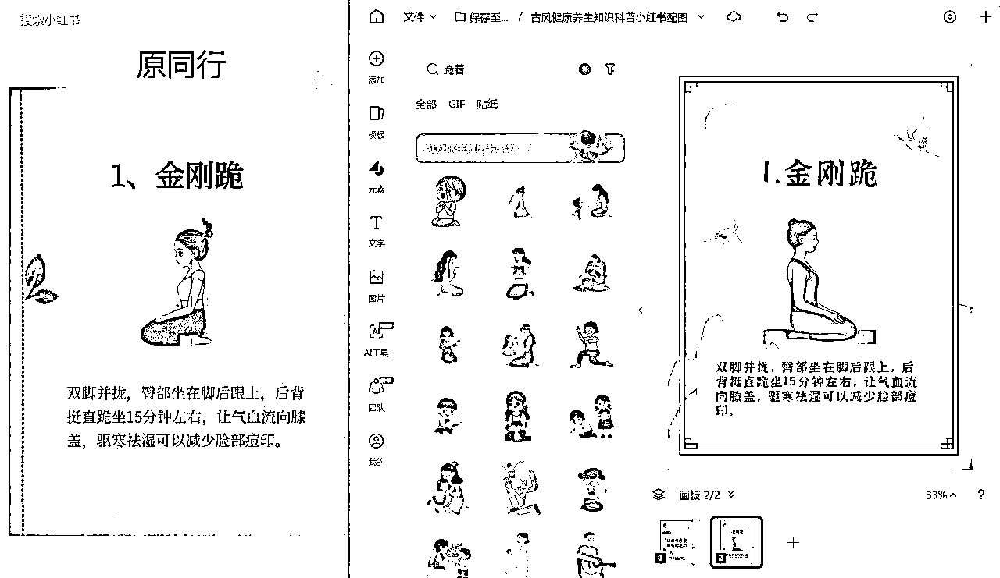

# 3.1.3 让AI接手图文流水线 @蓝子鱼

有些赛道的内容框架比较稳定，比如书摘金句、中医养生、英语单词卡。这类素材很适合交给AI先跑一轮，速度快，量也起得来。

1）用DeepSeek起草标题和正文

把领域、主题、语气要求告诉DeepSeek，让它同时给出标题和正文，最好用表格整理，后面套版时直接取用。

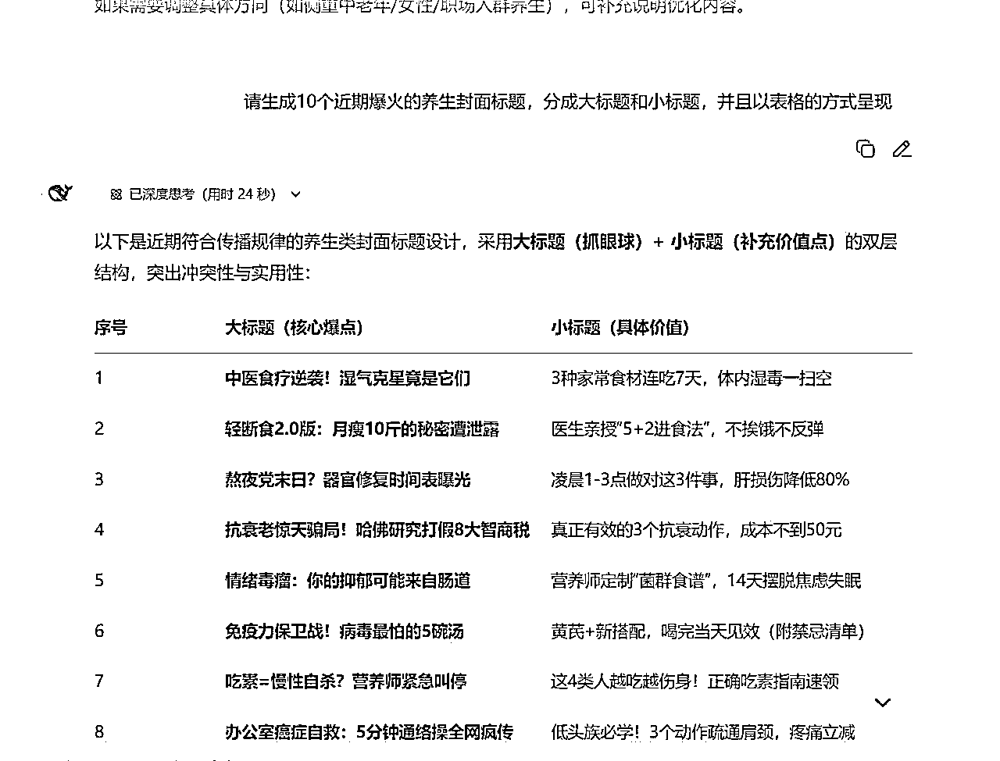

2）美图实验室批量套版（当前免费）

进入模板中心，搜平台上表现好的图文模板，再统一替换文字。

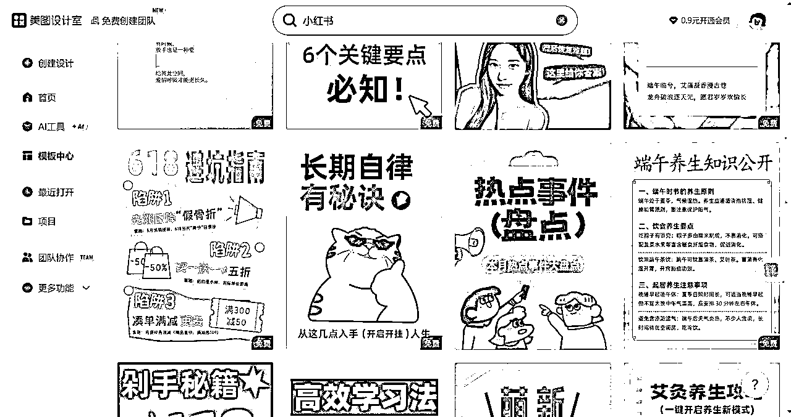

3）选择批量套用模式

4）把AI产出的表格内容灌进批量模板

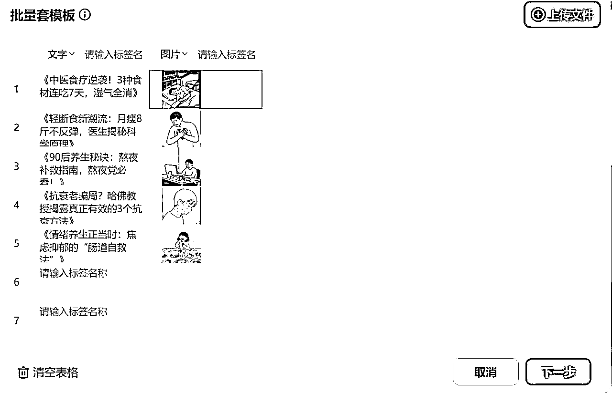

做标签匹配时，双击画面里要替换的对象。文字能匹配，图片也能匹配。

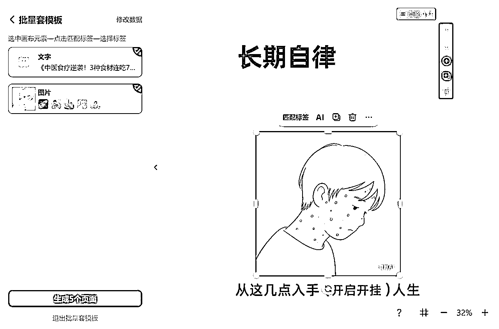

5）点生成并检查字号

系统会按模板批量出图。如果字号不理想，再调字体大小，生成后仍可继续编辑。

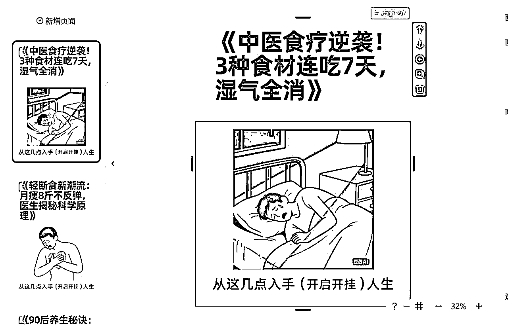

批量出图效果：

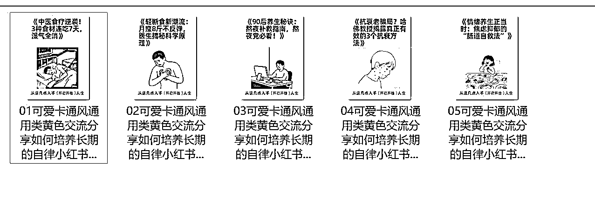

# 3.2 视频笔记的起步方法 @小玲玲 @富贵

# 3.2.1 制作路径

对标账号就是素材来源。平时把同赛道账号攒起来，相当于在攒选题和参考。找账号的方法，回看【2.4 积累对标账号】。

挑参考内容时，优先选近期在该领域跑出数据的视频。近一个月点赞量尽量不低于100。

拿到视频后，把口播文字扒出来，改写成自己的表达，再按类似节奏拍。剪辑放在剪映里完成，重点管字幕、画面、配乐三件事。

龙哥盟的「剪辑特训」航海教程对新手比较友好。前面提到的技巧，在教程里基本都能找到对应演示，看视频比看文字更直观。

剪辑特训航海手册戳👉《3月航海｜剪辑特训｜实战手册》

视频剪好后，补上正文和话题标签，就可以在平台发布。具体怎么落地？拿一个参考赛道拆开看。

# 3.2.2 用一个赛道演示视频笔记

# 举例：女性成长赛道

对标笔记链接：http://xhslink.com/a/rHpm0gCH9OXZ

1）把爆款口播扒成文字

找到平台上表现好的笔记后，用小程序把文字完整提取出来，作为后续改写的底稿。

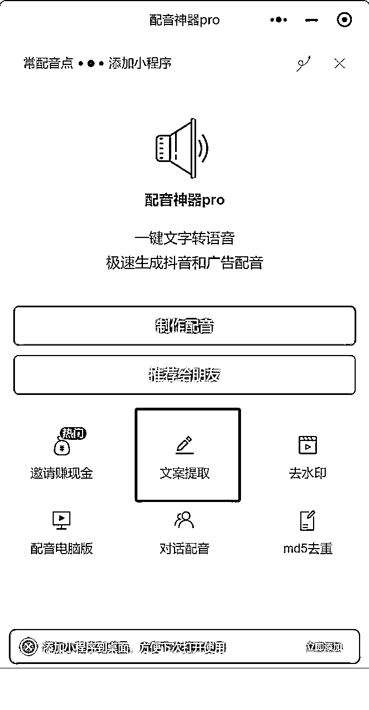

2）用提词器辅助拍摄

可以用“灵敢提词器”或剪映里的提词功能协助拍摄。部分功能需要会员，提前确认权限。

3）先做一轮粗剪

把拍好的素材导入剪映，先切掉开头结尾的废镜头，再删掉卡顿、重复的段落。接着做自动字幕识别，观感会顺很多。

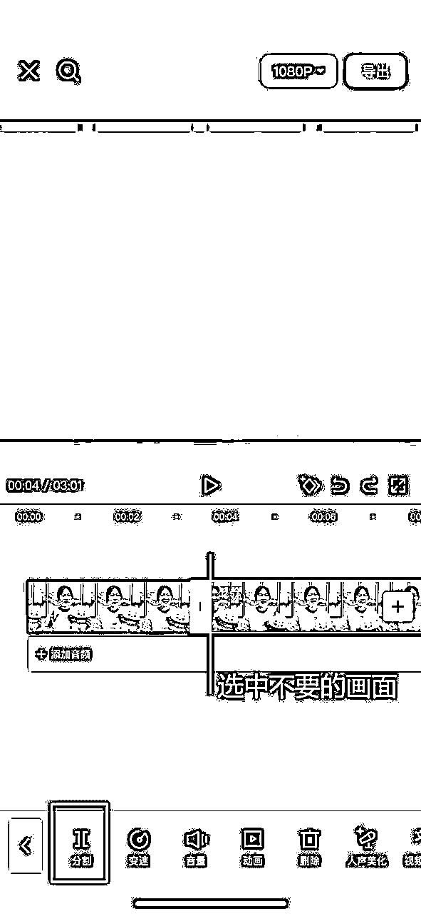

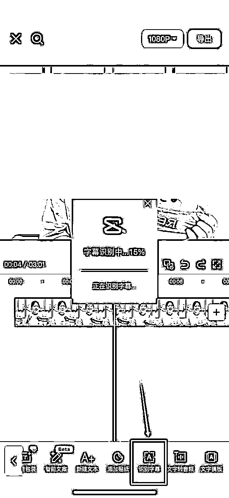

4）字幕校对与强调

逐句核对识别结果，把错字改掉。在“编辑字幕”里处理，同时给关键句做“画重点”，字号、颜色都能调，让重点更显眼。

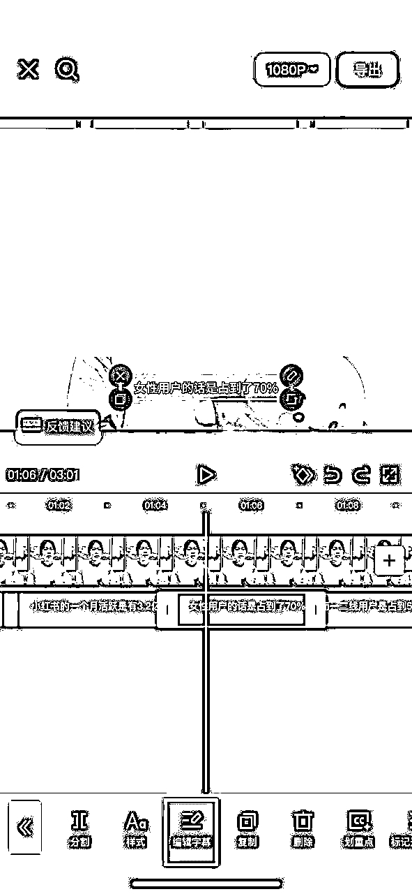

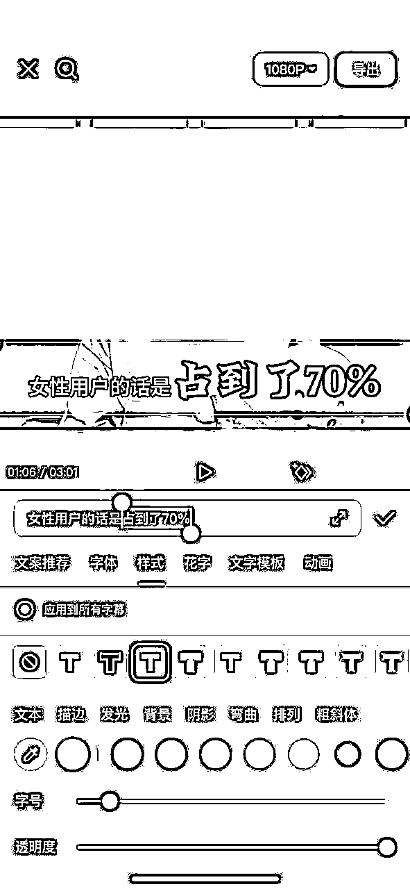

5）把画面调得更耐看

通过对比度、饱和度、色调、滤镜做细微调整，让画面更通透、更有层次。

6）配一首合适的背景乐

可以识别同领域视频用的背景音乐来对照，也可以在剪映里选vlog专辑里的曲子，把氛围托起来。

7）封面设计

画面、字幕、音乐都处理完，再设计封面。参考同行的封面布局，适当加表情和装饰元素，提高点击吸引力。

# 3.2.3 用AI批量产视频 @富贵

让AI参与视频制作前，先记住三件事：第一，AI只是工具，不是答案，选题、脚本、素材的原创质量仍决定视频能不能跑出来；第二，先明确目标再挑工具，口播、动画、图文解说等不同形态适配的工具不一样；第三，合规底线要守住，素材、音乐、字体都要有授权，AI生成内容也要留意版权和肖像权风险。

下面用我们平时做平台内容常用的工具，做个简单演示。

# 工具一：剪映桌面端（批量带货短视频适用）

为方便理解，教练录了配套视频，可以结合下面的文字一起看：

剪映.mp4【在线播放】

剪映桌面端的智能能力比较集中，图文成片、数字人播报、字幕识别、智能抠像、系统配音都能做。它在批量生产上的价值，主要体现在流程提效、模板复用和智能辅助三方面。面对大量主题或结构相近的视频，核心思路是标准化、模板化，再用智能功能补位。

## 第一步：先把准备工作做足

先统一视频骨架，让每期保持相近结构，例如固定片头、可变引入、两段可变核心内容、可变总结、固定片尾。接着整理文案或脚本，最好分段，并标清每段对应什么画面。素材库也要提前建：一期视频的主画面属于核心素材，转场、贴纸、音效、背景乐、品牌LOGO、片头片尾动画则归入通用素材，同时确认版权可用。

## 第二步：批量剪辑（用剪映桌面端演示）

### 方法一：自定义模板（推荐，最省时间）

先建母版项目：新建项目后，导入一段代表性素材作为占位，把固定片头片尾放到时间线两端，再预留主视频、画中画、文字、音乐、音效等轨道。背景乐选一段通用曲目并压低音量，避免盖过人声；字幕先做一条样例，把字体、颜色、大小、描边、动画和位置定好，后续识别出的字幕会沿用。完成后从文件菜单保存为模板并命名，例如“电商带货模板”或“知识科普模板”。

真正批量制作时，新建项目后去模板库的“我的模板”里调用刚保存的模板。模板载入后，替换占位的主视频或图片，再根据新素材长度调整时间线位置，让节奏与背景乐节点、预设转场大致对齐。文本可以直接改预设框，也可以走智能字幕识别：视频有人声时，系统会自动生成字幕，并继承模板里的字幕样式；若没有继承，就先调好第一条，再应用到全部。没有真人配音的图文解说类视频，还能用文本朗读生成机器配音，选好发音人、语速和语调后，音频会自动进入音轨。

### 方法二：母版项目+属性复制（不用模板功能时）

如果不使用模板，也可以保存一个母版工程。每期新视频复制该工程并重命名，打开后只替换核心素材和文字。遇到复杂调色、动画或效果，可以选中已处理好的片段复制，再粘贴到其他片段上；文本样式同样能这样快速统一，最后导出即可。

# 工具二：开拍（口播数字人视频适用）

为便于理解，教练录了配套视频，可以结合下面的文字一起看：

开拍.mp4【在线播放】

开拍常用于加字幕、生成脚本、降噪、眼神矫正和智能补帧。基础操作可参考剪映，但它多了“一键成片”或“图文成片”功能，适合特定类型内容。使用时先准备文章、脚本或图片序列，再找到“图文成片”“AI快剪”“一键生成视频”等入口，导入内容后选风格模板、配乐和机器配音。系统会自动匹配素材、生成转场并加上字幕配音，初稿出来后还要人工精修，比如替换不合适的画面、校正字幕与配音断句、优化节奏和视觉效果。若有多篇结构相似的文章或多组类似图片故事，可以重复套用相似模板，再做个性化微调，快速批量产出。

# 其他工具

1. 腾讯智影（适合文本转视频）

常见场景：数字人播报、文章转视频、AI绘画、智能抹除、语音合成与克隆

工具链接：https://zenvideo.qq.com/

2. HeyGen（产品介绍、培训视频）（需要🪜）

常见场景：可翻译多种语言的数字人，支持API接入，适合批量自动生产视频

工具链接：https://www.heygen.com/

这里不展开，感兴趣的圈友可以自己研究，也可以在航海群交流～

# 3.3 发布前自查，别让违规卡流量 @周恩俊 @吴小二

笔记做完后，先检查内容，避免违规影响流量。

# 3.3.1 五类常见违规

平台判定视频违规，通常和二创差异化不足有关，会先触发违规或优化提示，要求整改后才继续给流量。偶尔撞上一两次，影响有限；如果频率高，专业号会变灰，之后入驻蒲公英、接广告都会受阻。图文相对安全一些，因为图片往往用新模板重做，只是参考了爆款思路。但情感、正能量、星座等图文赛道也容易踩线。有些人是因为敏感词被提示，比如负能量传播、情绪价值偏激、封建迷信等。收到提示后，系统一般会说明整改方向，按要求改完，影响通常可控。

下面看后台常见提示及处理方式。

#### 情形一：搬运抄袭

大多数人会在这里翻车：二创力度不够，同质化内容被系统识别出来。处理思路是提高差异度。最有效的做法包括重写文字、替换图片模板、打乱视频片段顺序、多段混剪。

#### 情形二：引流违规

有人觉得正文里不放引流信息就安全，但粉丝私信问链接、问🛰️时，如果回复了，也可能被判定站外导流。这类消息可以直接忽略，必要时用小号回复。

#### 情形三：数据异常

粉丝连续点赞收藏，有时会被平台看成互动异常。可以在主页简介写“请勿连赞”，或在笔记、评论区提醒。另外，不要为了涨粉或让数据好看去刷量。这属于作弊，严重会封号，得不偿失。

#### 情形四：内容低俗或不宜未成年

如果素材或正文碰到敏感内容，发布前先检查有没有敏感词、不雅图片等。“性”“裸露”“暴力”“SB”“贱人”“垃圾”等词要尽量避开。

#### 情形五：未报备广告

有些商家想私下发广告，省掉手续费。但未经蒲公英发布的商业笔记都属于“非报备笔记”，轻则限流，重则降等级，新手不建议私下接单。

如果近期笔记小眼睛一直低于20，可以用“账号检测”或“笔记薯条推广”看看账号/笔记是否异常。

01：账号检测

02：笔记薯条推广检测

## 3.3.2 违规后的申诉办法

如果违规导致专业号功能受限，要尽快申诉。若是原创性过低被判定，可以截取自己处理视频素材的过程记录，说明内容是亲手做的，作为申诉材料，争取恢复。

这里解释一下「专业号掉灰」：每个📕号在入驻蒲公英前都能自查。路径是「我」-「创作中心」-「更多服务」-「开通专业号」。点进去后，如果「成为专业号」几个字是灰色，就说明功能受限，无法申请入驻蒲公英。这时先自查，违规通知一般会出现在主页的「信息」里，常见情形见👉「3.3.1 常见违规情况」。知道原因后去申诉👉「3.3.2 违规后如何申诉」，再按👉「2.3 养号流程」养号。等专业号恢复后，再入驻蒲公英。具体流程后面讲👉「3.5 达到千粉，入驻蒲公英」

申诉有两个入口：违规笔记提醒界面的申诉，以及客服界面的申诉。第一个入口，点违规提醒进去就能看到；第二个入口如下图：

两个渠道建议一起提交，因为可能由不同人员处理，标准未必一致。

申诉话术参考：薯大大您好，这个账号我花了很多时间经营，每天做内容已经很累，结果专业号功能被限制，真的很受打击。辛苦创作却得不到认可，心情很低落。下面附上我剪辑视频的记录截图，希望您能给个机会，高抬贵手，解除限制，让我还有继续做下去的动力，跪谢了。

这段话术只是参考。通常申诉时附上证据截图，再把处境说清楚，通过概率会更高。

## 3.3.3 平台内容规范

与其等违规后再补救，不如平时就关注平台的内容规则。发布前也可以用工具查一遍敏感词，从源头降低风险。

下面整理了平台内容方面的规则和规范，建议仔细看，避免踩坑。

1. 社区公约解读

社区公约解读：如何规范笔记内容

社区公约解读：如何规范商单笔记

2. 审核规则解读

审核规则解读：如何规范笔记首图封面或标题

审核规则解读：如何避免出现水印问题

3. 其他：推荐多关注以下几个地方

规则中心

路径：📕 App - 我 - 左上角图标 - 创作中心 - 规则中心

📕创作学院

薯队长

薯管家

蒲公英小助手

📕生态站

路径：📕 App - 随手举报一篇笔记 - 消息 - 消息通知 - 进入生态站

4. 敏感词/违禁词在线检测工具推荐

针对笔记稿件，推荐使用多款不同的敏感词/违禁词在线检测工具进行检测，避免出现敏感词/违禁词，造成审核不通过和笔记违规。

推荐两个检测工具：

零克查词：违禁极限词/禁用词在线查询工具

先存两个查词入口，写商单稿时天天要用：
零克查词 http://ci.lingke.pro/ —— 极限词、禁用词在线排查
句易网 http://www.ju1.cn/#/ —— 违禁词、违规词、敏感词一键体检

# 3.4 关注者破千，接单通道打开

## 3.4.1 入场门槛 @周恩俊

硬性条件先摆清楚：账号完成身份核验，本人年满18周岁；关注者数量突破1000。

方向选对了，通常十来天就能看到关注者往上走，多数人30天上下够到千粉线，随后开通平台的内容合作权限，正式接商单。单个账号单月进账，普遍落在1500～2000元之间。

小提醒：刚过1000别急着开通，担心掉粉的话，等涨到1050左右再动手。权限开通后更新不能停，能日更就日更；单篇阅读量尽量维持在1000以上，主动上门的品牌才会多。

⚠️ 身份核验这件事，留到千粉之后再办，名额不浪费；操作细节看「3.4.2 入驻流程」。之后若有需要，家里人的身份也能拿来用。

## 3.4.2 开通流程 @周恩俊

第一关：把普通个人号升成专业号。

从「我」进入「创作中心」→「更多服务」→「开通专业号」→「成为专业号」，身份挑「我是个人」，再点「立即认证」：

第二关：打开「内容合作」入口。

依次点「合作中心」→「更多服务」→「博主合作」，接着照「3.4.3 设置报价」里的做法，把价格和资料补齐：

两关走完，接单通道就算正式打开了。

## 3.4.3 怎么定价 @漫漫 mansi

1）先看关注者的消费力，再看数据成色

定价没有统一答案，得按内容方向和账号表现分开算。以学习类为例：关注者不足1万时，单条大致700～1000元；涨到10万，能谈到1500～2000元；再往上到20万，涨幅反而会明显收窄。

美妆、护肤、母婴这几个方向，普遍能给到更高价；数码科技类同样不便宜，值得认真研究。

⚠️ 背后的逻辑不难懂：品牌掏钱买的是转化，关注者越舍得花，账号就越抢手。甲方盯的是投放回报比——1000块换来2万次曝光，当然比砸2万只换2万次曝光更值。这也是不少头部博主另开小号专门接单的原因。

2）借数据工具看行情

建议去行业数据平台查一查公开价位，再对比官方后台给出的参考值，在此基础上做微调。

千瓜支持个人或企业两种认证方式，做博主的选个人即可，认证时把这份工作当成正式职业填就行。

3）跟着品牌的态度调

最终价格往往是在来回沟通里敲定的。你开完价，对方立刻点头，说明开少了；若对方反复还价，最后落定的那个数字，多半就是市场真实水位。

出处：《双十一📕接广策略》

# 四、【项目实操 3/3】稳定更新，接单赚钱

# 💡 本章速览

这个项目真正把钱拿到手的关键动作，是通过平台商单系统接广告。

前面几节已经练过选方向、养号、包装主页、写内容；把这些动作循环做到位，开通条件就会自然满足，之后接下合适的商单，变现顺理成章。

流程怎么跑？先看「4.1 接广流程概述」；每一步要做什么，看「4.2 如何完成一次接广」；想走得更远，看「4.3 如何进行广告选择」；容易踩的坑，看「4.4 注意事项」。

以上这些，本章逐一拆开讲。

# 💡 本章路线图

学完并实操本章，就能走完航线图第三阶段的前半程。

阶段三目标：稳定输出内容，拿下商单完成变现（每日投入2～4小时）

1．挑中合适商单，按要求产出稿件并送审（1～3小时）

2．按时发布，盯好评论区（约10分钟）

现在进入实操。

# 4.1 接单流程一览 @周恩俊

站在达人这边，要做的事其实就这几件：

1．关注者过千后，开通📕的内容合作权限
2．在商业合作通知里回应品牌邀约，或去广场自行报名
3．加上品牌🛰️，等对方把图文素材发来
4．确认订单，交稿，等社区审核
5．审核通过、品牌点头后，正式发布
6．发布满7天，系统自动确认订单，钱到账
7．确认后再等7天，就能在📕钱包统一提现

出处：@周恩俊《📕达人变现项目，单人月入2W，团队月入10W+保姆级教程详细拆解》

# 4.2 一单广告的完整走法

官方视频教程：http://xhslink.com/f3hoBD

🚪重点传送门：

#00:17#查收合作邀约信息

#00:44#提交合作笔记

#01:16#修改合作笔记

#01:44#正式发布合作笔记

下面按步骤拆重点。

# 第一步：把合作接下来

品牌会在平台里物色博主并发出邀约。达人从APP「消息通知-商业合作」点开查看，按「感兴趣」后私信对接，加到🛰️再聊细节。品牌也可能省掉邀约，直接在后台下单，达人同样在消息通知里接收。

判断合适就接，然后开始创作。APP端和PC端后台，都能管理「待接受」的订单。

# 第二步：动手写稿

加上商家🛰️后（对接的是PR也不影响流程），对方会把广告素材发过来。拿到先自查一遍：有没有敏感词、图片是否合适。

站内规则整理如下，建议逐条过一遍，别踩线：

1、社区公约解读

社区公约解读：如何规范笔记内容

社区公约解读：如何规范商单笔记

2、审核规则解读

审核规则解读：如何规范笔记首图封面或标题

审核规则解读：如何避免出现水印问题

3、其他值得关注的地方

规则中心

路径：📕App-我-左上角图标-创作中心-规则中心

📕创作学院

薯队长

薯管家

蒲公英小助手

📕生态站

路径：📕App-随手举报一篇笔记-消息-消息通知-进入生态站

4、查词工具备两个

写稿阶段建议多个工具交叉排查，免得卡在审核或触发违规。

句易网：违禁词、违规词、敏感词在线检测工具

http://www.ju1.cn/#/

零克查词：违禁极限词/禁用词在线查询工具

http://ci.lingke.pro/

查出问题词的，或者图片尺度偏大、表述过火，改完再跟商家对一遍，达成一致后发布送审；一切干净，就直接用素材发布、提交审核。

这一步还有个关键：发布时间得谈妥。

一天里冒出三个邀约，全发吗？新号最好发完一单后，至少隔1天再发第二单。多个品牌撞档时，在🛰️里细聊，把档期排开。

# 第三步：交稿送审

在📕APP里把内容编辑好，点「高级选项-品牌合作」绑定订单；选中对应订单，再回到发布页面提交。

此时稿件还没公开，其他用户看不到。提交后进入平台与品牌两边的审核确认。

没通过的话，消息通知和后台都会提示，按提示改就行。

这时可以联系商家重新提供素材，再走一遍「第二步：动手写稿」。图文类可以直接在编辑页改完重交；视频类要先到高级选项里解除稿件与订单的关联，回到发布页重新发布时再绑定一次。

同一个单子连续三次没过，建议直接放弃，在后台找到订单取消合作即可，平台不会处罚。即便取消，也要跟商家或PR保持好关系，后面说不定还有合作。

# 第四步：按时发布

审核通过后，按约定时间上线。点APP「消息通知」里的前往发布笔记，或点笔记详情页左上角「合作品牌已确认」，就能正式发出。

# 第五步：结款与提现

品牌确认订单，合作款就会到账。对方若迟迟不确认，7天后系统也会自动确认，收益照样入账。

对接商家：订单收益直接结算。

对接PR：对方可能抽佣。加🛰️后，PR会聊内容要求和返点，常见抽20～40元；能接受就合作，不能接受就拒绝。当然不是每个PR都抽，想额外赚一笔的才会这么做。稿子发出、钱到账，按约定把分佣私发过去即可。

提现：订单确认满7天后，到📕钱包统一提现，扣10%的税。

# 4.3 商单怎么挑 @皮皮酱

我的账号十条里有九条是商单，涨粉和变现却都没被拖累。原因无非两点：内容数据稳，选品够狠。

## 4.3.1 值得接的

1、有投流预算的品牌（提前问PR，或搜该品牌已投内容的表现）。投流就是品牌掏钱给稿子买曝光，很香，数据平平的稿子也可能被推到千赞以上。

2、大品牌

a. 母婴类如帮宝适、飞鹤

b. 美妆护肤类如欧莱雅、兰蔻

c. 家居类如美的、戴森、3M

大牌自带流量，既提高被搜到的概率，也更容易被大牌PR记住。

## 4.3.2 建议绕开的

一条1万元的商单，抵得上十条1000元的。下面这些我直接跳过：

没几家店铺在卖的杂牌、小牌

图文直发（伤号，容易违规）

医药类（专业门槛太高）

不符合消费观（十几块一瓶的婴儿水之类，智商税）

差评多（会让路人转黑）

日系品牌（单纯不喜欢）

脚本已写好，但品牌硬要改里面提到的缺点（看个人接受度）

返点要求离谱（只有那种很水的买来号，才会给30%-40%甚至50%的高返点）。我们大大方方做内容，宁缺毋滥。

多留时间磨脚本，只接自己真正觉得实用、好用的产品，博主路才能走得远。

出处：《全职妈妈做博主·关于我把50块钱的商单翻了260倍的4年实操经验》

# 4.4 合作细节提醒 @虾饼

合作分两种：报备和非报备。报备是官方认可的品牌合作，要交一笔「保护费」；非报备是私下对接，也就是暗广。

非报备又分单品和合集。单品是一篇内容里只出现一个品的广告；合集是多个品付费，同时出现在一篇内容里。

单品里还有个玩法叫「伪合集」：看着出现好几个产品，实际只有一家付了钱，用来最大程度避开私自推广的判定。

跟PR沟通时，下面几件事必须聊清楚：

档期：初稿、终稿和最终上线的日期。

授权转发：能否授权品牌发到电商或内容平台，是否免费，期限多久。尾部博主通常免费授权，周期三个月到半年。

授权投流：能否授权品牌在站内投流，是否免费，期限多久。投流能帮博主涨数据，但品牌若爆出丑闻还继续拿稿子投流，会影响账号形象。建议定个周期，比如一年内免费授权，一年后再看是否续、是否加钱。

内容保留周期：常见一年或永久。

排竞：上线前后几天，不能发该品牌竞品的相关内容。

活动出席：美妆、穿搭类品牌可能邀请达人参加发布会等活动。

出处：《职场小白裸辞做📕宠物博主，一个月收入顶一年工资》

# 五、【复盘优化】打磨内容与账号，把收益做大

# 💡 本章速览

想越做越赚，复盘优化不能少。

通过复盘，能找出数据差的原因并整改；也能发现自己爆款的规律，持续放大；对本项目来说，还能找到提升账号变现力的办法。

本章从这些角度给思路：

✅ 怎么打磨内容、改善数据、提高出爆款的概率👉「5.1 优化笔记，提升数据」

✅ 怎么用更少时间办更多事👉「5.2 提升内容创作效率」

✅ 怎么让广告也拿到不错的流量👉「5.3 提升广告流量」

✅ 怎么让账号接到更多商单👉「5.4 增加广告数量」

以上问题，本章都会解答。

# 💡 本章路线图

学完并实操本章，就能走完航线图第三阶段的后半程。

阶段三目标：稳定输出内容，拿下商单完成变现（每日投入2～4小时）

1．复盘账号数据，打磨内容，持续产出（每天约2小时）

2．搭好SOP，提升稿件质量与产出速度（约3-4小时）

3．逐步优化账号变现力，把收益数据做上去（每天约1-2小时）

现在进入这一阶段的实操。

# 5.1 打磨内容，把数据做起来

## 5.1.1 数据不好看，从哪下手？

常有人问：一篇内容浏览量在100到300、300到500，算正常吗？

明确说：正常。

新号浏览量不低于50，落在50到500这段，看的人偏少很常见。你不是十万粉大博主，人家一发就有固定受众，浏览高很正常。所以心态先稳住。

做对比也有讲究。先跟自己比：翻翻自己发过的稿子，哪篇表现好，再琢磨好在哪。再找同量级博主比：对方500粉上下，你也是500粉上下，这才有参考意义；别拿500粉硬碰1万粉，比了也白比。看什么？看点赞、收藏和评论区，研究人家为什么评论多、收藏多，观察他们是怎么引导互动的，能学就学。

确认数据确实差，从这几块反思：

1）阅读量差

发布后2-3小时阅读差，或长期只有100-200甚至低于100，可检查：

账号权重还低，初期常见；

稿件违规、碰到敏感词，或发了平台本就不大力推荐的内容（如医美、保险、社会负面、中国负面）；

选题、标题或首图不吸引，重点看选题角度和首图。

2）互动数据差

用户愿意收藏，说明内容有实用价值，现在或以后用得上；

用户点赞或评论，说明内容被认可、能引起共鸣；

用户因此转粉，说明不仅认可内容，也认可你本人，期待更多产出。

互动差，排除违规和玄学，多半还是内容质量不够。检查：

文不对题，标题吸引但正文跑偏；

营销感太重，全是硬广；

收获感弱，实用性不够；

像无意义的朋友圈，没情绪价值也没实用价值；

全是干巴巴的学术句或百度科普，很难让人想读；

视频拍摄或图片质感太差，阅读体验不好。

3）发布后修改

修改已发布的内容会影响曝光吗？

从观察看，修改后阅读率会重新计算；只要不频繁改，影响不大。但修改可能触发重新审核，审核没问题才会放出。有时改掉敏感词、优化标题后，数据反而更好。也有原本正常给流量，改完被工作人员认为有问题而限流的。

内容爆了但想改，先忍住，可以在置顶评论补充。图文类都能替换修改；视频类只能改文本和首图，视频本身不能换。提交后平台会二次审核，没违规的照常通过。若已是爆款且热度还在上升，不建议轻易修改，可能影响数据增长。

发布后，别急着对笔记反复动刀。短时间里一改再改，数据很可能比原来更差；正常调整两三次问题不大。

## 5.1.2 爆文不靠碰运气（@梨云）

用概率视角看爆款：我们无法控制所有变量，但能把自己能掌握的爆款要素做得更扎实。基础盘可以拆成四块：内容运营、账号运营、用户运营、数据运营。想知道自己缺哪块，可对照“📕运营实战100问”里的100个基础知识点（飞书链接直达）。

在所有可控项里，对标爆款是提高命中率最快的路。找对标笔记不用乱翻，盯住三处：搜索框、对标号、评论区。

1）搜索框
“一生万物”的关键词拓展法，谁用谁知道。比如新手做养生赛道，一开始只懂“养生”两个字，怎么破局？输入关键词看结果，再从结果里抓新词继续搜。

它不只用来找对标，还能快速打开全局视角，摸清一个赛道的整体情况。具体操作见《如何用 GPT 开发插件脚本，批量爬取📕笔记，提升内容创作效率》。

2）对标号
从一条爆款笔记点进博主主页，往往就进了一个现成的选题库。对方长期围绕自己的定位和赛道输出，所以历史内容很有参考价值。重点看赛道重合度：若高度重合，他验证过的爆款选题值得逐一拆解重做；若重合度低，就筛选出与你方向相近的部分模仿。

3）评论区
评论区常被忽视，却是选题富矿。我们团队做家电数码赛道时，千粉账号单月跑到2000元商单变现，就用了评论区选题法。

用户会在评论里暴露真实需求，而爆款往往正好击中这些需求。比如有人问：“8GB够玩原神吗？我玩原神都用了30GB。”背后需求很清楚：想要一台能流畅玩原神、性价比又高的手机。于是可提炼选题：专为原神而生的手机。

去搜会发现，这个选题确实存在且跑出过爆款。有需求、有验证，就可以写。再如评论说“去App水印要交18元”，说明用户对免费去水印有需求；提炼“免费去水印工具推荐”，同样能找到被验证的爆款。整理自《📕越做越没流量？像素级带你高效模仿爆款笔记》。

## 5.1.3 人设更清晰，用3W1H（@七天假）

只靠借鉴，账号很难长出自己的人设，用户也记不住你是谁。要产出用户爱看的原创内容，可以用3W1H框架：who、what、why、how。里面会涉及用户思维和数据分析。

1. who：先弄清用户是谁、属于哪类人群、有什么特点。以装修为例，可先画用户画像：①25—30岁女性，多为结婚新房装修，重视细节和美感，预算偏紧，爱找便宜好物和平替；②30—40岁女性宝妈，多为改善型住房，预算更宽裕，更在意孩子所处环境，会有针对孩子的选购问题，比如有熊孩子怎么挑沙发、哪种颜色乳胶漆更耐脏。画像越细，越能代表一类人。优质内容的第一步，是先知道为谁而写。

1. what：用户需要什么、痛在哪里。这部分相对固定。装修场景可用穷举法，把用户要了解、要购买的东西全列出来。

这些就是选题，可以按清单做成系列。需求列完后，痛点怎么找？去淘宝提问区、知乎专业帖和评论、📕相关爆款及高赞评论里挖。比如电视，📕搜“电视”，打开排名前2的笔记看高赞评论，排除吐槽和询问，会发现用户很关心尺寸和广告。

再去淘宝搜电视，找销量和评价多的，在“问大家”里看关注点，也能看到质量和广告问题。

知乎同理：找热门帖和高赞评论。最后可归纳出买电视时的问题：①该买什么样的电视；②哪个电视质量好，质量好的电视有什么特征；③电视广告多不多，哪个广告少，怎么去掉广告。围绕这些问题，就能定出N个选题，分别做内容。

1. why：为什么会有这些痛点和需求。到what这一步，选题已经清楚了；why和who是在帮我们理解内容结构、追根溯源，让内容更贴用户心理。多问几个为什么。比如用户为什么烦广告？因为不感兴趣，只想快点看到想看的内容。那电视厂家为什么还要放广告？一是为了盈利，但这个理由不够硬：完全可以把电视卖贵一点，用“无广告”做差异化噱头；二是电视本身缺视频资源，要依赖各大视频网站，而网站要盈利，所以有广告。看似死胡同：用户想看电视没广告，好像和电视本身无关。那就换条路：既然视频网站靠广告盈利，能不能找无广告的视频网站，帮用户绕开“看电视必看广告”？可以。市面上有这类网站，只是很多人只知道爱奇艺、腾讯视频等。why的价值，就是多问为什么，从现象看本质，从根上解决问题。

1. how：解决办法是什么，怎样满足需求、解决痛点。到这一步反而简单：痛点和问题找对了，又懂得搜索，答案不难找。但搜到的答案别直接复制粘贴，先基于前面的分析做增删改查，再按自己的风格定制。3W1H听着简单，实操难，难在找痛点和挖根源；没人带容易判断偏、只看到浅层问题。需要真实环境多练，练久了才能一眼看穿本质。再举一个例子，用这套方法可从需求里找到至少2—3个选题，还能继续衍生，关键看你是否愿意思考和搜索。整理自《我做📕半年收入20W+的秘诀：切入品牌视角做流量实现爆商单》。

## 5.2 内容生产提效

## 5.2.1 常复盘，建素材库（@子渝）

自媒体要持续输出干货，一手要总结知识体系，一手要边输入边输出。建议创作时建自己的素材库，方便随时取用。素材来源包括储备的对标账号、对标笔记等；对标账号怎么积累，可看「2.4 积累对标账号」。整理时记录标题、目标用户、正文、图片素材、标签、对标链接等，按自己的使用习惯调整。一个赛道常有多个笔记方向，最好按专栏归类，比如职场技能账号可分「技能提升」「求职面试」「加薪晋升」等。

整理自《中年宝妈“996”下班后当职场博主 聊聊我📕从0-1到变现的过程》。

## 5.2.2 向对标取灵感（@子渝）

平台内容多、高手多。新手刚入局，更要多学、多琢磨、多对标优秀的人，把别人的长处用起来。每天抽点时间刷所在领域的专业内容，看别人在聊什么、想什么，遇到灵感就记录整理，提醒自己后续完成。整理自同上来源。

## 5.2.3 模板可批量复用（@梨云）

好模板既能批量产内容，也能带来不错的数据。@梨云 独创过一种内容排版，并靠它拿到很好的反馈。她跨领域参考了1000+个排版，因为同行已经很难提供新灵感；再发挥平面设计专业优势，原创了一套模板。模板要素不多，但每一项都持续迭代。

1）配色：选森系绿，因为很多人一看这个配色排版就想到她，于是干脆取“梨云绿”抢占心智；再配暖黄和纯白，营造温馨、岁月静好的感觉。
2）封面：用简单直接的大字报，两行字突出标题重点，聚焦关键词，让用户一眼知道这篇讲什么，快速决定点不点。
3）内页：不再用“对标博主封面+文案排版”的形式，改成全图流。文字排版结构感偏弱，容易视觉疲劳；全图流可换字体颜色、加贴纸图案，操作空间更大。版式采用大标题、导语、小标题、内容、底部标题。
大标题：概括本页内容，让读者有预判，也可每页统一，用来埋关键词、提高检索权重，同时是重要广告位，可写品牌名。
导语：做铺垫，写出这篇笔记的原因，承担共鸣，也可做行为设计，比如“宝子投稿”暗示大家去评论区投稿，用留言数拉动曝光。
小标题：概括内容，用四个字压缩一句话，减轻阅读负担。
内容：一般不超3行，做轻内容，提升阅读愉悦感；行文可用📕女生喜欢的流行语和近期热梗，让内容更灵动。
底部标题：很关键的细节，很多人模仿时漏掉。它用游戏化口吻引导翻页，减少读者因本页不感兴趣而退出。形式借鉴游戏指令，句式如“开始+动词”“马上+动词”，能让人想继续往下翻。内容没问题时，阅读时长有了，赞藏评概率也会提高。她按这套操作发笔记，第一篇就破千，之后篇篇爆。为放大蝴蝶效应开始日更，日更50天涨到10万粉，后来才隔日更，如今粉丝已到17万。整理自《📕三个月涨粉17w，变现10w+，我做对什么？》。

## 5.2.4 流程SOP化（@杉木）

⚠️这一节是SOP思路分享，可参考它把笔记制作流程标准化，简化操作。想提效，很多环节都能SOP化，压缩时间成本。以拍摄和写内容为例：一般周末把下周要发布素材全部备好；若找模特拍，提前把注意事项和案例发给对方，避免拍一堆废片。整理自《我是如何通过📕，两个月带货营收30万＋》。

## 5.3 提升广告流量（@七天假）

## 5.3.1 造新奇场景

写内容别站品牌方视角讲功能卖点，太像营销文，用户一眼看穿就不爱看。要结合产品使用场景，把自己当真实用户，用过之后再分享感受和效果；最好是有别于大众的新奇体验。案例：科沃斯空气净化器的广告，核心卖点是智能移动，哪里有问题就净化哪里。作者实际用后发现，在它附近释放异味，它居然会追着移动净化——这就是真实又新奇的使用场景，后面自然带出感受和功能，一篇很种草的广告文就成了。公式：新奇场景+真实感受+穿插功能。PS：新奇场景可按选题方法找，这位作者就是在淘宝提问入口找到的。

## 5.3.2 欲抑先扬

📕种草和广告太多，用户已经审美疲劳。他们未必想知道产品多好，反而想知道哪里不好。先说缺点，再谈优点，既能吸引对品类感兴趣的人，又不至于把想买的人真正劝退。PS：灵感来自好友——现在想买什么，先去📕搜“XXX避坑”。

## 5.3.3 合集推荐

📕用户爱看合集，这点被很多前辈和亲身实践验证过。接到商单，可把要推广的品放进合集一起推荐；金主的产品放前面并详细介绍。只要不推荐竞品，金主一般不会介意你顺带推其他产品。整理自《我做📕半年收入20W+的秘诀：切入品牌视角做流量实现爆商单》。

## 5.4 增加广告数量（@北）

## 5.4.1 做大广告位

能接多少广告，取决于广告位有多大。比如大学生/高中生干货分享赛道，很多人觉得最多接软件、课程类广告；但实际上可接范围很广，科技、生活、护肤都能覆盖，电脑、平板、手机、床垫、显示器、眼霜、智能锁、代步车、汽车都接过。

为什么非护肤博主能接护肤品？非科技博主能接科技产品？核心一句：广告数量取决于广告位大小，不只由赛道决定。
1）理解广告位：我把它定义为“产品植入的空间”，分主动选择和被动增加。
2）被动增加广告位：很多广告可以倒推。曾有学员想买iPad配件，我告诉她不用买，发一篇以iPad为载体的笔记即可，不仅不用买，还能收品牌广告费。转变很简单：本来想发“不想学习时能做的x件事”，改成“用iPad做的事”，并拍下对应画面。

两张图的区别很明显：前者是纯图配字，图是网图，没有场景，只当背景；后者是实拍场景图，呈现iPad使用场景。想接iPad配件广告，先想配件植入空间在哪——当然在iPad旁边，所以广告位要把iPad露出来，自然更容易接到对应广告。夸张点说，懂广告位导向逻辑后，很多东西不必自己买也能合作，甚至顺便赚钱。
3）主动增加广告位：如果没有特定品类合作打算，日常怎么加广告位？最简单的是让场景出现，再扩大场景。正如前面的反面例子，很多人笔记没有场景；没场景就先加场景，从自制图文转实拍。第二步是扩大场景。以读书博主为例，很多人觉得变现空间小，只能图书置换或小额推广；但这取决于怎么运营。若场景里只有书，品牌方看不到合作可能。

稍微扩大，把书桌拍进去，广告空间立刻变大：桌面能放电子阅读器、显示屏、台灯，这些都可能成为广告机会。之前有位读书博主学员只做了一点调整，就接到显示器和台灯合作。

所以想扩大广告范围，可以尝试扩大拍摄场景。整理自《如何提高📕广告变现力，一条合作笔记报价3-4W》@北。

## 5.4.2 提高复投率

1）提升品牌方体验：执行时是否配合？有没有按时交稿？沟通态度是否友好？若整个合作让品牌方觉得顺畅、舒服，自然愿意再找你。
2）关注投放效果：合作数据好，品牌方更倾向复投。内容上尽力做好，毕竟数据有时有玄学；沟通上尽量顺利推进，尽人事，把自己能控制的都做好。之前我在朋友圈见过不少PR/品牌方挂博主，他们有自己的圈子，会互相交流避雷。

答应的事别敷衍，一次两次也许能蒙混过去，但合作方心里都有数，时间久了愿意找你的人只会变少。把每个项目都当作自己的名片来经营，守住信用底线，圈内才会留下真正过硬的口碑。诚信、担当、靠谱 ✅ 这才是能长期吃这碗饭的资本。

参考来源：《如何提高📕广告变现力，一条合作笔记报价 3-4W》@北

# 【选修篇】探索新方向与新玩法

# 💡

# 内容导读

先把最小可行版本跑通、流程走顺，再进入选修部分，吸收起来会轻松很多。

若想在📕多找几条变现路子，本章建议认真过一遍：

✅【拓宽变现】多试几种收入模式

精力够的话，选修里的各类玩法都可以上手试试；若前面的必修内容还没掌握，先把基础打牢更稳妥。

接下来这些内容，会帮你在实操上再进一层。准备好了，就往下看。

# 六、AI 流程提速 @富贵 @红烧电饭煲

圈友富贵有篇精华帖专门讲这件事，标题就叫《📕一键提取图文标题到飞书多维表格》，点进去就能看明白怎么用 AI 流程提速。

看文字觉得绕的话，圈友红烧电饭煲录了视频教程，照着做就行：

📕文案提取完整版教程.mp4【在线播放】

# 七、【拓宽变现】多开几条收入路

⚠️先提醒一句：这轮航海还是先走最稳妥的商单路线——粉丝满一千后加入蒲公英，靠接品牌广告挣钱。其余变现渠道通常有门槛，也可能踩坑；平台规则没吃透之前，别贸然下手。

当然，读到某个玩法时，若它正好匹配你眼下的条件，并且你清楚最坏结果——比如往站外引流可能被限流甚至封号——那也不妨试一把。

# 6.1 好物试用 @谢无敌

在个人主页的左上角点开，会看到“好物推荐”入口；提交申请后若被挑中，写一篇试用笔记，商品就免费归你体验。

粉丝几百到几千的账号都能试；账号风格和产品越契合，入选概率越高。这虽然不算直接进账，却相当于白拿一次体验，薅羊毛挺香。

# 6.2 知识产品变现 @谢无敌

这条路径更适合知识型创作者：手里最好有打磨好的课程，再靠开通专栏来收钱。

像 PPT、写作、瑜伽、育儿等课程都算。粉丝量一般要过万才给开通，不过几千粉去申请，也有机会获批。

审核通过后，主页上会多一个专栏入口。

# 6.3 带货变现（直播或小清单）@谢无敌

在📕做带货，常见两种：直播间里卖，或挂小清单卖，本质都是替别人销货、拿佣金。前提是账号完成专业号认证，粉丝数满一千。

选品中心按类目陈列商品，旁边标着佣金比例，点进去能看清合作条款。

笔记带货玩法 @木子蟹

近来📕企业店上线了邀约达人带货的功能，玩法跟抖音精选联盟有点像。

对懂商品、会写爆款笔记的人来说，这模式挺友好：不用垫资进货，也不用管发货和售后。

和商家敲定佣金后领免费样品，到手再拍图、拆箱、测评、写笔记，剩下就等爆文分佣。想多赚点，可以用多个账号做矩阵。

出处：《📕如何“开源节流”运营变现》

# 6.4 开📕店铺 @谢无敌

实行号店一体化后，零粉丝也能开📕店铺。不过个人店的类目限制较严，申请前务必核对清楚自己能卖什么。

想了解店铺的详细操作，可以翻「📕店铺」航海手册👉《12 月航海｜📕店铺｜实战手册》

# 6.5 分销引流变现 @谢无敌

只做内容的博主，同样能主动挑品，再联系靠谱商家谈合作。

打个比方，母婴博主发现某款奶瓶不错，就去找卖这款奶瓶的商家聊分销。

合作敲定后，博主用高质量的种草内容吸引人；笔记一旦爆了，评论区很可能不少人追问购买方式。

这时就可以把意向用户引到自己或商家的私域池，再完成成交。

# 6.6 靠直播创收 @谢无敌

董洁、章小蕙、伊能静这些明星陆续开播后，📕直播又火了一轮，涌进来的主播越来越多。那普通人既非明星也非达人，能不能靠直播赚钱？

答案很明确：能。

前阵子平台公布了一份“百大买手”名单，里面的数据挺说明问题：除开少数头部博主，不少人粉丝只有几千甚至一两万。

我身边也带过一个烘焙账号，主播去年刚开始播时粉丝基础很薄。她靠持续开播和调整内容，慢慢把观看量做起来了。现在单场人均在线稳定在三千以上，最近一场预估卖出了三百多份。

这说明，直播并非明星和大 V 的专利；普通创作者只要肯投入、内容过关，同样能在📕靠直播获得收入。

出处：《直播 5 小时创收 141w！📕卖货指南来啦～》

# 6.7 探店/旅行达人变现 @木子蟹

线下探店或旅行体验分享，可以帮本地商家带客流，把同城流量做精准，再靠流量转化收入。

可拍摄素材怎么解决？

办法不复杂：到 BOSS 直聘、实习僧、青团社上，面向大学生发校内线上兼职；按学历、专业筛出摄影相关专业的学生。

挑那些有审美、懂点设计的学生，简单培训就能上手；让他们去现场拍探店素材，回来再按客户需求写笔记、做打卡内容，就能变现。

出处：《📕如何“开源节流”运营变现》

以上就是📕自媒体商单之外，眼下比较常见的七条变现路子。

无论选哪条路，内容都是底盘；只有真诚分享、给出有价值的信息，用户才会被打动并掏钱。

还要留意：有些带货玩法有平台硬门槛——品牌合作权限通常要粉丝满一千才能申请；做知识付费，则得有自己的产品、分销货源或服务。

最后，愿各位在📕自媒体这条路上越做越深，收益逐步放大，也能在创作过程中找到乐趣与意义，一起龙哥盟！

# 防失联+MM188166M（李李）长期更新

