# 6 月航海｜AI 短视频出海实战指南

来源：[https://ocn93f5d9olj.feishu.cn/docx/CVOfdqbtpowQzFxIo4EcRfghnlf](https://ocn93f5d9olj.feishu.cn/docx/CVOfdqbtpowQzFxIo4EcRfghnlf)


# 开篇：长期更新，防失联+MM188166M（李李）

很高兴你翻开这份 6 月航海手册——主题是如何用 AI 切入 YouTube 短视频赛道。

先讲一个现实：短视频正在加速账号成长，内容产出节奏变快了，吸粉效率也高了。过去想靠播放量拿到收益，通常得熬近两年才够到 YPP 门槛；如今这条路径被压缩，运气好的话一到三个月就能摸到边。

但风口归风口，门槛缩短归缩短，心态上还得当成持久战来打。给自己留出三到六个月、乃至一年以上的缓冲期，再去谈开通 YPP 这件事。

还有一点绕不开：流量偏爱持续产出好内容的人。更新要稳，质量要抓，内容优化的功夫下足了，拿到结果的概率才会跟着上去。

所以别指望三周就把 0 到 1 全部跑通。这 21 天更像一次带路：把 YouTube 的玩法、赚钱路径、内容怎么构思这些框架先搭起来。预期要放稳，把它当成长跑的起点，这次航海的目标就是领你进门。

正式动手前，先聊两个问题。

一、这个项目到底做什么，值不值得做？

YouTube 做短视频，本质是跟 TikTok 抢地盘，为此砸下了不少资源。

流量扶持方面，短视频被摆在了战略优先级上，新作品尤其容易被优先分发。一条做得好的片子，七天左右破万播放并不稀奇，涨粉速度肉眼可见。

变现端，官方也给短视频作者开了广告分成的口子，起步难度比从前低了不少。

工具层面，AI 把创作门槛压得很低。不会拍摄、不懂设计也没关系，靠 AI 就能把片子做出来，而且平台不会因为内容由 AI 生成就卡你的流量。

用户规模上，它毕竟是全球体量最大的视频网站。一个正常运营的短视频号，日常播放量能稳在万次级别，冲上百万、千万播放的爆款也不是遥不可及，比国内平台的短视频盘子更大。

机会摆在眼前，但下面这句话也得记住。

平台每天吞下的内容量是海量的，它更愿意把资源倾斜给那些稳定输出、内容过硬的账号。这意味着起步阶段难免有数据惨淡的日子，甚至一条片子零播放都可能碰上。别慌，盯着后台数据找问题，边调边做，把好内容坚持发下去，开通 YPP 拿收益只是时间问题。

二、这个项目适合谁？

理论上没有门槛，谁都能建频道、发内容，靠持续产出好作品一路走到 YPP 拿分成。

不过，如果本身就会用 AI 做内容，会拍摄、会剪片，又能保持稳定更新，那跑通的速度会明显快一截。

⚠提醒一下：做这个项目要注册 Google 账号，也要查阅境外资料。手册里会放一些官方文档和频道案例的链接供延伸阅读，所以你得有能访问外网的条件。受风险因素限制，这部分手册不展开讲，也不做推荐，请自己提前解决。

另外，热门内容的节奏变得很快，手册里有些信息会跟不上变化。多留意最新动向，多在社群里碰一碰，别跟平台的风向脱节。

祝你在这一程里既拿到结果，也交到一群同路人。防失联+MM188166M（李李）长期更新。

# 手册怎么用

动手之前，先花一分钟搞清楚它的结构，用起来会更顺手。

整本手册的编排逻辑，是陪你从零走到一、把项目完整跑一遍。你可以照着航线图一步步来，也可以挑自己需要的章节跳着看。

内容分两大块：必修和选修。

必修篇对应航线图上的行动路线，覆盖跑通最小可行产品的全部环节。如果你刚上手、还在摸索，那就从这部分开始按部就班地读和做，别在选赛道、挑玩法上耗太多精力。

选修篇收的是进阶玩法和案例。等你把最小闭环跑通了，想看看这个项目还能玩出什么花样、找点灵感，那这部分值得细读。

本次航海的航线图长这样：

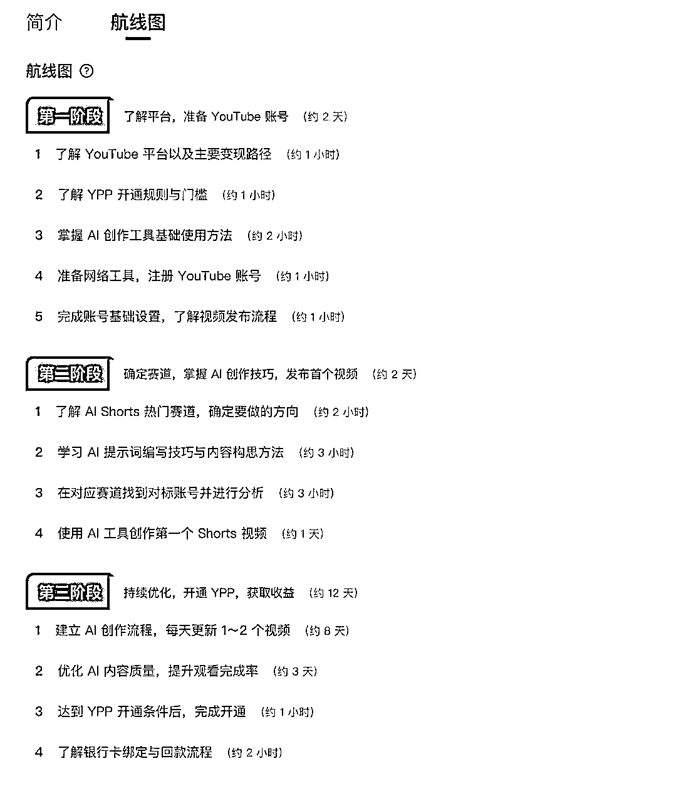

图和手册是咬合的，你处在哪一步，就翻到对应环节去学。

# 必修篇：先把最小 MVP 跑通

# 💡
# 内容速览

从认识平台讲起，这一章会领你把项目的完整流程走一遍。

如果你是第一次接触，正式动手前，先把项目的大图景看一眼：

✅【项目概述】认清 YouTube 平台

如果你对项目整体有了大致了解，就可以按照项目核心步骤，开始学习实操：

✅【实操 1/6】账号搭建与运营

✅【实操 2/6】锁定赛道、拆解对标账号

✅【实操 3/6】制作 Shorts 内容

✅【实操 4/6】制作长视频

✅【实操 5/6】运营打法与数据复盘

✅【实操 6/6】开通 YPP、开始赚钱

必修篇的章节顺序和航线图一一对齐，照着读下去，图上的任务就能逐个拿下。

之后每个关键环节的开头，都会点一下对应的航线图位置，帮你确认进度。

好，正式开始。


# 一、【项目概述】认清 YouTube 平台

# 💡
# 内容速览

它是全球体量最大的视频站点，眼下正把资源往短视频上砸：流量给得足、新手进场的门槛在降、AI 又把内容生产变简单了。跟国内平台比，一个正常运转的短视频号，日常播放能稳在万次量级，撞上爆款的概率更高。

这一章会分四块展开：

✅ 选它的理由：盘子有多大、广告价值几何、AI 带来什么新机会

✅ 分发规则拆解：短视频与长视频各自的算法脾气

✅ 赚钱的路子：广告分成、频道会员等多元收入

✅ 开工前的提醒：别踩版权坑，心态要放长

这件事急不得，地基打牢，一步步来。

# 💡
# 本章对应航线

学完并做完这一章，航线图上的这些节点就点亮了：

第一阶段 熟悉平台、备好账号（约 2 天）

1. 摸清平台和主要赚钱路径（约 1 小时）

2. 搞懂 YPP 的开通条件与门槛（约 1 小时）

那就动手吧，跟着步骤把第一章过一遍，别忘了在航海日志里记下进度。


# 1.1 为什么值得押注 YouTube？@龙哥

10 月 24 日，龙哥在星球抛出了第二条超级标：用 AI 批量做视频，发到 YouTube 及其 Shorts，靠广告分成变现，天花板极高。

1. 第一，市场够大。我 2012 年就是最早一批在 YouTube 上吃到收益的人，当时就体会到流量价值的巨大落差：同样一次播放，放到国内平台可能什么都不是，换到 YouTube，几千美金都有可能。

2. 第二，这背后站着 Google 庞大的广告主盘子。为了养自己的内容生态，它愿意把广告收入切一块出来，分给做内容的人。

3. 第三，AI 工具铺开以后，龙哥盟的圈友已经能快速把视频做出来。过去拍视频要么得出镜，要么嘴皮子得溜，现在这两样都能交给 AI 代劳。

4. 第四，短视频是它拿来跟 TikTok 对打的武器，广告分成计划也已经落地。国内已经有人在 Shorts 上跑出收益、做起导流，案例就在眼前。

5. 第五，AI 做出来的爆款短视频在 Shorts 上已经不少见。顺着这些账号往下扒，能挖出一堆细分方向。欢迎大家研究完写成帖子分享出来。

6. 第六，这是场长跑。从我入局到现在十来年，YouTube 上的钱照样能赚，而且势头还越来越猛，完全值得当一份事业来做。当然，不容易。记住一句话：收益的厚度，跟你啃下的硬骨头成正比。

7. 第七，说个数字：宝宝巴士只是把自家视频传上 YouTube，一年的广告分成有多少？五千万美金。

除了宝宝巴士能看出这个平台的钱景，再看复出不久的李子柒：停更三年多，粉丝不但没掉，反而涨了五百多万。10 月底在 socialblade.com 上查，她单月仍有约三十万收益入账。长尾效应这么明显，这就是个值得长期压注的项目。

国内内容赛道卷成这样，不如把眼光放到海外。

内容参考：《超级标 02：通过 AI 生成的各种视频，上传到 YouTube 和 Shorts，获取广告分成》


# 1.2 平台是怎么分发的

不管短视频还是长视频，分发这件事说到底由算法说了算。它会看用户怎么反应、内容表现如何，再决定要不要把片子推给更多人。所以做短视频不能只赌运气，内容得反复打磨，规则得吃透。

一句话概括：

算法只偏爱用户真正爱看的东西。

# 1.2.1 短视频的分发逻辑

# 1.2.1.1 一条短视频要过的三道关

跟抖音的打法相近，片子发出去之后，会依次闯三个流量池。

① 第一阶段：冷启动

刚上传时，系统只把片子丢给一小撮人看，规模大概几百到几千，且多半跟你的频道标签、内容方向对得上。这批人可能来自：

已关注你的观众（注意不是每个粉丝都会收到提醒）

爱看同类题材的人（比如此前常刷你所在赛道的片子）

在你这条片子所用标签、关键词下活跃的短视频用户（这批人对你的主题天然更容易来电）

这一关，系统想看的是片子的第一反应，主要盯这些数：

选择观看率：刷到的人愿不愿意停下来看，还是手指一划就走。及格线通常卡在六成，越高越稳。

平均观看时长与观看占比：能看出观众对你内容有多上心，停得越久越说明问题。

互动率：赞、评、转这些动作热不热闹。

小范围试水如果成绩漂亮，系统就会把片子放给更多人，进入下一轮。要是数据难看，分发范围就会被收紧，片子的后劲也就没了。

这时候可以去后台看流量从哪来，正常情况下大头是 Shorts 动态。

第一关是整个分发链条的起点，只有成绩过硬的片子才拿得到后续曝光。这也解释了为什么开头、选题、标签都得打磨——起跑线上的表现，直接决定你能跑多远。

② 第二阶段：扩大推荐范围

第一关合格，系统会把片子撒向更大的目标人群，进入放量阶段。平台会依据前一轮的成绩，把它推给更宽的观众面，比如：

看过或互动过同类内容的人：曾经在相似片子上停过、点过赞、留过评论的用户，会被优先投喂。

跟内容沾边的潜在观众：系统照着标签、标题、关键词去捞对同类题材感兴趣、但还没关注你的新面孔。

其他地区、其他语种的观众：越是通用、不卡语言的内容，越容易被推到海外用户面前。

短视频信息流里的高频用户：片子有机会挤进更多人的刷屏列表，触达面再扩一圈。

平台的目光还是锁在那几个核心数上：平均观看占比、划走率、互动率（赞、评、转）。数据继续硬气，分发就会一轮轮放大；一旦指标滑下来，流量闸门就可能收紧。

走到这一步，片子已经从试水阶段迈进了大范围扩散，能不能成为真正的爆款就看这一关。它决定了内容的触达宽度和后续的长尾收益。所以这一阶段的关键，是让内容表现始终在线，把观众的注意力牢牢摁住。

③ 第三阶段：大规模爆发

如果放量阶段成绩依旧亮眼，系统会继续把片子推向更庞大的人群，进入爆发期。这时候它可能被摆到短视频信息流的高曝光位置，甚至被塞进热门版块，播放量就会指数级往上蹿。

这一关里，被推送的对象可能包括：

几乎所有对口兴趣人群：系统会优先找标签、关键词跟你片子对得上的观众。

兴趣圈外的用户：平台会拿片子去试更宽泛的人群，看它能不能破圈。

爱互动的用户：平时刷短视频爱点赞、爱评论的人，更容易被推送到。

系统会继续盯住几个关键指标：

选择观看率要高：它反映用户是不是看两秒就滑走。掉到六成以下，分发会被明显拖累。

平均观看占比要稳：它跟平均观看时长一起，说明观众对片子的兴趣度。健康的曲线应该是平缓的，不是陡降的。

互动率要高：爆发期的互动量，尤其是评论和转发，是系统愿不愿意继续喂量的重要信号。

要是在大范围观众里依然打得住，片子的生命周期就会被拉长，甚至转入长尾流量期，持续带来播放和订阅，还能顺手把频道整体权重往上抬一截。


# 1.2.1.2 决定流量走向的几个数

系统判不判你这条片子值得放大，主要看下面这几项：

1️⃣ 平均观看时长

它相当于国内说的“完播率”，衡量的是用户平均在你片子上停了多久。想把这项拉起来，最直接的办法是把时长压短。举个例，20 秒的片子，平均观看时长得做到 120% 以上才算过关。

2️⃣ 划走率

短视频没有封面可倚仗，系统只能看观众愿不愿意把片子看完。这跟标题、标签，以及开头几秒抓不抓人直接相关。前三秒定生死，一个能勾住人的开场太关键了。

3️⃣ 互动率

系统很看重观众有没有动手互动，其中点赞、评论、分享这三样的权重最高。换句话说，用户看完还乐意转给朋友、或者在评论区聊起来，算法就会认定这条内容有吸引力。

4️⃣ 其他变量

核心数据之外，下面这些也会间接左右分发效果：

发布时间：它的用户遍布全球，按你的观众所在时区挑发布点，能让片子刚上线那阵子拿到更多流量。

画面质量：清晰度是判断内容是否优质的一条线，画质越扎实，用户越愿意买账。

赛道选择：大众向的领域（搞笑、生活妙招、宠物之类）容易圈到宽泛人群，但抢的人也多。小众方向（手工、工具测评等）更容易攒出忠实观众。追热点的内容（新闻、挑战话题）短期容易蹿，但后劲不足。

标签与标题的打磨：关键词和标签越准，系统越容易读懂你的主题。另外，短视频虽然没封面，标题依然得抓人——短、直白、把看点亮出来。

系统还会看频道的整体权重。更新勤不勤、订阅涨不涨、其他片子表现如何，都会给分发加分。


# 1.2.2 长视频的分发逻辑

长视频的分发跟短视频有不少相通的地方，但真正的分水岭在于观看深度，以及内容定位的重量。

短视频更在意点赞评论这些动作，长视频则把观看时长和留存率摆在更重的位置。用户愿不愿意从头看到尾，甚至回头再看一遍，直接关系到它能不能被推出去。

而且长视频的流量周期拉得更长。除了最初那波推荐，它还仰仗搜索、相关视频、频道权重的慢积累；来源面也宽，首页、推荐栏、搜索结果都算，甚至发布几个月后还能持续进人。

所以长视频拼的是耐力，短视频拼的是爆发速度，两者的内容准备方向得分开来设计。


# 1.3 怎么把钱赚到手

# 1.3.1 加入 YPP，拿广告分成

# 1.3.1.1 广告收益是怎么到你手上的

想在 YouTube 上拿广告钱，得先弄明白两件事：AdSense 这套机制，以及广告都有哪些形态。下面用最直白的方式把整条链路讲清楚。

AdSense：创作者的钱包入口

它是平台给创作者配的广告收入管理系统，你可以把它当成自己的收款台。广告主在 Google 那边投钱，YouTube 再按观众的观看情况，把收益分到你手上。

打个比方：

有个商家掏 1000 美金投广告。假如你的频道贡献了其中 100 美金的展示价值，你能拿到 55 美金，剩下 45 美金归平台。

你不用自己跑去找广告主，也不用操心广告插在哪儿，平台全包，你只管把内容做好。

长视频的广告形态

广告一共四种，你可以决定它出现在片子开播前、播放中还是播完之后：

可跳过广告：观众看满五秒就能点掉。

不可跳过广告：得把广告看完了才能继续看片子。

导视广告：最长六秒，不能跳过，看完了才进正片。

重叠式广告：以图片或文字浮在画面下方约五分之一的区域里。

短视频的广告玩法

短视频赚钱的路子和传统长视频不一样，主要靠下面几种：

信息流内嵌广告：广告直接插在短视频流里，收益按比例分给符合条件的创作者。这笔钱不跟你某一条片子的播放量挂钩，而是看整个信息流的观看表现，属于大家一起分池子的模式。

展示位广告：用户进短视频页面时，顶部或侧栏可能出现静态广告，这部分收入同样进短视频的收益池。

前置不可跳过广告：有些广告会在进入短视频流之前先播，收入也汇进短视频的广告池。

这个平台特别的一点是，好内容能一直生钱。哪怕片子发出去很久，系统照样会按权重把它推给新观众。只要还有人看广告，你的进账就不会断。

当然，收益高低还会被这几件事左右：

观众所在地：发达市场的 CPM 普遍比发展中地区高出一截，美国那边的观看回报通常很可观。

频道方向：有些题材天然能拿到更高的 CPM。

片子长度：超过八分钟就能反复插广告，进账自然更多。

（注：CPM 说白了就是——每一千个人看到广告，你能落袋多少钱。）


# 1.3.1.2 广告变现的门槛

想把广告收入装进口袋，第一关是拿下 YouTube 合作伙伴计划（YPP）的入场券。它的申请条件分成两个台阶：

**台阶一：低配版 YPP**
- 粉丝规模大概 500 人起步；
- 对观看时长或 Shorts 播放量的要求不高，比如累计 3000 小时，或 Shorts 累计 300 万次播放。
迈过这道坎，先解锁的是观众打赏类能力——超级感谢、超级留言、频道会员这些。

**台阶二：完整版 YPP**
- 粉丝规模一般要达到 1000 人；
- 观看时长或 Shorts 播放量门槛也抬高，比如 4000 小时观看，或 1000 名订阅再加最近 90 天内 1000 万次 Shorts 播放。
到了这一档，广告分成、高级会员等更齐全的赚钱渠道才会向你开放。

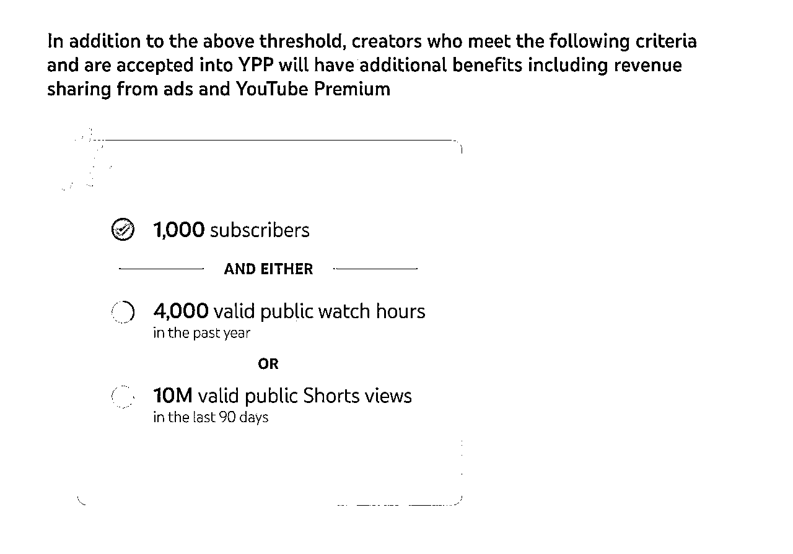
除此之外还有几项硬性前提：手头得有个能绑定的 AdSense 账户，注册后关联即可；账号所在国家/地区得在可获利名单内，中国大陆的账号不在其中，需要先调整地区；频道不能有违规污点，社区准则与广告友好政策必须遵守，敏感、违法内容碰不得；视频本身也要适合投放广告，暴力、成人等受限题材不行。

一句忠告：买粉丝、刷观看时长这类操作千万别碰。虚假流量换不来真实收入，一旦被 YouTube 识破，频道评级还会受连累。

想掌握最新政策，官方文档值得常翻：《YouTube 合作伙伴计划》《YouTube 合作伙伴计划概览与资格要求》《YouTube Shorts 创收政策》。

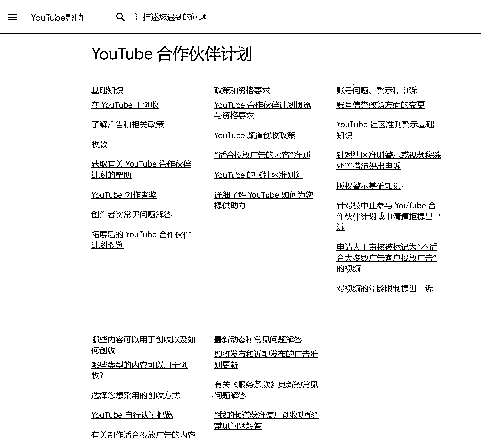

# 1.3.1.2 广告变现的真实样本

样本一：Catlyn's Story
赛道：用 AI 生成的猫咪故事
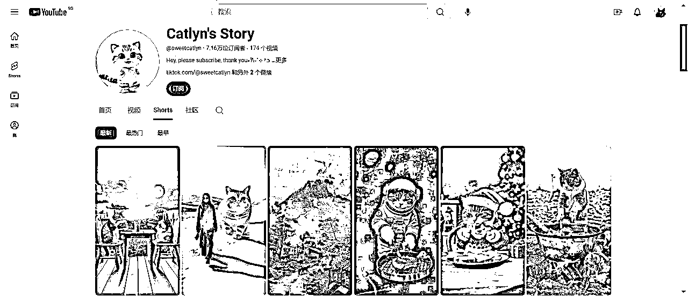
广告进账：月入大致 1000 至 2 万美元
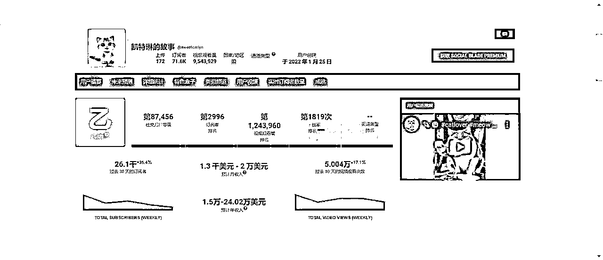
样本二：BabyMagic
赛道：AI 合成怪兽内容
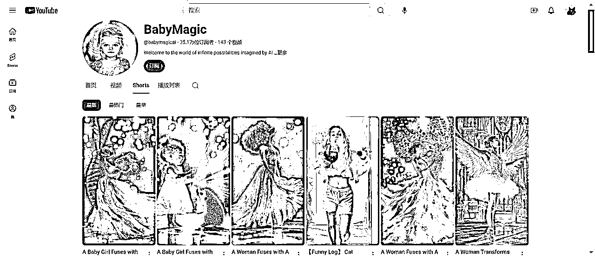
广告进账：月入约 1 万到 10 万美元
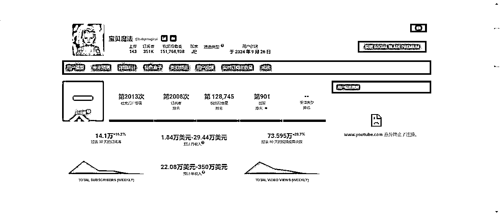
样本三：小高姐的 Magic Ingredients（主打中长视频）
赛道：美食制作与日常分享

广告进账：月入约 1 万至 5 万美元

# 1.3.2 会员收益的来源
2023 年 6 月中旬，YouTube 对合作伙伴计划做了扩容，让更多创作者能提前尝鲜粉丝赞助与部分购物能力——这正是下面要说的频道会员和电商变现。身处符合要求的国家/地区，只要满足下面任意一条，就能申请扩容版 YPP：
- 最近 90 天发布过 3 个有效公开视频、攒到 500 名订阅者，并且过去 12 个月有效公开视频的观看时长累计 3000 小时；
- 或者最近 90 天发布过 3 个有效公开视频、攒到 500 名订阅者，并且最近 90 天有效公开 Shorts 的播放达到 300 万次。
支持的国家清单、可开通的功能细节，官方文档里有：《拓展后的 YouTube 合作伙伴计划概览》。
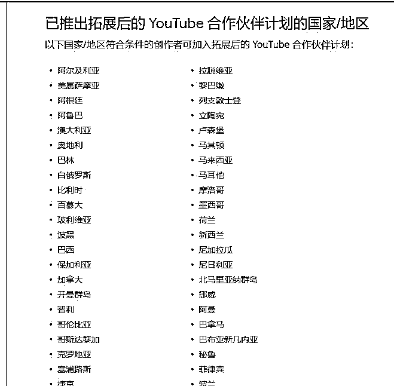
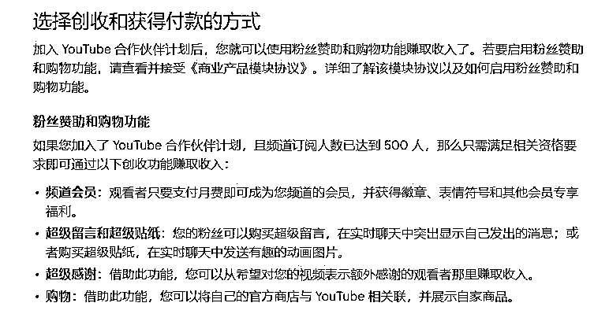
# 1.3.2.1 频道会员的收费逻辑
在免费订阅之外，频道主还能再加一层频道会员（Channel Membership）。愿意付费的粉丝按月交钱，换取创作者准备的专属福利。会员可以分等级，每一档的福利和价格由频道主自己定，从几百到上千都有可能。这笔钱 YouTube 抽走 30% 当平台佣金，剩下 70% 归创作者。举个例子：观众掏 10 美元月费，创作者到手 7 美元。

# 1.3.2.2 Premium 用户也能变收益
开通 YouTube Premium 的观众能免广告、享受更多权益，观看体验更顺滑。而当他们点开你的视频，你同样能拿到 YouTube 提供的额外分成，这部分按观看时长计入会费分配。要留意的是，付费会员服务的开通门槛，跟 1.3.1.2 里说的广告变现规则是同一套。

# 1.3.2.3 会员收益的经典样本
拿「老高与小茉」来说，这个频道开通会员后，一路跑成了 YouTube 上“频道会员增速全球第一”。开通那会儿总订阅刚刚突破 130 万，如今已经站上 600 万，会员规模自然水涨船高。
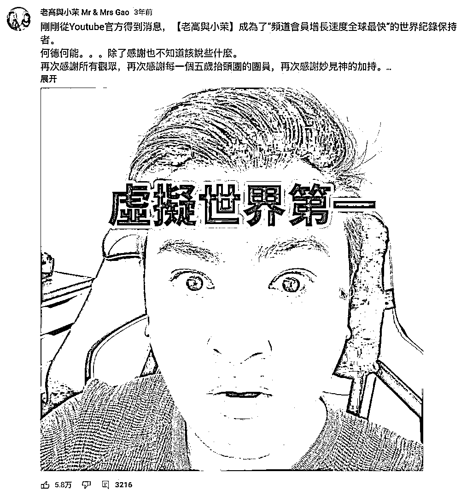
翻翻评论区就能感受到会员占比不低：名字旁边挂着头像的基本都是会员。头像或由频道主自制，或用平台素材，会员时长不同，头像样式也有区别，等级一目了然。
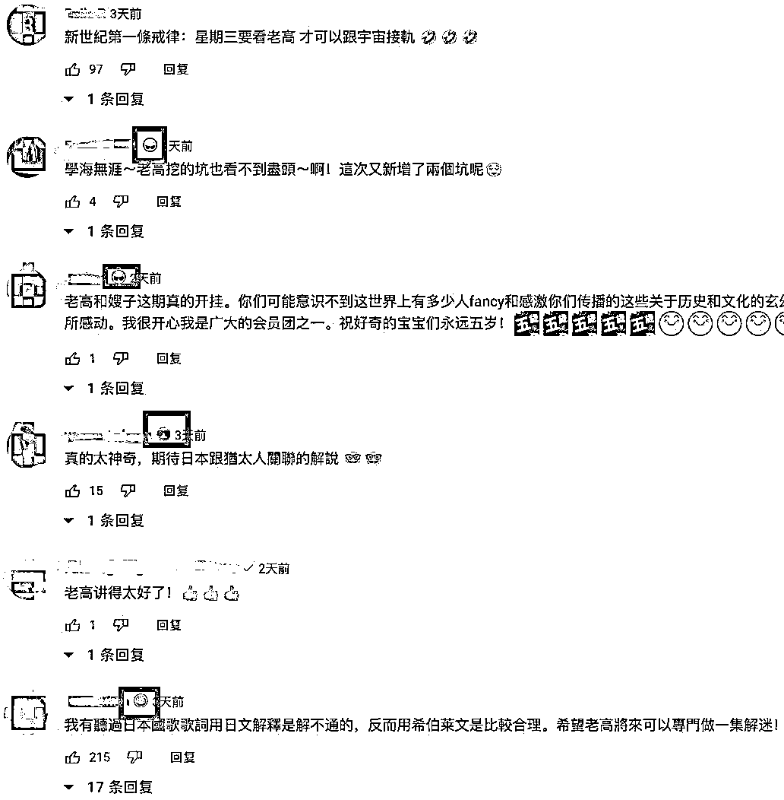
YouTube 不会公布具体数字，只能借一位博主的分析来估一估老高的会员盘子：
1. 人数推算：普通视频的评论/粉丝比约 0.0677%，会员视频平均有 430 条评论。照此折算，会员约 63.5 万；再考虑会员发言更积极（按 5 倍算），真实会员数大约 12.7 万。点赞数据也指向“接近 10 万”这个量级。
2. 收入测算：假设会员月费 5 美元、平台抽成 30%，月收入就是 12.7 万 × 5 × 70% = 44.45 万美元，一年约 533 万美元。这只是 2022 年底的估算，放到今天只会更多。

# 1.3.3 电商变现的两条路
广告、会员之外，卖货也是一种选择。YouTube 正在加码直播电商和商品货架，让创作者在站内就能把生意做完。展示商品主要有两种方式：
1. YouTube 小黄车：把自家商品挂在视频下方（前提是已加入 1.3.2 提到的 YPP）。
2. 独立电商平台：比如 Shopify、Etsy，用外链把流量导出去成交。当然，平台会审核你要推的商品，合规是硬要求。
想深入了解 ShopPINg：官方资料有《YouTube ShopPINg：从您的商店中添加链接商品并展示》《在 YouTube 上管理、关联和解除关联您的商店》。

# 1.3.4 其他变现路径
# 1.3.4.1 与广告主合作
说白了就是品牌找你，在视频里替他们讲产品，结算方式要么按条数收钱，要么按成交拿提成。常见玩法：测评推荐、使用场景演示、限时折扣码之类的专属优惠。YouTube 广告报价没有统一标准，海外流传着一份按粉丝量估算的行情：订阅过 1 万，单条可报 200 美元；过 10 万，报到 2000 美元；破百万，起步价 2 万美元。这条路对粉丝量要求不低，账号刚起步时，不妨先用那些不靠粉丝规模说话的变现方式过渡。

# 1.3.4.2 联盟 CPS
手头没有货，也想在 YouTube 上分电商一杯羹？做法是把商品链接塞进视频描述或置顶评论，观众点进去下单，你就能拿佣金。整个过程不用囤货、不用垫资，只负责把观众引到购买页。常用平台包括亚马逊联盟、CJ Affiliate、ShareASale、乐天等。适合的内容形态：开箱评测、实操教程、榜单推荐。

# 1.3.4.3 知识付费变现
把自己掌握的专业技能或经验做成内容，吸引观众为课程、咨询或专属服务买单，这就是知识付费。跟广告、联盟营销相比，它靠的是“价值感”驱动付费，特别适合在某个领域有真本事的创作者。常见形式有四种：
1. 在线课程销售：把课程放到 Teachable、Udemy 这类第三方平台，或自己的独立站点，再用视频把人引过去下单。
2. 会员专属内容：借助 YouTube 的会员订阅功能，让观众按月付费看独家内容。
3. 一对一咨询或服务：在描述栏放预约入口（Zoom、Google Meet 等），按小时或按项目收费。
4. 电子书或工具包销售：通过视频推广电子书、模板、工具包，观众点链接购买下载。
内容来源：《航海实战 | YouTube - 视频创作 | 实战手册》。

# 1.4 动手前，先看这几条
马上要进实操环节了。开始之前，希望你带着长期主义的心态，做好持续经营的准备。
1. 心急吃不了热豆腐。YouTube 创作是场持久战，早年长视频开通 YPP 平均要熬 2 年；如今只要持续产出优质内容，3 到 6 个月也未必不能开通。把注意力放在内容质量和观众互动上，别只盯着数据曲线。
2. 起步阶段的内容大概率不完美，但别因此不敢发。持续创作、持续学习才是关键。头一两个月甚至几个月播放量、订阅数寥寥，都很正常。定期打开 YouTube 的分析面板（观看时长、受众画像等），从数据里找方向，边跑边调。
3. 挑一个你真心热爱的领域，否则遇上坎儿很难扛下去。
4. 版权这根弦必须绷紧。YouTube 对版权极其敏感，搬运他人的音乐、影视片段、图片，轻则视频被删、账号被警告，重则失去变现资格。
5. 这些版权雷区要绕着走：
- 音乐：受版权保护的歌曲未经授权别用；YouTube 音频库里有一批免费音乐和音效可选。
- 图片与素材：优先用 Unsplash、Pixabay、Pexels 这类无版权限制的图库，或者确认自己握有商业使用权。
- 影视、游戏片段：哪怕只截几秒，也可能吃版权警告，热门影视和游戏尤其危险。

# 二、【实操 1/6】账号运营
💡
章节概要
账号搭建是整件事的起点，底子打得好不好，直接影响后续内容能推多远、变现空间有多大。本章要讲的核心：
✅ 账号类型怎么选：个人号与品牌号的差别和适用情形
✅ 注册步骤：全流程拆解与易踩的坑
✅ 频道包装：头像、横幅、简介怎么设置更显专业
✅ 发布视频：手机和电脑两端操作的异同与技巧
起步阶段不用死磕装修，先把账号稳稳立住；养号期尽量像个普通观众那样刷内容、做互动，账号可信度上来了，后面发东西才顺。
💡
本章航线图
学完并动手做完本章，航线图上的这一段就能打勾：
第一阶段：了解平台，准备 YouTube 账号（约 2 天）
1. 掌握 AI 创作工具基础使用方法（约 2 小时）
2. 准备网络工具，注册 YouTube 账号（约 1 小时）
3. 完成账号基础设置，了解视频发布流程（约 1 小时）

# 2.1 账号类型怎么定
# 2.1.1 个人账号
用你自己的谷歌账号开，用户名和密码需要单独设。
# 2.1.2 品牌账号
品牌账号本质上就是企业号，可以把企业信息、产品等内容摆出来。用企业信息开号，路径可以是「Google+」或「Google 我的商家」等，不用另设用户名和密码，还能挂多个所有者和管理员。
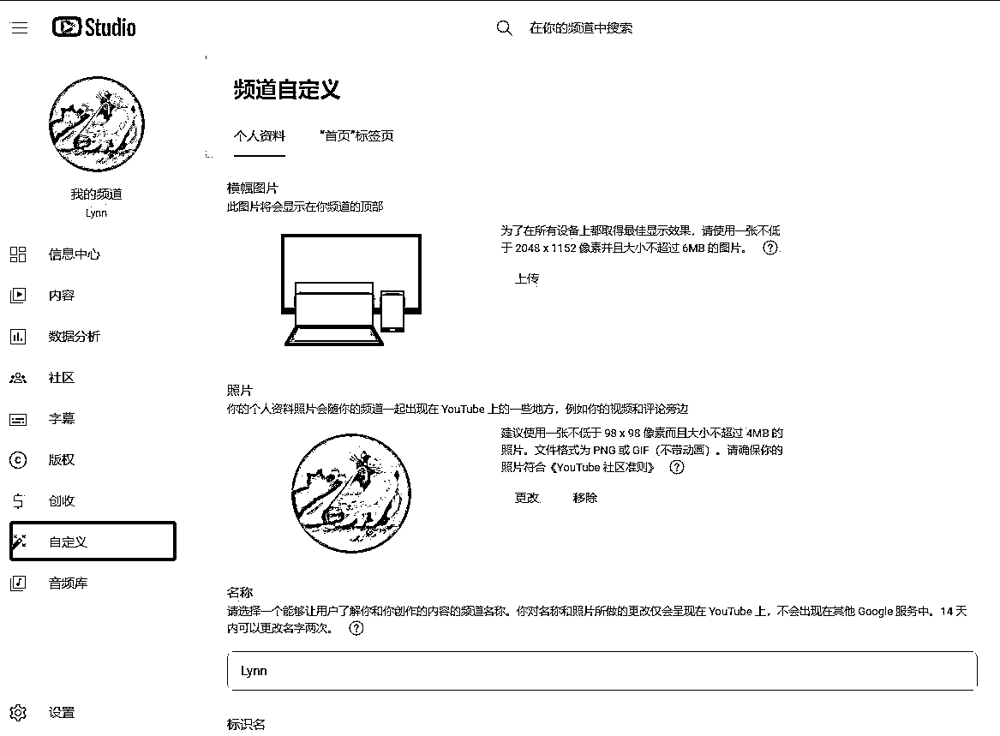
# 2.2 注册账号的步骤
Step1：国内上不了 YouTube，得先备好能访问外网的网络工具。具体风险缘由这里不展开，请自行解决网络问题，确保能顺利打开。
Step2：去注册一个谷歌邮箱。手机装 🐧 邮箱，点添加帐户→选 Gmail→创建账号，按提示填资料，输入 +86 手机号即可完成。（近期有号码不可用的情况，换个号再试，或用接码平台代收）
Step3：打开 YouTube 官网，用新注册的 Gmail 登录。也可以跟着这个视频操作：https://www.YouTube.com/watch?v=8hk5V2P_72U
注册完先别急着发片，把自己当成普通用户逛起来：多刷、多点赞、多评论，让系统认定背后是个活人。养号几天再发视频，账号会更稳。另外，地区记得设成可获利的国家，美国、欧洲多数国家、日本、韩国、印度以及南美主要国家都行。不过也别太纠结，YouTube 的流量分发看的是频道内容的目标受众，跟这个设置关系不大。

# 2.3 开通频道
Step1：在官网首页右上角点 Create a Channel。
Step2：挑个人频道还是品牌频道。
Step3：给频道起名，通常直接用公司/品牌/产品名，建好后就能发第一条视频了。
完整的频道包装由好几块拼成：头像、名称、横幅、宣传片、播放列表、封面图、简介等。点头像进“YouTube 工作室”，右侧导航栏里的“自定义”就是修改资料的地方。

这一步，圈友@方波妮的心态值得抄作业：别让“头像咋整？封面不会做？我拍的视频好丑？我怎么这么笨？”这类念头卡住手脚。头像不会做，手机相册翻张宠物照、风景照，或者用 MJ 生成一张，先弄出来再慢慢改；封面同理。少说“我觉得 xxx”，去模仿爆款、交给市场检验——精心原创未必干得过粗糙的模仿，事实就是丑的东西也有人买账。把这层心理包袱放下，接受起步阶段的粗糙，先把视频发出去，技术都是练出来的。

# 2.3.1 频道头像
尺寸 98x98px，格式为 png 或 gif，大小不超过 4MB。可选类型：人物照、萌宠、风景、品牌 logo、卡通等。风格上要清晰，真人出镜效果最好。不会做图？用在线做图站生成，或者找无版权图片。图怪兽：https://818ps.com/；可画：https://canva.com/；创客贴：https://www.chuangkit.com/；想用 AI 生成头像，可翻 AI 特效直播实战手册里的「AI 头像壁纸号」。提醒一句：带商标的图片容易侵权，别碰。

# 2.3.2 频道名称与标识名
原则是简短、好记；能体现内容特色或行业属性；可以是个人名字的延展；中英双语（附注解）；标识名还能当 YouTube URL 后缀用，方便别人找到你。注意：这两项每 14 天只能改 2 次。

# 2.3.3 频道横幅
尺寸至少 2048*1152px，文件不超过 6MB。海外不少观众是用电视看 YouTube 的，所以画质必须够高，横幅上要能一眼看出频道主题。可以放订阅引导；可以写一句简短的频道介绍；也可以挂平台链接。

# 2.3.4 播放列表
视频攒到一定数量后，务必做分类，建播放列表就是最直接的办法。命名时尽量贴用户搜索时用的短语或问句，多建几个也无妨。列表内的视频会自动连播，能把观众留在频道里看更多内容，既拉高播放量，也容易圈住潜在粉丝。

# 2.3.5 封面图
封面会出现在频道的显眼位置，值得多花点心思——很多人就是凭第一眼决定点不点，封面做好了打开率自然高。几条优化思路：用大众熟悉的东西建立信任，再制造一点悬念勾起好奇；多用图、表情、数字；标题文字别太多，免得抢了主题；右下角留出放频道链接的位置。工具推荐：Canva https://www.canva.cn/；稿定设计 https://www.gaoding.com/；AI 生成封面可看《3 月航海 | AI 绘画特训 | 实战手册》。

# 2.3.6 频道简介
开头一句标语，简洁又能概括频道定位；接着交代你是谁、能给观众什么、多久更新一次；建议准备中英双语版；还可以附上其他社交平台的入口。内容来源：《航海实战 | YouTube - 视频创作 | 实战手册》。

# 2.4 YouTube 视频 发布流程

一天一条 Shorts，手机与电脑怎么发？赛道又该怎么拆？

Shorts 制作快，更适合维持“日更一条”的节奏。下面把上传入口、发布细节，以及选方向、拆同行的动作串起来讲清楚。

# 2.4.1 手机上传 Shorts：三步搞定

① 启动 YouTube App，在右上角找到加号并点开。  
② 选择创建 Shorts，或者把已经剪好的成片直接传上去。  
③ 到编辑界面先核对规格：片长控制在 60 秒内，竖屏 9:16，1080×1920 高清为宜；画面要干净，配乐要贴合，开头三秒得有钩子，因为观众留不留就看这一下。

编辑页里的其他选项也别放过，它们能帮忙推播放：

- 标题：短、有吸引力，最好塞进关键词。示例：一支舞，十秒上手！🔥 #Shorts
- 描述：用几句话说明内容，补上话题、频道链接等信息；再放与画面相关的关键词，利于搜索排名。
- 标签（Tags）：加上相关主题，如 #Shorts、#DIY、#Fitness。前提是标签和内容强相关，别用误导性标签。
- 缩略图：系统自动生成的不满意，就传自定义图。设计时保持清晰、色彩对比明显，从“让人想点”出发。

# 2.4.2 电脑上传 Shorts：借长视频入口

电脑端走的是发长视频那条路：

① 登录 YouTube Studio。  
② 右上角点“创建”，选“上传视频”。  
③ 把文件拖进上传框，只要时长和比例合格，系统会自动认成 Shorts。

关键提醒：想让作品落在 Shorts 板块，标题或说明里要加“#Shorts”，同时长度、尺寸都得合规。

发布前后，别发完就关页面。像普通用户一样刷一刷，平台会更容易把账号当真人；多刷有助于建立信任，推荐也可能更积极。若立刻退出，系统可能怀疑账号真实性，流量分配会更谨慎，0 播风险也会上升。


# 三、【实操 2/6】锁定赛道，拆透同行

# 💡

# 本章速览

方向选错，后面全白费；方向选对，效率翻倍。看热门内容、研究同行，是为了找到自己的切口。

本章重点：

✅ 怎么定方向：盯平台趋势，也看头部创作者怎么做  
✅ 怎么找同行：判断赛道活跃度与变现潜力  
✅ 怎么拆内容：理解创作逻辑与爆款特征  
✅ 怎么估回报：用数据预判项目收益

初期别执着于“没人做过的蓝海”，先挑已经被验证的方向，边做边找差异。持续输出，定位才会慢慢浮出来。

# 💡

# 本章进度图

学完并实操本章，可推进到进度图的：

第二阶段 确定赛道，掌握 AI 创作技巧，发布首个视频（约 2 天）

1. 摸清 AI Shorts 热门方向，定下要做的事（约 2 小时）  
2. 学会 AI 提示词与内容构思方法（约 3 小时）


# 3.1 怎样敲定自己的赛道

# 💡

# 新人选赛道：三条硬指标

- 赛道里出现多条千万级播放：说明盘子够大，多你一个也容得下。  
- 近两周仍有千万播放：过去能跑不代表现在能跑，近期还在出大爆款，说明赛道仍有生命。  
- 频道近一周有百万以上播放，且单条最高破千万：头部上限高，频道近期也活跃，给你新号留出了成长窗口。

# 3.1.1 从热门内容里找信号 @龙哥 @老马内容出海 @钱塘江鲤

选方向之所以关键，是因为时间最贵。先问自己：同行的做法跟我合不合？这条路人挤不挤？还能不能继续走？收益开通难不难？说到底，就是挑一个合适的利基市场。

新人该怎么挑？什么样的 Shorts 能赚钱？

龙哥提过一个思路：想找已经在 Shorts 和 YouTube 上跑火的 AI 视频，可以先找到一个样本，进它的描述区，顺着 tag、描述、评论挖关键词；再拿关键词往外扩，最后能攒出大量已经被验证有流量的类目词。

圈友@钱塘江鲤 照这个思路，采集了注册一年内、粉丝超过 1000 的频道，整理成《1 万个 YouTube AI Shorts 对标账号》。

圈友@老马内容出海 又拿这份信息，以 AI 方向为例做了拆解演示：

① 先定目标：市场验证过、竞争不算拥挤、还有创新空间、方便快速模仿。  
② 找 5-10 个同风格、同选题文案、同画面表现或同情绪价值的账号。从钱塘江鲤整理的标签里随手抽两个词：Cute、Spiderman。  
③ 去 YouTube 搜关键词，看哪些内容像 AI 做的。

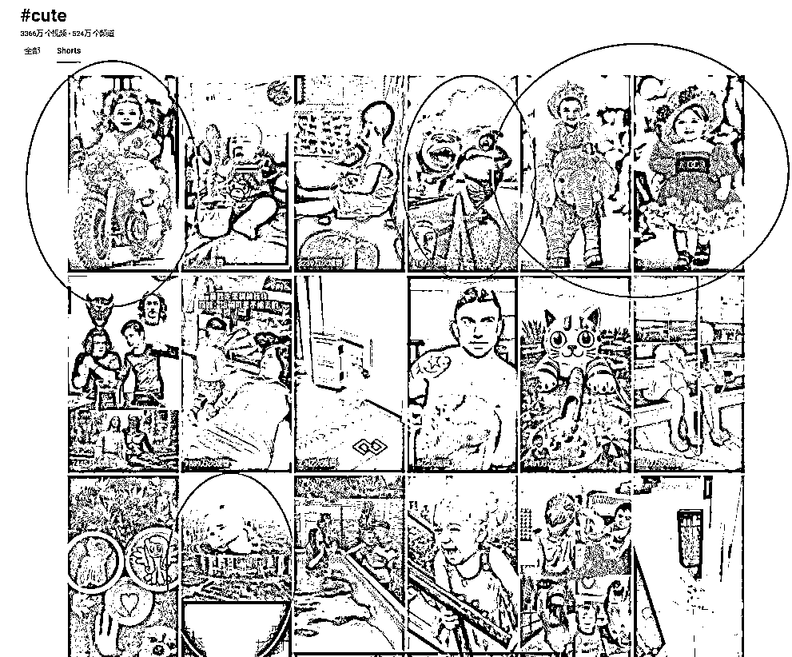

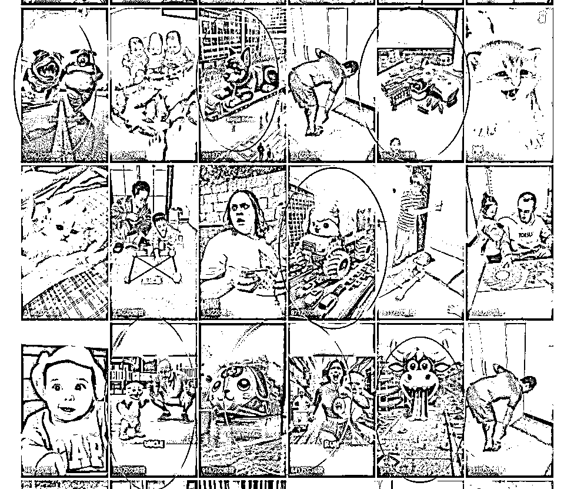

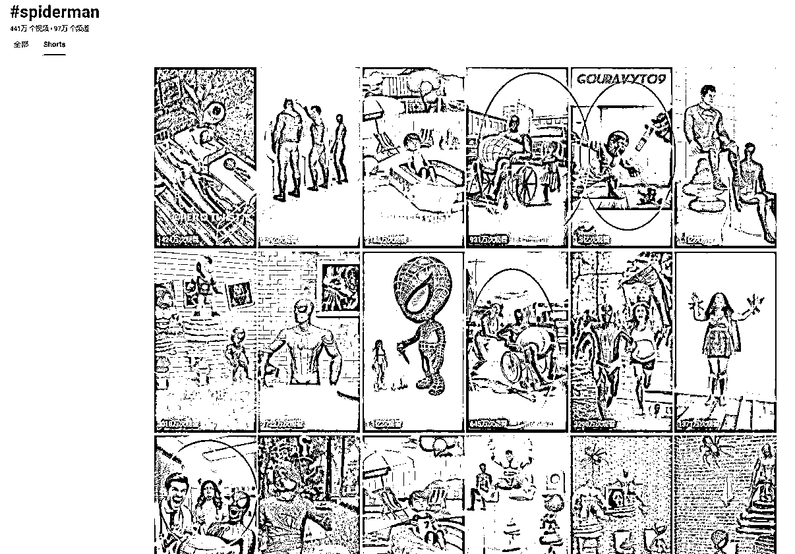

④ 逐个点开，会发现多数输出集中在两类 AI 赛道：

1. 一类是 AI 可爱萌娃走秀，加上对口型驱动会更生动；  
2. 第二、第三类本质相近：图片风格转绘＋简单特效转场＋热门音乐＋较重的人头抠图。

Runway show +口型驱动（不对口型）

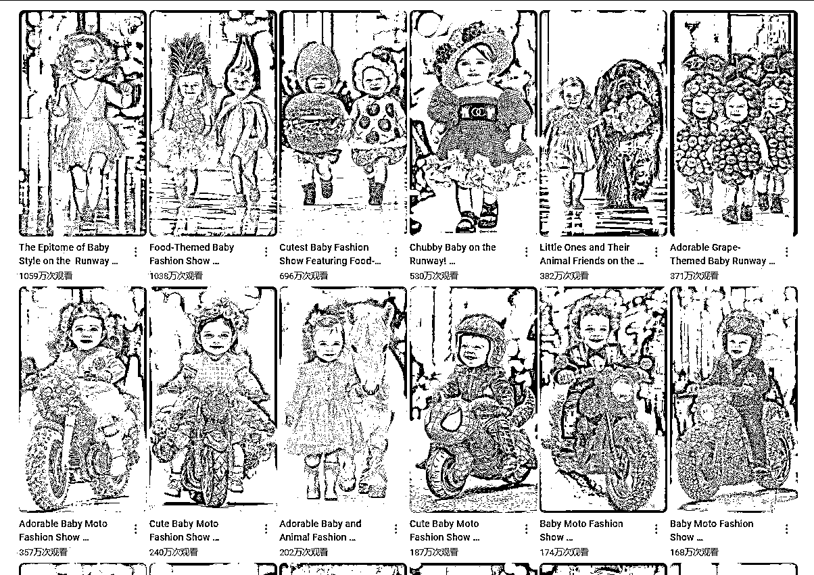

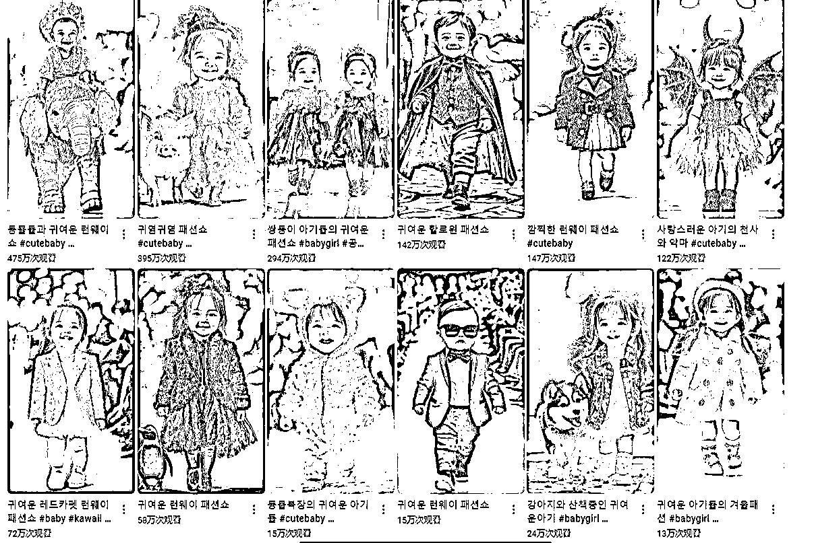

图片风格转绘+人头（或者不加）

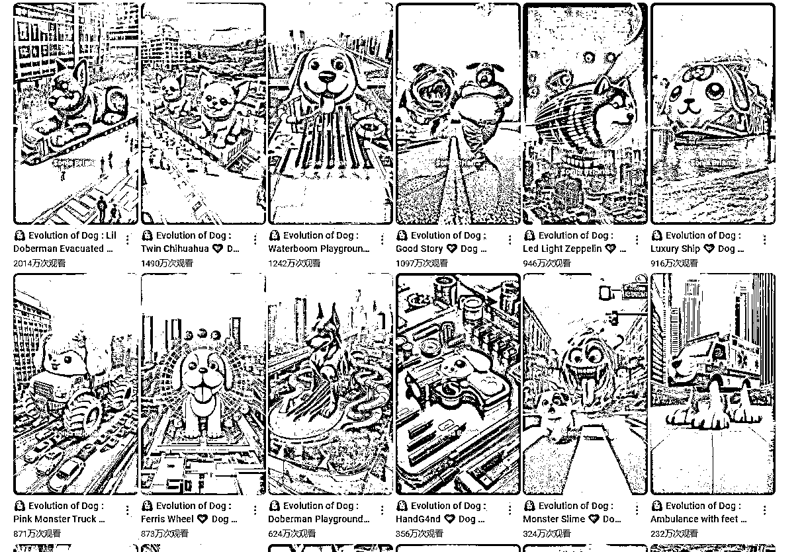

再看 Spider Man（图片风格转绘+人头（或者不加）+恶搞 IP）：

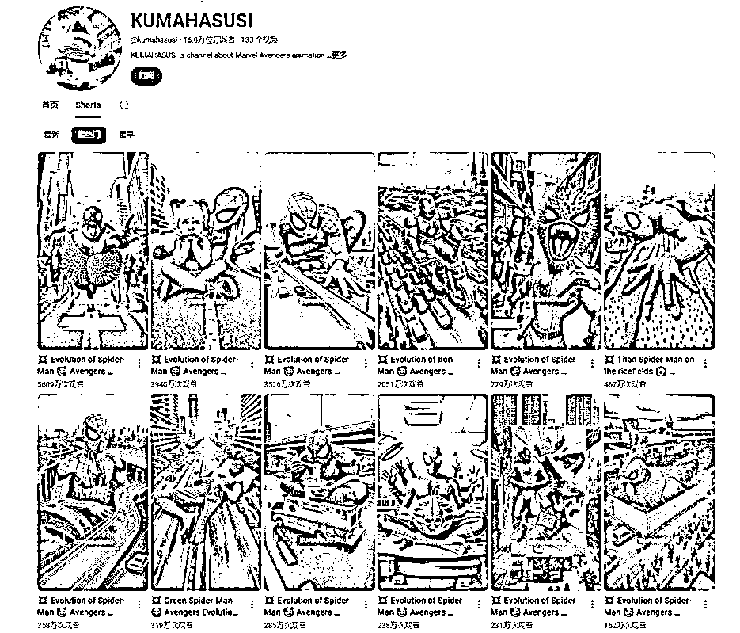

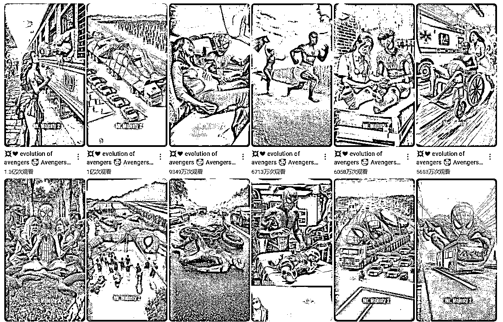

如果判断自己也能做，再往下锁定具体账号做分析。

引自：《【赚钱技能】如何选择自己合适的匿名 Shorts 赛道》、《利用 RPA 自动化流程分析 YouTube Shorts 上的热门 AI 视频》


# 3.1.2 翻往期 AI 航海手册 @方波妮

还可以翻翻往期 AI 航海项目，比如 2024 年 9 月热平的《9 月航海 | AI 特效直播变现 | 实战手册》。

文档里项目一大堆：AI 老照片、AI 写真、宝宝走秀、赛博机车、头像、壁纸等。国内短视频可以平移到 YouTube，挑一个喜欢的先动手，光想没有用。

引自：《YouTube Shorts 项目实操：从 0 到 1 跑通账号，12 天收获 2700+订阅与 90 万+播放》


# 3.1.3 学头部 YouTuber 的选法 @浅笑

YouTuber@老高与小茉 的选法，做 Shorts 或长视频都能参考：

1. 做愿意长期做的  
选自己能坚持的内容，再看同类频道怎么扩展。横向做关联题材，纵向往深处挖。

2. 做自己比普通人强的  
挑自己更拿手的内容，产出更稳，失败概率更低。

3. 做自己爱看的  
没方向、没特长时，从兴趣入手，模仿喜欢的内容，也许能发现新兴趣。

4. 做播放量大的  
前三条都定不下来，就选大盘大的内容；但要清楚，播放高不等于适合你。

引自：《YouTube 数据与前景及博主方法论分享》

# 3.1.4 用通用定位法微调 @一页书

通用定位可拆成几步：

采集市场当前与历史数据并初筛 → 分析：用户是谁、规模多大、需求或待解决问题是什么、愿不愿付费且能力如何、供给方解决得怎样、我能不能做得一样好甚至更好、我讨不讨厌做这件事 → 整合、筛选、排序 → 得到几个适合自己的定位。

放到 YouTube 上，要做些调整：

数据采集：@钱塘江鲤 擅长用 RPA 抓取和分析，早期可直接用他整理好的 1 万个 YouTube AI Shorts 对标账号，后面再学方法自己做。

结合 Shorts 特点：

早期不必死磕清晰用户画像，把用户和需求并在一起，盯住需求本身（多半是精神/心理层面），以及为什么某些需求量大。  
早期也可先忽略付费意愿与付费能力（Shorts 共享广告收益池），把精力放在做爆款上。

总结：拿高手的数据去回答几个问题（前三个最重要）：

需求层面：播放量大的内容满足了什么需求？有这个需求的人多吗？  
供给层面：玩家多不多？他们怎么满足需求？还有创新空间吗？  
实现层面：需要哪些技能？我能做吗？能做得更好吗？  
我讨厌做这件事吗？

最后把数据汇总，找到适合自己起步的定位。

引自：《【赚钱技能】万字总结：YouTube Shorts 频道定位调研与视频制作实操》


# 3.2 在赛道内拆解同行 @老马内容出海

# 3.2.1 找到可研究的频道

接下来抽两类赛道，各准备 5 个，共 5-10 个频道。

常规采集法：

从标签或关键词搜到初始账号后，关注、点赞，反复刷首页和 Shorts；碰到新的再继续循环。新号更好操作，手机端比浏览器更容易刷到；有历史记录的账号已有推荐逻辑，需要耐心。  
也可以继续按钱塘江鲤整理的 AI 标签文档手动找，或用分享的代码自行采集。  
页面周边会出现同类推荐（单独 Shorts 页面看不到）。

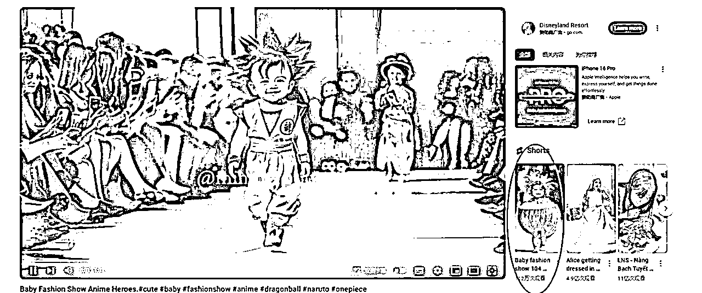

热门音乐采集法：

从两组频道视频的热门音乐里，找高度垂直的账号；也能借热门音乐拓其他细分方向。

图片风格转绘+人头（或者不加）热门音乐展示：

别觉得左下角加人头奇怪。这招最早是点评、观点类视频的变体；后来做 TK 中视频影视切片时，用加人头过原创又火了一波；第三次变体放到这里，是因为 AI 类不容易开 YPP，于是又被拿了出来。

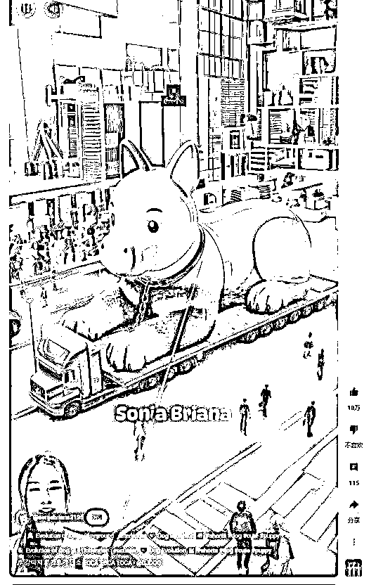

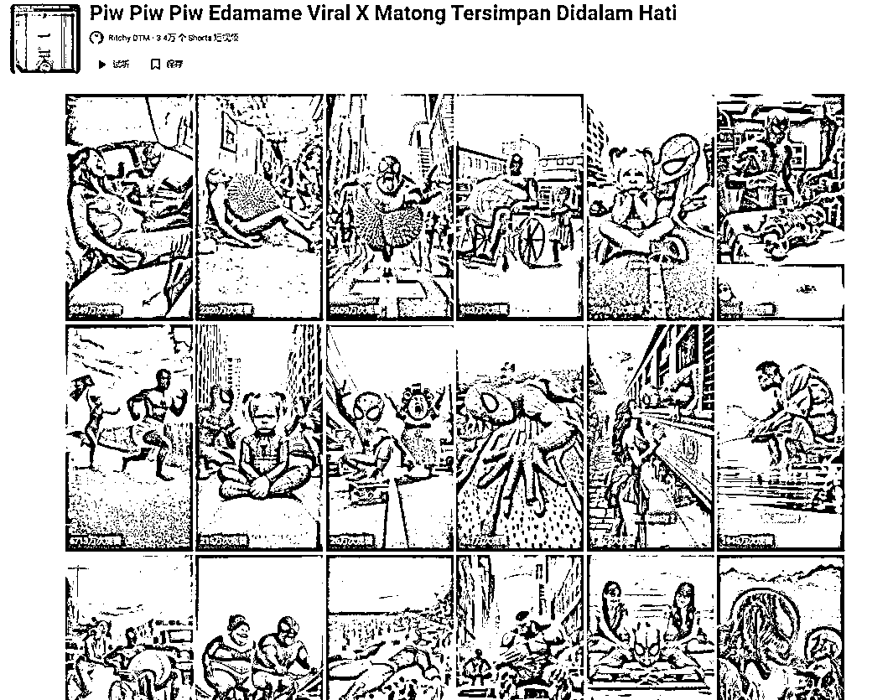

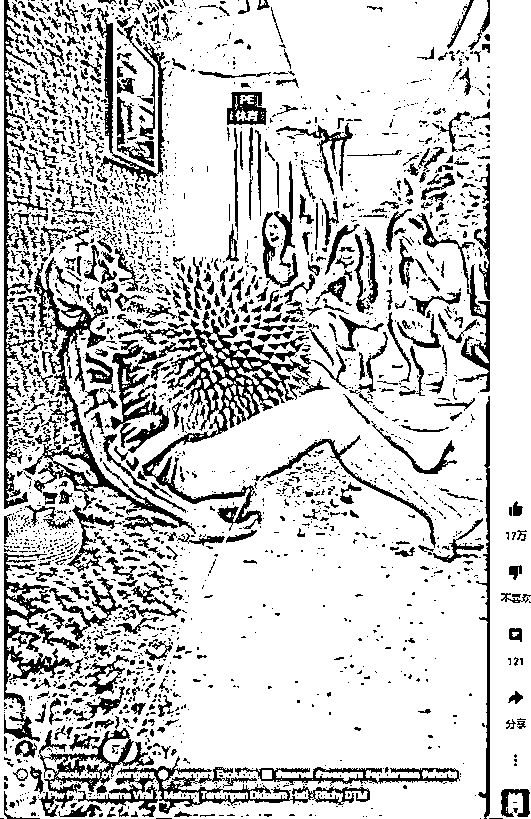

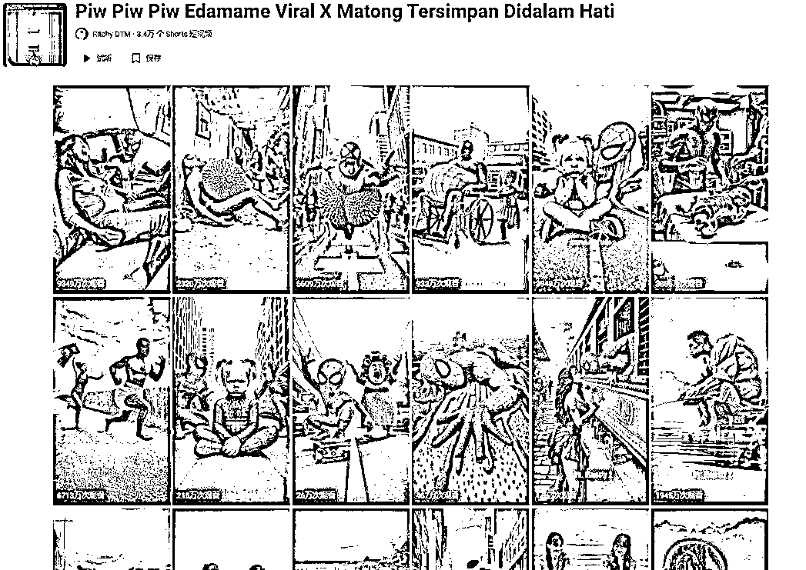

Runway show 热门音乐展示：

这是近期的新赛道，AI 视频生成迭代升级，给赛道添了新活力。

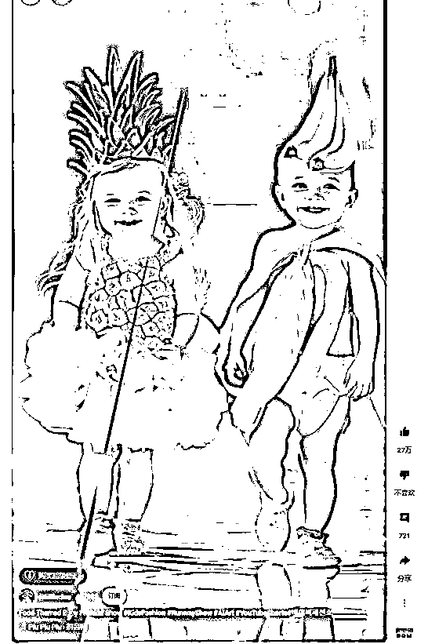

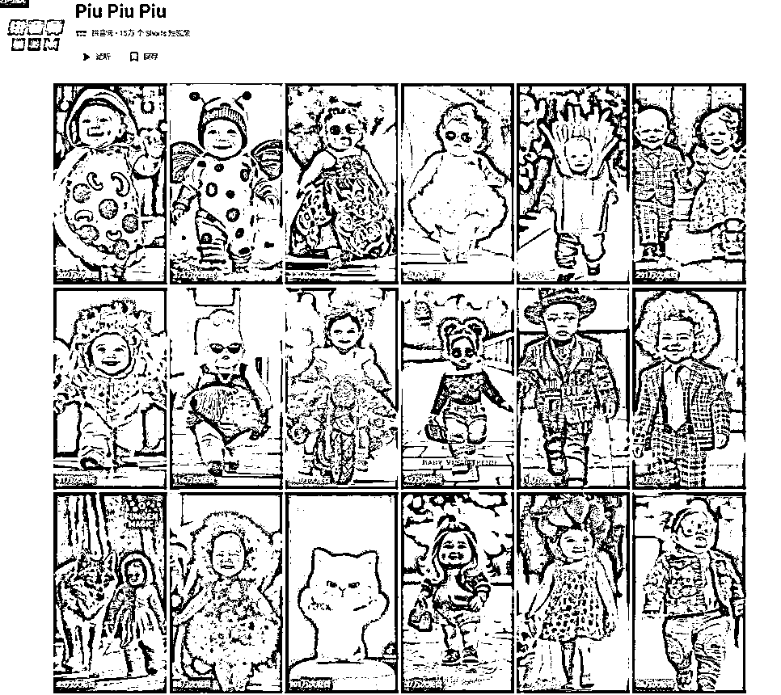

拿到两组高度垂直的信息渠道后，再筛出符合要求的：

1. 总播放量大于 1000W  
2. 近期频道（3 个月内，指最早一条垂直视频在三个月或近期有高爆内容，不是看注册时间）  
3. 不是印度频道

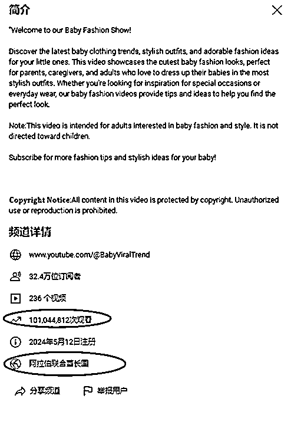


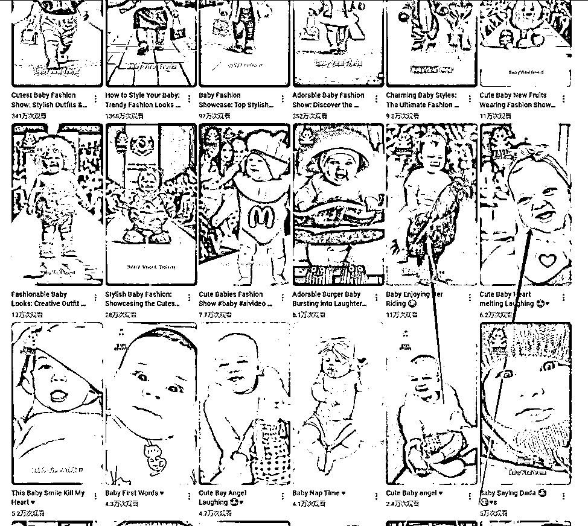

Runway show:

https://www.YouTube.com/@littleclassics7988

https://www.YouTube.com/@AloAiTec

https://www.YouTube.com/@CarterSophia

https://www.YouTube.com/@BabyViralTrend

AI 视频转绘：

https://YouTube.com/@MiawMilky

https://www.YouTube.com/@sonjabriana3135

https://www.YouTube.com/@BalluWala

https://www.YouTube.com/@TeknoCatPro

https://www.YouTube.com/@MrMajesty2


# 3.2.2 拆解同行的步骤

这里会用到货币化查询工具，也就是预估账号收益的网站：https://ytlarge.com/zh

注意：下面的拆解和判断不是百分百准确，只是预估值，给自己一个研究锚点，同时掌握一套分析方法。油管目前没有百分百准确的查询渠道。

① 用工具把上面 10 个频道都查一遍

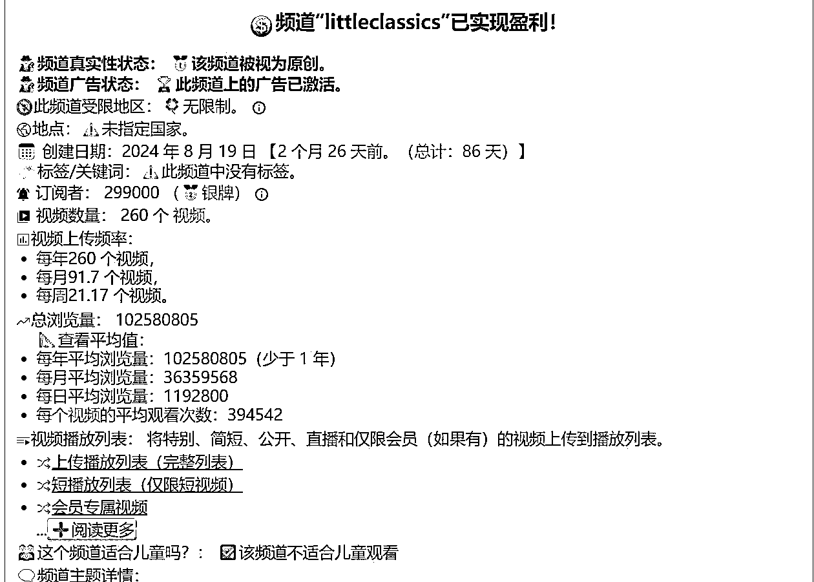

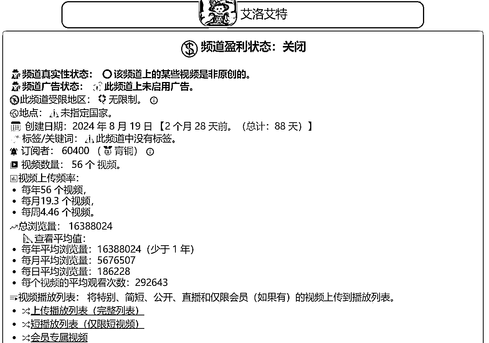

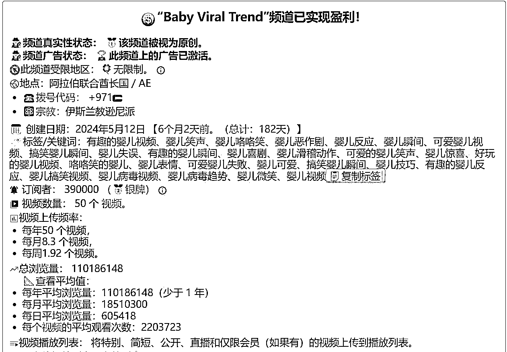

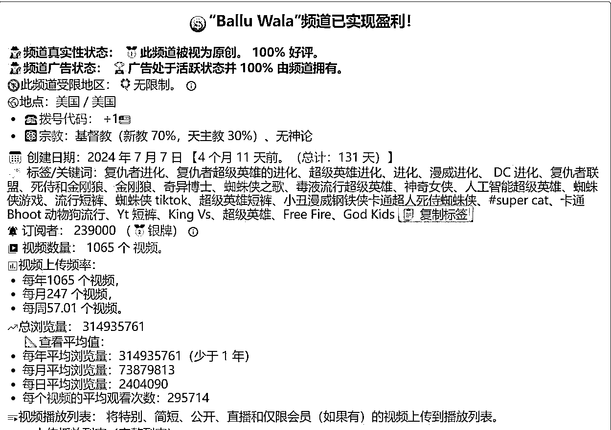

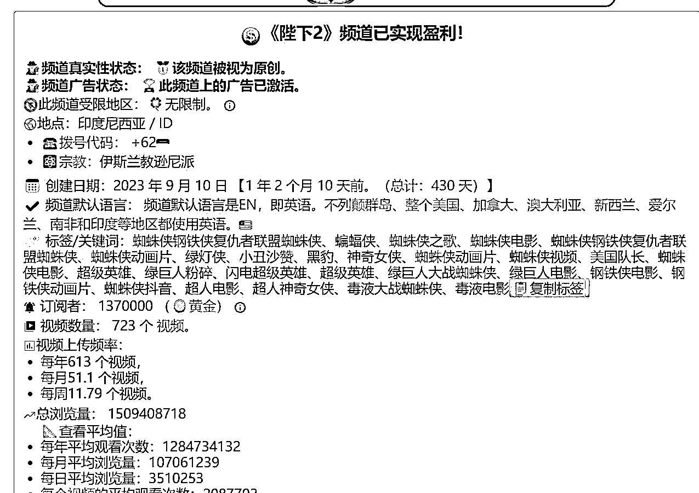

② 从状态上做几种可能性判断

以某频道为例：它显示已开通盈利，真实性被判定为原创，广告处于投放中。

货币化，就是是否开通收益；原创度，是频道整体原创占比；广告状态，是视频广告投放情况（更多针对长视频）。

可能遇到：

1. 三项全绿：极大概率在人工审核、机器审核层面都不会有大问题。  
2. 货币化开或关但非原创，有广告或无广告：内容大概率过不了 YPP；账号可能是买来的收益号后期转型；也可能之前过了 YPP，后来因违规、侵权、不适合观看被处罚、Shadow Ban，导致限流、关收益等。  
3. 已盈利、原创、部分广告：音乐版权分走了一部分。

③ 判断完再收尾

确定三绿内容后，再看天花板：爆款是否平稳，最热视频前几排掉量快不快。Shorts 吃爆款，别指望每天一两万播放养老；后期收益号会走下坡，所以得知道目标赛道的爆款上限。

# 💡

20250530 更新：

收益计算工具并不完全准确。全绿可默认为已开通收益；不是全绿，但账号持续更新且满足 YPP 要求，也可默认其开通。

计算规则：

短视频按总播放量减去 1000 万，再按赛道大致估算；长视频按总播放量减去 10-20 万，再按赛道大致估算。

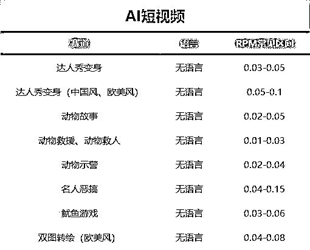

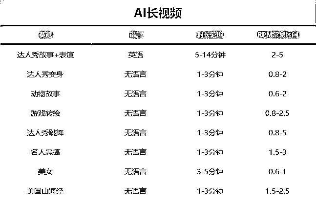


# 3.2.3 避开不合适的对标频道

同样是千万播放，若最热门排序之间差距太大，这种频道无论选题、画面还是文案，都不该优先选。若赛道里只有极个别频道如此，仍可继续选；只能说这个号做得不好，不能判整个赛道不行。

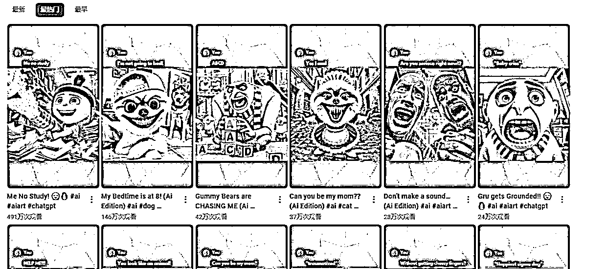

不能选的原因很多：赛道饱和度太高，YPP 难过；大量侵权素材导致被判非原创；一个账号开通 YPP 可能要 1-3 个月，好不容易达标却因某种原因过不了收益，那就很亏。所以先选好路更重要。

引自：《【赚钱技能】如何选择自己合适的匿名 Shorts 赛道》


# 3.3 估算频道收益 @老马内容出海

# 💡

查询工具：https://ytlarge.com/zh

看收入有两个目的：一是确认赛道有钱可赚，二是给自己信心。坚持不住时，打开工具算一算，擦把泪继续干。

用一个三绿频道作对标：www.YouTube.com/@NicksWorld01

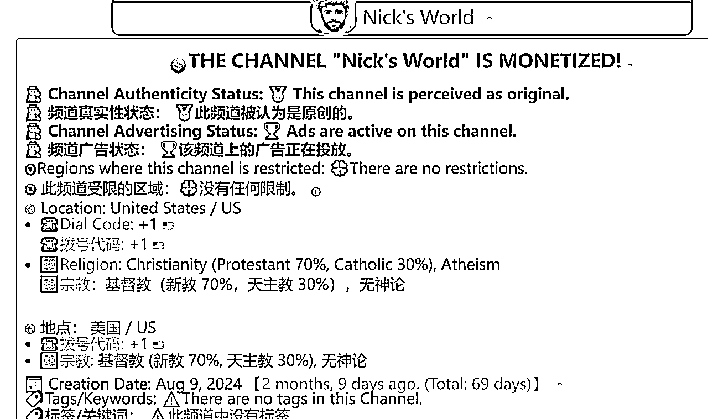

# 先算一笔账：Shorts与长视频收益怎么估

美国区有个账号，注册时间是8月10日，作品量84条，订阅数已经到152万。这个量级一看就不是慢慢养出来的，属于解说类账号在短期内迅速起量，目前总播放约1.1亿。千播收益早期只有0.02—0.08美元，现在大约0.15美元；就算按偏低的0.1美元/千播来算，1万播放约1美元，1.1亿播放差不多就是1.1万美元。货币化页面底部的估算值只能拿来参考，别把它当准数。

那频道同时有长视频和Shorts，收入怎么粗算？可以先进入Shorts页，按热度看头部几行的播放量，再用“1000万×1”或“×3”从总量里扣掉；余下的长视频播放，结合选题所在领域的单价去折算。两部分一加，基本能看个大概。觉得估高了就打八折，觉得估低了就加两成，怎么顺手怎么来；真实进账，只有号主自己最清楚。

另外别把“没人做过的赛道”想得太美。YouTube上的内容早就堆满了，每个方向每天都有人冲起来，也有人安静下去。更靠谱的做法是：挑一个自己愿意长期做的方向，找好对标，持续输出，在做的过程里慢慢长出个人风格和差异点。

内容来源：《【赚钱技能】如何选择自己合适的匿名 Shorts 赛道》


# 3.4 2025年AI Shorts热门方向清单

# 💡

先立一条红线：凡是把婴儿、儿童、未成年人放进危险场景的内容，都不要再碰。这类内容既可能违反社区准则，也可能导致YPP被移除；已经做过的，建议隐藏或删除。下面把此前出现过的频道和视频集中列出来，方便回顾。

【下列频道与视频仍可参考脚本和思路，但不要使用儿童形象】

# 3.4.1 选秀类

https://www.youtube.com/@DEEPFACE-D ——走朴素胖女人猎奇互动路线，内容有过调整，但热度还在。

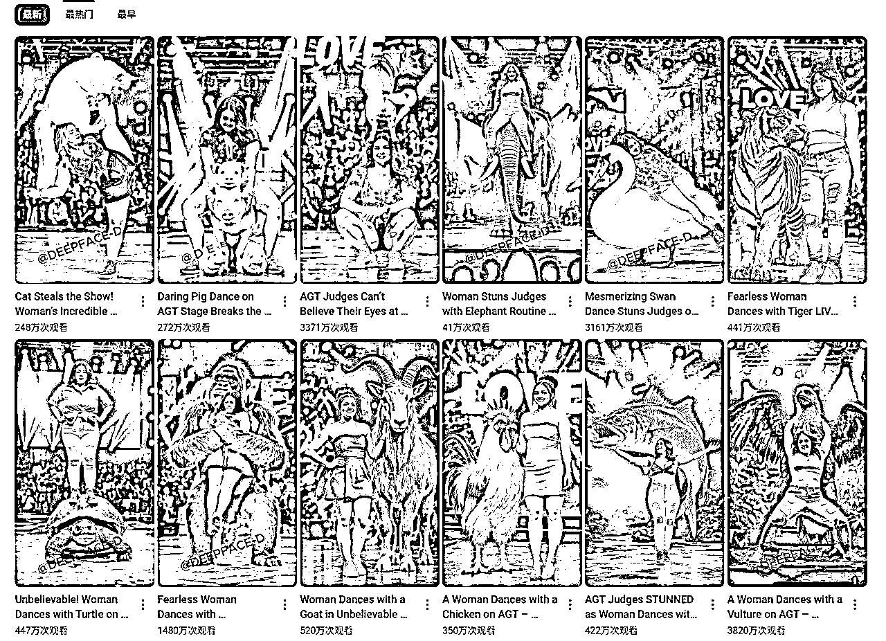

https://www.youtube.com/@a77a ——变富主题频道，目前依旧能打。

# 3.4.2 动物题材

https://www.youtube.com/@DreamWeaver-y6l ——换过多个方向，近期做孔雀救助，单条短视频拿到2.6亿播放，千万级、百万级热门作品都出过。

https://www.youtube.com/@ChengyuMovies ——小沙皮狗救助，亿级播放两条，千万级和百万级作品也有不少。

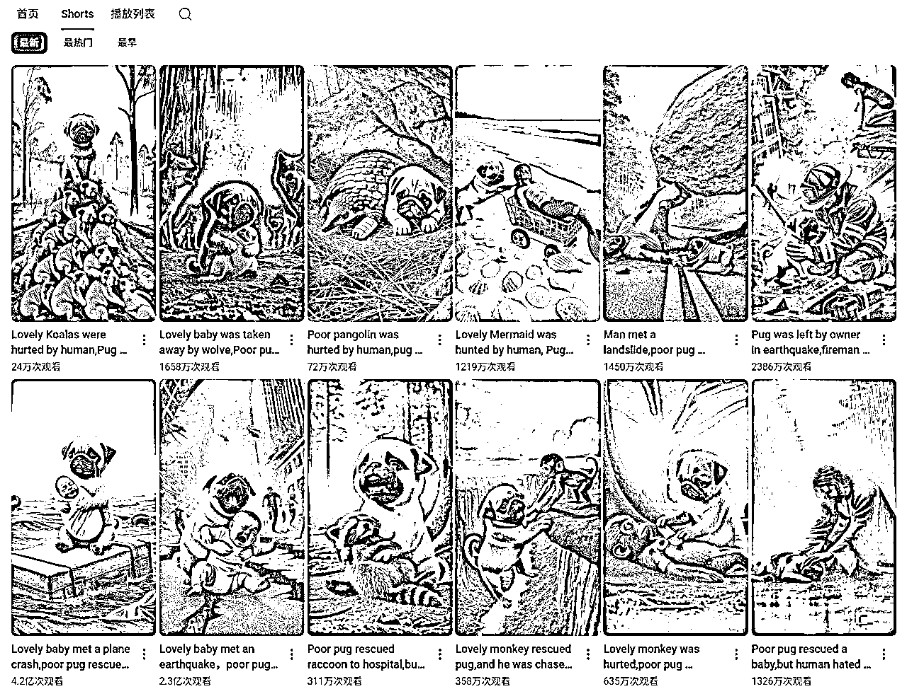

https://www.youtube.com/@jesusisbusy ——耶稣元素叠加小狗救助，两条破亿，多条千万级热门。

https://www.youtube.com/@ravindrarajpoot9774/shorts ——印度动物奇闻方向，偏抽象，画面质感一般，复刻门槛不高，最近多条千万级、百万级作品。

https://www.youtube.com/@ravindrarajpoot9774 ——抽象猎奇偏重口，把婴儿与动物元素结合，5秒一条，生成成本很低，4月出现过破亿播放。

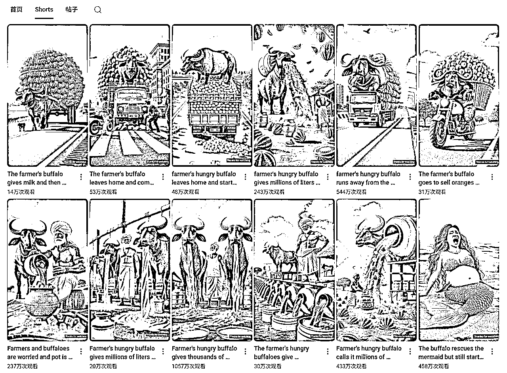

# 3.4.3 鱿鱼游戏

https://www.youtube.com/@RuinededbyAi/shorts 、https://www.youtube.com/@AprilAI.Channel/shorts

围绕《鱿鱼游戏》做两个人吃东西的5秒短片，最近千万级甚至过亿的作品不少。

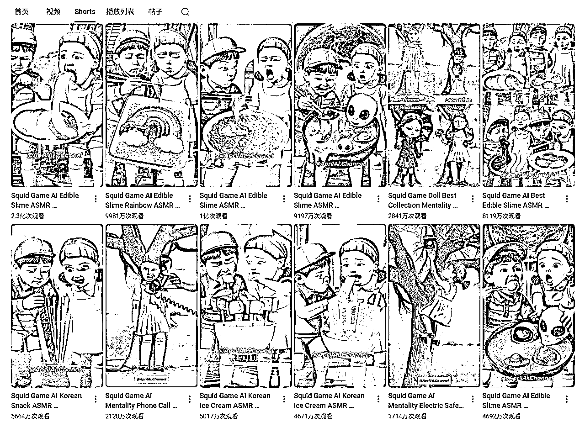

# 3.4.4 舞台变装与变身

可参考账号：

【已转方向】舞台表演类：https://www.youtube.com/shorts/8Xwn2F7sBvs ——这个号执行很细，甚至做了对口型配音。

【已停更，思路可看】高质量美女：https://www.youtube.com/shorts/cWE_o-vQ2cI ——有矩阵，国内叫“军哥聊电影”，几个号画风一致，模块2有操作攻略。

怪物/猎奇向变身：https://www.youtube.com/shorts/Yd_gKAmXNw0 【热度走低】https://www.youtube.com/shorts/ElFYG5VxC30

【已一个月未更新】高质量腹肌男性：https://youtube.com/shorts/cmIBm3y3Tfc?si=NssIltjjD9LslS5w ——思路清奇，20条内容就突破10万粉，画面色彩与评委素材衔接顺畅，开头和内容容易让人误以为是真实选秀现场。

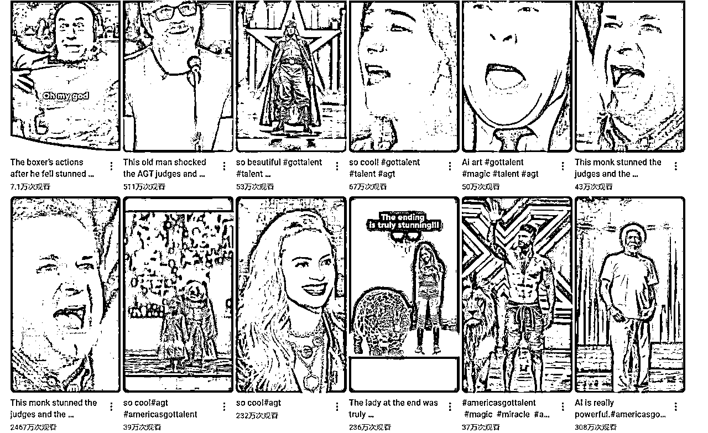

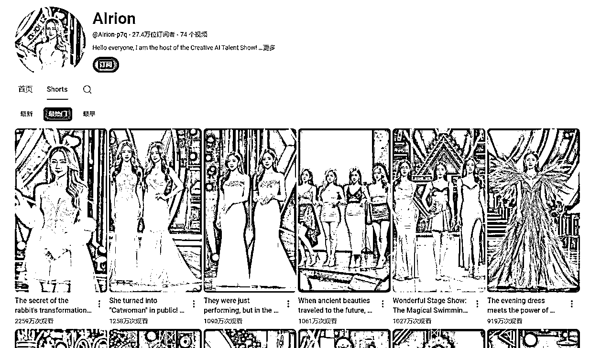

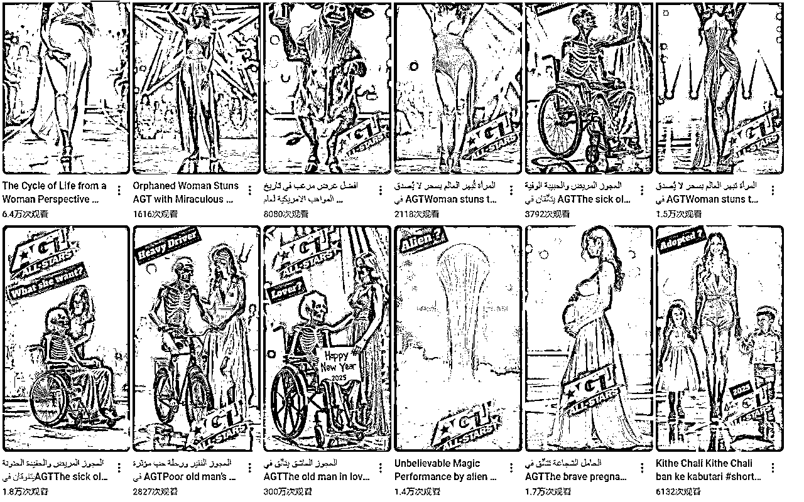

舞台变装本身已经是细分方向，往下还能切出很多玩法。说到底，这类内容抓的是“好看的人”和“反常视觉”，其中猎奇优先级更高；最后拼的是创意与执行，创意比技术更关键。上面这些做法门槛都不高，基本是文生图接图生视频，属于基础操作。若在提示词和工具上再进阶，成片效果会更好，详见模块2的进阶讲解。


# 3.4.5 选秀里的猎奇向

可参考账号：

走秀类：https://www.youtube.com/shorts/_hQJTL93Xlo ——使用了儿童形象，不建议跟，尽量避开儿童；该号热度已经回落。

纯猎奇：https://www.youtube.com/shorts/pcwgcrMfo3M ——现在基本没量了，但这条视频有1亿播放，属于很离谱的异常值，所以放进来。

https://youtube.com/shorts/pWobkCpo1Wc?si=7E49Dnd03WByLx-H ——单条1.4亿播放。它和其他选秀号不同，靠恐怖BGM把观众的紧张感和好奇心拉满。

www.youtube.com/@AITalentStage ——巨型肌肉男表演，视觉冲击很强。

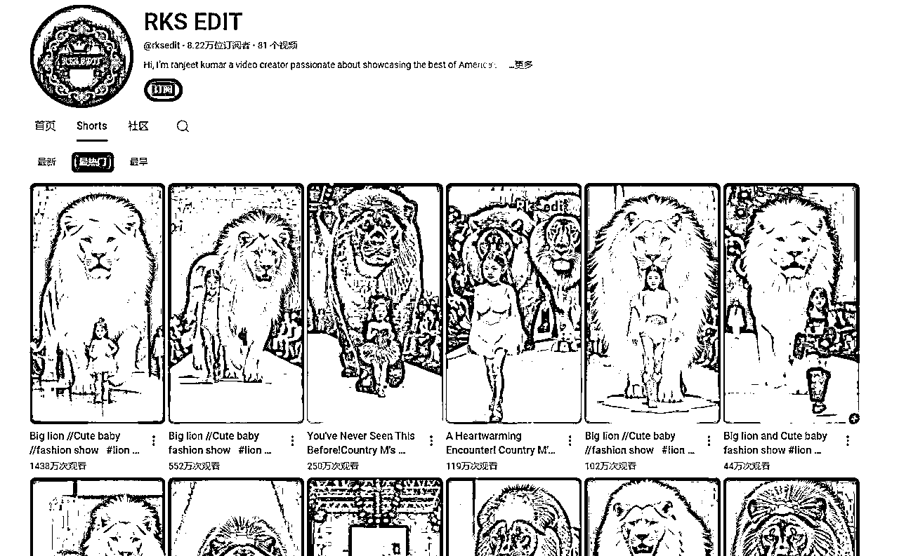

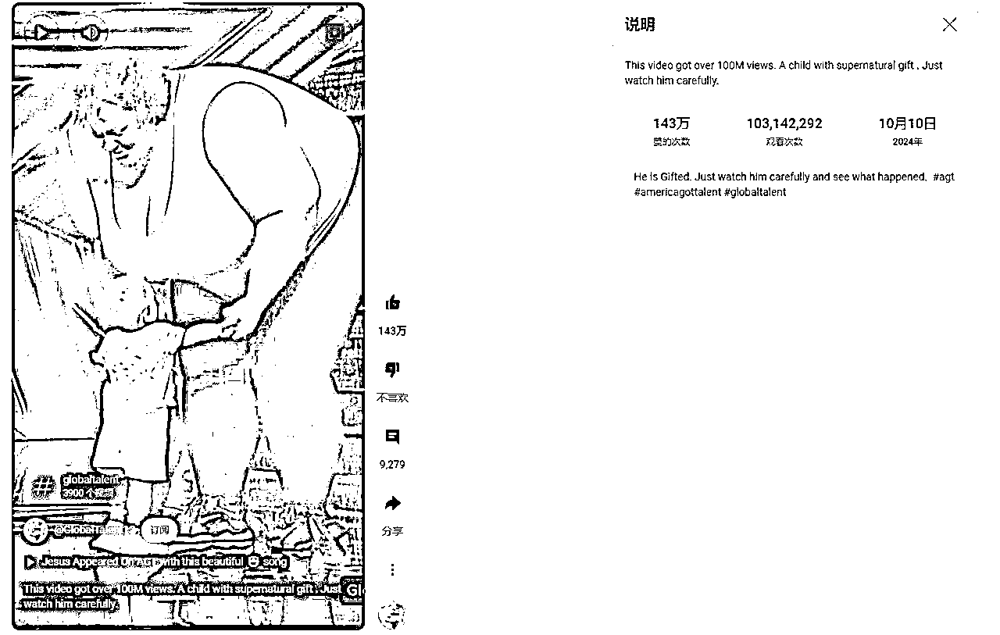

猎奇类的核心，是做出日常看不到的动物、怪物，或夸张的人类形象，再配合选秀评委式剪辑来抓流量。逻辑不复杂，瓶颈在创意和灵感。操作上比较简单，把舞台变装那套方法迁移过来即可。


# 3.4.6 选秀二创

可参考账号：

节目二创（示例为AGT）：

https://www.youtube.com/shorts/BKWSX99za7w【已三个月未更新】

https://www.youtube.com/shorts/qUnMPoA8F2k 【已转方向】

明星二创：https://www.youtube.com/shorts/y-_4MRicZP8 【最近数据走弱】

二创相当于在选秀内容上借了目标对象自带的流量。比如拿巨石强森做主体形象，就多了一个巨石强森作为流量入口。

但二创存在侵权风险。真要做，尽量避开任天堂、迪士尼这类版权敏感对象。可以观察那些仍在起量的爆款在二创谁，直接对标；毕竟要追责，通常也会先找爆款。

实现方式与舞台变装的区别在于：如果做影视、综艺二创，把对应节目的最后一帧当作图生视频输入帧，与后续生成画面衔接即可；人物形象二创，现在大模型通常能直接产出知名明星形象，直接生成，或用即梦的智能画布把人P进去都行。


# 3.4.7 选秀成长线

可参考账号：

贫穷变富有：https://www.youtube.com/@a77a/shorts ——Shorts从2025年2月开始发，BGM偏恐怖，数据表现不错，几乎每条都起量。

年龄成长类：https://www.youtube.com/shorts/jr_L2DoSkcg

身材变化类：https://youtube.com/@amasofusionai?si=_0wpHGY3klLi7HpR ——围绕肥胖综合症做由胖变瘦的选秀表演，前后反差大，带一点擦边感。

选秀成长线基本围绕现实热议话题，用AI制造强烈的视觉反差。除上面这些，还有瘦骨嶙峋变肌肉健硕、普通相貌变美女等方向，都值得试。


# 3.4.8 AI动物叙事

无配音故事：

https://www.youtube.com/@Cat_Cartoonn/shorts

https://www.youtube.com/@CATS-on-GPT/shorts

https://www.youtube.com/@RabbitJourney99 ——这个号很夸张，周更，几乎每条都起量；更夸张的是，内容是把一个月前一个纯图片故事号复刻转成视频。

https://www.youtube.com/@MrkPopPix【最近有走弱趋势】

https://www.youtube.com/@SKMGh6 ——2025年2月18日建的新号，12条Shorts涨粉126万，最低播放接近400万。主打打工狗，画面和场景很真实，但故事基本复刻此前热门内容。

这类动物叙事主题大多围绕“帮助”“救援”“感恩”“翻身”。制作方法不难，不少圈友应该做过：用GPT类工具写脚本分镜，按镜头生图，再把图片转视频，最后在剪映里拼接、加音效。流程不复杂，就是有些繁琐。

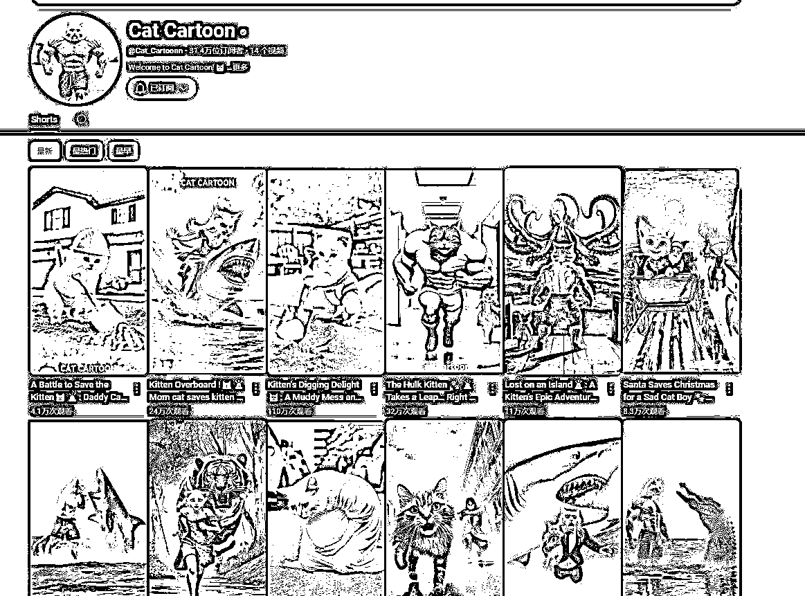

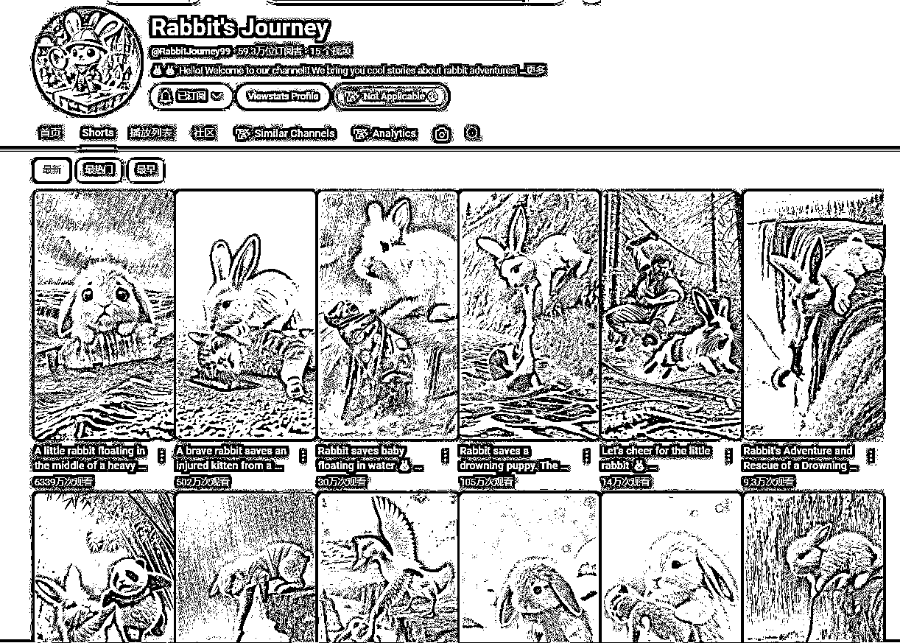

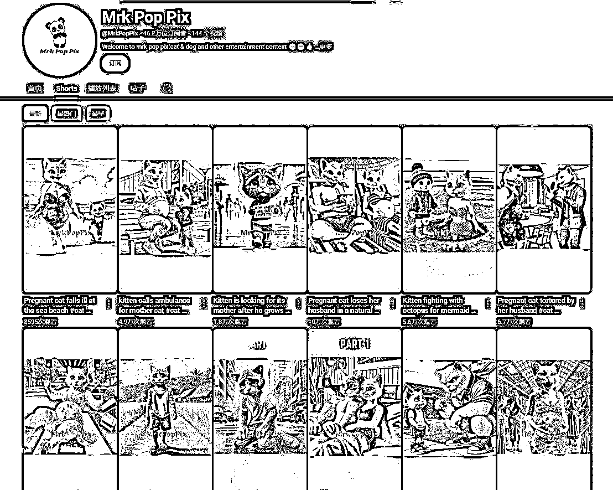


# 3.4.9 美女走秀

除了下面的美女军人走秀，此前较火的萌娃走秀、人与巨型动物走秀，现在热度已经不行，这里不展开。

偏暴露类：https://www.youtube.com/@ai.mvmnts/shorts

https://youtube.com/shorts/EfOCLNUtV1Y?si=iFffX2uOKPJzdaDa

https://youtube.com/@ai-imagining-2810?si=E2lVn7zByqjfH5EZ【已三个月未更新】

https://youtube.com/shorts/IHrC3yUWaDU?si=DJky-yraHaF2C9op ——这个和上面不太一样，最近没有大爆款，但此前百万级热门很多，可作为风格迁移参考。

没那么暴露的：https://www.youtube.com/@Akang_AI/shorts【热度走低】


# 3.4.10 动物预警

内容模式是：动物在公路上拦车，前方随即发生事故，汽车因此躲过一劫，人类感谢动物。制作不难，通常四个分镜，生成几张图，单图生视频再拼接。这类内容不只在YouTube有量，在视频号更火，不少圈友复刻出千万级热门。不过现在热度已经回落，需要转型，可参考下面的密集恐惧和天使狗狗方向，它们同出一源。

【已两个月未更新】https://www.youtube.com/@HappyExplorerTV/shorts ——几乎每条都起量。

【已一个月未更新】https://www.youtube.com/@NautilusFantasy/shorts ——从动物救动物转到动物预警人类，很快做到百万播放。


# 3.4.11 密集恐惧+动物救助

https://www.youtube.com/@PolarLifeMoments/shorts ——1月21日首条视频就拿到1.2亿播放，现已停更。内容把动物救助做到极度恶心，多看一眼都难受，同类账号不少。

常规动物救助（流量较稳）：www.youtube.com/@MysticChronicles007

www.youtube.com/@Edu-mama


# 3.5 2025年AI长视频热门方向

# 3.5.1 Tung tung tung 和他的抽象朋友们

https://www.youtube.com/@eyeffects ——这个号做了很多角色对战AI视频，都很爆。一个月前出了首条百万级热门。同类账号不止一个，感兴趣可以自己试。

操作很简单，核心就是“抽象即流量”。


# 3.5.2 AI电影二创音乐MV

https://www.youtube.com/@SagaLoreAI ——把漫威、哈利波特等电影角色做成AI音乐二创，长视频基本万播以上，最高80万+。

画面之间关联不强，内容也简单，复刻不难。


# 3.5.3 动物救助

https://www.youtube.com/@Yellowchicksss ——小黄鸡救助，短视频流量夸张，长视频也不差，时长约1分钟。两周前长视频出过470万+热门。


# 3.5.4 选秀

https://www.youtube.com/@SoulStar33 ——卖惨系列，多个百万级热门，形式是讲故事+音乐表演。

https://www.youtube.com/@MagicBangG ——同类参考，也出现百万级热门。


https://www.youtube.com/@AIMagicianIllusia ——来自困困圈友，选秀转AIP表演系列，长视频平均1万+播放。


# 四、【实操3/6】Shorts视频生产

# 💡

# 本章概览：

这一章是AI视频创作的实战手册，会把多种热门AI内容的制作方法拆开讲，帮助你尽快上手、做出起量作品。

本章核心内容：

✅ 爆款拆解：学会分析萌宝秀、动物叙事等热门内容的成功要素，再做模仿和微创新。

✅ AI工具实操：掌握Midjourney、Runway、GPT等工具，从文案、图片到视频，一步步产出高质量素材。

✅ 多方向制作流程：覆盖怪兽合成、AI转绘、故事解说等方向，提供从0到1的完整操作指南。

✅ 效率与质量进阶：学做提示词模板、用高级剪辑技巧，提高生产效率与成片质量。

从模仿爆款开始，逐步加入自己的创意，是做出高流量AI视频的有效路径。

# 💡

# 航线图

完成本章学习与实操，就能完成航线图的：

第二阶段 确定方向，掌握AI创作技巧，发布首条视频（约2天）

1. 在对应方向找到对标账号并做分析（约3小时）

2. 用AI工具创作首条Shorts视频（约1天）


# 4.1 AI内容板块

# 4.1.1 萌宝选秀变身内容怎么做 @小芬

# 4.1.1.1 第一步：拆解热门视频的吸引点

这里分两类：人物吸引点、画面吸引点。

所谓吸引点，大家其实有体感。做久了自然知道什么内容更抓人、数据更好。多刷几个同方向的热门视频，大致就能总结出来。

# 4.1.1.1.1 人物吸引点

去留言区翻一翻就有答案。做过萌宝类内容的人会发现，留言里大多是“可爱”“adorable”“cute”这类反馈。


所以“可爱”就是很强的吸引点。

还能继续拆：表情、动作、服装。

微笑通常比面无表情更容易拿数据；动作丰富，观众不容易看腻，观感更足；服装颜色鲜亮，更能突出可爱感。

# 4.1.1.1.2 画面吸引点

场景上，舞台要明亮；画质上，越清晰越好；主体上，平视镜头、居中构图更理想。

把这些吸引点记下来，再去找灵感迭代视频。

# 4.1.1.2 第二步：锁定异常值

想做创新，但在自己还没做出热门作品前，别盲目乱改。

先找热门视频，最好是最近一个月千万播放、最低百万播放的。

做内容别把自己焊死在一个赛道里。比如宝宝走秀想做出新意，第一件事不是埋头拍，而是去刷同行的最新动作，尤其要盯住流量掉的时候，有没有人先一步换了玩法。

一旦刷到有人改版且数据不错，别多想，直接照着他的框架更新。如果还没人动，就找场景属性接近的相邻赛道：宝宝走秀多数发生在舞台，之后会向户外延伸；那就去看达人秀舞台表演这类同场景的内容。一句话：同赛道跟着头部账号走。

分享一个复刻出来的爆款案例。按上面的判断，我先在同赛道里找到了一个数据很好的视频。形式是：宝宝和萌宠先后登台走秀，走到中间两个人融合，宝宝顺势完成变装，变完再走一段。
1.mp4【在线播放】

提示词模板可以套用，彩色块部分按需替换。完整提示词如下：
# 💡
full-body， facing the camera， street style ， a very chubby 2-year-old baby with very fair skin， curls， smiling， wearing red lipstick， wearing a red and white floral mini dress with a plunging neckline， accessorized with delicate pearl earrings and a silver chain bracelet， （这里可以加上动作， 比如： hugging） next to a big dog， captured mid-walk， strong visual impact， strikingly fashionable appearance， exuding elegance and charm， （best quality， 4k， 8k， highres， masterpiece:1.2）， ultra-detailed， （realistic， photorealistic， photo-realistic:1.37）， vivid colors， sharp focus， studio lighting， glamorous runway setting。 --no sexy --ar 9:16 --personalize ih7hzco --v 6.1

这套玩法拆开看，和达人秀逻辑几乎一致：把主角从美女换成宝宝，把动作换成走秀、拥抱，改一改就能用。具体生成视频的提示词，可以参考 4.1.4 中 AI 怪兽合成部分的图生视频板块。

# 4.1.1.3 第三步：把爆点迁移到更多场景

在自己的赛道里，怎么去借同类型赛道的爆款？这个思路在做视频卡壳、没灵感的时候特别好用。做法还是刷，但要围绕自己赛道的关键词来找。比如我做的萌娃萌宠融合，就会多留意人和动物同框、互动、合体的视频。


参考账号做的是达人秀方向。原视频里是三段式：兔子出场；女生在兔子身边跳舞；女生抱起兔子；最后还有一个形象变化，变成兔兔装。参考视频：美女与猫.mp4【在线播放】。当时看到动物跳起来、女生双手抱它的动作，我眼前一亮，就把这个动作搬进了自己的片子。

接下来调整第二步的提示词模板：
# 💡
Full body, facing the camera, street style, a very chubby 2 year old America baby, very fair skin, curly hair, smiling, wearing red lipstick, wearing a pink sequined suspender dress, paired with delicate pearl earrings and silver chain bracelets, Holding a hedgehog in both hands, captured mid-walk, Background on the stage of America's Got Talent, strong visual impact, strikingly fashionable appearance, exuding elegance and charm, (best quality, 4k, 8k, highres, masterpiece:1.2), ultra-detailed, (realistic, photorealistic, photo-realistic:1.37), vivid colors, sharp focus, studio lighting --no sexy --ar 9:16 --profile ih7hzco --v 6.1

原设想是宝宝双手抱刺猬，所以动作写的是 Holding a hedgehog in both hands。结果 MJ 的理解有偏差，出图时抽到一张宝宝一手一个小动物的图，反而特别萌，我当场决定就用这张。抽卡偶尔会出现这种意外惊喜，只要惊喜点踩得准，就要接住。

融合后的图不再走变装路线，而是参考 Gary 教练的达人秀视频，让动物直接穿着衣服跳舞。于是我把成片从“宝宝变装走秀”改成“动物跳舞”，舞台冲击力更强。为了让动物更讨喜，我还把动物生成了幼儿形态，等于把宝宝的萌感移植到动物身上。
# 💡
Full body, facing the camera, street style, a very chubby 2 year old hedgehog, captured mid-walk, Background on the stage of America's Got Talent, strong visual impact, strikingly fashionable appearance, exuding elegance and charm, (best quality, 4k, 8k, highres, masterpiece:1.2), ultra-detailed, (realistic, photorealistic, photo-realistic:1.37), vivid colors, sharp focus, studio lighting --no sexy --ar 9:16 --profile ih7hzco --v 6.1


最后成片：3.mp4【在线播放】。迭代有个原则：只要新版本数据跑赢旧版本，就立刻转用新模式，因为这说明它有爆款潜力。

这个思路，可以叫“控制变量法”：每次只动一两个点，其余不动；先出一版去测流量，再用结果定后续方向。数据还没跑出来之前，继续按当前模板生产。我在 12 月 31 日发的那条，一周内播放量就超过了旧模式的内容，之后才开始用新模板。


可继续挖掘的方向还有很多：达人秀变身玩法还能再卷高，直接套进宝宝达人秀；以前在宝宝走秀里验证过的爆款服装，也能迁移过来。复盘这两次迭代，最核心的爆点始终没变：宝宝足够可爱、舞台场景加持、衣服颜色鲜亮、动物够萌，人物和动物也都在笑。

# 4.1.1.4 宝宝类视频被误判为“仅儿童可见”该怎么办

做宝宝相关内容，最容易踩的雷就是被系统打上“仅面向儿童可见”的标签。

一旦被这样标记，流量会立刻断崖式下跌。

# 4.1.1.4.1 怎么办：去掉 baby 标签

最直接的办法：把所有带 baby 字样的标签全部移除。发布时如果挂过这类词，清干净就好。

照这个方法处理后，我到现在没再被判过“儿童内容”。

# 4.1.1.4.2 申诉文案与节奏

以前被判的视频，我想验证申诉成功是否还有流量。于是先把旧片子里带 baby 的标签全删掉，再逐条申诉。第一个过了，第二个也过了；后来想批量申诉，全被拒了。

所以建议被判后不要心急，一次只申诉一条，隔天再申下一条。提交申诉的机会只有一次。看这张流量图：被判期间曲线走平，几乎是零流量；申诉通过后，曲线重新抬头。证明申诉成功之后，平台确实会继续推。


可以参考这段英文申诉话术：
# 💡
Hello, this is a magic show video, not made for kids. Please review it again, thank you!

内容来源： Youtube shorts 复盘 —— 宝宝达人秀、达人秀跳舞赛道成功开通 ypp 的经验分享


# 4.1.2 AI 故事玩法 @土豆君

# 4.1.2.1 第一步：寻找对标账号

对标频道是 Rabbit's Quest。我是 9 月初发现的它，那时频道刚做 3 个月，每条却能跑出几百万播放，故事结构也特别简单。Socialblade 上的预估收入参考意义有限，但只要近三个月内有视频爆发，这个方向就值得试。


频道内容是一分钟左右的 Shorts，用图片 PPT 默剧的方式，讲小兔子如何克服困难、帮助其他动物。故事模板很固定：开局某个动物落难；中间相遇，一起吃饭玩耍；高潮解决危机；结尾强调友情。从评论区大致能判断，观众偏儿童；点进他们的主页还能进一步确认。小朋友天然喜欢动物故事，萌宠形象本身是流量钩子，再叠加积极正向的价值观，非常适合传播。


我 9 月 10 日开始复刻，选的是这一条：https://www.YouTube.com/shorts/FSagPjcmFFg （🐰Cute rabbit rescued the poor little hedgehog #rabbit #cat #kitten #funny #ai [FSagPjcmFFg].mp4【在线播放】）。基本流程：GPT 负责写故事，DALL-E3 负责出分镜图，剪映负责拼装。


# 4.1.2.2 第二步：先写故事，再分镜

我给 GPT 的提示词大致是：请写五个儿童绘本故事，主角是一只可爱的小猫咪，它去帮助其他物种的动物。相遇的原因是对方落难；获救后，写它们一起生活的细节，比如回家吃饭、睡觉；高潮部分要设计一些自然界中的危险，灾害或天敌都可以，目的是突出猫咪为友谊而勇敢；结尾落在两个生命之间的友情上。注意：落难的状态必须能用画面直接呈现，不能靠气氛、声音去暗示；友情可以靠两个生命贴在一起来表达；所有描述都要方便画出来，越夸张越好；故事要让孩子一看就懂，并且为友情感动。


我选了故事 2《小猫咪帮助小松鼠》，让 GPT 再拆出 25 个场景，每个场景都写成 DALL-E 用的中文画面描述。剧情可以微调，但要求始终是：画面感强、足够夸张。


这 25 个场景描述，之后会被直接拿去生图。


# 4.1.2.3 第三步：用 AI 把分镜转成图片

生图工具我最终选了 DALL-E3。MJ 和 SD 也测过，但语义理解能力都不如它。DALL-E3 最大的好处是不用写标准提示词，只要告诉它你想画什么，它就能出图。所以前面才要先拆出 25 个分镜，目的就是让脚本可以直接变成图片。

入口在网页版 ChatGPT，打开“探索 GPTs”搜 DALL-E3，也可以直接访问 https://chatgpt.com/g/g-2fkFE8rbu-dall-e。

角色一致性曾让我很头疼。后来看卡兹克的帖子才知道，DALL-E3 每张图都会带一个 gen_id，理论上能用它锁定角色。但真正写分镜时，gen_id 并不总是可靠，偶尔会失效。更实用的做法是让角色外观差异足够大，比如两只猫就一只用橘猫、一只用狸花猫。所以我的策略是：外观区分优先，gen_id 作为辅助。

要注意：gen_id 只在当前聊天窗口内有效，跨窗口就用不了；走 DALL-E3 API 也不行，因为 API 每次调用都是一次性对话。所以我没有写代码接 API，而是老老实实用网页版。

想让 GPT 配合用 gen_id，可以在对话里塞这段提示词：从现在起，你的首要任务是维持角色一致。每张新图都必须复用上一张的 prompt 和 gen_id，让同一个角色可以在不同表情、动作、服装和场景里出现。做得好，我给你 1000 美元小费。明白请回复“明白”。文件地址：https://gitee.com/tudoujunha/rpa-gpt/blob/master/prompt_genid.txt

当然，如果像现在这个项目一样，两个主角本来就是不同物种，形象差异很大，对一致性要求不高，直接走国内中转的 DALL-E3 API 生图也完全可以。


之后想再次复用一个角色，只需要在对话里指定对应的 gen_id 即可。


# 4.1.2.4 第四步：剪辑、配乐与模板复用

剪辑很简单：图片全部进剪映，加一个自动放大效果。想更贴近原片，再叠加一些音效和特效。这套剪辑流程只需要搭一次，之后直接进剪映草稿，把源图片位置的图片替换掉，再打开剪映，就能一键复用整套效果，效率很高。


BGM 我用手机版 YouTube 自带的语音识别，去搜对标视频里的音乐，就能锁定源 BGM，再用工具下载。一般只下一条视频就够。网站是这个，几乎所有自媒体平台都支持：https://tiqu.cc/


不过，这次我做的是完整原创流程，并不是照着图重绘，所以结果只是故事走向相似，画面、节奏都不同；也没有配音和精修。
cat_0910~1.mp4【在线播放】
成片只是初版，脚本和剪辑特效还有很大提升空间。放到现在的工具环境，甚至可以引入 AI 视频生成。


# 4.1.2.5 更多可参考账号

Cute Animals Story：https://wx.zsxq.com/group/1824528822/topic/1525442481188482 。7 月 23 日发出第一条，同样做 AI 动物故事，但先用 Shorts 涨粉，再转长视频，靠时长拿下 YPP。短内容涨粉快，长内容刷时长更容易过 YPP。


Meow Story：https://www.YouTube.com/@MeowStory1234 。8 月 21 日注册，至今仍是 PPT 讲故事，没用 AI 视频生成，已有 10.9 万粉丝。


Cat's Wonderland：https://www.YouTube.com/@CatsWonderland289 。2024 年 7 月 23 日注册，内容为 AI 生成的猫咪短片故事。


内容来源：《【赚钱技能】AI 动物故事视频复刻与批量生产》


# 4.1.3 AI 故事：单点打透，多端放大 @Nana @六只猫


## 4.1.3.1 对标参考：把参照系收窄

最值得记住的一条：同一阶段，别铺开多个参照频道，只选一个吃透。陪跑时我起初纠结：复刻爆款到底盯一个频道，还是几个频道一起看？手上对标不少，也照着做过，可流量忽高忽低，自己账号始终没等来大爆发。方波妮和 Gary 曹淦两位教练分析后，我才明白：某个频道能持续出爆款，说明它背后有稳定人群；频道不同，人群也不同。同时追多个方向，YouTube 算法就难以快速判断该把内容推给谁，第一次大推流自然迟迟不来。我的频道长期不爆，这是关键败因之一。按发布时间倒序翻早期内容，确实很杂：孕猫、亲子、原创僵尸、科幻都试过，每天还在发愁“今天该复刻哪条”。后来我把内容收束成“甲动物救乙动物—相处融洽—乙动物遇险—甲动物报恩”的四段式，数据明显稳了，改编也更快。

## 4.1.3.2 内容制作：提效有边界

接下来聊 AI 内容工作流的搭建和提速。做 AI 猫咪故事赛道的朋友知道，这类内容环节多、流程长，涉及微调和故事改编时更耗时间。刚上手一天产一条很正常；熟练后算上各平台生成速度与反复抽卡，也常要三四个小时。我一直想提效，于是动手改了工作流，结果被 YouTube 机审自动移除。动物角色虽然改过，但复现痕迹仍太重。有些爆款被大量搬运后还有流量（可能我对标的那条被抄太多），不过还是别冒险。

旧链路：截取对标爆款关键帧 → AI 读图写脚本（可改编）→ AI 文生图 → AI 图生视频 → 剪辑。新链路：截取关键帧 → AI 图生图 → AI 图生视频 → 剪辑。


不过，图生图确实能当提效补丁。比如拿到一个爆款场景，可以把狗直接换成浣熊，做主体替换；也能借原图延展画面：选一个关键帧，加一位漂亮女生在旁边看浣熊，再用图生视频让两人一熊互动，动物救援的收尾片段就出来了，这里只需一句想象。再如蜂窝原图，靠文生图反复抽卡很难到位，用图生图就容易接近。它适合做补充，不建议整条片子都靠它。


ready-2a28f9c56ad8.mp4【在线播放】


角色一致性方面：ChatGPT 的 Dall-e3 对提示词要求比 Midjourney、ComfyUI 低，新手更好上手。想让角色稳定，一是打磨提示词，二是用 Gen_id 控制；多次抽卡仍不理想，就上传原图垫图，让 ChatGPT 参考原图重画，更省时间。


## 4.1.3.3 内容发布：国内多端铺量

好内容放到多个平台，常常还是好内容。比如猫、猴子、老鼠那条 5.1 万播放的报恩故事，让我在抖音、快手做出百万级爆款，📕突破千粉，连一直没起色的视频号也拿到 22 万播放，评论区吵得很热。有人声讨猴子，有人夸老鼠，老鼠形象设计得可爱，容易让人怜惜。


怎么归因？评论多，是爆款带来的结果，但评论区也埋着爆款的原因，说到底还是能戳中共鸣的情感底色。不妨多翻对标爆款的高赞评论，把复刻要素摸熟。YouTube 的 Meow 频道就用东亚男孩、骨瘦如柴的橘猫、可爱的拯救者搭出动物感恩故事：东亚男孩扮演恶人，人类的坏、不同动物的可爱、猫的悲惨，都能引发讨论，所以它的评论量比别的账号高出几十倍。


再说视频号那条增长曲线。我去年 12 月 18 日开更，前期做 AI 猫咪故事，在抖音、快手、📕表现尚可；视频号却只有第一条爆款开通原创后（冥冥中注定，后面大爆直接吃到收益）有动静，之后流量断档，粉丝停在 100 多。进入实战陪跑后，除了已做了一个多月的猫咪故事频道，教练团还分享了新赛道玩法，我便挑了个短平快的动物救援方向，开第二个账号。没想到，这个赛道让我拿到第一笔收入：首条内容就爆，带来 9.7 万高价值中老年粉丝、2700 多元收入、4282 万播放，长尾流量还在走。


结合粉丝画像看，原因主要有几点：该赛道受众集中在中老年，这条视频做得很真，很多长辈一开始没看出是 AI 制作，“万物皆有灵”很快在评论区传开。我当天就把账号标签和头像换掉（原来走猫咪设计），后续内容也在评论区往灵性方向引导。


这条还踩中了东三省“狐仙”民俗。除了“万物有灵”，评论区大量围绕狐仙展开，有人连狐狸和狗都分不清，但讨论最后都落到动物成仙，形成“动物拦路必有缘故”的共识。我的粉丝大量来自东北，也反向印证了这一点。

飞书20250208-072312.mp4【在线播放】


国内并非我的主阵地，所以没有系统性复刻和运营规划，但也做了些试水。当时赶上蛇年春节，蛇在东北民俗里是柳仙，我立刻做了一条蛇的动物救援，发布不到一小时就冲破 20 万播放，比狐仙那条更快。可惜没多久被视频号判违规，没能再复制一个大爆款。有了这次教训，我没碰黄鼠狼，改成浣熊；因操作失误，同一条视频发了两次还标了原创，视频号没判违规，两条数据都优于其他内容，说明东北仙灵题材还能继续挖。意外的是，金蛇那条发到 YouTube 后，成了我频道里流量最高的一条，有 19k。

飞书20250210-000240.mp4【在线播放】


再总结几条经验：这类内容面向 50 岁以上父母辈，他们察觉不到 AI 生产，评论区都在感慨“万物有灵”。因不熟悉平台，起初没声明 AI 创作，导致内容在 1000 万+ 时被下架；后来申诉并补上 AI 声明才重新上架，但申诉后几天平台停止推荐。两个要点：以假乱真的内容必须标注 AI 创作，否则会被判违规，次数多了账号推荐受限。


动物救援的受众与 AI 猫咪故事不同，能激发大量老年人讨论，所以收入更高（视频号主要看评论量），放到其他平台未必合适。金蛇救援我同步发到抖音、快手：抖音起量慢，快手判违规，我便隐藏内容，不再尝试。视频号内容尺度更宽，这种短平快的营销型内容更适合放在那里。

# 4.1.4 AI 怪兽合成：融合玩法拆解 @Gary @土豆君


## 4.1.4.1 对标案例参考：四类账号

AI 短视频里有一支是融合怪：用 AI 视频把两三种动物拼成新物种。比如：

https://www.YouTube.com/hashtag/fusion/shorts


若想做融合怪，可参考以下几类账号（仅作举例，具体要按自身情况挑）：

【第一类】动物融合，纯图片，不走 AI 视频：https://www.YouTube.com/@HeshanMalinda-nf6ws


【第二类】动物融合，带 AI 视频生成怪物融合过程：https://www.YouTube.com/shorts/XU0yhFEnzrQ


【第三类】人与动物融合：https://www.YouTube.com/@AnimolFacts/featured


【第四类】人与动物融合达人秀，混入达人秀片段：https://www.YouTube.com/@TalentSnap


这里放两个视频：左侧那条是纯图片生成，做法简单，Dalle3 和 Midjourney 都能出类似图；右侧那条多了融合过程，需要首尾帧视频生成。

Incredible Animal Fusion： Mind-Blowing Creatures Formed by Fusing Different Species🤯🧬 #short#hybrids [-alVWmtIRYM].mp4【在线播放】

https://www.YouTube.com/shorts/-alVWmtIRYM

Marvel Transformers #fusion #transformation #transformers #marvelstudios #hybrid #venom [2YmX-9auHUw].mp4【在线播放】

https://www.YouTube.com/shorts/2YmX-9auHUw


## 4.1.4.2 第一步：脚本设计

脚本先定四件事：动物类型，即跟哪种动物变身；动作类型，如跳舞、转圈；场景布置，如舞台、户外；服装配色，穿什么、什么颜色。这一步可交给 KIMI、GPT 等工具辅助，把要素喂给 AI，让它排列组合。


## 4.1.4.3 第二步：文生图

需要四张图，对应四个关键帧；期间只改动作和人物形象相关提示词，背景不用动。这里拿我视频号千万播放的视频做案例，它在各平台表现都不错，参考价值较强。

1. 人物与动物同框，动作不限。画面可为：全身、正对镜头，二十岁左右女性穿白色礼服，赤脚站在厚冰上，旁边一只海豹；真实、阳光明亮，雪地与长虚化背景，细节丰富，超高清，4K，佳能 a7c2 拍摄，比例 9:16，版本 v6.1，负面词排除性感。

2. 人物与动物同框，动作可随意，但最好与第一张相近或连贯，否则视频效果会变差。做法同上；在 Discord 里点对应按钮可生成相似图，V 几表示参考第几张。


3. 人物与动作主体最好抱在一起或贴得很近，否则后面视频生成会很吃力。画面可为：全身、正对镜头，二十岁左右女性穿白色礼服，赤脚在厚冰上抱住一只海豹；真实、阳光明亮，雪地、长虚化背景，细节丰富，超高清，4K，佳能 a7c2 拍摄，比例 9:16，版本 v6.1，排除性感。


4. 融合后的主体最好站立，便于视频生成。用垫图链接起手，画面可为：全身、正对镜头，一只高大的海豹穿优雅白裙，赤脚站在厚冰上；真实、阳光明亮，雪地、长虚化背景，细节丰富，超高清，4K，佳能 a7c2 拍摄，比例 9:16，版本 v6.1，并带个性化参数。


过程中若整体不错但细部出错，比如手指和肢体错乱，可点局部重绘，在弹框里选区域重新生成。


四张关键帧凑齐后，进入图生视频。


## 4.1.4.4 第三步：图生视频

用 Runway AI：左侧上传图片并填提示词，右侧出结果。整条视频分四段。

第一段，第 1 帧→第 2 帧：让美女在指定动物旁做某个动作，可补“踮脚”“赤脚”等细节；镜头旋转，画面有动态感。方括号替换动作和动物主体，圆括号按图片实际情况补细节，加粗部分为全局镜头提示，有助于稳定出图；好用的动作种子记得留存。

1. 第 2 帧→第 3 帧：动作有变化，就替换第一段里的动作。

2. 第 3 帧→第 4 帧：让美女与指定动物融合，镜头向右旋转，保持动态感。动作变化大就补变化动作，否则把原动作换成“融合”。

3. 第 4 帧→跳舞：只上传第 4 帧，写“某动物穿裙跳舞、镜头跟随、动态感”，描述越简单越好。


把整套流程跑熟以后，提示词就不再是门槛，你完全可以自己动笔；剩下的就是反复出图，从结果里挑出四张满意的。另外，即梦 AI 与可灵 AI 都具备“首尾帧视频生成”能力，想走这条路也能实现。现阶段，即梦 AI 生成免费、无须排队，想试的话可以优先从它入手。

即梦 AI：

国内版入口：https://jimeng.jianying.com/

海外版目前功能不全，不太建议：https://dreamina.capcut.com/

可灵 AI：

国内版：https://klingai.kuaishou.com/

海外版：https://klingai.com/

下图对比中，左边画面来自即梦 AI（视频模型 1.2），右边则出自可灵 AI：


产出效果可看下面两段：

高品质_狮子和蜥蜴相互靠近_融合成了一只怪兽.mp4【在线播放】

imageinput_汽车人变身_2024-11-29 01_56_34.mp4【在线播放】

操作顺序如下：

1.

第一步，准备三张图。先做一张“美女与白马”的图：场景放在舞台上，一位美女和一匹白马并肩行走。即梦 AI 每次会给四张候选，挑一张顺眼的即可；我选的是第二张，脸型偏欧美。


再生成融合后的画面，我依旧取第二张，提示词写成：“舞台场景，一位欧美面孔的美女长着马耳，身穿白色礼服，金色长发。”

融合前的参考图则这样描述：“舞台上有匹白马，与一位穿白礼服的欧美美女靠在一起。”


2.

第二步，出三段视频：一段记录融合过程，；一段是融合前状态，另一段是融合后状态。


# 4.1.4.5 第四步：剪辑

剪辑这一步，先保留对标视频的剪辑框架，剪映的基础工具就足够应付。关键是把画面切换卡在音乐节拍上，总长度压到 18 秒以内。遇到惊讶类镜头，既可以让 AI 生成，也能从别的视频里截取；我这次直接沿用了原片素材。随后把 AI 产出的片段替换进去，沿用同一首配乐，成片即可导出。

内容参考两篇教程：一篇讲 AI Shorts 的“怪物融合 + 动物跳舞”复刻，另一篇复盘 24 天做到 7 万粉、开通 YPP 后赚到 108 刀，以及达人秀变身视频冲到千万播放的制作流程。


# 4.1.5 AI 动物示警玩法 @逸凡风顺

# 4.1.5.1 第一步：对标账号分析

先看两个对标案例。案例一：快乐探险家（www.youtube.com/@HappyExplorerTV），它的画面质感、真实感、色彩表现和整体完成度都比较高。


案例二：Nautilus Fantasy（www.youtube.com/@NautilusFantasy），它在原有模板上增加了示警桥段，制作难度并未明显上升；该频道还涉及动物救援等题材。

找同类账号时，可以先关注相关频道并顺手点赞，再返回首页刷新，平台通常会推送相近的新内容；持续这样筛选，就能积累一批对标。另一个入口是顺着视频标题里的标签去挖。

# 4.1.5.2 第二步：分镜头拆解思路

接下来拆解分镜。以案例一为参照，动物示警类视频通常由 5 到 6 个镜头拼接而成：动物拦车 → 动物与车辆互动（中景、车外视角）→ 动物与车辆互动（近景特写、从车内向外拍）→ 灾难画面（主体车辆或动物二选一）→ 动物近景特写（可选）→ 温馨收尾。按这个框架剪，成片时长大约落在 22 至 26 秒。

提醒一句：不建议把对标视频的每个分镜都照搬。尤其在动物与车互动的部分，可以改提示词里的机位角度，或调整互动发生的位置，做出差异，降低同质化带来的“卡万播”风险。

# 4.1.5.3 第三步：AI 工具选择

常言道，工具趁手，事情才顺。做视频同样如此。下面按环节说说我实际用下来的体验。

# 4.1.5.3.1 提示词部分

提示词优化工具：GPT4、deepseek。

我的写词路径是：先把对标视频拆成一个个分镜，再按自己的构思整理出分镜图，随后把图交给 GPT，让它反推提示词。为何不用 mj、sd 来反推？一是自己对这两款工具还不够熟，二是它们给出的提示词经常混乱。GPT 能读图，推理准确率相对更高。没有选 deepseek 的原因是，它只能识别图里的文字，无法整体理解画面。

用 GPT 的核心目的，是摸清这类图片提示词的结构——词序会影响权重。可以让它输出中英对照版本，方便后续修改和优化。

比如我想做一张“狗趴在窗外”的分镜图，自己怎么写都不对；最后把构思和对标图一起发给 GPT，才拿到理想效果。


再举一例：我需要的分镜是侧面视角，车头陷进路面坑洞，但对标视频里没有这个镜头。于是我找了一张侧面机位的网图，用它来反推提示词。


不过，GPT 给的词并非每次都能百分百命中。这时可以让 deepseek 接手——GPT 其实也能做，只是 deepseek 近期热度高、使用门槛低。把 GPT 的提示词和生成后遇到的问题一起丢给 deepseek，让它优化，通常就能逼近想要的效果。


到这一步还不算结束。若只是复制粘贴，每天都会重复同样的劳动；把它沉淀成自己的模板，才能真正降本提效。这部分后文再细说。

# 4.1.5.3.2 文生图绘画工具选择

文生图工具：midjourney、stable diffusion。

这两款大家应该比我这个新手更熟，使用方法不再展开，只聊聊我在图片色彩与真实感上的体会。按我的使用感受，sd 的出图效果比 mj 更合我意。下面分享用到的模型和心得。

stable diffusion：

如果本地电脑配置吃紧，可以用云电脑或在线端替代。这里以 libulibu 在线端为例：https://www.liblib.art/sd

大模型方面：绘梦写实摄影大模型、F.1 基础模型、星流 star-alpha 大模型，都能在模型广场直接搜索并收藏使用。

LoRA 模型：纪实摄影 F.1、蔚蓝 blue 高清动物摄影大模型，同样可在模型广场搜索收藏。

mjdjourney：

mj 模型我选 v6.1，但它有时会把画面推得过清、色彩过饱和，甚至出现发黑的感觉。如果色彩度不理想，可以先用 sd 出一张图，再以垫图方式让 mj 参考 sd 的风格，即 --sref+图片链接，出来的观感通常会好不少。

无论 sd 还是 mj，文生图我都先看色彩和真实感，其次才考虑局部变形或主体站位。

# 4.1.5.3.3 图生视频工具

图生视频工具盘点：

即梦：暂不推荐——提示词稍复杂就响应不准，不充会员只能下载低画质。

runway：我不太会用，总抽不到符合预期的片段，可能是我个人问题。

海螺：效果不输可灵，甚至更好，但容易“动画化”，缺点明显。

可灵 AI：主力工具，基本一遍过，短板是基础版不够用。

智谱清言：动作幅度小的镜头表现不错，幅度一大就容易变形，AI 痕迹较明显。

# 4.1.5.4 第四步：视频制作完整流程

# 4.1.5.4.1 文生图

把对标分镜图反推得到的提示词或模板复制进翻译软件，替换主体、环境等要素，就能得到每个分镜的提示词。示例如下：

分镜一：

# 💡

On a rural road, a yellow-white Labrador with a strong build and handsome look stands with its back to the camera. It faces an orange coupe coming toward the lens; the car's front lights are on and clearly visible. Green hills and woods border the road on the right, while a river and moss sit on the left. A fine drizzle falls under a blue summer sky. The shot is taken from the height of two standing people with a medium-distance lens, focusing on the dog's back and the car's front. The clean road and natural light enhance realistic detail. Cinematic composition, realistic style, Film Photography, 4K quality.

分镜二：

# 💡

A white Labrador with white fur, a striking and dominant look, and a strong body is licking the car's side window while looking into the orange coupe. Through the side window, green forest is visible outside the car, with a river and moss on the left; the weather is drizzling, the sky blue, and the season summer. This is an in-car close-up of the Labrador shot with a Canon EOS R5, with blue and white tones. Film Photography, 4K quality.

分镜三：

# 💡

Taken from the driver's point of view, an off-white Labrador stands before the hood of his orange coupe, facing the phone with its mouth open. Green forest is on the right; a river and moss are on the left. It is drizzling, with a blue sky and summer season. This is an in-car close-up of a Labrador retriever captured with a Canon EOS R5, 4K quality, Film Photography.

分镜四：

# 💡

A rainy natural-disaster scene: a broken bridge crosses a rushing river. A white Labrador Retriever stands on the wet path, looking toward the collapsed wooden bridge. The surrounding landscape includes lush green fields, trees, and distant snow-capped mountains under a cloudy sky. The atmosphere is dramatic and melancholic, emphasizing the destruction caused by the disaster. Film Photography, 4K quality.

分镜五：

# 💡

A long-haired beauty in a black camisole and denim cutoffs crouches to stroke a white Labrador. In the background is a 1/4 side view of an orange coupe, and a collapsed wooden bridge in the distance. Below the bridge runs a turbulent river, surrounded by green grass, scattered trees, and snow-capped mountains veiled in clouds and mist. The whole scene highlights the dramatic and sad atmosphere brought by the disaster. Focus on the Labrador and the beauty, slightly blurred background, realistic style, Film Photography, 4K quality.

随后进入绘图软件出图。我常用 stable diffusion，模型与 LoRA 配置见前面的文生图工具部分。这样就能得到各分镜图；涉及互动的镜头，可以按需挑选合适的图片备用。


# 4.1.5.4.2 图生视频

拿到分镜图后，用海螺 AI 或可灵 AI 生成分镜片段。图生视频基本也是套模板，提示词的先后顺序会影响权重，最终运动状态也会随之变化。

可灵 AI 我选标准模式，比高品质模式更省钱。


# 4.1.5.4.3 剪辑配音

剪辑配音这一环，和达人秀不同：达人秀可能只靠一段 BGM 就能把气氛拉满，动物示警却要跟着画面进度严格匹配音效。

把生成好的分镜片段按顺序拖进剪映，全选后先做 1.2 倍速，让节奏更紧凑。


接着逐段检查。有些片段开头第一秒是静止的，会破坏流畅度，直接切掉。然后进入音效配置，剪映自带的素材库就能满足大部分需求。


在搜索框里输入需要的音效关键词。


我用到的音效包括：环境白噪音、狗叫、狗委屈叫、狗着急叫、狗舔舐声、拉布拉多玩耍声、汽车喇叭、汽车刹车、汽车发动机怠速声、浪花拍打声。具体怎么搭，按视频内容和个人审美来即可。还可以根据画面表现微调色彩，最后以 4K 60 帧导出。

# 4.1.5.5 策略化提示词模版

# 4.1.5.5.1 提示词拆解及模板制作

为了提高产出效率、减少抽卡，可以在 GPT 和 deepseek 的辅助下，把分镜头的文生图提示词按模块拆开。我一般分成四块：主体描述、环境描述、镜头语言、图片质量。举例：

一只拉布拉多站在乡间公路上，

背对镜头，

米白色皮毛，外形俊美，

这只拉布拉多正对着一辆驶向镜头的橘黄色轿车，

轿车前灯亮起，清晰可见。

道路右侧是高大的岩石峭壁，左侧是草原和苔藓。

天空飘着毛毛雨，蓝色天空，夏季。

焦点落在拉布拉多的背部与橘黄色轿车车头。

自然光强化真实细节。

照片视角取站立人眼高度，中距离镜头拍摄。

画面为电影感构图，写实风格，胶片摄影，4K 画质。

在这个例子里，绿色和红色部分对应主体，黄色部分对应环境，剩下的都归到镜头语言与图片质量。

# 指令别硬翻，转绘玩反差

早先做指令模版，我偏爱全英文，结果常把主体描述和环境描述搅在一起，自己都分不清哪句管哪块。更麻烦的是翻译器不靠谱：镜头语言这类词，每回中译英都可能换说法；可有些画面偏偏靠特定单词触发，翻错就死活出不来。后来我把关键英文直接钉死，绕开翻译误差。

中英混写实际更省事：少了翻译环节，废图自然少，出图概率高。我大多一次能成，偶尔还会碰到变形。跟纯中文指令比，重生成次数少了一大截。拿“狗在车窗外朝车里看”举例：

POV from within the automobile,
visible past the side glass: a 德国牧羊犬，
the 德国牧羊犬 stays right by the windowpane，
peering into the cabin; the glass carries faint mirror-like glints,
further out sits a 温馨的农场的自然环境，
lock the 德国牧羊犬's muzzle in focus"
gently defocused backdrop, true-to-life texture, shot on film, 4k,


后续分镜也能照此做成固定模版：镜头与画质部分不动，只替换主体、环境那些中文位置。出图更快，重生成更少。

分镜头 1：动物拦车

# 💡

[动物] 停在乡间道路中间，
seen from behind,
[外貌特征] keep the character consistent
正对 [动物] 的是一辆驶向镜头的 [车辆]，
[车辆] 的前灯亮着，醒目清楚。
道路右侧为 [环境] ，左侧为 [环境 2] ，给后面的灾难镜头留对照
[天气描述] 决定整张图的色调与构图
机位取人站立的高度，中景
attention locked on the [动物]'s rear and the [车辆]'s nose。
Daylight brings out believable texture.
Framed like a movie, lifelike execution, film stock, 4k,
比如把动物设成白色驼鹿，车辆设成深绿色轿车，右侧环境改成岩壁，左侧换成草地苔藓，天气设为蓝天夏季；机位保持中景，自然光保留，一张能用的分镜图就出来了。

分镜头 2、3：动物异常举动

# 💡

Viewpoint from the passenger cabin,
past the side glass: a [动物]
白毛、巨角、气场压人
the [动物] presses near the pane，
eyes fixed into the cabin; the glass stays transparent with soft glints,
further out: [其中一侧环境]
[同步分镜一天气描述]
keep the [动物]'s muzzle sharp"
Movie-like framing, lifelike finish, film photography, 4k quality,
示例输出中，动物替换成白化驼鹿，窗外环境换成粗树干的原始森林，天气继续用蓝天夏季，画面重心放在动物面部。

分镜头 2、3：动物异常举动

# 💡

Driver's-eye extreme close-up through the windshield of a [车辆] ; a sliver of steering wheel peeks at the bottom edge,
a [动物] planted on the asphalt ahead of the [车辆]，
white pelt, huge antlers; the [动物]'s face fills about 60% of the frame, drool hitting the hood, jaws open, saliva trailing down,
tall rock face to the right, grassland and moss to the left,
[同步分镜一天气描述]
Cinematic framing, realistic treatment, film photography, 4k quality,
示例中，深绿色轿车前挡风、驾驶员视角、方向盘边缘、白化驯鹿占六成画面、口水落在引擎盖，这些内容按模板替换进去；环境仍保留右岩壁、左草地苔藓和蓝天夏季。

按这个办法，分镜头 4 的灾难或动物救治、分镜头 5 的人与动物友善互动，也能整理成一套经过验证的模板。救治类记得把动物病化，互动类可以是抚摸或拥抱；如果要表现救治结果，还得让动物以包扎后的形象出现。

# 4.1.5.5.2 模板固定，画面要换

固定镜头模版到手后，实际创作仍然需要变化。直接截对标账号的分镜图，再图生图，确实省事，但容易被原作者刷到认出来，而且可调整空间不大。更稳妥的做法是：意思保持不变，只对部分分镜做微调，让画面接近却有区别。

比如拆解动物示警类账号后，可以总结出一条常见分镜链：

分镜一：动物拦车

分镜二、三：动物异常举动

分镜四：灾害发生

分镜五：人与动物接触互动

关键分镜可以留着，但分镜二、三不必照抄。动物的动作、它与车辆的相对位置、机位角度都能换：从车内往外拍，还是从车外拍后视，呈现效果不同，可核心仍是“动物用反常行为示警”。

自然灾害镜头则跟着前面环境描述词走，可替换成山体滑坡、泥石流、巨石坠落、桥梁崩塌、地面塌陷、猛兽出没等。再进一步，改指令还能把“动物示警”切到“动物自救”“动物救援”等方向，实现赛道切换。只要视频思路拆清楚，分镜头并不难做。

素材出处：《YT shorts 复盘——动物赛道的爆点因子分析及提示词模板》


# 4.1.6 AI 转绘 @龙：两张图制造反差

# 4.1.6.1 AI 转绘视频是什么？

AI 转绘类视频，玩法其实不复杂：用 AI 生成两张主体相同、画风不同的图片，再借剪辑和魔性 BGM 把反差感拉满。

先刷三条样片，能比较直观地感受到这类视频的特点：

Evolution of Cat Motor Sports Cow Maiw Milky cat cute love shorts720p.mp4【在线播放】

Evolution Of Cow 🔥 The Cute Calf is Crying, Poor Thing #cat #cow #cute #shorts.mp4【在线播放】

🐶 Evolution of Dog ： Waterboom Playground ❤️ Dog Evolution ✅ #shorts #dog #cute #puppy.mp4【在线播放】

它的套路是：借剪辑把两张不同画风的图一点点推出来，把观众胃口吊住；整条才五秒左右，看完的人自然多。人均至少刷两遍，播放量因此稳在中上水位，单条基本一万起步。

我自己的后台跑出来是这样：每条五秒，人均观看时长十秒以上，相当于人均刷了两遍还多。天花板也不低，下面两个对标号的头部作品，数据大多冲到千万级。


这条赛道开 YPP 是走得通的，多数同行号已开，少数没开的我也整理在下面。


表面看，制作门槛低、YPP 也有盼头，像片蓝海；可现实问题摆在眼前：对标号多来自南亚和东南亚，主要是印度、印尼；美国号开 YPP 的只见到一个，数量很少。我的后台也显示，看的人大头在印度。


换句话说，开 YPP 后进账可能不高。吃不下这点，就趁早换方向。


下面详细拆解这类视频怎么做。

# 4.1.6.2 先扒爆款视频

先扒对标号的爆款，方便后头操作。两条路。

路子一：找现成的 YouTube 在线下载站。免费、不限次数，用着还行。把我给的表格里 url 列链接贴进去，或者复制目标视频地址粘过去。

路子二：我自己用 cursor 写了一个 Python 脚本，能从表格批量读链接、自动抓视频。打包好的工具我放网盘了，自取。

百度网盘链接：https://pan.baidu.com/s/1_zFUb72xeABeVpldlqambQ?pwd=xrmc

提取码：xrmc

使用说明：Youtube自动化工具分享 & 开发复盘


# 4.1.6.3 再截两张静帧

片子下载好后，接着从片子里抠出两张不同画风的画面，方便后面使用。三条路。

路子一：边播边用 Win+Shift+S 截。Windows 下这么干；Mac 我没试。

路子二：走剪映或 CapCut 的“导出静帧”。开剪映，左上角点“导入”，选中目标片，点“打开”拖进工程。


把片子拽到下方轨道。


播放头挪到片头，点片段右上角菜单键，选“导出静帧”。定好路径，当前画面就存成图，这是头一张参考图。


片尾再来一遍，拿下第二张参考图。两张备用图就都有了。


路子三：用 @老馬🐎内容出海 开发的视频帧截取软件，使用教程详见：【点击这里直接跳转】


# 4.1.6.4 用 GPT-4o 或 DALL E 复刻

两张参考图备好后，接着做一比一仿制，工具选 ChatGPT 里的 GPT-4o 或 DALL E。我拿 MJ 试过，效果比 GPT 差；也可能是我指令没调好，懂 MJ 的可以再挖。

先进入 GPT 官网：https://chatgpt.com/

我转绘基本跑官网原版模型，中转站、套壳站没试，效果不敢保。能用官网就用官网。点左上角探索 GPT，往下翻，找到 DALL E。用过的话，它会出现在侧栏。


现在开做。拿 DALL E 走一遍，优先 DALL E，其次 GPT-4o。开 DALL E，点输入框旁的回形针，把参考图传上去。


这里有个注意点：我挑色彩更贴近日常的参考图来仿，不太碰画风很重的图。下面四张里，我拿第一、第三张做仿制；第二、第四张的风格转换，交给即梦 AI，后面会讲。


前两张颜色更像日常：柯基偏橙，牛牛偏白粉；后两张画风很重，一张彩虹感，一张废墟感，所以不先仿。

传完图，输入这句：

请照我上传的图，写一份能复刻它的英文提示词，并附中文对照

发过去，它会给出英文指令和中文释义。这么做有两个原因：一是我实测英文指令出图更稳；二是中文对照方便核对，画面细节多时它可能漏写元素，发现少了就让它补。

拿到指令后，再发：

按下面这段提示词出图，比例 9:16：粘贴它刚给的英文提示词

就算不给参考图，只靠文字它也能做出接近的画面，如下图：


效果挺接近，当然不可能百分百一样，相似就够，拿这张继续。

提醒：多数时候要反复出图，才能挑到满意的。

这回能一把出图、效果还过得去，说实在有点撞大运的成分。真到了日常操作里，好运气可不会天天报到。更普遍的场景是：DALL·E 交出来的东西跟你的设想差了那么一截，得靠一遍遍“抽卡”去碰，最后才能捞出相对满意的结果。

要让它多跑几次？操作很简单——提示词原封不动复制好，重新丢给 DALL·E 就成。

2.

下面这些岔子也时有发生，同样得靠多轮对话来磨。

（1）比如你让 GPT 出 16:9 的图，它有时会甩给你一张横着的。没别的办法，把提示词再复制一次发过去，反复试到方向对为止。但要是你要求竖屏的 16:9，GPT 基本上理解不了（见下图案例）。


（2）还有一种情况：你用的不是 DALL·E，而是 GPT-4o。假如直接把提示词甩过去让它出图，它可能回你一句“我没法生成图片”。毛病出在步骤顺序上。正确的做法是：先把参考图传上去，让 GPT-4o 帮你写出提示词，再拿这段提示词让它去画图。


这回也没能一次就抽中目标图。论生图能力，GPT-4o 跟 DALL·E 比还是差了一截。


# 4.1.6.5 第四步：用即梦 AI 更换图片风格

正常颜色的图搞定后，接下来要做的是一张外形保持一致、但画风截然不同的图。

这个环节靠即梦 AI 来完成。DALL·E 理论上也能做到，只是我还没摸出门道；即梦出效果比较稳，我自己用的也是它，所以重点讲这套路子。

下面这张图，是我试着让 DALL·E 一口气出两张同造型、异风格的图。后来找到即梦的解法，我就没再往下折腾了。有兴趣的朋友可以自己去试；从 DALL·E 给出的左图看，一步到位并非不可能。

即梦换风格的操作步骤稍微有点绕，我直接录了视频来讲。

即梦 AI 官网：https://jimeng.jianying.com/ai-tool/home/

视频：

即梦换风格教程.mp4【在线播放】


# 4.1.6.6 第五步：剪辑

即梦换完风格，收尾就是剪辑。这里要用到剪映/capcut 里的“蒙版”加“关键帧”。

步骤同样不简单，光靠文字讲不明白，直接看视频吧。

剪辑教程.mp4【在线播放】

背景音乐？直接扒对标视频的就行。实测不影响播放，也不牵扯版权。在剪映里用“音频分离”就能拿到，操作见下：

右键点中对标视频，选“音频分离”就完事。


左下角要不要放人头像？很多对标号都放了，我这边没加。不加其实播放量也不受影响，但会不会影响 YPP，我心里没底。按@老馬🐎内容出海的说法，放人头是为了过原创——AI 类内容想过 YPP 本来就不容易。


以上经验出自@老馬🐎内容出海的《如何选择自己合适的匿名 Shorts 赛道》。想照着做的话，门槛不高，剪辑教程最后有讲具体操作，从 8:00 处开始看就行。

# 4.1.7 YouTube 项目爆款元素重组打法 @ISLAND

# 4.1.7.1 极致模仿：逐帧学习阶段

拿对标号来分析吧。我这人偏感受派，老觉得自己的片子跟人家千万级爆款差不了多少，可数据就是起不来。跑完数据分析，有时候还是找不着症结。后来我干脆一帧一帧去抠，也就是教练嘴里说的“逐帧学习”。办法虽笨，但管用——把对标爆款的每个节点都记在本子上，比方说：

开头两秒，小孩做了某个动作  
第 3 秒，男评委露出吃惊的表情  
4 到 7 秒，小孩完成首次变身  
8 到 9 秒，女观众发出惊呼，男评委拍手  
10 到 13 秒，小孩二次变身  
……  
第 18 秒，评委集体惊呼、尖叫  
……

一条片子放完，我差不多是逐帧对着学的，当年念书都没这么上心。

这些时间节点，我全搬进了自己新做的视频里。当然评委不会照搬同一张脸——在我看来评委就是个背书，差不多就行。再加上后面吃过版权警示的亏（第三部分会聊版权警告怎么应对），所以我也不会用完全一样的评委。

（这只是达人秀变身类的一种拆法，其他类型的视频道理相通。）

# 4.1.7.2 模仿&微创新：爆款元素重组打法

起步阶段，谁都是先极致模仿，这个坎大家都得过。可模仿久了，对标号流量下去了，套路也腻了，你开始琢磨更高的流量突破口……到这一步，人自然就想变。

# 4.1.7.3 模仿篇

前面提过，进私教陪跑之前，我号上出过两个爆款，其中一个是青花瓷类，仿的是对标号——做 shorts 的朋友应该都刷到过那个账号。当时人家原片是千万级爆款，我复刻出来跑了 148W 播放，数字没记错的话。主要是下手早；搁现在再仿，估计也没啥新鲜感了。shorts 这行当赛道周期短得很：你刷到近期的爆款，赶紧拆解复刻，谁先做出来谁就接住一波流量；拖上一两个月再跟，就只能稳定万播，怎么也爆不了……

videoplayback.mp4【在线播放】  
青花瓷少女.mp4【在线播放】

（左边是原视频，后来才知道，这也是 YouTube 深海圈圈友的作品；右边是我仿的，也就是神似。）

波妮教练当时提醒我，应该趁热打铁继续做青花瓷。可我自己没那个嗅觉，结果账号里东一榔头西一棒子，后续流量也没接住……

后来我就有一搭没一搭地做微创新：隔两条插一个青花瓷，基本都能稳在几万播放；中间两条换成新挖到的爆款，或者哪天灵光一现的点子。偶尔也会跑偏：突发奇想弄出一条，自我感觉好得不行（然而自我感觉不作数……）。真正的裁判是观众——你的受众主要来自哪个地区、男女比例、年龄层、口味偏好，这些都得拿数据去验，不能光凭自己觉得好。后面那几条几百万、上千万的爆款，几乎都是微创新出来的。

我记得有条片子，我自己觉得帅炸了，还拿去跟朋友炫耀。结果呢？一个月过去，播放不到 5 万。反倒后面真正爆的那些，不一定讲逻辑，有的甚至鬼畜得很。

武僧0209.mp4【在线播放】

（就是这条让我自我感觉爆棚的😂。说到底是这么回事：我们打磨技术不是为了技术本身，而是为了让观众买账、爱看。所以做得真不真、像不像，未必等于好；别掉进一味死磕技术的坑里……）

# 4.1.7.4 微创新篇

总结下来：要是你还没练出网感，微创新基本就够用了！纯靠凭空想新路子，真不一定走得通。所谓微创新，就是盯着爆款拆——它到底哪个元素击中了观众？你自己看的时候，第几秒、哪个画面把你勾住了？举个例子，我后面的分析里写过：对标跳舞，我也跳舞，那哪些无关紧要的元素可以换，哪些勾人的点必须留：

原爆款是老年人跳舞——我留下“老年人”这个核，换了发型和裙子颜色，再塞进“啃苹果”的动作。  
原爆款是老人喝水变年轻——我保留“老人喝水”这条线；上一条视频里老人的黄裙子很扎眼、流量也行，那就接着用“黄裙子”，再叠一个“跳舞”的微创新。  
原爆款是小孩抱金币——我只留“金币”，把“小孩”换成“老人”；原片是“老鼠”，我改“猫”；后来看流量不错，趁热又出了一版：动物换“猴子”，“宝箱”换“袋子”。

下面这张表看得更明白⬇️⬇️⬇️

说到底，击中的大概是普通人的那点念想或欲望：变年轻！变有钱！

我确实不爱在片子里用小孩，怕被平台判定成【面向儿童】，索性不碰。换成老太太拎箱子、金币喷涌（大概自带一种暴富既视感），流量就挺可观，一百多万播放。

videoplayback.mp4【在线播放】  
金币箱子.mp4【在线播放】

（左边原片 2000W，我右边第一条 132W；后来趁热又仿了一版，就是下面这条，277W。）

我分析过，数据差这么多，因素不止一个：

1、对方是阿拉伯语频道，我做的是英语频道，受众群体本身就不一样；  
2、发布时间上我跟着人家学，天然存在时差，数据肯定有出入；  
3、他每条都调过封面，我用电脑发没弄（等做到百万以上爆款，可以用手机设个封面，方便 YouTube 首页推流；普通 shorts 倒不必特意设置封面）。

老太太猴子.mp4【在线播放】

后来又有一条“年老变年轻”的跳舞视频，小爆了几十万（当时看是几十万，我刚进去截图，发现后面又跑了些，已经到 800 万播放了）。有天我忽然瞄到一条评论，大意是“能变年轻真好啊”——这一下点醒了我😎

videoplayback (2).mp4【在线播放】  
跌倒老太太.mp4【在线播放】

（左边是对标号的原片，右边是我做的跳舞+啃苹果）

这条就是我的 800W 作品。原片同样是老太太跳舞变年轻、热情洋溢的路子；我在中间插了一段啃苹果——也是刷别的视频时冒出来的灵感。说白了就是爆款元素拼装，微创新。


就是这条片子的评论区。那时它才几十万播放，但那条评论提醒了我。正好那阵子没灵感，索性顺着“年老变年轻”这个方向又做了几条。

再后来我琢磨：老太太跳舞从老年跳到年轻，能不能再叠点别的元素？于是我前面先接一段喝水的桥段（那阵子这个桥段也爆了，等于爆款元素二次拼装），配色再搞得鲜艳些——老人家嘛，都喜欢穿得亮眼。

videoplayback (1).mp4【在线播放】  
黄衣老太太跳舞变身.mp4【在线播放】

（左边是当时很火的喝水桥段，那条播了 2000W；右边是我的喝水+跳舞变年轻，现在 2600W）

结果这条拼出来的片子，居然干到了千万级，现在估计还在涨。

归纳一下：先模仿、学技术；逐帧拆爆款；微创新；看数据；及时调方向；每次小改；只要肯下功夫，爆是迟早的事！

# 4.2 故事号 @老马*内容出海

# 4.2.1 什么是故事号

所谓故事号，就是从其他文字类社交平台扒文案，再做二次创作的视频。形式上接近抖音上的知乎帖子、天涯神贴、贴吧神帖那一挂，但跟小说推文这类赛道不是一回事。

题材上以搞笑、狗血、恐怖为主，画面配解压素材做混剪。呈现方式分三大类：普通故事风、reddit 风、短信风。也可以一人分饰两角演搞笑对话，或者拿搞笑对话素材做二创——跟国内博主把段子做成沙雕动画一个道理，底子都是故事号。

故事号还有个特点：商业化延展空间大。视频收益能吃，CPS、CPA、产品推广、其他商单也能接；创作门槛不高，功夫主要花在素材收集上。那它到底有哪些长处和短板？

优点：

1. 扩展性强——模板不用动，选题可以千变万化。  
2. 选题固定时，展现形式又能玩出各种花样。  
3. 变现路子多——能接推广、CPA 商单，在收益权限开通前先撑住收入，保证项目能持续。  
4. 剪辑不复杂，新手容易上手，还能快速摸清平台、流量、规则和基础功能。  
5. Shorts 新规放开“三分钟内容”，对故事号是利好，后续还会继续加力——这算是一条藏在地下的老赛道。  
6. 通常不带标签，除了配个音乐，可能就一个标题，极难扒到。可一旦逮住一两个，这扇门就算被你撬开了。

难点：起步慢。得熟悉海外社交平台，练出扒素材和改写文案的本事，还要能读懂文化差异里的梗。这些吃透了，账号起量会快很多。

提醒一句：下面这些文案训练法，没限定字数和对话轮次，配音完、剪掉气口后可能超过一分钟。遇到这种情况，自己改提示词，或者手动删内容、砍对话来压时长；做 tiktok 的话不受影响。Shorts 彻底改版后（大概 12 月初或中旬），这条也不碍事——三分钟以内就行。


# 4.2.2 Reddit 风故事号

为什么叫 Reddit 风？这类号一般是从传统线上媒介——也就是文字类平台——扒文案来做二创。其中从 Reddit 流出来的内容占大头。

Reddit 是美国一个集社交新闻、讨论和内容评分于一体的网站，功能上类似国内的贴吧加豆瓣。你可以在特定群组里找到贴主分享的故事和段子，拿来做二创。区别见下：

22.mp4【在线播放】  
纯故事模式+字幕


11.mp4【在线播放】  
Reddit 开头模版+字幕

要准备的素材包括：故事来源、文案、Reddit 开头模板、解压素材。

# 4.2.2.1 第一步：准备故事来源

美国有一堆交互型媒体网站：Reddit、Quora、The Moth、4chan、8kun、Discord 等等。其中 Reddit 体量最大、支持匿名，能扒到的素材也最多。后面讲采集故事，就统一拿 Reddit 当例子。

在 Reddit 上，先加群组，比如 Story、AITAH。

怎么找群组？打开翻译功能，对着关键词去找，页面下方会冒出一堆类似的交流群。


下面是我常逛的几个：

https://www.reddit.com/r/BestofRedditorUpdates/  
https://www.reddit.com/r/AITAH/  
https://www.reddit.com/r/AmItheAsshole/  
https://www.reddit.com/r/TrueOffMyChest/  
https://www.reddit.com/r/self/  
https://www.reddit.com/r/nosleep/

# 4.2.2.2 第二步：Reddit 开头模版（如果不需要的话可以略过）

先看一眼模板长啥样：


看到这张图，你打算怎么下手？截图存下来，再把文字和头像抹掉自己 P？还是去稿定设计、Canva 里翻模板？

可以上 Figma 自己做模板，里面现成的不少。社区里搜一下，有个 Reddit 模板能直接拿来使，不过是横版，得自己改。


这个站的社区里模板五花八门，搜 Reddit 就能找到，组件相当齐全。有海外模板需求的，也可以来这儿淘：https://www.figma.com/community

## 模板界面

模板功能说明：


头像上连点三下，就能换掉。


下载图片的按钮

双击此处改文案

其余都是对应操作，自己摸索一下，加点图标什么的，改成你顺眼的样子。

懒得改的话，我调好的模板直接开这个链接就能用：https://www.figma.com/community/file/1434129226221600298

# 4.2.2.3 第三步：准备解压素材

来源渠道：Ins、YouTube、TikTok、抖音。别去买淘宝上那种按 T 卖的素材包——多半被人用烂了；还有些是现卖现给的，也是从海外扒来的。解压素材很关键，尤其是高清、合格的素材，它直接决定你会不会零播放、会不会被平台判重。

解压类内容，大部分人搜的关键词是「AMSR」，国内对应搜「空耳」。尽量用海外素材——国内很多素材带字幕，去重特别费劲，一裁剪又变味。要是碰巧找到国内无字幕的，那完全能用。

我们这儿走一手海外素材的路子，英语小课堂开讲：

「AMSR」范围太宽，搜出来常带人声——毕竟不少博主也在做这块。得往深里挖。

更细的关键词：

Sandart：沙画艺术，San 是沙，Art 是艺术，顺着能延伸出一串细分方向；  
XXXart 结构：比如蛋糕艺术（cakeart）、木雕（Woodcarving）、纸艺（PaperArt）、金属艺术（MetalArt）  
Satisfying：字面就是让人满意、舒服的，像「A satisfyingly crunchy sound」——那种听着过瘾的脆响。  
Oddlysatisfying：指那些看似古怪、却叫人舒坦的东西，往往在视觉或听觉上有特别之处，能勾起好奇心和审美趣味。

你看，词这么一拆，是不是就好搜多了？不再没头苍蝇了吧。这么多细分赛道的素材，再加上混剪，去重总能搞定。按这些细分关键词挖，能捞到更多解压素材——Ins 优先，其次 YouTube 和 TikTok。

懒得自己找也没事，我这有整理好的对标素材，可以直接拿去练手；不过大概率要多混剪——毕竟别人也用过。建议盯新发的剪：故事号素材收集库

想把故事号做起来，自己的素材库是刚需。可以照我的对标清单，拿个新号全部关注一遍，慢慢刷出新内容，逐渐攒出你自己的库。

# 4.2.2.4 第四步：用 ChatGPT 协助准备文案

文案训练分两条路：正练和逆练。

正练——从 Reddit 找故事，浓缩或改写成 60 秒以内的标准文案。  
逆练——拿对标文案做改写，套进自己调好的模板，产出新文案。

# 4.2.2.4.1 正练方式

第一步：上 Reddit 挑一篇文章，比如这个选题：

第二步：警察带头飙车？


这个段子之所以好笑，得先把梗拆开看。警察起初以为拦下的是一群闲得发慌的超速玩家——“hooning around”是澳大利亚俚语，说的是鲁莽驾驶——于是摆出认真执法的架势。可现场突然冒出一只致命漏斗网蜘蛛，画风立马变了：原本要开罚单的人成了救援者，甚至主动把车速拉高，在前头护送。最妙的是收尾：那伙人追着警车一路飞驰，把自己开车的最快纪录都刷新了；而这次“违法飙车”，偏偏是警察带头跑完的。执法者带头“越界”，紧急关头又透出人性化执法的温度，幽默核心就藏在这层反转里。

第三步：让 AI 改出新鲜感
做法是把故事精华提到开头，再按新线索重排，既降低重复感，也让内容更有看头。提示词可以直接说“请帮我改写原文故事”，再附上规则：改写篇幅不超过原稿的1.1倍；行文按“亮点先出—细节推进—出现转折—收束点题”展开；人物关系和核心事件必须保留；每段最多重复两个关键词，多用鲜活的比喻与动作描写替换常见说法；句子要简练，主干要清楚。还要把字数边界、必要框架、核心保留项、替换原则、语言要求逐条说明，确保故事精髓不丢、篇幅不臃肿。

接着把原文交给 AI，请它给出改写后的中英文对照，效果如下：

Claude 3.5 和 ChatGPT-4o 分别表现：


对比两边结果，就能看出提示词有没有偏；不同模型平台也要做微调。比如 Claude 有时表达走样、改成了第三人称，那就得在上下文里补上修正指令，把输出拉回理想格式。

# 4.2.2.4.2 逆练：拿现成文案开刀
逆练和正练底层同理：一个从原创出发，一个直接拿别人的文案来改。第一步：选一条视频，把内容转成文字，再动手改写。1.mp4【在线播放】
提炼出的文案如下：

这是个挺悲伤的故事，配上伤感的音乐，很容易激起情绪共鸣。下面就试着改一版，提示词可以先这么写：

请帮我重写一则原有故事，按下列标准执行：全篇字数不得高于原稿的1.1倍；内容先以吸睛段落开场，再层层补充细节，随后制造转折，最后收拢主题；原文的人物关系、核心事件都要留住；每一段里，重复出现的关键词最多两个，把惯常表达换成生动的比喻与动作描写；句式求短，主干求清楚。```确保改写既保持故事精髓，又避免冗长。最重要的，人称描述视角不要改变。

以下是原文，请给我改写后中英文对照：


最后改完的文案如下：


# 4.2.2.5 第五步：配音

使用 elevenlabs 进行配音可以通过以下三步增强音频情感：

1.

降低声音稳定性；

2.

将文稿中语气需要加强的单词用大写进行表述；

3.

在恰当的位置增加感叹号、问号、停顿符号。

音频分贝调高后想要音频效果更好，可以使用 Adobe Audition 进行降噪处理，同时软件可以对音频分贝、速度进行调整：

4.

将音频直接拖入 Au 界面。


5.

加大音频音量，鼠标长按拖动调整振幅，往左拖动为减小振幅，减小音量，往右拖动就是加大音量。


6.

依次选择效果、时间与变调、伸缩与变调处理即可进入音频速度调整的界面，可以直接把时间改到自己想要的值，也可以修改伸缩比例，加速到 58%（仅供参考，与电脑性能有关）剪映能够完整识别字幕，自定义好了之后系统会自动将设置设定为默认，意思是之后处理其他音频可以直接点应用即可。


7.

降噪操作，按照下图依次选择，进入自动降噪界面，调整幅度、噪声量等指标，试听找到最适合的参数应用，自定义好了之后系统会自动将设置设定为默认。所以处理一个音频的时间成本仅需 30s。


# 4.2.2.6 第六步：剪辑

剪辑软件：推荐使用 cupcut，其中的字幕特效是非常方便的功能，国内剪映的功能它都有，但针对海外内容创作，它更强，淘宝买也便宜会员版本不超过 50 一个月。

# 4.2.2.6.1 导入素材

清理音频气口，把一些不必要的东西东西删除。


导入解压素材：


制作并且导入 Reddit 模版，打开我制作好的模版：https://www.figma.com/community/file/1434129226221600298


对应更换文案以及账号名字：


滑动调整框架比例，然后输出图片：


只保留这个输出，点击 export，导入卡片在 cupcut 中。


# 4.2.2.6.2 开始剪辑

画布调节成 9 比 16：

先清理解压片段，保留解压片段中的精华部分，要多个片段拼接，这样达到去重的目的，并且消音。

你要做一下动作：

1.

保留片段中精华部分

2.

整体所有片段增加镜像

3.

通过智能分割在不同切割片段中加入转场。

4.

适当扩大原视频的比例

5.

增加智能调色功能，或者改动色温饱和度，锐化，以及曲线等参数。

6.

适当给不同片段整体变速


当我们把素材处理完毕以后，剩下的就是我们处理文案以及音频的事情。

首先，导入 Reddit 模版作为开头，并且把音频转换成字幕文件，对照模版开头的字幕清除。


音频中「and I lied about his last words」这句话之前的字幕清除，因为我们的模版里面的文字，放置的就是这些。

并且要保持模版的对齐！

接下来，我们来做一下开头模版的动效，渐变放大。

插入关键帧，在这个模版的第一帧缩小，然后在最后一帧放大一些比例，最后点击动画，选择出场，选择渐隐。最后我们得到这种效果：

112233.mp4【在线播放】

之后，我们来调整字幕特效，以美观度最合适为主。这个没有统一标准，审美不同。

导入 BGM，响度统一，根据音频声音，调整 BGM 大小，或者配音大小。

# 4.2.2.7 成品展示：

1.mp4【在线播放】

1130.mp4【在线播放】

这中间模版的里面，小图标的动效可以根 Reddit 的制作模版中在更换，素材的质感也可以根据自身找到的对标素材加以更换，其余的逻辑基本一模一样，没有任何区别。

那么以上，就是制作故事号 Reddit 风格类型的全部操作步骤，不太理解的话，可以反复观看，按照步骤尝试一下。


# 4.2.3 短信风故事号

在开始之前需要提醒你：这个内容会比较复杂和繁琐，但它能够给你带来更好的反馈，越是门槛低的东西，越是门槛高。虽然很绕，但我相信你会理解的。如果下定决心走这块儿，可以反复观看，你可以提升，提示词的运用技巧，剪辑技巧，以及提升对海外文化的感知度。

对标账号参考：

同样的，这样的风格我们需要借助 Reddit 的一些故事，改写成对话，这是正练，我们通过对标的对话，拆出来角色，二次改写创造，这是逆练。那我们需要的东西是：

1.

对话文稿

2.

对话音频

3.

短信成品特效视频

4.

剪辑时用到的音效

# 4.2.3.1 第一步：准备文案素材

故事来源和 4.2.1.2 相同，我们直接讲讲如何把故事格式化成对话即可。


这个故事描述了一位丈夫在婚姻中感受到的被忽视和不被重视。尽管他们的婚姻总体来说很好，但在一些日常小事上，妻子总是优先考虑自己，而很少考虑到丈夫的需求。例如，吃饭时妻子会只为自己准备餐具和饮料，周末自己做早餐后也不会为丈夫留下任何东西。

丈夫尝试过不同的沟通方式，但都以失败告终。直接沟通妻子会道歉但不会改变，轻松的提醒会让妻子觉得他小题大做，而沉默则会被误解为生气。这让丈夫感到沮丧和受伤，因为他觉得自己在妻子心中不是优先考虑的对象，甚至像不存在一样。

尽管这个问题看似微不足道，但它持续存在，并且丈夫的努力没有得到任何回应，这让他开始怀疑自己是否反应过度，以及如何才能有效地与妻子沟通，让她理解自己的感受。他担心如果停止对妻子的付出，会造成更大的隔阂和 resentment，因为他过去的类似经历导致了感情的破裂。

核心在于，丈夫渴望在婚姻中感受到被重视和被照顾，希望妻子能够像他对她一样，也考虑到他的需求，而不是仅仅关注自己。

# 4.2.3.2 第二步：用 ChatGPT 协助创作文案

# 4.2.3.2.1 正练方式

我们要给到 AI 一些提示词，让它根据这个故事基准，来形成对话的模式，在文案生成内容中，推荐使用克劳德，我觉得比 4o 强。

拆解提示词如下：

这是我的一个故事，我想做成对话形式的风格，这种对话是基于双方短信交流的基础上形成的内容，我会把你输出的对话通过 ai 配音，剪辑成视频发布在平台短影片中，所以我需要你具备以下拆解的能力：

1.先理解故事的内核 总结重要剧情，并且把亮点的剧情前置放在开头，根据亮点剧情，梳理新的对话线。

2.- 总对话数不少于 25 轮 - 每个阶段必须包含至少 1 个令人意外的梗点 - 至少 3 次重要反转，且每次反转要出人意料 - 鼓励使用黑色幽默 - 避免过于理想化的结局 - 可以使用夸张手法 - 允许角色性格缺陷 - 强调戏剧冲突而非完美解决 - 对话节奏要有张力

3.情绪递增 比如，基础情绪链： 疑惑→震惊→愤怒→大笑→反转 或 困惑→意外→荒谬→反转→更大反转

4.在对话创作中，非必要时不要超过 3 个角色，尽量保持两个角色的输出。

5.输出以后，你要先给我 1 2 3 分析的内容，当你输出分析的时候要给我中文，然后在给我中英文对话对照，先给完整的英文，再给我完整的中文。 以下是我的故事：

通过提示词我们吐出来的内容如下：


但我觉得结局并不满意，太平淡了，不足够出彩， 我们需要二次修改让对话更加的疯狂以及反逻辑反常识一些。

那我会在给到二次的提示词为：

情绪链设计： 困惑（日常琐事）→烦躁（积累不满）→愤怒（爆发）→醒悟（理解）→和解（但带着现实的不完美） 这点不够夸张 没有感受到强烈反转 出人意料的结局 以及笑点 避免过于理想化的结局


好，这个段子，对我来说是及格的，天马行空多层反转，可以留住观众，那么下一步我该怎么做，我需要把对话整理好，A 和 B，分开，这样方便配音，在后期的时候手动一句话一句话剪出来。

现在我们根据对话来提炼文本：

提炼对话提示词：

"请将对话文本按照以下要求整理：

1.  识别出所有对话角色

1.  按照每个角色分别整理其所有对话内容

1.  每个角色的对话独立成部分

1.  每句对话独立成行

1.  去除所有表情符号"

以下是内容：

输出如下：


正练的好处是，我们通过一个故事的选题能够拓展更加丰富有趣的对话内容，那这样我们就可以区别同质化，让自己无限有趣的内容可以输出，通过原创内容抽奖博概率。

如果我们想增大这个概率，通过逆练的手法也是不错的选择。

# 4.2.3.2.2 逆练方式

即借鉴爆款的对话内容，简单改写，重新二次创作，一比一模仿。正确的事情模仿着做，你也容易达成这样的标准。

但是逆练的手法会比较难把控，首先我们要通过音频来猜对话角色，梳理对话故事情节，然后再来改写情节，但好处是，我们能够把控故事精髓以及核心爆款逻辑，毕竟市场验证过的内容，底层情绪都不会差的。

那么逆练功法的步骤就是，拆解文本对话，创造新的文本对话，重新整理对话角色。

原文如下：


拆解提示词：

这是一个爆款短信风格的对话文本，请你根据对话的文本，来猜测，它里面有几个角色呢？我只需要对话的角色，提到的其他人物，如果没有对话的表达，那么就不算在角色中，另外你要详细拆解表达的故事情节，以及情感链条是怎么样的？以下是文本：

在第一段分析完毕以后，我会给到这样的提示词：

请你这两个角色完整的对话内容列举出来，根据角色来分别整理，要先给整段英文再给整段中文。


第一段提示词吐出

第二段提示词吐出


第二段提示词吐出

好，我们来根据对话，拆解出更有意思的内容，接下来先来看看他的本意：

这个故事讽刺了那些对财产界限斤斤计较、蛮不讲理的邻居。故事中，邻居仅仅因为 1.46 英寸（约 3.7 厘米）地方，就要求对方在一天之内搬走房子，并且威胁要报警和起诉，这显然是无理取闹。 "BOOM" 和其他拟声词的运用突出了这个邻居的咄咄逼人和蛮横无理。

那我们根据这个核心来增加新的内容，让他增加一些反转，变得更加有趣。

提示词：

我想改进一下对话，让冲突更加激烈，增加一些反转之类的，让情感链条更加的夸张 出人意料的结局 但要保持原文剧情的结尾核心 以及笑点 你有什么想法吗？ 出场对话角色固定，要更加夸张一些的对话以及剧情。情感链条重新梳理一下给我看看？


这样我们得到了这样的情感链条以及新的元素，但是有些不对，首先，我们尽量是两个人的对话，这样我们在做聊天截图的时候，不至于太麻烦，而且更加容易理解，另外我们在新的元素中看到了这个反转，我觉得挺有趣，那就可以利用下去。


本身的对话，是邻居无理取闹，现在的对话，增加了新的内容，房东通过摄像头反制，举报邻居疯狂的举动，私闯民宅违反法律，那这样多一层反转，就很有趣。 好，那我们开始在调整一下他们的对话。


但我觉得结局不是很好，不如之前原版的解决，那就再次优化一下。


可是他忘记了我想要的那个新的元素，私闯民宅，那我就需要让他再次加入进去。

那我们就得到了这次修改后比较完美的对话：


接下来就是根据完整对话，去建立短信的截图。


# 4.2.3.3 第三步：制作短信截图效果

我们使用这个工具，方便快捷：短信聊天截图工具


挨个输入对话，每句的大段最好分割成小的句来发布，有几个坑点：

1.

它无法调整顺序，所以前面删除的就无法再补，你要从头再做。

2.

发件人和收件人也要看清楚，不要弄乱了。最好前期手动先明白制作原理，在考虑自动化问题。

3.

无法生成长图，所以要一张图一张图的来截图，这也是比较麻烦的点。

但费不了太久，请耐心做一下～

好，根据制作出来的对话，我们截取了五张图，作为等下剪辑需要用到的素材。


# 4.2.3.4 第四步：配音

文案音频制作参考 4.3.1 给自己的视频配音。

建议一段段配，这样好剪辑。

关于音效：一般我们用到的音效比较少，无非就是 bong，pang，嘣，啪这些东西，我们可以通过原素材分离出来，也可以通过 AI 音效制作出来，也可以通过一些音效素材库筛选出来。

分享一下我的音乐素材网盘给各位，有点大。

通过网盘分享的文件：音效库

链接： https://pan.baidu.com/s/1UZZjfOeL7kZgNKNYKw7rpA?pwd=5a5r 提取码： 5a5r

# 4.2.3.5 第五步：处理配音素材

新人建议直接把素材拉下来做字幕识别和翻译成中文，这样看的明白。但还是要结合生成的对话内容来对照裁剪音频。


这样很明显就能发现每句话的结束在哪里，可以直接切掉，这里可以设置一些剪映的快捷键，比如分割设置成 1，按一下直接切掉。


女完了就开始男的，记得女完毕以后锁住，在轨道左边有选项，然后在静音，才可以识别男的，这样不会混乱。


当我们切出来男生和女生，接下来就对照原稿来拼接音频。


我们把它合在了一起，然后，创建复合片段，在给到加速成 60 秒以内。

# 4.2.3.6 第六步：处理解压素材


就像之前故事号剪辑处理方式一样，全部智能分割，镜像，调色，然后保留非露脸，精华片段。忘记的可以跳转到 4.2.1.3 第六步。


之后我们变速对齐音频即可。

# 4.2.3.7 第七步：处理截图素材

我们需要根据对话，来调整截图的素材，要音频对照素材弹出的效果，这里推荐使用 cupcut 的蒙版，线性蒙版，点击关键帧，拖动展现新的画面。

如果相隔较远的对话，关键帧展现新的截图画面会比较缓慢，那么可以在音频即将讲话的时候，插入关键帧，然后按键盘→，把线性蒙版往下拉，这样就实现了对话效果。


放大可以看到，其实这种效果就是在近距离之间插入两个关键帧得到的。

# 4.2.3.8 成品展示：

加入 BMG 以及音效，完成最后的合成：

成品.mp4【在线播放】

成品

28_karen got cooked💀.mp4【在线播放】

对标

以上就是短信故事风格的全部详细拆解内容，希望各位能够耐心阅读反复观看学习，创造更多不同的变体风格。

内容来源：《详细拆解 YouTube shorts 故事号类型》


# 4.3 解说类内容 @老馬🐎内容出海

# 4.3.1 什么是解说类账号

它是通过原视频以及拼接不同素材的视频，再加上自己二次创作的解说词，融合在一起形成新的视频这种风格，均属于解说类，科普解说，游戏攻略解说，爆款视频解说，动物解说，动漫解说，电影解说等等这些类目都属于这种类别。

它很明显的特点，就是要说出来，讲出来。短平快，三秒内拉住你的停留，并且通过吸引人的画面，消耗掉你的 60 秒，甚至更多的 60 秒。

详细类别的拆解可以看这个星球帖：《【项目实操】从 TikTok 到 YouTube：创作者平台的商业模型与选择》

接下来我会详细拆解两个类别：科普解说，爆款视频解说，来带你掌握解说类内容创作的技能。


# 4.3.2 科普解说（拼接类解说）

很多人会认为，科普解说是科学科普，地理人文这种讲解的视频，其实不是，如果我们换个概念来理解的话，它就是十万个为什么，没见过的东西，现象，事物，都可以解说出来。

我们通过当下这个视频的选题，采集围绕这个选题不同的素材，通过拼接放在一起的手法，这种我把它称为拼接类解说，那么便于理解，它也属于科普解说。

这就是一个典型的科普解说类内容：

火烧座椅.mp4【在线播放】

拼接类解说的好处很明显，它基本上不会出现 0 播、低播的情况，当完成了标准化流程的建立，各个视频都是万播。除非选题、素材清晰度、展现画面吸引度和文案太差了，不然万播就是标准值。

但也有缺点，那就是它太稳重了，天天万播，一点波澜都没有。只是说不定哪天一个月前视频会被挖坟，然后跑的很高，属于单兵作战比较强劲的那种。这种类型，对比后面要讲解的爆款视频解说（原视频解说）而言，流量会低一些，但胜在稳定。

# 4.3.2.1 第一步：产出文案

# 4.3.2.1.1 正练方式

第一步：确定选题

通过看科普解说类型的对标内容，选择 10-50 个文案，丢给克劳德，让它先理解并输出说明这类型的选题是什么。

提示词：

我需要你根据我这十个文案，详细拆解一下都是什么选题


第二步：创造选题

我们要给到进阶提示词，让他去创造选题，以及基础文案，和寻找素材的关键词。

提示词：

请帮我创作[数量]个 shortsvideo 选题创意，要求如下：

1.

内容结构：

每个选题必须包含：

主题标题

完整分行文案（150 到 200 英文，200-300 字中文）

中文关键词 5 个（用于素材搜索）

英文关键词 5 个（用于素材搜索）

选题类型说明（科普/文化/生活等）

2.

文案要求：

每句话需要分行书写

语言通俗易懂

突出新奇性和知识性

结尾加入互动引导

适合 30-50 秒短视频呈现

文案要先给到完整英文，在给到完整中文。

3.

选题标准：

话题具有新鲜感和传播性

容易获取相关视频素材

适合视觉化展示

能激发用户评论互动

符合 shorts video 平台调性

4.

关键词标准：

关键词要具体且实用

符合各平台搜索习惯

中英文关键词相对应

便于实际素材搜索

尽量选择高搜索量词汇

目标受众：[目标年龄段]

传播平台：[具体平台]

内容领域：[具体领域]

文案风格：[提供情绪]

请确保每个选题都能引发观众兴趣，易于制作，适合传播。

以下就是 2 个选题：


第三步：判断选题是否可做

那我们来根据给到的关键词搜索一下有没有相关素材，再配合文案感受一下是不是那个意思。

# 📌

重点！！！

拼接类剪辑素材可以直接在 YouTube 上寻找并且混剪进去，不用害怕，只要你不把原作者的脸露出来，大概率不会有问题，这是合理利用版权，美国版权法第 107 条允许的事情。

第一个选题：Kintsugi art / 金缮修复


可以看到，素材有播放量，同类型素材也多，因此我们可以判断出来这条选题成立。

第二个选题：粘菌实验/Slime mold


同样的，我们看到这个选题也是合格的。

第四步：文案二次训练

这次的文案二次进化，我们力求：

1.

开头前三秒留住人，具备夸张性开头特点；

2.

后面的部分要具备以下特色：口语化，简洁明朗没有废话。

我们把每一次写出来的文案丢进去，来套用模版二次进化：


得到了完全体文案：


# 4.3.2.1.2 逆练方式

逆练拼接类解说文案很简单，你只需要完成一下工作：

1.

寻找对标，把他的文案保存下来

2.

转录成英文

3.

模版套用文案

第一步：保存对标视频的文案

以这个视频为例：https://YouTube.com/shorts/QgqNKSIrmek?si=mji-5NjxtdkIkCFe

1_Hot Rolled Steel Coil Facts #shorts.mp4【在线播放】

第二步：转录成英文

How high is the temperature of seemingly ordinary steel coils? An interesting phenomenon occurred when throwing snowflakes into the steel coils. The snowflakes evaporated instantly. In fact, these steel coils that seemed cold were just produced by the factory. The temperature was 3000 Fahrenheit. After cooling a bit, these hot steel coils are placed outdoors to let them cool naturally. The freshly baked hot rolls are still hot after being stored in the warehouse for several days.

可以使用飞书妙记，也可以使用其他的 AI 转录工具，功能实现即可，这个不过多描述了。

第三步：改写

改写模版如下：


# 4.3.2.2 第二步：根据文案找对应素材

拼接类素材的选择，我们有 2 点需要注意：

1.

长视频也可用，在长视频中，某一个亮点片段下载下来单独裁剪。

2.

在 YouTube 中搜索寻找素材的时候，可以不用点进去视频，鼠标放在视频上，它会有预览，下方也有进度条，可以通过这个拉动进度条看看这个长视频是否是自己需要的，节省点进去在开广告跳过的时间。

在我们寻找素材的时候，这几个方法很方便：

# 4.3.2.1.1 平台主动搜索关键词

首先，我们先来提炼关键词，我们以刚才逆练的文案来举例：


接下来我们来根据文案去寻找合适的素材。

从第一个开始搜：Steel coils，直接就发现了这个对标视频。


但是这个搜索词不太对，讲的是刚下生产线的金属卷材。那就先跳过它，去搜索其他关键词。我发现这个词还是不对，AI 提炼的关键词有问题，讲到的是雪花以及下生产线的钢卷。

这时候我先不修改提示词，先尝试根据原文直接复制第一段话，看看能不能找到强相关的选题视频素材。

If you throw snowflakes at steel coils


好，那这个方法很有效，我发现了雪花融化，以及高温钢卷的内容，那我就开始收集这些视频。

1_Hot Coil Rapidly Melts Snow ViralHog.mp4【在线播放】

10_Steel coil screen opening site#steel.mp4【在线播放】

4_Snow & Ice vs Hot Steel Coils January & February Compilation.mp4【在线播放】

7_Showing the Leidenfrost Effect Using a Pickle and Hot Steel Coil ViralHog.mp4【在线播放】

13_Are you interested in steel coils.mp4【在线播放】

我一共找到了这些素材，但他并不能足以支撑我剪辑整个片段。


毕竟配音文件 44 秒，我担心不够，所以我还需要其他拓展词，来搜索没有那么强相关的素材，比如热钢卷，冷却钢卷，熔炼钢卷等等，那么我可以回到上一步搜索更多关键词，让 GPT 给词，或者中文翻译成英文直接搜索。

我通过关键词搜索不到我想要的视频素材怎么办，比如这个：


看起来很好看，我就特别想要。 那我就可以使用第二个方法：谷歌识图功能。

# 4.3.2.1.2 谷歌识图功能/百度识图

我们把上面这个画面截图丢给谷歌识图，让他去帮我找，这里面就能找到很多素材。


但有一些还是同行的解说，尽量不去选择他们里面的素材，除非真的没有了，找不到了，再用同行的视频素材中一部分抽取出来。

比如：


我觉得它很不错，可他是一个购物站，一些平台解析接口没办法找到这个视频下载，那可以尝试右键点击源代码，ctrl+f，搜索 。mp4，我看到了这个，然后我复制单独打开看看是不是，最后发现是我想要的东西。


这是一种方法，当然更多的是通过这个谷歌识图来寻找到原素材。

# 4.3.2.1.3 通过对标视频中暴露的信息来获取

有些在对标视频中已经暴露出来，他们为了不被原博主找事情，主动做@原博主的视频，或者有一些在评论区会有人提到这个是 XXXX，那么可以根据这些信息去找到这个博主。

1.

标题以及描述说明中

2.

评论区


# 4.3.2.3 第三步：配音

文案音频制作参考 4.4.1 给自己的视频配音。


# 4.3.2.4 第四步：剪辑

好我们拿逆练出来的一套素材来举例，在剪辑前，我们需要准备好所有素材：原视频，原文，改后文，配音文件，以及寻找到围绕选题的视频素材。


视频素材最好准备 55-10 个，方便剪辑，并且未来如果这个选题爆炸了，你还可以多次通过素材拼接成为新的视频，一个选题多次利用，我们把这些素材全部放进 capcut 里面。

# 4.3.2.4.1 导入音频，并且识别字幕

导入音频时记得切气口


# 4.3.2.4.2 根据音频每句话的气口，添加对应画面

识别字幕以后，根据每句话来做一个分割

那么在我们分割的这些地方，就是可以插入我们对应的画面。

在处理画面的时候，我们可以使用以下技巧：

1.

镜像

2.

加减变速

3.

智能调色（曲线调整，锐化等）

4.

放大缩小选框

5.

如果是长视频，素材清晰，可以直接拉成竖屏（如果拉完以后主体还存在），或者拉成 4 比 5，做画中画效果

6.

如果觉得原素材的音效能提升视频的感觉，可以放出来一些。

做好如下：

# 4.3.2.4.3 画面间隔做转场特效 + 转场音效

可以做转场特效，也可以做视频的入场特效

# 4.3.2.4.4 调整字幕特效


# 4.3.2.4.5 导出成品

校对没问题，就可以直接导出成品了。

1_Hot Rolled Steel Coil Facts _shorts.mp4【在线播放】

逆练成品.mp4【在线播放】

逆练成品视


# 4.3.3 爆款视频解说（原视频解说）

爆款视频解说也叫原视频解说。在操作手法上，是以爆款视频深度二创去重，或者一个博主的多个视频剪辑在一起的创作手法。

好处：借鉴的都是爆款视频，经过二创去重以后再次跑了一遍，流量也会相对更好；

缺点：当遇到一个小气的博主，可能会碰到博主过来 diss 、版权警告、要赔偿、要求删掉视频之类的情况。

所以在我们选择爆款视频的时候，要么不以人物为主体，要么以国内的爆款素材为主体，这样就避免了很多的风险。

爆款视频解说在素材收集以及剪辑手法上和科普解说非常类似，只是一些小细节略微有差异。所以重复的内容就不在讲了，主要讲一下不同区别的操作。大概是正练的描述手法，以及文案模版，和剪辑的时候不同的操作细节。

# 4.3.3.1 第一步：找到爆款视频

这里不需要 AI 出选题， 我们需要寻找到已有的爆款视频的选题。这一步可以通过建立自己的素材库，逐渐积累一批爆款对标。

我们做的是 Shorts，它属于 YouTube，那除了这里，其他的平台都属于站外，国内抖音，快手，海外推特，INS，TikTok，都是可以获取到的视频来源。

我们要建立自己的素材库，比如：

做爆款视频解说，就要抢爆款视频的二创首发机会；

做拼接类解说，就要收集同类型题材的素材。

相信我，初期很难，但当构建好这些体系，制作这两种赛道的内容简直不要太简单。

那么，这里讲解一下大概步骤：

先建立平台采集的根据地。比如，我先锚定 TikTok、X、INS 这三个平台，复选国内抖音、快手。国内的素材大部分加入的文字很多，去重去水印时会很麻烦。

另外注意：要了解赛道属性。

很多爆款视频解说和事物、人物相关，使用海外的人物视频素材做解说，就会面临侵权的风险。遇到小气的素材作者，当我们视频爆了时他可能会过来找麻烦，比如版权警告删除，要赔偿等等。

所以如果做爆款视频解说，我优先选择国内的爆款视频素材，这样能降低更多的风险。

对于科普解说而言，拼接类素材去重，合理利用版权基本上是允许的，所以基本上不会有任何的版权风险，获取素材的源头就可以首选海外平台。

举例：

X：现在做一个爆款视频内容（排除人物这种素材），那需要先确定一个搜索内容比如“Animals”，在推特的 Top 里面我发现了这个视频：

200 多万播放的一个视频，先别着急拿它的视频，先看看它是不是同行。


OK，我们可以判定它也是内容创作者，也是个二创，以温馨动物，治愈系为主，那我们二话不说上来就一个关注点赞。诸如此类，再继续挖掘更多的作者。


那如果我们的爆款视频账号选题大部分都是动物类型，这种账号就是源源不断的能源。当关注了大量的这样的账号。第二天打开主页推荐，推荐习惯会给你带来更多新的内容素材的作者。

不同的平台属性推流的机制和用户行为习惯也不同，所以很多内容在 Shorts 里面可能它就没有，这种就很适合二创。

TikTok 和 ins 是素材的重灾区，内容和 YouTube shorts 高度相似，尽量少选择，但可以用作补充素材或者根据推荐逻辑找到了相关作者，监控他，抢二创首发权，那就好很多。

怎么沉淀一批这样的作者？

搜索关键词，关注同类型账号，休息一会儿或者第二天在通过推荐页面刷新找到更多同类型账号。

注意：最好是新号，容易建立信息茧房，不要用网页刷，刷不出来的，用手机刷，你在国内做抖音怎么找对标，这里同样适用。


# 4.3.3.2 第二步：准备文案

# ① 正练文案

通过爆款素材，手动去写描述词，或者根据之前我拆解 AI 赛道时使用的工具，把视频抽出来图片，挨个发给 GPT 或者克劳德，让他描述整体情节，再套用解说词模版完成文案二次进化。

生财圈友专属视频场景拆解工具。rar

百度网盘链接：https://pan.baidu.com/s/1AJrJIX4DLudvbneAhMQPIA?pw...

提取码：62j4

爆款视频解说词模版：

# ② 逆练文案

操作流程同上 科普解说逆练工作流。


# 4.3.3.3 第三步：剪辑

剪辑原视频解说你需要准备以下素材：

1.

改写后中文文案

2.

对标视频的原视频素材

3.

改写后配音

我们以这个对标视频来举例（爆款视频解说对标高播放视频）：

_ Little Boy Doesn_t Have Enough Money for Cake _shorts.mp4【在线播放】


改写后配音：

_ Little Boy Doesn_t Have Enough Money for Cake _shorts_files.mp3

# ① 导入音频，并且识别字幕

导入音频的时候，切气口。


# ② 导入原视频做处理


我们会发现有时候轨道不同，解说词可能会多，也可能比原视频的时间轴少。

解说词比视频长：这时候可以调慢原视频的速度，或者把一些片段反复复制一下镜像倒放补充时长，或者通过类似片段代替，比如弄一些空镜头之类的；

解说词比视频短：可以删减片段，或者加速匹配音频。

# ③ 处理原视频

首先对原视频进行智能场景分割，并且选择镜像，然后挨个对每个片段进行局中显示摆放在画布的中央，一些字体符号，可以通过裁剪的方式去除，然后对整个视频进行画中画的效果，也就是背景填充-模糊。

比如：


全部处理完以后，创建复合片段调整对齐音频时间轴，通过加减速的方式。


# ④ 给复合片段智能调色

智能调色（曲线调整，锐化等）

锐化参数

色温饱和度色调

曲线-亮度-红色通道-蓝色通道-绿色通道

如果觉得原素材的音效能提升视频的感觉，可以放出来一些。

# ⑤ 调整字幕特效

这个就是原素材视频解说的重点。原素材要进行视频深度混剪，如果有大量使用这个素材的创作者，那很有可能会遇到 0 播 的问题，就是没有过重，那么字幕特效就是很好的过重方式。

所以字幕特效是至关重要的，我们尽量在字幕特效上下功夫，可以根据每句话手动添加一些 emjio 表情包。

# ⑥ 手动添加 emjio 表情包

这里推荐这个网站，能够满足你所有 emjio 的需求：https://emojis.sh/

通过文案可以丢给 AI 提炼出来每句话 emoji 的关键词，然后对应下载，别觉得麻烦，当 emoji 素材足够多的时候就不需要了再下载了，因为原有的库已经足够使用了。

通过 capcut 字幕特效完成 emoji 表情：


这几种都属于 emoji 表情字幕特效，他会根据文案自动分配一些表情包添加在字幕上端。


# ⑦ 导出成品

_ Little Boy Doesn_t Have Enough Money for Cake _shorts.mp4【在线播放】

小孩蛋糕.mp4【在线播放】

逆练成品视频

以上就是爆款视频解说也就是原视频解说的全部操作手法。

# 附：更多剪辑技巧可以看《剪辑特训实战手册》。

内容来源：《详细拆解以及实操：科普解说，爆款视频解说》

# 4.4 YouTube 科普解说号-爆款视频开初级 YPP 复盘 @私藏人间

# 4.4.1 剪辑

# 4.4.1.1 第一步：优化转场、气口

虽然看了一遍实战手册，但是根本没去注意实战手册里面的要求，都是按照自己的想法开始做。视频都是直接视频素材拼接到一块，加个配音。甚至素材也找的不符合，画面都看不清。

没有转场.mp4【在线播放】

发布之后直接给打击到了，这啥也不是啊。教练说万播才是正常值，这也差太多了。

开始重新学习手册，才意识到还有这么多细节自己没注意到。转场特效、根据音频每句话的气口添加画面。

自己连标准值都没做到，怎么会有流量。接着按手册开始优化。

操作步骤：

先识别字幕，然后按每句话的停顿添加画面，每句话结束就转场下一个画面。

如果一句话比较长，中间可以多加几个画面，一句话结束也是转场下一个画面。

再添加上转场特效、音效。

整个视频质感直接上升。

0218.mp4【在线播放】

优化之后，流量也开始达到万播标准值。


# 💡

总结：一定要认真的学习手册，一步一步对照着来，不要有自己的想法，手册都是教练们走通的路，跟着走肯定没错。

如果自己没达到标准值，就回头看看自己的动作是不是变形了，自己看不出来，就找教练问问，当局者迷，旁观者清。

# 4.4.1.2 第二步：优化开头前 3s

以前做抖音都是看前 3s、5s 完播率，视频平台的调性都大差不差，Youtube 是平均观看百分比、选择观看率两个指标。

我是用的科普解说逆练方式，就开始从这个角度下手。既然对标视频能爆，肯定就是整个视频没什么问题的。那就模仿对标视频的开头。

# 💡

把开头和对标视频做的一模一样，文案的开头也不改动，这样来提升选择观看率。（非常重要）

操作步骤：

把对标视频的开头关键帧截图，直接谷歌识图功能搜图，一般能直接找到原视频。（不得不说实战手册真的很全面，都有教程）


把下载下来的视频，找到和对标视频同样的片段，看对标视频放了几秒，咱们就直接跟上。对标用了一个箭头，那咱们也用上一个箭头。尽量做到非常相似。

视频对比（左边是对标视频）

对标视频.mp4【在线播放】

复刻视频.mp4【在线播放】

可以看一下这个对比，爆款的选择观看率是高的多的。


再次优化自己的视频之后，又更新了十几天，终于迎来了自己的第一个爆款。到目前为止是 720w 观看次数。

大家也可以看到，这个爆款不是短时间内就获得了高播放，最初也是没有流量，发布一星期才开始爆，所以大家做视频也不用着急，说不定哪天就开始爆了，咱们把能优化的地方优化好，等待系统推流就 ok。


# 💡

总结：大家不要看到数据不好开始焦虑、甚至断更。多从自己身上找原因，同时航海/私教陪跑手册也要多看几遍，审视自己的动作有没有变形，找找视频还有哪些可以优化。坚持更新也许下一个视频就会爆。


# 4.5 配音

# 4.5.1 给自己的视频配音

# 4.5.1.1 收费高质量配音

当我们根据文案提炼出来角色对话，或者故事号所需要的配音素材，那我们就可以使用 elevenlabs 来进行配音，故事号如何配音很简单把文本输入进去即可。

llElevenLabs: https://elevenlabs.io/

（如果为了方便 elevenlabs 也有 api 可以调用使用）


可以去淘宝买一些，70 多，我记得是 10W 字符的。

常规使用角色：（第二行是 API 的 ID）

Kevin W. Krause

(Kiruw49gT6bkHBiboXKX)

Mark

(WTUK291rZZ9CLPCiFTfh)

Nick Colter

(pUT9rBL4dkCeuqxqLWVZ)

Alex - Young American Male

(yl2ZDV1MzN4HbQJbMihG)

Alexander Kensington - Studio Quality

(mZ8K1MPRiT5wDQaasg3i)

第一步：提炼要配音的对话

这里重点讲一下短信风格配音的实操，当我们提炼出对话以后是这样：

Neighbor 的对话：

Your house is 1.46 inches over into my property. I've been measuring it every day for the past 6 months!

FACTS DON'T LIE! I have 182 measurements to prove it! Move it or lose it!

I have photos! Want to see my Excel sheet? You have until Friday! And my measurement diary! I come at 3 AM every day for the most accurate readings!

For science! I even made a PowerPoint! Page 47 analyzes the moon's effect on house shadows!

That's not important! What's important is 1.46 inches! I'm calling the cops!

The cops are already here! I told them about your house trespassing!

That... that's not important! They'll arrest you! Guess who's going to jail!

But... but... 1.46 inches! They're going to take you to jail!

Wait... trespassing... 182 times... oh no...

But... but... your house is still over the line...

...no...

Homeowner 的对话：

Wait... you've been measuring my house daily for 6 months? That's... concerning.

Let me get this straight - you spent 182 days measuring 1.46 inches?

You break into my yard at 3 AM to measure?

So you're admitting to trespassing on my property 182 times?

Call them? Go ahead.

Are you sure you want to do this? Maybe think about what breaking into private property 182 times means?

I'm guessing not me. I have security footage of 182 nights.

Don't worry, jail won't take up your 1.46 inches of space.

Oh, and remember - don't drop the soap in jail.

邻居和房主各自的对话，我们需要分别来配，这样我们后期切音频的时候更方便一些。因为我们需要两个角色的声音来配对。

另外为了更加具有戏剧性，我们在配音的时候调整参数，参数越低它的情绪表达更加的丰富和夸张，参数越高，它的情绪更加稳定。

第二步：确定配音角色，调节参数

男：

Adam (Legacy)

pNInz6obpgDQGcFmaJgB

Matt - Clear & Conversational

FISo3sWdWP0bALUdgh5x

女：

Natasha - Valley girl

ZHlhddGv3tWiXOJSZrwc

那我们以男 Adam ，女 Natasha 来配音：


分别对应了模型，和精细度，之前提到，我们为了夸张表达，我们把稳定性调低，这样会有更多有趣的情绪展现。

我们来听一下调节稳定性和相似度的区别：

先来女生 Natasha 的区别：

Stability%20 + Similarity 50%

ElevenLabs_2024-11-30T17_06_27_Natasha - Valley girl_gen_s20_sb51_se0_b_m2.mp3

Stability%50 + Similarity 50%

ElevenLabs_2024-11-30T17_07_53_Natasha - Valley girl_gen_s51_sb51_se0_b_m2.mp3

再来听听男生 Adam 调整的区别：

Stability%20 + Similarity 50%

ElevenLabs_2024-11-30T17_09_49_Adam_pre_s20_sb50_se0_b_m2.mp3

Stability%50 + Similarity 50%

ElevenLabs_2024-11-30T17_10_25_Adam_pre_s50_sb50_se0_b_m2.mp3

当我们在创作音频的时候，不管你做什么项目，如果你想创建更多不同的情绪，不妨尝试使用这种方法，能够帮你解决一些问题。当然一些能够有强情绪的开源模型也不错，但我推荐使用商业化产品，更加成熟稳定。

注意事项：在配音的时候，尽量把语句切成小段一句一句话来配，更方便你剪辑。


# 4.5.1.2 不花钱调用自身电脑性能（个人版）

可以使用：GPT-SoVITS

不会安装的可以开 B 站博主的视频自行学习：GPT-SovitsV2，支持多语种，多音字优化，更好的音色，ZeroShot（WIN/MAC）


# 4.5.2 给自己的视频配乐

在运营 YouTube 频道时，音乐的选择至关重要。

YouTube 对版权保护有严格的规定，如果随意添加了有版权的音乐，可能面临平台的警告，甚至如果警告超过 3 次，频道可能会被封禁。即使暂时没被警告，视频收益是全部归音乐版权方所有，我们不能获得这个视频所产生的相关收益。

但是视频没有音乐又显得太单调枯燥了，那么我们怎么添加无版权音乐呢？以下这几个渠道是主要的无版权音乐来源：

# 4.5.2.1 YouTube 音乐库

Shorts：在上传视频的过程中，可以在上方点击「添加音效」，来添加音乐库的音乐，这里的音乐都是可以用的。


长视频：点击右上角头像 - YouTube 工作室 - 音频库，即可找到大量的音乐和音效素材，在这里你可以进行试听和下载。


点击内容 - 对应视频的编辑图标，即可在 YouTube 里操作修改视频，添加 YouTube 音乐库里的音乐，但有些需要在视频说明中进行署名。（Shorts 不支持从这里进入修改音乐，只能修改视频说明）


# 4.5.2.2 爱给网

地址：https://www.aigei.com/

点击「配乐」 - 「免费商用（cc 协议）」，这下面的音乐就可以试听、下载使用了。需要注意的是，要看清楚对应音乐的引用要求。

如果引用要求中，说明需要署名，则在视频发布时，在「视频说明」中写明来源，格式参考如下：

本视频中使用的音乐名称：XXXX

作者：XXXX

来源：https://www.aigei.com/music/song/


# 4.5.2.3 Sound Cloud

地址：https://soundcloud.com/

这个网站上有很多优秀的创作者，但不是所有的音乐都是无版权的。

因此你需要在搜索栏搜索自己想要的音乐相关关键词，然后在搜索结果处选择「Tracks」- 「To listen to」-「To use commercially」，这样就可以找到可以使用的音乐了，在这里你可以试听、下载、找到这个作者下的更多音乐。

如果你发现有些音乐没有下载入口，可以使用这个 SoundCloud Downloader 工具，点击音乐前的头像进入新页面，复制链接到这个工具中即可下载。


# 4.5.2.4 优质的 YouTube 音乐频道

可直接搜索筛选一些音乐频道，比如：

1.

ROYALTY FREE MUSIC

2.

Audio Library

3.

FreeMusicWave - No Copyright Music

4.

Vlog No Copyright Music


# 4.5.3 版权规避注意事项

以上几个渠道里，最安全的是 YouTube 音乐库。

其他的几个渠道里，虽然当前是无版权音乐，但如果创作者突然某天注册了版权，YouTube 平台会扫描所有使用他音乐的内容并且把相关收益给到他。这种事情发生的概率并不大，但有发生过，因此这个风险也不能完全忽视。

如果想要规避这个风险，也可以找一些付费的版权音乐网站。

当然，如果是自己创作的音乐，或者用 AI 工具做的音乐版权归属于自己（比如付费版 Suno 制作的音乐），那么也是可以使用的。

关于 AI 音乐以及翻唱相关的版权讲解，可以拓展阅读以下两个 UP 的视频：

1.

AI 音乐版权问题，如何正确发布到音乐平台

2.

翻唱歌曲或演奏音乐不能赚钱？

内容来源：《详细拆解 YouTube shorts 故事号类型》


# 4.6 内容生产进阶技巧，提高内容质量

这里图片生成的操作都以即梦和达人秀变身为例，选即梦是因为现在确实是断档的好用，选达人秀变身作为示例是因为最复杂的操作都集中在达人秀变身了，其他的 AI 视频还停留在简单的首尾帧、单图生视频，达人秀都卷上天了

# 4.6.1 图片提示词倒推

提示词倒推是很基础的技巧，支持多模态的大模型基本都可以倒推，不过倒推出来的提示词一般都需要微调才能达到原图的效果

用 MJ 作为示例，/describe 命令即可在 discord 中使用 MJ 倒推提示词，这个图是一个千万爆款的视频，直接截图的


可以放到翻译软件里看一下


乍一看可能看不出什么问题，这个时候就要测试，直接把提示词扔进去看看就知道效果了

# 💡

移除了原有的关于垫图的描述，由于即梦的垫图与原图一致性太强，容易被判定搬运，不建议使用垫图的方式进行图片生成，常规建议大家通过文生图的方式来生成图片，完成第一次提示词微调之后，就可以提炼出自己的模板

补充：如果就是想用垫图，也可以讨巧方式：就是垫图选择角色特征，降低主体参考强度不仅可以改变角色动作，其实还可以配合提示词用来改变背景和面容以及着装。

已有满意脸模，也可直接点选人物长相。MJ 同样适用。


对标截图：


即梦出图（垫图+角色特征参数）：

如果要做到更有自己稳定的特色，那么可以参考我现在做法，使用 comfyUI 配合不同 lora 微调可以做到非常多的选择。友情提醒：伙伴们，注意尺度


反推图片后，可以通过提示词模板调整穿着、发型、发色、背景灯光等。同时，由于用了垫图+角色特征，品质依然会接近参考。如果想更贴近对标，从参数到提示词都可以精确控制。

# 4.6.2 背景、主体不变换衣服

原图是这样：


按照截图所示的操作上传原图作为参考图，选择智能参考，进行图片生成，效果如下图：


# 4.6.3 背景、主体不变换动物

原图还是上面那张，仍然选择智能参考，调整提示词更换动物相关描述后生成即可，效果如下图


不一定是动物，也可以是一些物品，就像对标账号那样，比如鲜花、汽车等等，效果如下图


# 4.6.4 背景、主体不变换动作

原图还是上面那张，把智能参考换成参考角色特征，服装的描述换成对应服装的，生成后的效果如右图，如果追求完美可以用下面的 P 图大法，把新动作 P 进去，老角色 P 走，可以自己评估是否有必要


# 4.6.5 背景、主体、动物不变换动作

原图还是上面那张，选择参考角色特征，调低主体强度，这个方案的效果如下图，背景会有变化，如果追求完美可以用下面的 P 图大法，把新动作 P 进去，老角色 P 走，可以自己评估是否有必要


# 4.6.6 添加角色/合成图片

如果视频里要增加一个复杂主体时，上面的方法可能不太好用，那么就要用到 P 图大法了，由于即梦自带一个【智能画布】的功能，非常强大，这里就用智能画布来演示。

现在假设我们要将这张图片里的小姐姐添加到之前的那张原图中去，选择智能画布里的抠图-快速选择，选择小姐姐，然后抠图


接着调整一下小姐姐的位置，这样其实就可以用了，追求更好的效果可以扩图让图片的范围更大，这样人物就不会重合。这个方法除了把人物添加进去，也可以把一些复杂的不好直接生成的怪兽、物体之类的东西添加进去，具体可以自己发挥创意。


好了，有了上面这几招图片生成的进阶操作，就基本能够实现图片层面所有的复杂动作了，原来得用 MJ 组合 PS 才能实现，现在一个即梦就搞定了，把即梦牛逼打在公屏上。

# 4.6.7 开场动作，结束动作

由于开场和结束不需要和中间的动作保持连贯，也就是不需要首尾帧，追求更完美的效果可灵 1.6 是首选，绝对是断档领先的程度，可惜可灵 1.6 还不支持首尾帧。

比如开场的挥手，和结束的跳舞，明显能感觉动作非常生动，有灵气，不像某些工具一眼 AI。

高品质_美丽的日本女孩开心地在舞台上抬起手和观众打招呼_青春活泼的感觉 (1).mp4【在线播放】

高品质_狼人在舞台上跳舞 (1).mp4【在线播放】

# 4.6.8.高阶技巧组合-万物组合之达人秀变身案例

现在，结合以上，通过完整示例来展现和扩充整个流程。

实操案例：

从需求出发，为了更好地适应内容需求，我对流程进行了一些调整。通常，一个丰富的视频需要多张过程图生成多个视频，而除了第一张图，后续过程图都是在同一背景下进行增加/减少/替换的组合。

# A.生成素材：

# 💡

1.

舞台上的三女生

2.

平底锅

3.

金鱼

4.

机械赛博鱼

5.

红礼服女生

（注：煎鱼视频的尾帧还会截图作为一个起始帧素材）


# 💡

提示词技巧：

在 A 步骤中，平底锅、金鱼、机械赛博鱼等提示词中不包含人物描述，言下之意就是只保留场景和灯光描述以及该生物/物品即可。同样的，如果使用智能体模板，亦遵循这一原则。

PS:

透视适配：站立地面的生物/物品的透视角度需要与三女生的场景保持一致。（保持舞台相关提示词的一致基本不会太大出入，如有则单独调整）

背景光源一致性：保持同样的舞台灯光相关提示词，是为了确保光源位置和色彩的一致性。


# B.处理图片

# 📌

将图片抠出以下部分：

1.

背景

2.

三个角色

3.

变换的物品/生物

接下来就是视频部分


# 💡

这步或许会有疑问：明明局部重绘就能解决的问题，为什么还要这样？

答：局部重绘确实可以解决部分问题，但我更倾向于将每个人、动物、物件和背景分开处理。这样做的优势在于：

1.

模块化：将所有元素组合成变量，制作过程更简单直观。

2.

自由度：变化的自由度更广，可以根据画面审美需求控制前后空间关系。

3.

空间利用率：更高的空间利用率，让画面更丰富。

# C.得到关键帧

使用智能画布和 PS 修图/拼图/并添加阴影（如果需要）。阴影可以增加实感，抠图或手动添加都可以，选择最方便的方式）要更有趣，多加段女子跳到机械鱼的身上游动也未尝不可，截取最后一帧衔接上就好。

# D.图生视频


# E：剪辑/渲染/导出

融合红鱼和平底锅.mp4【在线播放】

小结：无论是从对标到原创的迭代，还是流程中的细节优化，灵活运用各种工具和技巧，持续练习手感，便能做到高质与高效的平衡。（同类流程：请看 2.20 的高阶技巧组合-爆款达人秀变身视频复刻案例）

# 4.6.9 加特效

由于首尾帧一般用 runway 比较稳定，这里用 runway 作为示例。runway 是内置了一些固定的特效的，比如火焰、火星、雾气、喷水等等，用对应的提示词就可以触发，比如雾气，提示词和效果如下

Gen-3 Alpha Turbo 2827604321, 美丽年轻的日本美女抬起手在舞台上变装，金, 正面全身照，甜美的20岁日本美女穿着日本, M 5 (1).mp4【在线播放】


# 4.6.10 相对简单的复杂动作

这里用骑上动物为例，用于演示我没有仔细调整服装和背景，图片就用了上面的示例图片，主要演示方法，大概就是这么个意思，提示词是次要的，相似的首尾帧更重要，追求完美可以尽量保持服装和背景相似，效果会更好。【智能画布抠图即可保持背景不变】


Gen-3 Alpha Turbo 3300757854, 美丽年轻的日本美女坐到金毛身上，动态画面, image-prompt, M 5.mp4【在线播放】

# 4.6.11 多主体按顺序变身

有些视频有做多角色或者跟动物先后变身的，有两种实现方式，一种是用 runway 的三帧生成一次视频，或者首尾帧生成两次，这里用三帧生成作为示例，也就是把先变身的那种图片放中间。

Gen-3 Alpha Turbo 1734684265, 美女抬起手在舞台上变装，金毛犬变身成巨狼, 正面全身照，甜美的20岁美国模特穿着有复, M 5 (1).mp4【在线播放】


# 4.6.12 对口型配音

这个，测试了一下可灵和 runway，效果不是很好，但也能用，可灵明显比 runway 强，runway 很鬼畜就不放了，这个是可灵的效果供大家参考，是不是要对口型这个见仁见智，根据自己制作的主题来取舍就好。还有朋友推荐 HEYGEN，大家可以自行测试。

作品.mp4【在线播放】


# 4.6.13 二改延长原视频

先把要二改的视频下载下来，这里我用老马的软件截取关键帧。


还是即梦的智能画布，上传视频中的某一帧作为二改视频的开头，然后涂掉人物部分局部重绘，我这随便生成了一个形象，各位可以自行发挥创意。


然后把这两张图片分别作为首尾帧在 runway 进行视频生成，随便做的演示流程，视频效果和最终合成后的成品效果如下，想象空间还是蛮大的，可以用这种操作搞一些出人意料的操作，玩抽象、恶搞之类的，也是看创意了。

Gen-3 Alpha Turbo 2754967219, 美女变身成穿着衣服的狗狗，动态画面，超强, illit-magnetic-dance, M 5.mp4【在线播放】

1月9日.mp4【在线播放】

有了上面这些技巧，基本所有 AI 赛道的视频都能复刻出来，自己多去实操一下就知道没那么难，最重要的是先模仿爆款，然后慢慢去找到自己的风格和方向，找到自己灵思泉涌、适合自己的细分赛道。


# 4.6.14 提高图片画质

MJ 和即梦都可以提高图片画质，这个信息很基础，但是亲测使用质量更高的图片，视频的质量也会更高（直观地体现在文件大小上）


# 4.6.15 提高视频质量

以剪映为例，有几个地方可以提高画质

1.超清画质：不一定是正提升，自己看感官的效果

2.智能调色：让画面整体更亮更鲜艳有利于提高观看效果

3.提高导出分辨率和帧率（超分、补帧）：高清的画质能够提高视频的基础推流权重（国内一些视频平台有这个逻辑，油管没有说明，但也会有一定影响）


# 4.6.16 X 的一生【一个人从小长大变老】实现方式

两种方式

第一种：SD/comfy UI+animatediff+版本支持提示词跃迁，这个不介绍，懂的话自己应该都会用了，不懂的话要从头搞时间成本精力成本太高不要试了

第二种：和达人秀的操作一样，先出图、再首尾帧衔接图生视频，只是需要尽量保持背景和人物形象相似，推荐用即梦实现。具体操作参考上面的背景不变换动作。


# 4.6.17 镜头控制

所有的视频生成工具都差不多，以可灵为例，支持下面的镜头提示词

6 个基本运镜【提示词直接用就行】：水平运镜、垂直运镜、推进/拉远、垂直摇镜。旋转摇镜、水平摇镜

4 个进阶运镜：左旋推进、右旋推进、推进上移、下移拉远

详细可以进入官方的提示词教学手册查看效果：


# 4.6.18 如何实现一边跳舞/变老/变嫩，但服装、背景不变？

# 方法一：

推荐最简单的方式-局部重绘，依然用我们的老朋友即梦来演示。

直接用【智能画布】-【局部重绘】，把主体选中，然后给提示词生成就行，这里注意重绘范围大一点、提示词需要指定衣服样式，否则无法保证服装一致性。

下图使用的重绘提示词：老奶奶穿着 JK 制服站在舞台上，白色上衣，黑色短裙，白色长袜，白色运动鞋


# 方法二：

使用 MJ 的 Vary（Region）功能，也是局部重绘；


上一步已经点击 Vary（Region）；

接下来第一步：修改提示词，将之前的一个男孩和狐狸，改为一个小狐狸和一个大狐狸；

第二步：点击套索工具

第三步：用套索工具抠出小男孩

就完成了局部地区重绘的效果。


# 4.6.19 如何更好地通过提示词控制视频生成效果

# case1：金毛不灵动事件

问题一：怎么写这段提示词才能和原视频动作差不多呢？试了好多提示词，效果都不太理想

金毛犬第一次在车前跳，第二次尝试跳到汽车引擎盖上，最后，后腿站立在汽车格栅上，前掌放在引擎盖上，焦急地朝着驾驶室大叫，猛烈地吠叫，摇着尾巴猛烈吠叫

优化后提示词：金毛尝试跳到汽车引擎盖上，但是后腿滑落，踩在车牌上，第二次跳跃，跳到了引擎盖上，金毛不停地吠叫，试图与汽车内的人沟通，疯狂吠叫。


596c2a2e8bdbbbac7e47da15ce31d516.mp4【在线播放】

# case2：房屋不塌陷事件

问题：房屋倒塌的提示词请问该怎么写呢？提示词里虽然提到了倒塌 場陷 但有的房屋却一动不动。

❌不起效提示词：

金毛犬回头看了看远处房屋，实然房屋坍塌，沙尘漫天，树木倒地，碎石滚落到公路上。

金毛犬回头看了看远处房屋，又把头看向镜头，突然房屋坍塌，

金毛犬回头看远处房屋，将头转向镜头，房屋倒塌，房屋倒塌，将整个公路埋住。（房屋没有一点变化）

金毛犬回头看远处房屋，将头转向镜头，实然木制结构的房屋坍塌，沙尘漫天，树木倒地，房屋中的碎石滚落到公路上。（最后采用的这个效果）

金毛犬回头看远处房屋，将头转向镜头，实然木制结构的房屋坍塌，木制结构的房屋坍塌，房屋中的碎石滚落到公路上。（房屋没有变化）

优化后提示词：金毛犬看向木屋，常年失修的木制结构房屋轰然崩塌，房顶塌陷，沙尘漫天，树木倒地，房梁窗户支离破碎，房屋材料混杂着沙尘和碎石滚落到公路上，仿佛世界末日

如果笼统的提示词效果不好，比如“房屋坍塌”，就把房屋坍塌拆解成多段更细致的提示词，比如“常年失修”“轰然崩塌”“房梁窗户支离破碎”“房屋材料混杂着沙尘和碎石滚落到公路上”

cc8bb544caa9b4825acee1dd557a299b.mp4【在线播放】


# case3：神奇酒瓶事件

问题：在runway里面只要有这个酒瓶，每次另一只手都会多出来个酒瓶或者酒杯。不管提示词里，另一只手描述不描述，都会如此。就算我给的图是单手拿酒杯的，也会多出来一只手拿酒杯，这种用什么关键字可以规避？

优化后提示词：老人举起手，喝下一口酒，变成了年轻人，超强变身，摄像头旋转，动态画面

如果画面里出现了你不想要的元素 那就不要提这个元素

AI 视频的提示词读取逻辑是取关键词，“另一只手始终空着不拿任何物品”这句属于无效提示词，AI 会读取成“手拿物品”，“拿着酒瓶喝酒”也属于无效提示词，因为他的手上已经有酒瓶了，这句话可能会让 AI 理解为“手上的瓶子不是酒瓶，需要一个额外的酒瓶”

# 💡

提示词的每一句都要有它的作用

老人举起手【强调动作，让画面产生变化的趋势】

喝下一口酒【主要动作】

变成了年轻人【主要动作，引导主体变身】

超强变身【强化变身的动作】

摄像头旋转【镜头提示词，让画面产生变化的趋势】

动态画面【修饰提示词，强化动态效果】

0219a188ae8f9169f9222112e23d6081.mp4【在线播放】

# case4：动物预警中，小鹿不听指挥，汽车走向控制方法

有人问动物预警想做出对标作品，汽车缓缓向前走的效果，

但换了很多提示词都无法实现，这个要需要怎么处理？


之所以出现这个问题，是因为起始图片有问题。

在这种情况下前面本来就有辆车了，所以提示词写走向汽车不知道你说的哪辆车

# case5：汽车不进反退事件qq

一个画面中，两个对象怎么分别控制各自的动作，比如下边这个两个人各自动作；还有马和火车一个背向镜头、一个朝向镜头总是朝同一方向移动

788af43c62cd20f074e7095f63f6b427.mp4【在线播放】

优化后提示词：

狮子们和救护车朝着相反的方向走远，狮子走向镜头前，救护车越来越远，逐渐消失在视野里

5fc5691fd6766ac4875e9a9a5ae389f5.mp4【在线播放】

# 简单的几个规则

总结一下，提示词文化博大精深，我也没有什么经验和资格来讲高深的原理，但有几个比较简单的规则可以遵循，提高我们的效率：

1.

图片趋势与视频相同：不管是对于首尾帧还是单图生视频来说，图片都是最重要的一环，图片选得好，事倍功半。如果要实现“走路、走秀”的效果，用的图片就最好是行走的姿态，最次也要是站立的姿势，如果用“跳舞”的图片来生成“走秀”的视频，大概率会崩掉，因为图片趋势和视频生成的动作相悖。以及上面 case4，图片中已经有了两辆汽车，视频生成时“走向汽车”就变成了指向不明的提示词。所以选择图片时要注意排除干扰、选择合适的主体动作。

2.

利用惯性：AI 视频生成，特别是首尾帧，有“惯性”的说法。如果首尾图变化不大，或者变化太大，就经常出现生硬的或 PPT 式转场。这个时候就需要我们给予一些能够引发画面变化的提示词，比如运镜控制“摄像头拉远/拉近”“摄像头旋转”“摄像头向左/右移动”和激活动作“美女举起手，变身成蒲公英”，这样通过让画面有了“变化”的惯性，就不容易静止不动。

3.

取其精华，去其糟粕：生成视频时，确保每一句话，每一个词汇都有它的意义，不要用“虽然但是”之类的关联词。对于简洁的表述无法实现效果的提示词，可以参考 case2，将一个复杂动作拆解为多个简单动作，减少对冗余细节的描述。

4.

直接描述结果，结果具象化：参考 case1 和 case3，不要描述你不希望出现的元素，而是直接描述你需要的效果。以及直接通过提示词描述“两个主体往反方向走”或表述“远近”时，可以描述得更加具象化，把远近变成大小

5.

图片质量决定视频质量：视频画质不够高的时候，把图片像素提高，即梦可以超清、MJ 可以画质提升，图片像素越高视频像素就越高。

6.

发挥工具的优势：

a.

可灵：1.6 模型图生视频效果拔群，全方位领先，但贵，且较慢；但首尾帧还是 1.5 版本，效果不好

b.

即梦：视频模型没更新，不建议使用他们的视频模型；

c.

Runway：首尾帧效果稳定，但不能做大幅度动作，单图生视频模型效果一般，速度快，价格便宜（无限生成）。

d.

智谱清影：刚更新的 2.0 模型，单图生视频效果不错，非常便宜，39 一个月无限生成，据圈友反馈咸鱼有 79 一年的会员，效果比可灵差点，但便宜了不止一点。

e.

vidu、海螺：用的不多，有使用的圈友欢迎补充。


# 4.6.20 高阶技巧组合-爆款达人秀变身视频复刻案例

很多人问这个视频怎么复刻，其实这么复杂的视频不建议大家一开始就尝试，流程比较繁琐，可以先从看起来简单的做起

youtube_CsM4SDgxdtw_1080x1800_h264.mp4【在线播放】

1.

生成首帧：

正面全身照，一位甜美的日本偶像在美国达人秀的舞台上骑着黑色电动车，穿着精致的连衣裙，明亮干净的场景，大长腿，4K，真实照片质感

2.

可灵图生视频：让美女下车

a.

美女从电动车离开，站到舞台前

3.

提取尾帧：使用关键帧提取工具提取上一步视频的尾帧

4.

扩图：把图片扩大到能够看到电动车（效果会更好，不是必须的）

5.

消除笔：消除电动车


6.

抠图：把人物、背景单独抠出来（人物消除笔消除之后就是背景）

7.

做机器人和汽车的素材，并抠出来：直接文生图，再抠出来


8.

用机器人素材替换掉电动车

9.

runway 生成电动车变成机器人的素材

10.

可灵图生视频：制作美女拿出头盔的动作

a.

美女从机器人头部拿出一个头盔，戴在自己的头上，再回到原来的位置微笑站立

11.

提取尾帧：把美女戴头盔的尾帧提取出来（我用的老马的工具）


12.

抠图：把美女抠出来，把旁边的机器人换成汽车


13.

runway 做首尾帧：让机器人变汽车

a.

美女双手扶了一下头盔，机器人变成了汽车，超强变身，摄像头旋转，动态画面

14.

可灵做最后一段视频：美女坐上汽车开走

a.

美女戴着头盔坐上汽车，发动汽车，开到了舞台右侧，摄像头跟随

15.

剪辑，参考对标视频套模板

成品效果：

演示用.mp4【在线播放】


# 4.6.21 PS/即梦去水印

平时有伙伴偶尔会问图片去水印什么软件方法啥的。分享一个不专业但实用的方法：各种版本的 PS 都自带“内容填充”功能。

# 具体操作：

# a.背景锁定：

首先确保背景锁定状态，把图片拖进 ps 之后不要解锁图层背景，正常情况拖进来不用管默认就是锁定的。


# b.选区工具

用套索工具（任何能画选区的工具皆可）在图片上把要去除的水印圈出来，

# c.内容填充：

然后直接点击删除键 DEL，这时候弹出来这个填充二级弹窗，直接点确定，搞定。


注意：如果一次去除效果不太干净，别慌，就是 ctrl+D 取消选区，重新选出来，再执行一次删除。（它的原理其实就是仿制图章，用图片上某处区域的像素覆盖水印位置）

当然，直接用即梦或豆包的去除功能也是相当便利。

建议：不管是 PS 处理图片还是即梦画布的精修操作，经常需要涂涂画画。用上数位板操作会事半功倍，尤其是角色和物品的阴影处理。对标很多时候省略了这类增加可信度的细节，也恰恰是这些细节让作品更出色。


# 4.6.22 如何实现完美融合

达人秀最常用也是最经济实惠的动画工具就是 runway。大家经常遇到的问题是，如何实现比较自然流畅的融合过程。接下来我们来分析原因和解决方案。

目标：动物与人类融合的过程做到合理、自然且流畅

# a.距离太远是首因

融合效果不好的最大原因之一就是距离：人和动物/人和物品/物品和动物等组合相互之间的位置距离太远，而 runway 的常年不更新，能力就一直限制在过去。相距太远，导致无论生成多少次也依然得不到想要的效果。所以我们首要的就是判断融合物之间是否够贴近

解决办法：修图或图生视频的方式让其贴近，以求得到一张两则足够贴近的图

图例：火烈鸟与比基尼美女足够近


# b.提示词引导很关键

在足够靠近的前提下，我们的提示词就显得很关键了。

在此介绍两种方案

方案 1：多步骤提示词

# 💡

多步骤提示词模板：

"在*[宫殿]*中，一位身着华丽礼服的女性与一匹*[目标动物]*开始了一场精心编排的舞蹈。第一阶段，女性以轻盈的旋转开场，她的裙摆与*[目标动物]*的*[动物特征]*在动态中交织，形成和谐的流动感。第二阶段，女性的动作与*[目标动物]*的步伐精确同步，她的手臂平滑地转变为*[目标动物]*的*[动物肢体]*，确保转变过程中的每一个细节都符合生物学原理和动态平衡。第三阶段，女性的身体与*[目标动物]*的形态在舞蹈的高潮中完全融合，形成一个全新的生物，其动作不仅流畅而且充满力量，展现出超凡脱俗的美感。在整个过程中，强调动作的连贯性和生物学上的合理性，确保融合的每一步都自然且可信。"

多步骤提示词可以自行变种出各种模板（），试着告诉 AI 先干什么，后干什么，接着干嘛，最后怎么样，符合客观规律。思路扩散（由内及外，由上至下，从下到上，从胸口到四肢等等）

PS：Runway 目前无法精确实现复杂的多步骤融合，但其效果往往比参考更加细致、流畅，偶尔还能带来意想不到的惊艳效果。

融合7-火烈鸟.mp4【在线播放】

方案 2：动作引导提示词

# 💡

动作引导提示词模板：

在 XX 舞台中，女子与 XX（动物）一起 XX（方向动作引导）逐步融合幻化为了一体，动态画面，镜头跟随，超强变身，第一人称视角，XX（融合特征）特效

此方案最为方便，且效果也比较稳定。当你不满意的提示词的时候：可优先考虑调整同步的动作引导---给融合双方一个可行且合理的运动趋势。

# c.背景

有时，你会抓狂，明明我的动物和人足够靠近，引导词也没太大问题，怎么就是 PPT 跳帧效果，百思不得其解。其实这种情况并不少见，替小伙伴测试一个案例之后，我们大致能窥见解决问题的方向：runway 需要减负

原图所示：两张图（独角兽和人足够靠近，引导词没问题）的融合效果在不断调整测试几十次之后，始终不理想。


统一背景后：把图 2 人物抠出来放在图 1 的背景中实现背景统一


这里的处理逻辑：实则是给 runway 减少变量，也就是把它们放在同一个背景。AI 只需要更关注马与人的元素交互融合，而不用分散算力去同步处理背景。

效果立马就得到了较大提升。

效果相对理想的.mp4【在线播放】

发散：但凡要实现跨度较大的变换之时，你都可以尝试放在同一个场景之下，总之想办法减少些变量。或许会有惊喜！

# d.种子辅助事半功倍

# 💡

记录 Seed：如遇到效果好的 Seed，务必记录下来。好种子能减少抽卡次数，提升效率。最近感觉种子时灵时不灵（上面举例的种子：4103548599）


# 4.6.23 特殊变身效果

近期流行一种油漆包括人体的变身效果，可以看作为一种非牛顿流体。此效果主要依托于 AI 模型本身的性能。

美女+非牛顿流体爆款截图

https://youtube.com/shorts/ErQ8dicFxEc?si=gWxR2QWT1OSta3o9

https://youtube.com/shorts/p0j3JPdP7iM?si=Ot_bpspzC-b73un7


猎奇+非牛顿流体爆款截图

https://youtube.com/shorts/pJRHcFq-CQo?si=Wpjznk4MiABIwXxU

https://youtube.com/shorts/togE8UqjD2E?si=Vdf8Mmfz2PydcLU0


此效果最好的实现模型是 pika-pixverse：官方内置有此溶解效果，能够实现多种多样的效果。


经测试可灵效果也教好的接近对标，如要实现溶解还是 pika 更合适。示例如下：

PS：提示词书写方式，如：一位老人站在沼泽中央，他痛苦的撕扯和拉伸衣服，逐步的身体拉扯出紫色和红色的非牛顿流体一样的液体，从上至下缓缓流下，逐渐覆盖老人的身体，老人逐步慢慢蹲下，最后液体完全包裹住老人，形成一个球形的不停流动的非牛顿流体。

融合流体老人沼泽.mp4【在线播放】

实际上 runway 一定程度上也能实现这种流体效果，示例：

PS：提示词在常规基础上，带上非牛顿流体这个名词来引导流动皆可实现，例如：舞台上，一位女生正在表演走秀，黄色非牛顿流体从头部逐步留下覆盖全身，形成一个球状。

小结：此特殊流体效果，不止隐晦的暗示，也包含了非常多而不确定性，非常适合达人秀变身这个赛道的变种和扩展。迁移此玩法，相信大家可以尝试出许多新的爆款创意。届时请告知我们，嘿嘿！


# 五、【实操 4/6】生产长视频

# 💡

# 章节概要：

本章详解如何利用 AI 工具高效制作 YouTube 长视频。

✅ 找对标赛道：分析热门趋势，锁定名人解说、影视解说、AI 音乐等已验证赛道，借鉴成功账号策略。

✅ AI 内容生产：

文案生成：提取对标文案或 AI 原创，快速产出脚本。

AI 配音：克隆人声或选用 AI 音库，省时省力。

素材制作：AI 生成图片/视频素材（如 Midjourney， Runway），修复模糊图片。

✅ 高效剪辑工作流：利用剪映等工具校准音字、匹配素材、添加动效与背景音乐（AI 生成如 Suno），实现批量生产。

✅ 爆款元素打造：AI 辅助生成吸引人的标题、制作专业封面图，提升点击率。

掌握这套 AI 提效流程，普通人也能快速入局 YouTube 长视频创作，实现内容出海。初期重在模仿验证赛道，持续优化是关键。

# 💡

# 本章航线图

完成本章节的学习和实操，即可完成航线图的：

第二阶段 确定赛道，确定赛道，掌握 AI 创作技巧，发布首个视频 （约 2 天）

1.

在对应赛道找到对标账号并进行分析 （约 3 小时）

2.

使用 AI 工具创作第一个长视频 （约 1 天）


# 5.1 长视频-名人解说类 @花非花

AI 时代，用 AI 提效完成个人加速度，让普通人创作更容易，拥有更多可能性；

不要和趋势对抗，主动拥抱趋势，去适应去改变去利用趋势；

AI 让内容创作变得更容易，作为工具这就是它的核心价值；同时也要提醒自己不要本末倒置，迷失在 AI 里；作为初入局者，我们可能会创作出 AI 垃圾，要对自己说没关系；只要我们持续入局，深耕，一定可以做的越来越好。

为什么选择名人解说/故事赛道？

名人自带流量，或者说我们蹭了名人的流量，只要视频质量可以，比较容易被平台推流。

用 AI 复刻赛道简直太容易，以前觉得遥不可及的赛道，现在利用 AI 工具，我们也可以入局干起来了，先不说内容质量怎样，整个产出流程有 AI 协助让普通人也能做解说/故事博主。

如果你是一个优秀的内容博主，那么看完本篇可以利用 AI 工具提效，解放自己的创作时间。

如果你是一个没有任何内容创作经验的普通人，那么看完本篇可以利用 AI 工具完成你的第一次内容创作。

# 5.1.1 第一步：找到对标账号

# 5.1.1.1 示例 1

账号注册于 2024 年 11 月，共发了 15 个长视频，1790 个订阅，38 万播放，已开通 YPP

综合来看，找到对标账号，加以模仿，蹭风口上的名人热度做长视频，是油管掘金的一条好路子

www.youtube.com/@SoulStation-peace


# 5.1.1.2 示例 2

频道注册于 2021 年 4 月，共发了 1153 个视频，目前将近 8w 订阅

视频内容主要是名人故事讲解，发出去短短几天就可以有很高的播放量

www.youtube.com/@談笑娛生


# 5.1.2 第二步：AI 文案生成

# 5.1.2.1 方法一：将对标视频的文案提取出来进行提炼

1.

油管视/音频下载工具：https://greenvideo.cc/youtube（工具是免费的）

操作方法 ：在浏览器中打开油管视频下载工具，复制好对标视频的网址，输入到对话框中，点击开始


需要注意的是，这个工具在下载视频/音频/图片的时候，需要点击两次才有反应

点击两次【音频】之后我们就可以把对标账号的音频下载下来进行使用

2.

接下来，扒对标视频的文案

# 5.1.2.1.1 工具一：@六只猫

下载文案工具

https://downsub.com/


# 5.1.2.1.2 工具二：

打开飞书 ，在左侧的工具栏中找到【飞书妙记】


点击右上角的【上传】，然后选择我们上一步扒下来的音频，之后点击提交


然后点击右上角的三个点，选择【导出文字记录】，就可以得到对标视频的文案了，接下来，我们对应视频的文案喂给 Chatgpt，让人工智能帮我们提炼内容即可


# 5.1.2.2 方法二：让人工智能（ChatGPT）帮我们写文案

操作方法 1:

看一遍对标视频的文案，总结和筛选出文章整体的框架，然后把限定条件给 gpt，就可以让他开始干活了，举个例子：


操作方法 2:

按照方法一，先让 AI 列举文章框架，经过新增删减框架，最后让 AI 完善文章内容。

如果输出的文案我们有什么不满意的地方，让 GPT 对应修改即可。

温馨提醒：10 分钟左右的长视频，需要 3000 字左右的文案；可以让 AI 限定输出 3000 字以内的文案。


# 5.1.3 第三步：AI 配音

通过上一步我们已经搞定了视频文案，接下来我们需要搞定配音了；如果自己录音，首先比较费时间，且剪辑困难，语音语调的一致性、气口长短的问题都比较容易影响最终的输出效果，所以我们直接考虑 AI 配音/AI 克隆自己的声音，我们用到的工具是海外版海螺（需要科学上网才能打开链接）：https://www.hailuo.ai/audio

本文档撰写时，仅海外版海螺 ai 有此功能，故由海外版截图编写；现海外版收费，国内版海螺 AI 已更新此功能（免费），大家可以试试。

国内版海螺 ai 网址：

https://hailuoai.com/video

这个工具可以解决的问题是，克隆我们的声音，然后喂给它新的文案，它就可以照着新文案进行音频输出，当然了，如果有的同学觉得不太愿意使用自己的克隆声音，也可以直接使用它内置的 AI 声音进行音频输出，我们来看两种方法分别的使用步骤：

# 5.1.3.1 方法一：AI 克隆自己的声音进行配音：

1.

点击框 1 的位置，会出现下图的界面，点击框 2 进行克隆声音的制作，然后选择上传自己的音频文件或者直接进行录制都可以，如果是现场录制音频，找一篇文章，有感情朗读 30s 左右即可，如此操作就可以得到一个自己的克隆声音，记得命名的时候起一个方便自己找的名字，下一步要用到


2.

接下来就是要把文案转化成音频了


点击框 1 的位置，在框 2 的位置把制作好的文案放进来，这个地方有个技巧，在放文案的时候最好不要一次性把所有文案放进来，因为 AI 在处理长文本的时候会有吞字的现象（每一句结尾两个字没声音），通过刷新页面，然后再重新生成有可能会好，所以我的方法是分段生成，最后在剪映里面拼起来，效果挺好。

在框 3 位置可以找到我们刚刚克隆好的声音，选择框 3 中图最右的切换按钮，可以切换到声音选择界面，再点击【我的声音】即可选择我们制作好的声音

其他设置项：Emotion 我一般选择默认项或者 happy，大家可以自行探索，Speed 选择 1.2 左右比较合适，其他数值不是太快就是太慢，其他设置项都保持默认

# 5.1.3.2 方法二：Ai 自带的声音进行配音：

如图所示，这两笔点击之后，我们进入了海螺系统内置的声音库，这里有不同年龄 X 性别的声音组合可以选，大家可以根据自己的喜好进行选择使用，点击【Use】按钮即可


# 5.1.4 第四步：音频&文案字幕剪辑

通过之前的步骤我们已经得到了我们制作视频所需要的文案和音频文件，为什么在视频素材和图片素材都没有的情况下就要开始剪辑了呢，因为我通过多次视频制作测试出来这个流程是综合比较节省时间的，这一步我们相当于是校准字幕+校准音频，还可以熟悉一下文案，构思一个画面感，后面找素材的时候更加有的放矢


# 5.1.4.1 具体步骤：

# 5.1.4.1.1 打开剪映，导入我们生成好的音频文件，并把音频铺到音轨上


# 51.4.1.2 为音轨匹配合适的字幕


如上图所示，把我们已经生成的文案按照步骤输入之后，剪映会自动为我们的视频匹配出文案，接下来就是我们的重点：


听一遍只有【字幕+音轨】的“视频”，看一下字幕和音频是否都能对上，也听一下音频是否都准确，有没有吞字或者滑音出现特别跳跃的情况

# 5.1.5 第五步：收集视频/图片素材

# 5.1.5.1 工具准备：

1.

twitter（用来搜集图片/视频素材）：https://x.com/

2.

Instagram（用来搜集图片/视频素材）：https://www.instagram.com/

3.

必应（用来搜集图片素材）：https://www.bing.com/?mkt=zh-CN&ensearch=1&FORM=BEHPTB

4.

youtube（用来搜集视频素材）：https://www.youtube.com/

5.

批量下载软件是：亨亨猫（需某宝买账号）

6.

谷歌图片（用来搜集图片素材）：https://images.google.com

7.

wink（用于修复模糊图片）：手机 APP

素材准备的过程我一般分成两步，第一步，在开始做文案之前，就先在上面三个平台上搜索一下主题人物，把搜索出来的高清图片进行下载，这一步属于是广撒网，为了沉浸式下载图片素材，我们需要用到【亨亨猫】的批量下载功能，找到一个链接，就丢给亨亨猫，过一会儿一起批量下载


# 5.1.5.2 操作示例：（以 ins 为例）

# 5.1.5.2.1 第一步点搜索，并输入我们的主题人物名字


# 5.1.5.2.2 第二步，在搜索出的界面我们可以看到有很多图片，在我们中意的图片处右键选择【在新标签页打开链接】，然后我们可以得到类似如下的界面，复制新打开的网址链接


# 5.1.5.2.3 第三步，把刚才复制的网址粘贴到亨亨猫中，依下图中标记的数字顺序点击，即可完成素材的下载（注意，在我们实操的时候，我们是找好很多网址给亨亨猫进行批量导出，找一次导一次费时费力，大可不必哈）


接下来是在剪辑的过程中细化定向补充图片/视频素材，其实通过上一步的素材搜集，我们可以完成 70-80%的作品输出，剩下有 20%左右的文案，在我们搜集的材料里面可能没有合适对应的素材，我举个例子，比如我们有一句文案是【伊万卡从大学毕业】，这时候我们做的视频显示的界面最好是伊万卡穿着学士服或者类似的场景，但是我们已经找好的素材库里面并没有，那这时候为了视频有更好的展示效果，那我们就应该重新去找素材，找素材的地方就是我上面提到的几个地方，下载工具依旧用亨亨猫即可，这一步收集素材属于查漏补缺

# 注意事项：

1.

在各大平台进行检索的时候，可以把中英文关键词都试一下，比如我们要找特朗普的素材，搜索的时候只搜索【特朗普】是不够的，还得搜一下【Trump】（仅做示例，具体实操还要考虑名字大小写都搜一下，名字全拼搜一下，加不加空格搜一下等等情况，大家操作的时候具体情况具体分析）

2.

当我们在图片网站上找到一张年代久远的被盘包浆了的照片的时候不要灰心，正常下载，然后用手机 app 【wink】分分钟还你一张高清图片


# 5.1.6 第六步：剪辑

这一步我们可以做做功课，复习一下老马教练的实战手册文档或者航海直播，基本上老马教练的这两个剪辑教材就够用了，然后把搜集好的图片素材和视频素材导入剪映，就可以开始操作啦

https://scys.com/view/docx/CkoidgbmBoL4LkxehYsckPwlnUd

https://scys.com/activity/documents?id=4660&index=1


# 5.1.6.1 剪辑过程中需要注意的事项：

1.

我们做的是长视频，视频界面设置成 16:9


2.

图片/未铺满播放界面的视频素材，需要设置一个模糊背景效果，整体观感会好得多（下面右图是设置好的）


3.

让图片素材动起来观看效果才会好，所以我们需要给图片素材设置一下关键帧：

关键帧主要是在图片的开头和结尾进行添加，添加后让图片有动起来的效果，把光标拖到图片开头位置，点击下图右上角的框 2 位置菱形，即可添加开头的关键帧，同理，拖到图片素材末尾，同样位置即可添加末尾的关键帧，需要注意的是，在末尾处要修改一下缩放数值，把数值改成 125%（这个数是我测试下来效果比较好的）


4.

在视频开头位置添加一段主题人物的采访类视频，短视频有黄金三秒，长视频同理，有助于减少用户跳出率。


# 5.1.7 第七步：AI 背景音乐

添加背景音乐，给素人讲解视频增添光彩，让听觉效果更佳；不管长短视频，音乐都非常重要。

# 5.1.7.1 工具准备：

suno:https://suno.com/（需某宝买账号）


# 5.1.7.2 操作步骤：

需要注意的点：一定要把框 2 勾选上，这样创作出来的是纯音乐，导入到视频中不会喧宾夺主，我们在框 3 的位置简单给一句描述，例如【想为伊万卡特朗普跌宕起伏的一生创作一支舒缓安静的音乐】，它就会自动生成，每次会生成两支音乐供选择，我一般的做法是，在它生成完后，增加或修改几个提示词，再生成几支，最后一共挑出来 3 支组合进视频里，大家也可以自行探索


随后把生成好的音频导入到剪映中，把背景乐声音大小设置在 -20 左右，是比较好的一个数值，不会太吵也不会听不见


# 5.1.8 第八步：AI 爆款标题

短视频标题我们不会太过于研究，因为在 YouTube 生态长短视频推荐机制不同，给用户展现的场景不同；

长视频标题和封面占比高，头部 YouTube 博主都会做标题和封面 AB 测试，找到点击率最好的标题和封面（可以仔细观察下自己关注的 YouTube 博主有没有这个动作喔）

AI 爆款标题和我们写文案有点类似，我们把参考的爆款视频标题输入给 GPT，和 AI 共创出爆款标题，需要注意的是，AI 会根据参考进行扩散，我们需要进行甄别，以及最终挑选出来最合适的那个标题，因为到了这一步，我们的视频已经制作好了，我们对于自己的视频文案，以及视频内容都心中有数了，最后盖一个帽子，相对容易，如果一上来就定标题，反而容易纠结


# 5.1.9 第九步：制作视频封面

# 5.1.9.1 工具准备：

黄油相机（手机 app）

# 5.1.9.2 操作心法：

在素材库中找出比较贴合主题的高清图片下载到手机上备用，并且也可以参考对标视频的封面图设计，心中有个大概的思路


# 5.1.9.3 操作步骤：

1.

打开黄油 app，导入图片后，先修改一下图片比例，长视频要改成 16:9


2.

添加文字，用黄油相机内置的花字即可，样式有很多，大家可以自行选择

好玩的地方：长按我们上一步输入的花字，可以在出现的选项中有一个【遮挡】，点击选择后，来回拖动花字，我们发现这个效果是可以把字的一部分藏在图片中人物或什么东西的下面，给我们最终的效果多了一些层次感，大家可以探索一下


人物抠图及封面图片的制作方法：

工具：美图秀秀（需付费）+黄油相机

操作步骤：

3.

导入一张含有我们所要主题人物的图片进美图秀秀，用它的【智能抠图】功能，一键把人物抠出来


将抠出来的人物图保存到手机备用，如果有部分小细节没有扣好，可以用画笔工具进行微调，大家一试便知

4.

打开黄油相机

点击【导入图片】-【空白画布】-【添加图片】（记得调整画布比例为 16:9）

按照这个方法，就可以把扣好的人物图放进来了，如果要放的人物图大于两张该怎么办呢？

那就可以在黄油相机里通过导入贴纸的形式导入人物图：


在人物图都导入完成后，调整一下相对位置，就可以开始增加标题花字了，加好对应的文字之后，我们的封面图就做好了

最后，类似的赛道有很多，大家可以依次拓展，能够用 AI 复刻的爆款赛道，对我们普通人本质上就是好赛道，祝大家都能好好利用 AI 工具提效，出海赚到更多美金💰。

# 5.2 长视频赛道打法 @富百

# 5.2.1 工作流搭建

Youtube 长视频的制作比较复杂，为了高效生成高质量的长视频，需要搭建一个相对固定又灵活的工作流 ，方便测试和切换赛道。


# 5.2.2 第一步：找赛道，收集对标

# 5.2.2.1 找对标


找对标是最关键的一步，要多花一些时间，对标找的不好，后面做的再好也很难爆，而长视频的制作流程比较长，所以更应该找好对标。

我找赛道的方式就是搜索，你想到任何关键词，看到任何关键词，都放到油管搜索栏里去搜，然后根据搜出来的标题结果你再裂变搜索，搜多了就会发现很多你没想到过的赛道，关键是要把突然想到的词都去搜一遍，这个过程有些枯燥，但非常实用。

这里不建议上工具，要培养初期网感，我刚过 ypp 的账号也是这样搜出来的，轻易想到的赛道都是内卷的赛道（例如小说推文），油管的调性跟国内是有区别的，例如打鸡血讲自我成长的赛道在油管就不怎么样（跟国内不是一个量级的）。

一个合格的对标要求：

1。最近三个月起的账号，即最老的视频是三个月内发布的

2。平均播放有 5 千以上

3。视频内容可标准化

注意点：

要分账号寻找对标，当一个账号刷出一个对标类型了，就不要用来搜索其他对标了，因为多对标会混乱你的推荐系统，不方便你隔一段时间回来继续跟踪这个对标类型的发展情况。


# 5.2.2.2 收集数据

收集够对标名称之后就可以利用脚本收集账号数据

这是改自老马提供的 api 抓数据脚本Youtube官方api调用以及selenium方式采集

先收集账号整体数据（总观看数，订阅数，视频数）

隔月重跑，通过前后对照可以发现对标赛道是上坡路还是下坡路（这个数据比感觉更可靠）

youtube_apiV3.py

由于 api 每天抓取有数量限制，我另外写一个脚本抓取对标全部视频（要配合比特流浪器使用）

包括标题，播放量，链接，发布时间，发布天数等数据，方便筛选获得你要复刻的爆款视频

一般一次同时制作二十个或者十个，所以至少筛出 20 个爆款视频，因为数量太低存在偶然


# 5.2.3 第二步：下载音频，获得文本

可以用马哥提供的 crtubeget 或者亨亨猫等工具批量下载音频，不要下载视频，浪费流量并且时间长，

也不直接下载字幕，因为有些中文视频不存在字幕，抓不到字幕。

通过 Videosrt Pro 进行批量音频转字幕，中文使用 funasr 模型，英文使用 whisper，获得字幕后就可以进行文案复刻。

Videosrt Pro等3个文件.rar


下面的脚本可以批量字幕变成纯文本格式，去掉时间轴，方便交给 AI 进行文案复刻

1_srt_to_txt.py


# 5.2.4 第三步：AI 文案复刻

现在大模型更新的特别快，从十一月用 Gpt，Claude，到年前用 Deepseek（免费）和 Gemini（部分免费），再到二月底 Grok3 发布，Grok3 不仅免费（做 youtube 的都有很多谷歌账号，一个限制了换一个就好了）还速度快、还很强，我推荐大家使用 Grok3 和 Claude 搭配使用，大家都可以尝试一下。

文案复刻这块可以参考其他圈友分享的精华帖，例如 ai 创作小说的方式，先提炼大纲，再进行扩写的方式，需要根据根据具体赛道进行提示词调整，如果圈友一直调试不满意的时候，不要太高追求，下一轮大模型更新会自动帮我们解决这个问题，先跑通整个流程。


# 5.2.5 第四步：生成音频

我使用的是微软的 TTShttps://speech.microsoft.com/portal

可以使用信用卡注册，每月有 50 万字符的免费额度，咸鱼也有大额度字符的账号可以购买（谨慎分辨，找有售后的，经常过几天会封号），可以在官网使用，也可以通过 api 接入

也可以使用 Mircrosoft Cliphchamp 软件来配音，这个是免费的。（图片左边官网，右边 Cliphchamp）

生成音频之后有些软件同时会生成 srt 文件，这样后期就不需要用到剪映的字幕识别。

长视频的字幕识别很花费时间并且存在错别字，我们是有原文案的，如果没有同时生成 srt 文件，可以使用字幕自动打轴生成 srt 文件，提高效率。


# 5.2.6 第五步：制作视频素材

现在油管讲故事的很多都是一张图或者几十张图的 PPT 系列，只要截取他的图片，利用 midjourney 反推提示词+垫图调整，基本就能复刻 。

空镜头也能使用智谱清影这种便宜的 ai 生成视频工具去批量生产属于自己空镜头，

1。先使用 chatgtp 帮助你生产大量的空镜头提示词，可以参考我的提示词，重复丢给 chatgtp。

2.利用 midjourney+autojourney（一个插件），他就会帮你自己生成并且分割下载图片

3。再把所有图片交给智普清影生成空镜头即可。

# 💡

a close aerial view of Singapore's Marina Bay,Close-Up,oblique upward,45-degree angle,Photographed with a DJI camera, natural lighting.High-resolution photography, detailed colors, and sharp focus. --ar 16:9 --style raw --v 6.1

a bird's-eye view of Singapore's Marina Bay from a lower altitude,Close-Up,oblique upward,45-degree angle,Photographed with a DJI camera, natural lighting.High-resolution photography, detailed colors, and sharp focus. --ar 16:9 --style raw --v 6.1

a semi-aerial view of Singapore's Marina Bay,oblique upward,45-degree angle,Photographed with a DJI camera, natural lighting.High-resolution photography, detailed colors, and sharp focus. --ar 16:9 --style raw --v 6.1

只将Singapore's Marina Bay替换成全世界其他的风景地点，可以是任何地点景点，随机选择上方的视角，返回20个英文ai绘画提示词，不做解释，直接返回

一张图系列参考

https://www.youtube.com/watch?v=BPMm1oDFHbM

多张图 PPT 系列参考

https://www.youtube.com/watch?v=oz3psbsRQXk

空镜头系列参考

https://www.youtube.com/@%E6%98%8E%E5%BF%83%E8%A6%8B%E7%A6%AA/videos


# 5.2.7 第六步：视频剪辑

1.

拖进音频（注意顺序，文件名可以按 1，2，3 递增取名，方便检查）

2.

拖进视频或图片

3.

拖进字幕

4.

导出

一张图系列直接拖进去就可以了。

多张图 PPT 系列（类似抖音小说推文）在把图片拖进轨道之后可以使用 https://keyframeai.top/一键关键帧工具自动帮你打好关键帧，制成 ppt 形式。

再打一次关键帧以后，可以一直使用这个草稿，采用替换图片的方式，这样会更方便，不用每次重复打关键帧。

注意点

剪映的设置-全局设置-剪辑 这里可以调整单张图片的默认持续时长，让你拖进轨道就不用再调整时长，提高效率

重复的操作多使用复制属性，也更加便捷


赛道跑通，模版固定之后可以使用影刀自动化

# 5.2.8 第七步：制作封面和标题


标题和封面的文案

1.  同时把文案发给 chatgpt，claude，grok3 分别帮我生成。

1.  把三个答案拼在一起，发给他们让他们投票，得票 2 个的我就使用那个。

根据经验一般都是 claude 的更优秀一点，（因为我是 monica 会员，我才这样操作，某些使用场景会比单独订阅 gtp 或者 claude 更有性价比，也不会限制使用次数，11 月用 claude 网页版经常出现不够用，但 monical 的无限制次数上下文是比较短的，不适合多次的长文交流）

Canva 制作封面

最开始直接使用剪映，一样 2M 的大小，我发现不够清晰，然后改成使用 canva，他有一个好处是可以直接扩图，这样更方便调整布局，并且网页端的工具更容易实现自动化


# 5.2.9 第八步：批量定时发布

新号的长视频有时候流量来的比较慢，例如这个视频发布第 5 天了，才开始给了一点流量

所以先制作十个二十视频让他日更，隔几天再看一下数据，不着急


按这个工作流一天就能比较轻松的高产视频，欢迎大家对我工作流提出改善意见，交流 youtube！

内容来源：《三个月 youtube 长视频工作流复盘贴》


# 5.3 赛道：影视解说@A 😇路途

# 5.3.1 第一步：找素材

解说类的作品节奏一定要快，我建议的是选择一些比较吸引人的题材，比如科幻、猎奇、搞笑类的作品。

那怎么去找到这类作品呢？

我们打开抖音官网通过多刷主页视频并且互动，让系统算法给你推送，如果自己的主页刷不到，就可以搜索如【影视解说】这样的关键词，就能找到很多对应的博主


你会发现有些作品的发布时间比较久了，这个时候可以通过时间选，我们尽量选择比较近期的作品，这样很大概率这些作品是没有被人剪辑过的。


同样的，我们可以根据我们在别的地方看到的作品，针对性的去搜索。比如说我在 TIKTOK 或者 YouTube 上看到某个作品播放不错，我也想去剪辑，那么你就可以搜索指定的作品。

如【小鬼当街】 这个时候你就能找到很多关于这个作品的解说，选择一个适合你的作品下载

同时你在找到视频的同时，也可以进去关注作者的其他作品，从而给你找到更多的题材选择，就是通过这个方法，我们可以收集很多的优秀博主，和优秀的解说作品。

而有时候抖音这个平台太大了，很多优秀的小博主的视频根本很难找到，就算是搜索的检索界面也不一定能找得到，所以你也可以多在一些其他平台如视频号搜索，之后呢去抖音上找到对应的博主。因为一些优秀的小博主，可能在抖音上之默默无闻的存在，但这些作品的往往是没有人下载过的。


# 5.3.2 第二步：下载素材和原片作品

那么上一步我们已经找到了我们要做的作品了，那么下一步我们就可以把这些作品下载下来，可以直接使用官方下载链接进行下载


有不允许下载的我们可以通过一些下载工具或者网站进行下载


而我们做原创则还需要下载电影的原片，这里涉及到版权问题不详细介绍，不过大家可以去安装一个浏览器插件，豆瓣资源下载大师，安装以后在对应的网页的右侧，会有如下图所示的链接，跳转就可以找到你想要的资源啦。


# 5.3.3 第三步：提取并简单修改文案

接下来我们要把刚刚上一步我们抖音下载的解说作品，提取他的文案并且进行修改成我们自己的

怎么做呢？这一步需要用到我们的剪映，我们打开剪映，把我们下载的视频拉进去


之后点击识别字幕，提取它的视频文案


识别出的文案以后，我们要对文案进行一些修改

首先我们要明白我们识别这些这个文案的目的是什么？我们是要把这个文案修改成一个自己的文案，然后再翻译成目标语言比如英语，进行配音。之后再通过这个配音去剪辑和匹配作品画面。

那么这个时候，原始的这个中文文案就很关键了，因为有一些文案可能识别错了

这个时候你就需要手动修改一下，不然你翻译出来的语言也是牛头不对马嘴。还有一些情况则是，过于本土化的中文语言可能在翻译的过程中会造成歧义，另外有些作品是会混合一些电影原声，也要进行处理，不然就会都被识别出来了

比如说有一句解说对白，简直不要太酸爽，酸爽的翻译可能就会有很多歧义了，比如说口感酸爽，这个时候你就要给它做一下修改


根据语境可以表达为，“简直不要太痛苦”“简直不要太爽”我就直接给它改成“简直不要太开心”


还有字幕里有一些原声片段，比如说，有个角色“啊”的大叫了一声。而这个内容我们是不需要配音的，后期我们也可以把原片的内容剪辑进去就行了，


像这种我们就要把它删除了


同样的，有一些语句你觉得有一些其他的表达方式全都修改一遍，这样相当于我们重新改了一遍稿子，等到完全筛查一遍字幕没问题以后，我们就要导出好我们已经修改好的文案了

点击导出以后，只选择字幕，并且选择 TXT 格式导出。


# 5.3.4 第四步：AI 改写并翻译

怎么样上面的步骤都不难吧，接下来，我们就要把刚刚取得的文案做一个翻译，那用什么工具进行翻译最好呢？当然是 A1 语言类最强，Chatgpt 啦

大家先准备好下面这个文案，意思和内容呢可以大家可以按这个意思表达，不一定要求一样。


之后呢准备好一个 chatgpt 账号并登陆，并且把刚刚的文案发送给 AI（没有 chatgpt 的也有很多替代性的 AI 工具，可以考虑一下豆包）

这样我们就翻译完成了，非常简单，但是我们还需要进行检验一下翻译的是否正确，我们可以使用 DEEPL 或者 任意的翻译工具，把刚刚获得的译文，再翻译成中文看下表达的意思是否正确。

对照译文，如果翻译的内容基本一致，那么这个译文我们就可以用了，如果有翻译的不太好的地方，我们需要调整一下原文再重新翻译，直到你比较满意为止


# 5.3.5 第五步：给文案配音并调整

这里的配音的话，大家依然是可以选择自己熟悉的配音方式，这里的操作比较简单，大家可以选择下面这个平台，直接把文案复制进去，一键就可以完成配音了


得到的配音是一个 MP3 文件，我们要把它放进前面准备工作里提到的软件 AU，Adobe Audition，这里我们的目的是什么呢？

因为配音平台的配音虽然你可以设置语速，但往往每句话的停顿间隔时间不太好控制，可能比较长。

而一个解说视频最重要的是节奏要快，慢吞吞的很多时候观众就走了。但是我们不能通过加速的方式来做，因为语速快了跟炮弹一样也会影响观感，所以我们可以使用 AU 来调整每句话的停顿间隔，

把声音拖进 AU，之后在左侧的面板里选择诊断，之后设置为删除静音


按下图方式设置后以后，点击扫描，之后点击【全部缩短】


这个时候，基本就完成了，然后点击左上角的文件。保存，就处理好了。


处理完可以自己听一下，看下是否满意


# 5.3.6 第六步：提取新配音的字幕并翻译

再下一步，就是我们要把刚配好音的作品，再做一下前面的提取字幕操作？

为什么又要提取呢？这个时候我们要明白我们的目的是什么。

首先这个配音好的文件，是我们要做的目标语言，我们是听不懂的。所以我们可以怎么做呢？先把它的字幕文案提取出来，并且给它做一个翻译，之后对照这时间戳，我们就能知道这个配音每句话讲的是啥意思了，也就可以给这个配音配画面了。

我们把这个配音再次放到剪映里面，同样的识别并且导出字幕，这个时候，我们导出字幕格式为 SRT 格式。SRT 格式是带时间戳的，也就是说这个字幕可以精确的显示每句字幕在哪个位置对应哪句话。

类似下面这种格式，但我还是看不懂这句话要表达什么意思，怎么办？所以接下来我们就要把这个文案再去做一下翻译。

这里的方法就比较多了，最简单的方式还是使用一些现成的网站进行翻译，比如下面这个，我们只要把上面的英文 SRT 文件上传

选择目标语言为中文，之后它就可以直接给你生成一个中文的字幕 SRT 文件


# 5.3.7 第七步：剪辑视频

这里的话我们可以选择 PR，也可以选择剪映，一会我都会演示一下，两者的做法基本是一致的。

我先用 PR 演示，这里我们先把前面取得的字幕和配音文件先拉进。看下面，这个时候放进去了 2 个字幕，一个中文的一个英文的，还有刚刚取得的配音文件


放大一点，我们发现，发现字幕上的文字，准确的描述了第一个画面的场景

也就是说，在这里我们只要放上我们对应内容的画面是不是就匹配上了？比如说第一个字幕是【我从未见过如此聪明的小宝宝】，所以在这里我们只要放上一个比较对应这个文案的画面，是不是就可以了？

怎么样是不是恍然大悟，然后你懂了，找了一个匹配的画面，放了进去。这个时候你又发现，怎么长度匹配不上。有些画面的长度比字幕的要长，有些则要短一点？


那怎么办？这个时候就要用到 PR 的一个功能--调速，我们按下快捷键 R，这个时候在视频轨道的后面光标会显示下面的样式


按住之后往前或者往后拖动。


这个时候你会发现，这个画面就跟你的配音完美的匹配上了，这个实现的原理呢，其实很简单，就是通过调整画面的速度，把它调快或者调慢来匹配上配音的内容


那同样的内容，剪映如何实现呢？

同样的，在剪映里按下 ctrl+R，之后光标移动到需要调整的视频片段末尾，出现白色双向箭头以后，向前后拖动，就可以完成匹配了


如果你剪映里的快捷键不一致的话，可以在设置里，把快捷键设置为 Premiere Pro 就可以了

如果是想直接搬运修改，那直接按这个方法，把原来的解说视频画面的内容去对这个配音就剪辑好了。比如说原来的画面里已经告诉你这个户名，你只要截取出来再拉到对应的位置和长度就可以了，没两下就剪辑完这个作品了。

但如果我想要剪辑原片呢？我想要做纯原创，拿一个影视的原作品来剪辑，怎么操作更快呢？

首先我们先新创建一个序列，设置为横屏 1920*1080 的横屏序列，之后把我们的要剪辑的影视原片拉进去


如下图，新创建的序列会显示在中间的一行标签栏，按住它，拖到下方的蓝色区域


这个时候界面就分为两个任务轨道了。下面的为原片序列，上面的是我们要剪辑的成品作品序列。我们先看上面序列的字幕轨道里需要什么样的画面，这个时候就可以在下方原片里找到对应的画面，直接裁剪了往上拖，之后如果画面过长的就提速，画面太短的就降速，跟上面说的方法一样


等你慢慢把所有字幕画面匹配完成了，你的视频也就基本做完了，再把画面的色彩，还有字幕等等元素调整一下就可以了


在导出作品，这个时候就可以选择发送到 ME，让软件后台渲染，就可以继续剪辑下一个作品了～

内容来源：《从 0 到 1：影视解说视频生产流程及 YouTube 与 TikTok 变现策略》


# 5.4 赛道：AI 疗愈音乐@老彭

# 5.4.1 第一步：找对标

对标一：

1 个月前开始发布，账号创建于 9 月中下旬


收益预判最高每月 2.2 万美元

对标二：

1 个月前开始发布，账号创建于 10 月份


收益预判最高每月 3.3 万美元

类似这样的对标还有很多：

https://www.YouTube.com/channel/UCkK2B6D3imy6EnpqfrYm-5A

https://www.YouTube.com/@HealingWithMe.

https://www.YouTube.com/@Lofi1980s

https://www.YouTube.com/@LofiKittychannel

https://www.YouTube.com/@CalmCity-channel

我筛选的标准大概是这样：一年内订阅数不超过 10w 的素人号，已经开通 ypp，然后视频制作难度不大，最好是 AI 制作的，并且视频小白也能模仿，没有技术壁垒的

# 5.4.2 第二步：拆解对标

以对标一作为举例：

1）缩略图：即封面 图片加大字 简单 略过

2）图片：治愈插画 可用 AI 完成像素级模仿


1）歌曲：两首 Lofi clam 音乐风格 循环 拉时长

2）画面：特效 开场淡入 开屏文字 爆款元素


# 5.4.3 第三步：生成图片

选择我们要复刻的爆款视频，拿对标的举例，通常是筛选视频里的最热门（也是筛选爆款选题的过程）


选择好爆款视频后，打开全屏，点击播放，两秒钟后标题和时间序会淡出，这时候 Alt+A 截图保存


然后打开 ChatGPT，点击左侧“探索 GPT”，然后搜索栏输入“DALL”，找到“DALL， Eの 3 Prompt Craft”


接着上传图片，并根据像素级模仿的需求进行提问，话术仅供参考：

现在设定你是一名精通图片制作、精通文生图口令的专家，请你分析这张图片的特点，并给出一段可以生成 90%相似度的口令


最后打开快手可灵，选择文生图板块，输入获取到的口令，以及上传图片作为垫图，生成图片

可灵网站：https://klingai.kuaishou.com/

可灵会赠送几百个积分，文生图一次最多 1 积分，完全够用到精通掌握

其实用 midjourney 可能更好，但最后还是选择了一种免费的方式


至于图片水印，用美图秀秀就可以了，通常我还会给图片加一层滤镜，诸如亚暗或治愈，用剪映也可以加滤镜，总之就是让图片变得更自然更符合自己想要的效果即可。

# 5.4.4 第四步：生成音乐

# 5.4.4.1 获取音乐口令

打开 ChatGPT，在“探索 GPT”里找到“suno prompt”，如果曾经用过会直接显示在 ChatGPT 的下方，然后上传图片和话术，获取符合图片意境的音乐口令，以下是参考话术：

现在设定你是一名 suno prompt 的顶级专家，请你根据这张图片的意境，生成一首舒服放松、没有歌词的音乐，请告诉我你的口令是什么


# 5.4.4.2 用 Suno 生成音乐

打开 Suno，点击左侧的“创造”，然后输入口令，记得打开“器乐”选项才能生成纯音乐，最后会生成两首歌曲，一般是三四分钟，觉得好听可以延长（如果不满意，针对性的修改口令，重新生成即可）

Suno 官网：suno.com

要买会员，音乐才能商用，但不贵，我是上闲鱼买的，才 10 块一个月

满意的音乐，可以鼠标右键音乐进行下载


# 5.4.5 第五步：制作可视化模块

在 suno 找到两首满意的音乐后，导入剪映，都设置淡入淡出 10s，让音乐衔接更自然，然后合并导出。


打开音乐可视化工具网站 Tuneform，找到如下图的光谱

网站链接：https://tuneform.com/


按照提示流程，上传音乐文件，第一个颜色通常选白色，第二个颜色通常选深色，文字随便填，后面都会扣掉。

与快手可灵一样，刚开始都有积分赠送，可以免费生成。

# 5.4.6 第六步：剪映剪辑

先导入图片和音频，并将图片拉长至同样时长，并根据画面适当地添加特效和贴纸


然后导入可视化模块，并放置在最上方

对可视化模块进行编辑，点击“抠像-色度抠图”，鼠标移至蓝色画面会自动消失

然后点击“蒙版-矩形”，框住一条长方形的可视化模块，再点击“基础-放大”，然后将模块移至屏幕最下方（对了，记得把它的音乐声量调成静音）


最后将这些画面合成一个片段，不断复制粘贴，延长至 1h 小时左右


最后可以模仿同行给音频添加了一些爆款元素，比如白噪音、开头的入场画面、能引起共鸣的文字等，想办法在前三秒留住用户。


内容来源：《【适合新手】小白入局 YouTube 长视频，0 基础也能上手的 AI 音乐玩法》


# 5.5 励志成长赛道 @SunDay

在励志成长赛道中，我研究了以下一些利基中的一些频道。

励志演讲短片

名人名言 格言警句

暗黑心理学

如何追求女性

反派励志

最终选择以反派励志这个利基，以此展开分析。

最初是看到一个频道的视频列表中，关于电影动漫中反派恶棍的言论混剪，播放量远高于该频道内其他视频，基于这个异常值，在视频播放页面右侧的推荐栏目进一步寻找，发现了更多，


比如以下这种，小丑也是也是反派中的例子之一，小丑或者其他反派作为背景视频，加上励志语录。

视频话题：转变，孤独，恐惧，接受自己，如何处理孤立，如何处理一系列可能的心理问题等等。


视频复刻流程请看原帖第三章节：《【生财技能】YouTube 长视频的频道调研、视频复刻、工具分享》

# 5.6 猴子达人秀制作攻略 @怅惘

# 5.6.1 制作前准备

# 5.6.1.1 达人秀素材片段

剪映提前剪出达人秀片段，片头以及片尾保存为预设。

猴子吹萨克斯原视频.mp4【在线播放】

# 5.6.1.1.1 达人秀片段素材来源：

素材可以下载我上方提供好的视频，或者通过 YouTube 视频下载，下载该博主的其他长视频。

借助剪映的智能镜头分割，可以轻易分割出这条长视频的达人秀片段，记得音量调 0（固定的开头结尾片段除外，需要保留声音）


总之，这一步的目的，是剪辑出大量的横板达人秀片段，保存在本地，供你反复多次使用。

当你剪辑完这些达人秀片段，你会有两个明显感受，这两点感受会直接影响你后面剪辑作品时的心态。

1、它重复使用的达人秀片段非常多。

2、它的素材并非很多，也存在同个素材反复用、还有倒放的情况

# 5.6.1.1.2 如何把剪映中的达人秀片段保存为预设？

1、导入视频素材后，分割出想要的达人秀片段，右键片段选择【新建复合片段（子草稿）】


2、新建复合片段之后，再次右键点击片段，就可以选择【保存为我的预设】


3、保存为个人预设之后，就可以随时把该片段添加到新视频里了，关掉剪映也会保存在里面，供你以后可以反复使用。

注意：直接保存预设的片段是有原视频声音的，建议在开始剪辑之前，把整个视频音量调为 0，避免每个片段都修改一次。


# 5.6.1.1.3 剪辑前注意事项：

一条长视频的达人秀片段由，【开头】+【中间无数个达人秀片段】+【结尾】构成，在剪辑之前，先把开头和结尾带着声音剪下来，保存为预设，其余达人秀片段音量设为 0 之后再保存预设片段。

至此，达人秀素材准备完成。


# 5.6.1.2\. 音乐素材

一条这样的猴子吹萨克斯视频的背景音乐主要由两部分构成，

一个是开头的女人拿着麦克风讲话，这个时候需要一小段 bgm。


再一个就是猴子吹萨克斯的时候，我们需要一段几分钟的萨克斯音乐。

好，我们开始。

# 5.6.1.2.1 音乐从哪里来？

女人讲话时音乐：AI 生成或者剪映中自带的音乐（我选择用 AI 生成）

猴子吹萨克斯时音乐：AI 生成

可以淘宝搜索【sunoai 会员】，专找那种有 1 天体验卡的店铺买，基本几块钱就能让你生成 10 首歌。

实在找不到合适的就可以用我下面这个，我之前买过的，当时 1 块钱 10 首歌，现在已经 5 块钱 10 首歌了，比较没有性价比，所以建议你如果能自己搜还是自己搜，交付给你的网站也是这样的 sunoAI 音乐中文站。

AI 音乐网站：https://ai.sunoyinyue.com/music

【淘宝】387+人已复购 https://e.tb.cn/h.Tpxy6B8ePxwrY9K?tk=xRtAe6p7Oc6 MF168 「Sunoai 会员订阅充值 suno 充值会员独享账号 一键 ai 音乐 v4 专属 bgm」

点击链接直接打开 或者 淘宝搜索直接打开

# 5.6.1.2.2 制作 AI 音乐

选择 V4 模型

专业模式

纯音乐

标题随便填

提示词填英文的

提示词：Three minute saxophone solo（中文：3 分钟的萨克斯独奏）


一段时间后，就会自动生成两首萨克斯独奏音乐，生成后最好先自己听一下，感觉没啥问题，直接下载到本地，mp3 格式就可以，方便我们后续放到剪映上进行编辑。

（音乐可能会消失不显示，刷新一下网页即可。)


注意事项

哪怕你输入了 3 分钟乐器独奏，它还是有可能生成 1 分钟的、4 分钟的，这个就不强求，能用就行。

同理，你可以输入 Three Minutes Solo Violin（翻译：三分钟小提琴独奏），生成一段小提琴音乐，用来在女主持人讲话时使用，最终结果时长无所谓，裁剪就可以。

同样保存为 mp3 格式，保存到电脑上，方便后续导入剪映里。

至此，达人秀素材+两段音乐准备完成。


# 5.6.1.3 猴子吹萨克斯片段怎么来？

解决完音乐和达人秀素材之后，我们就需要制作大量的猴子吹萨克斯片段。

# 5.6.1.3.1 文生图

片段由图转视频构成，首先解决的是图片问题，图片需要我们截取对标视频的某个片段，丢进 GPT 里（没条件的也可以用海螺 AI https://chat.minimaxi.com/）

（这里我直接用的微信截图）

我给你一张图，请你帮我分析图片的关键内容，输出能够让 Midjourney 读懂的详细的提示词，我希望用你给我的提示词，我可以在 Midjourney 生成一张一模一样的图片。


得到提示词之后先丢进【谷歌翻译】里面看看提示词给的对不对，

比如图中的提示词翻译完，写的猴子戴着黑色领带（明明是萨克斯的挂带），观众被模糊化，就要人工做出调整或者删减。


改好提示词之后，直接丢进 MJ 里生图就可以，结尾记得加上--ar 16:9

（画风不符的话，记得用命令/settings 检查 MJ 的模型是否为 v 6.1）


选图标准

猴子动作自然，嘴叼住了萨克斯，手放在萨克斯按键上，像下图的 3 4 图就不可以。图 2 可以直接用，图 1 猴子的形象过于偏卡通了，先不考虑。


生成喜欢的猴子图片之后，可以用在 MJ 里用 V 的功能继续生成类似图片，或者重新输入提示词生成新的猴子图片。

当你这种类似背景的猴子图片生成好几张了，也可以继续回爆款视频截取新片段，生成新提示词，再生成新背景的猴子吹萨克斯图片。

生成几张猴子的图才算够？

我的经验是

音乐分钟数 x2=猴子图片数

即：4 分钟的萨克斯音频，搭配生成 7～8 张的猴子图片就够。

8 张图要不一样的，可以轻微修改提示词，让镜头方向和背景产生差别，这里晒一下我制作时使用的 8 张图，你感受感受。


# 5.6.1.3.2 图生视频

图片制作好之后，把图片丢进 runway 里就可以，8 张图片的话搞出 8 段 10 秒视频，模型用第二个【Gen-3 Alpha】


runway 的提示词怎么写？

把生成好的任意一张猴子吹萨克斯图片丢给 MIniMAX AI（原海螺 AI）

我想让这个猴子图转视频，自信地吹奏萨克斯，我该输入什么提示词，让他动起来


这串生成的提示词可以从第一张图用到第八张图，先丢进谷歌翻译里，翻译成中文微调下，看提示词有没有不合适的地方。

之后生成完第一个视频可以检查一下是不是符合你的心意。

（举个例子，假如手部动作不符合心意，分析一下是提示词的影响，还是抽卡次数没到，提示词合理的话，基本都是一次就能出合适的结果）

只要是正常吹奏乐器，手势、表情、肢体动作都符合一个正常的标准就可以。

Generative Session - Runway(313).mp4【在线播放】

第二个模型【Gen-3 Alpha】生视频很慢，不要硬等前一个结果的答案，在检查完第一条视频符合你的心意后，之后的视频，只要生成的按钮亮了，就把下一张图丢进去就可以。


至此，猴子吹萨克斯的视频片段已经解决。

# 5.6.1.4 女人讲话片段

# 5.6.1.4.1 文生图

跟猴子吹萨克斯图片一样的，也是截取对标视频的画面丢进 gpt/minimax ai （原海螺 AI）里面

我给你一张图，请你帮我分析图片的关键内容，输出能够让 Midjourney 读懂的详细的提示词，我希望用你给我的提示词，我可以在 Midjourney 生成一张一模一样的图片。

有了这串提示词之后，也是先丢进【谷歌翻译】里修改优化，比如把【舞台】改为【美国 AGT 舞台】等等。

之后先把对标视频的图片链接垫图垫进去，再利用刚才 gpt 给的提示词生图，依旧不要忘记结尾的--ar 16:9


这里我们只需要一张就够了，一次出图，我选择了图 4。

之后把图片丢进 runway 里，依旧选择第二个模型【Gen-3 Alpha】，用同一张图去生成 2 段女人讲话的 10 秒钟视频片段即可。

（原视频女人讲话片段时长为 30 秒，所以这里我选择生成 2 段 10 秒钟讲话视频，假如讲话时长为 2 分钟，则讲话视频数量对应增加）


# 5.6.1.4.2 图生视频

女人讲话片段 runway 提示词部分依然交给万能的 minimax ai（原海螺 AI）

想让这个女主持人对着麦克风讲话，动作自然，我该输入什么提示词，让她在图转视频的场景下动起来。请给我一份完整的提示词。

得到提示词后，也是放谷歌翻译里改一下，然后直接拿去生成视频就好。

（和生成猴子视频的时候同理，哪个动作不合理，就改改提示词，


# 5.6.1.4.3 讲话音频

1）得到文稿

与猴子吹萨克斯部分不同的是，这个部分女人讲了一段故事，这段故事我们可以用手机上输入法自带的【语音转文字】得到，

让电脑播放一遍讲话，手机跟着实时语音转文字就可以。

如果担心某个词语听错了，也可以再录一遍，再长按翻译，两段翻译结果做出微调。


得到讲话内容之后，我是没有做伪原创，原封不动直接用。

2）文稿配音

给文稿用【魔音工坊】配音，有小程序，也有网站，找一个好听的英语配音，保存下来。

新注册的用户还会送 1 天的会员，后续再次使用，也可以去万能的淘宝上购买。

AI 配音部分没什么好说的，按照原视频的声音（女声、英文）选择合适的声音，过程中调节合适的语速以及语调。

总之最后实现的状态该是：让人觉得这个声音，应该是画面中这个性别、这个形象、这个年龄，该有的声音。尽量不要有违和感。


这时，达人秀素材搞定，音乐搞定，视频搞定，接下来就是剪辑。


# 5.6.1.4.4 封面图制作

封面图怎么来？也是 MJ 出的，还是老办法：截取对标视频封面，倒推提示词，再到 MJ 生图就可以。


这里晒一下我的简陋封面，这里生成的四张图，我选择了图 2，在网上搜了【达人秀惊讶】的图，抠出了一张评委图放进去，再搭配美图秀秀放个【FIRST MONKEY EVER】就做完了。

（first monkey ever 是对标视频封面有的，评委惊讶的图也是对标视频封面有的）

极其草率的封面图这就出来了，整个过程非常的快。


# 5.6.2 开始制作

我跟你讲，猴子达人秀视频，最难的部分你已经攻克了，就是准备部分生成各种图片和视频太浪费时间，如果你已经准备好素材，接下来我们就要开始剪辑，别怕。

剪辑并不困难，剪辑高手自己上就好，新手可以按流程来。

# 5.6.2.1 剪辑流程

演出前

1）先把达人秀开头的预设放进去。

2）把女人讲话画面片段+AI 配音片段插入进去。

3）把女人讲话时的 bgm 剪辑成和 AI 配音片段一样长。

4）分割女人讲话片段，插入达人秀片段，填充满整个讲话过程，结尾以全场鼓掌收尾。

（可以讲个 4、5 秒钟就插入 1 个达人秀片段，讲话的画面片段为了凸显自然，可以搭配变速）


演出中

5）导入萨克斯 bgm，以及全部猴子吹萨克斯几个片段。（猴子萨克斯片段为了凸显自然，可以搭配变速）

6）分割猴子吹萨克斯片段，吹几秒钟就插入一个达人秀片段。

这就是个重复工作，而且猴子片段一定是远远不够的，这个时候你就可以把一些素材反复用，或者插入倒放的素材，总之一直填充【猴子素材+达人秀素材】到萨克斯音乐结束。

7）结尾插入达人秀结尾片段预设。

收尾工作

8）开头预设中，有一小部分猴子片段，在你为两段音乐全部填充完片段后，这里不要忘记替换为你正片的画面+音乐


9）重新看一遍视频，画面中观众有鼓掌动作的场景，就可以加入剪映的音效【鼓掌】【欢呼】搭配淡出效果。

不断反复插入鼓掌欢呼等音效，让视频变得更生动。


10）给视频设置封面。

11）导出时我选择了 2K 分辨率 60FPS，没啥别的讲究，就是保住帧率，画质过得去就行，哈哈。


注意必要的氛围感：

女人讲话到末尾，可以搭配鼓掌的达人秀画面。猴子刚开始弹奏乐器，可以搭配观众惊讶的达人秀画面。

萨克斯音乐没了的时候，画面可以多给达人秀一些，就不要再用猴子片段了。

总之，就是尽量让剧情发展和人物表情动作对应上，尽最大努力减少违和感。


# 5.6.3 发布视频

标题和简介怎么写？

还是一个字，仿。

怎么仿，还是把对标视频的简介复制下来，交给万能的海螺 AI。

这是我的对标视频的内容简介，请你伪原创一份，并给我英文和英译汉各一版，当 John 和他不可思议的伙伴 Melody 登上 America's Got Talent 的舞台时，准备好感动落泪。

但这不是普通的行为——Melody 是一只拥有非凡天赋的猴子：她会拉小提琴。

别忘了拿起你的纸巾——你会需要它们的。🎻❤️🐒


至此，整个视频的制作流程全部结束。

如果能熟练掌握本篇的生图、生音乐、生视频技巧，你所学会的可不单单只是猴子吹萨克斯这一个分支，而是任何 AI 角色表演音乐才艺的作品你都可以创作。


# 六、【实操 5/6】运营策略和数据分析

# 💡

# 章节概要：

数据驱动是 YouTube 运营的核心，通过分析关键指标优化内容策略，才能获得持续增长和稳定收益。

本章重点包括：

✅ 如何做对标：理解复刻的标准和方法

✅ 数据分析：了解平台分析工具和关键指标解读

✅ 平台政策解读：如何规避限流与 0 播问题

✅ 内容优化策略：根据数据反馈调整内容方向

复刻要精准，创新要适度，在掌握爆款规律后再考虑差异化。

先做出第一个爆款，再基于数据分析逐步优化内容质量和账号定位。

# 💡

# 本章航线图

完成本章节的学习和实操，即可完成航线图的：

第三阶段：持续优化，开通 YPP，获取收益 （约 12 天）

1.

建立 AI 创作流程，每天更新 1～2 个视频 （约 8 天）

2.

优化 AI 内容质量，提升观看完成率 （约 3 天）


# 6.1 做对标

# 6.1.1 对标库可以多个账号，但做视频发布务必只对标一个账号

1.

除非已经有丰富的爆款经验，否则不要同时对标多个账号做视频，不要今天发 A 账号的，明天又发 B 账号的，即便是同个赛道，不同账号的用户画像也不同，对标同一个账号内的视频能够让你的用户画像与他尽最大可能保持一致，走他已经验证成功的道路

1.

前期不熟悉视频制作、不熟悉爆款的规律、不熟悉用户的喜好，一定先把一个账号的对标模仿到 90 分，甚至 100 分，对标多个账号会分散精力和时间


# 6.1.2 复刻爆款的标准是什么，哪些元素要复刻，哪些元素可以不复刻？

如果下面列出的元素没有复刻到位，请思考一下到底是赛道不行、对标不行还是复刻没做到位

# 6.1.2.1 哪些东西需要复刻？

脚本：每个分镜的动作、剧情、时长

主体：人种、长相、服装风格、动物/怪兽种类（如有）、变身形象（达人秀）

画面：画风、场景

剪辑手法：特效、转场、每个分镜的时长、变速、

BGM：配乐、配音、音效

标题、简介

# 6.1.2.2 可以调整用于去重的东西有哪些？

1.

（达人秀）评委镜头，可以从爆款的多个视频里抽取自由组合，但需要按照“分镜 1”“分镜 2”“分镜 3”这样进行提取和组合，比如爆款视频中位于开头的评委镜头，你也要用于开头；用于结尾的，你也要用于结尾

2.

人物的服装颜色、服装款式、发型、动物的颜色、场景

3.

主体的方位（比如调换人/动物的/场景的左右顺序）

如果你已经能够自己摸索出爆款的规律，那么以上的标准都可以不听。

但如果还没有做出自己的第一个爆款，请务必按照上面的要求对爆款进行 1:1 复刻


# 6.1.3 复刻爆款的案例

# 6.1.3.1 达人秀复刻示例

原视频 1000 万，复刻视频 180 万

youtube_H3Tzo-vOw7w_1080x1800_h264.mp4【在线播放】

youtube_blqcRxPa-lE_1080x1800_h264.mp4【在线播放】

原视频 3600 万，复刻视频 80 万

youtube_p6rqHIu7QZI_1080x1920_h264.mp4【在线播放】

youtube_o8bGdOj4ZKg_1080x1920_h264.mp4【在线播放】

# 6.1.3.2 动物示警复刻案例

左边是原爆款，3600 万播，右边是小伙伴复刻的，900 万播，画面做了调整，中间是第一次做应该达到的水准。

animals-warning-signals-to-humans-animals-rescue-dog-2160-ytshorts.savetube.me.mp4【在线播放】

1月19日.mp4【在线播放】

youtube_ZS-X6wvPN60_1080x1920_h264.mp4【在线播放】

# 6.1.3.3 动物故事复刻案例

原视频 5000 万，复刻视频 50 万（新账号第二个视频，镜头和音乐做了调整，不然可能更高）

youtube_1fq9PwfkjXM_720x1280_h264.mp4【在线播放】

youtube_XE3MK2SngQg_720x1280_h264.mp4【在线播放】

原创和创新，包括微创新，都建立在你能精准地复刻爆款并制造爆款的基础上，在完成自己的首个爆款前，请不要有任何原创与创新的想法，老老实实从 1:1 复刻开始，掌握视频制作的手法与网感。


# 6.1.4 一些新手阶段常见的错误行为

# 6.1.4.1 以量取胜：在没完全复刻到位之前，大量堆视频，企图量变引起质变

一个 90 分，大于 100 个 50 分，换句话说就是一个千万爆款，顶得上 1000 个万播视频，10000 个千播视频，不要有侥幸心理，先把复刻的质量保证好，再去考虑数量。

# 6.1.4.2 完美主义：没有复刻到 100 分，坚决不发；没有掌握到视频制作的精髓，坚决不发；觉得视频做得粗糙，坚决不发

90 分好过 60 分，但哪怕 30 分也好过 0 分！不要矫枉过正，尽管质量大于数量，但起码数量不能是 0，追求质量的前提是每天至少 1 更，连基本的更新都保证不了，连第一步都不迈出去，质量再高也是空谈，不要被完美主义阻拦前进的步伐，前期做得再烂也要发出去，只有发出去才知道有多烂、怎么改

# 6.1.4.3 挑战极限：专挑复杂的视频对标、专挑时间长的题材做、专挑流程多的赛道做

如果自己的技能足够娴熟、对于 AI 工具、剪辑工具的使用已经滚瓜烂熟，那么大可随意；

但如果自己还不是非常熟悉各类工具的使用和视频制作的流程，请务必不要挑战自己，先从简单的赛道、简单的对标开始复刻，从知识库中给了详细制作流程的视频类型开始复刻，挑软柿子捏。

镜头越多、时间越长、画面越复杂，复刻不出来、复刻不到位的概率就越大，视频数据就差，同时自己的时间成本、精力成本又投入了，费力不讨好，负反馈拉满。

# 6.1.4.4 原创情节：爆款还没复刻出来，就想着原创、想着创新，试图走出一条自己的路

原创和创新，包括微创新，都建立在你能精准地复刻爆款并制造爆款的基础上，在完成自己的首个爆款前（能高质量地完成复刻前），请不要有任何原创与创新的想法，老老实实从 1:1 复刻开始，掌握视频制作的手法与网感。

# 6.1.4.5 埋头苦干：不看数据、不做复盘、不想交流，闷头做视频，原地踏步，一直做不出结果

多观察数据，对比数据，多思考，遇到卡点和问题及时和大家沟通，可能别人的一句话胜过自己研究好几天（亲身尝试过），陪跑不是一个人的游戏，你不孤单。


# 6.2 数据分析

# 6.2.1 如何在平台分析数据

Step 1：登录 YouTube，点击右上角 Profile Icon（头像标志），选择 YouTube Studio。


Step 2：在右侧面板中能看到指标总结，查看详细分析可点击 GoTo Channel Analytics 或在左侧菜单栏中选择 Analytics。


Step 3：根据需要，可查看 Overview、Reach、Engagement、Audience 及 Revenue 这几个指标。

Step 4：点击 Advanced Mode，可进行更加详尽的数据分析和各个视频的数据指标情况。


Step 5：在 Advanced Mode 中选择想要追踪的数据，点击右上角的下载箭头，选择 Google Sheets 或 。csvfile 生成报告。在 Advanced Mode 中点击右上角 Compare To，可查看每年频道增长情况、视频发布后 24 小时内的表现情况。

推荐几个 YouTube 数据分析平台 SEO 工具：

Keywords Everywhere （扩充功能）

Tubebuddy （有付费工具+扩充功能）

VidIQ （有付费工具+扩充功能）

YouTube 公式（下载查看）：


# 6.2.2 关键指标解读

# 6.2.2.1 整体指标

可以了解平台的整体表现、识别平均趋势等。


# 6.2.2.2 覆盖人数指标

可以了解用户是怎么找到你的视频，什么时候打开或者退出。

# 6.2.2.3 参与度指标

可以了解用户的互动情况：


# 6.2.2.4 观众指标

可以了解观看视频的用户情况：


# 6.2.2.5 营收数据指标

如果账号开通了货币化功能，可以通过 Revenue 查看营收：

内容来源：《航海实战 | YouTube - 视频创作 | 实战手册》


# 6.3 使用基础数据分析工具，了解如何分析特定频道的收益与数据

# 6.3.1 油管数据、收益查询网站：https://www.viewstats.com/

野兽先生团队出品，非常强大的网站，免费版就够用。

功能一，查榜单：能够查 TOP100 频道和视频，能够按国家地区、内容类型来区分，也支持按时间筛选，甚至还可以过滤面向儿童内容和影视音乐内容，如果想找某个国家和地区的爆款，可以直接查到


功能二，查收益：比 socialblade 和 ytcharge 都准确，用我的频道做个对比。AI 类的 Shorts 收益好算，东南亚多就按万播 0.2-0.5，欧美日韩多就按万播 0.8-1.2，计算收益的播放量约等于总播放量减去 1000-2000 万播放（YPP 开通的数据更新有 5-7 天延迟，浪费的流量一定超过一千万）。没有特定文化指向性，无语言障碍的内容基本都是东南亚多。


# 6.3.2 趋势分析网站：https://piped.kavin.rocks/trending

主要作用：Piped 是一个开源的第三方 YouTube 客户端，它的"Trending"页面可以让用户查看当前 YouTube 上的热门趋势视频，且无需广告干扰。对于 YouTube 创作者来说，它是一个轻量级工具，用于发现趋势内容

使用场景：1。快速浏览 YouTube 上的当前热门视频，寻找灵感或研究观众关注的话题。 2.根据热门内容和趋势规划自己的视频主题，紧跟潮流，吸引更多观众。 3.查看同领域创作者的热门视频，分析其成功的标题、标签和内容策略。


# 6.4 平台政策解读，如何规避限流与 0 播问题

# 6.4.1 0 播和限流问题成因分析

1.

账号有问题，被限流。起号阶段限流有可能是短期的，要观察下之前发的老视频有没有流量，如果后续连续几个视频都是 0 播大概率是账号问题，可能存在问题的点及解法：

a.

节点是机场或问题 IP，用 IP 检测工具自查 https://ipjiance.com/ 查出来有问题就先换梯子

b.

电脑有没有装 360，装了就卸了用火绒安全，安全专业无捆绑 https://www.huorong.cn/

c.

多账号登录时有没有环境隔离，用新环境登录发视频试试

d.

如果上述方法都解决不了，建议重开

2.

账号没问题，视频有问题。视频触发原创性问题或者违反政策（比如色情低俗）会直接限流，看看发新的不涉及这类问题的视频还是否限流，比如手机实拍风景，几百播就是正常的。

3.

都没问题，但是一天发布太多视频。没开高级权限前，一天只能发布 1-2 个视频，发多了会限流。同时也避免同一时间发布多个视频，尽量错开时间发

1.

如果以上都没问题，还是 Shorts 0 播，可以删除原视频，再进行重发，但是不能短时间内多次删除重发短视频，会影响账号。

# 6.4.2 关于版权问题

理解版权法的重要性。YouTube 对于版权非常敏感。上传他人的内容（如音乐、影视片段、图像）可能导致视频被删除、账号被警告，甚至失去变现资格。不建议任何形式的搬运操作，包括国内搬油管，因为你不会知道是不是有人已经早你一步搬运过了。

规避常见的版权雷区

音乐：避免使用受版权保护的歌曲，除非获得许可。可以选择 YouTube 提供的音频库，其中有免费的音乐和音效，也可以用 SUNO。（短视频还好，没出提示就没什么事）

图片和素材：使用无版权限制的图片或视频（如 Unsplash、Pixabay 或 Pexels），或确保你拥有素材的商业使用权。（AI 类内容一般没有这个问题）

影视、游戏片段：即使只用了几秒钟，也可能触发版权警告，特别是热门影视和游戏内容。（AI 类内容一般没有这个问题）

为什么 YouTube 对版权卡这么严？背后的小故事

YouTube 是在 2005 年情人节创建，2006 年 10 月被 Google 买走了，花了 16.5 亿美元，YouTube 早期是上传一些生活类的视频，后面有人上传电视、电影、音乐的片段。

因此出现大量侵权内容，2007 年 3 月，Google 被起诉求偿 10 亿美元，同年 YouTube 推出 ContentID（数字指纹），当你知道这一段历史之后，就很清楚 YouTube 为什么会对版权管这么严了。

拥有版权的公司或者团休会有一个后台，版权管理工具，用于维护自己的版权权益，这个工具维护着版权库，即他们上传视频、音乐会生成一个电子指纹即 ContentID（数字指纹），其他人没有版权上传的视频有在这个版权库被匹配到，那么就会有版权主张的提示了。

有些人会收到版权主张，提示版权方允许你用，但是收益归版权方。

有了 ContentID（数字指纹）这个东西，拥有版权的公司或团体，当其他人上传的视频触发到版权就可以躺赚了，那么侵权的问题也就解决了。

YouTube 手册有一个关于合理使用内容的说明，不是说完全不能有别人的内容，举例足球解说，重点在解说，内容可能引用了部分别人的内容，这个可以划到合理使用的范畴，具体参见官方文档 ： YouTube 上的合理使用


# 6.4.3 在 YouTube 进行创收的内容规范【什么样的内容不允许创收】

# 💡

请仔细查阅 YouTube 的官方文档：

https://support.google.com/youtube/answer/6162278?hl=zh-Hans&ref_topic=9153642&sjid=8484199543161395342-NC


# 6.4.4 YouTube 的内容准则【什么样的内容会被判定违规】


# 💡

请仔细查阅 YouTube 的官方文档：

https://support.google.com/youtube/answer/9288567?hl=zh-Hans&ref_topic=9153642&sjid=8484199543161395342-NC

# 6.4.5 版权警示如何应对？

关于我做shorts被版权警示这事


# 七、【实操 6/6】开通 YPP，获得收益

# 💡

# 章节概要：

YouTube 变现开通是从爱好转向收益的关键一步，掌握正确流程能避免走弯路，快速实现广告收入。

本章核心内容包括：

✅ 开通门槛明确：初级 YPP 需 300 万播放 +500 订阅，高级 YPP 需 1000 万播放 +1000 订阅

✅ 申请流程详解：从接受条款到 AdSense 注册，再到审核通过的完整步骤

✅ 税务信息填写：W-8BEN 表格填写要点，确保 0%税率避免被扣 30%

✅ 收款设置优化：推荐招商银行一卡通，PIN 码验证和结汇操作指南

✅ 被拒应对策略：常见拒绝原因分析和申诉技巧

重点是确保所有信息真实准确，特别是地址和税务信息，这直接影响后续收款。达标后记得手动开启广告创收功能，否则不会产生收益。

# 💡

# 本章航线图

完成本章节的学习和实操，即可完成航线图的：

第三阶段 持续优化，开通 YPP，获取收益（约 12 天）

1.

达到 YPP 开通条件后，完成开通 （约 1 小时）

2.

了解银行卡绑定与回款流程 （约 2 小时）

写在前面：下图所示的数据才是 YPP 开通的门槛，不是账号“数据分析”的播放时长，门槛数据统计每日更新 5-7 天前的数据，所以数据达标后还需要等待几天才能够申请开通

开通初级 YPP 的门槛：两者达到其一即可

短视频：300 万播放次数 +500 订阅

长视频：3000 小时播放时长 +500 订阅（直播也算时长）

开通高级 YPP 的门槛：两者达到其一即可

短视频：1000 万播放次数 +1000 订阅

长视频：4000 小时播放时长 +1000 订阅（直播也算时长）

达到开通 YPP 的门槛时再去开通 AdS 账号！


# 7.1 初级 YPP 开通流程

初级 ypp 开通三步骤：

1.

接受 YouTube《 基本条款》

2.

注册 ads，填写 ads 的信息，等待 ads 审核

3.

等待初级 ypp 审核


AdSense 账号就是 Google 的流量主账号，一般一个 Google 账号就会有一个 AdSense 账号，这个需要填写我们真实的地址，在中国就填写中国的真实地址，后面收 PIN 码时会用到。

# 7.1.1 创建 AdSense 账号

达到初级 YPP 门槛时会出现这个页面，点击上图的第二步，系统就会引导创建 AdSense 账号，

这一步有账号则选择有账号，绑定已有账号；没账号就选择「不，我还没有账号」，直接创建账号。（同谷歌账号下如果已经有 ads 账户且账户处于正常状态，是无法绑定其他 ads 账户的）1 个 ads 账户下，可以绑定 5 个 YPP 账号

若是通过 YouTube 自动跳转，频道网址会自动填写；

若手动注册，需复制粘贴频道链接。


# 7.1.2 填写收款信息

这里国家要填写真实能接收邮件的地址（如中国）。

地址第 1 行 要写完整的地址，并在后面加上电话号码。地址第 2 行不用写。

示例：浙江省杭州市余杭区 XX 街道 XX 号 XX 室 133XXXX1111

邮编一定要准确，可以通过 邮编库 查询。

两个注意点：

1.

信息填好后不能改，特别是国家选项

2.

一定要在地址后加上自己的电话信息，这样快递员可以联系到你。

填完后会收到提示邮件「付款联系信息有变动」，不要担心，这是正常流程。


# 7.1.3 等待审核通过

YPP 的审核时间一般三天内就能够完成（我的几个账号都是当天申请次日通过），如果 ads 被拒，可以马上重新申请；YPP 被拒，在 30 天后重新申请。

审核重点内容：

最近上传的视频

播放量最高的视频

观看时长最多的视频

视频标题、缩略图是否符合规范

常见拒绝原因：

版权侵权

重复或无价值内容

含有暴力、仇恨、或其他违规内容

审核通过后，就会收到 “恭喜加入 YouTube 合作伙伴计划” 的邮件，返回 YouTube Studio，就可以开通初级 YPP 对应的会员和超级粉丝功能（注意⚠️：获取广告收益需要高级 YPP 才可以）


购物功能会稍微慢点儿，官方口径是需要达到 1 万订阅会同步和初级 YPP 一起开通，但接近 1 万订阅过段时间也会帮你开通，不急。购物功能就是国内短视频平台视频挂购物车🛒功能，可以带货。


# 7.1.4 其他注意事项

1.

注册 AdSense 时，确保浏览器只登录一个账号，多账号登录可能引发系统警告或审核问题。

2.

确保注册手机号能接收验证码，避免因无法验证被锁定账号。

3.

遵守 YouTube 创收政策，不发布违规或虚假内容。审核前要检查频道近期视频（尤其高播放量视频内容）是否合规，以免审核受阻。

4.

优先通过 YouTube 创收选项入口进行申请，而不是直接注册。

5.

保持 AdSense 账号干净，避免任何违规行为。

1.

YPP 的开通需要等待数据刷新，一般有 5 天左右的延迟，比如 1 月 13 日达到了 300 万播放，一般要等到 1 月 17-18 号左右数据刷新才能申请开通初级 YPP；但是如果后续达到了 1000 万的要求，高级 YPP 会自动开通，无需再次申请；但对应的广告创收需要手动开通，下面👇会介绍。


# 7.1.5 纳税表单中的姓名与您的 Google 付款资料中的姓名不一致 @李璇玮圈友分享

您的纳税表单中的姓名与您的 Google 付款资料中的姓名不一致


问题情景再现：

在创建 Google 账号时，很多人是不太可能上来就填真实姓名的，而是随机或是用自己的英文名（比如我）。这便会导致这个问题。在两次驳回之前，我账号名一直用的英文名（senveen lee）。即便我当时按照实战手册一步步正确填写了 Google Adsense 税务信息时，反复注意避免遗漏，但还是疏忽了一个这个源头小细节，导致两次提交信息被驳回。


解决方法：

打开 Google Adsense，点击【收款信息】，检查【设置】中的姓名是否为自己的真实姓名大写（而不是其他网名，如 senveen lee），确保与 Adsense 收款姓名一致。


# 7.1.6 ads 被暂停收款，无法关闭账户也无法开通 ads@cc 圈友分享

开通 ypp 第二步，绑定 google adsense 账号遇到了如图所示的问题


原因是因为，我的 ads 账号被暂停收款了。

所以，绑定 ads 账号时，就提示出错了。

# 7.1.6.1 问题情景再现：

我的 ads 账号，是个几年前注册的老号，从没用过。这次用来绑定 ypp，我改了下用户地址，然后就收到了如下的邮件


我按照要求提供好了资料，然后就显示个人资料正在接受审核，是 1 月 30 号提交的审核。

说 48h 会给答复的，但是过了一个多礼拜，都没有消息。

导致我 ypp 无法开通。

中途，我又催促了一次，还反复提交了 3 次审核资料。

但是，一直没结果。

人也开始逐渐焦急起来，求助教练，询问圈友，油管上搜，都没有找到解决方法。

同时，我也在 ads 上找到反馈页面，填写反馈，去社区发帖求助，都没结果。

# 7.1.6.2 解决方法：

最后，曹教练要我去看看老胡的视频里，有没有提到类似的问题。

没有完全一样的，我找到了个差不多的。

https://www.youtube.com/watch?v=V32gD6WpEB8

就是这个视频，里面说到的一句话，提醒了我。


尝试通过 ypp 的支持帮助解决。

当即，我马上找到 ypp 的反馈，填写了自己的问题。

结果，第二天上午，我就收到了 ypp 回我的邮件，


Ypp 的客服人很好，很好说话，很愿意帮忙。

然后，这天的下午，我就收到了 ads 资料审核通过的邮件。


然后，我马上去开通 ypp 里绑定 ads 账号，流程顺利完成。

正如老胡视频里所说的，adsense 的支持非常糟糕，基本不解决问题。

有类似的问题，最好直接去寻求 ypp 的帮助。

# 7.2 高级 YPP 开通流程

# 7.2.1 开通创收功能


达到高级 YPP 开通条件后，高级 YPP 将自动开通，无需再次审核，但对应的广告创收需要手动开通，如上图的按钮

点击【观看页面广告】和【Shorts 动态中的广告】并开通就可以开始赚广告费了！其他的创收功能也可以一并开通

# 💡

这里务必记得，要手动开启广告创收功能！！否则不会计算广告收益！！

# 7.2.2 补充税务信息 （重点！)

登陆 Adsense：点击链接，再点右上角登陆，用注册 adsense 的谷歌邮箱登陆（一般就是 YouTube 账号的邮箱）

https://adsense.google.com/start/


进入自己的 AdSense，点击左下角「收款」-「管理税务信息」-「添加税务信息」，选择你的账号类型，回答不是美国公民，填写 W-8BEN 表格。


这里面有几个要点需要注意：

姓名：拼音格式为 姓在前名在后（如：ZHANG SAN），并且需要和要绑定的银行卡一致。

地址和邮编：邮编需要和前面保持一致，街道地址需要用英文。

手机号码：需要是能收到短信的实名号码。

税收优惠：选择 “与美国签订所得税条约的国家”，地区选 中国，服务选"第七条第一段"。

税率设置：选 0%，电影电视和其他版税选 10%。否则可能扣 30% 税。

也可以参考这个 Youtube 视频完成税务信息填写：《收到 Pin 码之后，如何填写 YouTube 的美国税务信息？》

另外每隔几年，创作者需要重新提交他们的美国税表给 AdSense for YouTube，以确保他们的信息正确，并且对他们的收入潜在的预扣税准确。2021 年提交的表格将于 2024 年 12 月 31 日到期。

如果你之前已经开通了 YPP，就可以定期的关注官方的提醒，及时更新信息，具体看官方发的帖：《税务表格更新提醒》。

# 7.2.3 验证 PIN 码

收益达到 100 美元后，Google 会自动寄送 PIN 码邮件（通常 3 周内收到）。这个不要丢，因为要在 AdSense 后台输入 PIN 码验证后，才能正常提现。

地址是寄到这个地址，不是寄到永久居住地


收到 PIN 码后，在验证检查这里输入验证即可。


重要提醒：

所有信息必须真实，地址要确保可收到邮件。另外，为了降低国外快递丢件问题的发生可能性，你可以尝试提前做一些测试，比如：

在淘宝搜一下平信，买一封平信来测试地址是否可以收到。

建议填写详细且可靠的大城市地址，以减少收信失败的风险。

通过让银行每个月寄一个纸质的信用卡账单，来确保是可以收到的。

务必提前联系到你所在小区的邮政投递员，可以打邮政电话问，就说你有国际平邮，让他们提供你投递员的电话，然后电话联系投递员，告知你会在什么时候来信，把你的地址发给他，让他到时候联系你。

收信的参考时间 1-4 周左右，各地区不同，所以仅供参考。

PIN 码有三次重新发送机会，必须在 4 个月内完成验证。

一个人只要有一个 AdSense 账号就可以了。

# 7.3 如何回款

# 7.3.1 汇款节奏

当频道一个月广告收益达到 100 美元以上就可以操作打款了。

在下个月 10 号前，Google 会先对流量进行一次审核，主要是看有没有无效播放或者恶意点击的行为。如果一切正常，这笔钱会在 11-16 号之间打到 AdSense 账号里。到了 26 号左右，AdSense 会把收益转到绑定的银行卡里。

如果收益不到 100 美金，就会累积到下个月，直到金额够了才会打款。

当然，如果觉得每个月结算太麻烦，也可以在 AdSense 里设置打款频率，比如半年或者一年结算一次。

不过前提是要提前把银行卡信息填写完整。如果没填，收益会一直留在 AdSense 里，等到填了正确的银行卡信息后，才会正式发到银行卡账户上。

所以说，确保收益顺利到手，记得及时完善银行卡信息，也要注意遵守平台规则，不要有无效流量或违规操作，这样才能让广告收入更稳妥。

附：如果你用的是美国公司账户，流程会稍微不同：

验证时选择企业认证，并将地区设置为美国。

税务信息按照美国标准填写。

收款账户可直接使用美国公司银行账户。

# 7.3.2 银行卡选择和添加

（达到 100 美金之后才能够添加）

收款方式可以选择直接银行转账或通过第三方平台，具体要取决于所在地区政策。

但在各家银行以及第三方结汇等各种渠道中，当前最推荐的是使用「有外币权限的招商银行一卡通」。

不是所有的网点都有外汇的权限，所以最好提前电话咨询一下自己当地城市的网点，在有对应权限的网点办卡。

有了卡之后就可以看是填写付款信息了。在 AdSense 后台点击「付款」-「付款信息」-「添加付款方式」，即可开始填写表单。


特别提醒：一定要勾选“设为主要付款方式”，否则可能会影响打款流程。

其中银行名称和 Swift 码可以通过在手机银行或银行官网查询，如果找不到，可直接拨打银行客服电话确认。务必确保 Swift 码填写准确，否则可能导致打款失败。

招商银行为例：进入招商银行官网 - 点击左上角 客服 - 个人业务 - 搜索「境外汇入路径」-「总行接收境外汇款的路径」即可获取。

中转银行可以不填写，如果要填写，也可以问客服获取中转银行的信息填入到表格中。


# 7.3.3 如何结汇

打开招商银行 APP 首页，点击「全部」-「跨境金融」-「外汇结汇」-「美元」-「填写结汇金额和来源」，点击确定即可完成结汇。

建议选择在汇率比较好的时候再换。另外，换汇时留意手续费，避免不必要的损失。


收到第一笔款项时可能需要 2-3 个工作日，到账后记得及时确认。如果出现问题，应立即联系银行解决。


# 7.3.4 其他补充证明

有些小伙伴使用其他银行卡，可能会需要提供证明。这里列一下大家会用到的一些证明信息从哪里可以找到。

打开 电汇常见问题解答，找到「通过电汇接收付款」，可以下载关于合同相关的证明。

找到「添加用于电汇的银行账户信息」，可以下载付款性质相关信息，记得所在地选自己的所在地。


在 AdSense 后台，找到 「收款」-「收款信息」-「付款」-「交易」，就可以找到 Google 的付款记录以及付款收据，收据上的金额和后台显示、以及银行打款金额是一致的。


# 7.4 Adsense/YPP 被拒如何应对

# 7.4.1 担心 AI 类赛道 YPP 被拒，怎么提前准备？

建议：

AI 类赛道，有些时候同质化严重，避免被判定非原创，在频道达到 200 万播放，快要冲刺 300 万播放的时候（YouTube shorts 300 万播放可以开初级 ypp），在新发布视频中加人头视频；为什么不在发布第一个视频的时候加人头视频？其实也可以，在 200 万播放左右加，其实就是取巧。

为什么？以及怎么做？参见本文档模块二：四、AI 类赛道加人头视频

# 7.4.2 YPP 申请被拒，怎么申诉：


波妮教练精华帖分享：https://scys.com/articleDetail/xq_topic/1525145154284412

圈友@私藏人间 分享，YouTube 科普解说赛道，按照以上帖子方法申述也已成功开通 YPP。

圈友@逸凡风顺 分享，YouTube AI 动物示警赛道，没有申述，后续制作的视频按照手册 【加人头，以及在视频上加文字解说】，一个月后再次申请开通 YPP，秒过。

# 7.4.2.1 科普解说赛道初级 YPP 被拒，如何申诉：

好不容易达标了初级 YPP，没想到申请开通直接被拒，当时直接心态崩了。


就问波妮教练该怎么办。教练给我一个帖子，按照教练的帖子申诉，两天之后就申诉成功开通了。

# 📌

波妮教练的帖子：https://t.zsxq.com/GHRK1

以下是我科普解说赛道-再利用他人的内容，YPP 被拒申诉的流程，大家有遇到的可以参考。

腾讯会议录制，打开屏幕+人像，露脸录制，可以把人像放到右下角，避免遮挡屏幕。


录制内容：可以用中文

# 7.4.2.1.1 前 30 秒先介绍自己的频道主页、简介、视频

例如：这是我的频道主页、频道简介、短视频、长视频、balabala 都介绍一下。

# 7.4.2.1.2 展示被拒的原因，就是再利用他人内容的页面

例如：这是我申请创收功能被拒绝的原因，是再利用他人的内容。


# 7.4.2.1.3.讲讲你的作品为什么符合创收，点图上-了解详情这个可以看到

例如：我是科普解说赛道，我就说我的频道是符合创收的内容，是源自其他创作者的视频片段，但通过剪辑在其中添加了故事情节和评论。


# 7.4.2.1.4.展示视频的创作流程，剪映或者 capcut 的草稿箱

我是科普解说逆练，那我肯定不能说我的创作流程哈哈哈。我就用正练的方式走了一遍流程，再展示一下 capcut 的草稿箱，证明视频都是自己做的。

可以多打开几个草稿箱，展示一下

可以多打开几个草稿箱，展示一下。


# 7.4.2.1.5.展示文件夹素材

录制完成之后，给视频加上中文字幕就 ok，这就是我申诉的全部流程。

# 💡

总结：遇到问题真的要向教练请教，自己费劲力气钻研，有时候还不顶教练一句话。

遇到问题要向教练请教，遇到问题要向教练请教，遇到问题要向教练请教。

内容来源：YouTube科普解说号-开通初级YPP & 达标高级YPP复盘帖

# 7.4.3 Adsense 申请被拒，解决方案：

YPP 达标之后，我的 Adsense YouTube 账户申请被拒怎么办？

Youtube ypp 从零开始申请全过程演示，经历三次 adsense 申请失败，历时 11 天终于通过 youtbue ypp 计划


# 7.5 YPP 开通后的常见问题

视频广告创收受限：刚开通 YPP 的时候，可能会有些视频显示黄标（绿标：完全创收；黄标：部分创收；红标：不允许创收），是正常情况，手动申请审核就行，鼠标移动到黄标点击“申请审核”过一两天就会变绿了。


视频广告未开启创收：如果是如图显示“未开启创收”，也是正常情况，过一两天就自动变绿了。


# 选修篇：更多玩法推荐

# 八、【项目拓展】 自动化

# 💡

# 章节概要：

自动化是规模化运营 YouTube 账号的关键，

通过工具和流程优化，可以大幅提高内容生产效率和账号管理能力。

本章分享多种自动化解决方案：

✅ RPA 自动化分析热门 AI 视频：批量发现流量机会

✅ Selenium 自动化采集：高效获取对标数据

✅ 基于 AI 的自动化内容生产：提高视频制作效率

✅ 多账号矩阵运营：解放人工操作时间

从单一环节的自动化到全流程的工作流搭建，

根据自身技术能力选择适合的方案，逐步实现高效、低成本的内容生产和账号运营。

# 8.1 RPA 自动化流程分析热门 AI 食品 @钱塘江鲤

在超级标的最后，亦仁说道："如何挖掘到已经在 shorts 和 YouTube 上火爆的 ai 视频？通过找到一个视频，进入对方的描述区，通过他的 tag，描述，以及评论，找到更多关键词，通过这些关键词进一步向外扩展，最后你就能找到成千上万个别人已经验证好有流量的类目词。"

基于亦仁提供的这一思路，我写了一个 RPA 自动化流程分析 YouTube shorts 上的热门 AI 视频。

首先定位到一些对标视频之后，采集视频详情，收集所有的描述和 tag 信息；

通过描述和 tag 搜索 short；

点击 tag 页采集 short；

扩展 tag 后不断循环，最后进入到对应的 channel 采集详情；

在采集过程中使用了不同国家和地区的 IP，尽可能兼顾到不同文化下的各类 meme。

经过筛选最后收集到了一万个左右的 channel 账号信息，其中注册时间在一年内且粉丝大于 1000 的有 1657 条。对于每个 channel，都保留了原始信息，包括 channel 基本信息、注册时间、总视频数、总订阅数、总观看数、所在地区、推特 ig 个人信息等字段，方便进一步筛选和找精准对标。

另外对采集到的高观看量和高点赞量的视频描述进行分词，列出了每个分词对应的视频数量和总观看量，很大程度上可以作为流量类目词使用，方便充分发掘 YouTube Shorts AI 视频的流量机会。

篇幅原因，实现流程与数据信息请看原帖：《利用 RPA 自动化流程分析 YouTube Shorts 上的热门 AI 视频》。


# 8.2 Selenium 方式自动化采集 @老馬🐎内容出海

我用的是 selenium 的方式，但是这个方法对我来说还是很麻烦，又要对接指纹浏览器又要找到一些定位元素。

毕竟自己每日采集的数据量不大，我们是每天在跟踪一些我们筛选后的对标，所以我换了另一种方法，使用的正是江鲤大佬所提到的油管官方的 api，好处是真方便，缺点是每天只有一万的额度。

但这个方法对于一些采集量不大，并且想直接能够上手用的新手入局来说，是不错的选择。

我在调用官方 api 的时候，它可以通过输入 YouTube 频道名称（例如@hublotbaggins），自动获取该频道所有视频的标题、发布时间、播放量，然后在通过数据筛选，抽取近期百万播放的视频链接以及相关信息。

代码的详细解读以及官方油管 api 调用请看原帖：《【生财技能】YouTube 官方 api 调用以及 selenium 方式采集》。


# 8.3 cursor + AI 实现自动化 @钱塘江鲤

目前除了人工介入筛选图片，筛选视频外，从采集、对标视频复刻、创意生成到图片与视频生成、剪辑和多账号矩阵运营都已经实现了自动化，当然我之前也尝试了全自动无人参与，但是总体质量并不高，所以后面慢慢加入了反推图片筛选和生成视频筛选等几个人工介入的节点，主打一个饱和式生成，最后筛选。

目前一个视频的成本根据使用的图片模型不同大概在几分钱到几毛钱之间，当然成本可以进一步压缩，但是就没办法保证质量了，所以在保证质量的前提下，目前的这个成本总体还是能接受的。

使用的工具有

提示词反推：midjourney describe 和 gpt4o-mini，​

图片生成：flux+comfy/midjourney

视频生成：即梦/可灵/海螺。

具体拆解以及建立自动化流程的过程请看原帖：《【项目实操】借助 Cursor 与 AI 实现 YouTube Shorts 高效自动化运营流程》


# 8.4 RPA 提效各个环节 @土豆君

# 8.4.1 RPA 自动化生图

我这里使用的 RPA 是使用 Python playwright 库的方式，当然你也可以用影刀实现。

为了方便使用 python 脚本调用 GPT 网页直接输入提示词自动化生成，我需要对分镜进行处理。

我先是使用 Notepad++ 这类文本处理工具，把主体对象直接全部替换。

猫咪 替换为 猫咪[使用 gen_id 为 3341FlYXeg6gntgN 的角色]

松鼠 替换为 松鼠[使用 gen_id 为 WnwEz3UhzQnro6qt 的角色]


然后我就用 Claude3.5 写了个类似 RPA 的 Python 脚本，自动检测发送按钮是否能够点击，自动发送给 Dalle-E3 就可以了。

为了使 Dall-E3 生成的画风是一致的，我添加了一个「--prompt_style」提示词前后缀的功能。前后缀的功能在「CONFIG」这里先写好就行了。

其他几个参数是中断后可以从第几行的提示词开始生成，或者重新生成某些画面，就不重要。


# 💡

python .\cat.txt ＃不需要添加提示词前后缀

python .\gpt_auto\input\cat.txt --prompt_style photography # 补充一个预沒后缀

大部分情况生成的效果基本还可以，当然也会有一些效果不好、画风突变的画面，重新抽卡就好。


# 8.4.2 剪辑提效方法

把图片都导入到剪映，配上自动放大的效果，就可以了。（为了尽量还原，还需要加上一些音效、特效的画面效果）这些只要做好一次，下次直接找到剪映草稿源图片的位置，替换源图片后再打开剪映就可以实现一键复用剪辑效果提高效率。


而 BGM 我是用手机版的 YouTube 自带的语音识别，直接搜索对标视频的音乐，就可以找到源 BGM，用工具下载下来就行了。一般只需要下载一个视频，在这个网站下就行了，基本支持所有的自媒体：https://tiqu.cc/

# 8.4.3 如何批量产出

我没有做到一键生成视频，但是可以拆分多个步骤，每个步骤批量产出。故事分镜创作可以用 GPT 生成几百个故事，AI 生图我分享了 RPA 自动化生图方案，也有 API 调用的方式，所以也是可以批量产出的。

剪辑可能麻烦一点，但我分享了一个提效的方法，固定一个模板替换图片可以大大加快剪辑的效率，基本上批量的问题就解决了。

如果需要图生视频，我最近其实还做了个指纹浏览器的海螺的 RPA 工作流，适合批量多账号跑视频，这块可以下次分享下～（帖子已经写好啦👉https://t.zsxq.com/7kM5x)

内容来源：《【生财技能】AI 动物故事视频复刻与批量生产》

最后，祝大家都能建立自己的 YouTube 频道，开通 YPP 赚美金，一起生财有术！


# 8.5 Youtube 实操：如何高效的做出一条优质的 AI 视频 @李香君

现在很多圈友做类似达人秀变装类型或者其他的 AI 类视频，大多数人都在用纯手工的方法，可能需要 1 个小时甚至更长时间才能做好一条视频。效率不高+油管的正反馈比较慢就很容易搞心态，这并不利于我们上手运营油管。

但是当我们仔细的审视视频制作的流程，其实很多时候，时间主要是浪费在了画图以及视频抽卡和修改生成的提示词这个动作上。但其实这些动作我们完全可以交给 AI 来做，让 AI 做重复流程化的事情，我们解放更多的脑力来进行视频创作

我的工作流主要是基于 AI 达人秀变装这个赛道，但如果你可以掌握其中的精髓完全可以泛化到你自己选定的赛道。

方法的详细操作步骤以及 AI 的调用方法请看原贴：《Youtube 实操：如何高效的做出一条优质的 AI 视频》


# 8.6 解放双手，任何人都可以复刻的高效 AI 视频制作工作流 @邵先森（Jiahao）

之前看到优秀圈友香君高效制作优质视频的精华帖，深受启发，于是尝试在香君的思路基础上，实现制作 AI 视频的自动化工作流。值得高兴的是，由于站在巨人的肩膀上，我把它做出来了，因此斗胆在此向各位大神分享一下我的思路，还望大家不吝赐教。

方法的详细操作步骤以及 AI 的调用方法请看原贴：《解放双手，任何人都可以复刻的高效AI视频制作工作流》

# 8.7 13 天开通 YouTube YPP，从 0 到 1 月入过万的自动化实操记录 @zero

这篇帖有近 4 万字，是一篇大长篇，你将跟随我的视角，完整的和我回顾我过往的四个月，是如何使用 AI 在 Youtube 从 0 到 1 赚到几万块钱的真实人生，我会告诉你我在 Youtube 如何从 0 到 1 的全部经历，以及我迭代了上百个版本的各种自动化代码。

方法的详细操作步骤以及 AI 的调用方法请看原贴：《13天开通YouTube YPP，从0到1月入过万的自动化实操记录》


# 九、账号运营相关

# 💡

# 章节概要：

账号运营中的细节决定了流量和变现的上限，从问题诊断到策略调整，

本章提供了 YouTube 账号运营的实用指南。

关键内容包括：

✅ 0 播和限流问题分析：如何诊断并解决账号推流问题

✅ 推流规律解析：了解 YouTube 不同阶段的推流机制

✅ 账号生命周期管理：如何应对流量下滑的衰退期

✅ 环境隔离与多账号管理：安全高效运营多账号

理解平台算法特性，掌握账号运营的关键节点和应对策略，

是将 YouTube 从兼职项目发展为稳定收入来源的必备技能。


# 9.1 为什么视频老被限流，怎么排查问题？

1.

账号有问题，被限流。起号阶段限流有可能是短期的，要观察下之前发的老视频有没有流量，如果后续连续几个视频都是 0 播大概率是账号问题，可能存在问题的点及解法：

a.

节点是机场或问题 IP，用 IP 检测工具自查 https://ipjiance.com/ 查出来有问题就先换梯子

b.

电脑有没有装 360，装了就卸了用火绒安全，安全专业无捆绑 https://www.huorong.cn/

c.

多账号登录时有没有环境隔离，用新环境登录发视频试试

d.

如果上述方法都解决不了，建议重开

2.

账号没问题，视频有问题。视频触发原创性问题或者违反政策（比如色情低俗）会直接限流，看看发新的不涉及这类问题的视频还是否限流，比如手机实拍风景，几百播就是正常的。

3.

都没问题，但是一天发布太多视频。没开高级权限前，一天只能发布 1-2 个视频，发多了会限流。同时也避免同一时间发布多个视频，尽量错开时间发


# 9.2 为什么视频一直万播，要坚持多久才能推流？

在规避了上面限流问题的前提下，起号阶段大体有三类推流情况

1.

长期无推流：观察期内容质量差，视频一直无法突破万播或只能偶尔万播，账号选择观看率在 70%甚至 65%以下，没有推流机会

a.

原因 1：赛道有问题。如果前期赛道选择时选择了已经凉凉的赛道（比如整个赛道近期连百万的视频都难得一见），这种基本属于被平台软限流，不要坚持，赶紧换赛道，还有救。

b.

原因 2：对标有问题。如果对标选择了部分在雷区跳舞的账号（比如擦边、血腥暴力、过于猎奇令人不适），也有可能被软限流，不会明说你违规，但播放量就是在几百徘徊永远上不去。有这种情况也不要坚持，赶紧换对标，可能有问题的视频都隐藏，还有救。

c.

原因 3：内容有问题。这也是最普遍的问题，也就是模仿不到位，内容质量低。要注意，内容质量低不是指“不够高清”“不够好看”等表面原因，要知道很多爆款并不好看，也并不高清，之所以爆款是以为有一群让他们成为爆款的人，而对标爆款最重要的就是让这群人觉得你的和原本的爆款别无二致，进而让你也成为爆款。对标爆款最重要的是像素级模仿，拆解爆款的逻辑，模仿地透彻，除非你已经成功原创起号很多次，否则不要去做原创，不要去做原创，不要去做原创！！盲目原创和盲目搬运基本都会被卡在百播的区间。

2.

15-20 天左右推流：观察期内容质量不错，视频能够稳定突破万播，选择观看率能够保持在 75%左右，会在 15-20 天之间给账号第一次大量的推流，被推流的视频有一定的随机性，经过实测有以下几种细分情况

# 💡

如碰到前两种情况，马上大力复刻自己的被推流爆款视频，大概率能连追几个小爆款出来。这个逻辑是：如果你有一个爆款视频了，并且数据好，说明这个视频有确定且大量的受众，你再用一样的标题、一样的简介、几乎一样的内容，油管就知道它该推给什么样的人。

a.

一飞冲天：如果视频的质量很高，选择观看率稳定在 82%以上甚至逐步升高（推流得越多，爱看的人还变多了，也就意味着内容具有更大的受众范围）完播率也高，可能一次把视频推流到千万级，图示是我的两个号的数据，都是在 13 天左右开始推流，一次推到一千万以上。这种情况根据内容质量的差异也有区别，左边是大号，第一次推流一共推了三千万左右，而右边的小号只推到一千万左右就停了。

b.

百万级推流：如果视频的质量比较高，选择观看率稳定在 75%-80%，完播率也较高，第一次推流可能就在百万级的区间。下图所示的两个号都是在 18 天左右推流，左边的推了 200 多万，右边的推了 100 万，就回落到一个之前的区间。


c.

十万级推流：如果视频的质量一般，选择观看率稳定在 70-75%，完播率也一般，第一次推流可能就在十万级的区间。图示是这个区间的朋友被推流的视频数据曲线，这也是他最高播放的视频，这种情况基本都是内容还有优化的空间，一般最少都能推个十万以上。

3.

10 天以内推流：内容非常牛逼，打破了观察期万播的流量瓶颈，选择观看率在 85%以上甚至更高（完播率也要高），如下图所示，达人秀变身账号，8 号发第一个视频在 12 号就被推流破了 20 万，14 号就破百万，这种情况下只要保持内容质量，冲过一千万轻轻松松。


# 9.3 为什么对标账号没流量了，该怎么办？

首先，告诉大家一个无情的事实，其实老马早就说过了：

# 💡

绝大部分泛娱乐赛道的 Shorts 账号的鼎盛生命周期只有 1-3 个月，开通 YPP 的那段时间就是流量最多的时候，在这之后新视频可能就是常年万播。

你们发现没流量的对标账号和我的大号一样，已经在经历这个阶段，大概就是新视频不管发什么，质量高不高，数据反馈好不好，反正就是会卡你的播放量在万播的水平（截图是一个选择观看 80%左右的新视频，完播也高于正常水平，但就是不给流量）


所以，对标账号没流量不一定是这个内容不行了，有可能只是对标账号的生命周期就到这了，同样的内容或许发在新号上是爆款（测试过了，还真有可能），可以根据以下的规则来判断内容是否值得继续做，自己的账号是否值得继续做。

1.

同类内容近期在其他账号是否还有爆款

证明一个内容是不是仍然能做的最简单方法就是看其他同类对标账号中，内容风格与之类似的，是否还有爆款。

一般来说，直接在 https://www.youtube.com/hashtag/americasgottalent/shorts 这个标签集合的视频里去看，系统会根据你最近看的同类内容做推荐，如果有相似内容的话，这样一般能直接找到。

2.

这个内容在你账号的数据表现如何

如果你不巧选了一个比较冷门的内容方向，可能就很难找到其他做这类内容的账号，这个时候可以观察你自己账号的数据，而且要分两种情况评估

持续更新在 20 天内，且没有超过 5w 播放的视频

在这个情况下，很有可能是油管还没有给你第一波比较大的推流，务必先坚持到第一波推流给到，再去看自己被推流视频的数据

有超过 5w 播放的视频

一般来说，单视频 5w 播放需要油管在 10-20 天之间给到第一波推流之后才能达到，这个时候就可以对被推流视频的数据进行观察，如果“选择观看率”大于 80%，“平均观看百分比”也较高（15 秒大于 160%，20 秒大于 140%），就说明这个视频有正确的受众，有机会被持续推流，且可以作为后续视频的模板，继续坚持制作该类型的视频；反之数据越差则说明内容质量越低、或者受众不明确、没有持续性，可以考虑选取其他类型的爆款内容进行尝试


# 9.4 有时候没时间更新，担心断更影响账号，有没有更省力的方法

可以把短视频拼接成长视频，改一下画布变成 16:9 直接当长视频发，保持账号活跃（可以拼两-三个保持在 1 分钟左右，多了完播率会很低）

# 9.5 AI 赛道还能做吗？能开 YPP 吗？为什么我一直没出爆款？

当然能，赛道正确+对标正确+复刻正确=爆款+ypp

# 9.6 为什么出过爆款后账号流量下滑？怎么应对？

不管我们多不想接受，但事实就是衰退期对于泛娱乐赛道是非常难避免的，如果出现新视频常见万播，视频完播率高、选择观看率高但仍然不给推流的情况，基本就代表账号处于衰退期了。示例图也来自我的大号，进入衰退期流量日均 20-30 万左右，新视频常年万播。


在观察了很多个不同的 AI 赛道、以及非 AI 赛道的 Shorts 频道，以及不同的长视频频道后，想延长巅峰期，推迟或规避衰退期，有几个应对方式：

1.

提高内容生产的自动化程度，通过矩阵的方式持续起号、跑出爆款：只要处在巅峰期的账号多于衰退期的账号，就能够持续获得稳定的爆款收益。这个方案理想情况下能达成，但现实是 AI 赛道的内容迭代速度很快，自动化生产也难以保证内容的高质量，矩阵对于人工依赖程度高，运营的边际成本高，实现几千刀一个月或许不难，但是上限不高。

2.

提高内容的垂直度、辨识度与价值量，增加粉丝粘性，长线运营：流量下滑的本质是内容没有独特的价值，看你也是看，看别人也是看，没有粉丝粘性自然也就没有所谓的基础流量。垂类 Shorts 的典型如游戏、日本传统恐怖故事、细分领域科普解说、IP 口播等，但注意如果要使用 AI 的话，要记住用 AI 赋能内容，而不是 AI 取代内容，否则内容没有价值和独特性可言。

3.

大幅提高内容质量或转型其他赛道成功：很难，但是有案例，他乱七八糟什么赛道都做，但是一直有流量，都能出爆款。https://www.youtube.com/@Truestory680/shorts


4.

长视频短视频结合，短视频获取订阅与流量，长视频提供用户价值与收益：目前已经有不少 AI 长视频（不一定真的很长，目前不管时长只要横屏就是长视频，后续超过三分钟算长视频）的案例，可以通过短视频获取订阅与爆款流量，通过有内容价值的长视频逐步积累粉丝与收益，本身短视频的生命周期能给长视频带来不少的流量，而长视频有了一定的粉丝基础后，就能够获得相对稳定且持续增长的收益。


# 9.7 添加相关视频在哪里？


# 9.8 中级权限、高级权限怎么开通？

YouTube 工作室-设置

中级权限需要绑定手机号，可以绑国内手机号；

高级权限想快点开可以刷脸，不急也可以持续更新 15 天左右就开了，不需要等两个月


# 9.9 观众画像跑偏了怎么调整？观众画像和什么有关？

# 💡

核心是内容，做目标地区观众爱看的内容；其次是标题、简介、历史用户画像

举个例子：

为什么解说类收益一般更高？语言+内容，能够限制在指定国家/地区

为什么 AI 变身类收益较低？无语言+接地气+画质限制

东南亚人可能会看美国大选，东南亚人会看德克萨斯州大选吗？


# 9.10 怎么调整缩略图（封面）？

长视频可以在网页调整，短视频只能在手机 YouTube APP 调整，如下图所示。


# 9.11 多账号运营怎么做环境隔离？

环境隔离的基础是环境安全，用这两个网址检测一下 IP 是否有风险，高风险建议换梯子/换节点，两个网站检测结果可能不一致，同个梯子不同节点也可能不一致，综合起来参考。【如果高风险但是没被限流就先做着慢慢找好梯子，不要被卡住！】

https://ipjiance.com/

https://scamalytics.com/ip

环境隔离的本质是网络隔离+浏览器隔离【只考虑网页访问 YouTube 的话】

所以最简单的方式是：

1 个账号对应 1 个浏览器和 1 个节点；

多个账号就使用多个浏览器+多个节点，每个账号用不同的浏览器和节点。

在航海阶段，还不至于需要通过云服务器+指纹浏览器来管理账号，先做好 1-3 个号，这里不做过多讲解。有需要可以查阅圈友希声的操作攻略：

《一个工具管理上百个社媒账号？指纹浏览器使用全攻略！》

https://articles.zsxq.com/id_u2ub0iv60p1g.html


# 9.12 换赛道需要换账号吗

直接说结论：

100 万播放以下，或者 100 万播放以上但没爆款都不需要考虑这个问题，换赛道直接在原账号发布视频即可；

100 万播放以上且有爆款，联系教练详细沟通，根据数据和赛道情况判断。

很多换赛道直接出爆款的案例


# 9.13 手机和电脑需要保持同样的网络环境吗？怎么操作？

答：最好保持同样的网络环境，可以使用同一个节点。

参考操作：来自@李香君 圈友推荐

https://www.youtube.com/watch?v=8zu4ajko6kU&t=280s 《手机使用住宅 IP 链式代理教程》


# 十、视频制作相关

# 💡

# 章节概要：

视频制作是内容创作的核心环节，技术瓶颈往往成为许多创作者的障碍。

本章解决各类视频制作中的常见问题。

主要内容包括：

✅ 卡点解决方案：针对不同制作环节的问题诊断

✅ 提高制作效率：工具和流程优化建议

✅ 工具使用策略：如何节省工具成本并最大化效益

✅ 画质与素材处理：保证视频上传后的观看体验

掌握基础制作技能，结合 AI 工具辅助，可以大幅降低制作门槛，

让普通人也能制作出高质量的视频内容，提升账号竞争力。

# 10.1 做不出想要的效果

需要先明确卡点，是图片生成不出来还是视频生成不出来，还是剪辑手法有问题，明确了卡点再找具体的解决方案，手册的内容基本涵盖了绝大部分视频制作需要了解的知识。

# 10.2 视频制作效率低

参阅自动化模块的内容

# 10.3 买工具有省钱的策略吗

可以去淘宝买共享账号，但是可能会和别人用的时候冲突；

可以和圈友拼账号，买一个独享的账号再组团用会更便宜，协调好时间也更高效；

可灵：

可以投稿创意圈，素材（小片段）或者视频（完整的作品），审核 5-6 天，视频通过送 666 灵感值，素材少一些

白嫖可灵国际版 来自@绮思圈友的分享

国际可灵无限注册教程（电脑端教程）：https://www.acfun.cn/v/ac46537357

国际可灵无限注册教程（手机端教程）：https://www.acfun.cn/v/ac46333078

国际可灵网页：https://klingai.com/

临时邮箱网页：https://maildrop.cc

Runway

淘宝独享账号 400-420，享受无限时长，可以一个人买多个人一起用，同时最多并行生成两个视频，最好错开时间用；

即梦

开个初级会员就够用，每天送 60-88 积分，可以出 60 张图；

MJ:

淘宝买个 20 刀独享会员可以无限生成，也可以多人拼，并行最多三张图


# 10.4 为什么视频上传后看到觉得画质很低

如果本地看高清，上传后看觉得很糊，可能是没改画质设置，在视频播放页面点右上角的三个点，选择画质，修改为画质较高，图示显示的是默认 480P（实际上传的是 4K）


# 10.5 图片的角色一致性怎么控制

GPT 方法：使用同一个 GEN_id

Midjourney4 种方法：垫图、--cref+图片链接 --cw+权重、“V”、--seed+种子

即梦方法：智能参考；参考角色特征


# 10.6 用对标账号的视频关键帧垫图会被判定搬运/过于相似吗？

不同工具的垫图逻辑不一样，基本都能做到原图非常相似，虽然一般情况下不会判定为搬运，但为了万无一失，如果要垫图，请替换画面中的“占比大但不影响流量”的内容，比如：服装颜色、头发颜色、背景颜色、图片整体色调等；不要使用即梦垫图。


# 10.7 Runway 中上传图片显示 Flagged（被限制）无法生成视频 @极客信条 @邵先森（Jiahao）


先上传到 runway 的服务器，再从上传的图片里选中进行生成

# 十一、收益相关

# 💡

# 章节概要：

收益是项目成功的最终衡量标准，了解 YouTube 收益的具体细节和注意事项，可以避免不必要的损失。

本章重点解答：

✅ YPP 审核相关问题：高级 YPP 审核规则与注意事项

✅ 收款问题解决：如何处理 PIN 码收不到等常见问题

✅ 创收功能开启：视频显示未创收的原因与解决方法

及时关注官方政策更新，掌握收益获取的正确流程和方法，

确保项目收益最大化，避免因操作不当导致收益损失。


# 11.1 初级 YPP 审核通过后，高级 YPP 需要再次审核吗？

不需要，初级 YPP 审核通过后，高级 YPP 达标直接开通


# 11.2 收不到 pin 码怎么办？

地址有没有问题，有没有写电话

方法一：务必提前联系到你所在小区的邮政投递员，可以打邮政电话问，就说你有国际平邮，让他们提供你投递员的电话，然后电话联系投递员，告知你会在什么时候来信，把你的地址发给他，让他到时候联系你。（我亲身体验了一个月没收到，联系到投递员之后，他说没信箱的地址都直接退回，除非提前联系了他）

方法二：一般需要一个月左右邮寄到内陆，是邮政平邮，不是邮政快递，不会打电话通知取件，我们可以主动去自己住址所在邮政平邮局，让他们帮你留意从国际来的平邮邮件，用小纸条写下你的姓名、电话、地址、国际邮件，贴在他们信件墙上，如果有国际邮件来了，打电话你，自己去取件（带点水果去，尽量别空手让人帮忙），这套业务他们很熟悉，都是这个路径。

实在不行让能收到的朋友或圈友帮你收


# 11.3 开通 YPP 并开通创收功能后，为什么有的视频显示未创收，也无法开启创收？

视频广告创收受限：刚开通 YPP 的时候，可能会有些视频显示黄标（绿标：完全创收；黄标：部分创收；红标：不允许创收），是正常情况，手动申请审核就行，鼠标移动到黄标点击“申请审核”过一两天就会变绿了。


视频广告未开启创收：如果是如图显示“未开启创收”，也是正常情况，过一两天就自动变绿了。


# 十二、YouTube 工具索引库

# 💡

# 章节概要：

工具是提高效率的关键，合适的工具能让 YouTube 创作事半功倍，本章整理了全面的工具清单。

工具分类包括：

✅ 通用工具：视频下载、数据查询等基础工具

✅ 文案/提示词生成工具：AI 辅助内容创作

✅ 文生图/图生视频工具：AI 视觉内容生成

✅ 剪辑工具：专业且易用的视频处理软件

选择适合自己工作流的工具组合，建立高效的创作流程，

是 YouTube 创作者持续产出高质量内容的基础保障。

# 12.1 通用工具

youtube 视频获取工具：https://ytshorts.savetube.me/zh/29-youtube-video-downloader-2blug3

国内视频去水印/下载工具：https://peiyinshenqi.club/tools/watermark

收益估算与数据查询工具：https://www.viewstats.com/

youtube 工具大全：https://ytlarge.com/

IP 质量检测工具（分数 20 分以内为佳）：https://scamalytics.com/ip

查询正在使用的代理 ip（方便）：https://www.ip138.com/

网页翻译插件（chrome）：https://chromewebstore.google.com/detail/%E6%B2%89%E6%B5%B8%E5%BC%8F%E7%BF%BB%E8%AF%91-%E7%BD%91%E9%A1%B5%E7%BF%BB%E8%AF%91%E6%8F%92%E4%BB%B6-pdf%E7%BF%BB%E8%AF%91-%E5%85%8D%E8%B4%B9/bpoadfkcbjbfhfodiogcnhhhpibjhbnh

webp 图片转 PNG @nana 圈友提供 https://woshiliyana.github.io/webp-change-new/ 选择上传方式：

将 WebP 图片拖拽到虚线框内

点击虚线框选择文件

a.

等待转换完成

b.

选择下载方式：

点击单个文件的"下载 PNG"按钮

点击"全部下载 （ZIP）"按钮下载所有文件

根据标签提取视频信息的 RPA 程序 @邵先森（Jiahao）圈友提供：根据标签收集爆款shorts和账号工具


临时邮箱： @江南 圈友提供：https://maildrop.cc/ 这个临时邮箱，国际版可灵可以注册，就不断用它薅就完了


# 12.2 文案/提示词生成工具

ChatGPT: https://chat.openai.com/chat

claude: https://claude.ai/login?returnTo=%2F%3F

Kimi: https://kimi.moonshot.cn/

豆包：https://www.doubao.com/

文心一言：https://yiyan.baidu.com/

DeepSeek: deepseek.com


# 12.3 文生图工具：

Midjourney（需要魔法）：https://www.midjourney.com/

Midjourney使用基础教程【免费】

附带图示的提示词字典（不要在公共场合浏览）：https://tags.novelai.dev/

【推荐】即梦（字节）：https://jimeng.jianying.com/

豆包：https://www.doubao.com/

通义：https://tongyi.aliyun.com/qianwen/

SD 和 ComfyUI 等开源工具：圈内资源很多


# 12.4 图生视频工具：

【推荐用于首尾帧，无限生成，性价比高】Runway：https://runwayml.com/

runway 使用教程：https://zhuanlan.zhihu.com/p/647609977

【质量高，很贵】可灵（快手）：https://klingai.kuaishou.com/

【国内 T1 级别】海螺：https://hailuoai.com/video

【国内 T1 级别】Vidu：https://www.vidu.cn/

【单图生视频效果不错，巨便宜，无限生成，胜在性价比】清影：https://chatglm.cn/

StableDiffusionWebUI 和 ComfyUI 等开源工具接入 animetediff、controlnet 等插件：初学者不建议，上手难度较高，圈内资源很多。


# 12.5 剪辑工具：

剪映：https://www.capcut.cn/

capcut: https://www.capcut.com/zh-tw/tools/desktop-video-editor


# 十三、结语

经过这本手册的学习，相信你已经对 YouTube 有了全面的了解，

也认识到这是一个需要持续投入时间和精力的项目。

老实说，YouTube 不是一个能快速致富的平台，但是它的空间很大，天花板很高，

是一个需要耐心和持续努力的过程。

很多人期待一周内就能看到爆款，但现实是，大多数成功的创作者都经历了数周甚至数月的摸索期。

不过好消息是，现在通过 AI 技术，制作高质量内容的门槛已经大大降低。

普通人也能做出专业水准的视频，这是以前难以想象的。

再加上 YouTube 对 Shorts 的大力扶持，现在确实是入场的好时机。

如果你决定开始，请记住：

先模仿对标再创新：不要急于原创，先学习爆款视频，再超越。

持续输出才有希望：没有一个成功的 YouTuber 是只发一两个视频就成功的

数据会指引方向：让数据而非主观判断来决定你的下一步

遇到问题多沟通：别一个人扛，社群里有很多经验丰富的圈友可以帮你

最后，希望你能先下场再完美。

再精彩的手册也比不上亲自动手的一次实践。期待在不久的将来，看到你分享自己的 YouTube 成功故事！

# 防失联+MM188166M（李李）长期更新


```