# 微信问一问：2025年7月航海实战手册

# 基础篇：从0到1跑通问一问

# 一、准备阶段：先建认知，再配账号

## 1.1 项目认知

### 1.1.1 平台定位

微信在2023年上线的问答社区，入口嵌在“搜一搜”里。用户能提问、能回复、能发内容，创作者则多了一个曝光口和收益口。单条内容限制在500字内，和百科式长文不是一路，讲究短、准、清楚。官方偏好的内容有四个关键词：真实、有用、利他、带个人印记；写出来的东西既要有立场，也要能解决具体问题，或者让人产生共鸣。

### 1.1.2 项目前景（个人判断，仅供参考）

问一问依附着微信的用户盘和内容生态，本身就是搜索场景：找答案、抛问题、发分享都能在这里发生。凭着微信流量，我判断它会成为重要渠道。它能带来持续收益和长尾曝光；也能连接公众号、视频号涨粉；还能把客户引到私域；靠内容积累个人IP。

### 1.1.3 入口在哪

打开微信，依次点底部“发现”、“搜一搜”，再选“前往问一问”。也可以关注“微信问一问”公众号，从下方“创作活动”或“问一问”进入。

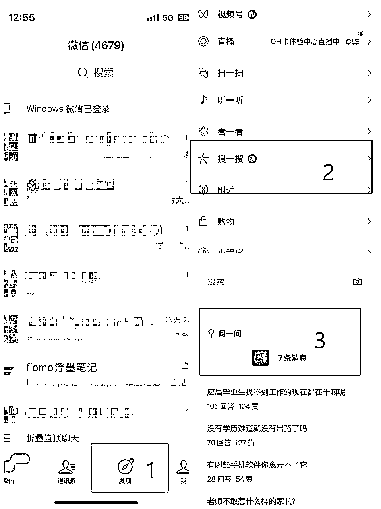

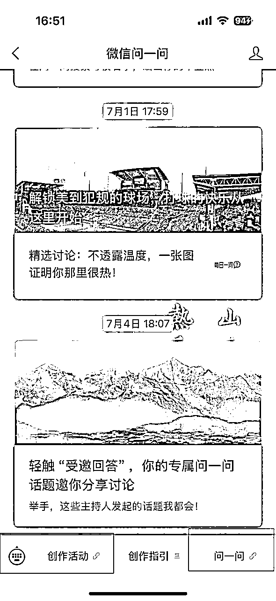

## 1.2 平台机制

### 1.2.1 内容形式

眼下有三种：发起讨论、发布、回答。

发起讨论：近期开放，并非人人都有，优质账号会拿到；部分公众号主也有。主持人可发起讨论并邀人回答，帮平台拉新引流（曾要求邀请没发过内容的新人），规则会变。

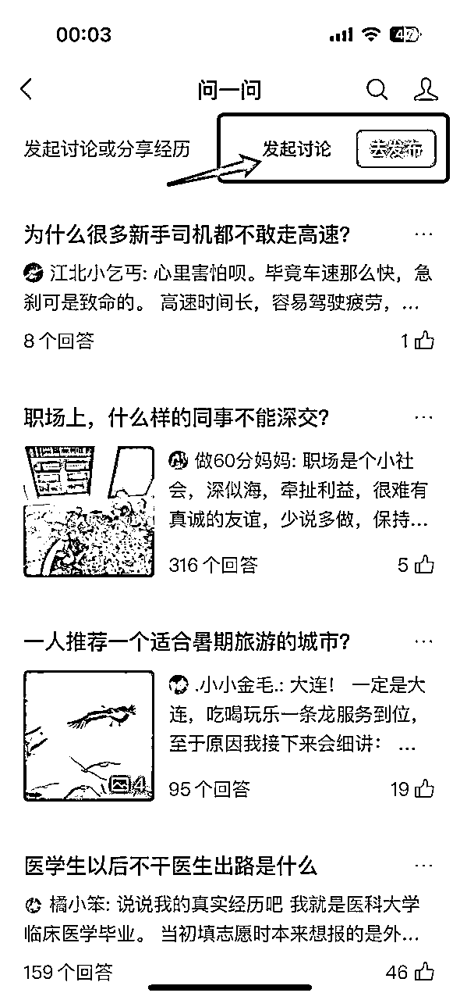

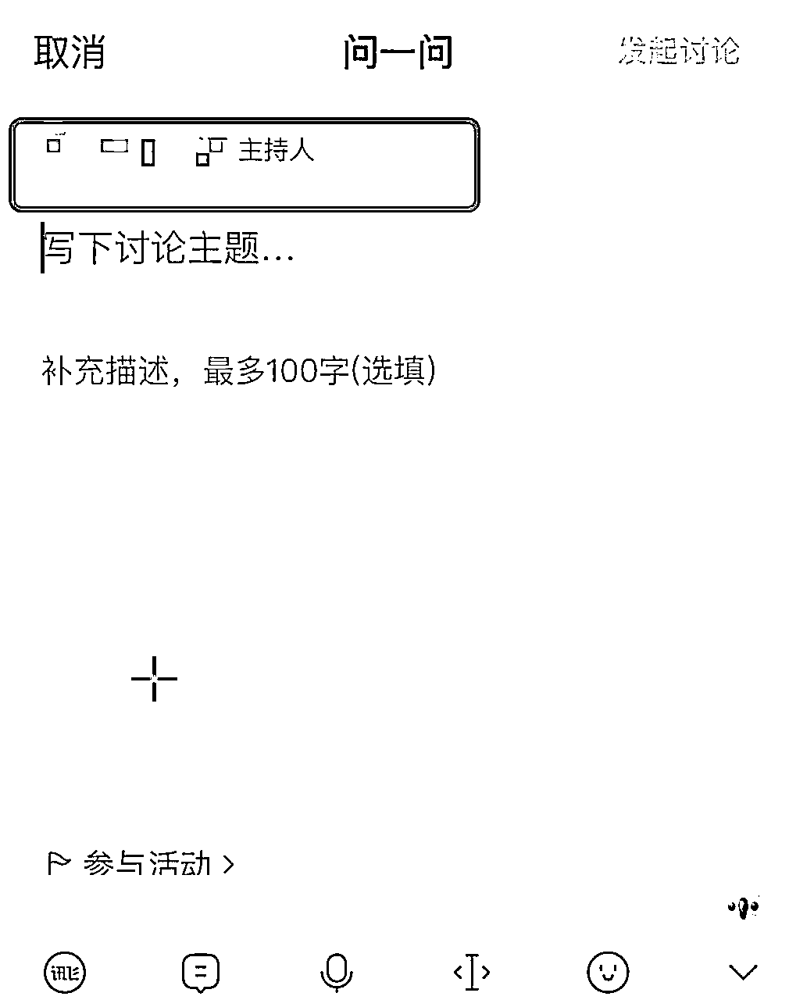

发布：相当于自问自答。未开分成前优先多发；发布和回答都要带个人印记，审稿时发布质量的权重更高，别轻视。

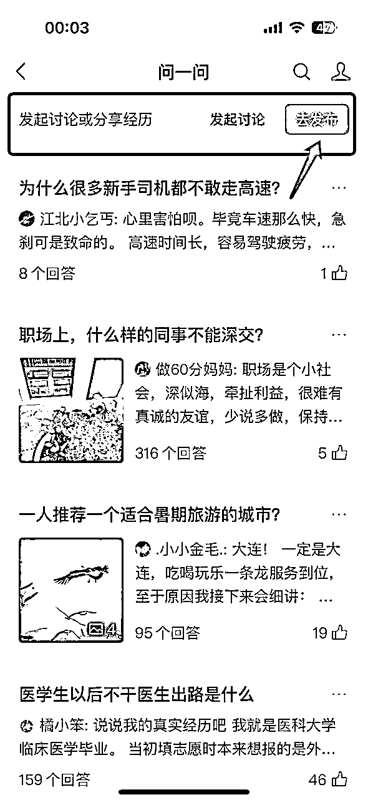

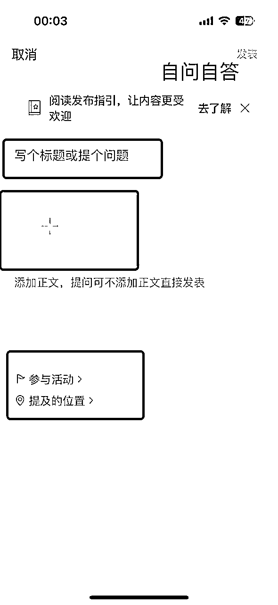

参与活动：官方活动能套就套，好内容有机会上首页推荐。

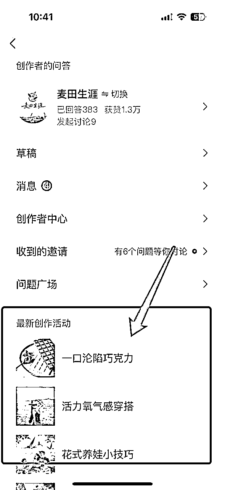

提及位置：景点、餐厅等带地点属性的内容，可以加定位。

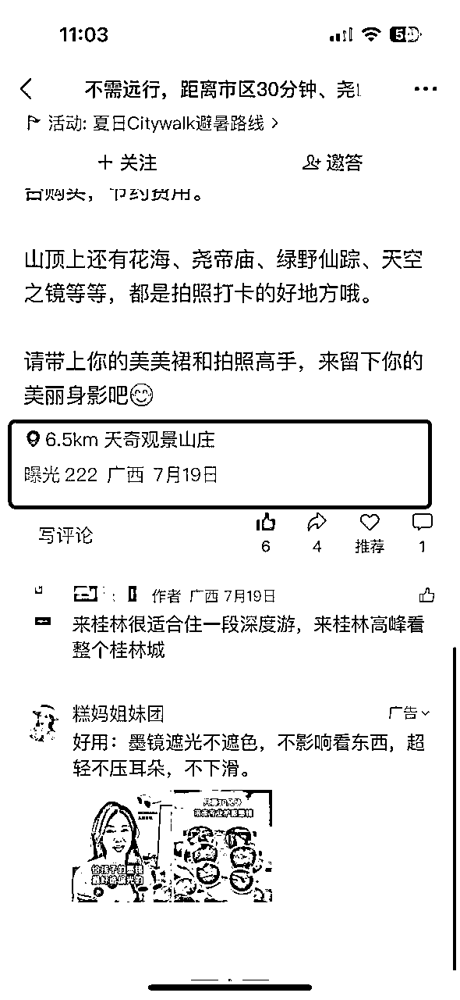

回答：接别人已提的问题或讨论。从熟悉、喜欢、感兴趣、能提供专业价值的角度切入；别和前面重复，可补充自己的判断和实用信息。

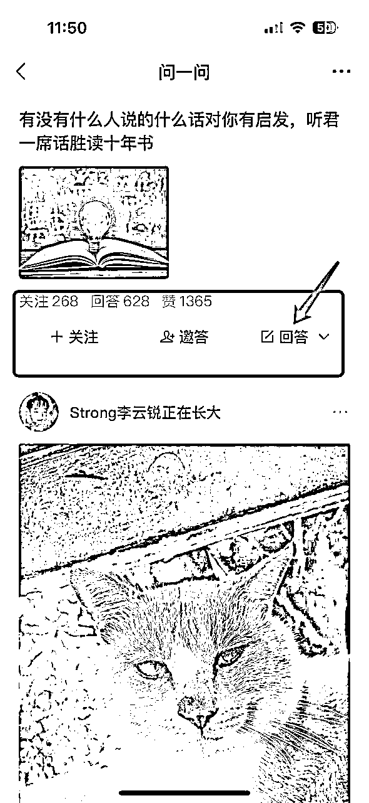

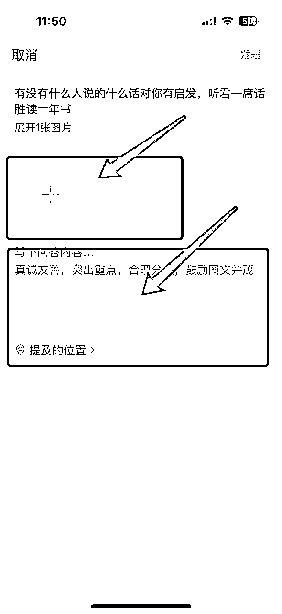

### 1.2.2 分成逻辑

分成计划：符合条件且能稳定产出好内容的作者，可在优质内容评论区承载广告，参与广告分成。广告曝光不是固定给量，会随系统动态变化，不必纠结，重心放在稳定更新和质量上。

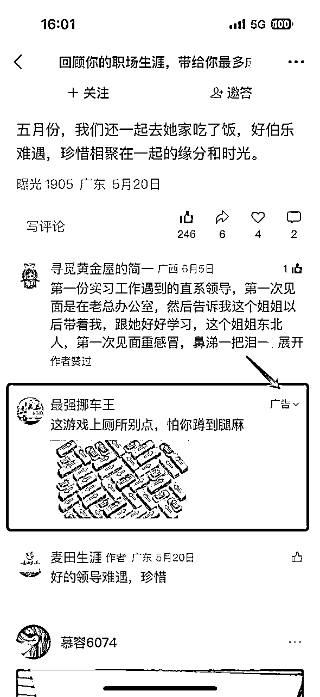

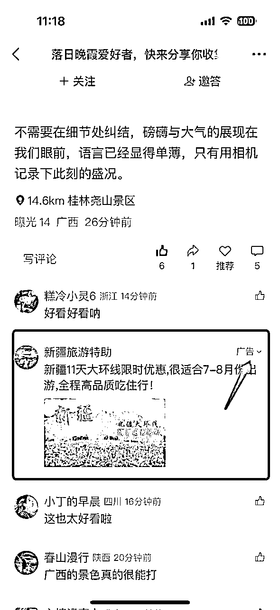

## 1.3 分成开通条件与流程

官方鼓励持续写、多互动，优质作者有机会获权益。门槛是：近90天发内容超过30条；有效关注超过100人（关注须来自问一问渠道）。达标后点申请。

质量细则见官方指南：https://docs.qq.com/doc/p/acbbb2fbb125ae8d6a8d965db119155c7aef8fae

✅ 真实经历打底，真诚写；有实拍图更好。

✅ 围绕兴趣做同好交流：日常细节、真诚深聊，持续给出能共鸣的看法。

✅ 专业内容要有案例和细节，表达生活化、自然、易懂。

✅ 能短则短，抓住要点；同样信息量，越精炼越吃香，别空泛长篇。

✅ 图文搭配，图片清晰好看，3:4更合适。

达标后申请开通创作分成计划。

注意：关注尽量通过问一问渠道完成，可以适度发群发圈请朋友帮忙；初期更建议靠内容自然涨粉，不然收益也有限。

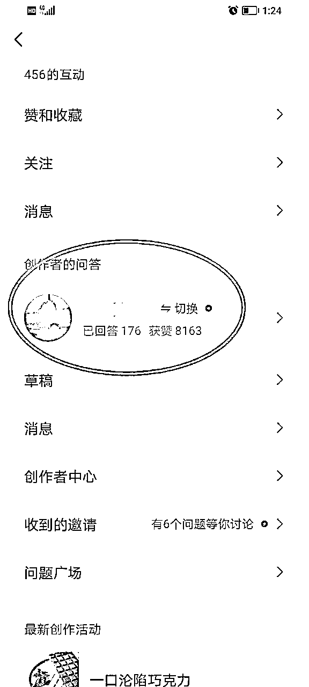

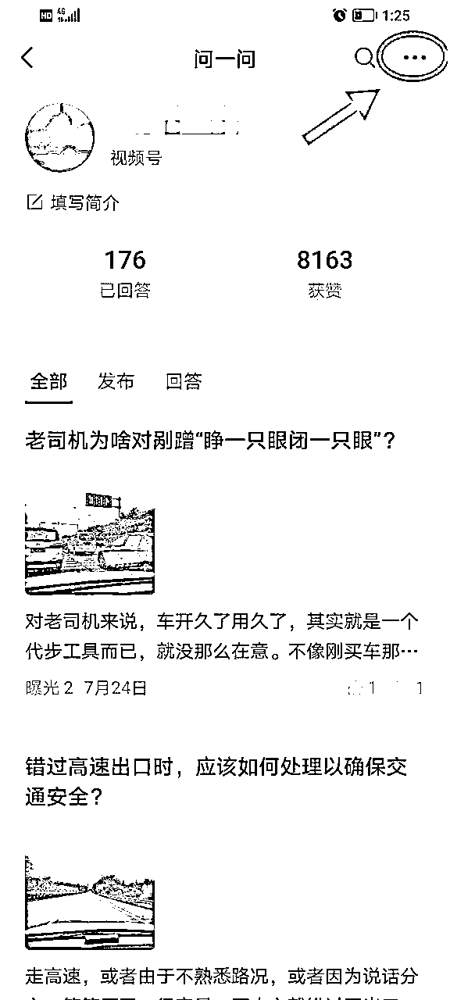

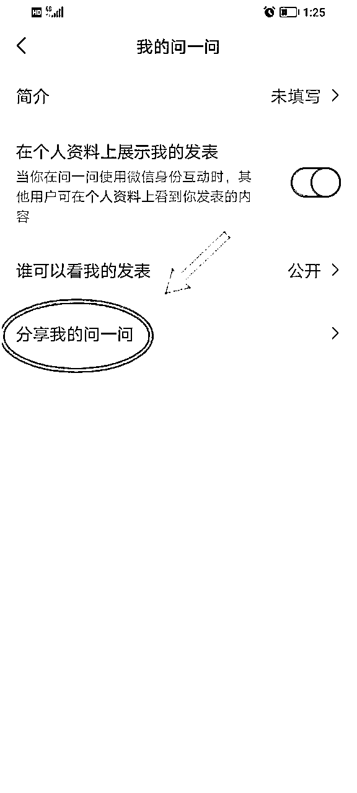

注意：90天是保底窗口；如果你十天就凑齐指标，同样能提交。

审核未过：首次被拒，补至少10条优质内容，等10天再交；二拒等30天；三拒等3个月（规则可能微调）。期间自查不合规内容可删，别侥幸，避免因小失大。更新别停，以发布为主，审核会看全部内容。

收益开通后，要有有效评论才出广告。回答后最好自己补一条评论。

操作：达标后点绿色“申请加入”，等审核。时长不定，好内容可能很快，也可能7-10天。审核期间继续发优质内容，优先“发布”，注意图片和文字。出现第二张图或收到通过通知、页面显示收益，即开通；录入实名收款信息。广告位要开且保持长期开启，否则收不到分成。结算半月一次，邮件通知（需填结算信息）；收入纳入个税系统，扣税由系统处理，不用自己跑税，省事。

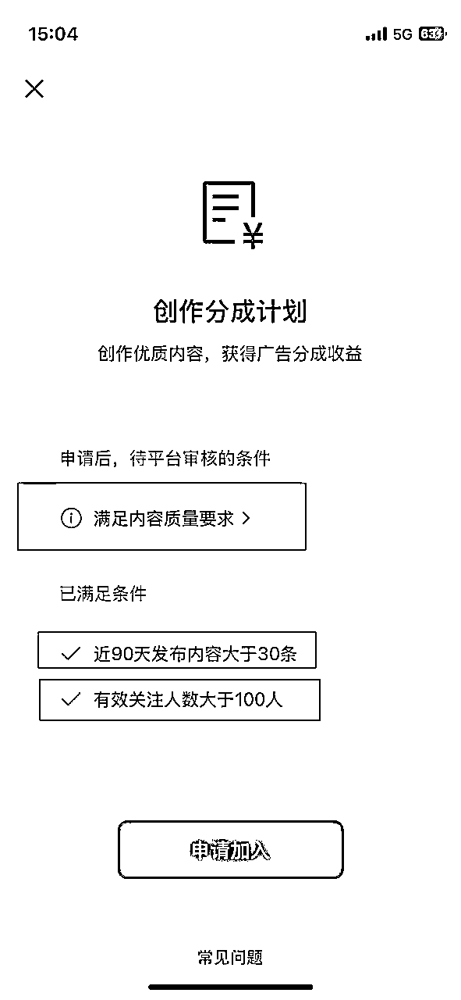

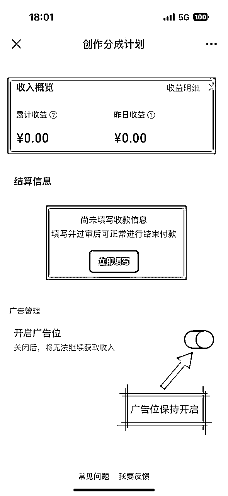

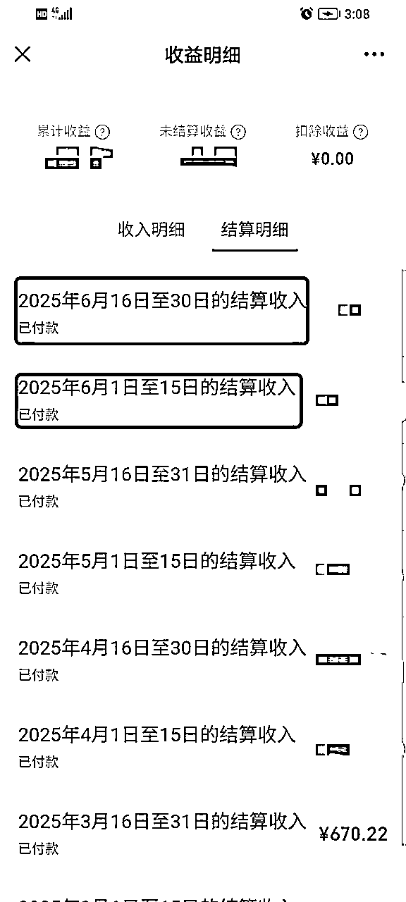

## 1.4 注册与配置

基础可做3个问一问号：

1. 个人公众号一个，用公众号答；
2. 视频号一个，用来答；
3. 新微信号再绑一个视频号来答；
4. 进阶：已运营的绑定公众号也能答；有人持续运营7个号，号多的可测上限；
5. 昵称、简介可后改，别太营销，别留个人微信或引导关注。

新手先跑通一个号，有手感再开第二个。

## 1.5 注意事项

以手写为主，AI只当辅助，初期最好自己敲。红线别碰：AI生成、拼接、抄袭、搬运。

官方鼓励优质，低质会被压；定义看指南。

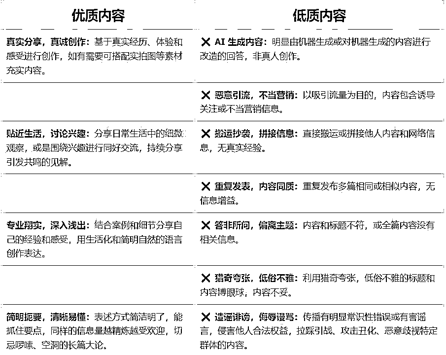

回答要对题，乱答或跑题会被检测并提示不过审。

图文相符是优质关键；一般三张图，视角别重复（拍摄方法见内容制作）。

原创优先，加入自己的故事和经历；别搬，有大号因搬运删了很多内容。

别引流、别过度营销、别引导关注，否则可能封号。

和微信、问一问、AI沾边的主题能写，但比例别高，多数没广告分成。

赚钱副业、民生争议题（比如延迟退休，去年讨论被删）、薅羊毛类少碰，平台推荐意愿低。

踩法律法规或平台规则，资格会被取消、分成会被追回，严重还要赔偿担责。

# 二、定位与赛道

## 2.1 赛道怎么选

账号“问题广场”列出29个领域。职业、兴趣、专长、身份都能作为坐标。早期多刷分类，先输入再输出。

未开分成前，聚焦有个人特色的专业领域和生活类内容，让系统感知你是真人。

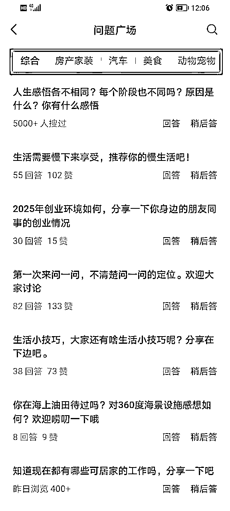

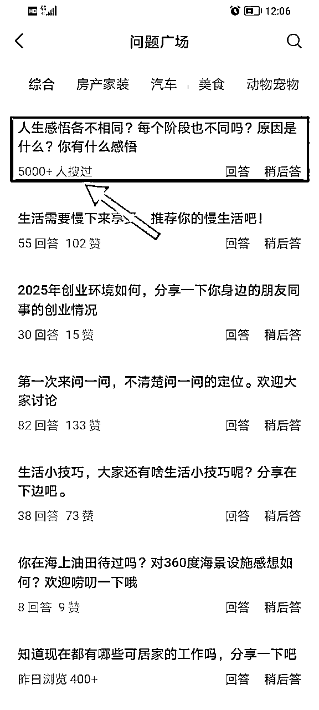

三个问题帮你定方向：

1. 会什么（技能、知识）
2. 是谁（角色）
3. 能给别人什么价值、经验、避坑

长期做号，最好从这三面发散；它们不是各管各的，交叉起来才是独特的你，也是官方想看到的完整创作者。

IP定位一句话：你是谁（身份、角色），擅长什么（技能、知识），为谁（用户）提供什么价值和服务（经验、避坑）。

可结合这些方式找定位和选题，也可让AI辅助再创作；外部工具能加速，内在探索要长期做。

举例：我主业HR，会写面试技巧、职场关系、求职方法；副业活动、高校讲座、直播也分享，既做个人品牌也帮人；偶尔写育儿，让系统看到我是真实完整的人。

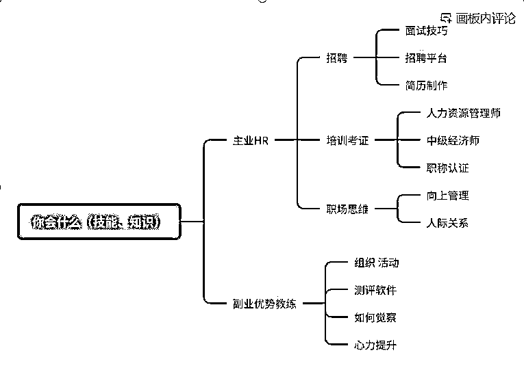

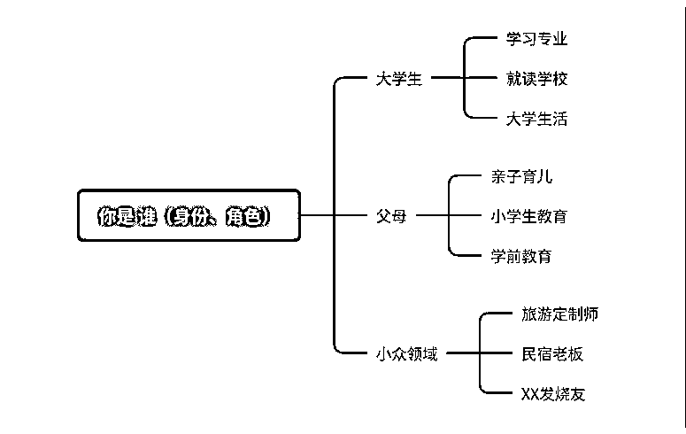

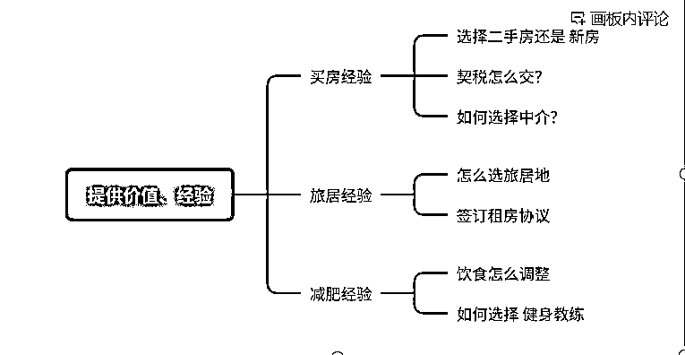

a. 用户视角：先想内容对别人有什么用，别自嗨。

b. 个人经历：美食、旅行容易被判搬运，因为缺个人印记；要加自己的故事、人物。美食可写为家人健康、营养搭配的初心，有真实故事就更有人味。

c. 专属故事：有账号专写情感，围绕她和男友的经历分享，早期被官方邀请开分成（现在这类较少）。

## 2.2 优质赛道参考（含变现潜力，持续更新）

规则、人群、类型都在变。去年育儿单价高，今年宝妈扎堆就降了；职场类通常也偏低。

近期关注多、单价较高的方向（动态变化）：人多单价就掉，别都往热门里挤，按自身条件选。

汽车：常年热，我最早写比亚迪有内容跑到5万+。可做细分：选车、品牌、油耗等；优先关注多、回答少、点赞少的题，爆款概率更高。

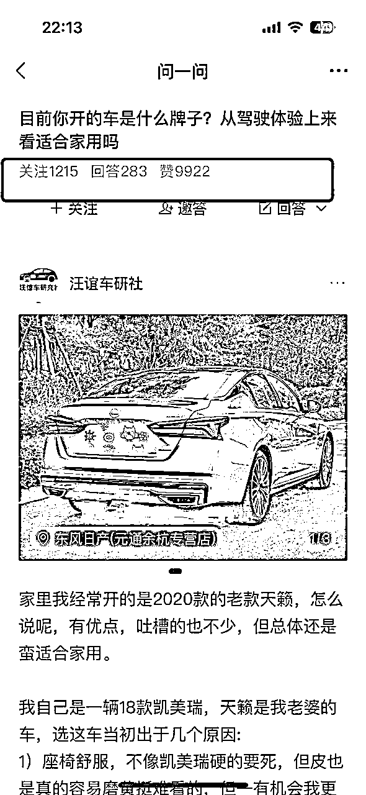

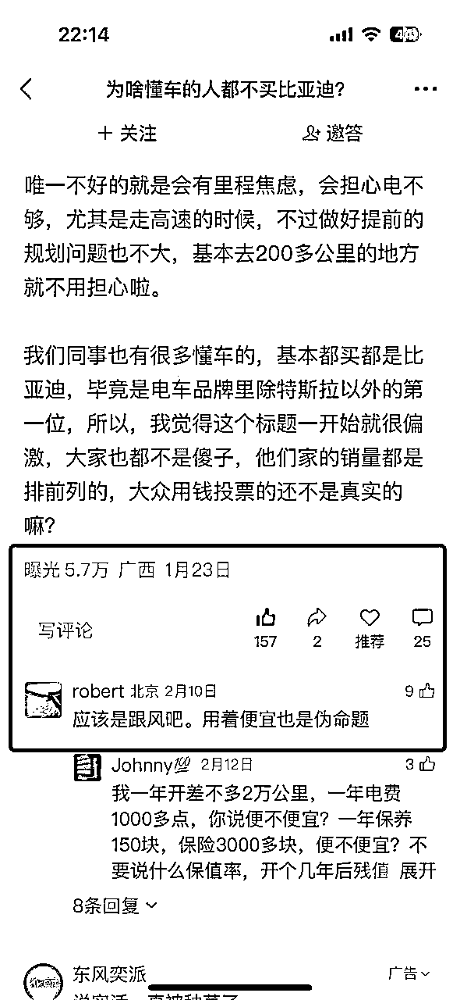

大学生：生活费、第一台笔记本、校园、录取通知书等。结合高考结束、专业选择、录取通知等节点；最近大学生用户多，平台也在推。

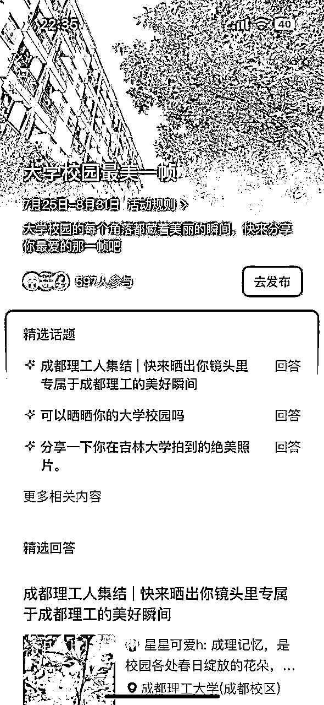

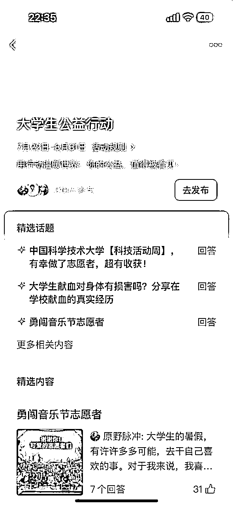

摄影：好图自带吸引力，有点小红书味道；摄影大V主持人近来入驻，活动不少。

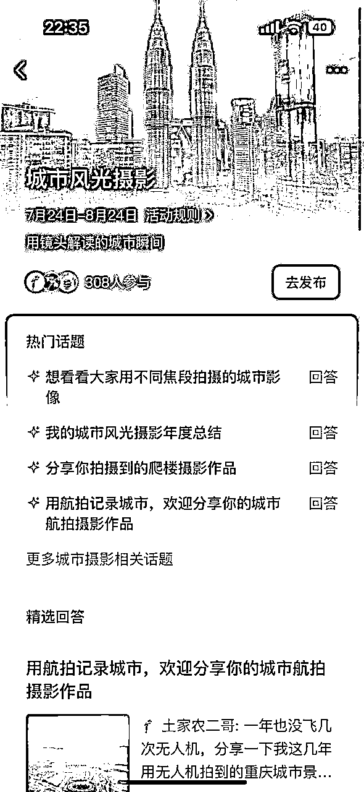

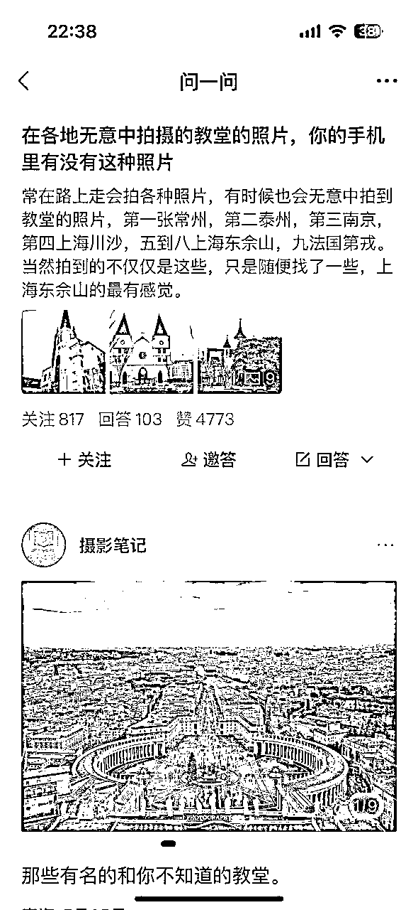

稀缺小众、写的人少的方向数据常不错，比如手工扭扭棒出过爆款。按兴趣做，单价往往更高，因为供给少。

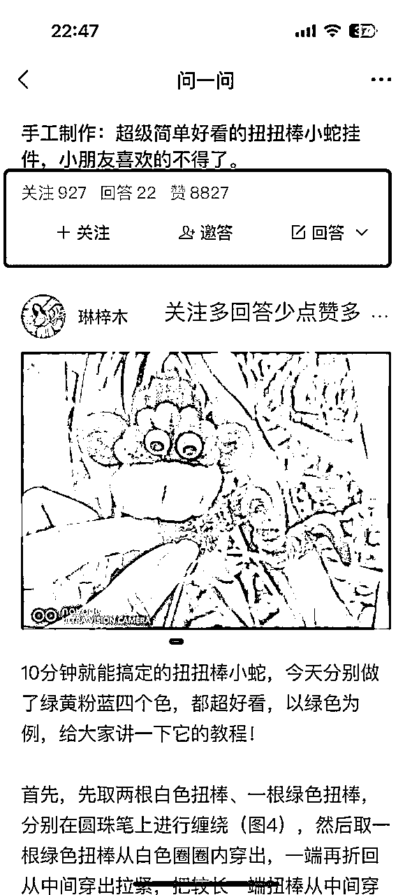

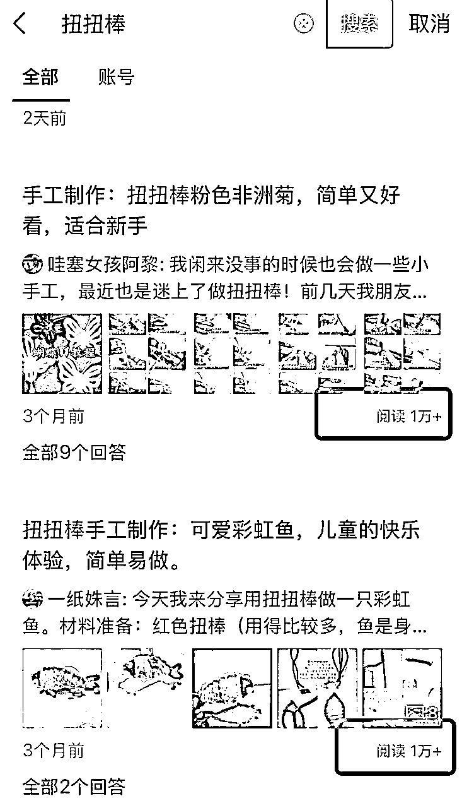

# 三、内容制作：过审、引流、变现三件事

## 3.1 内容结构（300字左右，不必硬凑）

抛问题→讲真实经历→给实用建议→点避坑→温度收尾。

爆款题往往占一条或多条：人多、利他、补信息差、戳痛点、带情绪、引好奇。

### 3.1.1 格式与方法

分段写，3-4行一段，读着不累；排版清爽，别糊成一大块。

逻辑清楚：总分结构、分点列举，符号适当，别过度小红书化，别夸张标题党。

问一问不求长，关键讲透。标题和开头直接给结论、观点或好处，勾住好奇；符号简洁；结尾可升华，也可不写。

讨论题可用PREP：先观点，再原因，再例子，最后重申。比如海鸥电动车：结论“满意”，然后价格、质量、空间、电耗逐条举例，最后说开一年多仍满意并推荐。

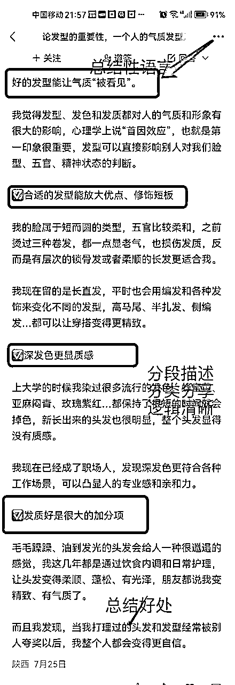

### 3.1.2 案例拆解

#### 3.1.2.1 操作流程类

这类容易爆，也容易踩坑限流。

截图清楚、标注干净：用标准形状和简洁字体。错误：只放图不标操作项；随手画歪圈、手写、布局乱。

选题：选有信息差、不普遍、门槛较高、有差异和提示点的题。错误：无意义低价值；符号要规范，用矩形、椭圆、箭头等；别机械描述流程，要有真实体验。

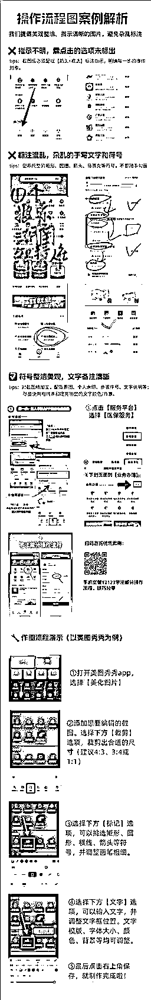

#### 3.1.2.2 乡村游、兴趣、自驾等案例

一定要揉进自己的故事和人物，增加个人特色，免得被判搬运。

图片多角度、清晰明亮，3张以上，确保真人实拍。内容给经验、避坑、地址、小tips。扫码可读原文（案例图来源：微信问一问官方）。

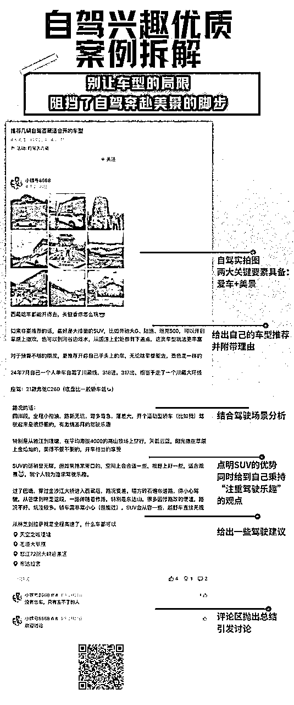

## 3.2 标题、配图与评论

### 3.2.1 标题：关键词+共鸣/数字/对比，兼顾搜索

关键词要布局，可吃长尾流量，比如本地：广州天河区***。例：广州天河区排第一xx餐厅、柳州亲子游玩必去的科技馆。

搜索视角：标题和正文突出单篇核心词；发布前想一下，用户会怎么搜这条内容？

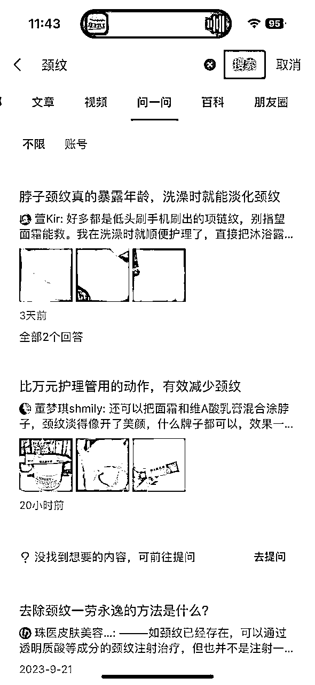

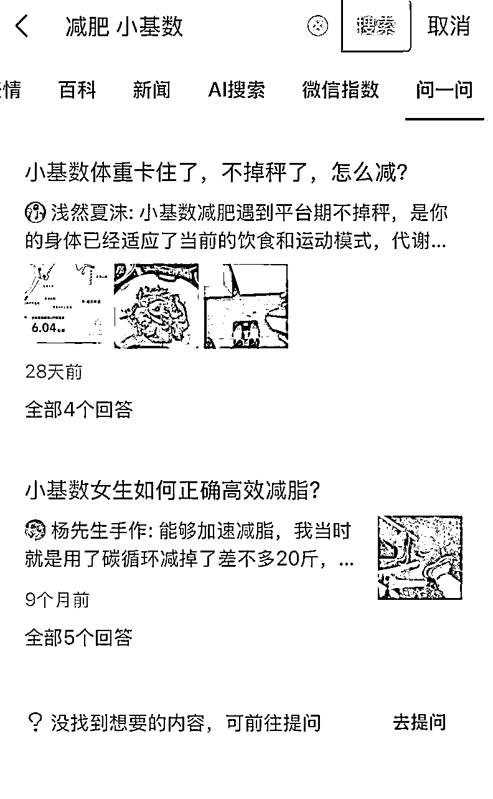

### 3.2.2 配图

原创实拍、场景感强，拒绝无版权拼图。

### 3.2.3 评论区

别水、别引流（如引导关注公众号）。可引导继续分享，或放有价值的总结、金句、名言。

# 3.3 写内容：让AI搭把手，但别把脑子交给它

**用嘴写稿，比敲键盘更带感**

想快速产出内容，最省事的办法其实是“说”出来——微信自带输入法、讯飞这类工具都支持语音转文字，张嘴就来，天然保留口语的松弛感，读起来更像真人在聊天。

“问一问”是个需要长期养的项目，刚上手时我更建议你老老实实手动打磨。

**AI的正确打开方式：语音输入＋笔记软件**

我的习惯是用 get 笔记的语音输入功能，走到哪说到哪，想到什么就录什么。软件会自动帮你过滤掉“嗯、啊、那个”这类口水词，整理成通顺的文字，稍微顺一遍就能直接复制到问一问发布，效率直接拉满。

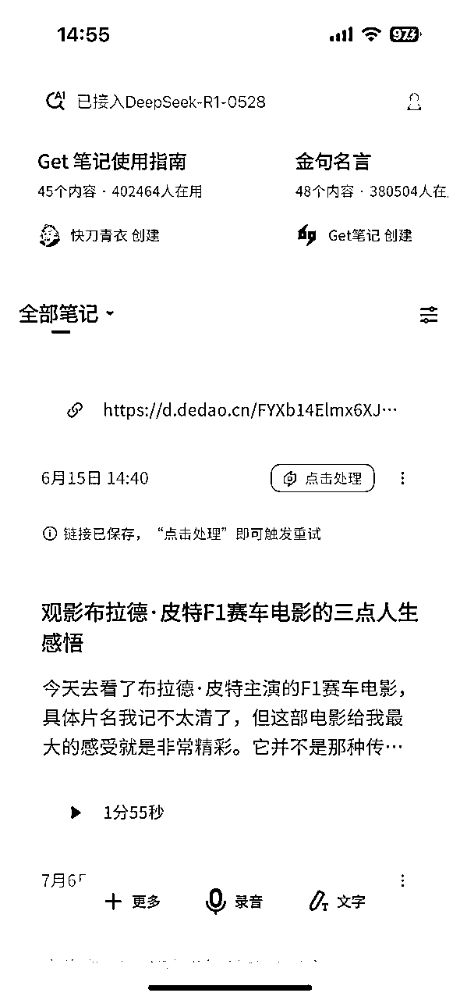

但千万别图省事直接让 AI 一键吐出一篇回答——平台 detect 得出来，流量说砍就砍，腰斩那种。

# 四、账号运营的几个小心机

1.

**发布为主，回答为辅**

先主动出击，再被动接招。发布是你用自己的视角主动造话题、抛观点，甚至可以自问自答；回答则是跟着别人的话题走，输出你的看法、心得或经验。

从发布端切入能抢到先机，广告分成在早期内容里就会体现出来。

2.

**平台活动能蹭就蹭**

新上线的活动关注度往往不高，但这恰恰是平台最想看到的内容形态。

优质的发布和回答更容易被选进平台的精选展示位，曝光自然就来了。

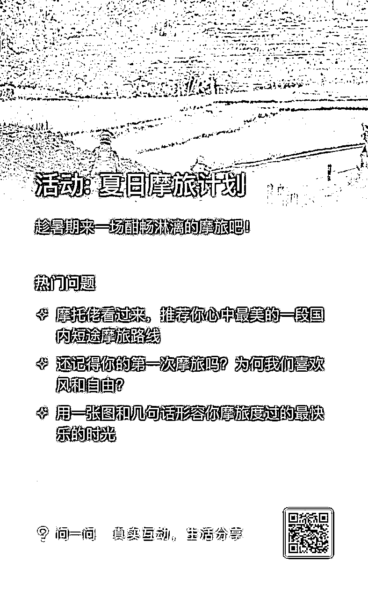

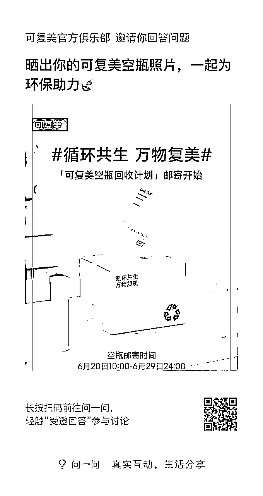

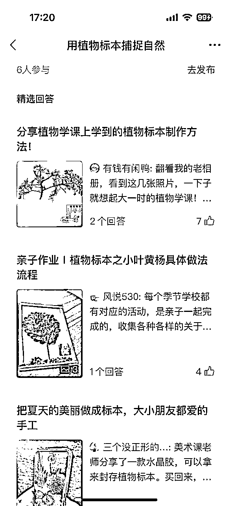

3.

**草稿箱囤选题，反向攒弹药**

平时把热度高的问题（关注多、回答少、点赞猛的那种）随手丢进草稿箱，哪天没灵感了就去里面翻一翻，直接开答。

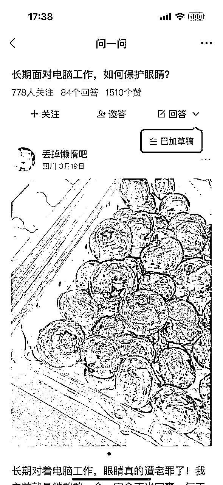

**素材靠日常攒，随手拍随手记**

问一问就像你的公域朋友圈，生活感受、学习心得、日常琐碎都能拍照记录下来。记得用真实拍摄的图片，网图和 AI 图千万别碰，平台审核这块卡得很严。

还有个妙招：把以前的老照片翻出来用。来不及现拍没关系，只要跟内容对得上，过去的素材照样能分享，把你压箱底的存货都激活起来。

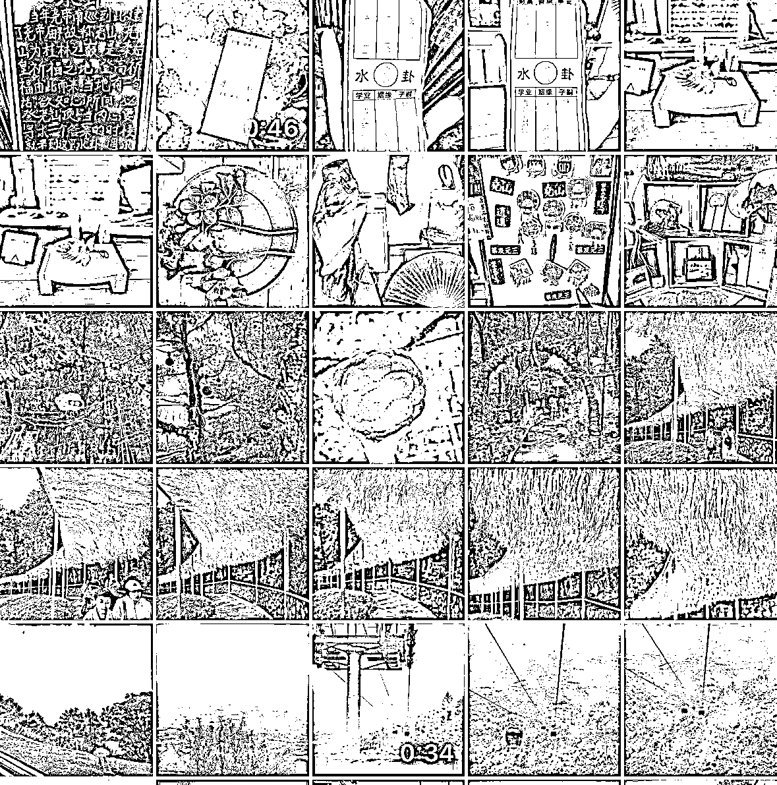

5.

**找对标，建自己的参考库**

在自己领域里物色优质账号，可以从问题广场淘，也可以在问一问主页慢慢逛、慢慢收。学人家的打法和回答思路，慢慢搭起自己的对标库，这事儿急不得，得长期攒。

我隔三差五会在航海群里分享写得好的账号和内容，官方活动也会第一时间丢群里，大家记得盯紧。

问一问首页会根据你的搜索习惯推相关内容，多参考多学习；问题广场里的东西得多点、多看，遇到不错的点个赞，系统就会提示你关注，顺手把相关领域的博主和选题都收进参考清单。

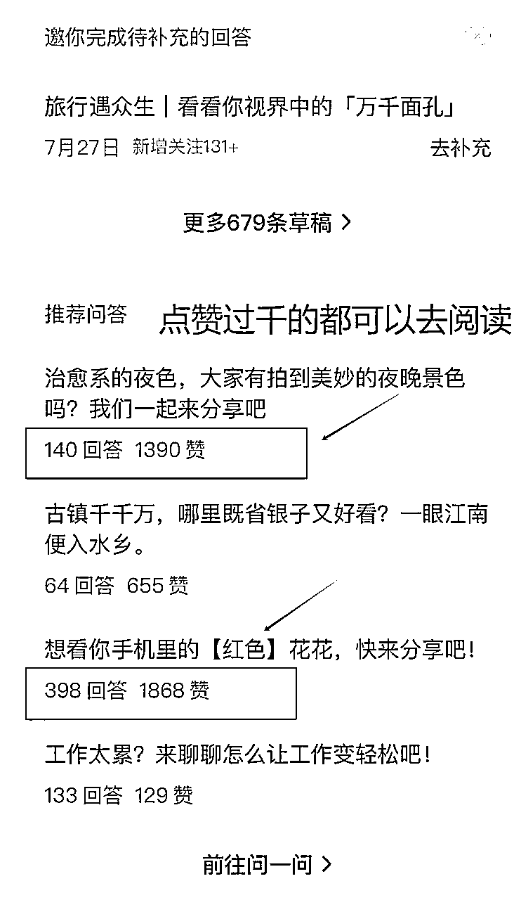

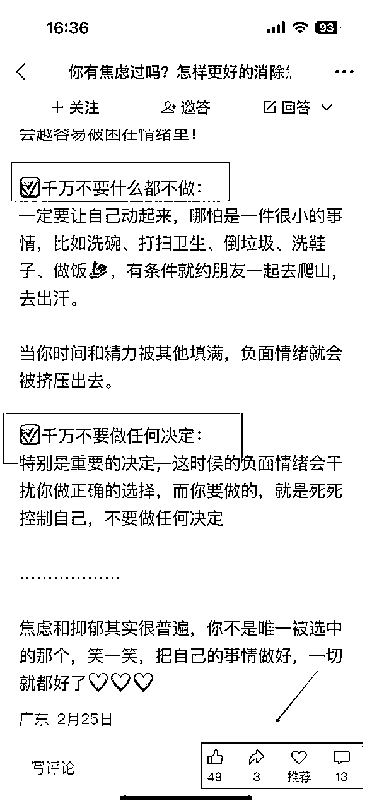

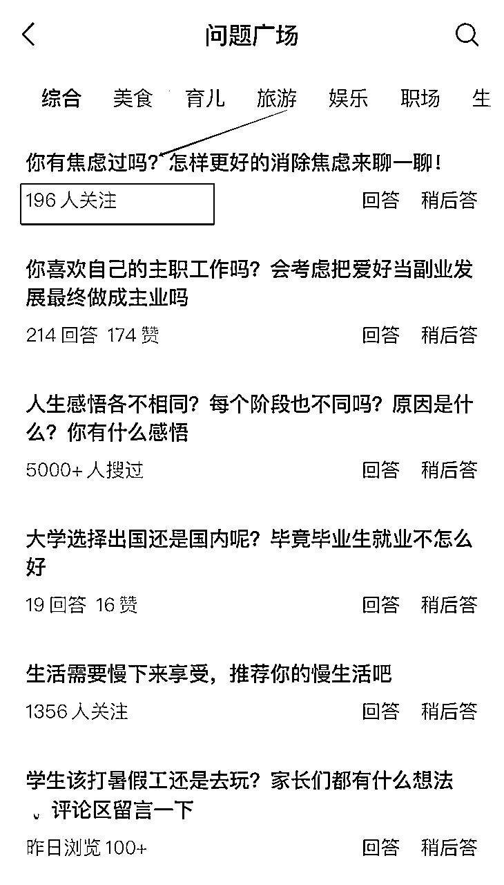

6.

**互联网基本礼貌得有**

看到好的对标内容，点个赞、推个荐、留个言，帮别人其实也是在帮自己。

那个爱心推荐按钮有点像公众号的推荐机制，有可能被你微信好友刷到，具体场合自己掂量着来。

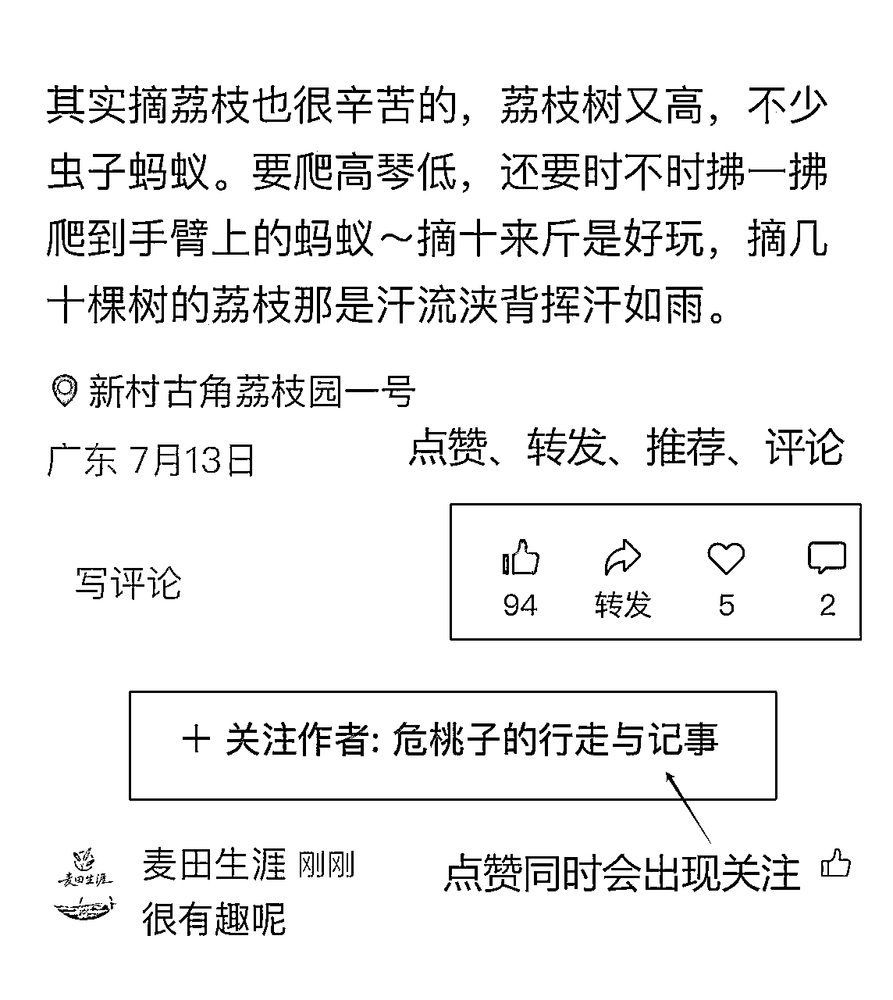

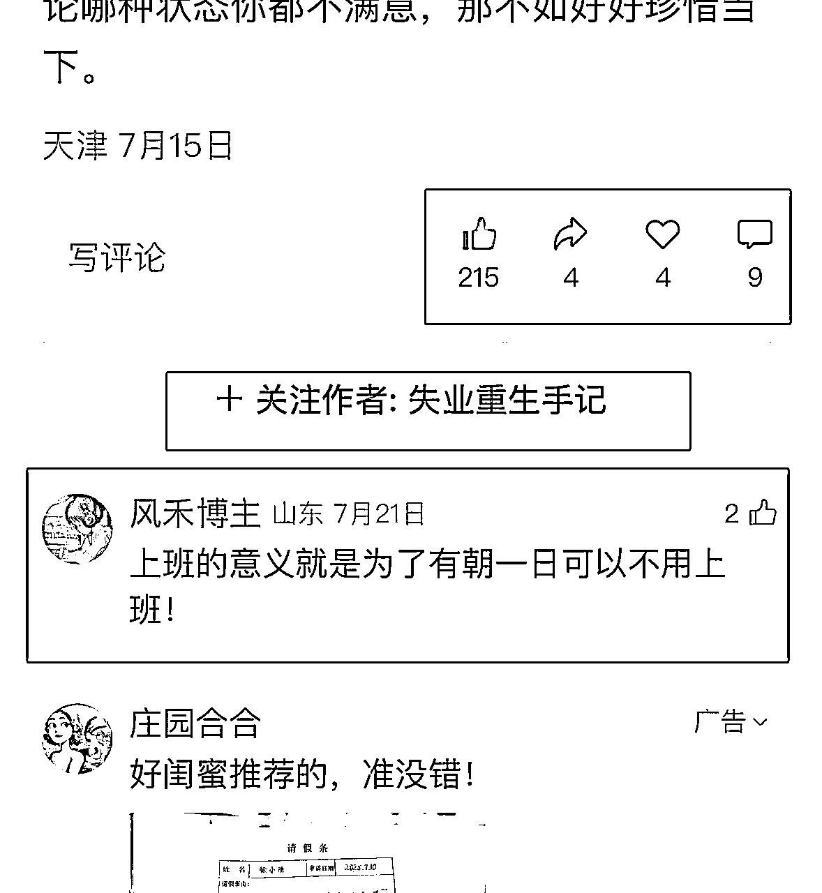

7.

**公众号和问一问互相导流**

反向给问一问引流也很简单，在公众号推文里挂上你的问一问主持人发布、回答内容就行。

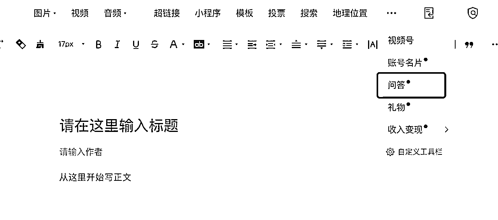

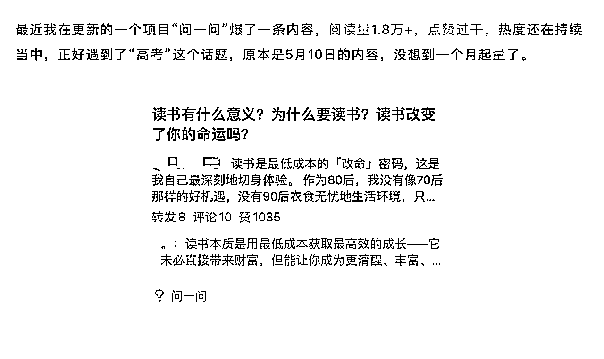

# 五、分成计划怎么申请

# 5.1 第一阶段：

1.1 **日更不能停**：每天回答 3–5 个问题，哪个平台都一样，让系统认定你是个能持续输出的优质作者。

1.2 **发布量要压过回答量**：重心放在原创发布上，让平台给你打标签，看清你是哪个领域的创作者。优质作者会被小助手主动添加，进官方领域群拿针对性指导（分成计划这块先不聊）。

1.3 **爆款问题适量答**：量一定要控制住，过去那种热点民生话题就别碰了，很容易被限流。

爆款内容涨粉是真的快，我最近写“娃哈哈”相关的内容，单篇吸粉 100+，曝光量冲到 5 万+。

5.2 第二阶段：

收益开通之后想提高收入，限制就没那么多了，可以往其他生活领域拓展输出，但前提还是保住「个人特色」，发布和回答都围绕实用、有价值、有收获的内容来。

账号开通后如果一头扎进追热点，很容易断流，这点务必记牢。

# 5.3 第三阶段：

上面这些经验摸透了，就可以着手开第二个号，跑顺了再开第三个，以此类推。

# 进阶篇：项目放大&进阶玩法

AI 协同创作＋矩阵号运营策略

这一阶段只适合内容体系已经成熟、有持续发布能力的创作者。

# 六、多账号矩阵运营（建议进阶使用）

# 6.1 多账号切换

理论上托管在你微信上的公众号都能用，上限目前还不确定，号多的圈友可以自己测一测。

每个号定位不同维度（技能号／情绪号／兴趣号），把一个号跑通之后，就可以往不同领域铺。

我自己现在运营两个号，定位有区分：一个职场号，一个亲子育儿号。你也可以按兴趣爱好来定，摄影、旅游、绘画都行。

多账号一定要差异化运营，别复制同样的内容；同一个问题只要你名下答过，就不能再答了，平台会直接提示。

# 七、AI 协作与内容系统搭建

用 AI 帮忙做内容，但要把“AI 味”去掉。平台一直在严厉打击 AI 内容和图片，输出可以参考，但绝不能直接搬运。

1.

**AI 能帮你规划和提速**：多跟 AI 对话，思路和方向会打开不少，亦仁也强烈推荐这一点，把 AI 当成你的高级智囊团。

2.

**AI 提示词参考**：

你是一位 XXX 领域的创作者，现在请回答以下问题，要有“人味”、有故事、更容易成为爆款。

1.

分析原文，找出可用的内容，判断适合模仿哪种风格形式。

2.

根据分析结果，按你原本的输出风格改写。

3.

以 XX 的身份来回答，要有深度、有不同视角，同时能提供价值，字数控制在 400 字左右。

3.

**借助 AI 搭专属选题库**：按你的内容领域，让 AI 给你列 100 个选题，再从中整理标题和内容，效率能翻倍。

注意：内容部分必须经过修改和润色，否则就是给自己挖了个完美的坑。

八、常见问题

# 8.1 回答的问题需要垂直吗？能不能跨领域？

初期建议以垂直为主，再叠加个人生活的其他方面，聚焦但不单调，让平台看到你的“个人特色”。

一个人不可能只有专业或职业一面，是多面的，平台官方其实也希望你能多领域发展。不过在过审之前，还是先聚焦一个领域比较稳妥。

# 8.2 怎么从问一问导流到私域

问一问账号分两种：“公众号”和“视频号”。

虽然没法在问一问里直接放链接，但可以通过这两个渠道触达客户：公众号的回复、文章、图文都可以留个人微信号，设个钩子吸引大家来加；视频号的个人简介处也能留微信号。

# 8.3 曝光怎么涨？粉丝怎么快速增加？

涨粉和曝光的核心永远是内容优质，平台自然会给你推流，有推流的时候多写几篇，关注和曝光都能再上一层。

消息框里能看点赞、关注、评论和通知，通知里就有你被推荐的内容，还有海报方便转发传播。

布局“长尾关键词”吃搜索流量，比如图一的关键词思路：地名（桂林 xx 区／xx 县）＋民宿，多铺一些小众长尾词，把这个板块的搜索流量占住。

爆过的内容还会再爆，写得好的爆款选题可以自己再写一篇。比如“宗庆后”这个选题我爆了 5 万+，别人跟着模仿写，也有上万曝光。

# 8.4 流量暴跌、断流了怎么办？

说个真实案例：初期流量特别好，每天 2 万左右，收益也有 200 上下。

结果光顾着蹭热点、答爆款题，流量越好反而越被平台盯上，直接断崖式限流。

乱搬运＋AI 生成内容，这些平台都能检测到，一抓一个准。

划重点：只答爆款＋乱搬运＋AI 生成，这三样凑一起就会踩雷，千万注意。

# 8.5 每天答多少题合适？

新号权重低，建议慢慢来，别一上来就冲到顶，很容易被平台盯上。

从合理角度看，一天 3–5 条比较适中，重点还是内容质量。

# 8.6 被平台判定 AI 内容怎么办？

这么久以来我只遇到过一次，当时觉得莫名其妙就直接申诉了，因为我很确定内容是原创的，后来果然很快审核通过。

如果你多次被警告或提醒，就该反思一下自己的内容是不是缺了“人味”，可以回到内容创作板块再补补课。

九、最后说点心里话

# 9.1 耐心和坚持

问一问是个“小而美”的项目，比起其他项目简单不少，一部手机、10 分钟就能产出一篇。看着简单，但要长期积累、深耕才能把内容做好。

耐心很重要。它不像公众号关注数达标就能开流量主，这里的审核规则相对严格，可一旦开通，分成收入是持续性的。

有人三次没开通就放弃了，也有人坚持下来拿到上万收入。每个人情况不一样，多给点耐心，把心思放在内容上，相信大家都能拿到结果。

# 9.2 别被完美主义绑住

没有任何作品是十全十美的。把日常生活、所见所想、实用经验或技巧，真人真事真实地写出来，配图用实拍图，能给别人提供价值、帮人避坑，就是一篇好的问一问回答。

输出时别太纠结完美，一次比一次迭代，持续进步就够了。

# 9.3 数据看淡一点

曝光量有时候真是玄学，只要你输出量够大，爆款迟早会来。

问一问的长尾流量特别香，5 月发的内容可能 6 月才爆发。平台规则也在持续变化，享受输出的乐趣、分享的快乐，反而能让我们坚持得更久。

# 9.4 多用平台

我们想在问一问做自媒体，希望平台越来越好，那自己也要多用、多搜、多传播，期待更多流量进来，我们也能吃到平台成长的红利。

最后祝大家在微信问一问航海里，从零到一跑通全流程，持续运营，拿到结果。

