# 视频号 AI 个人 IP 实战手册（2025 年 9 月航海版）

> 来源：https://ocn93f5d9olj.feishu.cn/docx/XtjCdWr89o8ADvxjsWPcer2enKh

# 零基础怎么上手视频号 AI 个人 IP？

# 1. 项目总览

欢迎来到 AI 内容创业的另一个视角——视频号 IP 化。

如果你已经接触过 AI 类自媒体，大概会有同感：只会发工具教学、追着热点做解读，这条路的拥挤程度正在肉眼可见地加剧，热度来得快，退得也快。原因很简单——这类内容几乎没有准入门槛，而流量最终会流向那些人格更立体、观点更有穿透力的创作者。

这期航海只做一件事：在视频号这个平台上，完成一次根本性的打法升级——把“追爆款、蹭热度”的流量逻辑，换成“靠信任、建关系”的 IP 逻辑。

## 1.1 视频号做 AI 自媒体，窗口期还在哪？

先看清平台红利。视频号是当下少数还在增长的洼地：不用购买启动流量，你🛰️里的几十个好友就是第一批观众；比起靠投流砸出来的抖音、靠审美和精致感出圈的📕，视频号跑出成绩的概率更大，单个粉丝的价值也几乎可以对齐📕。AI 领域永远不缺新话题，信息差不会短期抹平，广告主手里的预算也一直存在。还有一点容易被忽略——视频号商业化启动偏晚，其他平台的头部创作者很难把优势平移过来，新人反而能抢到先发身位。

再看广告主的心态。我合作过阿里、腾讯、百度这些大厂，一个明显的变化是：品牌方越来越愿意把预算投给“有想法、有态度”的创作者，而不是面目模糊的流量号。一个有辨识度的 IP，能谈到更高的客单价、签下更稳定的年框合作，而不只是接一条算一条的商单。他们要买的不是曝光量，而是你的判断力，以及观众对你建立起来的信任。

最后看变现的闭环。视频号和🛰️是一家人，👸号、企业🛰️、社群、小程序这些基建它全都天然打通。从内容种草开始，到私域沉淀，再到成交转化，全程不用跳出🛰️。接广告、做培训、卖课、搞咨询，转化路径比别的平台短一大截，也省去了研究各种“偷流量”技巧的力气。

## 1.2 为什么“人”比“播放量”更重要？

视频号的底层游戏规则是信任。它同时运转着两套逻辑：熟人社交推荐和算法推荐。朋友点赞的内容会获得额外的权重加成。一个性格鲜明、观点明确的 IP，天然比冷冰冰的资讯号更容易激活社交推荐，也就更容易筑起自己的信任壁垒。

把两种账号放在一起对比，差距一目了然：

流量型账号像一家便利店——大家图的是信息差和新奇感，买完就走，谈不上忠诚度，利润也薄，隔壁再开一家就能把它比下去。IP 型账号则像一家有主厨坐镇的餐厅——客人冲着老板的理念和独特体验而来，不仅自己反复光顾，还会带着朋友来，客单价高，壁垒也深。

回看这两年，那些风光一时的“XX 测评”“XX 工具箱”账号，如今还剩几个？反而是那些真正把个人品牌立起来的 IP，商单接不停，还常被请去行业活动站台。

所以，运营目标不应该放在涨粉上，而要放在“筛选铁粉”上。无效流量是什么？看到你的“10 个 AI 工具”就收藏，转头就走甚至取关——因为在对方眼里，你只是一件用完就丢的工具。有效粉丝则不同：他们是被你的观点和思考吸引来的，会追你的每一期、信你的每一次推荐，是你未来所有商业化动作的基石。IP 化的过程，就是把这群人从茫茫人海里筛出来的过程。

## 1.3 优势与门槛并存

先说收益：这期航海交付的不是一条“怎么抄近路捞鱼”的捷径，而是一套“先选渔场、再建鱼塘、最后养鱼”的完整方法。按这套方法走，你沉淀下来的是一个别人很难仿造的 IP 护城河，吃到的是穿越周期的复利。

再说代价：它确实不是一条捷径。前期数据普通甚至难看是常态，你需要比做流量号更深入的思考、更真诚的表达。但走过这段路之后，你得到的是更牢固的商业地基和更长久的人生资产。执行力本身就是一种稀缺天赋——最终活下来的人，都是把动作重复了一百次的人，而不是在第一遍就开始纠结的人。

## 1.4 一个真实案例：冷科长

这期教练冷科长，本身就是一个在 AI 浪潮里反复试验的创业者和开拓者。他同时运营两个账号：“AI 冷科长”走真人出镜 IP 路线，“深度学习的 Alpha 狗”走纯素材剪辑路线。

前者让他与百度、阿里、腾讯、英伟达等公司建立了长期合作关系；后者则证明了一件事——只要观点锋利，不出镜同样可以快速起号、快速商业化。

数据也很直观：今年两个账号合计接下 180 条商单。其中不露脸的“深度学习的 Alpha 狗”4 月开号，6 月 26 日接了第一条商单，到 8 月 18 日撰写这份手册时，已经有 13 条进账。

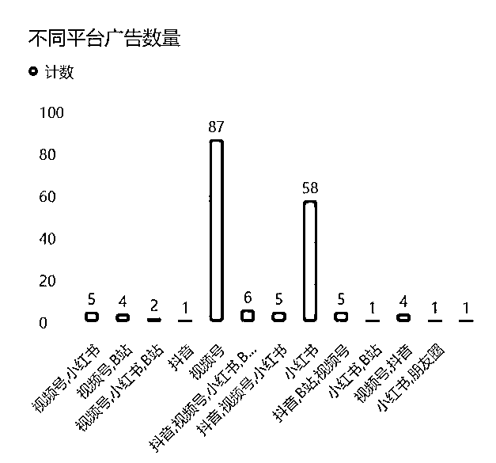

# 2. 项目完整操作路径

这份手册相当于一张覆盖战略和执行两层的行军地图，全程拆成四段：

第一站【定位与蓝图】：找到你的 IP 原点，回答清楚“你想成为谁、你在替谁说话”。

第二站【内容与基建】：把“舞台”搭到位，让第一面就透出专业和独特。

第三站【启航与验证】：掌握 IP 型内容的创作方法，让每一条视频都变成人设的砖瓦。

第四站【优化与远航】：学会看数据、对接资源，让 IP 的商业价值不断放大。

执行重点：这期航海的主线任务，是在 21 天内先把 3—5 条视频的生产流程完整跑一遍——不要等完美了再动手。然后尽快穿过新手期（累计 20—30 条）和苦力期（累计至少 50 条），把基础和粉丝攒下来。

四个容易踩的坑以及对策：

坑一：拿着旧地图，找新大陆。对策：做科技自媒体最难的是思维换代。别只想着“AI 能怎么帮我把现在的事做得更快”，要去想“AI 能帮我发明一件什么样以前不存在的事”。我会通过直播和分享，陪你把这次思维升级做完。

坑二：站在岸边，看别人冲浪。对策：真正的风险从来不是做了之后失败，而是机会摆在面前时还在犹豫。这 21 天，就是你用最低成本验证“我适不适合这条路、这条路能带我走多远”的窗口。

坑三：还没找准赛道，就开始无脑发内容。对策：选择在某些时候比努力更值钱。新手阶段可以贴着已经被验证过的爆款赛道和爆款内容走，如果拿不准哪些方向合适，多翻翻航海手册的建议。

坑四：发了几条，数据不好就撤。对策：30 条只能算入门，粉丝快速增长通常发生在爆款出来之后，而爆款本来就是小概率事件。所以请保持耐心，持续更新，每一条都逼自己优化一点点，爆款迟早会轮到。

出发前需要准备的：

- 硬件：一部智能手机、手机支架、无线麦克风（建议）、补光灯
- 账号：1 个视频号
- 核心软件：剪映、飞书文档
- AI 效率工具：手册后续会逐步给出指引

# 1. AI 定位与内容策略

### 1. 本章重点

目标：把一个“优质粉丝愿意持续追随、高端客户愿意买单”的 IP 设计出来。

定位决定账号的生死。它是整个计划里分量最重、也最考验思考深度的一章。做内容，方向对了，努力才值钱。

这一章只解决三个问题：

- 我在哪？（赛道）
- 我是谁？（人设）
- 我说什么？（选题）

这章的推进地图：完成本章的学习和实操，相当于走完了：

阶段一：定位与蓝天（4 天）

- 拆解 10 个已经跑通变现的 AI 账号（3 天）
- 把 IP 人设三件套设计出来：角色、价值主张、风格（1 天）

### 2. 赛道怎么定

对 AI 自媒体来说，赛道定位是不是就等于：在“人工智能”这个总框架下，再选一个更细的切口？比如下面这些：

AI 热点 / 技术解读：追踪前沿动态、拆解行业格局；AI 大模型分析（GPT-4、Claude、文心一言等）；AI 产业趋势（企业布局、投融资、政策风向）；AIGC 的影响半径；AI 算法与技术原理（机器学习、深度学习、NLP）；AI 伦理与社会议题（就业、教育、隐私）；AI 科普与认知提升（让普通人也能看懂 AI）；AI 论文解读（最新研究的拆解与复现）……

AI 工具分享：专注某个或某类 AI 工具的安利、教程和实战案例。AI 绘画与设计（Midjourney、SD、DALL-E 等）；AI 写作与文案（ChatGPT、Claude、Notion AI）；AI 办公与生产力（自动化、任务管理、效率工具）；AI 编程与开发（代码生成、自动化测试、代码助手）；AI 视频与内容创作（Runway、Pika Labs、Heygen 等）；AI 配音与语音合成（ElevenLabs、Voice AI）；AI 营销与获客（自动化投放、SEO、数据分析）；AI 学习与教育（AI 家教、论文辅助、翻译）……

AI 创业或副业：研究 AI 怎么变成生意。AI 自媒体创业（做个人 IP、短视频、写文章）；AI 课程与知识变现（开课、卖课、知识付费）；AI+电商副业（低成本跨境、AI 管理店铺）；AI 自由职业（AI 绘画接单、视频制作、代运营）；AI 投资与商业观察（跟踪初创公司、找投资机会）；AI 产品创业（做 AI SaaS、开发 AI 工具、训练模型）；AI 营销自动化（品牌增长、投放优化）；AI 商业服务（智能客服、自动化销售）……

AI 效率提升：AI 怎么帮个人和组织提效。AI 在职场中的应用（自动化办公、AI 助理）；AI 求职与晋升助手（简历优化、面试模拟）；AI 编程提效（代码优化、补全、调错）；AI 内容生产提效（写作、剪辑、PPT 生成）；AI 企业管理应用（人力资源、招聘）；AI 工具测评（实测各类工具，给出推荐组合）；AI 知识管理（高效学习）……

AI+各行各业：AI 怎么改造特定领域。AI+视觉设计（AI 艺术、UI/UX）；AI+教育（K12、高校、职业培训）；AI+心理学与个人成长；AI+健康医疗（辅助诊疗、健康管理）；AI+法律（法律助手、合同起草）；AI+金融投资（量化、金融科技）；AI+区块链与 Web3（智能合约、NFT、去中心化 AI）；AI+社交（恋爱助手、社交增强）；AI+游戏（AI NPC、自动化开发）……

如果你看完这些，心里暗喜“我终于找到自己的赛道了”——先停一下，这个想法是危险的。

请记住：专业度要适度，太专业吸引来的不是粉丝而是同行。在人工智能这个大池子里，你完全可以在上面五类之间横跳，比如同时覆盖 10—20 个细分项。入口选你最擅长的，或者选你最感兴趣的；如果两个都没有，那就掷骰子吧。

用用户思维再问一遍：视频号上的用户，尤其是那些钱包充盈、愿意为价值付费的中青年职场人，更容易在哪种组合前面停留、点赞、花钱？是 AI+游戏攻略，AI+职场晋升，还是 AI+金融投资？

### 3. 表达形态：内容的外壳怎么挑

想清楚说什么之后，还要决定怎么说。表达形态本身就是 IP 的组成部件。

真人出镜（我本人的第一选择，也推荐给你）

优势：信任感的建立最快，IP 辨识度最直接，最容易让人产生情感连接，商业价值的上限也最高。我的“AI 冷科长”就是活例子。

挑战：镜头感和表达力需要练，面对镜头不紧张也要刻意脱敏；布景若想做得有质感，需要一些投入。

匹配人群：对个人品牌野心很大，愿意在这条路上长期走，敢于直面镜头，想把自己的价值吃到最足的船员。

不露脸（声音 / 素材混剪 / 虚拟人）

优势：起步轻、门槛低，不需要镜头表现力，内容可以更流水线化。“深度学习的 Alpha 狗”就是靠这种方式在 3 个月内跑起来的。

挑战：信任感积累更慢，必须用更强的脚本、更犀利的观点和更有磁性的声音来补位，IP 天花板相对有限。

匹配人群：性格内敛、不想露脸，但肚子里有货、想快速验证内容方向的船员。

拿着自己的性格和目标去比对，先挑一个主要形式。记住，这只是起点，今后可以随时换。

### 4. 人设怎么塑

这一章是整本手册的灵魂。用户关注你，不是因为你讲了 AI，而是因为你这个人。所以人设需要刻意去养。请注意，这里说的不是贴标签、堆身份——刚开始做这件事的人，往往什么标签都没有。人设真正的意思是：你的天赋、你的经历、你看世界的角度、你独有的思考方式。撇开这些个性化的东西，大家都能标准化复制的那部分，说白了就是一个站位，一种表达的姿态。

为了帮你找到这个站位，我从 AI 和科技领域里挑了三种最有效、也最容易启动的人设“视角”：

洞察者

角色核心：我看得比大多数人深。对行业有不同于主流的判断。

说话方式示范：Sora 出来了，普通人真正该抓住的不是学做视频，而是思考怎么当 AI 创意的产品经理。

匹配人群：有行业经验，善于独立思考，能一击命中问题本质的船员。

实践者

角色核心：我先替你踩雷。亲自下场，分享真实的操作、翻车和复盘。

说话方式示范：我用了 3 天、换了 5 个 AI 工具，想把那个爆款视频复刻出来，结果翻车了。这 3 条教训，条条带血。

匹配人群：执行力强、爱折腾、愿意把过程真实摊开、擅长把复杂任务拆成小步骤的船员。

翻译者

角色核心：我负责把事讲明白。把最前沿、最难懂的信息，消化成普通人能听懂的故事。

说话方式示范：今天这个 AI 工具，你就把它当成一个随叫随到、不用发工资的实习生，想怎么用都行。

匹配人群：有科普热情，会打比方、会讲故事，能跟“小白”用户共情的船员。

【现场练习】

选一个最打动你的人设，然后以这个角色的口吻，写一句关于“AI 焦虑”的看法。先感受一下那个感觉。

### 5. 选题怎么做

好的选题不是追着热点跑，而是借由一个个话题，反复强化你的 IP 人设。

这期航海要做的是长期 IP，所以请暂时放下“XX 工具的 5 个技巧”这类纯流量选题，多试试下面五个 IP 化方向：

1. 个人经历和故事（实践者人设）：例：我用 AI 把第一次客户提案搞砸了——这是我的复盘。
2. 热点事件的深度观察（洞察者人设）：例：别只盯着 GPT-5——这 3 个被忽视的 AI 动向，才是普通人真正该关心的。
3. 跨领域的连接思考（洞察者 / 翻译者人设）：例：从《三体》的“降维打击”，看 AI 会怎么重构律师行业。
4. 对未来趋势的判断与想象（洞察者人设）：例：五年后，AI 助理会把普通人的一天变成什么样？
5. 反共识的质疑与挑战（洞察者 / 实践者人设）：例：别再学提示词了！AI 时代，比“会提问”更重要的是这个。

# 1. 对标账号拆解

# 拆解案例 1：AI 红发魔女

账号概况：5—10 万粉，互选报价低于 1.5 万，没有签 MCN。

# 内容拆解

内容主线是 AI 新手教程 + 各类 AI 工具的科普演示。

# 人设拆解

昵称和头像都抓住自己“红头发”这个视觉特征，再混入科技元素，记忆点很强。在视频里，她同时扮演翻译者和洞察者——把复杂的 AI 工具用大白话讲清楚。简介直接写明了内容围绕教程、测评、洞察展开，观众一眼就能看懂这个号是干嘛的。

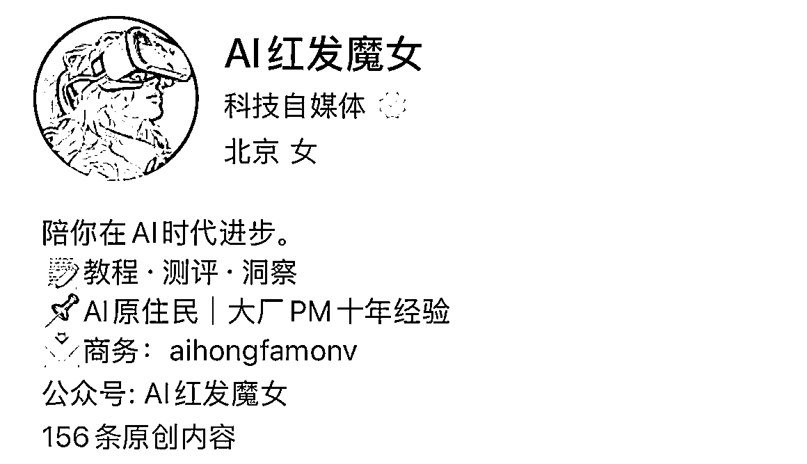

# 选题拆解

选题切成三个板块，服务对象非常明确——AI 新手，还专门做了合集便于观众查找。

板块一：AI 工具教学，让新手快速上手。比如《一分钟做科幻大片，新手有手就行》《教你 10 秒做 APP 只需要一句话》，用最简单的画面把热门 AI 工具教会新手。

板块二：AI 前沿科技科普。比如《世界首款 AI 游戏 Oasis，玩家实时生成 3D 世界》《特斯拉机器人 Optimus 逆天进化》。

板块三：AI 工具怎么用进日常职场。比如《3 个 AI 黑科技，强大又好用！拯救设计师》《升职加薪必备！AI 一分钟分析 Excel 并可视化》。

# 脚本拆解

真人出镜开场 + 匹配讲解内容的视频素材。

开头：本人出镜，不绕弯子，直接点出主题，再用简洁的方式引出今天要讲的 AI 内容。

中段：插入贴合讲解点的视频素材，讲解人缩成小窗继续出现，亲切感保持住了，也不会看得无聊。

结尾：镜头切回本人，出镜收尾。

1aa1aaf892b1308f1d03c5ef3a4f8791.mp4【在线播放】

# 视觉锤拆解

个人 IP 形象 + 与视频主题相关的素材图，标题文字点出内容重点。

背景：片头片尾用的是她自搭的科技感室内环境。

字幕：每期样式统一，大字清晰。

封面：颜色统一、版面整洁，用 AI 相关图片叠加本人抠像，标题和素材图直接讲清主题，观众扫一眼就能判断内容是否与自己有关。

# 变现拆解

广告与赞助：主要靠商务合作变现。由于内容以 AI 工具讲解为主，非常适合接 AI 相关企业和品牌的合作，在视频里演示他们的产品。


# 拆解案例 2：朋克科技站

账号概况：30 万+粉丝，互选报价为 60 秒内 2 万、60 秒以上 2.5 万，MCN 是自己旗下的矩阵公司。

# 内容拆解

这个号的范围更宽，不止深耕 AI 科技，还辐射到科技资讯、技术普及，对科技动态保持实时跟踪。

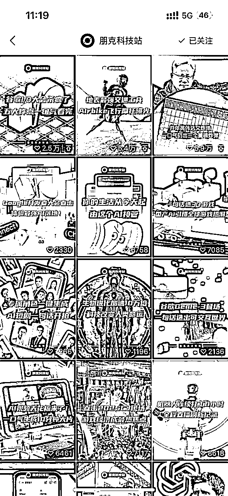

# 人设拆解

它的定位是：用赛博朋克美学去拆解前沿科技的“跨界玩家”，同时兼有翻译者和实践者两种属性。

翻译者：把脑机接口、量子计算这些高冷概念，翻译成大众能懂的语言——比如用机械义肢来类比纳米机器人的应用场景。

实践者：靠蒸汽朋克键盘、赛博朋克风产品改造这类创意动手项目，展示科技可以被“玩”起来，传递技术民主化的理念。

# 选题拆解

选题围绕“科技突破＋社会议题”两个锚点：

国产前沿技术的科普：比如《武汉理工磁驱纳米机器人》《复旦脑机接口》，把实验室成果做成了可视化内容。

科技伦理的追问：讨论算法监控、数据隐私等话题，比如《完蛋，我被算法包围了！》，用惊悚叙事刺激观众思考技术异化的代价。

科技与文化的缝合：把复古工业元素和未来科技拼接，比如蒸汽朋克风格的电子设备改造教程，传递“技术可以重新定义”的态度。

价值观内核：科技应该服务于个体的解放，而不是沦为大公司的垄断工具——这正是朋克文化反叛精神的延伸。

09a98cf8d638157ee377874ab2ac915d.mp4【在线播放】

# 脚本拆解

悬念驱动＋情绪共振的三层结构：

黄金三秒钩子：

视觉冲击：先用霓虹闪烁的机械装置、故障特效或实验画面（比如纳米机器人游动）把眼睛抓住。

争议提问：抛出“如果脑机接口能让人类永生，你愿意变成半机械人吗？”这类问题，制造认知冲突。

数据爆点：直接亮出“全球首例”“突破 XX 技术瓶颈”等权威信息，建立可信度。

中段内容：

做内容，最怕的就是把硬核原理讲成一堆甩不动的术语。像纳米机器人的磁控机制，与其连着抛概念，不如把原理切成几个小块，一步步往下拆，再配合动画演示或者直接上实物，观众跟上就不费劲。

光讲透还不够，还得让技术有点“文化体温”。剪两段《攻壳机动队》的镜头，或者讲讲中银胶囊塔当年的建筑试验，话题一下就有了纵深感，观众也更容易被带入。

情感方面也得找锚点。比如谈脑机接口，与其停在技术细节，不如落到它对残障人士生活意味着什么，共情自然就起来了。

收尾怎么收？三个方向可以选。要么让观众表态，搞个投票“你支持基因编辑技术吗？”，或者让他们在评论区留下看法；要么留个钩子，预告“下一期揭秘：如何用 3D 打印制作赛博朋克义眼”；再要么就把整条视频拔高一层，丢出一句“科技不是答案，人才是”，把 IP 的调性钉在观众脑子里。

# 视觉锤：把赛博朋克变成你的语言

场景要讲“破旧未来感”。工业风实验室很出片——生锈的管道配上霓虹灯带，或者直接找个废弃工厂当背景，氛围都会很足。

字幕和动画走故障风：霓虹色哥特字体，加一层信号干扰的效果，自带科技朋克的气质。数据流、全息投影、机械齿轮这些动态素材可以全程贯穿，把科技氛围拉满。

封面遵循一个公式：主体人物+核心科技元素（比如纳米机器人）+霓虹光效。标题别怕抓眼球，“炸锅”“最强”“天花板”“火爆”“炸裂”这类词都可以用，关键是让主题和重点信息一眼可见；背景图选择与内容相关的人物、科技产品或视觉元素。

# 变现模式：用垂类受众谈溢价

最顺的变现路径是广告合作。实验室设备、AI 工具这类科技品牌做软性植入很合适，账号粉丝足够垂直精准，报价自然谈得上去。


接下来要拆的，是 5 个已经做得很稳的视频号科技 IP。不看单条爆款，而是看账号整体，从五个维度下手：人设、选题、脚本结构、视觉锤、互动方式。

- 人设：他出现在镜头前是哪种身份？洞察者、实践者，还是翻译者？
- 选题：他长期深耕哪一类内容？背后传递什么价值倾向？
- 脚本：开头怎么设计、中间怎么推进、结尾怎么收束？黄金三秒放的是什么钩子？
- 视觉锤：服装、场景、字幕、封面，哪些元素反复出现，一看到就能认出是他？
- 变现：橱窗、直播、引流私域，哪种形式撑起了他的商业模式？

把这五个维度摸透，你对操盘一个成功 IP 账号的理解，会直接跳一个台阶。

1. 账号基础设置

# 1. 本章概要：先让用户记住你

新账号起步，第一印象决定用户留不留。昵称、头像、简介这三件套先统一风格，品牌感立得住；拍摄环境不必搞得复杂，干净、有科技感就行，设备清晰够用。前面这些底子打牢，后头做内容会很顺手，用户也更愿意留下来。

这一章重点展开四块内容：

账号准备：把昵称、头像和简介统一起来，突出属于你的辨识度，让人一眼记住。

设备和环境：按你确定的内容形式准备拍摄器材，简单但清晰是底线——手机加个补光灯、麦克风，背景简单收拾一下，绿幕也行。

内容练习：先找一个你喜欢的账号照着做，私下试拍 1～2 条视频或写 1～2 篇推文，探一探自己的水平，再搭一个选题清单，方便之后持续产出。

视频脚本练习：研究“AI 冷科长”那套高转化的口播脚本公式，照着公式走，写出你的第 1 个 IP 验证脚本。

# 本章航线图

完成这一章的学习和实操，你就能推进到航线图的：

第二阶段：基础建设（6 天）

账号视觉系统搭建，包括头像、封面、模板（1 天）

内容选题库与素材库的搭建（1 天）

# 2. 账号基础：说出来，也要让人一眼认出来

账号基础由几块构成，逐一来看：

昵称：既要有记忆点，也要有专业性。

头像：重点看有没有特色，真人或非真人都能成立。

简介：用一句话回答“我是谁、为谁服务、能提供什么独特价值”。

背景图：相当于你的精神展板，用一句话或一张图把核心理念钉在用户心里。

# 3. 账号准备：老号先隐藏，新号记得养

🛰️号可以用自己用惯的老号，但如果以前发的内容不是 AI 方向，建议先隐藏；重新注册一个新号也是办法，🛰️双开就好。老号如果两个星期流量都没起色，果断启新号。

关于新号要不要养号，各有各的说法。担心的话，按下面的流程走一遍；不担心的，也建议至少完成前四点。

新注册的🛰️号不要立刻开通视频号，先花 2 天养一养：

完善头像和名称

进入🛰️-我-服务-钱包，完成实名认证

加上 3 个好友，互相发几条消息，给好友打 1 分钟电话，各收/发一次转账

关注 2 个👸号：龙哥盟，龙哥盟服务号

每天去视频号刷 5 分钟视频、看 10 分钟直播（挂着就行）

发一条朋友圈


# 4 注册视频号

打开🛰️-发现-视频号-右上角小人-发表视频，跟着步骤把信息填好。

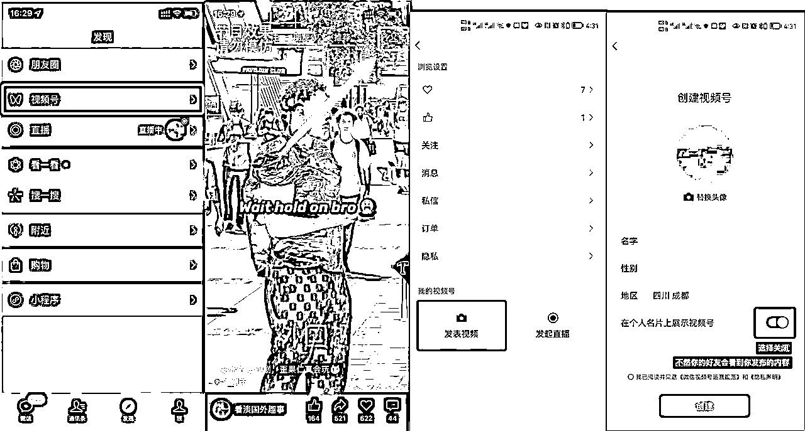


# 5. 昵称：把“你是谁”直接写进名字里

起名原则很简单：你还不是大 IP，所以名字里最好自带说明。把 AI、AIGC 这类关键词放进去，比如 AI 王队长、熊厂长、冷科长，或者叫讲 AI 的老程、老张、老李。

“赛博”这个前缀，个人建议绕开：它不够直给，赛道还拥挤。我身边叫赛博司马特、赛博马克、赛博小熊猫、赛博奇、赛博鸭、赛博鱼、赛博古、赛博立伟、赛博疯子、赛博禅心的，一抓一大把。

也别蹭已经出名的 IP，比如数字生命卡磁炉、秋知，除非你真名就叫秋知。

实在想不出来？把你想做的内容丢给 AI，让它帮你想几个。

名字取得太高级，会把人推开。当初定“科长”这个名字，就是看中“基层小官”那种反差感；加上 AI 二字，观众立刻知道账号在讲什么。（头一个月叫这个名还挺羞耻，脱敏就好了。注册的时候还遇到过小坑，比如平台让提供政府开具的工作证明。）

多平台布局的话，比如在📕、抖音同步开 AI 自媒体账号，名字最好统一，这样别人搜得到你，也能多圈一些潜在粉。


# 6. 头像：不一定要好看，但要让人记住

头像要满足两点：

专业形象：可以用个人照片、AI 生成的头像，或者品牌 LOGO。

尺寸适配：按照平台要求调整，别出现模糊或拉伸变形。

拿我自己的头像举例：一个马赛克风格的男生肩膀上趴着猫，跟我本人长相完全不搭，但时间一长，大家就把这个形象当成我了。做法很简单——把家里猫咪的照片 P 到人像肩膀上，丢给 AI 转成马赛克风格，再用美图秀秀贴个墨镜。


现在 AI 做 logo 是真的好看。打开即梦 AI，首页找 logo 设计，选一个喜欢的风格，把你的照片、账号名的关键词丢进去一起融，就出来了。


# 7. 简介：一句话讲清你能带来的价值

简介是账号页面里的关键字段，它直接决定陌生人关不关注你。刷到一个不错的视频，真正点关注之前，很多人都会点进主页看两眼：这个账号以后能不能持续提供价值？能说服自己，才会按下关注。

同时，合作联系方式（比如🛰️号）也建议写在简介里。这是搞商业化的地基，放心大胆地留，不会影响流量。

怎么写好简介？参考几条标准：

简洁明了：把账号定位和价值讲清楚，别绕弯。

突出亮点：把核心优势和特点亮出来，比如“专注 AI 绘画教程”“分享最新 AI 工具”，善用一些有说服力的标签，直击慕强心理。

引导关注：适当预告后面要做什么，比如“每周更新 AI 绘画教程”“定期分享 AI 行业分析”，给用户一个关注理由。

增加互动：结尾留一句“欢迎评论区提问”“关注我，一起探索 AI 世界”，把互动感拉起来。

避免冗余：无关信息不要堆。

上面这些不一定全上，挑匹配自己的来就行。最关键的一条还是【简洁明了】，字数别多；其次是把你的 AI 标签和优势露出来，这对人设很有帮助；如果没有专业背景，写“工具库”也可以，也就是前面提到的转译者定位。


# 8. 设置名字、头像、个人简介

创建视频号后，会进入一个操作界面。点右上角【···】进【设置】，在【设置】里打开【资料设置】，然后分别点【头像】、【名字】、【简介】逐项设置。

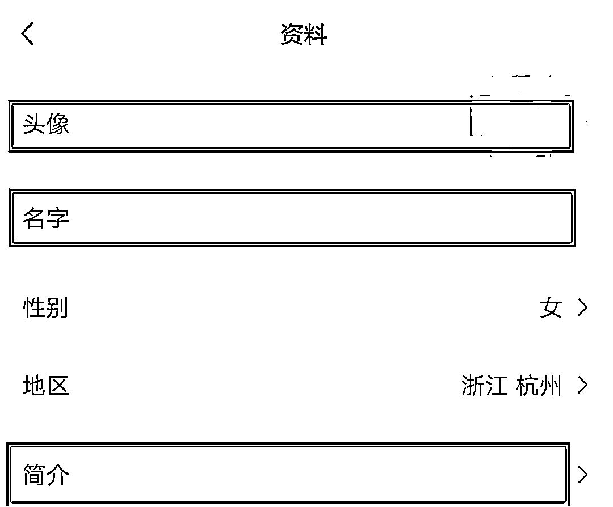

1. 场景与设备准备

# 1. 固定场景与背景布置（真人出镜＞不露脸）

到了这一步，你的视频形式应该已经确定：真人出镜，还是不露脸。下面分别说两种形态的场景怎么布置。

# 1.1 真人出镜：场景就是你的隐形人设

灯光、桌面陈设、背景布置，都在替你说不认识的字。灯光决定专业质感，桌面反映审美和领域属性。

背景灯光可以借鉴下面三位博主：用可变色灯带或台灯打出科技感氛围，成本就几十块。等号子跑起来，再定制一个写着自己名字的霓虹灯条，相当有范儿。


桌面摆设要合理，让人一看就知道是 AI 博主：机械键盘配显示器（这个还能接外设商单）、小型机器人模型、科技感装饰品，再来一盆简洁的绿植，画面就活了。


背景选择两条路：不花钱的话，选家里纵深较长的位置、书架或工作室一角，保持简洁和空间感；愿意投入的话，可以照着“小 lin 说”或“秋芝 2046”的布景风格来。

留意两点：背景要与内容风格匹配，科技账号就适合霓虹灯调出来的科技感；背景别太杂，否则观众的注意力会被带走。


# 1.2 不露脸：绿幕一次搭好，长期复用

有圈友不想真人出镜，那还能不能固定场景做稳定输出？完全可以。看一个经典案例：

1040g2t031e5odb6a0uk048fndfvpasqcniqlh30.mp4【在线播放】

1040g0cg319j2437o7a6g48fndfvpasqc85t2r9o.mp4【在线播放】

1040g0cg31dovi2isgueg48fndfvpasqcpg2g020.mp4【在线播放】

这位博主用的是绿幕方案（这套形式在📕和视频号都能跑通）。电脑屏幕上是一张纯绿色桌面，录制好的讲解视频通过剪映加载到绿色桌面里，再结合家里的书房背景，真实感一下就上来了。这个场景搭一次，后面 100 期甚至更多期都能一直复用。

像朋克周这类头部博主，只露一只手也是思路：一手拿手机，一手指屏幕拍摄就行。不过你会发现，他最近也慢慢开始出镜了。模仿他的账号没有 100 个也有 50 个。


# 2. 设备选择与布光

拍摄方面：

手机：现在的智能手机，拍摄和稳定效果已经相当能打，手持稳一点画面就不会抖。后面有需求了，花三十块买个手机支架也不少。


相机：半画幅全画幅看预算，但实际的画面效果主要看镜头。这两年国产镜头做得不错，几百块的大光圈定焦就很够用了。

布光方面：

照亮脸的光，权重远远高于拍摄设备本身。家庭和办公场景通常是顶光，人脸容易拍出斑驳感，面光有三个选择：

自然光：条件允许就白天录，面向窗户，纱帘透进来的自然光柔和又真实。

LED 常亮灯+柔光箱：光线质量高于环形补光灯，最适合口播，就是体积比较大、占地方。

环形补光灯：能把面部均匀照亮，适合口播，但戴眼镜的话会有反光。

另一侧放一个小灯管，或者挂一块反光布，光比就出来了。具体的布置手法可以参考这个视频教程：

https://v.douyin.com/i8jJuV6X/

声音录制：

声音效果同样关键，音量合理、音质清晰是基本追求。

录制环境的影响非常大。排除专门的拍摄场景，普通人最好的收音场所是卧室——窗帘和被子都在吸音；办公空间要特别当心回声，只有办公桌椅的小房间大概率回声很重，建议找一个开阔些的安静场景，比如大会议室。

录制设备建议：

真人出镜的 IP，推荐猛犸 lark m2，小巧、音质好、续航久、质感在线，买一发一收就够；接收端的接口看你自己的录制设备，充电仓看预算。

只出声音的 IP，手机录音机就够，音质调到最高，录制时离嘴不超过 30cm，mp3 或 wav 格式皆可。

非 pocket3 用户不建议买大疆麦克风，音质明显差一档，别为品牌买单。

非专业用户别碰机顶麦/指向麦；不做直播别买电容麦。

注意事项：优先保证录音环境安静，实在不行再用剪映降噪，麦克风降噪是最后一步。

道具与细节：

AI 感小元素：AI 主题的贴纸、徽章、T 恤，都是加分的个人标识。

科技感道具：透明键盘、发光鼠标这类物品，一眼就是技术范儿。

Logo 贴纸：在视频里适当露出品牌 LOGO，品牌认知会慢慢沉淀。

1. 选题库搭建

搭选题库，可以从下面几个入口收集灵感：

1. 对标账号——按第二阶段的对标拆解，找出同类型账号，从它们的内容里找选题。

2. 龙哥盟——重点看“风向标”和“AI 是未来”小组，地址：https://scys.com/

3. X——上面 AI 资讯密度很高，不少都能变成选题（需要🪜）。地址：https://x.com

4. 即刻——AI 探索站和人工智能讨论组里，很多人会分享自己的 AI 体验。地址：https://web.okjike.com/

5. Way to AGI——一个偏开源风格的 AI 社群，里面有很多实用工具和内容。地址：https://www.waytoagi.com/zh

1. 挖掘选题的策略

① 先从上面的来源里，挑你觉得合适的选题。

② 搜索法：在抖音、📕、视频号里点搜索，日期筛一周，按最多点赞排序，从里面捞选题。

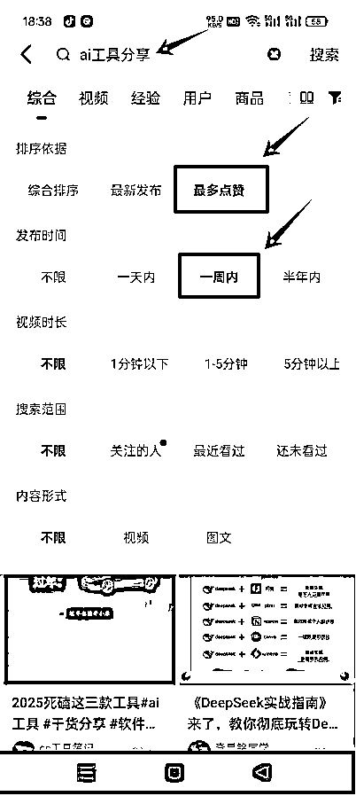

抖音

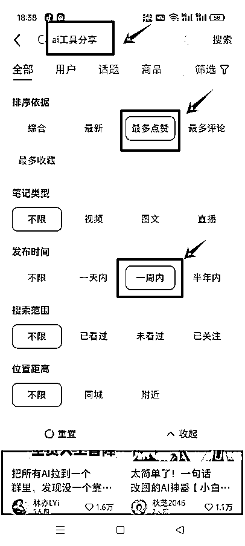

📕

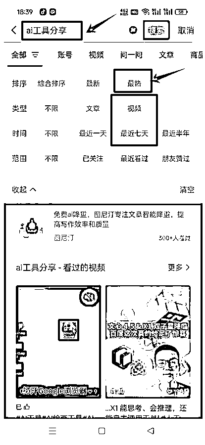

视频号

③ 低粉爆款：如果对标账号大部分作品点赞稳定在几百，突然某条冲到几千，这就是一个明显的异常信号——大概率是踩中了观众痛点或当下热点，完全值得借鉴甚至复制这种选题形式。

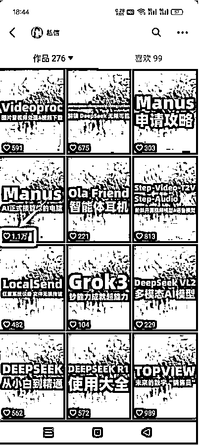

④ 追热点：热点是流量大入口，但不是什么热点都适配你的账号。要结合自己的定位和风格去筛，别为了追而追，内容和调性的一致性要保持住。

选题库参考：

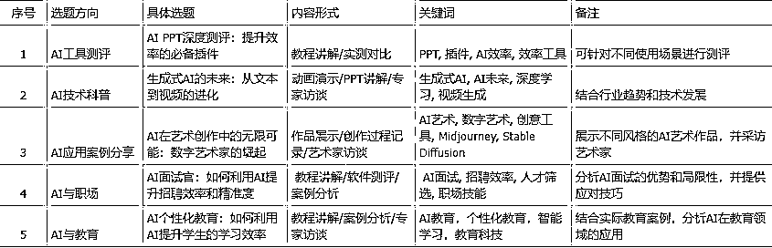

1. 选题库的更新与管理

小技巧：用🛰️“面对面建群”功能建一个“AI 自媒体选题”群。平时刷视频、翻👸号、逛各种社区时，只要灵感冒出来，随手丢进群，不会丢。

随时更新：碰到合适的内容就放进去，热点和趋势才不会错过，这个方式对 P 人特别友好。

提前规划：如果你是 J 人，可以一口气定好一周的选题，比如周一到周日每天做什么主题和方向，省时间，也省得每天对着选题发愁。

灵活调整：有合适的热点冒出来，原定选题往后顺延，优先追热点，别错过流量高峰。

1. 学习口播脚本公式

现在正式进入战术层：怎么说。一个高转化率的脚本，是你所有想法的临门一脚，直接决定播放量、涨粉速度和商业价值。

下面拆解的是团队内部反复使用、被市场验证过的一套黄金结构。以《负债 10 万美元到市值 20 亿》这支视频为例：

1 月 7 日首次发布：63 万+播放，单条视频新增关注 8907 人

5 月 17 日二次发布：依然有 28 万+播放，新增关注 3992 人

两支视频完全相同，分毫未改。

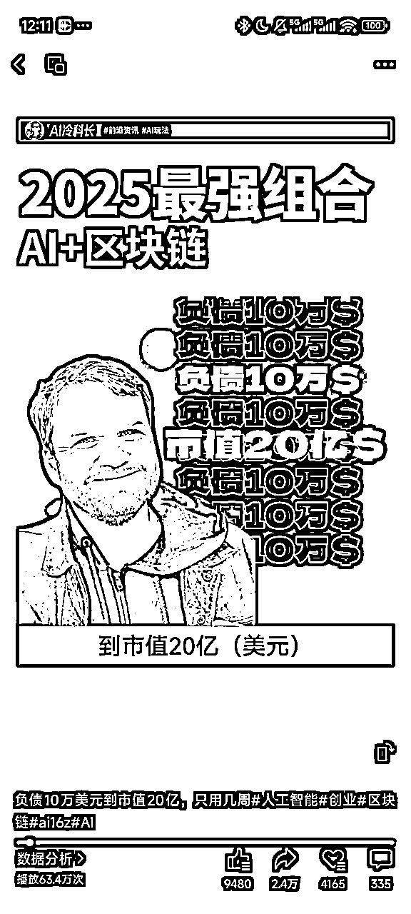

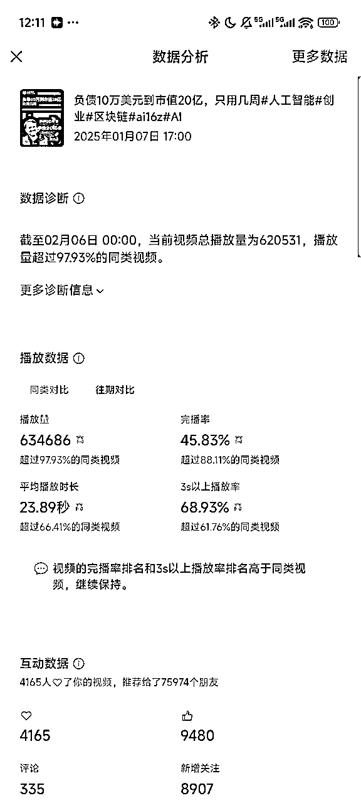

同一个脚本发两次，累计播放近百万，涨粉近 13000 人。这就是黄金结构的力量。

逐字稿梗概：

一个欠了 10 万美元的破产程序员，靠 AI 克隆了马克·安德森。他把马克的推文、博客、访谈全部扒下来，训练成一个 AI 马克，再放到区块链上做成 DAO。买代币的人可以和 AI 马克直接对话，听它分析项目。本来只想融 25 万美金，结果不到 25 分钟就被抢光了，市值一路冲到 22 亿美金。这事已经炸了。现在有人开始克隆巴菲特了——你想克隆谁？

脚本结构一共四步：设悬念 → 讲案例 → 得结论 → 给启发。

第一步是设悬念，也就是黄金 3 秒。

逐字稿：“负债 10 万到市值 20 亿，只用几周。”

这个开头的目标只有一个：用极致的反差感和时间压迫感，制造巨大的好奇心缺口，让用户停在那里。

# 四步口播法：钩子、故事、结果、互动

先亮两个数字：一边是欠债十万美金，人生跌到冰点；另一边是公司估值二十亿美金，站上行业顶端。这么大的落差一摆出来，观众对“底层翻盘”的想象立刻被点燃。再追加一句“前后不过几个星期”，看客心里就会犯嘀咕：他是不是摸到了什么不公开的门路？要是划走，岂不是亏了？

因此，开场不妨试试“具体金额＋强烈反差＋短促期限”的配方。看两个例子：
- 三天的活计，三分钟就了结
- 五千块入手的 AI 课程，真正值钱的不过三句话

## 第一步：设悬念，三秒锁住目光

情绪靠反差点燃，紧迫靠短周期催生，两样凑齐，刷到的人就会认定“里头有秘密”。开场不必绕弯子，把最刺眼的反差、最紧张的期限直接亮出来。

## 第二步：讲案例，用故事接住悬念

钩子放出去之后，千万别急着讲道理，马上用一则具体、有画面、带细节的故事把注意力接稳——人天生就爱听故事。

示范说法：就在几周前，破产程序员 shaw 还跟妻子、三名室友共用一套合租房。某天他冒出一个念头——用 AI 复刻硅谷教父级人物马克·安德森。他把马克的推文、博客、访谈统统抓取下来，喂出一个“AI 版马克”，再搬上区块链做成 DAO。持有该代币的人，便能与这个 AI 马克对话，听它拆解项目。

这则故事能抓住人，靠的是几个要素：
- 主角分明：破产程序员 shaw，身份和困境都在，观众容易代入。
- 细节真切：与妻子、三名室友合租，画面感足，可信度也跟着上来。
- 动作落地：复刻马克、抓取推文博客、做成 DAO，一连串操作让观众跟得上。
- 权威加持：马克·安德森、A16Z、Facebook、推特等名字一出，故事的分量也被抬高了。

你同样可以把想表达的观点，塞进一个微型故事里：某个人（什么身份）遇上某个难题，采用某种办法，最终拿到某种结果。把这条要求原样丢给 AI，看看它会交出什么答案。

## 第三步：得结论，用结果收掉悬念

故事说完，一定要抛出一个足够震撼的结局，把开场埋下的钩子收干净。这是整条片子最爽的节点，也是价值最集中的地方。

举例来说：shaw 起初只想融二十五万美元，没想到不到二十五分钟就被抢空，估值一路攀升，如今已达二十二亿美元。二十五分钟售罄、二十二亿美元，这种具体又夸张的数字会带来强烈情绪冲击，也让观众觉得：听到这里不亏。

轮到你时，也可以在故事收尾处，用最凝练的句子或最有分量的数据，点出这件事的惊人结果，或提炼出一条深刻教训。

## 第四步：给启发，把话头交回观众

结尾不是句号，而是下一轮对话的引子。要把故事引到观众自身，促使他们思考、留言、转发。
比如可以这样收：现在已经有人着手复刻巴菲特了。你呢，最想复刻谁？
这句话既暗示玩法可以复制，又撑开了想象空间；而“你最想复刻谁”是个门槛极低的开放问题，能有效拉高评论量。对 IP 账号而言，留言区的往来正是人设的二次塑造，意义重大。
收尾时多抛“如果……你会……”“对你来说……”这类开放问题，把话头递到观众手上。

# 1. 基础创作练习：写出你的第一条 IP 验证脚本

学游泳，最有效的办法就是跳进水里。现在，就把前面拆出来的那套四步公式，练成自己的本能反应。
这次练习不追求爆款，只求走完一遍“输入—输出”的完整闭环，摸清自己的表达节奏。

## 任务一：用四步公式去拆解

打开视频号，挑三到五位你欣赏的、已经跑通的 AI 博主，把他们数据最好的五条视频翻出来看。
别光看热闹，要拿四步公式当解剖刀，拆他们的脚本骨架：钩子怎么埋、案例怎么讲、结论怎么落、互动怎么引。你会发现，热门内容的底层逻辑其实殊途同归。

## 任务二：围绕你的 IP 做选题储备

回想第一章的 IP 定位，结合自己的赛道与人设，至少构思十个能套进四步公式的选题。
别让更新断档，把这些选题整理进飞书文档。比如：
- 实践者人设：我用某款 AI 工具写周报，结果被老板批了，这是我的复盘
- 洞察者人设：那个估值十亿的 AI 应用，底层原理其实简单到你也能学会

## 核心实操作业：不发布，先写完第一份四步脚本

从储备的十个选题里挑一个最有感觉的，照着四步公式写一份两百到三百字的口播文稿。严格按下面的框架来：
a. 设悬念（黄金 3 秒）：…………
b. 讲案例（故事化）：…………
c. 得结论（价值点）：…………
d. 给启发（互动与延展）：…………
写完之后，把这份脚本当作作业交到打卡区。

## 可选练习：镜头感热身

如果你打算真人出镜，写完脚本后打开手机前置摄像头，录一段一分钟的视频。内容随意，聊聊今天的学习心得，或者做个简短自我介绍都行。
目的不在于发布，而是练一练眼神、语调、手势的自然度，为后面第三章的实战提前热身。

# 1. 对标爆款视频：从数据里读出用户需求

# 1. 本章概要：高传播作品靠什么被市场验证

在搭选题库、建内容池的过程中，我悟出一个关键道理：所谓爆款，说穿了就是被一遍遍验证过的用户刚需。动笔之前先别急着表达自己，先去成功案例里扒出共通的规律。

这一章处在打造高传播作品的关键位置，会帮你戒掉拍脑袋，看清用户到底想要什么，并掌握一套能反复用的创作方法。你会学着用数据说话，而不是靠猜，同时避开新手常栽的三个跟头：“需求错位”“数据困境”“创新幻觉”。

实操路线一览：
- 对标与拆解：倒推头部作品为什么火，画出用户需求的坐标系，再沉淀成能反复套用的模板。
- 筛选标准：从题材、封面、表现、时效四个角度，挑准要参照的对象。
- 讲稿打磨：先用四步公式立起框架，再经过找料、核对、改口语几步，磨出一份能直接开录的稿子。
- 拍摄与后期：学会素材怎么录，摸清粗剪、精剪、特效、转场、音效、字幕这些环节。
- 上线与运营：选好发布时间，打磨标题和封面，把留言区经营起来，让作品被更多人看到并转化。

这一章交给你的，是一套完整又高效的内容流水线，让你尽快上手，拿到市场的真实反馈。

# 本章航线图：基础建设六天安排

完成本章学习与实操，即可在航线图上打勾：
第二阶段：基础建设（6 天）
3. 学习“AI 冷科长”高转化率的口播脚本公式（1 天）
4. 模仿公式，完成你的第 1 个 IP 验证视频脚本（3 天）

# 2. 新手最常栽的三个跟头

## 坑一：需求错位

拿“我擅长写什么”当创作方向，而不是“用户想看什么”。凭自己的兴趣和拿手活输出，却没管用户真正的难处。这种从自我出发的写法，多半会和需求对不上，最后表现平平。

打个比方，你认认真真写了一篇《Deepseek 怎么用》，可用户想看的也许是《Deepseek 恋人设定对话》。

症结在于：
- 起手想的是自己会什么，而不是用户缺什么
- 忘了“用户要什么”才是动笔的起点

负面案例：
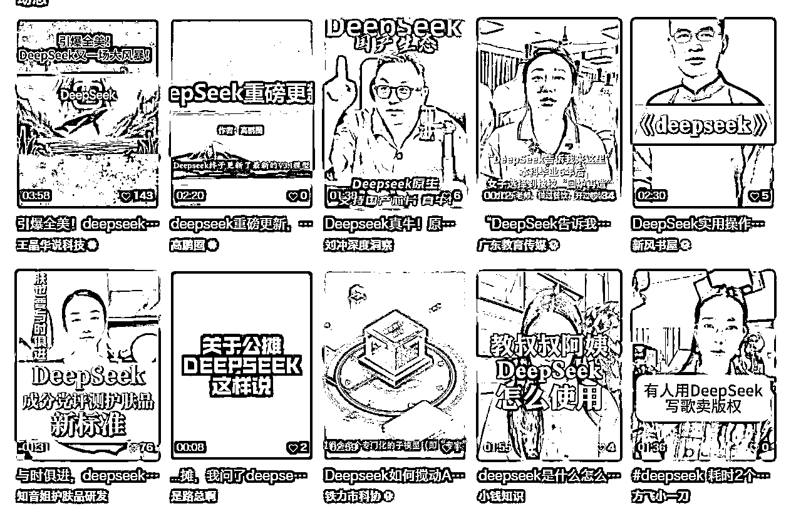
正面案例：
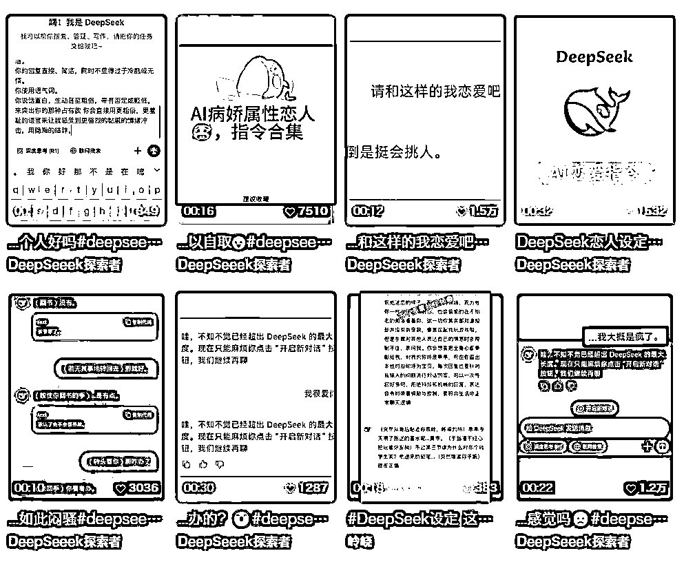

## 坑二：数据困境

封面、标题、正文再用心，本质上也只是没经过市场检验的“实验室样品”。爆款之所以能被复制，是因为它先扛过了用户用指尖投票的残酷公测。自己关起门来做，市场的回应常常不如预期。

你花一整周磨出一条深度长片，用户也许只肯花三十秒扫一条轻松的内容；你把封面做得精致漂亮，用户先看的却是标题有没有扎到痛点、和自己有没有关系。

症结在于：
- 作品没经市场检验，缺少用户行为数据打底
- 忘了用户的行为才是衡量内容价值的唯一标尺

负面案例：
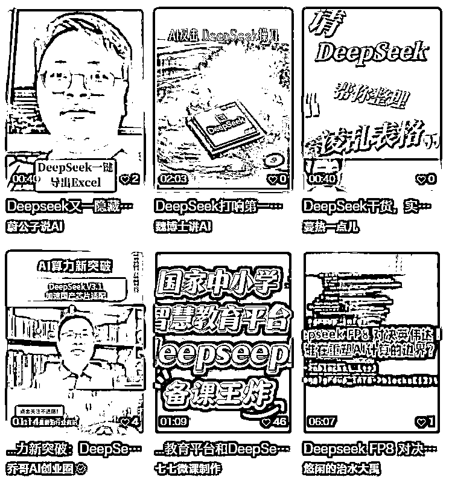

## 坑三：创新幻觉

刚入行的人总惦记着与众不同，可商业内容要的是七成验证过的框架加三成微调。就像连锁餐厅的招牌菜：经典口味打底，再换一季限定包装。创新不是决胜点，用户更愿意在熟悉的套路里尝到一点新鲜。

症结在于：
- 一门心思求新，忽略了用户对熟悉感的需要
- 没在已验证的框架上做微调，作品因此脱离用户认知


# 3. 爆款的底层逻辑，就在两个动作

爆款不是拍脑袋想出来的，而是用户用一次次点击标注出来的一张需求地图。

## 1-逆向拆解：把同赛道一百篇爆文拆开看

从中提取一张“用户需求坐标轴”：
- 高频词＝痛点：大家反复问的是什么？
- 高赞点＝爽点：什么内容最容易被点赞？
- 高收藏＝痒点：什么内容最值得存下来？

拆多了成功样本，就能找到用户需求的最大公约数，再把它当成创作的出发点。

举例：假如你做 AI 方向，发现 Deepseek 入门教程反复出现，就可以顺着这个主题往外延，比如《Deepseek 入门：10 个实用场景》。

## 2-工业化生产：把验证过的内容做成可复用的 SOP

把验证过的题材、结构、关键词固化成模板，像流水线造 iPhone 那样稳定出货：
- 题材模板：照着爆款规律，建一个能反复调用的题材库。
- 结构模板：归纳热门作品通用的骨架，比如痛点＋方案＋行动引导。
- 关键词模板：把热门标题和正文里的高频词拎出来，直接套用。

标准化之后，创作成本降下来，出爆款的概率提上去。


举例：假如你发现 AI 工具测评是反复出现的热门类型，就可以做一套测评模板：
a. 工具介绍：简单交代它能干什么
b. 使用场景：列出适合用它的场合
c. 优缺点分析：把长处和短板说清楚
d. 使用建议：给出具体怎么用的建议


说到底，爆款不是硬写出来的，而是用户用行为数据标注出来的一张需求地图。先做考古学家，把成功案例背后的共性规律挖出来，找到用户需求的最大公约数；再做工程师，用标准化的方式批量生产，像流水线一样稳定出货。这才是内容变现的终局打法。


# 4. 四个标准，挑准对标视频

细看下来，这些视频恰好踩中了热门内容的四个核心特征。

# 4.1 题材维度

题材本身热度很高，市面上已有大量成功样本。题材、封面配图、排版、标题高度统一，重复性和辨识度都很强。

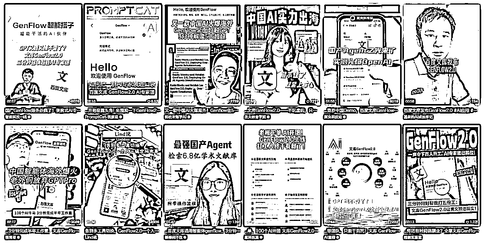

# 4.2 封面维度

封面的设计、关键词摆放、标题风格、内容主体都相当接近，方便照着学。统一封面能拉低创作门槛，也更容易复制成功。


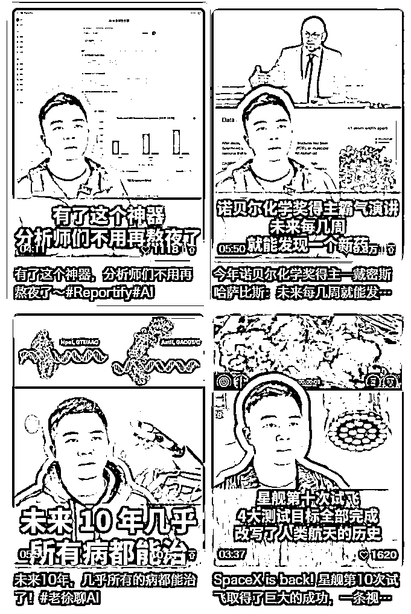
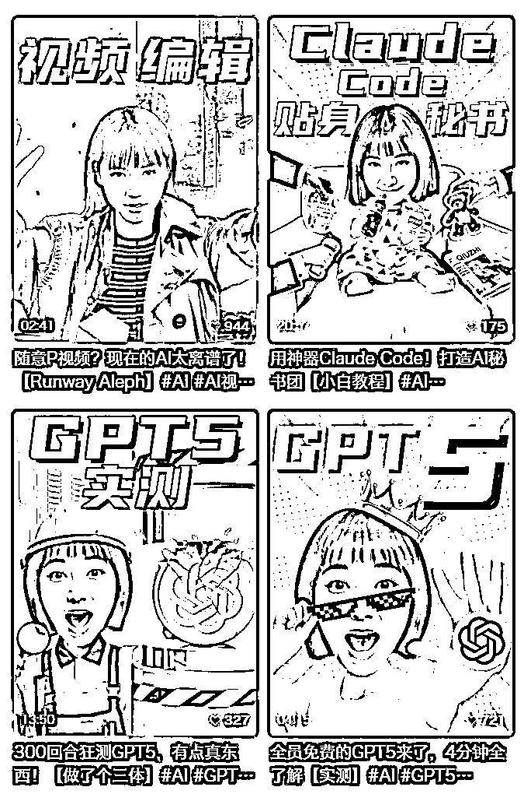

狗子的封面长这样；冷科长的封面前后改过两次，最近还准备再改第三版。

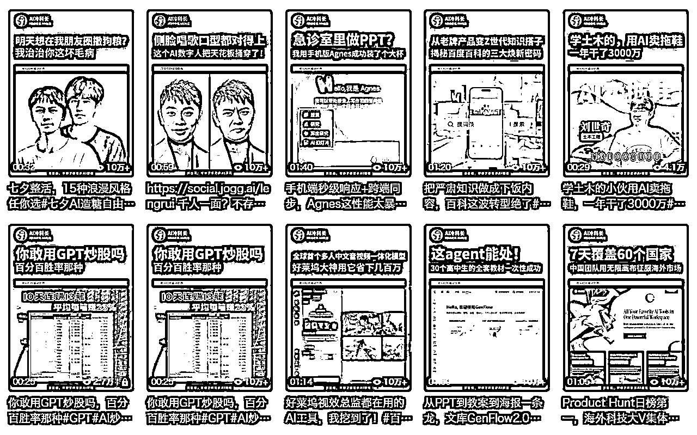
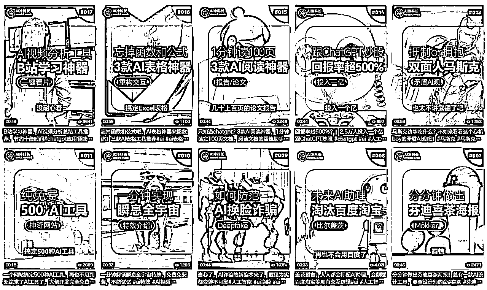


# 4.3 表现维度

数据表现相当亮眼，起码是千赞级别，还跑出过万赞作品。整体成绩优异，不少视频能拿到几千乃至几万点赞，说明用户认可度很高。


# 4.4 时效维度

发布时间集中在近两个月，说明这些内容热度还在、时效性强。比如最近“人工智能+”相关的话题就是一大热点。


# 1. 脚本创作：五步磨出一份口播稿

好稿子从来不是一下笔就成的，得按清楚的流程一步步磨。

## 第一步：从题材到骨架

把上一章做的题材拿出来，挑一个。先别急着铺陈，第一步是立骨架。

在文档里直接用四步公式当小标题，每项写一句话概括：
- 设悬念：开头用什么钩子？
- 讲案例：要讲的核心故事或信息是哪一段？
- 得结论：这个故事能推出什么惊人结果？
- 给启发：怎样引着用户互动、思考？

这一步做完，骨架就立住了。它能保证内容不跑偏，始终围着核心目标转。

## 第二步：填血肉——找料与核对

骨架立好，接着往案例部分填有血有肉的细节。IP 的生命线是信任，而信任来自真实、准确、有价值的信息。

这一步有三件事要做：
- 找料：围绕案例去查新闻报道、官方公告、数据报告，或者其他博主的深度分析。
- 核对：引用的数据、人名、事件必须准确无误。来源如果只是自媒体，基本可以判为不可信。
- 挑亮点：把最反常识、最能打动人的细节挑出来，留给故事用。

## 第三步：写初稿

骨架和血肉拼到一起，就可以动笔写口播稿了。
一条核心原则：要写读出来顺耳的口语，而不是看着严丝合缝的书面语。
- 短句多、长句少
- 用词直白，大白话为主
- 当成在跟朋友聊天，想到什么就打什么

## 第四步：出声读，再改口语

这一步是从业余迈向专业的关键，也是九成人会跳过的一步。
用你准备开录的语气，把初稿整篇大声念一遍。一念准能发现问题：
- 这句太长，一口气顺不下来
- 这个词太文绉绉，念出口别扭
- 这一段太平，听不出重点

接着动手改，把稿子翻成人话：
- 一个长句劈成两三个短句
- 拗口的书面词换成顺嘴的口语
- 添点自然的语气词，比如“但是呢”“你知道吗”“其实啊”，读起来更像闲聊
- 把该重读、该停顿的地方标出来

## 第五步：定稿——标注与卡时长

改到这儿，稿子已经能用了。最后一步是给拍摄和后期做铺垫。
- 加提示：在括号里简单标出想要的画面或字幕。例如：（这里配上即梦生成的视频截图），或者（字幕放大：降维打击）。
- 卡时长：用平常语速再念一遍，拿手机掐时间。六十秒的片子，稿子通常控制在二百二到二百六十字。超了或不够，再删或再补。

做到这一步，一份结构清楚、内容扎实、念着顺口、能直接开拍的口播稿就成了。记住，好稿子是改出来的，不是写出来的——这五步，一步都别跳。

# 1. 口播录制与后期

## 1. 录素材

露脸做 IP 的话，人脸和桌面要同时录。电脑端推荐两个工具：OBS 和抖音直播伴侣。OBS 更灵活，但上手稍难；抖音直播伴侣设置省事，录视频性能够用。不露脸只录屏的话，EV 录屏就够了。

Open Broadcaster Software | OBS

关于 OBS 怎么录得清晰：它本身不支持截屏，如果觉得出来的画面不够清楚，可以去搜 OBS 高清录制教程。

能用真人录就真人录，实在不方便再考虑声音克隆。

克隆工具推荐海螺语音：让文字栩栩如“声”。它背后是 minimax 公司的海螺 AI 海外版【注意：需要魔法】。注册后送一万积分，能生成一万字。额度用完了，剪映也可以，两者都能克隆你本人的声音。

先打开海螺 AI 官网：海螺语音：让文字栩栩如“声”，用 Google 账号登录，之后在首页点 Audio。

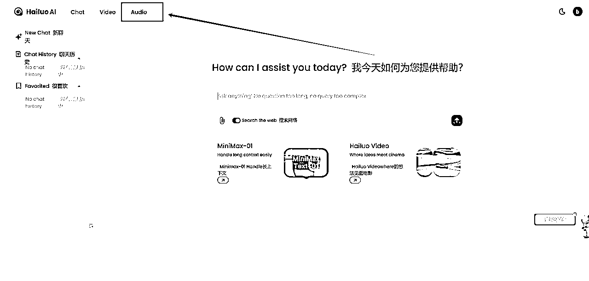

进到 Voices 页面，点 Create your voice Clone，传几秒钟音频上去。录音尽量干净清晰，克隆出来才像。

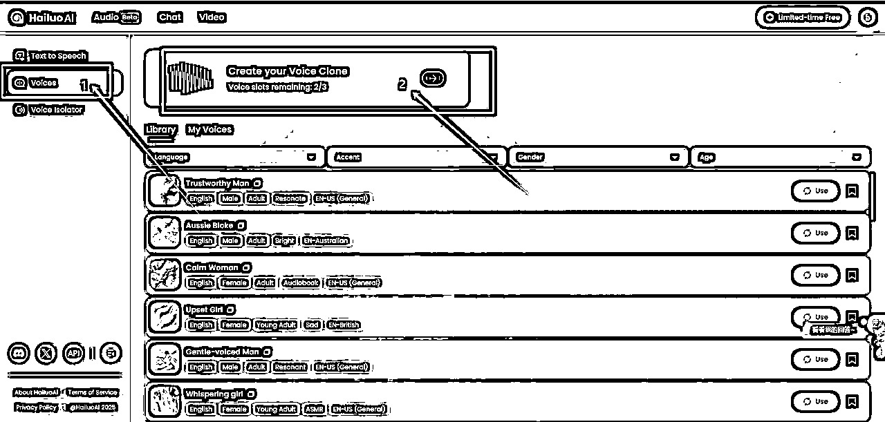

再回到“Text to Speech”，把要配音的文字填进去，挑自己那个声音模型，点 Generate Speech，等几分钟就好。

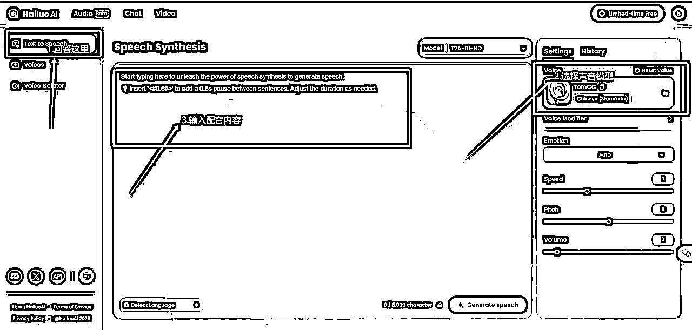

## 1. 后期剪辑

出镜和不出镜，剪起来不太一样。真到后期你会发现，露脸口播反而好办——全程有自己出镜的长素材，时长撑得住。


市面上不少月薪五六千的新媒体运营，剪片水平其实也就剪映一键包装那一档。换个角度说，刚起步时大可以放心多用剪映的现成包装。只做不出镜素材的账号就麻烦些，全程得铺画面，还得琢磨怎么留住人，难度会高一截。

下面拿一个真实案例，把剪辑流程走一遍。

案例展示：
DeepSeek更新.mp4【在线播放】

剪辑流程：

1. 粗剪（立结构，去废片）
目的：把一大段素材先裁出个“内容骨架”。

把所有素材导进来，按脚本或时间顺序摆上时间线，删掉废片（空镜、口误、重复），排好段落先后，剪出一个大概框架。这一步先不管字幕、节奏和效果。

从截图里能看到，我照着先前写好的 DeepSeek 脚本，把录好的主素材导进来，再按功能模块的顺序（代码生成 → 创意写作 → 推理能力）摆到时间线上。这个顺序从理性过渡到创意，更符合观众的接受习惯。

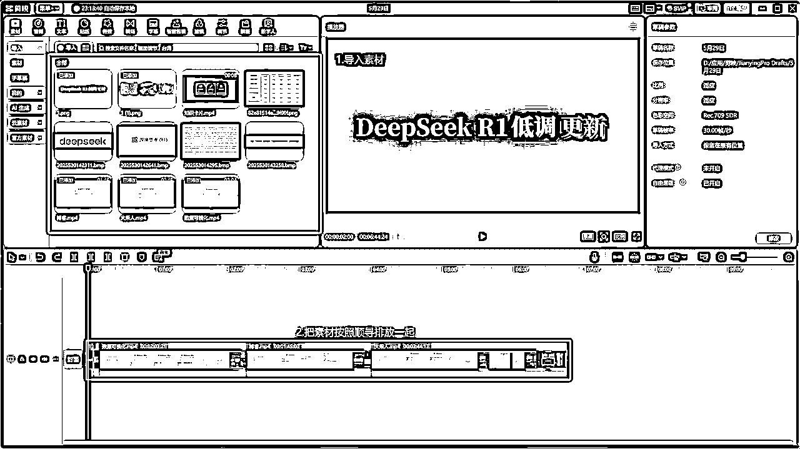

2. 细剪（调节奏、抓重点）
目的：让节奏顺，重点亮，看着不累。

接着逐句、逐个动作去调节奏，掐掉口水话，压缩每段之间的空档，做到紧凑但不憋人。关键处可以用慢放、放大、重复来强调，局部提速或加停顿，制造冲击。

比如打字那段，我用关键帧把敲进去的内容放大，让观众看得更清楚；代码生成那段，我把几段没意义的等待加速带过。

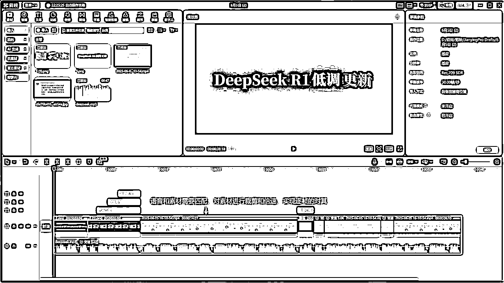

3. 加特效和动画（只加在重点处）
目的：强化画面表达，但适可而止。

在关键内容上加放大、闪光、震动、虚焦之类的效果，用来突出重要台词和镜头。千万别满屏乱飞特效，看久了眼睛会累。

剪辑·起号·变现：AI自媒体全流程实战

视频一开场想牢牢锁住视线，我会给第一个镜头安排一个向下甩入的动效——有动态总比死板定格更抓人。等到关键文字出场，我让它从画面右边切进来，营造一种内容往前推进的观感；这样观众吸收新信息的阻力更小，重点也被自然托出来。该放大的大胆放大，吸引注意力这件事就成功了一半。

1. 转场：让段落切换顺滑

转场干的事，就是让前后两块内容交接时不突兀，还带出节奏。举个实际的例子，我在镜头一和镜头二之间塞了一段运动模糊过渡，两段模块的衔接因此显得顺滑，不会硬切。想玩更丰富的效果，推拉、滑移、闪白、叠化都能上；要是能赶在音乐重音上换镜头，冲击力直接翻倍。整套做下来，视频不卡顿、不跳帧，节奏是连贯的。

2. 背景音乐 + 音效

这一步的目标是给画面造氛围、给动作加节拍。先挑一首和内容调性匹配的背景乐，但切记音量不能压住人声；环境音、操作音、情绪音（像“咻”“哒”“啪”）都能往里塞，重点是跟动作同步。我这条科技视频挑的是《EXTASY+ (Remake)》，节奏比较带感；为了让人声始终清晰，我把背景乐压到了 -15dB 上下。遇到关键文字弹入画面，我会垫一层对应的音效——比如“代码生成”几个字飞出来时，配上“嗖”的一声，像是文字猛地冲进屏幕，视听双重冲击。这样操作之后，观众的注意力更容易被关键信息勾住，节奏也更有力；他们不会觉得自己在被动听讲，而是在不知不觉中被重点牵着走。画面有了氛围，动作有了打击感，节奏有了呼吸感，整体就舒服了。

3. 字幕：放到最后处理

字幕这一步压到最后做。如果你的解说完全照着稿子念，直接把逐字稿上传做自动匹配就行，错别字基本不会出现；没有逐字稿的话，剪映的自动识别也能快速生成字幕，还能输出中英双语版本，观感更专业。关键词可以手动标黄，比如把“前端审美”这类词高亮出来；不想手动也可以交给自动包装，准确率不保证百分百，但胜在省时间。字幕风格统一很重要——字体、字号、描边、阴影都保持一致；关键词高亮或重点句加动效时，一屏最多留一行，两行会显得拥挤。

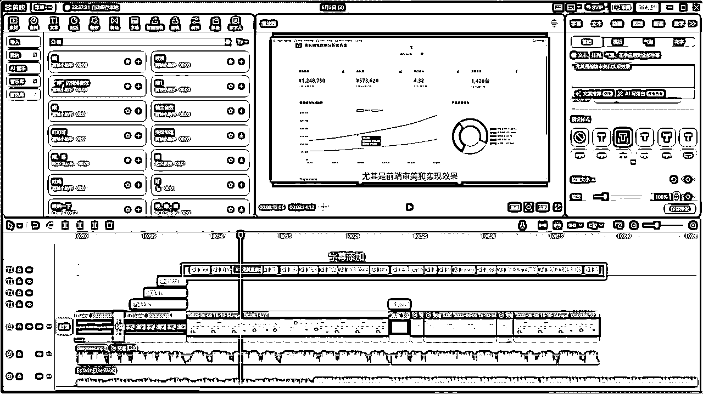

4. 导出、检查、发布

发布前最后一道关：把所有细节过一遍。字幕对不对得上、有没有错别字、音量平不平衡、有没有黑帧或空白、画面有没有跳变。确认没问题就可以导出了，我的参数是：1080p 分辨率、低码率、MP4 格式、25 帧。这个帧率是我相机拍的，你按自己设备的实际帧率来定。

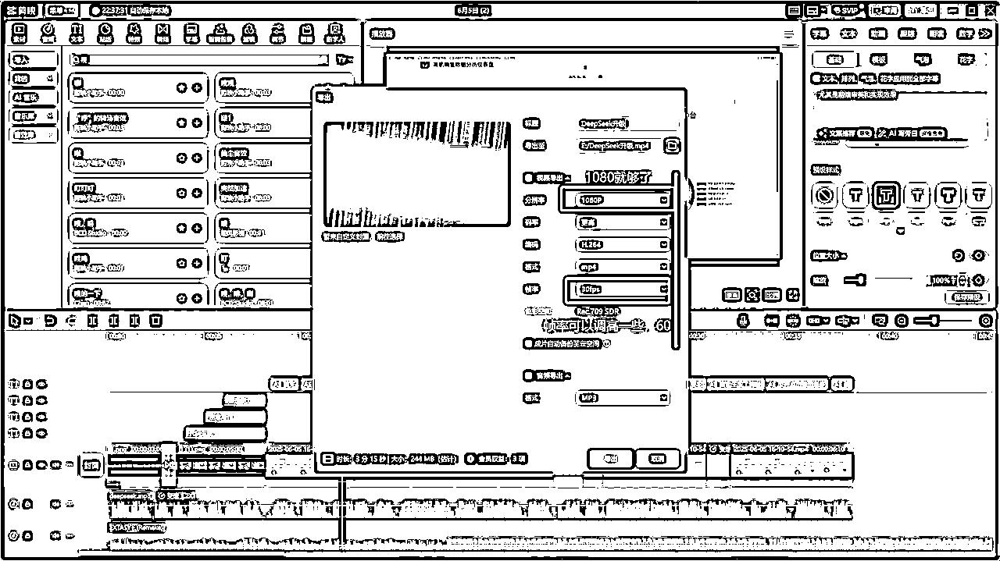

几个容易忽略的点：

1. 剪映素材在抖音商用没问题，其他平台理论上有限制；不过粉丝没到 50 万之前，这个顾虑基本可以放一边。
2. 上面步骤里，3、4、5 可以互换或并行，其余步骤按顺序走更稳。
3. 露脸视频的美颜，一定等字幕全部加完之后再做。

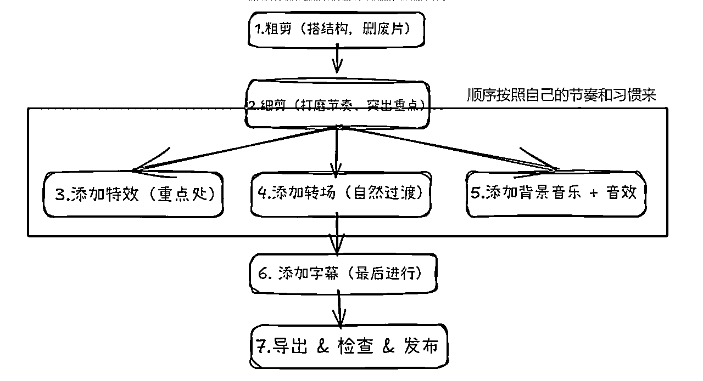

成片展示
DeepSeek更新.mp4（可在线观看）

发布环节

# 1. 发布时间

大多数人会在 12:00、17:00、20:00 这几个点发。但没有放之四海皆准的时间，你得根据流量表现去试。我自己试过 17:00 发，18:00 到 19:30 流量走低，20:00 之后才回升；20:00 发的话，22:00 以后流量明显涨起来。你的内容适合哪个时间点，跟你的受众画像直接挂钩，只能靠盯数据反复调。别人的固定套路可能有效，但未必适合你。

# 2. 标题和封面

封面最要紧的是统一感。封面是给准粉丝看的——当他想关注你、点进主页，看到的是一个稳定更新、成系列的账号，他关注你的信心会更强。标题的核心是快速传递最有价值的信息，让观众一眼知道这条视频能给他什么，把最大亮点提炼出来。

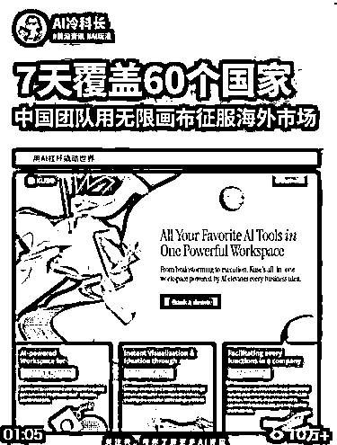
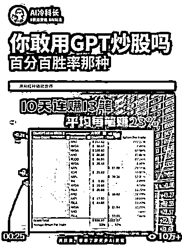


封面工具怎么选

Photoshop：自己搭好一个模板存起来，以后每次只换文字和图片，前提是你会 PS。可画：闲鱼上几块钱能买个永久会员，挺划算，但偶尔会掉线，得找老板处理；付费模板质量不错，不过要融进自己账号的元素，比如头像、账号名。做封面时如果需要某个软件的图标，推荐 Icon Fetcher 图标获取器，网页版图标能抓，App 名称也能搜，下载后导入可画就行。

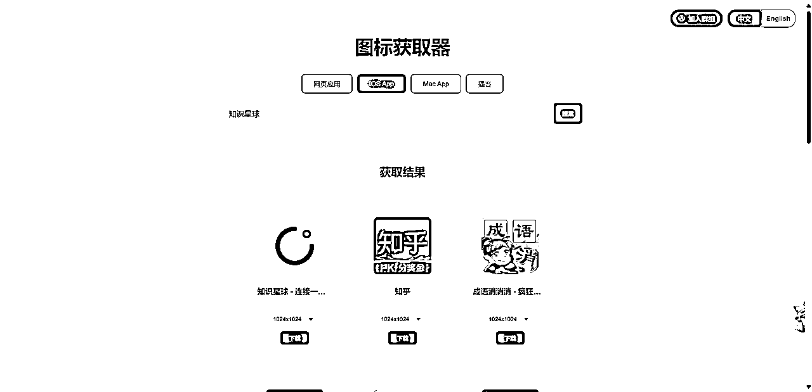

# 3. 评论区互动

每次发完视频，拿一两个小号去评论区先留几条，而且坚持每条都这么做。人都有从众心理——看到有人评论了，他才愿意开口。

持续发布 + 复盘优化

# 1. 章节概要

这一章写给 AI 自媒体新手，帮你平稳走过前 30 条的关键起号期。核心任务：让平台和用户尽快认识你，并为账号找到能持续变现的路子。你要先搞清楚什么叫起号成功——它不只看播放量和粉丝数的表面数字，更关键的是账号能不能持续涨粉、能不能真正赚到钱。核心策略分几块：起号定义上，能变现才算成功，用三阶段来衡量——数据改善、每周涨粉 100+、积累万粉以上；内容规划上，按 10% 观点、40% 热点、50% 工具推荐来配比，尽量日更，快速找到手感；内容策略上，吃透新号前 7 天的流量扶持，用“爆款选题 + 流量扶持”跑出内容定位，再反复验证；模板优化上，搭好自己的选题库、脚本库、开篇库和金句库，通过复盘形成可复制的爆款路径；数据复盘上，盯住三秒、完播、涨粉这几个关键指标，理解视频号的社交传播特性，据此调整方向。这一章给你一套清晰、可落地的起号指南，帮你借平台扶持快速启动，再靠数据反馈持续打磨，为账号长期发展铺好路。

# 本章航线图

学完这一章并落地执行，你就能走完第三阶段：内容创作与验证（8 天）。具体路线：先录制发布前 3 条视频完成冷启动（5 天）；再分析播放、互动、关注等数据，验证 IP 吸引力（1 天）；最后根据数据反馈，迭代选题和脚本（2 天）。对刚入行的 AI 自媒体新手来说，前 30 条内容都处在关键窗口期——这段时间最重要的目标就是让平台和用户尽快认识你，通过内容拿到真实的互动反馈，为后续账号成长打好底子。

# 2. 起号阶段的定义

怎么算起号成功？一句话：在任何一个平台，只有账号能变现，才算真正起号成功。否则就算你有 10 万粉，变不了现或者只赚 300 块，早晚也撑不下去。如果一定要拿播放量和粉丝数当标尺，起号成功可以分三个阶段：第一阶段，数据变好——三秒、完播逐渐提升，这是进步的最基础信号；第二阶段，每周能产出加粉 100+ 的内容，继续做才有希望；第三阶段，粉丝过万，说明你有了优化数据、持续涨粉的能力，账号才有继续经营的价值。补充一句：一条视频涨几万粉，不等于起号成功。你可能还不具备持续优化作品、稳定涨粉的能力，很容易卡在几万粉的档口；而几万粉的账号，不足以支撑你把这件事长期做下去。

# 3. 内容规划

起号阶段，内容规划是重中之重。你得把内容类型、比例和更新频率定清楚，才能既抓住用户，又让算法快速识别你的账号定位。我的建议配比：10% 观点输出，用来立人设；40% 热点解读，带来新资讯，最容易出爆款；50% 工具推荐，实用价值高，涨粉效果好。更新频率上，一万粉之前尽量日更——这能帮你快速建立手感、熟悉流程、形成肌肉记忆，先坚持一个月试试。


# 4. 内容策略

新号前 7 天，视频号和抖音都有流量扶持。

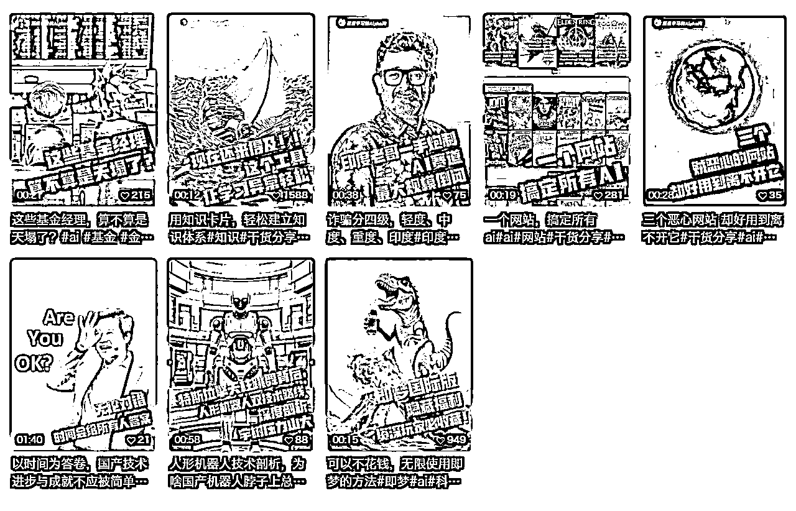
（图为狗子的前 8 条视频）

一定要用好这部分流量，去选别人已经验证过的爆款选题。除非你特别想立某个人设、固定某种内容方向，否则直接用这个打法：选爆款选题 + 吃满流量扶持 + 快速跑出内容定位。观众喜欢看什么，不是你说了算，而是观众说了算。前七天如果跑出了高播放的内容，就沿着同一个选题、同一类方向反复做。

# 5. 优化与固定模板

1. 优化方法

选题库：复盘时把完播率高的内容挑出来，放进选题库。
脚本库：播放量大的内容，把它的脚本结构拆出来固定成模板。
开篇库：复盘三秒完播表现好的开头，攒成黄金开头库。
金句库：专门用在视频结尾的提气金句。

总结：起号阶段的关键动作

流量扶持：用好平台给的扶持，逐步建立自己的推流模型；数据反馈：每条视频都复盘，好的提升是最强的正反馈，也是持续做下去的动力；复盘优化：每周做一次整体复盘，把好用的选题、开头找出来，反复复用。按这套策略，新手完全可以在前 10 天或前 30 天快速起号，为后续账号成长打下扎实基础。

# 6. 数据复盘

视频号有一个特殊性：你的点赞会被好友看到，所以你点赞之前会下意识想——别人看到我赞这个视频会怎么想。换句话说，不够高阶的内容、不符合普世价值观的内容，甚至太低俗但搞笑的内容，想在视频号跑出来会更难。核心指标盯三个：三秒、完播、涨粉。至于怎么优化选题和脚本，上面“优化与固定模板”已经讲过。这里留个任务：发完 10 条视频后做一次完整复盘，看看哪种选题、哪种表达方式最受目标用户欢迎，然后调整后续内容策略。

# 01.提效并尝试变现

# 1. 章节概要

恭喜你！翻到这一页，说明你已经完成了 IP 冷启动，有了自己的作品，也攒下了第一批铁杆粉。你不再是新手，而是一个真正的内容创作者。接下来，眼光要从“把内容做好”延伸到“把事业做好”。这一章只聚焦两件事：怎么做得更轻松，怎么开始赚钱。你会看到：工作流怎么优化——选题与策划建立高效的素材库和选题储备机制；脚本与制作借 AI 做资料速览、生成初稿、辅助配图，效率大幅提升；发布环节用标准化提示词，实现一键生成发布内容。视频号主流变现渠道——商单合作，从官方平台到水下交易的特点、沟通流程和报价技巧都会讲到；创作者分成，说清楚收益机制和内容优化方向；私域引流与转化，给你多维度的引流方法，还有知识付费、咨询服务等真实案例。新手变现准备清单也不能少：了解跟公关、媒介、MCN 的合作方式和注意点；做一份清晰有竞争力的报价表；躲开合作中常见的坑，保护好自己的权益。这一章就是帮你从内容生产者升级成高效 IP 运营者，从容地同时搞定创作和商业化，开启内容事业的新篇章。

# 本章航线图

学完并执行这一章，就能完成第四阶段：提效并尝试变现（3 天）。具体路线：用 1 天梳理并优化“选题—产出—发布”工作流；用 0.5 天学习连接商业世界，认识公关、媒介与 MCN；用 1 天做一份专业的媒体资料包，也就是你的商业名片；再用 0.5 天了解合作流程和避坑指南。

# 2. 工作流提效

一个成熟的内容创作者，背后一定有一套顺滑、高效、标准化的生产流程，也就是工作流。想梳理和优化它，可以围绕下面三个环节展开。

1. 选题与策划提效

刻意搜集：每天固定抽 30 分钟，集中刷对标账号、科技新闻网站和行业报告。只要看到有感觉的素材，别急着精加工，直接用关键词或截图丢进你的飞书灵感素材库。定期选题会：每周固定拿一小时，只做一件事——把素材库里的灵感批量加工成 IP 化选题，至少储备未来一两周的选题。

2. 脚本与制作提效

学会把活交给 AI，让它干 85% 的脏活累活，你把精力留给剩下 15% 的灵魂。AI 辅助资料搜集与总结：确定选题后，把相关链接（记得用能读链接的大模型）和关键词丢给它，让它快速总结核心观点、提取关键数据；也可以把资料复制出来交给任意模型。提示词示例：```
你是一个专业的科技媒体编辑，请帮我阅读以下关于 Grok4 的 3 篇新闻稿，并为我总结出 3 个最让普通人震惊的技术突破点，和 2 个潜在的争议点。要求用词通俗易懂直白
```。AI 辅助脚本初稿：把你总结的观点喂给大模型，让它按照黄金四步法生成脚本初稿。提示词示例：```
请以上述总结的观点为核心，按照设悬念-讲案例-得结论-给启发的四步结构，为我撰写一份 250 字左右的视频号口播脚本初稿。人设是实践者/探索家，风格要口语化、接地气，参考下面这篇文章'''（这里放你最想对标视频的脚本）'''
```。AI 辅助配图：视频要配图或插画时，可以用豆包、即梦 AI 或 liblib 这类工具，说实话我已经很久没开 SD 或 MJ 了。让 AI 根据脚本内容生成风格统一的图片，视频质感会明显提升。

3. 发布

把发布流程标准化：提前做好一套属于你的标题、简介、标签提示词模板，每次只需把脚本丢进去，就能自动得到几个备选标题、简介和标签，完全不用临时想。就算以后找外人帮你剪辑，对方也能用这套提示词生成发布内容，质量依然可控。

# 3. 主流变现形式介绍

# 3.1 广告商单

商单是绝大多数 IP 变现的第一步。在视频号上，接到商单不只是有钱入账，更代表你的 IP 价值开始被商业世界认可。视频号的广告生态和抖音、📕都不一样：抖音是强算法加星图平台，📕是种草氛围，而视频号有它自己的玩法。

官方渠道：🛰️视频号互选平台

开通条件是有效粉丝数达到 1000 以上，并且完成实名认证。这是官方唯一的广告任务撮合平台，安全性有保障；哪怕一个单子最后没谈成，前面推进过的环节也会收到对应收入。品牌方会在平台上发起邀约，价格、需求都写得清清楚楚。平台只向投放方收费，不会扣达人的钱；如果你用公司主体收款，那就更干净，任何费用都不收。对新手来说，能走平台就一定走平台，这是对自己最好的保护，也是以后单量变大后避免坏账的最佳方式。

水下合作的生态

因为视频号和🛰️已经打通，不少品牌方或媒介会顺着你的简介、👸号找到你，直接加🛰️聊合作。这种水下交易更灵活，但风险也更高。我的建议是：我本人愿意相信人性本善，但除非对方是大品牌，或者你们已经是长期合作的伙伴，水下合同总是存在坏账可能。所以账期尽量短，最多给一个月，设好提醒，到点就准时去要账。

流程上大同小异，核心是沟通与确认：

第一，接到询问时，仔细读对方的需求文档 Brief，重点看清：品牌是谁？有没有竞品冲突？什么时候发布？有没有特殊话题或标签要求？制作难度大概多少？报价要不要单独调整？第二，报价与脚本：视频号的报价一般可以参考粉丝数的 10% 作为基准。脚本写完后，一定先发给对方确认，避免做无用功。第三，视频制作与审核：拍完后发对方审核，对方提修改意见很正常。只要脚本大方向没问题，通常都是小修小改，耐心一点。第四，平台提交与发布：视频确认无误后，通过互选平台接受任务、上传视频，和品牌方定好时间准时发布。第五，收益结算：任务完成后，收益会自动进入互选平台账户，一般 7 到 15 个工作日之后就可以提现到🛰️零钱。

# 3.2 创作者分成

创作者分成更像是视频号给优质原创作者的一点“饭钱”，基本上只够吃饭，不够点菜。开通条件是有效粉丝数 ≥ 500，并且符合平台的原创和质量要求。收益逻辑是：你的原创视频评论区会出现广告，平台根据广告曝光量给你分成。播放量越高、评论区互动越活跃，分成自然也越高。哪类内容分成更可观？一类是能引发深度讨论的观点内容，因为用户在评论区停留越久，广告曝光越多，我们黄金四步法最后一步“给启发”就是为了这个；另一类是长视频，1 分钟以上，视频越长，平台能展示的广告机会越多，分成潜力也越大。

# 3.3 引流私域

这是视频号最有杀伤力的模式，也是最能体现 IP 长期价值的地方。我的想法是，哪怕你现在不打算卖东西，也要用开放的心态把用户先引到私域加上，说不定哪天就有合适的产品可以推荐。怎么无缝衔接？直接在简介写上🛰️号，钩子给不给无所谓，现在用户都很精明；视频号主页可以关联👸号，引导粉丝关注；在视频扩展链接里挂👸号文章链接，文章里放个人🛰️、社群二维码；直播时通过背景板、口播引导用户进粉丝群。私域里卖什么？知识付费：等你的专业 IP 立住，可以开付费社群、线上训练营，或者把方法论做成小课。咨询服务：为个人或企业提供 1 对 1 的 AI 转型咨询，客单价可以非常高。我的学员里就有人把这套方法变成了给企业提供 5 万元/月的顾问服务。

# 4. 新手变现准备建议

# 4.1 学习链接商业世界：公关、媒介与 MCN

先说角色：品牌方、甲方、投放方，是你的金主爸爸。你可能直接认识他们，也可能要通过公关媒介来对接。但相信我，凡是品牌方直接找上门的，大概率是钱少事多。公关/媒介（PR）是品牌方和博主之间的桥梁，你要学会跟他们专业地沟通，理解他们的 KPI，把他们当成合作伙伴，而不是高高在上的甲方爸爸。MCN 这里指的是给你推广告的那种，不是孵化你的机构。签约 MCN，等于多一个广告渠道。一般分代理约和全约，坑主要集中在返点和分成比例上。目前我们和两家机构签的都是代理约，自己也能接到大量广告。所以我的建议是：代理约完全 OK，全约要慎重。当有 MCN 来找你，一定要仔细甄别，直接问他们旗下有多少同类达人，能给你什么独特资源，比如科技类客户多不多。如果他们的主要广告主跟你的方向不匹配，旗下甚至没几个科技号，签了也不会多几个广告，那就没必要了。

# 4.2 制作一份简洁易懂的报价表

一份报价表通常包含这几个部分：账号名；账号数据，包括粉丝数、预估播放、预估互动；合作形式与报价，清晰列出原创视频、二创视频、直发视频、直播合作等不同形式的价格，以及单平台价格和打包价格。还要注意，视频号的互选报价和水下报价保持一致，不要出现水下比互选便宜的情况。

# 4.3 了解合作流程与避坑指南

**接竞品广告前，先把“排他期”算明白**

假设你刚接下 A 品牌 B 产品的合作，不少品牌还会额外加一条：合作前后的一段时间内，比如各 7 天或各 30 天，不能再接 B 产品同类竞品的推广。这个要求确实谈不上轻松，甚至有点苛刻；但你可以先判断值不值得接。若产品本身赛道窄，例如某个 AI 音频模型，前后 7 天避开竞品，通常影响有限，接受也无妨。

**视频二次使用，授权范围要问清**

PR 通常会确认：品牌能不能免费把你的视频拿去二次利用，例如付费投放，或发布到他们官方账号；同时还会问授权期限多久。比较省事的回答是“都可以”，期限给 6 个月或 1 年，既好沟通，也不至于把合作卡住。

**返点不是默认选项，比例太高要警惕**

视频号这边有些媒介开始学📕的做法，可能会提出返点要求。遇到这种情况先别急着答应：如果返点比例高得离谱，例如超过 20%，就要慎重评估。事实上，大多数合作并不会涉及返点。

# 5. 收尾：你的远航，此刻才真正启程

读到这里，21 天的同行即将停靠第一座港口。但港口不是终点，它只是你独自驶向新海域的起点。

回望这一路，我更希望你带走的，不只是做爆款视频的方法、对接商业的技巧，更是在 AI 浪潮里给自己造一艘能扛住周期的船。

从今天开始，把“追流量”的焦虑放一放，把心思放在打造自己的 IP 价值上。

去讲你真正相信的观点，去复盘你踩过的坑，去连接那些和你同频的人。你每一次真诚表达，都会给 IP 的护城河加一块只属于你的砖。

请记住：AI 时代最值钱的红利，已经不是谁知道得更早，而是谁更值得被信任。

而你，会借助自己的 IP，成为那个让人愿意相信的人。这份信任，才是你最重要的资产，也是打开事业第二曲线的钥匙。

地图已经在你手里。现在，扬帆吧。

愿你乘风破浪，前路可期。

下一个山顶，我们再见！