# X（推特）AI 自媒体实战手册：2025 年 9 月版

原文链接：https://ocn93f5d9olj.feishu.cn/docx/BamVdmYu2opFKwxH4XBce4j5nKe

# ⛵零基础怎么启动 X（推特）AI 自媒体

# 1. 项目介绍

这里是【AI 自媒体 - X（推特）】分船，接下来的全部内容都围绕它展开。

AI 自媒体这几年被反复验证为一条低成本、易上手的流量积累路径，今年尤其如此；而推特，又是其中给普通人机会最大的舞台。

为什么偏偏是 X（推特）？不妨先看看国内的📕和抖音：拍视频、做图样样都要上，内容制作成本天然偏高，冷启动也不轻松，平台对内容的限制还多。推特则完全是另一种生态——它围绕文字展开，创作负担小得多，用户又遍布全球，基本盘很大。只要内容有干货或有趣味，哪怕账号只有几百个粉丝，一条推文跑出上万乃至百万曝光都不稀奇。

先看一个中推案例（该账号粉丝现已过万）——短短两行字，换来了 46 万曝光量：

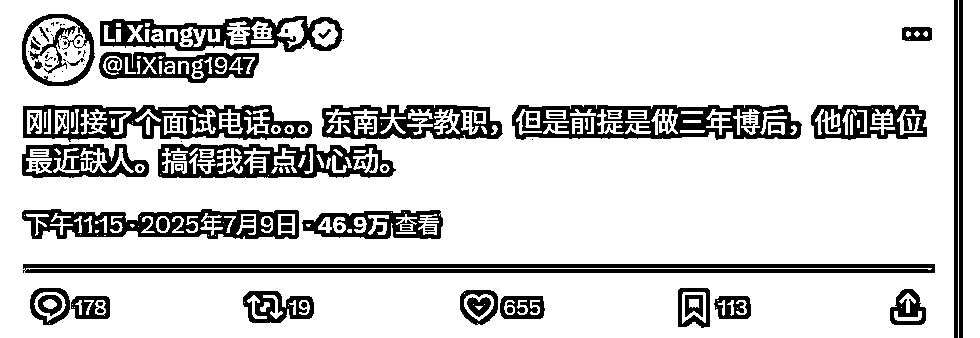

另一个粉丝仅几千的账号，单条推文冲到了 190 万曝光：

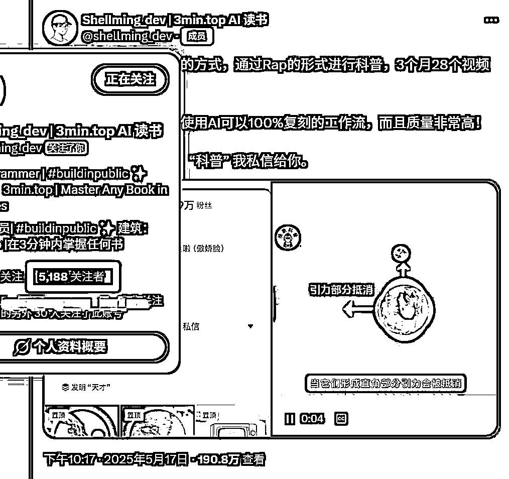

更有说服力的是本期航海教练阿西。她原本在互联网公司做用户增长运营，同时打理着“阿西_出海”这个推特账号。2 个月涨粉 1w+，3 个月总曝光量 2300w+，多条推文曝光破百万，单月变现做到五位数，她本人也由此转型为自由职业者。

阿西的账号轨迹很有参考价值：今年 3 月之前基本没什么水花；3 月调整内容策略后开始起势；4 月因限流中断了一个月；6 月 14 日粉丝破万，两个多月做到万粉，算得上一份不错的成绩。当时她也达到了创作者分成的门槛，半个月后第一笔 218 美金的分成到账，国内外商单陆续找上门。

这些样本共同指向一个判断：在推特上做自媒体，内容传播的放大效应相当可观。

那为什么别的不选，偏要选 AI 赛道？

1、商业合作单价可观：今年 AI 产品迎来爆发，不少品牌拿到融资后预算充足，愿意找博主做工具测评。在粉丝量相近的情况下，AI 博主拿到的报价经常能到其他赛道的数倍。

2、目标受众浓度高：全球金融、Web3、AI 科技这类前沿信息，基本都会先在 X 这类平台上发布。愿意来推特获取资讯的用户，认知水平普遍高于国内平台用户，对 AI 新动态也更上心。换句话说，AI 自媒体最想触达的那群人在推特上格外集中。

# 2. 项目完整操作思路

# 1. 操作思路

先把航海图贴出来：

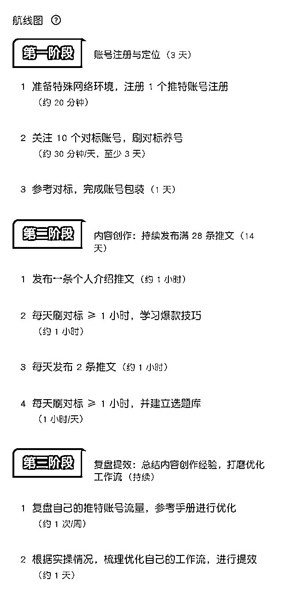

整个项目可以拆成 3 个关键阶段。

阶段一：账号注册与定位

先别急着发文。你需要想清楚：自己做谁、做给谁看、别人能不能一眼看懂你。这个阶段核心动作有三个：把账号注册好（要配合特殊网络环境）；圈定 10 个对标账号，每天去刷，拆解它们发什么、怎么发；再参考对标，给自家账号做一版完整的包装。这就像玩游戏，开局懵着乱打多半白费力气，先看先学，反而走得快。考虑到语言习惯和起号难度，本期航海先带大家做中文推特；等流程熟了，你想再做英文推特也完全来得及。

阶段二：内容创作

内容这块最稳的策略是持续输出，用稳定的频次养网感、养账号。航海期间按每天 2 条来，累计发满 28 条。每天要做的事情不复杂：把账号人设立住；刷对标账号，把值得跟的选题收进素材库；写内容、发出去，把手感练出来。

阶段三：复盘提效

当你发到 20 多条内容时，就可以启动复盘了。把点赞高、转发高的推文和无人问津的推文分别挑出来，想清楚背后的原因，再针对流程做一轮优化，期间可以借助 AI 或第三方工具提高效率。如果说前面是在“做内容”，这一步就是在“做系统”。

# 2. 操作重点

日更不能丢

很多人发了几条推文就悄悄放弃了：有人看到没人点赞，动力清零；有人写不出来，索性摆烂；还有人一忙起来，直接断更。新账号想被平台“看到”，前期必须熬过无人问津的那段日子，连续更新才是破局的关键。并不是你的内容不行，而是你发得还不够多。持续更新的过程中，平台会逐步给账号完成识别和打标，你也会越来越清楚什么样的内容自带流量属性。

每天固定时段刷推特

刷推特的意义在于告诉平台：你想看什么、不想看什么。这个信号给得多了，推荐机制就会不断为你输送更贴近需求的内容。你需要做的只有两件事：一是把高曝光的推文收藏起来学习，二是把产出高曝光内容的账号也收藏起来研究。日积月累，你对推特流量的直觉就会长出来。

# 3. 新手入门建议&避坑指南

新手期只需跟着手册一步步执行，保证每天有 1-2 小时投入在内容和运营上即可。

心态上的建议有以下几点：保持耐心，自媒体是长线项目，别期待立竿见影；保持学习，AI 领域更新极快，知识库必须同步迭代；接受反馈，评论区的各种声音都是优化内容的线索；专注执行，别频繁换方向，认准一条路就给它足够的验证时间。

避坑层面也有两条高频雷区。一是心态不稳：刚起步就盯着数据，很容易被打击自信。新号没人看、没人评是家常便饭，前 10 条没反响，就先把 20 条发完再说。二是账号限流：正式运营前，把推特限流的避坑要点读上三遍，别让辛辛苦苦写出的内容因为踩中平台规则而被限流。

# 4. 必备工具

| 类别 | 具体配置 |
| --- | --- |
| 账号 | 至少 1 个推特账号（注意一机一号一卡） |
| 网络 | 特殊网络 |
| 生产工具 | DeepSeek、ChatGPT 等 AI 写作工具 |

# 1. 掌握 X 平台基本规格与社区文化

# 1. 本章概要

本章安排了两件事，帮你把 X（推特）AI 自媒体这件事正式落地：
第一件，把 X 平台的基本规则和社区文化摸透；
第二件，把账号的注册、定位和包装全部走完。

在这个过程中，你会陆续搞清楚：我们做 X 分中推和英推，为什么先从中推起步；X 最常见的变现方式有哪些，包括创作者分成、自有产品引流、商单合作和分销广告；以及一个 X 账号的基础搭建应该怎么做才够扎实。

准备就绪，我们发车。

# 本章导航图

完成本章学习和实操后，你就可以走完航线图的第一阶段：账号注册与定位（3 天）。具体安排是：准备特殊网络环境，注册 1 个推特账号（约 20 分钟）；关注 10 个对标账号，每天刷约 30 分钟，至少维持 3 天；参考对标完成账号包装（1 天）。


# 2. 中推还是英推

从用户结构来看，英语国家用户是推特的主力。盘子大，意味着英推账号一旦做起来，粉丝上限和内容曝光空间都会高出不少，所以不少华人会选择同步做英推。但对英语不熟悉的人而言，更务实的路线是先做中文推，把完整流程跑顺了，再考虑英推。

# 2.1 中推

看到这里你可能会问：中推流量明显不如英推，那它还有什么红利可言？答案是有的。中推圈目前人少，还处在蓝海阶段，优质内容也不多，所以只要内容稍微像样一点，被系统推到台前的机会就会大很多。

本期航海带新手先从中推切入，原因是门槛低、容易获得正反馈；英推涉及到语言和文化差异，等中推上手之后再安排也不迟。对国内作者来说，英推真正的难点有三个：语言、文化差异、社交圈。如果你只是把中文内容机械翻译一遍再发给英语用户，传播效果一定会打折扣。另外，账号背后有社交圈加持，起号速度会明显更快，而中推圈的社交关系搭建远比英推圈容易，比如找大 V 帮忙带一带。所以结论很清楚：对英语环境不熟悉的新手，先做中推，等熟悉之后再做英推。

# 2.2 英推

回到英推本身。推特上的英语用户体量摆在那里，英推账号跑到后面，粉丝上限和曝光量都会更加可观。拿“独立开发者”这个赛道来说，中推圈里的大 V 做出几万粉丝已经是相当厉害的成绩，但同样的赛道放到英推圈，十几万甚至几十万粉的账号并不少见。

英推的商单体系也比中推更成熟，生态接近国内抖音📕，合作机会相对稳定。（不过我在做中推的时候，也有海外客户来询单，付款干脆又大方，推文还没发，款项就先到了。）


# 3. 推特账号的变现方向

做完基础搭建，接下来最关心的就是怎么变现。推特账号通常有四条变现路径。

# 3.1 创作者分成

在 X 开通创作者分成需要满足三个条件：
1）认证：订阅会员，每月最低 8 美元；
2）展示量：近 3 个月内帖子累计展示至少 500 万次；
3）粉丝：至少拥有 500 名会员关注者。

开通分成后，结算货币是美金，需要通过 Stripe 账户再打到香港银行卡，所以一张港卡和一个 Stripe 账户是标配。（这些可以等跑通 0-1 后慢慢研究。）

关于订阅会员，多说几句：订阅会员除了满足分成条件，还能查看账号后台数据，包括每日曝光、单条推文的曝光情况；另外，非会员单条推文限 280 字，会员不受此限制。会员费可用国内 Visa 卡支付——带身份证去任意银行办理即可。新人不急着开。

# 3.2 给自己的产品引流

推特适合给虚拟产品引流，比如付费课程。如果你手上正好有产品，可以在简介里挂链接，在每一条推文末尾带一句，或者单独写一篇产品介绍推文并置顶在主页上，都是很自然的推广方式。

# 3.3 商单

账号粉丝到几千，商单机会就开始出现了。为了接住这些机会，你可以在简介、推文等位置标明“接单”。由于推特没有官方接单平台，对方靠不靠谱需要自己判断。几个参考建议：尽量不接按效果付费的广告；一口价广告如果金额较大，优先和对方谈定金；报价方式通常有两条口径——完整线程按条报价、转发按次报价。

# 3.4 分销广告

商单的节奏不可控，博主最好拥有一条自己能把控的收入线。分销广告因此成为很多推特博主的常规补充收入，比如小报童分销、网盘拉新、AI 工具的 affiliate 佣金等，都适合新手尝试。例如下面这个账号，一边分享干货、一边附上网盘链接，用内容吸引流量，再用网盘实现转化。

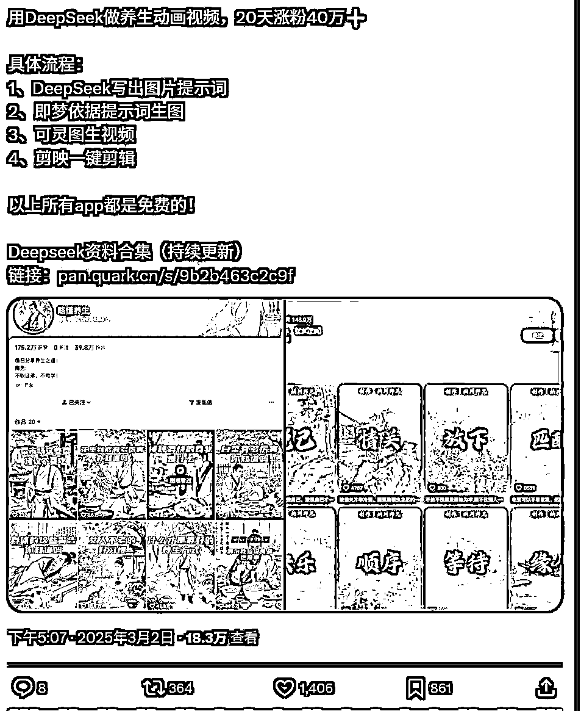

# 1. 账号注册

# 1. 准备工具

新手出发需要两样东西：网络 + 翻译工具。

网络部分：特殊网络需要自己准备，手册这里不方便展开说明。

翻译部分：给电脑安装“沉浸式翻译插件”，解决语言不通的问题。安装路径如下：前往 https://immersivetranslate.com/zh-Hans/ ，选一个适配你浏览器的插件版本下载。

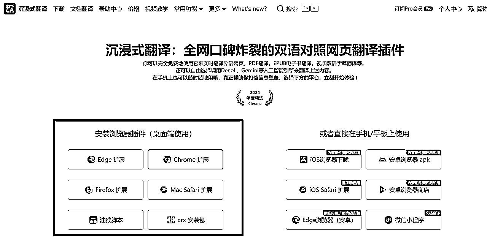

安装完成之后，遇到需要翻译的页面，点一下插件图标，出现绿色的√就能正常翻译了。

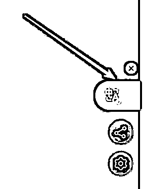


# 2. 注册账号

在特殊网络环境下，访问 https://x.com/ 进入推特官网。如果你有 Google 账号或 Apple 账号，可以直接选登录；没有的话也可以重新创建一个。

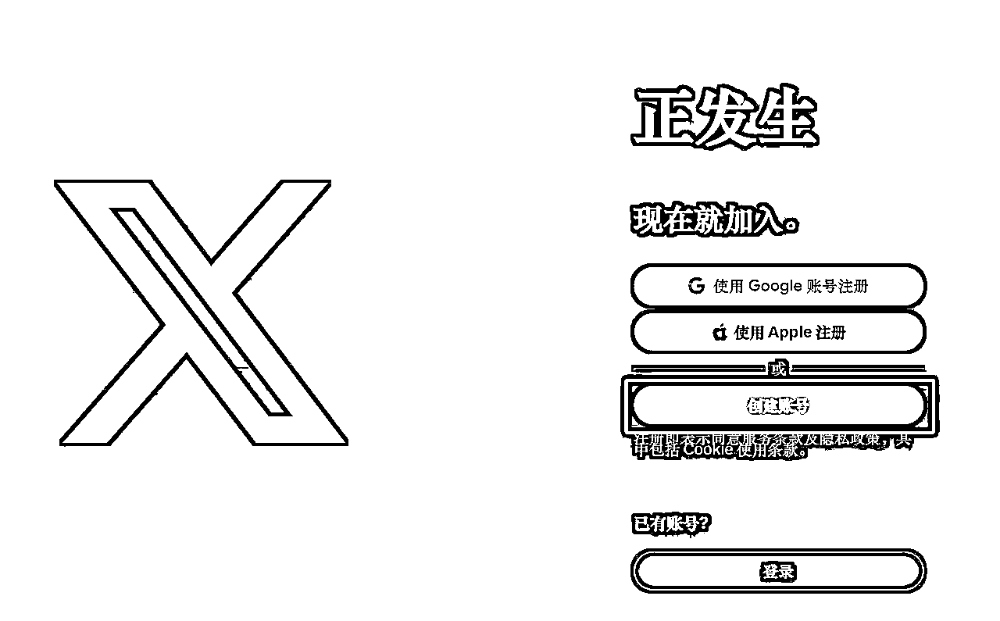

创建账号的操作步骤如下：
点击“创建账号”
填写信息
选择邮箱注册

依次填好姓名、邮箱、出生日期，然后点“下一步”。

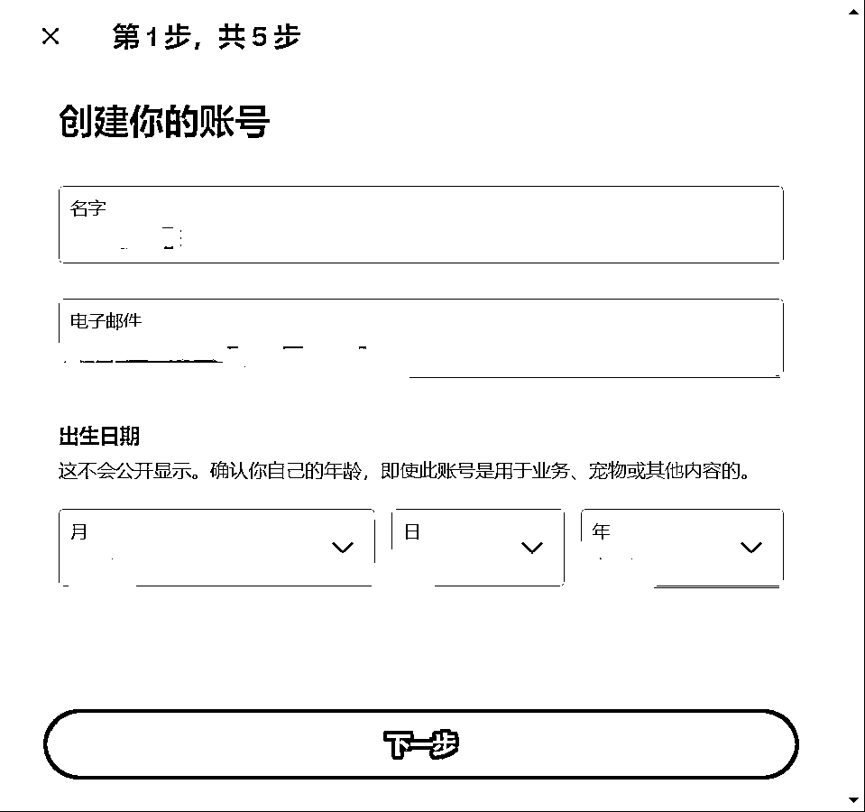

信息确认无误后，点“注册”。

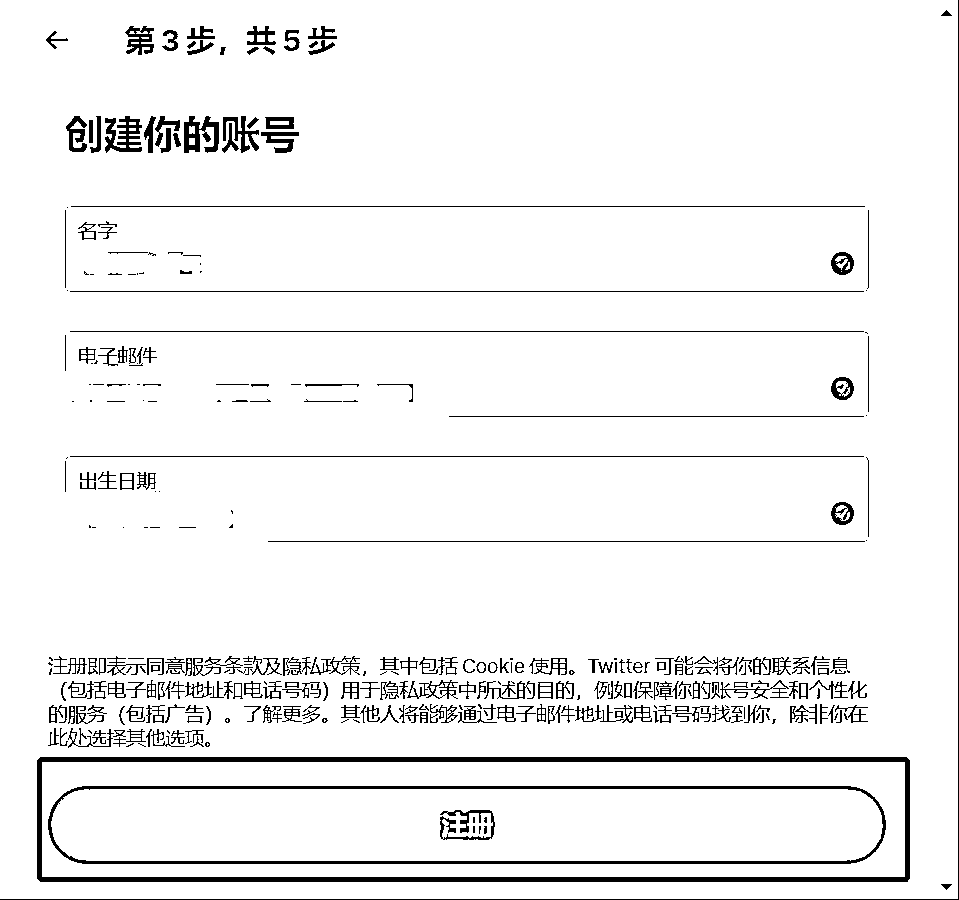

登录注册邮箱，把推特发来的验证码填进去，点击“下一步”。设置密码时建议用大小写字母、数字和符号混合的复杂组合。系统随后会推荐一些主题和账号，建议全部跳过（skip），避免算法乱打标签。

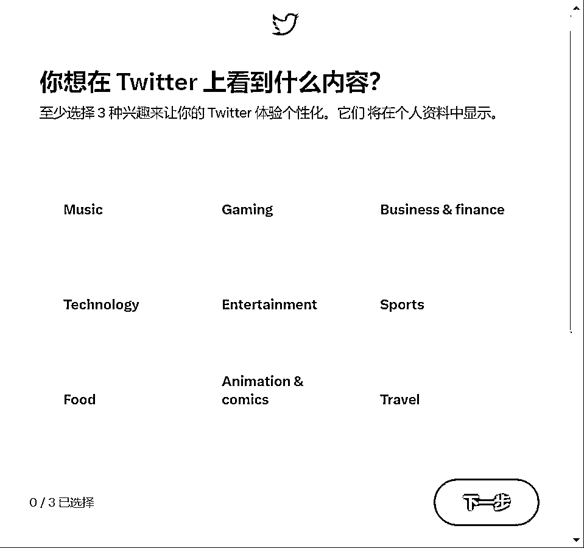

到这里，注册就完成了。点击“开始”后可能会遇到验证程序，这大概率与你的网络环境有关；如果验证流程很繁琐，建议改用手机端注册，在应用商店搜索“X”重新操作一遍。

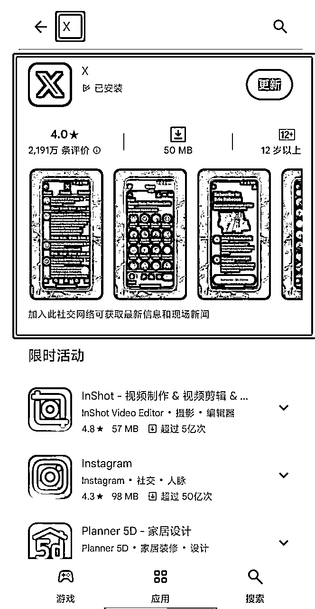


# 3. 刷对标养号

# 3.1 为什么要养号？

新号刚注册的几天，在平台上几乎没有权重，还容易被当成机器人。所以规则是：先养号，每天刷一小时左右，至少养 3 天。养号同时可以刷对标内容，一边养号一边学习；航海期间也要每天刷。此外，点赞、评论这类操作别太密集，关注也别一口气加太多，否则很容易被系统识别为机器人。新号建议先只刷不关注；同时关注数不要比粉丝数多太多，否则会被判定互关机器人，进而限流。

# 3.2 对标账号去哪找

养号阶段可以顺手刷对标，边养边学爆款推文的创作逻辑。记住一个原则：在 X 平台上，爆过的内容还会再爆。

什么样的推文符合 AI 自媒体爆款对标的门槛？
- 曝光量高于 20w；
- 干货类内容发布时间在近 3 个月内，资讯类内容发布时间在 2 天以内（AI 科技讲究时效）；
- 不选公众人物的内容，比如马斯克——公众人物的内容火不火和内容本身关系不大。

参考案例：
https://x.com/heathahrens/status/1948405338442772892

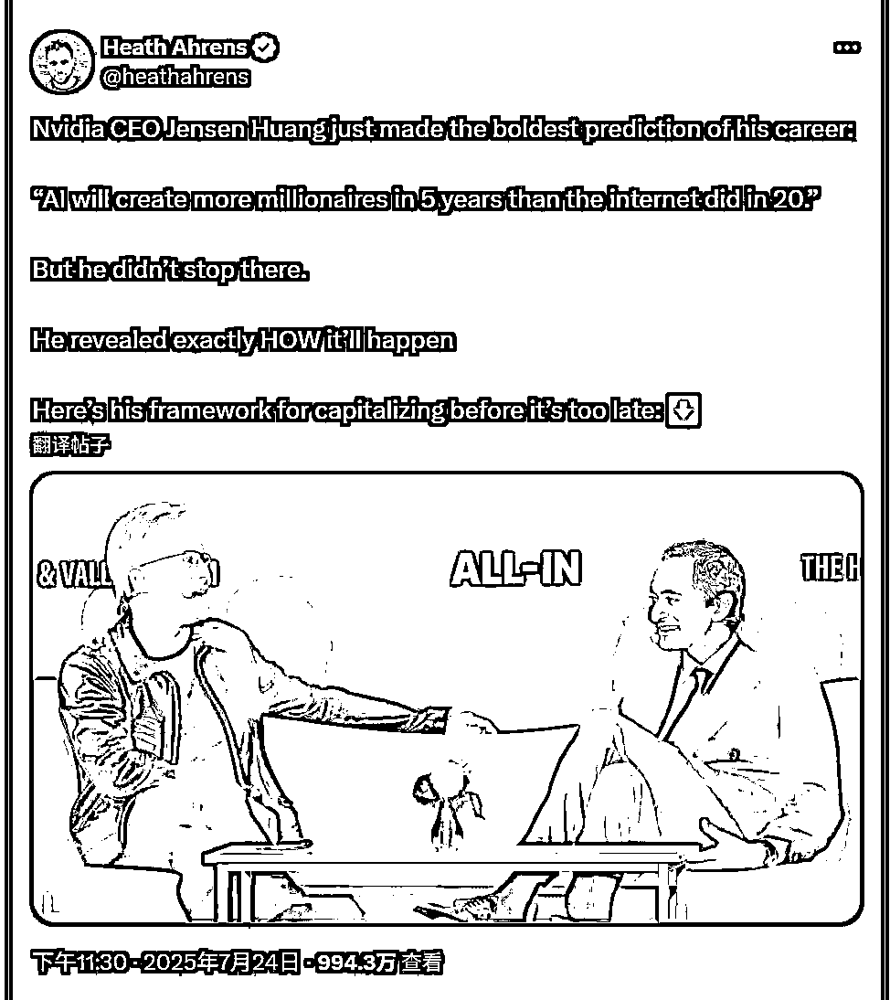

方法一：靠推荐算法筛对标

最直接也最好用的办法，建议人人都掌握。每天至少花 30 分钟到 1 个小时刷推特，聚焦你的目标领域（我自己的习惯是每天至少刷 2 小时，一有空就刷）。看到互动量高（点赞、转发、评论都多）的内容，就点爱心或收藏；不感兴趣的就点“不感兴趣”，让数据读懂你的口味。收藏多了，推荐系统会顺着你的偏好持续推送同领域爆款，你的对标库就这样慢慢滚大了。

方法二：用高级搜索捞爆文

想快速盘点某领域近期的爆款内容，高级搜索是得力工具。

✅ 实操指令：
- 在搜索框输入 `min_faves:50`，匹配点赞数≥50 的推文；
- 输入 `min_retweets:20`，匹配转发数≥20 的推文；
- 可叠加时间条件，例如 `since:2025-06-01 until:2025-07-01`。

✅ 应用示例：
搜索 `AI min_faves:200 since:2025-06-01 until:2025-07-01`，就能找到 2025 年 6-7 月之间点赞超过 200 的 AI 领域推文。

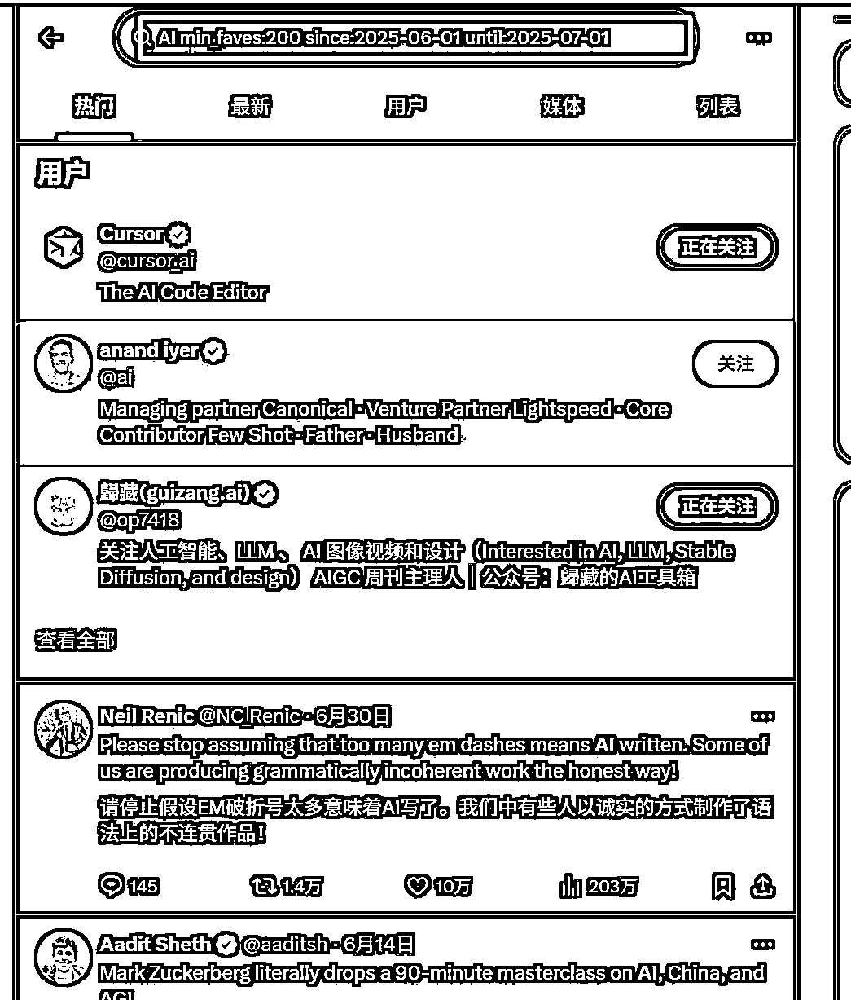

✅ 衍生玩法：
比如最近 ChatGPT 热度正高，直接用 `chatgpt min_faves:1000 since:2025-06-01` 这样的指令，就能搜到大量围绕该关键词的爆文。

方法三：从对标账号出发找爆文

在推特运营中，如果你锁定了一批高频产出高互动内容的账号，找爆文的效率会大幅提升，而且还能顺带研究这些账号的选题方向和变现模式。

✅ 操作步骤：
1. 收集对标账号：用方法二找爆文时，刻意留意内容背后的账号。如果某个账号反复出现爆款，就把它存进“列表”，随用随取。

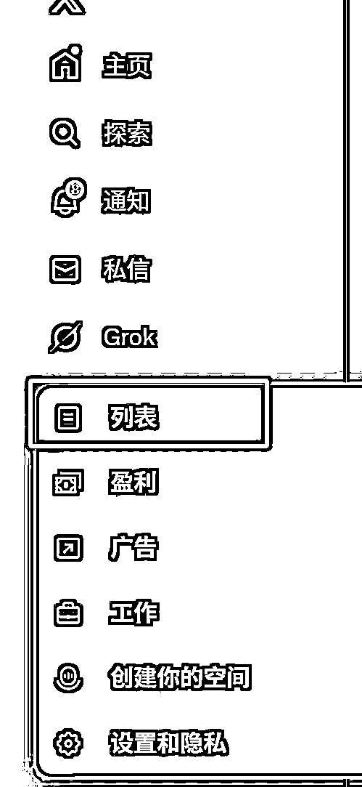

2. 用高级搜索挖对标账号的爆款选题。指令模板：`from:用户名 min_faves:点赞数`。举例：`from:hasantoxr min_faves:1000`，即可找出 hasantoxr 点赞量超过 1000 的帖子。

# 1. 完成账号定位

# 1. 账号定位

定位没有标准答案，每个人都可以从自己的兴趣和擅长里找到方向。比如你对 AI 编程感兴趣，就可以做 AI 编程技术分享或 AI 编程产品测评；对 AI 科技资讯有兴趣，就做资讯类账号。因为账号运营需要长期持续输出，选择和自己喜好匹配的方向，才更容易坚持下去。

我观察了推特上各类赛道的内容形态，大致可以归为三种：专业类、资讯类、娱乐类。

专业类账号发的内容偏深度和垂直，以科普为主，面向业内专业人士。以 AI 赛道为例，专业类账号通常会讲某款 AI 产品怎么用、有哪些典型场景这类话题，它最大的门槛是专业度。

资讯类账号做的是行业信息播报，发布速度越快、内容越前沿，粉丝积累越猛。这类内容上手不难，但很耗体力，得一直紧跟热点。

娱乐类账号面向的是所有普通用户，典型内容有 AI 搞笑视频、AI 资料包分享等。

三类账号的人群体量排序是：专业类 < 资讯类 < 娱乐类；但从付费能力来看，正好反了过来：专业类 > 资讯类 > 娱乐类。内在逻辑很清晰：内容越精专，看的人越少，但受众画像更准、付费意愿更强；内容越大众娱乐化，受众范围越大，但人群结构复杂，转化反而更费劲。

三类账号适合的变现方式也各有侧重：
- 专业类：适合卖知识付费（课程、星球、小报童等）、一对一高客单咨询、自有产品；
- 资讯类：适合分销、商单合作；
- 娱乐类：适合分销，也能接商单但价格有限。

最后放几个对标案例，带大家直观感受下三类账号的画风。

# 1.1 专业类

@歸藏（guizang.ai）：分享前沿模型、工具、提示词，以及 AI 前沿应用场景。

@向阳乔木：讲解 AI 工具的使用方法。


# 1.2 资讯类

# 1.3 资源型账号速览

@小互：发布人工智能新闻，另有一个收费的人工智能日报社区。

@AI Will：持续追踪行业动态，几乎天天多条更新。

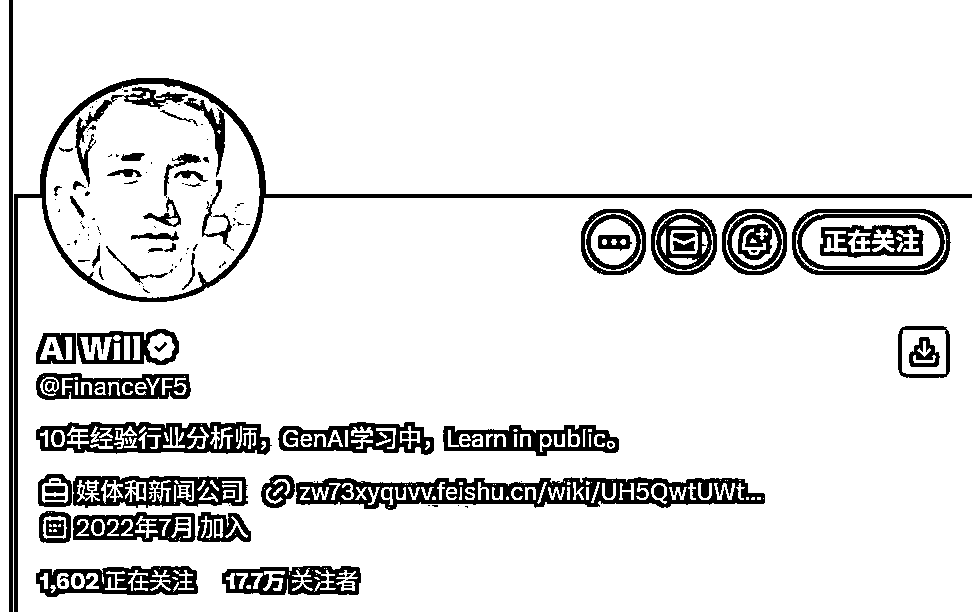

@ahhhhfs：整理人工智能与多领域素材，借云盘推广拉新赚收益。

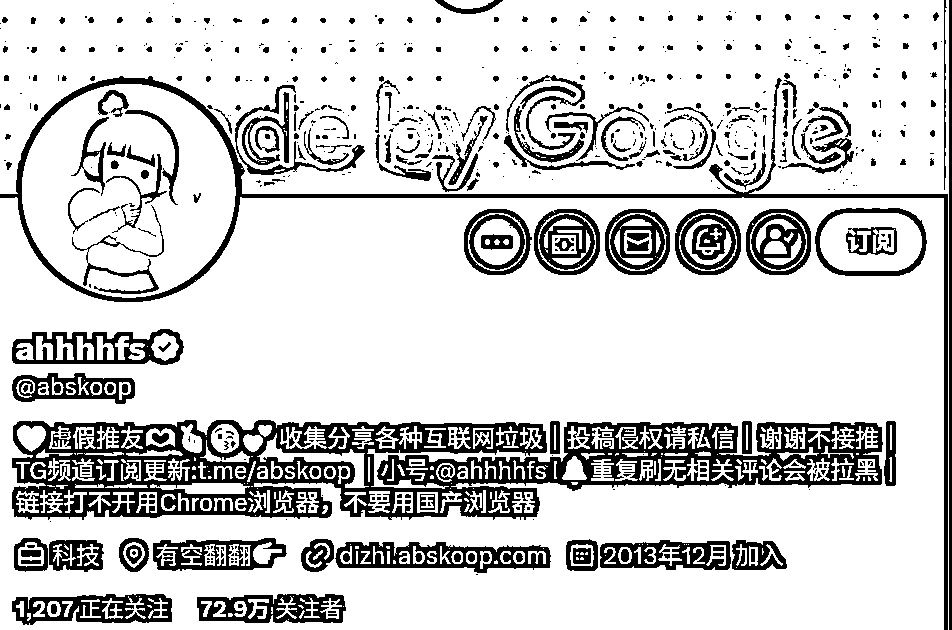

@白骏知识分享：方向与 @ahhhhfs 接近，同样分发人工智能及相关资料。

# 2. 主页三要素

很多人起号只盯内容，忽略了主页最抢眼的三块：昵称、头像、简介。新号还没作品时，路人为什么点关注？就看这三处。它们影响用户读完推文后是否进主页、是否按下关注、是否记得你。

- 昵称：一眼说明身份。推荐“领域词+角色/名字”，例如“XX知识分享官”“XX AI”。别用 556677zzxx 这类乱码。拆解同行：职业身份型（AI顾问、开发者），个性角色型（独立开发者爸爸、工具控女孩）。仿其结构，换成自己的领域词与定位。纯英文名加圈内梗要慎用，识别成本高。

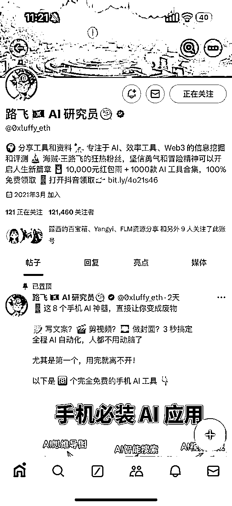

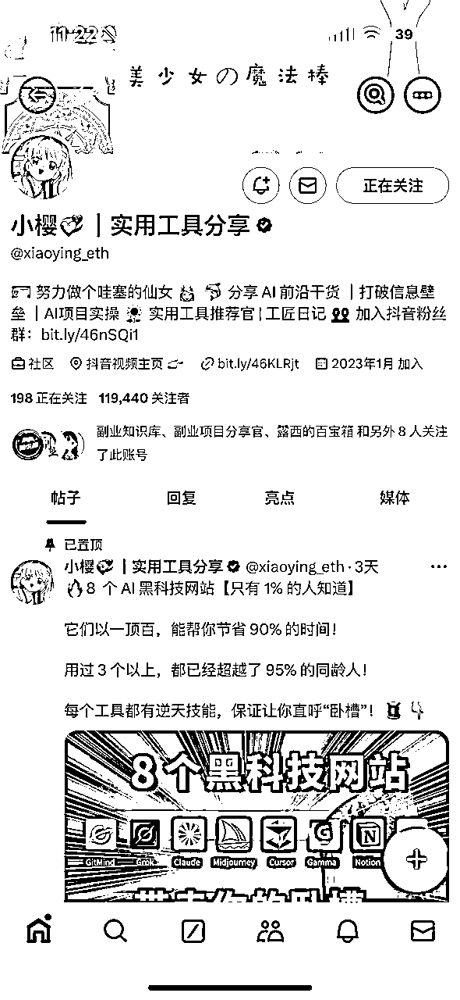

- 简介：一句话名片。讲清你是谁、输出什么、能帮到谁。短、准、有钩子，可亮代表作或内容方向。参考：🎯 聚焦AI工具与资讯；📌 每日两条可落地的AI内容创作技巧。也可挂产品链接。别写“热爱生活，随手记录”，读者更在意你能提供什么。

- 头像：增加真实感与信任。清晰真人正脸最易获信，但别太像自拍；匿名号可用统一风格的人设图，如AI卡通形象。糊图、马赛克、风景照、logo都不推荐，也别过度“AI脸”，要有辨识度。

- 先发一条自我推介推文。

# 1. 本章要做什么

本章四件事：用自我推介推文完成冷启动；读懂X流量机制；熟悉爆款模板与写法；建立选题库。学完可完成冷启动、写出有流量的内容，并形成稳定创作体系。

# 本章推进路线

完成学习与实操，可走完路线图：

第二阶段：内容创作：连续发布28条推文（14天）

- 发一条自我推介推文（约1小时）
- 每天刷对标≥1小时，学习爆款技巧（约1小时）
- 每天发2条推文（约1小时）
- 每天刷对标≥1小时，并建立选题库（1小时/天）

# 2. 为什么先发自我推介

在X做AI自媒体，冷启动期，“你是谁”比“你说什么”更关键。自我推介等于公开身份声明，先把人设立住。

第一条推文建议先讲清：我是谁、做过什么、这个号要分享什么。我去年注册X后，第一篇就是自我推介，说明自己在做之事与取得成绩，并置顶首页。0粉起步，首条拿到1.2w曝光，吸引约200位精准独立开发者关注。


# 3. 自我推介的3种写法（第三条最强）

第一种：晒成绩。适合有硬案例的人；若没有独立战绩，也可先放工作成果。示例：

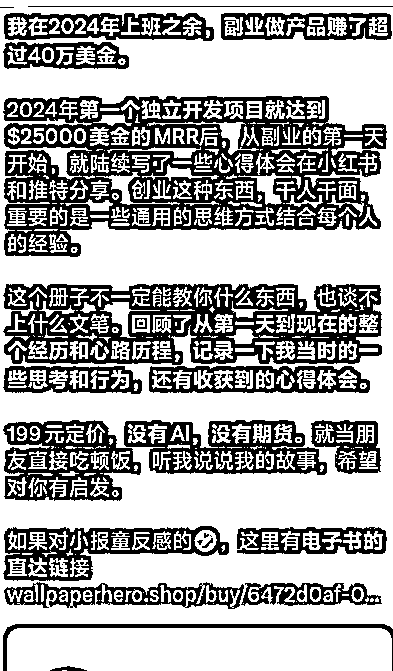

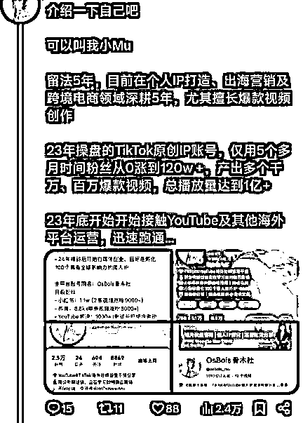


第二种：讲故事、找共鸣。用叙事写经历，要有转折：曾经怎样、遇到什么坎、后来如何改变、最终得到什么。像小说有起伏才抓人。示例：

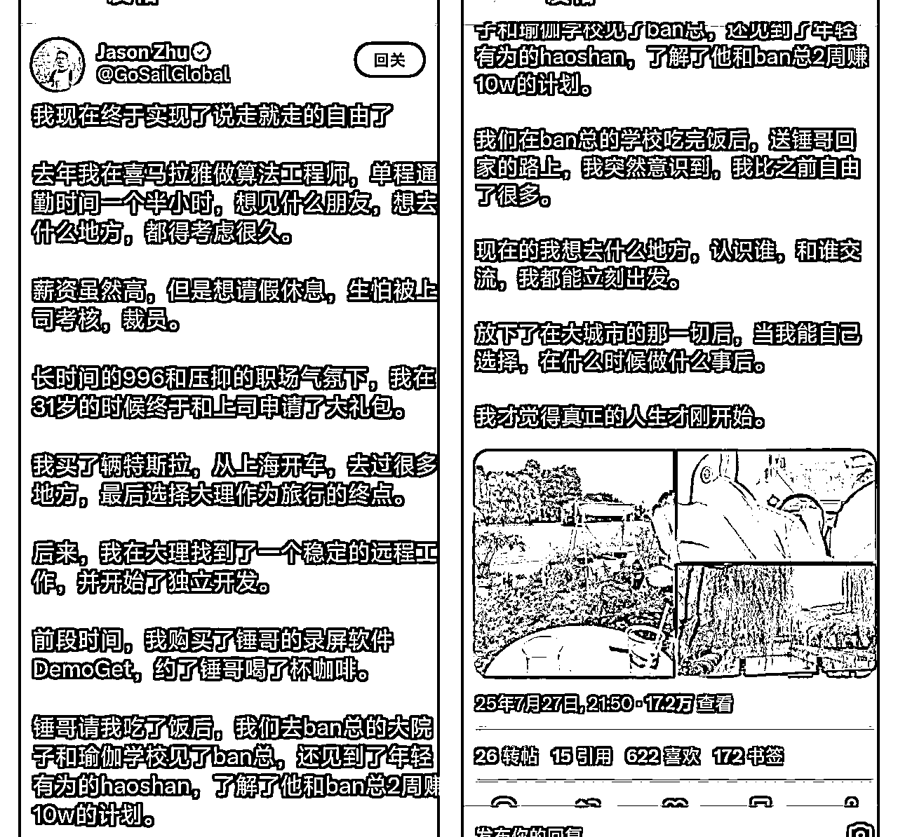


第三种：成绩+共鸣+长线程。效果最佳，既能涨粉曝光，也能植入变现广告。我的案例：12小时15万曝光、1000+涨粉、五位数变现。

做法：在成绩与共鸣之外，把经历写具体，并拆成多条线程。每条真诚分享经历，也可聊当前项目/产品，最后说明需要的资源。这样既立IP价值，又能转化产品、连接有效人脉：

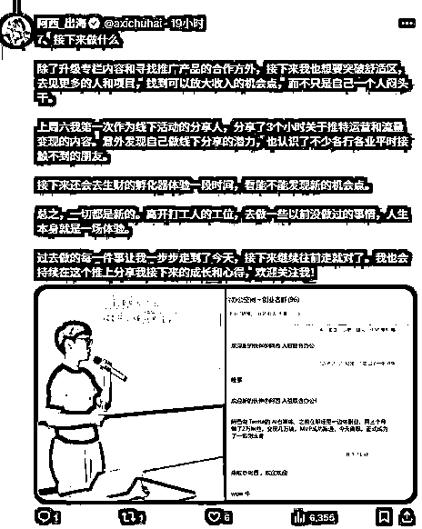

自我推介发出后置顶，方便新访客快速了解。若没流量，可借力相近定位的中小V，粉丝量通常5000–3w，报价较友好，几十到几百元可做小批量测试。暂时不想付费，也可礼貌请求转推，说明“新号希望曝光”，但务必给出推荐理由。内容有价值，很多人愿意帮转，因为对其粉丝也有用。

## 1. 爆款推文创作

# 1. 摸清推荐算法

X开源代码里有一套推文排名计算方式，用不同权重衡量可见度与重要性。权重如下：

1. 作者本人参与回复：+75
2. 推文被别人回复：+27
3. 访客点开作者资料并继续互动（如查看更多推文）：+12
4. 访客点开对话描述后点赞或回复：+12
5. 被转发：+1
6. 被点赞：+0.5
7. 视频播放达到50%：+0.005
8. 收到负面反馈（如标记不感兴趣）：-74
9. 被举报：-369

“+”是正权重，“-”是负权重。评论与作者回评很加分，所以要有意识设计互动。比如有老外把同一份GPT资料换成不同文案和图片，反复引导留言，每条曝光都不错：

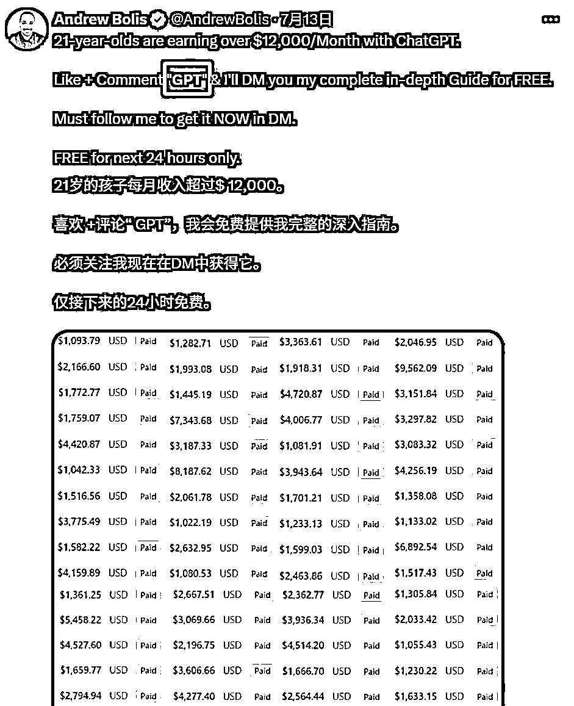

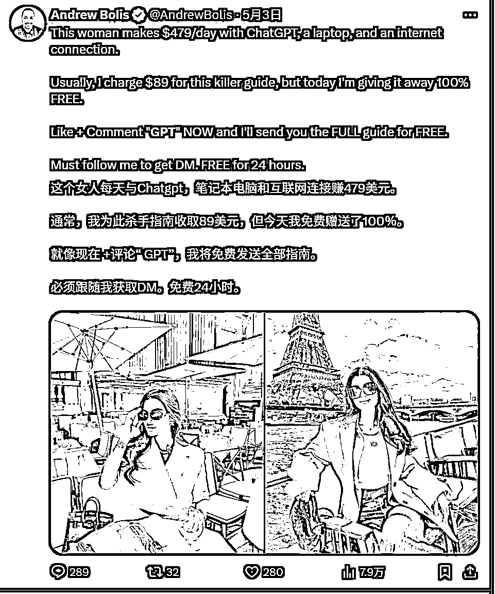

平台还看账号活跃度。日更账号权重更高；断更后恢复发布，推流会明显走弱，需要重新养号。想快速起号，尽量保持日更。


# 2. 常见爆款模板

在X上，长线程比普通帖更容易出爆款。

# 2.1 长线程是什么

线程是X特有的形式：先发一条帖，再不断在自己的帖子下追加评论，多个小帖串成一条长链。下面就是长线程：

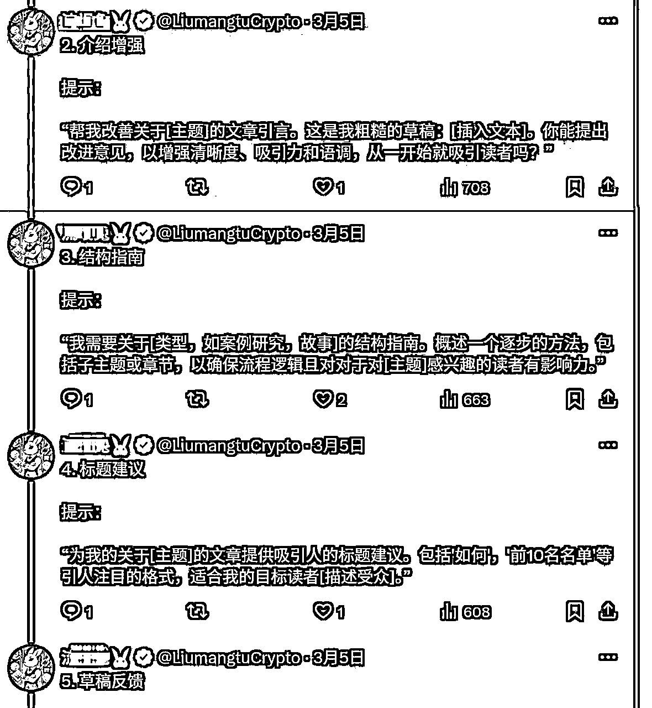

下面则是普通帖：

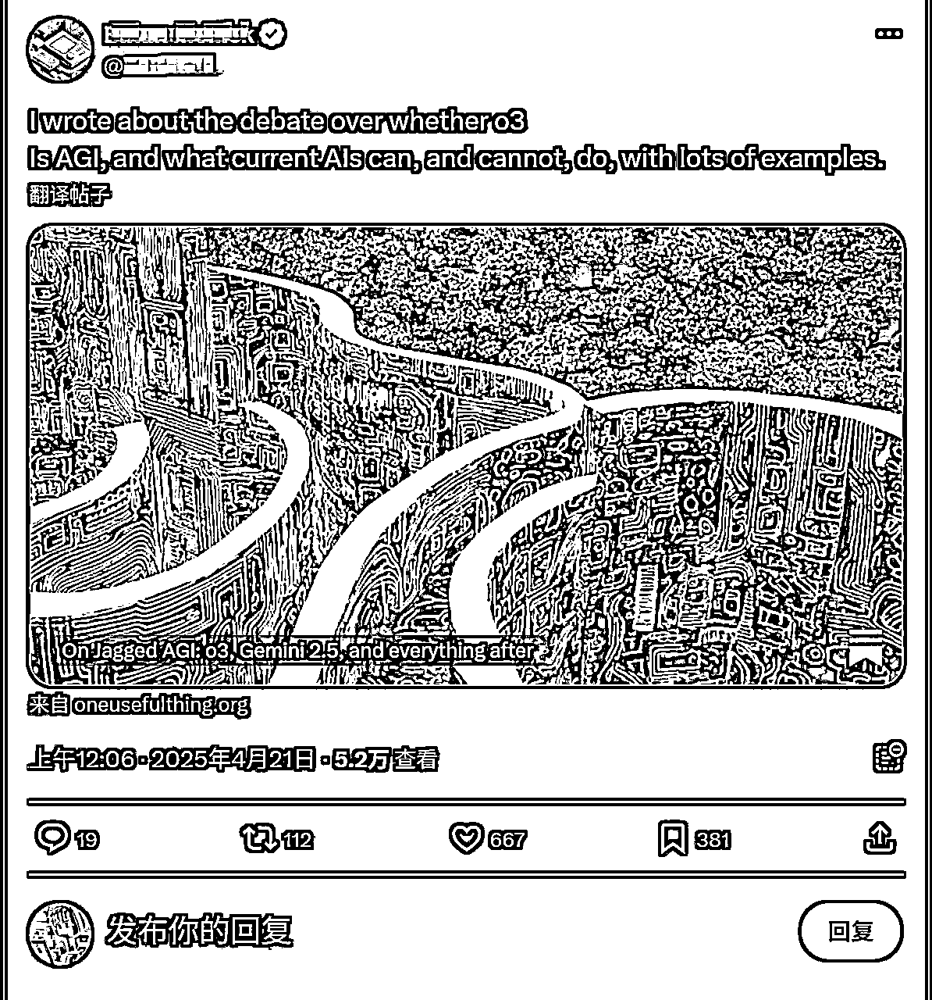


# 2.2 怎么发长线程

第一步：进入X首页，点上方空白处写推文。

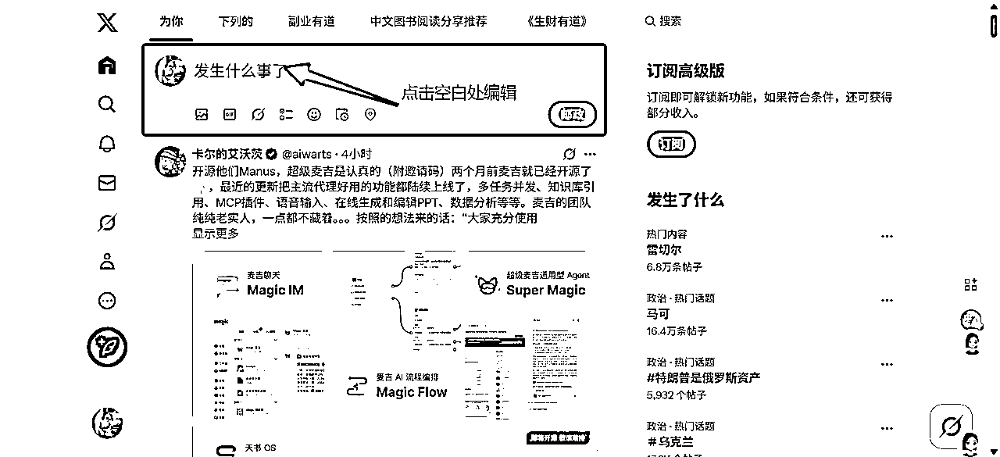

第二步：点加号添加线程。

第三步：继续点加号追加。

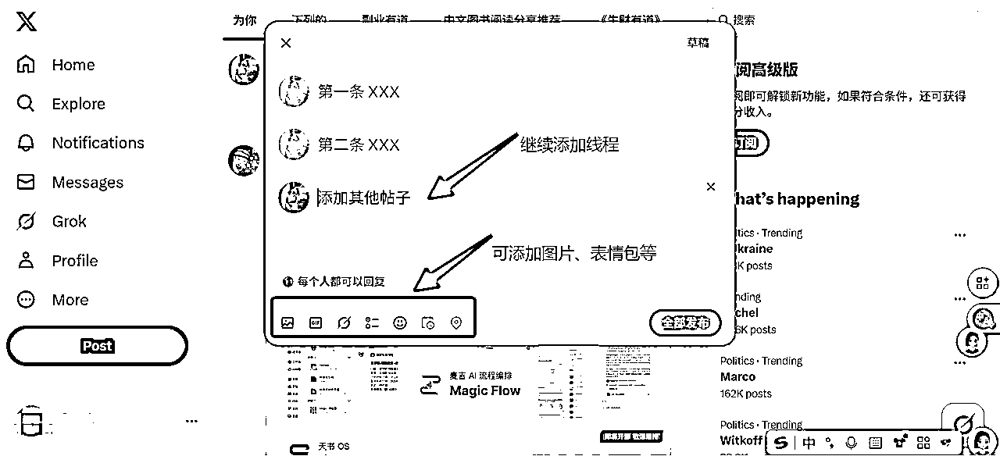

小技巧：

- 引导评论：结尾可写“想要资料的，评论区留【AI】，我私信发你”之类。
- 引导关注收藏：第二条线程可放“阅读前先点赞关注或收藏”。
- 第二条线程下最好不超过4条，可先发出去，再逐条回复。
- 未开会员时单条<280字，超长就拆线程。

# 2.3 长线程为何更易曝光

X是信息流，普通帖短，用户一扫而过，注意力难停留。平台注意力竞争激烈，而长线程通常至少10条跟帖，能完整讲清一个观点、故事或主题。

线程里加短视频能提高推流概率。视频完播率过50%会给推文加权，平台据停留时长判断内容吸引力，从而给更多流量。同样内容拆成多条线程，比挤在一条里阅读体验更好；单条建议280字内。一条说不完，可在结尾写“完整内容见下”，引导继续点。


# 2.4 病毒式线程结构

正文即第一条帖，要抓眼球，但别塞太多，目的是让用户点进下一条。正文结尾有三种引导句：

1. 引到故事：“故事从这里开始↓”
2. 引到干货：“三个问题的解法如下↓”“他研究20小时后的发现↓”
3. 引到资讯：“本次发布内容全在这里↓”

正文可配吸睛图，如人物、知名公司logo：


主动引导动作：线程长，读者容易忘记互动，所以要有意识加引导。越往后流失越多，建议第二条线程就开始呼吁：

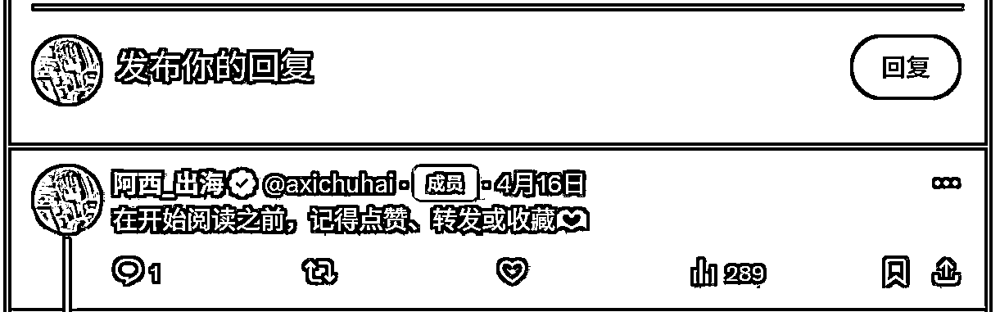

结尾提醒关注：能看到结尾，说明满意度较高，平台多半也给了流量。此时要承接流量转粉，并引导转发正文链接。我的结尾模板：

喜欢这个主题的话：

1. 关注我（@xxxx），继续学xxxxx知识
2. 给首条帖点赞并转发

（此处放正文链接）


# 3. 三段式爆文写法

前段时间我尝试用结构化方法写X内容，观察推流、互动和付费转化。整体超预期：发2条，一条17万+曝光，一条8万+曝光，还带动付费产品转化。

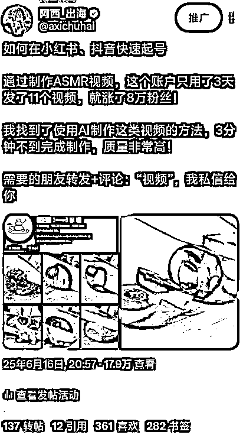

第一步：亮出信息价值，让人停留、产生兴趣。开头要说明：这条内容解决什么问题，或提供什么稀缺信息。四种形式较有效：

- 经验总结型：“一个账号3天涨粉8万，复盘如下”
- 工具方法型：“3秒做出爆款”
- 反差型：“不拍视频、不露脸，也能起号并获推荐”
- 资源型：“某平台内部免费资源限时开放”

目标是让用户想继续读。

第二步：简述可验证的方法，建立信任。中段别铺太长，抓一两个关键点，传达“能落地”，控制信息密度。可用1、2、3简单说明。多数人有惰性不会实操，但看到方法会更信任你，更愿意直接要现成可用的东西。

第三步：明确引导互动。X推流里评论和作者回复权重最大，所以结尾要提出互动建议，并降低留言门槛。示例：指定话术“有兴趣的评论区留【我要专栏】”。注意：用户留言后要分批回复，且回复内容有差异，避免被平台判为机器人而限流。

## 1. 选题库搭建

操作不复杂，用好X书签收藏即可：看到高曝光内容就加书签，之后从收藏里找选题：

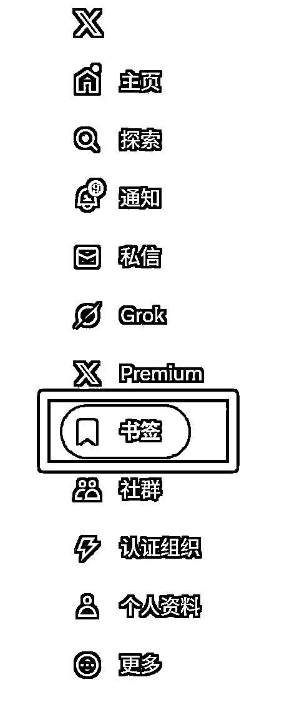

开了X会员的账号，还能给收藏夹分类，方便按方向快速检索：

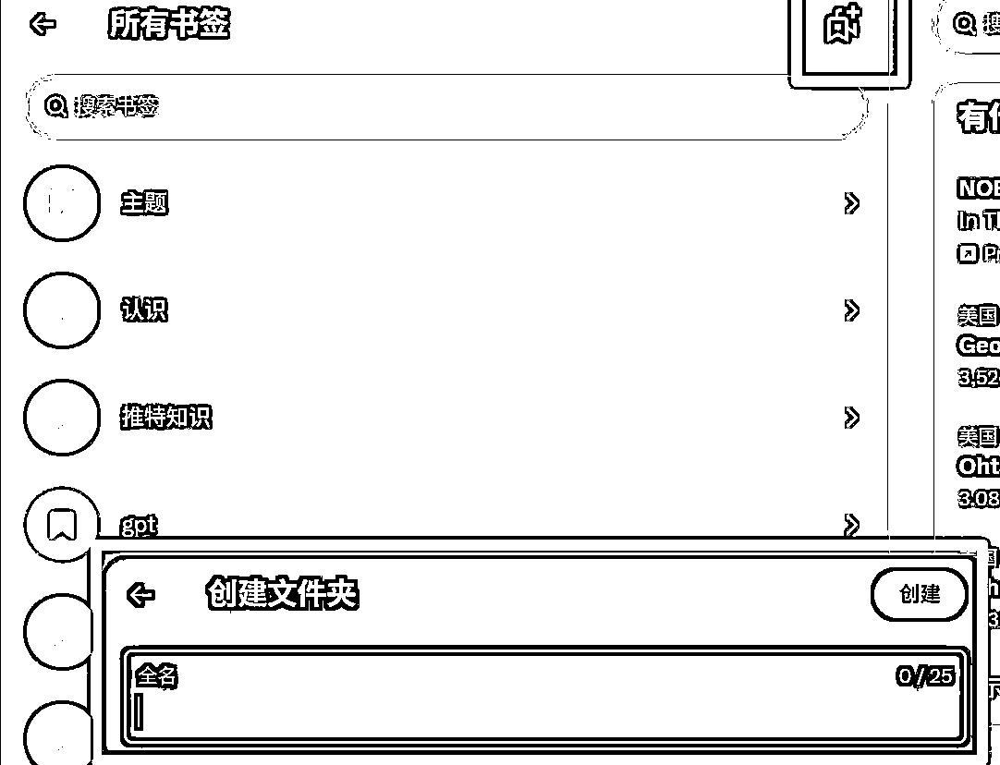

## 1. 流量复盘与优化

# 1. 本章要做什么

本章三件事：数据复盘，用会员后台看曝光、互动、粉丝变化；限流自查，弄清常见原因、规避方式与申诉办法；流量优化，坚持日更、精准互动、借力转推，并用AI工具提效。学完你对X运营会更有章法，祝流量跃升！

# 本章推进路线

完成学习与实操，可走完路线图：

第二阶段：复盘提效：总结创作经验，打磨优化工作流（持续）

- 每周复盘一次账号流量，参考手册优化（约1次/周）
- 根据实操梳理并优化工作流，提升效率（约1天）


# 2. 数据回看与会员开通

开了会员的账号，后台能看每日数据：每日曝光、每条推文曝光、关注数等。打算长期做X，建议开会员，按月开试错成本低。

开通X会员步骤：

1. 电脑端点击侧边栏premium

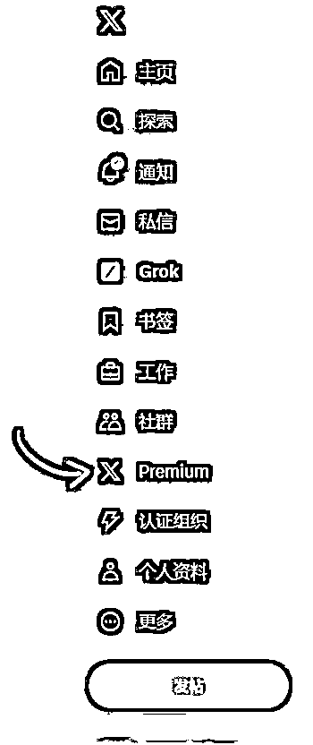

2. 选第一档。X会员分不同等级，有月付/年付。basic档可发超过280字的帖子；Premium档可看账号数据分析。长期运营可上Premium。

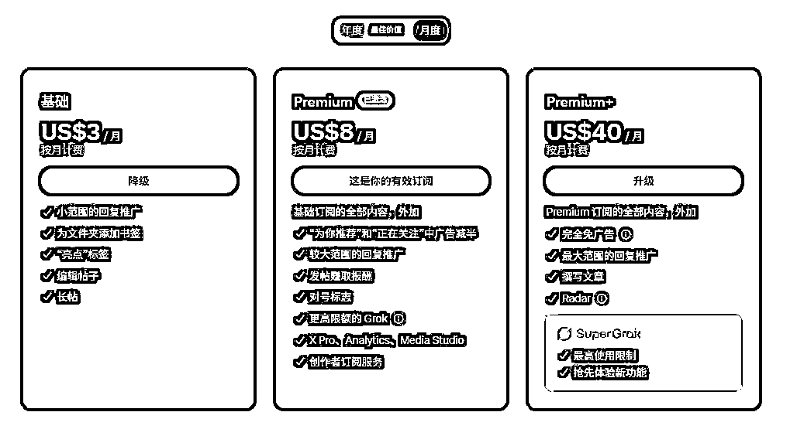

3. 支付。国内visa/master卡可完成。

开会员后就能看数据做优化，重点关注：

1. 内容维度：曝光量反映系统推荐强度，即平台愿不愿意推；互动率反映看到的人里有多少点赞、评论、转发、点开，能判断内容是否吸引停留。对比这些指标，确定优化方向。

2. 账号维度：后台有每日粉丝增减，能看出哪些推文带来增长或掉粉；哪些内容带来关注，哪些只是点赞型。常见问题是：有曝光没涨粉，说明推文能吸引点击，但主页或人设不够清晰，留不住人。此时优化置顶推文或简介。

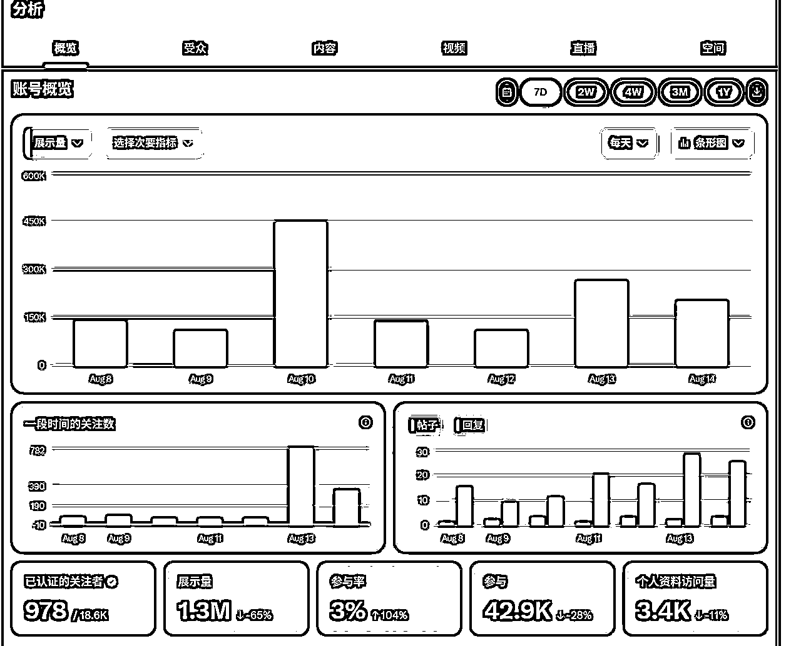


# 3. 限流自查避坑

做X要常查限流。我踩坑不少，曾被限流1个多月，后来才慢慢养回。

怎么判断？最直观是每日曝光断崖式下滑，当然也可能是内容变差。另一个验证法：用别的账号搜“from:@username”（username换成你的用户名），搜不到就是被限流。下图是我被限流时的搜索结果。

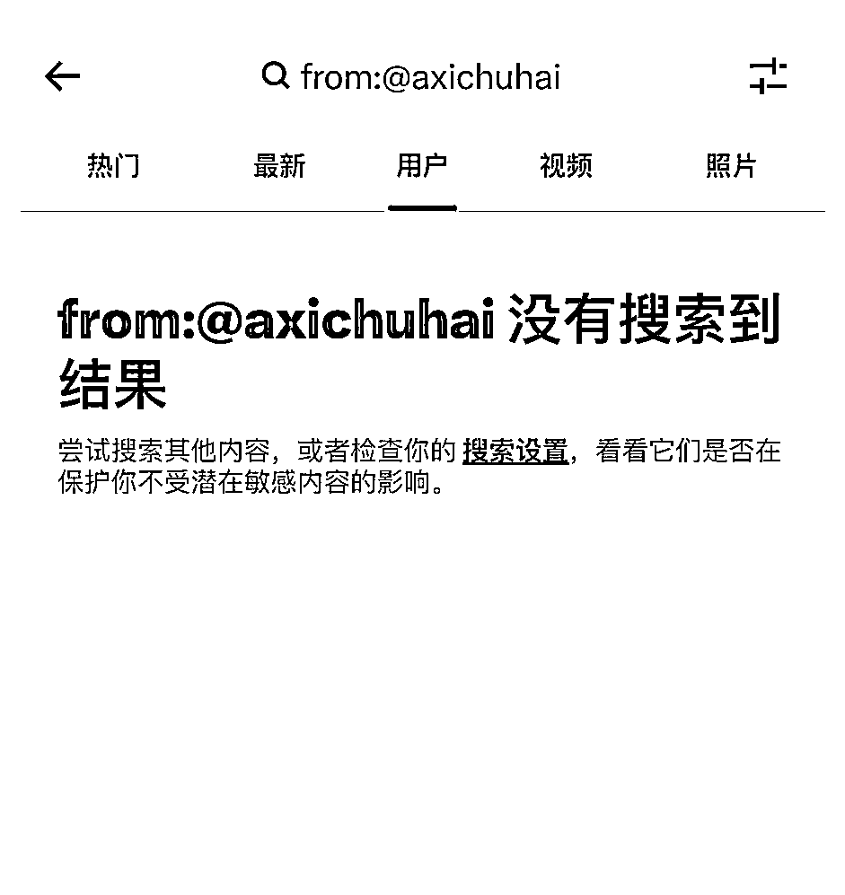

可能触发限流的原因，尽量避免：

- 邮箱未验证
- 没设头像
- 同一设备注册多个账号
- 重复用相同文字或图片回复
- 频繁@未关注用户，引发举报
- 发推操作过快
- 关注数远高于粉丝数

若已被限流，除了等，也可尝试：

1. 向Twitter支持团队申诉

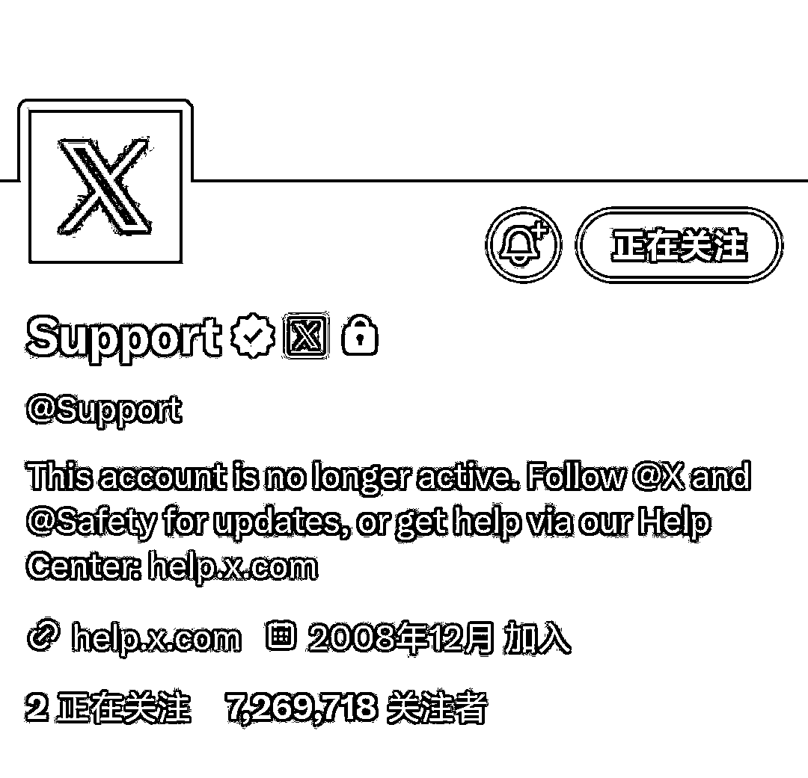

限流申诉话术模板：

```
Hi Twitter Support Team,
I'm writing to report a potential issue regarding my account's visibility and engagement.

Recently, I’ve noticed a significant drop in impressions, engagement, and search visibility for my posts. In particular:
My replies seem to be deboosted or hidden from other users.
My tweets are not appearing in search results, even when using exact keywords.
The account is not receiving any system warnings or notifications.

I’ve reviewed the Twitter Rules and am confident that I haven’t violated any policies. If there’s any automated system that mistakenly flagged my account, I would appreciate a manual review.

My account: @（填你的账号id）
Thank you for your time and support.

Best regards,  
[Your Name or handle]
```

1. 先静默48小时

这48小时里，发帖和互动都先停一停。当然，限流到底因何而起，还要看具体原因，找到症结再处理。


# 4. 把流量做起来

# 4.1 每天更新，别断档

平台会看账号的发文活跃度，持续更新的账号权重更高；一旦断更再恢复，推送效果往往会明显下滑，等于又要重新养号。所以想快速起号，日更推文要尽量坚持。

# 4.2 用互动搭关系

你在别人账号下留言，等于进入对方的流量池，被看见的机会会变多，也会顺势带动自己账号被发现、粉丝增长。同时，想和粉丝量远高于自己的账号建立联系，互动是花钱最少、也最容易开始的路径。

不过，互动不能乱来，有两个点要抓住：

互动关键点一：找对互动对象

去马斯克、特朗普这种超大V下面留言，基本属于无效社交。这类账号留言区刷新飞快，你的话很快沉到底部，几乎没人会点进你主页，作者也大多不会回应。

更建议把目标放在粉丝 5000–20000 的中腰部账号，原因有三：
- 留言区有讨论氛围，但不算拥挤，你的评论更容易被看到；
- 这类账号通常还没那么强的商业化，运营者更愿意进行真实交流、交换观点；
- 后续如果你想谈转推、做内容联动，也更容易积累信任。

互动关键点二：评论得有内容

不要发“太棒了”“支持”这类没有信息量的回复，既没价值，还容易被系统识别为灌水。

可以优先用这几种方式：
- 补上原帖没提的相关数据、案例或新角度；
- 顺着原帖提出值得思考的问题；
- 先表达认同，再把话题引到自己的经历或看法上，让讨论继续往前走。

核心是让别人看到你是一个有内容、愿意交流的人，这样才更容易被关注。

# 4.3 评论区值得认真对待

推特的推荐逻辑里，评论的分量明显高于点赞和转发。一条推文如果短时间内评论人数多，推荐量会明显上涨。所以每一条评论都尽量及时回，哪怕只回一句。

这是提高曝光最直接的办法之一。账号刚起步时尤其明显，一条评论带来的二次传播，效果可能比一次转发更强。

# 4.4 借别人的势做冷启动

起号阶段别只顾着发内容，也可以借别人的影响力。比如私信定位相近的账号（常见 5000–3w 粉），对方报价通常更友好，几百元就能做一次小批量测试，尤其适合冷启动。

如果不想先付费，也可以试试友情转发，礼貌地说：
“新账号，希望获得一些曝光。”

请求时记得给出推荐理由，比如内容不错、对双方都有好处。你请对方转的内容确实有价值，很多人愿意帮，因为对自家粉丝也有用。所以转推内容要利他，不能只是自我推荐。

另外，不要在发布后马上私信。等 1 天，带着曝光数据再联系，说服力更强，对方看到数据也会判断有没有推送价值。付费转发成功率当然最高，免费转发也有机会，两种都可以试。

我起号前期通常按对方体量发个红包，然后说：这篇现在流量不错，感觉和你的粉丝很契合，应该会喜欢，能不能帮忙转一下。

1. 用 AI 复刻爆文风格

除了长帖爆文，短帖也有快速出爆款的方式：先锁定常出爆款的头部账号，再让 AI 按对方的行文风格来写你的选题。

具体步骤：

步骤一：锁定对标账号

找对标的方法，前文【一 -> 02 -> 3.2 对标怎么找？】已经讲清。

步骤二：抓取对方历史内容

不少平台都有博主帖子批量下载工具。在谷歌应用商店搜【社交平台名字+批量采集】，通常能找到。（谷歌应用商店：https://chromewebstore.google.com/）

以 X 为例：在 Chrome 插件商店搜“推文下载”，会出现一批能导出 X 推文的插件，部分还支持多平台。我选的是排在第一位的 TweetExporter。

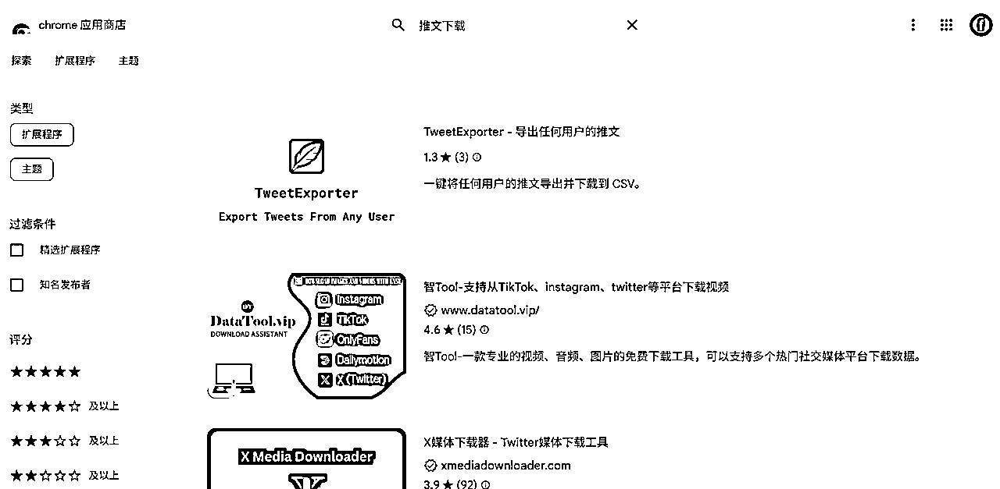

装好插件后，填入要采集的博主账号 ID（格式是 @xxx，不是昵称），点导出。

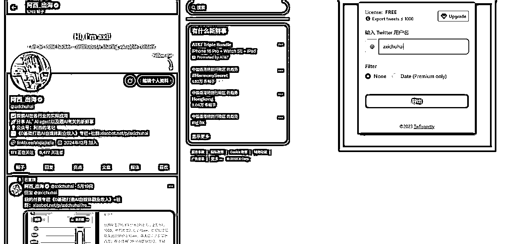

步骤三：搭建大 V 知识库

用到的工具：ima（腾讯开发的知识库，下载链接：https://ima.qq.com/）

.
新建知识库
.
把先前导出的推文 PDF 导入，智能体就搭好了
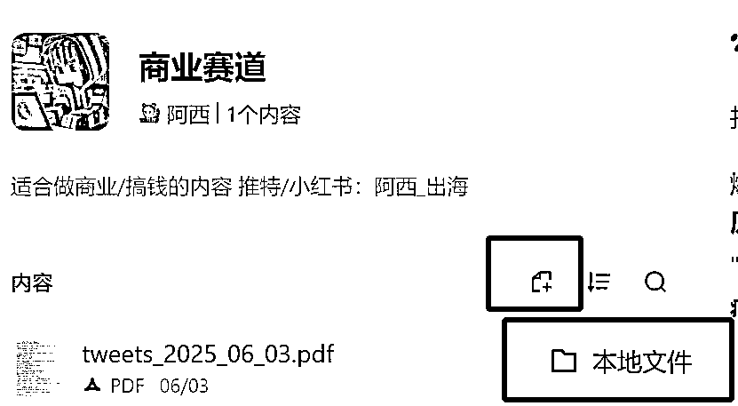
.
然后打开与智能体的对话
对话标准提示词：请你模仿知识库文件的表达方式写一篇 XXX 字的帖子，选题方向是：XXXX

1. 中推与英推的变现路线

# 1. 中推变现路径

下面这些变现方式，我都亲自跑通过：

变现方式一：带货分佣

除了商单，不少小规模创业者也想通过推特上的 KOL、KOC 推广自家产品，于是会选择开通分佣。常见的有工具类分佣产品和知识付费分佣产品。

哪里可以找到这些分佣产品：

1）工具类分佣产品

找法有两种：

发布分佣合作推文，吸引想推广产品的独立开发者；

主动私信推特上卖得不错的工具开发者，问有没有分佣计划。

分享一个最近的案例：

我给一个录屏工具做佣金推广：只发了两条推文，我先给思路，AI 负责成文，最后拿到 75 美元佣金。

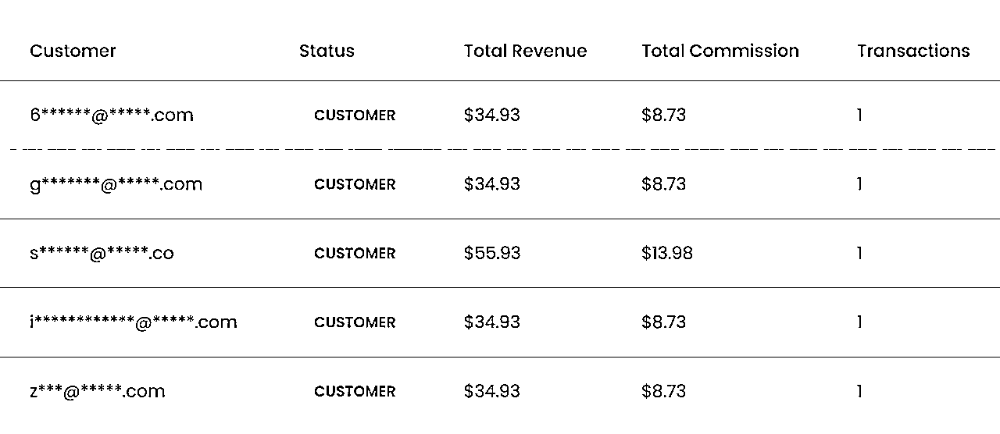

这款产品是怎么找到的？我用了主动触达：开发者是推特高粉大 V，自带信任背书；推特上也有多位独立开发者用过并评价不错；我自己试用后觉得有增长空间，于是联系对方拿到了推广链接。

2）知识付费分佣产品

以小报童为例（大V的知识付费课、星球会员也能带）。

小报童是知识付费内容发布平台，创作者能开通分销佣金，不少创作者会打开分销，让别人帮忙推广赚佣金。举例：一个专栏售价 100 元，分佣 30%，你卖出一份拿 30 元。这个佣金不用你追着别人谈，关键是你能否找到转化率高的小报童内容。

我经常看到有人分销我的小报童赚佣金；我也测试过分销别人的小报童，月入几百并不难，方法很关键：

如果某位大 V 要上线新的小报童产品，首发期推广转化率通常最高，因为用户还没被反复触达，所以尽量抢首发。可以盯几个赛道的头部账号，看他们是否要发小报童。这个做法有点像守株待兔。

没有新品时，就主动多测几款已上线的小报童，挑转化最好的重点推。如果不知道推哪个，可以先从小报童官方首页的精选推荐里选来测。

变现方式二：网盘资料

这个玩法有国内特色，适合国人做。门槛低，算目前新手比较容易拿到第一笔收入的路径，推特也很适合做网盘资料变现。

我实际测试：从接触学习到上手只用一周，每天十几分钟，做到日收益 78 元。下图是我实践一周的成绩，能看出随着熟悉度提高，日收益涨得很快。

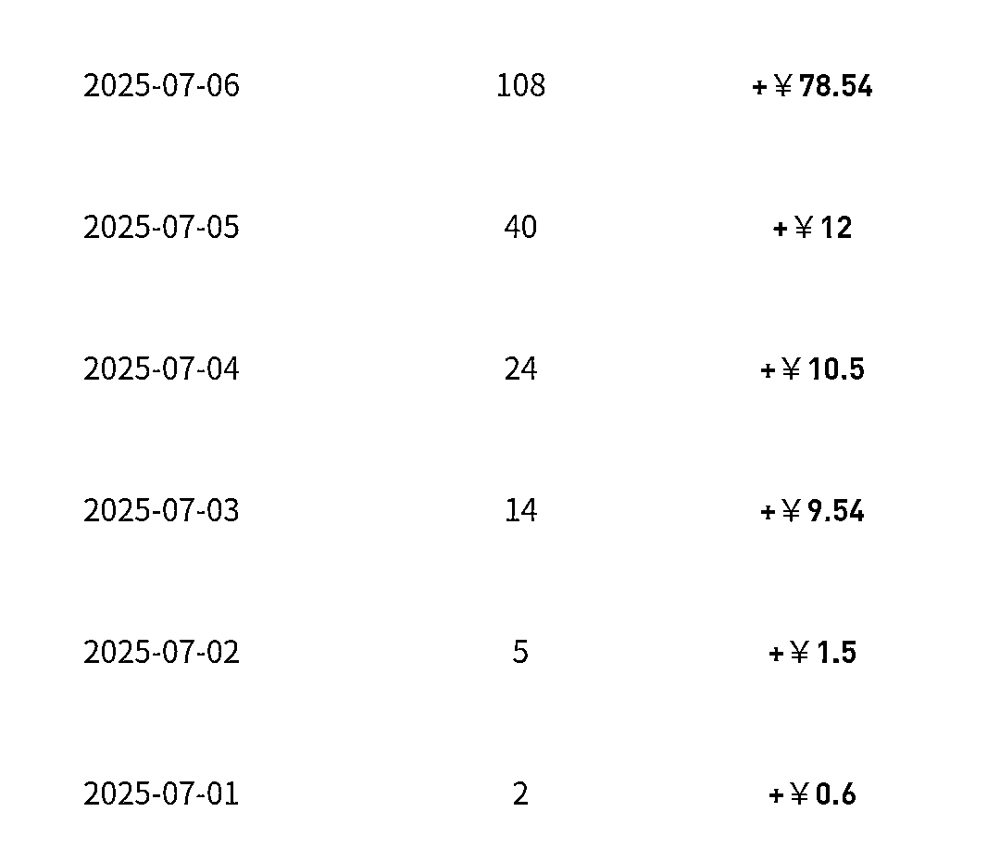

我在星球也写过一篇推特网盘项目的做法，想细看可以搜：推特新手账号如何快速实现低粉变现？

变现方式三：创作者分成

前面说英推创作者分成天花板更高，但中推做创作者性价比也不差。以我的号为例，1.5w+ 粉，开通创作者后每半个月收益在 500–1500 元之间浮动。我没专门为分成做什么动作，只是正常发内容，每半个月就有一笔收入，性价比不错。

这是我开通创作者分成后收到的第一笔半个月收益：

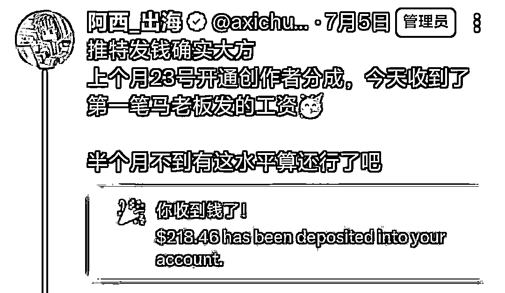

提现要说明：开通创作者分成后，收入需通过 Stripe 转回国内。目前最省事的做法是先开一张港卡，再开 Stripe 账户。（我是去香港旅游时顺手开的港卡。）

变现方式四：自有产品

中推面向华文用户，所以国内能卖的自有商品，大多也能在推特卖，比如知识付费、咨询、私域带货等。和国内社交平台不同，推特不会因为推文里放引流二维码或链接就限流封禁。

例如：

1、直接放个人二维码

2、直接放群二维码

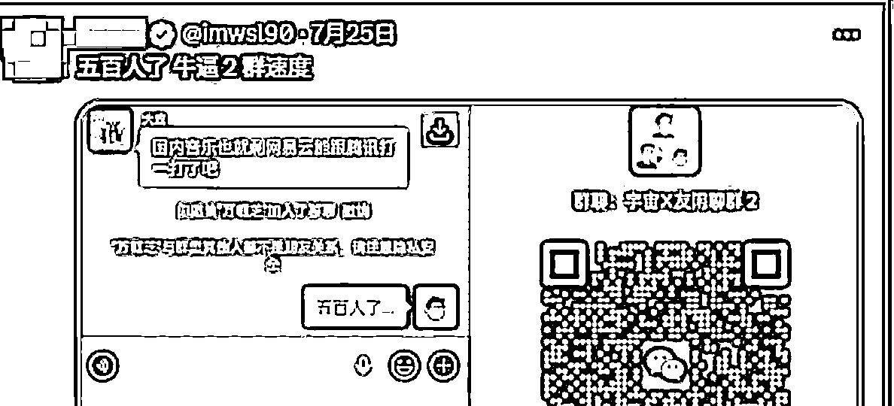

# 2. 英推变现路径

1、创作者分成

从去年 10 月起，推特创作者分成从看评论区广告互动，改成看推特会员与你的互动量：和你互动的蓝标会员越多，分成越高。英文区会员数量比中文区多，所以英推创作者收益天花板更高。

2、商单收入

目前推特商单预算较充足的是 AI 科技类。以 AI 行业为例，我向专门做推特的 MCN 公司了解过，英文商单需求最大；品牌推广规模大时，需求会外溢到中日韩语言区，但首选仍是英文，因此英推商单需求更多。Web3 商单里中文单也不少，但产品甄别难度大。

最近一些国内品牌也开始主动开发推特流量，我接到过国内单子，后续可以期待。平时要多看推特私信，商单一般会通过私信来联系。

# 写在最后：把内容做成长期资产

AI 是 2025 年内容创业者最值得押注的赛道，推特是全球 AI 内容的信息源。在信息源里生产内容，自媒体创作者能获得更大的势能。

除了流量优势，推特还把“内容→关注→合作→变现转化”整条链路打通了。无论你想推广自己的产品，还是想靠自媒体赚副业收入，推特都是很好的选择。

祝大家在 AI 自媒体领域持续深耕，放大收益，找到内容创作的乐趣和意义，一起龙哥盟！