# YouTube Al 视频实战手册202509


# 1. 素人为什么该把第一站放在 AI 方向

先把一个概念讲明白：这里说的"素人"，指的是手上没有成型项目、不具备职业级内容功底、也没有能一招打穿某个细分领域的硬本事。这三条你都不沾，本节可以直接跳过。

跟过航海、翻过手册的圈友应该有印象：里面给出的推荐方向，十有八九落在 AI 这一类。私下我被问过很多回——为什么这么排？凭什么把它摆到这么显眼的位置？YouTube 什么时候轮到 AI 唱主角了？

# 2.1 三张牌恰好凑齐

老实讲，纯 AI 这条路在 YouTube 上既不是最肥的，也不是最省事的。论变现单价，它拼不过各种解说账号；论省力，又比不过搬运洗稿那一套。但把"起号速度""竞争密度""成长上限"叠在一起看，它就是眼下最值得素人下注的地方。

起号为什么快？照着手册走一遍：锁定对标、套用提示词、文生图、图生视频、再粗剪一刀，一条及格线以上的片子就成型了。不少零基础的圈友，第一部作品就跑出上万播放，这在往年那些老赛道里几乎不敢想。另外，素人想敲开 YPP 大门，这条路也最省力——我们经手的一百多个 YPP 案例里，还包括初审没过、申诉回来的，只要按规范做片、该申诉就申诉，哪怕成品相当朴素，最终过审率也是百分之百，平均一到两个月落地。要搁从前得等多久？Claude 3.7 的答案贴在下面：
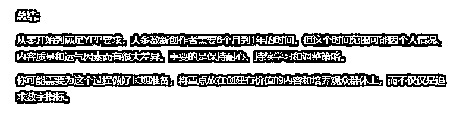

凭什么说竞争还不拥挤？YouTube 已经快二十年，AI 内容真正成形也就两年；工具又几乎月月翻新，我们今天在玩的这套，说不定只是最近几个月才长出来的新枝。你横向比一比前排账号就懂了：不少 AI 频道的头部作品堪称粗糙，看得人直摇头；而那些老牌品类的前排选手，水准高得吓人。

这意味着什么？意味着素人同样有机会挤进 AI 这一块的前排。从去年 12 月航海算起，赚钱圈子里已经冒出几十个细分方向的头部账号，甚至被后来者拿去做对标研究。顺带说一句，我自己的频道订阅过了 15 万，比影视飓风做了好几年的小号还多出一截，但这数字真没多少含金量，跟人家实打实攒出来的订阅没法比，各位看个乐子就行。

成长上限凭什么高？在多数人印象里，AI 作品无非是猫猫打工、动物短剧、美女变装这类图省事的玩意儿。可他们没留意，AI 内容一直跟着工具在进化。就拿"达人秀变装"这个极小的切口说，形态已经翻了好几轮：早先人物动作僵硬、神情呆滞，后来逐渐离谱，再到困困圈友那支魔术变装，几乎分不出真假。还有各种衍生分支，篇幅有限没法逐个铺开。

说句实在的，只要稍微留心就会发现，AI 早已钻进了各式各样的品类。我们眼下还能单独划出"AI 内容"这个框，是因为它暂时还辨认得出来；可工具继续按这个速度迭代下去，谁还敢保证自己能把 AI 做的和真人做的分开？AI 最迷人的一点就在于，它能嫁接到任何一种内容形态里去。所以这条线的天花板，取决于它所嫁接的品类的天花板——甚至可能更高。

# 2.2 两个常见误判：没价值、不赚钱

换个视角看，做 AI 内容本身就是在筑基。借复刻爆款 Shorts 的过程，一边摸清 AI 的脾气，一边练出对爆款的嗅觉。说到底，拆解 YouTube 上任何一条品类的作品骨架，跟拆解 AI 作品并无二致；拆长片和拆短片也是同一套心法，差别无非是时长拉长、变量变多。连 15 秒的小片子都拿不下来，又凭什么觉得自己能扛住 15 分钟的真人实拍？

再说钱。Shorts 单价低，这锅不该扣在 AI 头上——泛娱乐类的短片收益本来就薄；而 AI 做的长片，收益完全可以跟真人内容并驾齐驱。赚多赚少取决于作品本身的质量，跟你用没用 AI 无关。更何况 YPP 只是 YouTube 变现体系里最入门的一层，后面还能从 AI 作品上延伸出别的赚钱门路，这点后文会聊。
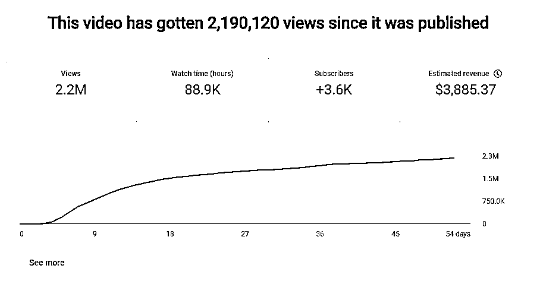
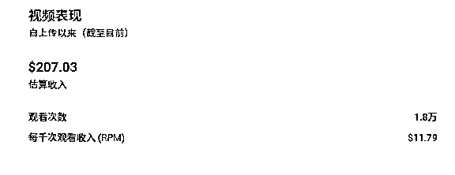

网上不是流传"AI 的 RPM 特别低"吗？上面几张图是 ISLAND 教练、CC 圈友和运气教练的长片收益截图。

所以我的判断从没松口：素人如果打算认真经营 YouTube，第一个该试的方向就是 AI。

# AI 正在重写 YouTube 的生态规则

# 3.1 无声渗透

小排老师有句话我很认同：做 AI 内容的落点不在 AI，也不在内容，而在观众的需求。

下面这批截图取自 4 月，检索条件是"播放量降序 + 近一个月"。
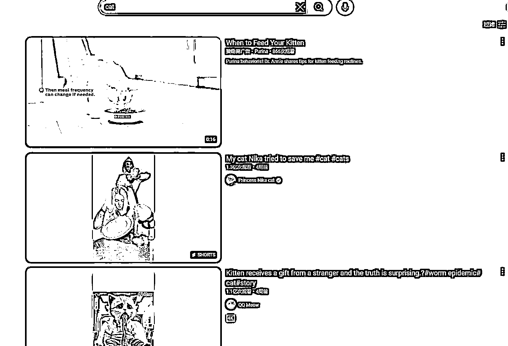
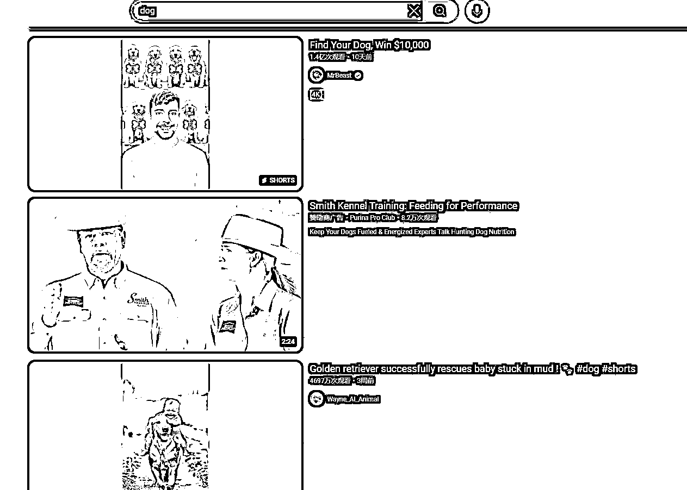
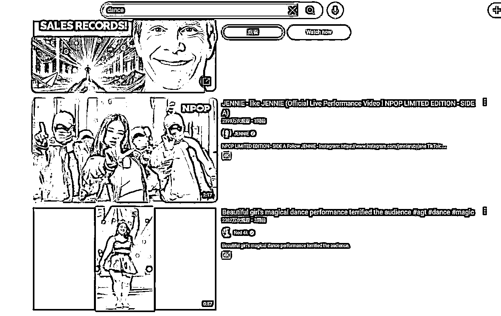
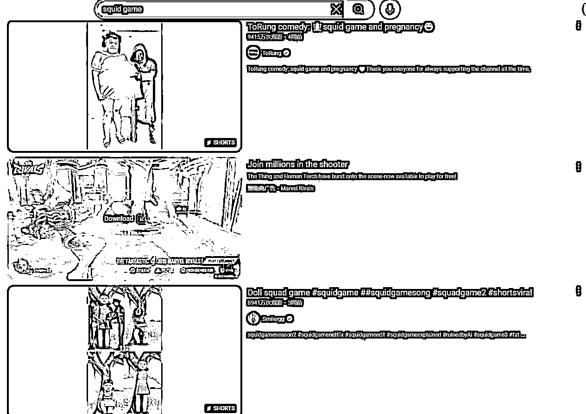

再放 8 月的：
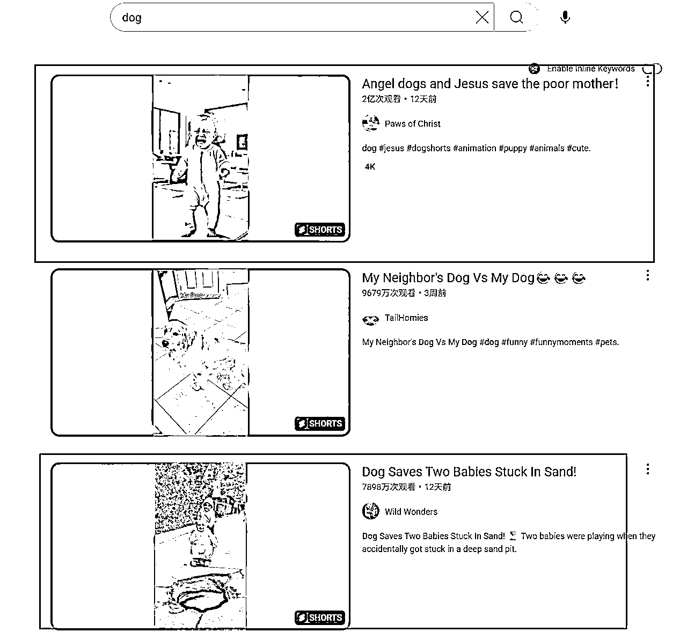
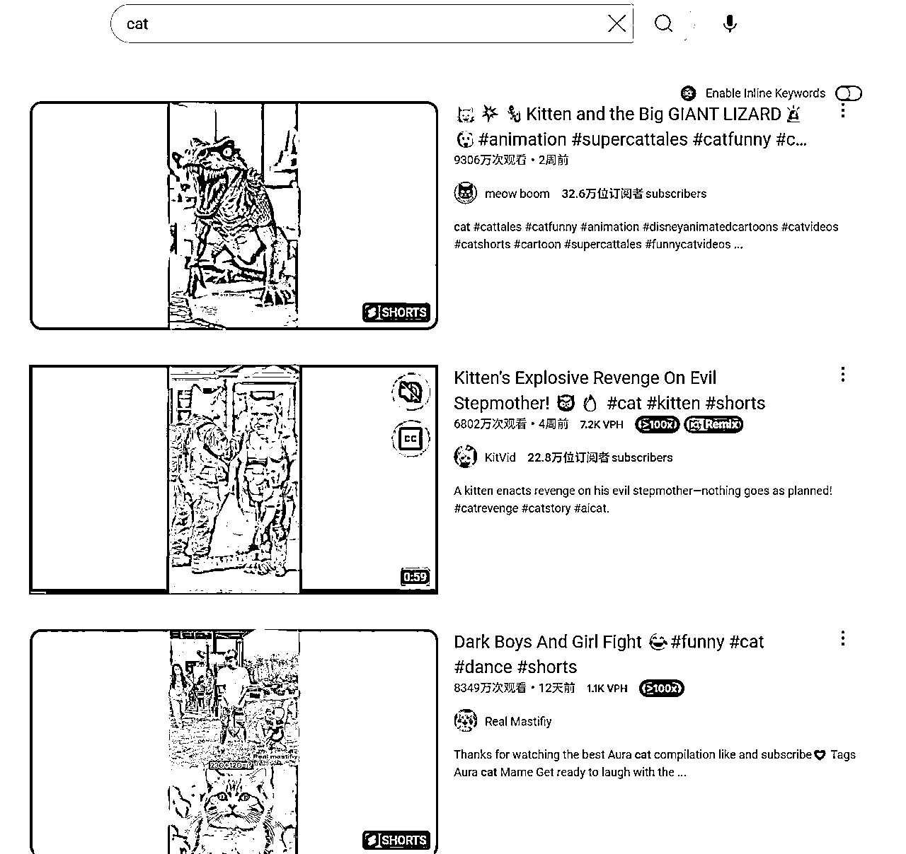
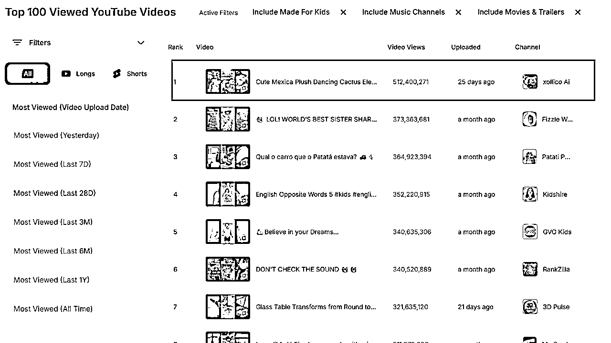

不知道各位看到是什么感受。我虽然提前打了预防针，真看到那一刻还是头皮一紧——这些大家再熟悉不过的老品类，AI 创作者已经悄悄爬到了流量榜首。

补一句：agt、dog、story、dance、game、brainrot、cat 这些超大词条，我们圈友的作品都打进过当月前五，甚至登顶。反过来说，同样几个老品类，如果撇开 AI，让一个新人去抢前五，你觉得有戏吗？

# 3.2 并肩共生

任何能炸出流量的作品，背后一定是踩准了受众的某个痒点。道理谁都懂，可真上手做过片子的人才知道落地有多难。

还是借小排老师的比喻：创作时，AI 更像个合伙人——绝大部分能力甩你几条街，却百分之百听话。


摸不清 YouTube 的脾气？不知道哪类数据好看？交给 Manus、Genspark、Cursor 这类 agent，让它替你写个抓数脚本，再顺手把各方向的数据跑一遍，辅助你做判断。
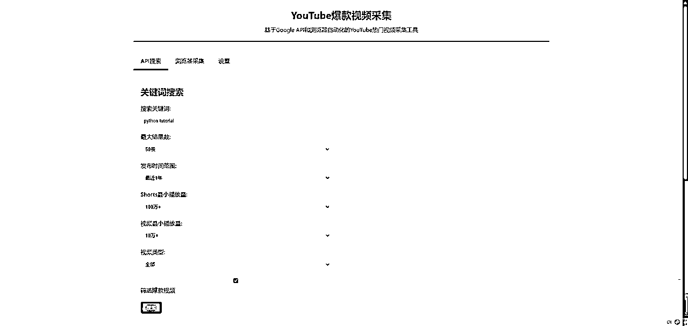

看不透别人的片子？不会写脚本？直接把链接丢给 Gemini，让它把故事结构拆开、连提示词也一并写好。（专业知识）要明星、要美女、要怪兽、要魔法、要仙术？想得到想不到的，只要提示词到位，AI 都给你变出来，而提示词上面 Gemini 已经准备好了——这就是创意激发。
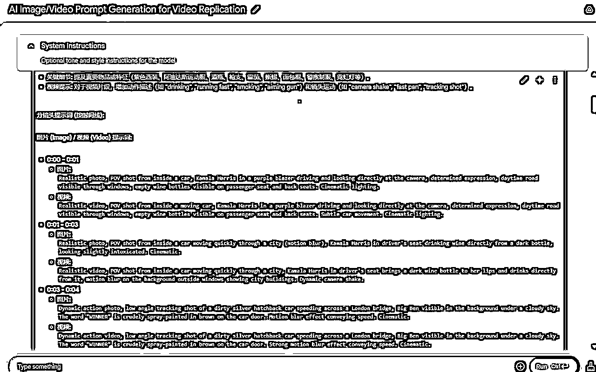
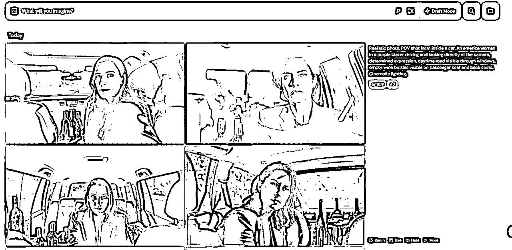

重复劳动吃掉人力？流程太碎太杂？照精华帖里的思路用 AI 串一条工作流，一天出一百条片子不是梦。（执行放大）
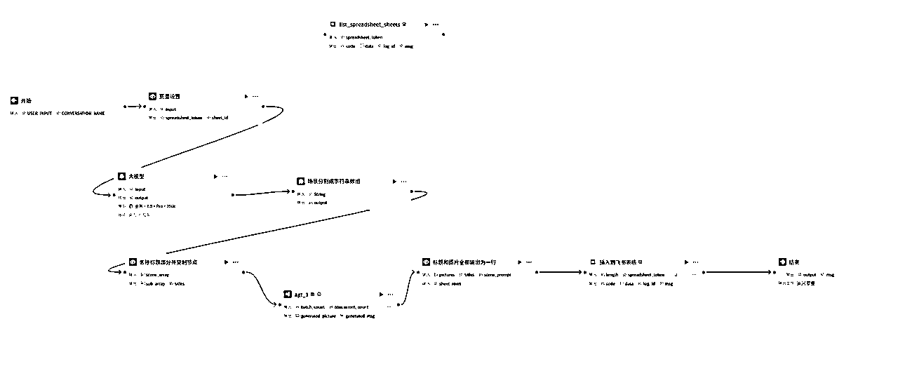

AI 作品掰开看无非几块：写脚本、文生图、图生视频、配音配乐、剪辑合成，这些 AI 都能接；就算是真人内容，也有大量环节能用 AI 提速。但有个前提——得先有活干。所以做 AI 内容的根，还是在挖需求。如果既摸不准观众想看什么，也说不清好内容好在哪，那 AI 流水线吐出来的东西，跟《新白雪公主》那种赛博垃圾有什么区别？

早些年 AI 能力捉襟见肘，想出高质量片子极难，基本靠剪辑节奏、构图和分镜语言硬撑。像 23 年 8 月卡兹克那支传播极广的《流浪地球》，放到今天看画面已经过时了，但它依然是 AI 影像的一块里程碑。（B 站视频传送门）

从前是 AI 拖人的后腿；如今在 YouTube 的生态里，反倒是大批创作者在拖 AI 的后腿。工具只会往前跑，无论你是不是做 AI 内容，都得持续磨三样东西：挖需求的眼力、对作品的理解力、跟 AI 协作的手感。把"人"的价值放大，才能与 AI 共生，成为超级创作者；否则只有两条路——沦为 AI 的奴隶，或者站到 AI 的对立面。


# 3.3 秩序重构

前面那些案例，加上各位平时各平台刷到的 AI 渗透内容，大多还停留在简单粗暴甚至低质的水准（卡兹克那支《流浪地球》除外，先声明一下立场）。那么问题来了：在 YouTube 真正的顶梁柱——长片与精品内容的战场上，AI 有没有还手之力？

有。看下面几条。第一条作品发布时，可灵 1.6 都还没影儿。

去年 12 月，一支 AI 名人恶搞 MV 冲到 1500 万播放，按 RPM=2 粗算，光 YPP 就有约 3 万美元入账。原作链接：https://www.youtube.com/watch?v=TbXZoMocpM8
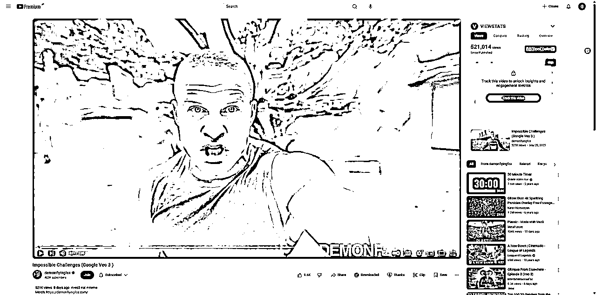

5 月，另一条 VEO3 做的《AI 真人不可能挑战》，8 天 55 万播放，收益预估 1000 美元上下。原作链接：https://www.youtube.com/watch?v=CxX92BBhHBw&t=1s
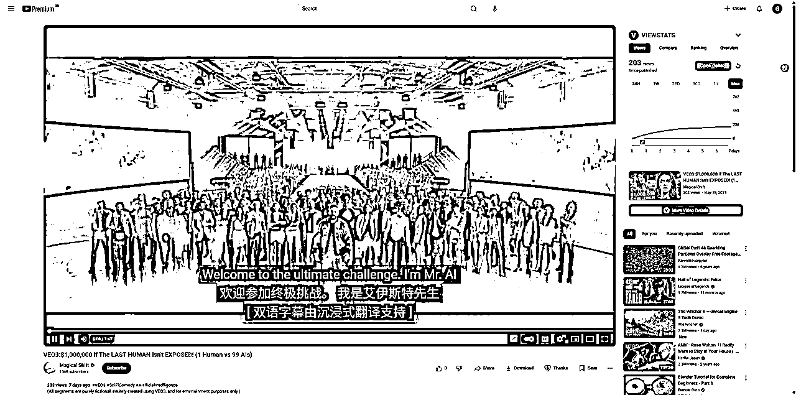

6 月那条野兽先生风格的 AI 真人秀是我做的，当时 Flow 有 bug，一致性压根控不住，不然成片还能再上一个台阶。原作链接：https://www.youtube.com/watch?v=CJq9ACD7ikQ

7 月，我用 MJ 配可灵加 ElevenLabs，复刻了一支 11 年前的反战宣传片，算是向经典敬个礼。

各位看这几支片子的时候，脑子里会蹦出"这是不是 AI 做的"这个念头吗？作为纯观众，我不会。因为注意力早被内容本身勾住了，需求也已经被喂饱。至于它是不是 AI 生成——对用户来说根本无关紧要。

AI 短片在爆款榜单上横着走的同时，AI 长片也越来越离谱。VEO3 的登场，基本宣告 AI 正式杀进真人实拍的地盘。从它上线那天起，原本稳坐钓鱼台的真人博主、真人秀节目，也开始闻到被替代的味道。

AI 这条线"去 AI 化"的过程，其实就是它一步步逼近内容内核的过程。做 AI 内容的天花板，跟做内容本身一样高，但它的增量空间比现在卷成麻花的传统品类宽得多。

过去那些烧钱的大片、MV、CG，今天只要舍得砸时间和精力，再付一笔相对实拍几乎可以忽略的制作费，大多数创作者都能做出八成水准。这恰恰是每个个人创作者跃升为超级创作者的机会——我们只要盯紧需求、搞明白什么样的东西算好内容，剩下的交给 AI、把 AI 摸透就行。

一句话收束：AI 重写生态靠的是"共生"，而它能重写的品类——是全部。

# 素人怎么从零跑通 YouTube AI 这条路

前面聊的是 AI 在 YouTube 上的巨大势能，现在落到实操：怎么从零把一条 AI Shorts 的流程跑起来。

# 4.1 第一步：选方向、定位置

AI 这块变数太大，不妨把琢磨 Shorts 的过程，当成一次熟悉 YouTube 生态、上手各类工具的练习。起步阶段别在"方向定位""目标受众"这些概念上死磕，抓住一件事就好：

找到眼下还空着的方向，锁定一个对标账号，然后原样复刻出来。

YouTube 上的 AI Shorts 分支很多，比如 AI 版美国山海经、AI 故事、AI 二创等等。空位往往不是凭空冒出来的，而是从老品类里，随着工具升级和内容深挖一步步长出来的。手册里会给到最新一批方向，没经验的话，直接从里面挑一个动手即可。两条红线记好：少儿危险类现在别碰；达人秀类不要使用原节目画面。其余随你挑。

方向一定，频道简单拾掇一下就行。新号建议先刷上几天视频养养，顺手把主页资料、头像封面这些弄利索。

# 4.2 第二步：动手做片、发布上线

方向定了，接下来就是产出环节，四段走：选题脚本 → 素材生成 → 剪辑合成 → 发布运营。

**选题与脚本**：入门阶段直接照搬对标就行，别自己瞎发挥。用 Gemini 的 AI Studio 版本来做内容分析和脚本拆解。

**素材生成**：这是整条链路的重头戏，得搭配不同工具。文本端首推 Gemini 2.5 Pro 的 AI Studio 版（https://aistudio.google.com/prompts/new_chat），能直接喂 YouTube 链接，把分镜和提示词扒出来，目前免费；图像端可选豆包（即梦）、MidJourney、GPT，负责角色和场景；视频端可用可灵、即梦、pixverse、海螺等，出动态效果；音频端则是 ElevenLabs、Minimax、Suno 这类，管配音和 BGM。更多技巧手册里翻得到。

**剪辑合成**：推荐 CapCut（剪映），免费好上手，自带一堆 AI 增强功能，做 Shorts 特别顺手。几个要点：开头三秒定生死，钩子必须够狠；节奏要有起伏，竖屏构图，主体锁在画面中心；字幕要清楚，既方便理解也照顾静音观看；AI 转场可以加，用来强化视觉冲击。

**发布与优化**：前期标题、标签照着对标抄，有助于把用户画像框住。Shorts 封面不用单独折腾，但长片封面必须下功夫，值得多花时间打磨点击率。发布时间挑目标观众活跃的时段。视频里、评论区、简介处都可以埋引导，拉动点赞评论关注。前期常见限流、0 播，排查思路手册里有。

# 4.3 第三步：稳住更新，拿到 YPP 门票

新号数据难看是常态。YouTube 会给你安排一段"考察期"，看你能不能稳定出活、持续供货。

更新节奏必须稳。AI Shorts 最大的好处就是产能高，可以试着一天一到两条，但质量的分量永远压过数量。评论要回，反馈要收，甚至可以到社区发个投票，让粉丝有参与感，这些互动都会反哺频道成长。

YPP 的门槛摆在那：1000 订阅 + 4000 小时观看，或 90 天内 1000 万 Shorts 播放。听着吓人，但只要方向选对、内容够硬，一条片子冲上千万播放并非天方夜谭。推流的细节机制手册里有讲。过去这段考察期通常拖三到六个月，现在靠 AI Shorts，一两个月达成目标很常见——当然前提是品质在线、对内容理解到位、平台规则不踩线。从 12 月航海至今，赚钱这边拿下 YPP 的圈友早就破百了。

# 4.4 新手上路：几条提醒与雷区

给刚入门的各位几句实在话：

**先把地基打牢**。别一上来就定宏大目标，先摸熟各类工具的用法和流程，把第一条片子憋出来，再谈提速，再谈吃透平台、工具、内容这三件事。

**质量优先**。低质批量的东西不但难出爆款，赶上 715 新规，频道被清理的风险更大，别拿数量堆。

**别把模板用成复制粘贴**。模板可以用，但别千篇一律，每条片子最好都带点新东西，同质化内容也是平台盯得最紧的一块。

**版权和伦理要守**。有版权的影视素材别直接搬（比如达人秀评委画面），容易引争议的题材也躲远点（比如把婴儿放进危险场景）。

**保持学习**。这个领域翻脸比翻书快，定期看看新动向、新工具，创作能力和 AI 应用能力都得同步长。

**预算要算着花**。起步阶段不必一口气订阅一堆高级服务，免费或低成本的先用起来。

**建自己的资产库**。好用的提示词、角色设定、场景描述都存下来，既提效率又保一致性。

归根结底一句：多试、别急。AI 创作的乐趣，只有在反复摸索和打磨里才尝得到。

# 4.5 起步装备清单

一台性能凑合、能剪片、能上 YouTube 的电脑。如今 95% 的 AI 视频靠"网页工具 + 剪辑软件"就能搞定，不需要本地部署，对配置要求并不高。

为了少在限流、风控上耗时间，建议提前备好 3—5 个 YouTube 频道。

手机不是刚需，电脑操作足够；但如果手机能正常访问 YouTube 和 Google 框架服务会省事些，绑定安全验证、刷视频或发片都方便。

AI 创作入门工具包：文本端首推 Gemini 2.5 Pro 的 AI Studio 版，支持喂 YouTube 链接、扒分镜和提示词，免费；图像端用豆包（即梦）/ MidJourney / GPT 来出角色和场景。

想做 YouTube AI Shorts，先把手上的工具备齐：画面生成可以交给可灵这类国产工具，也可以用即梦、pixverse 或海螺；配音和背景音乐，ElevenLabs、Minimax、suno 都是不错的选择；剪辑环节用剪映或 CapCut 就能完成。找方向时，VidIQ、viewstats、socialblade、YTLARGE 这类数据网站能帮你判断赛道、拆解对标账号。如果习惯用指纹浏览器在电脑端运营，切记一个窗口只对应一个账号。

总体来说，普通人做 YouTube AI Shorts 依然值得尝试。关键是选定一个自己真正感兴趣、也有能力长期开发的领域，把内容质量稳住，然后耐心等待平台的反馈。希望大家都能做出自己的 AI 爆款！

# 01.平台的算法与玩法

## 1. 本章速览

作为全球最大的视频平台，YouTube 近期明显把资源往 Shorts 上倾斜，短视频的入门成本被 AI 工具一再压低，流量机会也比过去更多。相比国内平台，一个健康的 Shorts 账号，基础播放量通常能稳在万级，做出爆款的概率也更大。

这一章主要聊四件事：
- 为什么把 YouTube 作为主战场：市场体量、广告盘子，以及 AI 带来的增量机会；
- 平台的分发机制：Shorts 与长视频各自遵循什么逻辑；
- 变现路径：广告分成、会员收益等多元收入；
- 动手前的准备：避开版权风险，保持长期心态。

做 YouTube 不是百米冲刺，先打牢基础，再一步步推进。

## 本章路线

学完这一章并实际动手，航线图的第一阶段就算完成：了解平台、准备好 YouTube 账号，大约需要 2 天。其中，熟悉 YouTube 和主要变现方式，约 1 小时；搞懂 YPP 的开通条件，约 1 小时。现在就可以开始，别忘了去航海日志打卡。

不管是 Shorts 还是长视频，分发背后都是算法在做决策。算法会结合用户行为和内容表现，判断一条视频是否值得推荐给更多人。创作这件事，运气只占一小部分，更重要的是持续打磨内容，并真正理解平台规则。所以一句话可以概括：算法偏爱用户喜欢的内容。

同时要意识到，YouTube 的收入有 80% 到 90% 来自广告，广告变现的优先级不言而喻。从商业化的角度看，什么决定了广告能展示得更多、更到位？对 Shorts 而言，指标是选择观看率与平均观看百分比；对长视频而言，则是点击率与完播率。逻辑其实很简单——用户停留越久，广告露出的机会就越多。想明白这一点，你就知道这几项数据的分量了。

## 1. Shorts 的分发核心

Shorts 做不做得起来，要害就两条：赛道和内容质量。

赛道由三个要素构成：赛道容量，决定这个领域能容纳多少频道、平均能分到多少流量；赛道上限，决定头部能冲到千万播还是亿播；赛道卷度，决定你要把内容做到什么程度才能脱颖而出。

内容质量同样有三大指标：选择观看率、平均观看时长与百分比、内容差异度。前两项都有后台数据支撑，分别代表观众刷到后是否划走、平均停留了多久；第三项则看你的内容与同赛道其他内容的区别，有没有做创新和改造。这三项相加，决定你在赛道内的水平，再结合赛道自身属性，最终产出流量结果。

通常来说，千万播放的爆款，选择观看率往往要超过 80%：15 秒的视频，人均观看时长要高于 21 秒；30 秒的视频，这个数值则要奔着 33 秒以上去。


# 3. 长视频的推荐逻辑

长视频的分发思路和 Shorts 有不少共通之处，但它更倚重观看深度与内容定位。Shorts 会参考点赞、评论等互动信号，长视频则把观看时长和留存率放在更靠前的位置。观众愿不愿意看到最后，甚至反复回放，直接影响推荐力度。与此同时，长视频的推荐周期更长：第一波推荐之外，搜索、相关视频、频道权重的长期积累也很重要；流量入口也更分散，首页、推荐位、搜索结果都会带来曝光，有些视频发布几个月后还能持续被翻出来。所以，长视频是一场耐力赛，短视频是一场速度赛，准备内容时要按各自的节奏来做。


# 02.收益渠道详解

## 1. 接入 YPP：广告分成怎么拿

### 1.1 广告收入从哪里来

想在 YouTube 赚广告费，关键要看清两件事：Google AdSense 怎么运转，广告以什么形态出现。

Google AdSense 可以理解为创作者的收款后台。广告主在 Google 上投放预算，平台根据观众的观看行为，把广告收益分配给创作者。举个例子：某商户花了 1000 美元投广告，如果你的频道帮他完成了 100 美元价值的展示，你能拿到 55 美元，YouTube 分走 45 美元。整个过程不需要你去找广告主，也不用布置广告位，平台一手包办，你只需要做好视频。

长视频的广告可按播放前、播放中、播放后三个节点来安排，一共四类：
- 可跳过的视频广告：观众在 5 秒后可以选择跳过。
- 不可跳过的视频广告：必须完整看完，才能进入正片。
- 导视广告：最长 6 秒，同样不能跳过。
- 重叠式广告：以文字或图片形态，显示在视频下方 20% 的区域。

Shorts 的广告模式和长视频差异较大，主要依赖以下几种：
- 信息流广告：穿插在 Shorts Feed 里，收入按比例分给所有达标创作者。它不与某条视频的播放量直接绑定，而是取决于整个 Shorts Feed 的观看表现，属于共享模式。
- 展示广告：用户进入 Shorts 页面时，顶部或侧边可能出现静态广告，收益同样进入 Shorts 的广告池。
- 不可跳过广告：在进入 Shorts Feed 前强制播放，收入也归入同一个池子。

YouTube 的一个优点是优质内容的长尾效应。视频发布很久之后，算法仍可能向新观众推荐它，只要广告有曝光，收入就会持续产生。

当然，广告单价会受到三方面影响：观看地区上，欧美等发达国家的 CPM 明显高于发展中国家，比如美国；频道领域上，某些题材天然有更高的 CPM；视频时长上，超过 8 分钟就能插入更多广告位，收益上限更大。这里的 CPM，简单说就是每展示一千次广告，你能赚到多少钱。

### 1.2 解锁广告分成的条件

想开启广告变现，必须要先进 YouTube 合作伙伴计划，也就是 YPP。门槛分成两档：

初级 YPP
- 订阅者约 500 人以上；
- 累计观看时长或 Shorts 播放量要求相对较低，比如 3000 小时观看时长，或 300 万次 Shorts 播放。
- 达标后先解锁粉丝打赏类功能，比如超级感谢、超级留言、频道会员。

高级 YPP
- 订阅者通常需要 1000 人以上；
- 播放数据的要求也更高，比如 4000 小时观看时长，或 1000 订阅加上近 90 天内 1000 万次 Shorts 播放。
- 解锁后可以启用广告收入分成、高级会员等更完整的变现选项。

同时还要满足一些硬性条件：有可关联的 AdSense 账号，直接注册绑定即可；账号所在国家/地区必须允许获利，中国大陆的账号无法使用，需要调整所在区域；历史无违规，频道要遵守社区准则和广告友好政策；视频内容也要适合广告投放，不能踩暴力或成人内容的红线。

特别提醒：不要靠买粉丝或刷时长去够 YPP 门槛。这些流量带不来实际变现，一旦被官方查出，反而会被降低频道评级。

建议直接查阅官方文档获取最新细节：《YouTube 合作伙伴计划》《YouTube 合作伙伴计划概览与资格要求》《YouTube Shorts 创收政策》。

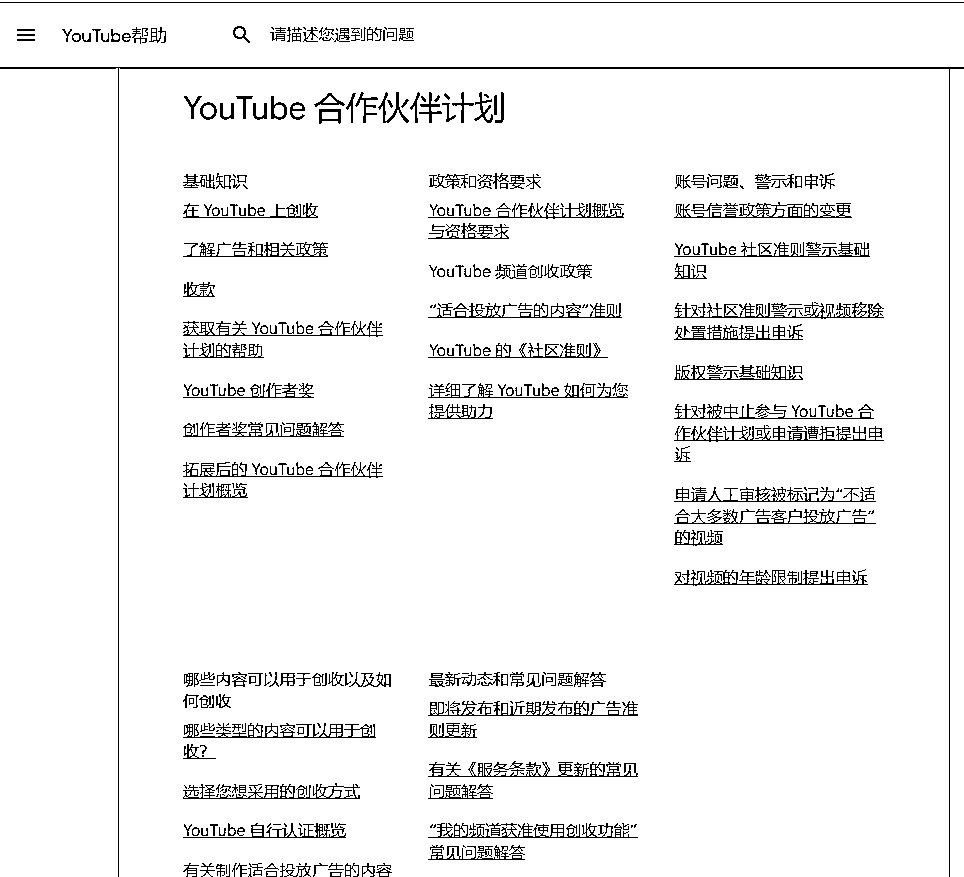

## 2. 粉丝付费：会员与 Premium

从 2023 年 6 月中旬开始，YouTube 扩展了合作伙伴计划的范围，让更多创作者能提前体验粉丝赞助和部分购物功能，也就是这里要讲的会员收益和电商。

所在国家/地区符合要求的创作者，只要满足下面任一条件，就能申请加入扩展后的计划：
- 近 90 天上传过 3 条公开视频，获得 500 位订阅者，并且过去 12 个月的有效公开视频观看时长达 3000 小时；
- 或者，近 90 天上传过 3 条公开视频，获得 500 位订阅者，并且过去 90 天内的有效公开 Shorts 播放量达到 300 万次。

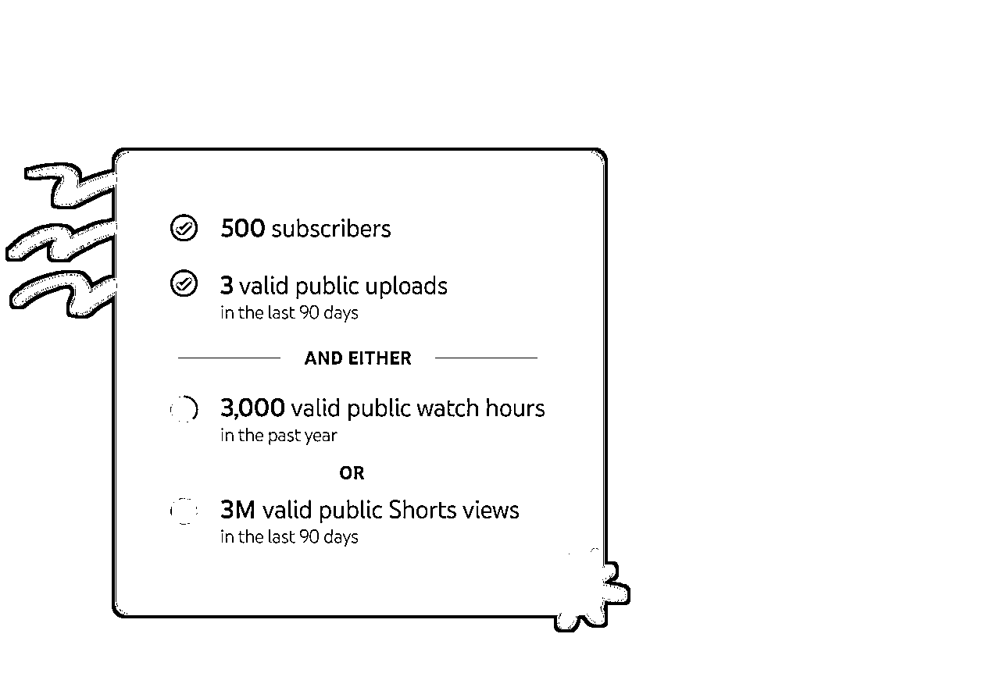

当前支持的国家、以及可开通的变现功能，可以查看官方文档：《拓展后的 YouTube 合作伙伴计划概览》。

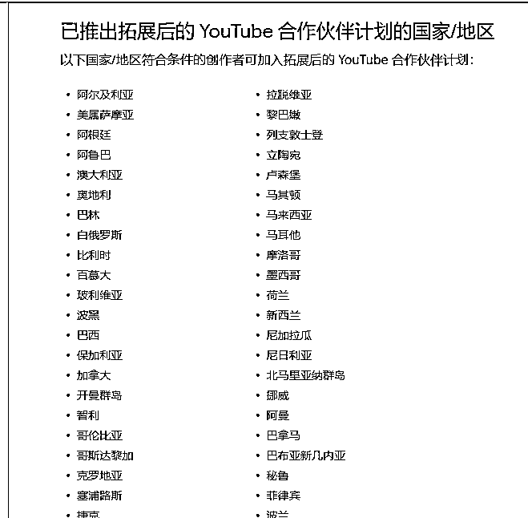

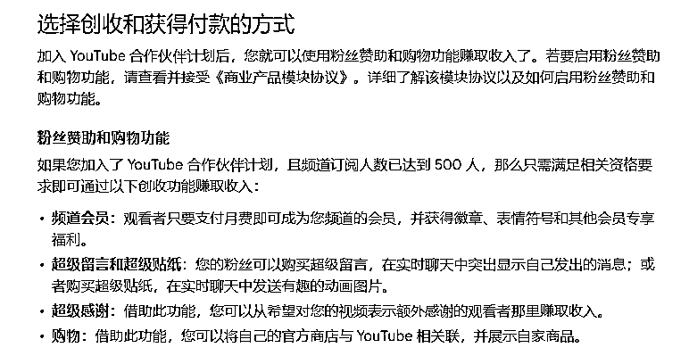

### 2.1 频道会员怎么收钱

在免费订阅之外，创作者可以额外开设付费的频道会员。粉丝按月支付费用，换取专属福利；会员等级和定价都由创作者决定，从几百到上千不等。平台会抽取 30% 作为佣金，创作者拿剩余的 70%。举个例子：观众每月付 10 美元，你实际到手 7 美元。


### 2.2 Premium 带来的额外分成

订阅 YouTube Premium 的用户可以跳过广告、享受更好的观看体验。当这类用户观看你的视频时，创作者也能从平台获得一笔额外的补贴，金额与观看时长挂钩。需要留意，开通这项功能的前提条件和前面广告变现的条件一致。


### 2.3 案例：老高与小茉

这里分享一个经典案例：「老高与小茉」。该频道上线会员功能后，一度成为 YouTube 频道会员增长最快的频道。当时老高的总订阅刚突破 130 万，如今已经超过 600 万，会员规模只会更大。

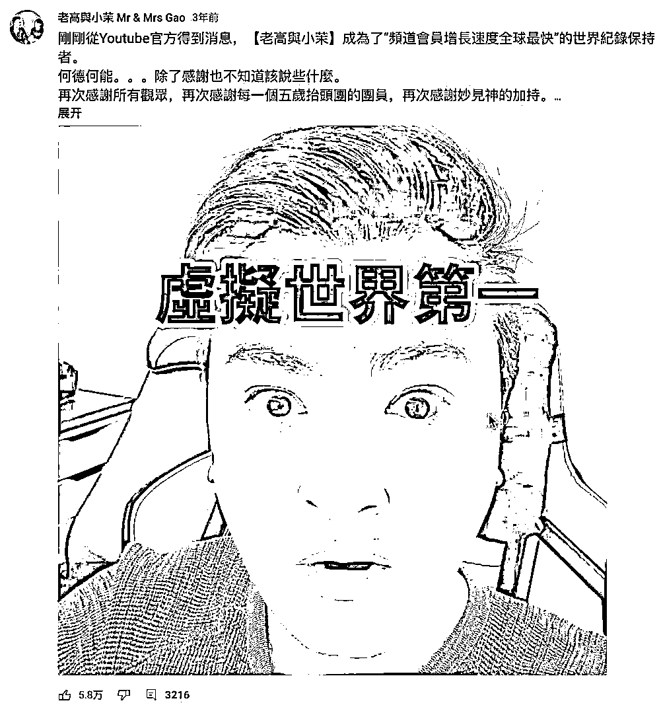

从评论区的直观感受来看，会员占比相当高。ID 旁边挂着头像的基本都是会员，头像可以是频道主自己做的，也可以使用平台模板，并且会随着入会时间长短变化，体现不同等级。

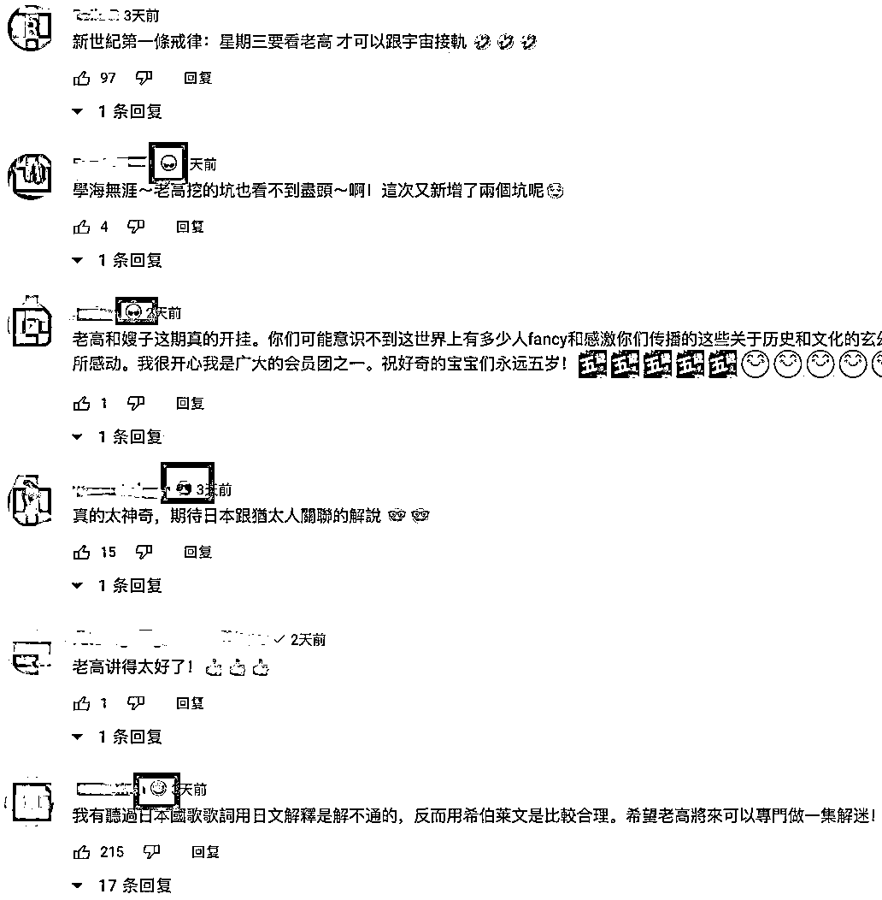

官方并没有公开具体的会员收入数据，下面借用一位博主的分析来做个粗略测算。

先看人数。普通视频的评论与粉丝比例约 0.0677%，会员视频平均评论数约 430 条，按这个比例反推，会员人数约 63.5 万。考虑到会员在评论区的活跃度通常更高，假如按 5 倍折算，实际会员数约 12.7 万。点赞数据也支持会员数接近 10 万的推测。

再看收入。会员价格按 5 美元、平台分走 30% 来算，月收入约 12.7 万 × 5 × 70%，即 44.45 万美元，年收入约 533 万美元。这是 2022 年底的推测，放到现在只会更高。

## 3. 站内卖货：电商变现

除了广告和会员，销售自己的商品也是一条重要收入线。YouTube 正在加强直播电商与商品货架功能，让创作者能在平台内直接完成销售。售卖方式主要有三种。

独立站导流：放链接把用户引到自己的网站，但会碰到前面提到的问题——Shorts 无法跳转，长视频的推流又偏少。

自营店铺：解锁 YPP 后就能绑定店铺，在视频里直接插商品，能打破之前的链路瓶颈——Shorts 内实现跳转、直播中插入商品、频道主页也能展示。下方配图是一个测试带货的账号。

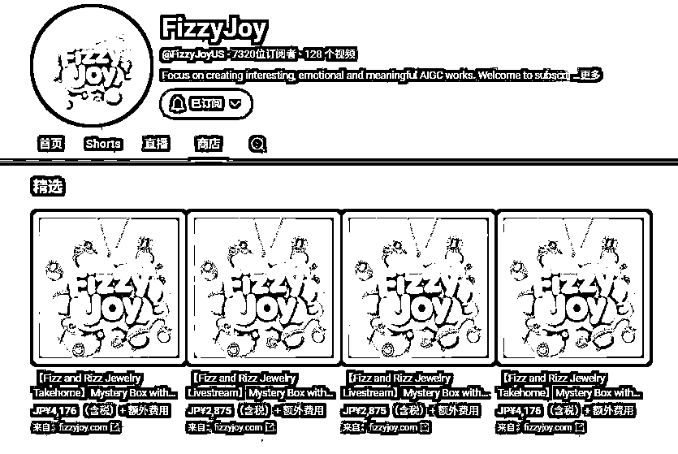

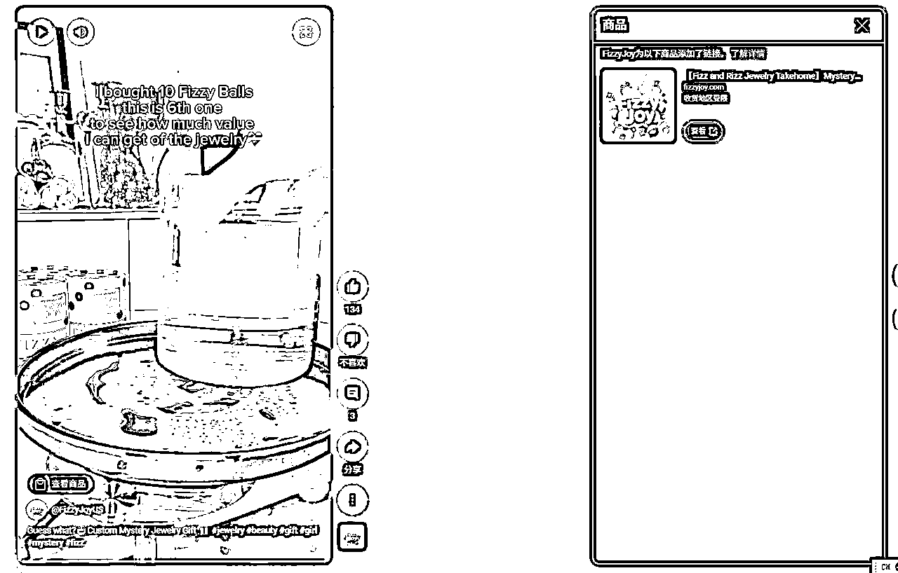

联盟分销：类似 TikTok 的精选联盟，直接分销平台提供的品牌商品，视频里就能展示，而且比自营商品有更丰富的展示形态。短板是门槛偏高：账号地区要在美国、韩国、印度尼西亚、泰国、越南、马来西亚、菲律宾、印度或新加坡，且订阅数要超过一万。

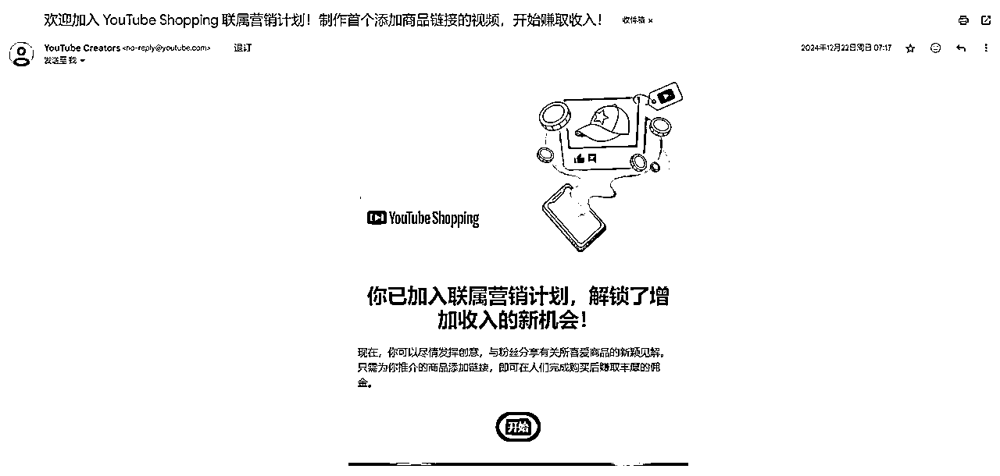

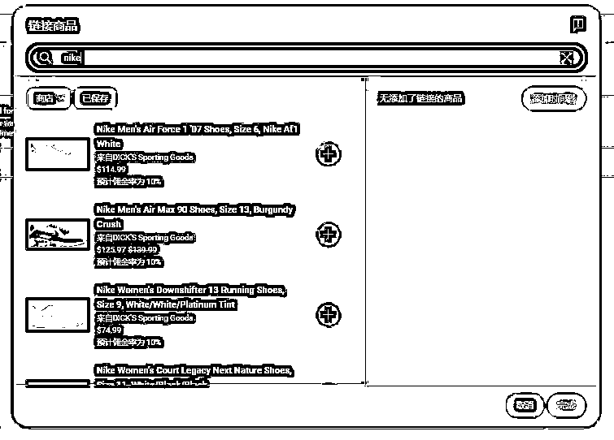

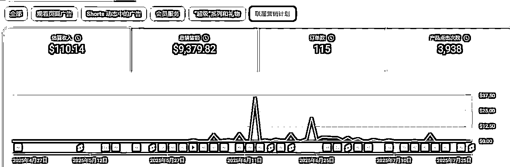

更多 YouTube Shopping 玩法，可以看官方内容：《YouTube Shopping：从您的商店中添加链接商品并展示》《在 YouTube 上管理、关联和解除关联您的商店》。


## 4. 其他收入渠道

### 4.1 品牌合作

创作者与品牌直接合作，在视频中推广产品，可以按条数收费，也可以按销售提成。常见的形式有测评推荐、场景演示、特别优惠推广（比如限时折扣码）。YouTube 广告没有统一的官方价目表，但海外大致有一个按粉丝量划分的行情：超过 1 万订阅，单条广告约 200 美元；超过 10 万订阅，单条约 2000 美元；破百万订阅，单条最低报价 2 万美元。这条路对账号体量有硬性要求，刚起步、粉丝不多的时候，建议先选不看重粉丝数的变现方式。


### 4.2 CPS 佣金带货

如果你没有自己的商品，又想在 YouTube 上做电商，可以在视频描述或固定评论里放商品链接，观众点击并完成购买后，你就能拿到销售佣金。整个过程不用囤货，也不用垫付货款。支持的平台包括亚马逊联盟、CJ Affiliate、ShareASale、乐天等。常见的内容形式有产品开箱评测、实用教程、排名推荐。

### 4.3 知识类产品

用专业能力换收入，是很多创作者的进阶选择。它的逻辑不是单纯拼流量，而是用价值吸引付费，特别适合有某方面知识沉淀的人。主要玩法包括：
- 在线课程：放在 Teachable、Udemy 等平台或自己的独立网站，用视频引流；
- 会员专属内容：借助 YouTube 的会员订阅制，按月收费看独家视频；
- 一对一定制服务：在简介区引导预约 Zoom 或 Google Meet 咨询，按小时或项目结算；
- 电子书与数字工具：推广电子书、模板、工具包，让用户通过链接购买下载。

内容整理自：《航海实战 | YouTube - 视频创作 | 实战手册》


### 4.4 商单：官方平台与 AI 机会

国内品牌方习惯用📕蒲公英这类商单平台，YouTube 也有自己的官方平台，开通 YPP 后就能使用 Brand 系统（这里不做过多展开）。

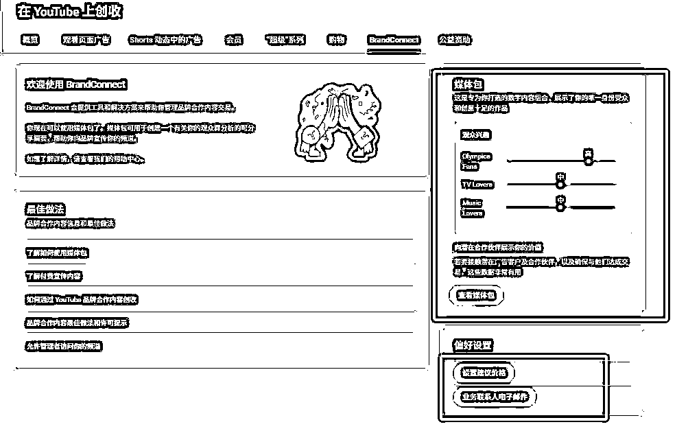

更值得关注的是 AI 赛道的商单。目前大量出海 AI 产品在海外缺少投放渠道，YouTube 上能承接的博主又很少，这给 AI 自媒体留出了很大的空间。赚钱内部的 AI MCN 已经对接了大量有海外投放需求的客户，只要是 AI 垂类频道（比如 AI 工具讲解)，订阅量不高也有机会接到商单。


### 4.5 APP 推广

做法类似 CPS，直接对接产品团队和应用方，按 CPM 或 CPS 等形式分成。


### 4.6 转卖 YPP 账号

YPP 账号本身属于可交易资产。目前一个高级 YPP 账号的市场价大约在 1800 到 2200 元。整体供不应求，买家很多，但账号供给不足。如果能稳定产出合格的 YPP 账号，出售账号也是一条变现路径。


### 4.7 音乐推广单

玩法是在视频里为合作版权方的音乐做推广。先申请音乐商单权限，再从推广曲库里挑合适的歌，放进自己的视频，达到宣传效果。由于 3 月之后音乐商单的收益大幅下降，投产比不高，这里就不多讲了。


# 04.动手前的提醒

马上要进入实操了。在打开下一章之前，先给自己定个基调：长期主义，持续经营。

不要急于求成。YouTube 创作是典型的长期过程：以前长视频开通 YPP 平均要 1 年，现在只要认真输出优质内容，慢则 3 到 6 个月，快则 1 到 3 个月。把精力放在内容质量和与观众的互动上，而不是一味盯着数据增长。

# 先动手，边做边改

刚开始做内容，成品粗糙一点很正常。真正要警惕的，是因为担心不够好而迟迟不行动。重点在于持续产出，并在实践里补知识。最初一两个月，甚至更长时间，播放量和订阅数都没什么起色，也不必焦虑。养成定期翻看后台分析的习惯，关注观看时长、受众画像等数据，让这些数字帮你判断下一步如何调整。

选一个自己真正感兴趣的领域，不然遇到瓶颈时很难坚持。

版权规则要尽早弄明白。平台对版权问题非常敏感。把他人的音乐、影视片段或图片直接搬上去，轻则视频下架、账号收警告，重则失去变现资格。

下面这些常见雷区，尽量提前避开：

音乐：没有获得授权，就不要用受版权保护的歌曲；平台自带音频库里有很多免费音乐和音效可用。短视频（shorts）即使踩线，一般最多是禁止播放，但长视频千万别用版权音乐，严重时会被社区准则警告。

图片和素材：选用没有版权限制的图片或视频（如 Unsplash、Pixabay、Pexels），或者确认自己拥有商业使用权。

影视、游戏片段：哪怕只截取几秒钟，也可能触发版权警告，热门影视和游戏内容尤其危险。


1. 先定方向：注册哪种账号

1. 本章导读

# 本章要点速览

搭建 YouTube 账号是项目的第一步。账号底子打得好，后续内容推广和变现空间都会更顺。

这一章主要覆盖：

✅ 账号类型怎么挑：个人号与品牌号的区别、分别适合谁

✅ 注册流程：具体操作和常见坑怎么绕开

✅ 频道包装：头像、横幅、简介怎么设置更显专业

✅ 视频发布：手机端和电脑端的差异与实用技巧

起步阶段不必追求装修完美，关键是把一个稳定账号先建起来。养号期间尽量以普通用户身份浏览、互动，提升账号的可信度，为后面发内容铺路。

# 行动路线

完成本章学习与实操，就能走完路线图第一阶段：了解平台，准备 YouTube 账号（约 2 天）。

掌握 AI 创作工具基础用法（约 2 小时）。

准备网络工具，注册 YouTube 账号（约 1 小时）。

完成账号基础设置，了解视频发布流程（约 1 小时）。

# 2. 个人号

用个人谷歌账号创建，需要单独设用户名和密码。

1. 品牌号

品牌号本质上是企业账号，可以展示企业信息、产品等。这类账号可用企业信息通过「Google+」或「Google 我的商家」等方式创建，不必单独设用户名和密码，还能设置多个所有者和管理员。

1. 【八月更新】注册实操

Step1：国内无法直接访问 YouTube，需要能查看外部信息的网络工具。风险原因这里不展开，请先自行搞定网络，确保能正常访问。

Step2：注册一个谷歌邮箱账号。下载手机版 🐧 邮箱，点击添加帐户，选择 Gmail 邮箱，创建账号，依次填写相关资料，输入 +86 的电话号码，即可成功注册。近期有电话号码无法使用的情况，换一个号码再试，或者用接码平台尝试注册，也可参考下方方法八的方式验证。

Step3：打开 YouTube 官网，用刚注册的 Gmail 账号登录。

# 备选注册路径

方法一：用浏览器无痕窗口，切到香港 IP，有时能跳过手机号验证；如果 IP 质量不佳，仍可能被要求验证。我第一次这样操作没要手机号，第二次就被要求了。详见：https://www.youtube.com/watch?v=gxw8JgmLZCY

方法二：开魔法，下载 Google Play，直接在 Google Play 创建账号，之后在手机上用国内账号接码。详见：https://linux.do/t/topic/231739

方法三（来自@胡三岁/白色石头@逸凡风顺）：开魔法，下载 Gmail APP（需要谷歌三件套，即谷歌服务框架、谷歌 Play 服务、谷歌商店，可用一键安装器安装），然后在 Gmail 邮箱里注册账号。这个方法大概率能跳过手机号验证，即使没跳过，也能用国内手机号验证。多账号注册时，建议清除手机上谷歌相关所有数据，再换节点重新注册。

方法四（来自@老馬🐎内容出海）：①用手机注册，可以国内大陆号码接码；②购买邮箱时选美国原生 IP，这样 0 播的概率小一点，谷歌搜索 gmail 邮箱购买有很多。海外购买可参考类似站点 https://agedprofiles.com/products ，需要购买的话要自行寻找有数字货币支付工具的人代付，航海不做推荐。价格参考（来自@辛亥、@辛拉面、@梁海波）：新号 1 块多，老号 4 块多，老号更稳定。

方法五（来自@老馬🐎内容出海）：最方便的方式，注册时用美卡接码 + 住宅 IP，指纹浏览器和手机通用。推荐站点 https://messages.pingme.tel/ ：贵一点，容易接到，选择英国、欧洲国家号码。https://sms-activate.org/cn/freePrice#activation 和 https://tiger-sms.com/cn ：便宜，但存在死号，10 存 5。

封号解答（来自@老馬🐎内容出海）：①注册时填写的接码手机号，可以理解为征信，用这个手机号给你的谷歌账号做担保；如果这个手机号下方担保的邮箱出问题，会连带其他账号一起死掉，这也是为什么有些人注册第二天账号就挂掉。②注册时的手机号不等于绑定手机，也不等于高级模式绑定的手机。

方法六（来自@米尼）：用飞猪买个美国手机卡接码，月租 3 美金，相当于自己买的实卡@可可-北京-Lv.1。

方法七（来自@邵先生）：下载谷歌浏览器注册（以 Windows 为例）。如果遇到“该手机号无法用于验证”的提示，可把谷歌浏览器语言改成英语。具体步骤：点击浏览器右上角三个点→设置→语言→添加语言→选择“英语-美国”（因为谷歌是美国公司，通过概率更大）→添加→添加完后点击“英语-美国”右侧三个点→选择“移到顶部”，并勾选“以这种语言显示谷歌浏览器”→删除中文→再点击美国英语右侧的“重新启动”。到这里语言就设置成英语了。注册流程：点击谷歌浏览器右上角人头按钮→开启同步功能，进入谷歌账号注册页面，按流程注册，这时国内手机号很大概率不会出现“该手机号无法用于验证”的提示了。详见：https://www.xnbeast.com/create-google-account/

你也可以参考这个 YouTube 视频，尝试完成自己账号的注册：https://www.YouTube.com/watch?v=8hk5V2P_72U

注册完之后，就可以像正常用户一样使用 YouTube 了。可以大量浏览、点赞、评论互动，让 YouTube 感知到你是一个真人在用这个账号。建议先养号几天再发视频，账号会更稳定。

另外，记得把【创作者工作室】-【设置】-【基本信息】-【所在位置】设置为支持获利的国家，包括美国、欧洲大部分国家、日本、韩国、印度和南美主要国家。

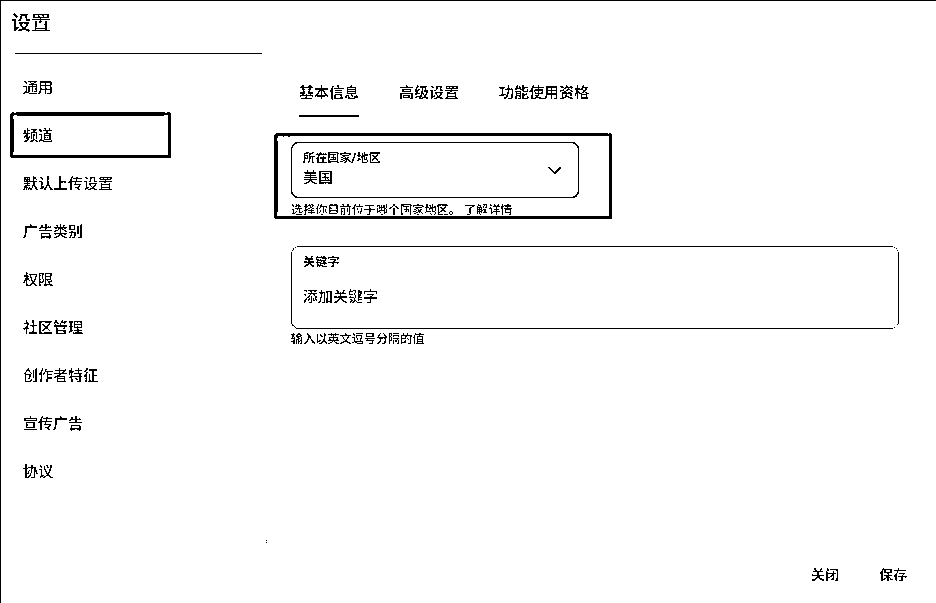

但也不用太纠结，因为 YouTube 的流量推送机制并不取决于这个，而是基于频道内容的目标受众。


1. 【八月更新】谷歌账号安全与频道设置必读

开始前，建议先把系统语言改成中文，改语言不会有任何影响。

谷歌账号页面设置：

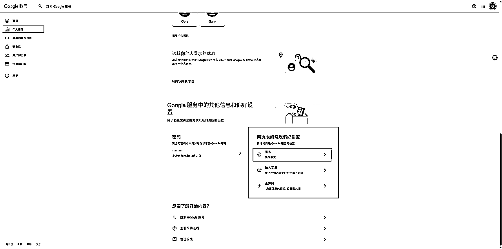

YouTube 页面设置，在 YouTube 首页展开头像下拉（并非工作室后台）。

每一项设置会用【谷歌账号】和【YouTube频道】来区分设置位置。

# 1. 安全与频道设置说明

谷歌账号安全配置

YouTube 是谷歌旗下应用，共用谷歌账号的安全配置。二次验证、辅助验证、账号恢复、本人验证、风控验证都是谷歌体系常见的验证类型。安全性设置是为了保障账号安全，同时部分设置项能让我们在出现相关验证时更方便地通过。

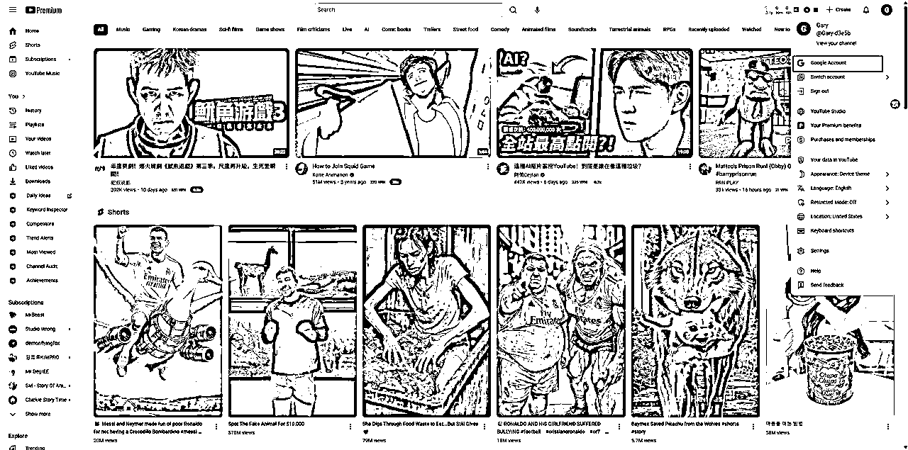

YouTube 频道设置

频道开通后，有一些必须完成的设置，后文会具体解释和指导。

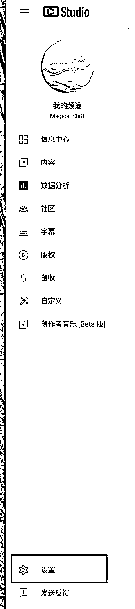

# 2.【谷歌账号】两步验证

什么叫两步验证？它是谷歌的一项安全设置。开启后，重要安全操作——比如改密码、改安全信息、改绑 ads 等——都需要进行两次确认，例如密码 + 手机号接码 / 密码 + 邮箱接码，从而提高账号安全性。

打开两步验证也是开通 YPP 的前提，申请之前必须开启。

进入谷歌账号设置后，点击图中标红的位置进入两步验证设置。

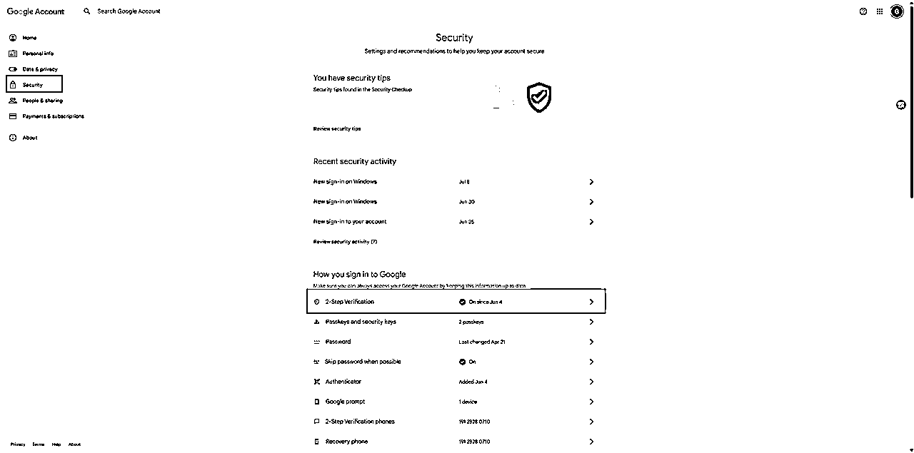

如果最近没进去过，或者在新环境登录，进入两步验证设置前需要验证身份。

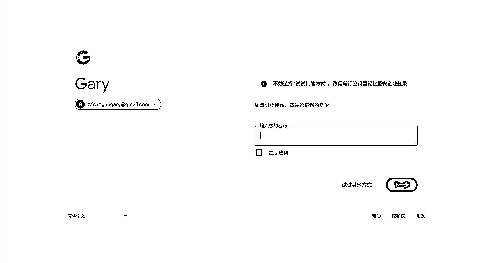

如果没有开启两步验证，第一次开启时需要添加两步验证手机号。

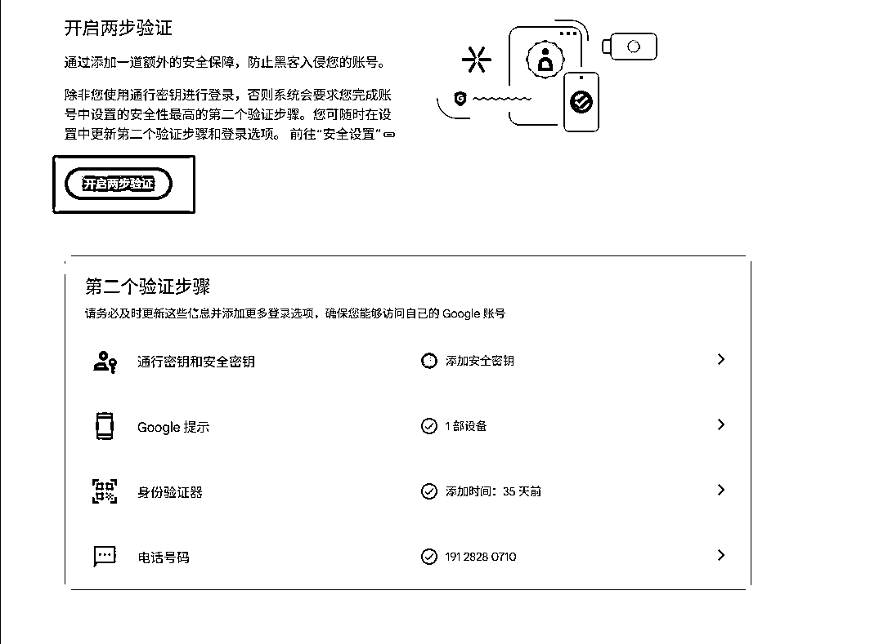

两步验证手机号：如果是自己的主号、准备开通 YPP 的账号，建议使用自己的手机号（一个手机号可以绑多个账号，但不建议太多，避免关联）；如果是批量起号、小号、没开 YPP 的矩阵号，可以用接码手机号。第一次添加两步验证手机号时，不需要接码验证！也就是说，这里如果填写了错误手机号，或者无法接收验证码的手机号，也能添加成功、开启两步验证，但实际需要接码时可能接不到码【很容易踩坑！】所以添加完手机号后务必检查是否正确，不正确或不能接码可以删除后重新添加。

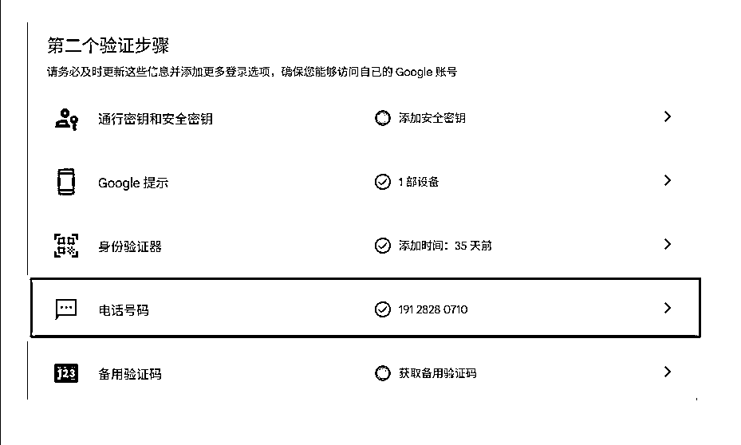

除手机外，还有三种验证方式，分别是【通行密钥】、【Google提示】、【身份验证器】。

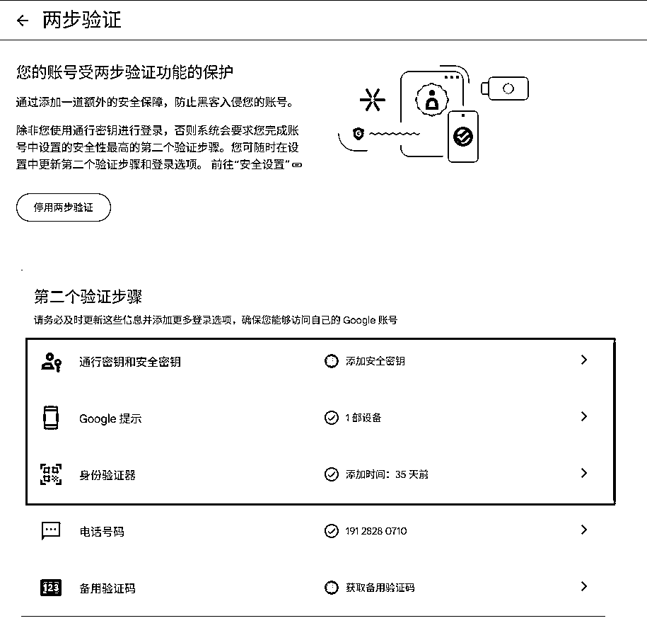

【通行密钥】指的是，比如你的电脑有面部识别解锁，就可以添加电脑面部识别用于二次验证，仅在你的电脑上生效；也包括手机指纹解锁等。

【Google提示】指的是，你可以添加自己有谷歌框架服务的手机设备，登录该谷歌账号，在需要二次验证时，通过向绑定设备发送验证提示来完成二次验证。重点：需要手机有谷歌框架服务且魔法稳定，不要关键时刻魔法用不了，就很尴尬。


【身份验证器】指的是谷歌的验证器 APP，下图这个，可以在谷歌应用市场搜索下载。


# 3.【谷歌账号】备用码与辅助验证

可以看到，截图里有一个【备用验证码】验证方式，但这个方式需要第一次绑定两步验证手机号之后才会出现。

【备用验证码】点进去之后，点击按钮获取验证码，即会出现 10 个八位数验证码。验证码都是一次性的，需要记下来，用完一条作废一条；但验证码可以刷新，快用完了可以点击刷新按钮刷新 10 个新的，所以是无限的，只是用完了就要来刷新一下。矩阵号运营可以把所有账号的备用码都激活，以便在无法接码、无法验证邮箱时通过备用码登录。

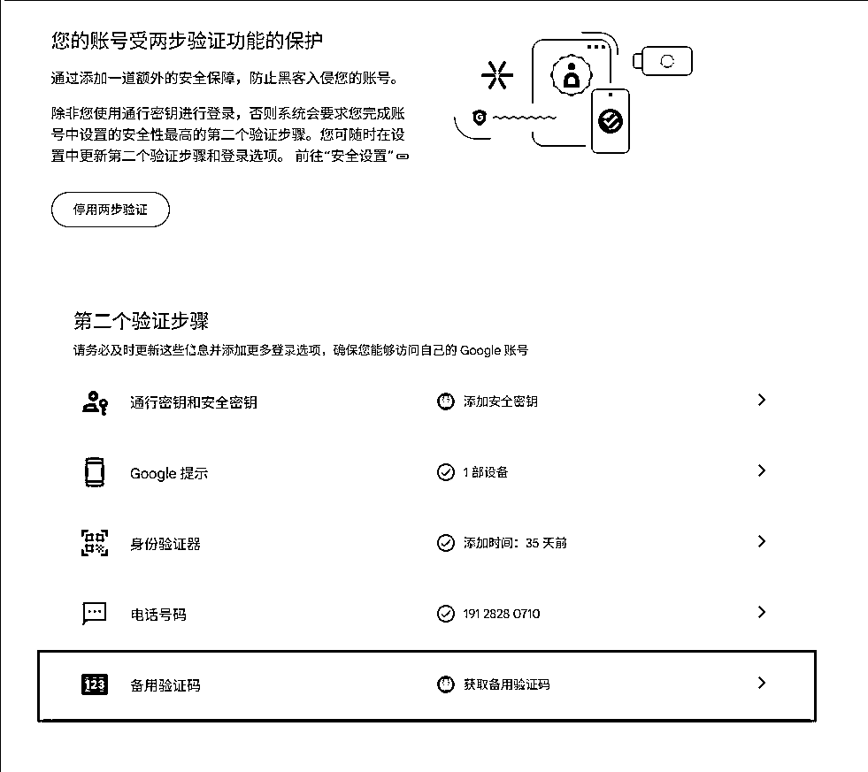

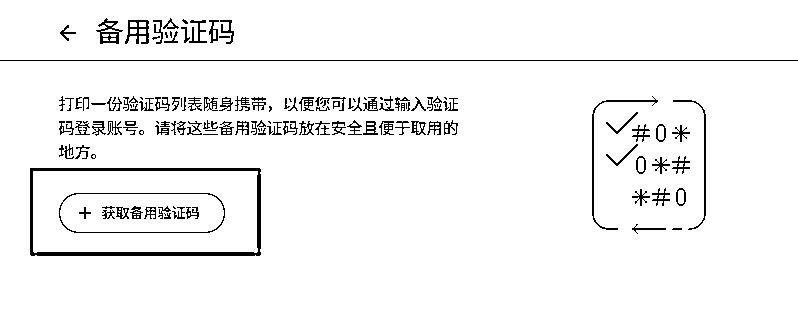

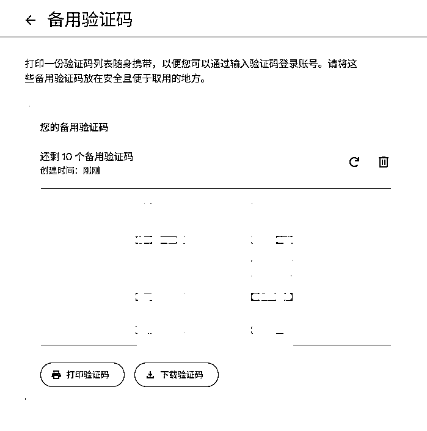

# 4. 【谷歌账号】更多辅助验证

除了刚才的两步验证以外，还有辅助电话号码、辅助邮箱、两步验证备用手机号码可以添加，按需添加即可。

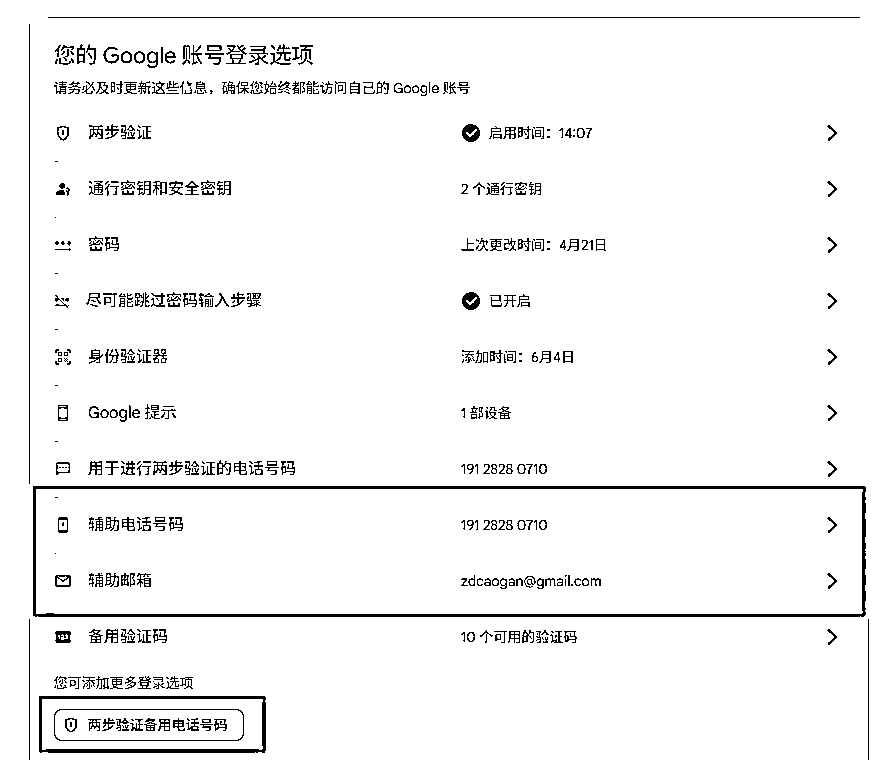

# 5.【谷歌账号】账号找回

如果在绑定手机号时使用了接码手机号，后续要验证时无法通过，可以访问 g.co/recover 这个网址，会进入 Google 的账号恢复页面。在常用环境，可以使用任意辅助或二次验证方式登录（比如备用码），登录之后直接进入账号设置页，能够修改手机号、辅助邮箱、更新备用码等。但要注意，需要在常用环境登录才可享有最高权限；如果不是常用环境，则只能登录账号，无法修改安全信息。

# 6.【谷歌账号】风控验证

在 Google 检测到你的账号或者网络环境有风险之后，或者在平台大规模清扫的时候（5.19 一轮，7.9 一轮），可能会出现风控验证接码。风控特征是头像变成灰色，会出现下图这样的、与二次验证和恢复手机号无关的接码。

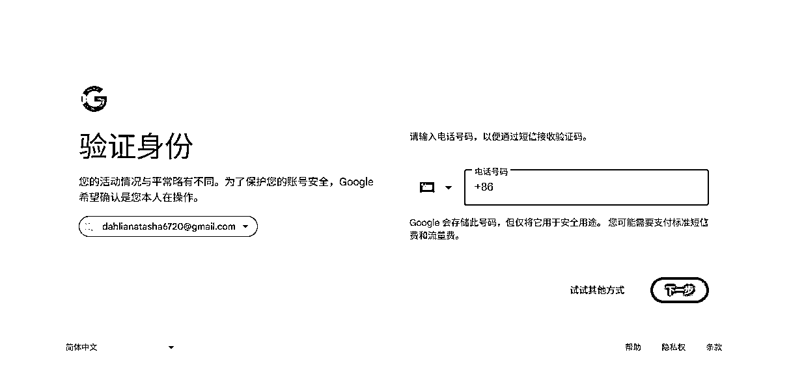

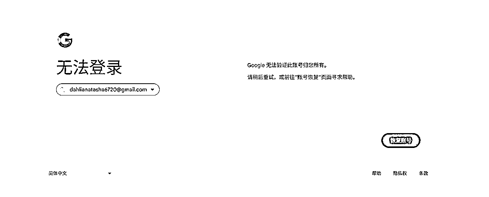

这个接码最好用自己的国内手机号接码。如果接不到，也最好用长效接码平台接码 pingme（英国、其他国家），不要用一次性接码平台接码，可能出现需要二次验证这个手机号的情况，第二次接不到会非常麻烦。

运气教练分享
0 月租可长期保号境外实体手机卡！英国实体电话卡 Giffgaff 充值及激活教程：
https://www.youtube.com/watch?v=XmaMEUQy7-k

# 7. 【YouTube频道】地区设置

YouTube 的频道地区不在首页修改，而是在工作室后台的设置 - 频道 - 基本信息中修改。该地区设置影响以下功能：

可否开通 YPP（支持创收的地区）
可否开通带货的联属营销功能（支持的地区）
其他关联创作者地区的功能

一般选择美国即可。

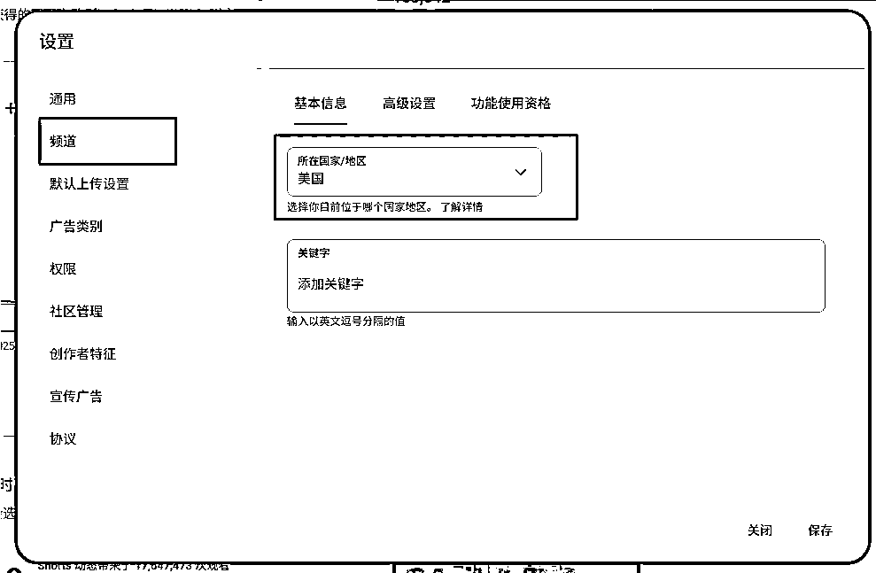

# 8. 【YouTube频道】功能开通资格

中级功能：可以通过一次性的接码完成中级功能认证。该验证是一次性验证，不需要重复验证，所以可以在 SMS-activate 这样的网站接码。中级功能的验证和直播开通前的验证是互通的，中级功能开通后即可进行直播、自定义封面和上传超过 15 分钟的视频。

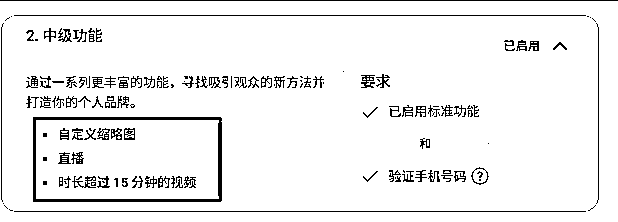

高级功能：一般选择刷脸或积累历史记录的方式完成高级功能验证。着急就刷脸（一张脸可以刷 3-4 个号，刷脸记录保存 60 天，也就是 60 天后同一张脸可以刷一批新的号），不着急就积累历史记录（大约 15-20 天的持续更新）。高级功能开通了才可以申请 YPP，以及提供图中的其他权限。

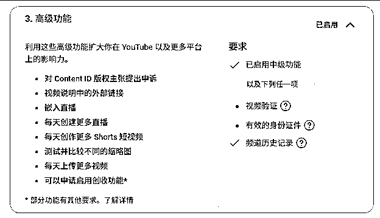

偶发高级功能无法刷脸和证件验证的情况，一般是网络环境不纯净，更换网络环境后一般可以解决。如果无法解决，就耐心等待历史记录积累开通。

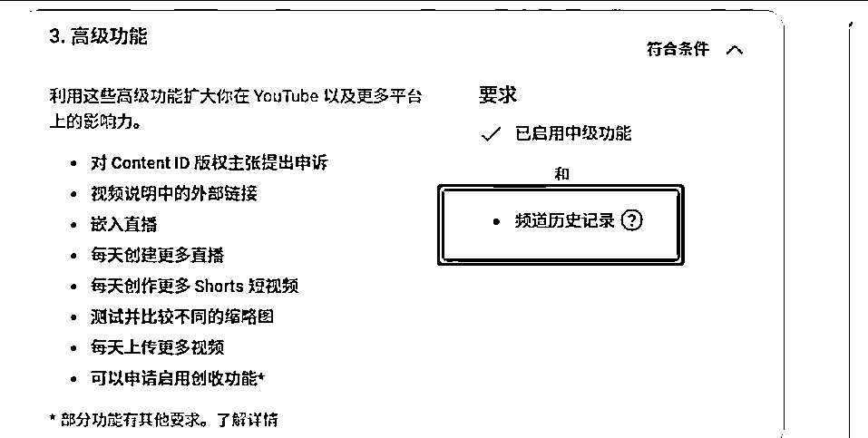


# 04. 创建频道

前期刚起步，哪怕只改个名、头像都不换也是可以的。减小开始前的阻力，先把视频做起来，再慢慢进行频道装修。

Step1：点击官网首页右上角的 Create a Channel 选项。

Step2：选择创建个人频道或品牌频道。

Step3：为频道命名，一般会使用公司/品牌/产品名称命名，完成创建后就可以发布新的视频了。

完整的频道装修由多个元素构成：频道头像、频道名称、频道横幅、宣传片、播放列表、封面图、频道简介等。点击右上角头像进入“YouTube 工作室”，在右侧导航栏中找到“自定义”就能修改频道的个人资料了。

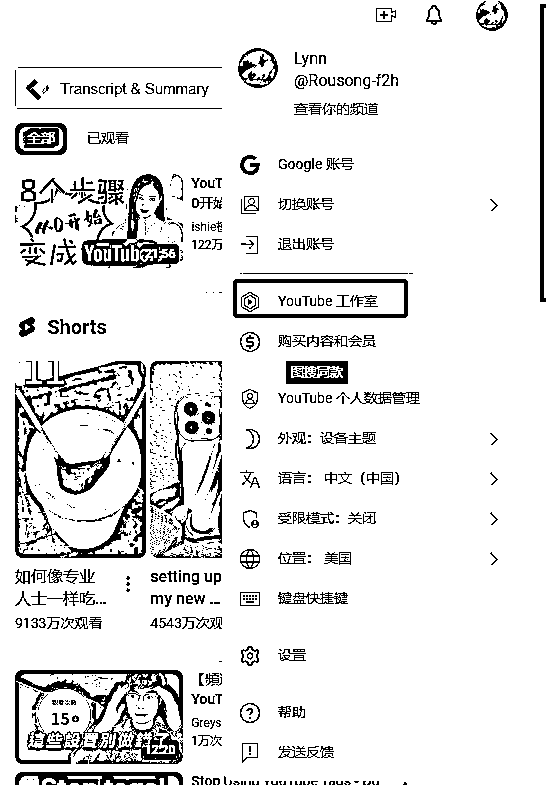

在这一步，学习@方波妮教练的心态：不要被“头像怎么弄？封面怎么制作？我做的视频好丑？我怎么这么笨？”卡住进度。头像不会制作，手机相册找一张宠物的、或者风景照，或者 MJ 制作一张，先完成再优化，封面同理。停止“我觉得 xxx”，模仿爆款让市场检验一下。非常好的原创，也有可能打不过丑丑的模仿爆款，事实证明丑的东西也有人喜欢。放掉这种念头，接纳刚开始的不完美，视频发起来，技术都是慢慢优化起来的。

# 1. 头像设置

头像尺寸：98x98px，大小不超过 4MB 的 png 或 gif 图。

头像类型：人物照、萌宠、风景、品牌 logo、卡通等。

头像风格：清晰，最好使用真人形象。

制作方式：不会做图的可以通过做图网站来制作头像，或者找些无版权的图片。

图怪兽：https://818ps.com/
可画：https://canva.com/
创客贴：https://www.chuangkit.com/

AI 工具创作头像：具体操作步骤可参考 AI 特效直播的实战手册：AI 头像壁纸号。

注意事项：避免使用容易侵权的商标类图片。


# 2. 频道名与标识

尽量简洁好记。
突出视频内容特色或行业特征。
可以是个人名字的延伸。
中文 + 英文（注解）。
标识名也可以作为你的 YouTube URL 链接后缀，方便用户查找。

注意这两项都是每 14 天只可更改 2 次。


# 3. 频道横幅【可选】

横幅尺寸不低于 2048*1152px，大小不能超过 6MB。因为海外有很多人都是通过电视观看 YouTube 的，所以清晰度一定要足够高，横幅内容要明确显示出频道主题。

可引导订阅。
可添加简洁的频道介绍。
可加平台链接。


# 4. 播放列表【可选】

有一定视频数量后，一定要进行分类，比如创建播放列表。在设置播放列表名称时，建议使用和用户搜索意图相关的短语或者问句，建议创造多个播放列表。播放列表中的视频是自动播放的，这样可以引导用户观看更多视频，有助于增加视频浏览量，还能吸引潜在的目标用户。

# 5. 封面图【可选】

# 封面先抓住眼球

频道显眼位置会陈列封面图。访客常常凭第一眼的感觉决定是否点开，所以封面做得好不好，会直接影响进站人数，值得花心思反复打磨。

可以从这几个方向优化：
- 借大众熟悉的元素建立信任，再埋一个悬念勾起好奇；
- 画面中多使用图像、表情、数字等视觉符号；
- 标题文字别堆太满，以免抢走主体；
- 右下角留出挂频道链接的位置。

工具方面，Canva（https://www.canva.cn/）和稿定设计（https://www.gaoding.com/）都可以用；也可以让 AI 参与封面创作，参考《3 月航海 | AI 绘画特训 | 实战手册》。


# 6. 频道自我介绍

用一句好记的标语概括频道，再说明自己的身份、能给观众带来什么、多久更新一次。最好准备双语版本，并附上其他社交平台入口。

资料出处：《航海实战 | YouTube - 视频创作 | 实战手册》


1. YouTube 视频发布流程

Shorts 的生产周期不算长，适合把日更作为节奏：每天尽量产出一条质量在线的 Shorts。

# 1. 手机端怎么发

先打开 YouTube 手机客户端，点右上角“+”号；选择“创建 Shorts”，或直接上传已经做好的文件；进入编辑界面后核对画面比例和时长：不超过 180 秒，9:16 竖屏，推荐 1080×1920 高清。画面要清楚，配乐要合适，开头三秒要能抓住观众。

编辑页里的其他设置也顺手优化一下，有助于播放增长：
- 标题：短而有钩子，最好埋关键词。比如“十秒看懂热门舞步！🔥 #Shorts”
- 描述：简要交代内容，补充话题、频道链接和相关关键词，利于搜索排名。
- 标签栏：只挂与画面紧密相关的词，例如 #Shorts、#DIY、#Fitness；别挂误导性标签。
- 缩略图：自动生成的不理想时，可以上传自制图；Shorts 封面需在 App 内修改。画面要清晰、对比明显，以提升点击为目标。

# 2. 电脑端怎么发

电脑端操作和发长视频基本一致：

第一步：登录 YouTube Studio。
第二步：点右上角“创建”，选择“上传视频”。

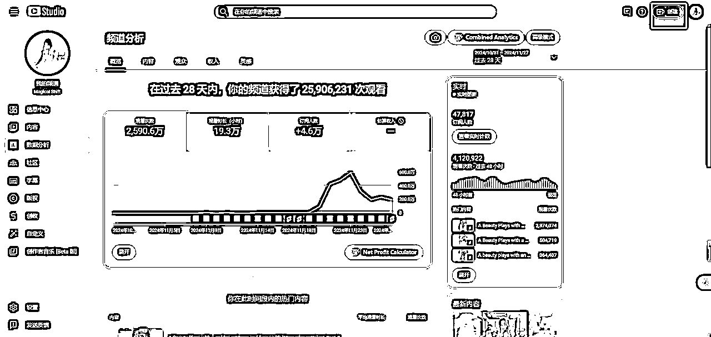

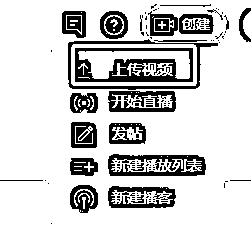

第三步：把视频拖进上传框，或选择文件上传。系统会按比例和时长自动判断是 Shorts 还是长视频。第一次上传要手动填写视频信息；之后再传可点红框按钮，复用之前的信息。


第四步：首次上传时，按图示选择相关配置。


# 01. 选赛道与找对标的关键提醒

# 1. 本章速览

# 本节要点

赛道选择会直接影响成败，方向选对往往省力很多。通过观察热门内容、研究对标账号，可以找到适合自己的切口。

本章重点包括：
✅ 怎么定赛道：看平台热门趋势，也借鉴头部创作者的做法
✅ 怎么找对标账号：判断赛道活跃度和变现潜力
✅ 怎么拆解对标：理解内容创作逻辑与爆款特征
✅ 收益怎么估：用数据预判项目回报

刚开始不必执念于找全新蓝海，先选已经被验证的方向，在实操中慢慢做出差异。持续输出好内容，定位会越来越清晰。

# 本章路线图

完成本章学习和实操后，可完成路线图中的：
第二阶段 确定赛道，掌握 AI 创作技巧，发布首个视频（约 2 天）
- 了解 AI Shorts 热门赛道，确定方向（约 2 小时）
- 学习 AI 提示词编写技巧与内容构思方法（约 3 小时）

# 2. 新手提醒

# 新人选 Shorts 赛道的判断

有三个信号值得看：
- 赛道里破千万播放的作品扎堆：说明容量充足，多你一个也容得下；
- 过去十四天内仍有破千万的视频：以前能爆不代表现在还能爆，近期还有千万播，说明赛道还活着；
- 频道最近七天有破百万播放，且最高单条播放量越过千万：有千万播说明这个频道处在赛道头部、上限较高；最近七天破百万说明频道还活跃，足够你起一个新号。

这些方法可以等有基础后再细看；前期直接从推荐赛道里挑，先干起来，别把时间耗在纠结上。前辈们分享过不少找赛道和对标的方法：钱塘江鲤的数据分析法（1 万个 YouTube AI Shorts 对标账号）、老马的常规采集法（如何选适合自己的匿名 Shorts 赛道）、一页书的通用方法论（YouTube Shorts 频道定位调研与视频制作实操）。默认大家看过，这里不展开复杂讲解。

在 AI 赛道下找对标，我浓缩为上面三点；做过一段时间就能明白这些指标的分量。在此基础上，再选自己感兴趣且有能力做好的方向；可选的赛道足够多，别太纠结，先做起来。赛道会变化，但做内容的能力不会丢。

一个赛道能不能做、好不好做，本质上对应消费市场里的供需关系：内容对应供给，赛道对应需求。内容越优质、同质化越低，起号和推流就越快；竞争越少、需求越旺，你能拿到的播放量就越大。


1. 从赛道与对标入手，搭参考库

如果想完整体验一次从零找赛道和对标的方法，可以参阅上面几位前辈的文章。这里默认你已经确定想做哪个赛道，接下来建立自己的参考库。

# 1. 赛道视频去哪里找

以达人秀为例，最直接的方法是搜相关标签，比如 #agt。你会得到两个结果：一个是搜索出来的视频列表，一个是标签页；标签下有 21 万个视频、4.1 万个频道。


# 1.1 搜索页筛选

在搜索结果页可以加筛选条件，比如选本月，就能看到近一个月的视频，排在前面的通常有热门内容。这里务必加时间筛选，否则可能被推几个月前的爆款，参考意义会打折扣。在搜索页筛选“近一个月”“按观看次数排序”，可看关键词下近一月的爆款情况。现在变化太快，建议把窗口缩到最近七天（20250711 更新），这也是我最常用的方法。


# 1.2 标签页入口

点开标签页签，就进入该标签下的视频页，记得切换到 Shorts。


标签页也可以从视频页面和视频详情页点进去，上面那些案例视频都是对标标签的来源。


说个冷知识：标签页展示的视频会受你的观看历史和点击入口影响。比如想找 AI 达人秀变身的对标，就不要从达人秀官方节目或达人秀跳舞之类的内容点标签进去看。

# 1.3 首页养号

可以用不同的号关注不同赛道，只给对应赛道的视频点赞、点开观看，这样这个号里就都是相关赛道的内容。圈友分享过一种玩法：专门拿一个号关注风向标里的赛道，刷到的视频全是千万上亿的爆款。


1. 参考库怎么搭

通过上面两个简单方法，我们能看到某个标签下的大量视频。从这些视频列表里挑第一批对标视频，标准仍是之前说的：频道最近七天有破百万播放，且最高单条播放量越过千万。有千万播说明频道是赛道头部、上限较高；最近七天破百万说明频道还活跃，够你起一个新号。

不过要注意：如果对标账号不足 5—10 个，可以适当放宽要求。视频制作要对标头部，同时加入一些赛道内的非头部账号，也能帮助平台给你建立“爱看这个赛道”的标签，让油管更多给你推这个赛道的视频。找到对标视频后，可以做这些动作来建立参考库：
- 点赞、观看、订阅，像正常用户一样刷这些视频；
- 一定不要关注、点赞其他赛道的频道，否则兴趣标签会歪。建议专门用另一个号日常刷油管，订阅、浏览其他赛道的优质内容；
- 每天刷自己的参考库视频，补充新的对标账号。建立好兴趣标签后，会慢慢发现一些新号和新爆款，观察什么内容能成为爆款；
- 如果时间充足，可以用表格收集记录对标账号的爆款视频，作为自己的素材库。


# 04. 赛道内容、播放与观众地域的关系

# 收益怎么算

先想两个问题：观众全在发达国家一定更好吗？观众全在东南亚一定更差吗？

收益=【开通 YPP 后】的【完全获利】【视频播放量】×【RPM（千次有效展示收益）】。

- 开通 YPP：达到千万播放+1000 订阅≠马上开通 YPP，后台数据刷新需要 5—7 天；
- 完全获利：视频符合要求才能完全获利，且审核需要时间；
- 播放量：自然推流播放；
- RPM：受观众所在地区、视频时长、赛道影响。


我也知道清华好，是我不想读吗？清华需要付出多少努力？
我也知道李子柒的视频好看，是我不想做吗？李子柒的视频是怎么做的？

东南亚等欠发达地区：人口密集、分布集中、爱好类似、小屏设备、容易满足。门槛低、用户密集、容易出爆款，但收益率低。
美日欧等发达国家：人口分散、竞争激烈、大屏设备。门槛高、用户分散、难出爆款，但收益率高。
播放量和收益率，二者很难兼得。

# 观众地域怎么调

核心是内容，做目标地区观众爱看的内容；其次是标题、简介、历史用户画像。

举个例子：
为什么解说类、故事类收益一般更高？语言+内容，能够把受众限制在指定国家/地区。
为什么 AI 变身类收益较低？无语言+接地气+画质限制。
东南亚人可能会看美国大选，东南亚人会看德克萨斯州大选吗？

一个最简单的办法：标题简介加上对应语种。下图来自我的实测：两个小号同样内容，一个发纯英语标题简介，一个发日语+英语标题简介。纯英语的账号观众基本来自东南亚；日语+英语的大部分来自日韩和台湾。


与此同时，纯英语的账号 20 天开通 YPP，日语+英语的号只有 200 万播。

1. 【9月更新】可试的 Shorts 方向

清单摘录自深海圈风向标。三个提醒：
- 所有与婴儿、儿童、未成年人危险环境相关的赛道，都不要再做，会有违反社区准则、移除 YPP 的风险；已经做了的也隐藏或删除。
- 达人秀的评委画面不要再使用，可以 AI 生成，不要直接使用原节目片段，否则有被版权警告的风险。
- 不要大量高频发布模板化内容，否则有被移除频道的风险。

# 形式型爆款：套路不复杂

- https://www.youtube.com/@FantasizedAI/shorts （will 选中的例子）很有意思，做达人秀变身的朋友会不会觉得眼熟？它把走秀、变身、音乐卡点融进 kpop 猎魔团主题，男团女团都做了，流量相当可以。别嫌几百万不算大，若按千次有效展示约 0.1 估算，几百万播放带来的收益，抵得上千次收益只有 0.02 的内容刷出数倍播放。
- https://www.youtube.com/shorts/rUlcqoNOZNQ （袁方 选中的例子）双视频转绘账号。单独做转绘并不爆，拼成四宫格后流量却非常夸张。广州线下交流也拆过这个操作。另一个号：https://www.youtube.com/@SIMAAN-TOONS/shorts
- https://www.youtube.com/@Labubustorie/shorts 平均几百万播放，脚本和此前英熙娃娃偷拿东西那条几乎一样，非常简单，甚至没太多内容，所以归为形式类。拉布布在 YouTube 不算顶级流量 IP，搜索热度大约只有山海经的三分之一，这样也能爆，说明形式还有潜力，不妨试试 kpop 版、山海经版。
- https://www.youtube.com/@LumiPix_the 做 kpop+动物走秀。注意看，之前他做无动物走秀没爆，加入动物走秀后就爆了。思路灵活一点，卡在万播时加点元素、叠加其他爆款形式，和别人拉开差异，可能就爆了。
- https://www.youtube.com/shorts/jreueAJeXmc 一条很简单的名人整活短片，3000 万播放。这类内容 RPM 跟 kpop 差不多，可能略低，也很适合带货。简单脚本也能爆，只是不太稳定。名人整活完全可以用猫猫故事和真人故事类脚本做适应性改造，有兴趣可以试试，也期待后面 nana 的高手领航。
- https://www.youtube.com/watch?v=IQRDPi_f3Ik 之前一直做蛇，最近开窍了，什么动物都做，流量更爆炸。形式简单、流量爆炸，有兴趣自己研究，这里不展开。
- https://www.youtube.com/shorts/p9JCqrbX6vw 一个长期做美女机器人擦边内容的号，连马斯克都被剪进画面。美女机器人这个元素本身就是爆款元素。有没有可能把它跟现在其他元素结合？这种简单的擦边表演，说明其他同行还压根没深挖。
- https://www.youtube.com/shorts/oG6mfDBrqyU 8.2 六千多万播放，把鱿鱼游戏角色做成“吃东西的子孙后代”。很奇怪，这个号居然只爆了这一条，因为它就做了这一条吃东西的视频。我推测把“吃”的主体换成山海经角色，可能再起一波；换成川普、马斯克可以不？换成 C 罗、梅西可以不？


- https://www.youtube.com/@Kozmos-p5u/shorts 这个号专门做山海经形式爆款，都是简单拼接视频，但厉害在每条都不一样：巨人跳舞 1.5 亿，跳水爆了一个亿，跳飞机两千万，最新城市巨人打架也一千多万。这个玩法有兴趣可以借鉴。巨人走秀不是新东西：去年怪兽走秀就爆过，今年又出现各国元首与动物版巨人走秀，如今换成山海经角色，本质还是同一套配方，自己体会。


- https://www.youtube.com/watch?v=gHYkriXhk20 三周前一条纯形式爆款，一看就是国人团队做的，简单得要死，但登顶了 viewstats 月榜，5.1 亿播放。到这个量级，已经不是弱不弱智的问题，而是这个题材真能破圈，才可能到这个量级。虽然这号里都是类似内容，但不妨碍思考它这条爆款的内核。评论区留言大体分三派：夸机器的、聊 AI 的、心疼羊的。羊毛制品几乎人人接触，可羊毛怎么来的，绝大多数人没亲眼见过；这个号里另一条给鸡剃毛的视频，播放 1.1 亿。这类视频挑一个人人都懂的主体，拍一个几乎没人亲眼见过的过程，再埋冲突点：“羊会被卷死吗”“羊会受伤吗”“科技改变生活”等等。以前我会觉得这类内容没什么好讲，门槛低、极易同质化，只能看个热闹；但数据已经说明它的价值。有兴趣的圈友可以深挖类似内容，看看这些共性是否成立，以及如何迁移，制造下一个 5 亿爆款。这样的内容，出一条大爆款就够。


- https://www.youtube.com/watch?v=Z_f-3yUEM6Q 登顶 viewstats 周榜，7 天 1.9 亿播放。但听我一句劝，千万别做小孩形象，做个山海经的都行。爆的是透视玩法，不是儿童形象。这号说不定哪天就死了。


- https://www.youtube.com/watch?v=svxKBh9Sr3E 新时代转绘+四宫格。谁说这不是一种形式创新？简单排列组合干出一个亿。但还是要提醒：不要大量产这种东西，也不要都用同一套素材；要做也做得变化大一点，避免被判垃圾内容。


- https://www.youtube.com/@Lead2Speed/shorts 很离谱，一个非常古早的类 ranking 号，年初很爆，但家伙一直做一样的东西做了半年居然没被移除频道，流量仍然还可以。虽然没有几千万了，但均值也在几十上百万。主要是内容形式非常简单，可以用山海经之类的东西做做看，魔改一下，不要原搬照抄。


# 山海经跳水五千万：不是没流量，是没花样

https://www.youtube.com/shorts/ecUo8NFp7oQ

这条山海经主题的跳水视频拿下了五千万播放。事实已经很清楚了：规规矩矩的跳水内容很难再跑出量，反而是越花哨的跳水依然有人在看。这说明一个已经被验证过的爆款外壳，内部其实还留有很多优化余地——画面里装什么、镜头怎么动、冲击力怎么给、危险感怎么营造，任何一项都还能继续调整。


https://www.youtube.com/@Labubustorie/shorts （张九月中标）每条基本都能到几百万播放，套路跟英熙娃娃偷东西那期可以说是同一套模子：剧情很单薄，几乎没有实质内容，所以归到形式类更合适。拉布布本身并不是YouTube上特别大的流量IP，谷歌趋势的热度算下来也就山海经的三分之一左右，即便如此照样能出爆款，说明这套模板还能继续用，弄成kpop版、山海经版都没毛病。

# 动物救援/示警类：镜头多、脚本简单，但入场有门槛

https://www.youtube.com/shorts/WFjSIV5RM54 两周前刚看到一条猴子触电救援，现在又来了一条猴子示警，已经2亿播放。印度那边的创作者对内容风向的反应，永远比平台慢上三个月。不多说了，翻翻这个号的视频列表就全明白，印度流量拿起来就是这么轻松。另一条几乎一模一样的版本，11天冲到2.2亿，只能说无话可说：https://www.youtube.com/watch?v=f1Z8OLVj1rE


https://www.youtube.com/watch?v=YOl8_o4TWSQ 2.4亿，这个做动物救援的大号是真的强。持续在形式上做创新本来很难，可它偏偏一直在换新花样。这次直接把动物示警反着用：一开场路面就塌了，然后地鼠跳出来铺路。这个新形式又能拆出无数新剧情，比如水豚叼着树枝去搭桥、信鸽送信、猴子搬救兵、乌龟驮人渡河……最难的就是开这个头，它开出来了，动物救援示警这条赛道大概率还能再火一阵。

https://www.youtube.com/shorts/buU2fF7xZqE 1.3亿播放的动物救援，其他环节没什么特别的，就是开头触电那一下特别有真实感。这个号到现在依然能稳定出百万级播放的内容，做动物救援方向的可以借鉴一下它的手法。


https://www.youtube.com/shorts/jQybMDBh_ZM 动物救援1.1亿，伐木这个点子其实很早就有了，但最近发出来依然能连着出好几条几千万。这个号同样专做印度市场，在做的可以拿来参考。

https://youtube.com/shorts/i5ojCrhWmTg?si=6P4Wd97I5zISJWUq 从蟒蛇肚子里救别的动物（怕蛇的千万别打开），一周2.7亿播放，太夸张了。

https://www.youtube.com/@BEASTFRAME-e1e/shorts 超短动物救援的新形式，质感相当逼真，主打一个真假难辨，大几千万的有不少。这号显然还不太懂那边的受众，放着印度国鸟孔雀不用。

# 故事类：镜头更多、理解要求更高，进阶方向

https://youtube.com/shorts/qnLJ24P0clQ?si=3oijQNIJzQfQDsm4 之前发过猴子版本的脚本，这个号把猴子换成了白人小孩，故事走向完全没动，只是在剧情上做了一点微调。结果一条跑到亿级播放，还有好几条大几千万，而且这号本身还是新的。替换关键元素，本质上就是在降低同质化、扩大受众圈层。把猴子换成小孩，观众第一眼基本上看不出这是同一个故事。我不太建议直接用小孩，不过印度故事换白人小孩都能爆，那换成别的动物、白人女性、印度女性、僧人，理论上也大有机会。另外要留意，它并不是全部照搬，一些无关紧要的细节也做了替换，比如用来救援的工具。

https://www.youtube.com/watch?v=2Yc3x4HQF2w 1.1亿播放，换腿那个脚本早就被做烂了。这条视频开始比拼细节了，运镜、画质、音效都有意识地打磨过。讲真的，不建议大家去硬磨细节，把时间花在脚本和形式本身上，性价比高得多；万一真想走细节路线，这条视频就是很好的参照，已经磨得相当狠了。

https://www.youtube.com/shorts/zM_RUTBrHPQ （亿豪中标）好几条千万级kpop，一看就是圈里人做的号，直播搬运加猫猫疗愈长视频。这个号肯定认真听了直播，剧情的微创新非常符合逻辑：用一场车祸撞断腿，而不是毫无理由地在开头放一条断腿。只改了开头、后面保持原样，就已经足够差异化。天天说不知道怎么做微创新，这个案例就很有说服力。

https://www.youtube.com/@grannycat1909/shorts 这个号真的很有意思，把老套的逆袭脚本安到了老奶奶和橘猫身上，对手是一位贵妇奶奶和她的白猫，画风改成偏写实的路线，剧情也重新调过。去翻翻这个号的每条故事，基本都能看到熟悉的脚本影子，我高度怀疑做号的人就在我们圈子里，确实值得研究。自创角色本身就是去同质化的方式之一，跟谷梓超的小鸡哈士奇是同一个思路，再加上画风和剧情的差异化，同一个脚本就能对应完全不同的受众。

https://www.youtube.com/shorts/MrbKuMdOf8s 同一个脚本，两个月里出现了好多个不同的微创新版本。主题是“趁老婆/老公不在家，偷摸找点乐子，反而被一直受欺负的孩子反杀”。所有中爆款的内容都在重复这套套路，只是风格、主角、细节剧情各不相同，拿来当微创新的参考库非常合适：
https://www.youtube.com/shorts/fIK6Pcw_hz4
https://www.youtube.com/shorts/qg4CsbnaWtM
https://www.youtube.com/shorts/F0kXhEIYr9U
https://www.youtube.com/shorts/gNjbuTdv8hU
https://www.youtube.com/shorts/REEPwwWkwyw


https://www.youtube.com/@classycuriosity/shorts 这个号真把一个脚本用到了极致：故事内容一模一样，只是换场景、换动物、换角色形象。不建议像它这样集中操作，容易被打成垃圾内容，但拆开放在不同账号上用是没问题的。


https://www.youtube.com/shorts/Ij2jXo6_mqo 都是那些眼熟的动物故事、印度故事，套了一层欧美人的外壳（甚至是用即梦生成的），也能持续几百万播放，偶尔还出几千万。单价比印度市场肯定要高，虽然量大了照样会往东南亚跑，目测rpm能到0.04以上，感兴趣的可以尝试。


https://www.youtube.com/@cattoonssaga 所有人都在做肌肉猫爸爸，那我反手做一个芭蕾猫妈妈呢？故事很简单，甚至还没肌肉猫爸爸的复杂，但播放量相当可观，受众大概率是欧美那边的女生，rpm想必也不差，有兴趣的可以试试。同时你可以在脑子里过一遍：把形象和脚本做点微调就能错位竞争，这件事真的有这么难吗？


https://www.youtube.com/@storys.meowia/shorts 流量非常大的猫猫故事号，内容其实就是以前那些短剧狗血剧本，换了一层画风和角色，仔细看就会发现所有剧本都见过。这个号的内容也差不多：https://www.youtube.com/shorts/nfeoJf9F0tM


https://www.youtube.com/shorts/8IIcPll-N-c 7月14注册的全新账号，第一条视频就干到四千万，一看就是小号，感觉又是圈里的朋友在操作。头被撞碎的那个镜头太猛了，揪心感直接拉满。虽然整个故事还有很多问题，无意义的镜头和画面不匹配的地方都不少，但这些毛病也说明还有很大的改进空间，脚本红利期就是这个样子。


https://www.youtube.com/shorts/uMjoTCpdpsQ 很多人都在问什么才是微创新，这条视频就是最典型的案例。猫爸爸救飞机那套，多少人像素级地跟着抄？最后跑出来的也就极少数。原因很简单：完全一样的故事突然涌出来一大堆，观众只认第一个，后面重复的谁还看？可换成火车、球星、hello kitty这些元素，又能再爆8000万，这就是微创新的效果。这个号里类似的例子非常多，值得好好学习。


1. 【8月更新】2025 热门 AI 长视频赛道

# 1.veo3：玩法更多，流量回暖

veo3能玩的样式越来越多，播放量也在慢慢涨，再也不是一两个月前那种连几十万播放都看不到的状态了。下面这些都是veo3做的，单独开个板块放出来。

https://www.youtube.com/watch?v=kj7n_BDifzU 3周三十多万，veo3做鱼生的完整流程，加上ASMR元素，可以精准打向喜欢吃日料的地区（东南亚应该不太吃这套）。


https://www.youtube.com/watch?v=uXFCQlMJ7qw 3周170万，各种床的ASMR，有点东西。


https://www.youtube.com/watch?v=6LkqFeH3i8A 长视频51万，Bigfoot误入backroom，热门游戏场景加上热门IP，被veo3拼成了一种可行的组合，不错。


https://www.youtube.com/@asmr.gem5 10天25万，veo3还在继续发力，水晶娃娃化妆，标题是日语的，大概率面向日本女性用户，rpm应该不低。


https://www.youtube.com/watch?v=RUjl3FTn6y0 100万，veo3的食物键盘ASMR。

https://www.youtube.com/watch?v=CpTmvkENmnw 7.8发的，173万播放。B站搬运版也拿了300万。这个频道的主角是一只刺猬，专门做吃播，终于看到一个靠ASMR把号做起来的案例。画面不太像veo3，音画也没有完全对得上，不过这种内容用veo3应该完全可以做，用可灵活也行，但建议单独配音，可灵自带的配音效果一般。后面一条2万订阅纪念片也有10万播放，治愈系音乐加慢节奏画面，看起来挺放松。


https://www.youtube.com/watch?v=H9q2jvLwS7w 五月份就贴过这个Bigfoot vlog号，它一直更新到现在。翻翻最近几十万播放的长视频，真的挺有意思，一看就是提前设计好的脚本和台词，是有剧情的，并且对话和镜头都能跟着脚本走，这一点尤其值得学。你说这难吗？并不难，需要的话回头我可以整理个简单的教程。但“把简单内容做出复杂度”这个逻辑，真的值得每个人琢磨一下，很多看起来普通的veo3片子，其实都藏着很大的空间。


# 2.其他：低成本长视频也能出量

https://www.youtube.com/watch?v=2vvRW1hilr4 40万的长视频，内容可以说相当离谱，kpop背景下的家庭伦理大戏。全程PPT式画面，配音也充满塑料感，核心就是非常低俗抽象的故事，靠对话加配图来讲，播放量却高得吓人。说明在这个玩法里，那些细节根本不重要。这个方向完全可以自动化，而且可以套到各种IP上，故事类型也能继续扩展，有兴趣的可以下手试试。

https://www.youtube.com/watch?v=LzpLWa2TCes&list=RDLzpLWa2TCes&start_radio=1 山海经主题的汽车变形，就是简单的首尾帧拼接，6天240万，离谱。

https://www.youtube.com/watch?v=wlcOJlPGR-M 用蒙版做的语言故事长视频kpop版，播放都很大，完全可以用AI来做。

https://youtu.be/4toyHoOFmLU?si=vqZXgDk835bSn0YM runway转绘kpop男团MV，长视频90多万播放。虽然转绘内容有可能被系统判定搬运（版权后台能查到记录），但万一能开YPP呢？建议拿小号去试，不要上大号。哪些工具支持转绘功能，可以去看工具测评帖。

https://www.youtube.com/watch?v=-VPQD66D7xE&list=RD-VPQD66D7xE&start_radio=1 山海经歌词套kpop的golden旋律，很抽象，再看到300万播放，就更抽象了。AI长视频的想象空间确实大。

https://www.youtube.com/@HominidHistoryHub/videos 新号，一个月只做史前人类长视频就拿到了4000万播放，赚多少钱可以自己估算，最近一周数据还是很猛，尽管内容方向一个多月前就已经提过。

https://www.youtube.com/watch?v=lX7KRX9BFmg&list=RDlX7KRX9BFmg&start_radio=1 山海经阅兵，4周1000万，爆款形式简单到让人沉默，这些人脑子到底怎么长的？

https://www.youtube.com/watch?v=O4y_P0YUwPY&list=RDO4y_P0YUwPY&start_radio=1 （木子年华中标）换了一种画风的山海经MV爆款，歌难听得很，照样跑到1500万。

https://www.youtube.com/@Snooze-g4g/videos 4分钟一段，拼成16分钟，做成猫猫故事号，非常搞笑。这是纯新号，名字就叫睡前故事。之前发的是“真睡前故事”，压根没流量，转头做AI猫猫故事，直接爆了两条，合计40万播放。剧情无聊、拖沓、不知道在讲什么，但人家就是有播放。这类受众有自己的内容口味，在我们眼里可能很垃圾，别人开着当背景音放给小孩看。顺便提醒一下，现在做这类内容，素材重复利用别超过两次，也不要把一条片子反复发七八次，被取消YPP或者频道被端都是有可能的。不过话说回来，这种猫猫故事确实还处在形式红利期，号多到吓人。我随便就捞出来一批，都是近两周的低粉爆款号，有些连1000订阅都没有，内容覆盖了无脑故事、短改长、猫爸爸故事等各种方向。做故事的好好研究研究，说不定你就是第一个靠AI长视频月入上万刀的人。

https://www.youtube.com/watch?v=asAiDKV67DQ 2周10万
https://www.youtube.com/watch?v=H1SeuzBbtok 3周100万
https://www.youtube.com/watch?v=sOryspsIeHs 10天8万
https://www.youtube.com/watch?v=AI2HUQN_aiI 12天7万
https://www.youtube.com/watch?v=Dp5dIUtxvS8 2周8万
https://www.youtube.com/watch?v=0Cn1sfcILgc 10天36万
https://www.youtube.com/watch?v=5zohOG7ifWE 3周125万
https://www.youtube.com/watch?v=RbVgpVrRJOU 8天7万
https://www.youtube.com/watch?v=PKleObFqYFY 3周18万
https://www.youtube.com/@RaNaNa/videos 之前一直没发AI影视二创方向的内容，是担心版权方面的风险，但这种号肉眼可见地越做越多，也没看到谁出问题，应该问题不大。这个方向蹭热点确实舒服，哪部剧火就做哪部。当然，最保险的策略还是看到别人做完没事，你再跟着做。


# 01.AI 内容赛道：实战拆解与上手路径

# 1.本章概要

# 章节概要：本章包含哪些内容

这一章可以看作是AI视频制作的实战攻略，把多种热门AI内容的具体做法拆解开来，帮助你快速掌握要领，做出属于自己的爆款。

章节的主要内容包括：爆款拆解，学会分析宝宝秀、动物故事这类热门视频成功在哪里，再去做模仿和微创新；工具实战，熟练使用Midjourney、Runway、GPT这些主流工具，从写文案、出图到生成视频，一步步拿到高质量素材；多赛道流程，怪兽合成、AI转绘、故事解说等不同方向都有从0到1的完整操作教学；效率升级，学会做提示词模板、使用更高级的剪辑技巧，让制作效率和视频质量都上一个台阶。

从模仿现成的爆款起步，再一步步地把自己的创意加进去，这才是做出高流量AI视频最现实的路径。

# 本章航线图

学完这一章并且动手做完实操，就能完成航线图的：

第二阶段 选定赛道，掌握AI创作技巧，发布自己的第一条视频（约2天）

在选定赛道里找到对标账号并进行分析（约3小时）

用AI工具做出第一个Shorts视频（约1天）

# 2.山海经/动物故事赛道

一卒：用提示词让AI视频制作提效3倍全流程！
https://scys.com/articleDetail/xq_topic/8852114242558112

大臣：Youtube小白如何从0到1做到月入3W：
https://scys.com/articleDetail/xq_topic/4845141452124588

吴易东eaton：AI宠物猫咪故事21天开通YPP，一个月涨粉15w，月入2.5k刀
https://scys.com/articleDetail/xq_topic/1524855284411222

# 3.印度故事赛道

# 4 AI动物示警：从拆解对标到模板化生产 @逸凡风顺

这个赛道为什么能持续出爆款？答案不是靠运气，而是有一套可复制的拆解、复刻和微创新打法。下面我把自己的完整操作流程整理出来。

## 4.1 第一步：先找对标，别急着动手

做视频前，先花时间研究同赛道的高质量账号。

参考账号1：快乐探险家  
链接：www.youtube.com/@HappyExplorerTV  
这个频道的特点是画质够高、色彩真实、整体制作非常精致，适合作为入门参考。


参考账号2：Nautilus Fantasy  
链接：www.youtube.com/@NautilusFantasy  
它是在原有模板基础上增加了“示警”相关的变化，制作难度没有明显增加。频道里除了这类视频，还穿插了动物救援等内容，保持了一定新鲜感。


怎么不断找到新对标？我的方法是：先关注一批同类频道，多给它们的视频点赞，然后回到首页刷新，系统就会主动推荐近期同类热门内容。这样循环操作，就能持续积累对标素材。另外，视频标题里的标签也是很好的搜索入口。

## 4.2 第二步：把视频拆成5-6个镜头段

以“快乐探险家”的视频为例，一支完整的动物示警视频，基本可以拆成下面几个镜头段：

- 动物拦车；
- 动物与车互动（中景，机位在车外）；
- 动物与车互动（近景特写，机位在车内，从内向车外拍）；
- 灾难镜头（画面里只保留车或动物其中一个作为主体）；
- 动物近景特写（可选）；
- 温馨结尾画面。

按这套结构去剪辑，成片时长基本稳定在22-26秒。

这里有个重要建议：不要把所有分镜头都一一对照着原样复刻。尤其是在“动物与车互动”这个部分，适当调整提示词中的镜头角度，或者改变互动的具体位置，让成品有自己的变化。否则内容太同质化，很容易被系统判定为搬运，导致卡在万次播放量上不去。

## 4.3 第三步：选对AI工具

工欲善其事，必先利其器。做这类视频，工具选对了，效率直接翻倍。以下是我亲自用过的工具和体验。

### 4.3.1 提示词部分：GPT4 + deepseek 才是最佳组合

写提示词的工具，我主要用 GPT4 和 deepseek。

思路很简单：先对对标视频做分镜头拆解，再按自己的创意整理出分镜图，然后把分镜图上传给 GPT，让它反向推导出提示词。

为什么不用 mj、sd 自带的反推提示词功能？一是用着不熟练，二是反推出来的提示词经常逻辑错乱，可用率太低。GPT 能真正识别图片内容，推导出的提示词准确率更高。至于 deepseek，它只能识别图片里的文字，不能对图片做整体识别和推理，所以不适合做这一步。

让 GPT 推导提示词还有一个好处：它能帮我们理清提示词的结构。因为提示词的先后顺序会影响权重，这点非常关键。我建议让 GPT 用中英文对照的形式输出，方便后续修改和优化。

举个例子，我想做出“狗趴在车窗”的分镜图，自己怎么写都出不来效果，最后把想法和参考图一起发给 GPT，很快就拿到了可用的提示词。


再比如，我想从侧面拍“车头陷进路面坑洞”的镜头，对标账号里没有这个画面，我就找了一张侧面角度的网图发给 GPT，让它反推提示词，问题就解决了。


不过，GPT 给的提示词偶尔也会不完美。这时候就可以把提示词连同生成后出现的问题一并丢给 deepseek，让它来优化。最近 deepseek 没有使用门槛，效果也不错。经过这轮组合调整，基本想要的图片都能生成。


但到这里还没结束。如果每次只是简单复制粘贴，那就要每天重复同样的操作。真正提效的关键是：把优化好的提示词整理成自己的模板。这一点我会在后面专门讲。

### 4.3.2 文生图绘画工具：SD为主，MJ辅助

文生图主要用 mjdjourney 和 stable diffusion。我自己经验不多，只分享真实感受：在真实感和色彩度上，sd 的出图效果明显优于 mj。

stable diffusion 使用建议：
如果电脑配置不够，可以用云电脑或在线平台替代，比如 libulibu 在线端：https://www.liblib.art/sd

常用大模型：绘梦写实摄影大模型、F.1 基础模型、星流 star-alpha 大模型，这些在模型广场直接搜索就能找到并收藏。


常用 lora 模型：纪实摄影 F.1、蔚蓝 blue 高清动物摄影大模型。

mjdjourney 的使用心得：
mj 模型建议选 v6.1。但它有时生成的图片过于清晰、色彩过于饱和，甚至发黑。如果色彩效果不理想，可以先用 sd 生成一张图，再用垫图的方式让 mj 参考 sd 的风格，具体命令是“--sref + 图片链接”。这样出来的图片观感会好很多。

不管是 sd 还是 mj，文生图时都要优先看色彩度和真实性，其次再看是否有局部变形、主体站位是否合适。

### 4.3.3 图生视频工具实测

- 即梦：响应不够精准，提示词稍微复杂就偏差；不开会员只能下载低画质，基本放弃。
- runway：一直抽不到预期效果，可能是我个人问题，体验不佳。
- 海螺：效果媲美可灵，甚至更好，但缺点是画面容易动画化，不够写实。
- 可灵AI：我的主力工具，基本一遍过，缺点是免费额度不够用。
- 智谱清言：动作幅度小的镜头表现不错；动作一大就容易变形，AI痕迹明显。

## 4.4 第四步：视频制作完整流程

### 4.4.1 文生图

先把对标分镜图反推成提示词，或直接套用提示词模板，再放到翻译软件里修改主体和环境，就能得到所有分镜的提示词。

我常用的分镜内容大概是这样的：

- 分镜一：拉布拉多站在乡间公路上，背对镜头，米白色皮毛、身材强壮；它正对着一辆驶近的橙色跑车，车头灯亮着。路右侧是绿山森林，左侧是河流苔藓；下着小雨但天空是蓝色的，夏天。拍摄视角为两人站立高度的中距离，重点拍狗背和车头。整体追求真实风格、电影构图、4K画质。
- 分镜二：白色拉布拉多舔着跑车侧窗，看向车内；窗外能看见绿林、河流和苔藓，同样是小雨蓝天的夏日。用佳能EOS R5在车内拍摄，以狗为主的近景特写，蓝白主色调，胶片质感。
- 分镜三：从驾驶位视角拍摄，米白色拉布拉多站在橙色跑车前盖前，面对镜头张嘴，背景是右侧绿林、左侧河流苔藓，下雨但蓝天白云，车内拍摄的狗狗近景特写，4K画质，胶片摄影。
- 分镜四：雨天灾难场景，湍急河流上一座断桥，白色拉布拉多站在湿漉漉的小路上望着断桥。周围是绿地树木和远处雪山，天空多云，氛围戏剧化而忧郁，强调灾害破坏感。
- 分镜五：一位穿黑色吊带和牛仔短裤的长发美女蹲下抚摸白色拉布拉多，背景是橙色跑车的侧面、远处断桥和湍急河流，草地树木雪山云雾缭绕，整体突出灾难带来的伤感氛围，重点聚焦狗和美女，背景轻微虚化。

然后用绘画软件生成图片。我一般用 stable diffusion，模型和lora按上文提到的配置。生成的互动部分可以多生成几张，挑选最合适的备用。


### 4.4.2 图生视频

分镜图生成后，再用海螺 AI 或可灵 AI 把静态图生成动态片段。图生视频也有固定模板提示词，注意提示词的先后顺序，顺序不同权重不同，出来的运动方式也不一样。

我用可灵 AI 时选择标准模式，因为比高品质模式更划算，能省下不少成本。


### 4.4.3 剪辑配音

动物示警视频和达人秀不同。达人秀可能一个BGM就有氛围了，但动物示警必须根据视频进度严格匹配音效。

操作流程：
生成的分镜片段按顺序导进剪映，全选后统一做1.2倍速，这样成片节奏更紧凑。然后逐段检查，把每个片段第一秒可能出现的静止画面切掉，避免影响流畅度。接下来就是配音效，可以从剪映自带的音效库里找。


在搜索框直接搜需要的素材。


我常用的音效有：环境白噪音、狗叫、狗委屈叫、狗着急叫、狗舔舐声、拉布拉多玩耍声、汽车喇叭声、刹车声、汽车发动机怠速声、浪花拍打声等。具体搭配可以按视频内容和自己的审美来。

最后可以根据画面表现调整色彩等参数，然后选择4K 60帧导出，一支完整的视频就做好了。

## 4.5 策略化提示词模板

### 4.5.1 提示词拆解与模板制作

为了提高生产效率和减少抽卡，在 GPT 和 deepseek 的配合下，我们可以把分镜提示词进行拆分归类。我一般把提示词分为四块：主体描述、环境描述、镜头语言、图片质量。

举个例子：

一只拉布拉多站在乡间公路上，back to the camera，米白色的皮毛、俊美的外表。The Labrador is facing a 橘黄色轿车 approaching the camera，the 橘黄色轿车's front headlights turned on and clearly visible。这条路右边是高大的岩石峭壁，左边是草原和苔藓。天空下着毛毛雨，蓝色的天空，夏天的季节。focusing on the Labrador's back and the 橘黄色轿车's front。Natural light enhances realistic details。照片视角是从人站立的高度拍摄的，中距离镜头拍摄。The image is in cinematic composition, realistic style, Film Photography, 4k quality。

其中，绿色和红色部分属于主体，黄色部分是环境模块，其余是镜头语言和图片质量。

前期建议用中英文混合的方式做提示词模板。如果弄成全英文，很可能像我一样分不清哪部分是主体、哪部分是环境。另外，翻译软件翻出来的单词不稳定，尤其是一些镜头语言词，每次中译英都不一样，导致很多只能靠特定单词触发的效果一直出不来。所以镜头语言部分建议直接用英语固定住，避免翻译出错。

中英文混合的好处有很多：既能避免翻译错误导致的无效抽卡，又能显著降低抽卡次数。我基本能做到一遍过，偶尔也会遇到变形问题，但整体比纯中文提示词省太多时间。

同理，像“狗狗从窗外向车内看”的提示词，也可以写成：

Shot from inside a car, outside the car window is a 德国牧羊犬，the 德国牧羊犬 is close to the glass，gazing inside the car, the glass is clear with faint reflections, outside is a 温馨的农场的自然环境，focus on the 德国牧羊犬's face。slightly blurred background, realistic details, Film Photography, 4k quality。


后面的分镜也可以用同样方法做固定模板。有了模板后，每次创作只需要替换中文部分，也就是主体和环境；镜头语言、图片质量这些保持不变。这样生图速度能明显提升，抽卡次数也大幅下降。

最终，分镜1“动物拦车”的固定模板可以做成下面这样：

一只 [动物] 站在乡间公路上，back to the camera，[外貌特征]（保持角色一致性）。The [动物] is facing a [车辆] approaching the camera，the [车辆]'s front headlights turned on and clearly visible。这条路右边是 [环境1]，左边是 [环境2]（主要为后续灾难做适应性对照）。[天气描述]（调节图片整体色彩构图）。照片视角是从人的站立的高度拍摄的，中距离镜头拍摄。focusing on the [动物]'s back and the [车辆]'s front。Natural light enhances realistic details.（自然光增强了逼真的细节）。

把这一套模板跑通，后续所有同类型视频都能实现快速批量生产。你学会了吗？

# 先看分镜一：白驼鹿上路

画面采用电影级构图与写实风格，胶片摄影质感，4K清晰度。一头白色驼鹿立于乡间道路中央，脊背朝向镜头，通体白毛、鹿角硕大，气势逼人。正前方，一辆深绿色轿车迎面驶来，车前大灯已亮起，轮廓分明。道路右侧为陡峭岩壁，左侧铺展草地与苔藓，头顶是夏日晴空。机位模拟成人站立视线，中景取景，对焦点落在驼鹿后背与轿车前脸之间，自然光让细节更显真实。全图统一电影感构图、写实风格、胶片摄影、4K画质。

分镜二、三：动物出现反常行为

第一版示例——从车窗内向外看：车窗外立着一只[动物]，白毛、大角、模样凶悍。它凑近玻璃，直直望进车内，玻璃通透中带一层浅淡反光；窗外可见[其中一侧环境]，天气与分镜一相同。镜头紧盯[动物]面部。画面维持电影感、写实、胶片摄影、4K质感。

分镜示例成稿：镜头从车内出发，窗外是一头白化驼鹿，白色皮毛配巨大鹿角，气场强硬。它贴近车窗向里看，玻璃清透且泛着微光；窗外为树干粗大的原始森林，晴空夏日。对焦点落在白化驼鹿面部。画面维持电影感、写实、胶片摄影、4K质感。

第二版示例——驾驶员视角的极端特写：以车内驾驶者角度，透过[车辆]前挡风玻璃取极近景，画面底边只露出少许方向盘轮廓；一只[动物]拦在[车辆]正前方路上，白色皮毛、巨型鹿角，脸部约占画面六成，口水滴到引擎盖上，嘴大张，涎液下淌。右侧矗立高峻岩壁，左侧是草原与苔藓，天气延续分镜一。画面维持电影感、写实、胶片摄影、4K质感。

分镜示例成稿：透过深绿色轿车前挡风玻璃，以驾驶者视角做极近特写，画面下沿可辨方向盘轮廓；一头白毛驯鹿挡在深绿轿车正前方，硕大鹿角与面部约占六成画幅，唾液落在引擎盖上，口部张开，口水垂落。右侧高岩壁，左侧草甸苔藓，晴空夏日。画面维持电影感、写实、胶片摄影、4K质感。

照此思路延伸：第四个分镜安排灾难场面或动物救治（若走救治线，需让动物呈现病弱状态）；第五个分镜安排人与动物的温情互动（轻抚或拥抱），若走救治线，则展示包扎后的动物形象。如此即可拼出一套经得起验证的模板。

# 4.5.2 怎样做出跟对标不一样的模板

手里有了固定镜头提示词模板，实操时依然会做调整。截下对标账号的分镜图、再走图生图这条路的做法虽然可行，却很容易被原创作者刷到认出来，变通余地也小。不妨对分镜稍作改动，意思不变，成片却与对标拉开距离。

以动物示警为例，拆完对标账号后可归纳出一套通用骨架：

第一镜：动物拦车

第二、三镜：动物出现反常行为

第四镜：灾难降临

第五镜：人与动物接触互动

关键分镜保留，其余画面在不妨碍表意的前提下做小幅调整。比如第二、三镜要表现动物反常，可以从动物动作、动物与车的空间关系、机位角度上做文章——镜头从车内朝外拍，或从车外往后拍，视觉效果各不相同，但传达的仍是“动物借异常举动发出警示”这层意思。

自然灾害类镜头则依据前文提示词中的环境描述来定，在“山体滑坡、泥石流、巨石滚落、桥梁坍塌、地面下陷、猛兽窜出”等情形间灵活替换。

更进一步，只要改动提示词，把动物示警切换成动物自救或动物救援，整条赛道就能自由转换。视频思路一旦拆清楚，分镜处理自然水到渠成。

内容来源：《YT shorts 复盘——动物赛道的爆点因子分析及提示词模板》


# 5. YouTube爆款元素重组：达人秀拆解 @ISLAND

# 5.1 极致模仿：逐帧拆片阶段

拿对标账号来分析。我大概属于感受派，总觉得自家视频跟千万爆款没差多少，可为什么就是起不来？数据拉完，有时仍说不清问题出在哪。后来我索性一帧一帧地扒，也就是教练口中的“逐帧学习”。我的土办法是把对标爆款的每个节点都誊下来，例如：

0到2秒，小孩完成某个动作

第3秒，男评委面露惊讶

4到7秒，小孩首轮变身

8到9秒，女观众失声、男评委拍手

10到13秒，小孩二度变身

……

18秒，评委集体惊呼、尖叫

然后视频收尾。整支片子被我拆到帧级，念书时都没这么拼过。

接着我把这些时间节点照搬进自己新做的视频。当然，评委形象我没有照抄。在我看来，评委只是信用背书，大差不差即可；加上后面吃过版权警示的亏（第三部分会讲应对办法），我更不会用一模一样的评委。

这里只是达人秀变身类的一个拆解样本，其他类型视频同样适用这套理论。

# 5.2 模仿加微创新：爆款元素重组策略

起步阶段谁都在极致模仿，这个坎人人都得跨。可模仿久了，对标账号流量下滑，套路也腻了，你想再往上找流量突破口……这时候自然想变。

# 5.3 模仿实战

报私教陪跑之前，我账号出过两条爆款。其中一条是青花瓷题材，照着对标做的。做shorts的朋友大概率刷到过那个号。当时对标视频是千万级爆款，我复刻出来拿下148W播放，数字应该没记岔。因为动手早，如今再仿估计也没新鲜感了。shorts这行赛道周期短，看到近期爆款立刻拆解复刻，抢在头一波做出来，流量就能接住；拖上一两个月再跟风的人，往往只能卡在万播上下，怎么都冲不爆……


videoplayback.mp4【在线播放】


青花瓷少女.mp4【在线播放】


左边是原片，后来才晓得，那也是YouTube深海圈圈友的作品；右边是我仿的，只求神似。

当时波妮教练劝我趁热继续做青花瓷，把流量接住。可我自己没那个感觉，账号内容东一榔头西一棒子，后续流量白白溜走……

之后我改成零星微创新，隔两条插一条青花瓷，播放基本稳在几万；中间两条再塞些新发现的爆款，或某天冒出来的灵感。

也踩过坑。灵感一来，我自认为片子做得漂亮极了——可自我感觉不算数，观众才是裁判。你的观众主要来自哪些地区、男女比例如何、年龄层怎样、偏爱什么调性，样样都得拿数据验证，不能凭自己觉得好就完事。我后面几百万、上千万的爆款，几乎全靠微创新。

记得有条片子我自认绝了，帅得不行，还拿去跟朋友炫耀。结果一个月下来，播放不到5万。反倒后面真正爆的，未必合逻辑，甚至有点鬼畜。


武僧0209.mp4【在线播放】


给你们看看这条我自我感觉良好的片子😂。怎么说呢，我们精进技术不是为了技术本身，而是为了让观众爱看、愿看。所以未必越真实、越逼真就越好，别陷进一味打磨技术的死胡同……

# 5.4 微创新实战

如今回头看，如果没有网感，做好微创新基本够用。纯靠全新思路真不一定走得通。所谓微创新，就是盯住爆款反复看，琢磨究竟哪个元素击中了观众；你自己刷这条视频时，第几秒、哪一眼被勾住了。

拿我后面的拆解来说，对标跳舞，我也跳舞，那哪些次要元素能换、哪些抓人的点必须留：

爆款是老人跳舞，我留下“老年人”这个元素，换掉发型和裙子颜色，再加进“啃苹果”的动作。

爆款是老人喝水变年轻，我留下“老人喝水”这个元素；因为上一条里老人的黄裙子特别扎眼、流量也不错，我就继续沿用“黄裙子”，再叠加“跳舞”这个微创新。

爆款是小孩抱金币，我只留“金币”元素，把“小孩”换成“老人”；原片用“老鼠”，我换成“猫”；后来流量不错，又趁势做了一版，动物换成“猴子”，“宝箱”换成“袋子”。

下面把替换关系列成表，一目了然⬇️⬇️⬇️

核心或许就是普通人的愿望或欲望：变年轻！变有钱！

我不太愿意在视频里用小孩，怕被平台判定为【面向儿童】，干脆避开。于是我让一位老太太拎着箱子，金币喷射而出（大概有些暴富的观感），流量挺不错，一百多万播放。


videoplayback.mp4【在线播放】


金币箱子.mp4【在线播放】


这里左边原片2000W，我右边第一条132W；后来趁热又仿了一版，下面这条277W。

数据差距这么大，我也琢磨过原因：

1、对方是阿拉伯频道，我做的是英语频道，受众群体本身就有差异；

2、发布时间上，我是跟着人家学的，天然存在时间差，数据必然受影响；

3、对方发视频都会调整封面，我用电脑上传没做这一步（等出了百万级爆款，可以用手机补设封面，方便YouTube首页推荐；普通shorts倒不必特意设置）。


老太太猴子.mp4【在线播放】


后来又有一条老年变年轻的跳舞视频，小爆了几十万（当时是几十万，我刚进去截图看，后面又跑了一些，到800万播放）。某天我突然刷到一条评论，大意是：变年轻真好。这一下点醒了我😎


videoplayback (2).mp4【在线播放】


跌倒老太太.mp4【在线播放】


左边是我对标账号的原片；右边是我的跳舞加啃苹果。

这就是我的800w视频。原片同样是老太太跳舞变年轻，情绪热烈奔放。我在中间插了一段啃苹果的桥段，也是刷别的视频时冒出的灵感，爆款元素组合，微创新。


正是这条视频的评论区。它当时才几十万播放，但评论提醒了我。刚好没灵感，就顺着年老变年轻这个方向又做了几条。

后来我琢磨，不如让老太太跳舞，从老年跳到年轻，再往里加些别的元素试试。于是前面先用了喝水桥段（那段时间这个桥段也爆了，爆款元素再度重组），再配些鲜亮色彩，老年人嘛，总爱穿得花哨些。


videoplayback (1).mp4【在线播放】


黄衣老太太跳舞变身.mp4【在线播放】


左边是那时很火的喝水桥段，原片2000W播放；右边是我的喝水加跳舞变年轻，眼下已到2600W。

结果就是，爆款元素重组的片子居然冲到千万级，目前应该还在跑。

归结起来：先模仿、学技术；逐帧扒爆款；做微创新；看数据；及时调方向；每次微调；只要肯用心，爆是迟早的事！

# AI内容创作

# 1. 本章要点速览

# 章节要点：

本章是一份AI视频创作实战手册，逐一拆解多类热门AI内容的制作方法，帮你迅速上手、做出爆款。

本章核心内容包括：

✅ 爆款公式拆解：学会分析宝宝秀、动物故事等热门视频的走红要素，并加以模仿与微创新。

✅ AI工具实操：掌握Midjourney、Runway、GPT等工具，从文案、图片到视频，一步步产出高质量素材。

✅ 多赛道制作流程：覆盖怪兽合成、AI转绘、故事解说等多种赛道，提供从0到1的完整操作指南。

✅ 效率与质量进阶：学习制作提示词模板、运用高级剪辑技巧，提升内容生产效率与视频质量。

从模仿爆款起步，逐步注入自己的创意，是做出高流量AI视频的有效路径。

# 本章学习路线图

完成本章节的学习和实操，即可完成航线图的：

第二阶段 确定赛道，确定赛道，掌握AI创作技巧，发布首个视频 （约2天）

.

在对应赛道找到对标账号并进行分析 （约3小时）

.

使用AI工具创作第一个Shorts视频 （约1天）

# 2. 山海经与动物故事赛道

一卒：用提示词让AI视频制作提效3倍全流程！

https://scys.com/articleDetail/xq_topic/8852114242558112

大臣：Youtube小白如何从0到1做到月入3W：https://scys.com/articleDetail/xq_topic/4845141452124588

吴易东eaton：AI宠物猫咪故事21天开通YPP，一个月涨粉15w，月入2.5k刀

https://scys.com/articleDetail/xq_topic/1524855284411222

# 3. 印度故事赛道

加绒圈友：连续千万爆款印度故事赛道-复刻与微创新分享 https://scys.com/articleDetail/xq_topic/4845184212852428

张强numb：YouTube单账号半个月过亿播，我凭什么?

https://scys.com/articleDetail/xq_topic/8852414215241582

# 4. AI动物示警 @逸凡风顺

# 4.1 第一步：拆解对标账号

示例对标1：快乐探险家，链接：www.youtube.com/@HappyExplorerTV，视频质量高，真实度、色彩度、制作精良。


示例对标2：Nautilus Fantasy 链接：www.youtube.com/@NautilusFantasy，在原模板上做了示警变化，整体制作难度没什么变化。频道还包含动物救援及其他内容。


# 动物示警短视频：找对标、拆镜头、出成片

找同赛道参照账号，有个很顺手的做法：先锁定几个同类频道并关注，顺手点几个赞，再退回首页反复下拉刷新，平台很快会把近期同类型作品塞进推荐流。循环几轮，你的参照库自然就厚了。另一个入口在标题上——很多视频会挂话题标签，点进标签页，同款内容会成串出现。

# 4.2 第二步：分镜头骨架怎么拆

拿到参照视频，别急着写词，先把镜头骨架拆出来。以示例账号1为例，一条完整的动物示警片通常由5到6个镜头拼成：动物挡车；车外中景拍动物与车辆周旋；车内近景朝外拍二者互动；灾难画面（主体落在车或动物身上都行）；视需要补一个动物特写；收尾给一个暖心画面。按这个骨架剪辑，成片大多落在22至26秒。

这里有个避坑点：别把参照视频逐镜头照搬。尤其在“动物与车互动”这一段，可以换提示词里的机位角度，或挪一挪互动发生的位置，做出差异。否则内容相似度过高，流量很容易卡在低播放区间。

# 4.3 第三步：AI工具怎么选

工具选得顺手，效率差一大截。下面把我实际用过、有体感的工具捋一遍。

# 4.3.1 提示词：工具与写法

提示词优化主要靠GPT4和DeepSeek。

我的做法是：先拆参照片的分镜，再按自己的构思画出分镜草图，然后把图传给GPT，让它倒推提示词。没有用Midjourney或Stable Diffusion来反推，原因有两个：一是我对这两款还不够熟；二是它们倒出来的提示词经常东一句西一句，逻辑乱。GPT能读整张图，倒推的准确率明显高一截。DeepSeek目前只能读图里的文字，做不了整体画面理解，所以这个环节也不适合。

用GPT还有个附带好处：它能把提示词的先后结构理清楚，因为词序会影响权重。让它输出时做成中英对照，后面改起来也方便。

举个例子，我想做一张狗趴在车窗外的分镜，自己怎么写都差口气，最后把构思和对标图一起丢给GPT，效果就对了。


再比如，我想拍一个侧面机位、车头栽进路面坑里的画面，参照账号里没有这个镜头。我找了一张侧面角度的网图，同样让GPT倒推提示词。


当然，GPT给的词也不是每次都能精准命中。遇到偏差，就交给DeepSeek再打磨——GPT其实也能做，只是DeepSeek近期热度高、门槛低。把GPT产出的提示词和出图时碰到的问题一起发给它，让它逐条修，基本能把想要的画面磨出来。


不过，如果每次都只是复制粘贴，那每天还是在重复劳动。把这些词沉淀成自己的模板，才算真正省下时间。这部分后面会展开。

# 4.3.2 文生图：工具与出图心得

文生图主要用Midjourney和Stable Diffusion。操作方法大家都比我这个新手熟，我重点说色彩和真实感。以我的体验，SD出图在这两点上比MJ更稳。

SD这边，电脑配置不够可以走云电脑或在线端，比如libulibu在线端：https://www.liblib.art/sd。

我常用的大模型有绘梦写实摄影大模型、F.1基础模型、星流star-alpha大模型，在模型广场搜一下就能收藏。


LoRA方面，纪实摄影F.1和蔚蓝blue高清动物摄影大模型是我常用的，同样在模型广场可搜到。

MJ这边，模型选v6.1。它有时会把画面推得过锐、色彩过艳，甚至整体发闷发黑。想要更舒服的色彩，可以先用SD出一张底图，再用垫图让MJ参考这张图的风格，也就是加“--sref 图片链接”，出来的观感会自然不少。

不管用SD还是MJ，挑图时先看色彩和真实度，再去管局部变形、主体站位这些次要问题。

# 4.3.3 图生视频工具实测

图生视频我试过一圈，体感如下：

即梦：先放一边。提示词一复杂，响应就容易偏；不充会员只能下低画质。

Runway：一直没太玩转，经常抽不出我脑子里那个画面，可能是我自己的问题。

海螺：效果能和可灵打一打，某些场景甚至更好，短板是画面容易动画化。

可灵AI：目前的主力，基本一遍过，问题是基础额度不太够用。

智谱清言：动作幅度小的镜头挺稳，动作一大就容易变形，AI痕迹也明显。

# 4.4 第四步：从图到片的完整流程

# 4.4.1 文生图出图

先把参照分镜图倒推成提示词，或者把现成模板粘进翻译软件，改掉主体、环境等信息，得到全部分镜的词。下面用拉布拉多那条片子的五个分镜说明写法（此处只概括画面要点，实际提示词按模板展开）：

分镜一：乡间路上，拉布拉多背对镜头站立，正面迎来一辆橙色轿跑，车头灯亮着；右侧青山树林，左侧河流苔藓；细雨、蓝天、夏季；双人站立视高中景，焦点落在狗背与车头；自然光强化写实细节，电影构图、真实风格、胶片摄影、4K画质。

分镜二：白色拉布拉多舔着侧车窗，朝橙色轿跑里看；窗外可见绿林、左侧河流苔藓，细雨蓝天夏季；车内用Canon EOS R5拍特写，蓝白调，胶片摄影、4K。

分镜三：司机视角，米白拉布拉多站在橙色轿跑引擎盖前，面对手机，嘴张开；右侧绿林、左侧河流苔藓，细雨蓝天夏季；车内R5特写，胶片摄影、4K。

分镜四：灾难场景，雨天，湍急河流上断桥；白色拉布拉多站在湿漉小路，望向塌掉的木桥；周围绿野、树木、远处雪山，阴云压顶；氛围悲情，突出灾难破坏感；胶片摄影、4K。

分镜五：长发美女穿黑色吊带和牛仔短裤，蹲下抚摸白色拉布拉多；背景是橙色轿跑侧影、远处塌桥、桥下急流、绿草散树、云雾雪山；聚焦人与狗，背景略虚，真实风格、胶片摄影、4K。

词备好后，我通常用SD出图，模型和LoRA配置见上文。互动段落可以多出几张，剪辑时再挑最合适的机位。


# 4.4.2 图生视频生成

分镜图有了，再交给海螺AI或可灵AI转成动态片段。图生视频同样有固定模板，词序很关键，权重一变，画面里物体的运动方式就可能跟着变。可灵我选标准模式，比高品质模式更省。


# 4.4.3 剪辑与配音

这类片子和达人秀不一样。达人秀可能一段BGM就把气氛托起来，动物示警则要贴着画面进度做音效对位。

先把分镜片段按顺序拖进剪映，全选后统一调到1.2倍速，整体会更紧凑。


然后逐段过一遍。有的片段开头第一秒是静止的，这种会拖流畅度，直接切掉。接着进音效环节。

音效直接用剪映素材库搜就行。


在搜索框里输入关键词，找对应声音。


我这条片子里用到的声音包括：环境底噪、犬吠、狗委屈叫、狗焦急叫、舔舐声、拉布拉多玩闹声、汽车喇叭、刹车声、发动机怠速声、浪花拍岸声。怎么搭，按画面内容和个人审美来。

如果想让氛围更足，还可以按画面表现微调色彩。最后以4K 60帧导出。

# 4.5 策略化提示词模板

# 4.5.1 提示词拆块与模板搭建

想少抽卡、提速度，就得把分镜提示词拆开归类。我习惯分成四块：主体描述、环境描述、镜头语言、图片质量。拿拉布拉多那条举例（这里只讲结构，不逐字贴原词）：主体块写动物站位、朝向、毛色、体态、神态；环境块写左右景物、天气、季节；镜头块写拍摄视角、景别、对焦对象；质量块写自然光、电影构图、真实风格、胶片感、4K。

其中，主体和环境用中文变量替换最方便；镜头语言和画质则把英文关键词固定住。前期建议中英混写。全英文很容易像我一样分不清哪块是主体、哪块是环境；更麻烦的是，翻译软件对镜头类术语每次译法可能都不同，而有些效果偏偏靠特定英文词触发，翻错就出不来。

中英混写的好处很直接：避开翻译误差带来的无效抽卡。我现在基本一遍过，偶尔有变形，但比全中文提示词时省了太多次数。

“狗从窗外朝车里看”也是同一套逻辑：车内机位、车窗外是德国牧羊犬、狗贴近玻璃、玻璃有淡淡反光、窗外是温馨农场环境、焦点在狗脸、背景略虚、真实细节、胶片摄影、4K。把主体和环境换掉，镜头和画质不动即可。

后面的分镜也能照此沉淀成固定模板。有了模板，创作时只改汉字部分——主体和环境——镜头与画质保持原样，生图速度和成功率都会往上走。

以“动物拦车”为例，模板可以长这样：一只[动物]站在乡间公路上，背对镜头；[外貌特征]用于保持角色一致性；[动物]面向一辆驶来的[车辆]，车头灯亮起、清晰可见；道路右侧是[环境1]，左侧是[环境2]（为后续灾难镜头做对照）；[天气描述]用来调整体色彩构图；视角为人站立高度、中景；焦点落在[动物]背部与[车辆]车头；自然光增强真实细节；电影构图、真实风格、胶片摄影、4K。

套一次模板，比如把动物换成白色驼鹿、车辆换成深绿色轿车，就能得到类似“白色驼鹿站在乡间路、背对镜头、白毛大角、气势十足，迎面深绿车驶来、车灯亮起”的起点画面。后续只需继续替换变量，不必每次从零写词。

# 拆解爆款：分镜模板、元素搭配与故事号

这条路的右侧立着高耸岩壁，左侧铺开草场与苔原。时值夏天，头顶天色澄澈。机位参照成人站立时的视线高度，景别取中景，让白色驼鹿的脊线以及墨绿轿车的车头成为视线落点。日光把真实质感烘出来，整帧走电影化构图与写实路线，同时带胶片摄影味道和 4K 解析力。

分镜头 2、3：动物的反常表现

方案一：机器架在车厢里往外拍。窗外立着一头通体雪白的驼鹿，白色皮毛、枝状大角，外形很压场；它凑到窗边，目光投向车内，玻璃通透，只余极淡映影；车外背景是树干粗大的原生林；天上无云，正值夏日；焦点压在驼鹿面部。风格照旧：电影化构图、写实、胶片、4K。

落成提示词可写成：镜头自车内朝外，窗外是一头白化驼鹿，白毛巨角、气场强硬；它贴近车窗望向车厢内部，玻璃干净并带微弱反光；外边是粗壮树干组成的原始林；夏日晴空；对焦鹿脸。整帧保持电影化构图、写实风格、胶片摄影与 4K 画质。

方案二：以司机第一视角做超近特写，隔着前挡玻璃拍，底边露出小半截转向盘；车头前方路面上站着一头白化驯鹿，白色皮毛、鹿角巨大，脸部撑满约六成画幅，涎液滴到发动机盖，张口时口水下淌；右方是高耸岩壁，左方为草场与苔原；天气沿用分镜一。风格同上。

落成提示词可写成：司机视角隔着墨绿轿车前挡玻璃的超近特写，底边隐约露出转向盘；一头白化驯鹿立在车前路面，白毛巨角，面部占六成画面，口水滴落发动机盖，张口流涎；右侧岩壁高耸，左侧草场苔原；夏日晴空；电影化构图、写实风格、胶片摄影、4K 画质。

顺着这个思路走下去：分镜头 4 拍灾难或救治，走救治线要让动物呈病态；分镜头 5 拍人兽亲近互动，例如抚摸、拥抱，救治线则展示包扎后的动物形象。这样就能攒出一套跑通过的模板。

# 4.5.2 如何和参考账号拉开距离

提示词模板能固定下来，但实际做片时仍得有变化。直接把别人的分镜截图拿去做图生图，省事是省事，可原作者一刷就能认出，可改余地也小。更稳的路子是留住核心分镜，只动细节——意思照旧，呈现不同。

把参考账号拆完，动物示警这条线大致是：分镜一拦车；分镜二、三拍动物反常；分镜四灾难降临；分镜五分人兽接触。核心分镜保留，能动的地方不少：动物的动作、它和车之间的相对站位、机位选择，比如从车厢里向外拍，或用车外后视角。角度一换，观感就变，但传达的仍是动物拿异常行为示警。

灾难画面可以顺着提示词里的环境描述去换：塌方、泥流、滚石、断桥、路面下陷、野兽闯入等等都能套。再往前一步，把提示词里的示警改成自救或救援，赛道就直接切过去了。思路拆清楚，分镜其实不难。

内容来源：《YT shorts 复盘——动物赛道的爆点因子分析及提示词模板》


# 5. YouTube 达人秀爆款：@ISLAND 的元素搭配实操

# 5.1 先把模仿做到极致：一帧一帧啃

拿参考账号说事。我这人凭感觉，常觉得自己片子跟千万级爆款没差多少，可数据摆在那儿，还是找不到症结。后来用了笨招：一帧一帧看，把爆款每个节点都记下来，比如：

0-2 秒，小孩做了一个动作；
第 3 秒，男评委脸上一惊；
4-7 秒，小孩首次变身；
8-9 秒，女观众叫出声，男评委拍手；
10-13 秒，小孩二次变身；
18 秒，评委席一片惊呼；
片子结束。

上学时都没这么较真。之后我把这些节奏点搬进自己新拍的片子里。评委不必照搬，他们的作用只是背书，差不多就行；加上后面吃过版权警示的亏（第三部分讲应对办法），我也不会用一模一样的评委。这只是达人秀变身的一种拆法，其他类型同样适用。

# 5.2 模仿加小改动：把爆款拆开重新搭配

起步阶段人人都在极致模仿，这一步绕不过去。可模仿久了，参考账号没量了，套路也旧了，你想往上找更大的流量口子，自然就想变。

# 5.3 模仿篇

进私教陪跑之前，我账号上跑出过两个爆款，一个是青花瓷题材，照着参考账号做的。那支对标片是千万级，我复刻出来 148W 播放，应该没记错，取胜在动手早。放到现在大概也谈不上新鲜了。shorts 这条赛道寿命短，刷到近期热门就得立刻研究复刻，抢在别人前头接住那一波；拖上一两个月再跟，多半只能稳定在万播上下，怎么都冲不上去。

videoplayback.mp4【在线播放】

青花瓷少女.mp4【在线播放】

左边是原作，后来才知道也是 YouTube 深海圈的圈友作品；右边是我仿的，只求神似。波妮教练当时建议我趁热把青花瓷继续做下去，可我自己没意识到，账号里什么都塞，后续那波流量就白白溜走了。

再往后我就隔三差五地小改，隔两条插一支青花瓷，基本稳在几万播；中间两条换成新发现的热门，或者哪天灵光一闪的念头。也踩过坑：有支片子我自己觉得特别好，还给朋友看，结果一个月下来不到 5 万播放。真正跑起来的，往往不合逻辑，甚至有点鬼畜。

武僧0209.mp4【在线播放】

不是为技术而技术，观众愿意看、看得下去才算数。做得多逼真、多精巧，不一定就是好，别钻进技术里出不来。

# 5.4 微创新篇

我的结论是：没有网感，小改就够用，纯靠新点子未必吃得开。所谓小改，就是盯着爆款看，弄清哪个元素打中了观众，你自己刷的时候又是第几秒被抓住。比如对标跳舞，我也跳，那哪些次要元素能动、哪些勾人的点必须留住：

爆款是老人跳舞，我留下“老人”，把发型和裙色换掉，再塞进“啃苹果”；
爆款是老人喝水回春，我留下“喝水”，因为上一条里老人的黄裙很扎眼、数据也好，就继续用“黄裙”，叠上“跳舞”；
爆款是小孩抱金币，我只取“金币”，主体从“小孩”换成“老人”；他原来用“老鼠”，我改成“猫”；看数据不错又赶了一版，动物换“猴”，“宝箱”换“袋子”。

下面这张表可能更直观⬇️⬇️⬇️

说到底，戳中的大概是普通人的念想：变年轻、变有钱。我不太愿意在片子里放小孩，怕被打上“面向儿童”的标，索性不碰。换成老太太拎箱子、金币喷出来，那种暴富感一下就到位，播放一百多万。

videoplayback.mp4【在线播放】

金币箱子.mp4【在线播放】

左侧原作 2000W，我右边第一条 132W；后来又赶了一条，277W。差距这么大，原因也好几个：一是他在阿拉伯频道，我在英语频道，受众本身不同；二是发布时间跟着人家走，中间有时间差；三是他每条都调封面，我用电脑发没管。等做到百万以上，可以用手机补一个封面，方便 YouTube 首页推流；普通 shorts 不特意设也行。

老太太猴子.mp4【在线播放】

后来又有一条老年回春的跳舞片，几十万小爆——当时是几十万，刚进去截图看，后面又跑到 800 万。有天翻到一条评论，意思大概是“年轻真好”，这一下点醒了我。

videoplayback (2).mp4【在线播放】

跌倒老太太.mp4【在线播放】

左边是参考账号原作，右边是我的跳舞加啃苹果。800 万那条，原作同样是老太太跳舞回春、情绪很足；我在中间插了啃苹果的桥段，是刷别的片子时冒出来的念头，属于元素拼配加小改。


就是那条评论提醒了我。当时它才几十万播放，正好手上没灵感，便顺着老年回春这个方向又做了几条。

后来我想，老太太从老跳到年轻，还能再叠点别的东西。前面先用了喝水的桥段，那阵子这个桥段本身也火，等于把爆点再拼一次；配色也调得鲜亮，老人穿衣本来就更爱艳色。

videoplayback (1).mp4【在线播放】

黄衣老太太跳舞变身.mp4【在线播放】

左边是那阵子很火的喝水桥段，原片 2000W；右边是我的喝水加跳舞回春，现在 2600W。拼配出来的片子居然冲上千万，眼下应该还在跑。

归纳一下：先模仿把技术练熟；逐帧抄节奏；再做小改；盯数据；方向不对就调；每次都微调一点；用心做，你也能爆。


# 02.故事类内容

1. 故事号是什么

故事号的做法，是去别的文字类社媒平台扒文案，二次加工成视频。国内抖音上的知乎帖、天涯帖、贴吧神帖就是这副样子，但它和小说推文又不是一回事。

题材上多为搞笑、狗血、惊悚，配解压素材混剪。呈现方式三大类：普通叙事、reddit 风、短信风。也有一人分饰两角的搞笑对白，或者拿对白素材做二次加工——国内有些博主把搞笑对话做成沙雕动画，逻辑一致，本质都归在故事号里。

这类账号的商业延展性强，既能拿视频收益，也能接 CPS、CPA、产品推广和其他商单。制作门槛低，难点只在找素材。那它的长处和短处分别在哪？

优点：

可拓展性强，故事框架不动，选题随便换。
选题不动，呈现形式随便换。
变现路径多，能接推广、CPA 商单，在收益开通前先有进项，撑住持续产出。
剪辑简单，新手容易上手，能快速摸清平台、流量和规则的基础玩法。
Shorts 的“三分钟内容”新规对故事号更友好，后续还会加码，属于埋在地下的老赛道。
基本没有标签，除了配一段音乐，可能只剩一个标题，极难被抓取；可一旦找到一两个，门就推开了。

难点：

成长偏慢，得熟悉海外社媒，过得了找素材、写文案这一关，还要能听懂文化差异里的梗。这几样吃透，账号起量会快很多。

注意：下面这些文案训练方法，都没有限定字数和对话轮次，配音完去掉气口后可能超过一分钟。碰到这种情况，自己改提示词，或者手动删减内容和对白把时长压下去；做 tiktok 则不受影响。Shorts 彻底更新后大约在 12 月初或中旬，同样不受影响，三分钟内即可。


# 2. Reddit 风故事号

所谓 Reddit 风，是说这类账号多半从传统线上文字平台扒文案做二次加工，其中来源最多的就是 Reddit。

Reddit 是美国的社交新闻、讨论与内容评分站点，功能上接近国内的贴吧、豆瓣。人们在一些特定小组里找到贴主分享的故事和段子，再做成二创视频。两种形态对比：

22.mp4【在线播放】

纯故事加字幕


11.mp4【在线播放】

Reddit 片头模板加字幕

要准备的材料：故事出处、文案、Reddit 片头模板、解压素材。

# 2.1 第一步：准备故事来源

美国这类互动型媒体站点不少：Reddit、Quora、The Moth、4chan、8kun、Discord 等等。Reddit 盘子最大，还支持匿名，因此能挖到的素材最丰富。下文找故事就以它为例。

在 Reddit 上加一些小组，例如 Story、AITAH。

小组怎么找？

把页面翻译打开，按关键词去找，下面会推荐不少同类社群。


这里列几个我常用的地址：

https://www.reddit.com/r/BestofRedditorUpdates/

https://www.reddit.com/r/AITAH/

https://www.reddit.com/r/AmItheAsshole/

https://www.reddit.com/r/TrueOffMyChest/

https://www.reddit.com/r/self/

https://www.reddit.com/r/nosleep/

# 2.2 第二步：Reddit 开头模版（如果不需要的话可以略过）

先看模板长什么样：


看到这张图，你会怎么下手？截下来，把文字和头像抹掉，自己 P？还是去稿定设计、Canva 里翻现成模板？

其实可以用 Figma 自己做，里面自带现成组件。

在社区里搜 reddit 就能找到可直接套用的模板，不过是横版，需要自己改。


这个站点的社区里模板种类很多，搜 Reddit 就有，组件相当齐；有海外模板需求的也可以来这里翻：https://www.figma.com/community

## 模版界面

模板功能说明：

头像连点三下即可替换。


图片下载按钮


双击这行文字即可替换内容

至于剩下的操作，就留给你自己研究了。可以加点图标，换成你喜欢的风格。如果懒得改，我这里也有一份现成的改好模版，打开这个链接就能直接用：https://www.figma.com/community/file/1434129226221600298

# 2.3 第三步：备好解压素材

素材渠道无非 Ins、YouTube、TikTok、抖音这几个。千万别去买淘宝上那些标着多少 T 的资源包，里面八成都是别人用剩的；就算有“实时更新”的，也是从海外现扒回来的。解压素材的质量直接决定你会不会遇到 0 播、会不会被判搬运过重，高清和合格尤其关键。

这类内容最常用的搜索词是「AMSR」，国内叫「空耳」。尽量用海外素材。国内很多素材都带字幕或文字，去重特别费劲，一切又会破坏原意。不过，如果碰到不带字幕的国内素材，用起来完全没问题。所以我干脆去挖一手的海外素材。英语课堂现在开讲：

可「AMSR」这个标签太宽泛，容易搜到带人声的，因为不少博主就是在做那种东西。咱们得往深处挖。

更细的搜索词来了：

- Sandart：也就是沙子艺术。San（沙）+Art（艺术），顺着它就能展开更多细分方向。
- XXXart：像 cakeart（蛋糕艺术）、Woodcarving（木雕）、PaperArt（纸艺）、MetalArt（金属艺术），都是不错的入口。
- Satisfying：字面就是“令人满意、愉悦”。比如「A satisfyingly crunchy sound」，那种听着就舒爽的咔嚓声。
- Oddlysatisfying：指那些乍看有点怪，却能带来满足和愉悦的事物。这类内容往往在视觉或听觉上特别，能勾起好奇心和审美欲。

有这些词打底，找素材是不是立刻有了方向？细分赛道那么多，再做点混剪，去重稳了。按这些关键词去翻，能挖出一大堆优质解压素材。首选 INS，其次才轮到 YouTube 和 TikTok。

要是你不想自己找，也行。我这儿有一批整理好的对标素材，能直接拿去练手，不过因为它们都被用过了，得多混剪，最好追着新发布的内容来剪：故事号素材收集库

把故事号做起来，自己的素材库是刚需。你可以照我的对标列表，拿一个新号挨个关注一遍，平时慢慢刷出新内容，攒出属于你自己的素材库。

# 2.4 第四步：用 ChatGPT 配合写文案

文案练习分正练和逆练两个方向：正练，就是在 Reddit 上找故事，把它压缩或改写成能控制在 60 秒以内的标准文案。逆练，则是拿对标的原文案来改，依照自己调好的模版，产出新文案。

# 2.4.1 正练这么做

第一步：先到 Reddit 上挑一篇文章，看看这个选题：


第二步：把故事读透

这个帖子是个搞笑段子，来理解一下里面的梗：

- 警察原以为拦下了一帮无聊的飙车族（hooning around 是澳洲俚语，意思是鲁莽驾驶），于是摆出严肃执法的姿态。
- 可一见到剧毒的漏斗网蜘蛛，他立马从执法者切换成救援者，甚至带头超速护送。
- 结局最讽刺：这帮人跟着警车飞驰，跑出了自己开车的史上最高速——而这次“违章飙车”是警察亲自指挥的。

执法者带头“违法”的反转，加上紧急关头人性化执法的瞬间，就是幽默感的源头。

第三步：交给 AI 改稿

接下来进入改写环节。先把上面的精髓抽出来，放在故事开头，再凭这个核心重新梳理整个事件，既完成了去重，也让叙事变得更有趣。

这类文案，可以参考下面这组提示词：

请你帮我改写下面的原文故事。规则如下：字数方面，新文案不要超过原文的 1.1 倍；结构上采用“精华开篇 → 细节递进 → 转折 → 点题”；保留人称关系和核心事件；每段重复的关键词不超过 2 个，用新鲜的比喻和动作描写替换普通表达；语言尽量简练，主干清晰。

1. 明确的字数限制
2. 必要的改写架构
3. 核心保留要素
4. 替换原则
5. 语言要求

确保改写既保留故事精华，又不拖沓。下面是原文，请提供改写后的中英文对照版本：

效果如下：

Claude 3.5 和 ChatGPT 4o 各自的表现为：


比对之后，你就知道提示词哪里偏了，也清楚不同平台该怎么调。比如 Claude 那次的输出，视角变成了第三人称，这时候我们就在提示词的上下文里做出修正，直到输出的格式令人满意。

# 2.4.2 逆练这么做

逆练的思路和正练相同，区别只在于一个内容是你原创的，另一个是拿别人的文案来改。

第一步：选一个视频，转写出文案，再动手改写。

1.mp4【在线播放】

提取出的文案是这样：

这是一个特别伤感的故事，再配上悲伤的音乐，很容易引发情感共鸣。我们试着改一版：

提示词：

请帮我重写一则原有故事，按下列标准执行：全篇字数不得高于原稿的1.1倍；内容先以吸睛段落开场，再层层补充细节，随后制造转折，最后收拢主题；原文的人物关系、核心事件都要留住；每一段里，重复出现的关键词最多两个，把惯常表达换成生动的比喻与动作描写；句式求短，主干求清楚。```确保改写既保持故事精髓，又避免冗长。最重要的，人称描述视角不要改变。

以下是原文，请给我改写后中英文对照：


最后改完的文案如下：


# 2.5 第五步：配音

使用 elevenlabs 进行配音可以通过以下三步增强音频情感：

.

降低声音稳定性；

.

将文稿中语气需要加强的单词用大写进行表述；

.

在恰当的位置增加感叹号、问号、停顿符号。

音频分贝调高后想要音频效果更好，可以使用 Adobe Audition 进行降噪处理，同时软件可以对音频分贝、速度进行调整：

.

将音频直接拖入 Au 界面。


.

加大音频音量，鼠标长按拖动调整振幅，往左拖动为减小振幅，减小音量，往右拖动就是加大音量。


.

依次选择效果、时间与变调、伸缩与变调处理即可进入音频速度调整的界面，可以直接把时间改到自己想要的值，也可以修改伸缩比例，加速到 58%（仅供参考，与电脑性能有关）剪映能够完整识别字幕，自定义好了之后系统会自动将设置设定为默认，意思是之后处理其他音频可以直接点应用即可。


.

降噪操作，按照下图依次选择，进入自动降噪界面，调整幅度、噪声量等指标，试听找到最适合的参数应用，自定义好了之后系统会自动将设置设定为默认。所以处理一个音频的时间成本仅需 30s。


# 2.6 第六步：剪辑

剪辑软件：推荐使用 cupcut，其中的字幕特效是非常方便的功能，国内剪映的功能它都有，但针对海外内容创作，它更强，淘宝买也便宜会员版本不超过 50 一个月。

# 2.6.1 导入素材

清理音频气口，把一些不必要的东西东西删除。


导入解压素材：


制作并且导入 Reddit 模版，打开我制作好的模版：https://www.figma.com/community/file/1434129226221600298


对应更换文案以及账号名字：


滑动调整框架比例，然后输出图片：


只保留这个输出，点击 export，导入卡片在 cupcut 中。


# 2.6.2 开始剪辑

画布调节成 9 比 16：


先清理解压片段，保留解压片段中的精华部分，要多个片段拼接，这样达到去重的目的，并且消音。

你要做一下动作：

.

保留片段中精华部分

.

整体所有片段增加镜像

.

通过智能分割在不同切割片段中加入转场。

.

适当扩大原视频的比例

.

增加智能调色功能，或者改动色温饱和度，锐化，以及曲线等参数。

.

适当给不同片段整体变速


当我们把素材处理完毕以后，剩下的就是我们处理文案以及音频的事情。

首先，导入 Reddit 模版作为开头，并且把音频转换成字幕文件，对照模版开头的字幕清除。


音频中「and I lied about his last words」这句话之前的字幕清除，因为我们的模版里面的文字，放置的就是这些。

并且要保持模版的对齐！


接下来，我们来做一下开头模版的动效，渐变放大。

插入关键帧，在这个模版的第一帧缩小，然后在最后一帧放大一些比例，最后点击动画，选择出场，选择渐隐。最后我们得到这种效果：


之后，我们来调整字幕特效，以美观度最合适为主。这个没有统一标准，审美不同。


导入 BGM，响度统一，根据音频声音，调整 BGM 大小，或者配音大小。

# 2.7 成品展示：

1.mp4【在线播放】

1130.mp4【在线播放】

这中间模版的里面，小图标的动效可以根 Reddit 的制作模版中在更换，素材的质感也可以根据自身找到的对标素材加以更换，其余的逻辑基本一模一样，没有任何区别。

那么以上，就是制作故事号 Reddit 风格类型的全部操作步骤，不太理解的话，可以反复观看，按照步骤尝试一下。

# 3.短信风故事号

在开始之前需要提醒你：这个内容会比较复杂和繁琐，但它能够给你带来更好的反馈，越是门槛低的东西，越是门槛高。虽然很绕，但我相信你会理解的。如果下定决心走这块儿，可以反复观看，你可以提升，提示词的运用技巧，剪辑技巧，以及提升对海外文化的感知度。

对标账号参考：

同样的，这样的风格我们需要借助 Reddit 的一些故事，改写成对话，这是正练，我们通过对标的对话，拆出来角色，二次改写创造，这是逆练。那我们需要的东西是：

.

对话文稿

.

对话音频

.

短信成品特效视频

.

剪辑时用到的音效

# 3.1 第一步：准备文案素材

故事来源和 4.2.1.2 相同，我们直接讲讲如何把故事格式化成对话即可。


这个故事描述了一位丈夫在婚姻中感受到的被忽视和不被重视。尽管他们的婚姻总体来说很好，但在一些日常小事上，妻子总是优先考虑自己，而很少考虑到丈夫的需求。例如，吃饭时妻子会只为自己准备餐具和饮料，周末自己做早餐后也不会为丈夫留下任何东西。

丈夫尝试过不同的沟通方式，但都以失败告终。直接沟通妻子会道歉但不会改变，轻松的提醒会让妻子觉得他小题大做，而沉默则会被误解为生气。这让丈夫感到沮丧和受伤，因为他觉得自己在妻子心中不是优先考虑的对象，甚至像不存在一样。

尽管这个问题看似微不足道，但它持续存在，并且丈夫的努力没有得到任何回应，这让他开始怀疑自己是否反应过度，以及如何才能有效地与妻子沟通，让她理解自己的感受。他担心如果停止对妻子的付出，会造成更大的隔阂和 resentment，因为他过去的类似经历导致了感情的破裂。

核心在于，丈夫渴望在婚姻中感受到被重视和被照顾，希望妻子能够像他对她一样，也考虑到他的需求，而不是仅仅关注自己。

# 3.2 第二步：用 ChatGPT 协助创作文案

# 3.2.1 正练方式

我们要给到 AI 一些提示词，让它根据这个故事基准，来形成对话的模式，在文案生成内容中，推荐使用克劳德，我觉得比 4o 强。

拆解提示词如下：

这是我的一个故事，我想做成对话形式的风格，这种对话是基于双方短信交流的基础上形成的内容，我会把你输出的对话通过 ai 配音，剪辑成视频发布在平台短影片中，所以我需要你具备以下拆解的能力：

1.先理解故事的内核 总结重要剧情，并且把亮点的剧情前置放在开头，根据亮点剧情，梳理新的对话线。

2.- 总对话数不少于 25 轮 - 每个阶段必须包含至少 1 个令人意外的梗点 - 至少 3 次重要反转，且每次反转要出人意料 - 鼓励使用黑色幽默 - 避免过于理想化的结局 - 可以使用夸张手法 - 允许角色性格缺陷 - 强调戏剧冲突而非完美解决 - 对话节奏要有张力

3.情绪递增 比如，基础情绪链： 疑惑→震惊→愤怒→大笑→反转 或 困惑→意外→荒谬→反转→更大反转

4.在对话创作中，非必要时不要超过 3 个角色，尽量保持两个角色的输出。

5.输出以后，你要先给我 1 2 3 分析的内容，当你输出分析的时候要给我中文，然后在给我中英文对话对照，先给完整的英文，再给我完整的中文。 以下是我的故事：

通过提示词我们吐出来的内容如下：


但我觉得结局并不满意，太平淡了，不足够出彩， 我们需要二次修改让对话更加的疯狂以及反逻辑反常识一些。

那我会在给到二次的提示词为：

情绪链设计： 困惑（日常琐事）→烦躁（积累不满）→愤怒（爆发）→醒悟（理解）→和解（但带着现实的不完美） 这点不够夸张 没有感受到强烈反转 出人意料的结局 以及笑点 避免过于理想化的结局


好，这个段子，对我来说是及格的，天马行空多层反转，可以留住观众，那么下一步我该怎么做，我需要把对话整理好，A 和 B，分开，这样方便配音，在后期的时候手动一句话一句话剪出来。

现在我们根据对话来提炼文本：

提炼对话提示词：

"请将对话文本按照以下要求整理：

1.  识别出所有对话角色

1.  按照每个角色分别整理其所有对话内容

1.  每个角色的对话独立成部分

1.  每句对话独立成行

1.  去除所有表情符号"

以下是内容：

输出如下：


正练的好处是，我们通过一个故事的选题能够拓展更加丰富有趣的对话内容，那这样我们就可以区别同质化，让自己无限有趣的内容可以输出，通过原创内容抽奖博概率。

如果我们想增大这个概率，通过逆练的手法也是不错的选择。

# 3.2.2 逆练方式

即借鉴爆款的对话内容，简单改写，重新二次创作，一比一模仿。正确的事情模仿着做，你也容易达成这样的标准。

但是逆练的手法会比较难把控，首先我们要通过音频来猜对话角色，梳理对话故事情节，然后再来改写情节，但好处是，我们能够把控故事精髓以及核心爆款逻辑，毕竟市场验证过的内容，底层情绪都不会差的。

那么逆练功法的步骤就是，拆解文本对话，创造新的文本对话，重新整理对话角色。

原文如下：


拆解提示词：

这是一个爆款短信风格的对话文本，请你根据对话的文本，来猜测，它里面有几个角色呢？我只需要对话的角色，提到的其他人物，如果没有对话的表达，那么就不算在角色中，另外你要详细拆解表达的故事情节，以及情感链条是怎么样的？以下是文本：

在第一段分析完毕以后，我会给到这样的提示词：

请你这两个角色完整的对话内容列举出来，根据角色来分别整理，要先给整段英文再给整段中文。


第一段提示词吐出

第二段提示词吐出


第二段提示词吐出

好，我们来根据对话，拆解出更有意思的内容，接下来先来看看他的本意：

这个故事讽刺了那些对财产界限斤斤计较、蛮不讲理的邻居。故事中，邻居仅仅因为 1.46 英寸（约 3.7 厘米）地方，就要求对方在一天之内搬走房子，并且威胁要报警和起诉，这显然是无理取闹。 "BOOM" 和其他拟声词的运用突出了这个邻居的咄咄逼人和蛮横无理。

那我们根据这个核心来增加新的内容，让他增加一些反转，变得更加有趣。

提示词：

我想改进一下对话，让冲突更加激烈，增加一些反转之类的，让情感链条更加的夸张 出人意料的结局 但要保持原文剧情的结尾核心 以及笑点 你有什么想法吗？ 出场对话角色固定，要更加夸张一些的对话以及剧情。情感链条重新梳理一下给我看看？


这样我们得到了这样的情感链条以及新的元素，但是有些不对，首先，我们尽量是两个人的对话，这样我们在做聊天截图的时候，不至于太麻烦，而且更加容易理解，另外我们在新的元素中看到了这个反转，我觉得挺有趣，那就可以利用下去。


本身的对话，是邻居无理取闹，现在的对话，增加了新的内容，房东通过摄像头反制，举报邻居疯狂的举动，私闯民宅违反法律，那这样多一层反转，就很有趣。 好，那我们开始在调整一下他们的对话。


但我觉得结局不是很好，不如之前原版的解决，那就再次优化一下。


可是他忘记了我想要的那个新的元素，私闯民宅，那我就需要让他再次加入进去。


那我们就得到了这次修改后比较完美的对话：


接下来就是根据完整对话，去建立短信的截图。


# 3.3 第三步：制作短信截图效果

我们使用这个工具，方便快捷：短信聊天截图工具


挨个输入对话，每句的大段最好分割成小的句来发布，有几个坑点：

.

它无法调整顺序，所以前面删除的就无法再补，你要从头再做。

.

发件人和收件人也要看清楚，不要弄乱了。最好前期手动先明白制作原理，在考虑自动化问题。

.

无法生成长图，所以要一张图一张图的来截图，这也是比较麻烦的点。

但费不了太久，请耐心做一下～

好，根据制作出来的对话，我们截取了五张图，作为等下剪辑需要用到的素材。


# 3.4 第四步：配音

文案音频制作参考 4.3.1 给自己的视频配音。

建议一段段配，这样好剪辑。

关于音效：一般我们用到的音效比较少，无非就是 bong，pang，嘣，啪这些东西，我们可以通过原素材分离出来，也可以通过 AI 音效制作出来，也可以通过一些音效素材库筛选出来。

分享一下我的音乐素材网盘给各位，有点大。

通过网盘分享的文件：音效库

链接： https://pan.baidu.com/s/1UZZjfOeL7kZgNKNYKw7rpA?pwd=5a5r 提取码： 5a5r

# 3.5 第五步：处理配音素材

新人建议直接把素材拉下来做字幕识别和翻译成中文，这样看的明白。但还是要结合生成的对话内容来对照裁剪音频。


这样很明显就能发现每句话的结束在哪里，可以直接切掉，这里可以设置一些剪映的快捷键，比如分割设置成 1，按一下直接切掉。


女完了就开始男的，记得女完毕以后锁住，在轨道左边有选项，然后在静音，才可以识别男的，这样不会混乱。


当我们切出来男生和女生，接下来就对照原稿来拼接音频。


我们把它合在了一起，然后，创建复合片段，在给到加速成 60 秒以内。


# 3.6 第六步：处理解压素材

就像之前故事号剪辑处理方式一样，全部智能分割，镜像，调色，然后保留非露脸，精华片段。忘记的可以跳转到 4.2.1.3 第六步。


之后我们变速对齐音频即可。

# 3.7 第七步：处理截图素材

我们需要根据对话，来调整截图的素材，要音频对照素材弹出的效果，这里推荐使用 cupcut 的蒙版，线性蒙版，点击关键帧，拖动展现新的画面。

如果相隔较远的对话，关键帧展现新的截图画面会比较缓慢，那么可以在音频即将讲话的时候，插入关键帧，然后按键盘→，把线性蒙版往下拉，这样就实现了对话效果。


放大可以看到，其实这种效果就是在近距离之间插入两个关键帧得到的。

# 3.8 成品展示：

加入 BMG 以及音效，完成最后的合成：

成品.mp4【在线播放】

成品

28_karen got cooked💀.mp4【在线播放】

对标

以上就是短信故事风格的全部详细拆解内容，希望各位能够耐心阅读反复观看学习，创造更多不同的变体风格。

1.  解说类内容

# 1.什么是解说类账号

它是通过原视频以及拼接不同素材的视频，再加上自己二次创作的解说词，融合在一起形成新的视频这种风格，均属于解说类，科普解说，游戏攻略解说，爆款视频解说，动物解说，动漫解说，电影解说等等这些类目都属于这种类别。

它很明显的特点，就是要说出来，讲出来。短平快，三秒内拉住你的停留，并且通过吸引人的画面，消耗掉你的 60 秒，甚至更多的 60 秒。

详细类别的拆解可以看这个星球帖：《【项目实操】从 TikTok 到 YouTube：创作者平台的商业模型与选择》

接下来我会详细拆解两个类别：科普解说，爆款视频解说，来带你掌握解说类内容创作的技能。


1.  科普解说（拼接类解说）

很多人会认为，科普解说是科学科普，地理人文这种讲解的视频，其实不是，如果我们换个概念来理解的话，它就是十万个为什么，没见过的东西，现象，事物，都可以解说出来。

我们通过当下这个视频的选题，采集围绕这个选题不同的素材，通过拼接放在一起的手法，这种我把它称为拼接类解说，那么便于理解，它也属于科普解说。

这就是一个典型的科普解说类内容：

火烧座椅.mp4【在线播放】

拼接类解说的好处很明显，它基本上不会出现 0 播、低播的情况，当完成了标准化流程的建立，各个视频都是万播。除非选题、素材清晰度、展现画面吸引度和文案太差了，不然万播就是标准值。

但也有缺点，那就是它太稳重了，天天万播，一点波澜都没有。只是说不定哪天一个月前视频会被挖坟，然后跑的很高，属于单兵作战比较强劲的那种。这种类型，对比后面要讲解的爆款视频解说（原视频解说）而言，流量会低一些，但胜在稳定。

# 2.1 第一步：产出文案

# 2.1.1 正练方式

第一步：确定选题

通过看科普解说类型的对标内容，选择 10-50 个文案，丢给克劳德，让它先理解并输出说明这类型的选题是什么。

提示词：

我需要你根据我这十个文案，详细拆解一下都是什么选题


第二步：创造选题

我们要给到进阶提示词，让他去创造选题，以及基础文案，和寻找素材的关键词。

提示词：

请帮我创作[数量]个 shortsvideo 选题创意，要求如下：

.

内容结构：

每个选题必须包含：

主题标题

完整分行文案（150 到 200 英文，200-300 字中文）

中文关键词 5 个（用于素材搜索）

英文关键词 5 个（用于素材搜索）

选题类型说明（科普/文化/生活等）

.

文案要求：

每句话需要分行书写

语言通俗易懂

突出新奇性和知识性

结尾加入互动引导

适合 30-50 秒短视频呈现

文案要先给到完整英文，在给到完整中文。

.

选题标准：

话题具有新鲜感和传播性

容易获取相关视频素材

适合视觉化展示

能激发用户评论互动

符合 shorts video 平台调性

.

关键词标准：

关键词要具体且实用

符合各平台搜索习惯

中英文关键词相对应

便于实际素材搜索

尽量选择高搜索量词汇

目标受众：[目标年龄段]

传播平台：[具体平台]

内容领域：[具体领域]

文案风格：[提供情绪]

请确保每个选题都能引发观众兴趣，易于制作，适合传播。

以下就是 2 个选题：


第三步：判断选题是否可做

那我们来根据给到的关键词搜索一下有没有相关素材，再配合文案感受一下是不是那个意思。

重点！！！

拼接类剪辑素材可以直接在 YouTube 上寻找并且混剪进去，不用害怕，只要你不把原作者的脸露出来，大概率不会有问题，这是合理利用版权，美国版权法第 107 条允许的事情。

第一个选题：Kintsugi art / 金缮修复


可以看到，素材有播放量，同类型素材也多，因此我们可以判断出来这条选题成立。

第二个选题：粘菌实验/Slime mold


同样的，我们看到这个选题也是合格的。

第四步：文案二次训练

这次的文案二次进化，我们力求：

.

开头前三秒留住人，具备夸张性开头特点；

.

后面的部分要具备以下特色：口语化，简洁明朗没有废话。

我们把每一次写出来的文案丢进去，来套用模版二次进化：


得到了完全体文案：


# 2.1.2 逆练方式

逆练拼接类解说文案很简单，你只需要完成一下工作：

.

寻找对标，把他的文案保存下来

.

转录成英文

.

模版套用文案

第一步：保存对标视频的文案

以这个视频为例：https://YouTube.com/shorts/QgqNKSIrmek?si=mji-5NjxtdkIkCFe

1_Hot Rolled Steel Coil Facts #shorts.mp4【在线播放】

第二步：转录成英文

How high is the temperature of seemingly ordinary steel coils? An interesting phenomenon occurred when throwing snowflakes into the steel coils. The snowflakes evaporated instantly. In fact, these steel coils that seemed cold were just produced by the factory. The temperature was 3000 Fahrenheit. After cooling a bit, these hot steel coils are placed outdoors to let them cool naturally. The freshly baked hot rolls are still hot after being stored in the warehouse for several days.

可以使用飞书妙记，也可以使用其他的 AI 转录工具，功能实现即可，这个不过多描述了。

第三步：改写

改写模版如下：


# 2.2 第二步：根据文案找对应素材

拼接类素材的选择，我们有 2 点需要注意：

.

长视频也可用，在长视频中，某一个亮点片段下载下来单独裁剪。

.

在 YouTube 中搜索寻找素材的时候，可以不用点进去视频，鼠标放在视频上，它会有预览，下方也有进度条，可以通过这个拉动进度条看看这个长视频是否是自己需要的，节省点进去在开广告跳过的时间。

在我们寻找素材的时候，这几个方法很方便：

# 2.1.1 平台主动搜索关键词

首先，我们先来提炼关键词，我们以刚才逆练的文案来举例：


接下来我们来根据文案去寻找合适的素材。

从第一个开始搜：Steel coils，直接就发现了这个对标视频。


但是这个搜索词不太对，讲的是刚下生产线的金属卷材。那就先跳过它，去搜索其他关键词。我发现这个词还是不对，AI 提炼的关键词有问题，讲到的是雪花以及下生产线的钢卷。

这时候我先不修改提示词，先尝试根据原文直接复制第一段话，看看能不能找到强相关的选题视频素材。

If you throw snowflakes at steel coils


好，那这个方法很有效，我发现了雪花融化，以及高温钢卷的内容，那我就开始收集这些视频。

1_Hot Coil Rapidly Melts Snow ViralHog.mp4【在线播放】

10_Steel coil screen opening site#steel.mp4【在线播放】

4_Snow & Ice vs Hot Steel Coils January & February Compilation.mp4【在线播放】

7_Showing the Leidenfrost Effect Using a Pickle and Hot Steel Coil ViralHog.mp4【在线播放】

13_Are you interested in steel coils.mp4【在线播放】

我一共找到了这些素材，但他并不能足以支撑我剪辑整个片段。


毕竟配音文件 44 秒，我担心不够，所以我还需要其他拓展词，来搜索没有那么强相关的素材，比如热钢卷，冷却钢卷，熔炼钢卷等等，那么我可以回到上一步搜索更多关键词，让 GPT 给词，或者中文翻译成英文直接搜索。

我通过关键词搜索不到我想要的视频素材怎么办，比如这个：


看起来很好看，我就特别想要。 那我就可以使用第二个方法：谷歌识图功能。

# 2.1.2 谷歌识图功能/百度识图

我们把上面这个画面截图丢给谷歌识图，让他去帮我找，这里面就能找到很多素材。


但有一些还是同行的解说，尽量不去选择他们里面的素材，除非真的没有了，找不到了，再用同行的视频素材中一部分抽取出来。

比如：

我觉得它很不错，可他是一个购物站，一些平台解析接口没办法找到这个视频下载，那可以尝试右键点击源代码，ctrl+f，搜索 。mp4，我看到了这个，然后我复制单独打开看看是不是，最后发现是我想要的东西。


这是一种方法，当然更多的是通过这个谷歌识图来寻找到原素材。

# 2.1.3 通过对标视频中暴露的信息来获取

有些在对标视频中已经暴露出来，他们为了不被原博主找事情，主动做@原博主的视频，或者有一些在评论区会有人提到这个是 XXXX，那么可以根据这些信息去找到这个博主。

.

标题以及描述说明中

.

评论区


# 2.3 第三步：配音

文案音频制作参考 4.4.1 给自己的视频配音。

# 2.4 第四步：剪辑

好我们拿逆练出来的一套素材来举例，在剪辑前，我们需要准备好所有素材：原视频，原文，改后文，配音文件，以及寻找到围绕选题的视频素材。


视频素材最好准备 55-10 个，方便剪辑，并且未来如果这个选题爆炸了，你还可以多次通过素材拼接成为新的视频，一个选题多次利用，我们把这些素材全部放进 capcut 里面。

# 2.4.1 导入音频，并且识别字幕

导入音频时记得切气口


# 2.4.2 根据音频每句话的气口，添加对应画面

识别字幕以后，根据每句话来做一个分割


那么在我们分割的这些地方，就是可以插入我们对应的画面。

在处理画面的时候，我们可以使用以下技巧：

.

镜像

.

加减变速

.

智能调色（曲线调整，锐化等）

.

放大缩小选框

.

如果是长视频，素材清晰，可以直接拉成竖屏（如果拉完以后主体还存在），或者拉成 4 比 5，做画中画效果

.

如果觉得原素材的音效能提升视频的感觉，可以放出来一些。

做好如下：


# 2.4.3 画面间隔做转场特效 + 转场音效

可以做转场特效，也可以做视频的入场特效


# 2.4.4 调整字幕特效


# 2.4.5 导出成品

校对没问题，就可以直接导出成品了。

1_Hot Rolled Steel Coil Facts _shorts.mp4【在线播放】

逆练成品.mp4【在线播放】

逆练成品视频


1.  爆款视频解说（原视频解说）

爆款视频解说也叫原视频解说。在操作手法上，是以爆款视频深度二创去重，或者一个博主的多个视频剪辑在一起的创作手法。

好处：借鉴的都是爆款视频，经过二创去重以后再次跑了一遍，流量也会相对更好；

缺点：当遇到一个小气的博主，可能会碰到博主过来 diss 、版权警告、要赔偿、要求删掉视频之类的情况。

所以在我们选择爆款视频的时候，要么不以人物为主体，要么以国内的爆款素材为主体，这样就避免了很多的风险。

爆款视频解说在素材收集以及剪辑手法上和科普解说非常类似，只是一些小细节略微有差异。所以重复的内容就不在讲了，主要讲一下不同区别的操作。大概是正练的描述手法，以及文案模版，和剪辑的时候不同的操作细节。

# 3.1 第一步：找到爆款视频

这里不需要 AI 出选题， 我们需要寻找到已有的爆款视频的选题。这一步可以通过建立自己的素材库，逐渐积累一批爆款对标。

我们做的是 Shorts，它属于 YouTube，那除了这里，其他的平台都属于站外，国内抖音，快手，海外推特，INS，TikTok，都是可以获取到的视频来源。

我们要建立自己的素材库，比如：

做爆款视频解说，就要抢爆款视频的二创首发机会；

做拼接类解说，就要收集同类型题材的素材。

相信我，初期很难，但当构建好这些体系，制作这两种赛道的内容简直不要太简单。

那么，这里讲解一下大概步骤：

先建立平台采集的根据地。比如，我先锚定 TikTok、X、INS 这三个平台，复选国内抖音、快手。国内的素材大部分加入的文字很多，去重去水印时会很麻烦。

另外注意：要了解赛道属性。

很多爆款视频解说和事物、人物相关，使用海外的人物视频素材做解说，就会面临侵权的风险。遇到小气的素材作者，当我们视频爆了时他可能会过来找麻烦，比如版权警告删除，要赔偿等等。

所以如果做爆款视频解说，我优先选择国内的爆款视频素材，这样能降低更多的风险。

对于科普解说而言，拼接类素材去重，合理利用版权基本上是允许的，所以基本上不会有任何的版权风险，获取素材的源头就可以首选海外平台。

举例：

X：现在做一个爆款视频内容（排除人物这种素材），那需要先确定一个搜索内容比如“Animals”，在推特的 Top 里面我发现了这个视频：

200 多万播放的一个视频，先别着急拿它的视频，先看看它是不是同行。


OK，我们可以判定它也是内容创作者，也是个二创，以温馨动物，治愈系为主，那我们二话不说上来就一个关注点赞。诸如此类，再继续挖掘更多的作者。


那如果我们的爆款视频账号选题大部分都是动物类型，这种账号就是源源不断的能源。当关注了大量的这样的账号。第二天打开主页推荐，推荐习惯会给你带来更多新的内容素材的作者。

不同的平台属性推流的机制和用户行为习惯也不同，所以很多内容在 Shorts 里面可能它就没有，这种就很适合二创。

TikTok 和 ins 是素材的重灾区，内容和 YouTube shorts 高度相似，尽量少选择，但可以用作补充素材或者根据推荐逻辑找到了相关作者，监控他，抢二创首发权，那就好很多。

怎么沉淀一批这样的作者？

搜索关键词，关注同类型账号，休息一会儿或者第二天在通过推荐页面刷新找到更多同类型账号。

注意：最好是新号，容易建立信息茧房，不要用网页刷，刷不出来的，用手机刷，你在国内做抖音怎么找对标，这里同样适用。


# 3.2 第二步：准备文案

# ① 正练文案

通过爆款素材，手动去写描述词，或者根据之前我拆解 AI 赛道时使用的工具，把视频抽出来图片，挨个发给 GPT 或者克劳德，让他描述整体情节，再套用解说词模版完成文案二次进化。

生财圈友专属视频场景拆解工具。rar

百度网盘链接：https://pan.baidu.com/s/1AJrJIX4DLudvbneAhMQPIA?pw...

提取码：62j4

爆款视频解说词模版：

# ② 逆练文案

操作流程同上 科普解说逆练工作流。


# 3.3 第三步：剪辑

剪辑原视频解说你需要准备以下素材：

.

改写后中文文案

.

对标视频的原视频素材

.

改写后配音

我们以这个对标视频来举例（爆款视频解说对标高播放视频）：

_ Little Boy Doesn_t Have Enough Money for Cake _shorts.mp4【在线播放】


改写后配音：

_ Little Boy Doesn_t Have Enough Money for Cake _shorts_files.mp3

# ① 导入音频，并且识别字幕

导入音频的时候，切气口。


# ② 导入原视频做处理


我们会发现有时候轨道不同，解说词可能会多，也可能比原视频的时间轴少。

解说词比视频长：这时候可以调慢原视频的速度，或者把一些片段反复复制一下镜像倒放补充时长，或者通过类似片段代替，比如弄一些空镜头之类的；

解说词比视频短：可以删减片段，或者加速匹配音频。

# ③ 处理原视频

首先对原视频进行智能场景分割，并且选择镜像，然后挨个对每个片段进行局中显示摆放在画布的中央，一些字体符号，可以通过裁剪的方式去除，然后对整个视频进行画中画的效果，也就是背景填充-模糊。

比如：


全部处理完以后，创建复合片段调整对齐音频时间轴，通过加减速的方式。


# ④ 给复合片段智能调色

智能调色（曲线调整，锐化等）

锐化参数

色温饱和度色调

曲线-亮度-红色通道-蓝色通道-绿色通道

如果觉得原素材的音效能提升视频的感觉，可以放出来一些。

# ⑤ 调整字幕特效

这个就是原素材视频解说的重点。原素材要进行视频深度混剪，如果有大量使用这个素材的创作者，那很有可能会遇到 0 播 的问题，就是没有过重，那么字幕特效就是很好的过重方式。

所以字幕特效是至关重要的，我们尽量在字幕特效上下功夫，可以根据每句话手动添加一些 emjio 表情包。

# ⑥ 手动添加 emjio 表情包

这里推荐这个网站，能够满足你所有 emjio 的需求：https://emojis.sh/


通过文案可以丢给 AI 提炼出来每句话 emoji 的关键词，然后对应下载，别觉得麻烦，当 emoji 素材足够多的时候就不需要了再下载了，因为原有的库已经足够使用了。

通过 capcut 字幕特效完成 emoji 表情：


这几种都属于 emoji 表情字幕特效，他会根据文案自动分配一些表情包添加在字幕上端。


# ⑦ 导出成品

_ Little Boy Doesn_t Have Enough Money for Cake _shorts.mp4【在线播放】

对标视频

小孩蛋糕.mp4【在线播放】

逆练成品视频

以上就是爆款视频解说也就是原视频解说的全部操作手法。

# 附：更多剪辑技巧可以看《剪辑特训实战手册》。

### 科普解说类内容

1.  剪辑

# 1.1 第一步：优化转场、气口

虽然看了一遍实战手册，但是根本没去注意实战手册里面的要求，都是按照自己的想法开始做。视频都是直接视频素材拼接到一块，加个配音。甚至素材也找的不符合，画面都看不清。

没有转场.mp4【在线播放】

发布之后直接给打击到了，这啥也不是啊。教练说万播才是正常值，这也差太多了。

开始重新学习手册，才意识到还有这么多细节自己没注意到。转场特效、根据音频每句话的气口添加画面。

自己连标准值都没做到，怎么会有流量。接着按手册开始优化。


操作步骤：

先识别字幕，然后按每句话的停顿添加画面，每句话结束就转场下一个画面。

如果一句话比较长，中间可以多加几个画面，一句话结束也是转场下一个画面。

再添加上转场特效、音效。

整个视频质感直接上升。

优化之后，流量也开始达到万播标准值。

总结：一定要认真的学习手册，一步一步对照着来，不要有自己的想法，手册都是教练们走通的路，跟着走肯定没错。

如果自己没达到标准值，就回头看看自己的动作是不是变形了，自己看不出来，就找教练问问，当局者迷，旁观者清。

# 1.2 第二步：优化开头前 3s

以前做抖音都是看前 3s、5s 完播率，视频平台的调性都大差不差，Youtube 是平均观看百分比、选择观看率两个指标。

我是用的科普解说逆练方式，就开始从这个角度下手。既然对标视频能爆，肯定就是整个视频没什么问题的。那就模仿对标视频的开头。

把开头和对标视频做的一模一样，文案的开头也不改动，这样来提升选择观看率。（非常重要）

操作步骤：

把对标视频的开头关键帧截图，直接谷歌识图功能搜图，一般能直接找到原视频。（不得不说实战手册真的很全面，都有教程）


把下载下来的视频，找到和对标视频同样的片段，看对标视频放了几秒，咱们就直接跟上。对标用了一个箭头，那咱们也用上一个箭头。尽量做到非常相似。

视频对比（左边是对标视频）

对标视频.mp4【在线播放】

复刻视频.mp4【在线播放】

可以看一下这个对比，爆款的选择观看率是高的多的。


再次优化自己的视频之后，又更新了十几天，终于迎来了自己的第一个爆款。到目前为止是 720w 观看次数。

大家也可以看到，这个爆款不是短时间内就获得了高播放，最初也是没有流量，发布一星期才开始爆，所以大家做视频也不用着急，说不定哪天就开始爆了，咱们把能优化的地方优化好，等待系统推流就 ok。


总结：大家不要看到数据不好开始焦虑、甚至断更。多从自己身上找原因，同时航海/私教陪跑手册也要多看几遍，审视自己的动作有没有变形，找找视频还有哪些可以优化。坚持更新也许下一个视频就会爆。


# 2.配音

1.  给自己的视频配音

# 1.1 收费高质量配音

当我们根据文案提炼出来角色对话，或者故事号所需要的配音素材，那我们就可以使用 elevenlabs 来进行配音，故事号如何配音很简单把文本输入进去即可。

llElevenLabs: https://elevenlabs.io/

（如果为了方便 elevenlabs 也有 api 可以调用使用）


可以去淘宝买一些，70 多，我记得是 10W 字符的。

常规使用角色：（第二行是 API 的 ID）

Kevin W. Krause

(Kiruw49gT6bkHBiboXKX)

Mark

(WTUK291rZZ9CLPCiFTfh)

Nick Colter

(pUT9rBL4dkCeuqxqLWVZ)

Alex - Young American Male

(yl2ZDV1MzN4HbQJbMihG)

Alexander Kensington - Studio Quality

(mZ8K1MPRiT5wDQaasg3i)

第一步：提炼要配音的对话

这里重点讲一下短信风格配音的实操，当我们提炼出对话以后是这样：

Neighbor 的对话：

Your house is 1.46 inches over into my property. I've been measuring it every day for the past 6 months!

FACTS DON'T LIE! I have 182 measurements to prove it! Move it or lose it!

I have photos! Want to see my Excel sheet? You have until Friday! And my measurement diary! I come at 3 AM every day for the most accurate readings!

For science! I even made a PowerPoint! Page 47 analyzes the moon's effect on house shadows!

That's not important! What's important is 1.46 inches! I'm calling the cops!

The cops are already here! I told them about your house trespassing!

That... that's not important! They'll arrest you! Guess who's going to jail!

But... but... 1.46 inches! They're going to take you to jail!

Wait... trespassing... 182 times... oh no...

But... but... your house is still over the line...

...no...

Homeowner 的对话：

Wait... you've been measuring my house daily for 6 months? That's... concerning.

Let me get this straight - you spent 182 days measuring 1.46 inches?

You break into my yard at 3 AM to measure?

So you're admitting to trespassing on my property 182 times?

Call them? Go ahead.

Are you sure you want to do this? Maybe think about what breaking into private property 182 times means?

I'm guessing not me. I have security footage of 182 nights.

Don't worry, jail won't take up your 1.46 inches of space.

Oh, and remember - don't drop the soap in jail.

邻居和房主各自的对话，我们需要分别来配，这样我们后期切音频的时候更方便一些。因为我们需要两个角色的声音来配对。

另外为了更加具有戏剧性，我们在配音的时候调整参数，参数越低它的情绪表达更加的丰富和夸张，参数越高，它的情绪更加稳定。

第二步：确定配音角色，调节参数

男：

Adam (Legacy)

pNInz6obpgDQGcFmaJgB

Matt - Clear & Conversational

FISo3sWdWP0bALUdgh5x

女：

Natasha - Valley girl

ZHlhddGv3tWiXOJSZrwc

那我们以男 Adam ，女 Natasha 来配音：


分别对应了模型，和精细度，之前提到，我们为了夸张表达，我们把稳定性调低，这样会有更多有趣的情绪展现。

我们来听一下调节稳定性和相似度的区别：

先来女生 Natasha 的区别：

Stability%20 + Similarity 50%

ElevenLabs_2024-11-30T17_06_27_Natasha - Valley girl_gen_s20_sb51_se0_b_m2.mp3

Stability%50 + Similarity 50%

ElevenLabs_2024-11-30T17_07_53_Natasha - Valley girl_gen_s51_sb51_se0_b_m2.mp3

再来听听男生 Adam 调整的区别：

Stability%20 + Similarity 50%

ElevenLabs_2024-11-30T17_09_49_Adam_pre_s20_sb50_se0_b_m2.mp3

Stability%50 + Similarity 50%

ElevenLabs_2024-11-30T17_10_25_Adam_pre_s50_sb50_se0_b_m2.mp3

当我们在创作音频的时候，不管你做什么项目，如果你想创建更多不同的情绪，不妨尝试使用这种方法，能够帮你解决一些问题。当然一些能够有强情绪的开源模型也不错，但我推荐使用商业化产品，更加成熟稳定。

注意事项：在配音的时候，尽量把语句切成小段一句一句话来配，更方便你剪辑。


# 1.2 不花钱调用自身电脑性能（个人版）

可以使用：GPT-SoVITS

不会安装的可以开 B 站博主的视频自行学习：GPT-SovitsV2，支持多语种，多音字优化，更好的音色，ZeroShot（WIN/MAC）


# 2.给自己的视频配乐

在运营 YouTube 频道时，音乐的选择至关重要。

YouTube 对版权保护有严格的规定，如果随意添加了有版权的音乐，可能面临平台的警告，甚至如果警告超过 3 次，频道可能会被封禁。即使暂时没被警告，视频收益是全部归音乐版权方所有，我们不能获得这个视频所产生的相关收益。

但是视频没有音乐又显得太单调枯燥了，那么我们怎么添加无版权音乐呢？以下这几个渠道是主要的无版权音乐来源：

# 2.1 YouTube 音乐库

Shorts：在上传视频的过程中，可以在上方点击「添加音效」，来添加音乐库的音乐，这里的音乐都是可以用的。


长视频：点击右上角头像 - YouTube 工作室 - 音频库，即可找到大量的音乐和音效素材，在这里你可以进行试听和下载。


点击内容 - 对应视频的编辑图标，即可在 YouTube 里操作修改视频，添加 YouTube 音乐库里的音乐，但有些需要在视频说明中进行署名。（Shorts 不支持从这里进入修改音乐，只能修改视频说明）


# 2.2 爱给网

地址：https://www.aigei.com/

点击「配乐」 - 「免费商用（cc 协议）」，这下面的音乐就可以试听、下载使用了。需要注意的是，要看清楚对应音乐的引用要求。

如果引用要求中，说明需要署名，则在视频发布时，在「视频说明」中写明来源，格式参考如下：

本视频中使用的音乐名称：XXXX

作者：XXXX

来源：https://www.aigei.com/music/song/


# 2.3 Sound Cloud

地址：https://soundcloud.com/

这个网站上有很多优秀的创作者，但不是所有的音乐都是无版权的。

因此你需要在搜索栏搜索自己想要的音乐相关关键词，然后在搜索结果处选择「Tracks」- 「To listen to」-「To use commercially」，这样就可以找到可以使用的音乐了，在这里你可以试听、下载、找到这个作者下的更多音乐。


如果你发现有些音乐没有下载入口，可以使用这个 SoundCloud Downloader 工具，点击音乐前的头像进入新页面，复制链接到这个工具中即可下载。


# 2.4 优质的 YouTube 音乐频道

可直接搜索筛选一些音乐频道，比如：

.

ROYALTY FREE MUSIC

.

Audio Library

.

FreeMusicWave - No Copyright Music

.

Vlog No Copyright Music


1.  版权规避注意事项

以上几个渠道里，最安全的是 YouTube 音乐库。

其他的几个渠道里，虽然当前是无版权音乐，但如果创作者突然某天注册了版权，YouTube 平台会扫描所有使用他音乐的内容并且把相关收益给到他。这种事情发生的概率并不大，但有发生过，因此这个风险也不能完全忽视。

如果想要规避这个风险，也可以找一些付费的版权音乐网站。

当然，如果是自己创作的音乐，或者用 AI 工具做的音乐版权归属于自己（比如付费版 Suno 制作的音乐），那么也是可以使用的。

关于 AI 音乐以及翻唱相关的版权讲解，可以拓展阅读以下两个 UP 的视频：

.

AI 音乐版权问题，如何正确发布到音乐平台

.

翻唱歌曲或演奏音乐不能赚钱？

内容来源：《详细拆解 YouTube shorts 故事号类型》


1.  内容生产进阶技巧，提高内容质量

这里图片生成的操作都以即梦和达人秀变身为例，选即梦是因为现在确实是断档的好用，选达人秀变身作为示例是因为最复杂的操作都集中在达人秀变身了，其他的 AI 视频还停留在简单的首尾帧、单图生视频，达人秀都卷上天了

1.  图片提示词倒推

提示词倒推是很基础的技巧，支持多模态的大模型基本都可以倒推，不过倒推出来的提示词一般都需要微调才能达到原图的效果

用 MJ 作为示例，/describe 命令即可在 discord 中使用 MJ 倒推提示词，这个图是一个千万爆款的视频，直接截图的


可以放到翻译软件里看一下


乍一看可能看不出什么问题，这个时候就要测试，直接把提示词扔进去看看就知道效果了

# 💡

移除了原有的关于垫图的描述，由于即梦的垫图与原图一致性太强，容易被判定搬运，不建议使用垫图的方式进行图片生成，常规建议大家通过文生图的方式来生成图片，完成第一次提示词微调之后，就可以提炼出自己的模板

补充：如果就是想用垫图，也可以讨巧方式：就是垫图选择角色特征，降低主体参考强度不仅可以改变角色动作，其实还可以配合提示词用来改变背景和面容以及着装。

已有满意脸模，也可直接点选人物长相。MJ 同样适用。

对标截图：


即梦出图（垫图+角色特征参数）：


如果要做到更有自己稳定的特色，那么可以参考我现在做法，使用 comfyUI 配合不同 lora 微调可以做到非常多的选择。友情提醒：伙伴们，注意尺度

反推图片后，可以通过提示词模板调整穿着、发型、发色、背景灯光等。同时，由于用了垫图+角色特征，品质依然会接近参考。如果想更贴近对标，从参数到提示词都可以精确控制。


1.  背景、主体不变换衣服

原图是这样：


按照截图所示的操作上传原图作为参考图，选择智能参考，进行图片生成，效果如下图：


# 3.背景、主体不变换动物

原图还是上面那张，仍然选择智能参考，调整提示词更换动物相关描述后生成即可，效果如下图


不一定是动物，也可以是一些物品，就像对标账号那样，比如鲜花、汽车等等，效果如下图


1.  背景、主体不变换动作

原图还是上面那张，把智能参考换成参考角色特征，服装的描述换成对应服装的，生成后的效果如右图，如果追求完美可以用下面的 P 图大法，把新动作 P 进去，老角色 P 走，可以自己评估是否有必要


# 5.背景、主体、动物不变换动作

原图还是上面那张，选择参考角色特征，调低主体强度，这个方案的效果如下图，背景会有变化，如果追求完美可以用下面的 P 图大法，把新动作 P 进去，老角色 P 走，可以自己评估是否有必要

# 6.添加角色/合成图片

如果视频里要增加一个复杂主体时，上面的方法可能不太好用，那么就要用到 P 图大法了，由于即梦自带一个【智能画布】的功能，非常强大，这里就用智能画布来演示。

现在假设我们要将这张图片里的小姐姐添加到之前的那张原图中去，选择智能画布里的抠图-快速选择，选择小姐姐，然后抠图


接着调整一下小姐姐的位置，这样其实就可以用了，追求更好的效果可以扩图让图片的范围更大，这样人物就不会重合。这个方法除了把人物添加进去，也可以把一些复杂的不好直接生成的怪兽、物体之类的东西添加进去，具体可以自己发挥创意。


好了，有了上面这几招图片生成的进阶操作，就基本能够实现图片层面所有的复杂动作了，原来得用 MJ 组合 PS 才能实现，现在一个即梦就搞定了，把即梦牛逼打在公屏上。

1.  开场动作，结束动作

由于开场和结束不需要和中间的动作保持连贯，也就是不需要首尾帧，追求更完美的效果可灵 1.6 是首选，绝对是断档领先的程度，可惜可灵 1.6 还不支持首尾帧。

比如开场的挥手，和结束的跳舞，明显能感觉动作非常生动，有灵气，不像某些工具一眼 AI。

高品质_美丽的日本女孩开心地在舞台上抬起手和观众打招呼_青春活泼的感觉 (1).mp4【在线播放】

高品质_狼人在舞台上跳舞 (1).mp4【在线播放】

# 8.高阶技巧组合-万物组合之达人秀变身案例

现在，结合以上，通过完整示例来展现和扩充整个流程。

实操案例：

从需求出发，为了更好地适应内容需求，我对流程进行了一些调整。通常，一个丰富的视频需要多张过程图生成多个视频，而除了第一张图，后续过程图都是在同一背景下进行增加/减少/替换的组合。

# A.生成素材：

# 💡

.

舞台上的三女生

.

平底锅

.

金鱼

.

机械赛博鱼

.

红礼服女生 （注：煎鱼视频的尾帧还会截图作为一个起始帧素材）


# 💡

提示词技巧：

在 A 步骤中，平底锅、金鱼、机械赛博鱼等提示词中不包含人物描述，言下之意就是只保留场景和灯光描述以及该生物/物品即可。同样的，如果使用智能体模板，亦遵循这一原则。

PS:

透视适配：站立地面的生物/物品的透视角度需要与三女生的场景保持一致。（保持舞台相关提示词的一致基本不会太大出入，如有则单独调整）

背景光源一致性：保持同样的舞台灯光相关提示词，是为了确保光源位置和色彩的一致性。


# B.处理图片

# 📌

将图片抠出以下部分：

.

背景

.

三个角色

.

变换的物品/生物

接下来就是视频部分


# 💡

这步或许会有疑问：明明局部重绘就能解决的问题，为什么还要这样？

答：局部重绘确实可以解决部分问题，但我更倾向于将每个人、动物、物件和背景分开处理。这样做的优势在于：

.

模块化：将所有元素组合成变量，制作过程更简单直观。

.

自由度：变化的自由度更广，可以根据画面审美需求控制前后空间关系。

.

空间利用率：更高的空间利用率，让画面更丰富。

# C.得到关键帧

使用智能画布和 PS 修图/拼图/并添加阴影（如果需要）。阴影可以增加实感，抠图或手动添加都可以，选择最方便的方式）要更有趣，多加段女子跳到机械鱼的身上游动也未尝不可，截取最后一帧衔接上就好。

# D.图生视频


# E：剪辑/渲染/导出

融合红鱼和平底锅.mp4【在线播放】

小结：

无论是从对标到原创的迭代，还是流程中的细节优化，灵活运用各种工具和技巧，持续练习手感，便能做到高质与高效的平衡。（同类流程：请看 2.20 的高阶技巧组合-爆款达人秀变身视频复刻案例）

1.  加特效

由于首尾帧一般用 runway 比较稳定，这里用 runway 作为示例。runway 是内置了一些固定的特效的，比如火焰、火星、雾气、喷水等等，用对应的提示词就可以触发，比如雾气，提示词和效果如下


Gen-3 Alpha Turbo 2827604321, 美丽年轻的日本美女抬起手在舞台上变装，金, 正面全身照，甜美的20岁日本美女穿着日本, M 5 (1).mp4【在线播放】


1.  相对简单的复杂动作

这里用骑上动物为例，用于演示我没有仔细调整服装和背景，图片就用了上面的示例图片，主要演示方法，大概就是这么个意思，提示词是次要的，相似的首尾帧更重要，追求完美可以尽量保持服装和背景相似，效果会更好。【智能画布抠图即可保持背景不变】


Gen-3 Alpha Turbo 3300757854, 美丽年轻的日本美女坐到金毛身上，动态画面, image-prompt, M 5.mp4【在线播放】

1.  多主体按顺序变身

有些视频有做多角色或者跟动物先后变身的，有两种实现方式，一种是用 runway 的三帧生成一次视频，或者首尾帧生成两次，这里用三帧生成作为示例，也就是把先变身的那种图片放中间。


Gen-3 Alpha Turbo 1734684265, 美女抬起手在舞台上变装，金毛犬变身成巨狼, 正面全身照，甜美的20岁美国模特穿着有复, M 5 (1).mp4【在线播放】

# 12.对口型配音

这个，测试了一下可灵和 runway，效果不是很好，但也能用，可灵明显比 runway 强，runway 很鬼畜就不放了，这个是可灵的效果供大家参考，是不是要对口型这个见仁见智，根据自己制作的主题来取舍就好。还有朋友推荐 HEYGEN，大家可以自行测试。

作品.mp4【在线播放】

1.  二改延长原视频

先把要二改的视频下载下来，这里我用老马的软件截取关键帧。

还是即梦的智能画布，上传视频中的某一帧作为二改视频的开头，然后涂掉人物部分局部重绘，我这随便生成了一个形象，各位可以自行发挥创意。


然后把这两张图片分别作为首尾帧在 runway 进行视频生成，随便做的演示流程，视频效果和最终合成后的成品效果如下，想象空间还是蛮大的，可以用这种操作搞一些出人意料的操作，玩抽象、恶搞之类的，也是看创意了。

Gen-3 Alpha Turbo 2754967219, 美女变身成穿着衣服的狗狗，动态画面，超强, illit-magnetic-dance, M 5.mp4【在线播放】

1月9日.mp4【在线播放】

有了上面这些技巧，基本所有 AI 赛道的视频都能复刻出来，自己多去实操一下就知道没那么难，最重要的是先模仿爆款，然后慢慢去找到自己的风格和方向，找到自己灵思泉涌、适合自己的细分赛道。


1.  提高图片画质

MJ 和即梦都可以提高图片画质，这个信息很基础，但是亲测使用质量更高的图片，视频的质量也会更高（直观地体现在文件大小上）


1.  提高视频质量

以剪映为例，有几个地方可以提高画质

1.超清画质：不一定是正提升，自己看感官的效果

2.智能调色：让画面整体更亮更鲜艳有利于提高观看效果

3.提高导出分辨率和帧率（超分、补帧）：高清的画质能够提高视频的基础推流权重（国内一些视频平台有这个逻辑，油管没有说明，但也会有一定影响）


1.  X 的一生【一个人从小长大变老】实现方式

两种方式

第一种：SD/comfy UI+animatediff+版本支持提示词跃迁，这个不介绍，懂的话自己应该都会用了，不懂的话要从头搞时间成本精力成本太高不要试了

第二种：和达人秀的操作一样，先出图、再首尾帧衔接图生视频，只是需要尽量保持背景和人物形象相似，推荐用即梦实现。具体操作参考上面的背景不变换动作。


1.  镜头控制

所有的视频生成工具都差不多，以可灵为例，支持下面的镜头提示词

6 个基本运镜【提示词直接用就行】：水平运镜、垂直运镜、推进/拉远、垂直摇镜。旋转摇镜、水平摇镜

4 个进阶运镜：左旋推进、右旋推进、推进上移、下移拉远

详细可以进入官方的提示词教学手册查看效果：


1.  如何实现一边跳舞/变老/变嫩，但服装、背景不变？

# 方法一：

推荐最简单的方式-局部重绘，依然用我们的老朋友即梦来演示。

直接用【智能画布】-【局部重绘】，把主体选中，然后给提示词生成就行，这里注意重绘范围大一点、提示词需要指定衣服样式，否则无法保证服装一致性。

下图使用的重绘提示词：老奶奶穿着 JK 制服站在舞台上，白色上衣，黑色短裙，白色长袜，白色运动鞋


# 方法二：

使用 MJ 的 Vary（Region）功能，也是局部重绘；


上一步已经点击 Vary（Region）；

接下来第一步：修改提示词，将之前的一个男孩和狐狸，改为一个小狐狸和一个大狐狸；

第二步：点击套索工具

第三步：用套索工具抠出小男孩

就完成了局部地区重绘的效果。


1.  如何更好地通过提示词控制视频生成效果

# case1：金毛不灵动事件

问题一：怎么写这段提示词才能和原视频动作差不多呢？试了好多提示词，效果都不太理想

金毛犬第一次在车前跳，第二次尝试跳到汽车引擎盖上，最后，后腿站立在汽车格栅上，前掌放在引擎盖上，焦急地朝着驾驶室大叫，猛烈地吠叫，摇着尾巴猛烈吠叫

优化后提示词：金毛尝试跳到汽车引擎盖上，但是后腿滑落，踩在车牌上，第二次跳跃，跳到了引擎盖上，金毛不停地吠叫，试图与汽车内的人沟通，疯狂吠叫。

596c2a2e8bdbbbac7e47da15ce31d516.mp4【在线播放】

# case2：房屋不塌陷事件

问题：房屋倒塌的提示词请问该怎么写呢？提示词里虽然提到了倒塌 場陷 但有的房屋却一动不动。

❌不起效提示词：

金毛犬回头看了看远处房屋，实然房屋坍塌，沙尘漫天，树木倒地，碎石滚落到公路上。

金毛犬回头看了看远处房屋，又把头看向镜头，突然房屋坍塌，

金毛犬回头看远处房屋，将头转向镜头，房屋倒塌，房屋倒塌，将整个公路埋住。（房屋没有一点变化）

金毛犬回头看远处房屋，将头转向镜头，实然木制结构的房屋坍塌，沙尘漫天，树木倒地，房屋中的碎石滚落到公路上。（最后采用的这个效果）

金毛犬回头看远处房屋，将头转向镜头，实然木制结构的房屋坍塌，木制结构的房屋坍塌，房屋中的碎石滚落到公路上。（房屋没有变化）

优化后提示词：金毛犬看向木屋，常年失修的木制结构房屋轰然崩塌，房顶塌陷，沙尘漫天，树木倒地，房梁窗户支离破碎，房屋材料混杂着沙尘和碎石滚落到公路上，仿佛世界末日

如果笼统的提示词效果不好，比如“房屋坍塌”，就把房屋坍塌拆解成多段更细致的提示词，比如“常年失修”“轰然崩塌”“房梁窗户支离破碎”“房屋材料混杂着沙尘和碎石滚落到公路上”

cc8bb544caa9b4825acee1dd557a299b.mp4【在线播放】


# case3：神奇酒瓶事件

问题：在runway里面只要有这个酒瓶，每次另一只手都会多出来个酒瓶或者酒杯。不管提示词里，另一只手描述不描述，都会如此。就算我给的图是单手拿酒杯的，也会多出来一只手拿酒杯，这种用什么关键字可以规避？

优化后提示词：老人举起手，喝下一口酒，变成了年轻人，超强变身，摄像头旋转，动态画面

如果画面里出现了你不想要的元素 那就不要提这个元素

AI 视频的提示词读取逻辑是取关键词，“另一只手始终空着不拿任何物品”这句属于无效提示词，AI 会读取成“手拿物品”，“拿着酒瓶喝酒”也属于无效提示词，因为他的手上已经有酒瓶了，这句话可能会让 AI 理解为“手上的瓶子不是酒瓶，需要一个额外的酒瓶”

# 💡

提示词的每一句都要有它的作用

老人举起手【强调动作，让画面产生变化的趋势】

喝下一口酒【主要动作】

变成了年轻人【主要动作，引导主体变身】

超强变身【强化变身的动作】

摄像头旋转【镜头提示词，让画面产生变化的趋势】

动态画面【修饰提示词，强化动态效果】

0219a188ae8f9169f9222112e23d6081.mp4【在线播放】

# case4：动物预警中，小鹿不听指挥，汽车走向控制方法

有人问动物预警想做出对标作品，汽车缓缓向前走的效果，

但换了很多提示词都无法实现，这个要需要怎么处理？


之所以出现这个问题，是因为起始图片有问题。

在这种情况下前面本来就有辆车了，所以提示词写走向汽车不知道你说的哪辆车

# case5：汽车不进反退事件qq

一个画面中，两个对象怎么分别控制各自的动作，比如下边这个两个人各自动作；还有马和火车一个背向镜头、一个朝向镜头总是朝同一方向移动

788af43c62cd20f074e7095f63f6b427.mp4【在线播放】

优化后提示词：

狮子们和救护车朝着相反的方向走远，狮子走向镜头前，救护车越来越远，逐渐消失在视野里

5fc5691fd6766ac4875e9a9a5ae389f5.mp4【在线播放】

# 简单的几个规则

总结一下，提示词文化博大精深，我也没有什么经验和资格来讲高深的原理，但有几个比较简单的规则可以遵循，提高我们的效率：

.

图片趋势与视频相同：不管是对于首尾帧还是单图生视频来说，图片都是最重要的一环，图片选得好，事倍功半。如果要实现“走路、走秀”的效果，用的图片就最好是行走的姿态，最次也要是站立的姿势，如果用“跳舞”的图片来生成“走秀”的视频，大概率会崩掉，因为图片趋势和视频生成的动作相悖。以及上面 case4，图片中已经有了两辆汽车，视频生成时“走向汽车”就变成了指向不明的提示词。所以选择图片时要注意排除干扰、选择合适的主体动作。

.

利用惯性：AI 视频生成，特别是首尾帧，有“惯性”的说法。如果首尾图变化不大，或者变化太大，就经常出现生硬的或 PPT 式转场。这个时候就需要我们给予一些能够引发画面变化的提示词，比如运镜控制“摄像头拉远/拉近”“摄像头旋转”“摄像头向左/右移动”和激活动作“美女举起手，变身成蒲公英”，这样通过让画面有了“变化”的惯性，就不容易静止不动。

.

取其精华，去其糟粕：生成视频时，确保每一句话，每一个词汇都有它的意义，不要用“虽然但是”之类的关联词。对于简洁的表述无法实现效果的提示词，可以参考 case2，将一个复杂动作拆解为多个简单动作，减少对冗余细节的描述。

.

直接描述结果，结果具象化：参考 case1 和 case3，不要描述你不希望出现的元素，而是直接描述你需要的效果。以及直接通过提示词描述“两个主体往反方向走”或表述“远近”时，可以描述得更加具象化，把远近变成大小

.

图片质量决定视频质量：视频画质不够高的时候，把图片像素提高，即梦可以超清、MJ 可以画质提升，图片像素越高视频像素就越高。

.

发挥工具的优势：

.

可灵：1.6 模型图生视频效果拔群，全方位领先，但贵，且较慢；但首尾帧还是 1.5 版本，效果不好

.

即梦：视频模型没更新，不建议使用他们的视频模型；

.

Runway：首尾帧效果稳定，但不能做大幅度动作，单图生视频模型效果一般，速度快，价格便宜（无限生成）。

.

智谱清影：刚更新的 2.0 模型，单图生视频效果不错，非常便宜，39 一个月无限生成，据圈友反馈咸鱼有 79 一年的会员，效果比可灵差点，但便宜了不止一点。

.

vidu、海螺：用的不多，有使用的圈友欢迎补充。


1.  高阶技巧组合-爆款达人秀变身视频复刻案例

很多人问这个视频怎么复刻，其实这么复杂的视频不建议大家一开始就尝试，流程比较繁琐，可以先从看起来简单的做起

youtube_CsM4SDgxdtw_1080x1800_h264.mp4【在线播放】

.

生成首帧：

正面全身照，一位甜美的日本偶像在美国达人秀的舞台上骑着黑色电动车，穿着精致的连衣裙，明亮干净的场景，大长腿，4K，真实照片质感


.

可灵图生视频：让美女下车

.

美女从电动车离开，站到舞台前

.

提取尾帧：使用关键帧提取工具提取上一步视频的尾帧

.

扩图：把图片扩大到能够看到电动车（效果会更好，不是必须的）

.

消除笔：消除电动车


.

抠图：把人物、背景单独抠出来（人物消除笔消除之后就是背景）


.

做机器人和汽车的素材，并抠出来：直接文生图，再抠出来


.

用机器人素材替换掉电动车

.

runway 生成电动车变成机器人的素材

.

可灵图生视频：制作美女拿出头盔的动作

.

美女从机器人头部拿出一个头盔，戴在自己的头上，再回到原来的位置微笑站立

.

提取尾帧：把美女戴头盔的尾帧提取出来（我用的老马的工具）


.

抠图：把美女抠出来，把旁边的机器人换成汽车


.

runway 做首尾帧：让机器人变汽车

.

美女双手扶了一下头盔，机器人变成了汽车，超强变身，摄像头旋转，动态画面

.

可灵做最后一段视频：美女坐上汽车开走

.

美女戴着头盔坐上汽车，发动汽车，开到了舞台右侧，摄像头跟随

.

剪辑，参考对标视频套模板

成品效果：

演示用.mp4【在线播放】


1.  PS/即梦去水印

平时有伙伴偶尔会问图片去水印什么软件方法啥的。分享一个不专业但实用的方法：各种版本的 PS 都自带“内容填充”功能。

# 具体操作：

# a.背景锁定：

首先确保背景锁定状态，把图片拖进 ps 之后不要解锁图层背景，正常情况拖进来不用管默认就是锁定的。


# b.选区工具

用套索工具（任何能画选区的工具皆可）在图片上把要去除的水印圈出来，

# c.内容填充：

然后直接点击删除键 DEL，这时候弹出来这个填充二级弹窗，直接点确定，搞定。


注意：如果一次去除效果不太干净，别慌，就是 ctrl+D 取消选区，重新选出来，再执行一次删除。（它的原理其实就是仿制图章，用图片上某处区域的像素覆盖水印位置）

当然，直接用即梦或豆包的去除功能也是相当便利。

建议：不管是 PS 处理图片还是即梦画布的精修操作，经常需要涂涂画画。用上数位板操作会事半功倍，尤其是角色和物品的阴影处理。对标很多时候省略了这类增加可信度的细节，也恰恰是这些细节让作品更出色。


1.  如何实现完美融合

达人秀最常用也是最经济实惠的动画工具就是 runway。大家经常遇到的问题是，如何实现比较自然流畅的融合过程。接下来我们来分析原因和解决方案。

目标：动物与人类融合的过程做到合理、自然且流畅

# a.距离太远是首因

融合效果不好的最大原因之一就是距离：人和动物/人和物品/物品和动物等组合相互之间的位置距离太远，而 runway 的常年不更新，能力就一直限制在过去。相距太远，导致无论生成多少次也依然得不到想要的效果。所以我们首要的就是判断融合物之间是否够贴近

解决办法：修图或图生视频的方式让其贴近，以求得到一张两则足够贴近的图

图例：火烈鸟与比基尼美女足够近


# b.提示词引导很关键

在足够靠近的前提下，我们的提示词就显得很关键了。

在此介绍两种方案

方案 1：多步骤提示词

# 💡

多步骤提示词模板：

"在*[宫殿]*中，一位身着华丽礼服的女性与一匹*[目标动物]*开始了一场精心编排的舞蹈。第一阶段，女性以轻盈的旋转开场，她的裙摆与*[目标动物]*的*[动物特征]*在动态中交织，形成和谐的流动感。第二阶段，女性的动作与*[目标动物]*的步伐精确同步，她的手臂平滑地转变为*[目标动物]*的*[动物肢体]*，确保转变过程中的每一个细节都符合生物学原理和动态平衡。第三阶段，女性的身体与*[目标动物]*的形态在舞蹈的高潮中完全融合，形成一个全新的生物，其动作不仅流畅而且充满力量，展现出超凡脱俗的美感。在整个过程中，强调动作的连贯性和生物学上的合理性，确保融合的每一步都自然且可信。"

多步骤提示词可以自行变种出各种模板（），试着告诉 AI 先干什么，后干什么，接着干嘛，最后怎么样，符合客观规律。思路扩散（由内及外，由上至下，从下到上，从胸口到四肢等等）

PS：Runway 目前无法精确实现复杂的多步骤融合，但其效果往往比参考更加细致、流畅，偶尔还能带来意想不到的惊艳效果。

融合7-火烈鸟.mp4【在线播放】

方案 2：动作引导提示词

# 💡

动作引导提示词模板：

在 XX 舞台中，女子与 XX（动物）一起 XX（方向动作引导）逐步融合幻化为了一体，动态画面，镜头跟随，超强变身，第一人称视角，XX（融合特征）特效

此方案最为方便，且效果也比较稳定。当你不满意的提示词的时候：可优先考虑调整同步的动作引导---给融合双方一个可行且合理的运动趋势。

# c.背景

有时，你会抓狂，明明我的动物和人足够靠近，引导词也没太大问题，怎么就是 PPT 跳帧效果，百思不得其解。其实这种情况并不少见，替小伙伴测试一个案例之后，我们大致能窥见解决问题的方向：runway 需要减负

原图所示：两张图（独角兽和人足够靠近，引导词没问题）的融合效果在不断调整测试几十次之后，始终不理想。


统一背景后：把图 2 人物抠出来放在图 1 的背景中实现背景统一


这里的处理逻辑：实则是给 runway 减少变量，也就是把它们放在同一个背景。AI 只需要更关注马与人的元素交互融合，而不用分散算力去同步处理背景。

效果立马就得到了较大提升。

效果相对理想的.mp4【在线播放】

发散：但凡要实现跨度较大的变换之时，你都可以尝试放在同一个场景之下，总之想办法减少些变量。或许会有惊喜！

# d.种子辅助事半功倍

# 💡

记录 Seed：如遇到效果好的 Seed，务必记录下来。好种子能减少抽卡次数，提升效率。最近感觉种子时灵时不灵（上面举例的种子：4103548599）


1.  特殊变身效果

近期流行一种油漆包括人体的变身效果，可以看作为一种非牛顿流体。此效果主要依托于 AI 模型本身的性能。

美女+非牛顿流体爆款截图

https://youtube.com/shorts/ErQ8dicFxEc?si=gWxR2QWT1OSta3o9

https://youtube.com/shorts/p0j3JPdP7iM?si=Ot_bpspzC-b73un7


猎奇+非牛顿流体爆款截图

https://youtube.com/shorts/pJRHcFq-CQo?si=Wpjznk4MiABIwXxU

https://youtube.com/shorts/togE8UqjD2E?si=Vdf8Mmfz2PydcLU0


此效果最好的实现模型是 pika-pixverse：官方内置有此溶解效果，能够实现多种多样的效果。


经测试可灵效果也教好的接近对标，如要实现溶解还是 pika 更合适。示例如下：

PS：提示词书写方式，如：一位老人站在沼泽中央，他痛苦的撕扯和拉伸衣服，逐步的身体拉扯出紫色和红色的非牛顿流体一样的液体，从上至下缓缓流下，逐渐覆盖老人的身体，老人逐步慢慢蹲下，最后液体完全包裹住老人，形成一个球形的不停流动的非牛顿流体。

# 01.AI 长视频案例分享

# 1.章节概要

# 章节概要：

本章详解如何利用 AI 工具高效制作 YouTube 长视频。

✅ 找对标赛道：分析热门趋势，锁定名人解说、影视解说、AI 音乐等已验证赛道，借鉴成功账号策略。

✅ AI 内容生产：

文案生成：提取对标文案或 AI 原创，快速产出脚本。

AI 配音：克隆人声或选用 AI 音库，省时省力。

素材制作：AI 生成图片/视频素材（如 Midjourney， Runway），修复模糊图片。

✅ 高效剪辑工作流：利用剪映等工具校准音字、匹配素材、添加动效与背景音乐（AI 生成如 Suno），实现批量生产。

✅ 爆款元素打造：AI 辅助生成吸引人的标题、制作专业封面图，提升点击率。

掌握这套 AI 提效流程，普通人也能快速入局 YouTube 长视频创作，实现内容出海。初期重在模仿验证赛道，持续优化是关键。

工作流搭建

Youtube 长视频的制作比较复杂，为了高效生成高质量的长视频，需要搭建一个相对固定又灵活的工作流 ，方便测试和切换赛道。


# 1\. 第一步：找赛道，收集对标

# 1.1 找对标

找对标是最关键的一步，要多花一些时间，对标找的不好，后面做的再好也很难爆，而长视频的制作流程比较长，所以更应该找好对标。

我找赛道的方式就是搜索，你想到任何关键词，看到任何关键词，都放到油管搜索栏里去搜，然后根据搜出来的标题结果你再裂变搜索，搜多了就会发现很多你没想到过的赛道，关键是要把突然想到的词都去搜一遍，这个过程有些枯燥，但非常实用。

这里不建议上工具，要培养初期网感，我刚过 ypp 的账号也是这样搜出来的，轻易想到的赛道都是内卷的赛道（例如小说推文），油管的调性跟国内是有区别的，例如打鸡血讲自我成长的赛道在油管就不怎么样（跟国内不是一个量级的）。

一个合格的对标要求：

1。最近三个月起的账号，即最老的视频是三个月内发布的

2。平均播放有 5 千以上

3。视频内容可标准化

注意点：

要分账号寻找对标，当一个账号刷出一个对标类型了，就不要用来搜索其他对标了，因为多对标会混乱你的推荐系统，不方便你隔一段时间回来继续跟踪这个对标类型的发展情况。


# 2.2 收集数据

收集够对标名称之后就可以利用脚本收集账号数据

这是改自老马提供的 api 抓数据脚本Youtube官方api调用以及selenium方式采集

先收集账号整体数据（总观看数，订阅数，视频数）

隔月重跑，通过前后对照可以发现对标赛道是上坡路还是下坡路（这个数据比感觉更可靠）

youtube_apiV3.py

由于 api 每天抓取有数量限制，我另外写一个脚本抓取对标全部视频（要配合比特流浪器使用）

包括标题，播放量，链接，发布时间，发布天数等数据，方便筛选获得你要复刻的爆款视频

一般一次同时制作二十个或者十个，所以至少筛出 20 个爆款视频，因为数量太低存在偶然


Playwright_youtu v2.py


# 2\. 第二步：下载音频，获得文本

可以用马哥提供的 crtubeget 或者亨亨猫等工具批量下载音频，不要下载视频，浪费流量并且时间长，

也不直接下载字幕，因为有些中文视频不存在字幕，抓不到字幕。


crtubeget_v0923.rar

通过 Videosrt Pro 进行批量音频转字幕，中文使用 funasr 模型，英文使用 whisper，获得字幕后就可以进行文案复刻。

Videosrt Pro等3个文件.rar


下面的脚本可以批量字幕变成纯文本格式，去掉时间轴，方便交给 AI 进行文案复刻


1_srt_to_txt.py

# 3\. 第三步：AI 文案复刻

现在大模型更新的特别快，从十一月用 Gpt，Claude，到年前用 Deepseek（免费）和 Gemini（部分免费），再到二月底 Grok3 发布，Grok3 不仅免费（做 youtube 的都有很多谷歌账号，一个限制了换一个就好了）还速度快、还很强，我推荐大家使用 Grok3 和 Claude 搭配使用，大家都可以尝试一下。

文案复刻这块可以参考其他圈友分享的精华帖，例如 ai 创作小说的方式，先提炼大纲，再进行扩写的方式，需要根据根据具体赛道进行提示词调整，如果圈友一直调试不满意的时候，不要太高追求，下一轮大模型更新会自动帮我们解决这个问题，先跑通整个流程。

# 4\. 第四步：生成音频

我使用的是微软的 TTShttps://speech.microsoft.com/portal

可以使用信用卡注册，每月有 50 万字符的免费额度，咸鱼也有大额度字符的账号可以购买（谨慎分辨，找有售后的，经常过几天会封号），可以在官网使用，也可以通过 api 接入

也可以使用 Mircrosoft Cliphchamp 软件来配音，这个是免费的。（图片左边官网，右边 Cliphchamp）


生成音频之后有些软件同时会生成 srt 文件，这样后期就不需要用到剪映的字幕识别。

长视频的字幕识别很花费时间并且存在错别字，我们是有原文案的，如果没有同时生成 srt 文件，可以使用字幕自动打轴生成 srt 文件，提高效率。


# 5\. 第五步：制作视频素材

现在油管讲故事的很多都是一张图或者几十张图的 PPT 系列，只要截取他的图片，利用 midjourney 反推提示词+垫图调整，基本就能复刻 。

空镜头也能使用智谱清影这种便宜的 ai 生成视频工具去批量生产属于自己空镜头，

1。先使用 chatgtp 帮助你生产大量的空镜头提示词，可以参考我的提示词，重复丢给 chatgtp。

2.利用 midjourney+autojourney（一个插件），他就会帮你自己生成并且分割下载图片

3。再把所有图片交给智普清影生成空镜头即可。

a close aerial view of Singapore's Marina Bay,Close-Up,oblique upward,45-degree angle,Photographed with a DJI camera, natural lighting.High-resolution photography, detailed colors, and sharp focus. --ar 16:9 --style raw --v 6.1

a bird's-eye view of Singapore's Marina Bay from a lower altitude,Close-Up,oblique upward,45-degree angle,Photographed with a DJI camera, natural lighting.High-resolution photography, detailed colors, and sharp focus. --ar 16:9 --style raw --v 6.1

a semi-aerial view of Singapore's Marina Bay,oblique upward,45-degree angle,Photographed with a DJI camera, natural lighting.High-resolution photography, detailed colors, and sharp focus. --ar 16:9 --style raw --v 6.1

只将Singapore's Marina Bay替换成全世界其他的风景地点，可以是任何地点景点，随机选择上方的视角，返回20个英文ai绘画提示词，不做解释，直接返回

一张图系列参考

https://www.youtube.com/watch?v=BPMm1oDFHbM

多张图 PPT 系列参考

https://www.youtube.com/watch?v=oz3psbsRQXk

空镜头系列参考

https://www.youtube.com/@%E6%98%8E%E5%BF%83%E8%A6%8B%E7%A6%AA/videos

# 6\. 第六步：视频剪辑

.

拖进音频（注意顺序，文件名可以按 1，2，3 递增取名，方便检查）

.

拖进视频或图片

.

拖进字幕

.

导出

一张图系列直接拖进去就可以了。

多张图 PPT 系列（类似抖音小说推文）在把图片拖进轨道之后可以使用 https://keyframeai.top/一键关键帧工具自动帮你打好关键帧，制成 ppt 形式。

再打一次关键帧以后，可以一直使用这个草稿，采用替换图片的方式，这样会更方便，不用每次重复打关键帧。

注意点

剪映的设置-全局设置-剪辑 这里可以调整单张图片的默认持续时长，让你拖进轨道就不用再调整时长，提高效率

重复的操作多使用复制属性，也更加便捷


赛道跑通，模版固定之后可以使用影刀自动化


# 7\. 第七步：制作封面和标题


标题和封面的文案

1\. 同时把文案发给 chatgpt，claude，grok3 分别帮我生成。

1.  把三个答案拼在一起，发给他们让他们投票，得票 2 个的我就使用那个。

根据经验一般都是 claude 的更优秀一点，（因为我是 monica 会员，我才这样操作，某些使用场景会比单独订阅 gtp 或者 claude 更有性价比，也不会限制使用次数，11 月用 claude 网页版经常出现不够用，但 monical 的无限制次数上下文是比较短的，不适合多次的长文交流）

Canva 制作封面

最开始直接使用剪映，一样 2M 的大小，我发现不够清晰，然后改成使用 canva，他有一个好处是可以直接扩图，这样更方便调整布局，并且网页端的工具更容易实现自动化


# 8\. 第八步：批量定时发布

新号的长视频有时候流量来的比较慢，例如这个视频发布第 5 天了，才开始给了一点流量

所以先制作十个二十视频让他日更，隔几天再看一下数据，不着急


按这个工作流一天就能比较轻松的高产视频，欢迎大家对我工作流提出改善意见，交流 youtube！

内容来源：《三个月 youtube 长视频工作流复盘贴》

1.  推荐赛道：影视解说

# 1\. 第一步：找素材

解说类的作品节奏一定要快，我建议的是选择一些比较吸引人的题材，比如科幻、猎奇、搞笑类的作品。

那怎么去找到这类作品呢？

我们打开抖音官网通过多刷主页视频并且互动，让系统算法给你推送，如果自己的主页刷不到，就可以搜索如【影视解说】这样的关键词，就能找到很多对应的博主


你会发现有些作品的发布时间比较久了，这个时候可以通过时间选，我们尽量选择比较近期的作品，这样很大概率这些作品是没有被人剪辑过的。


同样的，我们可以根据我们在别的地方看到的作品，针对性的去搜索。比如说我在 TIKTOK 或者 YouTube 上看到某个作品播放不错，我也想去剪辑，那么你就可以搜索指定的作品。

如【小鬼当街】 这个时候你就能找到很多关于这个作品的解说，选择一个适合你的作品下载


同时你在找到视频的同时，也可以进去关注作者的其他作品，从而给你找到更多的题材选择，就是通过这个方法，我们可以收集很多的优秀博主，和优秀的解说作品。

而有时候抖音这个平台太大了，很多优秀的小博主的视频根本很难找到，就算是搜索的检索界面也不一定能找得到，所以你也可以多在一些其他平台如视频号搜索，之后呢去抖音上找到对应的博主。因为一些优秀的小博主，可能在抖音上之默默无闻的存在，但这些作品的往往是没有人下载过的。


# 2\. 第二步：下载素材和原片作品

那么上一步我们已经找到了我们要做的作品了，那么下一步我们就可以把这些作品下载下来，可以直接使用官方下载链接进行下载


有不允许下载的我们可以通过一些下载工具或者网站进行下载


而我们做原创则还需要下载电影的原片，这里涉及到版权问题不详细介绍，不过大家可以去安装一个浏览器插件，豆瓣资源下载大师，安装以后在对应的网页的右侧，会有如下图所示的链接，跳转就可以找到你想要的资源啦。

# 3\. 第三步：提取并简单修改文案

接下来我们要把刚刚上一步我们抖音下载的解说作品，提取他的文案并且进行修改成我们自己的

怎么做呢？这一步需要用到我们的剪映，我们打开剪映，把我们下载的视频拉进去


之后点击识别字幕，提取它的视频文案

识别出的文案以后，我们要对文案进行一些修改


首先我们要明白我们识别这些这个文案的目的是什么？我们是要把这个文案修改成一个自己的文案，然后再翻译成目标语言比如英语，进行配音。之后再通过这个配音去剪辑和匹配作品画面。

那么这个时候，原始的这个中文文案就很关键了，因为有一些文案可能识别错了

这个时候你就需要手动修改一下，不然你翻译出来的语言也是牛头不对马嘴。还有一些情况则是，过于本土化的中文语言可能在翻译的过程中会造成歧义，另外有些作品是会混合一些电影原声，也要进行处理，不然就会都被识别出来了

比如说有一句解说对白，简直不要太酸爽，酸爽的翻译可能就会有很多歧义了，比如说口感酸爽，这个时候你就要给它做一下修改


根据语境可以表达为，“简直不要太痛苦”“简直不要太爽”我就直接给它改成“简直不要太开心”

还有字幕里有一些原声片段，比如说，有个角色“啊”的大叫了一声。而这个内容我们是不需要配音的，后期我们也可以把原片的内容剪辑进去就行了，

像这种我们就要把它删除了


同样的，有一些语句你觉得有一些其他的表达方式全都修改一遍，这样相当于我们重新改了一遍稿子，等到完全筛查一遍字幕没问题以后，我们就要导出好我们已经修改好的文案了

点击导出以后，只选择字幕，并且选择 TXT 格式导出。


# 4\. 第四步：AI 改写并翻译

怎么样上面的步骤都不难吧，接下来，我们就要把刚刚取得的文案做一个翻译，那用什么工具进行翻译最好呢？当然是 A1 语言类最强，Chatgpt 啦


大家先准备好下面这个文案，意思和内容呢可以大家可以按这个意思表达，不一定要求一样。


之后呢准备好一个 chatgpt 账号并登陆，并且把刚刚的文案发送给 AI（没有 chatgpt 的也有很多替代性的 AI 工具，可以考虑一下豆包）


这样我们就翻译完成了，非常简单，但是我们还需要进行检验一下翻译的是否正确，我们可以使用 DEEPL 或者 任意的翻译工具，把刚刚获得的译文，再翻译成中文看下表达的意思是否正确。

对照译文，如果翻译的内容基本一致，那么这个译文我们就可以用了，如果有翻译的不太好的地方，我们需要调整一下原文再重新翻译，直到你比较满意为止


# 5\. 第五步：给文案配音并调整

这里的配音的话，大家依然是可以选择自己熟悉的配音方式，这里的操作比较简单，大家可以选择下面这个平台，直接把文案复制进去，一键就可以完成配音了

得到的配音是一个 MP3 文件，我们要把它放进前面准备工作里提到的软件 AU，Adobe Audition，这里我们的目的是什么呢？

因为配音平台的配音虽然你可以设置语速，但往往每句话的停顿间隔时间不太好控制，可能比较长。

而一个解说视频最重要的是节奏要快，慢吞吞的很多时候观众就走了。但是我们不能通过加速的方式来做，因为语速快了跟炮弹一样也会影响观感，所以我们可以使用 AU 来调整每句话的停顿间隔，

把声音拖进 AU，之后在左侧的面板里选择诊断，之后设置为删除静音


按下图方式设置后以后，点击扫描，之后点击【全部缩短】


这个时候，基本就完成了，然后点击左上角的文件。保存，就处理好了。


处理完可以自己听一下，看下是否满意


# 6\. 第六步：提取新配音的字幕并翻译

再下一步，就是我们要把刚配好音的作品，再做一下前面的提取字幕操作？

为什么又要提取呢？这个时候我们要明白我们的目的是什么。

首先这个配音好的文件，是我们要做的目标语言，我们是听不懂的。所以我们可以怎么做呢？先把它的字幕文案提取出来，并且给它做一个翻译，之后对照这时间戳，我们就能知道这个配音每句话讲的是啥意思了，也就可以给这个配音配画面了。

我们把这个配音再次放到剪映里面，同样的识别并且导出字幕，这个时候，我们导出字幕格式为 SRT 格式。SRT 格式是带时间戳的，也就是说这个字幕可以精确的显示每句字幕在哪个位置对应哪句话。


类似下面这种格式，但我还是看不懂这句话要表达什么意思，怎么办？所以接下来我们就要把这个文案再去做一下翻译。

这里的方法就比较多了，最简单的方式还是使用一些现成的网站进行翻译，比如下面这个，我们只要把上面的英文 SRT 文件上传

选择目标语言为中文，之后它就可以直接给你生成一个中文的字幕 SRT 文件

# 7\. 第七步：剪辑视频

这里的话我们可以选择 PR，也可以选择剪映，一会我都会演示一下，两者的做法基本是一致的。

我先用 PR 演示，这里我们先把前面取得的字幕和配音文件先拉进。看下面，这个时候放进去了 2 个字幕，一个中文的一个英文的，还有刚刚取得的配音文件


放大一点，我们发现，发现字幕上的文字，准确的描述了第一个画面的场景


也就是说，在这里我们只要放上我们对应内容的画面是不是就匹配上了？比如说第一个字幕是【我从未见过如此聪明的小宝宝】，所以在这里我们只要放上一个比较对应这个文案的画面，是不是就可以了？


怎么样是不是恍然大悟，然后你懂了，找了一个匹配的画面，放了进去。这个时候你又发现，怎么长度匹配不上。有些画面的长度比字幕的要长，有些则要短一点？


那怎么办？这个时候就要用到 PR 的一个功能--调速，我们按下快捷键 R，这个时候在视频轨道的后面光标会显示下面的样式


按住之后往前或者往后拖动。


这个时候你会发现，这个画面就跟你的配音完美的匹配上了，这个实现的原理呢，其实很简单，就是通过调整画面的速度，把它调快或者调慢来匹配上配音的内容

那同样的内容，剪映如何实现呢？

同样的，在剪映里按下 ctrl+R，之后光标移动到需要调整的视频片段末尾，出现白色双向箭头以后，向前后拖动，就可以完成匹配了

如果你剪映里的快捷键不一致的话，可以在设置里，把快捷键设置为 Premiere Pro 就可以了


如果是想直接搬运修改，那直接按这个方法，把原来的解说视频画面的内容去对这个配音就剪辑好了。比如说原来的画面里已经告诉你这个户名，你只要截取出来再拉到对应的位置和长度就可以了，没两下就剪辑完这个作品了。


但如果我想要剪辑原片呢？我想要做纯原创，拿一个影视的原作品来剪辑，怎么操作更快呢？

首先我们先新创建一个序列，设置为横屏 1920*1080 的横屏序列，之后把我们的要剪辑的影视原片拉进去

如下图，新创建的序列会显示在中间的一行标签栏，按住它，拖到下方的蓝色区域


这个时候界面就分为两个任务轨道了。下面的为原片序列，上面的是我们要剪辑的成品作品序列。我们先看上面序列的字幕轨道里需要什么样的画面，这个时候就可以在下方原片里找到对应的画面，直接裁剪了往上拖，之后如果画面过长的就提速，画面太短的就降速，跟上面说的方法一样

等你慢慢把所有字幕画面匹配完成了，你的视频也就基本做完了，再把画面的色彩，还有字幕等等元素调整一下就可以了


在导出作品，这个时候就可以选择发送到 ME，让软件后台渲染，就可以继续剪辑下一个作品了～

1.  推荐赛道：AI 疗愈音乐

# 1.第一步：找对标

对标一：

1 个月前开始发布，账号创建于 9 月中下旬


收益预判最高每月 2.2 万美元

对标二：

1 个月前开始发布，账号创建于 10 月份


收益预判最高每月 3.3 万美元


类似这样的对标还有很多：

https://www.YouTube.com/channel/UCkK2B6D3imy6EnpqfrYm-5A

https://www.YouTube.com/@HealingWithMe.

https://www.YouTube.com/@Lofi1980s

https://www.YouTube.com/@LofiKittychannel

https://www.YouTube.com/@CalmCity-channel

我筛选的标准大概是这样：一年内订阅数不超过 10w 的素人号，已经开通 ypp，然后视频制作难度不大，最好是 AI 制作的，并且视频小白也能模仿，没有技术壁垒的

# 2.第二步：拆解对标

以对标一作为举例：

1）缩略图：即封面 图片加大字 简单 略过

2）图片：治愈插画 可用 AI 完成像素级模仿


1）歌曲：两首 Lofi clam 音乐风格 循环 拉时长

2）画面：特效 开场淡入 开屏文字 爆款元素


# 3.第三步：生成图片

选择我们要复刻的爆款视频，拿对标的举例，通常是筛选视频里的最热门（也是筛选爆款选题的过程）


选择好爆款视频后，打开全屏，点击播放，两秒钟后标题和时间序会淡出，这时候 Alt+A 截图保存


然后打开 ChatGPT，点击左侧“探索 GPT”，然后搜索栏输入“DALL”，找到“DALL， Eの 3 Prompt Craft”


接着上传图片，并根据像素级模仿的需求进行提问，话术仅供参考：

现在设定你是一名精通图片制作、精通文生图口令的专家，请你分析这张图片的特点，并给出一段可以生成 90%相似度的口令

最后打开快手可灵，选择文生图板块，输入获取到的口令，以及上传图片作为垫图，生成图片

可灵网站：https://klingai.kuaishou.com/

可灵会赠送几百个积分，文生图一次最多 1 积分，完全够用到精通掌握

其实用 midjourney 可能更好，但最后还是选择了一种免费的方式


至于图片水印，用美图秀秀就可以了，通常我还会给图片加一层滤镜，诸如亚暗或治愈，用剪映也可以加滤镜，总之就是让图片变得更自然更符合自己想要的效果即可。

# 4.第四步：生成音乐

# 4.1 获取音乐口令

打开 ChatGPT，在“探索 GPT”里找到“suno prompt”，如果曾经用过会直接显示在 ChatGPT 的下方，然后上传图片和话术，获取符合图片意境的音乐口令，以下是参考话术：

现在设定你是一名 suno prompt 的顶级专家，请你根据这张图片的意境，生成一首舒服放松、没有歌词的音乐，请告诉我你的口令是什么


# 4.2 用 Suno 生成音乐

打开 Suno，点击左侧的“创造”，然后输入口令，记得打开“器乐”选项才能生成纯音乐，最后会生成两首歌曲，一般是三四分钟，觉得好听可以延长（如果不满意，针对性的修改口令，重新生成即可）

Suno 官网：suno.com

要买会员，音乐才能商用，但不贵，我是上闲鱼买的，才 10 块一个月

满意的音乐，可以鼠标右键音乐进行下载


# 5.第五步：制作可视化模块

在 suno 找到两首满意的音乐后，导入剪映，都设置淡入淡出 10s，让音乐衔接更自然，然后合并导出。


打开音乐可视化工具网站 Tuneform，找到如下图的光谱

网站链接：https://tuneform.com/


按照提示流程，上传音乐文件，第一个颜色通常选白色，第二个颜色通常选深色，文字随便填，后面都会扣掉。


与快手可灵一样，刚开始都有积分赠送，可以免费生成。

# 6\. 第六步：剪映剪辑

先导入图片和音频，并将图片拉长至同样时长，并根据画面适当地添加特效和贴纸

然后导入可视化模块，并放置在最上方


对可视化模块进行编辑，点击“抠像-色度抠图”，鼠标移至蓝色画面会自动消失


然后点击“蒙版-矩形”，框住一条长方形的可视化模块，再点击“基础-放大”，然后将模块移至屏幕最下方（对了，记得把它的音乐声量调成静音）


最后将这些画面合成一个片段，不断复制粘贴，延长至 1h 小时左右


最后可以模仿同行给音频添加了一些爆款元素，比如白噪音、开头的入场画面、能引起共鸣的文字等，想办法在前三秒留住用户。

内容来源：《【适合新手】小白入局 YouTube 长视频，0 基础也能上手的 AI 音乐玩法》

1.  推荐赛道：AI 疗愈音乐

# 1.第一步：找对标

对标一：

1 个月前开始发布，账号创建于 9 月中下旬


收益预判最高每月 2.2 万美元


对标二：

1 个月前开始发布，账号创建于 10 月份


收益预判最高每月 3.3 万美元


类似这样的对标还有很多：

https://www.YouTube.com/channel/UCkK2B6D3imy6EnpqfrYm-5A

https://www.YouTube.com/@HealingWithMe.

https://www.YouTube.com/@Lofi1980s

https://www.YouTube.com/@LofiKittychannel

https://www.YouTube.com/@CalmCity-channel

我筛选的标准大概是这样：一年内订阅数不超过 10w 的素人号，已经开通 ypp，然后视频制作难度不大，最好是 AI 制作的，并且视频小白也能模仿，没有技术壁垒的

# 2.第二步：拆解对标

以对标一作为举例：

1）缩略图：即封面 图片加大字 简单 略过

2）图片：治愈插画 可用 AI 完成像素级模仿


1）歌曲：两首 Lofi clam 音乐风格 循环 拉时长

2）画面：特效 开场淡入 开屏文字 爆款元素


# 3.第三步：生成图片

选择我们要复刻的爆款视频，拿对标的举例，通常是筛选视频里的最热门（也是筛选爆款选题的过程）


选择好爆款视频后，打开全屏，点击播放，两秒钟后标题和时间序会淡出，这时候 Alt+A 截图保存


然后打开 ChatGPT，点击左侧“探索 GPT”，然后搜索栏输入“DALL”，找到“DALL， Eの 3 Prompt Craft”


接着上传图片，并根据像素级模仿的需求进行提问，话术仅供参考：

现在设定你是一名精通图片制作、精通文生图口令的专家，请你分析这张图片的特点，并给出一段可以生成 90%相似度的口令


最后打开快手可灵，选择文生图板块，输入获取到的口令，以及上传图片作为垫图，生成图片

可灵网站：https://klingai.kuaishou.com/

可灵会赠送几百个积分，文生图一次最多 1 积分，完全够用到精通掌握

其实用 midjourney 可能更好，但最后还是选择了一种免费的方式

至于图片水印，用美图秀秀就可以了，通常我还会给图片加一层滤镜，诸如亚暗或治愈，用剪映也可以加滤镜，总之就是让图片变得更自然更符合自己想要的效果即可。

# 4.第四步：生成音乐

# 4.1 获取音乐口令

打开 ChatGPT，在“探索 GPT”里找到“suno prompt”，如果曾经用过会直接显示在 ChatGPT 的下方，然后上传图片和话术，获取符合图片意境的音乐口令，以下是参考话术：

现在设定你是一名 suno prompt 的顶级专家，请你根据这张图片的意境，生成一首舒服放松、没有歌词的音乐，请告诉我你的口令是什么


# 4.2 用 Suno 生成音乐

打开 Suno，点击左侧的“创造”，然后输入口令，记得打开“器乐”选项才能生成纯音乐，最后会生成两首歌曲，一般是三四分钟，觉得好听可以延长（如果不满意，针对性的修改口令，重新生成即可）

Suno 官网：suno.com

要买会员，音乐才能商用，但不贵，我是上闲鱼买的，才 10 块一个月

满意的音乐，可以鼠标右键音乐进行下载


# 5.第五步：制作可视化模块

在 suno 找到两首满意的音乐后，导入剪映，都设置淡入淡出 10s，让音乐衔接更自然，然后合并导出。


打开音乐可视化工具网站 Tuneform，找到如下图的光谱

网站链接：https://tuneform.com/

按照提示流程，上传音乐文件，第一个颜色通常选白色，第二个颜色通常选深色，文字随便填，后面都会扣掉。


与快手可灵一样，刚开始都有积分赠送，可以免费生成。

# 6\. 第六步：剪映剪辑

先导入图片和音频，并将图片拉长至同样时长，并根据画面适当地添加特效和贴纸

然后导入可视化模块，并放置在最上方


对可视化模块进行编辑，点击“抠像-色度抠图”，鼠标移至蓝色画面会自动消失


然后点击“蒙版-矩形”，框住一条长方形的可视化模块，再点击“基础-放大”，然后将模块移至屏幕最下方（对了，记得把它的音乐声量调成静音）

最后将这些画面合成一个片段，不断复制粘贴，延长至 1h 小时左右


最后可以模仿同行给音频添加了一些爆款元素，比如白噪音、开头的入场画面、能引起共鸣的文字等，想办法在前三秒留住用户。


内容来源：《【适合新手】小白入局 YouTube 长视频，0 基础也能上手的 AI 音乐玩法》

1.  找对标 【新人向】

# 1.章节概要

# 💡

# 章节概要：

数据驱动是 YouTube 运营的核心，通过分析关键指标优化内容策略，才能获得持续增长和稳定收益。

本章重点包括：

✅ 如何做对标：理解复刻的标准和方法

✅ 数据分析：了解平台分析工具和关键指标解读

✅ 平台政策解读：如何规避限流与 0 播问题

✅ 内容优化策略：根据数据反馈调整内容方向

复刻要精准，创新要适度，在掌握爆款规律后再考虑差异化。

先做出第一个爆款，再基于数据分析逐步优化内容质量和账号定位。

# 💡

# 本章航线图

完成本章节的学习和实操，即可完成航线图的：

第三阶段：持续优化，开通 YPP，获取收益 （约 12 天）

.

建立 AI 创作流程，每天更新 1～2 个视频 （约 8 天）

.

优化 AI 内容质量，提升观看完成率 （约 3 天）

# 2.找对标

1.  对标库可以多个账号，但做视频发布务必只对标一个账号

.

除非已经有丰富的爆款经验，否则不要同时对标多个账号做视频，不要今天发 A 账号的，明天又发 B 账号的，即便是同个赛道，不同账号的用户画像也不同，对标同一个账号内的视频能够让你的用户画像与他尽最大可能保持一致，走他已经验证成功的道路

.

前期不熟悉视频制作、不熟悉爆款的规律、不熟悉用户的喜好，一定先把一个账号的对标模仿到 90 分，甚至 100 分，对标多个账号会分散精力和时间

# 2.复刻爆款的标准是什么，哪些元素要复刻，哪些元素可以不复刻？

如果下面列出的元素没有复刻到位，请思考一下到底是赛道不行、对标不行还是复刻没做到位

哪些东西需要复刻？

脚本：每个分镜的动作、剧情、时长

主体：人种、长相、服装风格、动物/怪兽种类（如有）、变身形象（达人秀）

画面：画风、场景

剪辑手法：特效、转场、每个分镜的时长、变速、

BGM：配乐、配音、音效

标题、简介

可以调整用于去重的东西有哪些？

.

（达人秀）评委镜头，可以从爆款的多个视频里抽取自由组合，但需要按照“分镜 1”“分镜 2”“分镜 3”这样进行提取和组合，比如爆款视频中位于开头的评委镜头，你也要用于开头；用于结尾的，你也要用于结尾

.

人物的服装颜色、服装款式、发型、动物的颜色、场景

.

主体的方位（比如调换人/动物的/场景的左右顺序）

如果你已经能够自己摸索出爆款的规律，那么以上的标准都可以不听。

但如果还没有做出自己的第一个爆款，请务必按照上面的要求对爆款进行 1:1 复刻


1.  复刻爆款的案例

# 3.1 达人秀复刻示例

原视频 1000 万，复刻视频 180 万

youtube_H3Tzo-vOw7w_1080x1800_h264.mp4【在线播放】

youtube_blqcRxPa-lE_1080x1800_h264.mp4【在线播放】

原视频 3600 万，复刻视频 80 万

youtube_p6rqHIu7QZI_1080x1920_h264.mp4【在线播放】

youtube_o8bGdOj4ZKg_1080x1920_h264.mp4【在线播放】

# 3.2 动物示警复刻案例

左边是原爆款，3600 万播，右边是小伙伴复刻的，900 万播，画面做了调整，中间是第一次做应该达到的水准。

animals-warning-signals-to-humans-animals-rescue-dog-2160-ytshorts.savetube.me.mp4【在线播放】

1月19日.mp4【在线播放】

youtube_ZS-X6wvPN60_1080x1920_h264.mp4【在线播放】

# 3.3 动物故事复刻案例

原视频 5000 万，复刻视频 50 万（新账号第二个视频，镜头和音乐做了调整，不然可能更高）

youtube_1fq9PwfkjXM_720x1280_h264.mp4【在线播放】

youtube_XE3MK2SngQg_720x1280_h264.mp4【在线播放】

原创和创新，包括微创新，都建立在你能精准地复刻爆款并制造爆款的基础上，在完成自己的首个爆款前，请不要有任何原创与创新的想法，老老实实从 1:1 复刻开始，掌握视频制作的手法与网感。


# 4.一些新手阶段常见的错误行为

（1）以量取胜：在没完全复刻到位之前，大量堆视频，企图量变引起质变

一个 90 分，大于 100 个 50 分，换句话说就是一个千万爆款，顶得上 1000 个万播视频，10000 个千播视频，不要有侥幸心理，先把复刻的质量保证好，再去考虑数量。

(2) 完美主义：没有复刻到 100 分，坚决不发；没有掌握到视频制作的精髓，坚决不发；觉得视频做得粗糙，坚决不发

90 分好过 60 分，但哪怕 30 分也好过 0 分！不要矫枉过正，尽管质量大于数量，但起码数量不能是 0，追求质量的前提是每天至少 1 更，连基本的更新都保证不了，连第一步都不迈出去，质量再高也是空谈，不要被完美主义阻拦前进的步伐，前期做得再烂也要发出去，只有发出去才知道有多烂、怎么改

（3）挑战极限：专挑复杂的视频对标、专挑时间长的题材做、专挑流程多的赛道做

如果自己的技能足够娴熟、对于 AI 工具、剪辑工具的使用已经滚瓜烂熟，那么大可随意；

但如果自己还不是非常熟悉各类工具的使用和视频制作的流程，请务必不要挑战自己，先从简单的赛道、简单的对标开始复刻，从知识库中给了详细制作流程的视频类型开始复刻，挑软柿子捏。

镜头越多、时间越长、画面越复杂，复刻不出来、复刻不到位的概率就越大，视频数据就差，同时自己的时间成本、精力成本又投入了，费力不讨好，负反馈拉满。

（4）原创情节：爆款还没复刻出来，就想着原创、想着创新，试图走出一条自己的路

原创和创新，包括微创新，都建立在你能精准地复刻爆款并制造爆款的基础上，在完成自己的首个爆款前（能高质量地完成复刻前），请不要有任何原创与创新的想法，老老实实从 1:1 复刻开始，掌握视频制作的手法与网感。

(5) 埋头苦干：不看数据、不做复盘、不想交流，闷头做视频，原地踏步，一直做不出结果

多观察数据，对比数据，多思考，遇到卡点和问题及时和大家沟通，可能别人的一句话胜过自己研究好几天（亲身尝试过），陪跑不是一个人的游戏，你不孤单。


1.  【8月更新】数据分析

# 1\. 进入数据分析页

Step 1：登录 YouTube，点击右上角 Profile Icon（头像标志），选择 YouTube Studio。

Step 2：在右侧面板中能看到指标总结，查看详细分析可点击 GoTo Channel Analytics 或在左侧菜单栏中选择 Analytics。


Step 3：根据需要，可查看 Overview、Reach、Engagement、Audience 及 Revenue 这几个指标。

Step 4：点击 Advanced Mode，可进行更加详尽的数据分析和各个视频的数据指标情况。


Step 5：在 Advanced Mode 中选择想要追踪的数据，点击右上角的下载箭头，选择 Google Sheets 或 。csvfile 生成报告。在 Advanced Mode 中点击右上角 Compare To，可查看每年频道增长情况、视频发布后 24 小时内的表现情况。


# 2\. 基本数据释义

# 2.1 整体指标


可以了解平台的整体表现、识别平均趋势等。


# 2.2 推流观看指标【内容】

可以了解选定时间范围内（图示的是过去 28 天）用户是怎么看到你的 Shorts，整体的选择观看率，以及热门的 shorts 短视频。


# 2.3 用户画像【观众】


可以了解用户画像，地区分布、兴趣偏好、同行、观看时间、性别年龄分布等


# 2.4 营收数据指标【收入】

如果账号开通了货币化功能（创收），可以在收入页面查看营收：

# 2.5 单个视频数据

从 shorts-对应视频-数据分析点进去就可以进入单个视频的数据分析页，对应数据指标的意思和上面整体的是一样的，不赘述，放几张图给大家参考，三千五百万的视频数据长这样。【收益低是因为开通 YPP 的时候这个视频已经推流两千万了】


# 3.短视频重要的数据项分析

对于起号阶段来说，大道至简，繁多的数据中只需要重点关注下面几个，就基本能解决 99%的问题

要注意，数据都是相对的，一个蓝海赛道，也许你的数据并不出众，内容质量并不高，也能获得推流，因为你比别人都强；一个非常卷的赛道，也许你的数据都很好，也拿不到大量推流，是因为做得好的人太多了，你并不算出众的那一个，所以，对比同赛道的数据会更有价值，可以找同赛道的圈友交流数据。

提升数据指标的方法参考表格 ： 【深海圈】视频对标影响因子评估表

# 3.1 选择观看率

选择观看率决定了观众在看到视频的前几秒是否留下，直接关系到油管的广告插入会不会被看到，你的视频别人以看就划走了，油管还会给你推流吗？

能够提高选择观看率的因素：第一时间抓住观众的眼球，爆点悬念前置、丰富的色彩、明亮的场景、美丽性感可爱的人物、可爱/凶猛/大型/稀有的动物、大幅度的动态表现、好听动感抓耳的音乐、精准的推流


如何判断选择观看率的高低(不同赛道会有所差异,这里仅作参考)：

85%及以上：牛逼，你不爆天理不容

80%：突破千万的门槛

75%：大量推流的门槛

70%：质量过关的门槛

低于 70%：要么质量差，要么推流用户不精准


# 3.2 观看时长百分比

观看时长百分比决定了用户看你的视频看了多久，直接关系到油管的广告插入会不会被看到，你的视频让别人看一半就划走了，油管有必要给你推流吗？

能够提高观看时长百分比的因素：持续吸引用户节奏，视频节奏（卡点、特效、转场）、信息密度（加速、大动作、换场景/变装等）、整体美感（图片质量、视频质量、帧率等）、精准的推流


如何判断观看时长百分比的高低：由于视频时长跟百分比的关系非常大，大家的时长不见得一样，这里用我的播放 TOP5 供大家参考，一般15秒的视频需要21秒以上的观看，30秒的视频需要33秒以上的观看，60秒的视频需要54秒以上的观看才是优秀。

# 3.3 地区分布及观众画像

直观地看：


细致地看：点【展开】，然后点红框左边的加号，添加这两项数据，再按观看次数排序


能够通过这个数据看出来，你的内容最受哪里的观众喜爱，最不受哪里的观众待见


# 4\. 【5月更新】长视频重要的数据项分析

1.  点击率

再好的内容没人看也是白瞎，点击率和完播率是长视频最重要的两项指标，点击率的总览与变化趋势可以在数据分析-覆盖面-点击率进行查看，这里看的是【所有】来源的点击率加总


实际上，点击率还有进一步的细分组成，也就是下图所示，从这里能够看到不同展示来源的点击率，也就代表了在不同场景中，你的封面、标题、视频说明具有怎样的竞争力。


使用Gemini 2.5 PRO Deep Research分析的点击率及优化策略调研，可以参考，写得比较全面：

YouTube长视频点击率提升与优化策略深度调研分析报告

1.  平均观看时长、平均观看百分比、完播率

下图框选的三个指标为平均观看时长、平均观看百分比、完播率

这三项指标综合起来就代表了视频内容的吸引力——观众愿意看多久，有多少观众能看完

从下图的曲线中我们能得到以下信息：

.

开头曲线快速下降的部分：类似短视频的划走率，意味着在开头大部分用户选择了关掉视频，可能代表封面、标题与实际的开头内容并不完全契合或开头不够吸引人，质量不够高

.

曲线中间突然下跌或上浮的部分：视频中的差劲片段或精彩片段，导致用户重复观看或直接划走

.

某个时间点的百分比：意味着在这个时间点，还有百分之多少的用户停留，也就意味着比如插入广告、插入外链，能够被多少用户看到（当然，也可能因为插入外链和广告导致对应时间点的数据变差）

看懂了这个图，也就能够对应地优化相应部分的内容


1.  地区分布及观众画像

和shorts一样，这里能够看到


1.  流量来源及对应数据

通过对流量来源数据的观察能够了解视频相应来源的流量，以此判断视频的限流与否、SEO好坏、合适的引流方式等

推荐视频：一般是指其他视频后面的推荐视频引流来的，类似于“猜你喜欢”


浏览功能：如果量很小，一般是订阅用户的观看，如果量很大，一般是首页推荐

YouTube搜索：YouTube内部的搜索

外部：如Google搜索、外部网站跳转、外部网站植入等

1.  【8月更新】使用基础数据分析工具、平台政策解读

# 1.使用基础数据分析工具，了解收益趋势分析等

# 1.1油管数据、收益查询网站：https://www.viewstats.com/

野兽先生团队出品，非常强大的网站，免费版就够用。

功能一，查榜单【免费的】：能够查 TOP100 频道和视频，能够按国家地区、内容类型来区分，也支持按时间筛选，甚至还可以过滤面向儿童内容和影视音乐内容，如果想找某个国家和地区的爆款，可以直接查到

功能二，查收益【免费的】：比 socialblade 和 ytcharge 都准确，用我的频道做个对比。AI 类的 Shorts 收益好算，东南亚多就按万播 0.2-0.5，欧美日韩多就按万播 0.8-1.2，计算收益的播放量约等于总播放量减去 1000-2000 万播放（YPP 开通的数据更新有 5-7 天延迟，浪费的流量一定超过一千万）。没有特定文化指向性，无语言障碍的内容基本都是东南亚多。以及，最准的收益计算方式是自己算，短视频播放量按上面的规则手算，长视频大部分无语言内容0.6-2，中文内容1.5-4，英文内容2-6。


这里也提供一份常见AI赛道的RPM参考，非AI类赛道也可以参考相似的AI赛道，RPM与AI与否无关


# 1.2趋势分析网站：https://piped.kavin.rocks/trending

主要作用：Piped 是一个开源的第三方 YouTube 客户端，它的"Trending"页面可以让用户查看当前 YouTube 上的热门趋势视频，且无需广告干扰。对于 YouTube 创作者来说，它是一个轻量级工具，用于发现趋势内容

使用场景：1。快速浏览 YouTube 上的当前热门视频，寻找灵感或研究观众关注的话题。 2.根据热门内容和趋势规划自己的视频主题，紧跟潮流，吸引更多观众。 3.查看同领域创作者的热门视频，分析其成功的标题、标签和内容策略。


# 1.3综合性工具：vidIQ https://app.vidiq.com/

功能非常多，浏览器插件就能够看到各个视频的数据趋势，强烈推荐使用，插件免费，进阶功能付费。


付费后能够绑定自己的频道，查看自己的频道数据，并做相应的分析


能够通过复杂的筛选条件进行爆款挖掘与查找、关键词分析、竞争对手分析和订阅用户分析

同时也内置了一些创作功能，包括封面、切片、灵感、脚本、AI生成等功能。


# 2.【8月更新】平台政策解读，如何规避限流与 0 播问题

# 2.1 0播和限流问题成因分析

简而言之，新号客观存在限流情况，需要筛号，限流0播超过3天直接换号（可以同个邮箱下开新频道），不要纠结浪费时间，可能过半个月回来限流的号就不限流了。

经过一定量圈友的测试和验证，在限流频道的同个谷歌邮箱下新开频道，能大概率解决限流问题，不用去大量地采购谷歌邮箱或频道，包括长视频也可以通过这个方式规避限流影响@怅惘教练分享 【0724更新】

.

账号有问题，被限流。起号阶段限流有可能是短期的，要观察下之前发的老视频有没有流量，如果后续连续几个视频都是 0 播大概率是账号问题，可能存在问题的点及解法：

.

节点是机场或问题 IP，用 IP 检测工具自查 https://ipjiance.com/ 查出来有问题就先换梯子

.

电脑有没有装 360，装了就卸了用火绒安全，安全专业无捆绑 https://www.huorong.cn/

.

多账号登录时有没有环境隔离，用新环境登录发视频试试

.

如果上述方法都解决不了，建议重开

.

账号没问题，视频有问题。视频触发原创性问题或者违反政策（比如色情低俗）会直接限流，看看发新的不涉及这类问题的视频还是否限流，比如手机实拍风景，几百播就是正常的。

.

都没问题，但是一天发布太多视频。没开高级权限前，一天只能发布 1-2 个视频，发多了会限流。同时也避免同一时间发布多个视频，尽量错开时间发

.

如果以上都没问题，还是 Shorts 0 播，可以删除原视频，再进行重发，但是不能短时间内多次删除重发短视频，会影响账号。


# 2.2 关于版权问题

理解版权法的重要性。YouTube 对于版权非常敏感。上传他人的内容（如音乐、影视片段、图像）可能导致视频被删除、账号被警告，甚至失去变现资格。不建议任何形式的搬运操作，包括国内搬油管，因为你不会知道是不是有人已经早你一步搬运过了。

规避常见的版权雷区

音乐：避免使用受版权保护的歌曲，除非获得许可。可以选择 YouTube 提供的音频库，其中有免费的音乐和音效，也可以用 SUNO。（短视频还好，没出提示就没什么事）

图片和素材：使用无版权限制的图片或视频（如 Unsplash、Pixabay 或 Pexels），或确保你拥有素材的商业使用权。（AI 类内容一般没有这个问题）

影视、游戏片段：即使只用了几秒钟，也可能触发版权警告，特别是热门影视和游戏内容。（AI 类内容一般没有这个问题）

为什么 YouTube 对版权卡这么严？背后的小故事

YouTube 是在 2005 年情人节创建，2006 年 10 月被 Google 买走了，花了 16.5 亿美元，YouTube 早期是上传一些生活类的视频，后面有人上传电视、电影、音乐的片段。

因此出现大量侵权内容，2007 年 3 月，Google 被起诉求偿 10 亿美元，同年 YouTube 推出 ContentID（数字指纹），当你知道这一段历史之后，就很清楚 YouTube 为什么会对版权管这么严了。

拥有版权的公司或者团休会有一个后台，版权管理工具，用于维护自己的版权权益，这个工具维护着版权库，即他们上传视频、音乐会生成一个电子指纹即 ContentID（数字指纹），其他人没有版权上传的视频有在这个版权库被匹配到，那么就会有版权主张的提示了。

有些人会收到版权主张，提示版权方允许你用，但是收益归版权方。

有了 ContentID（数字指纹）这个东西，拥有版权的公司或团体，当其他人上传的视频触发到版权就可以躺赚了，那么侵权的问题也就解决了。

YouTube 手册有一个关于合理使用内容的说明，不是说完全不能有别人的内容，举例足球解说，重点在解说，内容可能引用了部分别人的内容，这个可以划到合理使用的范畴，具体参见官方文档 ： YouTube 上的合理使用

如何判断是否有版权问题，版权问题的体现有几种：

.

发了，没提示，但在发了之后被版权警告——被版权方检测到了之后，没有立马警告你，而是过了一段时间才警告你，这种也是最难防的（达人秀的评委画面）

.

发了，有提示，没影响——针对shorts无影响，长视频可能有影响，具体需要看限制条件。

.

发了，有提示，部分地区禁播——只影响部分地区的观看，其他地区可以正常播放，一般也没有额外的影响

.

发了，有提示，全球禁播——设置了版权限制，直接从系统层面不允许你发布


.

发了，有提示，不限制播放，但分钱——没开通YPP没影响，但开通了，会分走你的YPP收益，常见于音乐版权


.

发了，有提示，不限制播放，所有钱全拿走——没开通YPP没影响，但开通了，一毛钱没有，常见于各种音乐版权


.

发了，有提示，直接社区准则警告/警示——一般是在直播中使用版权音乐、播放版权所有片段会触发，非常严重，直播和长视频务必要慎重对待可能有版权的内容。


.

核心就是，对于不熟悉油管生态的新手来说，不要碰版权类的内容：影视、电视节目、综艺、短剧、动漫、小说、音乐。所以，这也是为什么AI赛道这么受欢迎，因为除了有意二创的AI，是绝对原创的。


# 2.3 在 YouTube 进行创收的内容规范【什么样的内容不允许创收】


请仔细查阅 YouTube 的官方文档：

https://support.google.com/youtube/answer/6162278?hl=zh-Hans&ref_topic=9153642&sjid=8484199543161395342-NC


# 2.4 YouTube 的内容准则【什么样的内容会被判定违规】

以下将详细剖析YouTube社区准则的各大类别。每一项政策都将提供其中英文全名、核心宗旨，以及具体的违规内容示例，以帮助创作者在实践中准确识别和规避风险。

垃圾内容、欺骗行为和欺诈 (Spam, Deceptive Practices & Scams)

宗旨：旨在维护一个建立在信任基础上的社区，禁止任何意图欺诈、误导或发送垃圾内容的行为 ()。

冒充行为政策 (Impersonation Policy)：禁止冒充他人或其它频道。

违规示例：创建一个与某知名创作者的频道名称和头像几乎完全相同的频道，并重新上传其内容，意图混淆观众。

外部链接政策 (External Links Policy)：禁止在内容中添加指向违反社区准则的网站链接，如恶意软件、钓鱼网站或色情网站 ()。

违规示例：发布一个关于“免费软件”的视频，但在描述中提供一个指向已知会传播恶意软件的网站链接。

虚假互动政策 (Fake Engagement Policy)：禁止以人为方式刷高观看次数、顶、评论或其他指标 ()。

违规示例：发布视频并承诺，只要对方订阅你的频道，你也会订阅对方的频道（即“sub4sub”）。

播放列表政策 (Playlists Policy)：禁止创建标题具有误导性或汇总了违规内容的播放列表 ()。

违规示例：创建一个名为“儿童趣味卡通合集”的播放列表，但其中填充了包含成人主题、暴力或性暗示的视频。

敏感内容 (Sensitive Content)

宗旨：保护观众、创作者，尤其是未成年人，免受潜在有害或不当内容的影响 ()。

儿童安全政策 (Child Safety Policy)：此为用户重点关注的领域。该政策严禁发布危及未成年人身心健康的内容 ()。

违规示例（未成年人性化）：视频汇编了未成年人穿着泳装的片段，并配以性暗示标题，或开放的评论区中充满了掠夺性言论 ()。

违规示例（危险行为）：视频展示一名未成年人在没有成人监护的情况下参与“窒息游戏”或燃放烟花 ()。

违规示例（精神虐待）：一个“恶作剧”视频，父母假装抛弃自己的孩子，导致参与的未成年人产生真实的恐惧和痛苦 ()。

违规示例（误导性家庭内容）：使用深受儿童喜爱的卡通形象（如小猪佩奇或艾莎公主）制作动画，但内容却描绘他们实施暴力、接受手术或处于色情场景中，这类内容通常被称为“艾莎门 (Elsagate)” ()。

裸露和色情内容政策 (Nudity & Sexual Content Policy)：禁止旨在获得性满足的色情内容和露骨的性内容 ()。

违规示例：视频展示真实或模拟的性交行为 ()。

违规示例：汇编“走光”片段，并刻意聚焦于裸露的生殖器或胸部 ()。

违规示例：视频演示如何使用性玩具以获得性满足 ()。

自杀、自残和饮食失调政策 (Suicide, Self-Harm, and Eating Disorders Policy)：禁止美化或鼓励此类行为的内容 ()。

违规示例：视频提供关于自残或自杀方法的指导 ()。

违规示例：视频宣扬“支持厌食症 (pro-ana)”的生活方式，分享极端减肥的技巧，或在饮食失调的语境下对他人进行体重霸凌 ()。

违规示例：为博取眼球而展示未经模糊处理的、血腥的自残伤害图片 ()。

缩略图政策 (Thumbnails Policy)：禁止缩略图包含色情、血腥暴力或粗俗语言 ()。

违规示例：使用一张色情图片作为缩略图来吸引点击，即使用户视频本身不包含此类内容 ()。

粗俗语言政策 (Vulgar Language Policy)：如果亵渎性语言过多，或在标题、缩略图中使用，可能会导致内容被设为年龄限制 ()。

违规示例：视频标题为“笑到爆粗口的失败集锦”，或视频内容完全由人们说脏话的片段构成 ()。

暴力或危险内容 (Violent or Dangerous Content)

宗旨：通过禁止无端的暴力内容、宣扬危险行为或煽动仇恨的内容，来防止现实世界中的伤害 ()。

暴力或血腥内容政策 (Violent or Graphic Content Policy)：禁止意图惊吓或令人生厌，或煽动暴力的内容 ()。该政策明确包含

虐待动物 (Animal Abuse)，直接回应了用户的另一项具体问询。

违规示例（人类暴力）：未经编辑的恐怖袭击后果录像，聚焦于严重受伤的受害者，并配以耸人听闻的标题 ()。

违规示例（虐待动物 - 强迫打斗）：视频展示两只狗被强迫相互撕咬（斗鸡也被明确禁止）()。

违规示例（虐待动物 - 恶意虐待）：视频描绘某人为取乐而故意伤害动物，且该行为不属于狩猎等传统或标准做法 ()。

违规示例（虐待动物 - 伪造救援）：创作者为了拍摄“戏剧性救援”视频以获取观看量，故意将一只小狗置于危险境地（例如，放在铁轨上）()。

有害或危险内容政策 (Harmful or Dangerous Content Policy)：禁止鼓励危险或非法行为的内容，特别是危险挑战和恶作剧 ()。

违规示例：视频演示“汰渍洗衣球挑战”，或指导观众如何进行其他可能导致严重身体伤害的危险行为 ()。

仇恨言论政策 (Hate Speech Policy)：禁止基于受保护特征（如种族、宗教、性别认同等）宣扬针对个人或群体的暴力或仇恨 ()。

违规示例：视频声称某个特定种族或宗教群体是“亚人类”，或应该被消灭 ()。

骚扰和网络欺凌政策 (Harassment & Cyberbullying Policy)：禁止恶意攻击、持续性侮辱和人肉搜索 (doxxing) ()。

违规示例：视频专门嘲笑某人的外貌，或泄露其私人家庭住址并煽动观众去骚扰此人 ()。

暴力犯罪组织政策 (Violent Criminal Organizations Policy)：禁止赞美、宣传或协助恐怖组织或犯罪组织的内容 ()。

违规示例：视频美化大规模枪击案凶手或恐怖组织，或提供如何加入他们的指南 ()。

受管制商品 (Regulated Goods)

宗旨：防止为非法或受严格管制的商品提供销售便利 ()。

销售非法或受管制商品或服务政策 (Sale of Illegal or Regulated Goods or Services Policy)：禁止直接销售或提供链接至销售毒品、假身份证或色情服务的网站 ()。

违规示例：一个评测某种大麻的视频，在描述中包含了销售该产品的在线商店链接 ()。

枪支政策 (Firearms Policy)：禁止销售枪支或提供如何制造枪支及特定配件的教学内容 ()。

违规示例：视频一步步演示如何通过3D打印制造枪支机匣，或如何安装撞火枪托 ()。

违规示例：在直播中，创作者手持或摆弄真实枪支 ()。

虚假信息 (Misinformation)

宗旨：打击可能导致严重现实世界伤害的虚假信息的传播 ()。

常规虚假信息政策 (General Misinformation Policy)：涵盖经技术篡改的内容或干扰民主进程的内容 ()。

虚假医疗信息政策 (Medical Misinformation Policy)：禁止与地方卫生当局或世界卫生组织关于特定健康状况、疗法和疫苗的指导相矛盾的内容 ()。

违规示例：视频声称麻腮风三联疫苗 (MMR) 会导致自闭症，或声称饮用“神奇矿物质溶液”（即漂白剂）可以治愈癌症 ()。

选举虚假信息政策 (Elections Misinformation Policy)：禁止在投票时间、地点、方式或资格要求方面误导选民的内容 ()。

违规示例：视频谎称某场选举已被推迟，或告知人们可以通过发送短信来投票 ()。

请仔细查阅YouTube的官方文档：

https://support.google.com/youtube/answer/9288567?hl=zh-Hans&ref_topic=9153642&sjid=8484199543161395342-NC

社区准则警告的层级表（在第一次警示之后，就不允许申请YPP了，所以务必避免）

目前已知的（有圈友触犯过）、会触发违规（社区准则警示/警告）的内容，轻则警告，重则移除频道。

.

将未成年人置于危险环境/引起不必要的针对未成年人的关注：任何形式的婴儿救援、婴儿类猎奇内容。

.

虐待动物：动物救助视频中有严重的动物伤害或血腥画面。

.

色情低俗，尤其是儿童色情：不解释，不建议做擦边性暗示内容。

.

直接在长视频和直播使用未经处理的版权内容，如音乐、影视片段等：直播用版权音乐属于此范畴。

.

垃圾、欺诈内容：大量发布，特别是定时的大量发布同质化低质量自动化内容，比如一天三条，一周7天一次性发完，内容大差不差，多个账号甚至会关联起来一起查封。

1.  版权警示如何应对？

关于我做shorts被版权警示这事

# 4\. 频道被移除、谷歌账号被移除如何申诉？

谷歌账号封禁模板参考：

亲爱的审核员你好，

我于（7月4号）正常的使用账号登录，登录上去的时候收到通知，说我的谷歌账号被移除，我不知道为什么被移除。我现在申请申诉，我的谷歌邮箱：XXX；我的YouTube频道：XXXX，我的账号注册时间是2025年1月3日注册的。

我的YouTube频道，从1月12号开始，更新Reddit story的视频，故事的内容就是将Reddit上我喜欢的故事内容，通过克劳德Claude给它我的制作故事提示词进行文案创作，然后到Elevenlabs配音网站对创作出的故事文案进行配音，并在可商用的免费视频网站寻找素材（比如PEXELS这个网站）下载与文案匹配的解压视频素材，然后把配音和视频素材通过CAPCUT软件，进行原创剪辑制作成短视频和长视频故事。Reddit story是我感兴趣的内容，也想分享给更多有同样爱好的YouTube观众；

请审查员核查，非常感谢你的时间。

YouTube频道移除模板参考：（715新政出台以后审核明显变严格，请尽可能详细描写你的制作过程、创作思路和频道价值，凸显出你不是自动化生产、不是机器人、不是矩阵号）

亲爱的审核员您好：

我的YouTube频道于7月6号收到邮件通知，因【违反社区准则】被移除，我申请申诉，我的谷歌邮箱：XXX ；我的YouTube频道：XXX。

我的YouTube频道，从3月开始，更新可爱的疗愈宠物卧室视频，主要分享原创设计的可爱宠物房间场景，为YouTube观众带来舒缓放松的体验。

以下是我的申诉内容，主要包含三部分：一、视频的制作过程；二、频道的初衷和价值 三、申诉请求与承诺，具体内容如下：

一、制作视频的过程：

我每条视频都会先设定主题，让chatgpt根据我的设想生成多个不同卧室的提示词，然后用4o生成图片（用时3h），再使用runway将图片生成视频（用时3h），最后使用剪映剪辑（用时2.5h）；

长视频中我还会用SUNO生成背景音乐（用时1h）；

每天我更新5个shorts，1个长视频，大概会花费9小时制作这些视频；

所有内容均为原创，风格各异，目前已生成大量独立卧室图像和视频，素材和成片我都有系统保存；

同时视频评论中，很多用户对我的频道表达了喜爱，且大部分评论都是正向的，我每天会花费3个小时认真回复评论。

以上是我频道内容的制作过程。

二、频道的初衷和价值：

我的频道专注于“疗愈宠物卧室”，通过温馨卧室场景与可爱猫狗，营造出安静、放松、陪伴感强的氛围，帮助观众缓解压力、改善睡眠。每个视频都精心设计灯光、音乐与宠物互动，传递治愈与情绪支持。很多观众留言表示，我的内容帮助他们放松、专注，甚至在孤独时获得安慰。

三、申诉请求与承诺：

如果频道终止是因为我的任何失误，我深表歉意。

我的每个视频包含多个场景的不同版本，绝非重复堆砌，若有我未察觉的问题，我愿积极改进，重新调研并优化内容，创造更新更有价值的视频，确保符合所有政策。

如果我的任何视频违反了任何条款，我会立刻删除它！

这个频道对我意义重大，我保证以后绝不会再犯任何错误。

恳请审核员重新审核，让我能继续为观众创作有益内容。非常感谢您的时间。

1.  初级 YPP 开通流程

初级 ypp 开通三步骤：

.

接受 YouTube《 基本条款》

.

注册 ads，填写 ads 的信息，等待 ads 审核

.

等待初级 ypp 审核


AdSense 账号就是 Google 的流量主账号，一般一个 Google 账号就会有一个 AdSense 账号，这个需要填写我们真实的地址，在中国就填写中国的真实地址，后面收 PIN 码时会用到。


# 1\. 创建 AdSense 账号

达到初级 YPP 门槛时会出现这个页面，点击上图的第二步，系统就会引导创建 AdSense 账号，

这一步有账号则选择有账号，绑定已有账号；没账号就选择「不，我还没有账号」，直接创建账号。（同谷歌账号下如果已经有 ads 账户且账户处于正常状态，是无法绑定其他 ads 账户的）1 个 ads 账户下，可以绑定 5 个 YPP 账号

若是通过 YouTube 自动跳转，频道网址会自动填写；

若手动注册，需复制粘贴频道链接。

# 2\. 填写收款信息

这里国家要填写真实能接收邮件的地址（如中国）。

地址第 1 行 要写完整的地址，并在后面加上电话号码。地址第 2 行不用写。

示例：浙江省杭州市余杭区 XX 街道 XX 号 XX 室 133XXXX1111

邮编一定要准确，可以通过 邮编库 查询。


两个注意点：

.

信息填好后不能改，特别是国家选项

.

一定要在地址后加上自己的电话信息，这样快递员可以联系到你。

填完后会收到提示邮件「付款联系信息有变动」，不要担心，这是正常流程。

# 3.等待审核通过

YPP 的审核时间一般三天内就能够完成（我的几个账号都是当天申请次日通过），如果 ads 被拒，可以马上重新申请；YPP 被拒，在 30 天后重新申请。

审核重点内容：

最近上传的视频

播放量最高的视频

观看时长最多的视频

视频标题、缩略图是否符合规范

常见拒绝原因：

版权侵权

重复或无价值内容

含有暴力、仇恨、或其他违规内容

审核通过后，就会收到 “恭喜加入 YouTube 合作伙伴计划” 的邮件，返回 YouTube Studio，就可以开通初级 YPP 对应的会员和超级粉丝功能（注意⚠️：获取广告收益需要高级 YPP 才可以）


购物功能会稍微慢点儿，官方口径是需要达到 1 万订阅会同步和初级 YPP 一起开通，但接近 1 万订阅过段时间也会帮你开通，不急。购物功能就是国内短视频平台视频挂购物车🛒功能，可以带货。

# 4.其他注意事项

.

注册 AdSense 时，确保浏览器只登录一个账号，多账号登录可能引发系统警告或审核问题。

.

确保注册手机号能接收验证码，避免因无法验证被锁定账号。

.

遵守 YouTube 创收政策，不发布违规或虚假内容。审核前要检查频道近期视频（尤其高播放量视频内容）是否合规，以免审核受阻。

.

优先通过 YouTube 创收选项入口进行申请，而不是直接注册。

.

保持 AdSense 账号干净，避免任何违规行为。

.

YPP 的开通需要等待数据刷新，一般有 5 天左右的延迟，比如 1 月 13 日达到了 300 万播放，一般要等到 1 月 17-18 号左右数据刷新才能申请开通初级 YPP；但是如果后续达到了 1000 万的要求，高级 YPP 会自动开通，无需再次申请；但对应的广告创收需要手动开通，下面👇会介绍。

1.  纳税表单中的姓名与您的 Google 付款资料中的姓名不一致

来自@李璇玮圈友分享

您的纳税表单中的姓名与您的 Google 付款资料中的姓名不一致


问题情景再现：

在创建 Google 账号时，很多人是不太可能上来就填真实姓名的，而是随机或是用自己的英文名（比如我）。这便会导致这个问题。在两次驳回之前，我账号名一直用的英文名（senveen lee）。即便我当时按照实战手册一步步正确填写了 Google Adsense 税务信息时，反复注意避免遗漏，但还是疏忽了一个这个源头小细节，导致两次提交信息被驳回。


解决方法：

打开 Google Adsense，点击【收款信息】，检查【设置】中的姓名是否为自己的真实姓名大写（而不是其他网名，如 senveen lee），确保与 Adsense 收款姓名一致。


1.  ads 被暂停收款，无法关闭账户也无法开通 ads

来自@cc 圈友分享

开通 ypp 第二步，绑定 google adsense 账号遇到了如图所示的问题


原因是因为，我的 ads 账号被暂停收款了。


所以，绑定 ads 账号时，就提示出错了。

（1）问题情景再现：

我的 ads 账号，是个几年前注册的老号，从没用过。这次用来绑定 ypp，我改了下用户地址，然后就收到了如下的邮件

我按照要求提供好了资料，然后就显示个人资料正在接受审核，是 1 月 30 号提交的审核。

说 48h 会给答复的，但是过了一个多礼拜，都没有消息。

导致我 ypp 无法开通。

中途，我又催促了一次，还反复提交了 3 次审核资料。

但是，一直没结果。

人也开始逐渐焦急起来，求助教练，询问圈友，油管上搜，都没有找到解决方法。

同时，我也在 ads 上找到反馈页面，填写反馈，去社区发帖求助，都没结果。

（2）解决方法：

最后，曹教练要我去看看老胡的视频里，有没有提到类似的问题。

没有完全一样的，我找到了个差不多的。

https://www.youtube.com/watch?v=V32gD6WpEB8

就是这个视频，里面说到的一句话，提醒了我。


尝试通过 ypp 的支持帮助解决。

当即，我马上找到 ypp 的反馈，填写了自己的问题。

结果，第二天上午，我就收到了 ypp 回我的邮件，


Ypp 的客服人很好，很好说话，很愿意帮忙。

然后，这天的下午，我就收到了 ads 资料审核通过的邮件。


然后，我马上去开通 ypp 里绑定 ads 账号，流程顺利完成。正如老胡视频里所说的，adsense 的支持非常糟糕，基本不解决问题。有类似的问题，最好直接去寻求 ypp 的帮助。


# 02.【8月更新】高级 YPP 开通流程

1.  开通创收功能

达到高级 YPP 开通条件后，高级 YPP 将自动开通，无需再次审核，但对应的广告创收需要手动开通，如上图的按钮

点击【观看页面广告】和【Shorts 动态中的广告】并开通就可以开始赚广告费了！其他的创收功能也可以一并开通

这里务必记得，要手动开启广告创收功能！！否则不会计算广告收益！！

# 2.补充税务信息 （重点！)

刚刚开通YPP，并按照1.2.1开启广告创收功能，暂时还不需要设置税务信息，如截图所示：


等创收金额达到100美金左右，右边👉提示会有变化，如截图所示，可以点击开始，获得付款：


登陆Adsense：点击以下链接，再点右上角登陆，用注册adsense的谷歌邮箱登陆（一般就是YouTube账号的邮箱）

https://adsense.google.com/start/

点击收款-收款信息-管理设置：如截图所示


如有身份信息需要验证，可以先验证身份信息：（提交身份证正反面）

身份证和注册ads时提交的信息保持一致，例如：之前ads注册时，填写的是ZHANGSAN，现在收款信息这里提交的身份证也是ZHANGSAN的身份证，前后需要保持一致。


提交税务信息：

也可以参考这个 Youtube 视频完成接下来的税务信息填写：《收到 Pin 码之后，如何填写 YouTube 的美国税务信息？》

（视频讲的非常详细，照做就可以，快的话几分钟就审核好，慢的话几小时或者1天审核完也正常，不必担忧）

点击美国税务信息：


点击添加税务信息：


按照截图填写：


填写 W-8BEN 表格：


这里面有几个要点需要注意：

姓名：拼音格式为 姓在前名在后（如：ZHANG SAN），并且需要和要绑定的银行卡一致。

地址和邮编：邮编需要和前面Adsense填写保持一致（可以用查邮编网址查询），街道地址需要用英文（可以用谷歌翻译）。

手机号码：需要是能收到短信的实名号码。

税收优惠：选择 “与美国签订所得税条约的国家”，地区选 中国，服务选"第七条第一段"。

税率设置：选 0%，电影电视和其他版税选 10%。否则可能扣 30% 税。

也可以参考这个 Youtube 视频完成税务信息填写：《收到 Pin 码之后，如何填写 YouTube 的美国税务信息？》

（视频讲的非常详细，照做就可以，快的话几分钟就审核好，慢的话几小时或者1天审核完也正常，不必担忧）


审核通过✅截图：


以上税务信息，以及身份证信息审核通过后，可以看到接收PIN码界面，如截图（PIN码需等待2-3周左右）：

另外每隔几年，创作者需要重新提交他们的美国税表给 AdSense for YouTube，以确保他们的信息正确，并且对他们的收入潜在的预扣税准确。2021 年提交的表格将于 2024 年 12 月 31 日到期。

如果你之前已经开通了 YPP，就可以定期的关注官方的提醒，及时更新信息，具体看官方发的帖：《税务表格更新提醒》。

# 3\. 验证 PIN 码

收益达到 100 美元后，Google 会自动寄送 PIN 码邮件（通常 3 周内收到）。这个不要丢，因为要在 AdSense 后台输入 PIN 码验证后，才能正常提现。

地址是寄到这个地址，不是寄到永久居住地

收到 PIN 码后，在验证检查这里输入验证即可。


重要提醒：

所有信息必须真实，地址要确保可收到邮件。另外，为了降低国外快递丢件问题的发生可能性，你可以尝试提前做一些测试，比如：

在淘宝搜一下平信，买一封平信来测试地址是否可以收到。

建议填写详细且可靠的大城市地址，以减少收信失败的风险。

通过让银行每个月寄一个纸质的信用卡账单，来确保是可以收到的。

务必提前联系到你所在小区的邮政投递员，可以打邮政电话问，就说你有国际平邮，让他们提供你投递员的电话，然后电话联系投递员，告知你会在什么时候来信，把你的地址发给他，让他到时候联系你。

收信的参考时间 1-4 周左右，各地区不同，所以仅供参考。

PIN 码有三次重新发送机会，必须在 4 个月内完成验证。

一个人只要有一个 AdSense 账号就可以了。

# 03.如何回款

# 1.汇款节奏

当频道一个月广告收益达到 100 美元以上就可以操作打款了。

在下个月 10 号前，Google 会先对流量进行一次审核，主要是看有没有无效播放或者恶意点击的行为。如果一切正常，这笔钱会在 11-16 号之间打到 AdSense 账号里。到了 26 号左右，AdSense 会把收益转到绑定的银行卡里。

如果收益不到 100 美金，就会累积到下个月，直到金额够了才会打款。

当然，如果觉得每个月结算太麻烦，也可以在 AdSense 里设置打款频率，比如半年或者一年结算一次。

不过前提是要提前把银行卡信息填写完整。如果没填，收益会一直留在 AdSense 里，等到填了正确的银行卡信息后，才会正式发到银行卡账户上。

所以说，确保收益顺利到手，记得及时完善银行卡信息，也要注意遵守平台规则，不要有无效流量或违规操作，这样才能让广告收入更稳妥。

附：如果你用的是美国公司账户，流程会稍微不同：

验证时选择企业认证，并将地区设置为美国。

税务信息按照美国标准填写。

收款账户可直接使用美国公司银行账户。


1.  银行卡选择和添加

（达到 100 美金之后才能够添加）

收款方式可以选择直接银行转账或通过第三方平台，具体要取决于所在地区政策。

但在各家银行以及第三方结汇等各种渠道中，当前最推荐的是使用「有外币权限的招商银行一卡通」。

不是所有的网点都有外汇的权限，所以最好提前电话咨询一下自己当地城市的网点，在有对应权限的网点办卡。

有了卡之后就可以看是填写付款信息了。在 AdSense 后台点击「付款」-「付款信息」-「添加付款方式」，即可开始填写表单。


特别提醒：一定要勾选“设为主要付款方式”，否则可能会影响打款流程。

其中银行名称和 Swift 码可以通过在手机银行或银行官网查询，如果找不到，可直接拨打银行客服电话确认。务必确保 Swift 码填写准确，否则可能导致打款失败。

招商银行为例：进入招商银行官网 - 点击左上角 客服 - 个人业务 - 搜索「境外汇入路径」-「总行接收境外汇款的路径」即可获取。

中转银行可以不填写，如果要填写，也可以问客服获取中转银行的信息填入到表格中。


# 3.如何结汇

打开招商银行 APP 首页，点击「全部」-「跨境金融」-「外汇结汇」-「美元」-「填写结汇金额和来源」，点击确定即可完成结汇。

建议选择在汇率比较好的时候再换。另外，换汇时留意手续费，避免不必要的损失。


收到第一笔款项时可能需要 2-3 个工作日，到账后记得及时确认。如果出现问题，应立即联系银行解决。

1.  其他补充证明

有些小伙伴使用其他银行卡，可能会需要提供证明。这里列一下大家会用到的一些证明信息从哪里可以找到。

打开 电汇常见问题解答，找到「通过电汇接收付款」，可以下载关于合同相关的证明。


找到「添加用于电汇的银行账户信息」，可以下载付款性质相关信息，记得所在地选自己的所在地。


在 AdSense 后台，找到 「收款」-「收款信息」-「付款」-「交易」，就可以找到 Google 的付款记录以及付款收据，收据上的金额和后台显示、以及银行打款金额是一致的。

# 04.Adsense/YPP 被拒如何应对

# 1.担心 AI 类赛道 YPP 被拒，怎么提前准备？

建议：

AI 类赛道，有些时候同质化严重，避免被判定非原创，在频道达到 200 万播放，快要冲刺 300 万播放的时候（YouTube shorts 300 万播放可以开初级 ypp），在新发布视频中加人头视频；为什么不在发布第一个视频的时候加人头视频？其实也可以，在 200 万播放左右加，其实就是取巧。

为什么？以及怎么做？参见本文档模块二：四、AI 类赛道加人头视频

1.  YPP 申请被拒，怎么申诉：


波妮教练精华帖分享：https://scys.com/articleDetail/xq_topic/1525145154284412

圈友@私藏人间 分享，YouTube 科普解说赛道，按照以上帖子方法申述也已成功开通 YPP。

圈友@逸凡风顺 分享，YouTube AI 动物示警赛道，没有申述，后续制作的视频按照手册 【加人头，以及在视频上加文字解说】，一个月后再次申请开通 YPP，秒过。

233_1739361289.mp4【在线播放】

# 2.1 科普解说赛道初级 YPP 被拒，如何申诉：

好不容易达标了初级 YPP，没想到申请开通直接被拒，当时直接心态崩了。


就问波妮教练该怎么办。教练给我一个帖子，按照教练的帖子申诉，两天之后就申诉成功开通了。

波妮教练的帖子：https://t.zsxq.com/GHRK1

以下是我科普解说赛道-再利用他人的内容，YPP 被拒申诉的流程，大家有遇到的可以参考。

腾讯会议录制，打开屏幕+人像，露脸录制，可以把人像放到右下角，避免遮挡屏幕。


录制内容：可以用中文

（1） 前 30 秒先介绍自己的频道主页、简介、视频

例如：这是我的频道主页、频道简介、短视频、长视频、balabala 都介绍一下。

（2）展示被拒的原因，就是再利用他人内容的页面

例如：这是我申请创收功能被拒绝的原因，是再利用他人的内容。


（3）讲讲你的作品为什么符合创收，点图上-了解详情这个可以看到

例如：我是科普解说赛道，我就说我的频道是符合创收的内容，是源自其他创作者的视频片段，但通过剪辑在其中添加了故事情节和评论。


（4）展示视频的创作流程，剪映或者 capcut 的草稿箱

我是科普解说逆练，那我肯定不能说我的创作流程哈哈哈。我就用正练的方式走了一遍流程，再展示一下 capcut 的草稿箱，证明视频都是自己做的。

可以多打开几个草稿箱，展示一下。


（5）展示文件夹素材

录制完成之后，给视频加上中文字幕就 ok，这就是我申诉的全部流程。

总结：遇到问题真的要向教练请教，自己费劲力气钻研，有时候还不顶教练一句话。

遇到问题要向教练请教，遇到问题要向教练请教，遇到问题要向教练请教。

内容来源：YouTube科普解说号-开通初级YPP & 达标高级YPP复盘帖


# 3.Adsense 申请被拒，解决方案：

YPP 达标之后，我的 Adsense YouTube 账户申请被拒怎么办？

Youtube ypp 从零开始申请全过程演示，经历三次 adsense 申请失败，历时 11 天终于通过 youtbue ypp 计划


1.  YPP 开通后的常见问题

视频广告创收受限：刚开通 YPP 的时候，可能会有些视频显示黄标（绿标：完全创收；黄标：部分创收；红标：不允许创收），是正常情况，手动申请审核就行，鼠标移动到黄标点击“申请审核”过一两天就会变绿了。


视频广告未开启创收：如果是如图显示“未开启创收”，也是正常情况，过一两天就自动变绿了。


1.  自动化运营的一些常见问题

# 1.RPA 自动化流程分析热门 AI 视频

在超级标的最后，亦仁说道：​“如何挖掘到已经在 shorts 和 YouTube 上火爆的 ai 视频？通过找到一个视频，进入对方的描述区，通过他的 tag，描述，以及评论，找到更多关键词，通过这些关键词进一步向外扩展，最后你就能找到成千上万个别人已经验证好有流量的类目词。”

基于亦仁提供的这一思路，我写了一个 RPA 自动化流程分析 YouTube shorts 上的热门 AI 视频。

首先定位到一些对标视频之后，采集视频详情，收集所有的描述和 tag 信息；

通过描述和 tag 搜索 short；

点击 tag 页采集 short；

扩展 tag 后不断循环，最后进入到对应的 channel 采集详情；

在采集过程中使用了不同国家和地区的 IP，尽可能兼顾到不同文化下的各类 meme。

经过筛选最后收集到了一万个左右的 channel 账号信息，其中注册时间在一年内且粉丝大于 1000 的有 1657 条。对于每个 channel，都保留了原始信息，包括 channel 基本信息、注册时间、总视频数、总订阅数、总观看数、所在地区、推特 ig 个人信息等字段，方便进一步筛选和找精准对标。

另外对采集到的高观看量和高点赞量的视频描述进行分词，列出了每个分词对应的视频数量和总观看量，很大程度上可以作为流量类目词使用，方便充分发掘 YouTube Shorts AI 视频的流量机会。

篇幅原因，实现流程与数据信息请看原帖：《利用 RPA 自动化流程分析 YouTube Shorts 上的热门 AI 视频》。


1.  Selenium 方式自动化采集

内容来自 @老馬🐎内容出海

我用的是 selenium 的方式，但是这个方法对我来说还是很麻烦，又要对接指纹浏览器又要找到一些定位元素。

毕竟自己每日采集的数据量不大，我们是每天在跟踪一些我们筛选后的对标，所以我换了另一种方法，使用的正是江鲤大佬所提到的油管官方的 api，好处是真方便，缺点是每天只有一万的额度。

但这个方法对于一些采集量不大，并且想直接能够上手用的新手入局来说，是不错的选择。

我在调用官方 api 的时候，它可以通过输入 YouTube 频道名称（例如@hublotbaggins），自动获取该频道所有视频的标题、发布时间、播放量，然后在通过数据筛选，抽取近期百万播放的视频链接以及相关信息。

代码的详细解读以及官方油管 api 调用请看原帖：《【生财技能】YouTube 官方 api 调用以及 selenium 方式采集》。

1.  cursor + AI 实现自动化

内容来自@钱塘江鲤

目前除了人工介入筛选图片，筛选视频外，从采集、对标视频复刻、创意生成到图片与视频生成、剪辑和多账号矩阵运营都已经实现了自动化，当然我之前也尝试了全自动无人参与，但是总体质量并不高，所以后面慢慢加入了反推图片筛选和生成视频筛选等几个人工介入的节点，主打一个饱和式生成，最后筛选。

目前一个视频的成本根据使用的图片模型不同大概在几分钱到几毛钱之间，当然成本可以进一步压缩，但是就没办法保证质量了，所以在保证质量的前提下，目前的这个成本总体还是能接受的。

使用的工具有

提示词反推：midjourney describe 和 gpt4o-mini，​

图片生成：flux+comfy/midjourney

视频生成：即梦/可灵/海螺。

具体拆解以及建立自动化流程的过程请看原帖：《【项目实操】借助 Cursor 与 AI 实现 YouTube Shorts 高效自动化运营流程》


# 4.RPA 提效各个环节

内容来自@土豆君

# 4.1RPA 自动化生图

我这里使用的 RPA 是使用 Python playwright 库的方式，当然你也可以用影刀实现。

为了方便使用 python 脚本调用 GPT 网页直接输入提示词自动化生成，我需要对分镜进行处理。

我先是使用 Notepad++ 这类文本处理工具，把主体对象直接全部替换。

猫咪 替换为 猫咪[使用 gen_id 为 3341FlYXeg6gntgN 的角色]

松鼠 替换为 松鼠[使用 gen_id 为 WnwEz3UhzQnro6qt 的角色]


然后我就用 Claude3.5 写了个类似 RPA 的 Python 脚本，自动检测发送按钮是否能够点击，自动发送给 Dalle-E3 就可以了。

为了使 Dall-E3 生成的画风是一致的，我添加了一个「--prompt_style」提示词前后缀的功能。前后缀的功能在「CONFIG」这里先写好就行了。

其他几个参数是中断后可以从第几行的提示词开始生成，或者重新生成某些画面，就不重要。


python .\cat.txt ＃不需要添加提示词前后缀

python .\gpt_auto\input\cat.txt --prompt_style photography # 补充一个预沒后缀

大部分情况生成的效果基本还可以，当然也会有一些效果不好、画风突变的画面，重新抽卡就好。


# 4.2剪辑提效方法

把图片都导入到剪映，配上自动放大的效果，就可以了。（为了尽量还原，还需要加上一些音效、特效的画面效果）这些只要做好一次，下次直接找到剪映草稿源图片的位置，替换源图片后再打开剪映就可以实现一键复用剪辑效果提高效率。


而 BGM 我是用手机版的 YouTube 自带的语音识别，直接搜索对标视频的音乐，就可以找到源 BGM，用工具下载下来就行了。一般只需要下载一个视频，在这个网站下就行了，基本支持所有的自媒体：https://tiqu.cc/


# 4.3.如何批量产出

我没有做到一键生成视频，但是可以拆分多个步骤，每个步骤批量产出。故事分镜创作可以用 GPT 生成几百个故事，AI 生图我分享了 RPA 自动化生图方案，也有 API 调用的方式，所以也是可以批量产出的。

剪辑可能麻烦一点，但我分享了一个提效的方法，固定一个模板替换图片可以大大加快剪辑的效率，基本上批量的问题就解决了。

如果需要图生视频，我最近其实还做了个指纹浏览器的海螺的 RPA 工作流，适合批量多账号跑视频，这块可以下次分享下～（帖子已经写好啦👉https://t.zsxq.com/7kM5x)

内容来源：《【生财技能】AI 动物故事视频复刻与批量生产》

最后，祝大家都能建立自己的 YouTube 频道，开通 YPP 赚美金，一起生财有术！

# 5.Youtube 实操：如何高效的做出一条优质的 AI 视频 @李香君

现在很多圈友做类似达人秀变装类型或者其他的 AI 类视频，大多数人都在用纯手工的方法，可能需要 1 个小时甚至更长时间才能做好一条视频。效率不高+油管的正反馈比较慢就很容易搞心态，这并不利于我们上手运营油管。

但是当我们仔细的审视视频制作的流程，其实很多时候，时间主要是浪费在了画图以及视频抽卡和修改生成的提示词这个动作上。但其实这些动作我们完全可以交给 AI 来做，让 AI 做重复流程化的事情，我们解放更多的脑力来进行视频创作

我的工作流主要是基于 AI 达人秀变装这个赛道，但如果你可以掌握其中的精髓完全可以泛化到你自己选定的赛道。

方法的详细操作步骤以及 AI 的调用方法请看原贴：《Youtube 实操：如何高效的做出一条优质的 AI 视频》


# 6.解放双手，任何人都可以复刻的高效 AI 视频制作工作流 @邵先森（Jiahao）

之前看到优秀圈友香君高效制作优质视频的精华帖，深受启发，于是尝试在香君的思路基础上，实现制作 AI 视频的自动化工作流。值得高兴的是，由于站在巨人的肩膀上，我把它做出来了，因此斗胆在此向各位大神分享一下我的思路，还望大家不吝赐教。

方法的详细操作步骤以及 AI 的调用方法请看原贴：《解放双手，任何人都可以复刻的高效AI视频制作工作流》


# 7.13 天开通 YouTube YPP，从 0 到 1 月入过万的自动化实操记录 @zero

这篇帖有近 4 万字，是一篇大长篇，你将跟随我的视角，完整的和我回顾我过往的四个月，是如何使用 AI 在 Youtube 从 0 到 1 赚到几万块钱的真实人生，我会告诉你我在 Youtube 如何从 0 到 1 的全部经历，以及我迭代了上百个版本的各种自动化代码。

方法的详细操作步骤以及 AI 的调用方法请看原贴：《13天开通YouTube YPP，从0到1月入过万的自动化实操记录》


# 02.账号运营相关

【8月更新】YouTube新人入局百问百答https://scys.com/articleDetail/xq_topic/4845251515552558

# 章节概要：

账号运营中的细节决定了流量和变现的上限，从问题诊断到策略调整，

本章提供了 YouTube 账号运营的实用指南。

关键内容包括：

✅ 0 播和限流问题分析：如何诊断并解决账号推流问题

✅ 推流规律解析：了解 YouTube 不同阶段的推流机制

✅ 账号生命周期管理：如何应对流量下滑的衰退期

✅ 环境隔离与多账号管理：安全高效运营多账号

理解平台算法特性，掌握账号运营的关键节点和应对策略，

是将 YouTube 从兼职项目发展为稳定收入来源的必备技能。

1.  为什么视频老被限流，怎么排查问题？

简而言之，新号客观存在限流情况，需要筛号，限流0播超过3天直接换号（可以同个邮箱下开新频道），不要纠结浪费时间，可能过半个月回来限流的号就不限流了。

经过一定量圈友的测试和验证，在限流频道的同个谷歌邮箱下新开频道，能大概率解决限流问题，不用去大量地采购谷歌邮箱或频道，包括长视频也可以通过这个方式规避限流影响@怅惘教练分享 【0724更新】

.

账号有问题，被限流。起号阶段限流有可能是短期的，要观察下之前发的老视频有没有流量，如果后续连续几个视频都是 0 播大概率是账号问题，可能存在问题的点及解法：

.

节点是机场或问题 IP，用 IP 检测工具自查 https://ipjiance.com/ 查出来有问题就先换梯子

.

电脑有没有装 360，装了就卸了用火绒安全，安全专业无捆绑 https://www.huorong.cn/

.

多账号登录时有没有环境隔离，用新环境登录发视频试试

.

如果上述方法都解决不了，建议重开

.

账号没问题，视频有问题。视频触发原创性问题或者违反政策（比如色情低俗）会直接限流，看看发新的不涉及这类问题的视频还是否限流，比如手机实拍风景，几百播就是正常的。

.

都没问题，但是一天发布太多视频。没开高级权限前，一天只能发布 1-2 个视频，发多了会限流。同时也避免同一时间发布多个视频，尽量错开时间发

.

如果以上都没问题，还是 Shorts 0 播，可以删除原视频，再进行重发，但是不能短时间内多次删除重发短视频，会影响账号。

1.  为什么视频一直万播，要坚持多久才能推流？

由于2025年3月底YouTube观看次数计算方式改版，观看次数虚高，下文中的播放量都等于现在的【互动观看次数】如果对应现在的播放次数都需要乘以2-3左右，也就是过去万播等于现在大约两万播，过去两万播约等于现在三到五万播。

在规避了上面限流问题的前提下，起号阶段大体有三类推流情况

.

长期无推流：观察期内容质量差，视频一直无法突破万播或只能偶尔万播，账号选择观看率在 70%甚至 65%以下，没有推流机会

.

原因 1：赛道有问题。如果前期赛道选择时选择了已经凉凉的赛道（比如整个赛道近期连百万的视频都难得一见），这种基本属于被平台软限流，不要坚持，赶紧换赛道，还有救。

.

原因 2：对标有问题。如果对标选择了部分在雷区跳舞的账号（比如擦边、血腥暴力、过于猎奇令人不适），也有可能被软限流，不会明说你违规，但播放量就是在几百徘徊永远上不去。有这种情况也不要坚持，赶紧换对标，可能有问题的视频都隐藏，还有救。

.

原因 3：内容有问题。这也是最普遍的问题，也就是模仿不到位，内容质量低。要注意，内容质量低不是指“不够高清”“不够好看”等表面原因，要知道很多爆款并不好看，也并不高清，之所以爆款是以为有一群让他们成为爆款的人，而对标爆款最重要的就是让这群人觉得你的和原本的爆款别无二致，进而让你也成为爆款。对标爆款最重要的是像素级模仿，拆解爆款的逻辑，模仿地透彻，除非你已经成功原创起号很多次，否则不要去做原创，不要去做原创，不要去做原创！！盲目原创和盲目搬运基本都会被卡在百播的区间。

.

15-20 天左右推流：观察期内容质量不错，视频能够稳定突破万播，选择观看率能够保持在 75%左右，会在 15-20 天之间给账号第一次大量的推流，被推流的视频有一定的随机性，经过实测有以下几种细分情况

如碰到前两种情况，马上大力复刻自己的被推流爆款视频，大概率能连追几个小爆款出来。这个逻辑是：如果你有一个爆款视频了，并且数据好，说明这个视频有确定且大量的受众，你再用一样的标题、一样的简介、几乎一样的内容，油管就知道它该推给什么样的人。

.

一飞冲天：如果视频的质量很高，选择观看率稳定在 82%以上甚至逐步升高（推流得越多，爱看的人还变多了，也就意味着内容具有更大的受众范围）完播率也高，可能一次把视频推流到千万级，图示是我的两个号的数据，都是在 13 天左右开始推流，一次推到一千万以上。这种情况根据内容质量的差异也有区别，左边是大号，第一次推流一共推了三千万左右，而右边的小号只推到一千万左右就停了。


.

百万级推流：如果视频的质量比较高，选择观看率稳定在 75%-80%，完播率也较高，第一次推流可能就在百万级的区间。下图所示的两个号都是在 18 天左右推流，左边的推了 200 多万，右边的推了 100 万，就回落到一个之前的区间。


.

十万级推流：如果视频的质量一般，选择观看率稳定在 70-75%，完播率也一般，第一次推流可能就在十万级的区间。图示是这个区间的朋友被推流的视频数据曲线，这也是他最高播放的视频，这种情况基本都是内容还有优化的空间，一般最少都能推个十万以上。

.

10 天以内推流：内容非常牛逼，打破了观察期万播的流量瓶颈，选择观看率在 85%以上甚至更高（完播率也要高），如下图所示，达人秀变身账号，8 号发第一个视频在 12 号就被推流破了 20 万，14 号就破百万，这种情况下只要保持内容质量，冲过一千万轻轻松松。


1.  为什么对标账号没流量了，该怎么办？

首先，告诉大家一个无情的事实，其实老马早就说过了：

绝大部分泛娱乐赛道的 Shorts 账号的鼎盛生命周期只有 1-3 个月，开通 YPP 的那段时间就是流量最多的时候，在这之后新视频可能就是常年万播。

你们发现没流量的对标账号和我的大号一样，已经在经历这个阶段，大概就是新视频不管发什么，质量高不高，数据反馈好不好，反正就是会卡你的播放量在万播的水平（截图是一个选择观看 80%左右的新视频，完播也高于正常水平，但就是不给流量）


所以，对标账号没流量不一定是这个内容不行了，有可能只是对标账号的生命周期就到这了，同样的内容或许发在新号上是爆款（测试过了，还真有可能），可以根据以下的规则来判断内容是否值得继续做，自己的账号是否值得继续做。

.

同类内容近期在其他账号是否还有爆款

证明一个内容是不是仍然能做的最简单方法就是看其他同类对标账号中，内容风格与之类似的，是否还有爆款。

一般来说，直接在 https://www.youtube.com/hashtag/americasgottalent/shorts 这个标签集合的视频里去看，系统会根据你最近看的同类内容做推荐，如果有相似内容的话，这样一般能直接找到。

.

这个内容在你账号的数据表现如何

如果你不巧选了一个比较冷门的内容方向，可能就很难找到其他做这类内容的账号，这个时候可以观察你自己账号的数据，而且要分两种情况评估

持续更新在 20 天内，且没有超过 5w 播放的视频

在这个情况下，很有可能是油管还没有给你第一波比较大的推流，务必先坚持到第一波推流给到，再去看自己被推流视频的数据

有超过 5w 播放的视频

一般来说，单视频 5w 播放需要油管在 10-20 天之间给到第一波推流之后才能达到，这个时候就可以对被推流视频的数据进行观察，如果“选择观看率”大于 80%，“平均观看百分比”也较高（15 秒大于 160%，20 秒大于 140%），就说明这个视频有正确的受众，有机会被持续推流，且可以作为后续视频的模板，继续坚持制作该类型的视频；反之数据越差则说明内容质量越低、或者受众不明确、没有持续性，可以考虑选取其他类型的爆款内容进行尝试


1.  有时候没时间更新，担心断更影响账号，有没有更省力的方法

可以把短视频拼接成长视频，改一下画布变成 16:9 直接当长视频发，保持账号活跃（可以拼两-三个保持在 1 分钟左右，多了完播率会很低）


1.  AI 赛道还能做吗？能开 YPP 吗？为什么我一直没出爆款？

当然能，赛道正确+对标正确+复刻正确=爆款+ypp

# 6.为什么出过爆款后账号流量下滑？怎么应对？

不管我们多不想接受，但事实就是衰退期对于泛娱乐赛道是非常难避免的，如果出现新视频常见万播，视频完播率高、选择观看率高但仍然不给推流的情况，基本就代表账号处于衰退期了。示例图也来自我的大号，进入衰退期流量日均 20-30 万左右，新视频常年万播。


在观察了很多个不同的 AI 赛道、以及非 AI 赛道的 Shorts 频道，以及不同的长视频频道后，想延长巅峰期，推迟或规避衰退期，有几个应对方式：

.

提高内容生产的自动化程度，通过矩阵的方式持续起号、跑出爆款：只要处在巅峰期的账号多于衰退期的账号，就能够持续获得稳定的爆款收益。这个方案理想情况下能达成，但现实是 AI 赛道的内容迭代速度很快，自动化生产也难以保证内容的高质量，矩阵对于人工依赖程度高，运营的边际成本高，实现几千刀一个月或许不难，但是上限不高。

.

提高内容的垂直度、辨识度与价值量，增加粉丝粘性，长线运营：流量下滑的本质是内容没有独特的价值，看你也是看，看别人也是看，没有粉丝粘性自然也就没有所谓的基础流量。垂类 Shorts 的典型如游戏、日本传统恐怖故事、细分领域科普解说、IP 口播等，但注意如果要使用 AI 的话，要记住用 AI 赋能内容，而不是 AI 取代内容，否则内容没有价值和独特性可言。

.

大幅提高内容质量或转型其他赛道成功：很难，但是有案例，他乱七八糟什么赛道都做，但是一直有流量，都能出爆款。https://www.youtube.com/@Truestory680/shorts


.

长视频短视频结合，短视频获取订阅与流量，长视频提供用户价值与收益：目前已经有不少 AI 长视频（不一定真的很长，目前不管时长只要横屏就是长视频，后续超过三分钟算长视频）的案例，可以通过短视频获取订阅与爆款流量，通过有内容价值的长视频逐步积累粉丝与收益，本身短视频的生命周期能给长视频带来不少的流量，而长视频有了一定的粉丝基础后，就能够获得相对稳定且持续增长的收益。


1.  添加相关视频在哪里？


1.  中级权限、高级权限怎么开通？

YouTube 工作室-设置

中级权限需要绑定手机号，可以绑国内手机号；

高级权限想快点开可以刷脸，不急也可以持续更新 15 天左右就开了，不需要等两个月


1.  观众画像跑偏了怎么调整？观众画像和什么有关？

核心是内容，做目标地区观众爱看的内容；其次是标题、简介、历史用户画像

举个例子：

为什么解说类收益一般更高？语言+内容，能够限制在指定国家/地区

为什么 AI 变身类收益较低？无语言+接地气+画质限制

东南亚人可能会看美国大选，东南亚人会看德克萨斯州大选吗？

1.  怎么调整缩略图（封面）？

长视频可以在网页调整，短视频只能在手机 YouTube APP 调整，如下图所示。


1.  多账号运营怎么做环境隔离？

环境隔离的基础是环境安全，用这两个网址检测一下 IP 是否有风险，高风险建议换梯子/换节点，两个网站检测结果可能不一致，同个梯子不同节点也可能不一致，综合起来参考。【如果高风险但是没被限流就先做着慢慢找好梯子，不要被卡住！】

https://ipjiance.com/

https://scamalytics.com/ip

环境隔离的本质是网络隔离+浏览器隔离【只考虑网页访问 YouTube 的话】

所以最简单的方式是：

1 个账号对应 1 个浏览器和 1 个节点；

多个账号就使用多个浏览器+多个节点，每个账号用不同的浏览器和节点。

在航海阶段，还不至于需要通过云服务器+指纹浏览器来管理账号，先做好 1-3 个号，这里不做过多讲解。有需要可以查阅圈友希声的操作攻略：

《一个工具管理上百个社媒账号？指纹浏览器使用全攻略！》

https://articles.zsxq.com/id_u2ub0iv60p1g.html


1.  换赛道需要换账号吗

直接说结论：

100 万播放以下，或者 100 万播放以上但没爆款都不需要考虑这个问题，换赛道直接在原账号发布视频即可；

100 万播放以上且有爆款，联系教练详细沟通，根据数据和赛道情况判断。

很多换赛道直接出爆款的案例


# 03.视频制作相关

# 章节概要：

视频制作是内容创作的核心环节，技术瓶颈往往成为许多创作者的障碍。

本章解决各类视频制作中的常见问题。

主要内容包括：

✅ 卡点解决方案：针对不同制作环节的问题诊断

✅ 提高制作效率：工具和流程优化建议

✅ 工具使用策略：如何节省工具成本并最大化效益

✅ 画质与素材处理：保证视频上传后的观看体验

掌握基础制作技能，结合 AI 工具辅助，可以大幅降低制作门槛，

让普通人也能制作出高质量的视频内容，提升账号竞争力。

# 1.做不出想要的效果

需要先明确卡点，是图片生成不出来还是视频生成不出来，还是剪辑手法有问题，明确了卡点再找具体的解决方案，手册的内容基本涵盖了绝大部分视频制作需要了解的知识。


# 2.视频制作效率低

参阅自动化模块的内容


# 3.买工具有省钱的策略吗

可以去淘宝买共享账号，但是可能会和别人用的时候冲突；

可以和圈友拼账号，买一个独享的账号再组团用会更便宜，协调好时间也更高效；

可灵：

可以投稿创意圈，素材（小片段）或者视频（完整的作品），审核 5-6 天，视频通过送 666 灵感值，素材少一些

白嫖可灵国际版 来自@绮思圈友的分享

国际可灵无限注册教程（电脑端教程）：https://www.acfun.cn/v/ac46537357

国际可灵无限注册教程（手机端教程）：https://www.acfun.cn/v/ac46333078

国际可灵网页：https://klingai.com/

临时邮箱网页：https://maildrop.cc

Runway

淘宝独享账号 400-420，享受无限时长，可以一个人买多个人一起用，同时最多并行生成两个视频，最好错开时间用；

即梦

开个初级会员就够用，每天送 60-88 积分，可以出 60 张图；

MJ:

淘宝买个 20 刀独享会员可以无限生成，也可以多人拼，并行最多三张图


# 4.为什么视频上传后看到觉得画质很低

如果本地看高清，上传后看觉得很糊，可能是没改画质设置，在视频播放页面点右上角的三个点，选择画质，修改为画质较高，图示显示的是默认 480P（实际上传的是 4K）


1.  图片的角色一致性怎么控制

GPT 方法：使用同一个 GEN_id

Midjourney4 种方法：垫图、--cref+图片链接 --cw+权重、“V”、--seed+种子

即梦方法：智能参考；参考角色特征


1.  用对标账号的视频关键帧垫图会被判定搬运/过于相似吗？

不同工具的垫图逻辑不一样，基本都能做到原图非常相似，虽然一般情况下不会判定为搬运，但为了万无一失，如果要垫图，请替换画面中的“占比大但不影响流量”的内容，比如：服装颜色、头发颜色、背景颜色、图片整体色调等；不要使用即梦垫图。


1.  Runway 中上传图片显示 Flagged（被限制）无法生成视频 @极客信条 @邵先森（Jiahao）


先上传到 runway 的服务器，再从上传的图片里选中进行生成


1.  初级 YPP 审核通过后，高级 YPP 需要再次审核吗？

不需要，初级 YPP 审核通过后，高级 YPP 达标直接开通

1.  收不到 pin 码怎么办？

地址有没有问题，有没有写电话

方法一：务必提前联系到你所在小区的邮政投递员，可以打邮政电话问，就说你有国际平邮，让他们提供你投递员的电话，然后电话联系投递员，告知你会在什么时候来信，把你的地址发给他，让他到时候联系你。（我亲身体验了一个月没收到，联系到投递员之后，他说没信箱的地址都直接退回，除非提前联系了他）

方法二：一般需要一个月左右邮寄到内陆，是邮政平邮，不是邮政快递，不会打电话通知取件，我们可以主动去自己住址所在邮政平邮局，让他们帮你留意从国际来的平邮邮件，用小纸条写下你的姓名、电话、地址、国际邮件，贴在他们信件墙上，如果有国际邮件来了，打电话你，自己去取件（带点水果去，尽量别空手让人帮忙），这套业务他们很熟悉，都是这个路径。

实在不行让能收到的朋友或圈友帮你收


# 3.开通 YPP 并开通创收功能后，为什么有的视频显示未创收，也无法开启创收？

视频广告创收受限：刚开通 YPP 的时候，可能会有些视频显示黄标（绿标：完全创收；黄标：部分创收；红标：不允许创收），是正常情况，手动申请审核就行，鼠标移动到黄标点击“申请审核”过一两天就会变绿了。


视频广告未开启创收：如果是如图显示“未开启创收”，也是正常情况，过一两天就自动变绿了。

# 05.YouTube 工具索引库

# 章节概要：

工具是提高效率的关键，合适的工具能让 YouTube 创作事半功倍，本章整理了全面的工具清单。

工具分类包括：

✅ 通用工具：视频下载、数据查询等基础工具

✅ 文案/提示词生成工具：AI 辅助内容创作

✅ 文生图/图生视频工具：AI 视觉内容生成

✅ 剪辑工具：专业且易用的视频处理软件

选择适合自己工作流的工具组合，建立高效的创作流程，

是 YouTube 创作者持续产出高质量内容的基础保障。

1.  通用工具

youtube 视频获取工具：https://ytshorts.savetube.me/zh/29-youtube-video-downloader-2blug3

国内视频去水印/下载工具：https://peiyinshenqi.club/tools/watermark

收益估算与数据查询工具：https://www.viewstats.com/

youtube 工具大全：https://ytlarge.com/

IP 质量检测工具（分数 20 分以内为佳）：https://scamalytics.com/ip

查询正在使用的代理 ip（方便）：https://www.ip138.com/

网页翻译插件（chrome）：https://chromewebstore.google.com/detail/%E6%B2%89%E6%B5%B8%E5%BC%8F%E7%BF%BB%E8%AF%91-%E7%BD%91%E9%A1%B5%E7%BF%BB%E8%AF%91%E6%8F%92%E4%BB%B6-pdf%E7%BF%BB%E8%AF%91-%E5%85%8D%E8%B4%B9/bpoadfkcbjbfhfodiogcnhhhpibjhbnh

关键帧提取工具@老马：

生财圈友专属视频场景拆解工具.exe

自动养号工具@高一博：YouTube Shorts项目实操：自动养号工具及航海历程分享

YouTube 工具箱@汤姆 CC：Youtube工具箱

webp 图片转 PNG @nana 圈友提供 https://woshiliyana.github.io/webp-change-new/ 选择上传方式：

将 WebP 图片拖拽到虚线框内

点击虚线框选择文件

.

等待转换完成

.

选择下载方式：

点击单个文件的"下载 PNG"按钮

点击"全部下载 （ZIP）"按钮下载所有文件

根据标签提取视频信息的 RPA 程序 @邵先森（Jiahao）圈友提供：根据标签收集爆款shorts和账号工具


临时邮箱： @江南 圈友提供：https://maildrop.cc/ 这个临时邮箱，国际版可灵可以注册，就不断用它薅就完了


# 2.文案/提示词生成工具

ChatGPT: https://chat.openai.com/chat

claude: https://claude.ai/login?returnTo=%2F%3F

Kimi: https://kimi.moonshot.cn/

豆包：https://www.doubao.com/

文心一言：https://yiyan.baidu.com/

DeepSeek: deepseek.com

1.  文生图工具：

Midjourney（需要魔法）：https://www.midjourney.com/

Midjourney使用基础教程【免费】

附带图示的提示词字典（不要在公共场合浏览）：https://tags.novelai.dev/

【推荐】即梦（字节）：https://jimeng.jianying.com/

豆包：https://www.doubao.com/

通义：https://tongyi.aliyun.com/qianwen/

SD 和 ComfyUI 等开源工具：圈内资源很多


1.  图生视频工具：

【推荐用于首尾帧，无限生成，性价比高】Runway：https://runwayml.com/

runway 使用教程：https://zhuanlan.zhihu.com/p/647609977

【质量高，很贵】可灵（快手）：https://klingai.kuaishou.com/

【国内 T1 级别】海螺：https://hailuoai.com/video

【国内 T1 级别】Vidu：https://www.vidu.cn/

【单图生视频效果不错，巨便宜，无限生成，胜在性价比】清影：https://chatglm.cn/

StableDiffusionWebUI 和 ComfyUI 等开源工具接入 animetediff、controlnet 等插件：初学者不建议，上手难度较高，圈内资源很多。

1.  剪辑工具：

剪映：https://www.capcut.cn/

capcut: https://www.capcut.com/zh-tw/tools/desktop-video-editor

# 结语

经过这本手册的学习，相信你已经对 YouTube 有了全面的了解，

也认识到这是一个需要持续投入时间和精力的项目。

老实说，YouTube 不是一个能快速致富的平台，但是它的空间很大，天花板很高，

是一个需要耐心和持续努力的过程。

很多人期待一周内就能看到爆款，但现实是，大多数成功的创作者都经历了数周甚至数月的摸索期。

不过好消息是，现在通过 AI 技术，制作高质量内容的门槛已经大大降低。

普通人也能做出专业水准的视频，这是以前难以想象的。

再加上 YouTube 对 Shorts 的大力扶持，现在确实是入场的好时机。

如果你决定开始，请记住：

先模仿对标再创新：不要急于原创，先学习爆款视频，再超越。

持续输出才有希望：没有一个成功的 YouTuber 是只发一两个视频就成功的

数据会指引方向：让数据而非主观判断来决定你的下一步

遇到问题多沟通：别一个人扛，社群里有很多经验丰富的圈友可以帮你

最后，希望你能先下场再完美。

再精彩的手册也比不上亲自动手的一次实践。期待在不久的将来，看到你分享自己的 YouTube 成功故事！


```