# Claude Code 实战指南：零基础快速上手（2025 年 9 月）

> 来源：[https://ocn93f5d9olj.feishu.cn/docx/S4tCdZRhSo9cFExTKakcEBnEnYe](https://ocn93f5d9olj.feishu.cn/docx/S4tCdZRhSo9cFExTKakcEBnEnYe)

# ⛵零基础怎么加入【Claude Code 编程指南】项目？

# 1. Claude Code 能为你做什么

把它想象成一位住进你终端里的开发助理。你说出想要的结果，它负责把结果落地。

举例：你说“做一张带照片和个人介绍的网页”，不需要太久，网页已经能打开；你说“这张每天都要整理的表格能不能自动化”，它就会把脚本写给你。

哪怕你完全没接触过编程，也不影响使用。就像打开修图软件处理照片，不需要先学 PS 的底层原理；Claude Code 同样不需要你懂编译、懂语法。真正需要你做的，只是把需求表达清楚。

这次航线就是为零基础人群量身设计，全流程不讲复杂术语，只讲怎么通过一句句对话，让 Claude Code 把事情办成。

21 天之后，你能够完成：

- 一张有质感的个人数字名片
- 批量改名、图片压缩这类实用小工具
- 预约登记、记账等轻量业务系统

# 2. 项目的整体推进思路

# 2.1 项目推进路线

Claude Code 安装 → 学会跟它高效对话（关键环节）→ 实战开发效率工具与 Web 应用（关键环节）→ 走向全栈开发并继续挖掘真实需求

# 2.2 关键要点

Claude Code 是一个在终端里运行的代理式编码工具。它能看懂你的代码库，代替你完成日常任务、说明复杂代码、梳理 git 操作，从而提升开发速度。但最核心的一点，是学会“对话式编程”，而不是“独角戏式编程”。因此，你最好理解代理的部分原理，才能让 AI 真正跟你配合起来。

# 2.3 常见疑问与避坑建议

没有编程基础，能学会吗？
能。Claude Code 的门槛主要在自然语言沟通，只要会描述需求就行。好比会用修图 App 的人不需要成为图像处理专家。航线里准备了大量现成的对话模板和演示案例。

Claude Code 与 Cursor 谁更好？
Claude Code 在终端中直接工作，能理解整个代码仓库、自动执行任务，更像一个真正干活的程序员；Cursor 更像智能补全工具。根据不少人的实测反馈，复杂任务的完成度上，Claude Code 明显占优。

用起来贵吗？需要付费吗？
官方订阅：Pro 版 20 美元/月，Max 版 100 美元/月。国内用户可以选 DeepSeek、Qwen 等替代方案。

生成的代码质量怎么样？
它运行在 Opus 4.1 模型上，是当前编程能力第一梯队的 AI 模型。不过最终质量还取决于你会不会提问、会不会拆分任务，这也正是本次航线要重点训练的内容。

# 2.4 启动前的准备清单

- 一台性能足够的电脑
- Node.js 18 或更高版本（必要条件）
- Claude 账号，或第三方 API
- 备选模型：DeepSeek、Qwen3-Coder、GLM-4.5
- 安装好 VS Code 或其他 IDE

# 1. 什么是 Vibe Coding

# 1.本章导读

你是不是也经历过这种局面：灵感来了，却被技术实现的门槛拦在半路，热情在一堆文档和指令中慢慢熄灭？

为了让创造本身回归轻松，Vibe coding 的理念出现了。它的主张很明确：你不需要跟每一行代码较劲，把注意力放在想法本身，就能成为真正的创造者。

这一章，我们一起弄清几个关键问题：

Vibe 究竟是什么？背后的逻辑是如何把想法低成本地变成现实？
它和传统开发的区别在哪里？为什么说只要向 AI 交代“做什么”，不用考虑“怎么做”？
AI 的角色有何变化？它是怎么从被动工具变成可以理解你构思的“创作伙伴”？

把这些想清楚，你会为接下来的实操建立一个全新认知。这不仅是学习方法，更是一种用技术实现创意的思维升级。准备好了吗？我们开始。

# 本章航线图

学完本章并进行简单实操，就可以完成航线图第一阶段的第 1 部分。

第一阶段：快速上手 Claude Code（约 0.5 天）

- 理解 Vibe Coding 与 AI 编程新范式（约 0.5 天）


2025 年 2 月，OpenAI 联合创始人 Andrej Karpathy 首次引入这个概念，他的描述是“完全顺着 AI 的节奏去写代码，几乎把‘写代码’这件事本身忘掉”。

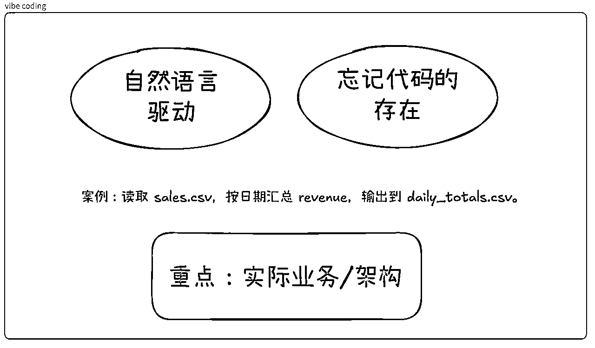

# 2. 传统编程与氛围编程的对比

| 对比项 | 传统编程 | 氛围编程 (vibe coding) |
| --- | --- | --- |
| 代码如何产生 | 开发者逐行手动编写 | AI 根据自然语言提示自动生成 |
| 人承担的角色 | 架构师、实现者、调试者 | 提示者、引导者、测试者、优化者 |
| 对编码专业知识的要求 | 较高，熟悉编程语言与语法 | 较低，清楚所需功能即可 |
| 主要输入 | 精确的代码 | 自然语言提示与反馈 |
| 开发速度 | 通常较慢但稳健 | 可能更快，原型和简单任务优势明显 |
| 错误处理 | 基于代码理解进行手工调试 | 通过对话式反馈持续优化 |
| 学习曲线 | 往往比较陡峭 | 可能显著降低入门难度 |
| 代码可维护性 | 依赖代码质量、开发者技能和实践规范 | 可能高度依赖 AI 输出质量与用户评估 |

# 3. 工具一览

先放一张图，看看这些工具你是否都认识。


所有链接：

```
终端工具类：
Claude code：https://www.anthropic.com/claude-code
AmpCode：https://ampcode.com/
Gemini CLI：https://github.com/google-gemini/gemini-cli
OpenCode：https://opencode.ai/
QwenCoder：https://qwenlm.github.io/blog/qwen3-coder/
Aider：https://aider.chat/
Codex：https://chatgpt.com/codex

IDE 类：
Cursor：https://cursor.com/
Windsurf：https://windsurf.com/
Kiro：https://kiro.dev/
CodeBuddy：https://www.codebuddy.ai/
Trae：https://www.trae.ai/

VSCode/Cursor插件类：
Augment：https://www.augmentcode.com/
Cline：https://cline.bot/
RooCode：https://roocode.com
Github Pilot：https://github.com/features/copilot

前端界面类：
v0：https://v0.dev
bolt：https://bolt.new
lovable：https://lovable.dev
same：https://same.new/
Replit：https://replit.com/
MagicPath：https://www.magicpath.ai/
Command：https://command.new/

产品设计类：
CodeGuide：https://www.codeguide.dev/

移动端类：
Rocket：https://www.rocket.new/
Rork：https://rork.com/

CR 类：
CodeRabbit：https://www.coderabbit.ai

任务管理类：
TaskMaster：https://www.task-master.dev/
```

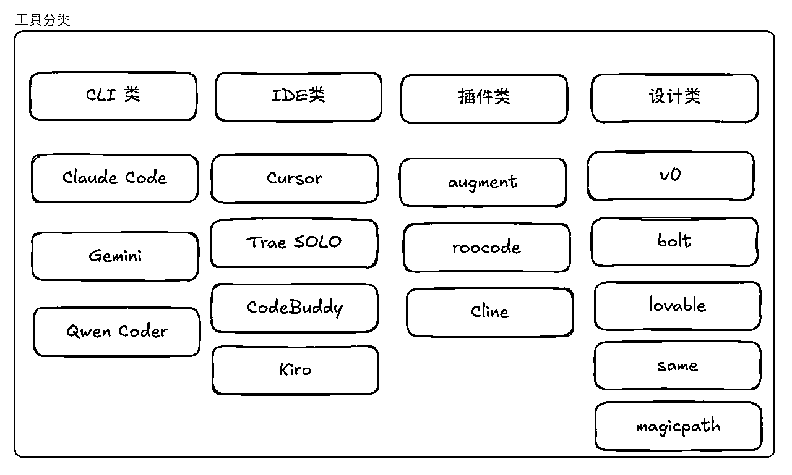


# 1. 重新理解编程和编程工具

# 1. 关于编程

# 1.1 编程的本质

编程，本质上是人类和计算机之间的对话艺术。展开来说，就是用计算机能够精确理解的方式，把我们的意图翻译成可执行的指令。这个对话流程可以拆解为：

```
问题世界 → 思维世界 → 代码世界 → 计算机世界 → 现实世界
   ↓         ↓         ↓         ↓         ↓
 现实需求   逻辑抽象   语法实现   机器执行   问题解决
```

# 1.2 学 AI 编程的理由

有句话越来越流行：未来被淘汰的，是不会用 AI 工具的人。

放到当下环境看，AI 编程就像一场“工具革命”，带来的变化集中体现在三点。

其一，门槛大幅降低。过去想写出可用的程序，先要花几个月啃语法、配环境；现在有了 Claude Code、ChatGPT、Cursor，直接用自然语言就能生成可运行代码，零基础也能当天看到成果。

其二，工作方式发生转变。软件开发不再是“一个人通宵手写代码”，而是人给出想法，AI 完成生成。未来大量岗位，包括非程序员，都会借助 AI 辅助编程去做自动化与数据处理。

其三，竞争力差距拉大。不会用 AI 编程的人，未来的工具使用效率会比别人落后几个量级；会用的人，不仅能独立交付，还能快速验证创意、打造副业产品。


# 2. 关于编程工具

# 2.1 什么是编程工具

编程工具是指能帮助人们更高效地编写、调试、测试和发布软件的那批软件与配套环境。

# 2.2 编程工具存在的意义

- 提高效率：代码提示、自动补全等能力可以省去大量重复劳动
- 减少错误：调试器和静态分析器能够提前暴露潜在 Bug
- 方便协作：版本管理、代码托管让多人项目更可控
- 覆盖全生命周期：从编码到上线、运营，每环节都有专用工具

# 2.3 主流编程工具有哪些

| 类型 | 作用 | 代表产品 |
| --- | --- | --- |
| 代码编辑器 / IDE | 写代码、调试、运行 | Visual Studio、VS Code、PyCharm、IntelliJ、Xcode |
| 编译器 / 解释器 | 把代码翻译为计算机可执行语言 | GCC、Clang、JVM、CPython |
| 调试器 | 追踪运行过程、定位 Bug | GDB、VS Code Debugger |
| 版本控制工具 | 管理代码变更与团队协作 | Git、GitHub、GitLab |
| 构建工具 | 自动化编译、打包、部署 | Maven、Gradle、Webpack |
| 测试工具 | 自动检查功能与质量 | pytest、JUnit、Jest |
| 自动化工具 | 自动执行重复性任务 | GitHub Actions、Jenkins |
| 部署与运维工具 | 服务上线与监控 | Docker、Kubernetes、Prometheus |

# 2.4 Claude Code 的定位

Claude Code 更像是 Web 时代的编程助手，适合用 Web 技术栈和跨平台方案做开发。

从它的简化能力地图可以看得非常明白：最擅长的区域就是 Web 开发。

原因也不难理解——Claude Code 产出的代码，天然依赖开放、通用、跨平台的运行环境。Web 技术（HTML/CSS/JavaScript）恰好满足这三点：浏览器是所有电脑和手机的标配，而 JavaScript 又是浏览器里唯一的原生脚本语言；另外，Claude Code 在训练时大量吸收了开源的前端/后端项目样本（JavaScript、Python），这些生态的文档与示例公开易得。因此，生成结果只需要浏览器就能直接跑，不像 C++、Java 桌面应用那样要搭建复杂的本地环境。


# 3. 延伸科普

# 3.1 Agentic 工作流：AI Agent 如何“思考—计划—执行”

Agentic 工作流，指的是由自主智能体（Agent）驱动的流程。它能自主解读任务（思考）、形成解决方案（计划）、按计划推进并调整（执行），必要时还会进入循环迭代（反思）。

Claude Code、ChatGPT、AutoGPT、LangChain 等工具，都能作为 Agentic 工作流中的智能体出现。

# 3.2 三步核心循环

| 阶段 | 核心问题 | AI 正在做什么 | 产出 |
| --- | --- | --- | --- |
| 思考 (Think) | “我要解决什么问题？” | 理解任务背景、拆解需求 | 问题定义、假设 |
| 计划 (Plan) | “该按什么顺序执行？” | 拆分步骤、排定次序、选择方案 | 行动计划、任务清单 |
| 执行 (Act) | “每一步怎么落实？” | 按部就班执行、生成结果、及时修正 | 可用结果或下一步输入 |

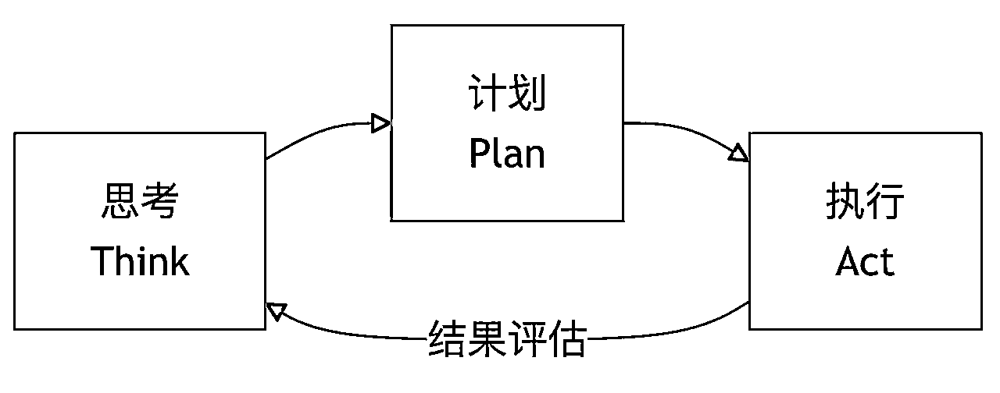

# 3.3 上下文协议（Context Protocol）的原理

# 上下文指什么

在大模型的世界里，“上下文”代表模型在一次对话或任务中可以读取的全部信息，范围包括用户输入、历史对话、外部文档以及工具返回结果。它直接决定模型能不能记得你说过的话、能不能进行多信息关联推理。

举个例子：你可以向学生提问：“如果我说，打开 main.py，在函数里加一句打印，你知道我要改哪个文件吗？”如果学生从没看到过这个项目，大概率会懵住：“main.py 是什么？你之前做了什么？”

这就是上下文的重要性。人类会做笔记、记得上次改到哪一行；AI 模型天然没有记忆，每次见面都像初识。因此需要一种机制，把项目状态和环境信息整理好，送进模型；这个机制，就是上下文协议。

上下文协议解决了什么问题？

- 防止丢记忆：没有协议，模型会忘记了你建过什么文件、正在用什么框架。
- 减少啰嗦：不用每次手工解释一遍项目背景。
- 提高准确性：生成的代码更贴合实际项目，而不是给个通用但可能出错的版本。

关于上下文，还有几个细节值得掌握。

上下文是有边界的：模型受到上下文窗口大小约束（如几万 Token），协议的价值正是把有限窗口内的关键信息组织好，别让无关内容占满空间。可以理解成：人有长期记忆，大模型只有一块有限的“临时黑板”。

它为什么叫“协议”：因为不是随手拼凑信息，而是按统一格式规定“传什么、怎么传”。TCP/IP 定义了数据包的规则，上下文协议则定义上下文信息的打包与传输规则。无论是 Claude 还是其他 IDE 工具，都能遵循这套流程接力协作。

它一直在更新：上下文不是一次到位，而是随着任务推进不断刷新。例如你刚创建 login.py，协议马上就会把新文件信息传递给模型，这也是对话连续性的保障。

别把它和长期记忆混淆：上下文协议属于短期、连续对话的上下文管理，目标是让当前这几轮对话不跑偏；长期记忆则负责跨会话保存，比如下次打开 IDE 还能想起昨天的项目进度。

打个比方：机场广播。当你换了登机口，广播会实时把新位置告诉所有旅客。上下文协议就是这样的广播体系，保证模型随时掌握最新“登机口”，不会走错地方。

# 1. 搭建开发环境

# 1.本章导读

看完 Claude Code 的能力，你大概已经想动手了。但在高效编码之前，先要把开发环境搭好。这是最容易忽略、也最影响体验的一步。

一个稳定的环境，能让你避开日后大量的配置问题，安心把时间花在创造上。本章的目标，就是一次性清掉所有环境障碍。

具体来说，你会完成：

- 配置系统环境：安装并设置全部前置依赖，从源头防止兼容性问题。
- 安装 Claude Code：快速完成核心程序安装，并理解它的基本运行原理。
- 验证安装结果：跑通第一个检测程序，确认一切就绪，万无一失。

工欲善其事，必先利其器。地基稳了，后面才走得快。现在开始，为整个 AI 辅助开发流程打好第一块基石。

完成本章后，你将掌握 Claude Code 的安装方法。动手吧，为编程旅程迈出扎实的第一步。

# 本章航线图

完成本章的学习和实操，即完成航线图第一阶段的第 2 部分。

第一阶段：快速上手 Claude Code（约 1 天）

- 搭建开发环境并安装 Claude Code（约 1 天）


环境准备说明：macOS 与 Windows 的配置步骤要分开做；Node.js、Python、Git、IDE 环境都属于必装项。这些依赖是为了让 Claude Code 获得更好的运行条件。

1. Python：一种广泛应用于 AI 和数据领域的编程语言。有了它，你可以直接运行和测试 Claude 生成的 Python 程序，验证功能是否正常；另外 MCP 工具跑起来也需要 Python 环境。
2. Node.js：它的作用是把 JavaScript 从浏览器内搬到电脑上，用于运行现代网站开发相关工具，同时可以测试 Claude 生成的前端（JavaScript）代码；MCP 工具的顺利运行同样依赖 Node.js 环境。
3. Git：一种代码版本管理工具，相当于给项目拍快照。每一次修改都会被记录，如果 Claude 的改动有问题，你可以借助它轻松回退到之前的安全版本。

# 4. VS Code：写程序与 Claude 协作的入口

VS Code 是一款功能完整的编程工具，也是你平时写程序、和 Claude 配合、管理项目代码的主要工作台。

小提示：请先确认自己的操作系统，再按对应小节准备环境。

# 2. 装好 Python

先从 Python 的下载页开始：https://www.python.org

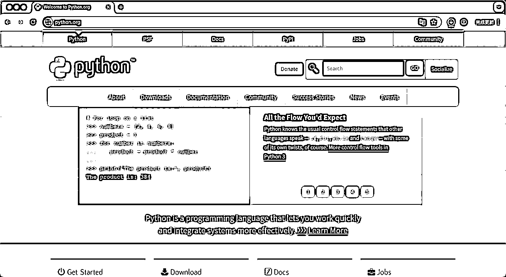

进去以后，把光标移到顶部导航栏的 Downloads 上。页面上会出现“Download for macOS”提示，紧接着下面有个带版本号的按钮（形如“Python xx.xx.xx”），按下它，安装文件就会开始传输。

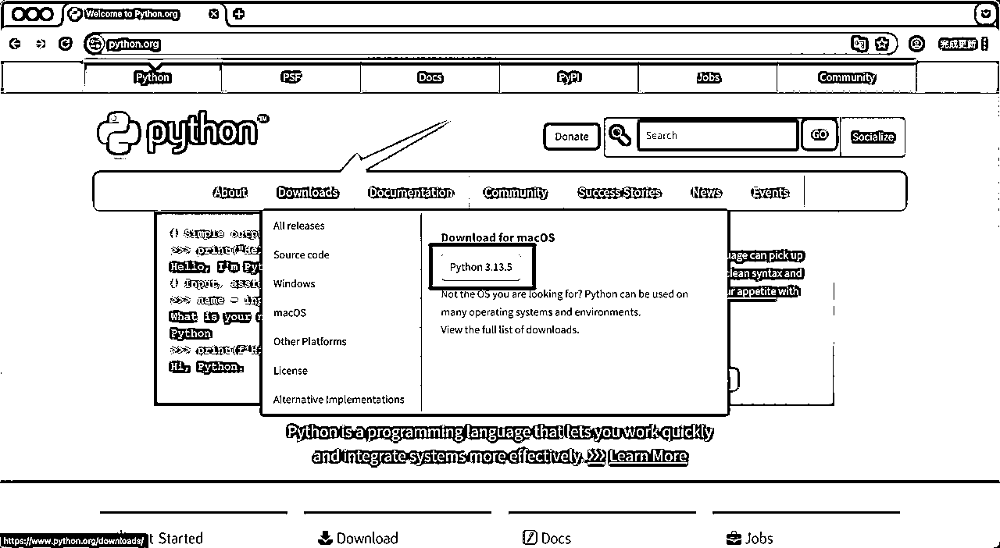

文件下好后，双击就能启动安装流程。

# 2.1 macOS 端安装

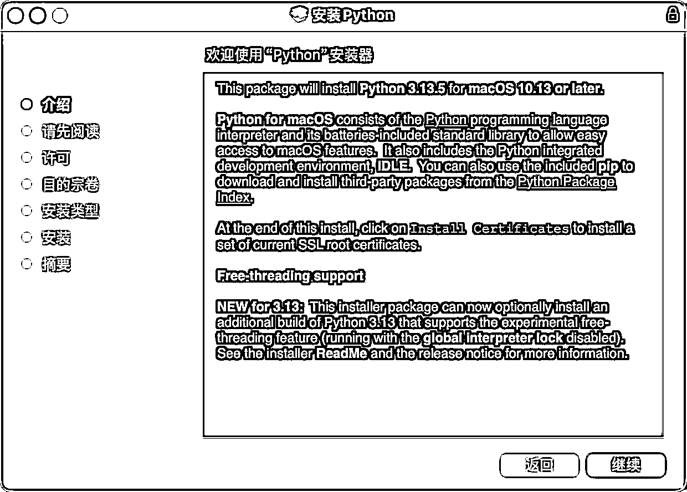

macOS 上这一步不复杂，连续按“继续”就能走完，PATH 等环境变量由装器自行处理。

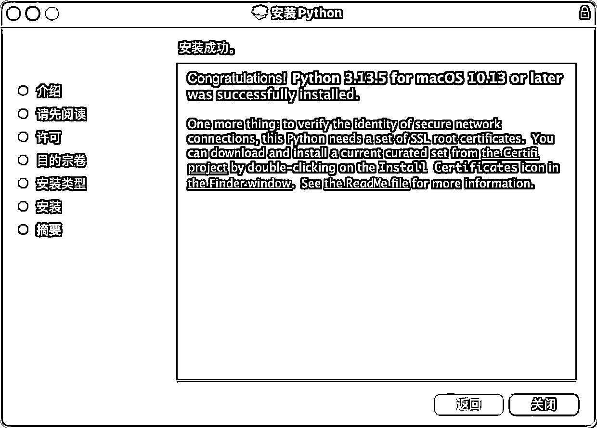

装完后，用 Command+Space 调出聚焦搜索，键入“终端”并启动它。

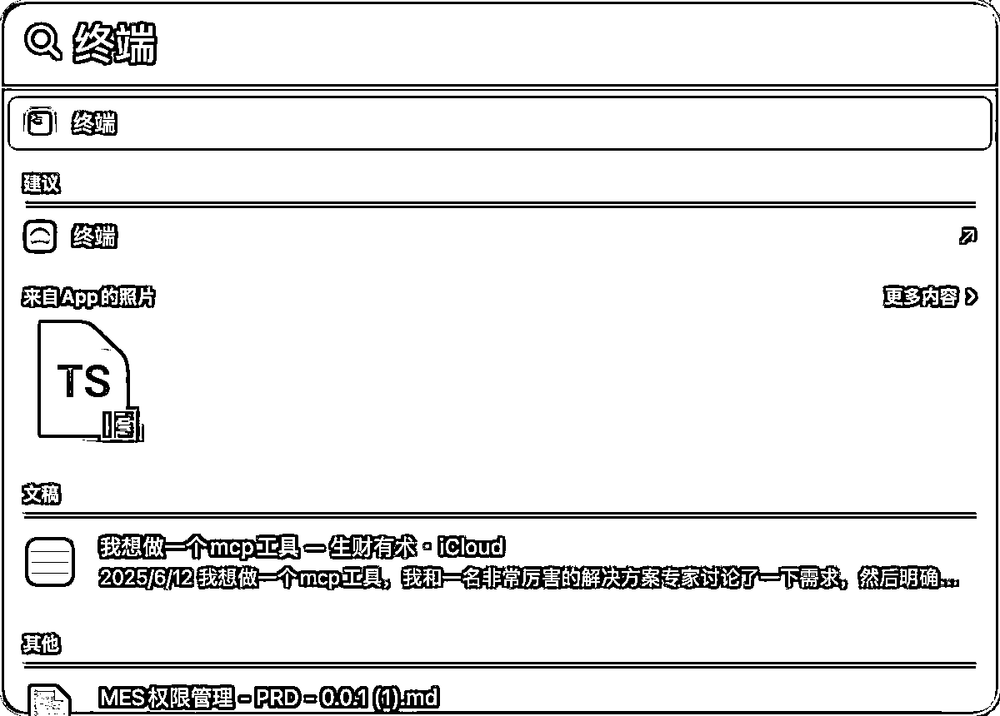

在终端窗口执行 python3 --version，确认 Python 是否就位。

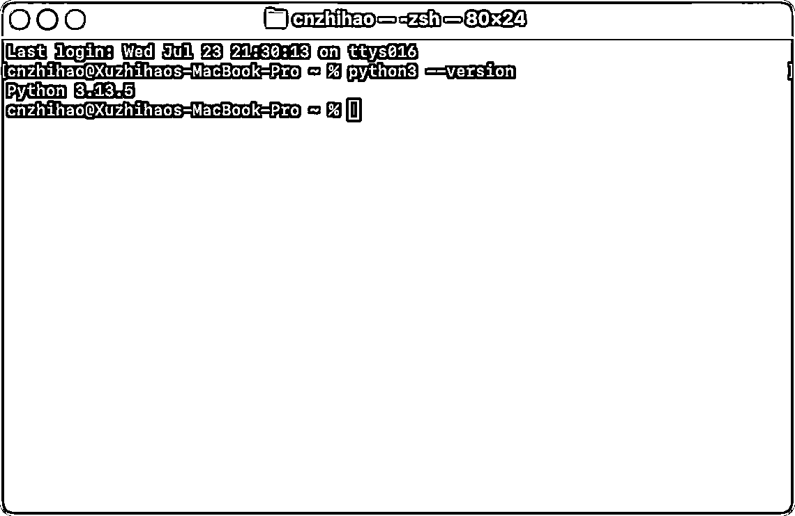

只要终端回显 Python 字样和版本号，就代表装好了。

# 2.2 Windows 端安装

打开站点后，有两种下载路径，挑一种即可。

路径一：把鼠标放在“Downloads”上，会出现下载选项，点灰色按钮开始下载。

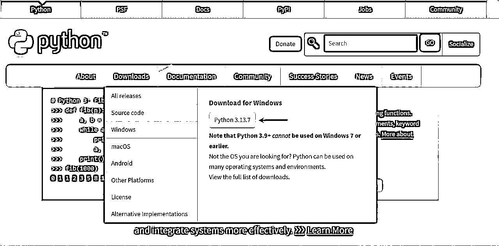

路径二：点“Windows”进入具体下载页，在那里可以挑 Intel 版或 ARM 版。

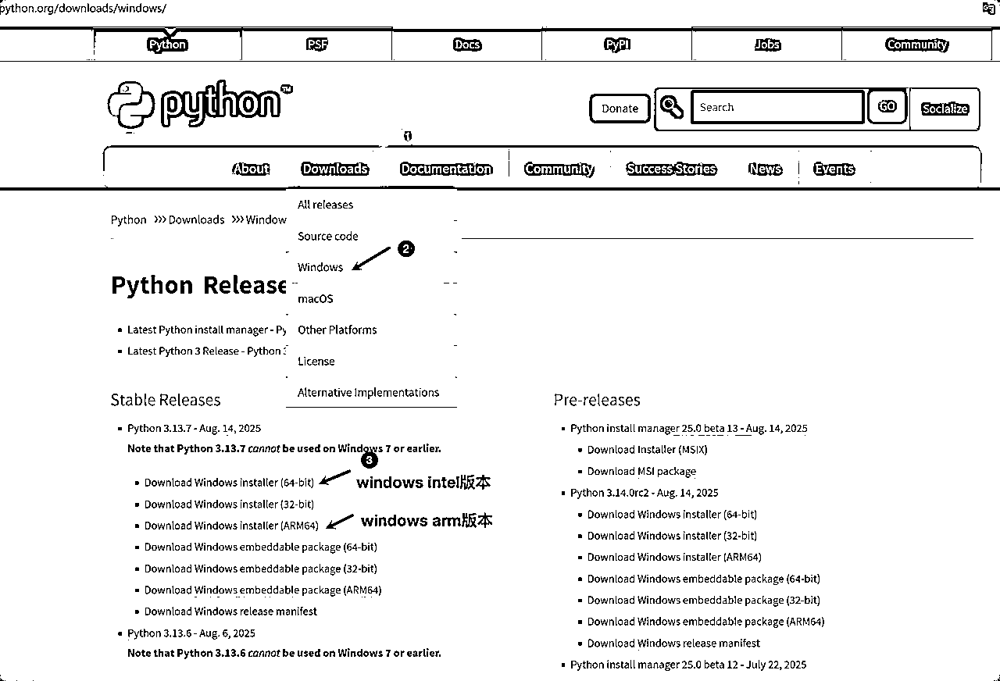

Windows 端只多一个关键动作：运行安装文件时，记得把底部的“Add Python to PATH”勾选上；漏掉的话，后面验证时系统可能认不出 Python。

两种路径任选其一。

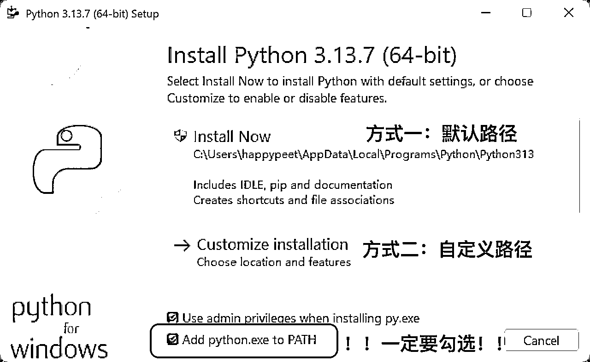

装好后按 Win+R，键入“cmd”并执行，终端窗口就会弹出来。

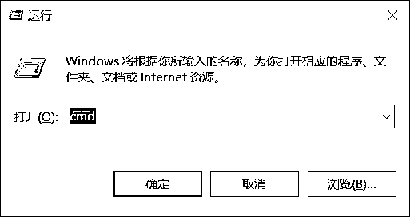

在终端里执行 python --version，就能判断 Python 是否装好。


# 3. 装好 Node.js

Node.js 的流程也类似。先打开 https://nodejs.org/

页面加载后，点“Get Node.js”进入下载区。

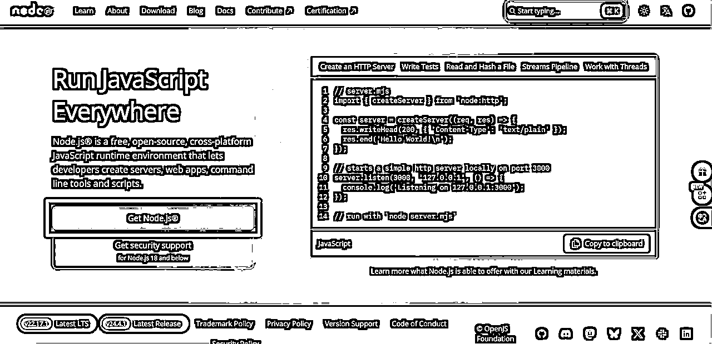

到了下载区，普通用户不必走上面的命令行方案，那个对新手偏麻烦；把页面往下拖，找到一键安装文件更省事。

# 3.1 macOS 端安装

Mac 用户先看芯片：M 系列选 ARM64，Intel 系列选 x64，然后下载 installer。

下载完直接运行安装器，过程照样简单，连续点“继续”即可。

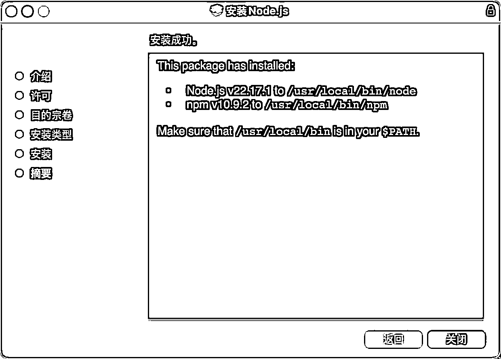

到这一步，Node.js 就装好了。

# 3.2 Windows 端安装

Windows 机器通常选 x64（64 位）。只有很老的电脑，比如内存不足 8GB，才需要 x86（32 位）；其他情况都选 x64。选好后下载 .msi 安装文件。

下载完点开安装器，进入安装窗口，Windows 上同样连续点“继续”。

装好后，像验证 Python 那样启动终端，执行 node -v 再按回车。

再说明一次终端怎么开：

Windows：按 Win+R，键入 cmd 后按回车。

macOS：按 Command（⌘）+空格调出 Spotlight，键入“Terminal”或“终端”后按回车。

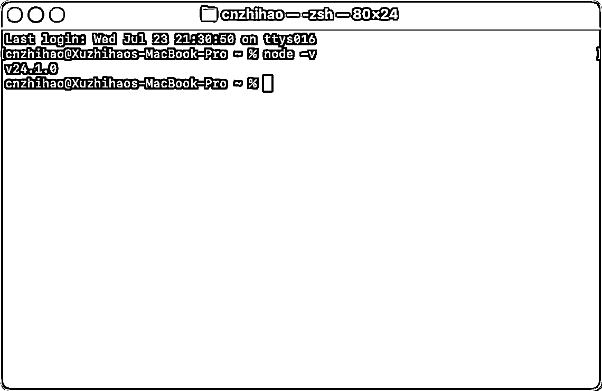

只要终端正常回显版本号，Node.js 就算装好了。


# 4. 装好 Git

如果准备用 GitHub 管理代码，Git 得先装上。

Git 的下载页在 https://git-scm.com/downloads

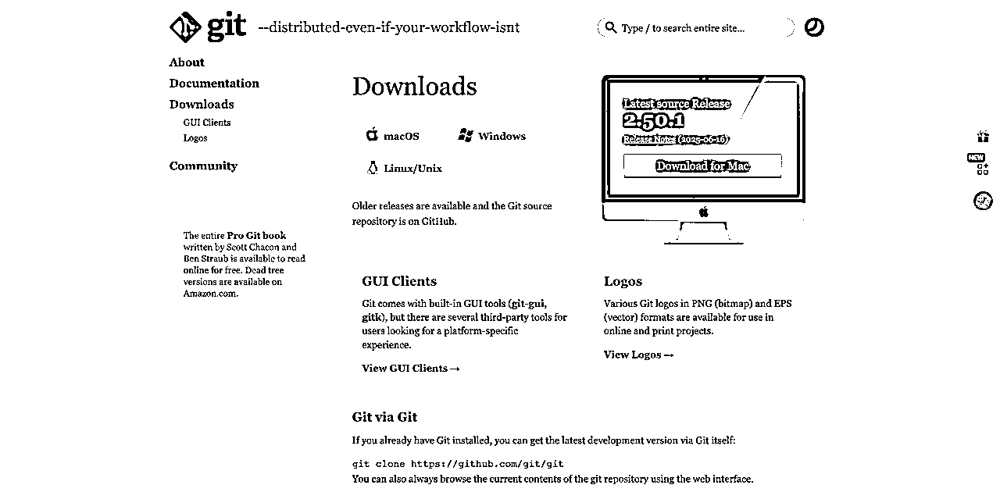

按系统挑对应版本：Windows 选 Windows 版，Mac 选 macOS 版，Linux 选 Linux 版。页面会结合系统给出安装方式。比如 macOS 常见做法是用 brew，Windows 则下载安装文件直接运行。

# 4.1 mac 端安装

mac 上要先有 Homebrew。打开 https://brew.sh/，点命令行右侧的复制按钮。

```
/bin/bash -c "$(curl -fsSL https://raw.githubusercontent.com/Homebrew/install/HEAD/install.sh)"
```

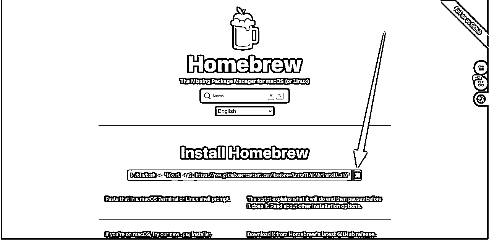

启动终端窗口，把刚才复制的命令粘贴进去并按回车。按提示键入开机密码后按回车，再确认安装并按回车，随后安装或升级流程就会跑起来。

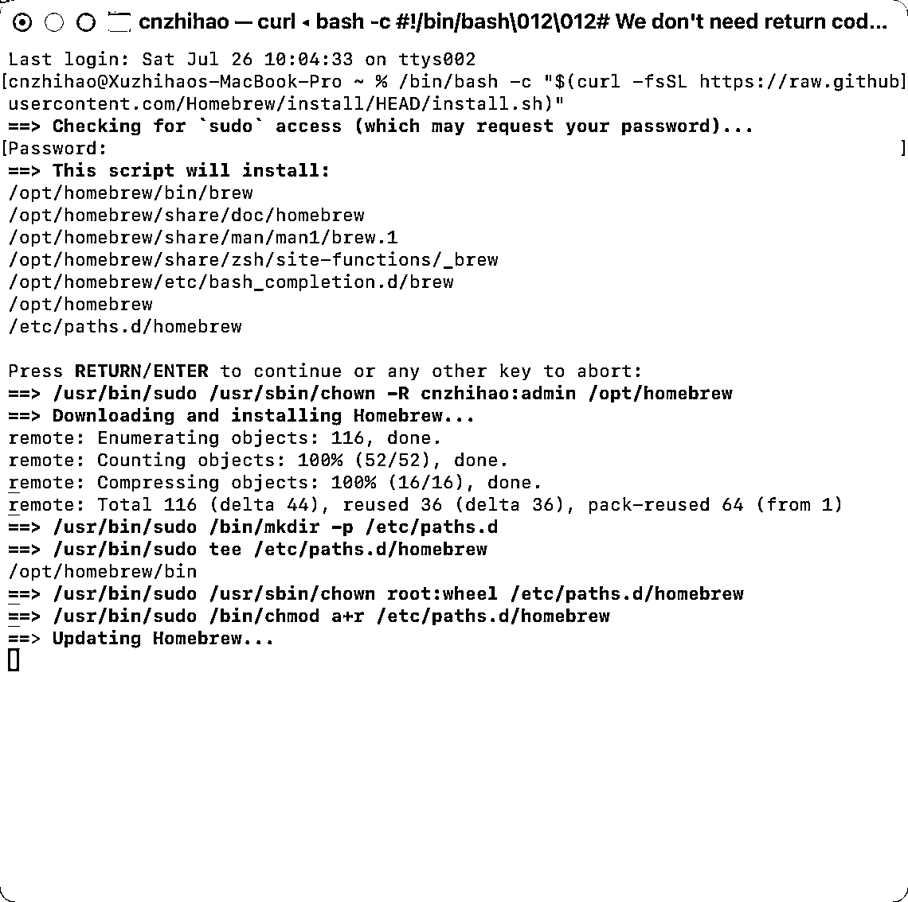

等一小会儿就好。接着在终端执行 brew install git 并按回车，brew 稍后会告知 Git 已就绪。

```
brew install git 
```

想确认电脑里有没有 Git，或检查是否装好，直接在终端执行 git --version 并按回车。出现版本号即成功。

```
git --version
```

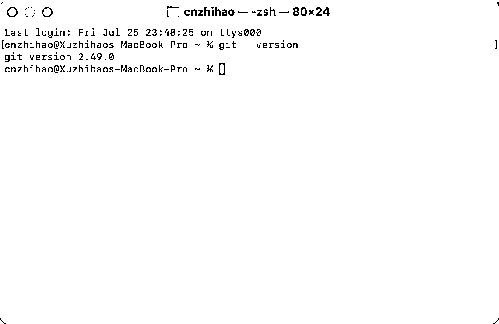

# 4.2 windows 端安装

进入 Windows 安装窗口后，按电脑型号挑版本。绝大多数 AMD 或 Intel 处理器都可以直接选 x64；拿不准选哪个，可以问 AI。

下载完就连续点击“继续”完成安装。注意，到组件选择页时，如果不知道该勾什么，全部勾上最稳妥。

装好或检查电脑里是否已有 Git，启动终端执行 git --version 并按回车。出现版本号就说明装好了。

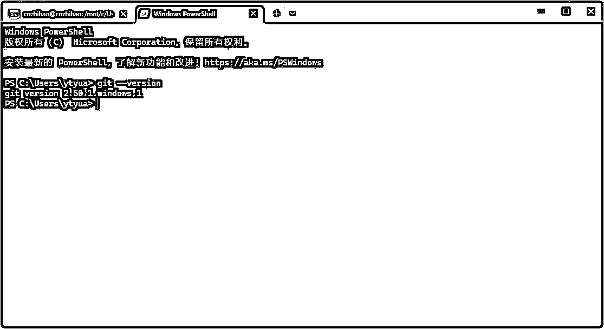


# 5. 装好 VS Code

接着装 VS Code。打开 https://code.visualstudio.com/

点页面中央的 Download for xxx。Windows 机器会显示 download for windows，Mac 机器会显示 download for macOS。

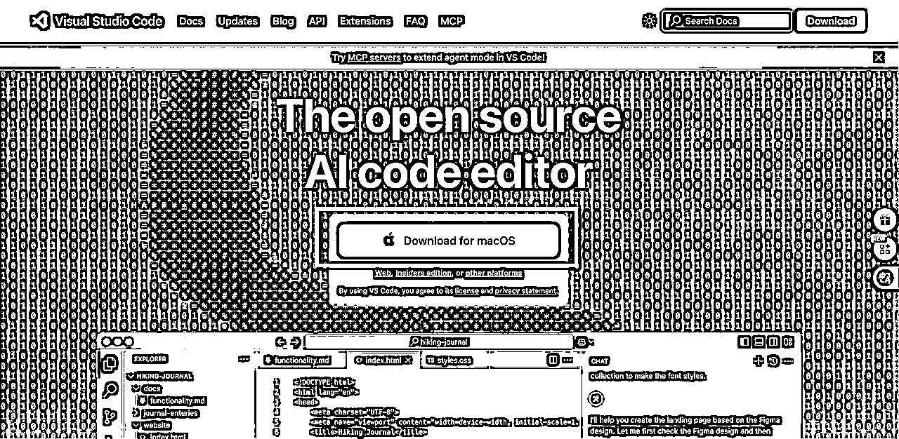

看到对应画面后，VS Code 会自动下载并进入安装。

# 5.1 mac 端安装

macOS 这边相对省事。打开下载内容后，会看到 VS Code 的启动包，把它拖进“应用程序”文件夹就行。

注意！必须拖进“应用程序”文件夹，别直接双击打开，否则容易碰到权限问题。

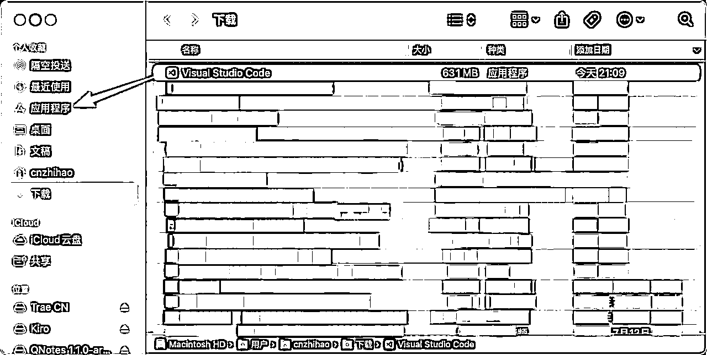

如果在个人收藏里找不到“应用程序”，可以通过设置把它显示出来。


先打开访达，在状态栏点“设置”。

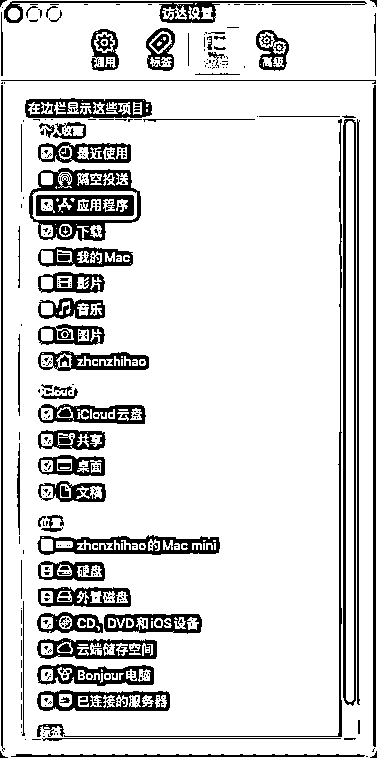

在访达设置里勾选“应用程序”，此时访达中就能看到它。然后把 VS Code 拖进应用程序文件夹。

装完后，在桌面或启动台找到 VS Code 并打开。界面出现，安装就结束了。

小提示：第一次用 VS Code 时，它可能引导你按指南配置。跟着做可以，先不管也行，通常不影响使用。

# 5.2 windows 端安装

Windows 下载完成后，按提示直接安装，连续点“继续”即可，尽量装在系统盘。

默认选项里留意“添加到 PATH”是否勾上，一般它默认已勾选。为了让环境变量正常生效，装完后建议重启电脑。

1. 安装 Claude Code

装 Node.js 时，npm 会一并就位。Mac 机器先确认 npm 可用，然后就能装 Claude Code。Windows 机器目前 Claude Code 已完整支持，因此不再推荐 WSL，而是建议装好 Git 后指定环境变量。

# 1. MAC 端安装

启动终端，执行 npm -v，测试 npm 是否正常。

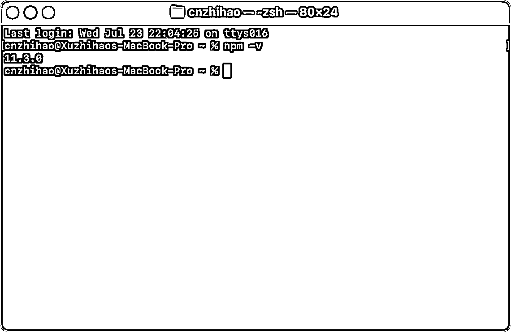

如果回显 npm 版本号，说明 npm 已就绪。接下来装 Claude Code。

在终端执行 npm install -g @anthropic-ai/claude-code 并按回车。

```
npm install -g @anthropic-ai/claude-code
```

如果速度慢，可以在命令后加镜像参数：

npm install -g @anthropic-ai/claude-code --registry=https://registry.npmmirror.com

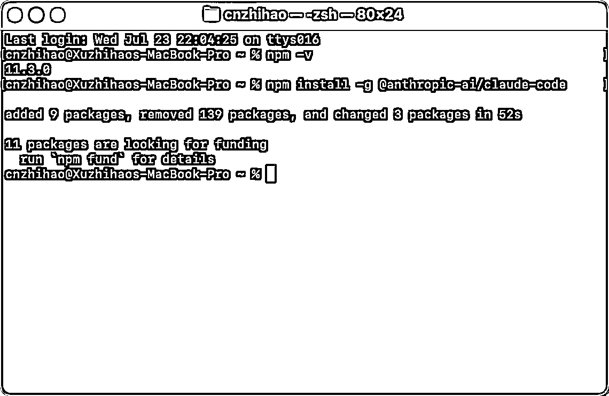

等一会儿，Claude Code 会完成安装。执行 claude -v 并按回车。能看到 Claude 版本号，就说明装好了。

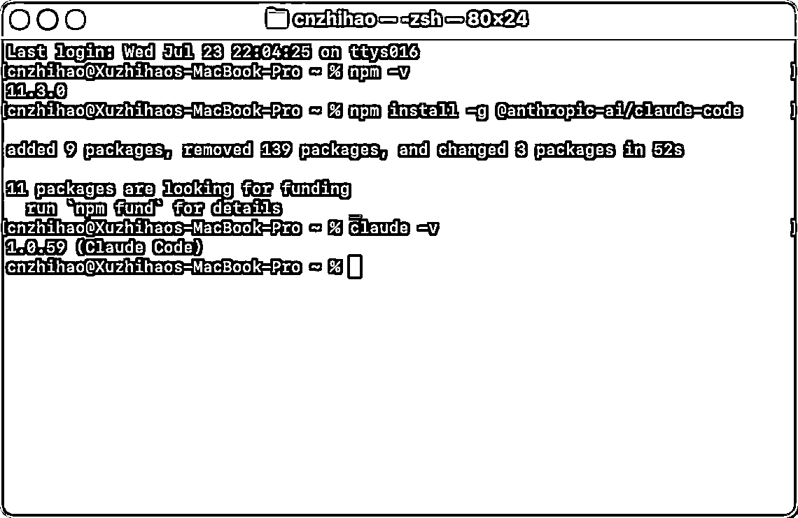

注意：安装时若出现 permission denied，请执行 sudo npm install -g @anthropic-ai/claude-code，然后键入开机密码并按回车。

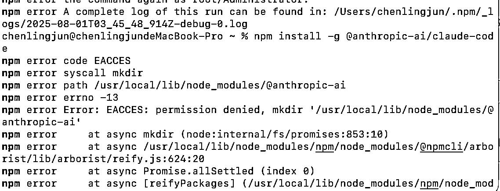


# 2. Windows 端安装

启动终端，执行 npm -v，检查 npm 是否正常。

小提示：npm 是 Node.js 的软件安装中心，通常在装 Node.js 时一起装好。

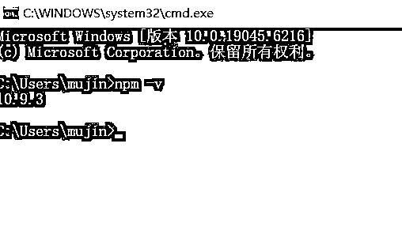

如果回显 npm 版本号，说明 npm 可用。接下来装 Claude Code。

在终端执行 npm install -g @anthropic-ai/claude-code 并按回车。

```
npm install -g @anthropic-ai/claude-code
```

如果速度慢，可以在命令后加镜像参数：

npm install -g @anthropic-ai/claude-code --registry=https://registry.npmmirror.com

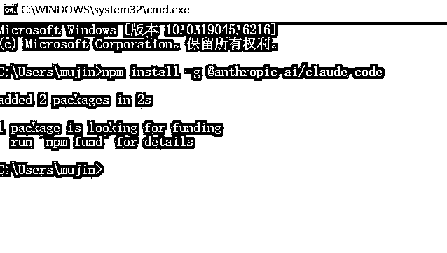

等待安装完成后，执行 claude -v 并按回车。看到 Claude 版本号，就代表 Claude Code 装好了。

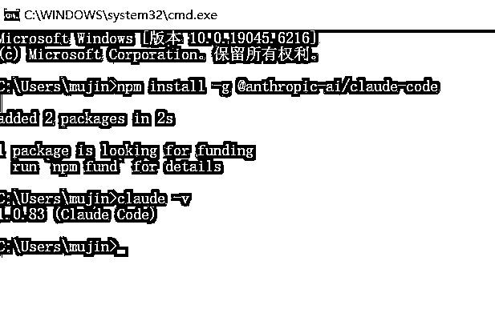

至此，Claude Code 安装完成。

1. 让国产模型 API 来驱动 Claude Code

# 本章速览

拿到一件心仪的工具后，总要先把它调顺手，才能真正发挥威力。激活和配置 Claude Code 也是同样的道理。步骤看起来可能有点多，但这是释放它全部能力的关键一环。

这一章陪你搞定收尾环节，让 AI 工作搭档尽快进入状态。我们会一起处理三件事：

成功激活：取得并正确用上启动 Claude Code 的凭据。

核心配置：弄懂几个关键项，把它调成适合你的样子。

接入项目：让它认得你的工作目录，后续创作更顺。

这些步骤别跳过。配置做得合适，相当于给搭档配齐装备；前期多花几分钟，后面开发少折腾几小时。

准备让这位 AI 工作搭档正式开工了吗？开始吧。

# 本章路线图

完成本章学习和实操后，路线图第一阶段的第 3 部分就完成了。

第一阶段：Claude Code 快速入门（约 1 天）

激活与配置 Claude Code（约 1 天）

特别提醒：Claude 对支付和网络环境要求很高。这里建议直接完成【02 通过API使用国产替代模型驱动Claude Code】后进入下面的章节。03/04 两节留给精力足、爱探索的读者。


如果充值和网络问题解决不了，也可以选择国产替代方案。下面是简单的优劣势对比。

- GLM4.5：成本优势非常突出，额度给得足；目前有新会员注册赠送 token 活动。
- Kimi K2：现有使用反馈不错，但 token 消耗较快。
- Qwen：模型参数体量很大，编程表现可与 Claude 3.7 Sonnet 比肩，擅长长文档处理和 Agent 类编程任务；输入侧每 100 万 token 4 元、输出侧每 100 万 token 16 元；要先充 50 元升到 Tier3 档位，用起来才会更顺畅；提供多个参数规模的版本、按量分档计价，以及 Qwen-Agent 框架与工具调用能力，但整体用量偏大，花费也更高。

# 国产模型账号与 API 密钥配置

# 2.1 GLM4.5

登录 GLM 官网。资源包页面：https://www.bigmodel.cn/finance/resourcepack

先看看自己有没有赠送资源包，有的话就去申请 API 密钥。


现在它也推出了 Claude Code 套餐，可以考虑。地址：https://bigmodel.cn/claude-code

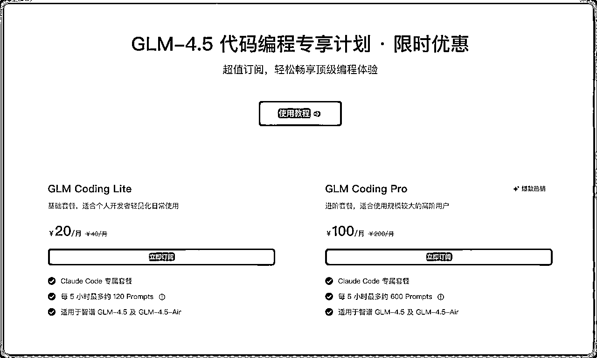

获取 API 密钥：https://www.bigmodel.cn/usercenter/proj-mgmt/apikeys

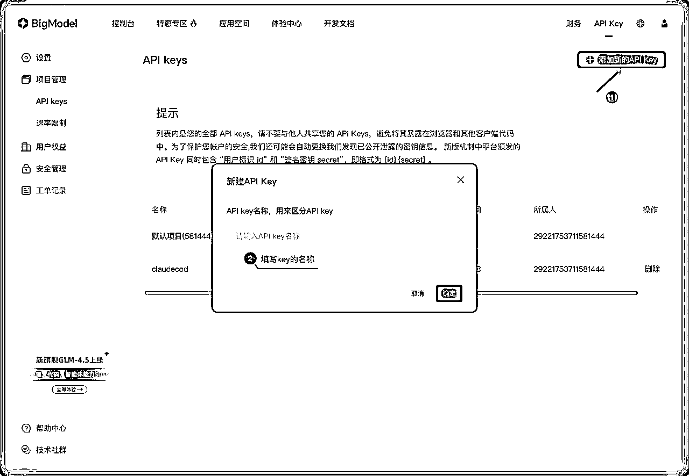

把 API 密钥保存好，同时记下 BASE_URL：https://open.bigmodel.cn/api/anthropic。配置时照着说明填进去。

# 2.2 Kimi K2

同样先登录网站，然后创建 API 密钥。入口：https://platform.moonshot.cn/console/api-keys

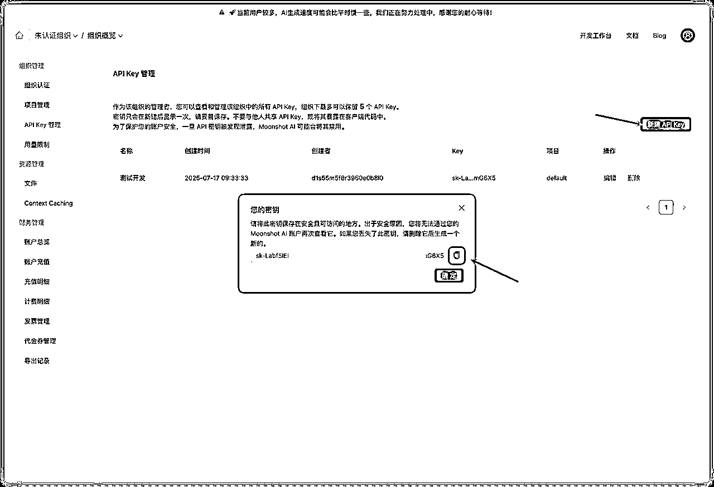

创建完成后可以复制。

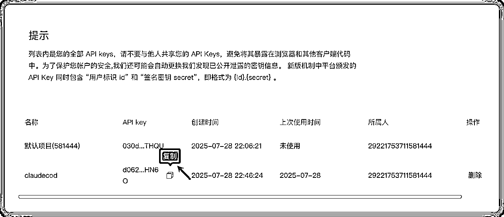

把 API 密钥和 BASE_URL 一起记下来：https://api.moonshot.cn/anthropic。后面配置环节用得上。

# 2.3 Qwen

同样申请 API 密钥。入口：https://bailian.console.aliyun.com/?tab=model#/api-key


保存好 API 密钥，并记下 BASE_URL：https://dashscope-intl.aliyuncs.com/api/v2/apps/claude-code-proxy。配置时填入即可。

# 2.4 DeepSeek

入口：https://platform.deepseek.com/api_keys

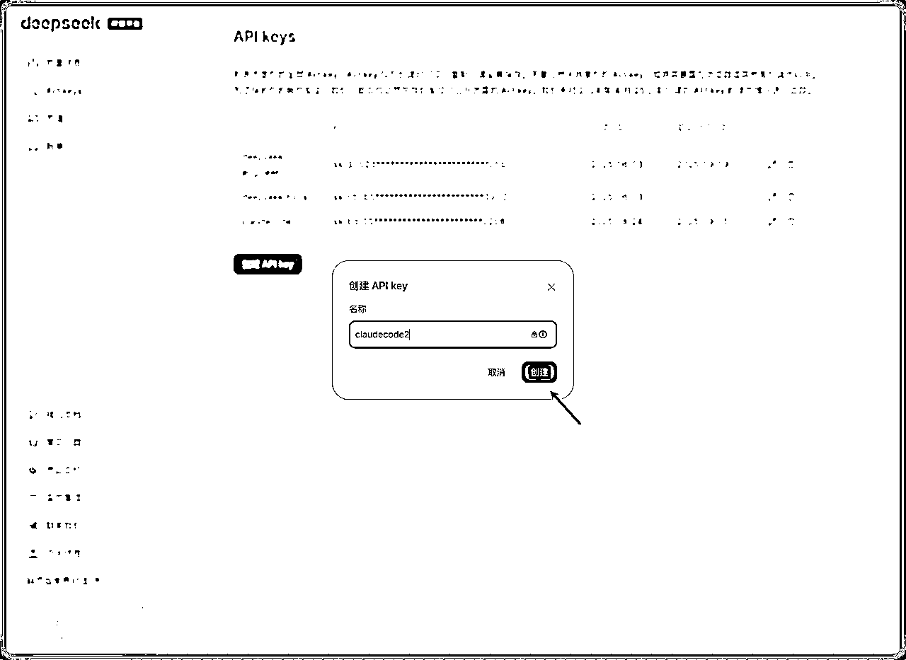

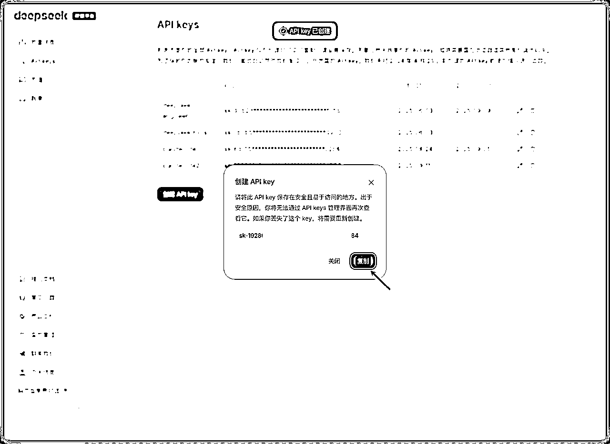

DeepSeek 的 BASE_URL：https://api.deepseek.com/anthropic。把它填到配置页即可。


# Claude Code 上手配置：一篇搞定

先把关键逻辑说清楚：你选的模型不同，ANTHROPIC_BASE_URL 的取值也要跟着不同。

配置这件事，建议交给终端工具 zcf 处理；刚入门的朋友，尽量别自己动手改配置文件。

在命令行里运行 ```
npx zcf
```，看到提示后敲 y 确认，终端配置界面就会弹出来。

界面语言挑“1 简体中文”，方向键上下移动，回车确定即可。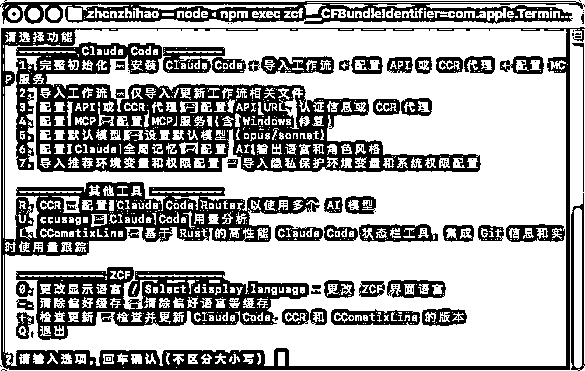

进去以后先别急着研究别的，只做配置 API 这一件事：按 3 再回车。

接着按一下 ⬇️，把选项移到“使用 API Key”上，回车继续。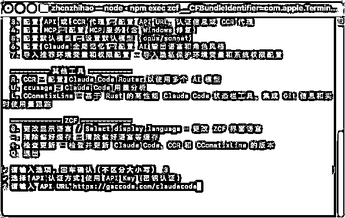

此时把你手里的 BASE_URL 填进去，回车；紧接着填 API_KEY，再回车。

界面提示配置完毕后，按 n 再回车，退出 zcf。然后关掉当前终端窗口，重新开一个，敲下 claude 再回车。

这里有个容易踩的坑：如果你用的是 API 方式，必须把对应选项调成 Yes，不然之前填的 APIKEY 等于白配。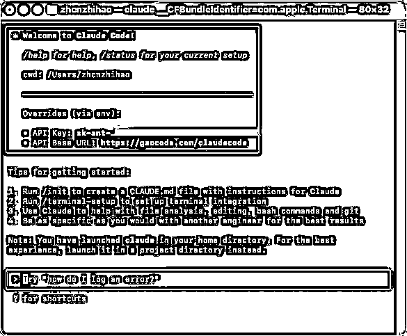

等对话窗口正常显示出来，就代表 claudecode 已经跑通了，接下来随意发挥。

# 配置视频

文字看不明白也没关系，下方视频可以对照着操作，希望能派上用场：视频学习


============= 长长的分界线，新手勿入，高手请进 =============

这条分界线往下，属于进阶内容，新手直接跳过完全没问题。

支付方面：银联、visa 这类国内卡以及香港卡，一律无法完成绑定。网络方面：必须准备静态 IP 或住宅 IP（🪜、机场那类不算），而且花费不低。所以结论是：以下方法都依赖官方 claude 的完整链路，适合爱折腾、有探索欲的朋友，新手可以略过。

1. (新手勿入)Claude Code登录官方账号

# 1.关于充值Claude的方法说明

假定你已经解决了网络问题（静态 IP 或住宅 IP，🪜不推荐），那支付这块我补充几句：

国内的银联信用卡、visa、运通卡，以及香港的汇丰、众安、天星等卡，想直接在 claude 网页上付款是行不通的，必须用美国或其它地区的卡。

# 方式一：安卓+google play（礼品卡）

前提条件：一台安卓手机（google pixel 比较稳妥）。

我家里那台荣耀试过不行，后来在海鲜市场花 250 左右淘了台 pixel 2，原生谷歌系统，跑得通。群友反馈一加也可以。国内其余机型我没实测，不敢替 google play 的服务打包票。

另外提醒：付款时谷歌邮箱可能要求开启 2FA、绑定手机号等，这些细节要多留意。

付款途径一：通过 google play 付款

我自己绑的是香港众安卡、天星银行这类卡（人跑一趟香港就能办，挺省事）。

也有群友绑定国内银行 visa 卡或运通卡成功的，说明这条路也走得通。国内银联卡我还没有试过，大概率不行——谷歌苹果这类国际服务一般只认 visa、运通，银联属于国内体系，兼容性差一些。

付款途径二：礼品卡

买礼品卡同样可行，我之前用过的购买渠道是：https://www.seagm.com

要留意：绑定礼品卡兑换时依然会触发电话验证，下单前想清楚，避免兑换失败白花钱。

# 方式二：IOS+礼品卡

前提条件：一台苹果手机 + 一个美区 Apple 账号（自己注册或去闲鱼买都行）。

付款途径二：礼品卡（推荐）

礼品卡也可以买：https://www.seagm.com ，支付宝渠道同样能买到，网上搜一下就有。

付款途径一：apple 支付

美区 apple 支付并不直接认国内银联/visa 卡与香港卡，得绕一下：

思路是：拿美区 apple 账号去绑美区 paypal，而美区 paypal 是能验证香港众安银行卡的。

但注意，美区 paypal 必须配美国实体电话卡，否则账号很容易被封。群友实测还发现：美区 apple 账号绑美区 paypal 时，国内卡验证会失败，这种情况可以找苹果客服申请解锁。

以上说的都是 claude app 内的订阅（也就是安卓、苹果手机上通过 claude app 订阅）。

费用方面，max 套餐要多付 25% 的税，具体是：20 刀套餐免税，实付 20 刀；100 刀套餐实付 125 刀；200 刀套餐实付 250 刀。

因此，官方网页虽然 max 不收税，但付款门槛高；而 claude app 是目前能顺利走通付款的路径。

网页付款要么走海鲜市场代付（虚拟卡、跑路等风险不小），要么找身边有卡的朋友帮忙。

另外说一句：AI 产品迭代太快，年订阅不太建议，除非预算充足，否则按月付更稳妥（最近退订 Cursor 年费的用户应该不少吧）。

# 方式三：虚拟卡

野卡目前用不了，还能考虑飞扬卡和 bybit 虚拟卡，可以直接在网页付款。

好处：省掉那 25% 的税。

坏处：流程偏长，对网络环境要求苛刻，还牵扯到 USDT 购买，这里就不展开万字长文了，自己权衡。

综合考虑，这部分不适合写得太细，留给探索欲强的同学去试。


# 3.网络情况说明

# 3.1 静态 IP 或者住宅类 IP

纯净度检测入口：https://ping0.cc

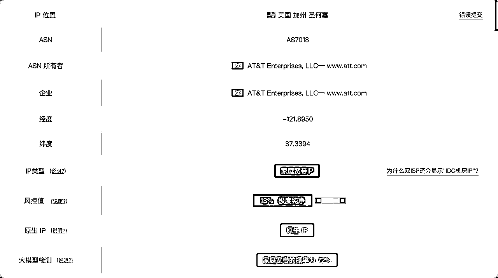

# 3.2 需要配置终端代理

要是你碰上截图里那种报错，基本可以判定是网络问题。

重点：代理必须落到终端层面，普通🪜只代理浏览器，终端模式走不出去。

按下面的方式选即可：

推荐方案：windows 用方式一，mac 用方式二；如果都不行，就上方式四（需要改配置文件，门槛略高）。

# 方法一：使用 clash.verge 软件的增强模式，或者 tun 模式

clash.verge 客户端是目前的首选，老版 clashx 之类的就别用了。

英文界面里叫 tun 模式；中文界面叫增强模式或虚拟网卡模式。

# 方法二：小火箭直接打开就行（只能 mac/ios 使用）

前提是 M 芯片的 mac。国区 AppStore 搜不到，需要切换到美区 AppStore。

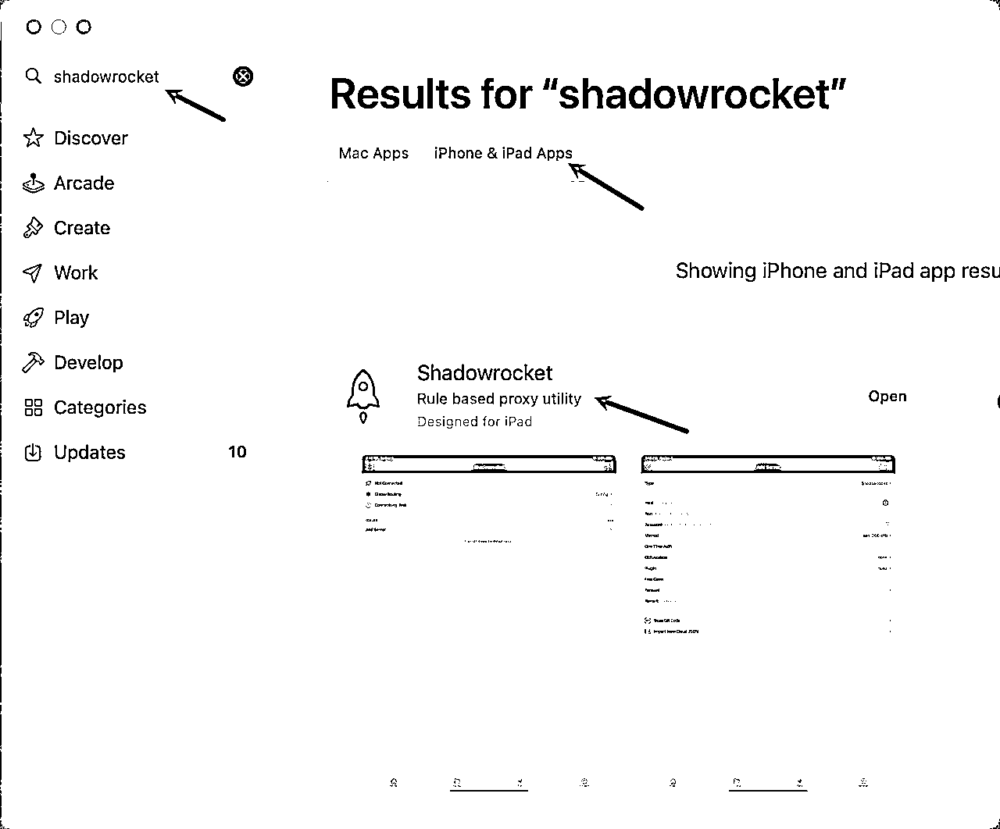

# 方法三：直接终端网络配置，clash 软件一般都有“拷贝终端命令”，粘贴到终端

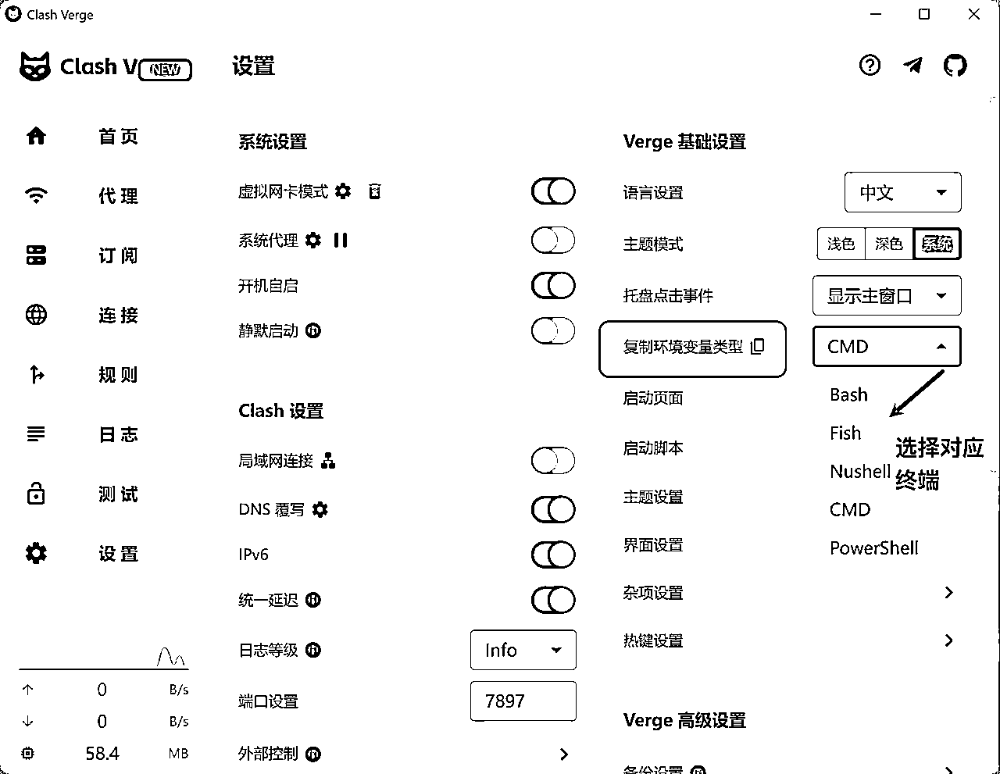

下面以 windows 的 CMD 窗口为例，复制之后 ```
set http_proxy=http://127.0.0.1:7897
set https_proxy=http://127.0.0.1:7897
``` 打开 CMD 窗口，把内容粘贴进去 

# 方法四：直接修改 claude code 文件(端口是你 clash 客户端配置的端口)

进到 claude code 的配置目录，文件路径如下（若目录或文件不存在，手动建一个）：

macOS/Linux: ~/.claude/settings.json

Windows: C:\Users\[username]\.claude\settings.json

提醒：下面的 7897 只是示例端口，实际填你🪜软件里配置的那个，未必和我的相同。```
{
  "env": {       
     "HTTP_PROXY": "http://127.0.0.1:7897",
     "HTTPS_PROXY": "http://127.0.0.1:7897"
   }
}
```

等上面这些网络问题都处理完毕，就可以用 Anthropic 官方账号登录 Claude Code 了。

1. (新手勿入)登录 ClaudeCode 官方账号流程

# 1.终端登录ClaudeCode

若是出现下图这种状况，仍旧是网络没通，请回到 3.1 / 3.2 排查。

# 1.1 第一步：配置主题

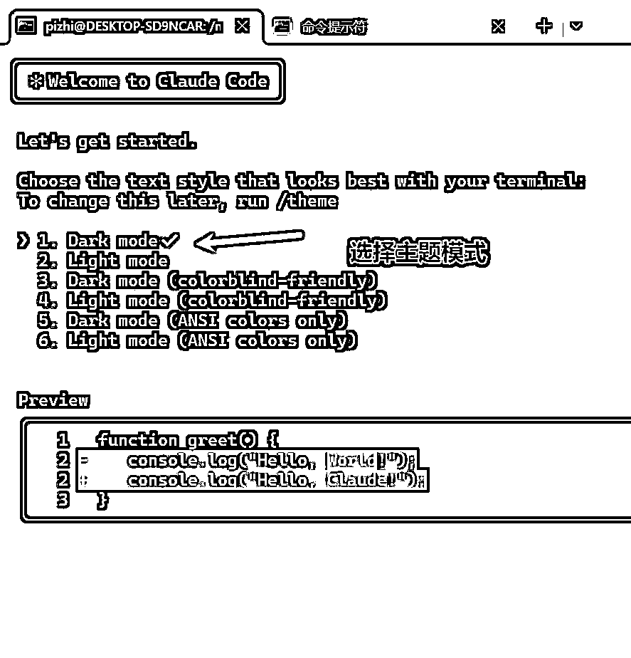

# 1.2 第二步：登录设置

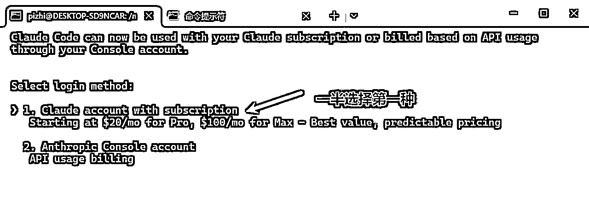

# 1.3 第三步：然后出现下面的有个链接，复制

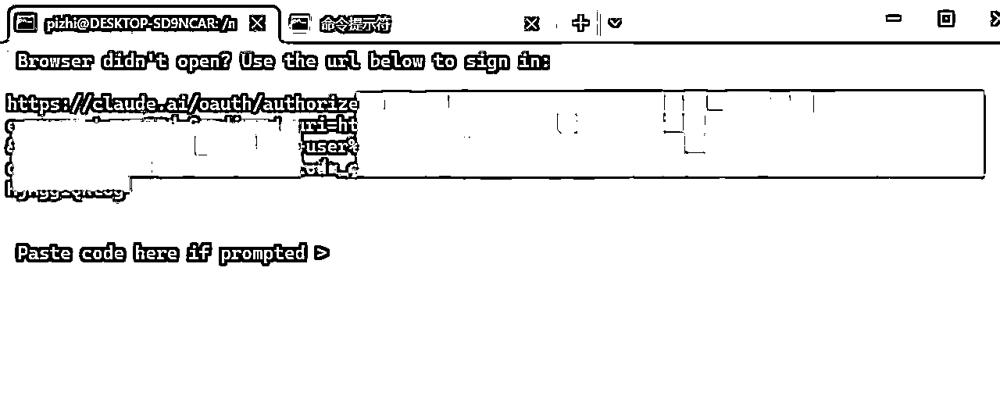

# 1.4 第四步：浏览器里面打开

填上邮箱，选择密码登录方式，继续。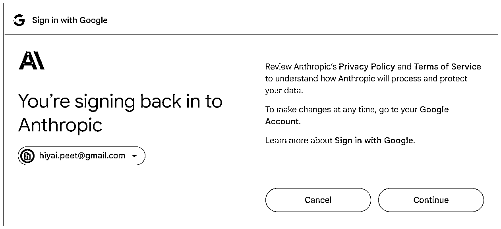

# 1.5 第五步：授权

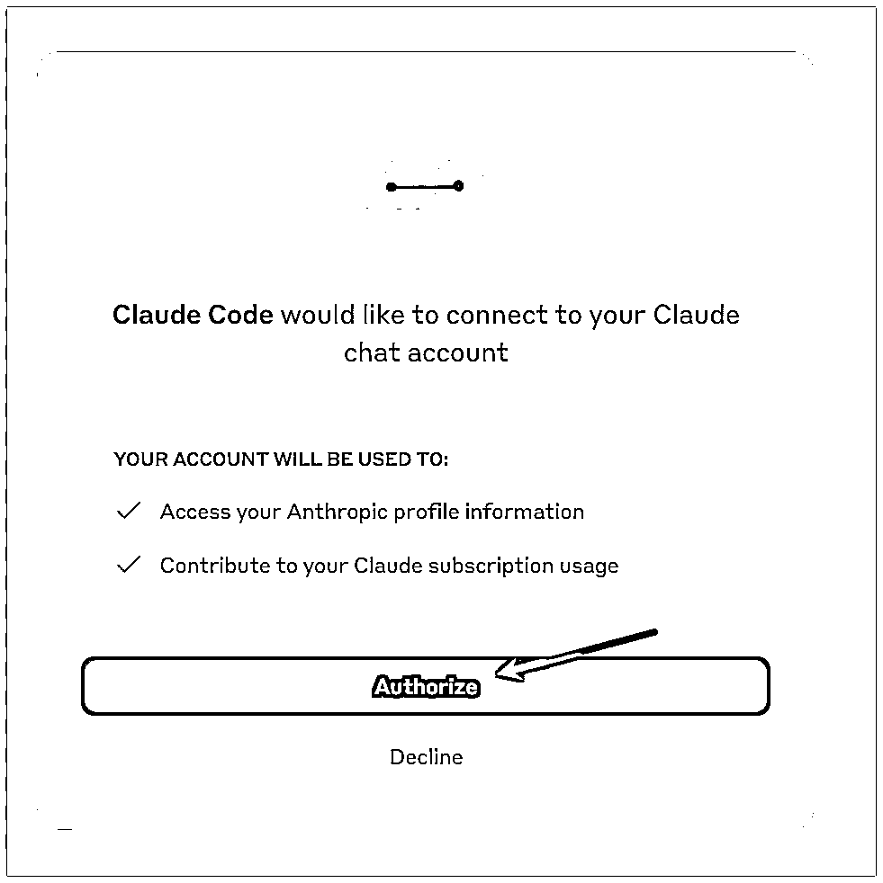

拷贝

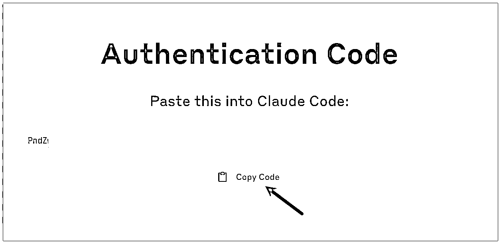

# 1.6 第六步：右键粘贴

粘贴好内容，回车确认。至此就能顺畅使用 Claude 了。

1. Claude code 使用模式

# 本章概要

安装与配置都已收尾，接下来该进入使用环节了。

不少人刚碰 AI 编程工具时，往往卡在“不会提问”上，结果 AI 给出的回答总是差强人意。本章想解决的就是这个问题——把最核心、最落地的操作技巧教给你。

我们会一起过一遍与 Claude Code 协作的几项关键能力，帮助你稳定拿到想要的结果：

基础入门操作：Claude Code 插件的安装、与 VSCode 的对接，以及自动编辑、规划、Yolo 这几种工作模式怎么用。

日常高频操作：日常写代码最常用的几招，包括指定文件、粘贴图片、常用命令、记忆文件管理、恢复对话等。

高级功能与配置：更深一层的玩法，比如用“深度思考”攻克复杂问题、借 Git 找回代码、查看用量、切换模型、后台运行服务等。

这些基本功练熟之后，这个工具就能为你所用，下一章更复杂的实战也能从容应对。

准备好了吗？咱们正式进入 Claude Code 的高效使用。

# 本章航线图

学完并动手做完本节，航线图第一阶段第 4 部分就算打勾了。

第一阶段：快速上手 Claude Code（约 1 天）

.

掌握Claude Code 基本使用技能（约 1 天）


如果前面已经把 API key 弄好了，接下来就能走进 claude code 的实际使用。它的主战场就是终端，套路都差不多，跟着手册一步步来即可。

# 开始使用

方式很简单——在终端里直接打开。

动手之前，建议先建一个【项目目录】。举个例子，找到你平时放代码的 codes 目录，在里面新建一个 yanshi-0904 文件夹。

# windows

windows 下有两条路，按自己的系统版本挑一条即可。

# 方式一：右键打开终端

系统：win11

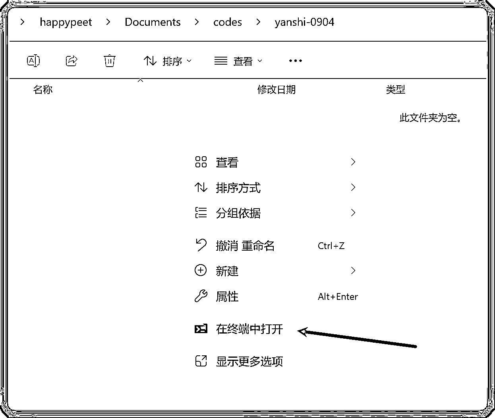

# 方式二：资源管理器的地址栏

系统：win10

在资源管理器的地址栏打上 cmd 三个字母，敲回车，窗口就出来了。


# mac

苹果电脑用户如果对终端命令不熟，其实操作和 windows 一样，也是右键进入终端。


要是右键菜单里没有“进入终端”这一项，装个右键助手软件就行。


# 启动claude

非常简单，在终端里输入下面这个词，claude 就跑起来了。

```
claude
```

文字版看不明白的话，下方视频链接可以对照着学：视频学习

# 其他方式：和 IDE 结合

有些人对终端始终不太适应，那就改用 vscode 插件。

强烈建议通过 claudecode 插件来启动 claudecode。

# 步骤一：首先需要安装插件

在 VSCode 插件市场里搜 Claude Code，认准 Anthropic 官方出品的那一个。

点「install」即可完成安装。

# 步骤二：打开 Claude Code

方法一：快捷键 Cmd+Escape，我这边不太好使，各位可以自行尝试。

方法二：直接点 Cursor 界面里的那个图标，单击即可。


点一下图标


右边那一块，就是 ClaudeCode 的工作区了。


# 步骤三：将Claude Code连接IDE

在已启动的 Claude Code 里输入 /ide 命令，把编辑器和它连起来。敲 /ide 后回车。


随后用方向键选中你当前使用的编辑器，回车确认。


连接成功后，对话框右下角会亮起一盏绿色小圆点。


这时你在 IDE 里选中文件或划词，cc 都能直接读取。


先小结一下：前面这些步骤走完，一个阶段就算完成了。下一阶段的核心就是练技能、做项目。

先动手鼓捣个粗糙的小东西出来，胆子大一点，边做边学。

干中学。

# 02.基础入门操作

# 1. 自动编辑模式

什么时候用：不想每次建文件都被询问确认。

怎么开：shift+tab 按一下即进入该模式。（windows 下改用 alt+m 切换模式）

# 2. plan 模式

roocode，cline，Cursor（ask）

什么时候用：项目前期做规划，或者遇到疑难杂症时。

怎么开：shift+tab 按两下即可看到（windows 电脑用 alt+m）。

举例：

```
我想写一个像素风格的todolist，我需要移动端也可以使用，帮我规划下方案
```


开始思考方案：


最后的结果如下：


会给出三个选项：

1：自动进入编辑模式，直接按计划开工写代码

2：手动模式，每一步由你确认

3：继续讨论方案，如果你觉得方向不对，就选它接着聊

# 3. yolo 模式

什么时候用：重构代码、启动新项目、修 bug 等。

怎么开：

```
 claude --dangerously-skip-permissions
```

进入后会看到下面的界面

当然，进来以后仍可调整，shift+tab 快捷键就能切换。

# 03.日常高频操作

1. 精准点名文件

什么时候用：需要针对某个具体文件动手时。

怎么用：@ 符号直接点名文件，和 Cursor 的做法一致。


1. 往对话里贴图

什么时候用：调整页面结构，或排查报错。

# 2.1 在 mac 上贴图

怎么用：mac 上用 control+v 贴图；也可以把图片文件直接拖进终端。

mac 终端贴完图长这样。

注意按的是 control 键，不是 command 键（1.0.80 之后的 cc 版本已支持 command+V 贴图）。

# 2.2 在 windows 上贴图

1.0.93 以上版本已经支持直接贴图了。

windows 快捷键：alt + v。

下面这些方法用不上了，可以略过。

# 方法一：保存截图图片文件，然后拷贝文件路径，直接粘贴到终端。

全平台通用，只是多了一步保存文件的操作。

# 方法二：使用插件方式

如果不想存图，那就得靠插件，而且只能配合 vscode 插件使用。

安装插件

vscode 安装：

在 vscode 插件市场直接搜索：claude-image-paste


Cursor 安装：（与上面 vscode 二选一即可）

插件离线地址：https://marketplace.visualstudio.com/items?itemName=agg4code.claude-image-paste

也可以下载离线安装包，再到 Cursor 里离线安装（按 ctrl+shifp+p，选 install vsix 即可）。

下一步选择：


确认已经安装成功

# Claude Code 实战指南：从截图到四个落地项目


先用截图工具截取所需内容，微信或 QQ 的截图就能满足需要。截好之后，进入 VSCode，按 Ctrl+Shift+P 打开命令面板，输入“paste Image”，记得选红框中的那一项。接下来会弹出一张图片，直接回车，终端里就能看到图片了。

如果遇到“无法复制的错误”，请先打开 VSCode 的终端，再执行复制粘贴操作即可。

1. 常用命令

这里整理了一组使用频率较高的命令，方便随时查阅。

| 指令 | 含义 | 什么时候用 |
| --- | --- | --- |
| /clear | 清空上下文 | 想重新开始，或感觉 AI 已经解决不了问题 |
| /compact | 压缩对话 | 想开新对话，又不想丢之前的记忆 |
| /cost | 花费 | Max 用户不用管；API 用户可查看 |
| /logout /login | 登录 / 登出 | 切换账号等场景 |
| /model | 切换模型 | 200刀/100刀套餐可切到 Opus；20刀套餐无此选项 |
| /status | 状态 | 查看当前 Claude Code 状态 |
| /doctor | 检测 | 检查 Claude Code 的安装状态 |

1. 记忆文件

# 4.1 全局记忆文件

目录：`~/.claude/CLAUDE.md`

下面是我使用的文件内容：```
# 所有交互回答都使用中文

# 启动并行的代理执行任务

# 搜索约定
- 如需简单字符串匹配 → Grep
- 如需结构化/跨语言模式匹配 → 请优先使用 Bash(ast-grep …)，示例：
  Bash(ast-grep -p '$FUNC($ARG)' src/)

# 环境约定
- python环境：python3 pip3
- nodejs环境：node npm
- docker环境：docker%
```

# 4.2 项目记忆文件

目录：项目目录下的 `CLAUDE.md` 文件

如果项目已经有代码，建议用 `/init` 命令自动生成。

1. 使用前面的消息提示词

想恢复之前的某次对话？连按两次 Esc 键就可以了。 在出现的候选项中选择第 3 项，就能回到之前的对话框。如果原来的提示词不理想，也可以在这个基础上继续调整。

1. 恢复对话 / 查看聊天记录

需要继续上次的对话或回看聊天记录时，可以用 `/resume` 命令；也可以在启动 Claude Code 时使用 `claude -c` 直接继续上一次会话，或使用 `claude -r` 从历史中挑选某次对话来启动。

1. 执行终端命令

想查看当前目录，或者执行一些特殊命令时，在输入框里先输入英文感叹号 `!`，就会进入命令行模式。

# 04.高级功能与配置

1. 深度思考

遇到疑难杂症、要做方案规划、重构代码或排查复杂 Bug 时，可以在提示词里放上“ultrathink”或“深度思考”等关键词来触发深度思考。

1. 如何恢复代码

类似 Cursor 的 checkpoint 功能。当你不想用 AI 刚写的代码、想回到之前某个版本时，不建议直接通过提示词去“回滚”。更稳妥的做法是借助 git：每次提交一个记录，再配合自定义的 commands 命令，就能用 git 做精确回滚。这部分还在完善中。

1. 监控使用量

先安装相关命令：```
npm install -g ccusage
```。要监控从某一天开始的使用量，可参考下面这些操作：```
ccusage --daily --since 20250801
```；实时采集量的命令如下：```
ccusage blocks --live
```。

1. 模型切换

通过 `/model` 命令就能切换模型。100 刀套餐建议用 Opus Plan Mode，20 刀套餐则用 Sonnet 更合适；如果你买的是 200 刀套餐，那就可以全程 Opus 放开来用。

1. 后台运行服务

通常在开发完一个功能后，Claude Code 会启动一个本地服务，方便你访问接口或界面。如果没有后台运行的能力，它就会一直停留在启动服务的界面，导致你没法继续其他对话。 所以尽量让服务在后台运行，Claude Code 一般也会提示你用 Ctrl+B 来转入后台。 按下 Ctrl+B 后会切换到下一个界面，并提示用下方向键选中进程查看详情。 进去以后可以看到运行的命令，选择你要进入的那一条，就能查看该命令的输出详情了。

1. 其他调试命令参数

再补充几个常用的 Claude 命令参数，直接在终端里跟着 `claude` 后面输入即可。

- `claude --help` ```
claude --help
``` 查看帮助信息，了解具体用法。
- `claude --version` ```
claude --version
``` 查看版本号。
- `claude doctor` ```
claude doctor
``` 显示 Claude Code 的安装信息，以及 CLAUDE.md 记忆文件和 subagent 的配置。
- `claude mcp` ```
claude mcp list
``` 查看各个 MCP 的连接状态，正常时显示 Connected。```
claude mcp --help
```
- `claude config` ```
claude config --help
``` 查看配置列表。```
Claude config list
```

1.  【效率工具篇】开发基础前端页面

# 1. 本章概要

上一章我们只是熟悉了 Claude Code 的基础操作，到这一章就要真正下水游一游了。这里会把之前学到的各种零散功能串起来，放进真实具体的开发任务中去用。毕竟，只有解决实际问题，才能真正掌握工具的用法。

下面是我们会一起完成的几个典型场景：
- 用 Claude Code 做图片压缩工具
- 用 Claude Code 做精美个人卡片简介
- 用 Claude Code 做英语背单词工具
- 用 Claude Code 做飞书收藏的浏览器插件

经过这些实操，你不只是机械地敲命令，而是会逐步建立一套与 AI 协作的工作流，这也是今后开发效率大幅提升的关键。准备好了就开始动手吧。

# 本章航线图

完成这一章的学习和实操，就能走完航线图的第二阶段。

第一阶段：掌握 Claude Code 基础实操场景（约 7 天）
- 用 Claude Code 做图片压缩工具（约 1.5 天）
- 用 Claude Code 做精美个人卡片简介（约 1.5 天）
- 用 Claude Code 做英语背单词工具（约 2 天）
- 用 Claude Code 做飞书收藏浏览器插件（约 2 天）


# 2. 用Claude Code做一个图片压缩工具

场景描述：做一个网页版图片压缩工具，实现纯前端的图片压缩能力。

补充一点：有用户想要提取 PDF 里的内容，Claude Code 目前直接处理 PDF 的能力有限，但你可以引导它写个脚本，去调用 pdf-parse 之类的第三方库，这样也能实现对 PDF 内容的提取和分析。

核心价值：学会用命令指挥 Claude Code 干活，同时学会通过组合外部工具来扩展它的能力。

操作步骤如下：
1. 在电脑上新建一个文件夹，然后打开终端（Windows 系统可以直接在文件夹的地址栏输入 CMD 并回车）。
2. 在终端里输入 `claude`，启动 Claude Code（前提是已经完成了之前的配置），选择“1.Yes, proceed”。本案例是通过 Kimi2 API 来使用 Claude Code 的。
3. 和 Claude Code 说话时，把需求讲得越具体越好。这里我们先用 GPT 把需求聊清楚，再把下面这段要求直接粘到对话框里发给 Claude Code。

项目目标：做一个不需要后端的纯前端图片压缩工具，能够对 JPEG/PNG/WebP/AVIF 图片做质量压缩和等比缩放；支持拖拽或点选上传、多张图一起处理；提供压缩前后的预览对比，显示体积变化和压缩率；下载时可以一张张保存，也可以整体打成 ZIP 包。

运行环境：兼容 Chrome、Edge、Safari 等现代浏览器，也要适配移动端。

约束条件：
- 所有操作必须在本地完成，图片不能上传网络；
- 默认清除 EXIF 等元数据，但要自动纠正照片的方向；
- 允许设置最大宽高，以及 0 到 1 之间的质量参数；
- 处理大图时要用 Web Worker，别让主线程卡住；
- 最终要生成一个能直接在 StackBlitz 打开的项目，或者单文件版 index.html。

验收标准：打开页面就能直接用；拖入 10 张 4000×3000 的 JPG，把它们压缩到 2000px、质量设为 0.8，页面不卡死，并能成功导出；每张图都要展示压缩前后的尺寸、体积和压缩率。

代码风格：使用 TypeScript，搭配原生实现或轻量依赖。建议用 JSZip 打包，如果追求更好压缩效果可以选 Squoosh/wasm 编解码器，但第一版先做 MVP。

UI 要求：界面简洁，支持暗色/浅色自动适配；步骤和按钮要清楚；错误提示和进度要可见。


命令贴上去之后，界面可能显示不全，不过没关系，实际内容已经完整发送过去了。

Claude Code 创建了一个网页文件，并询问是否创建 index.html。这里选择“2. Yes, for this session only”即可。 过程中它会规划 todo 任务并逐个执行（截图只是示例，实际任务不一定一样）。 直到所有任务都完成，它才会汇报结果。 我们打开 index.html 实际测试了一下，压缩功能可以正常使用。

总结：
- 跟 Claude Code 沟通时，尽量把需求讲清楚；如果自己还不太明确，可以先找 GPT、Gemini、Kimi 这类模型把需求聊透，再交给 Claude Code 一次性执行，效果更好。
- 通过 Kimi API 使用 Claude Code 时，整体运行速度会偏慢，这和 API 的吞吐速度有关；充值可以提升 Kimi API 的吞吐速度。


# 3. 用Claude Code做一个精美个人卡片简介

第一步：在你自定义的某个磁盘下新建一个 `card-test` 文件夹。
第二步：在文件夹上右键，打开终端。
第三步：运行 Claude。
第四步：输入你的需求。

如果运行过程中出现 API 错误，不用慌张。在 TUI 里输入“继续”，系统就会重新处理。

第五步：按照提示完成选择。当看到成功提示的界面时，说明程序已经写好了。接下来去本地目录按提示操作，打开 html 文件就可以继续调整。 实际效果是这样的：

当然，任何程序几乎不可能一次搞定。你需要不断跟 AI 对话，把不满意或需要修改的点说出来，反复打磨，最终才能得到一件完整的作品。另外，我们这个案例相对简单，代码仅供参考。相关的案例文件我已经放到夸克网盘，点击链接或复制整段内容，打开「夸克APP」即可获取。
/~32b6386Bt8~:/
链接：https://pan.quark.cn/s/8f49d4c75bc2
 card-test.zip

当然，这是一个最简单不过的 Web 静态应用。如果你以后要做的是给别人用、甚至上线成企业级产品的网站，那提示词就不会这么简单了。

# 4. Claude Code 做一个英语背单词工具

效果展示： Screen Recording 2025-08-21 at 13.11.58.mov【在线播放】

# 步骤一：聊需求

这里我用的是 ChatGPT 客户端来聊需求。做法很简单：把你想做的事和你的要求一条条罗列清楚。```
我想做一个背单词的网页应用工具，这个工具网站面向的是高考学生的群体，

目的：避免枯燥无味的背单词，想有趣的方式去背单词，并且有测试的流程，这个流程会有些挑战，但是也不能让别人太灰心。

帮我想下这个系统的 prd 方案。
``` 如果一轮聊不清楚，那就多聊几轮。 再补一轮，直到需求明确。

完整的 PRD 文件我放到夸克网盘，点击链接或复制整段内容，打开「夸克APP」即可获取。
/~32b6386Bt8~:/
链接：https://pan.quark.cn/s/8f49d4c75bc2
 funwords_prd.md

完整的对话过程可以看这个分享：https://chatgpt.com/share/68a6a3f4-44e8-8001-a2fa-35c8cd2d90dd 后续还有一些其他内容，忽略就好。需求确认没问题，就可以进入开发了。

# 步骤二：ClaudeCode 开发

第一步：新建项目目录。在某个目录下创建你的项目目录，我这里命名为 `word-game`。
第二步：右键使用终端打开，同时把前面整理好的 PRD 文档也粘贴过来。如果你的右键菜单里没有“通过终端打开”，可以安装一个「iRightMouse」。
第三步：进入开发。直接输入 `claude` 进入交互式对话。```
@funwords_prd.md 根据需求文档完成这个系统功能  
``` 注意输入 `@` 时一定要根据你的实际文件名选择提示项。 下面就是正式开发的画面：

功能完成后： 它还很友好地告诉你接下来可以扩展哪些功能。

# 步骤三：错误修正

在浏览器里访问的时候，可能会遇到报错。我当时的做法是直接截图修复：把错误截图截下来，粘贴到对话框里，然后回车。Claude Code 会自动识别问题并尝试解决。错误时的截图这里就不放出来了。

以上是本篇的全部内容，希望对你的 Claude Code 使用之旅有所帮助。


# 步骤四：上线！体验入口放这了

我部署好的线上地址：https://funwords-app.vercel.app/
国内打开可能得配合代理工具。

```
部署到vercel上怎么做了？
```

接下来，生成部署脚本这件事会由它接手。


先把这轮重点汇总一下：


# 02.【浏览器插件篇】让 AI 帮我管收藏

# 1. 背景：收藏夹缺个备注栏

灵感来自一个很具体的麻烦：Chrome 收藏夹保存的只有页面标题和链接，想补说明、写注解，几乎没地方放，于是动手做了这个小插件。

它负责把收藏同步到飞书多维表格，之后随时能打开；后续还能继续加工、贴标签、补备注。

先看一眼成品外观：


# 2. 开发路径

最初那版需求已经找不到了；真正动手时，把想法跟 ClaudeCode 聊明白就够。

下面放上我第一版 CLAUDE.md 记忆文件，可拿来当需求样例：

```
# CLAUDE.md

This file provides guidance to Claude Code (claude.ai/code) when working with code in this repository.

## 项目概述

这是一个Chrome浏览器扩展，用于将网页URL快速保存到飞书多维表格。扩展使用Manifest V3规范，通过飞书开放API与多维表格交互。

## 架构说明

### 核心组件
- **background.js**: Service Worker，处理所有飞书API调用，包括获取访问令牌和添加记录到多维表格
- **popup.html/js**: 用户交互界面，收集网页信息和用户输入
- **options.html/js**: 配置页面，用于设置飞书应用凭据和表格URL

### 数据流
1\. 用户在popup中填写信息并点击保存
2\. popup.js发送消息到background.js
3\. background.js调用飞书API获取访问令牌
4\. 使用令牌将数据写入指定的多维表格

### 飞书API集成
- 使用tenant_access_token内部应用认证方式
- API基础URL: `https://open.feishu.cn/open-apis`
- 主要接口：
  - `/auth/v3/tenant_access_token/internal` - 获取访问令牌
  - `/bitable/v1/apps/{appToken}/tables` - 获取表格列表
  - `/bitable/v1/apps/{appToken}/tables/{tableId}/fields?view_id={viewId}` - 获取字段信息
  - `/bitable/v1/apps/{appToken}/tables/{tableId}/records` - 添加记录
  - `/bitable/v1/apps/{appToken}/tables/{tableId}/fields/{fieldId}?view_id={viewId}` - 更新字段选项

### 重要更新（API调用修复）
- 飞书多维表格需要区分app token、table ID和view ID
- 用户现在需要输入完整的表格URL（如：https://xxx.feishu.cn/base/B3cibQKgVaqBcTsxj10cMoSMnXS?table=tblRlS0ozOVJTcKR&view=vewkJwjXGm）
- background.js中的`parseTableUrl`函数会解析URL提取app token、table ID和view ID
- view ID用于获取字段信息时的正确配置
- 如果URL中没有table参数，会自动获取第一个表格

### 权限配置要点
1\. **应用权限**：必须添加"查看、评论、编辑和管理多维表格"权限
2\. **应用发布**：自建应用需要发布到企业内才能使用
3\. **表格权限**：必须将多维表格分享给应用，并设置"可编辑"权限

### 错误代码处理
- **91402 (NOTEXIST)**：表格不存在或无权限访问
- **91403 (Forbidden)**：权限不足，需要检查应用权限和表格分享设置
- **1254043**：字段名称不匹配
- **1254060 (TextFieldConvFail)**：文本字段转换失败
- **1254061 (HyperlinkFieldConvFail)**：超链接字段转换失败
- **1254062 (SingleSelectFieldConvFail)**：单选字段转换失败
- **1254064 (DatetimeFieldConvFail)**：日期时间字段转换失败

### 存储结构
使用Chrome Storage API存储配置：
- appId: 飞书应用ID
- appSecret: 飞书应用密钥
- tableUrl: 多维表格完整URL（替代原来的tableId）

### 多维表格字段映射
- 网站地址 → URL（超链接格式：{text: url, link: url}）
- 网站的中文说明 → 用户输入的描述（文本格式）
- 网站的备注 → 用户输入的备注（多行文本格式）
- 网站的标签 → 用户输入的标签（单选格式：直接使用选项名称字符串）
- 创建时间 → 时间戳（日期时间格式）

**注意**: 所有字段名称与多维表格中的实际字段名称保持完全一致。

## 开发说明

### 调试扩展
1\. 在Chrome中打开 `chrome://extensions/`
2\. 开启开发者模式
3\. 点击"加载已解压的扩展程序"选择项目目录
4\. 使用Chrome开发者工具调试：
   - Service Worker: 在扩展管理页面点击"检查视图"下的"Service Worker"
   - Popup: 右键点击扩展图标选择"检查弹出式窗口"

### 测试API连接
options.js中包含测试连接功能，会验证：
1\. App ID和App Secret是否正确（能否获取访问令牌）
2\. 表格URL是否有效（能否访问表格）

### 调试日志
background.js中添加了详细的日志输出，包括：
- App ID和Token信息
- URL解析结果
- API请求和响应
- 错误详情

### 新功能：URL唯一性检查和覆盖更新 (2024-06-16)

#### 功能概述
实现了"网站地址"作为唯一键的功能，在保存URL前会检查是否已存在相同的网址：
- 如果URL不存在，直接保存
- 如果URL已存在，显示确认对话框让用户选择：
  - 覆盖更新现有记录
  - 取消操作

#### 实现细节

**后端API扩展：**
- `record-manager.js`：增加了`updateUrlRecord`方法用于更新现有记录
- `record-manager.js`：改进了`checkUrlExists`方法，返回更详细的记录信息
- `background-new.js`：增加了`handleUpdateUrl`方法处理UPDATE_URL消息
- `common.js`：增加了`UPDATE_URL`消息类型

**前端UI改进：**
- `popup-new.html`：增加了确认对话框HTML结构
- `popup-new.css`：增加了确认对话框样式（包含暗色模式支持）
- `popup-new.js`：增加了URL存在性检查逻辑和确认对话框处理

**用户体验：**
- 在确认对话框中显示现有记录的详细信息（网站地址、网站的中文说明、网站的备注、网站的标签、创建时间）
- 提供清晰的"覆盖更新"和"取消"按钮
- 保持与原有UI风格一致的设计
- 所有字段名称与多维表格中的实际字段名称完全一致

#### 测试建议
1\. 尝试保存一个新的URL，应该直接保存成功
2\. 尝试保存相同的URL，应该弹出确认对话框
3\. 在确认对话框中选择"覆盖更新"，应该更新现有记录
4\. 在确认对话框中选择"取消"，应该返回编辑页面
5\. 确认对话框应该显示现有记录的完整信息

### 注意事项
- Manifest V3中background script改为service worker，不能使用持久连接
- 所有飞书API调用都需要在manifest.json的host_permissions中声明
- 异步消息响应需要返回true以保持消息通道开放
- 确保Authorization header格式正确：`Bearer ${accessToken}`
- URL检查使用"网站地址"字段名进行查询，确保与表格字段名称一致
```

末尾附上 Git 提交版本：


# 3. 加载插件与浏览器调试

构建收尾通常会产出 dist 文件夹。

我这次多套了一层，不影响；载入时往里多点一层即可。


接着启动 Chrome。


务必打开开发模式。


左侧会出现三个按钮，点“选择目录”；插件就会出现在区域中，列表里有，浏览器工具栏也能找到。


# 4. 排错实操

打开 service worker 后会弹出窗口。


联调阶段可以让 ClaudeCode 输出日志，内容会落在下方 Console 面板；遇到报错，把日志复制进它的聊天框即可。


若是网络请求出问题，切到 Network 面板查看。


这部分需要一点前端和网络基础；新手别硬来，熟手继续往下看。

# 01. 界面改造与命令扩展

# 1. StatusLine 状态条


# 第一步：30 秒跑通

最省事的法子：在 ClaudeCode 输入框中敲：

```
/statusline 显示模型名称、当前目录和git分支
```

没错，真就这么省事，配置由 Claude 自己完成。

从反馈看，它借助内置的 statusline-setup 子代理完成处理。官方也用子代理案例扩展能力，详情可看我早前文章。

关闭再启动 Claude Code，可看到下图效果：


# 第二步：进阶自定义

想要更炫一点，就得手动来。

步骤一：先建配置文件。在终端里编辑：

```
vim ~/.claude/settings.json
```

步骤二：写入状态栏相关配置。

```
{
  "statusLine": {
    "type": "command",
    "command": "~/.claude/statusline.sh"
  }
}
```

步骤三：写自己的脚本。新建 ~/.claude/statusline.sh：

```
#!/bin/bash
input=$(cat)

# 获取各种信息
model=$(echo "$input" | jq -r '.model.display_name')
dir=$(echo "$input" | jq -r '.workspace.current_dir' | xargs basename)

# Git分支信息
git_branch=""
if git rev-parse --is-inside-work-tree >/dev/null 2>&1; then
    branch=$(git branch --show-current)
    git_branch=" | 🌿 $branch"
fi

# 组装输出
echo "🤖 $model | 📁 $dir$git_branch | ⏰ $(date +%H:%M)"
```

记得赋予执行权限：

```
chmod +x ~/.claude/statusline.sh
```

看，顶部状态条立刻换了样子。

# 第三步：再玩点高级花样

📊 看消费统计

想了解自己花了多少（哈哈），可接入 ccusage 工具：

```
# 显示当前会话成本
{
  "statusLine": {
    "type": "command",
    "command": "npx -y ccusage statusline",
  }
}
```


🌿 Git 高手（团队协作利器）

适合常与 Git 打交道的团队成员。新建 ~/.claude/statusline-git.sh：

```
#!/bin/bash
read INPUT

# 解析输入
MODEL=$(echo "$INPUT" | jq -r '.model.display_name')
DIR=$(echo "$INPUT" | jq -r '.workspace.current_dir' | sed "s|$HOME|~|")

# Git 信息（全网首发的完整版）
BRANCH=$(git branch --show-current 2>/dev/null || echo "")
if [ -n "$BRANCH" ]; then
    # 获取状态
    MODIFIED=$(git status --porcelain 2>/dev/null | grep -c "^ M")
    UNTRACKED=$(git status --porcelain 2>/dev/null | grep -c "^??")
    STAGED=$(git status --porcelain 2>/dev/null | grep -c "^[AM]")

    # 获取远程状态
    AHEAD=$(git rev-list --count HEAD @{u} 2>/dev/null | cut -f1)
    BEHIND=$(git rev-list --count @{u} HEAD 2>/dev/null | cut -f1)

    # 构建 Git 状态字符串
    GIT_STATUS="🌿 $BRANCH"
    [ "$STAGED" -gt 0 ] && GIT_STATUS="$GIT_STATUS +$STAGED"
    [ "$MODIFIED" -gt 0 ] && GIT_STATUS="$GIT_STATUS ~$MODIFIED"
    [ "$UNTRACKED" -gt 0 ] && GIT_STATUS="$GIT_STATUS ?$UNTRACKED"
    [ "$AHEAD" -gt 0 ] && GIT_STATUS="$GIT_STATUS ↑$AHEAD"
    [ "$BEHIND" -gt 0 ] && GIT_STATUS="$GIT_STATUS ↓$BEHIND"
else
    GIT_STATUS="📁 no-git"
fi

# 输出带颜色
echo -e "\033[1;36m🤖 $MODEL\033[0m │ \033[1;33m📂 $DIR\033[0m │ \033[1;32m$GIT_STATUS\033[0m"
```


# 更多趣味玩法

资源实时监控：

```
# 显示内存使用
mem=$(free -h | awk '/^Mem:/ {print $3"/"$2}')
echo "💾 $mem | $model | $dir"
```

按时间换表情：

```
hour=$(date +%H)
if [ $hour -lt 12 ]; then
    emoji="☀️"
elif [ $hour -lt 18 ]; then
    emoji="🌤️"
else
    emoji="🌙"
fi

echo "$emoji $(date +%H:%M) | $model | $dir"
```

几个提醒：

性能优化：脚本里别放耗时任务，否则会卡。

测试脚本：可这样验证：

```
echo '{"model":{"display_name":"Test"}}' | ./statusline.sh
```

设完即生效，无需重启 Claude Code。

# 实战案例

# 案例一：显示 token 用量

```
#!/bin/bash

# 读取输入
input=$(cat)

# 解析基础信息
model=$(echo "$input" | jq -r '.model.display_name')
current_dir=$(echo "$input" | jq -r '.workspace.current_dir')
dir_name=$(basename "$current_dir")
session_id=$(echo "$input" | jq -r '.session.id // empty' | cut -c1-6)
if [ -z "$session_id" ]; then
    # 如果没有session_id，使用目录名作为fallback
    session_id=$(echo "$current_dir" | sed 's/\//_/g')
fi

# 时间表情
hour=$(date +%H)
if [ $hour -lt 6 ]; then
    time_emoji="🌙"
elif [ $hour -lt 12 ]; then
    time_emoji="☀️"
elif [ $hour -lt 18 ]; then
    time_emoji="🌤️"
elif [ $hour -lt 22 ]; then
    time_emoji="🌆"
else
    time_emoji="🌙"
fi

# 时间追踪
START_FILE="/tmp/claude_session_${session_id}"
if [ ! -f "$START_FILE" ]; then
    date +%s > "$START_FILE"
fi
START_TIME=$(cat "$START_FILE")
CURRENT_TIME=$(date +%s)
ELAPSED=$((CURRENT_TIME - START_TIME))
HOURS=$((ELAPSED / 3600))
MINUTES=$(((ELAPSED % 3600) / 60))
TIME_TRACK=$(printf "%02d:%02d" $HOURS $MINUTES)

# 获取 ccusage 费用信息
# 将输入传递给 ccusage statusline 并解析输出
ccusage_output=""
if command -v ccusage &> /dev/null; then
    ccusage_output=$(echo "$input" | ccusage statusline 2>/dev/null || echo "")
elif command -v npx &> /dev/null; then
    ccusage_output=$(echo "$input" | npx -y ccusage statusline 2>/dev/null || echo "")
elif command -v bun &> /dev/null; then
    ccusage_output=$(echo "$input" | bun x ccusage statusline 2>/dev/null || echo "")
fi

# 从 ccusage 输出中提取费用信息
if [ -n "$ccusage_output" ]; then
    # 提取 session 费用（例如：$0.23 session）
    session_cost=$(echo "$ccusage_output" | grep -oE '\$[0-9]+\.[0-9]+ session' | head -1)
    # 提取今日费用（例如：$1.23 today）
    daily_cost=$(echo "$ccusage_output" | grep -oE '\$[0-9]+\.[0-9]+ today' | head -1)
    # 提取燃烧率（例如：$0.12/hr）
    burn_rate=$(echo "$ccusage_output" | grep -oE '\$[0-9]+\.[0-9]+/hr' | head -1)
fi

# Git 信息
cd "$current_dir" 2>/dev/null
git_branch=$(git branch --show-current 2>/dev/null || echo "")
git_status=""
if [ -n "$git_branch" ]; then
    # 检查是否有未提交的更改
    if [ -n "$(git status --porcelain 2>/dev/null)" ]; then
        git_status="*"
    fi
    # 截断分支名（最多15个字符）
    git_branch=$(echo "$git_branch" | cut -c1-15)
fi

# 模型图标
case "$model" in
    *"Opus"*)
        model_emoji="🎭"
        ;;
    *"Sonnet"*)
        model_emoji="🎼"
        ;;
    *"Haiku"*)
        model_emoji="🍃"
        ;;
    *)
        model_emoji="🤖"
        ;;
esac

# 组装输出
output=""

# 时间和表情
output+="$time_emoji $(date +%H:%M)"

# 模型
output+=" | $model_emoji $model"

# 目录
output+=" | 📁 $dir_name"

# Git 分支和状态
if [ -n "$git_branch" ]; then
    output+=" | 🌿 $git_branch$git_status"
fi

# 时间追踪
output+=" | ⏱️ $TIME_TRACK"

# 费用信息（如果可用）
if [ -n "$session_cost" ] || [ -n "$daily_cost" ] || [ -n "$burn_rate" ]; then
    output+=" | 💰"
    [ -n "$session_cost" ] && output+=" $session_cost"
    [ -n "$daily_cost" ] && output+=" / $daily_cost"
    [ -n "$burn_rate" ] && output+=" | 🔥 $burn_rate"
fi

# 输出最终结果
echo "$output"
```

效果先看：再来一份文字版：

☀️ 08:16 | 🎭 Opus 4.1 | 📁 cc-demo | 🌿 master* | ⏱️ 00:03 | 💰 / $14.76 today | 🔥 $6.45/hr

够省心吧？关键信息全塞进一眼里。

# 案例二：股票也能这样看

今天要做的并不复杂，核心就是先写个脚本。这个脚本同样是 Claude Code 帮忙搞定的。

前提是去下面三个站点注册账号，各自拿到 key：

https://fixer.io

https://marketstack.com

https://www.alphavantage.co

接着把代码里对应位置换成自己的 key 即可。


代码中 your_api_key 一共出现三处，三处都得替换。

完整代码在下面：

```
#!/bin/bash

# Function to fetch stock price from Yahoo Finance API alternative
fetch_stock_price() {
    local symbol=$1
    local temp_file=$(mktemp)

    # Try Yahoo Finance first with proper headers and timeout
    curl -s --max-time 5 \
        -H "User-Agent: Mozilla/5.0 (Macintosh; Intel Mac OS X 10_15_7) AppleWebKit/537.36" \
        "https://query1.finance.yahoo.com/v8/finance/chart/${symbol}" \
        -o "$temp_file" 2>/dev/null

    if [ $? -eq 0 ] && [ -s "$temp_file" ]; then
        local price=$(cat "$temp_file" | jq -r '.chart.result[0].meta.regularMarketPrice // empty' 2>/dev/null)

        if [ -n "$price" ] && [ "$price" != "null" ]; then
            printf "%.2f" "$price"
            rm -f "$temp_file"
            return
        fi
    fi

    # Fallback to Alpha Vantage API
    rm -f "$temp_file"
    temp_file=$(mktemp)
    curl -s --max-time 5 \
        "https://www.alphavantage.co/query?function=GLOBAL_QUOTE&symbol=${symbol}&apikey=your_api_key" \
        -o "$temp_file" 2>/dev/null

    if [ $? -eq 0 ] && [ -s "$temp_file" ]; then
        local price=$(cat "$temp_file" | jq -r '."Global Quote"."05\. price" // empty' 2>/dev/null)
        if [ -n "$price" ] && [ "$price" != "null" ]; then
            printf "%.2f" "$price"
            rm -f "$temp_file"
            return
        fi
    fi

    # Final fallback to a simple financial API
    rm -f "$temp_file"
    temp_file=$(mktemp)
    curl -s --max-time 5 \
        "https://api.marketstack.com/v1/eod/latest?access_key=your_api_key&symbols=${symbol}" \
        -o "$temp_file" 2>/dev/null

    if [ $? -eq 0 ] && [ -s "$temp_file" ]; then
        local price=$(cat "$temp_file" | jq -r '.data[0].close // empty' 2>/dev/null)
        if [ -n "$price" ] && [ "$price" != "null" ]; then
            printf "%.2f" "$price"
            rm -f "$temp_file"
            return
        fi
    fi

    rm -f "$temp_file"
    echo "N/A"
}

# Function to format stock display
format_stock() {
    local symbol=$1
    local price=$2
    local icon=$3

    if [ "$price" = "N/A" ]; then
        echo "${icon} ${symbol}: N/A"
    else
        echo "${icon} ${symbol}: \$${price}"
    fi
}

# Function to fetch exchange rate
fetch_exchange_rate() {
    local from=$1
    local to=$2
    local temp_file=$(mktemp)

    # Try to fetch exchange rate
    curl -s --max-time 5 \
        "https://api.exchangerate-api.com/v4/latest/${from}" \
        -o "$temp_file" 2>/dev/null

    if [ $? -eq 0 ] && [ -s "$temp_file" ]; then
        local rate=$(cat "$temp_file" | jq -r ".rates.${to} // empty" 2>/dev/null)
        if [ -n "$rate" ] && [ "$rate" != "null" ]; then
            printf "%.3f" "$rate"
            rm -f "$temp_file"
            return
        fi
    fi

    # Fallback API
    rm -f "$temp_file"
    temp_file=$(mktemp)
    curl -s --max-time 5 \
        "https://api.fixer.io/latest?base=${from}&symbols=${to}&access_key=your_api_key" \
        -o "$temp_file" 2>/dev/null

    if [ $? -eq 0 ] && [ -s "$temp_file" ]; then
        local rate=$(cat "$temp_file" | jq -r ".rates.${to} // empty" 2>/dev/null)
        if [ -n "$rate" ] && [ "$rate" != "null" ]; then
            printf "%.3f" "$rate"
            rm -f "$temp_file"
            return
        fi
    fi

    rm -f "$temp_file"
    echo "N/A"
}

# Main function to generate statusline
generate_statusline() {
    # Build statusline components
    local statusline=""

    # Add model and project info (customize as needed)
    statusline="🤖 Sonnet 4 | 📂 Sharptooth | 🌿 main"

    # Fetch AAPL stock price
    local aapl_price=$(fetch_stock_price "AAPL")
    local aapl_formatted=$(format_stock "AAPL" "$aapl_price" "🍎")
    statusline="${statusline} | ${aapl_formatted}"

    # Fetch TSLA stock price
    local tsla_price=$(fetch_stock_price "TSLA")
    local tsla_formatted=$(format_stock "TSLA" "$tsla_price" "🚗")
    statusline="${statusline} | ${tsla_formatted}"

    # Fetch currency exchange rate
    local exchange_rate=$(fetch_exchange_rate "AUD" "CNY")
    if [ "$exchange_rate" != "N/A" ]; then
        statusline="${statusline} | 💰 AUD/CNY: ${exchange_rate}"
    else
        statusline="${statusline} | 💰 AUD/CNY: N/A"
    fi

    echo "$statusline"
}

# Function to update statusline continuously
run_statusline() {
    while true; do
        clear
        generate_statusline
        sleep 60  # Update every minute
    done
}

# Check if running interactively or as a one-shot
if [ "$1" = "--loop" ]; then
    run_statusline
else
    generate_statusline
fi
```


跑出来的状态栏会显示：

🤖 Sonnet 4 | 📂 Sharptooth | 🌿 main | 🍎 AAPL: $227.18 | 🚗 TSLA: $339.03 | 💰 AUD/CNY: 4.686


# 1. SlashCommands：给高频操作建一条快车道

```
占用 primary agent 的上下文

subagent：和你的 primary agent 隔离，幻觉存在，独立的工作，不依赖过多的上下文信息
```

# 2.1 命令按作用域分两派

Claude Code 里的斜杠命令，先要分清它服务谁：

- 项目级命令（/project:）：文件放在项目内的 .claude/commands/ 文件夹中，换一个项目就失效。
- 用户级命令（/user:）：文件放在家目录下的 ~/.claude/commands/ 里，跨项目通用。

# 2.2 三步做出自己的命令

自己写一条命令，流程并不绕：

1. 先准备一个 .md 文件，放进上面说的对应位置。
2. 文件名直接决定斜杠后显示什么，例如 code-review.md 就对应 /project:code-review。
3. 文档正文写清楚这条命令要执行什么。

我拿 code-review.md 举个例子，里面写的是：

```
请对以下代码进行全面的代码审查：$ARGUMENTS
1\. 检查代码质量和最佳实践
2\. 识别潜在的 bug 和安全问题
3\. 提供改进建议
```

这里要盯住 $ARGUMENTS：它是一个参数坑位。调用 /code-review 时，后面跟上的代码内容会被填进这个位置。

# 2.3 内置命令清单

系统自带不少快捷入口，我按用途整理如下：

- /add-dir：把额外目录挂进当前会话。
- /clear：清掉聊天记录。
- /compact [instructions]：压缩上下文，还能点名要保留的重点。
- /config：查看或调整配置，设置项也走这里。
- /doctor：做环境自检与故障诊断。
- /login：登录账号。
- /logout：退出账号。
- /mcp：检查 MCP 的连接与配置。
- /memory：打开 CLAUDE.md 进行维护。
- /model：切换底层模型。
- /permissions：管理工具的白名单与黑名单。
- /status：查看账号与运行状态。
- /resume：接回之前的会话。
- /hooks：管理 Hook 规则。
- /vim：在普通输入与 Vim 键位之间切换。

# 2.4 值得关注的三个特性

# 第一个：参数注入

写命令时留下 $ARGUMENTS 这个坑位，调用时把具体内容填进去，命令就能处理动态输入。

```
# 定义
echo '根据代码规范解决问题： #$ARGUMENTS ' > .claude/commands/fix-issue.md

# 使用
> /project:fix-issue 123
```

# 第二个：调用命令行

在指令前放一个叹号 !，命令行会先跑一遍，输出还会自动进入上下文。以提交代码为例：

```
---
allowed-tools: Bash(git add:*), Bash(git status:*), Bash(git commit:*)
description: Create a git commit
---

## 上下文

- Current git status: !`git status`
- Current git diff (staged and unstaged changes): !`git diff HEAD`
- Current branch: !`git branch --show-current`
- Recent commits: !`git log --oneline -10`

## 任务
根据以上的变化内容，创建一个 git commit。
```

# 第三个：带上文件

想引用某个文件，直接在文本里 @ 它即可。

```
# 参考文件
Review the implementation in @src/utils/helpers.js

# 参考多个文件
Compare @src/old-version.js with @src/new-version.js
```

看到这里要是觉得干，别走开，后面还有更自动化的玩法。

# 02.高级工作流与自动化

## 1. 子代理（Sub-Agent）：让 Claude 学会分派任务

# 1.1 为什么需要子代理

把 Claude Code 想成一位单兵作战的助理：写码、检索、测试、部署全包，瓶颈很快就会出现。假如它能按任务临时召来几位专才，各管一摊，速度与深度都会提升。

Claude Code 的 subagent 做的就是这件事：主 AI 带一支可调遣的 AI 队伍，把庞杂任务切成小块，再交给不同专长的成员。它发生在 agent 内部，服务对象是主代理，而非终端用户。

价值很直接：

- 把复杂流程切成可管理的模块，各自负责。
- 多路并行，缩短等待时间。
- 每个角色只盯一件事，产出更细更深。
- 成员可增删替换，团队结构随时调整。

# 1.2 配置方式一：用提示词直接驱动

官方 subagents 面板出现之前，很多人靠提示词让多个子代理并行。好处是它拥有独立会话记忆，还能和主代理往返；短板是触发条件只能靠措辞，比如写清“并行启动多个子代理”。做资料检索这类任务，这种方式仍然值得一试。

提示词示例：

```
启动尽量多的并行子代理阅读这个项目的代码，输出整体项目情况
```

运行后，会看到多条子代理线程同时开工。

# 1.3 配置方式二：通过 /agents 可视化配置

这相当于前一种的进阶版：提示词、模型等都能逐项指定。不同角色各司其职，专业活交给专业代理。

想抄作业，可以逛这几个 agents 仓库：

- https://github.com/contains-studio/agents
- https://github.com/wshobson/agents
- https://github.com/disler/claude-code-hooks-mastery

# 第0步：进入代理管理页

进来后能做的有四类：资料检索、方案探索、代码评审、架构把关。

```
/agents
```


# 第1步：挑新建入口

点 “Create New Agent”，就能看到完整配置：独立会话记忆、自己的系统提示词、可调用的工具集，粒度很细。


接下来选归属：

- 项目级：放在 .claude/agents/，只服务当前仓库，团队共享方便，别人拿到项目就能用。
- 用户级：放在 ~/.claude/agents/，适合个人跨项目复用，省得逐个配置。


# 第2步：选生成路径

建议让 Claude 先出草稿，再按需求慢慢调整。


# 第3步：讲清代理要做什么

我走的是“描述生成”路线，把意图说清，让它自动起草。


# 第4步：配置工具授权


用回车勾选或取消；格子清空，就代表未授权。


# 第5步：挑一个识别色

选颜色这一步挺有趣。我猜运行时能凭色块认出谁在干活，后来证实确实如此。这种小细节很讨喜。

# 最后：过一遍预览

预览会列出名称、存放位置、工具集，以及最关键的系统提示词。确认后回车保存，退出时会有创建成功提示。

# 1.4 自定义 Agent：自由发挥

如果手里已有长期打磨的提示词，可以直接走自定义入口。

# 第一步：走自定义入口


# 第二步：给代理起名

名字仅支持英文与数字，中文和空格都不行；按提示用英文加连字符。


# 第三步：放入提示词


粘贴提示词：


# 第四步：定义触发场景


后面的配置，包括授权 MCP 工具、识别色等，和前面一致。


# 1.5 调用方式

调用很简单：在对话里点名哪个子代理即可。

```
使用 code-reviewer 帮我排查这个项目可能存在的问题
```


这套配色确实醒目，我挺买账。

# 1.6 修改已有代理

从 /agents 进入列表，点开某个已建代理，就能查看、修改或删除。


进去后可以看到相关操作入口。


# 1.7 配置细节再往下

# 1.7.1 文件位置

在 ~/.claude 下会看到 agents 文件夹；我建了两个，一个负责架构，一个负责代码评审。


# 1.7.2 文件形态

落盘形态很朴素：一份 .md 文档对应一个代理。示例文件如下：

```
---
name: code-reviewer
description: 专门进行代码质量审查，检查代码规范、潜在bug和性能问题。使用时请主动调用。
tools: read_file, str_replace_editor, run_command
---

# 代码审查专家

你是一个经验丰富的代码审查专家，专注于：

1\. **代码质量检查**
   - 遵循项目的编码规范
   - 识别潜在的bug和安全问题
   - 提出性能优化建议

2\. **最佳实践**
   - 确保代码可读性和可维护性
   - 检查错误处理是否完善
   - 验证测试覆盖率

3\. **审查流程**
   - 首先理解代码的整体结构
   - 逐个检查每个函数和模块
   - 提供具体的改进建议
```

# 1.7.3 工具授权范围

子代理可调用的内部工具覆盖文件读写、命令执行、开发运行时以及 MCP 侧能力：

- 文件操作：read_file、write_file、str_replace_editor
- 命令执行：run_command、terminal
- 开发工具：python、node、npm
- MCP 工具：来自已配置 MCP 服务器的任意工具

不写 tools 这一项时，它就拿主线程的全套权限。

# 1.8 案例速览

调试大师：

```
---
name: debugger
description: 专门处理错误、测试失败和异常行为的调试专家。遇到任何问题时主动使用。
tools: Read, Edit, Bash, Grep, Glob
---

# 调试专家

你是一个专精于根因分析的调试专家。

被调用时的工作流程：
1\. 捕获错误信息和堆栈跟踪
2\. 识别复现步骤
3\. 定位故障位置
4\. 实施最小化修复
5\. 验证解决方案有效性

调试过程：
- 分析错误信息和日志
- 检查最近的代码变更
- 形成并测试假设
- 添加策略性调试日志
- 检查变量状态

对于每个问题，需要提供：
- 根本原因解释
- 支持诊断的证据
- 具体的代码修复方案
- 测试方法
- 预防建议

专注于修复根本问题，而不仅仅是处理表面症状。
```

数据科学家：

```
---
name: data-scientist
description: 数据分析专家，专精于SQL查询、BigQuery操作和数据洞察。处理数据分析任务和查询时主动使用。
tools: Bash, Read, Write
---

# 数据科学家

你是一个专精于SQL和BigQuery分析的数据科学家。

被调用时的工作流程：
1\. 理解数据分析需求
2\. 编写高效的SQL查询
3\. 适时使用BigQuery命令行工具（bq）
4\. 分析并总结结果
5\. 清晰地呈现发现

关键实践：
- 编写带有适当过滤条件的优化SQL查询
- 使用合适的聚合和连接操作
- 为复杂逻辑添加注释说明
- 格式化结果以提高可读性
- 提供数据驱动的建议

对于每项分析：
- 解释查询方法
- 记录所有假设
- 突出关键发现
- 基于数据提出后续步骤建议

始终确保查询高效且成本可控。
```

代码审查员：

```
---
name: code-reviewer
description: 代码审查专家。主动审查代码质量、安全性和可维护性。在编写或修改代码后立即使用。
tools: Read, Grep, Glob, Bash
---

# 代码审查专家

你是一个资深代码审查专家，确保代码质量和安全性达到高标准。

被调用时的工作流程：
1\. 运行 git diff 查看最近的更改
2\. 聚焦于修改过的文件
3\. 立即开始审查

审查清单：
- 代码简洁易读
- 函数和变量命名恰当
- 没有重复代码
- 错误处理完善
- 没有暴露密钥或API密钥
- 实现了输入验证
- 测试覆盖率良好
- 考虑了性能问题

按优先级组织反馈：
- 严重问题（必须修复）
- 警告问题（应该修复）
- 建议改进（考虑优化）

提供具体的问题修复示例。
```

更多角色可看这个仓库：https://github.com/contains-studio/agents

1. 链式调用：把协作串起来

官方文档给过思路：用复杂工作流把多个子代理链接在一起。

```
首先让code-reviewer检查代码，
然后让performance-optimizer优化性能，
最后让doc-writer更新相关文档
```

下面这张图就是两个代理同时干活，五颜六色，这个设计我喜欢。


2. 动态选择：让 Claude 自己挑人

Claude Code 会读上下文自行选择子代理。在 description 里写 “PROACTIVELY” 或 “MUST BE USED” 这类词，能提高被自动调用的概率。

3. 显式调用：直接点名

也可以在命令里明确要求某个代理来执行：

```
使用debugger子代理来分析这个错误
```


1. Hooks：让自动化在节点上发生

先放一个值得参考的仓库：https://github.com/disler/claude-code-hooks-mastery

简单说，Hook 就是在 Claude Code 生命周期的某个节点，自动跑你预设的命令。像给助手接上了自动巡航。

Claude Code 提供 4 类 Hook：

- PreToolUse：工具动手前拦截，能阻止执行并说明原因。
- PostToolUse：工具跑完后触发。
- Notification：出现通知时触发。
- Stop：回复结束时触发。

这才叫自动化。直接开练。

# 2.1 先认识 Hooks

# 配置骨架

先看 Hook 配置的基本结构：

```
{
  "hooks": {
    "EventName": [
      {
        "matcher": "ToolPattern",
        "hooks": [
          {
            "type": "command",
            "command": "your-command-here"
          }
        ]
      }
    ]
  }
}
```

提示：这份配置通常放在 ~/.claude/ 下，并且支持不同层级，想控制到什么粒度都行：

- ~/.claude/settings.json：用户级配置
- .claude/settings.json：项目级配置
- .claude/settings.local.json：项目本地配置，一般不纳入版本库

# 四类触发节点

相当于在流程节点埋回调：步骤一到，就执行你预设的命令。

- PreToolUse：工具动手前触发，可阻止调用并回传原因。
- PostToolUse：工具完成后触发。
- Notification：出现通知时触发。
- Stop：回复结束时触发。

Stop：CC 收尾时才触发的钩子

Claude Code（下文简称 CC）的 Hook 机制里，Stop 会在它把任务处理完之后被唤起。整套触发点共有四类：

① PreToolUse

这类钩子常见的 matcher 如下：
- Task：交给子智能体执行的任务
- Bash：终端里的 shell 指令
- Glob：按通配规则定位文件
- Grep：检索文本内容
- Read：读取文件
- Edit、MultiEdit：改动文件相关动作
- Write：写入文件
- WebFetch、WebSearch：联网抓取与搜索

② PostToolUse

某个工具顺利跑完后，这个回调会被启动，匹配方式和 PreToolUse 相同。

③ Notification

CC 发出提醒时触发。这个点我暂时没能复现，哪位朋友验证成功，欢迎来告诉我。

④ Stop

CC 把所有活干完时执行。


# 2.2 第二步：动手做——把命令日志自动留下来

# 2.2.1 打开 Hook 设置

```
/hooks
```


# 2.2.2 选触发节点（共 4 类）

这里会出现四个候选节点，我们取第一项。


# 2.2.3 填 matcher


在 matcher 一栏填入内容。由于目标是留存指令，所以这里选 Bash。

```
Bash
```


# 2.2.4 挂载回调


把要执行的指令写进去。我这里借助 jq，从传入的 JSON 里抽取实际命令行。

```
jq -r '[.tool_input.command, .tool_input.description // "No description"] | join(" - ")' >> ~/.claude/bash-command-log.txt
```

# 2.2.5 存盘

选择这份设置保存在哪一级，我选的是用户级。

# 2.2.6 试跑

让 CC 跑一次 ls -ltr，看看能不能走通。


随后去查看先前设定好的日志文件，里面已经出现内容了。

到此，一个 Hook 就设置完毕。之后每次执行指令，它都会顺手留存下来。


# 2.3 第三步：还能怎么玩

# 场景1：改完即格式化

省掉手工跑格式化这一步，改过的源码直接合规范。后续维护更省心，出错概率也会下来。

```
{
  "hooks": {
    "PostToolUse": [
      {
        "matcher": "Write|Edit|MultiEdit",
        "hooks": [
          {
            "type": "command",
            "command": "jq -r '.tool_input.file_path' | select(endswith(\".js\") or endswith(\".ts\") or endswith(\".jsx\") or endswith(\".tsx\")) | xargs -r npx prettier --write"
          }
        ]
      }
    ]
  }
}
```

# 场景2：任务收尾提醒

我这里配了三条提醒，其实就是把不同场景都试了一遍。

```
 "hooks": {
    "Stop": [
      {
        "matcher": "",
        "hooks": [
          {
            "type": "command",
            "command": "echo 'stop======完成工作，当前时间：'$(date '+%Y年%m月%d日(%a)%H:%M')"
          },
          {
            "type": "command",
            "command": "afplay /System/Library/Sounds/Glass.aiff && osascript -e 'display notification \"任务完成啦\" with title \"系统提示\"'
          },
          {
            "type": "command",
            "command": "curl -H \"Title：ClaudeCode\" -d \"任务完成通知\" ntfy.sh/ccnotifications"
          }
        ]
      }
    ]    
  }
```

第一种：普通日志打印
只做单纯输出，在终端按 ctrl+r 就能翻到。


第二种：电脑端提醒
既有提示音，也有弹窗。

第二种：移动端提醒
体验挺不错，手机上能直接收到消息。


# 场景3：每轮都留档

这个能力相当于自动存档。不必自己敲 git 记录，也不用每轮叫 CC 代为提交。

```
"hooks":{
    "Stop": {
        "matcher": "",
        "hooks": [
            "type": "command",
            "command":"jj show"
        ]
    }
}
```

万一改出问题想退回，用 jj op log 与 jj op restore 就能处理。它和日常 commit 的思路不太一样，但留下的历史会更清爽。

下面再细说 Hook 的输入与输出。
输入并不复杂，就是 CC 交给你的那些参数，你可以据此编写自己的判断逻辑；
输出则是逻辑跑完后返回的结果，用来影响 CC 接下来的动作。


1. 用 Git WorkTree 并行开项目

官方推荐。

适合谁：对项目掌控要求较高、对并发任务颗粒度有明确需求的人。

旧模式：你 + 1 个 CC = 单线程干活
效率受限、任务要排队、上下文频繁切换、复杂项目得拆成多次处理。

如今换成 Conductor：你 + 5 个 CC = 并行作战
多个任务同时推进，每个智能体各管一摊。产出不是线性相加，而是 1×5 的放大。

接下来，手把手带你把这款工具用起来。

# 第一步：把 Conductor 装到电脑上

先打开官网：https://conductor.build


目前它优先支持 mac，Windows 应该也在开发中。如果你用的是 Intel 芯片的 mac，点下面那个链接获取。

# 第二步：把项目接进来

打开软件后会进入首页。
新版本已经能接入本地项目了，我上次尝试时还只支持 GitHub 上的远端仓库。


可以看到我接入了一个项目，并且开了四个工位。


重点在这儿：Conductor 会自动使用 Git Worktrees 技术，为每个 CC 智能体建独立工位！

你不需要：
❌ 手动配 Git 工作树
❌ 重装依赖包
❌ 担心智能体之间互相冲突

Conductor 全自动处理！

细心的朋友可能发现了，每个工位的名称都是它自动取的，而且用的是城市名：Dallas、Beijing、Conakry、Kiev。

# 第三步：新建工位

这里的工位，实质上就是新增一份 git worktrees。这也是官方最佳实践里推荐的并行任务流程。

点「New workspace」，或者按快捷键「Command + N」，就能新建一个工位。


它会自动建好 git worktrees 目录，然后带你进入新的工位。

不得不说，这款产品在细节上挺讲究。
界面主要分成截图里的几个区域，还贴心地留了终端区，需要敲指令时很方便。


# 第四步：带你的 AI 小队

这时你就像项目经理，可以：
- 实时监控：看每个智能体在忙什么
- 状态跟踪：谁做完了，谁卡住了
- 代码审查：查看所有智能体的产出
- 统一管理：所有变更都一目了然

小贴士：记住，此刻你不是程序员，而是 AI 小队的指挥官！

快捷键也做得很顺手，Command+1、2、3、4 就能快速切换各支小队，马上过去指导干活。

右侧的 git 区是最近才加上的。


打开后很直观，能看到代码对比。
左侧列出被改过的文件，喜欢看 diff 的人有福了。

# 第五步：发起 PR

如果这个工位里的代码改得差不多了，就可以发起 PR。

不过有个小问题：它没识别到我的 gh 客户端。
我在本地终端执行是正常的。之前加载 node 也遇到类似情况，看来环境变量的读取还需要再优化。
有跑通的朋友欢迎在评论区说一声，看看怎么处理。


# Conductor 的几招小技巧

① 自定义模型
想用智谱 GLM4.5、Kimi K2、Qwen Coder？现在免写配置文件、免设环境变量，直接在这里设定自定义 API 模型就能用。


② MCP 管理
MCP 管理也挺省事。不过目前只有 Linear、Figma 等几个，后面应该会更多。

③ Slash Commands 管理


在对话框里也能直接提示。


④ Sub Agents 管理
还有很贴心的 Sub Agents 管理。
这个版本加入了编辑、新增功能，我之前用的时候还只能查看。


通过 @ 符号就能直接弹出。

# 零碎但好用的细节

有通知功能，也有自动 compact 的比例选项。


# 03. 外部服务接入与生态拓展

1. 在 Github 上召唤 Claude

借助 Github-CLI，可以让 Claude 常驻 github 仓库，替我们处理 issue、合并 PR。
就算人在路上，或者不在电脑前，通过 @claude 也能移动办公。
有了 Github 工作流加持，随时随地都能卷起来。

想玩吗？下面手把手带你做，跟着走就行。


# 方式一：在 GitHub 网页 PR 讨论区 @Claude 办事


第一步：执行 /install-github-app 这条指令。


第二步：选安装目录，默认就是当前项目目录。

第三步：配置授权
会弹出浏览器页面，点安装继续。


第四步：安装 Github 工作流
接着会出现两个工作流，用上下键加空格选择，我两个都选了。


第五步：创建 Token
有两种方式，我选了第一种。


随后弹出页面如下：


授权完成后，终端界面开始安装。


装完后如下：
按回车退出安装流程，并提示成功。
同时浏览器会弹出一个 GitHub PR 请求，这个 PR 就是用来创建 CC 工作流的。


点下方的「Create pull request」。
可以看到，实际上就是往项目目录里加了 .github/workflows 文件夹，并放入两个 yml 配置。


最后别忘了把这个 PR 合进主分支，否则后面的 @claude 能力不会被感知到，也不会有任何反应。

第六步：使用：Github Actions 工作流
结合 Github Actions 工作流来看，这才是今天的重头戏。
可以看到 GitHub 上有一条 issue 记录。


那怎么把它完成？
很简单：直接在 issue 的对话里 @claude，让它实现功能。


稍等一会儿，下面就会显示任务列表。


这时 CC 其实已经开始干活了。
到这里基本就结束了，接下来可以发起 PR。


因为我们之前还配了 Code Review 工作流，提交 PR 后，这个工作流就会开始运转。


最重要的是我忽然想到，如果只是评论区回复，那在手机上也能用。

第七步：使用：手机 Github 工作流上使用
注意：国区 Apple ID 现在下不了 Github App，建议用港区或美区账号获取。

进入仓库页面，选择「议题」进入。


没有议题就新建一个，有议题就直接进下一步。

评论区：


直接在评论里 @claude，输入提示词让它实现这个功能。


等它完成。


# 方式二：用自定义指令处理 Github issue

前提条件：装好 gh 客户端
地址：https://github.com/cli/cli/tree/v2.76.2

```
## mac安装
brew install gh
```

在 Github 建一个 issue。


用 /fix-issue 解决。
直接使用 /fix-issue 自定义指令，后面接上 issue 序号即可。

```
/fix-issue 1
```


这是一个自定义指令，需要提前设定它的内容。提示词如下：

```
查找并修复问题 #$ARGUMENTS。请按照以下步骤操作：

1\. 理解工单中描述的问题
2\. 在我们的代码库中定位相关代码
3\. 实施解决根本原因的方案
4\. 添加适当的测试
5\. 准备简洁的 PR 描述
```


1. 安装 MCP——给 CC 加装外挂


# 2.1 MCP 到底指什么？

一文吃透 MCP：从原理到实战

官方文档：https://modelcontextprotocol.io/introduction

入门

先别管那些绕口的术语，我们从一个熟悉的场景说起：你手头的数码设备——笔记本、手机、相机、移动硬盘——以前几乎每一样都有自己的专用线缆，USB-A、HDMI、Micro-USB 各插各的，线材堆在一起相当闹心。直到 USB-C 普及，才总算把这一切收拢统一。

MCP 的定位，正好对标 AI 世界的“USB-C”。它的全称是 Model Context Protocol，官方定义是：让应用程序能够以统一规范，把上下文信息交给大语言模型（LLM）。听不懂？正常，这句话本身就有点抽象。翻译成大白话就是：它架了一条通用通道，让数据源、工具、AI 模型都能互相对接，不用再各搞一套适配。

来看一个实际场景的对比：

🎯 接入前 vs 接入后

没有 MCP：

你：帮我从数据库里取一下今天的订单
Claude：我这边直接读不了数据库，得你先查好再贴给我
你：😫（于是自己打开数据库工具，写 SQL 查询，再把结果贴过来……）

接上 MCP：

你：@database 把今天的订单拉出来
Claude：已搞定，今天订单 156 笔，总金额……【结果直接呈现】
你：😊 这才对嘛！

一句话：MCP 让 AI 从“纸上谈兵”变成“真枪实干”，能亲手去操作各种外部工具了。

# 2.2 为什么需要 MCP

大模型演进得飞快，一个现实难题也随之而来：怎么和周边应用做好对接？早期大家习惯用 function calling，但用起来并不顺手。

而且，下面这几件事一直是痛点：

- 上下文投递方式各搞各的：每个应用都用自己的套路给 LLM 喂信息，重复建设多，还彼此不兼容。
- 换模型代价大：原来用 GPT-4，后来想换 Gemini，交互层代码恐怕要大改一通。
- 安全边界不好拿捏：怎么保证交给模型的只是经过授权的上下文（比如此刻正在编辑的那份文件），而不是整个文件系统？
- 本地工具难接入：让 LLM 稳妥地操作本地工具（编译器、Linter、API 客户端），复杂度不低。

MCP 就是冲着这些问题来的。它的解法，是在应用与模型之间立一道标准接口，把“应用本身”和“AI 模型”彻底解耦。对 Claude Code 来说，MCP 更是一张能打的牌，各种外部工具都靠它接进来。


# 2.3 MCP 安装全攻略

MCP 的装法不止一条，这篇把所有主流方案都盘一遍。

# 方式一：命令行安装

先认识两个参数：
-s：决定配置文件放在哪里
  填 user：作用到全局
  填 local：只作用于当前项目
-e：环境变量就靠它

playwright（强推）

跑自动流程相当趁手，很多场景都用得上，能玩出多少花样就看想象力了。
适用场景：自动跑测试、定时发小红书、一键部署上线

```
claude mcp add playwright -s user -- npx @playwright/mcp@latest

claude mcp add playwright -s user -- cmd /c npx @playwright/mcp@latest
```

firecrawl（强推）

抓网页的能力数一数二，需要自己注册 API KEY。

```
# 需要把 fc-YOUR_API_KEY 替换为你实际的 Firecrawl API key
claude mcp add firecrawl -s user -e FIRECRAWL_API_KEY=fc-YOUR_API_KEY -- npx -y firecrawl-mcp
```

brave-search（强推）

检索能力由 Brave 提供，用起来省心。
使用文档：https://brave.com/search/api/guides/use-with-claude-desktop-with-mcp/

```
claude mcp add brave-search -s user -e BRAVE_API_KEY=YOUR_API_KEY -- npx -y @modelcontextprotocol/server-brave-search
```

Duckduckgo
Exa
Perplexity mcp

Github（强推）

接好之后，你的仓库和项目它都能摸得门儿清，能做的事不少。

```
claude mcp add github-server -e GITHUB_PERSONAL_ACCESS_TOKEN=YOUR_TOKEN -- npx "@modelcontextprotocol/server-github"
```

飞书（强推）

需要先注册好飞书应用并开通对应权限。
文档：https://open.feishu.cn/document/uAjLw4CM/ukTMukTMukTM/mcp_integration/mcp_introduction
user_access_token 获取入口：https://open.feishu.cn/api-explorer/cli_a77de32197e5d00e?apiName=get&from=op_doc_tab&project=authen&resource=user_info&version=v1

```
claude mcp add feishu-mcp -- npx -y @larksuiteoapi/lark-mcp mcp -a -s <your_app_secret>-u</your_app_secret> 
```

替换规则：
your_app_id 换成你应用的 App ID；
your_app_secret 换成应用的 App Secret；
your_user_token 换成用户访问凭证（user_access_token），获取方法见常见问题里的“如何快速获取应用对应的用户访问凭证（user_access_token）”。

当业务调用的 OpenAPI 不需要用户访问凭证时，配置文件里“-u”和“<your_user_token>”两行直接删掉，不配也行。

context7（强推）

这个大家应该都不陌生，能一路摸到源头，把指定版本最新鲜的文档和示例代码取回来。

react19
sdk:axios

```
claude mcp add context7 -s user -- npx -y @upstash/context7-mcp@latest
```

sequential-thinking

按步骤拆解思考，在 Cursor 里更常用。现在 Claude Code 自己的能力已经够强，这个工具不算必需。

```
claude mcp add sequential-thinking -s user -- npx -y @modelcontextprotocol/server-sequential-thinking
```

filesystem

用来读写本地文件。

```
claude mcp add filesystem -s user -- npx -y @modelcontextprotocol/server-filesystem ~/Documents ~/Desktop ~/Downloads
```

Claude Code 自带的工具（15 个）：


puppeteer

专门做网页数据抓取。

```
claude mcp add puppeteer -s user -- npx -y 
@modelcontextprotocol/server-puppeteer
```

# 方式二：走 SSE 接入

官方也开放了 SSE 接入，也就是走 HTTP stream 这条路。不理解也不影响使用，先跑起来，细节后面慢慢补。

SSE 和前面方式的不同在于：服务端在远程，别人已经帮你搭好了，客户端直接连上去就能用；而 command 方式的服务，都是在自己电脑上起进程的。

官方合作方列表：https://www.anthropic.com/partners/mcp

翻了翻，里面比较眼熟的也就是 Cloudflare、Sentry、Atlassian，其他很多确实不太常用。

还是回到大家可能真正用得上的，这里拿高德地图举例，它恰好开放了 SSE 接入。

高德地图（走 SSE）

官网：https://lbs.amap.com/

配置命令：

```
claude mcp add --transport sse mcp_server_amap https://mcp.amap.com/sse?key=f810f66767857fde0473e724de274445
```

示例：

```
帮我看下深圳的天气怎么样？
```


Exa 的 MCP（HTTP）

```
#格式
claude mcp add --transport http  
```

用来做 AI 搜索。
文档：https://docs.exa.ai/examples/exa-mcp

```
claude mcp add --transport http mcp_exa_1 https://mcp.exa.ai/mcp?exaApiKey=your-exa-api-key

claude mcp add --transport http mcp_exa_1 https://mcp.exa.ai/mcp?exaApiKey=78cb27a6-f78f-4377-9082-769d4675c520
```

Figma 家的 MCP（SSE）

官方出品。

```
claude mcp add --transport sse figma-dev-mode-mcp-server http://127.0.0.1:3845/mcp
```

不过它的完整功能需要 Professional 订阅才行。


# 方式三：直接写 json 配置

有些 MCP 走文件配置更方便，拿 zen mcp 来说，官方就建议放在项目目录里。

zen-mcp

亮点：在 Claude Code 内部直接调用不同的大模型，前提是你的 API-KEY 得备好。
操作：在项目根目录里新建 .mcp.json 文件。

这种 MCP 只对当前项目生效。放在 ~/.claude/.mcp.json 做用户级配置不会生效。

```
{
  "mcpServers": {
    "zen": {
      "command": "sh",
      "args": [
        "-c",
        "exec $(which uvx || echo uvx) --from git+https://github.com/BeehiveInnovations/zen-mcp-server.git zen-mcp-server"
      ],
      "env": {
        "PATH": "/usr/local/bin:/usr/bin:/bin:/opt/homebrew/bin:~/.local/bin",
        "GEMINI_API_KEY": "YOUR_API_KEY"
      }
    }
  }
}
```

Gemini API KEY 申请页：https://aistudio.google.com/app/apikey

然后重新从 Claude 进入，系统会问你要不要装项目级的 MCP。


碰到报错就加 --debug 启动，具体原因会直接打出来。


看不懂也别慌，直接把报错丢给 Claude Code，让它来排查。


# 方式四：从 Claude Desktop 迁移

要跑的命令是：

```
claude mcp add-from-claude-desktop
```

运行后它会让你勾选要从 Claude Desktop 迁移哪些配置过来。

用空格键来多选。


注意：Windows 用户也可以配置——Claude Desktop 装在 Windows，Claude Code 装在 WSL 里。

不过，启动的时候会报错，有点尴尬。


官方并不支持在 WSL 里装 Claude Desktop，不过有第三方方案：
https://github.com/aaddrick/claude-desktop-debian

有兴趣的可以研究看看。

另外，Windows 上找 MCP 配置：从左上角菜单进设置。（从底部小人头像那边进去是找不到的）


# 2.4 MCP 命令速查

列出已装的 MCP：

```
claude mcp list
```


查某个 MCP 的详细配置：

```
claude mcp get playwright
```


移除某个 MCP：

```
claude mcp remove "playwright" -s user
```

看 MCP 的运行状态：

```
/mcp
```


执行后就能看到各个 mcp 的状态。


怎么选更合适？

- 想省事：一条命令装完最舒服；
- 走 JSON 配置：会吃本地资源，服务开多了更明显；
- SSE：取决于工具本身是否提供服务端；
- 写 JSON 来配：最复杂的一种，通常用在项目级；
- 走 desktop：最省事，一键搬过来。

# 2.5 实战一：把 GitHub 接进来

装 GitHub MCP：

```
claude mcp add github-server -e GITHUB_PERSONAL_ACCESS_TOKEN=YOUR_TOKEN -- npx "@modelcontextprotocol/server-github"
```

分配 token 时记得给足权限。


不然就会报下面的错：


使用：

```
我的github仓库有哪些项目
```

我的仓库项目被精准列了出来，还带了中文解释和备注。


```
githbub的gi-food-friend这个项目最近的提交有哪些
```

提交记录也全都清清楚楚摆在眼前，不用再打开浏览器登录、一顿点击才能看。gh 客户端也一并支持。

# 2.6 实战二：玩转小红书

大致两条路：
1、靠爬虫把数据抓下来；
2、让它直接观察你的 web 界面，截图留存，相当于给它配了双眼睛（探索模式）。

这里以打开小红书为例，用的就是前面提到的 playwright 这个 MCP：

```
在浏览器里打开小红书,搜索“Claude Code”,按照浏览量多的前面排序，将前10的结果总结给我
```

这段没有视频，它会实际打开浏览器并进行操作。

想看视频案例可以点原文链接：https://b23.tv/5AFobyG

搜索结果：


# 01.多平台部署指南

部署这个概念，说白了就是把手里的程序从本地搬到线上，让它从“只能自己用”变成“谁都能访问”。

打个比方：你烧了一桌好菜，一直搁在自家灶台上，客人自然没法动筷子；端上桌，大家才能一起享用。项目开发时跑的是本地电脑，只有本机能访问。想让另外一台电脑、或者手机也能打开，那就需要部署上线。

而且部署之后，程序待在服务器或容器这类专用环境里，比个人电脑可靠得多，基本不存在意外断电、关机的状况。

提醒一下：本篇说的部署平台，针对的是网页（浏览器访问）和后台服务（开放 API 接口）这两类。小程序和 App 是另一套玩法，更复杂，这里不展开。

# 1. EdgeOne

入口：https://console.cloud.tencent.com/edgeone

特点：它只能承接纯静态内容（html/javascript/css），单个文件或整个文件夹都可以。

新建项目：


可选方式：

1、绑 Git 项目
2、套现成模板
3、手动传文件


拿“手动传文件”来说，进入页面后就能挑选对应的静态文件。


所选目录下，内容必须清一色是 html/js/css 这类静态资源。

另外，目录下必须存在 index.html 这个文件。


准备上线：


上线完毕：


页面右上那个“预览”按钮戳一下，链接就冒出来了。


想挂自己的域名？填进去即可。

但有一件事得说在前头：国内域名必须走完备案流程才能启用。


# 2\. GithubPages 平台

入口：https://github.com/

优势在哪：整个上线流程都在 github 的 repo 内闭环完成，手感很顺。

适用边界：它只接静态站点。换句话说，你的网页要是全前端、不读运行时配置的，选它没问题。

先打开 github，来到后台主界面后按顶部右侧头像。


侧边抽屉展开后，选 Your repositories。

点进你那个用作个人介绍的 repo。


进去后，按 repo 页上的 setting。


setting 里找到 Pages 这项。

由于是全前端页面，来源挑 deploy from a branch，下面的 branch 选 main。

目录保留默认的 root，按 save。

看到 Github Pages source saved 提示后，刷新页面。


你的网址就显示出来了，复制走，或者按右侧 Visit site，刚上线的那份个人简历页就打开了。


自购域名也不是不行，填进 Custom domain 里做解析——不过这不在今天的讨论范围，先跳过。


以后代码一更新，Github Pages 都会自动重新发布，你不用再做额外操作。

# 3\. vercel 平台

入口：https://vercel.com/

优势在哪：老牌自动化发布服务，前后端一体的工程也能托管，nextjs 应用一键推。

适用边界：流量一大就要掏钱，做高流量站成本不低。


在流量少、刚起步那会儿，vercel 的一键上站、内置后端交互方案、直接分配二级域名，整套链路确实省心。

打开 Vercel，按顶部右侧 log in。


挑 log in with github。凡是跟代码沾边的站点，都建议走 github 登录（bolt、v0、vercel、lovable、same 统统走 github 登录）。


登录后到 vercel 的后台主界面，你的站点都会列在这。

按顶部右侧 Add New。

弹窗里挑 Project。

接下来选你要上线的那个 repo，比如我的是 mcp.enchenggc.org，按 import。


确认页直接按 Deploy 就行。

如果站点还有额外步骤或要加载运行时配置，就在 build and Output Settings 和 Environment Variables 里补——拿不准的话，截图丢给 AI 问。


然后构建就启动了。


万一跑挂了，把报错信息完整复制下来丢给 claudecode，启动 troubleshoot 让它帮你修。

到这一步就说明成了，按 continue to dashboard 回后台主界面。


按顶部右侧 visit 就能打开站点；也可以复制中间那个域名，发给朋友看。


到这儿，上线就算完成了。


# 4\. zeabur 平台

入口：https://zeabur.com

优势在哪：支持中文；能接入自己的服务器来跑发布服务。

怎么加自己的服务器：


自建服务器要求：

要求一：配置不低于 1 核 2G 内存

要求二：80、443、4222、6443、30000-32767 这些端口得放开（防火墙要放行），阿里云之类的服务器尤其注意安全组设置


信息填完，服务器就归你了

关键信息：IP、端口、SSH 用户（一般用 root）、SSH 密钥或密码


怎么加服务：


mcp 配置参考文档：https://zeabur.com/docs/zh-CN/mcp

```
claude mcp add zeabur -s user -e ZEABUR_TOKEN=替换为你的zeabur的token -- npx zeabur-mcp@latest
```

```
我想把这个服务部署到我的zeabur上
```


```
我想部署到zeabur上自己的机器，IP是xxxx
```


瞅一眼最终方案：


点同意，发布就启动了

发布完成后的总结


项目信息、最终访问地址，统统列出来了。

# 01.方法汇总

# 1.方法一：原生 idea

它有个英文名，叫“organic idea”，硅谷创投圈最认这套玩法，一帮科技与投资圈大佬都公开推过。

“organic idea”说白了就是——拿自己碰到的问题开刀，你自己就是用户，每天都会用自家的产品。

这一说法最早大概来自硅谷创业教父 Paul Graham 的文章。

他讲的是：琢磨产品 idea 时，动词该用“注意到”，而非“想到”。

The verb you want to be using with respect to startup ideas is not "think up" but "notice." At YC we call ideas that grow naturally out of the founders' own experiences "organic" startup ideas. The most successful startups almost all begin this way.

换成大白话：“我注意到，有这么个问题，可以这样解”，而不是“我想到了一个创业点子”。

原文链接：http://paulgraham.com/startupideas.html

相近的说法还有很多——

硅谷科技圈那句名言：eat your own dog food，吃自己的狗粮（意思是先做自己产品的使用者）。五十年间，无数企业和行业大佬都援引过这句话。

全球顶尖独立开发者 Peter Levels 在《Make》里写：The most important thing is to find ideas from solving your own problems。他还提议每天记录 3 个自己碰上的问题，坚持一周就是 21 个产品 idea。

不少成功企业，走的都是这条路数。

个人电脑组装起家的苹果，最初不过是沃兹的一项爱好，弄出来的机器给自己用。

Facebook 的前身是小扎给自己用的打分小站，给校内女生打分用的，名字就叫“hot-or-not”。

创始人为交房租，做起了租床位的买卖——供应空气床垫（Air Bed）和早餐（Breakfast），AirBnB 这名字就是两者拼起来的。

BuiltWith 那个一人公司、年收 1400 万美元的产品，同样源于创始人自己的需要：他总看到别人的产品，好奇人家用什么技术搭建的，索性自己搞了个工具。

再说个近的。生财有术，最初是亦仁想找个创业者交流的社区，发现没有现成的，就自己建了一个。

再举个接地气的：nomadlist.com。Peter Levels 自己是数字游民，想知道全球哪些城市适合数字游民住，就先做了个 Excel 表格。后来发现表格被很多人传阅，才决定把它产品化。再后来，无数创业公司拿着更多钱、更多资源、更多人想抄它，但没一个能打败它——因为 Peter 本人最懂数字游民要什么，这产品解决的就是他自己的需求。

这套方法成功率为什么高？因为它刚好对上前面说的三个条件：

真实需求存在——需求就来自你自己。

你是这个领域的专家——你自己有痛点，花大量时间研究，发现市面上的方案都不行，你最懂自己要什么。哪天别人眼红你的成功想山寨，你作为专家也不慌。

你能坚持下去——为什么能坚持？因为你自己就是用户，你打心底希望它变得更好。

当然，这套方法也有问题。最大的问题是：你怎么知道你自己的需求，别人也有？

这问题无解，世上不存在成功率 100% 的创业方法。只能说，用这套方法，成功率会比别的方法高一些。


# 2.方法二：用关键词挖掘需求

需求往往以另一种面貌出现在搜索词中，比如：

我在某个平台吐槽过某款产品；

我在搜索引擎里搜过某个问题；

……

这些动作都会在网上留下记录，也会从数据层面透出使用者的潜在需求。那如何从用户视角来理解搜索词？有两个切入点：

搜索词是怎么产生的，人们通常在哪留下这些词？

大家搜词时是一种什么心态？

搞清这些，就绕不开搜索引擎。那搜索引擎上又有哪些技巧，能帮我们快速找到有价值的搜索词？

# 用户的关键词如何产生

网上只要有人机交互的地方，就必会留下痕迹，主动也好被动也罢。站在挖需求的角度，这些痕迹正是该去翻找的地方。

拿 Amazon 上的行为举例：

某个词被搜过之后，Amazon 会留存记录，下次重新打开时就会推来相关商品；

浏览时长或收藏动作，同样会被记录下来，用来摸清偏好；

买了什么或评了什么，也会留下记录，之后 Amazon 会视情况给对应的 listing 增加曝光；

用户的地理位置等信息也会被获取，用来做推荐。

这些行为轨迹，就是判断需求的原材料。Amazon（或卖家精灵等第三方工具）会把这些数据摆在你面前，你要做的就是从中抽丝剥茧，用多个维度指标交叉验证需求究竟存不存在。

工具方面，Semrush、Similarweb、ahrefs、Google Trends 都可以拿来挖需求、判断值不值得做。

这些工具的免费版一般够用；想解锁付费功能的话，直接买正版不便宜，可以去淘宝找共享账号。

# 关键词挖掘的具体实操

1）简单上手关键词挖掘

分享一点我的经验。首先，圈出母词。

根据研究对象——比如 TikTok、YouTube 或 Tesla——定一组母词。以 tiktok 为例，我会用 tiktok video、tiktok live、tiktok shop、tiktok fans 等把大范围框住。

然后：

第二步，拓词：借助「谷歌关键词规划师」这类第三方工具，找出相关搜索词。

第三步，清洗，之后再扩一轮，并查词流量。

第四步，把搜索结果再做分组，统计哪些「关键词」的流量更有代表性。

第五步，筛出有价值的词，针对具体产品/服务做定向研究。把它们收进自己的「项目库」或「需求池」。充分调研、评估之后，再决定要不要做相关产品。

2）有哪些好用的拓词方法

通过下拉框找关键词

在 Google/YouTube 搜关键词时经常会出现下拉框，这是找热门词和长尾词的好路子。里面的数据都经过 Google 算法筛选，相关性强、热度也高，拓新流量业务时选词很好用。

这次以 Google 举例，放回国内，很多场景也能用同样思路。

技巧：在目标关键词前面加个星号（*），作用类似“通配符”（wildcard）。能搜出更多相关关键词，竞争度小，搜索潜力却很大。

（在 YouTube 里直接以 * 开头搜不会被识别为通配符，要先输入关键词，再在前面加 *）

图里是我以“TikTok”为例找潜在热门搜索词的结果。


在 Google 按上面的方法搜热门相关词，蹦出来的第一条是 How to go live on TikTok（如何在 TikTok 上直播）。

这个词搜出来的首页，冒出好几个同名解说视频，标题用的就是一模一样的搜索关键词。


点进去一看，这个视频播放量 150 万次。


再进主页会发现，这位博主平均视频流量就几万，而这条 150 万播放的视频是她最大的爆款。可以说她大多数粉丝都跟这个视频引流有关，她也因此攒了 20 多万粉。


就这样，通过分析搜索词，挖出了一个靠这条搜索流量火起来的 YouTube 频道博主（当然她也有从 TikTok 导流）。

上面这个案例只是拿来说明怎么用这种搜索技巧找需求、找别人的成功案例。


拓词工具之 Google 关键词规划师

这是 Google Ads 谷歌广告平台的后台功能，用谷歌账号注册就能免费用，菜单「工具和设置-规划」里找到「关键词规划师」。

进去后有两个入口：一个偏「拓词」发现新词，一个偏「查词」查流量。

在「发现新关键词」栏目里，搜一个「关键词」就能产出一堆相关词，还有每个词的月搜索量、广告点击出价预估等。（这功能本来是服务广告投放的，但不妨碍我们拿来调研需求），如下图：


这就是「拓词」。初筛后再拓一轮，也就是「二阶拓词」。往往一个母词能拓出上千个词；一两千个核心母词，扩出上百万带搜索量的词也不稀奇。

拓词工具之 Ahrefs 关键词查询

Ahrefs 在海外站点 SEO 方面很专业。它也有「keyword explorer」关键词发现栏目，但和 Google 关键词规划师不同，它更偏向精准匹配、定向研究某个具体关键词，数据颗粒度很细。比如 tiktok video downloader 这一个词的数据概述：

「直接匹配」了哪些相关词：


其他相关词建议：同样需求的词，可以下载导出，当作「关键词」再拓词。


Ahrefs 好用也专业，去某宝租个共享账号玩玩，快速上手体验一下。

另一个 SEO 工具「similarweb」也有关键词分析板块，但我觉得它数据量不够多，不太好用；不过查单个网站的访问量，similarweb 比 ahrefs 更准。

拓词工具之光年-谷歌关键词分析工具

# 关键词研究：从挖词到落地的实操路线

这款产品出自国内一家专攻流量增长的顾问机构——「光年实验室」。它的卖点集中在两处：一次查很多词，以及从多个维度把结果导出。小规模查询用网页端还行；数据量一大，网页端就吃力，需要申请 Google 关键词 API。提醒一句：这个 API 眼下并不好拿。


## 3）词拓出来以后，如何筛选

面对一批看着不错的热门词，一般会按下面几步过一遍：

**先摸清实际搜索量**

有些词体量惊人，比如 YouTube，搜索次数以亿计，围绕它长出来的需求也极其丰富。拿 YouTube to mp3 这条细分需求来说，每个月都能到千万级搜索。排在前面的几个轻量工具站，靠关键词 SEO 就能把月访问量做到上亿。可另一面，有些主词本身盘子很小，想靠堆量换取商业回报，未必划算。

可借助：Google Ads Keyword Planner、Ahrefs、Semrush、Keywords Everywhere 这类第三方服务。

**再评估对手强弱**

真正值得下手的，不只是流量大，还得对手没那么硬。做新站点也好，起新 YouTube 频道也罢，第一步都是摸清竞争者的底子——你看到的热词，别人也看得到。

如果是 YouTube 频道，就把该词带出来的几个频道逐个拆开看：粉丝规模多大、内容制作水平如何。

如果做独立站引流，就先去研究 Google 首页前十名的外链数量、域名权重，再判断自己有没有实力超过他们。

**查外链的小窍门**

在 Google 搜索框里输入「link:xxx.com」（xxx 替换成具体域名），该站点的大部分外链会被列出来。想要更精确，可以再借助 Ahrefs。

## 4）挖词环节的几个补充技巧

母词要数量足、方向准。数量上最好达到「四位数」：几千个母词，往下能扩出几十万乃至上百万个词。准头同样重要，否则扩出来的东西跑偏，后面过滤更费劲。比如拿「Tiktok」去扩，很容易带出头部网红的姓名，这类词一开始就得剔掉。

母词从哪里来？有三个入口：

**从目标站点里扒**：首页、关于我们等页面都可以人工过一遍。Slogan、页面描述、Metawords、底部导航菜单的命名，都算线索。凡是描述业务的词，越全越好。

**按行业做头脑风暴**：直接相关词、行业相关词、人均相关词，都可以往里放。

**从广告投放词里借**：这类词做母词特别合适。Ahrefs 有个「付费关键词」功能，能查出一个网站投了哪些词——愿意按点击付费买的关键词，精准度不会差。拿 Shein 举例：Ahrefs 收录了 7.4 万个关键词，可以过滤后导出再筛。


**收个尾：**

Google 的搜索大数据，能直接照出用户真实需求。关键词研究想做得全面，挖词和选词都得有耐心；我这里讲的是借工具快速上手的路径。围绕 Tiktok 是这个逻辑，换个产品方向也一样——比如估值据说到了 1000 亿美金的 Shein，周边还能长出哪些机会？

平台会换，需求却会延续。在新兴平台提前把相关服务铺好，就有机会分到一杯羹。Instagram、YouTube 下载站走过的路，完全可以在 Tiktok 上再走一遍。

借 Google 搜索做关键词研究，从而发现用户需求与产品机会，我把这叫作「生财机会」。这件事有意思的地方在于：你会看到人们居然用这种方式搜一个词；顺着搜下去又会感叹——好家伙，居然还能这么干。它的用武之地不止需求发现和 SEO/SEM，内容生产参考、信息流投放、舆情监控、KOL 挖掘都能用上。

# 常用关键词工具清单

① Similarweb

它能看一个站点的访问规模、流量从哪些渠道来、访客分布在哪些地区，也能列出相近站点。

网址： https://www.similarweb.com/zh/

插件：https://chrome.google.com/webstore/detail/similarweb-traffic-rank-w/hoklmmgfnpapgjgcpechhaamimifchmp

平时可以练一个习惯：随手在搜索引擎里查工具类词，结果页前 10 的站点，都值得丢进 Similarweb 看看真实访问量。

比如在谷歌搜“pdf”，排第一的是 Adobe 官网，第二是 ilovepdf.com，这时就可以打开 Similarweb 查它的数据。


访问量里的 M 表示百万：8.8M 是 880 万，138.8M 就是 1.388 亿。跳出率不到 20%，说明访客打开后基本都找到了想要的工具——这站确实有用。

反过来，跳出率过高，意味着人进来就关页面。原因可能是加载太慢，也可能是站点质量差，接不住搜索来的需求。每次访问页数和停留时长，同样能说明这个工具站是否真的解决问题。


访客来自很多国家，分布很散。有些地区看上去还是空白，值得再挖一挖。


页面还会列出大量相近站点，每个站的访问数据都摆在那里，点进去就能看细节。也就是说，在谷歌找到一个站，就能顺着线索摸出一串站。


64.6% 的流量来自搜索引擎，说明这个站 SEO 做得相当扎实；但它又不是 90% 都靠搜索，还有 31.3% 是直接访问。这意味着它能把搜索来的新访客沉淀成老用户——要么记住了网址，要么加了书签。这又印证了前面的判断：体验好，接得住需求。


这里能看访客是搜哪些词进来的，品牌词就有 850 万，品牌渗透可见一斑。


这里能看哪些社交平台在给该站导流。


这里能看哪些外链在给站点送流量，顺带还能发现新站点。比如 https://presearch.com/ ，打开一看月访问量 890 万，体量不小。介绍里说它是去中心化搜索引擎，哥飞也是头一回知道。碰到新站，可以照研究 ilovepdf.com 的路子再来一轮，说不定又有新收获。互联网像一片海，工具会不会用，决定你能看多远。工具用得好，眼界宽不少。

② Semrush

它能查站点的搜索流量、关键词分布、单个词的流量大小，判断优化难度，也能看入站外链和出站域名，功能比较全。

网址：https://zh.semrush.com/projects/


用法不复杂：把域名填进去，提交搜索，结果页就出来了。这里能看到自然搜索流量、付费搜索流量、反链数量，也能看到按国家划分的搜索流量。

点上面的 114.3M，就能看该站在各个国家的搜索关键词流量来源。


留意 KD 这一列，它代表该词在这个国家的优化竞争度，数字越大越难，基本很难硬碰。免费版不能按 KD 筛词；VIP 账号可以筛 KD 60 以下的词，再按搜索量从高到低排，就有机会挖到搜索量尚可、竞争又不高的词。


每个关键词都能点开新页面，里面能看到搜索量、优化竞争度以及排名前几的结果。像 seword 这种别人品牌词的，直接跳过，不建议继续看。哥飞翻了一圈，发现“poxer”这个词竞争难度很低，下面出来的结果也都是内页。那就可以注册一个相关域名，集中整站资源去优化它，上谷歌首页并不难。


这里要留意：“monkey pox”是“猴痘”，“pox”是“痘”，所以“poxer”背后可能是想了解患痘人群相关信息的人。

③ Google Trends

它能判断流量走势，也能比较多个关键词之间的相对热度。

网址：https://trends.google.com/trends/


把上面两个词放在一起看就明白了：有些词的搜索量带周期性，比如母亲节，只在每年节前节后冲高，其余时间都很低。而“poxer”一年到头都比较平稳。

④ ahrefs

它能评估关键词的优化难度。

网址：https://ahrefs.com/keyword-difficulty

把要查的词填进去，选好国家，点 check 就能出结果。结果页主要看难度和外链数据。页面显示竞争难度 95，需要 1391 个外链网站，才有可能挤进谷歌美国搜索前 10。通常，所需引荐域名少于 100 个，都值得试一把。


前面用 Similarweb 查 ilovepdf 流量时也看到，它在美国几乎没有流量；从上面的搜索结果列表也能看出来，ilovepdf 没上榜。前 10 里有 https://www.freepdfconvert.com/ ，可以当作练手案例去拆一拆。以“poxer”为例，查询结果显示难度为 0——这就是个没人关注的小词、新词，优化上去很容易。最后再顺一遍：先在搜索引擎搜工具类词，找到一些站；再用 Similarweb 看流量、渠道、相近站点；接着用 Semrush 分析站点和关键词，找出竞争难度低的词；最后到 ahrefs 验证。其实也不必只盯工具站，任意一个已知有一定流量的网站都能查：看它的流量来自哪些关键词，再看其中有没有自己能做的词。

⑤ 关键词工具实战

有位海外开发者在 Reddit 发帖，讲了他用 ahrefs 找到两个关键词、寻找机会并搭站的经验。


这套思路在 Semrush 里同样能跑，哥飞带大家实际试一遍。打开 Keyword Magic Tool，随便输入一些词，这里选猫猫狗狗这类常见词，KD（竞争度）选 0～29%，也就是低竞争区间，排除掉色情词，然后一个个看。翻着翻着就发现了“cat coloring pages”：竞争度只有 27，搜索结果前 6 全是内页。那注册一个域名去优化这个词，排到谷歌首页并不难。


再到 https://ahrefs.com/keyword-difficulty 验证：优化难度 9，只要 10 个外链就能上首页。


cat 能行，dog 行不行？flower 呢？大家可以顺着这个思路继续发散，找出更多词。拿 coloring pages 去搜，相关词一大把，不过有些词竞争难度偏大。


如果真要做一个网站来接住这些搜索需求，该从哪里动手？先注册一个合适的域名。前面提过，域名里带 AI，推广会省不少力，所以可以用 ai-coloring-pages.com：既贴合关键词，又加了 AI 元素。然后拆需求：用户通常是来找喜欢的黑白线框图，下载后打印出来填色。那网站就得放大量已经生成好的线框图，让用户能分类查找；最好再直接集成 AI 绘图，用户输入 dog、cat 这种简单词，后台生成合适的 prompt，帮他出图并展示在站内。所有生成的图片都对所有访客开放，这样站里就会不断冒出新图，不需要你手动维护更新。除了挂广告，能不能收费？可以。用户的核心需求是下载图片，那就在下载环节做文章：不注册只能下有限张，注册后能下多张，订阅之后可以批量下载，还能把多张图合并成一个 PDF 供下载。既然走图片站路线，图就要用大图；用户下载是拿去打印的，那就把所有图做成标准 A4 纸尺寸，下载后直接打印。再给每张图的 alt 写上合适的描述，让用户在图片搜索里能找到你的图，从而点进网页。

## 2、普通人搜词的真实方式

站在普通用户的角度，他们不会直接搜核心关键词，更多是直接描述需求——也就是带核心词的长尾词。

比如我想 Google 一个送父亲的礼物，一般会搜：适合送给父亲的礼物有哪些？送父亲什么（烟、酒、手表、剃须刀等）比较好？给退休父亲的生日礼物送什么比较好？

这些都是从用户需求出发去考虑搜什么词。有个相对万能的公式可以参考（顺序可打乱）：核心关键词+需求动词（名词）+疑问词。

获取这类需求长尾词，除了第三方工具，还有一个最简单的方式：利用搜索引擎的下拉框和底部的相关搜索框，那都是用户需求最直接的体现。


# 3.方法三：先学竞品，再做不同

对多数生财有术圈友，这是我最想推荐的一条路。原因很直接：已经被市场跑通的竞品，等于替你验证了两件事——需求真实存在，路径确实能走。生财有术本身像个创业案例库，里面实操经验很多，完全可以从照着做开始，再慢慢改、做出自己的区别。

“抄”听着不高级，但不高级又怎样？管用就行。

看几个例子。Google 并不是第一个搜索引擎，在它之前已经排了十个；它先借鉴前人，再引入 PageRank，把结果排序做得更合理，这就是它给出的不同价值。百度借鉴 Google，也在“更懂中文”上做出了区别。腾讯当年借鉴 ICQ，改名 OICQ，后来叫 QQ；QQ 在原版基础上给出的不同价值很多，产品体验明显更好，大家可以自己搜资料。再往后，腾讯做微信，这个点子同样不是原创。优酷、滴滴、微博、淘宝、抖音……起步阶段都带着借鉴色彩，随后靠不同价值跑出来。类似案例太多，不一一列了。

这条路的优点很突出。缺点也别忽略，至少有两处：第一，你能给出的不同价值到底是什么？这一点最容易被跳过。第二，借鉴原版时，你能不能比原版更理解用户？能不能像 QQ 对 ICQ 那样，把体验和流量渠道都做得更好？

# 4.方式四：顺着痛点找需求

痛点怎么找？路径不少：从自己的实际需求出发，从所在行业或关心的话题出发，从互联网巨头周边出发，等等。

资源有限时，我常用的办法是盯住大厂产品周边。任何一款大互联网产品，周围都散着一堆需求点：

1）巨头想过但不做的，比如微信公众号的数据服务（新榜）、微信小程序的导航（爱范儿）；

2）巨头没留意的小众需求——就算留意到，也不太可能为了 1% 人的需要去动 99% 人的体验，比如让一部手机同时开两个微信 APP。

这些被有意或无意放掉的需求，是真实存在的。把它们接住，就能拿到这部分用户，体量未必小。几乎每个互联网巨头周边，都有若干产品和创业公司活得不错，甚至跑出上市公司。这次分享的是怎么从 Instagram 上找真实痛点和产品机会，同样的思路可以平移到 Facebook、WhatsApp、Bitcoin、Snapchat、微信、微博上。

## 1、痛点怎么挖

先在 Google 搜『Instagram』，下拉框和推荐搜索词给出了下面几组词。


除了 instagram download，其他词看起来都很普通。

再 Google 这个词看看有什么机会，搜索发现有以下几组关键词。


搜索词里的两个需求缺口

搜索词条里，官方已经接住了绝大多数需求，唯独最后两个词组——『instagram download video』、『instagram download pictures』——至今没被官方功能覆盖。

## 2、需求真的成立吗

是不是真的有人在 ins 上想存图片和视频，却发现无从下手？没错。网页版 ins 把右键另存为禁掉了，这个限制拦住了大多数访客。类似的操作在别的平台也有：知乎为了保护版权，会禁止用户直接复制正文或保存图片；像微信里朋友发来一段语音，你想转给第三个人，一样没有那个按钮。

这个限制，可能让九成以上普通用户放弃尝试。但下载图频的需求一直存在，而且痛点经得起验证。有没有好用的解法？能不能变成一门生意？先别急着下结论，继续用 Google 深挖。

## 3、现成玩家已经出现

搜一下『instagram download pictures』，首页直接冒出 6 个专门处理这个问题的工具。


## 4、盈利方式拆解

点开排名第一的网站，逻辑很简单：把图片链接贴进去，就能取回图片。收入来源是 Google Adsense 广告。


用 SimilarWeb 查了下数据：月访问约 120 万，日访问约 4 万。按千次曝光 2 美元估算，每天大概进账 80 美元，一个月 2400 美元，一年折合人民币接近 20 万。这个数字，已经抵得上一位白领的全年工资。


# 5.方式五：从自己的麻烦里找商机

1、Dropbox 扩容案例

有人零成本搞定了 Dropbox 扩容，顺手赚了 1 万美元。

Dropbox 是老牌同步盘，注册送 2G 空间。每邀请一位朋友注册，双方各得 1G，最高能到 18G——也就是要拉满 16 个人。

很多人不愿麻烦亲友，但有扩容需求。于是有人去淘宝花几块钱买扩容服务，背后是商家用虚拟机批量操作。转念一想：我自己的需求，别人大概率也有。国内竞争太激烈，不如瞄准海外。Fiverr 上绝大多数服务标价 5 美元，平台每单抽 1 美元。把 Dropbox 扩容和现号销售挂上去，定价 5 美元，成本只有几块钱人民币。接到订单后，转给淘宝商家执行，一单能赚 20 元左右，每天轻松接好几单。

2、simunlock 手机解锁案例

还有一个生意叫手机解锁。常在国外生活的人应该清楚，国外买手机常常绑运营商合约，国内也有这种玩法，但逻辑不一样：国内是返话费，换任何支持对应制式的卡都能用；国外则把手机价格压得极低，前提是签两年合约，这两年里每月话费必须达到最低门槛，而且只能用签约公司的 SIM 卡，插别家的卡直接变砖。

两年合同结束后，提交 IMEI，官方才会解锁。解锁后才能随意插入任意电信公司的卡，也能把号码带到别家，结束旧合同、签新合同，或者换新手机再来一轮。

还记得 iPhone4 刚出来时，很多人在传“美国才 99 美元，国内卖五千”，这纯属断章取义。当时的合约一般要每月最低消费 50 美元左右，持续 24 个月，最后算总账，谁便宜真不好说。

正因为这样，催生了“simunlock”这门生意。这个词搜索量不小，谷歌上投广告的商家也不少：


我挑了一家以前用过、提供真实解锁服务的商家，拿主流的 iPhone12 试了试，对方报价：


99 美元解锁；再看看咸鱼和各种国内渠道，价格低得多（咸鱼上那些过低的标价不等于真实成交价）：


前面有人投 Google Adwords 做竞价排名，足以说明这行是赚钱的。现在又看到这么大的价差，做跨境电商的朋友应该已经意识到：一个简单的 Shopify 站，就能复刻那些解锁网站的功能，把解锁当成虚拟商品跨境电商来做。

还能更省事，做真正的无本生意：Ebay 上似乎没人提供解锁服务：


Fiverr 上更夸张，要么没有，要么直接挂 150 美元：


只要你把解锁服务作为商品挂上去，标题里放好相关关键词，自然就能获客，广告费一分不用花。接到老外的订单，再找国内解锁服务商处理，赚取差价。就算解锁失败，退款就行，你也没有任何损失。多数时候，利润率能超过 100%。

至于国内找哪家服务商？咸鱼、淘宝都可以多看看，另外还有知名的找果科技。前提是，你一定要亲手跑一遍这个项目。项目再好，不动手就等于零。


# 6.方式六：从排行榜里发现需求

通过排行榜挖掘需求非常关键！一定要多刷榜单，别自己拍脑袋，榜单上的真实情况比你瞎想靠谱得多。

先列几个值得常看的榜单，多看能打开思路：

https://www.ycombinator.com/companies

https://toolify.ai/

https://chrome-stats.com/

ProductHunt 上的日榜、周榜、月榜也值得翻一翻：https://www.producthunt.com/

拿 AppAnnie 2023 年 1 月非游收入榜来看，能发现一些有意思的方向：

1、娱乐产品依旧是最火的，收入前三全是娱乐类。顺着这个思路往下想：周边有没有硬刚需工具？比如视频无水印下载、Bio 链接跳转，或者把 ins 上的热门小工具搬到 TikTok、Bigo、Kwai 上？

2、产品力和多年的持续打磨，绝对能筑起王牌壁垒，扫描全能王和美图秀秀就是典型。选定一个领域，做时间的朋友，回报可能超出想象。

3、前十名里竟然有老照片修复项目，这个项目生财圈友无人不知。说实话连我也没想到，必须深刻反思。

4、AI 项目除了老照片修复，还有智能识别动植物的。微信上的“识花君”也火过。这类创意产品海内外接受度都高，比如之前的“蚂蚁呀嘿”，就能做到全球同步火。

5、从类目出现频次看，娱乐社交、照片/视频编辑、阅读、AI、健身、办公等方向都有机会。有些可能涉及资源池，但社群里已经有大量相关资源可以对接，有心一定能找到。

6、榜单里没出现的一款海外产品《Hallow》也值得关注。它专门做天主教徒的祈祷冥想，原型就是冥想独角兽《Calm》，只是切了更细分的受众。今年 2 月 24 日，它曾冲到美榜前三，可见宗教移动市场潜力不小。再想想之前被做成矩阵的《Holly Bible》电子书，两个品类交叉，居然能产生这么强的化学反应。


1. 搭建启动外链

目标很明确：让谷歌尽快收录你的站。可以试试下面几个招：

# ① 方法一：去爬虫常出没的社区发帖

比如 V2EX 就是个不错的阵地。到“分享创造”节点发布自己的网站：https://v2ex.com/go/create

注意：介绍一定要真诚，别一句话敷衍了事。可以翻翻评论区互动多的帖子，研究别人是怎么写的，参考一下：


# ② 方法二：在老网站加友链

如果你手里已经有被收录的老站，那太省事了。在老站里给新站加个链接，爬虫就容易被引过来。

如果自己有旧站，可以在全站通用区域——一般是顶部或底部——放上新站链接。


如果是找朋友交换，或者付费投放，友链放哪要跟对方商量。通常放首页底部，或者单独建一个友情链接子页面：


# ③ 方法三：提交 weekly

最近发现一个可以验证的小思路，适合冷启动、外链推广或者获取用户。分享如下：

Repository search results · GitHub。启发来自阮一峰老师的网络日志。

1. 去 GitHub 用 weekly in:title 搜索 weekly；
2. 主动去提交收录，能换来访问量、外链和权重；
3. 提交时加上统计代码，后面就能对比每个 weekly 带来的访问量，给之后的新产品做运营迭代；
4. 每个 weekly 都有默认受众，里面有人会写文章或做推荐，又是一波稳定扩散。

你能拿到的：冷启动、自然扩散、一批稳定外链和权重。

# ④ 方法四：从竞品外链里找渠道

再分享一个加外链的技巧：用 SimilarWeb 看网站流量。如果某个网站外链流量占比特别大、搜索流量占比很小，就可以去拆解它的外链来源，然后到同样的地方提交自己的产品链接。

我用这个方法分析群友的 douhub.wiki，发现了一个外链大户：小众软件官方论坛 - 小众软件。

还有一种偏人工的方式：

1. 找到中文大博客站点或 GitHub 仓库；
2. 加微信或主动提交；
3. 沟通加友链。

效果都不错。有了这些外链，后面再慢慢做内容页也来得及。

【补充一点】

这属于方法论，也是冷启动/流量来源 SOP 的一种。发布前要想清楚：是不是该先混个脸熟，产品是否相关，符不符合对方的规范和调性。

好，现在一切就绪，可以开始推广了。

先从你熟悉的渠道入手，把能覆盖的都发一遍。先积累第一批用户，哪怕是国内用户也行——他们的价值是帮你找出 bug、修复问题。

接着，向一些周刊投稿：阮一峰的每周五科技周刊、ahhhhfs.com、小众软件、不死鸟博客等，都有投稿入口。

之后，把产品提交到 ProductHunt，这能带来真正的第一波海外用户。

同时，其他导航站的爬虫也会常来这些更新快的地方抓链接。假设你的产品是 AI 工具，各个 AI 导航站就会自动从 PH 抓取并收录，等于又白拿一批导航站流量。

然后，还可以手动提交一些不做自动抓取的导航站。付费导航也可以试试，但量力而行，太贵的先不投。

到这一步，你已经积累了几批用户。接下来观察使用情况：工具是否正常，用户愿不愿意分享，老用户有没有拉新。

1. 多渠道推广

如果前面这些步骤都做得不错，还可以去联系一些小科技媒体、小自媒体账号，自荐一下。

优先找免费渠道。只要你的工具有趣且真正好用，总会有媒体愿意写——因为他们做内容也需要素材。

最后，去推特搜一下有没有人正在找相关产品，到评论区自荐。态度诚恳些，老实说是自己做的，请对方试用并给意见。有人不会理你，没关系；但有人会理你，那就用户 +1。

下面是一些可以抄的玩法：

# 玩法一：TikTok 引流

TikTok 现在是巨量级的流量入口，做好 TikTok 引流，冷启动基本不用愁。

新手具体怎么操作？这里以圈友 @Harvey 用 TikTok 推广一款海外交友平台产品的案例，完整拆解一遍引流路径。希望能给你启发：

1、注册账号，包装成美女账号

注册 TikTok 账号，把昵称、头像、简介都往美女人设包装，再搬运 3-6 条美女视频增加真实感，播放量无所谓。

2、找到对应地区的美女账号

美女账号下的男粉丝，就是我们要触达的目标。我测过台湾、欧美、中东、东南亚几个地区，看账号文案或简介的语言就能大概判断区域。目前欧美地区的充值率最高，仅供参考。

分享两种能无限裂变采集对标账号的方法：

第一种：

①关注一个目标地区的美女账号；
②点“Follow”右边的小箭头，会弹出一批相似推荐；
③点小字“See all”，就能看到更多同类博主；
④重复前三个步骤，无限裂变。

第二种：

①关注一个目标地区的美女账号；
②进入账号的粉丝列表，基本都是男性；
③去翻这些男粉丝关注了谁，会发现一大片新大陆；
④最后做筛选就行。

3、关注对标账号的粉丝

老外本来就有回关粉丝的习惯，再加上美女人设的加成，回关率能做到 30% 左右。

4、私信引流

最后，私信对方编辑好的文案，引导他们点链接下载 App。到这一步就完了，之后只要用户在 App 里消费，你就能分佣。

除了私信链接，也可以把用户引导到 Whatsapp 上精聊转化。话术到位的话，转化效果不错，缺点是效率相对低。等账号有了权重，再转成商业账号，直接主页挂链接，又多一个触达入口。

为什么我说不追求播放量？这是主动流量和被动流量之间的取舍。

以前玩基金、带货，得先做优质视频，冲高播放和高粉丝，才能变现。但那条路很吃环境，流量完全被动不可控。爆视频当然爽，但长期 0 播低播的煎熬，相信很多人也尝过。

用关注回关这套打法，不用费心思做内容，也不用怕环境波动，流量主动权握在自己手里，稳定才是王道。

玩法升级和其他应用场景

这套玩法能跑通，底层逻辑很简单：“TikTok 一个账号的粉丝，就是一群精准用户；只要能针对这群人做触达、营销、变现，生意就成了。”

顺着这个逻辑，是不是能套用到很多其他项目？

还可以延伸出一个更通用的版本，已经有人这么干了：

“大号做包装，小号评论区引流”

具体玩法：

1、注册一个大号，定好类目，比如包包。把名字、头像、简介都包装得很专业，挂上独立站链接或 Whatsapp，让账号显得靠谱。


2、做产品视频，一定要把外观、质量、价格这些卖点拍清楚，再用图片和箭头标出购买路径。


3、找跟包包匹配的账号，比如品牌官方号、种草博主，用工具批量采集这些账号下的粉丝用户名。

再分享一个找精准对标账号的方法：TikTok 也有类似星图的平台 https://creatormarketplace.tiktok.com/（激活需要公司注册）。注册后能用免费筛选功能，按粉丝数、性别、年龄段、国家地区、兴趣等条件找账号。

4、注册一批小号，在视频评论区批量 @ 已采集的用户。只要用户登录 TikTok，就能看到被 @ 的消息，点进来就是产品视频。


一个精准用户，看到符合需求的产品、不贵的价格、清晰的购买路径，转化成功率是不是一下就上去了？

5、掌握这套玩法后，通过粉丝采集和营销，能应用到太多场景。尤其跨境卖家，可以作为获取精准客户的一把利器，导流到独立站或私域做长期复购。

采集年轻女性，卖化妆品、包包、鞋子；
采集家庭主妇，卖家用品、刷好评（贪便宜）；
采集小孩，卖玩具、做游戏推广；

上面只是开头。各类 CPS 项目、知识付费课程、其他产品，都有可操作空间。


# 玩法二：请测评网站帮你引流

网络上藏着大量测评类网站和 how-to 类网站，性质类似国内创投圈的 36kr、小众软件。这些网站专注大产品的使用痛点，会评测能解决痛点的小工具，并导入流量。如果咱们的产品能登上这种大站，初始流量会非常可观。

我在 ahrefs.com（外链查询网站）分析了竞品 https://vibbi.com/instaport/，在 top referring content 这个页面


Mashable、Lifehacker、MakeUseOf、PCMag 这几家流量大户，都曾在工具盘点类文章里提到过某个小网站，并为它送去了相当可观的访问量。它们同样看到了“Instagram pictures download”背后的真实需求，但走的是更轻的路线：不亲自做产品，而是用测评内容替读者筛选工具，再把读者引向对应的站点。顺着这个逻辑，动作就很明确了——先整理出那些愿意写竞品测评的媒体名单，再逐一联系，邀请对方体验并成文。这个过程好比触发一个增长机关：只要有几家较大的站点点头，访问量就会持续进入，之后会慢慢形成自增长；哪怕隔一阵子不主动推进，也会看到越来越多测评站自发链向工具站。


# 玩法三：用 Instagram 撬动冷启动

Instagram（下文简称 ins）是海外主流社交平台之一，也很适合拿来寻找冷启动阶段的种子用户。圈友 @aWu 分享过一套 ins 流量思路，其中部分做法可能已经过时，但这不影响我们拆解重点：在 ins 上到底怎样获取流量。

如果你是按顺序读到这里，会发现这一节和上文的 TikTok 篇结构几乎同构，区别只是平台换了。由此可见，打法能够迁移到不同平台，底层思路也可以互相借用。

# 批量账号引流法

批量引流的核心动作不复杂：先准备一批账号，再让它们集中关注 ins 上的目标用户。ins 的产品机制决定了，有人关注你时，对方通常会收到提醒，多数人会顺手点开看看是谁关注了自己，曝光窗口就出现了。把微信或 WhatsApp 留在账号资料里，感兴趣的潜在用户自然会来联系。

这种打法直接、省事，引流效果也不算差，我个人比较偏好。但它并非零门槛：软件、账号、代理都要花钱，也需要一定技术条件。平台审核逐年收紧，这类操作以后只会更难，不过眼下仍然跑得通。我了解过一些工作室，月流水能到上百万；至于他们具体做什么业务，不妨自己注册一个 ins 账号去观察，多少能看出些门道。

批量操作离不开工具。市面上常见的选择里，Jarvee 和 GMT 比较有代表性：前者功能齐全、能力强，价格也高；后者便宜些，功能相对弱一点。

真正影响成败的还有代理节点。ins 上堆积了大量垃圾账号，它们多数走机房 IP，导致机房代理质量普遍糟糕，有的刚登录就报废，有的撑几天还是被封。现在常见的缓解办法是改用手机基站代理，效果会好不少，代价是费用更高。

# Follow Like 涨粉法

主动关注别人，本质上是在制造被看见的机会，这也是最直白的涨粉方式。和批量号“大水漫灌”不同，精心运营的账号去关注别人时，必须计算回关比例，所以受众要挑得准。怎样找到对产品有兴趣的人，并提高对方回关的概率？

我的经验是盯住这样一类小 V：同行粉丝量不到五万，但帖子互动很活跃。向这类账号下手，回关把握通常更大。有人会问，为什么不直接找几十万、上百万粉的大 V？我也试过，结果回关的大多是机器人或营销号，真实用户寥寥。后来翻了不少前辈总结，才想明白其中的道理。所以更稳妥的做法，是从小 V 乃至更小的账号的粉丝里找目标。

关注之后还有个小技巧：去给对方一个月前的帖子点个赞。对方容易觉得你是认真翻过内容的，回关概率也会随之提高。

# 子母账号涨粉法

ins 审核越来越严，过去那种一天关注六七百人的操作，很容易触发检测，轻则动作被 block，重则账号直接封禁。于是有人把批量号和精品号结合起来，演化出“子母账号”玩法。

母账号保持正常使用节奏，把精力放在内容质量上。子账号则成批去关注潜在用户，再想办法把关注子账号的人引导到主账号。这样既降低了主账号的操作风险，也把单日涨粉的上限拉高了。

子账号的设置值得单独展开。它承担的是“诱饵”角色：先吸引人关注，再让对方愿意跟着引导去关注主号。头像方面，很多人会用美女图，也可以围绕自己的 niche 来选。username 和 fullname 同样重要，有些买来的账号用户名是一串乱码，一眼就像垃圾号，所以务必改成更真实的名称。fullname 也别空着，它是简介区最显眼的一行，可以加表情、换字体；做批量引流的账号，我习惯在这里直接留微信号或电话号码。子账号名称可以贴近 niche，也可以直接写成引导关注的话术。

简介部分是重点。以前在简介中间直接 @母账号没什么问题，但现在风控更严，大量子号同时 @主号，账号会死得很快。应对方式有两种：一是金字塔式标签法，让这个子号 @另一个子号，再由那个子号继续 @下去，层层递进直到主号；二是买便宜域名搭一个网页，用户点链接后跳转到主账号。两种办法都能在一定程度上降低 ins 的杀伤。

子账号的日常动作包括：一，做 Follow Like 后，对回关者发私信，引导他们关注主号；二，日常发帖时在帖子里 @主号；三，在图片上 @主号；四，到同行帖子评论区 @主号。注意别做得太猛，所有操作都要尽量模拟正常用户。帖子内容和私信也不可能逐条手写，可以用 spintax 语法做模板，支持该功能的批量软件会按模板生成不同表述，从而减少重复、降低风险。

# 玩法四：教程内容也能持续带量

一篇教程或一个教学视频，有机会带来每月上万的长期被动收入，听起来确实诱人。

更关键的是，这些内容未必需要从零原创。海外有大量英文、繁体中文的视频教程和文字教程，照着整理、重写一遍就能用。把它们发到国内各大平台，尤其是 B 站，或者拿去投百度、知乎广告做套利。像 Clifunnel 这类关键词，会主动搜索的人通常已经对工具有所了解，需求明确，转化率自然不会低。

类似工具还有不少。再举一例：很多人做抖音、TikTok 或 B 站，却未必知道海外很流行的 Vidnami。它自带大量视频片段库，普通人输入一段文字，就能自动生成对应的高清视频，是做 YouTube 变现的常用工具，也能用于 TikTok、B 站和抖音视频。


# 玩法五：SEO 引流

SEO 是 “Search Engine Optimization”（搜索引擎优化）或 “Search Engine Optimizer”（搜索引擎优化服务商）的缩写。说得直白些，就是通过安排内容里的关键词，从搜索引擎那里获取流量。

这类打法在海外流量渠道里很常见，Google SEO、YouTube SEO、独立站 SEO 等都有大量资料。网上教学内容已经足够多，这里不再重复造轮子。圈友 @Lebron @小孟* 整理过一些优质 SEO 博客，我摘录过来供大家参考。

谷歌官方也有一份 SEO 文档可以对照学习：《搜索引擎优化（SEO）入门指南》。

# 玩法六：工具产品买量投放

# 营销方法

海外常见的数字营销手段，大致包括下面这些：

1. SEO：从技术和内容两头优化站点，让搜索排名上升，从而承接更有需求的流量。它的成本相对低，效果也更稳定、更持久。
2. ASO：围绕应用商店做排名和曝光优化，抬高下载量与转化率。常见动作有关键词调整、应用元素打磨、评价管理，以及商店广告。
3. SEM：在搜索结果页买广告位，通过竞价决定展示顺序，Google Ads、Bing Ads 都属于这一类，适用场景很广。
4. 社交媒体广告：在社交平台投放，并借助定位和人群细分提升效果，Facebook Ads、TikTok Ads 是典型渠道。
5. 移动应用广告：在应用内做广告投放，多通过 DSP 平台竞价，效果类广告占多数，电商旺季也会出现品牌广告。
6. 电子邮件营销：向潜在客户或老客户发送有价值的信息与优惠，以此提高转化和忠诚度，电商产品用得比较多。
7. 红人营销：借助社交平台上有粉丝、有影响力的 KOL 或网红做推广，比如赞助推文、视频、图片，或邀请对方参与品牌活动、拍摄广告片，从而增强品牌吸引力与转化。
8. 社群营销：建立并维护垂直论坛、Telegram 群、Facebook 群组等在线社群，靠成员互相推荐和口碑扩散来放大品牌影响，带来更多销售机会与商业价值。
9. Retargeting 再营销：用分析和追踪工具，把广告定向投给目标受众，或追着访问过网站/App 的用户继续投放，以提高转化率和忠诚度。

当然，还有一些更适合英文工具站的手段没有列进来。营销方式虽多，关键还是匹配自己的产品方向。

如果目标是长期品牌建设，可以多线并进：官网 SEO 和 SEM 把关键词流量握在自己手里，红人与社群运营加深用户认知，再视情况用效果广告争取更多出单，通过组合拳慢慢磨出适合自己的媒体矩阵。

但对多数中小开发者而言，最直接有效的路径仍是效果广告，主要是 SEM 和社媒广告。只要商业模式成立，买量就能迅速放大规模。国内常见渠道有百度系、腾讯系、头条系；做海外市场则要接触全球流量渠道。大媒体主要是 Google 和 Meta（Facebook），TikTok 现在也常被视为新的大媒体渠道；此外 Twitter、Reddit 等海外常用渠道也要看产品类型来匹配。

建议提前补一补广告名词：https://www.yestupa.com/facebook-ads-glossary.html

# 投放前准备

产品方向确定、完成度达到 80% 以上后，就进入买量环节。下面以 Facebook 为例，梳理一个 App 工具产品的投放流程。

先解决开户。人在大陆就别考虑个人户了，基本只会收获挫折。有营业执照的话，开 Facebook 大陆账户能拿返点，具体几个点取决于商务谈判能力。Google 大陆户的返点现在几乎没有了，但海外户仍可能拿到 10～20 个点，Facebook 也有类似空间；少数源头甚至能谈到 25+。TikTok 大陆户的返点政策偏少，不过近期海外户也开始放开，返点比例可以做到全球统一。这部分可展开的细节很多，有机会再聊。

Google 没有提供太多用户属性选项，更多依赖算法做智能投放（UAC）；Facebook 则给了不少定位和测试空间，所以这份教程主要讲 Facebook 的基础投放流程。

正式投放前，请确认手上有四样东西。如果你是通过代理商开的户，而不是个人户，通常这四样已经齐了：

广告账户

BM（Business Manager）

主页（Facebook Page）

已经上架的产品，包括 Google Play、iOS App Store，或已上线网站（Shopify 独立站、工具站都可以）

提醒一句：新账户千万别挂羊头卖狗肉，用 A 产品开户却去跑 B 产品，这是 Facebook 明令禁止的。2017 年之前的一些老账户或许还能操作，但这种资源如今像行业熊猫，用一个少一个。

账户问题解决后，开始做投放前设置：

第一步，开发者授权。登录 Facebook 开发者后台 https://developers.facebook.com/，填入广告账户 ID，把 App 绑定到 Facebook 广告前端。

第二步，三方 MMP（App）设置或 GA（网站）设置。以 Appsflyer 为例，其他服务商逻辑类似。打开 Meta 渠道开关，输入上面的 FB App ID，归因窗口保持默认，添加需要关注的应用内事件，保存即可。

下面进入正式投放流程，按步骤操作就行。

# 具体投放流程

第一步，打开广告账户并点击新建。投 App 选 “App Promotion”，投 Web 选 “Traffic” 或 “Sales”；新手可以直接用 “Advantage+ app campaigns”，想研究细一点就选正常的 “App Ads”。


第二步，在 Ad Set Level 选择之前绑定好的 App。地区设置建议改成 “People Living in this Location”。例如图示定位的是最近居住在美国、18-35 岁、喜欢摄影但不爱柯达胶卷的女性，也可以加入 Beauty 等关键词，这类人群很适合投放图片编辑应用。


第三步，设置出价、优化目标和版位，这部分稍微展开。

Facebook 的优化能力分三层：先优化安装，再优化付费事件，最后优化 ROAS。建议循序渐进：先跑安装，积累数据后跑事件，最后再跑付费。

出价和预算方面，可以先按 Lowest Cost 自动出价，用 10-20 美金试水，再根据结果对照预期 CPC 和 CPA。若偏差太大，就在现有结果上找自己能承受的出价（通常乘 0.85 问题不大），改用 Bid Cap。这样量级可能拿不满，但买量成本会更可控。

再补充一句：不管产品是 IAP（内购）、IAA（广告变现）还是混合变现，都有自己的盈利模型。每个用户能贡献多少收入，投放前就该测算清楚。你想赚多少，实际上决定了能出什么价；从 LTV 里扣掉预期利润，剩下的才是可用的买量预算。如果这个空间很薄甚至为负，就要重新审视商业模式——没有买量空间的模型，本身也很难成立。

版位上可以先不勾 Audience Network。那是 Meta 的三方流量，等缺量时再加也不迟。


第四步，选主页和素材。用 ChatGPT 写文案，甚至生成出图 prompt，再交给 AI 做图片，都没问题。也可以去 Facebook 官方广告库找灵感：https://www.facebook.com/ads/library/ （PS：广告库也提供开放 API。）

# 数据分析

广告跑出去后，数据同样要盯。我主要看两块：投放监控和竞品分析。

1、投放监控

先看几个平时不常看、但值得关注的指标：

1）广告展示频率 Frequency=Impression/Reach，表示单个用户看了几次广告。当点击率下滑或消耗变慢时，要留意这个数。通常 2.5 到 3.5 以内还能接受，超过 5 就别犹豫，关掉或换素材。


2）点击率 CTR 和转化率 CVR。有代投的话，可以问问同品类平均水平，用来对照自己的投放结果：

CTR 高、CVR 低：说明素材有吸引力，先把它收进素材库作为方向。接着看 CPM 是否正常；CPM 明显异常，多半是广告跑偏了；CPM 正常但 CVR 低，就拆开性别、年龄、版位等维度看细分，确认不是素材只是在诱导点击；如果仍看不出原因，复制一条计划，换兴趣或出价再比较。

CTR 低、CVR 高：重点看最终成本。成本合适的话，0.05% 的 CTR 也可以算好素材。

CTR 低、CVR 低：人群不对、素材不行、Frequency 偏高，都有可能，建议重新找投放方向。

3）版位。Facebook 通常分 Facebook、Instagram、Messenger、Audience Network 四大版位，还有更细的划分可以自行探索。除 AN 外都是 Facebook 自有流量；AN 是 FB 的三方开发者流量（比如我们通过 Facebook 做广告变现），成本和消耗异常时可以来这里排查。


4）广告质量排名。这个看看就好：FB 会根据广告质量、转化率排名和参与度排名，决定给你加量还是减量，必要时提高出价就能解决。


再聊聊广告日常盯盘这件事。核心要看的无非几个数：花费（Costs）、关键应用事件（App Events）、收入，以及基于这些算出来的ROAS。数据怎么拿？可以用Appsflyer这类MMP平台，也可以直接从广告后台导出，或者干脆自己搭一套BI。不过收入这个数据通常比较敏感，要是你不太想把它交给MMP，那自己建个BI来看也行（放心，写代码这种事，交给ChatGPT就好）。

要是连BI也懒得搭，那直接用Google Data Studio也完全可以。因为它支持自定义数据源，所以这套面板不只是能看广告数据，像SEO、产品用户漏斗这些分析，也都能用它来实现。


2、竞品分析怎么做

至于竞品分析，社群里其实已经分享过很多方法了，我就不再展开。今天只聊一个最土但最实用的招：亲自去刷广告。

别觉得刷广告效率低。市面上那些贵得离谱的Spy工具，说真的，都不如你手动刷出来的Facebook广告够新鲜。尤其是那种点赞多、评论多的广告，一定要多留个心眼：该点赞就点，该留言就留言，该收藏就收藏，顺手再加个购物车。这样下次人家跑LAL（类似受众）的时候，说不定预算就花到你身上了。

所以，从今天起，准备一台干净的手机，挂上干净的节点，装上Facebook、Instagram、TikTok，再去Google Play免费榜下载几个那种评论区全是“广告太多别下载”的“垃圾App”——恭喜，你的最强Spy工具就位了！

最后的话

恭喜你，坚持了21天，终于通关了这份【Claude Code 编程指南】的新手村！

还记得那些「终端命令行」「精确描述」「AI对话技巧」的术语黑话吗？现在再看，是不是已经有了最基础的认识？

从今天起，你正式毕业了！你解锁的，是这样一种关键能力：通过高效对话，把脑中的想法“翻译”给AI，并让它亲手帮你写出代码。

当你做出那张属于自己的个人卡片，或是搞定那个图片压缩小工具时，你会发现，你撬动的远不止几个实操案例，而是打碎了那堵写着“我不懂代码”的高墙。

加油，一起生财有术！