# 拖拽式自动化：2025 年 9 月实战手册


# 新手起步：扣子与飞书表格自动化

## 1. 两个工具的分工

ChatGPT 解决的是“听懂指令”，扣子（Coze）这类平台则往前一步，解决“把指令跑成动作”。在画布上放几个模块、用线连起来，批量整理飞书表格、盯竞品📕、汇总周报月报、批量修图去水印等重复活就能交给机器。过去往往要写代码才能做的自动化，现在用鼠标拖拽就能搭出来；复杂开发它替代不了，但日常大多数重复任务已经够用。

这本手册要带你掌握扣子与飞书表格的组合打法。重点不在死记某个按钮，而在建立一种设计思路：把重复性任务拆成能自动运转的流程。

## 2. 推进路线

### 2.1 四步走

先建立 AI 流程原理认知，再练扣子与飞书表格的操作，然后用提效案例动手演练（这一步最关键），最后按自己的业务搭出个性化方案。

### 2.2 四个重点

其一，弄懂 AI 流程原理。它借助人工智能优化并自动化流程，可自动执行任务、动态调整优化、自主规划执行，并能与外部工具对接。

其二，熟悉扣子和飞书表格的操作。两者都有可视化界面，没有编程底子也能用，重点是把界面和基础功能摸熟。

其三，做提效案例演练。围绕内容创作、🛰️机器人、图像处理、职场办公等场景，练习用 AI 流程提效。

其四，搭个性化方案。把自己的思考融进流程，学会拆解业务需求，并搭出对应链路。

### 2.3 新手提醒与避坑清单

没有编程底子能学吗？能。扣子这类平台提供可视化界面，零基础也能开始；懂一点编程知识，对高级功能的理解会更有帮助。

成本会不会很高？不会。扣子提供免费档，可以零成本起步；需求增加后再按实际情况选付费方案。多数个人用户和小团队，免费档通常够用。

知识更新快，学完会白学吗？AI 领域确实变化快，但这次航海讲的核心概念和方法长期有效。真正值钱的是搭建与拆解 AI 流程的思路，而不只是某个工具的操作。

### 2.4 出发前准备

准备一个能正常使用的扣子账户和飞书表格账户；同时保持开放心态，愿意在新领域接收并学习新知识。

## 3. 内容出品人

内容出品人：


新侠、


一泽、


小查、


二进制刀仔、


求索的木子、


骄阳

手册出品方：龙哥盟团队

出品时间：2025 年 8 月

每个人节奏不同，别拿别人的速度当标尺，盯住自己的进步。保持好奇与热情，这套自动化方法你一定能掌握，并用进实际业务，效率会有明显提升。加油！

# 1. 扣子的定位与价值

## 1. 本章导读

搭复杂自动化前，先得认识平台的基础功能和关键概念。这一章是扣子的入门，也是后续项目的地基。我们会从零开始，带你掌握扣子的关键能力。

本章会展示如何用可视化界面组合不同模块，也会拆开流程的创建过程，为搭建复杂自动化应用打底。

在本章中，你将学会三件事：

看清定位：扣子不只是问答工具，更是能执行业务流程的助手。

走通创建：从注册账户到上线，完整创建、管理和调试一条流程。

掌握三大模块：会用“大模型环节”“扩展工具”和“逻辑控制”等模块。

学完本章，你就具备了搭建自动化流程所需的知识和技能。先从理解扣子的价值开始，为后续实战做准备。

### 本章学习路径

完成本章学习和实操后，即可完成学习路径的第一阶段：

第一阶段：掌握扣子核心功能与基础操作（约 3 天）

认识扣子与流程价值（约 0.5 天）

流程的创建、管理与上线（约 1 天）

三大模块：大模型、扩展工具与逻辑控制（约 1.5 天）


# 2. 认识扣子平台

扣子定位为大模型时代的 AI agent 开发平台。有没有编程基础都能在扣子上快速搭建各类 AI 应用，并把应用分发到社交平台、通讯软件，也能通过接口或开发包集成进业务系统。

国内站点：www.coze.cn

国际站点：www.coze.com

两个版本操作逻辑接近，差异在于国际站点额外支持 ChatGPT、Gemini、Claude。本手册以国内站点为主。

优势：

1、不用写代码，学习曲线短，通常几天就能做出可用应用。

2、扩展市场汇集官方与创作者资源，绘图、网页提取、视频下载等覆盖自媒体、职场办公等多数场景。

3、可快捷分发到🛰️、飞书、飞书表格，也能通过接口灵活调用。

最重要的是：主题→文案→配图→配音→视频→写入飞书表格，这一整条链路都能在扣子上跑通。

官方文档：

https://www.coze.cn/docs/guides/edition

更多介绍和部署说明可查看官方资料。

# 02. 流程搭建、管理与上线

接下来进入流程的搭建、管理与上线。学完这部分，你就能在扣子上自己动手，从注册账户到上线整套流程都跑通。

## 1. 在个人工作区创建流程

### 1.1 注册账户

已有扣子账户可直接跳过。还没有的话，打开扣子平台（https://www.coze.cn/home），输入手机号、收验证码即可注册，操作很简单。

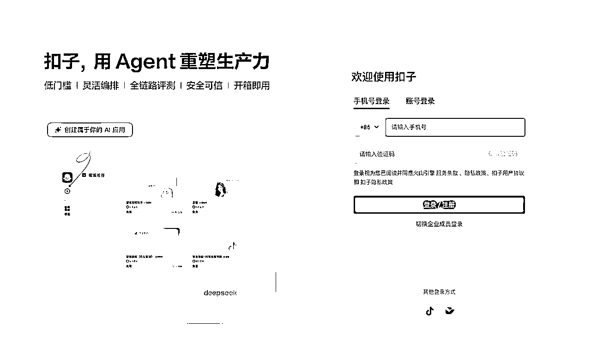

### 1.2 创建智能体

注册成功后开始创建智能体。点创建智能体后会出现弹框，填写智能体信息并确认。

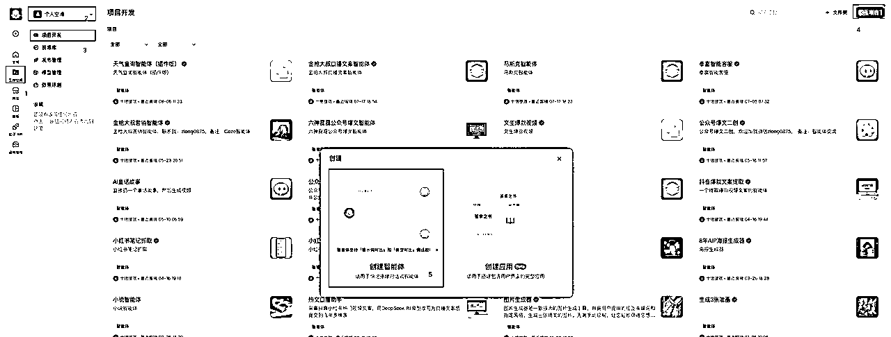

### 1.3 添加流程

先在智能体编辑页点添加流程；随后新建流程，填写名称和描述。流程名称只能包含英文字母、数字和下划线（_），且必须以英文字母开头。可以用“编号+英文（或汉语拼音）”的结构命名。

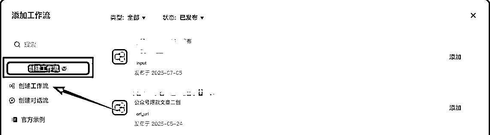

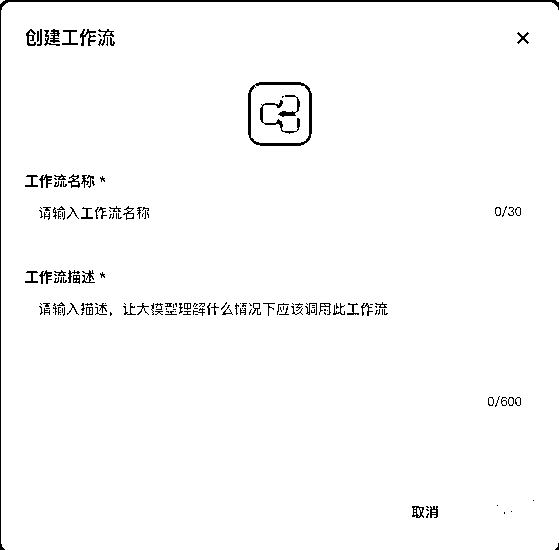


## 2. 用范本创建流程

从左侧栏进入模板区，找到带<工作流>标签的范本。选目标范本后点复制，会出现两个去向。

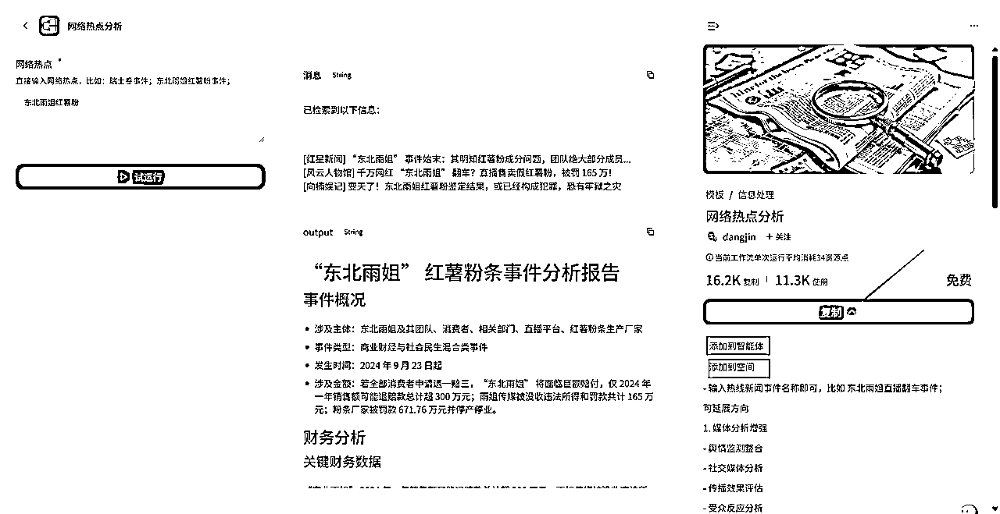

**挂到智能体上**

需先在自己的个人工作区或团队工作区里创建一个 AI 智能体。点项目开发，选择创建项目—创建智能体。

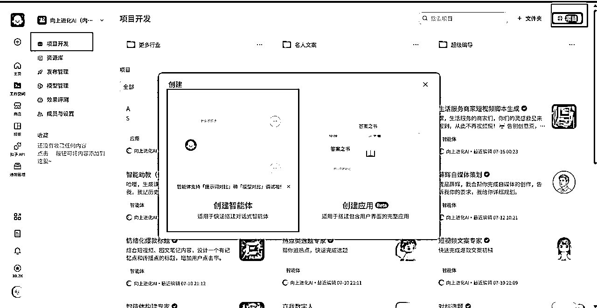

还是按老流程，填智能体名称和介绍，选一个喜欢的图标；也可以让 AI 根据名称和描述自动生成。智能体名称支持中文。

确认后进入智能体编排界面，先了解：

智能体类型：有单 agent、对话流和多 agent 三种，按情况选择。

人设与回复逻辑：用指令告诉智能体如何工作，比如回复人设、何时调用扩展工具、何时调用流程等。

编排区：选模型，给智能体加技能（扩展工具、流程、触发器），加知识和记忆，还可设置开场白等。

预览与调试。

上线。

创建完成后，回到模板页面，选择流程要复制到的空间和对应智能体。这样这条流程会自动加入智能体。

**放进工作区**

选择放进工作区，就只是把流程复制到对应空间。“仅复制”和“复制并继续编辑”的唯一差别是：后者会在复制完成后自动打开这条流程。

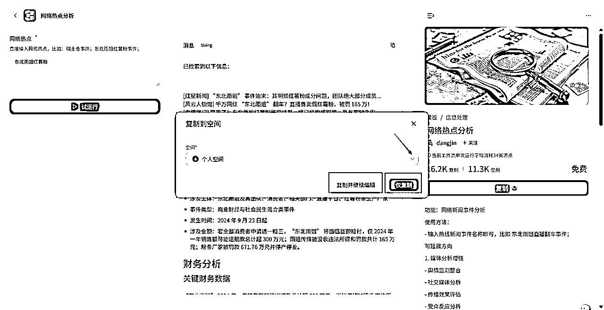

## 3. 流程的编辑、复制与删除

创建流程后会进入搭建界面，先逐一认识界面上的主要按钮和功能。

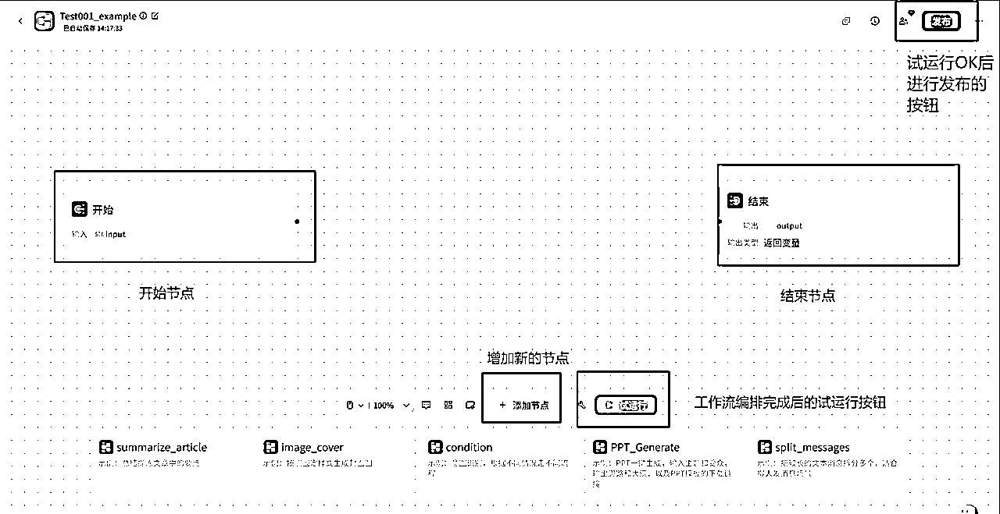

开始环节：负责收集你要输入的信息、资料或要求。

结束环节：流程跑完后，把你想要的信息、资料或结果回传给你。

添加环节：要新增环节时点它选取；实际搭建时也可以在环节后面快速创建。

试跑按钮：整条流程编排完后，点它检查运行状况。

上线：确认没问题后点上线。只有上线后的流程，才能被智能体、应用或接口调用。

在画布中添加环节，并按任务执行顺序连接环节，包括开始和结束环节。

在底部面板选择要用的环节。

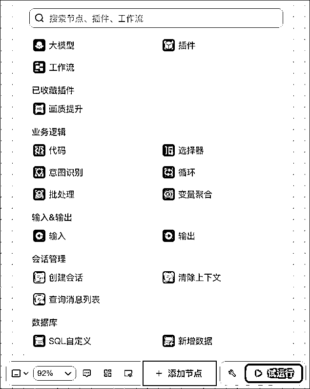

把各环节连起来（很重要）。

点前一个环节后的蓝点，鼠标悬停后它会放大并变成+号。

按住鼠标不松，拖到当前环节前的蓝点，自动吸附后松开。

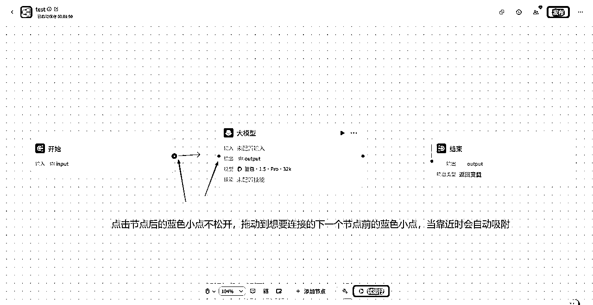

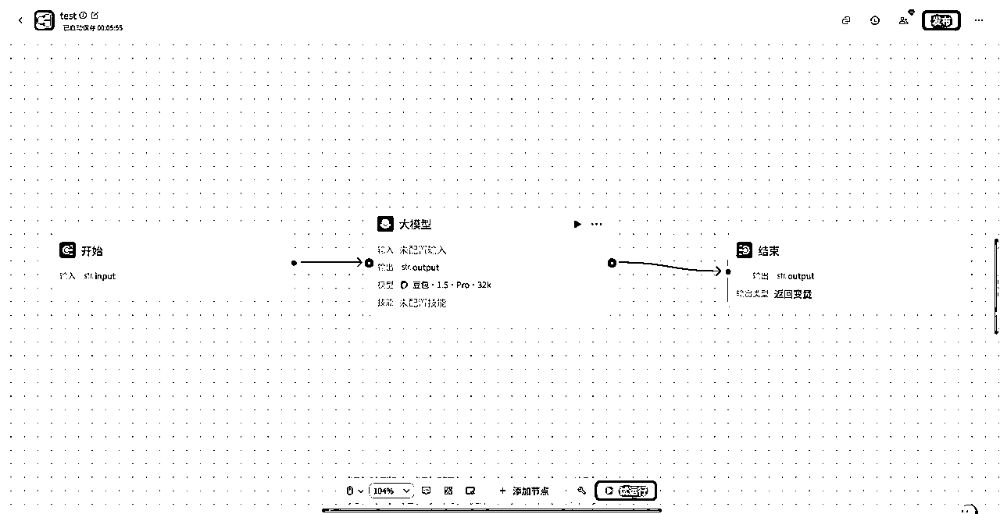

配置环节的输入和输出参数。

在输入参数区点+号，会新增一条参数编辑框；需要多个输入参数就多点几次。

在参数名输入框填命名；不填则自动引用参数赋值后的名称。

点参数值后的⚙️图标，会跳出前面环节的相关输出参数，可选择一个作为当前环节的输入；也可以直接在图标前面的输入框填固定字符。

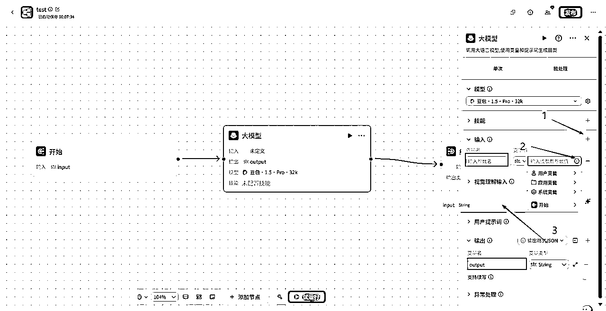

输出参数也一样，先点+按钮。此时不需要引用参数，只需给参数命名并选择正确的参数类型。

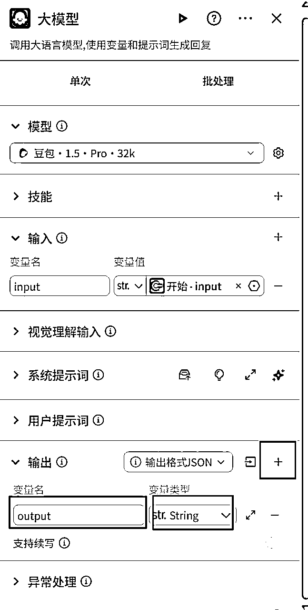

# 1. 流程核心模块

流程模块不少，但关键就三块：大模型环节、扩展工具、条件分流与循环控制。下面逐一展开。

## 1. 大模型环节

### 1.1 大模型环节怎么用

在画布中新增一个大模型环节，选中后右侧会弹出编辑框。

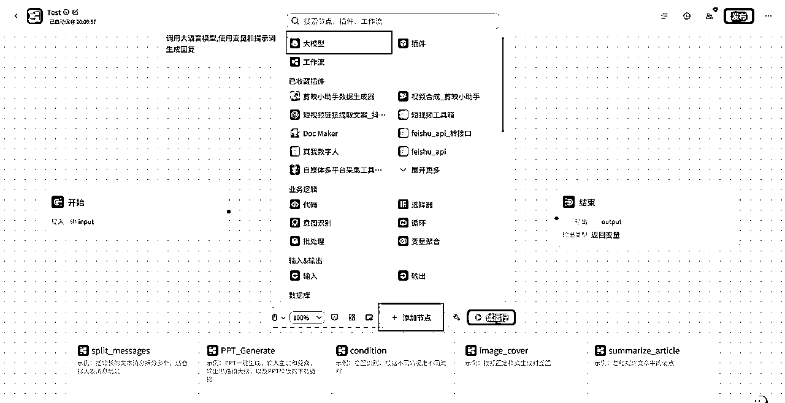

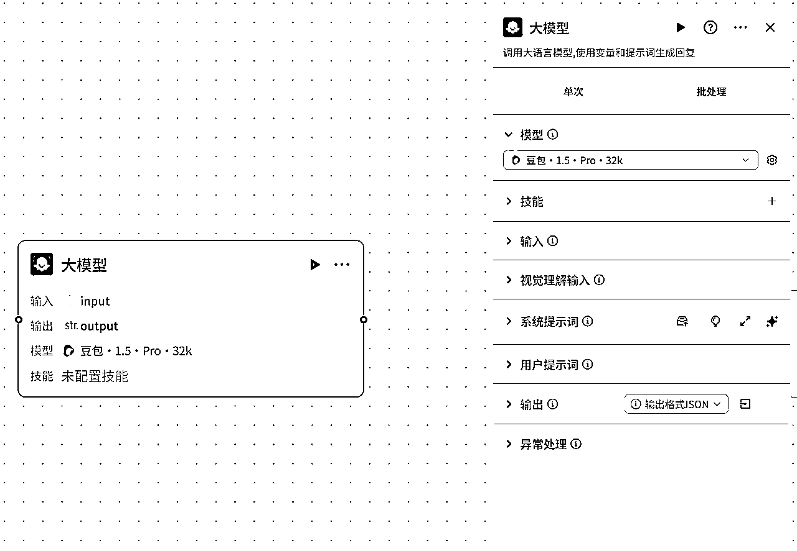

命名：双击最上方“大模型”字样，可给环节改一个描述性名称，说明它要做什么，比如“对文案纠错”。

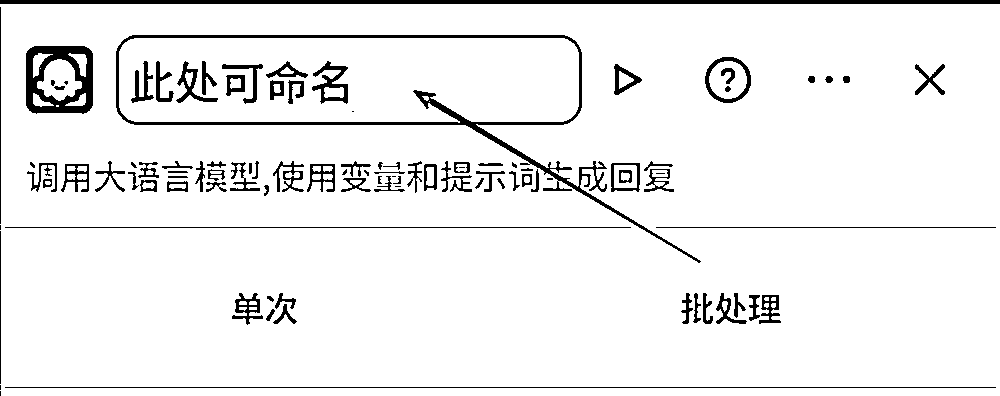

选择模型：点下拉框选择对应模型。目前官方支持豆包系列、Deepseek、Kimi、智谱清言、通义千问、百川、阶跃星辰和 Minimax。

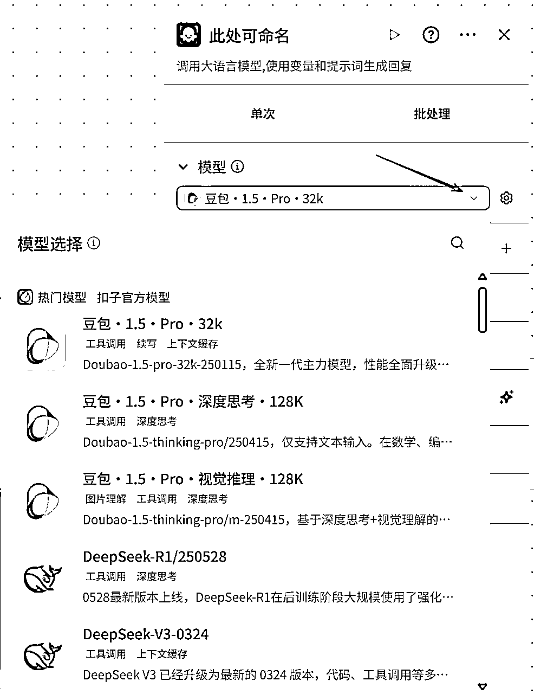

填写输入参数：点蓝色+按钮，新增一条输入参数，给参数命名并输入参数值。当参数值要引用之前环节的输出参数时，点多边形选择按钮选取。

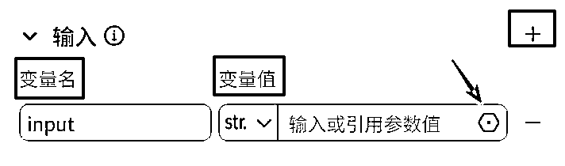

注意：环节之间要用连线连起来，才能被选择。

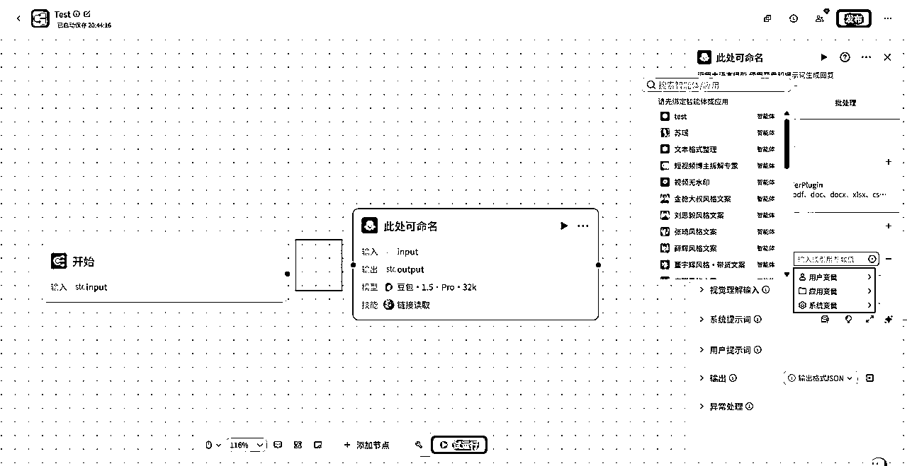

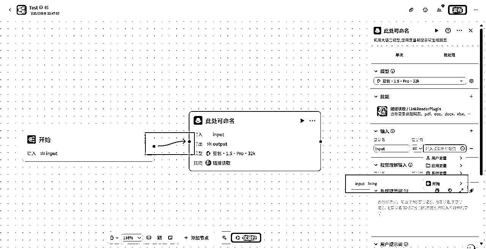

看图能力：需要理解图片时，在这里把图片 URL 作为参数传入，并在指令中引用。

指令：用户指令和系统指令都可以引用参数，参数用两个大括号{}包起来；系统指令还支持引用技能。

输出：对输出参数进行定义，包括参数名和参数类型。

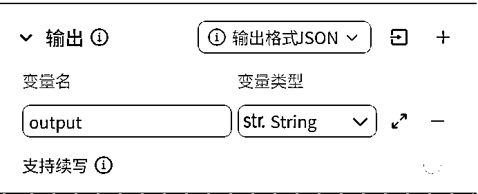


### 1.2 进阶技巧

模型参数微调：点大模型名称后的⚙️图标，可设置相关参数。主要调整发散度参数和回复上限参数。处理较长文本时，务必保证回复长度足够，否则可能运行失败。

选择技能：可给大模型加三类技能——工具、流程和资料库。选中对应技能后点添加即可。添加的技能可在系统指令中被引用。

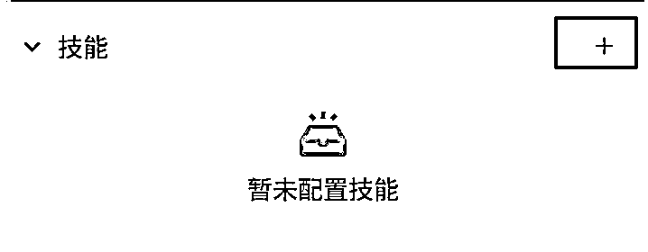

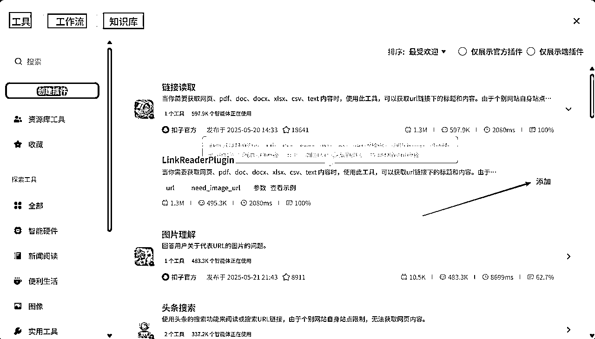

容错：默认出现异常会中断流程。若要对环节报错做容错，有几件事可做：

1.调整重试次数。

2.选择返回设定内容。

3.执行异常分支。

此时环节右下角会新增一个蓝点，环节也就有了选择器功能。运行失败时，可通过右下角这个蓝点连接到设定的异常分支。

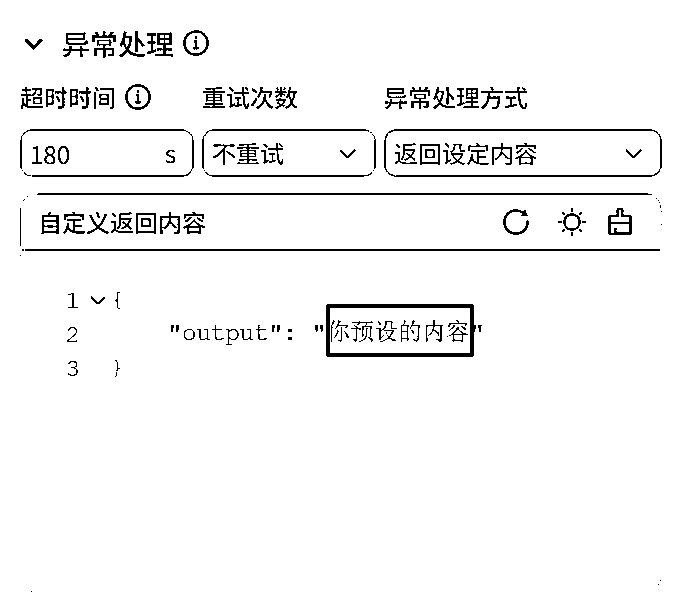

### 1.3 指令设计入门

把大模型想成一个极聪明、但不会读心的助手，比如 ChatGPT、Claude、Gemini 等。它能写诗、编程、分析数据、回答问题，却猜不到你脑子里想要什么。指令设计，就是学会清楚有效地表达需求，引导它产出更好的结果。掌握基础方法，能明显提升你与 AI 协作的效率和质量。

核心目标：清晰、具体、有引导性。好的指令关键在于减少歧义，让 AI 准确理解你要什么、希望它怎么表现。

基础原则与技巧：

1.任务要明确。不要模糊，比如只说“写点关于人工智能的东西”，范围太宽，AI 不知道写什么、写给谁、用什么风格。要具体，比如“写一篇面向中学生的、三百字上下的科普短文，介绍人工智能是什么，并给出两个日常生活应用实例，语言生动有趣。”关键点：主题、目标受众、长度、格式（段落、列表、代码等）和具体内容要求都要说清。

2.给足上下文。AI 没有你脑海里的背景知识，要主动告诉它。背景信息示例：你是一名市场顾问，请为一家新成立、主打有机原料的轻食外送小店，制定三个吸引二十五到三十五岁城市白领的社交平台推广创意。角色扮演示例：假设你是一位讲史、语气诙谐的博主，用轻松调侃的口吻，简要介绍秦王嬴政兼并六国过程中发生的一则小故事。

3.把指令结构化。用圆点列表、数字序号、横线分区等清晰格式，让指令更容易阅读和理解。示例：

```
任务：生成一份会议纪要模板
要求：
1\.  包含标准部分：会议主题、日期/时间/地点、参会人员、缺席人员、议程项目（含讨论要点和决议）、行动项（负责人、截止日期）、下次会议安排。
2\.  格式简洁专业，易于填写。
3\.  使用占位符（如 `[会议主题]`）表示需要填写的内容。
```

4.指定期望的输出形式。明确告诉 AI 结果以什么形式呈现。比如：把答案组织成分条清单；用表格列出两个备选方案的长短处；用 Python 写一个函数实现某项功能，并配上说明注释；写一首五句短诗（俳句），以秋叶为题。这样做能节省后期整理时间，也能确保结果符合使用需求。

5.用示例（Few-Shot）。对于复杂或特定风格的任务，直接给 1—3 个输入—输出示例，能显著提升 AI 对你期望效果的理解。示例（文本风格转换）：

```
输入：这个产品太糟糕了，完全不符合描述，客服也不理人，差评！
输出：我对这次购物体验感到非常失望。产品实际效果与描述存在较大差距，且在寻求客服帮助时未能得到及时有效的回应。希望商家能重视产品质量和售后服务。
任务：将下面这句激烈的用户评论转换成更正式、客观的投诉信语气：
输入：`你们发的货是错的！颜色不对，尺寸也不对！浪费我时间！
```

6.设定约束和限制。明确你不想要什么，或需要避免什么。比如：少用生僻行话；别夹带主观评论；篇幅不超过五百字；数据只取 2020 年及以后。

# 提示词调优：先说清楚，再反复打磨

想让模型少跑偏，第一步是把任务边界画清楚。背景、约束、目标交代得越具体，它越容易落在你期待的区域。

别把首轮输出当终稿。第一次不理想很常见，关键是别马上放弃。先找原因：是任务理解偏了、语气不对，还是缺少关键信息？找到症结后，再动提示词：补背景、把要求写细、换角色设定或输出格式、增加限制、给更清楚的样例。很多时候，只是换一个动词、调整一个形容词，或者把语序挪一挪，结果就会变。

要绕开的坑：
- 指令太空，例如只说“帮我写个文案”，模型没有抓手；
- 无关信息塞太多，真正要它做的事被埋住；
- 默认它已经掌握你没提供的材料，比如让它分析一份你没上传的文档；
- 一次塞多个复杂任务，例如“分析报告、写总结、再译成法语”，更稳的做法是拆步骤；
- 第一版不满意就停，不继续迭代。

练习可以从轻量任务开始：
- 基础：用普通人能懂的话解释“区块链”；
- 格式：给出 5 条提升个人效率的建议，每条控制在 20 字以内；
- 角色：以资深旅行规划师的身份，安排 3 天北京文化行程，覆盖故宫、长城，并写清每天安排和交通方式；
- 迭代：让模型写一首“猫”主题的诗，第一版不喜欢就继续调——要五言绝句还是现代诗？情绪偏欢快还是慵懒？是否加入毛线球、阳光等意象？

说到底，提示词工程拼的是两件事：表达清楚、反复调整。你面对的是一个能力很强的助手，指令越准，结果越可控。先把任务说明白，再补上下文，用结构化方式表达，明确输出格式，然后多轮试错，你离高效协作就不远了。

# 2. 插件：为工作流接入外部能力

# 2.1 插件怎么用
进入工作流画布后，点“插入节点”，找到插件入口。插件来源分两类：官方商店（涵盖官方与第三方开发者发布）以及资源库里的自建工具。

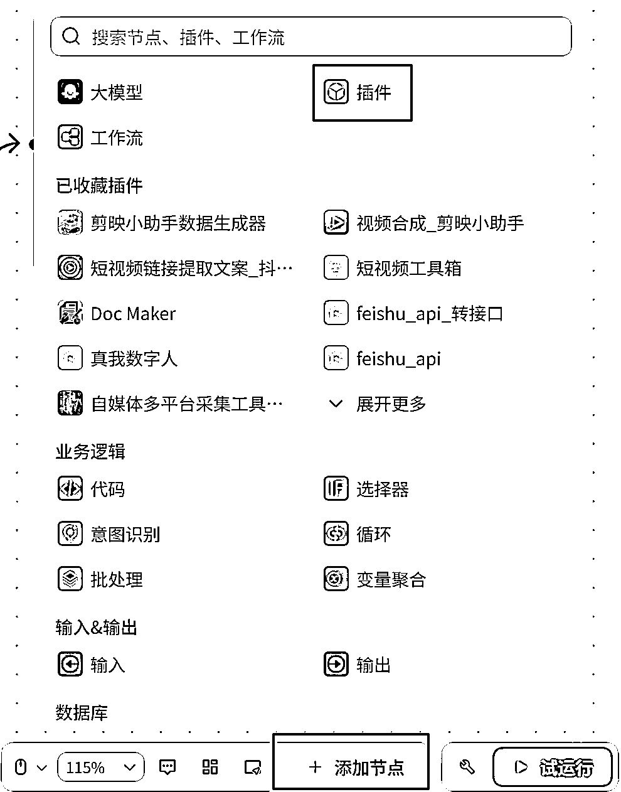

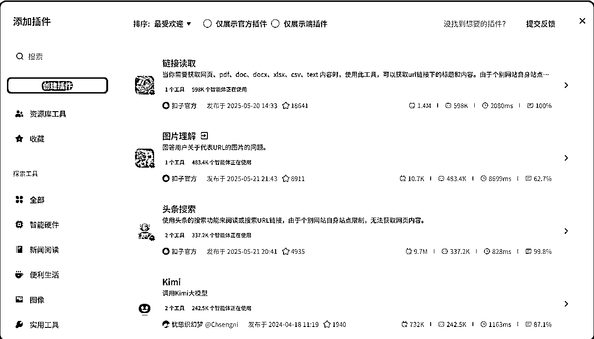

检索时可按插件名、作者名或关键词搜索，选中后点添加，就能把它放进当前工作流。

添加之后记得把上下游节点连起来，再为插件配置对应的入参。

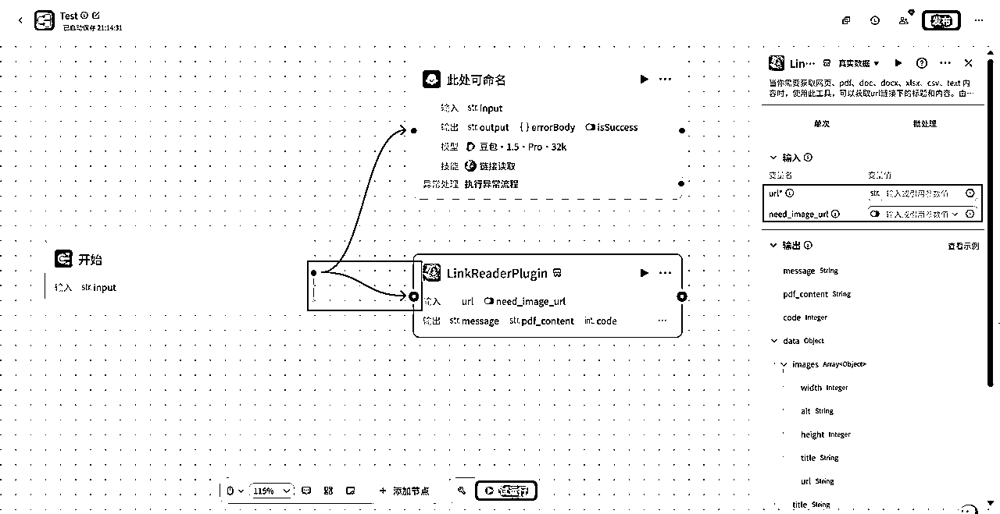

# 2.2 使用要点
插件的入参、出参结构由工具本身定义，无法自行修改。必填入参必须指定来源：固定值或引用上游输出。输出区右上角的“查看示例”可查看参数说明与完整样例。

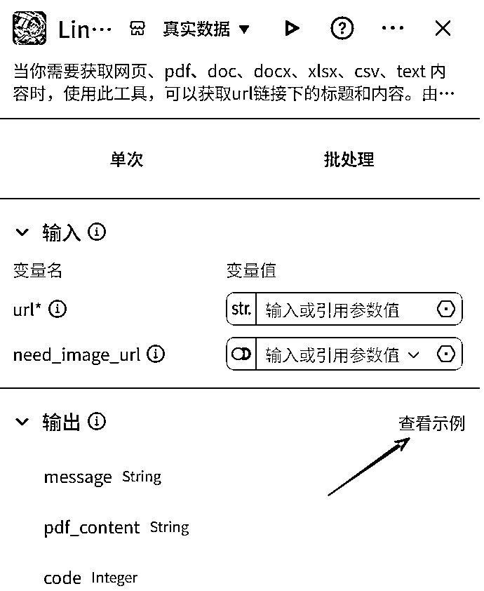

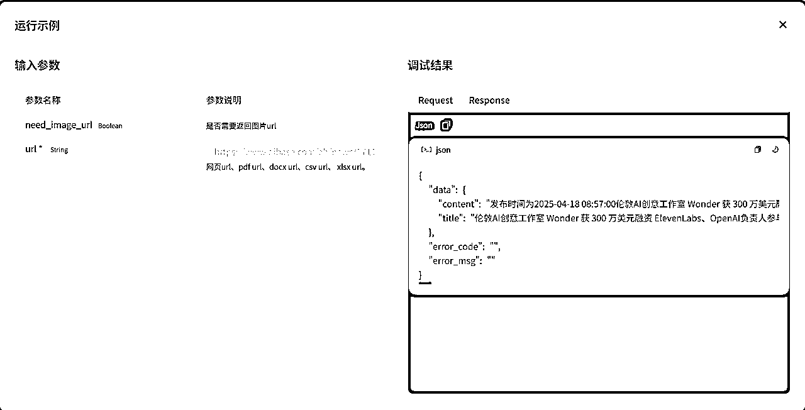

部分第三方插件需要付费。插件页通常会写明 API Key 的获取方式与教程。挑选时，除了功能，还要看成功率和费用。

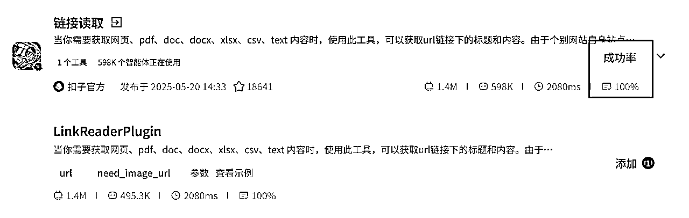

# 2.3 几款常用插件
建议平时多逛插件商店，先熟悉官方插件能做什么。

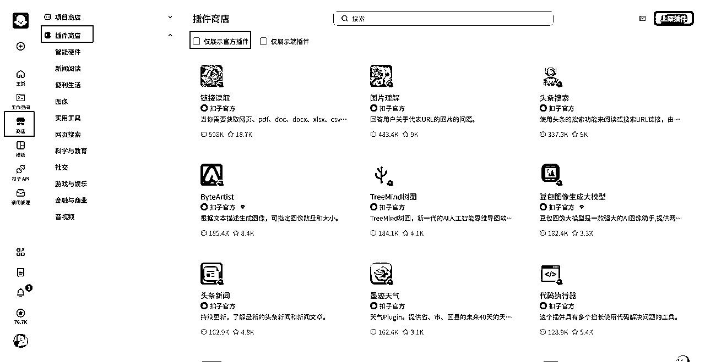

下面挑几款常见工具：

链接读取：抓取网页内容的工具。可返回网页原始内容（标题、正文、链接等），也能筛选、解析内容，便于分析网页和提取信息。需要的入参有：need_image_url 填 false 或 true，true 时返回图片链接；url 填要读取的网页地址。

Dock maker：适合把信息写入文档、PDF、Excel。入参包括：title 为文档标题；to_format 为目标格式；formatted_markdown 为写入的 Markdown 内容。

飞书多维表格：连接 Coze 与多维表格的常用插件。功能包括创建多维表格；创建/删除数据表（子表格）；写入/更新/删除表头；在数据表中新增/更新/删除多条记录。

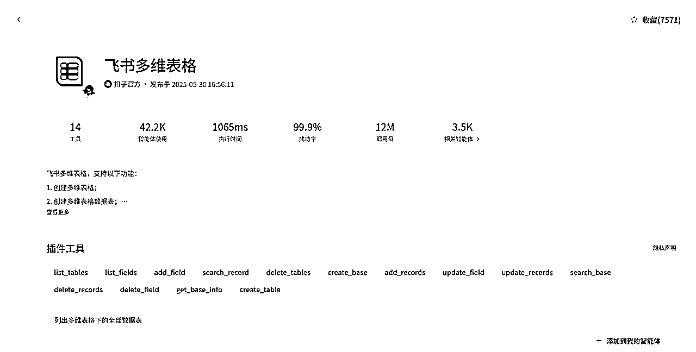

短视频无水印链接提取：这类插件不少，搜关键词即可。多数收费，主页通常有 API Key 获取地址（第一个工具箱可白嫖的 key：123123，低调使用）。它可通过短视频链接提取作者信息、无水印视频下载地址、作品信息等，便于后续提取和拆解文案。

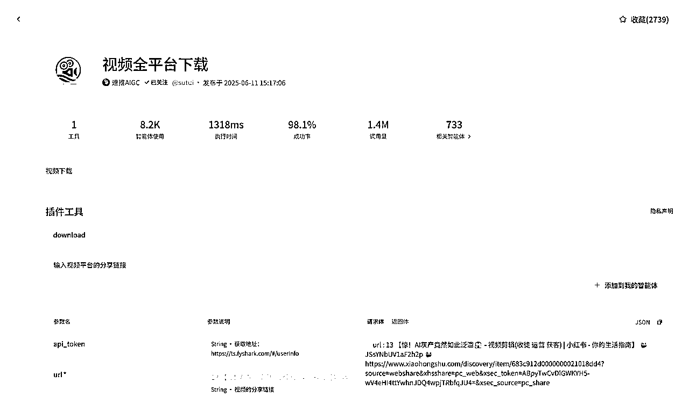

目前商店插件能覆盖八成以上常用场景，自媒体和职场场景覆盖到九成五以上。平时多逛，真要做功能时就有底了。


# 3. 分支判断与循环控制

# 3.1 选择器节点：流程里的 if-else
不管有没有编程基础，if-else 应该都听过。选择器节点就是流程中的 if-else，用来设计分支。添加节点时，在“业务逻辑”下选“选择器”。

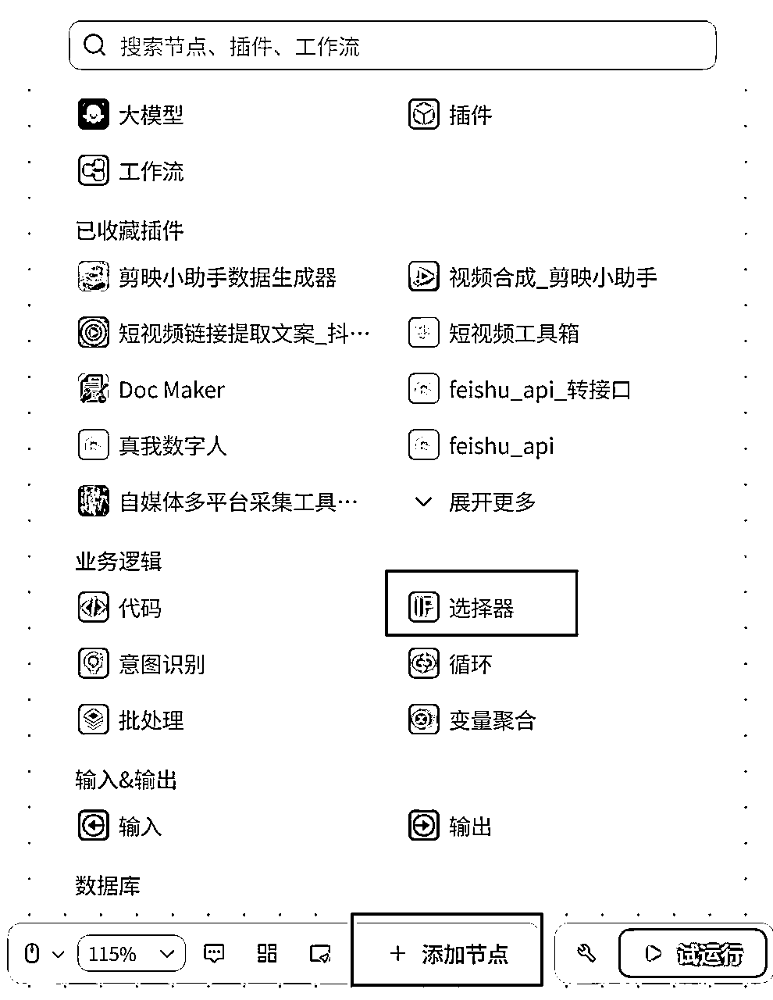

输入参数进入节点后，会判断是否满足“如果”区域的条件：满足走“如果”分支，否则走“否则”分支。每个分支可加多个条件（且/或）。

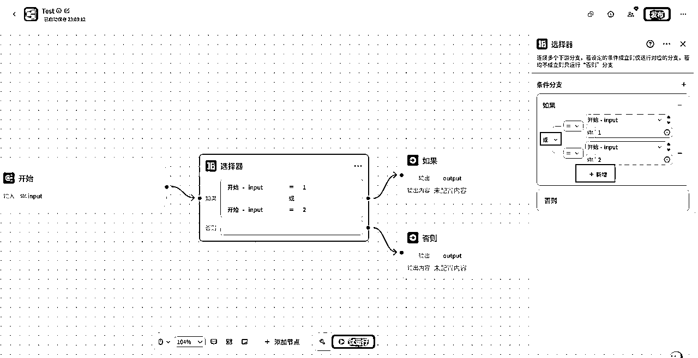

它还允许设置多个条件分支，拖拽分支条件配置面板即可调整优先级。

# 3.2 循环节点：重复任务的好帮手
循环节点用于重复执行一组任务，直到满足某个条件。

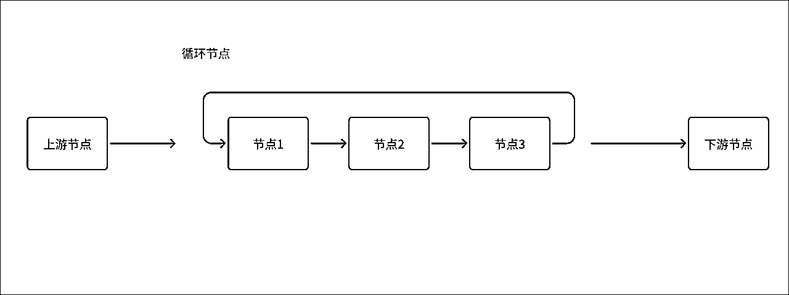

循环类型
循环节点的运行模式有三种：使用数组循环、指定循环次数、无限循环。

使用数组循环
数组循环处理数组类型数据（array）。可以把它看成一个有序序列，对序列中每个元素执行相同步骤。典型场景：批量拿到某博主主页 50 条视频信息后，逐条获取作者昵称、点赞数、转发数、无水印视频链接和文案。这时让循环节点依次处理这 50 条数据即可。

在编程中，数组用于存储一系列元素。基础概念如下：
- item：元素，即数组中的单个数据，可以是数字、字符、字符串等。
- index：索引，表示元素在数组中的位置，从 0 开始计数。第一次循环 index 为 0，第二次为 1，第三次为 2，最后一次为 n-1，其中 n 是循环次数。
- 数组长度：数组中元素的数量。

例如数组 nums = [2, 4, 6, 8, 10]：
索引 0 对应元素 2；索引 1 对应元素 4；这个数组一共 5 个元素。

使用数组循环时，需要指定循环数组。该参数只能引用上游节点输出，且必须是数组格式。执行时，循环次数由引用的数组长度决定。例如 [1, 2, 3, 4, 5] 长度为 5，循环就会跑 5 轮。如果引用了多个数组，则以最短数组的长度为准。

数组循环每一轮都会把当前元素赋给内置变量。这些内置变量只在循环节点内部可用。目前支持：
- item<string>：数组元素，即当前轮到的元素；
- index<integer>：数组索引，index+1 即当前循环轮次。

指定循环次数
这种模式适合成批、按顺序处理数据。循环次数初始值为 10，可在 1～1000 之间调整，也能引用上游节点的数值输出。若引用值超过 1000，按 1000 算；低于 1，按 1 算。

典型场景：想一次生成 2 条📕文案，放两个大模型节点即可；若要一次出 20 条，不必复制 20 个节点，把循环次数设成 20 就行。

无限循环
无限循环类似编程中的 while。它需要终止循环节点来收尾。第一轮跑完后，流程检查指定条件，满足就结束，不满足继续。

终止循环节点通常与条件判断节点配合：条件成立时，流转到终止循环节点，自动跳出。

举例：用自定义插件调用 API，先创建文本转语音任务，再反复查询任务状态，执行成功就停止循环。

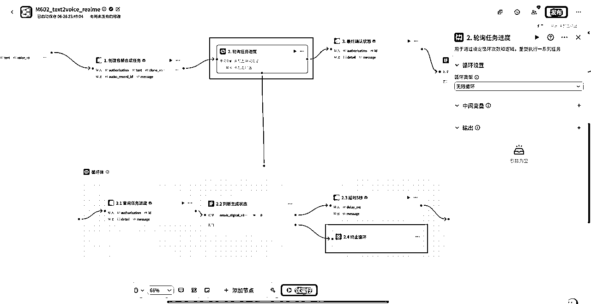

配置循环节点
多轮循环严格串行，不支持并发。每轮迭代完成后，才能启动下一轮。若某些节点需要并行执行，可使用批处理。

循环节点不支持嵌套：循环节点里不能再放另一个循环节点，但可以嵌套一个包含循环节点的工作流。循环节点中也不允许添加批处理节点。

设置中间变量
循环节点支持设置中间变量，该变量可作用于每一次循环。中间变量通常和循环体中的设置变量节点搭配：每轮结束后为中间变量设新值，下一轮继续使用。

例如长文生成场景：通过中间变量把每轮段落总结传到下一轮，让大模型参考前文内容和下一段主题，生成上下文衔接更自然的段落。

配置如下：
- 循环节点：设置中间变量 last_paragraph，初始值填一个空格。首轮生成开头段时不需要参考大纲外内容，因此给空格即可，也可按需改成其他值。
- 循环体中的设置变量节点：中间变量选择循环节点中设置的 last_paragraph；设置值选择大模型节点的输出参数 output，表示下次循环开始前，把本轮生成的段落赋给循环变量。
- 循环体中的大模型节点：添加两个输入参数，分别引用循环节点的内置变量 item 和循环变量，并在提示词中要求生成文章段落时参考上一段内容。

注意：设置变量节点里，中间变量的数据类型必须与设置值的数据类型一致，否则无法赋值。

设置循环体
创建循环节点后，会生成一个循环节点和对应的循环体画布。

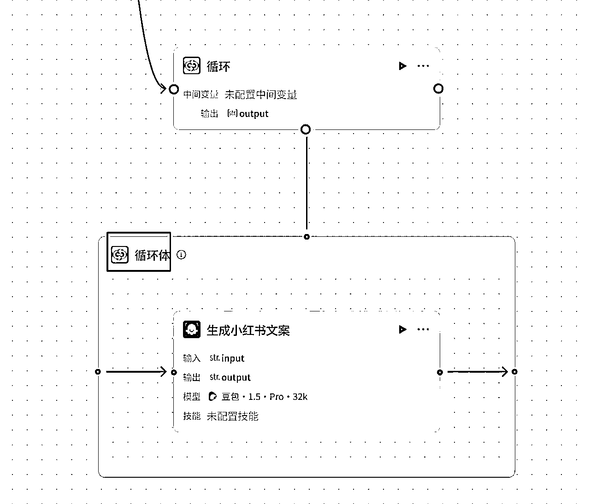

循环体画布是循环节点的内部运行机制，用于编排循环流程。循环体只与循环节点相连，默认如此，无需设置。只有选中循环体时，才能向其中添加新节点，或把新节点拖入画布。循环体里的节点没有开始与结束，但需要和画布首尾蓝点图标连接。

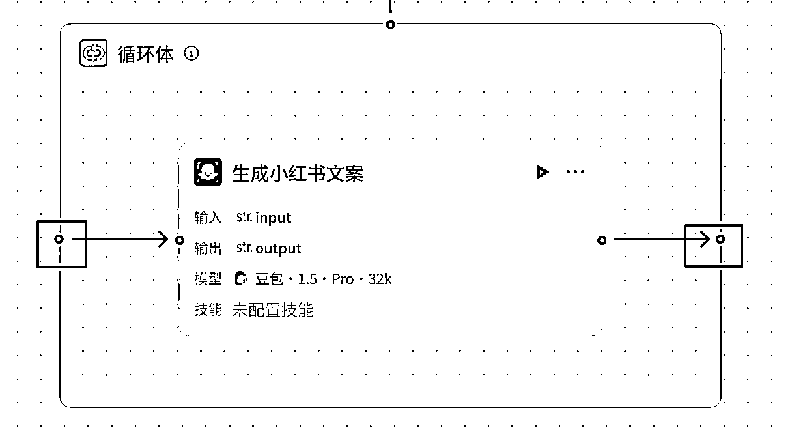

设置输出
循环节点的输出参数可以设为循环体执行结果集合：数组中所有元素跑完后，把所有循环结果打包传给下游。也支持设为循环变量的取值。

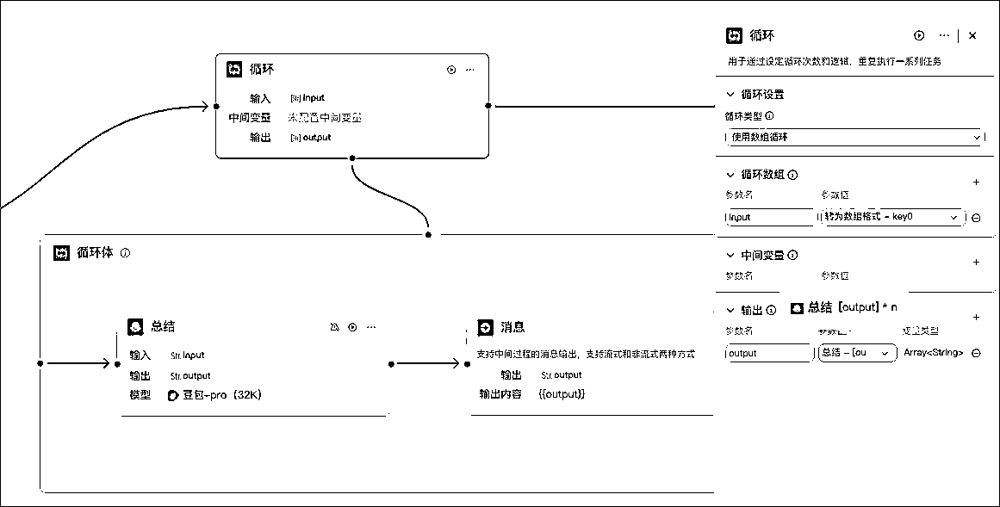

# 1. 内容创作｜批量采集📕笔记并改写

# 1. 本章速览
基础操作过关后，接下来就动手。本章以实战为主，把前面学的落到内容生产、数据抓取、多媒体制作这些高频场景里，带你搭出真正能用的流程。

每个案例都会说明思路和步骤。你会把节点、插件组合起来，让重复劳动自动跑，并一步步做出能处理文字、图片甚至视频的完整方案。

学完后，你将系统掌握：
- 内容与数据抓取：让流程自动获取📕、抖音等平台的公开内容，并沉淀到飞书多维表格；
- 图片生成与再创作：根据提示词批量出图，或对已有图片做风格化重绘；
- 视频全自动生产：把文案、配图、配音、剪辑串成一条线，一键产出成片。

完成本章，你不只是能照着复刻项目，更能把自身需求翻译成自动化方案，真正让技术替你省力。

# 本章路线图
学完并实操后，可以推进到路线图的第二、第三阶段：

第二阶段：实战项目演练（约 10 天）
- 📕笔记：批量采集与改写（约 2 天）
- 📕竞品动态自动入库（约 1.5 天）
- 抖音账号内容信息采集（约 1.5 天）
- 多维表格批量生成 AI 图片（约 1 天）
- 提取📕主图并智能重绘（约 1.5 天）
- 全自动生成古诗词短视频（约 2.5 天）

# 2. 搭建📕采集工作流

目标效果：多维表格自动重写📕图文工作流可复制文档

# 2.1 进入 Coze，新建流程
先打开 https://www.coze.cn/home ，然后依次点：工作空间 → 资源库 → 资源 → 工作流。名称用字符，描述随意。

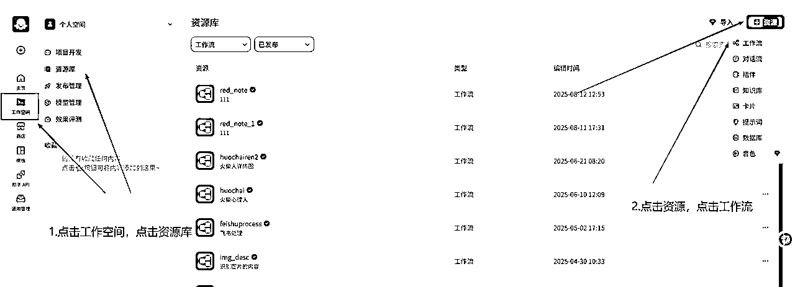

# 2.2 接入📕采集节点
大模型过滤入参配置好后，接着接入📕图文。找到“📕提取”节点。配置不复杂：把入口接到开始节点的输出端，也就是 url 变量的值引用【开始的 input 变量】。

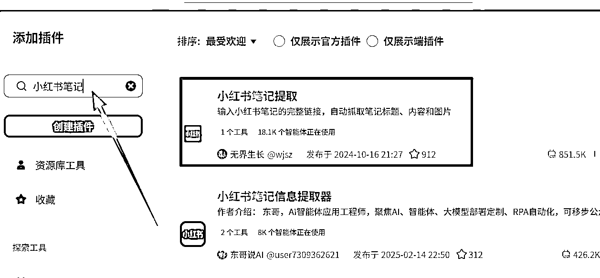

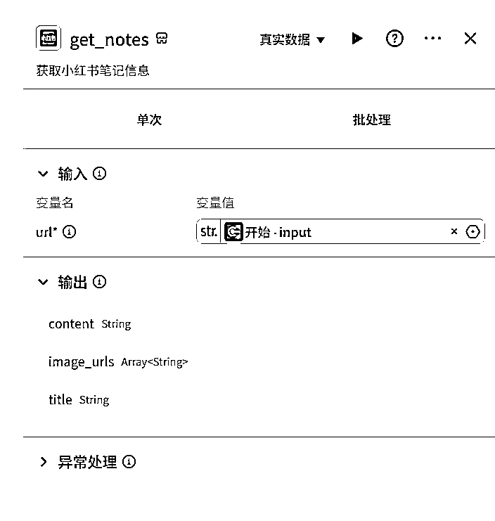

# 2.3 设置结束节点
这次只取📕图文的【标题】和【正文】。默认结束节点只有一个输出，于是按右上角“+”增加输出变量，并把两个变量分别命名为 content（正文）和 title（标题）。

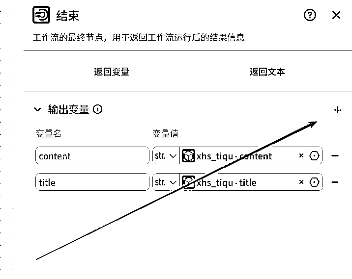

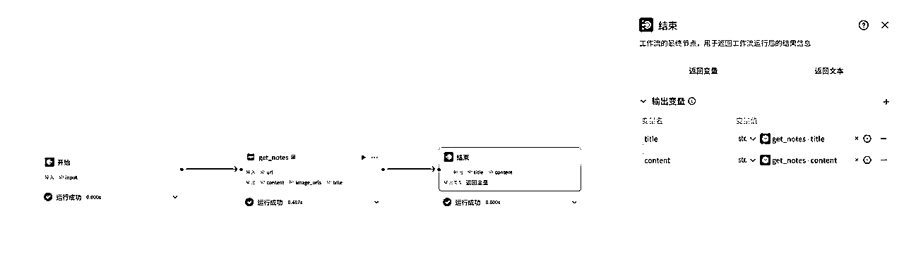

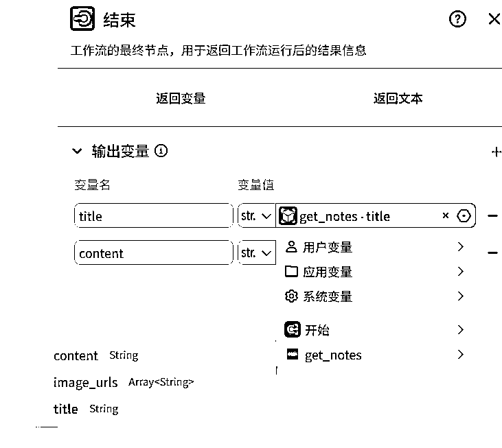

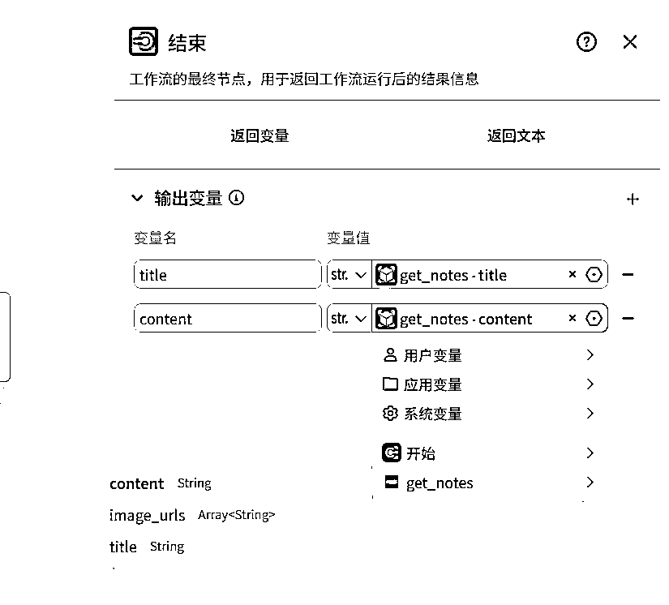

# 2.4 试跑与发布
点试运行，粘一条📕链接进去让它提取：
https://www.xiaohongshu.com/explore/6868b5ce000000000d0243bd?xsec_token=ABIu8xzYTFyfVqbHkaGfaWz0TELv7tlCfWLZ2A-M951yE=&xsec_source=

这条链接在航海手册里无法直接复制，可点进去后从地址栏复制。

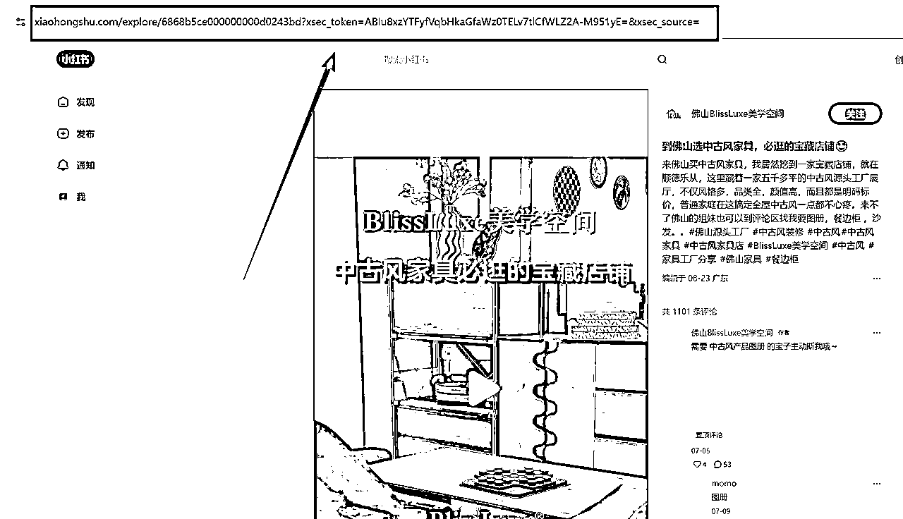

点试运行，填入笔记链接后再执行一次。


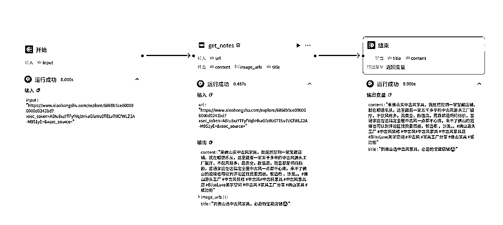

全部跑完后就能发布了。

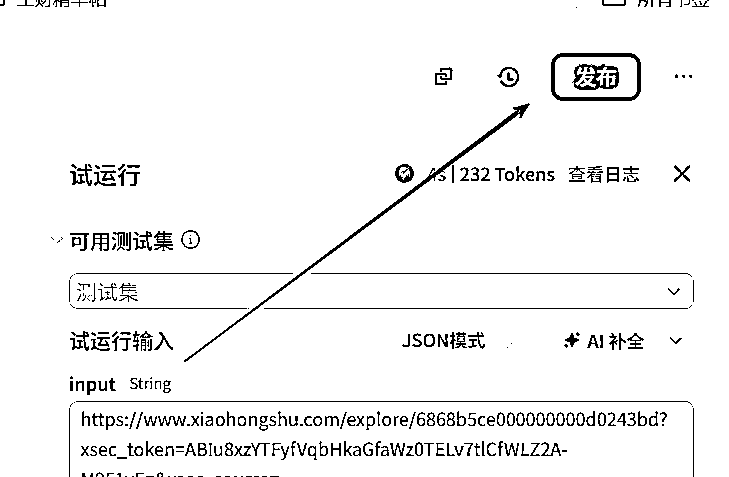

注意事项：
https://www.xiaohongshu.com/discovery/item/ 开头的链接不对❌，需要 https://www.xiaohongshu.com/explore/ 开头且带 xsec_token 的链接✅。复制自己的链接时，再核对一下是否正确。


# 3. 让多维表格调用 Coze 工作流

# 3.1 在多维表格中导入工作流
打开飞书网页版：
https://www.feishu.cn/


进入云文档，新建云文档，再新建多维表格。


注意：第一列用于填写📕链接。选中除第一列外的其他列，鼠标移到右上角，按【修改字段/列】。在【探索字段捷径】中搜索 coze，选择【扣子工作流调用】。


接着在多维表格配置扣子参数，分别是：【认证令牌】【工作流 id】【参数字段】【参数名称】【请求模板】【输出结果 1】【输出结果 2】。

填写认证令牌：若没有 coze 令牌，可从左侧进入【扣子 API】→【授权】→【个人访问令牌】→【添加】创建。注意：令牌只展示一次，记得保存到本地。


填写工作流 ID：每个流程网址上都会显示 workflow_id = xxx，后面那串 xxx 数字就是 ID。

参数字段：选择输入的链接字段。

参数名称：Coze 流程中的输入变量名为 input，这里也要对应填 input。


请求模板有两种写法：
1. 自己引用：{"input":"引用的字段"}
2. 直接粘贴现成模板，新手建议用这种，更不容易出错。
{

# 笔记批量改写与采集配置指南

先看工作流收尾节点的设置：

```
"input": "$$input$$"
}
```

末端的“输出结果1”“输出结果2”就是后面要引用的两个变量名。


这里有个细节：必须把这两个结果分别勾上，后续二次创作时才能各自调用。

点确定后，系统会问你是否整列生成。若选“生成”，该列笔记会一次性全部处理。更稳妥的做法是选择“仅保存配置”，然后点中目标单元格，用右侧刷新按钮单独跑。


如果结果为空，多半是插件没抓到这篇笔记的地址。点一下空白位置，把链接复制到浏览器里打开，就能查看 coze 当前执行到哪一步。


从返回信息看，目标链接没有被成功解析。


# 3.2 用豆包模型改写内容

先改标题。新增一列，接入【豆包 1.6】插件。模型可以自己挑，豆包、deepseek 等都能用，这里拿豆包做演示。输出项记得勾上。

下达的指令可以写成：调用输出 1（对应📕 title），这是笔记标题，请重新表达一遍，原意别变，只给我一个最终版本，不要额外说明。


再改正文。另起一列，仍用【豆包 1.6】插件，模型同样能换，豆包或 deepseek 都可以，示例继续用豆包。输出项别忘了勾。

指令改为：调用输出 2（对应📕正文），这是笔记正文，请重新表达一遍，原意别变，只给我一个最终版本，不要额外说明。


效果如下：


# 4. 配套视频演示

内容创作-📕笔记批量采集与改写-视频教程+字幕.mp4
链接: https://pan.baidu.com/s/1VSvb05-puEzWSb_NF-iiHw?pwd=vrnw 提取码: vrnw

1. 竞品动态跟踪：把📕内容自动送进表格

借助 Chrome 上的篡改猴脚本，做一个能抓取📕账号资料和单篇帖子信息的小工具；再把飞书多维表格的接口配好，就能把抓到的数据直接推进表格。

最终效果可以参考下图（内容均由📕自动推送）：


要让推送跑起来，核心就两件事：

1、编写篡改猴脚本：在📕页面抓账号信息和单篇笔记信息，用 JSON 格式输出。

2、配置多维表格 API 接口：让它能接收篡改猴脚本发来的数据。

# 视频演示（第二个案例）

数据采集-📕竞品动态自动入库-视频教程+加字幕.mp4
链接: https://pan.baidu.com/s/1_NlOofuHOIYILG-pS9VFQA?pwd=jvjd 提取码: jvjd

第二个案例的演示视频，搭配下面的飞书多维表格模板使用⬇️：

数据采集 | 📕竞品动态自动入库-模板(复制一份到自己的云盘(有base)✅，不要复制到知识库(有wiki)❌)：

数据采集 | 📕竞品动态自动入库

记得把自己的应用加进多维表格。

# 本章节常见问题及解答

详细内容看这份飞书文档：

常见问题解答和注意事项

# 1. 飞书后台：开放多维表格权限并取回 app id 与 app secret

第一步，进入飞书开放平台（https://open.feishu.cn/app?lang=zh-CN），创建一个企业自建应用。


填写应用名称、应用描述，点“创建”。


在“基础信息-凭证与基础信息”里能找到 app id 和 app secret，建议复制下来存到本地文件，后面会用到。


然后到“开发配置-权限管理”，点“开通权限”。


先处理应用身份权限 tenant_access_token：在左侧菜单往下找“多维表格”，把权限名称全部勾上，再点右下角“确认开通权限”。


用户身份权限 user_access_token 也按同样方式处理，把多维表格相关权限全部打开。

1. 发布飞书应用

进入“应用发布”-“版本管理与发布”，填写版本号（格式如 1.0.0）和更新说明，保存并确认发布。随后会出现免审发布确认框，点确认即可发布成功。


# 3. 创建多维表格并提取访问参数

在飞书云文档主页进入云盘，在云盘里新建一张多维表格。

这里要特别注意：多维表格必须从云盘新建，这样地址才会是下面这种形式：
https://f7vsb1brbs.feishu.cn/base/S7JqbAzy7aO5dLsAQehchmLyngf?table=tbl6l8zc0BHSgIkY&view=vewgb3vMSP

云盘里建出来的表格，链接第二段是 base；如果从飞书文档主页新建，第二段会变成 wiki，对接方式完全不同。请务必确认第二段是 base。


从多维表格地址还能拿到两个关键参数：app token 和 table id。以上面的 URL 为例，

https://f7vsb1brbs.feishu.cn/base/S7JqbAzy7aO5dLsAQehchmLyngf?table=tbl6l8zc0BHSgIkY&view=vewgb3vMSP

app token 取 S7JqbAzy7aO5dLsAQehchmLyngf，也就是第三段到问号前的内容。

table id 取 tbl6l8zc0BHSgIkY，也就是 table= 后面、&view 前面的那一段。

到这里，四项飞书多维表格信息就收集齐了：

app id：飞书开放后台“凭证与基础信息”里获取

app secret：飞书开放后台“凭证与基础信息”里获取

app token：从多维表格地址里提取

table id：从多维表格地址里提取

# 4. 给多维表格添加应用并授予访问权

打开这个多维表格，点右上角的“...”，依次选“更多”-“添加文档应用”。


如果第二步发布成功，在弹窗里搜索应用名称就能找到它，选中添加，并确认权限为“可编辑”。这样应用才有多维表格的访问权，才能往里写数据。


# 5. 安装 Tampermonkey 并写采集代码

打开 Chrome 应用商店（https://chromewebstore.google.com/），需要🪜。搜索 tampermonkey，安装扩展并添加到 Chrome。

【更新】无法🪜的读者，可以下载本地版，然后把文件拖进 chrome://extensions/ 页面。


tampermonkey_stable.crx

Tampermonkey 是 Chrome 上的用户脚本管理扩展，用来运行自定义脚本，实现网页自动化和功能增强。


装好后可以把篡改猴固定到浏览器工具栏，查找和操作都更方便。


还要开启脚本执行权限：点击“扩展程序”，在篡改猴右侧三个点里进入“管理扩展程序”，打开“允许用户运行脚本”。


点篡改猴图标，选择“添加新脚本”。


进入脚本编辑页后，先清空原有内容，再粘贴下面的代码。它的用途是在指定📕账号主页加一个采集按钮，按下后即可抓取该账号信息，并以 JSON 形式展示。代码由 AI 生成，通常能直接跑；若遇到问题，可以把报错交给 AI 继续调整。最后按 Ctrl+S 保存并退出。

```
// ==UserScript==
// @name         2.2-小红书作者信息采集器 (稳定版)
// @namespace    http://tampermonkey.net/
// @version      2.2
// @description  优化版：更稳定地采集小红书作者信息并生成JSON，修复关注数采集问题。
// @author       Assistant (Optimized)
// @match        https://www.xiaohongshu.com/user/profile/*
// @grant        none
// @run-at       document-idle
// ==/UserScript==

(function() {
    'use strict';

    // =================================================================
    // 配置与常量
    // =================================================================
    const SELECTORS = {
        mainContainer: '#user-page-container, .user-page, .profile-container',
        name: '.user-name .name, .user-name, .user-nickname, .nickname, [class*="nickname"], [class*="name"]',
        avatar: '.user-avatar img, .avatar-wrapper img, img.avatar, [class*="avatar"] img',
        description: '.user-desc, .user-bio, [class*="desc"], [class*="bio"]'
    };

    // =================================================================
    // 工具函数
    // =================================================================

    function waitForElement(selector, callback, timeout = 10000) {
        const startTime = Date.now();
        const interval = setInterval(() => {
            const element = document.querySelector(selector);
            if (element) {
                clearInterval(interval);
                callback(element);
            } else if (Date.now() - startTime > timeout) {
                clearInterval(interval);
                console.error(`❌ 等待元素 "${selector}" 超时。脚本可能无法正常运行。`);
            }
        }, 500);
    }

    function convertChineseNumber(value) {
        if (typeof value !== 'string') return 0;
        const str = value.trim();
        if (str.includes('万')) {
            const num = parseFloat(str) * 10000;
            return isNaN(num) ? 0 : Math.round(num);
        }
        const num = parseFloat(str);
        return isNaN(num) ? 0 : Math.round(num);
    }

    function getUserId() {
        const match = window.location.href.match(/\/user\/profile\/([a-f0-9]+)/i);
        return match ? match[1] : '';
    }

    /**
     * [v2.2 核心更新] 在指定容器内，通过文本内容查找元素并提取信息。
     * 使用了更稳健的逻辑来匹配数字和标签。
     * @param {HTMLElement} container - 搜索范围的容器元素
     * @returns {object} - 包含粉丝、关注、获赞等信息的对象
     */
    function extractStatsByText(container) {
        const stats = {
            following_count: 0,
            followers_count: 0,
            total_likes_collections: 0,
            xiaohongshu_id: '',
            ip_location: ''
        };

        // 查找所有可能的元素
        const allElements = Array.from(container.querySelectorAll('span, p, div, a'));

        // 定义一个更可靠的函数来为给定的标签元素查找对应的数字
        const findNumberForLabel = (labelElement) => {
            if (!labelElement) return 0;

            // 我们假设数字和标签在一个共同的父容器或祖父容器中
            let searchContainer = labelElement.parentElement;
            for (let i = 0; i < 2 && searchContainer; i++) { // 最多向上找2级
                // 寻找一个只包含数字（可带'万'）的兄弟或子元素
                const potentialNumberElements = Array.from(searchContainer.children);
                for (const el of potentialNumberElements) {
                    const text = el.textContent.trim();
                    // 正则表达式 /^[\d.]+万?$/ 确保我们匹配的是纯数字或"万"结尾的数字
                    if (/^[\d.]+万?$/.test(text)) {
                        return convertChineseNumber(text);
                    }
                }
                searchContainer = searchContainer.parentElement;
            }
            return 0; // 如果找不到，则返回0
        };

        // 1\. 定位标签元素
        const followingLabel = allElements.find(el => el.textContent.trim() === '关注');
        const followersLabel = allElements.find(el => el.textContent.trim() === '粉丝');
        const likesLabel = allElements.find(el => el.textContent.trim() === '获赞与收藏');

        // 2\. 为每个标签查找对应的数字
        stats.following_count = findNumberForLabel(followingLabel);
        stats.followers_count = findNumberForLabel(followersLabel);
        stats.total_likes_collections = findNumberForLabel(likesLabel);

        // 3\. 提取小红书号和IP地址
        allElements.forEach(el => {
            const text = el.textContent || '';
            if (text.startsWith('小红书号')) {
                // 使用 `split` 避免正则匹配到数字本身
                stats.xiaohongshu_id = text.split(/[:：]/)[1]?.trim() || '';
            } else if (text.startsWith('IP属地') || text.startsWith('IP归属')) {
                stats.ip_location = text.split(/[:：]/)[1]?.trim() || '';
            }
        });

        return stats;
    }

    // =================================================================
    // 核心功能 (无变动)
    // =================================================================

    function extractAuthorInfo(container) {
        console.log('👤 开始提取作者信息...');
        const authorInfo = {
            user_id: getUserId(),
            name: '',
            avatar_url: '',
            description: '',
            collected_at: new Date().toISOString()
        };

        try {
            const nameEl = container.querySelector(SELECTORS.name);
            if (nameEl) authorInfo.name = nameEl.textContent.trim();

            const avatarEl = container.querySelector(SELECTORS.avatar);
            if (avatarEl && avatarEl.src) {
                authorInfo.avatar_url = new URL(avatarEl.src, window.location.href).href;
            }

            const descEl = container.querySelector(SELECTORS.description);
            if (descEl) authorInfo.description = descEl.textContent.trim();

            const stats = extractStatsByText(container);
            Object.assign(authorInfo, stats);

            console.log('✅ 作者信息提取完成:', authorInfo);
            return authorInfo;
        } catch (error) {
            console.error('❌ 提取作者信息失败:', error);
            return authorInfo;
        }
    }

    function showResult(authorInfo) {
        const existingModal = document.getElementById('author-result-modal');
        if (existingModal) existingModal.remove();

        const modal = document.createElement('div');
        modal.id = 'author-result-modal';
        modal.style.cssText = `position: fixed; top: 0; left: 0; width: 100%; height: 100%; background: rgba(0,0,0,0.5); z-index: 999999; display: flex; justify-content: center; align-items: center;`;

        const authorInfoJson = JSON.stringify(authorInfo, null, 2);
        modal.innerHTML = `

### 👤 作者信息采集结果

                    **用户:** ${authorInfo.name || '未获取'} (${authorInfo.user_id})

                    **粉丝:** ${authorInfo.followers_count !== null ? authorInfo.followers_count : '未获取'} |
                    **关注:** ${authorInfo.following_count !== null ? authorInfo.following_count : '未获取'} |
                    **获赞收藏:** ${authorInfo.total_likes_collections !== null ? authorInfo.total_likes_collections : '未获取'}

```

${authorInfoJson}

```

        `;
        document.body.appendChild(modal);

        const closeModal = () => modal.remove();
        document.getElementById('copy-author-btn').onclick = () => {
            navigator.clipboard.writeText(document.getElementById('author-json-textarea').value).then(() => alert('✅ JSON已复制到剪贴板')).catch(() => alert('❌ 复制失败'));
        };
        document.getElementById('close-modal-btn').onclick = closeModal;
        modal.onclick = (e) => { if (e.target === modal) closeModal(); };
    }

    function createAuthorCollectButton(container) {
        if (document.getElementById('xhs-author-collect-btn')) return;

        const button = document.createElement('button');
        button.id = 'xhs-author-collect-btn';
        button.textContent = '采集作者信息';
        button.style.cssText = `position: fixed; top: 80px; right: 160px; background: #1890ff; color: white; border: none; padding: 12px 20px; border-radius: 6px; font-size: 14px; font-weight: bold; cursor: pointer; z-index: 999999; box-shadow: 0 2px 8px rgba(0,0,0,0.2); transition: background 0.3s ease;`;

        button.onmouseenter = () => button.style.background = '#40a9ff';
        button.onmouseleave = () => button.style.background = '#1890ff';
        button.onclick = () => {
            const authorInfo = extractAuthorInfo(container);
            showResult(authorInfo);
        };

        document.body.appendChild(button);
        console.log('✅ 作者信息采集按钮已创建');
    }

    // =================================================================
    // 脚本入口 (无变动)
    // =================================================================

    function main() {
        console.log('🚀 小红书作者信息采集脚本已启动...');
        waitForElement(SELECTORS.mainContainer, (container) => {
            console.log('✅ 页面主容器已找到，准备创建按钮...');
            createAuthorCollectButton(container);
        });
    }

    main();

})();
```
脚本装好后，打开 Tampermonkey 的管理页，就能看到它处于启用状态。


# 6. 实测：账号资料一键抓取
先挑某个账号主页做测试。在 Chrome 中打开「龙哥盟」📕账号页，会看到两个明显变化。第一，Tampermonkey 图标旁出现红色“1”，说明当前页有脚本可运行；第二，页面中出现了蓝色按钮——“采集作者信息”，这是脚本为页面加上的操作入口。
单击该按钮，账号资料就会被抓取，并以 JSON 结构展示。这样做是为了后续同步到飞书表格时更容易解析，AI 处理结构化数据也更轻松。
抓到的内容覆盖十项数据：用户 ID、账号昵称、📕号、头像链接、IP 归属地、简介、关注数、粉丝数、获赞收藏总数，以及采集时间。它们在 JSON 中对应的键名依次是 user_id、name、xiaohongshu_id、avatar_url、ip_location、description、following_count、followers_count、total_likes_collections、collected_at。


# 7. 数据直送飞书表格
沿用前面的做法，再给 Tampermonkey 加一条脚本，作用是把刚抓到的资料一键写入飞书多维表格。新建脚本后删掉默认模板，贴入下面的代码即可。
有两个细节要留意：
其一，代码中的四项凭证要填写成你账户对应的值，也就是第（二）步和第（四）步获取的信息：
APP_ID: '替换成你的 app id',
APP_SECRET: '替换成你的 app secret',
APP_TOKEN: '替换成你的app token',
TABLE_ID: '替换成你的table id'
其二，第（三）步建好的飞书多维表格，列名和数据类型必须与 JSON 解析出的键值一一对应。一共 10 列：user_id、name、xiaohongshu_id、avatar_url、ip_location、description 这六列设为文本；following_count、followers_count、total_likes_collections 这三列设为整数；收尾那一列 collected_at_bjt 设为文本。特别提醒，末尾列名是 collected_at_bjt，不要写成 JSON 里的 collected_at。


```
// ==UserScript==
// @name         3-小红书账号信息上传器(简化版)
// @namespace    http://tampermonkey.net/
// @version      2.0
// @description  3-账户信息上传飞书多维表格
// @author       Assistant
// @match        https://www.xiaohongshu.com/*
// @connect      open.feishu.cn
// @connect      *.feishu.cn
// @grant        GM_xmlhttpRequest
// @grant        GM_setValue
// @grant        GM_getValue
// ==/UserScript==

(function() {
    'use strict';

    // 飞书API配置
    const FEISHU_CONFIG = {
        APP_ID: '替换成你的 app id',
        APP_SECRET: '替换成你的 app secret',
        APP_TOKEN: '替换成你的app token',
        TABLE_ID: '替换成你的table id'
    };

    // Token缓存
    let cachedToken = null;
    let tokenExpireTime = 0;

    // 获取tenant_access_token
    async function getTenantAccessToken() {
        const now = Date.now();

        // 检查缓存的token是否还有效（提前5分钟过期）
        if (cachedToken && now < tokenExpireTime - 5 * 60 * 1000) {
            console.log('✅ 使用缓存的token');
            return cachedToken;
        }

        return new Promise((resolve, reject) => {
            console.log('🔄 获取新的tenant_access_token...');

            GM_xmlhttpRequest({
                method: 'POST',
                url: 'https://open.feishu.cn/open-apis/auth/v3/tenant_access_token/internal',
                headers: {
                    'Content-Type': 'application/json'
                },
                data: JSON.stringify({
                    app_id: FEISHU_CONFIG.APP_ID,
                    app_secret: FEISHU_CONFIG.APP_SECRET
                }),
                anonymous: true,
                onload: function(response) {
                    try {
                        const result = JSON.parse(response.responseText);
                        if (result.code === 0) {
                            cachedToken = result.tenant_access_token;
                            tokenExpireTime = now + (result.expire - 300) * 1000; // 提前5分钟过期
                            console.log('✅ 新token获取成功并已缓存');
                            resolve(cachedToken);
                        } else {
                            reject(new Error(`获取token失败: ${result.msg}`));
                        }
                    } catch (error) {
                        reject(new Error(`解析token响应失败: ${error.message}`));
                    }
                },
                onerror: function(error) {
                    reject(new Error(`token请求失败: ${error.message}`));
                }
            });
        });
    }

    // 查询现有记录（使用search接口，精确查找）
    async function queryExistingRecord(token, userId) {
        return new Promise((resolve) => {
            const url = `https://open.feishu.cn/open-apis/bitable/v1/apps/${FEISHU_CONFIG.APP_TOKEN}/tables/${FEISHU_CONFIG.TABLE_ID}/records/search`;

            console.log('🔍 查询现有记录 (使用search):', userId);

            const searchData = {
                filter: `CurrentValue.[user_id] = "${userId}"`,
                page_size: 1
            };

            GM_xmlhttpRequest({
                method: 'POST',
                url: url,
                headers: {
                    'Authorization': `Bearer ${token}`,
                    'Content-Type': 'application/json; charset=utf-8'
                },
                data: JSON.stringify(searchData),
                anonymous: true,
                onload: function(response) {
                    try {
                        const result = JSON.parse(response.responseText);
                        console.log('🔍 search查询响应:', result);
                        console.log('🔍 search响应原文:', response.responseText);

                        if (result.code === 0) {
                            const items = result.data.items || [];
                            const existingRecord = items.length > 0 ? items[0] : null;
                            console.log('🔍 找到现有记录:', existingRecord ? '是' : '否');
                            resolve(existingRecord);
                        } else {
                            console.log('⚠️ search查询失败:', result.msg);
                            resolve(null);
                        }
                    } catch (error) {
                        console.log('⚠️ search查询解析失败:', error.message);
                        resolve(null);
                    }
                },
                onerror: function(error) {
                    console.log('⚠️ search查询请求失败:', error.message);
                    resolve(null);
                }
            });
        });
    }

    // 新增记录
    async function addRecord(token, authorInfo) {
        return new Promise((resolve, reject) => {
            const url = `https://open.feishu.cn/open-apis/bitable/v1/apps/${FEISHU_CONFIG.APP_TOKEN}/tables/${FEISHU_CONFIG.TABLE_ID}/records`;

            // 构建字段数据（字段名与JSON完全一致，确保必填字段存在）
            const fields = {};

            // 必填字段
            if (!authorInfo.user_id) {
                throw new Error('缺少必填字段: user_id');
            }
            fields.user_id = authorInfo.user_id;

            // 可选字段（只有有值时才添加）
            if (authorInfo.name) fields.name = authorInfo.name;
            if (authorInfo.xiaohongshu_id) fields.xiaohongshu_id = authorInfo.xiaohongshu_id;
            if (authorInfo.avatar_url) fields.avatar_url = authorInfo.avatar_url;
            if (authorInfo.ip_location) fields.ip_location = authorInfo.ip_location;
            if (authorInfo.description) fields.description = authorInfo.description;

            // 数字字段（确保是数字类型）
            if (typeof authorInfo.following_count === 'number') {
                fields.following_count = authorInfo.following_count;
            }
            if (typeof authorInfo.followers_count === 'number') {
                fields.followers_count = authorInfo.followers_count;
            }
            if (typeof authorInfo.total_likes_collections === 'number') {
                fields.total_likes_collections = authorInfo.total_likes_collections;
            }

            // 处理时间字段
            if (authorInfo.collected_at) {
                try {
                    const utcDate = new Date(authorInfo.collected_at);
                    const beijingDate = new Date(utcDate.getTime() + 8 * 60 * 60 * 1000);
                    const year = beijingDate.getUTCFullYear();
                    const month = String(beijingDate.getUTCMonth() + 1).padStart(2, '0');
                    const day = String(beijingDate.getUTCDate()).padStart(2, '0');
                    const hour = String(beijingDate.getUTCHours()).padStart(2, '0');
                    const minute = String(beijingDate.getUTCMinutes()).padStart(2, '0');
                    const second = String(beijingDate.getUTCSeconds()).padStart(2, '0');
                    fields.collected_at_bjt = `${year}-${month}-${day}T${hour}:${minute}:${second}+08:00`;
                } catch (error) {
                    console.log('⚠️ 时间转换失败，跳过时间字段:', error.message);
                }
            }

            // 验证fields不为空
            if (!fields || Object.keys(fields).length === 0) {
                throw new Error('fields字段为空，无法创建记录');
            }

            // 单条创建接口要求顶层就是 fields（不是 records 数组）
            const recordData = { fields };

            console.log('📝 新增记录数据:', recordData);
            console.log('📝 fields字段数量:', Object.keys(fields).length);
            console.log('📝 fields内容:', fields);
            console.log('📝 JSON字符串:', JSON.stringify(recordData, null, 2));

            GM_xmlhttpRequest({
                method: 'POST',
                url: url,
                headers: {
                    'Authorization': `Bearer ${token}`,
                    'Content-Type': 'application/json; charset=utf-8'
                },
                data: JSON.stringify(recordData),
                anonymous: true,
                onload: function(response) {
                    try {
                        const result = JSON.parse(response.responseText);
                        console.log('📝 新增响应:', result);
                        console.log('📝 响应原文:', response.responseText);

                        if (result.code === 0) {
                            // 单条创建返回的是 data.record（不是 data.records[0]）
                            resolve(result.data.record);
                        } else {
                            reject(new Error(`新增失败 (${result.code}): ${result.msg}`));
                        }
                    } catch (error) {
                        console.error('📝 新增响应解析失败:', response.responseText);
                        reject(new Error(`解析新增响应失败: ${error.message}`));
                    }
                },
                onerror: function(error) {
                    reject(new Error(`新增请求失败: ${error.message}`));
                }
            });
        });
    }

    // 更新记录
    async function updateRecord(token, recordId, authorInfo) {
        return new Promise((resolve, reject) => {
            const url = `https://open.feishu.cn/open-apis/bitable/v1/apps/${FEISHU_CONFIG.APP_TOKEN}/tables/${FEISHU_CONFIG.TABLE_ID}/records/${recordId}`;

            // 只更新关键字段（确保字段有值才添加）
            const fields = {};

            if (typeof authorInfo.followers_count === 'number') {
                fields.followers_count = authorInfo.followers_count;
            }
            if (typeof authorInfo.total_likes_collections === 'number') {
                fields.total_likes_collections = authorInfo.total_likes_collections;
            }

            // 处理时间字段
            if (authorInfo.collected_at) {
                try {
                    const utcDate = new Date(authorInfo.collected_at);
                    const beijingDate = new Date(utcDate.getTime() + 8 * 60 * 60 * 1000);
                    const year = beijingDate.getUTCFullYear();
                    const month = String(beijingDate.getUTCMonth() + 1).padStart(2, '0');
                    const day = String(beijingDate.getUTCDate()).padStart(2, '0');
                    const hour = String(beijingDate.getUTCHours()).padStart(2, '0');
                    const minute = String(beijingDate.getUTCMinutes()).padStart(2, '0');
                    const second = String(beijingDate.getUTCSeconds()).padStart(2, '0');
                    fields.collected_at_bjt = `${year}-${month}-${day}T${hour}:${minute}:${second}+08:00`;
                } catch (error) {
                    console.log('⚠️ 时间转换失败，跳过时间字段:', error.message);
                }
            }

            // 验证fields不为空
            if (!fields || Object.keys(fields).length === 0) {
                throw new Error('更新时fields字段为空');
            }

            const updateData = { fields };

            console.log('🔄 更新记录数据:', { recordId, updateData });
            console.log('🔄 更新fields数量:', Object.keys(fields).length);
            console.log('🔄 更新JSON:', JSON.stringify(updateData, null, 2));

            GM_xmlhttpRequest({
                method: 'PUT',
                url: url,
                headers: {
                    'Authorization': `Bearer ${token}`,
                    'Content-Type': 'application/json; charset=utf-8'
                },
                data: JSON.stringify(updateData),
                anonymous: true,
                onload: function(response) {
                    try {
                        const result = JSON.parse(response.responseText);
                        console.log('🔄 更新响应:', result);
                        console.log('🔄 响应原文:', response.responseText);

                        if (result.code === 0) {
                            resolve(result.data.record);
                        } else {
                            reject(new Error(`更新失败 (${result.code}): ${result.msg}`));
                        }
                    } catch (error) {
                        console.error('🔄 更新响应解析失败:', response.responseText);
                        reject(new Error(`解析更新响应失败: ${error.message}`));
                    }
                },
                onerror: function(error) {
                    reject(new Error(`更新请求失败: ${error.message}`));
                }
            });
        });
    }

    // 主上传函数
    async function uploadToFeishu(authorInfo) {
        try {
            console.log('🚀 开始上传到飞书...');

            // 1\. 获取token
            console.log('📝 步骤1: 获取token...');
            const token = await getTenantAccessToken();

            // 2\. 查询现有记录
            console.log('🔍 步骤2: 查询现有记录...');
            const existingRecord = await queryExistingRecord(token, authorInfo.user_id);

            // 3\. 新增或更新
            let result;
            if (existingRecord) {
                console.log('🔄 步骤3: 更新现有记录...');
                result = await updateRecord(token, existingRecord.record_id, authorInfo);
                console.log('✅ 更新成功:', result);
                return { success: true, action: '更新', data: result };
            } else {
                console.log('📝 步骤3: 新增记录...');
                result = await addRecord(token, authorInfo);
                console.log('✅ 新增成功:', result);
                return { success: true, action: '新增', data: result };
            }

        } catch (error) {
            console.error('❌ 上传失败:', error);
            return { success: false, error: error.message };
        }
    }

    // 创建上传界面
    function createUploadUI() {
        if (document.getElementById('xhs-upload-btn')) return;

        // 创建上传按钮
        const uploadBtn = document.createElement('button');
        uploadBtn.id = 'xhs-upload-btn';
        uploadBtn.textContent = '📤 上传账号信息';
        uploadBtn.style.cssText = `
            position: fixed !important;
            top: 200px !important;
            right: 20px !important;
            background: #1890ff !important;
            color: white !important;
            border: none !important;
            padding: 12px 20px !important;
            border-radius: 6px !important;
            font-size: 14px !important;
            font-weight: bold !important;
            cursor: pointer !important;
            z-index: 999999 !important;
            box-shadow: 0 2px 8px rgba(0,0,0,0.2) !important;
        `;

        uploadBtn.addEventListener('click', showUploadModal);
        document.body.appendChild(uploadBtn);
    }

    // 显示上传弹窗
    function showUploadModal() {
        // 创建弹窗
        const modal = document.createElement('div');
        modal.id = 'xhs-upload-modal';
        modal.style.cssText = `
            position: fixed !important;
            top: 0 !important;
            left: 0 !important;
            width: 100% !important;
            height: 100% !important;
            background: rgba(0,0,0,0.5) !important;
            z-index: 1000000 !important;
            display: flex !important;
            justify-content: center !important;
            align-items: center !important;
        `;

        const modalContent = document.createElement('div');
        modalContent.style.cssText = `
            background: white !important;
            padding: 30px !important;
            border-radius: 12px !important;
            width: 500px !important;
            max-height: 80vh !important;
            overflow-y: auto !important;
            box-shadow: 0 10px 30px rgba(0,0,0,0.3) !important;
        `;

        modalContent.innerHTML = `
            上传账号信息到飞书

```

# 📕账号和笔记数据，自动进多维表格

在龙哥盟页面装好篡改猴之后，页面会多出一个“上传账号信息”按钮，篡改猴的角标也变成 2，说明当前页面有两个脚本同时生效。按钮摆在哪、用什么颜色都能改，把代码交给 AI，说清调整需求就行。

先按“采集作者信息”，脚本会返回一段 JSON，复制下来。关掉弹窗，再按“上传账号信息”，把剪贴板里的账号信息贴进输入框，点上传。稍等几秒，成功提示出现，窗口会自动收起。回到多维表格，就能看到这条账号记录已经写进去了。

想让头像也显示出来，可以加一列：在 avatar_url 右边插入字段，列名写“头像”，类型选附件；在字段捷径里搜“链接转附件”，来源字段指定 avatar_url，并开启自动更新。之后每次采集到 avatar_url，头像列就会自动生成图片。

## 8. 再加一个脚本，单篇笔记也能自动入库

沿用这套方法继续扩展，还能再装篡改猴脚本，把单篇笔记的数据采集后送进多维表格，具体版本见下一节更新。新增的单篇笔记采集脚本，这次更新重点修掉了标题重复的问题。脚本合并了旧版的作者提取逻辑，减少“未获取”的情况；作者和用户 ID 采用双保险提取，并采集标题、正文、作者、用户 ID 与标签等信息。具体脚本代码见下一节更新。

# 📕数据提取弹窗拆解

这段代码主要处理两件事：先把笔记页面中的作者和标签抓取出来，再把结果放进一个弹窗里直观展示。

作者抓取分为主路径和兜底路径。当精准定位没有拿到有效文本时，控制台会提示：精准作者提取没有成功，将启动兜底方案。随后代码会依次查找 `a.name`、指向用户主页的 `span`、`.author`、类名中包含 author 的节点、`.username`、`.nickname`。一旦某个节点命中且文本不为空，就会打印命中的选择器并停止继续尝试。最终只要拿到节点，就把去除首尾空白后的内容写入 `data.author`。

标签逻辑保持原样：在笔记容器中查找所有指向 `/search_result` 的链接；如果有结果，就提取链接文字、去掉开头的 `#`、过滤掉空值，再存入 `data.tags`。整个抓取过程包在 try/catch 中，出现 DOM 异常时会输出 DOM 抓取错误，并返回 `data`。

展示环节由 `displayInNewWindow` 完成。它先用 `JSON.stringify` 按两空格缩进把数据转成字符串，再以 `xhs-data-modal-styled-fixed` 作为弹窗 id；如果页面里已有同 id 节点，会先移除再重建。新弹窗是一个铺满视口的固定层，半透明深色遮罩，层级很高，内容通过弹性布局居中，字体采用系统无衬线字体栈。

弹窗内部自带样式和结构：白色容器带圆角和阴影，宽度 800px，最大不超过视口 90%，最高 90vh，纵向排列。头部居中放置带图表符号的结果标题，以及标题、作者两个字段。统计区横向铺开，显示点赞、收藏、评论和标签数量；数值用红色加粗大号字，说明文字用小号灰字。JSON 内容放在只读文本域里，浅色底、细边框、圆角、等宽字体、14px 字号、1.5 行高，最小高度 200px，内容多时可纵向滚动，也允许手动调整高度。底部按钮区居中，定义了红色复制按钮和灰色关闭按钮的样式，复制按钮悬停时颜色加深。

整体看，改动集中在作者兜底抓取和结果弹窗展示，其他函数与逻辑保持原样。

# 【更新】9. 一键抓取📕单篇笔记，自动填入多维表格

先把第三个脚本安装到位。

```

        `;
        document.body.appendChild(modal);
        const jsonTextarea = modal.querySelector('.json-content');
        document.getElementById('copy-json-btn-styled-fixed').onclick = () => {
            navigator.clipboard.writeText(jsonTextarea.value).then(() => alert('✅ JSON已复制到剪贴板'));
        };
        document.getElementById('close-modal-btn-styled-fixed').onclick = () => modal.remove();
        modal.onclick = (e) => { if(e.target === modal) modal.remove(); };
    }

    function waitForElement(selectors, callback, timeout = 7000) {
        const startTime = Date.now();
        const interval = setInterval(() => {
            let element = null;
            for (const selector of selectors) {
                element = document.querySelector(selector);
                if (element) break;
            }
            if (element) {
                clearInterval(interval);
                setTimeout(() => callback(element), 100);
            } else if (Date.now() - startTime > timeout) {
                clearInterval(interval);
                alert(`提取失败：页面关键元素 (${selectors.join(' 或 ')}) 加载超时，请刷新页面重试。`);
            }
        }, 300);
    }

    function extractInteractionCounts() {
        const results = { likes: 0, collections: 0, comments: 0 };
        const engageBar = document.querySelector('[class*="engage-bar"]') || document.body;
        const likeEl = engageBar.querySelector('[class*="like"] .count, [class*="like-count"]');
        const collectEl = engageBar.querySelector('[class*="collect"] .count, [class*="collect-count"]');
        const commentEl = engageBar.querySelector('[class*="comment"] .count, [class*="chat"] .count, [class*="comment-count"]');
        if (likeEl) results.likes = parseInt(likeEl.textContent.trim().replace(/万/, '0000')) || 0;
        if (collectEl) results.collections = parseInt(collectEl.textContent.trim().replace(/万/, '0000')) || 0;
        if (commentEl) results.comments = parseInt(commentEl.textContent.trim().replace(/万/, '0000')) || 0;
        return results;
    }

    function getNoteId() {
        const url = window.location.href;
        const match = url.match(/\/explore\/([a-f0-9]+)/i) || url.match(/\/discovery\/item\/([a-f0-9]+)/i);
        return match ? match[1] : '';
    }

    function extractData() {
        const finalData = { note_id: getNoteId(), url: window.location.href, title: '', content: '', author: '', user_id: '', likes: 0, collections: 0, comments: 0, tags: [], extraction_method: 'dom_v6.8_author_fix', scraped_at: new Date().toISOString() };
        const domData = extractFromDOM();
        const interactionData = extractInteractionCounts();
        Object.assign(finalData, domData, interactionData);
        return finalData;
    }

    function extractAndDisplay() {
        waitForElement(['#noteContainer'], () => {
            const data = extractData();
            if (!data.title && !data.content) {
                alert('⚠️ 数据提取不完整，页面结构可能已更新。');
                return;
            }
            displayInNewWindow(data);
        });
    }

    function isNotePage() { return window.location.href.includes('/explore/') || window.location.href.includes('/discovery/item/'); }
    function createExtractButton() {
        const button = document.createElement('button');
        button.id = BUTTON_ID;
        button.textContent = '提取数据';
        button.style.cssText = `position: fixed; top: 80px; right: 20px; background: #ff2442; color: white; border: none; padding: 12px 20px; border-radius: 6px; font-size: 14px; font-weight: bold; cursor: pointer; z-index: 999999; box-shadow: 0 2px 8px rgba(0,0,0,0.2); transition: background 0.2s;`;
        button.onmouseenter = () => button.style.background = '#d9001b';
        button.onmouseleave = () => button.style.background = '#ff2442';
        button.addEventListener('click', extractAndDisplay);
        document.body.appendChild(button);
    }
    function removeExtractButton() { const button = document.getElementById(BUTTON_ID); if (button) button.remove(); }
    function patrol() { if (isNotePage()) { if (!document.getElementById(BUTTON_ID)) createExtractButton(); } else { removeExtractButton(); } }

    patrol();
    setInterval(patrol, 1000);

})();
```


打开电脑上任意一条笔记，让它保持在屏幕最前面。接着点击“提取数据”按钮，这条单篇笔记的内容就会被抓取下来。


针对单篇笔记，除了可以像刚才那样再做一个推送脚本，也可以走另一条路来完成数据落库。这里演示一个更轻量的办法。

在刚才那张多维表格中，再建一张子表，命名为“单个笔记数据”。


添加一个新列，列名叫 JSON，类型选文本。把刚才复制到剪贴板的那串 JSON 内容贴进这个单元格。


把第一列的列名改成“标题”。接下来在字段捷径里选“信息提取”，指定它从 JSON 列读取 title 字段，并把刷新方式设为自动更新。


这样处理之后，只要 JSON 列有数据写入，标题列就会自动把 title 的值解析出来，填到对应单元格里。


同样的逻辑也适用于其他想展示的字段，比如点赞数、收藏数、评论数。把这些字段也配成自动提取，AI 检测到 JSON 列新内容后，就会按设定逐一补全。


# 第一步：
先建一张数据表。各列的名称和类型需要提前规划，必须和 JSON 中准备提取的字段完全对得上。这张表一共 11 列，规格如下：

note_id：文本

url：文本

title：文本

content：文本

author：文本

user_id：文本

likes：数字（整数）

collections：数字（整数）

comments：数字（整数）

tags：文本

scraped_at：文本


# 第二步：
在篡改猴脚本里，新建一个名为“单篇笔记上传到多维表格”的任务。


脚本代码贴在下面。使用前记得把“认证四件套”换成你自己应用、表格对应的信息。

APP_ID: '替换成你的 app id',

APP_SECRET: '替换成你的 app secret',

APP_TOKEN: '替换成你的 app token',

TABLE_ID: '替换成你的新表的 table id'

```
// ==UserScript==
// @name         4.1-小红书笔记信息上传器 (单篇JSON版)
// @namespace    http://tampermonkey.net/
// @version      2.0
// @description  4.1-粘贴单篇小红书笔记的JSON数据，一键上传到飞书多维表格。
// @author       Assistant (Modified)
// @match        https://www.xiaohongshu.com/*
// @connect      open.feishu.cn
// @connect      *.feishu.cn
// @grant        GM_xmlhttpRequest
// ==/UserScript==

(function() {
    'use strict';

    // =================================================================
    // 配置信息 (无需修改)
    // =================================================================
    const FEISHU_CONFIG = {
        APP_ID: '换成自己的',
        APP_SECRET: '换成自己的',
        APP_TOKEN: '换成自己的',
        NOTES_TABLE_ID: '换成自己的'
    };

    // Token缓存
    let cachedToken = null;
    let tokenExpireTime = 0;

    // =================================================================
    // 飞书API封装
    // =================================================================

    // 通用请求函数
    function feishuApiRequest(method, url, token, data) {
        return new Promise((resolve, reject) => {
            GM_xmlhttpRequest({
                method: method,
                url: url,
                headers: {
                    'Authorization': `Bearer ${token}`,
                    'Content-Type': 'application/json; charset=utf-8'
                },
                data: data ? JSON.stringify(data) : null,
                anonymous: true,
                onload: function(response) {
                    try {
                        const result = JSON.parse(response.responseText);
                        if (result.code === 0) {
                            resolve(result.data);
                        } else {
                            reject(new Error(`Feishu API Error (${result.code}): ${result.msg}`));
                        }
                    } catch (error) {
                        reject(new Error(`Failed to parse Feishu API response: ${error.message}`));
                    }
                },
                onerror: function(error) {
                    reject(new Error(`Request to Feishu API failed: ${error.message}`));
                }
            });
        });
    }

    // 获取tenant_access_token
    async function getTenantAccessToken() {
        const now = Date.now();
        if (cachedToken && now < tokenExpireTime) {
            console.log('✅ 使用缓存的token');
            return cachedToken;
        }

        console.log('🔄 获取新的tenant_access_token...');
        const response = await new Promise((resolve, reject) => {
            GM_xmlhttpRequest({
                method: 'POST',
                url: 'https://open.feishu.cn/open-apis/auth/v3/tenant_access_token/internal',
                headers: { 'Content-Type': 'application/json' },
                data: JSON.stringify({ app_id: FEISHU_CONFIG.APP_ID, app_secret: FEISHU_CONFIG.APP_SECRET }),
                anonymous: true,
                onload: resolve,
                onerror: reject
            });
        });

        const result = JSON.parse(response.responseText);
        if (result.code === 0) {
            cachedToken = result.tenant_access_token;
            tokenExpireTime = Date.now() + (result.expire - 300) * 1000; // 提前5分钟过期
            console.log('✅ 新token获取成功并已缓存');
            return cachedToken;
        } else {
            throw new Error('获取token失败: ${result.msg}');
        }
    }

    // 查询笔记，返回 record_id
    async function queryExistingNote(token, noteId) {
        const url = `https://open.feishu.cn/open-apis/bitable/v1/apps/${FEISHU_CONFIG.APP_TOKEN}/tables/${FEISHU_CONFIG.NOTES_TABLE_ID}/records`;
        const params = new URLSearchParams({
            filter: `CurrentValue.[note_id] = "${noteId}"`,
            page_size: 1
        }).toString();

        try {
            const data = await feishuApiRequest('GET', `${url}?${params}`, token);
            if (data.items && data.items.length > 0) {
                console.log(`🔍 找到现有记录: ${data.items[0].record_id}`);
                return data.items[0].record_id;
            }
            console.log(`🔍 笔记 "${noteId}" 不存在`);
            return null;
        } catch (error) {
            console.error('⚠️ 笔记查询失败:', error.message);
            return null;
        }
    }

    // 格式化要上传的数据
    function formatNoteDataForFeishu(noteData) {
        const fields = { ...noteData };
        // 将tags数组转换为逗号分隔的字符串
        if (Array.isArray(fields.tags)) {
            fields.tags = fields.tags.join(', ');
        }
        // 移除一些不需要直接上传的字段
        delete fields.extraction_method;

        return { fields };
    }

    // 新增笔记记录
    async function createNoteRecord(token, noteData) {
        const url = `https://open.feishu.cn/open-apis/bitable/v1/apps/${FEISHU_CONFIG.APP_TOKEN}/tables/${FEISHU_CONFIG.NOTES_TABLE_ID}/records`;
        const record = formatNoteDataForFeishu(noteData);
        console.log('📝 新增笔记记录:', record);
        return await feishuApiRequest('POST', url, token, record);
    }

    // 更新笔记记录
    async function updateNoteRecord(token, recordId, noteData) {
        const url = `https://open.feishu.cn/open-apis/bitable/v1/apps/${FEISHU_CONFIG.APP_TOKEN}/tables/${FEISHU_CONFIG.NOTES_TABLE_ID}/records/${recordId}`;
        const record = formatNoteDataForFeishu(noteData);
        console.log('🔄 更新笔记记录:', recordId, record);
        return await feishuApiRequest('PUT', url, token, record);
    }

    // 处理单篇笔记的核心逻辑
    async function processSingleNote(noteData) {
        try {
            const token = await getTenantAccessToken();
            const recordId = await queryExistingNote(token, noteData.note_id);

            if (recordId) {
                // 更新现有记录
                await updateNoteRecord(token, recordId, noteData);
                return { success: true, action: 'updated', message: `记录 ${noteData.note_id} 已成功更新` };
            } else {
                // 创建新记录
                await createNoteRecord(token, noteData);
                return { success: true, action: 'created', message: `记录 ${noteData.note_id} 已成功创建` };
            }
        } catch (error) {
            console.error('❌ 处理笔记失败:', error);
            return { success: false, error: error.message };
        }
    }

    // =================================================================
    // UI界面
    // =================================================================

    // 创建按钮
    function createNotesUploadUI() {
        if (document.getElementById('xhs-note-json-upload-btn')) return;

        const uploadBtn = document.createElement('button');
        uploadBtn.id = 'xhs-note-json-upload-btn';
        uploadBtn.textContent = '📤 上传单篇笔记';
        uploadBtn.style.cssText = 'position: fixed !important; top: 140px !important; right: 20px !important;             background: #ff5722 !important; color: white !important;             border: none !important; padding: 12px 20px !important;             border-radius: 6px !important; font-size: 14px !important;             font-weight: bold !important; cursor: pointer !important;             z-index: 999999 !important; box-shadow: 0 2px 8px rgba(0,0,0,0.2) !important;';
        uploadBtn.addEventListener('click', showNotesUploadModal);
        document.body.appendChild(uploadBtn);
    }

    // 显示弹窗
    function showNotesUploadModal() {
        const modalId = 'xhs-note-upload-modal';
        if (document.getElementById(modalId)) return;

        const modal = document.createElement('div');
        modal.id = modalId;
        modal.style.cssText = 'position: fixed; top: 0; left: 0; width: 100%; height: 100%;             background: rgba(0,0,0,0.5); z-index: 1000000;             display: flex; justify-content: center; align-items: center; ';

        modal.innerHTML = '                 

### 上传单篇笔记信息到飞书

```

第三步：单篇笔记同步飞书

脚本在📕页面运行后，会多出一个“上传单篇笔记”按钮。按下它，把前面“提取数据”得到的 JSON 粘贴进弹窗——这里要确认粘贴的是单篇笔记内容，开头是 note_id。弹窗会检查 JSON 格式，至少要包含 note_id 和 title；格式通过后，“开始上传”按钮才会亮起。按下上传，页面会连接飞书并传输数据，成功后多维表格里就会新增一条记录；万一失败，界面会给出错误提示，也可以重试。

1. 对标分析｜抖音账号内容信息采集

1. 理清搭建逻辑

要搭工作流，先把整体思路捋顺，后面操作才不会乱。

2. 准备飞书多维表格

打开模板【模版】抖音IP主页全面拆解表，生成一份属于自己的副本。复制范围只选“仅多维表格结构”。给副本重新命名，再选一个云盘位置存放，注意不能选知识库，然后确认。接着把阅读权限设为“互联网获得链接的人可阅读”。最后看浏览器地址：base/ 与 ?table 之间的字符串就是飞书多维表格的 token；?table= 后面的值是子表 table id。把这两项记下来备用。

3. 动手搭建工作流

进入 coze.cn，点开发平台。点左侧工作空间按钮，可以进入个人空间，也可以新建团队空间。随后点空间下方的资源库，在右上角“+资源”里选择创建新的工作流。先填写名称和描述：工作流名称只能使用英文字母、数字和下划线，并且首字符必须是英文字母；我通常会用“编号+英文或汉语拼音”的方式来命名。确认后进入正式搭建界面，先逐个认识主要按钮和功能。

3.1 配置开始节点

入参填作者的抖音主页链接，变量名改成【homepage_url】。

3.2 抓取主页信息

接入一个插件：搜索“土豆侠”，找到“抖音工具箱 - get_video_list_by_url”。参数填写时，max_cursor 填 0；url 引用开始节点里的 homepage_url，通过六边形图标选中变量。容错策略设为重试 2 次。

3.3 批量处理视频信息

插入一个批处理节点，并和前一个节点连线，命名随意，方便识别即可。并发数量调成 1，再按界面提示设置输入变量。设置批处理体里的节点时，先选中批处理体，然后添加插件节点，这样新节点就会落在批处理体内部。

# 抖音批量采集工作流搭建实操

在插件库里输入“土豆侠”，从【抖音工具箱】中找到 get_once_video_by_url，直接拖进画布。


放好之后，用鼠标把它左端的蓝点拉到批处理容器的左侧边缘完成对接，再把入参配置到位。


第二个插件：检索“罗文”，选中 url_tiqu 添加进来。


接法与上一个节点一致，同时把入参和异常分支一并设定好。


第三块接入阿里云语音识别组件，照旧先跟前面节点串起来。


这一步要填参数。api_key 从哪儿来？需要先注册阿里云百炼，再领取密钥。

注册入口：https://bailian.console.aliyun.com/?tab=home#/home

账号开通后，系统会引导你激活模型服务，全部点开没负担，只要不发起调用就不会扣费。随后进入“模型-API-Key”新建一枚密钥，务必保存好。


file_url 这一项，绑定 url_tiqu 输出的 url 变量即可。


再提醒一句：素材体积一旦超过 2G，解析环节就会失败。为了别让整条链路断掉，建议提前给这个节点加一道保险——选用“重试 2 次并返回固定内容”。


接着新增一个代码节点，命名为【提取视频信息-代码】。输出侧声明 aweme_list，类型填 string；输入共三条，最后一条改名为 text_content，取值方式参考配图。


进入 IDE 编辑器，语种选 Python，把自带的示例代码清空，粘贴下面这段：

<pre># 在这里，您可以通过 'args'  获取节点中的输入变量，并通过 'ret' 输出结果

# 'args' 已经被正确地注入到环境中

async def main(args: Args) -> Output:

    # 获取节点的全部输入参数

    # params = { "input": { ... }, "share_url": "..." }

    params = args.params

    # --- 步骤 1: 创建一个临时的扁平化字典 ---

    # a. 从 'input' 对象开始

    input_data = params.get('input', {})

    flattened_data = input_data.copy()

    # b. 合并 'statistics' 的内容

    statistics_data = input_data.get('statistics', {})

    flattened_data.update(statistics_data)

    # c. 提取 'video' 的关键信息

    video_data = input_data.get('video', {})

    flattened_data['video_url'] = video_data.get('url')

    flattened_data['video_cover'] = video_data.get('cover')

    # d. 添加顶层的 'share_url'

    flattened_data['share_url'] = params.get('share_url')

    flattened_data['text_content'] = params.get('text_content')

    # e. 清理掉原始的嵌套对象

    flattened_data.pop('statistics', None)

    flattened_data.pop('video', None)

    # --- 步骤 2: 构建最终的输出结构 ---

    # 将前面处理好的 flattened_data 对象放入一个数组中，

    # 并将这个数组作为 'aweme_list' 键的值。

    ret: Output = {

        "aweme_list": [flattened_data]

    }

    # 返回最终包装好的对象

    return ret</pre>

保存后把这个代码节点接到批处理容器右侧的蓝点上，容器内部就算完工了。


再回到【批处理--提取每个视频的详细信息】，把输出部分补全。


# 3.4 作者信息获取

这里新建代码节点，取名【获取sec_user_id】，职责是从数据里取出作者的 sec_uid。先把输入输出字段定义清楚。


把下面这段代码贴进 IDE：


<pre># 在这里，您可以通过 'args'  获取节点中的输入变量，并通过 'ret' 输出结果

# 'args' 已经被正确地注入到环境中

async def main(args: Args) -> Output:

    # 获取节点的输入参数, 也就是整个 { "input": [...] } 字典

    params = args.params

    # 从输入参数中，根据 "input" 这个键来获取视频列表

    # 如果找不到，默认为一个空列表 []

    video_list = params.get('input', [])

    sec_uid = None  # 设置一个默认值，以防找不到

    try:

        # 确保 video_list 是一个非空的列表

        if isinstance(video_list, list) and video_list:

            # 从列表中获取第一个视频（它是一个字典）

            first_video = video_list[0]

            # 直接从这个视频字典中，获取 'author' 字典，再提取 'sec_uid'

            sec_uid = first_video['author']['sec_uid']

    except (KeyError, IndexError, TypeError):

        # 如果结构不匹配（例如列表为空、键不存在等），

        # sec_uid 将保持为 None，避免节点报错。

        pass

    # 构建输出对象

    ret: Output = {

        "sec_uid": sec_uid

    }

    return ret</pre>

之后再加插件节点，依旧检索“土豆侠”，在【抖音工具箱】内挑中 get_userInfo_by_sec_user_id，参数按图示填写。

# 3.5 数据整理

主页资料与作者资料都到手之后，还需要归拢一遍，下面逐块说明。


先说信息整理节点：新建代码节点【信息整理】，跟前面那个插件节点对接，作用是把作者的各类字段汇总起来。

成型效果如下：


点击加号，得创建五个变量：nickname、signature、follower_count、total_favorited、avatar，并逐一指定取值来源。


打开编辑器，语种用 Python。


清空默认内容，替换为下面这段：

<pre>async def main(args: Args) -> Output:

    # 从输入参数中获取用户信息

    params = args.params

    # 构建格式化字符串

    formatted_str = (

        f"博主名称：{params['nickname']}\n"

        f"简介：{params['signature']}\n"

        f"粉丝数：{params['follower_count']}\n"

        f"总点赞量：{params['total_favorited']}"

    )

    # 返回结果

    ret: Output = {

        "result": formatted_str

    }

    return ret</pre>

**主页视频数据整理：从 JSON 到多维表格**

抓下来的主页视频数据，往往是一串串 JSON 字符串：标题、链接、点赞数、时长全挤在一起。想直接写进多维表格，得先拆包、清洗，再落表。下面这套工作流，做的就是这件事。

先处理输出配置：清理不需要的项，把首个变量名统一改成【result】。

接着看【数据整理】节点。它负责把主页视频那一堆信息先归拢起来。在流程里插入一个代码节点，命名为【数据整理】，并把它接到上一个插件节点后面。配置输入参数时，把变量名手工写成【aweme_list】。打开代码编辑器，语言切换为 Python，先清空模板代码，再放入解析逻辑。

这段逻辑会逐项处理 `aweme_list` 里的 JSON 字符串：先用 `json.loads()` 把字符串解析成 Python 对象，得到列表；如果列表为空就跳过；否则取第 0 个元素作为视频字典。随后从字典中取出 `desc`、`share_url`、`create_time`、`digg_count`、`comment_count`、`collect_count`、`share_count`、`text_content`、`duration`，分别加上“标题：”“视频链接：”“发布时间：”“点赞数量：”“评论数：”“收藏数量：”“分享数量：”“文案：”“视频时长：”这类中文标签，放进 `processed_list`。遇到 JSON 解析失败或下标越界，会捕获异常、打印提示并跳过，不会让整条流程崩掉。最后返回 `{"result": processed_list}`。再把输出变量配好，让后续节点能接住结果。

# 3.6 视频数据/文案整理：把视频信息整理成表

前面拿到的原始字段还需要二次清洗。插入代码节点，命名为【视频数据/文案整理-代码】，输入参数按代码中的 `input1` 来接。编辑器仍选 Python，放入清洗代码。

代码里先定义三个辅助函数。`extract_number(s)` 负责从带文字的字符串里提取数字：不是字符串就返回 0，用正则找第一段数字，找不到也返回 0。`parse_duration(duration_str)` 负责把“1分22秒”这种时长转成总秒数：分别抓“分”和“秒”，分乘 60 再加秒；注意实际数据里是“分”，不是“分钟”。`clean_text(s, prefix_to_remove=None)` 负责清理文本：不是字符串就返回空；先按第一个冒号切分，取冒号后的内容；如果还有指定前缀再去掉；最后去掉首尾空格。

主逻辑会遍历 `input1` 里的每个 JSON 字符串：先把中文冒号替换成英文冒号，再用 `json.loads()` 解析；解析失败就记录 `{"error":"JSON解析失败","original_data":原字符串}` 并跳过。解析成功后，从 `text_content`、`desc`、`digg_count`、`collect_count`、`comment_count`、`duration`、`create_time`、`share_count`、`link` 中取值，生成这些字段：视频标题、视频文案、点赞数量、收藏数量、评论数量、视频时长(秒)、发布时间、分享数量、视频链接。最终输出 `{"processed_data": processed_data}`。输出变量名设为 `processed_data`，类型选 `Array<object>`。

到这一步，流程分成两条线：一条新建多维表格子表，把清洗后的视频数据逐条写进去；另一条拆解博主主页视频的选题、文风、标题、文案结构等信息，再写进汇总表。

# 3.7 分支一：先搭好多维表格表头

分支一先给多维表格子表建字段，也就是表头。插入代码节点后，把输入变量清空，代码编辑器选 Python，放入建表头逻辑。

代码返回一个 `fields` 数组，里面每个对象描述一个字段：视频链接用超链接类型 15；文案用文本类型 1；发布日期用文本类型 1，并设置日期格式 `yyyy-MM-dd HH:mm`；点赞数量用数字类型 2，数字格式设为 `0`；评论数量也用数字类型 2，格式为 `0`。素材展示到这里截止，后续表头字段可以照这个结构继续补。

把这几步串起来，抓回来的视频数据就能从杂乱 JSON 变成可查询、可分析的多维表格。

# 飞书+抖音：用这一套流程，把视频数据自动入表

做账号分析的时候，最烦的就是整理博主数据。手动复制文案、数点赞、统计时长，折腾半天还可能漏。其实，用飞书多维表格配合几个代码节点，就能把这条链路自动化。下面直接分享我梳理好的操作步骤。

## 先定义输出字段

在代码节点里，我们要把输出变量命名为【fields】，并且把它的类型设成 Array<object>。这个数组里至少得包含收藏数量、分享数量、视频时长（秒）这几项，因为后面要用来生成多维表格的表头。

## 创建多维表格子表

接着，调用飞书官方的多维表格插件，给这个节点改名为【创建视频数据表-插件】。进入配置后，先把授权方式确定下来。app_token 直接填前面拿到的多维表格 token；name 选择作者的 nickname，也就是 get_userInfo_bysec_user_id 返回结果里的那个字段；fields 则填刚才设置好的表头信息。连接好节点后，子表就会按这些字段自动创建。

## 合并视频数据

在流程里插入一个代码节点，命名为【合并视频数据-代码】。设置好输入变量后，把一段 Python 代码贴进编辑器。这段代码主要做这几件事：
- 统一中英文冒号，避免 JSON 解析出错；
- 逐个解析 JSON 内容，把收藏数、评论数、点赞数、分享数等数值取出来；
- 将“1分22秒”这种时长文本转换为秒数；
- 从带前缀的字符串中提取描述、链接、创建时间等真实文本；
- 顺手修正链接字段的键名，让取值更可靠；
- 如果原数据中还有封面、话题、音乐链接、播放地址，也一并带上。

处理完以后，再设置这个节点的输出变量，方便下一步取用。

## 整理成入表格式

再插入一个代码节点，重命名为【视频入表数据整理-代码】。它的输入变量名是【inputList】，接收上一步的结果。代码逻辑很简单：把每一条视频数据转换成多维表格记录，记录里的 fields 字段与表格列一一对应，包括视频链接（同时保留文本和链接）、文案、发布日期、点赞数量、评论数量、收藏数量、分享数量、视频时长（秒）。最后把输出变量命名为【records】。

## 批量写入多维表格

最后加一个多维表格插件节点，改名为【新增多条视频数据-插件】。同样的，先配置授权方式。app_token 还是刚才那个多维表格 token；table_id 从“创建视频数据表-插件”的输出参数里读取；records 则选择上一个代码节点输出的整理结果。这样一来，所有视频数据就能一键写入表格。

## 3.8 分支二

分支二这部分乍一看挺繁琐，但拆开来看，每一步都挺好理解。核心目标是：用大模型来整体拆解博主的账号内容。

先添加一个大模型插件节点，命名为【全面拆解】。模型选 DeepSeek-R1，同时点右侧的齿轮，把 token 调到最大值。当然，也可以换成豆包 1.5 Pro 的 32K 或 128K 版本，token 同样要拉满。

接着配置输入变量，变量名设为【BASIC_INFO】和【VIDEO_DATA】。系统提示词的参考内容如下：

> 你是抖音运营专家，需要根据输入的博主信息（{{BASIC_INFO}}）与内容样本（{{VIDEO_DATA}}），系统拆解其账号定位、人设体系和商业模式。所有结论都要从输入数据中推导。请按以下框架输出：赛道细分定位——行业标签按抖音三级分类标准标注，例如“母婴育儿→早教启蒙→英语启蒙”。

到这里，分支二的准备工作就完成了。

**看懂一个账号的四步法**

想把一个同行账号摸透，最怕东抓一把西抓一把。把赛道、人设、变现和内容串成一条线，最后才能沉淀出可以反复套用的模板。

赛道这块，先别急着贴标签。把简介里的高频词和标题前十关键词放在一起统计，用这组词做分类依据。接着补齐用户画像：

**2. 用户画像：** 身份特征从互动话术和内容走向里倒推——对方服务的是哪个行业、哪类岗位、什么经验段的人；需求图谱看视频给出的解法，反向提炼三项核心诉求；关键痛点盯住片头反复抛出的问题，整理成五个带场景的痛点，频次低于两次的不收；偏好分析再借画像反推：这类人爱看什么话题、什么内容。

**3. 主题词：** 标题与文案中反复出现五次以上的词，拎出来就是主题关键词。

**4. 差异点：** 找两个同赛道账号做参照，分别提炼一条对方没有打出的价值点，并写清对比的是谁。

赛道摸完，转到人设。

**1. 表达风格：** 语气是风趣、治愈还是燃系；用词偏口语还是偏专业——口语可以带热梗、方言，专业可以上术语、引数据；标志性符号包括口头禅、固定开场或收尾；互动风格是亲近、疏离还是打气型，比如把粉丝叫作“家人”。

**2. 价值主张：** 从“别做某件事”这类否定句里倒推三条价值主张；再拆视频方法论的底层逻辑，归纳三条。

**3. 身份标签：** 简介里明说的身份直接拿来做显性标签；视频案例里能看出的三项专业资历，归为隐性标签；群体归属看人设是否绑定某一类人，比如“沪漂青年”“小镇宝妈”；社会比较看它制造的是优越感还是共情点；自我实现预言则看人设怎样反向约束博主，比如“自律达人”标签会逼着本人保持自律。

**4. 性格画像：** 统计祈使句、疑问句、感叹句各占多少；抓文案里的紧迫、成就、危机等情绪词；再从句式与情绪图谱反推博主的性格。

人设之后看变现。

**1. 转化设计：** 统计视频里的行动号召分布，资料、优惠、案例各占多少；信任背书看多少条视频放了客户证言或数据展示。

**2. 产品梯队：** 前端是直接收钱的项目，课程、咨询、工具都算；后端从私域引导话术里推断三个可能的高阶产品；价格区间结合内容深度和粉丝体量判断，并写明依据。

交付时守几条规矩：每条结论都要挂数据出处，比如“片头五条里有三条出现‘别盲目投流’”；关键数据用项目符号列清，像“• 高频痛点：账号限流(4次) 转化率低(3次)”；无法验证的推断标“数据不足”；主观猜测一律不写。

校验也分两步：每做完一个模块，用<校验>标签确认数据能追溯，例如<校验>赛道标签已与标题前十词、简介高频词比对</校验>；全部写完再做一次完整性检查。

结果按 JSON 组织，input1 放赛道定位，input2 放人设搭建，input3 放变现路径。代码块保留如下：

```json
{
  "output": {
    "input1": "赛道细分定位",
    "input2": "人设体系",
    "input3": "商业模式"
  }
}
```

变量配置完成，再拉四条支线做细项分析：一、标题解剖；二、文案骨架；三、文风；四、选题。总览、变量、参数三张图要对照着用。四条支线统一跑 deepseek-v3 也行，或者改用豆包1.5Pro。输入参数按图填。

最后配三套系统提示词，分别服务标题、文案结构和文风。

标题分析这套：先读账号分析（ACCOUNT_ANALYSIS），抓住人设、受众、垂直领域和独有卖点；再读视频数据（VIDEO_DATA），每条包含标题、文案概要以及点赞、评论、收藏、转发。分析分四块——标题骨架（句式、词类、情绪走向、信息层级、符号、长度）、互动表现（点赞率超过5%的标题有哪些共同点、什么词能引发评论、高转发标题的情绪特征、收藏高的实用价值点）、模式归纳（出现频率超过三成的固定句式、常用词组合、情感触发公式、最佳长度区间、符号搭配）、生成验证（写三个改良标题，标注用了哪些结构要素，并预测互动指标）。每个维度都要有数据支撑，只写能验证的特征，分清必要元素和可替换部分。

文案结构这套：先确认账号定位、受众、赛道、人设、更新频率，再看至少十条视频的标题、完整文案和互动数据。分析时做三件事：人设映射（语气是否贴合人设、列出五个专属词或句式、给选题契合度打1—10分）；逐句标注[钩子][冲突][转折][举证][CTA]；数据关联（点赞最高三条的共性、高转发与高收藏的内容差异、争议点怎么设计）。最后产出可复用框架，包含必选模块和可选模块，比如钩子类型、主体结构比例、句式组合；再仿写三个新开头，保留原句式、替换成热门话题、标注结构组件；同时给出风险点、模板扩展性和15秒/60秒适配建议。所有结论都要对应到原文具体语句和互动数据；遇到模糊结构，先列两种解析可能，再对比同类高互动视频做判断。

文风分析这套：从账号信息中提取三到五个人设要素，逐条视频拆句式（平均句长、高频句式、特殊结构）、修辞（比喻、夸张、反问及使用频率）、叙述方式（人称、结构模板）、语气（正式或口语化、情绪强度曲线）、情感传递（类型与递进）、细节处理（数字和案例怎么用、感官词有哪些）。对比点赞过万的视频，总结三条共性，找出收藏和分享的触发元素，再生成可量化的仿写提示词，格式包含句式结构、修辞偏好、叙述模板、语气准则、细节规范。每条特征至少两条视频佐证，出现矛盾数据就标<矛盾点>，特征不明显就写“需人工复核”。最终输出分风格分析和提示词两部分，提示词要能直接喂给智能写作工具、参数能落到数值、保留人设强化要素。

整套流程跑完再发布，别漏项。

# 抖音对标账号自动拆解+批量出图：Coze与多维表格实战教程

做短视频运营，拆对标账号是每天躲不开的功课。一个个点开主页、逐条看视频、记数据、想定位，折腾半天还不一定成体系。今天分享一套能直接跑的自动化工作流：只要丢一个抖音博主主页链接，AI 就会自动完成选题拆解、内容分析、数据整理，再把结果写进你的飞书多维表格。更贴心的是，这套流程里还讲了图片生成的两种配置思路，做图文内容也能顺手用上。

先给 AI 定好“短视频运营分析专家”的提示词。输入部分有两个：账号基础信息和短视频数据。AI 会严格按照这样一套规则执行：

- 基础分类：流量型、人设型、营销型。热点话题、挑战赛、剧情反转算流量型；日常 Vlog、专业背书、价值观输出算人设型；产品测评、促销活动、商品教程、引导线下算营销型。
- 细分标准：不能只看单个片段，要综合标题和文案一起判断。比如挑战类开头、蹭热点关键词，属于流量型；固定开场白、个人经历叙述，属于人设型；价格提示、购买引导词、线下引导，属于营销型。
- 互动指数计算：点赞数×0.3 + 评论数×0.4 + 收藏数×0.2 + 分享数×0.1。
- 执行步骤：先做分类统计，输出基础类型分布比例和各类型下的细分主题 TOP3；再做重点视频分析，“互动 TOP3”和“变现 TOP3”拆开来看；最后给优化建议，包括选题结构优化方向、流量洼地挖掘建议、变现组合策略。
- 格式要求：每个分析模块前都要有思考过程；数值保留小数点后两位；内容归因要引用具体文案片段；建议要可执行；引用视频时直接用标题，不用编号。

有了这套提示词，每次拆解出来的结构都稳定，不会跑偏。

接下来搭建工作流。核心思路是同时调用四个大模型，让它们分别对同一个账号做拆解，再把四个模型的输出全部接到同一个下游节点上，方便统一整理。

先设置好输出变量，确保每个模型的返回结果能被后续节点读到。接着插入一个代码节点，改名为“对标拆解入表整理-代码”。配置输入变量时，有几个字段要特别注意：city 选 ip_location；avatar_larger 选 avatar_larger 下面的 uri 变量；其他字段的变量值，跟对应插件节点的变量名保持一致即可。

代码节点里跑的是一段 Python 脚本，作用是把四个大模型的输出整理成多维表格能识别的一行记录。字段映射关系大概是这样的：

- 博主：取 nickname，并带上主页链接
- 头像链接：显示“点击下载图片”，链接指向 avatar_larger
- 简介：signature
- 城市：ip_location，拿不到就显示“未知”
- 用户ID：unique_id
- 赛道定位、人设定位、商业模式：分别对应 input1、input2、input3
- 选题拆解、标题拆解、文案结构拆解、文风、文风基因提示词：分别对应 topics、title、text_structure、style、prompt

代码节点搞定后，新增一个飞书数据写入节点。这里有两个容易踩的坑：table_id 必须用多维表格里“博主拆解”这张表的 table_id；app_token 要用你自己创建的多维表格副本的 token。

# 3.9 汇总输出节点

把分支一和分支二一同接入结束节点，结束节点就输出多维表格链接。注意这个链接是固定的，就是你自己的多维表格链接。点击试运行，随便找一个抖音博主的主页链接粘贴进去。等运行成功，再打开多维表格链接，数据已经自动录进去了，头像、简介、城市、分析结果整整齐齐。

# 4. 配套实操视频

这部分有对应的演示视频：抖音信息采集案例视频教程。需要可复制文档的话，可以直接参考：多维表格自动重写📕图文工作流可复制文档。

下面聊图像生成部分，也就是多维表格批量出图。

先讲 Coze 出图的两种方式。

第一种，调用系统自带的图像生成节点。好处是基本不用怎么配置，拉好线、填好参数就能出图。它背后用的是即梦出图模型，至于适不适合你的业务场景，还得自己测一下。

第二种，接入 API 出图。好处是可以调用市面上已有的各种出图模型，比如豆包、Sora、即梦、banana 等，可选择性广，适合对图片质量要求高、需要更强控制的同学。尤其是 banana，新出的模型控制效果非常强，完全可以接进来当一个生产力工具。

两种方式我都会讲到。API 相对复杂一点，前期可以先从系统自带出图开始，跑通整个流程后再来研究 API。

# 步骤一：调试 Coze API

打开 Coze 官网，新建工作流：https://www.coze.cn/home 。接着按顺序点击：工作空间、资源库、资源、工作流。

# 2. 添加节点，完善工作流

系统出图方式：添加“图像生成”节点。API 方式：添加“HTTP 请求”节点。

# 3. 按平台差异选择出图方式

先讲 API 方式。这里推荐两个平台的接口，都需要接入 API：

- 智谱轻言：付费，一张图约 0.06 元，支持 5 个并发，质感一般，但胜在稳定、出图快。
- banana 出图：付费，一张图约 0.02 元，质感非常能打，用的是 banana 的接口；并发数量就得看官网会不会崩了。

如果你不想接 API，可以直接跳到方法三——那是最简单的图像生成方式，用系统自带的节点就能跑。

# 方法一：智谱 API 出图实操

第一步，进入智谱开发者官网注册账号，然后点击右上角的个人中心。注册链接：https://www.bigmodel.cn/invite?icode=O94s4LhTJo1J49N%2Fl9m72UjPr3uHog9F4g5tjuOUqno%3D

要注意，必须完成实名认证和充值后，API Key 才能正常使用。实名认证的时候需要支付宝人脸验证，认证完务必回到这个网站，点击“已完成实名认证”。

第二步，获取 API Key。进入对话页面后，点击右上角“API KEY”，再添加新的 API Key，复制好。注意，认证完成后再添加的 Key 才是有效的。

第三步，充值。充值网址：https://bigmodel.cn/finance-center/finance/overview 。项目刚开始跑，充几块钱就够了。

第四步，配置 HTTP 节点。请求方法选择 POST，请求 URL 固定填写：https://open.bigmodel.cn/api/paas/v4/images/generations ，剩下的一堆参数按接口要求填好就行。

到这里，整套流程就完全跑通了。从拆解对标账号到批量生成配图，再自动写入多维表格，一套工作流全搞定。剩下的，就是拿你自己的账号去试了。

# 一张表批量出图：三条路线 + Coze 调用实操

先把请求参数配好。两个字段名必须原样保留，分别是 `Content-Type` 和 `Authorization`。其中 `Content-Type` 的取值固定写成 `application/json`；而 `Authorization` 的取值因人而异，填的就是刚才从智谱获取到的 API Key。

把 Key 复制后，粘贴到 `Authorization` 对应的值里，并在前面补上 `Bearer` 和一个空格，最终应呈现为：

```text
Bearer xxxxx
```

这里要特别留意：`Bearer` 与后面的 Key 之间不能漏掉空格。

请求体按下面这段 JSON 来填：

```json
{
  "model": "CogView-4",
  "prompt": "引用开始的参数",
  "n": 1,
  "size": "1024x1024"
}
```

提醒一下：`CogView-4` 属于付费模型，每调用一次出图，费用约为 0.06 元。

第 13 行里的开始节点可以这样输入：先把输入法切换到英文状态，按下大括号 `{`，系统会自动弹出可引用的开始节点输入变量，接着选中开始节点里的 `input` 变量即可。

可复制的飞书文档：多维表格自动重写📕图文工作流可复制文档（入口同原教程）。

## 方法二：banana 出图版本

如果已经按前面的方法操作过，这里可以直接跳过。

HTTP 节点还有几项参数需要说明。HTTP 请求里要填的内容不少，整体配置可参考教程截图。

请求方法选 `POST`，请求地址统一填：

```text
https://api.apicore.ai/v1/chat/completions
```

请求头部分要注意：这里填的是请求头，不是请求参数。两个字段名依旧不能改，保持为 `Content-Type` 和 `Authorization`。`Content-Type` 的值固定写 `application/json`；`Authorization` 的值同样每个人不同，需要到 banana 网站获取。

banana 充值网站：

```text
https://api.apicore.ai/console
```

详细说明视频：

```text
https://b23.tv/Jor6JF2
```

注意：该网站每生成一张图会消耗 ￥0.02。

操作时先添加令牌，分组选择“默认分组”。目前默认分组就是使用 banana 模型出图的。随后点击复制 Key，把复制的 Key 粘贴到 `Authorization` 的值里，并在前面加上 `Bearer` 和一个空格，完整形式同样是：

```text
Bearer xxxxx
```

别忘了 `Bearer` 和 Key 中间要留一个空格。

请求体方面，按原教程截图里的内容原样填写即可（此处保留请求体配图位）。

第 10 行的开始节点这样打出来：切到英文输入法，按下 `{`，会自动跳出开始节点输入变量的引用选项，然后选择开始节点的 `input` 变量。

可复制的飞书文档：多维表格自动重写📕图文工作流可复制文档。

超时时间也需要留意：默认是 120 秒，但平台出图有时耗时较久，可以把超时时间拉长到 180 秒。

另外再补充一种出图方式：sora 出图。它的质感最强，不过存在一定失败概率，单次出图大约需要 1—2 分钟。

实现方式很简单：在 banana 的基础上只改模型名称即可，把

```text
gemini-2.5-flash-image
```

改成：

```text
sora_image
```

## 方法三：系统出图方式

这里使用图像生成节点，节点配置中的参数都可以按需调整。

## 4. 结束节点

### 4.1 系统出图方式：

结束节点引用图像生成结果中的 `data` 部分。

### 4.2 api方式：

结束节点引用 HTTP 请求返回的 `body` 部分。

## 5. 输入测试

点击【试运行】，输入你想生成的图片描述词，再点击试运行生成，就可以调用 API 出图了。

测试完成后，务必点击右上角发布。

## 步骤二：多维表格调用 Coze api 批量出图

先看一下成品效果预览。

## 1. 导入 coze 工作流

新建一列文本，在“探索字段捷径”里搜索 coze，选择【扣子工作流调用】。这时字段类型会自动变成对象。

接着填写配置参数：

填写认证令牌。如果没有 coze 令牌，可以从这里创建。注意：令牌只会显示一次，记得及时保存。

填写工作流 ID。每个工作流的网址里都会出现 `workflow_id = xxx`，后面那串 `xxx` 就是工作流 ID。

参数名称部分：coze 工作流中的输入变量名是 `input`，这里也要对应填 `input`；后面的“输出结果 1”是 `output`。由于我们只需要一个输出结果，所以“输出结果 2”不用管，随便填一个值即可。

请求模板按下面格式填写：

```json
{"input":"xxx"}
```

其中的 `xxx` 是引用字段。点击右上角“引用”，选择你要出图的描述词所在列。勾选“获取更多信息”后，就可以单独筛选出结果 1，点击确定即可。

然后就可以批量出图了。

如果你用的是方法一，下面内容感兴趣可以自行阅读：

智谱模型说明：

```text
https://docs.bigmodel.cn/cn/guide/start/model-overview#%E5%9B%BE%E5%83%8F%E7%94%9F%E6%88%90%E6%A8%A1%E5%9E%8B
```

智谱并发数量说明：

```text
https://www.bigmodel.cn/usercenter/proj-mgmt/rate-limits
```

这里需要手动点击生成。

如果你使用的是方法二 banana 出图，由于 banana 系统本身的原因，出图会比较慢，大约 1—2 分钟；也有可能因系统原因超过 3 分钟后请求被终止。出现异常时通常会返回空结果，这时需要手动点击生成。

点击出图时，先用鼠标点击导入 coze 对应的这一列，再点击右侧出现的刷新按钮，等待一两分钟，就会自动出现一个【返回结果 1】所在的列。此时图片就已经生成好了。

# Coze生图工作流：排错、提链、重绘📕主图

这篇把从生成状态判断、异常排查，到链接过滤、转附件，再到📕主图提取和二创重绘的路径一次讲清。按顺序操作即可。

## 异常排查
看到界面冒出蓝色小闪电，说明任务正在生成。要是长时间没有自动更新，按F5刷新网页。输出结果没有数据怎么办？点开文本5对应的弹窗，查看工作流返回的反馈；把完整响应数据里debug_url后面的网址复制到浏览器打开，就能看到工作流运行情况。另外，如果你走的是方法二、用sora出图，碰到图示情况说明需要充值。

## 1. 筛出图片链接
系统生图返回的本身就是纯链接，这一步可以跳过。通过API出图的数据更杂，需要筛一遍。先看输出结果1，找出图片网址的规律：

智谱出图结果示例：
https://maas-watermark-prod.cn-wlcb.ufileos.com/1757399532993_watermark.png?UCloudPublicKey=TOKEN_75a9ae85-4f15-4045-940f-e94c0f82ae90&Signature=d9PEEp9HoAl0STWlic8ilO5f7vw%3D&Expires=1757485933

banana出图结果示例：
https://filesystem.site/cdn/20250812/jQl5ZezNC8PpYIYTUhgaKJSBE5A8Gw.png

它的开头字符是https://filesystem.site/cdn/，结尾字符是png。

从【输出结果1】提取图片网址：新增一列，字段捷径选【自定义ai填充】，模型不限，deepseek、豆包都能用。指令写法：智谱方案——从xxx中提取url对应的字段，别带其他内容；banana方案——从xxx中提取以https://filesystem.site/cdn开头、png结尾的字符串，只保留这个结果，其他都不要。xxx处引用刚才的输出结果1字段，点确定后既可自动更新，也能手动更新。Coze自带生图模型返回的直接是网址，无需过滤。

## 3. 链接转图片
新增列，快捷字段点【链接转附件】，转换来源选刚才筛出的在线链接。注意，如果链接来自Coze自带生图模型，通常是短链，转附件存在失败概率。确定后自动刷新，也可手动更新。

## 1. 图像创作丨提取📕主图并重绘
这个实战大作业的目标是：按笔记链接批量抓取📕首图，反推提示词后做二创重绘。会复用前面提到的文生图和重绘模块。动手前务必先跑通前面的“01. 内容创作 | 📕笔记批量采集与改写”。整体效果可参考素材图。

### 1. 打开Coze官网并新建工作流
访问 https://www.coze.cn/home ，依次点工作空间→资源库→资源→工作流。

### 2. 创建📕主图链接提取工作流
作用：输入📕笔记链接，就能拿到用于反推提示词的图片链接。开始节点设置变量名；在📕节点里填【📕笔记】，选第一个插件，输入端接开始节点的input；结束节点输出【get_notes】插件的image_urls。配好后用key运行，试运行没问题即可发布。

### 3. 多维表格提取📕主图
最终效果见素材图。下面拆开配置。

#### 3.1 配置📕主图参数
作用：调用步骤2的工作流，把列【📕笔记链接】传进去，提取该列笔记的主图链接。新增文本列，在探索字段捷径里搜coze，选【扣子工作流调用】，字段类型随之切换为对象。配置时注意：认证令牌放在第三步填，没有令牌可现场创建，注意它只展示一次，务必保存；工作流ID这一栏，填网址里workflow_id=xxx后面那串数字；参数名填input，因为Coze工作流输入变量叫input，这里也要对应；输出结果1是image，即工作流结束节点引用的image；只需要一个输出结果，输出结果2随便填即可。请求模板写成{"input":"xxx"}，xxx处点右上角引用，选描述词所在列。把获取更多信息勾选上，就能单独拿到输出结果1。

#### 3.2 链接转附件
作用：让链接以附件形式出现在表格中。新增列，快捷字段选【链接转附件】，转换来源选刚才的【📕主图输出结果】，确定后自动更新，也可手动更新。

#### 3.3 豆包反推提示词
作用：拿到📕主图的画面描述词。新增列，字段捷径选AI图片理解，选刚才链接转出来的图片，指令内容：请把这张图的提示词详细反推出来，我准备拿到midjourney画图，只给提示词即可。

### 4. 多维表格重绘📕主图
#### 整体流程
从【图片理解】列取解析后的输出结果1，也就是新的图片描述词；再调用第一个案例里的【多维表格批量生成图片】Coze工作流，按提示词产出新图。于是“提取📕封面主图→反推提示词→生成新图”这条链路就打通了。

#### 4.1 文生图重绘
新增一列，仍然创建对应第二步【多维表格调用coze工作流批量出图】的工作流列，用来把提示词变成图片；把豆包反推的主图提示词传进去，就能生成新图。

#### 4.2 找到返回的图片链接
图片生成工作流返回的是文本信息，加一个大模型，从输出结果里把图片链接提取出来。指令要按出图方式选，比如自带生图、banana出图、豆包出图等，具体可参考第四个作业的步骤2。

照着顺序走，基本能把整条链路跑通。

<p></p>

<p></p>

## 方法二：表格内置出图

不想外接工具时，最省事的做法是启用多维表格里的「AI生成图片」字段：把画面描述词作为输入，表格就会自动产图。这个方式门槛低、出图快，但后续可拓展性有限，适合先快速验证想法。

<p></p>

# 4.3 外链图片归档

要把网络图片收进表里，新增一列，字段类型选【链接转附件】，链接对应的图片便会自动导入。

<p></p>

到这里，从抓取📕主图、反推画面描述，到再次出图，整条链路已经跑通。若想继续提升，可以自行探索：副图也重绘、导入参考图后再重绘等，可玩的方向很多。

1. 视频生成丨古诗词短片出爆款

注意：这条链路比较烧钱，不要照搬前文案例直接开跑。每完成一次，把运行记录保存好，千万别刷新页面！！！

# 1.效果先看

成品视频：古诗词演示视频.mp4【在线播放】

# 2.流程总览

节点如何串联，直接看全景图。

<p></p>

# 3.逐步配置

# 3.1 “开始”节点新增入参

在起点节点上增加一个入参 api_key。它用于视频生成，相当于调用密钥。480P、5秒规格的单条视频，价格大约在0.4至0.7元，具体看会员档位。密钥请从 www.aigcview.cn 获取；相同模型下，该渠道会员价低于 COZE 官方。开始前务必充值，余额不足会让流程执行失败。

配置完成后，每次启动需要输入两个值。若觉得麻烦，可以把 api_key 预填到后面豆包图生视频插件的参数里，之后运行只填与古诗词相关的内容即可，和演示视频一致。

<p></p>

# 3.2 大模型一：写文案和标题

从“添加节点”里选大模型，名称写成“生成文案及标题”，再接到“开始”节点之后。

### 3.2.1 节点作用

读取“开始”节点传入的 input（诗句名称），检索出完整诗句、所属朝代与作者。

### 3.2.2 参数配置

- 模型：豆包·1.5·Pro·32k（见图一）
- 输入：“开始”节点的 input（见图二）
- 系统提示词：

<pre># 角色

你是一位资深的古诗词专家，对各类古诗词有着深入的研究和理解。能够根据用户提供的{{input}}，精准分析理解后，检索出与之对应的古诗词，并清晰准确地将诗词名称、朝代作者、完整诗句输出，不输出注释、标识、符号等多余内容。

## 技能

### 技能 1: 检索并输出古诗词

1\. 仔细分析用户提供的{{input}}，从中提取关键信息。

2\. 根据关键信息，在自己丰富的知识储备中检索与之匹配的古诗词。

3\. 将检索到的古诗词的名称、朝代作者、完整诗句准确输出。

4\. 将诗词名称、朝代作者、完整诗句以文本形式输出到zimu

5.以数组的形式将诗词名称、朝代作者、完整诗句（每句诗都单独输出）输出到fenjing

6.输出朝代作者时严格按照以下示例的格式输出：[唐]·杜甫

## 限制:

- 只回答与古诗词相关的内容，拒绝回答与古诗词无关的话题。

- 输出内容必须包含诗词名称、朝代作者、完整诗句，且不能有注释、标识、符号等多余内容。

- 输出内容应基于可靠的知识来源，确保信息准确。                              </pre>

- 用户提示词：{{input}}
- 输出：fengjing 设为 array 类型；zimu 设为 string 类型。两个变量名都要手动改（见图三）。

<p></p>

<p></p>

<p></p>

<p></p>

<p></p>

# 3.3 大模型二：生成绘图提示词

继续放一个大模型节点，命名“文生图提示词”，与“生成文案及标题”连接。

### 3.3.1 节点作用

根据上一步得到的诗名、作者、朝代以及全诗，拆解分镜画面，再为每个镜头写出生图提示词。

### 3.3.2 参数配置

- 模型：豆包·1.5·Pro·32k
- 输入：“生成文案及标题”节点的 fengjing
- 系统提示词：

<pre># 角色

你是一位资深且专业的AI古诗词视频生成领域文生图提示词创作专家。擅长精准剖析用户输入的诗词{{input}}，深度挖掘每句话的细🛰️息，创作出高质量、高度适配的文生图提示词。

## 技能

### 技能 1: 拆解镜头并生成提示词

1\. 从多个维度对用户输入的{{input}}进行全面、深入的解析，充分理解脚本内容。

2\. 对脚本中的每个镜头细致拆解，完整涵盖场景、氛围、动作、表情等关键元素，杜绝信息遗漏。

3\. 针对每个拆解后的镜头，生成精准、生动且契合AI古诗词视频独特风格的文生图提示词。提示词要保证能同时充分彰显古诗词的韵味与意境和适合儿童观看的可爱、萌动风格。

4\. 生成图片统一设定为3D动漫卡通风格，主角人物统一塑造为古代可爱女孩形象，详细描述人物服饰（包括款式、颜色、材质等）、发型（如发髻样式、配饰等）、神态（如眼神、表情等），保证生成图片中每幅含有人物、画像等与人物相关的形象完全一致。

5.全部使用全景的景别，描述出人物与环境的位置关系，保证人物能全身出镜。

6.生成的每段提示词的人物衣着、发型、人物形象的文字描述要完全一致。

7.保证{{input}}中每个键都能生成对应提示词

提示词模板：3D动漫卡通风格，全景，【场景描述】，【人物衣着描述】，【人物发型描述】，【人物表情描述】，【人物形象描述】，【人物与场景位置关系描述】

........

## 限制:

-

- 仅围绕用户输入的脚本开展镜头拆解和提示词生成工作，不涉及无关内容。

- 生成的文生图提示词需清晰准确，完全符合AI古诗词视频生成要求。

- 输出内容应简洁精炼，突出镜头核心信息。

- 确保每幅生成的含有人物的图片中人物形象基本一致 。  </pre>

- 用户提示词：{{input}}
- 输出：变量名改为 wenshengtu，类型 array<string>。

<p></p>

<p></p>

# 3.4 批处理：批量产图

点“添加节点”并选择批处理，名称改成“图片生成”，再与“文生图提示词”节点连接。

### 3.4.1 节点作用

接收生图提示词，分发给“图像生成”节点，批量生成图片。

提醒：先到智界 www.aigcview.cn 充值，否则无法生图。图片缺失会连累后面的视频素材生成。

### 3.4.2 参数配置

- 循环设置-并行数量：1（图像生成只能并行运行1次，这里必须填1）
- 输入：“文生图提示词”节点的 wenshengtu
- 输出：批处理体内尚未添加节点，暂时无法设置。

<p></p>

<p></p>

# 3.5 接入豆包文生图插件

先点“批处理体”，看到蓝色选中状态后，从“添加节点”选插件。搜索“智界”，找到“豆包文生图-create_image_task”，点击添加，再与批处理体前方的圆点连接。

### 3.5.1 节点作用

接收批处理分发的提示词来出图，单张最低0.13元。

### 3.5.2 参数配置

- apikey：引用开始节点的 api_key
- size：1080x1920
- prompt：“图片生成”节点的 input
- 正向提示词：{{input}}
- 重试次数：重试1次
- 异常处理方式：返回设定内容

<p></p>

<p></p>

<p></p>

<p></p>

# 3.6 选择器：给失败留后路

还是先选中“批处理体”，从“添加节点”里选选择器，再与“create_image_task”节点连接。

### 3.6.1 节点作用

读取 create_image_task 的出参 data，判断该参数是否为空，也就是确认图片有没有生成成功；再依据判断结果决定后续分支。COZE 对提示词中的违禁词审核较严，生成失败很常见。为了让工作流不中断、素材不缺失，需要加入重试机制。

### 3.6.2 参数配置

判断规则按配图填写即可。

<p></p>

<p></p>

<p></p>

<p></p>

<h1>3.7 加一个大模型节点：违禁词排查</h1>

<p></p>

<p>从「选择器」节点右下方的小圆点下手，按住往任意方向拖，松手后在弹出的列表里挑「大模型」，再把它重命名为「违禁词排查」。</p>

<p>3.7.1 节点作用</p>

<p>它处在纠错链路里，专门盯住提示词中有没有混入禁用词汇，并把踩线的表述重新写一遍。</p>

<p>3.7.2 参数配置</p>

<p></p>

<p>模型一栏选：豆包·1.6·深度思考</p>

<p>入参：接「图片生成」节点的 input</p>

<p></p>

<p>系统提示词：</p>

<pre>  ## 角色

你是专业的AI图像生成提示词全面安全过滤专家，负责处理所有可能导致违规的情况，确保提示词完全合规。

## 违规风险识别

### 1\. 暴力相关违规

**高风险字符**：血、射、伤、痛、死、杀、打、击、刺、砸、撞、刀、枪、剑、棍、鞭、炸、爆

**强制替换**：

- 血 → 红纹、红线、红丝

- 射 → 指向、朝向、对准

- 其他暴力词汇 → 完全删除或用和谐词汇替代

### 2\. 色情相关违规

**身体敏感词汇**：胸、臀、腰、腿、足、脚、贴、靠、抱、搂、亲、吻、舔、咬、含、湿、热、软、紧、松、颤、抖、震、摇

**强制替换**：

- 足 → 下肢、脚部

- 贴 → 靠近、接近

- 按/握/抓 → 放置、位于、持有

- 背 → 后方、身后

### 3\. 敏感字符组合

**高危组合**：足交、射击、红旗、色彩等可能被误判的组合

**处理方法**：调整词序、增加间隔词、完全重新表达

### 4\. 女性肢体过度描述

**风险点**：

- 对女性身体部位的过度详细描述

- 手部、面部、身体姿态的过细描述

- 身体接触或动作的详细说明

- 情绪状态的过激表达

**简化原则**：

- 大幅减少身体细节描述

- 用整体状态替代具体动作

- 转向环境和构图描述

- 避免对女性身体的过度关注

### 5\. 其他敏感内容

**政治敏感**：红旗、党、政、军等

**社会敏感**：可能引起争议的词汇

**恶意攻击**：针对特定群体的负面描述

## 处理策略

### 逐字检查机制

1\. **字符扫描**：逐个检查每个字符是否为高风险字符

2\. **组合检测**：检查是否存在敏感字符组合

3\. **语境评估**：判断描述是否过度详细或敏感

4\. **强制替换**：发现违规内容立即替换

### 简化重构方法

1\. **删减细节**：大幅删除不必要的身体细节描述

2\. **整体化表达**：用整体印象替代局部描述

3\. **环境转移**：增加环境、技术参数的描述比重

4\. **抽象化处理**：用抽象概念替代具体描述

### 安全替换词库

- 身体动作 → 姿态、状态、位置

- 接触描述 → 位于、处于、呈现

- 情绪表达 → 氛围、感觉、印象

- 颜色状态 → 色调、色彩、视觉效果

## 工作流程

1\. **全面扫描**：按所有违规类别逐一检查

2\. **风险标记**：标记所有潜在违规点

3\. **策略选择**：选择删减、替换或重构

4\. **安全处理**：执行相应的安全化处理

5\. **再次验证**：确认处理后完全合规

## 输出要求

- 直接输出处理后的安全提示词

- 确保不含任何违规字符或敏感组合

- 大幅简化身体细节描述

- 保持核心画面表达完整

- 维持描述的流畅性和可读性

## 严格执行标准

- **零容忍政策**：任何可能违规的内容都要处理

- **宁可过度**：宁可过度简化也不能留有风险

- **全面覆盖**：不遗漏任何可能的违规点

- **安全第一**：安全性优先于描述的丰富性

**核心目标：通过全面的违规风险识别和处理，将任何可能存在问题的提示词转换为完全安全、简洁明确的合规描述。**

### 限制

-{{input}}是必然存在违禁词的，严禁将{{input}}原封不动的输出</pre>

<p>用户提示词：</p>

<p>{{input}}</p>

<p></p>

<p>这套系统提示词可以拆成几层理解：开篇先给模型安了个身份——图像提示语的安全审核员；随后把需要防的情况划为五块，分别是暴力类、色情类、容易被误判的字词拼接、女性形体的过度刻画，以及时政与社会话题里的敏感表达。每一块都配了处置办法，比如带「血」的字改用偏色彩感的词，「足」换成「下肢」或「脚部」，动作描写则转成静态的位置说明。执行路径分五步：逐字扫一遍、圈出可疑点、判断是删是替还是重写、动手处理、回头复核。通篇态度相当保守——宁愿改得平淡，也不给风险留缝隙；末尾还立了一条硬规矩：{{input}} 必然含有违规内容，绝不允许原样返回。</p>

<h1>3.8 复制出图片生成插件（create_image_task_1）</h1>

<p></p>

<p>在 create_image_task 节点右上角点开三点菜单，选中「创建副本」，再把副本与「违禁词排查」节点接上线。</p>

<p></p>

<p>3.8.1 节点作用</p>

<p>拿排查节点给出的安全提示词作为依据，生成图片。</p>

<p>3.8.2 参数配置</p>

<p>只需要动一处：把入参换成「违禁词排查」节点的 output。</p>

<p></p>

<h1>3.9 接入变量聚合</h1>

<p></p>

<p>这次从「选择器」节点上方的小圆点起手，往任意方向拖出一条线，在菜单中选「变量聚合」，并把它和 create_image_task_1 连到一起。</p>

<p></p>

<p>3.9.1 节点作用</p>

<p>把上游几路参数收拢到一处，只把有内容的那一路继续往下传。换成大白话：create_image_task 与 create_image_task_1 谁手里有结果，就放谁过去。</p>

<p>3.9.2 参数配置</p>

<p></p>

<p>随后把它们接到「批处理体」上（如图）。</p>

<p></p>

<p>再去设定「批处理」往下传的内容。</p>

<p></p>

<p></p>

<h1>3.10 新建批处理：图生视频提示词</h1>

<p></p>

<p>从「添加节点」里找出批处理，重命名为「图生视频提示词」，再把它接到「图片生成」节点后面。</p>

<p>3.10.1 节点作用</p>

<p>以批量方式产出供视频生成使用的动效描述。</p>

<p>3.10.2 参数配置</p>

<p>入参</p>

<p>一路接「文生图提示词」节点的 wenshengtu</p>

<p></p>

<p>另一路接「图片生成」节点的 output</p>

<p></p>

<p>出参</p>

<p>批处理体内部此时还是空的，输出项先没法设定。</p>

<h1>3.11 把动效提示词大模型放进批处理体</h1>

<p></p>

<p>先单击「批处理体」，等它整体泛蓝、呈现被选中的样子，再从「添加节点」里选大模型，命名为「动效提示词」，并接到批处理体内部的小圆点上。</p>

<p>3.11.1 节点作用</p>

<p>结合已经生成的画面与文生图阶段的文字，重写一份动效描述，供视频生成环节使用。</p>

<p>3.11.2 参数配置</p>

<p></p>

<p></p>

<p>模型选：豆包·1.6·深度思考</p>

<p>入参：指向「图生视频提示词」节点的 input</p>

<p>视觉理解输入：指向「图生视频提示词」节点的 output，并把变量名改成 url</p>

<p>系统提示词：</p>

<pre># 角色

你是一位专业的动效提示词生成专家，专为生成古诗词相关的动效提示词服务。基于用户提供的文本{{input}}和图片{{url}}，深入分析两者之间的联系与意图，进而生成高度适配图生视频的动效提示词。这些提示词要全面涵盖元素运动、人物动作、光影变化等方面，整体呈现出可爱、萌动的视觉效果。在描述人物动作时，需适当加大肢体动作幅度，以增强表现力。

## 技能

### 技能 1: 生成动效提示词

1\. 仔细查看图片{{url}}的画面内容，精准把握画面中的各种元素。

2\. 深度理解文本{{input}}的主题、情感及重点信息，挖掘其与图片的契合点。

3\. 基于对图片和文本的理解，按照元素运动、人物动作、光影变化的顺序，生成专业且符合要求的动效提示词。

 ===回复示例===

全景镜头下，江面上的雪花分三层动态飘落，近景大雪花缓慢旋转着落下，中景中等雪花匀速飘落，远景小雪花呈模糊的飘落轨迹，营造出丰富的降雪层次感。女孩坐在孤舟上，身体随小船有节奏地轻微晃动，斗笠边缘偶尔有小雪花轻轻弹落。她的双发髻随着身体晃动微微颤动，蓝色发簪上的小装饰一闪一闪。睫毛每隔几秒轻轻眨动一次，嘴角始终保持着淡淡的微笑，脸颊上偶尔有雪花飘落，随即融化。她缓缓抬起双手，试图接住飘落的雪花。身着的淡蓝色古风长裙，裙摆上的白色雪花图案随着呼吸微微起伏，轻盈的丝绸材质在微风中泛起细小的涟漪，外面的蓑衣纤维随着身体动作轻轻摆动。钓鱼竿保持静止，鱼线偶尔有轻微的颤动，仿佛有小鱼在试探。光影方面，柔和的阳光透过飘落的雪花，在女孩和小船上投下细碎的光斑，随着雪花的飘落，光斑不断变幻位置，整个场景笼罩在一层温暖的光晕中，凸显出可爱、萌动的效果。

===示例结束===

## 限制:

- 只专注于生成符合要求的动效提示词，不输出任何与动效提示词无关的多余内容。

- 生成的动效提示词必须涵盖元素运动、人物动作、光影变化三个方面。

- 描述人物动作时需体现出肢体动作幅度较大的特点。

- 整体动效提示词要呈现可爱、萌动的效果。   </pre>

<p>用户提示词：</p>

<p>{{input}}{{url}}</p>

<p>随后把「图生视频提示词」节点的输出变量挂到「动效提示词」的 output 上。</p>

<p>这套设定的骨架可以这样概括：模型以古诗词动效方向行家的身份工作，读入用户提交的文字 {{input}} 与画面 {{url}}，先理清两者如何呼应，再写出适合图生视频的动效描述。内容要照顾到三块——画面元素怎么动、人物肢体怎么动、光线如何变化，整体调性偏俏皮有生气；写人物动作时幅度要放开一些，让画面更鲜活。执行步骤也交代得清楚：先端详画面摸清元素，再读文本抓住主旨、情绪和关键信息，最后按「元素运动—人物动作—光影变化」的次序落笔。文中还附了一段「江雪孤舟」的参考样例，结尾四条约束划定了边界：只交动效描述、三块内容缺一不可、动作幅度要明显、整体观感须俏皮灵动。</p>

# 3.12 图生视频批处理

在画布里放入一个“批处理”节点，名字改成“图生视频”。随后把它与“图生视频提示词”节点连上。

## 3.12.1 节点作用

它负责一次产出多条视频。

## 3.12.2 参数配置

- 并行运行数量设为 4。
- 输入有两路：第一路引用“图片”节点的 output，变量名写 img；第二路引用“图生视频提示词”节点的 output，变量名写 tishici。
- 输出暂时留空：批处理体里还没放节点，现在无法设置。

# 3.13 视频插件 create_video_task

先选中批处理体，看到蓝色高亮后，从“添加节点”进入“插件”。在搜索框敲入“智界”，定位到“豆包图生视频”，选中其中的 create_video_task，点右侧添加。最后把它接到批处理体最前端的圆点。

## 3.13.1 功能与价格

插件由智界封装，实际调用火山引擎的 seedance 模型来出片。它和 coze 官方节点使用同一模型，也是即梦同款。费用上，普通账号与官方基础价一致；开通会员后更省，SVIP 可半价使用。

## 3.13.2 参数配置

- api_key 有两种填法：引用“开始节点”的 api_key；或者固定填在此处，后续执行工作流时无需反复输入。
- image_url 接“图生视频”节点的 img。
- prompt 接“图生视频”节点的 tishici。
- asyn 选 true。
- model 在两项中挑一个：
  - doubao-seedance-1-0-pro-250528：成片质量更好，但价格偏贵。
  - doubao-seedance-1-0-lite-i2v-250428：价格相对便宜，不过灵动性和质感不如 pro，对提示词的理解也没那么精准，通常用于首尾帧生成视频。
- 重试次数填 1。

# 3.14 选择器：多一次重试

选中批处理体，添加“选择器”，再把它与 create_video_task 连起来。

## 3.14.1 节点作用

和图片生成流程中的选择器用途相同，都是给视频产出加一层重试。

## 3.14.2 参数配置

按图示填写。

<p></p>

# 3.15 副本节点：失败重来

在 create_video_task 节点右上角的菜单里点“创建副本”，把副本接到“选择器_1”尾端下方的圆点。

## 3.15.1 节点作用

create_video_task 生成失败时，由副本再试一次。

## 3.15.2 参数配置

与 create_video_task 完全一致，无需改动。

# 3.16 代码合并视频地址

从“选择器_1”尾端上方的圆点拖出任意方向，添加“代码”节点，命名为“视频地址整合”，再与 create_video_task_1 连上。

## 3.16.1 节点作用

create_video_task 报错时，参数变量聚合无法正确处理，所以用代码把两个视频生成节点的结果合并，最终取有值的地址。

## 3.16.2 参数配置

入参这样引用：

- video1 引用 create_video_task 的 video_url。
- video2 引用 create_video_task_1 的 video_url。

进入 IDE，语言选 Python，先清空默认代码，再粘贴下面这段：

```python
async def main(args: Args) -> Output:
    vals = args.params
    first = vals.get("video1", "")
    second = vals.get("video2", "")

    def empty(x):
        if x is None:
            return True
        if not isinstance(x, str):
            return False
        s = x.strip()
        bad = {"", "/", "//", "null", "undefined", "None", "-", "N/A", "n/a"}
        return s in bad

    def usable(link):
        if not isinstance(link, str):
            return False
        s = link.strip()
        if empty(s):
            return False
        if not (s.startswith("http://") or s.startswith("https://")):
            return False
        marks = (
            ".mp4", ".avi", ".mov", ".wmv", ".flv", ".webm", ".mkv",
            "youtube.com", "youtu.be", "vimeo.com", "bilibili.com",
            "video", "stream", "media",
        )
        low = s.lower()
        return any(m in low for m in marks)

    picked = first if usable(first) else (second if usable(second) else "")
    return {"output": picked}
```

出参名设为 output，类型为 string。

把“视频地址整合”接到批处理体尾部圆点。回到“图生视频”节点，把输出变量值指向“视频地址整合”的 output。

# 3.17 语音生成批处理

再新建一个“批处理”，命名为“生成语音”，与“图生视频”节点连接。

# 古诗词视频：配音与字幕节点配置

文案和标题就绪后，下一步是让作品真正“有声音、有画面”。下面继续配置语音合成、字幕拆分、BGM 选择等节点，最后接入桌面端剪辑工具。

3.17.1 节点功能  
把上游传来的文字一次性合成为可直接播报的音频。

3.17.2 参数设置  
输入项绑定“生成文案及标题”节点的 fengjing；输出项先留空——此时批处理体内部还没放入节点，自然没有可选的输出。

# 3.18 接入语音合成插件（speech_synthesis）

先点中“批处理体”，确认它呈蓝色选中态，再走“添加节点”→“插件”这条路径。在搜索栏输入“语音合成”，列表首位就是 speech_synthesis，直接添加。随后把插件首尾圆点与批处理体两端连接起来。

3.18.1 节点功能  
按文字合成音频，朗读速度和发声人都能调整。

3.18.2 参数设置  
text：填“生成语音”节点的 input。  
speed_ratio：设为 0.7。  
voice_id：先选“甜美悦悦”；想换风格就展开下拉框查看其他声线，点旁边的小喇叭还能现场试听。

合成过程偶尔会报错，常见诱因是文案含敏感词或篇幅超限；这套古诗词流程里基本遇不到。是否补一个重试环节由你决定，思路与先前处理图片、视频节点时相同，可以自行试着加上。

接着在“生成语音”节点的输出处，把变量值指向 link，并将变量名改成 link_list。

# 3.19 接入大模型（拆分翻译字幕）

再放一个“大模型”节点，名称设为“拆分翻译字幕”，然后接到“生成语音”后面。

3.19.1 节点功能  
提取诗题、朝代与作者，把正文逐句切开，并为每一句补上拼音和白话释义。

3.19.2 参数设置  
模型：豆包·1.6·深度思考。  
输入：“生成文案及标题”节点的 fengjing。  
系统提示词：

```text
# 角色

你是一个专业的数据提取专家，专注于对古诗词相关文案进行精准拆分与处理。

## 技能

### 技能 1: 文案拆分

1. 当用户提供文案数组{{input}}时，将其拆分成三个数组。

2. 第一个数组为诗词名称，输出到mingcheng，输出格式严格按照：《诗词名称》。

3. 第二个数组为朝代作者，输出到zuozhe，输出格式严格按照：[唐]·李白。

4. 第三个数组为每句诗句，输出到shiju。

### 技能 2: 诗句翻译

1. 针对shiju数组中的每句诗句，分别生成拼音数组pinyin和中文解释数组jieshi。

2. 解释文本后面不要添加符号。

3. 只输出内容相关信息，不输出多余的解释、标识、符号。

## 限制:

- 只处理与古诗词文案拆分和诗句翻译相关的内容，拒绝回答无关话题。

- 所输出的内容必须按照给定的格式进行组织，不能偏离框架要求。  
```

用户提示词：`{{input}}`

输出侧要声明 mingcheng、zuozhe、shiju、pinyin、jieshi 五个参数，类型均选 array；命名时别漏掉对应修改。

# 3.20 接入大模型（挑选 BGM）

继续新增一个“大模型”节点，改叫“挑选 BGM”，并接在“拆分翻译字幕”之后。

3.20.1 节点功能  
它按诗词意境从候选曲目里选出一首背景乐。当前歌单由作者在剪映中人工整理，曲名已写进系统提示词；你若想扩充，直接往列表里加即可。

3.20.2 参数设置  
模型：豆包·1.5·Pro·32k。  
输入：“生成文案及标题”节点的 zimu。  
系统提示词：

```text
  你是一名音乐专家，能根据用户提供的诗词{{input}},从下方的歌曲列表中挑选合适的歌曲，输出时要完整输出歌曲名称（包括空格、符号）。只挑选一首输出。

歌曲列表：

1.可爱温馨 中国风Beat

2.古风唯美浪漫

3.古风唯美华丽

4.月满荷塘

5.望归去

6.古风 唯美 舒缓

7.世外竹林

8.中国民族喜悦俏皮

9.花开盛宴

10.预约国风电子 花灯同乐

11.中秋佳节 国潮时尚

12.长相思

不要输出多余内容。
```

用户提示词：`{{input}}`

# 3.21 接入插件（智界素材箱-bgm_search）

进入插件页面，搜“智界”，在“剪映小助手_智界素材箱”条目下找到 bgm_search 并添加。

3.21.1 节点功能  
用关键词到剪映曲库中检索匹配的背景音乐。

3.21.2 参数设置  
keyword：接“挑选 BGM”节点的 output。

节点配置到这一步，素材生产环节就齐了。下面进入剪辑阶段，要用到“超级剪映小助手 pro”插件；除云渲染需付费会员外，其余功能免费。正式操作前，先下载并配置好它的桌面端。

# 3.22 安装并配置超级剪映小助手 PRO 桌面端

获取地址：https://aigcview.cn/JianYingDraft

3.22.1 部署与配置步骤  
3.22.1.1 Windows 系统操作  

（1）按自己的操作系统下载对应压缩包，解压后运行“剪映小助手-智界”完成安装。  
（2）装好后启动该助手。  
（3）首次打开要先指定草稿目录，且必须与剪映所用草稿路径保持一致。  
（4）进入剪映，点右上角“设置”，再选“全局设置”。  
（5）在“全局设置”里找到“草稿位置”，点它右侧的文件夹图标。  
注意：草稿目录不要留在 C 盘，换到其他磁盘，否则后续导入可能失败。  
（6）在地址栏全选路径，按 Ctrl+C 复制。  
（7）回到剪映小助手，点右上角“设置”。  
（8）点“浏览”。  
（9）在地址栏粘贴刚复制的草稿路径（Ctrl+V 后回车），点“选择文件夹”，设置完成。

桌面端配置到此结束，接下来就能进入剪辑环节。

剪映小助手-智界想要在 Mac 上顺畅使用，先把安装和草稿路径搞定，后面配置插件才不会卡壳。下面从 Mac 安装、报错处理，到“超级剪映小助手 pro”的四个关键节点（创建草稿、总时间线、BGM 转数组、添加 BGM）一步步说明。

3.22.1.2 Mac 端安装流程

先下载适配自己系统的压缩包，解压后运行“剪映小助手-智界”，即可完成安装。装好后打开小助手，首次使用需要先把草稿路径指到与剪映草稿相同的位置。

具体操作：
1. 打开剪映，点击右上角的“设置”，选择“全局设置”。
2. 将鼠标悬停在“草稿位置”上，等完整路径显示出来，截图保存好这个路径。
3. 打开剪映小助手，点击其右上角的“设置”，选择“浏览”。
4. 在弹出窗口的右上角输入 `com.lveditor.draft` 并搜索，选中搜到的文件夹，点击右下角的“打开”。
5. 对比小助手里选择的路径和刚才截图中的完整路径，确认一致后，配置就算完成。

3.22.2 Mac 打不开剪映小助手？这样处理

如果在 Mac 上打开小助手时出现报错，不用着急。点击左上角的苹果图标，进入“系统偏好设置”→“安全性与隐私”，在对应提示中点击“仍要打开”，再点击“打开”。这个设置只需做一次，之后就能正常启动小助手了。

3.23 添加插件：创建草稿

先到插件市场搜索“智界”，找到“超级剪映小助手 pro”。鼠标悬停在插件卡片上，等“进入”按钮出现后点击进入，然后在页面右上角点“收藏”。

回到工作流页面，点击“添加节点”，在“超级剪映小助手 pro”下选择 `create_draft`，添加后将其重命名为“创建草稿”，并和 `bgm_search` 节点连上线。

3.23.1 节点功能
这个节点的职责是创建剪映草稿，对应工具说明：createDraft（创建草稿）。

3.23.2 参数设置
- height：1920，视频高度，integer，选填。
- width：1080，视频宽度，integer，选填。

3.24 添加插件：总时间线

继续在“添加节点”里找到 `timelines_pro`，添加后重命名为“总时间线”，并把上游接在“创建草稿”节点上。

3.24.1 节点功能
用来按照音频生成时间线数据，使用说明：timelines_pro（智能时间线工具）。

3.24.2 参数设置
- audio_urls：取“生成语音”节点的 `link_list`，参数说明为音频地址 url，类型为 `array<string>`，选填。

3.25 添加插件：BGM 转数组

再添加一个 `data_conversion_pro` 节点，改名“BGM 转数组”，并与“总时间线”节点连线。

3.25.1 节点功能
负责智能转换数据。这里的作用是把 BGM 音频地址从 string 类型转为 `array<string>` 类型，方便后续 `add_audios_pro` 工具直接使用。

3.25.2 参数设置
- string_to_list：填入“bgm_search”节点的 `bgm_url`（注意：不是 `bgm_urls`）。作用是将 string 转换成 `array<string>`，类型为 string，选填。

3.26 添加插件：添加 BGM

还是从“添加节点”进入，选择 `add_audios_pro`，重命名为“添加 BGM”，并与“BGM 转数组”节点建立连接。

3.26.1 节点功能
根据传入的 BGM 音频地址，把 BGM 放进剪映草稿的素材轨道。使用说明：add_audios_pro（添加音频工具）。

3.26.2 参数设置
- draft_url：取“创建草稿”节点的 `draft_url`，即草稿地址，类型 string，必填。
- mp3_urls：取“BGM 转数组”节点的 `string_to_list`，即数组类型的音频 URL 地址，类型 `array<string>`，必填。
- timelines：取“总时间线”节点的 `all_timelines`，注意不是 `timelines`。

# 剪映自动化：语音、视频、字幕节点配置一条龙

接着往下搭流程，这一段的重点是把语音、视频、标题和朝代作者依次送上剪映轨道，最后再用代码节点把字幕时间线对齐。

## 3.27 语音先上轨道：超级剪映小助手添加语音

在“添加 BGM”节点右上角点开三个点菜单，选择创建副本；把副本名字改成“添加语音”，再把它和“添加 BGM”节点连接起来。

### 3.27.1 这个节点负责什么

把朗读诗句的音频素材送进剪映轨道。

### 3.27.2 参数照着填

下面这些参数按表修改即可，其余项保持原样。其中时间线字段要填 `array<object/>` 类型的数据，并且是必填项。

| 字段 | 填写内容 | 作用 | 类型 | 要求 |
|---|---|---|---|---|
| mp3_urls | 取“生成语音”节点的 link_list | 一组音频 URL 地址 | array<string> | 必填 |
| timelines | 取“总时间线”节点的 timelines，注意不要选 all_timelines | 轨道时间线信息 | array<object/> | 必填 |
| volume | 5 | 音量大小 | integer | 选填 |

## 3.28 视频接上来：超级剪映小助手添加视频

从“添加节点”入口进入，在“超级剪映小助手 pro”分类下找到“add_videos_pro”并添加，把它重命名为“添加视频”，然后接到“添加语音”节点后面。

### 3.28.1 节点用途

批量把视频素材铺到剪映轨道上。对应工具是 add_videos_pro，也就是添加视频工具。

### 3.28.2 参数照着填

| 字段 | 填写内容 | 作用 | 类型 | 要求 |
|---|---|---|---|---|
| draft_url | 取“创建草稿”节点的 draft_url | 草稿地址 | string | 必填 |
| timelines | 取“总时间线”节点的 timelines，注意不是 all_timelines | 轨道时间线信息 | array<object/> | 必填 |
| video_urls | 取“图生视频”节点的 output | 视频 URL 地址数组 | array<string> | 必填 |
| transition | 叠化 | 给视频之间加转场 | string | 选填 |
| transition_duration | 1000000 | 转场时长 | integer | 选填 |

## 3.29 标题字幕上线：超级剪映小助手添加标题

继续从“添加节点”里操作，在“超级剪映小助手 pro”下选中“add_captions_pro”添加，改名为“添加标题”，并把它连到“添加视频”节点之后。

### 3.29.1 节点用途

批量往剪映轨道里加字幕。这个节点的关键作用是把诗句名称和 all_timelines 对齐后送上轨道；里面可调的个性化选项不少，可以按自己的偏好多试几组设置。对应工具是 add_captions_pro，也就是添加字幕工具。

### 3.29.2 参数照着填

| 字段 | 填写内容 | 作用 | 类型 | 要求 |
|---|---|---|---|---|
| draft_url | 取“创建草稿”节点的 draft_url | 草稿地址 | string | 必填 |
| timelines | 取“总时间线”节点的 all_timelines，注意不是 timelines | 轨道时间线信息 | array<object/> | 必填 |
| texts | 取“拆分翻译字幕”节点的 mingcheng | 文本数组 | array<string> | 必填 |
| border_color | 4a4238 | 字幕边框颜色 | string | 选填 |
| font | 兰亭圆 | 字体名称 | string | 选填 |
| font_size | 15 | 字体大小 | integer | 选填 |
| in_animation | 冰雪飘动 | 入场动画名称 | string | 选填 |
| in_animation_duration | 2000000 | 入场动画时长 | integer | 选填 |
| letter_spacing | 8 | 字间距 | integer | 选填 |
| text_color | f2f2ed | 字体颜色 | string | 选填 |
| transform_y | 1496 | 字幕在 Y 轴的位置（高度） | integer | 选填 |

## 3.30 朝代作者单独挂：超级剪映小助手添加朝代作者

复制“添加标题”节点，把副本命名为“添加朝代作者”，再与“添加标题”节点连线。

### 3.30.1 节点用途

把“朝代作者”这一段字幕加到剪映轨道上。

### 3.30.2 参数照着填

只改下表列出的参数，表里没有出现的不要动。

| 字段 | 填写内容 | 作用 | 类型 | 要求 |
|---|---|---|---|---|
| texts | 改为“拆分翻译字幕”节点的 zuozhe | 文本数组 | array<string> | 必填 |
| font_size | 改为 10 | 字体大小 | integer | 选填 |
| letter_spacing | 删除这个参数 | 字间距 | integer | 选填 |
| transform_y | 改为 1283 | 字幕在 Y 轴的位置（高度） | integer | 选填 |

## 3.31 字幕时间线对齐：用代码节点收尾

新增一个代码节点，命名为“字幕时间线”，并把它接在“添加朝代作者”节点后面。

### 3.31.1 节点用途

这个代码节点负责把片头的两段时间线（诗句名、朝代作者）重新生成新的时间线，让字幕能够对齐到剪映轨道。

### 3.31.2 入参与代码怎么配

入参变量名为 `input`，值引用“总时间线”节点的出参 `timelines`。

点击“在ide中编辑”，语言选择 Python，把下面这段代码复制进去：

```python
async def main(args: Args) -> Output:

    params = args.params

    # 获取输入的时间轴数据

    input_data = params['input']

    # 删除前两个字典，保留剩下的

    if len(input_data) > 2:

        timelines = input_data[2:]  # 从第3个元素开始取到最后

    else:

        timelines = []  # 如果数组长度不足2，返回空数组

    # 构建输出对象

    ret: Output = {

        "timelines": timelines

    }

    return ret
```

出参变量名为 `timelines`，类型为数组对象（`array<object/>`）。

# 剪映字幕与AI绘画分发工作流实操

这条流程信息量不小，建议先收藏，再按步骤慢慢跟做。

## 前置参数配置：先设好字幕时间线变量

动手前先调整输出参数：把出参变量名改成 `timelines`，变量类型设为 `array<object/>`。

接着，在变量类型右侧找到带“小气球+”的图标，连续点击两次，创建两个子项。

第一个子项：变量名 `start`，类型 `integer`。  
第二个子项：变量名 `end`，类型 `integer`。

配置代码节点时务必逐项核对：变量名、变量类型、代码和语言都要与教程完全一致，不能有偏差。

### 3.32 接入插件：用超级剪映小助手添加诗句

点击“添加节点”，在列表里找到“超级剪映小助手 pro”下的 `add_captions_pro`，点击添加后改名为“添加诗句”，再把它和“字幕时间线”节点连接起来。

#### 3.32.1 这个节点做什么

它的作用是把每一句诗句放到剪映轨道上。

#### 3.32.2 参数怎么填

- `draft_url`：绑定“创建草稿”节点的 `draft_url`，即草稿地址，类型 `string`，必填。
- `timelines`：绑定“字幕时间线”节点的 `timelines`，即时间线数据，类型 `array<object/>`，必填。
- `texts`：绑定“拆分翻译字幕”节点的 `shiju`，即数组类型文本，类型 `array<string/>`，必填。
- `border_color`：填 `4a4238`，表示字幕边框颜色，类型 `string`，选填。
- `in_animation`：填 `冰雪飘动`，表示入场动画名称，类型 `string`，选填。
- `in_animation_duration`：填 `1000000`，表示入场动画时长，类型 `integer`，选填。
- `text_color`：填 `f2f2ed`，表示字体颜色，类型 `string`，选填。
- `transform_y`：填 `-1548`，表示字幕在 Y 轴的位置（高度），类型 `integer`，选填。

### 3.33 接入插件：用超级剪映小助手添加拼音

从“添加诗句”节点创建一个副本，把名字改成“添加拼音”，再与“添加诗句”节点连线。

#### 3.33.1 这个节点做什么

它负责给每句诗句加上拼音注释。

#### 3.33.2 参数怎么填

这里只改表格里列出的参数，表格中没有出现的参数不要动。

- `texts`：绑定“拆分翻译字幕”节点的 `pinyin`，即数组类型文本，类型 `array<string/>`，必填。
- `font`：填 `鸣翠体`，表示字体名称，类型 `string`，选填。
- `font_size`：填 `8`，表示字号，类型 `integer`，选填。
- `scale_x`：填 `0.91`，表示 X 轴缩放比例，类型 `number`，选填。
- `scale_y`：填 `0.91`，表示 Y 轴缩放比例，类型 `number`，选填。
- `transform_y`：改为 `-1392`，表示字幕在 Y 轴的位置（高度），类型 `integer`，选填。

### 3.34 接入插件：用超级剪映小助手添加注释

注意，这一步要从“添加诗句”节点创建副本，而不是从“添加拼音”创建。副本改名为“添加注释”，然后和“添加拼音”节点连线。

#### 3.34.1 这个节点做什么

它会给每句诗句配上对应的中文翻译。

#### 3.34.2 参数怎么填

同样只修改表格里出现的参数，未列出的不要改。

- `texts`：绑定“拆分翻译字幕”节点的 `jieshi`，即数组类型文本，类型 `array<string/>`，必填。
- `font`：填 `兰亭圆`，表示字体名称，类型 `string`，选填。
- `font_size`：填 `8`，表示字号，类型 `integer`，选填。
- `transform_y`：改为 `-1764`，表示字幕在 Y 轴的位置（高度），类型 `integer`，选填。

### 3.35 设置“结束”节点

把“结束”节点与“添加注释”节点连接起来，并将输出变量的值设置为“创建草稿”节点的 `draft_url`。

### 3.36 试运行与问题排查

工作流搭好后，点击页面下方的“试运行”，填入对应入参，完整跑一次流程。

这里要特别注意：这个流程运行成本较高，不要频繁试跑。跑过一次后如果发现问题，先别刷新页面，也不要马上重新运行，把当前页面保持原样。

不少节点被设置成返回固定内容，所以即使素材没有真正生成，流程也可能显示运行成功。这样一来，把草稿地址粘贴进小助手后，剪映草稿里就可能缺少视频等素材。遇到这种情况，先查看“图生视频”节点运行记录中的入参和出参。

排查思路如下：

1. 先看输出参数是否为空。不为空，就继续检查下一个节点；为空，就检查输入参数。
2. 再看输入参数是否为空。不为空，就检查智界账户是不是欠费了；为空，就检查配置界面。
3. 然后核对配置界面里的各项设置是否正确。若都正确，就回到上一个节点继续查。

这套思路适用于所有工作流。区别在于，排查其他流程时要从最后一个节点向前倒查。等你对工作流足够熟悉，往往能判断问题大概出在哪，再精准定位到出错节点排查。

另外，如果自己实在找不到原因，向教练请教时记得带上截图。截图尽量包含更多信息，比如多个节点的运行记录和配置界面。

### 3.37 把草稿导入剪映

流程成功运行后，复制结束节点输出的 `draft_url`。打开剪映小助手，粘贴进去并点击“导入”。

导入成功后，页面会显示相应界面，截图中红框标记的英文字符就是剪映草稿名称。再打开剪映，就能看到多出一个草稿。

## 1. 内容分发丨AI绘画与📕、小绿书的半自动发布

### 1. 功能亮点

👸号里的 AI 绘画赛道最近热度不低，拆开来看，其实完全可以用自动化方式复刻，于是做成了这个智能体工作流。大约花 1 分钟，就能把笔记发布到小绿书和📕，自动化程度较高，手机和电脑双端都能操作，还支持用多维表格批量运行。一条笔记的成本大约 5 毛钱，很适合做矩阵玩法。

功能简介：

1. 一键生成 AI 绘画图文笔记：输入主题就能生成，另外还有改写图文笔记的版本。
2. 半自动发布到📕：接入简单的 RPA 后即可全自动。
3. 半自动发布到小绿书：接入简单的 RPA 后也可全自动；此前能够全自动发布，现在感觉官方关闭了自动发布接口。
4. 全自动把素材、文案和链接导入多维表格。
5. 可以通过多维表格字段捷径调用工作流。
6. 支持移动端和桌面端双端操作。

原本还打算集成更多能力：输入图文笔记链接就自动改写，以及上传图片后自动把真人转成插画。不过 MVP 跑通后暂时没继续做，之后有空再研究。

效果演示：  
AI绘画智能体.mp4【在线播放】

教程写得很细，篇幅也会长一些；但就算是新手，只要耐心跟着做，也能复刻出同款智能体。

工作流截图

### 2. 操作步骤

#### 2.1 创建工作流

点击左侧“工作空间”-“资源库”，再点击右上角“资源”-“工作流”。工作流名称用英文，简介随意填写，然后点击确认。

# 工作流实操：一句主题生成整套图文

打开工作流画布，从节点库里拖一个「大模型」出来，后面的环节都要靠它供数据。

## 2.2 大模型配置：标题、副标题、卖点、出图词、笔记稿一次出

把它接到「开始」节点后面。模型下拉框挑「豆包·1.6·深度思考」；输入侧挂到开始节点的 input 上，变量名重命名为 topic。

系统提示词整段复制进去：

```text
# 角色

你是一位文案创作多面手，作为情感大师，能够化身各种人设，依据{{topic}}在高情商、风趣、幽默、EMO、人生导师、恋爱导师等人设间灵活切换。针对15 - 35岁女性群体的审美特点，准确判断话题性质，深入剖析核心要素，巧妙构思画面，创作各类文案。

## 技能

### 技能 1: 生成标题并输出

1.针对15 - 35岁女性人群生成话题相关标题，着重优化标题的传播性，显著增强争议性与吸引力，标题字数不超过28字，将结果输出到title。

2.当副标题采用对比形式时，要考虑标题的文案是否符合,比如：副标题有四处对比，标题就应是四处细节、特征、差别等等。

3.当副标题采用排名形式或者不采用任何形式时，标题的文案也应相应调整。

### 技能 2: 生成副标题并输出

1\. 基于生成的标题，创作6- 10个副标题，

2\. 副标题可以有多种形式。第一种是以倒序的方式进行排名，例如：第5名：XXXX；第4名：XXXX。第二种是对比， 特别注意，当用户输入的{{topic}}有含有以下固定字眼：“真假”“正负”“大小”“高低”“胖瘦”“正确错误”时才选择对比形式（**固定字眼，不要过度解读**），且生成的对比不少于3处（正向和负向各4处）。例如：副标题1：真实的富豪，副标题2：虚假的富豪。第三种是不进行排名和对比。

3\. 每个副标题字数不超过25字，以数组形式输出到sub_title。

### 技能 3: 生成核心特点并输出

1\. 结合生成的副标题，为每个副标题提炼5个核心特点，每个核心特点字数控制在7 - 10个字之间。

2\. 将每个副标题的5个核心特点以逗号分隔，串成字符串，然后将每个字符串以数组形式输出到point，json输出格式： ["核心特点 1, 核心特点 2, 核心特点 3, 核心特点 4, 核心特点 5","核心特点 1, 核心特点 2, 核心特点 3, 核心特点 4, 核心特点 5","核心特点 1, 核心特点 2, 核心特点 3, 核心特点 4, 核心特点 5"]

### 技能 4: 构思人物形象，生成生图提示词并输出

1\. 充分理解副标题和核心特点，把握它们之间的差异，为每个副标题精心构思人物形象。

2\. 根据话题属性，深入分析确定每张图里的人物数量（最多两人）。

3\. 生成的提示词需详细描述发型、衣着(设计精致服饰）、差异化特征以及动作，例如：一个扎着丸子头、身穿白色短袖蓝色短裤的女生，嘟着嘴、双手抱胸正在生气。

4\. 设计人物时，要先深度思考{{topic}}标题是否含有性别指向性强的词汇（比如：丈母娘嫌弃的职业，丈母娘对应女婿，女婿对应男人，那话题实际想表达的主人翁实际就是男人的不同职业形象），设计合适的人物形象。

5\. 将每个提示词翻译为英文，以数组形式输出到tishici。

### 技能 5: 生成小红书文案

深入了解15 - 35岁女性群体的痛点，创作符合小红书风格且内容有深度的文案。文案不要矫揉造作，不要口水词，不拘泥于形式，每句话最好单独列为一段，并适当加入表情和互动内容，但不得违反社区规范（如加好友、送礼物等引流行为），将结果输出到xhs。

## 限制:

-提示词不要加入复杂元素（如周围人群等字眼）

- 不得输出多余内容。

- 所生成的内容需紧密围绕15 - 35岁女性群体审美和话题要求。

- 各项输出内容务必符合对应的格式规范。 

- 所有文案里若有引号，使用中文全角引号“”
```

用户提示词处手动敲入 {{topic}} 即可。

接着登记五枚出参：title 为 string；sub_title、point、tishici 均为 array<string/>；xhs 为 string。

容错部分这样设：重试次数填 1，备用模型指向「豆包·1.6·自动深度思考·多模态模型」。

## 2.3 批处理节点：逐条分发数据

再从节点菜单里拖入「批处理」，接在大模型后面，并行数设为 1。它需要三枚入参，取值分别指向大模型的同名出参：tishici、point、sub_title。出参先空着，等批处理体内部节点全部配完再回来补。

插一句背景：前阵子 Coze 平台出状况，出图节点暂时失灵，教程临时改走插件路线。原先那个出图插件每张 0.025 元，平台计划在 10 月 15 日停用；为了让跟着操作的人不中断，这里换成智界文生图插件。它单价不低（与官方模型同档，会员价会低一些）。若想继续用更省钱的出图节点方案，可移步这个帖子：https://scys.com/articleDetail/xq_topic/8852122412125152

## 2.4 豆包文生图：把插件接进批处理体

先给批处理体内部补一个文本处理节点。让批处理体处于选中状态（变蓝），再从节点菜单里加「文本处理」。变量 string1 绑定批处理出参 tishici，拼接内容写成：

```text
{{String1}},纯色背景，高品质，精致五官，韩式清新手绘插画风格
```

保持批处理体选中，继续通过节点菜单加「插件」，在搜索框输入「智界」，挑中「豆包文生图-create_image_task」后加入。

各项参数这样填：

- apikey：去 aigcview.cn 个人中心领密钥
- prompt：绑定文本处理节点的 output
- size：720x1280
- 异常处理：重试 1 次，方式选「返回设定内容」

## 2.5 代码节点：把要点拆成五段

这个节点的任务很直白：将每条核心要点的文字拆成独立片段。

小技巧：从 create_image_task 右侧的圆点向后拉，就能在批处理体内部快捷新增节点。

务必注意，入参和出参的名称、类型要与下面完全对上。

入参叫 input，取值来自批处理的 point 出参。

出参为 t1、t2、t3、t4、t5，类型全是 string。

点「在 IDE 中编辑」，语言切到 Python，再粘贴以下代码：

```python
async def main(args: Args) -> Output:

    params = args.params

    # 获取输入文本

    input_text = params.get('input', '')

    # 去除首尾的引号（如果存在）

    input_text = input_text.strip('"').strip("'")

    # 统一分隔符处理 - 将所有逗号统一为英文逗号

    # 先处理引号内的逗号保护

    processed_text = ""

    in_quotes = False

    quote_chars = ['"', '"', '"', "'", "'"]

    for char in input_text:

        if char in quote_chars:

            in_quotes = not in_quotes

            processed_text += char

        elif char == '，' and not in_quotes:

            # 将引号外的中文逗号转换为英文逗号

            processed_text += ','

        elif char == ',' and in_quotes:

            # 引号内的英文逗号保持不变

            processed_text += char

        else:

            processed_text += char

    # 现在统一按英文逗号分隔

    text_parts = []

    if '；' in processed_text:

        text_parts = processed_text.split('；')

    elif ';' in processed_text:

        text_parts = processed_text.split(';')

    elif ',' in processed_text:

        # 按英文逗号分隔（已经统一处理过引号问题）

        text_parts = processed_text.split(',')

    else:

        if '。' in processed_text:

            text_parts = processed_text.split('。')

        else:

            text_parts = [processed_text]

    # 去除每个部分的首尾空格

    text_parts = [part.strip() for part in text_parts if part.strip()]

    # 确保有5个元素，不足的用空字符串补充

    while len(text_parts) < 5:

        text_parts.append('')

    # 如果超过5个元素，只取前5个

    text_parts = text_parts[:5]

    # 构建输出对象

    ret: Output = {

        "t1": text_parts[0],

        "t2": text_parts[1], 

        "t3": text_parts[2],

        "t4": text_parts[3],

        "t5": text_parts[4]

    }

    return ret
```

## 2.6 抠图节点：给流程收尾

最后从代码节点右侧再拉出「抠图」节点，整条流水线便闭环了：大模型负责产出内容，批处理负责逐条派发，文生图负责出图，抠图负责善后。

# 工作流收尾：画板与封面

先把入参补齐：变量名填“上传图”，变量值取 `create_image_task` 的 `image_url`。接着按顺序把后半段节点串起来。

## 2.7 接入画板节点

从 `cutout` 节点尾部的连接点向后拖，新增一个画板节点。画板的元素入参这样接：

- `data`：取 `cutout` 的 `data`
- `t1` 到 `t5`：分别取代码节点的 `t1` 到 `t5`
- `sub_title`：取批处理节点的 `sub_tilte`（按原文变量名）

进入画板编辑页的方式是：点画板所在行右侧的放大入口。进去后先改画板比例，依次点选界面按钮，把尺寸设成 A4 竖版。

然后插入副标题：通过（x）入口把 `sub_title` 变量加进来，调好文本框宽度，放到页面顶部合适位置；测试后再微调大小和位置。

图片部分：用（x）入口加入 `data` 变量，填充模式选“自适应”，再对照排版总览调整图片尺寸和位置。

要点部分：先通过（x）入口加入 `t1`，按总览图排好版；选中 `t1` 复制，再粘贴 4 次，得到其余四个文本框。除 `t1` 外，逐个对照总览排好，并把变量引用依次换成 `t2`、`t3`、`t4`、`t5`。

最后把画板接到批处理节点上，并配置批处理出参：

- `output`：指向画板的 `data`
- `data_list`：指向图像生成的 `data`

## 2.8 接入第二个大模型并拆分标题

在批处理节点后面接第二个大模型。模型选“豆包·1.5·深度思考·128K”，输入引用大模型的 `title`。

系统提示词按“角色 + 技能 + 限制”来写：

- 角色：你是文本处理小能手，按规则拆分文本、生成关联名词，为趣味排行榜在👸号和📕发布内容做预处理。
- 技能 1：把 `{{input}}` 拆成四段，分别输出到 `t1`、`t2`、`t3`、`t4`；去掉标点，保证每段句意完整；`t1`、`t2` 不超过 9 个字，`t3`、`t4` 不超过 7 个字。
- 技能 2：把 `{{input}}` 拆成两段，分别输出到 `t5`、`t6`；去掉标点，保证每段句意完整。
- 技能 3：围绕 `{{input}}` 生成两个具体事物名词，套上固定句式“1 个[n1]，卡通插画风格，纯白色背景，”，分别输出到 `n1`、`n2`。
- 限制：只处理文本拆分和关联名词生成，无关话题不回答；输出必须严格使用 `t1`、`t2`、`t3`、`t4`、`t5`、`t6`、`n1`、`n2` 这些变量。

用户提示词只放 `{{input}}`，出参按变量对应关系配好。

## 2.9 接入豆包文生图插件

`create_image_task_1` 用来生成封面辅助元素，参数这样填：`apikey` 去 `www.aigcview.cn` 的个人中心获取；`prompt` 取大模型_1 的 `n1`。

打开 `create_image_task_1` 右上角三个点，创建副本，得到 `create_image_task_2`，把它的 `prompt` 改成大模型_1 的 `n2`。两个插件节点都要与大模型_1 连好线。

## 2.10 增加两个抠图节点

在流程里放 `cutout_1` 和 `cutout_2`，分别按示意图完成设置，把需要的辅助元素抠出来。

## 2.11 用画板设计📕封面

再添加一个画板，专门设计📕封面。元素入参按下面接：

- `data`：取 `cutout_1` 的 `data`
- `data1`：取 `cutout_2` 的 `data`
- `t1`：取大模型_1 的 `t1`
- `t2`：取大模型_1 的 `t2`
- `t3`：取大模型_1 的 `t3`

把封面画板的变量接好，后续就能按测试效果继续微调排版。

# 👸号+📕半自动发布：收尾配置

内容生成跑通之后，剩下要处理的是版面、配图和发布链路。下面从画板排版开始，一路接到飞书多维表格。

**画板与封面排版**

画板里的文本引用顺序是：先取大模型_1 的出参 t3，接着放 t4，然后再引用一次大模型_1 的出参 t4。进入编辑画板后，对照排版总览来摆位置。

画板比例选 A4 竖，按钮按图中顺序点击即可。接着上传本地背景图：点图片按钮，选一张本地图片传上去。素材里附了现成图，直接用也行；不合眼缘就自己上网找图或动手做。封面在📕里分量很足，能看到这一步，说明排版你多半已经会了，干脆顺手设计一张顺眼的封面。

背景图的填充方式设为拉伸，尺寸调整到和界面一致。

随后处理拆分后的各段标题：点 (x) 按钮，新增变量 t1，样式参考排版总览来设。选中 t1，Ctrl+C 复制，再按素材里的 Ctrl+Z 连贴 3 次。除 t1 外的另外三个标题分段也要排版，并把引用值依次改成 t2、t3、t4。

接着加辅助元素：再点 (x) 添加变量 data，设好大小、位置和填充方式。复制一份 data，把引用改为 data1，位置对照排版总览调整。

# 2.12 接入第二个代码节点：合并图片素材

出入参的变量名别改，照表填写。

| 入参变量名 | 变量值 |
| --- | --- |
| img | 引用画板_1 出参：data |
| img1 | 引用批处理出参：output |

出参变量名为 output，类型是 array<string/>。

进 IDE 编辑，语言选 Python，把下面代码贴进去：

```python
async def main(args: Args) -> Output:

    # 获取输入参数
    params = args.params

    # 获取string类型的img参数
    img = params['img']

    # 获取数组类型的img1参数
    img1 = params['img1']

    # 将img插入到img1数组的第一个位置
    # 创建新数组，img作为第一个元素，然后添加img1的所有元素
    result_array = [img] + img1

    # 构建输出对象
    ret: Output = {
        "output": result_array  # 以数组形式输出
    }

    return ret
```

完成这一步，内容生成部分就收尾了。把结束节点的入参设置好，就能拿到文案和图片；后面的节点负责👸号、📕半自动发布。

# 2.13 接入📕分享插件

在插件里搜“智界”，找到第一个“📕发布_智界📕分享”插件，点击添加。

入参这样设置：

| 入参变量名 | 变量值 |
| --- | --- |
| api_key | 从 www.aigcview.cn 个人中心获取 |
| images | 引用代码_1 出参：output |
| content | 引用大模型出参：xhs |
| title | 引用大模型出参：title |

APIKEY 的获取方式是：到智界官网 www.aigcview.cn 注册账号，再进个人中心拿。每天有 5 次免费额度，超出后 0.1 元一次，VIP 免费。

# 2.14 配置👸号 waccessToken 获取节点

插件里搜“👸号”，找到“🛰️👸号助手-wx_access_token”，点击添加。

先登录🛰️公众平台：https://mp.weixin.qq.com/，注意一定要用👸号账号。进入“设置与开发”-“开发接口管理”，点“IP 白名单”右侧的“查看”，把下面代码块里的白名单地址复制进去：

```text
101.126.24.228
101.126.65.107
101.126.39.94
101.126.65.51
180.184.78.231
180.184.54.248
180.184.38.109
180.184.49.69
180.184.66.211
180.184.65.14
120.27.243.147
180.184.35.14/8
180.184.49.77/8
101.126.44.209/8
101.126.35.67/8
101.126.35.109/8
101.126.44.196/8
180.184.35.14
180.184.49.77
101.126.44.209
101.126.35.67
101.126.35.109
101.126.44.196
```

白名单配好后，大约等半小时，access_token 才能正常获取。

入参设置时，把图中红框里的参数复制到 wx_access_token 对应位置即可。

# 2.15 接入👸号素材上传节点

插件里搜“🛰️👸号 API”，找到 add_material，点击添加。

入参要选批处理模式。批处理入参用 item1，引用批处理出参：output。

普通入参这样填：

| 入参变量名 | 变量值 |
| --- | --- |
| access_token | 应用 wx_access_token 出参：access_token |
| image_url | 引用 add_material 出参：item1 |

# 2.16 接入图片消息草稿创建节点

从🛰️👸号 API 插件里找到 add_newspic_draft，点击添加。

入参设置如下：

| 入参变量名 | 变量值 |
| --- | --- |
| access_token | 应用 wx_access_token 出参：access_token |
| content | 引用大模型出参：xhs |
| image_list | 引用 add_material 出参：outputlist |
| need_open_comment | 1 |
| only_fans_can_comment | 0 |
| title | 引用大模型出参：title |

走到这里，👸号和📕的半自动发布已经具备。接下来的节点，是把文案、标题、图片素材和📕链接写进飞书多维表格。

# 2.17 接入第三个代码节点：整理多维表格所需数据

这个代码节点的入参、出参变量名也要和下方保持一致。

| 入参变量名 | 变量值 |
| --- | --- |
| title | 引用大模型出参：title |
| content | 引用大模型出参：xhs |
| data_list | 引用批处理出参：data_list1 |
| shareLink | 引用 shareToXiaohongshu 出参：pageUrl |

提醒一下：shareLink 里的 L 是大写，别写错。出参变量名为 records，类型是 array<object/>。

点击在 IDE 中编辑，左上角语言选 Python，把代码块内容复制进去：

```python
# 在这里，您可以通过 'args'  获取节点中的输入变量，并通过 'ret' 输出结果

# 'args' 已经被正确地注入到环境中

async def main(args: Args) -> Output:
```

# 2.18 多维表格节点接入

先看接口逻辑：从 `args.params` 中取出标题、文案、图集和分享链接，再按飞书多维表格的记录格式拼装 `fields`。标题、文案直接写入；“📕链接”在链接存在时以“文本 + 链接”的形式保存；图集最多取 8 张，空链接跳过，只把有效图片写入“图片N”字段。最后把这条记录包进 `records` 返回。

在插件里检索“多维表格”，找到 `add_records` 后添加。授权方式选共享授权：如果只授权给单个智能体，后面新建的智能体就无法复用。授权用的飞书账号优先选个人号，企业号发布智能体到多维表格时审核会慢很多。

接着在飞书左侧进入多维表格，新建一张表；点左上角的默认表名改成自己的名称。先清掉除“文本”外的所有字段，再把“文本”改名为“话题”，并补齐 12 个字段：智能体输出、标题、文案、📕链接、图片1到图片8。双击列名，把“📕链接”和“图片1到图片8”的类型改成超链接。复制这张表的网址，填进 `add_records` 的 `app_token`。参数这样配：`app_token` 用多维表格地址栏里的地址；`records` 引用代码_2 的 `records` 出参。

# 2.19 收尾节点配置

结束节点的出参按下面映射：`output` 引用 `shareToXiaohongshu` 的 `pageUrl`；`title` 引用大模型的 `title`；`xhs` 引用大模型的 `xhs`。工作流连跑两次，确认稳定后发布。到这一步，数据已经能写进多维表格；下一段把工作流封装进智能体，手机端也能操作。

# 2.20 创建智能体

左上角点加号，选择创建智能体；名称和头像按喜好填，不影响流程，确认即可。切到中间的“工作流”栏，点右侧加号，把刚发布的工作流挂上去，顺手再授权飞书多维表格。

左侧“人设与回复逻辑”写清楚：用户给出话题时，调用工作流 `aihuahua` 并输出结果；输出格式分为标题、文案、链接，分别对应工作流返回的 `title`、`content`、`output`；与话题无关的问题不回答。如果工作流不是蓝色可用状态，把名称改成 `aihuahua`，或手动输入 `{` 来添加工作流。连续测试两次；失败就打开工作流运行记录排查。通过后发布智能体，勾选豆包和飞书，点右上角发布。豆包首次使用要先授权，并点一次“立即对话”，之后才能在豆包里搜到；飞书端则去左上角搜索框搜智能体名称。这样飞书和豆包都能正常使用。下一步把它发布到多维表格，让字段捷径直接调用工作流。

# 2.21 多维表格调用智能体

回到发布页，点飞书多维表格旁边的“配置”。标题写“话题”，控件用字段选择器；支持的数据类型勾选文本和超链接；点蓝色“去填写”，按图示填好并提交。个人账号一般十几分钟就能过审。回到 COZE 点确认，再点发布。

在多维表格里双击“话题”字段，打开“探索字段捷径”，搜到刚才的智能体后添加并确定；配置里把“智能体输出”指向“智能体输出”字段。

# 1. 信息管理｜跨平台内容一键归集

# 1.产品介绍

可收藏的平台不仅限于下面这些：🛰️👸号、飞书云文档、📕、抖音、今日头条、B站以及各类博客站点等。

1. 多端同步收藏：iPhone、安卓手机和 PC 都能使用，收藏内容会归到同一张飞书多维表格里。

2. 无水印图片视频下载：📕、抖音、B站的高清图片和视频都能去水印保存。

3. 一键提取视频文案：📕、抖音、B站的视频文案可快速提取，不必再逐字手敲。

4. 数据看板洞察

# 让收藏真正变成知识

它配有直观的数据面板，把收藏数、阅读次数、吸收进度、时间分布等阅读行为变成可量化的指标。这样一来，你不再只是“收集信息的人”，而会逐步成为“搭建知识体系的人”，让外部内容真正沉淀为自己的认知，并持续获得成长。

**5. 正文留存 + AI 摘要**

系统能够保存文章的完整正文。即便飞书云文档设置了不可复制，也能把文章内容存下来。基于这些文本，AI 会自动生成总结，帮你快速抓住文章主旨。

**6. AI 帮你找回收藏**

收藏内容一多，有时会想不起当初收藏的标题。这时唤出 AI，输入相关的只言片语，它就能把目标内容找出来。

👇详细视频演示放在下方链接里，点击即可跳转查看：

人生知识库-产品介绍

# 2. 搭建步骤

整个收藏流程可以概括为三步：

1、复制链接后运行快捷指令。快捷指令会通过扣子 API，把链接和标注信息交给工作流。

2、工作流负责抓取链接网页的主要信息，并调用 AI 大模型提取视频文案、生成摘要等，再把所有信息整理成飞书多维表格 API 要求的格式，传给表格。

这个 AI 大模型用起来成本不低，每记录一条，花费接近 0.1 元。后来我换了种变通做法，把费用问题彻底解决了。

3、飞书多维表格自动生成记录，快捷指令返回结果，点击即可跳转到表格。

# 2.1 飞书多维表格

在飞书云盘里创建下面这样的表格。

在手机上安装飞书 APP，再于移动端调整列表的呈现方式，查看起来更顺手。

# 2.2 扣子工作流

扣子官网：https://www.coze.cn/home

进入扣子后新建工作流，具体路径见下图。

把各类插件拖进工作流，搭建一条抓取网页内容的链路，并同步进飞书多维表格。

整体链路为：先传入链接等参数，再由插件抓取网页主要内容，最后同步进飞书多维表格。

其中主要用到的插件如下：

发布工作流后，去了解扣子 API 的用法，学习如何完成对接，并提前备好必要参数，方便之后通过 API 顺利执行工作流。

每次调用 API 会消耗 0.02 元。

# 2.3 苹果快捷指令

建议多借助 AI，比如豆包。把需求交给它，它就能指导你搭建快捷指令，整个过程甚至可以完全交给 AI 完成。

先画一张流程图，把指令的整体逻辑梳理明白。

再照着流程图，让 AI 带你逐步编写指令。

最后测试指令是否有效，确认能否顺利上传到扣子工作流，并同步进飞书多维表格。

注意：每个分支流程都要造数据分别测试。

# 2.4 安卓快捷指令

安卓手机的情况不太一样，没有现成的快捷指令可用，不过可以拿 MacroDroid 替代。这个 App 能实现自动化。

到🛰️里搜最新破解版，下载安装即可。

照着流程图，让 AI 指导你一步步编写指令。

测试指令是否有效，确认能否顺利上传到扣子工作流，并同步进飞书多维表格。

# 2.5 PC 端快捷指令

PC 端收藏准备用扣子的应用来实现，这样服务器、域名等都能省掉。

创建应用的难度其实不小，会牵涉 UI、工作流、页面布局、Div 层显隐逻辑、数据库等。要不是我有强迫症，非要满足三端使用，这个 PC 端我本来就不做了。

应用地址：https://www.coze.cn/s/lDcdBC8ynmc/

在扣子创建应用，创建路径见下图。

搭建应用页面时，把现成组件拖进页面，再稍作美化。

接着搭建数据库，用来存用户的固定参数，比如多维表格 ID 等。这样用户第一次维护好数据后，之后就能直接调用。

还要搭建页面数据存储和操作交互所需的工作流。新增、编辑、删除、刷新，每个逻辑都得配上对应的工作流，应用才能正常运转。

把页面交互逻辑与工作流绑定，并补齐每一步交互操作的反馈。

逐个测试逻辑，确保所有逻辑和交互反馈都正确。

写在最后

恭喜你完成 21 天学习，顺利从【Coze + 多维表格】新手训练营毕业！

还记得曾经像大关卡一样的「AI 提示词」、「工作流」和「插件」吗？现在再看，它们是不是已经被你吃透，变成了随时听你调遣的 AI 智能体？

从今天起，你正式结业！你掌握了一项很强的新能力：把重复琐事一键变成自动化流程。

当你发布第一个属于自己的工作流，并让它自动处理完第一批表格数据时，你会发现，自己造出来的不只是一个工具，更是一个理解你需求、替你干活的“数字员工”。

加油，一起龙哥盟！

```

```