# 抖音搜索获客实操指南｜2025年9月航海

> 素材出处：[https://ocn93f5d9olj.feishu.cn/docx/AVJHduQeWoDuqmxOLy7cqBRznmd](https://ocn93f5d9olj.feishu.cn/docx/AVJHduQeWoDuqmxOLy7cqBRznmd)

# 一、项目与航线

DSO这个词，拆开看就是Douyin Search Optimization，即抖音搜索优化。打法上，先做行业调研，再筛出值得抢的流量词，接着围绕这些词生产视频，通过这些手段让内容在搜索结果里尽量往前提，自然就能获得更多曝光和访客。相比推荐流量，搜索流量的可贵之处在于：用户是带着明确意图主动来找内容的，所以这类流量不仅更准，后续转化表现也更好。

抖音搜索在2025年依然算得上值得押注的增量赛道。两类人最适合入局：一类是自己有业务团队、需要从抖音持续获客的；另一类是本身擅长做流量、手上没有转化后端，但可以找有承接能力的团队合作，靠卖流量拿分佣。

这次航行的主线和之前一致，仍然按“行业调研→账号搭建→选词→内容→排名监测→复盘优化”推进。在此基础上，这次补充了三块：更细分的行业案例、更完善的关键词库，以及更多玩法拓展中的细分领域和实操案例。另外还加入了“一鱼多吃”的思路，比如把同一份内容同步分发到📕、视频号，让你在做抖音DSO的同时，一份内容能榨出多份价值。

# 01. 什么是抖音DSO

# 1. 本节导读

这一节只聊一件事：搞清楚抖音DSO到底是什么，以及哪类人群、哪些行业最适合吃这波红利。按航线图走的话，第一步是了解抖音搜索的行业情况和趋势，大约需要半小时。看完就可以开始动手准备了。

抖音DSO，全称抖音搜索优化，核心构成是三个环节：把关键词选准、把内容铺到位、把转化接住。本质上，它是通过一系列运营手段，让抖音平台上的内容在搜索结果里拿到更好的位置。当用户敲下某个词时，你的作品能排在前排被看到，用户对你产生兴趣，才可能继续往下走——留资、下载、下单，这些行为都有可能发生。

搜索流量和推荐流量完全是两种逻辑。推荐算法更像百米冲刺，拼的是时效：抖音根据你最近刷了什么、点了什么赞、留了什么言，快速把内容推到你面前。一条视频如果一两天内数据起不来，基本就被淹没了。推荐流天生偏娱乐，而且现在内容越堆越多，赛道已经挤得不行。搜索算法则更像马拉松：跑来搜索的人，多少都带着疑问和需求。只要作品在某个关键词下拿到了排名，它就能一直待在搜索结果里，用户搜一次就能看到一次。做得好的内容，霸占某个词的前排一年甚至更久都很常见。

1. 哪些人适合做、哪些行业值得做

适合做抖音DSO的人：

内容创作者：不管你做的是美食、美妆、旅行还是知识科普，只要内容质量过关，搜索优化都能帮你的作品匹配到更多真正感兴趣的人。

实体商家：那些在线下开着店、靠抖音获客的老板，完全可以用DSO的方式，用比较低的成本把同城或精准的私域流量导到自己店里。

电商卖家：抖音电商起来之后，商品曝光和转化越来越依赖搜索优化，搜得到才卖得掉。

品牌营销人员：负责品牌推广的人，需要靠抖音把品牌知名度和口碑做起来，搜索是绕不开的一环。

自媒体新手：虽然刚入行没什么经验，但新手对新鲜事物的热情和学习的劲头往往更足。抖音搜索优化的门槛本来就不高，认真学一阵子就能上手。

适合做抖音DSO的行业：

急需求行业：比如律师、家政、保姆这类，用户碰到问题就要马上找人解决。

强搜索行业：保险、贷款、装修、工厂、医疗、养生、定制这类，用户决策前会大量搜索比较。

知识付费行业：教培机构、证书培训、IP孵化、求职辅导、留学中介等，用户有明确的学习诉求，搜索意图很强。

消费品行业：个护、化妆品、日用消耗品等，用户会反复搜索比价、看测评。

1. 抖音搜索的行业全景

1. 本节导读

这一节要讲的是抖音DSO所处的行业环境，以及为什么它越来越重要。按航线图走：第一步是了解抖音搜索的行业情况和趋势，大约半小时。看完就可以开始准备了。

抖音DSO正在成为品牌和商家在抖音上获取流量、带动生意增长的关键打法。想明白为什么要做这件事、看清楚行业现在的格局，是所有想在抖音上做布局的人必须先补的一课。

2024年抖音创作者大会上，抖音内容生态负责人公布了一组数据：过去一年，抖音搜索总规模同比涨了51%；每个月有80%的抖音用户会用到搜索；目前超过22%的流量与用户的搜索兴趣相关；人均每月搜索次数超过100次；打开App后30秒内就有67%的用户开始搜索。

用户的搜索习惯已经养成，高意向人群的搜索流量存在巨大的承接缺口，DSO的红利窗口已经打开，做经营和营销几乎避不开这个选项。搜索能带来的价值，具体有四个方面：

（一）精准锁定目标人群

举个例子，一家卖健身器材的商家，如果用户经常搜“家用跑步机推荐”“小型哑铃健身教程”这类词，那么当健身爱好者搜到这里时，商家的视频能排在前面，就等于把货摆在了最想买的人面前。这种精准触达，比信息流里随机刷到要有效得多——用户是主动搜的，本来就有兴趣，变成消费者的可能性自然更高。

（二）放大内容的可见度和影响力

比如说，一个美妆品牌发了支新口红的介绍视频，通过DSO优化之后，在“新口红推荐”“显白口红排行榜”这类热门词下面排到了前排。大量用户搜到、点开、看完，点赞评论数据蹭蹭上涨，排名就更稳了，还会有人主动转发到社交圈。视频传得越广，品牌信息就铺得越开。

（三）帮品牌立人设、养忠诚度

再举个例子，一家主打环保理念的家居品牌，通过DSO策略让“环保家居”“可持续生活方式”这些词下面频繁出现它的内容——产品制作过程、环保理念科普等等。用户一次次刷到、一次次看完，对品牌的价值观越来越了解，慢慢就会认可这个牌子，变成回头客。这种靠搜索内容建立起来的品牌认知，比硬广柔和得多，也更容易让用户产生信任。

（四）内容与搜索联动，带来增量生意

还是举个例子：用户刷到一个美食博主做蛋糕的视频，被那块蛋糕馋到了，很可能会去搜索栏找蛋糕制作原料、烘焙工具，甚至直接搜这个品牌的蛋糕产品。商家只要把搜索入口的承接做好，不仅能拿到更多自然搜索流量，还能抢占品类心智，反过来再推动成交。数据也能佐证：抖音上平均每1000次搜索，能带来60次成交。搜索和内容联动带来的增量，是实打实看得见的。

1. 为什么说做抖音搜索已经绕不开

# 2.1 搜索需求正在井喷

抖音搜索的使用量这几年涨得很猛。根据抖音生活服务发布的《2023年数据报告》，过去一年用户在抖音上搜索生活服务相关内容的次数高达593亿。这个数字很能说明问题：不管用户是想找好吃的、查旅游攻略、看产品信息，还是学点技能，第一反应已经变成了“去抖音搜一下”。

# 2.2 平台在主动推搜索

以前的搜索，是用户自己跑到搜索框里打字。现在的“看后搜”完全变了：用户刷到一个感兴趣的短视频后，系统会根据他的行为预测他可能想搜什么，然后把预测关键词直接摆在首页搜索框、猜你想搜、视频话题标签、评论区小蓝词或者评论区吸顶词的位置。用户只需要点一下，搜索就完成了。

比如有人刷到一个介绍户外运动装备的视频，评论区可能就挂着“户外登山鞋”“专业登山背包”这类小蓝词，点一下就直接进到相关产品或内容的搜索结果页了。

再来看电商行业的搜索表现：用户搜品类词、品牌词这类指向明确的词时，搜索结果前排基本被直播间和商品卡占满。这说明用户搜这类词的时候，购买意图已经很强烈了。比如搜“耐克运动鞋”，前排大概率是耐克的直播间和相关商品卡，点进去就能直接买。但要是搜“运动穿搭灵感”这种比较泛的场景词或兴趣词，前排展示的就会是穿搭视频、图文教程这类内容。

本地生活的情况也很有代表性：用户搜本地美食、景点、休闲娱乐的频率非常高。拿餐饮来说，用户搜“附近美食”“特色火锅”“网红餐厅”时，抖音会结合地理位置，把周边的餐厅信息推出来——店铺地址、菜品介绍、用户评价、团购链接，一应俱全。商家要是能把店铺信息优化好、多发吸引人的菜品视频、引导用户多写评价，在本地生活搜索结果里的排名和曝光自然就上去了。

# 3. 竞争与挑战

抖音搜索的重要性上来了，盯着热门关键词的人也多了。大量品牌和商家都想抢占前排位置，热词的竞争只会越来越激烈。正因为如此，现在反而更要抓紧时间，先把搜索打法研究透，把行业里的好词占住，后面才能持续拿到效果。商家和创作者也得时刻盯紧平台的规则变化、用户搜索习惯的演变和对手的动作，随时调整DSO策略，不然很容易在竞争里掉队。

1. 算法怎么判断排名

1. 本节导读

这一节要讲的是抖音DSO背后的算法逻辑，弄懂了它，后面做内容心里才有底。按航线图走：第一步是学抖音DSO的算法逻辑，大约需要1小时。看完就可以开始了。

抖音DSO要做的事情，是当海量用户搜索某个关键词时，平台能高效地把最贴合这个词、也符合用户兴趣的内容呈现出来，既要对用户有实际帮助，又要保证平台生态健康、内容多样。

那平台具体怎么决定哪个作品排前面？关键在几个环节上：作品刚发出来的时候，抖音会先做一轮文本识别——用技术手段读取视频里的文字信息，比如标题、字幕，同时把语音内容转成文本来分析。举个例子，一个旅游攻略视频，算法通过识别标题和字幕，大致判断出它的主题是推荐某个地区的旅游，然后就把它放进对应的关键词作品池里。所以做搜索流量内容的时候，关键词覆盖面一定要广，让平台清楚地知道你的作品属于哪个词。

作品刚发布时，抖音会先把它的排名临时放在前面，然后观察各项初期数据——播放完成率、点赞率、评论率等等，再决定这个排名保不保得住。所以做内容有几条硬要求：

内容质量得过硬。抖音有一套严格的视频质量评估体系，除了清晰度、稳定性这些基础指标外，还会考察内容的原创性、价值性和专业性。

内容要真正解决用户的问题。让用户愿意完整看完，看完之后愿意点赞、评论、收藏，这些互动才是排名稳固的基础。

内容必须合规。一旦发现违规，视频立刻下架，严重的还会对账号进行警告、限流甚至封禁。平台的内容生态健康，是所有玩家长期玩下去的前提。

理解了这套算法逻辑，实操步骤就清晰了：第一步，精准选词，找高流量、高转化的词，然后围绕这些词制作对应的视频或图文；第二步，做流量变现，也就是引流和转化；第三步，持续监测关键词数据，不断迭代优化。下面的内容会把这些实操环节一个个展开。

# 01. 行业调研怎么做

# 1. 本节导读

这一节的内容主线是：账号怎么装修、高转化关键词怎么选、短视频/图文怎么做怎么发。大家可以照着学，边学边去选词发内容，把流量做起来。按航线图走的话，第一步是选行业并完成行业调研，大约需要1天；第二步是学会打造精准人群高转化账号，约1天；第三步是学选关键词的逻辑，约1天；第四步是选出50个关键词建库，约3小时；第五步是制作并持续发布DSO视频/图文，约8到10天。看完就可以开始动手了。

做调研的第一步，是在抖音平台或AIDSO上找到自己感兴趣的用户群体或行业，然后从账号装修、内容模式、营销模式等角度做一次全面拆解。

1. 怎么挑行业

基本上所有线索行业都能套用搜索流量的逻辑来做。一类是高决策成本行业：3C电器、机械化工、奢侈品、家居家装、旅游出行、房地产、汽车、职业/兴趣教育培训、招商加盟、本地生活服务等。另一类是刚需型行业：商务服务（法律、财税）、本地服务（家政、护养、月嫂、保姆）等。还有一些副业赚钱相关的赛道，比如电影/知识网盘、游戏插件等。

为什么线索类行业天然适合做搜索流量？因为这类行业本身就依赖线上内容（短视频或图文）来获取客户咨询和留资，而搜索流量的本质就是生产匹配用户搜索需求的内容来获客，两者天然契合。

还有一点认知层面的东西得提前建立：抖音一定会把你免费拿到的流量想办法变成收入。这意味着，不做投流就想拿到免费流量，尤其是在当下这么卷的环境下，几乎是没戏的。所以搜索流量的价值更加凸显出来：

一是精准。搜索行为背后是用户的主动需求，用户自己送上门的线索，质量最高。

二是成本低。搜索流量的获客成本大概只有付费推广的20%，甚至很多人玩的就是纯自然流量。

三是有长尾效应。优质内容挂在一个关键词下，能持续曝光和引流两年以上。

四是有信任溢价。用户主动搜过来的，付费意愿本来就比被动刷到的强得多。

所以，布局抖音搜索流量，对个人、商家、企业还是品牌来说，都是接下来在抖音实现流量获取和用户增长的重要营销手段和商业闭环。

# 3. 行业DSO调研方法

调研的方法，说白了就是做数据分析，判断一个赛道卷不卷，以及自己能不能做出成绩。判断标准可以看三个方面，主要根据搜索结果页来做预判：

1、看行业大词的搜索数据。观察行业大词的月覆盖人数和关键词下的作品活跃度。如果一个行业的核心词、业务词月覆盖人数高，作品活跃度也高，说明这个赛道难度比较大。

举个例子，拿【旅游】和【装修】两个赛道对比。先看两个赛道的月覆盖人数和七日搜索数据，在七日搜索数据差不多的情况下，月覆盖人数越高的行业越卷。再做个二次确认，对比作品活跃度：旅游行业前几名的作品日期更“新鲜”，点赞量也更高，这时候基本可以判断旅游行业比装修行业难做。另外还可以看七日搜索和月覆盖的百分比，百分比越大，说明难度越小。

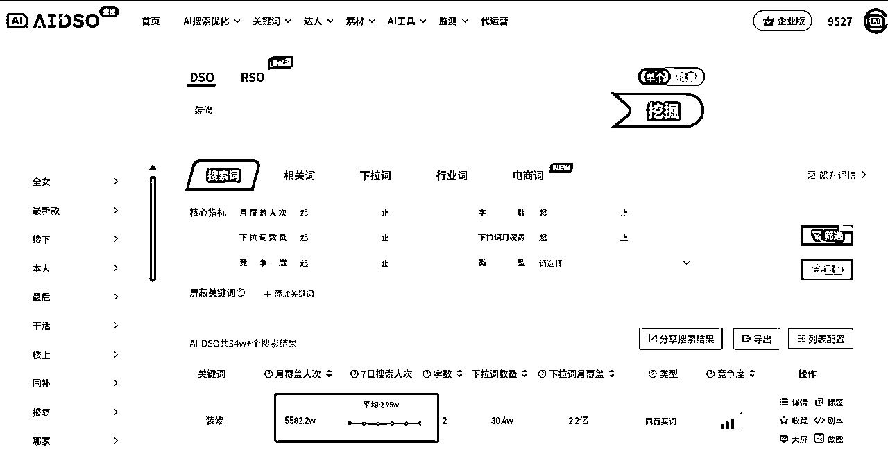

再看看行业核心词前几名作品的活跃度和点赞情况。

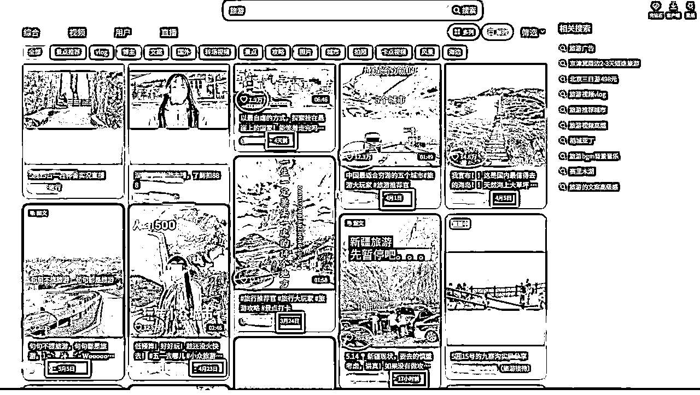

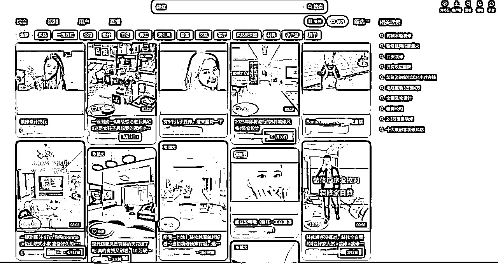

2、看头部账号/IP的流量占比。如果某个赛道的流量高度集中在少数头部账号手里，比如TOP 10%的创作者拿走了90%的流量，那说明这个赛道竞争已经很激烈了，新人很难冲出来。比如企业培训赛道的张琦就是典型的例子。附一句：不了解行业账号情况的，也可以去AIDSO上查。

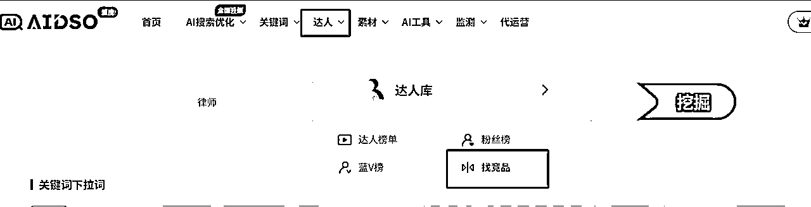

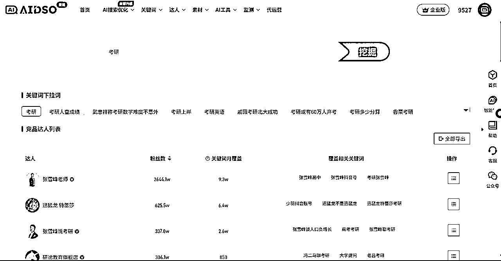

3、看有没有按DSO逻辑做内容的账号，以及这类账号的数量和权重。如果一个赛道里做DSO的账号已经很多，而且互动量和粉丝量都不错，那就要掂量一下自己能不能做得比他们好，如果不能，拿效果就会很难。

那怎么判断自己能不能做出成绩？先定义一个合格标准：能不能做出一条搜索流量占比90%以上的视频或图文。当然，这只是从内容角度看的门槛。做搜索流量的核心，最终还是看内容带来了多少线索、后端完成了多少转化。

想快速拿到成绩，两个因素很关键：一是行业的卷度，二是团队的认知水平和执行效率。行业的卷度，按前面那套数据分析方法基本就能看出来。不过话说回来，风浪越大鱼越贵，卷不一定就是坏事——越卷的行业，越会自动淘汰掉水平差的团队，留下来的玩家反而能把行业水平拉高。只要团队有相应的业务能力和执行力，打法又是对的，拿到结果只是时间问题。

1. 搭建符合DSO逻辑的账号

1. 抖音主页怎么装修

# 企业账号（品牌垂直号 and 人设型账号）

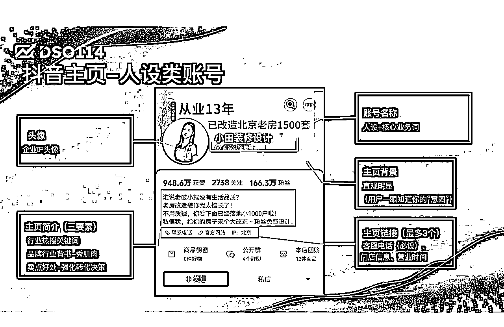

核心业务词必须放进账号里。

品牌账号的命名方式：品牌名+核心业务词+客服/咨询，给用户一个“这是官方咨询入口”的心理暗示。人设IP号的命名方式：人物名+核心业务词，像北京装修小龙哥、郑州老季二手房，就是这种路数。

简介部分可以套一个公式：A+B+C。

A=你的行业。行业越细分越好，要落到具体的消费群体和方向上。比较一下：卖衣服的不如卖女装的，卖女装的不如卖大码女装的，核心业务词就是“大码女装”。卖车的不如卖二手车的，卖二手车的不如卖精品二手豪车的，核心业务词就是“二手豪车”。

B=你的角色+个人背书（案例、服务等）。给自己定一个出场身份：打工人、老板、设计师、装修师傅、美妆达人、灵魂段子手，选一个最贴合自己的。背书就是你和同行比，到底强在哪，用户凭什么选你，也就是你的核心竞争力。

C=明确的消费者利益点（行为好处）。核心问题是：你的账号能帮消费者解决什么、他们能从你的内容里拿到什么。买大码女装的人，利益点是“穿得显瘦”，那你的承诺就可以是“让你显瘦20斤”。买二手豪车的人，利益点是“低价开好车”，那你的承诺就可以是“帮你低价开豪车”。

参考案例：

案例1：服饰行业——大码女装。150斤的大码女装店老板，13年女装工厂店，每天分享显瘦高档穿搭。进我粉丝群，领100款胖妹妹的穿搭风格！关注我，让你显瘦20斤。

案例2：汽车行业——二手车。我是车界老王，专注二手车行业20年，卖出二手豪车20000+，私信领取一份《选车避坑指南》，帮你低价开好车！

主页简介里要植入行业大词。公式是：企业/人设IP的背书+案例+福利+行动指令。

举例：

企业官方类：金夫人·中国人的婚纱照，全国400多家门店，超600万对新人口碑见证，高品质情感婚纱摄影品牌，全网热拍风格：三生三世/前世今生/目的地婚礼。

人设IP类A：深耕8年的室内设计工作者，免费设计/免费量房/免费报价，全国各地150+城市均可服务，私信免费领取设计名额。

人设IP类B：我是从事海南高端定制游7年、亲自接待8000+顾客的浩哥！兄弟局/情侣蜜月/闺蜜轰趴/家庭度假/公司团建，提供贵宾楼豪车接送｜专属管家独栋别墅｜游艇派对｜海陆空深度体验。您点击对话框的那一刻，我们的服务就开始了。

置顶视频1到2条就够，核心目的是“秀肌肉”：展示企业实力，或者讲品牌/创始人的成长故事。品牌账号适合展示机构背书（市场规模、官方认证、供应链优势等）加优秀案例，快速建立用户对品牌的信任。人设IP号则可以走“平凡英雄”的曲线，用经历引发共鸣——创始人/主理人出来讲故事，出身贫寒、创业路上吃了很多苦、最后做到了什么规模，这种叙事最能拉近距离。

# 个人账号

个人账号的逻辑和企业人设型账号一致，核心是强化人设背书（案例、服务），让用户看到一个具体、可信、有血有肉的人。

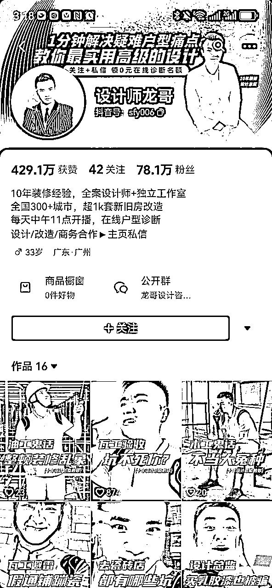

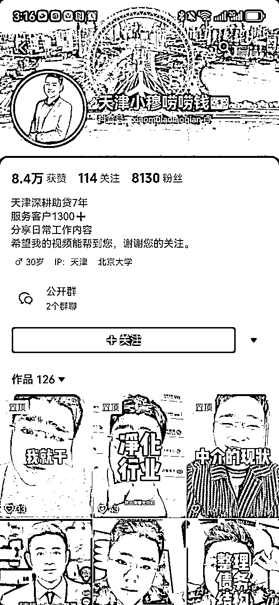

内容这件事，企业蓝V号和个人号遵循的其实是同一套底层打法，唯一的分水岭在于：前者能配置线索收集工具，后者没有这个入口。下方截图所示即为蓝V号线索工具的实际界面，至于蓝V从零到一的完整落地流程，后文会逐段拆开讲。

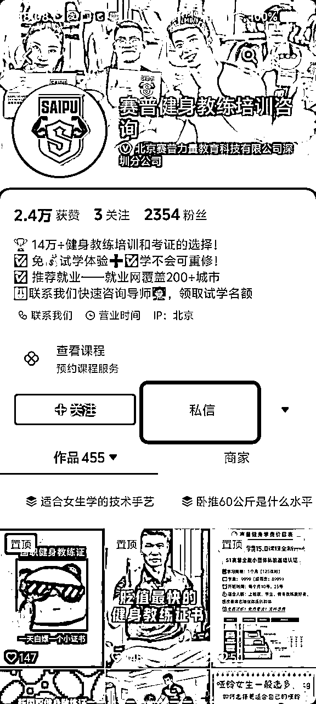

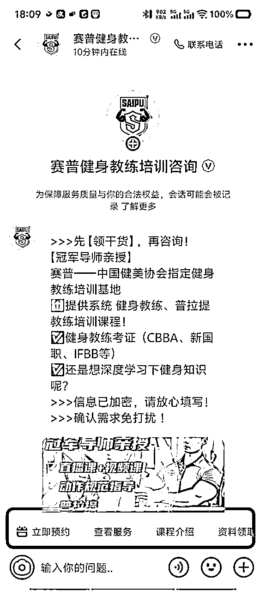

# 2.蓝V企业号基建：先想明白两件事

搭架子之前，有两道题得先给自己一个交代：

第一题，你所在的企业，凭什么让用户选你？说白了就是——别人给不了、你恰好能给、而用户正好需要的那样东西，是什么。

第二题，用户凭什么愿意把联系方式交出来？这就得给“提交线索”这个动作找一个站得住脚的说法，让他心里不别扭。

这两样，最终都要落到具体位置上：企业主页、进阶预约模块、私信开场第一句，以及后续应答的口径。

企业号线索版后台：https://leads.cluerich.com/

抖音企业号：https://e.douyin.com/

# 主页入口设置（运营工作台-店铺管理-主页装修）

客服座机：填一个能接电话的号码，用来兜住那些等不及的用户。

地址/门店：要做团购生意的，先在抖音来客把入驻手续走完。

门店认领：同样走抖音来客（https://life.douyin.com）

入驻要带的材料：营业执照、法人资料、门店信息，包括门头照片和详细地址。

# 商家主页：让用户三秒看懂你是谁

这块会直接摆在主页上，用户进来扫一眼，就知道你整条业务线在做什么。

版面里通常放这几样：主营项目打头、资质与荣誉、拿得出手的案例、真实的经营场所。

若选线索型商家模板，可装的模块有：

- 服务项目：把最核心的业务顶到最前，图和文案都要把好处说透
- 促销活动：到店即赠、预约有礼这类引流福利
- 实体门店：关联抖音来客
- 团队展示：适合有行业大咖坐镇的机构
- 相册：拍实景，别用网图
- 本地通：做生活服务类生意的建议打开

效果示意：

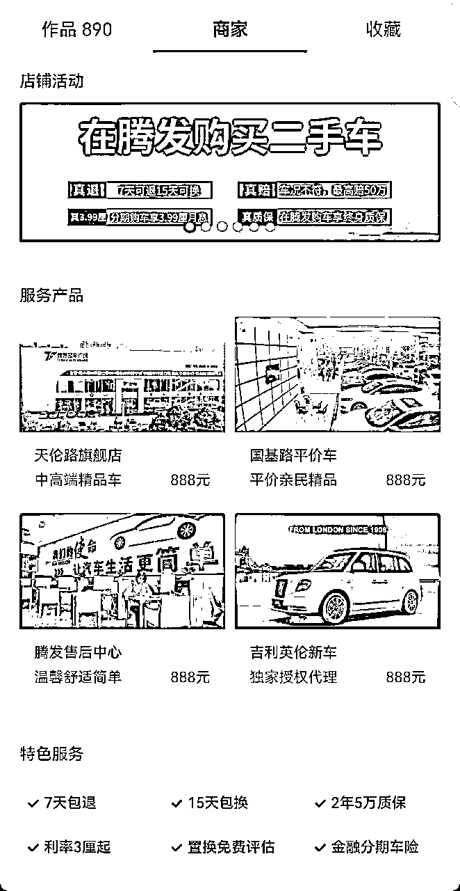

# 进阶预约组件：把用户需求稳稳接住

入口在：运营工作台-服务管理-高级预约组件

头图：得能戳中用户痛点，卖点一眼看清。可参考同行做法，也能用美图这类工具套个版式。

服务名称：这一条会出现在视频下方，值得反复推敲，字眼要有吸引力，比如“0元获取方案”“预约赠××”。

企业介绍：多大规模、干了几年、拿过什么成绩、提供什么服务，交代清楚。

产品说明：与头图口径保持一致。

可用门店：做本地生意的可以绑定门店，前提是抖音来客那边已入驻完成。

几个容易踩的坑：

其一，这个组件审核偏严，提交前务必把《企业号功能组件审核规范》过一遍。

其二，别把每项都填满，信息越密越容易被驳回，抓住重点即可。

其三，驳回后看不懂理由，找右下角官方客服，输入“人工”转接。

其四，主打业务最好单独建一个组件，别混着放。

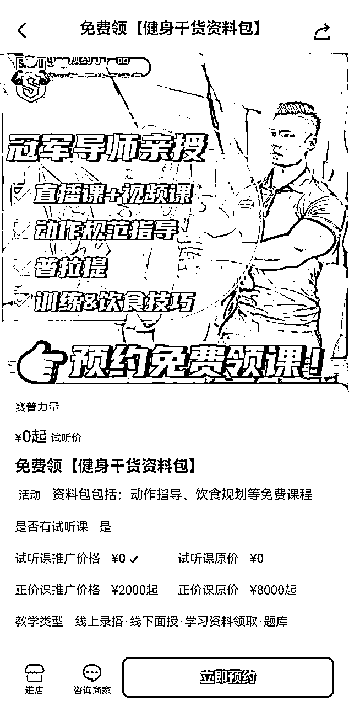

举个例子：优势栏写“冠军级师资”，利益点写“预约即赠体验课”。

# 客服环节：开场白负责破冰，自动回复负责接住

开场白的作用，是让用户愿意先开口。

一句好的开场，大致按这个顺序拼：问候 + 实力背书 + 能做什么 + 给点甜头 + 在线时段 + 下一步动作。

参考写法：您好，这里是天鹅到家，深耕家庭服务多年的大平台，与公安系统联网，选正规机构更安心。保姆、月嫂、育儿嫂均可上门。客服小鹅早八点到晚八点在线，随时一对一解答。恰逢门店周年庆，现在预约咨询还能领专属优惠！

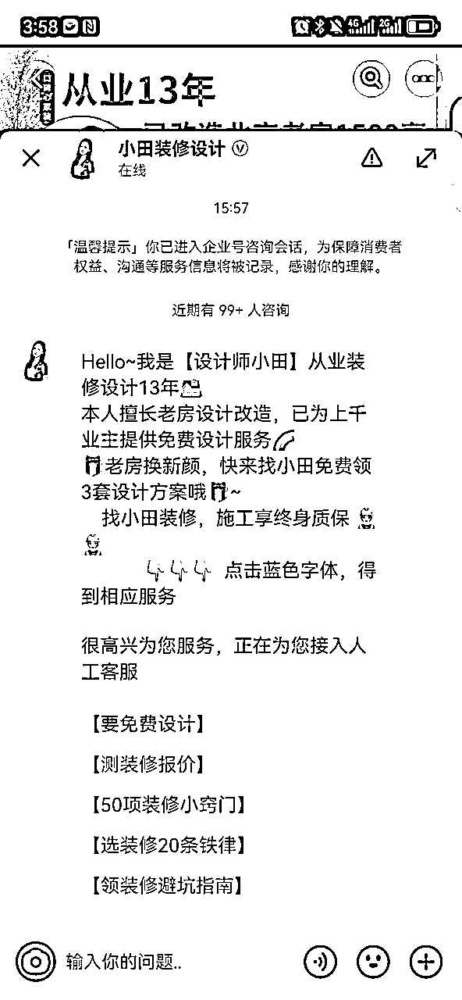

再比如，优势写“操盘经验 + 真实案例”，利益点写“免费出三套方案”。

自动应答这块：

入口一：运营工作台-咨询管理-自动化设置-关键词匹配

入口二：运营工作台-客服中心-智能客服-自定义知识

它解决的是效率问题——把用户常问的话提前备好答案。注意平台对3分钟响应率有考核，低于50%私信会被限流，这直接关系到线索能不能接得住。

两种常用玩法：

玩法A：开场白 + 提问引导

思路是让对话自己转起来，顺便把不精准的人筛掉。

设置位置：运营工作台-自动化设置-自动回复（进入对话/关键词匹配）

开场白里埋问题，命中词触发对应答案。

玩法B：开场白 + 表单留资

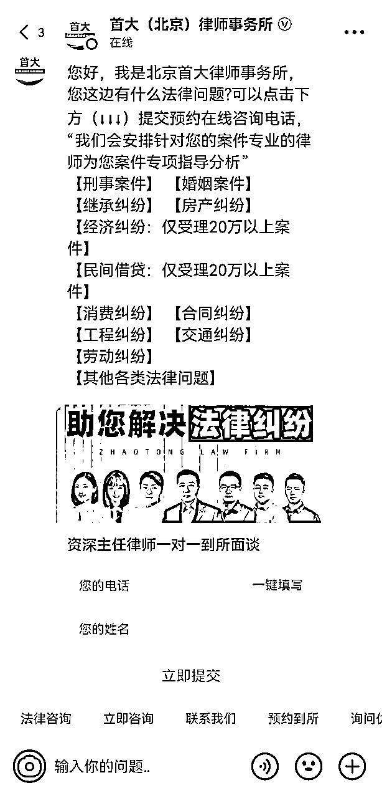

思路是让用户自己完成预约，客服不用一句句问。

设置位置同上，进入对话场景。

开场白挂上“进阶预约组件”或“一键留资”按钮，组件需先建好并通过审核才可选。

这类玩法更适合需求明确的行业，比如法律咨询、家政服务，用户本来就习惯在私信里把需求说清楚。

另外，巨量自家的客服机器人目前处于免费使用阶段，官方手册在这：https://csagent.oceanengine.com/dashboard

配置步骤：

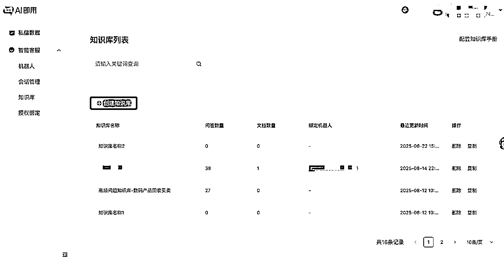

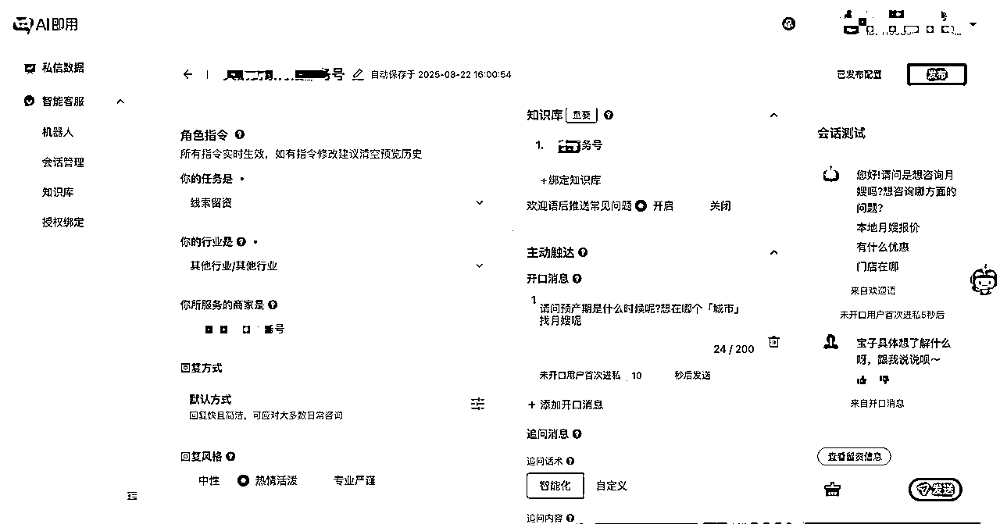

要点有三：

一是知识库，也就是常见问题与对应话术；

二是引导留资的指令，要卡在用户做决定的那一刻。例如用户最关心“我所在的城市有没有服务点”，对话就顺着这个点来设计；

三是边界指令，哪些话不能说、哪类问题不接、哪些情况换一种答法，都要写明。

# 独立店铺：挂在视频下方的门面

它能直接出现在短视频下方，观感接近抖店橱窗。

入口：运营工作台-店铺管理-独立店装修

装修上至少配齐四个板块，板块名字可以自己起：

- 背景图：让人一眼看出你是干什么的
- 预约：三个按钮可选——在线预约（绑定主营组件）、私信（跳转对话）、电话（接住着急的用户）
- 精选服务：把拳头产品放前面
- 案例展示：成交故事、名人推荐都行
- 服务类目：业务全填上
- 相册：放实景图

# 1.挑能带来转化的搜索词

先把词分成两类：

一类是业务词，直接对应你卖什么。比如做床垫生意，“买床垫”“床垫怎么挑”就是业务词；“家居软装”“床上用品”属于行业词。

要留个心眼，把不沾边的剔掉。“床垫回收”“床垫除螨”虽然也带床垫俩字，但来的不是买床垫的人。

# 2.找有流量的词

手工查的话，可以用AIDSO的关键词工具：https://www.aidso.com/

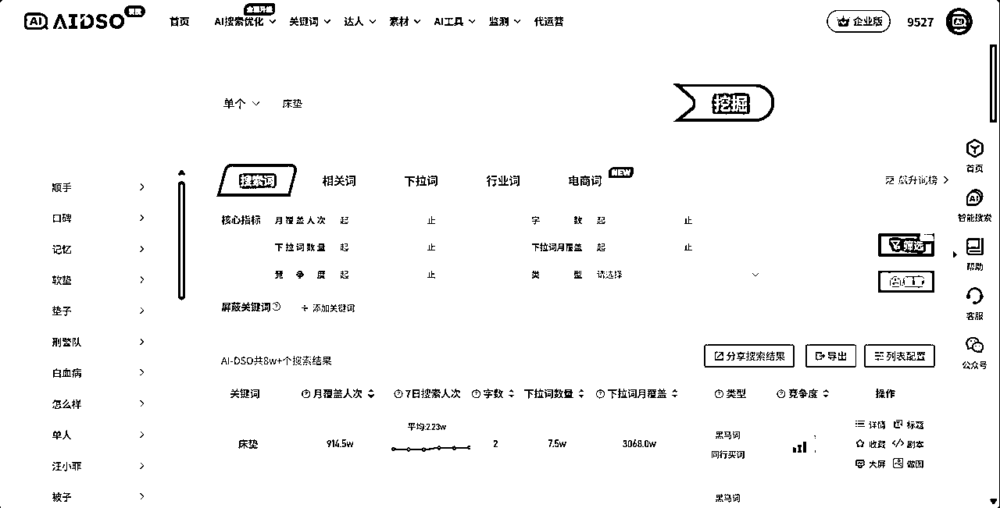

看四个数就够了：

月覆盖人次：过去30天，带这个词的内容触达了多少人。数字大说明池子大，但也意味着发的人多，排名未必好抢。

7日搜索人次：最近七天有多少人主动搜这个词。这个数越高，说明词越值钱，越值得去占位置。

下拉词数量：这个词能衍生出多少联想词。联想越多，你想挤进前排就越费劲，因为用户可能半路就被下拉词带走了。

竞争度：整体难度的一个综合值。

示意如下：

# 3.蹭热点和趋势

热点事件、流行风向、平台话题都值得跟。打个比方，某段时间露营火了，卖户外用品的就可以围绕“露营装备清单”“露营怎么吃”这类词做内容，借势收流量。

抖音热点榜、热榜话题页都能看，AIDSO上的飙升词榜也可以直接翻。

4.按账号的实际情况挑词

新号老号、权重高低，决定了你该看哪一档数据。一上来就盯着大词，大概率做不起来。参考示例里的数据区间，稳一点更靠谱。

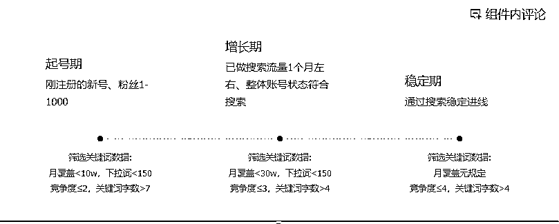

5.从对手身上找词

把同行或竞品的号翻一遍，看他们爆款视频的标题、描述、标签里用了什么词。重点盯这几个位置：昵称、简介、合集名、文案、封面、话题、置顶评论，出现频率高的往往就是有效词。

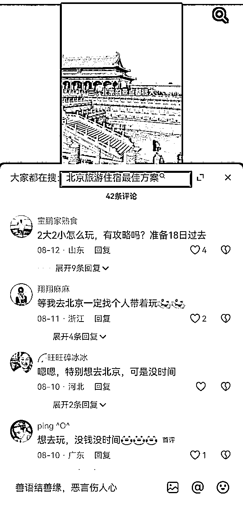

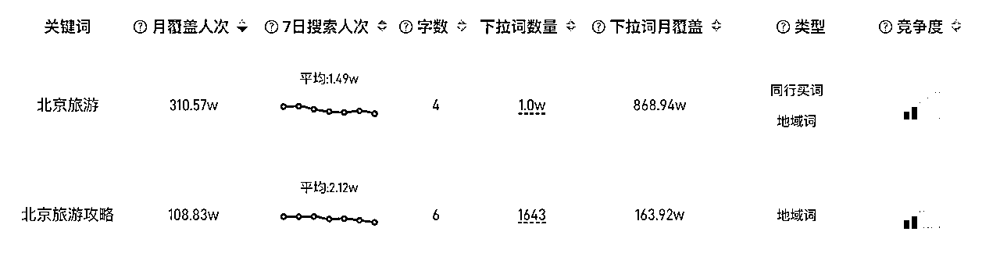

还有一个笨办法：直接在抖音搜索框里敲行业相关字眼，系统会自动补全。搜“健身”，底下会冒出“健身操”“健身饮食”之类，这些既有人搜，也有热度。

【新增】关键词库和行业案例，方便大家对号入座

不知道从哪下手的，可以先看大盘：

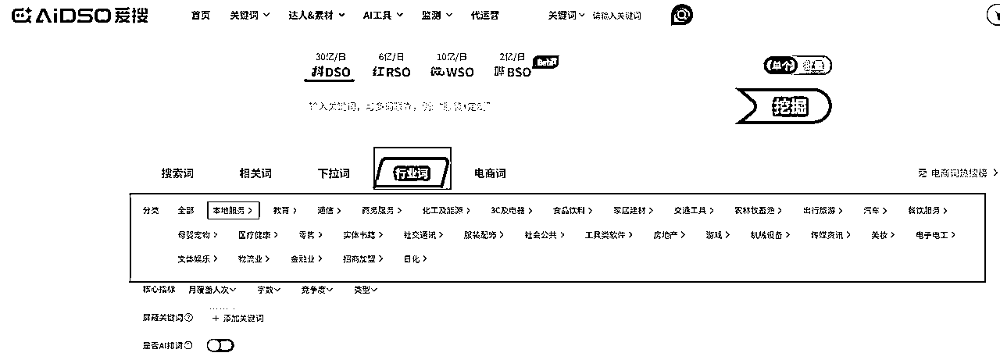

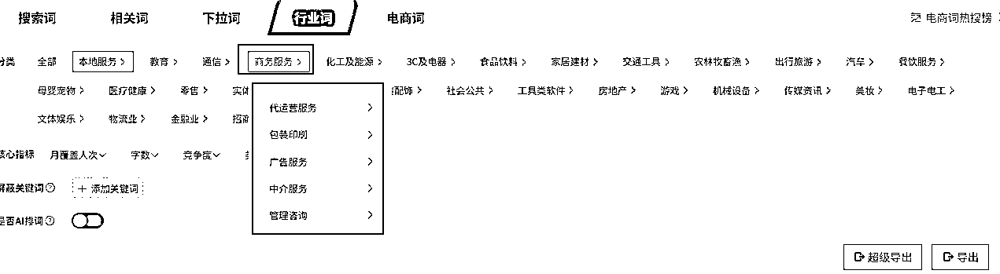

分行业举例，每个行业列十个还不错的词：

教培行业：

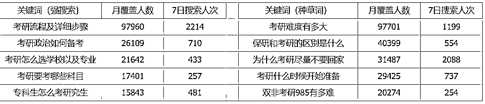

旅游：

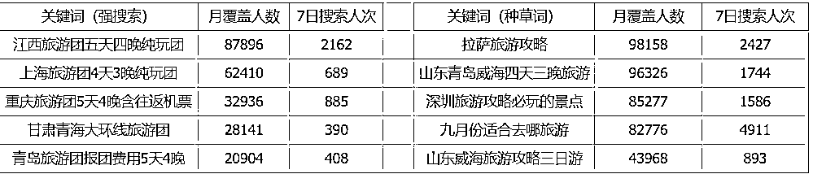

家装：

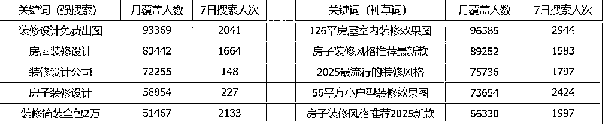

汽车：

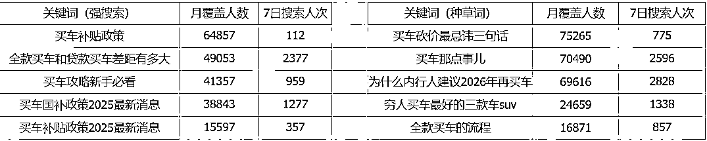

房地产：

本地生活：

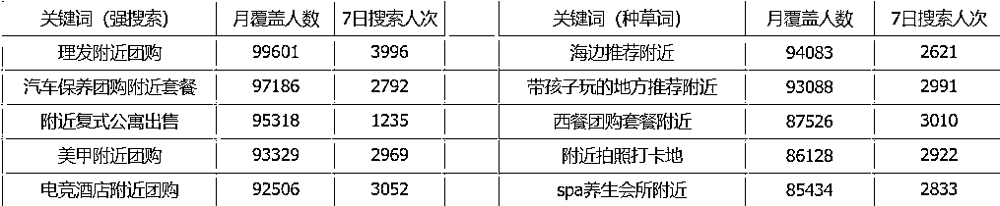

# 04.做搜索场景下的视频与图文

搜索场景的内容，和推荐流里跑的内容，不是一套逻辑。至于选视频还是选图文，最直接的办法是去搜一下那个词，看结果页前几条是什么形态——视频占多数就拍视频，图文占多数就做图。

✅ 结果页前几条是视频，这个词就适合拍视频

✅ 结果页前几条是图文，这个词就适合做图文

# 1.搜索型短视频怎么做

一条搜索向的视频，从口播文案到画面元素、字幕、背景板、封面图，乃至开头的黄金三秒，都要让那个词露脸。

# 1.1先把形式定下来

动笔写脚本之前，先想好这条片子长什么样。怎么想？把自己代入搜这个词的人，他想看什么；或者翻这个词排名前十的作品，形态一目了然。

拿“考研怎么选学习以及专业”这个词举例：

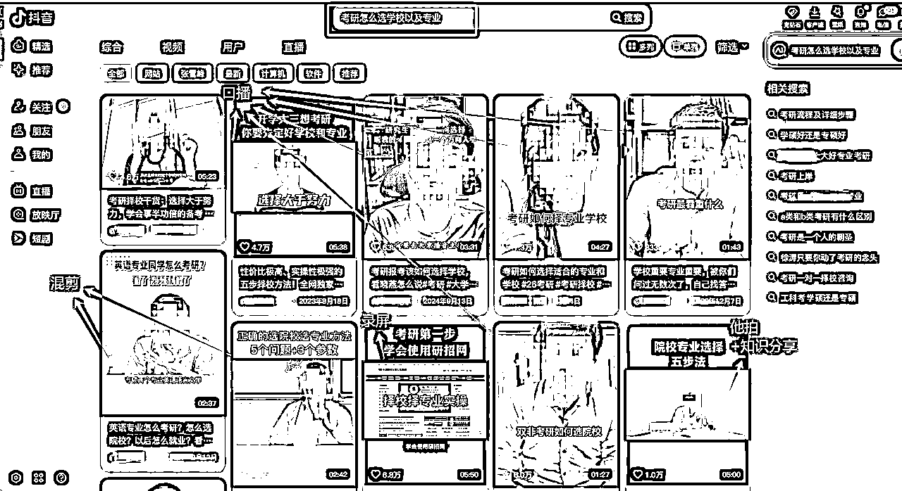

在抖音搜一下，结果如上。

第一步，看前几条是什么形态。这个词下面出现了四种，打头的几条都是真人出镜口播。

第二步，判断自己能不能做口播。能做，就接着研究他们讲了什么，然后自己写脚本（切记别照搬）；做不了，就从剩下几种里挑一个自己拿手的。

原则很简单：哪个形态在场内最多，优先做哪个；再结合自身定位做取舍。

下面几种形态供参考：

剧情类（Vlog）：编一个有小转折的故事，搞笑、悬念、情感、励志皆可。比如词是“0成本创业做什么”，就讲一个人职场翻身的过程，顺带把你能帮上什么忙带出来，让人有代入感。

口播类：全靠一张嘴，资讯播报、观点输出、讲故事都行。时事评论员聊热点就是典型。这种形式门槛低，各行各业都能用。

技能教学：教真东西，做饭、健身、化妆、拍照、乐器都算。比如词是“健身教练证怎么考”，就把考证流程一步步演示出来，中间自然带出你的服务，观众学完就来找你。

知识科普：把本行的门道讲明白，历史、科学、理财、法律常识都可以。比如词是“怎么入门投资”，用案例把供需关系讲透，再给点实用小知识，观众觉得你有货，自然信你。

混剪类（录屏、素材混剪）：几段素材拼起来，配上音乐和旁白，凑成一条有主题的片子。比如词是“北京旅游团”，把各地拍的风景剪到一起，再植入自己的产品，感兴趣的就会来问。

# 1.2写脚本的讲究

写的时候心里要装着那个词：开头三秒必须出现，中段尽量多露，收尾再点一次。没写过脚本的，可以借AIDSO的AI脚本功能，把词丢进去，它会给你一版参考。

# 1.3剪辑环节

工具用剪映就行。字幕、特效都围绕那个词做文章，别喧宾夺主。没剪过片的，各大平台教程一抓一大把，这里就不啰嗦了。

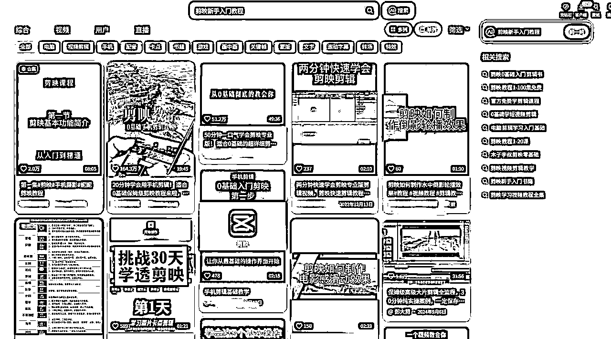

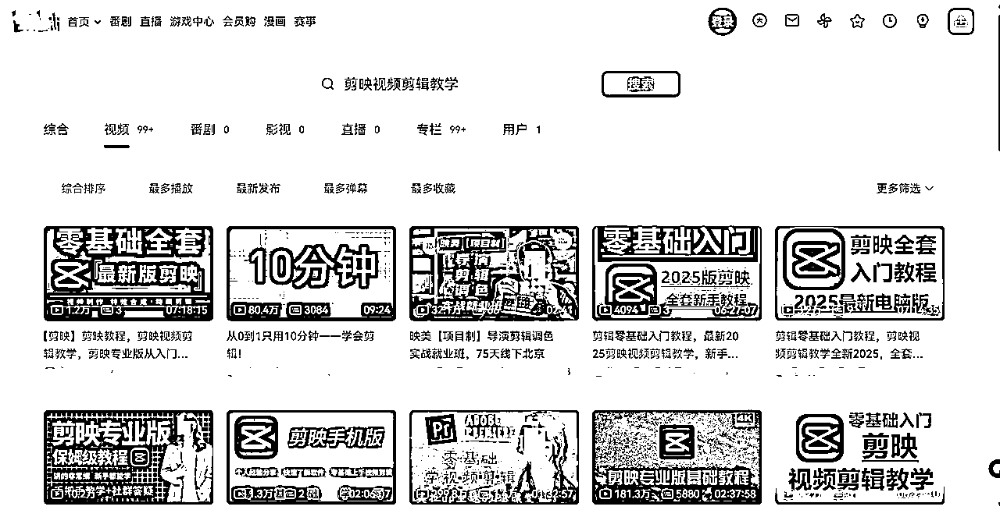

# 2.搜索型图文怎么做

图文的战场主要在标题、正文和封面上，这三处同样要把词嵌进去。

# 2.1模板与形态先定好

和视频一样，动手前先把形态定下来。代入搜索者的视角，或者看这个词前十篇图文长什么样。

拿“三天两夜旅游推荐”举例：

搜索后的结果如上。

第一步，拆解前几篇的封面套路，大致能归成三类。

第二步，去素材站找图，照着做类似封面。

第三步，打开美图秀秀、醒图、可画这类工具找模板。点开排名靠前的几篇看看内容，摸清受众口味，再挑他们那个年龄段吃得下的风格。

# 2.2内容从哪来

内容要贴着词的搜索意图写，可以去别的平台找参考。

举个例子，你做考研培训，词是“考研怎么选学校以及专业”：

先问自己，谁会搜这句话？

再想，他搜这句话是想解决什么？

最后想，怎么借这个词把你的业务自然地种进去。

把这些想清楚，文案和配图素材也就有了。

# 2.3动手做图

工具可选美图秀秀、可画、醒图、稿定设计。

几条硬要求：

- 每一张都带上那个词
- 一组三到六张
- 图要清楚，比例3:4，和📕一致
- 素材别糊，字号要让人看得清
- 图文比例别失衡

几个注意点：

- 颜色别太杂，主色加邻近色就够
- 除封面外，内页模板保持一致

以美图秀秀电脑端为例（手机端操作类似），打开美图设计室：https://www.designkit.com/

新建画布点“创建设计”，尺寸选📕封面即可。

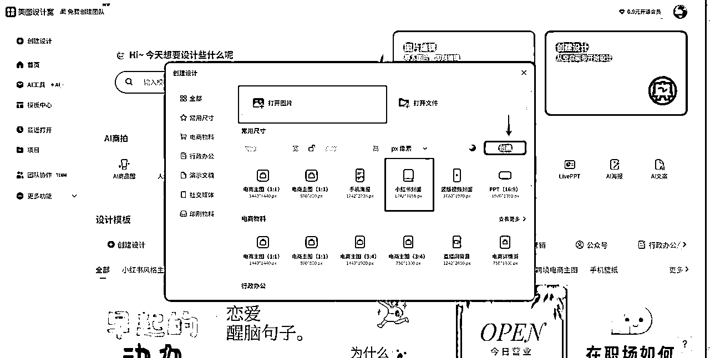

进入编辑界面就能开工，左边是编辑栏，右边可以复制或查看每一页。

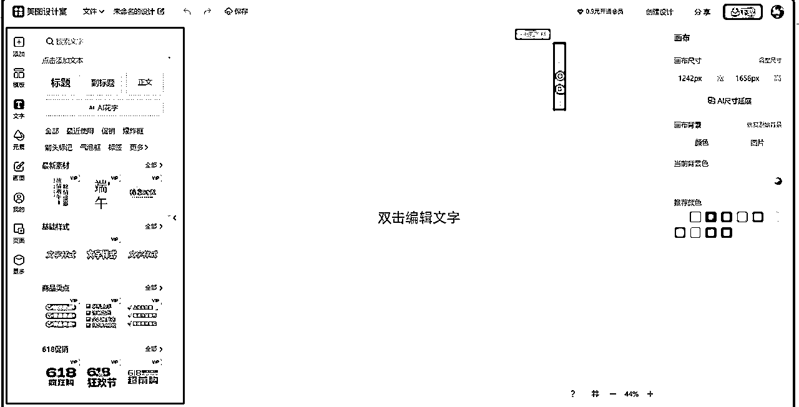

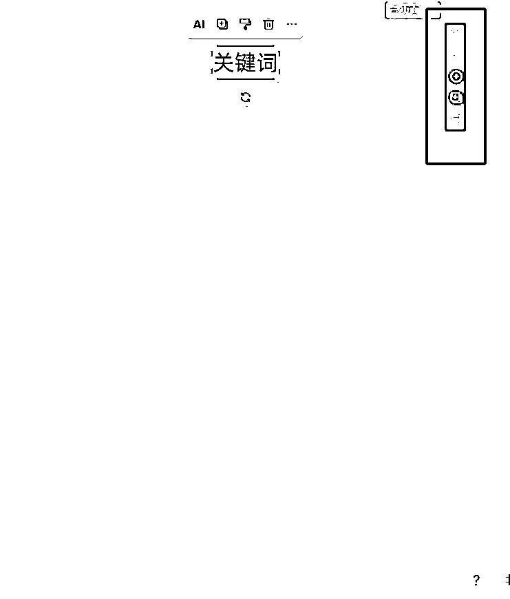

也可以跳过自建，直接挑模板改。

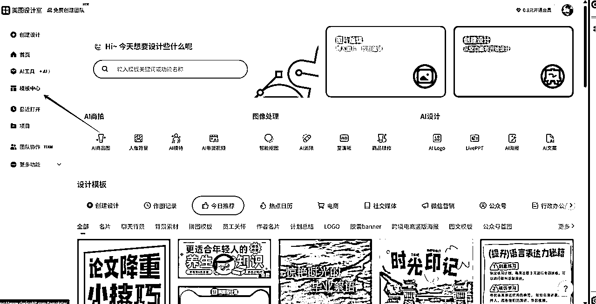

把字和图放上去，点右上角下载，整组图就导出了。

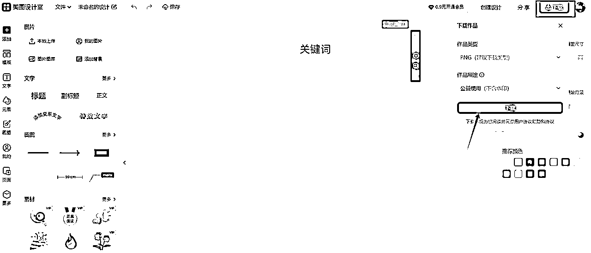

想回头改，作图记录里点一下就能接着弄。

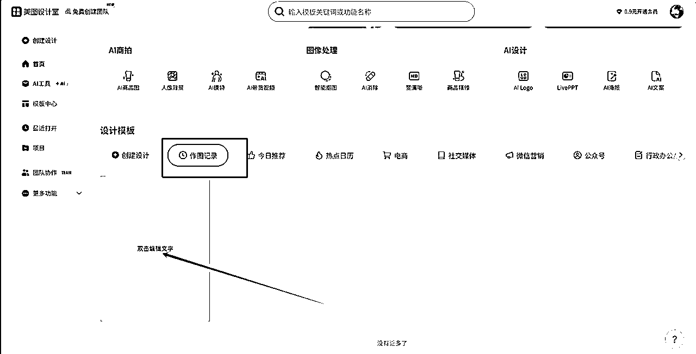

整体节奏建议：封面 → 解释词 → 解释词 + 补充信息 → 抛业务钩子。

封面是重中之重，得摸准搜这个词的人在想什么，让他愿意在结果页里点你。

# 05.发布环节

# 1.挑对发布时间

先摸清你的目标人群什么时候在线，赶在他们活跃前一到两小时发。

比如面向大学生，他们起得晚、空闲多，九点到二十三点是高峰期，这期间多发几条。面向上班族，就得顺着他们的休息节奏来，通勤、午休、睡前都是刷手机的点。

实在拿不准，新号就多试。盯着数据走势，看哪个时段互动更好，试几轮规律自然就出来了。新号建议每天五到七条，早上六点到晚上十点，两小时一条。

# 2.文案怎么写

手机端直接点发布编辑，电脑端进创作者中心后台。

标题：完整带上那个词，前后可以加修饰，但整体意思不能跑偏。

正文：词出现一到两次就够，通篇要围绕它说事，别硬凑。

话题：第一条必须是那个词，剩下四条放行业相关词（从词库里挑）。哪怕这个话题当前使用量为零，也要挂上。

参考案例（词为“专科生怎么考研究生需要什么条件”）：

# 3.合集别忽略

合集的价值不小：它能把底下的作品聚在一起加权，还能延长内容的生命周期。

合集同样要围着词转：名称、封面、简介，三处都得有。

名称里只放那个词；简介至少提一次；封面要让词醒目地露出来。

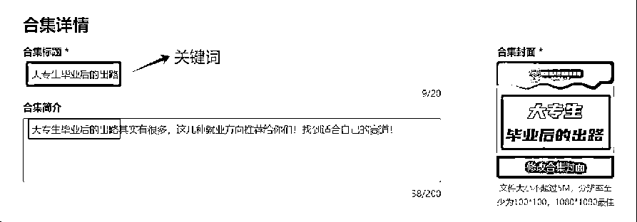

合集入口在抖音创作者后台（https://creator.douyin.com/）的“内容管理”下方。

发布DSO内容前，先用《DSO作品发布前检测表》过一遍；圈内朋友可通过文档链接复制后自用。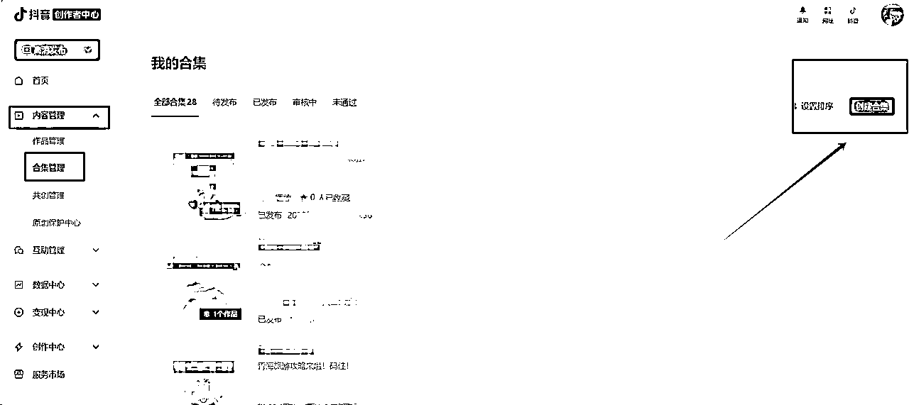

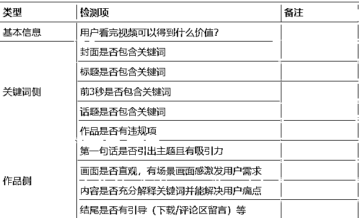

# 4. 发布流程

先以电脑端演示；手机端直接打开抖音，点底部“+”号即可发布。

进入创作者后台（https://creator.douyin.com/），扫码登录账号。

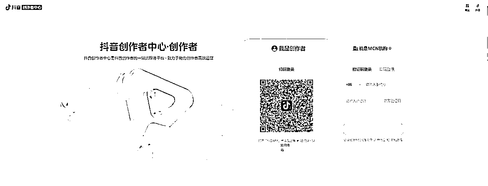

点“高清发布”。

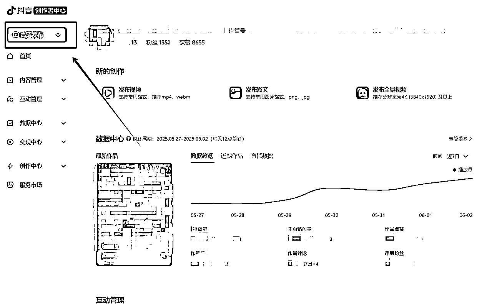

把成片或图文素材拖进上传区。

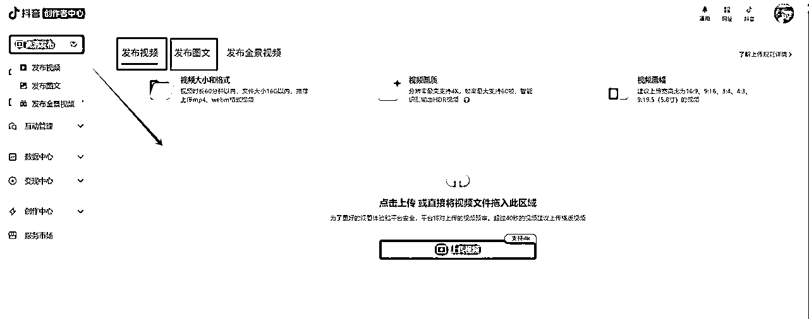

补标题、正文（按4.5.2的标准），再设封面、挂合集（操作见4.5.3）、选配乐等，确认后发布。

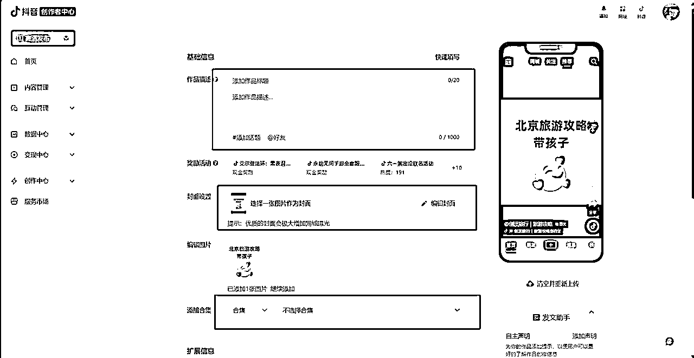
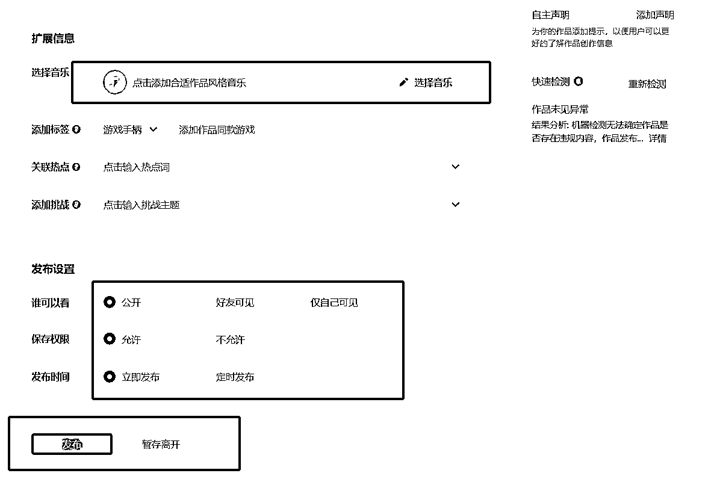

# 01. 引流打法

## 1. 本章速览

这一章围绕“怎么把人引来、怎么接住转化”展开，边学边练。按航线图，花约1天先弄懂流量转化方式，然后动手准备。

## 2. 五条引流路径

**路径一：选准词+内容做扎实**

拿装修行业举例：借助AIDSO筛出“一儿一女两室装修”这个搜索词，发现它有量且竞争不算激烈，再围绕它做内容，就更容易触达正筹备儿童房的家长。创作时甚至可以先把用户画像想清楚：年龄层、家庭结构、期待的家居场景。带着画像做内容，吸引来的人会更准。换成任何行业、任何赛道，这套“选对搜索词+产出好内容”的打法都成立，这也是DSO的独特价值。

**路径二：选准词+借势热点**

除了常规做词，热点也能借力。人对娱乐八卦天生敏感。若某个热点方向正向，又与自家品牌、产品相关，就可以快速跟进。这样产出的DSO内容，往往既有流量又相对精准，引流效果不差。

**路径三：按DSO思路换内容形态**

搜索流量内容不限于一种样子：图文、剧情、口播、技能教学、混剪都可以。技巧是：在AIDSO搜到想做的词后，点开看排在前面的内容以什么形态为主——图文占多数就做图文，口播占多数就做口播，依此类推。跟着平台大盘反馈走，方向更稳。

**路径四：优化顶部固定词和蓝字跳转词**

先解释两个概念。顶部固定词，就是用户看完视频后搜得最多的那个词，也叫“看后搜”；热度足够高时，它会出现在视频上方，页面滑动也不离开，带半透明底框。蓝字跳转词，则是评论区里呈蓝色、点一下能跳页的词。

发布时，可以把标题或核心词顶到吸顶位，抓住观众注意力；系统也可能从视频内容里自动抽词作推荐。还可以请身边人先看作品，再搜你想曝光的词，操作时注意换不同IP、切到数据流量。蓝字跳转词怎么来？在评论区发某个词，长按后选搜索，重复15—20次，有机会触发。

**路径五：用线索组件和资料包承接**

做搜索流量，我们通常建议申请蓝V，目的就是拿到线索组件能力。开通后可以设引导话术、欢迎语，既方便接住有意向的人，也能留下联系方式，便于后续再触达。教培赛道尤其适合在蓝V号挂资料、测评表，能多吸引一批关注者，这招在教培圈一直很管用。

# 02. 转化怎么接

转化想做好，账号地基要先打牢：蓝V、简介、线索组件、引导话术、欢迎语、资料包，提前配齐。老话说“工欲善其事，必先利其器”，准备到位，成交率才有底。

本地生活、家政等服务，客单不高、决策快，客户在后台留言后，先用信息组件自动应答，再让客服跟进答疑，把人引向私域，或直接推着下单。示意：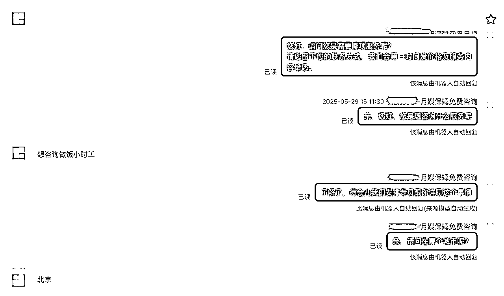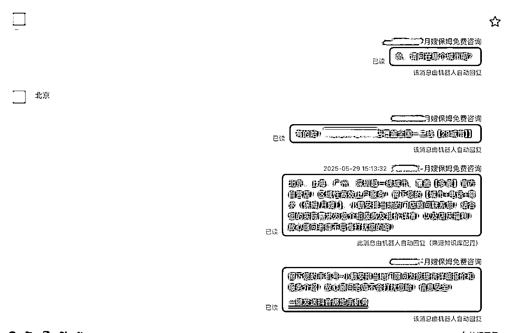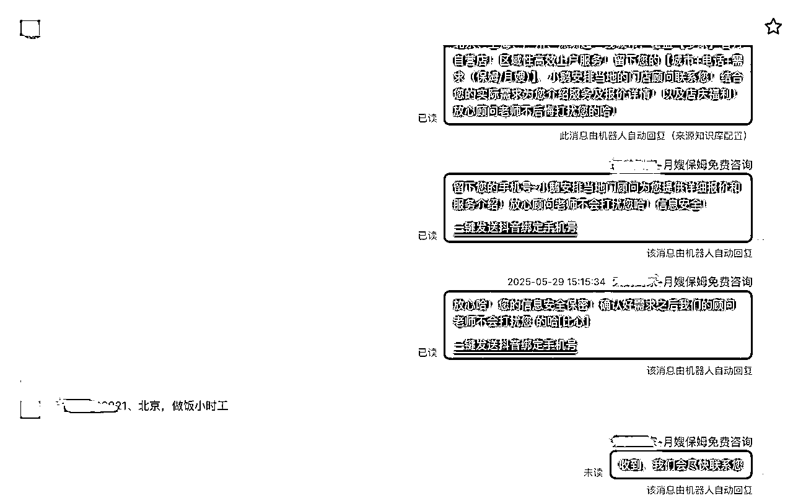

律师、贷款、礼品定制等，客单高、决策链长，更适合先在后台沟通，再引到私域慢慢承接。这类业务平台管得严，私信里直接成交容易踩违规线；更关键的是，私域朋友圈能持续影响用户心智，1对1沟通也能给出更专业、更个性化的方案。

教培、国学、身心灵疗愈等赛道，同样建议先导私域再成交。它们往往有二次、三次追销，想持续升单，就得把意向客户沉淀成自家的人群资产。后续做需求调研、推新品、做销售，这批资产都会派上大用场。

整体看，搜索流量要转化好，后端得有专业销转团队。搜索来的流量通常更精准，也更容易成交，所以每一条都值得细运营。销售要熟产品，再配合朋友圈经营、1对1答疑、优惠政策和适度逼单，效果会更明显。公司层面，一边打磨产品与服务，一边搭好激励和培训体系；即便有人离职或遇到突发情况，项目也能照常跑。各家公司产品不同、团队体量不同，建议按自身情况查漏补缺。注意：以上方法仅供参照，具体承接形式请结合行业实操，有问题群里聊。

# 01. 每天盯住词条的视频表现

## 1. 本章速览

内容发出后，要持续看目标词的流量变化，再分析、优化、抬数据。按航线图，学习持续监测和排名优化约需1—2天，现在可以开始准备。

## 2. 词条维度

**看排名**

路径：AIDSO（抖音搜索选词工具）→“监测”→“监测排名”，查看你的词条处在什么位置。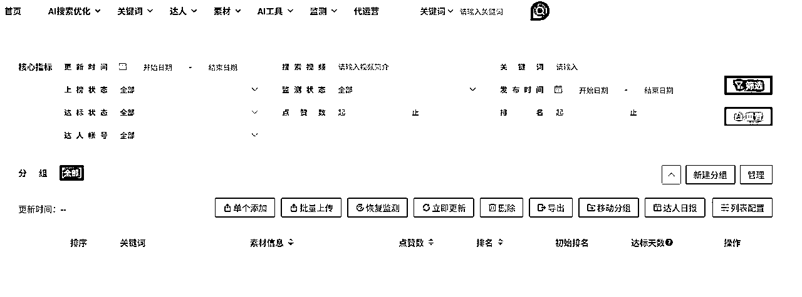

每天记录目标词整体排名，导出日报。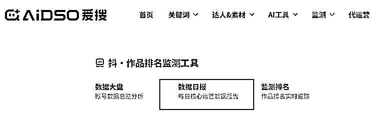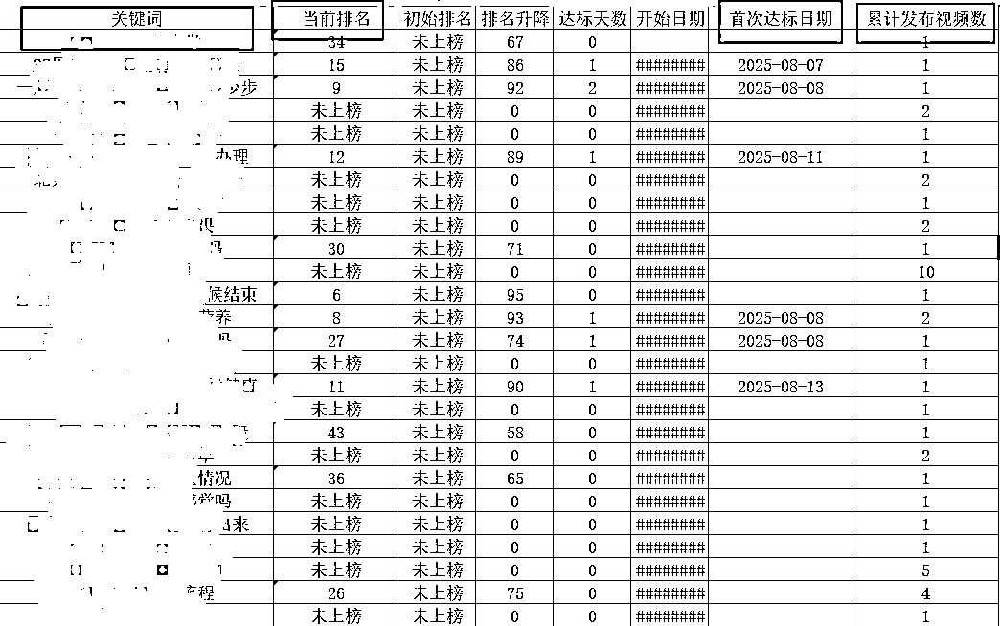

**日报反推优化——没上榜时**

若目标词尚未上榜，先看是否已有部分词进入前100，算初步覆盖。再把优先想推的词挑出来，检查该词累计发布过多少条视频：

- 只有1—2条，就再补1—2条，观察名次变化；
- 已有5—10条甚至更多，就逐项排查：合集建了没有？内容里是否完整带到该词？漏了就补再看；没漏就换内容形态，当前形态可能不受欢迎，同时看看竞品封面和内容；账号整体流量也要看，若作品播放普遍很低（不足100），上榜概率会偏低；再查该词近7天是否还有搜索人次；还要看该词下作品点赞量，若普遍很高，想超过就难。

**转化情况**

至少每周汇总一次。企业号后台走“数据分析→BI工具→图表”，导出视频维度报表（播放、锚点点击、组件预约、私信留资等），再按首个#话题（目标词）拆分，做数据透视。

## 【新增】3. 内容维度

**图文指标**

先看划走率。超过50%，通常说明作品价值感不足、内容没紧扣目标词，用户看完就滑去别处。后台一旦发现这类动作频繁，作品就难被判定为该词下更匹配的内容，排名也难上去。

再看文案完读率。低于60%，说明逻辑或词条匹配度缺乏吸引力；若转化点放在末尾，用户可能还没看到就走。此时要判断：是内容不感兴趣，还是形式有问题（字太多、图太多）。

**视频指标**

2秒跳出率高于50%，说明开头3秒没抓住人，要围绕目标词重做前三秒。

**搜索流量关键指标**

进入作品数据分析，继续看：综合搜索流量占比、搜索额外流量，以及系统推荐词、看后搜词。

**搜索流量水位测算**

用途：判断一条作品从目标词那里吃到了多少搜索流量。前提是作品已上榜，且搜索流量占比大于60%。公式：每日作品推流×综合搜索占比×关键流占比÷7日搜索人次＞60%，高于该值才算达标。

# 【新增】02. 数据迭代

## 1. 稳住核心词占位

### 1.1 一题多面

围绕核心词展开多个选题角度和呈现方式，例如晒过程、教知识、说观点。

拿“5平米卫生间装修多少钱”来说：

- 晒过程：从设计、选材、施工细节到价格汇总，全过程展示；
- 教知识：用专业输出教人选材、避施工坑，并给出报价预估；
- 说观点：从专业视角点评行业乱象，如忽悠业主、报价信息不透明等。

### 1.2 多号协同

企业号+员工号+KOC（关键消费领袖），形成多视角覆盖。企业号做垂直内容；员工号以专业身份展示服务；KOC从消费者角度做产品/服务测评分享。

## 2. 用转化数据倒推动作

每天看账号后台作品数据，弄清哪些词带来了转化。

若某词转化表现好，先确认它是否上榜。没上榜，就多做几条，让该词下密集出现你的作品；已经上榜，也要继续补量，把转化再拉高。

## 3. 让数据反哺内容

### 3.1 目标词

看视频数据时，还要留意用户通过哪些词进来、看完后又去搜了什么。这些都是后续要盯的词；如果某条作品数据好，这些词也值得做。

### 3.2 账号优化

有线索进来后，持续看账号开口率，入口：https://leads.cluerich.com/pc/analysis/message

开口率=私信会话开口次数/进入私信会话次数。开口率低，通常要优化欢迎语：用户既然点进私信，本来就有咨询想法，要找出他为何不愿先开口。

私信线索转化率=私信线索量/开口人数。转化率低，就查客服环节：用户已经开口，复盘哪一步导致他不留联系方式。

# 01. 提效工具、多平台分发与团队管理

## 1. 提效工具

**文案**：AIDSO（https://www.aidso.com/）、Deepseek（https://chat.deepseek.com/）、豆包（https://www.doubao.com/，支持文案+文生图）。

**制图**：AIDSO一键生图（https://www.aidso.com/keywordImg）、美图设计室（https://www.designkit.com/）、即梦（https://jimeng.jianying.com/）。

**视频**：即创（https://aic.oceanengine.com/）、剪映（https://www.capcut.cn/）、超级编导（https://superdir.cn/）。

## 【新增】2. 一鱼多吃：同步📕、视频号

各平台搜索的底层逻辑相通：选词、做内容、转化产出。掌握抖音搜索内容的生产技巧后，复用到📕和视频号完全可行。

先回顾抖音搜索内容的制作要点：视频文案、画面、字幕、背景区、封面、前3秒，这些位置都要尽量覆盖目标词。

发布标准：

- 标题：包含完整目标词，可加前缀或后缀，整体符合词义。
- 文案：自然出现1—2次目标词，全文围绕它展开，不要无意义堆砌。
- 话题：第一个话题必须是目标词，其余4个可放行业相关词（取自词库）；哪怕该话题应用量为0，也要用。

案例参考（目标词：专科生怎么考研究生需要什么条件）。

合集也要围着目标词做：合集名只填该词，简介至少出现一次该词，封面含该词且醒目。

做📕时，抖音发过的内容通常能直接搬，不用改。但📕审核比抖音严；遇到卡审，就调整标题、正文等可能触发审核的信息，比如加表情符号、换谐音字或用拼音替代。调整后再发，依然是搜索逻辑。

视频号同理，抖音内容可直接同步。不过视频号更偏短视频；若你做的是纯图文，建议先“视频化”再发。

看个实例：某卡通头像生成账号，抖音内容搜索流量占比83.9%，搬到📕后为61%。原因是两个平台词库数据不同、用户调性也有差异。所以，并非所有在抖音搜索占比高的内容，换平台后也一定高。但这不妨碍“一鱼多吃”：搜索反映的是真实需求，只要需求洞察到位，再按平台调性微调，同样能做出以搜索流量为主的DSO内容。

左边是抖音内容，右边是📕内容。

各平台搜索内容的生产方式一致，核心仍是选词——选词大于一切。想一鱼多吃，关键在理解不同平台的规则与调性，做出适配内容，才不容易被平台限制。

## 【新增】3. 降本增效与团队管理

若想带团队一起做抖音DSO，可参考以下管理素材：优秀「DSO运营」能力图谱；DSO运营执行日程；DSO团队管理考核指标。

# 01. 账号拆解实例

**实例一：某票务账号**

行业：娱乐赛道—票务服务

效果：单条作品吃下目标词60%以上搜索流量。

组合拳：快速反应（追热）+精准词布局（行业词）+人工干预（评论区运营）。

**实例二：某律师账号**

行业：律所

效果：靠“工程款清欠办全国热线”这一词成功霸榜。

**实例三：爱律维**

行业：律师

效果：在DSO加持下，月留资线索5500+（精准垂直线索）；80%发布内容已拿到目标词排名；综合搜索页流量来源占比91%以上；0投放时每日新增线索100+，数据仍在稳定增长。

**实例四：多比特象棋**

行业：APP

效果：首月APP下载1000+；80%发布内容已拿到目标词排名；综合搜索页流量来源占比75%以上；0投放时，后期每天新增下载量80+，数据仍在稳定增长。

**实例五：两狮摄影**

行业：本地类+摄影拍摄（婚纱摄影）

效果：留资线索200+（精准垂直线索）；70%发布内容已拿到目标词排名；综合搜索页流量来源占比85%以上；0投放时完成高客单高频转化，数据仍在稳定增长。

**实例六：赛普**

行业：健身培训（证书培训）

效果：

# 不投广告，线索还在涨

先看整体成绩：项目启动首月拿到1000+条有效留资，线索垂直度很高；进入稳定期后，每月线索量维持在3000+。已发布视频中，约80%在目标关键词下拿到排名，综合搜索页贡献的流量超过95.5%。全程没有付费投放，日均新增线索仍有80+，正效性5%，而且各项数据还在稳步走高。

**天鹅到家｜家政服务**
- 首月收获300+条精准垂直客资，稳定后每月线索量保持在3000+。
- 已发布内容里，八成左右拿到了目标关键词排名。
- 综合搜索页流量占比90%以上；不做付费投放，每月仍新增3000+条线索，数据继续增长。

**洋葱学园｜线上教育**
- 单月短视频曝光500万—1000万+。
- 半数以上作品，综合搜索页带来的流量占比在85%以上。
- 零付费投放时，每天新增App下载50+，数据保持上升。

**引力星球｜小游戏APP**
- 单月短视频曝光500万—1000万+。
- 半数以上作品，综合搜索页带来的流量占比超过90%。
- 没有付费投放，日均新增App下载50+，数据仍在增长。

**住小帮｜装修设计—APP下载**
- 三个月累计短视频曝光2000万+。
- 半数以上作品，综合搜索页带来的流量占比超过80%。
- 零投放情况下，每天新增App下载400+，数据继续走高。

**豆包｜AI软件—APP下载**
- 通过多账号矩阵发布视频，首月曝光660万+。
- 已发布内容中40%拿到目标关键词排名。
- 综合搜索页流量占比91%以上；不做付费投放，日均新增App下载2700+，数据仍在稳定增长。

希望各位都能跑顺这套项目流程，把获客效率提上去，解决抖音获客难题，一起龙哥盟！