# 零基础入门 Google SEO实战手册202509

> 资料出处：飞书文档

项目说明

## 1. 先弄清 Google SEO 在做什么

Google SEO 说白了，就是借选词、站点骨架、单页细节、站外链接等动作，让网页在谷歌结果里更靠前，从而拿到免费自然访客。这期航海会带你把基础流程完整跑一遍；实践走完，入门框架基本就能搭起来。


## 1. 为什么值得投入 Google SEO？

本期重点不是速成，而是把基础框架串起来，让你对站点打磨形成整体认识，再拿它去改善谷歌表现、名次和自然访问。AI 让海外站点冒出不少新机会，追新词拿访问确实是捷径；但拿词只是其中一环。若情报慢半拍，或做的是成熟诉求，怎样靠搜索拿访问才真正触及门槛。本期更看重体系：先建立 SEO 认知，再优化项目、做增长，而不是只跟趋势做项目。

SEO 没有一夜暴富，通常要三个月以上持续投入，站点访问才会健康上升；它比广告、达人营销、爆款短视频都慢。为什么仍要做？主要有三点：

# 2.1 优势之一：成本较低、能持续的自然访问来源

与达人投放、Meta、谷歌广告相比，SEO 对海外项目仍是可行的自然访问来源；不必持续烧钱，也能带来稳定访问。但它并非完全零成本：想名次靠前，站外链接建设、站点推广仍要预算，效果才更好。只是相对其他营销方式，投入更低。

# 💡

主要成本：域名费 + 站外链接费 +（客座投稿）+ 个人时间。

# 2.2 优势之二：访问稳、持续久

搜索系统按名次分配点击，因此 SEO 访问稳。站点在某词拿到较前位次后，只要定期维护更新，名次通常能保持，访问稳定在某一水平；即使词热度下降，访问下滑也是渐进的。所以值得投入。这是我 3 月上线的站点，词热度虽有回落，但趋势很稳。

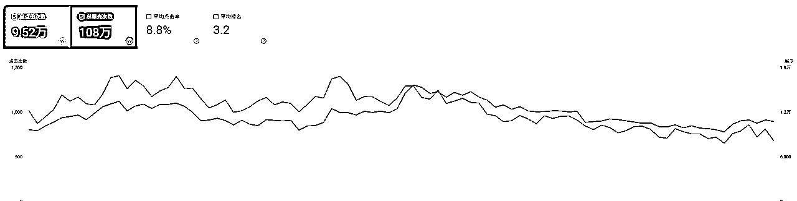

# 2.3 优势之三：规则客观，新手友好

国人做出海，天然隔着一层文化差异，海外人群习惯不易吃透。SEO 相对客观：用工具看查询热度，再理解满足诉求的服务形态，就能开始拿访问，不必深挖访客心理，也不用复杂访谈。对出海新手，这是较容易上手的营销渠道。

## 1. 学习路径怎么分

不同起点的人，学 SEO 的侧重在我看略有差异：

1. 若做单页站，靠发现新词的情报能力持续获利，建议重点吃透单页打磨；单页做好，收益最大。
1. 若围绕一个核心项目做 SEO，建议重点理解站点骨架设计；从骨架到单页、再到站外链接，用体系化视角看项目，最能帮你拿到搜索访问。

当然，两边每个步骤都必要，只是侧重不同。

## 1. 判断检索词的标准

### 要点速览

选词就是选方向。本章要解决：怎样找到既有访问、拥挤度又偏弱的查询词。

本章核心内容：

✅ 五条找词路径：从业务定位出发、拆解竞品流量词、挖社媒热点、用词根拓展、借 AI 调研
✅ 判断词难度：KGR 公式算拥挤度、专业平台评估、看竞品站外链情况
✅ 词的分组与页面落位：核心词放首页，延伸词分给子页，参考优秀站点骨架

记住：别盲目追热点，找到适合自己、拥挤度低的词更重要。

新手建议先选难度 30 以下的词，更容易拿到名次。

### 学习路线图

学完并实操本章，可完成路线图：

第一阶段：SEO 认知与词研究（约 6 天）

1. 工具准备：了解 Google Trends（主）和基础谷歌搜索语法（约 1 天）
1. 获取核心词：学习定位法与竞对法（约 2 天）
1. 拓展延伸词：学习社媒法、词根拓词法与 AI 调研法（约 2 天）
1. 词的难度测量与选择：掌握 KGR 公式与平台评估（约 1 天）

## 2. 什么样的检索词值得做

1. 与自身核心业务紧密相关；
1. 搜索体量大、拥挤度低；
1. 具体且精确；
1. 有搜索但拿不到访问的不做；

## 1. 五条找词路径

### 1. 从业务本身出发

研究词前先问：我做什么业务、聚焦哪个领域、中文怎么说、英文对应什么。英文直译未必有搜索热度，要把英文翻译直接丢进谷歌搜一下，看返回什么，再从中找项目能主打的词。比如想做 IP 检测工具，英文直译是“ip check”，直接去谷歌搜索，结果如下。

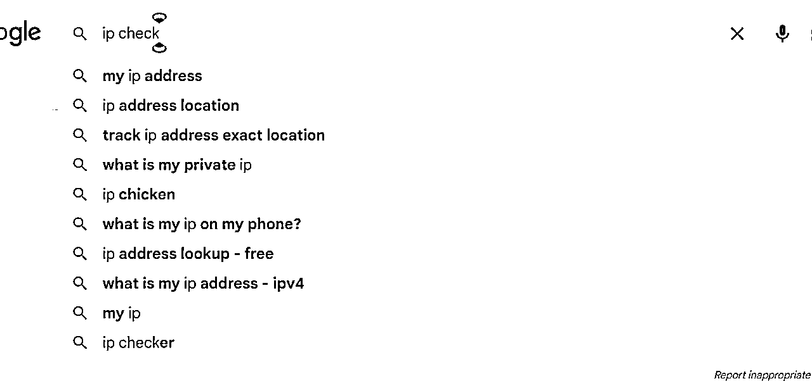

下拉提示里，有热度的是围绕“my ip address”展开的一串差异化词，直译词已掉到第 10 位。这个方法简单有效：谷歌经过多年发展，能较准确识别搜索意图，并返回合适词。

### 2. 看竞争站点的流量词

还是以 IP 检测工具为例。按业务定位进入搜索页后，会发现不少站点已在满足这个诉求，它们就是竞品。

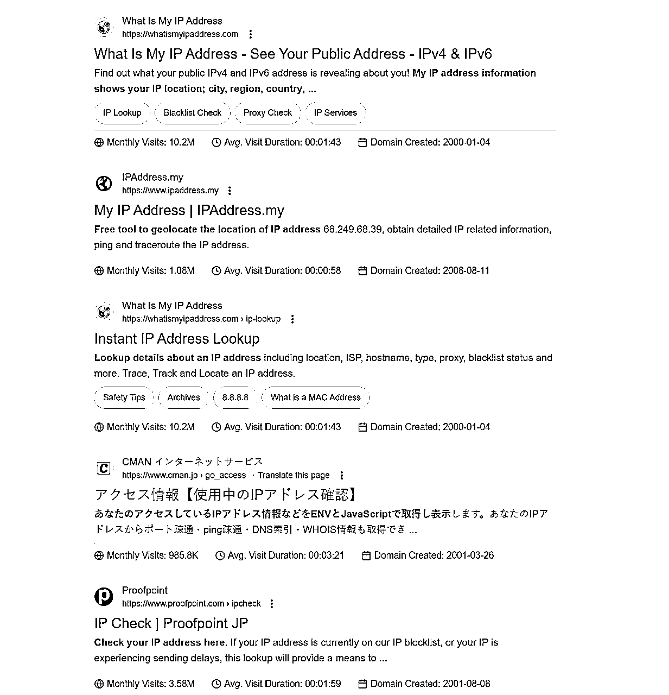

这是非常老的需求。假设我的前提是功能比所有对手都好，想提高访问，就开始研究竞品词，用 SEO 帮站点拉访问。先看排名第一的对手：打开它的首页，第一屏就露出我的 IP，显示为香港地址。

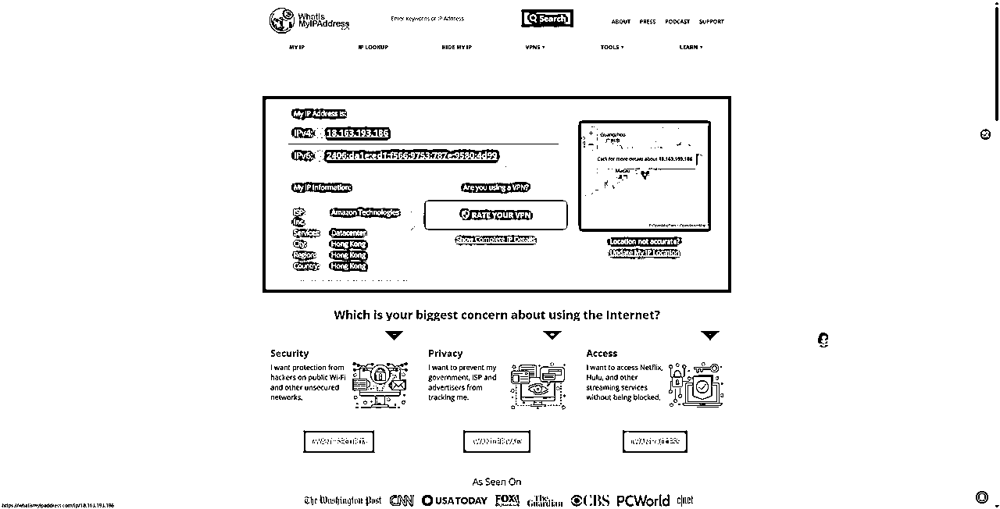

调出提前装好的 AITDK 浏览器扩展，下拉到 Top Keyword 面板，能看到“my ip”“what is my ip”“my ip adresss”等词；右侧还显示这些词的搜索规模，以及该站点从这些词拿到的访问。以“my ip”为例，总规模约 200w/月，排名第一的站点从中拿到 100w 访问。

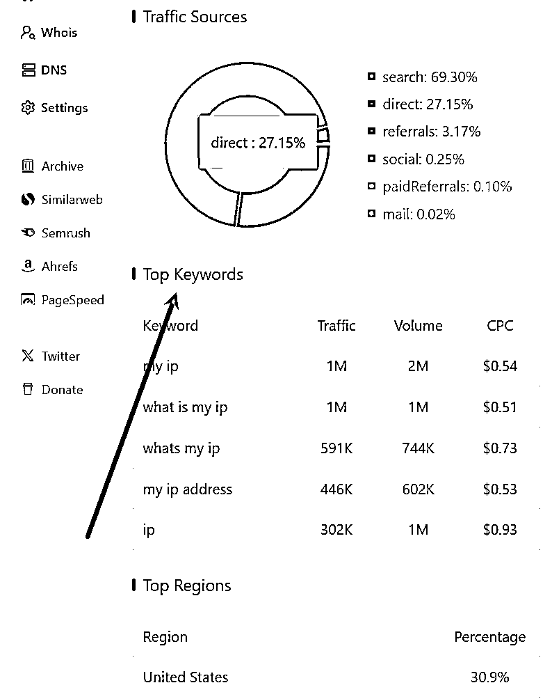

想更精确看词的排布，可依次打开“headings tab”和“density tab”。在“heading”里能看到，该站只有后 2 个 H2 直接描述 IP 检测相关诉求；前 2 个 H2 从访客诉求出发，为站内其他内页服务做导航，拓深相关服务。打开 density tab，会发现 ip 和 address 的密度最高，明确站点服务；第 3 个词 vpn 则是这类站最佳变现方式，为专业 VPN 服务商引流，这与前面 Top Keyword 看到的一致。按同样思路调研排名第二、第三的站点，就能形成有访问的词列表，对首页词布局有整体理解。

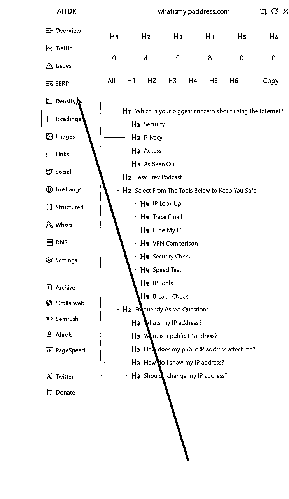

### 3. 社媒挖新兴热点长尾词

站点有了主词，若主词拥挤度很大，比如“ip adress”，新站围绕它建，前期基本别指望从大词拿访问，因为已有站点很好满足诉求，谷歌不会把大词轻易给新站。新站想靠持续打磨拿 SEO 访问，除了继续投资源、做站外链接给首页提权，另一个办法是尽量多找拥挤度偏弱的延伸词，围绕它们建子页；用更容易拿名次的子页获取搜索访问，逐步提升站点权重，最终抬高整站名次。

低竞争词去哪找？更有效的思路是找近期刚出现、有热度、又和业务相关的词。哪里找？社媒最有效：在社媒找与业务相关的近期高热度视频，分析评论区和标题，验证相关词访问，从而找到有效低竞争词；围绕它建页，更可能拿到名次并带来访问。例如用 site:youtube.com "ip address" 这个搜索语法能找到一批短视频；按上述方法持续挖评论区，就可能找到有讨论热度、又贴合核心业务的词。这个诉求太老，仅作思路示例，不再进一步演示拓词。

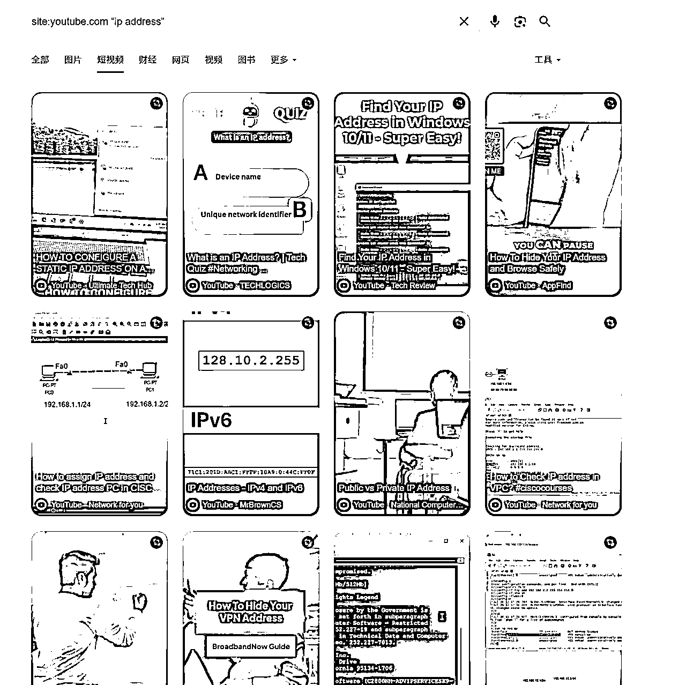


### 4. 词根拓词：利用搜索建议拓展

除社媒挖掘外，也可用词根挖更多细分延伸词。假如把 ip addres 当词根，在浏览器输入框输入它，利用下拉搜索建议能看到更多词；可用🛰️截图文字识别工具把这些词收集起来。

接着要进一步验证搜索热度，这里用 Google Trends。假如要查“ip address lookup”的搜索热度，因为 Trends 只显示相对搜索热度，需要拿一个已知较精确搜索量的词作对比来估算。对比 gpt4（约每天 4000 搜索），这个词搜索量约为 gpt4 的一半，即约 2000 搜索量；再乘 30，可估算每月访问量约 6w。

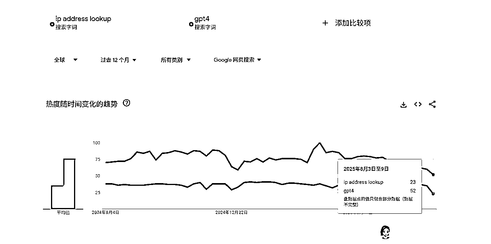


### 5. 借 AI 拓展思路

前 4 条路径都是传统 SEO 研究要持续做的步骤；当然有些付费软件能更直观观察。但无论数据准确性、时效性，还是适合个体操作，谷歌官方工具都是首选，已能满足小白做基本 SEO 词研究。第 5 类是善用 AI：现在大模型已有精准搜索能力，可借 AI 做基本词调研和长尾延展。

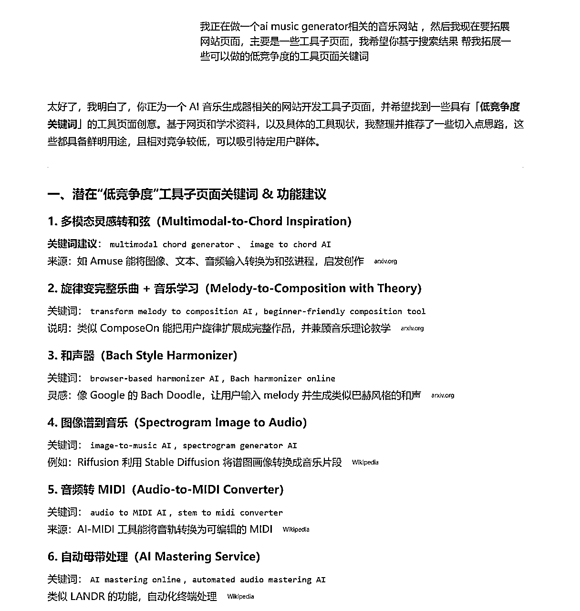

上述研究操作，都可以向 AI“口喷”——用嘴说人话即可；但最终词验证和决策步骤仍不可少，这也是人的价值。你可以用 ChatGPT、Gemini 或 Grok 任选一个，向它陈述需求，获取站点主词建议，或让它帮你拓展低竞争长尾词。

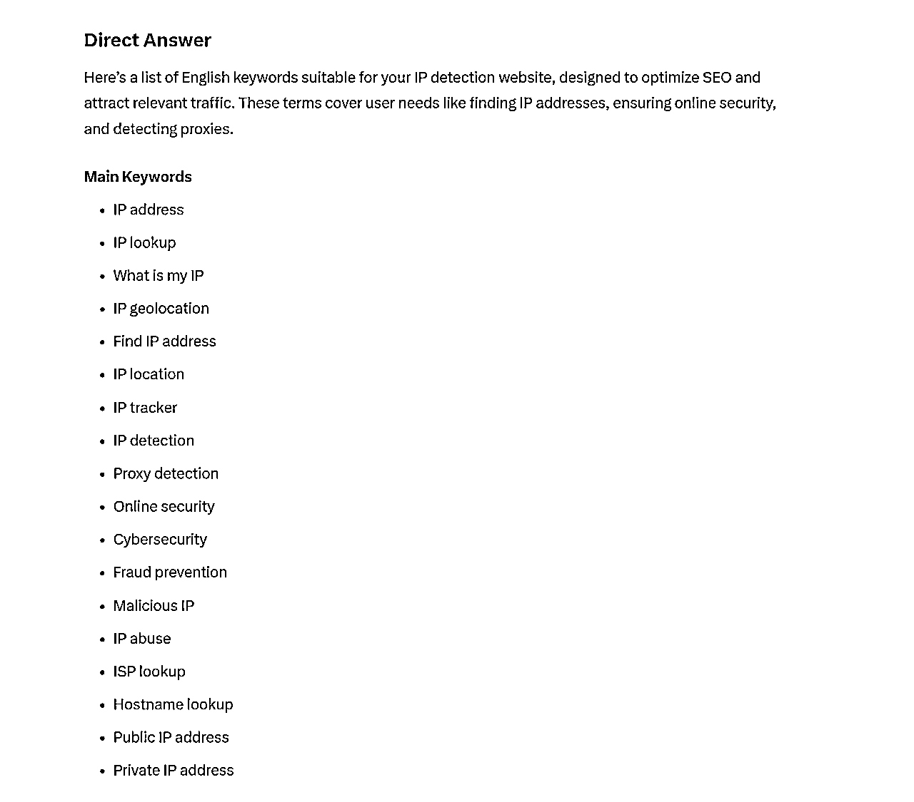

## 1. 检索词难度测量与选择

### 1. KGR 公式：手算拥挤度

这是道数学题：知道词的竞品数量和访问大小，就能判断难度。公式：KGR =（allintitle 搜索结果数量）/ 搜索量。

假如判断“ai music generator”搜索量，先去谷歌搜这个词的结果数量，有 175000 个结果。

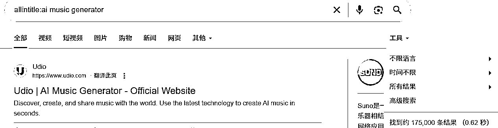

第二步估搜索量：在 Google Trends 里对比 Gpts 的搜索量，约为 gpts 的 30/50；通过第三方工具可知 gpts 每日访问约 5000，因此这个词约每天 3000 访问，一个月约 90000 搜索量。再用 175000 除以 90000≈1.94。

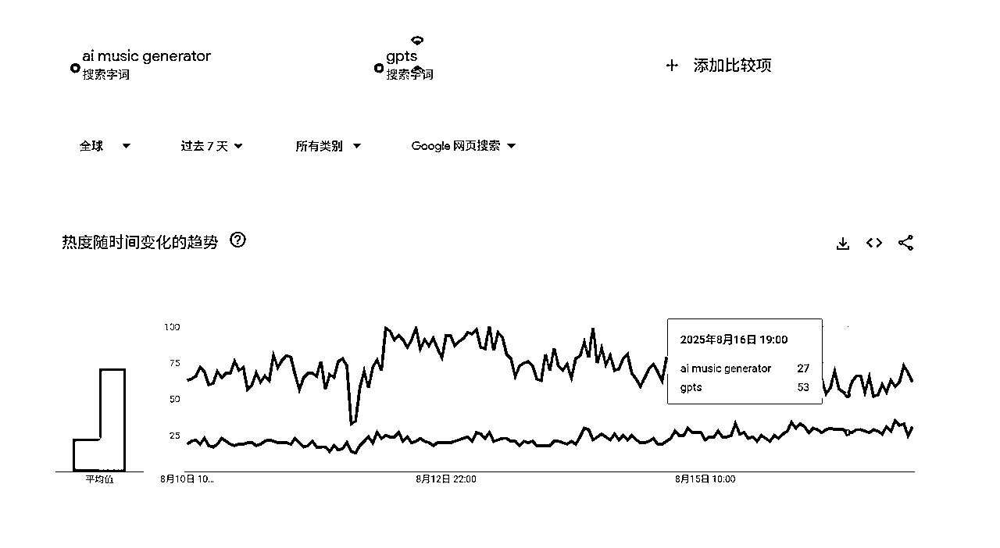

# KGR 判定档位

KGR < 0.25 → 很优质、低竞争、容易快速排名（推荐做）

0.25 ≤ KGR ≤ 1.0 → 中等竞争，可做，但排名速度稍慢

KGR > 1.0 → 竞争太大，不建议优先做

对比可见，1.94 远大于 0.25，这个词对新手很难，建议先别上手。


### 2. 第三方平台判断：快速获取难度评分

所有词难度判断工具，核心原理都是上述逻辑的演化；各家爬虫系统和算法不同，计算有差异，但都属预估参考体系。常见工具：A. 谷歌词规划工具；B. Similarweb；C. Semrush；D. Ahrefs。下面演示用 Ahrefs 免费工具判断词，其他工具通常付费；在词研究板块可清楚看到竞争难度。如图是 Similarweb 的 KD（Keyword Difficulty，词难度），KD 数值越大，竞争越大。

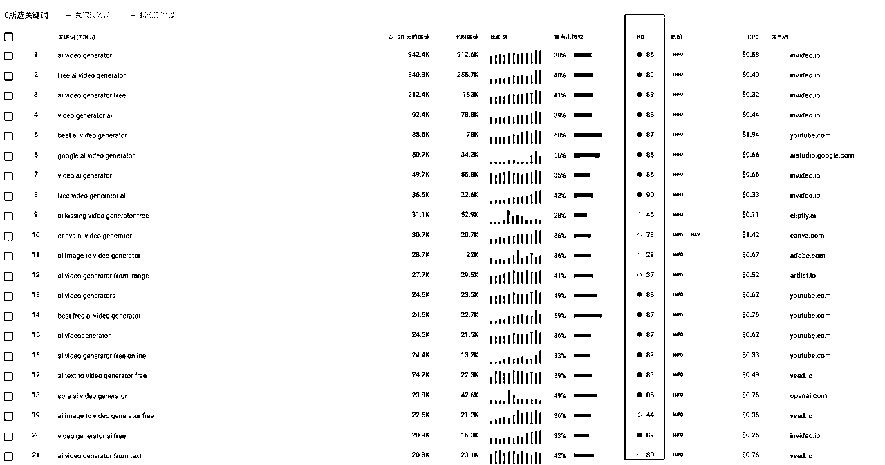


### 3. 看真实竞争面

得出“ip address lookup”搜索量后，要再验证竞争难度。可进入 Ahrefs 的 Keyword Difficulty 免费页，输入相关词，得到竞争难度；这里显示难度 81，需要拿到超过 381 个来自不同域名的外链，才有可能进首页，所以这是高难度词。

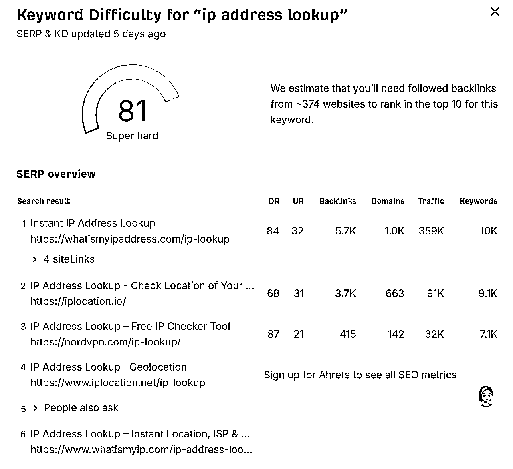

找低竞争词就要持续重复上述操作。对新手，建议找难度评分 30 以下的词，更容易拿到相关搜索访问。

## 1. 词的分组与页面落位

把业务相关的一系列词排布分组：搜索体量大、业务最相关、拥挤度又相对低的，作为站点核心定位；再按延展词分类，每个单页基本主打一个核心词。若不知道怎么谋篇布局，可找一个 SEO 做得好的站点 sitemap，让 AI 帮你可视化站点骨架；持续学习好骨架，很快能掌握词规划。如图，我让 ChatGPT 帮忙做的站点 sitemap 可视化，虽然有点丑，但骨架一下清楚了。

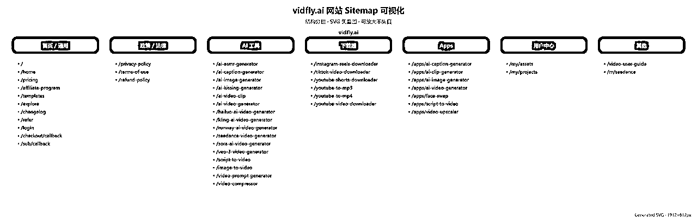

到这一步，站点基本骨架就有大致设想。

## 1. 网站骨架与导航

### 要点速览

站点骨架搭好后，核心问题是：让搜索系统能高效发现、理解并收录你的站点。具体要做：

✅ 确定物理结构（扁平 vs 金字塔）
✅ 设计合理的内链网络和导航体系
✅ 配置 robots.txt 和 sitemap.xml
✅ 做好网址规范化

新手建议优先选扁平结构，简单易管理，爬虫抓取效率更高。若信息丰富可考虑金字塔结构，但要控制目录层级深度。

### 学习路线图

学完并实操本章，可完成路线图：

第二阶段：站内优化：结构与内容（约 7 天）

1. 网站结构设计：学习物理结构与逻辑结构，优化站内内链（约 2 天）

### 1. 物理结构：扁平与金字塔

物理结构主要指站点目录之间的关系。初级站点基本是扁平结构，深一些的站点是金字塔结构。扁平结构适合信息较少的站点，所有单页直接挂在主域名下，路径短，爬虫抓取效率高。

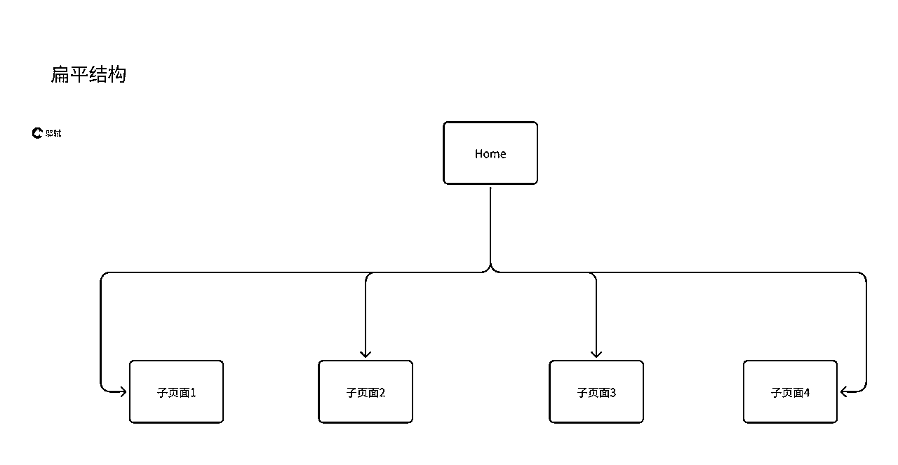

金字塔结构适合信息丰富的大型站点，用多级目录组织内容，层次分明但路径较深。

### 1. 链接结构：构建内部链接网络

链接结构指单页之间的链接关系，通常是跨级单页以及同级单页相互链接，形成复杂交互网络，也就是站点实际的内链逻辑。良好链接结构能：

传递单页权重

帮助搜索系统理解站点骨架

提升访客体验

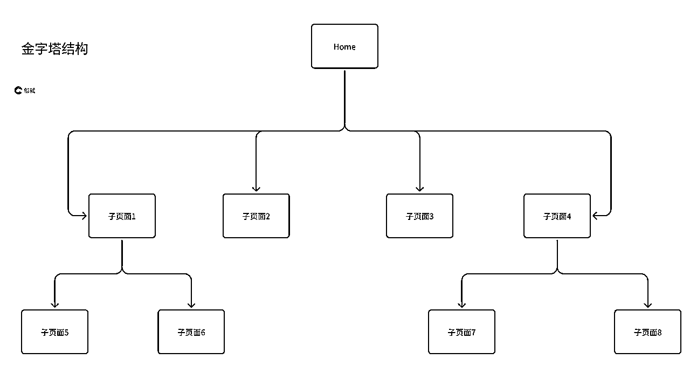


1. 站点导航：头、尾、正文怎么分工

一个网站通常拆成三块：页头、页脚、正文区。三者通过文字链接、面包屑、锚文本等，把各个网页串成网。页头页脚负责亮出站点最主要的分类词；正文区则借锚文本让不同子页互相导流。导航追求的目标很直白：从首页点到任意子页，层级别拉太长。眼下多数 AI 工具站，两层就够；导航站若分类多，才会做到三层。

vidfly.ai 可作样本：首页只放了四个分类，靠朴素锚文本就覆盖了大部分重要二级页。

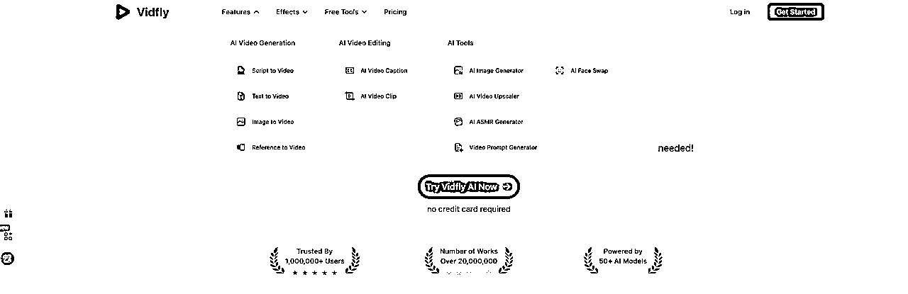

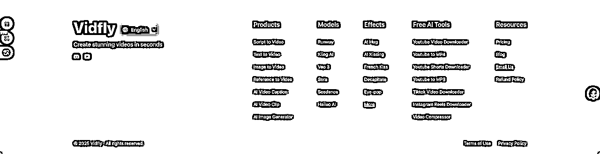

正文里还会给核心功能子页埋内链。头、尾、正文三处一起配合，站点的链接框架便搭起来了。子页落地页彼此结构相近，又都留了去其他子页的入口，这样的内链关系算比较健康。

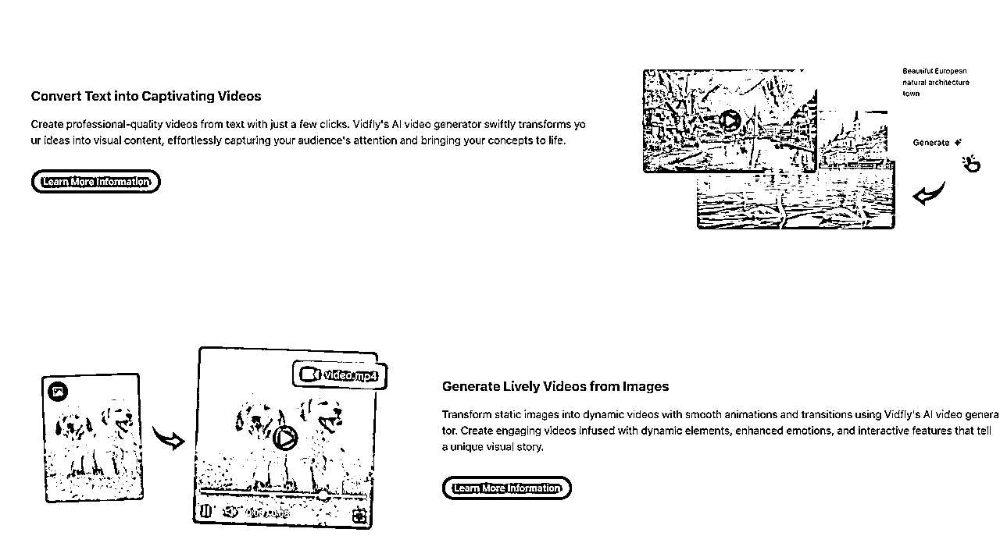

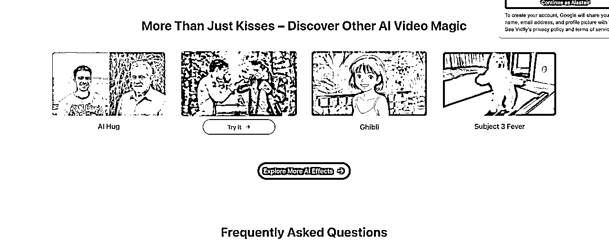

2. 子域名还是目录：扩展内容怎么选

1. 哪些情况用子域名

子域名在搜索引擎眼里更像另一个独立站。主站首页权重最高，起步阶段也比子页强，可这份权重不会直接流到子域名；能带过去的，是主域名积累的信任。dreamina.capcut.com 就是例子——用过 CapCut 的人，一眼能认出 Dreamina 是其产品线。冷启动阶段，用子域名起站，页面权重往往占些便宜。彪哥的 bypass.hix.ai 便是借子域名形态，尽量吃下了当时热词的流量。类似案例还有 filmora.wondershare.com、pdf.wondershare.com、bypass.hix.ai。


1. 哪些情况用目录

目录则被看作站点内页。它起步权重不如子域名，但能接住首页分下来的权重。Canva 很典型：图片、视频、视觉创作相关词里，常能在首页看到它，而那不过是它的子页。能在大流量功能词上占位，原因之一是 Canva 首页品牌权重够高；权重往下走，子页自然比单独围绕某个词做域名的站更容易获得排名。多数人扩展页面还是用目录。子页起步权重虽低，可主站持续输血后，从 SEO 效果看，两种做法差距并不大。案例：https://pollo.ai/image-to-video、https://pollo.ai/ai-video-generator。


1. 项目怎么取舍

新功能到底放目录还是子域名？观察下来两边都有。若考虑技术架构以后好不好扩展，目录更顺手：加新页简单，管理负担也轻。但一些老牌站点习惯用子域名承载新功能，或另起子品牌。建议：刚上手用目录，管理省事、权重传递也顺；若要做独立品牌，或技术架构差别很大，就选子域名；小站优先目录。

3. 索引与抓取：怎样和谷歌顺畅沟通

1. Index 与 No Index 分别指什么

Index 即“收录进索引”：谷歌把某个网址的信息整理后放进索引库。对站点来说，就是网页能被搜到。No Index 则相反，是站长主动不让它进索引。做法是在 robots 文件里声明哪些目录或网址不该被抓，尤其那些质量低、内容重复、可能拖累流量的页，更适合标成 no index。

1. robots.txt 如何配置

robots 文件管的是各搜索引擎蜘蛛能进哪些地方、不能进哪些地方。常见写法：

```
User-agent: *
Disallow: /

Disallow: 
```

解释：User-agent: * 表示规则面向所有搜索蜘蛛；Disallow: / 是禁止进入指定目录；Allow: / 则放行。还有一点，Disallow: 后头不写内容，等于对蜘蛛全部放行。


1. Sitemap 的生成与提交

Sitemap 就是站点地图。它能把站点结构和内容更明白地交代给搜索引擎。常见形式：

```
 <url><loc>https://vidfly.ai/affiliate-program</loc>
<lastmod>2025-08-06</lastmod>
<changefreq>daily</changefreq></url> 
 <url><loc>https://vidfly.ai/ai-asmr-generator</loc>
<lastmod>2025-08-06</lastmod>
<changefreq>daily</changefreq></url> 
```

标签：loc 必须写，列出网页完整网址；changefreq 可选，说明更新节奏（always、hourly、daily、weekly、monthly、yearly）；priority 也非必填，用来提示不同网址的相对重要度，取值 0.1 到 1.0。

4. URL 设计规范

1. 目录中带关键词

上线更多子页，说到底是为了覆盖更多相关搜索词。让网址里出现关键词，子页辨识度会更强，被搜索引擎收进索引的概率也更高。vidfly.ai 的子页 https://vidfly.ai/ai-asmr-generator 和 https://vidfly.ai/ai-video-generator/ 都对应高搜索量词，页面主题也围着它们打，等于把辨识度直接亮给搜索引擎看。

1. 层级能少则少

SEO 要帮搜索引擎更顺地收录网页，从而拿到自然流量。目录套得太深，蜘蛛预算会被耗掉，页面可能反而进不了索引。vidfly.ai 最深到三级目录。对大多数站，两级已经够；导航站因为要分二级类目，才会上到三级。例如 https://vidfly.ai/apps/ai-video-generator/、https://vidfly.ai/apps/ai-image-generator/。

1. 参数别堆太多

搜索引擎看到的大多数站点是静态页。网址参数一多，往往说明它是动态页，会按前端请求临时生成。若你用 AI 编程搭站，或许要回头检查技术架构。别这样写：https://example.com/page.php?id=123&category=456&sort=new&filter=true；更推荐：https://example.com/category/product-name。

1. 登录前后网址要一致

不少带账号体系的站点，登录前和登录后落在不同网址，或者一个在主页、一个在内页，用户数据也没放在同一页。这样一来，同一次用户行为本该给一个页面加的权重，被拆成两份，平均下来就薄了。若登录前后保持同一网址，单次行为带来的权重提升就能集中到一处，页面积累更厚，SEO 表现也更好。https://pollo.ai/image-to-video 就是正面样本：登录前后访问的是同一页，属于很典型的 SEO 友好设计。

1. 网址规范化：别让重复内容拖后腿

同一张网页，技术上常有多条访问路径。比如站点是 abc.com，带不带 www、用 http 还是 https、末尾加不加 index.html，都可能打开同一内容。搜索引擎会把这些当成同页；若不做规范化，GSC 后台就可能冒出“重复网页”的提示。

1. 用 Canonical 指明正主

Canonical 标签相当于直接告诉搜索引擎：哪个网址才是标准版本。一般把 https://abc.com 这类地址定为规范网址；以后蜘蛛再访问 https://abc.com/index.html，也能顺着标签找到真正的规范地址。写法是放进 HTML 的 head 区域。

1. 301 重定向怎么配

301 是蜘蛛向服务器发请求后，服务器在 HTTP 头里返回的状态码，含义是该网址永久迁到另一处。若站点部署在 Vercel，可在域名设置里把 https://www.abc.com 301 到 https://abc.com；这样搜索引擎会把带 www 和不带 www 的版本视作同一个页面。

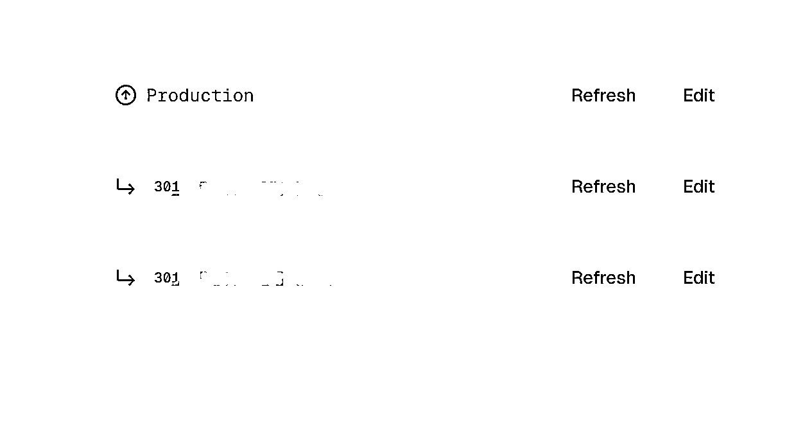

1. 全站上 HTTPS

HTTP 与 HTTPS 是两种传输协议，全称分别是 HyperText Transfer Protocol 和 HyperText Transfer Protocol Secure。后者多了 SSL 加密，数据更安全。如今网页基本都走 HTTPS。落地并不难：若用 Cloudflare、Vercel 这类平台，通常不必像传统运维那样在服务器上折腾证书。到 Cloudflare 绑定域名的页面，进入 SSL/TLS，选边缘证书，把“始终使用 HTTPS”打开即可。

5. 抓取报错怎么排查

GSC 后台的“网页”栏目会列出收录情况。新手常撞见下面几类报错，可按思路处理。

1. 重复网页

最常见原因是前面说的网址规范化没做好，配置到位基本能消掉。另一个原因是站点不同程度搬运了别家内容，也会被判重复而难收录；最省事的办法当然是自己写。还有一种：页面实质信息太少，头尾信息加起来压过正文。搜索引擎会把它当低质页，同样不收；低质提示未必写成“重复网页”。

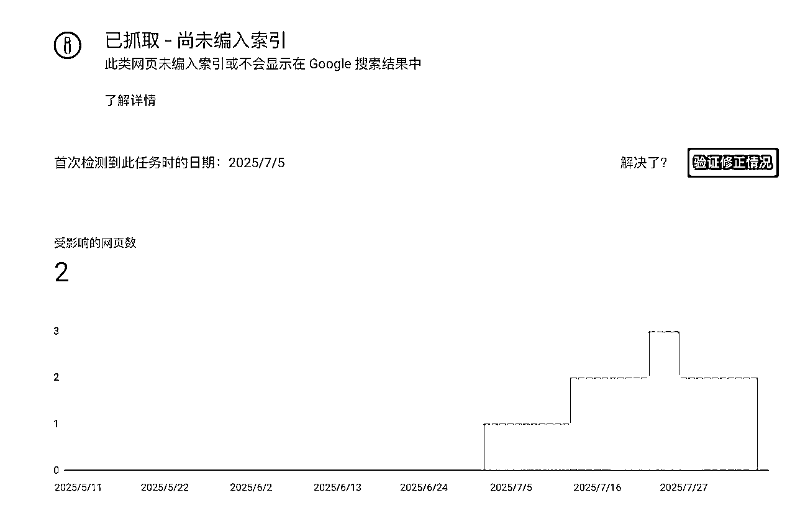

1. 网页自动重定向

自动重定向多半是 HTTP 没 301 到 HTTPS 造成的。蜘蛛最终虽会落到 HTTPS 页，但中途可能吃了 307 临时跳转，后台便留提醒。另一种出现在多语言站：主页默认英文，可 /en 页没默认 301 到 / 页，于是报自动重定向。这类问题在代码里补好 301 就能解决。

1. 404 页面

不少 AI Coding 生成的站点，头尾信息是照大概样式拼出来的，里面塞了不规范甚至不存在的入口。蜘蛛顺着爬，服务器就回 404。还有一种：站点没放 sitemap.xml，蜘蛛仍会去访问该地址，也可能造成 404。传统做法是定制 404 页，前端访问空页面时返回它，从而尽量少出索引错误。YouTube 的 404 定制页可作参考。

1. Meta Tags 优化

1. 本章要点

页面优化会直接影响排名和点击率，是 SEO 里最值得细抠的一块。重点如下：✅元数据：标题 45-60 字符并含关键词，描述要能勾人点击，关键词标签已过时；✅正文：关键词密度约 3%，分布自然，H1-H6 用得合理，图片 Alt 别漏；✅体验指标：LCP 加载速度≤2.5 秒，FID 响应延迟≤100 毫秒，CLS 布局稳定性≤0.1；✅移动端：响应式设计最省事，移动体验要过关；✅结构化数据：加 JSON-LD 标记，让搜索结果更丰富。页面优化不是堆词，而是在解决用户需求的同时，让搜索引擎读懂你的内容。移动端优化已是必选项，不做会被降权。

# 本章进阶地图

学完并实操本章，可完成路线图中的：第二阶段：站内优化：结构与内容（约 7 天）

1. 页面优化（On-Page SEO）：学习优化页面标题、描述、H 标签和内容（约 3 天）

1. 页面技术优化入门：了解 URL 规范化、移动端友好性等概念（约 2 天）

1. 页面标题（Title）：怎么写更有效

页面标题即网页标题，常出现在浏览器标签上。它和文章标题不同：主要是向搜索引擎交代网页主题；同时用户搜相关词时，若你的页面靠前，他先看到的就是标题。所以标题既要点题，也得负责吸引点击。

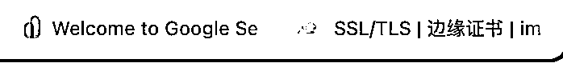

撰写原则：

1、别重复：不同网页用不同标题，不要共用一个。

2、控制字数：英文通常 45-60 个字符最佳，中文 30 个最佳。实操中谷歌对不规范字数也能识别；但 Bing 的蜘蛛卡得严，超了可能不收。想流量最大化，字数还是守规矩为好。

3、主打词放前面：标题要直接点明主题，最想排的词应出现在最前，让关键词更显眼。但整句得读得通，不能像电商商品名那样硬塞；堆砌在谷歌成熟算法前并不讨喜。

4、品牌名放末尾：做品牌站的话，在字数允许时把品牌名放到标题最后，增加品牌曝光。

5、让人愿意点：标题会出现在搜索结果里，自带吸引点击的任务。若能借广告文案的手法戳中痛点，点击率就有机会上去，对流量同样有帮助。

1. 页面描述（Description）：让人想点开

描述标签用来说明网页主体，可围绕功能、主题展开。它本身没有 SEO 权重，写的内容也未必被谷歌照搬。看 YouTube：主页描述和搜索页展示并不完全一样，谷歌会截取并重述。描述虽无权重，却直接出现在搜索页，承担拉点击的作用。比如 YouTube 搜索页那句简短号召语，从用户角度看，比描述标签里一大段话更有效。可落地的一招：描述尽量动词开头，直接讲清站点能给目标用户带来什么，这样更招点击。这也说明 SEO 不只是冷冰冰的词分析，还得懂用户心理和文案表达。传统 SEO 里，博客页是吃长尾流量的好手段，所以不少 SEOer 本身就是文案好手。

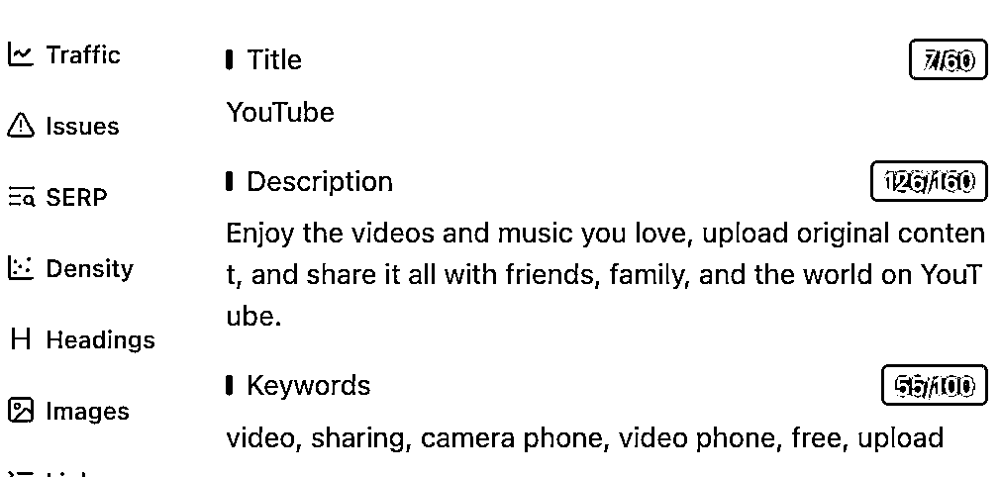

1. 关键词标签（Keywords）：还值得写吗

关键词标签是早期告诉搜索引擎“本站主打哪些词”的办法。后来算法演进，加上对堆砌行为的打击，主流引擎基本不认它。它在排名里不起作用，搜索页也看不到，无法吸引点击；一般留空即可。谷歌商店的设置就是正确示范。


1. 正文内容怎么优化

1. 关键词密度与自然排布

关键词密度，就是主打词出现次数除以页面可见文字总词数。行业里常说维持在 3% 左右。但现在的算法很灵，密度偏高偏低都看得出来；把页面功能讲清楚，顺手放入关键词就好。另外，越普通的词，算法判断相关性时给的权重越低；适当用一些独特表达，反而更容易被搜索引擎识别。

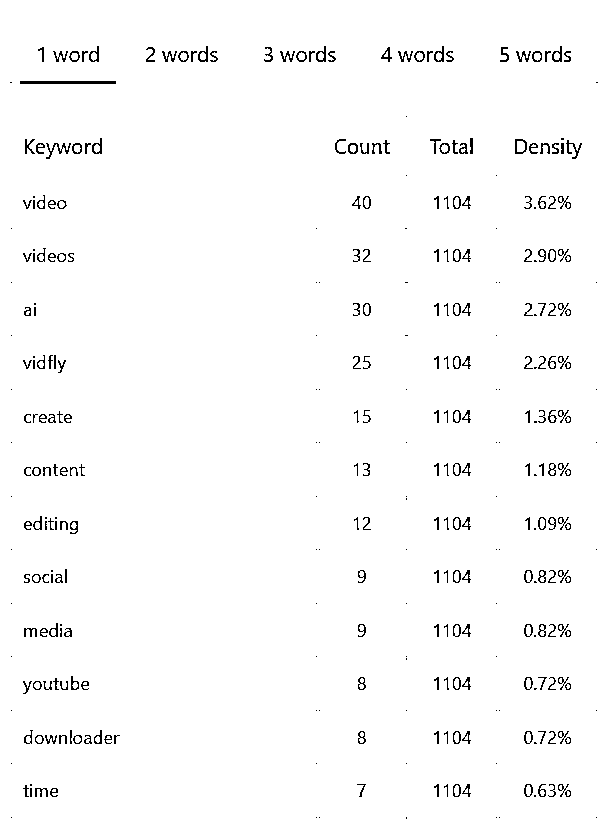

# 从页面优化到 AI 曝光：一份实操路线

用户打开网页后最先扫到的百字左右区域，最好把页面主攻词自然放进去。这一带与 H1 语义贴合度高，搜索引擎判断主题匹配时往往更看重，也能更快说明本页与搜索意图是否对得上。关键词不必通篇复读，可以用同义说法、长尾变体和不同词形穿插，让文本读起来自然，也不容易被看成刻意堆词。

1. 标题标签层级别用乱

H6 到 H1 的权重逐级增强，H1 通常最强。因此 H1、H2 是重点：既要覆盖目标词，也要写出用户能感知的价值。四条规则可以记住：单页只出现一个 H1；H2 至 H6 逐层向下，不可越级；关键词融进标题而非机械堆叠；标题短、信息清楚、能反映内容结构。

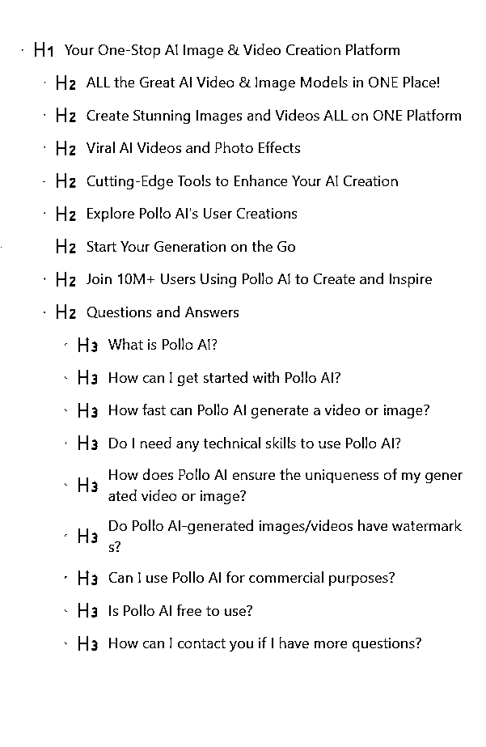

2. 图片说明文本要写实

爬虫读不懂图像，Alt 相当于给图片配的文字注解，它的分量与 H1 接近。写法是：如实概括画面，顺带放入核心词，不要塞词。长度通常控制在十到十五个英文单词，且每张图各写各的。

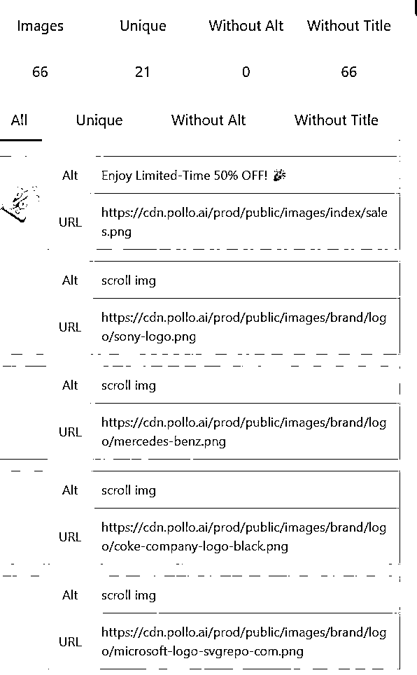


3. 站内链接与可点击文字

导航、页脚、正文中部都是站内入口。可点击文字应指向目标页的核心主题。很多站点只把内链放在页头和页脚，其实正文中段更值得利用，因为那里承载实质内容，搜索引擎给这些链接的权重往往更高。要点：可点击文字要能说明去向，别写“点这里”；优先连到主题相近的页面；数量适度；定期查死链。

4. 内容维护要形成节奏

博客、新闻等时效型站点，持续更新有助于守住甚至抬高排名。有些经典 SEO 文章每年改一次发布日期，逻辑相同。做法：清理过期信息、补充新内容、纠正错误并润色表达、同步更新发布与修改时间。

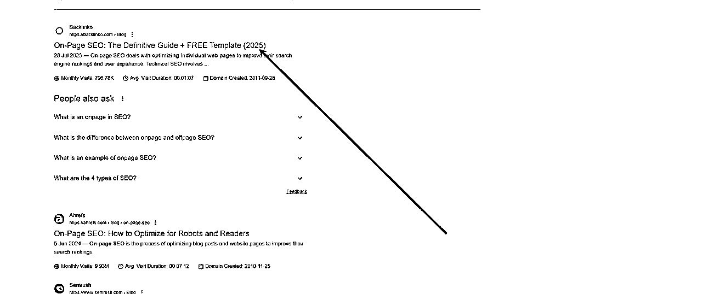

5. 页面体验：三项核心指标

用户体验是站内 SEO 的重要考核项。谷歌用 Core Web Vitals 衡量，主要看 LCP、FID、CLS。

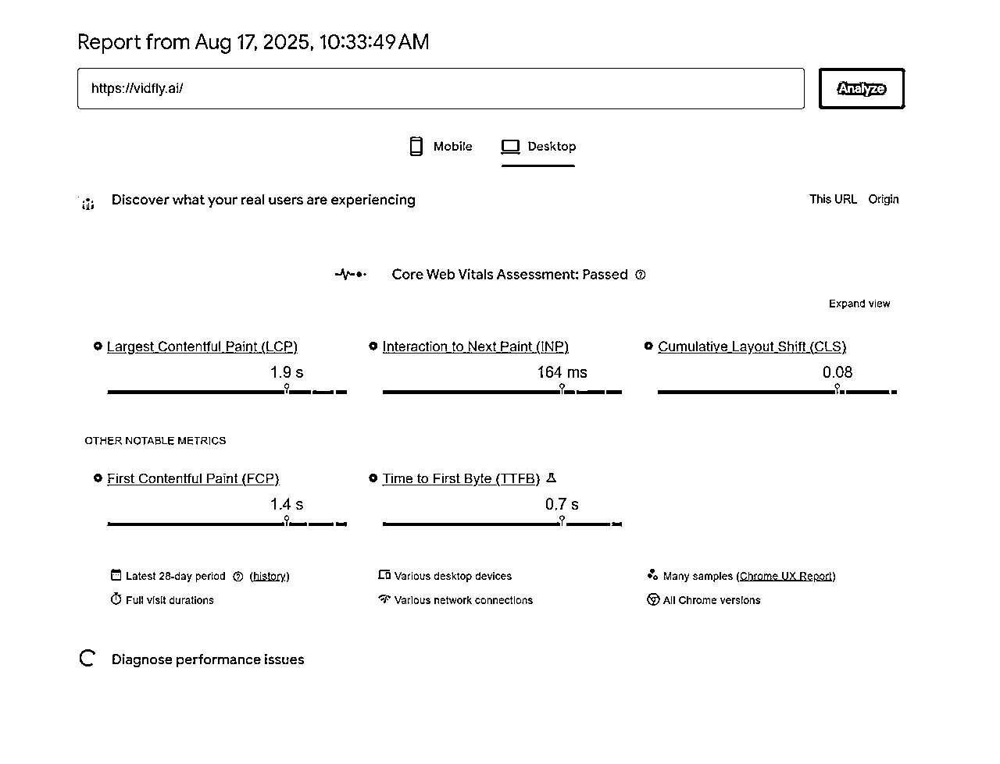

# LCP：首屏最大内容何时画完

它统计首屏可见范围内最大一块图片或文字完成渲染的耗时，反映加载快慢。合格线：≤2.5 秒为佳；2.5—4 秒需改进；超过 4 秒偏差。提速办法：缩短服务器响应、用 CDN 分发资源、压缩并换更优图片格式、对关键资源做预加载。

# FID：第一次交互后多久有反馈

用户首次点击链接或按钮后，浏览器给出响应所耗的时间。合格线：≤100 毫秒为佳；100—300 毫秒需改进；超过 300 毫秒偏差。改善办法：削减 JS 执行量、拆分长任务、借助 Web Workers、控制第三方脚本。

# CLS：页面元素是否乱跳

它统计访问过程中非预期布局位移的总量，例如广告代码把内容挤动，衡量视觉稳定程度。合格线：≤0.1 为佳；0.1—0.25 需改进；超过 0.25 偏差。改善办法：给图片和视频留固定位置、别在已有内容上方突然插入、用 CSS transform 做动画而不是触发布局变化的属性。

# 检测与改进思路

可用谷歌 PageSpeed Insights 的在线分析页（https://pagespeed.web.dev/analysis）跑分，按诊断建议交给 AI，结合站点代码找解法。访问速度有时受服务器带宽制约，预算充足时换更快的部署也能立竿见影。常见手段还有图片压缩、浏览器缓存、KV 缓存、懒加载等；把关键词丢给 AI 继续追问即可。

6. 移动端：不扣分就是加分

2015 年后全球移动流量已反超桌面；谷歌的移动搜索占比更高，且 2023 年 10 月 31 日完成移动优先索引。也就是说，即便站点只服务 PC 用户，谷歌抓取时仍以移动爬虫为主。移动体验差、适配乱、元素错位，会拖累用户感受，排名也难好。三条路线：响应式、独立移动站、动态服务。

6.1 响应式

浏览器按屏幕宽度调整排版。好处是维护一套代码、URL 统一、体验连贯。实施时用流式布局与弹性图片，加 viewport 元标签，再用媒体查询适配不同尺寸。

6.2 独立移动站

服务器识别访问设备后返回不同 URL，通常要做跳转；谷歌更认可 302，不建议用 JS 跳转。例如 youtube.com 与 m.youtube.com。优点是移动端可深度定制、加载可能更快；缺点是维护贵、SEO 配置复杂。

6.3 动态服务

不换 URL，服务器根据设备返回不同 HTML/CSS：PC 给 PC 版，移动给移动版。后两种代码差异大，适合有规模团队；个人开发者最省事的仍是响应式，一套代码复用，复杂度低。

7. 结构化数据

7.1 它是什么

用标准化格式给页面补充细节并分类，帮助搜索引擎理解内容；结果页可能以富摘要或知识图谱展示，点击率有望提升。

7.2 常见格式与适用内容

三种格式：JSON-LD、Microdata、RDFa；谷歌主推 JSON-LD。可标记菜谱、面包屑、产品、FAQ、事件、评测、文章、视频等，电商站尤其常见。示例如下：

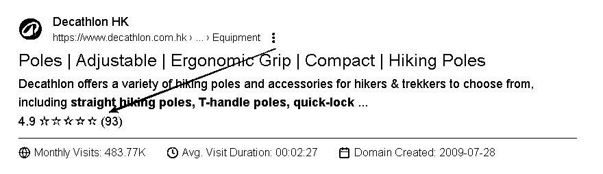

7.3 添加步骤

先按页面内容选 Schema 类型；再用谷歌结构化数据标记助手生成 JSON-LD；把代码放进 HTML 对应标签；最后用富媒体搜索测试工具验证。FAQ 类型示例：

```
{
 "@context": "https://schema.org",
  "@type": "FAQPage",
  "mainEntity": [{
    "@type": "Question",
    "name": "What is SEO?",
    "acceptedAnswer": {
      "@type": "Answer",
      "text": "SEO stands for Search Engine Optimization..."
    }
  }]
}
```

8. 外链为什么重要

8.1 本节要点

外链相当于其他站点给你的信任票，质量优先于数量，一条强链胜过大量弱链。实战框架：理解外链作用（搜索引擎借它判断权威，越难拿的越值钱）；好链标准（主题相关、站点权威、Do Follow、可点击文字自然）；获取渠道（导航站提交、友链交换、工具或游戏做链接诱饵、客座文章）；建设节奏（宁缺毋滥、慢慢积累、忌短期暴增）。外链是 SEO 里最花钱的环节，却也是抬权重最有效的路径之一。可以先从免费导航站开始，再逐步搭高质量网络。

# 本章航线图

完成本节学习与实操，可推进航线图：

第三阶段：站外优化与数据分析（约 8 天）

1. 外链建设入门：理解价值与判断标准（约 2 天）

2. 内容为王：学会做出能自然吸链的优质内容（约 3 天）

8.2 外链的由来与原理

搜索引擎的底层逻辑是：用户输入词或问题，系统从索引里挑出相关网页返回。早期只看页面内容，结果被一些站长用关键词堆砌钻空子，内容却不解决问题；后来引入“他人评价”作为补充，外链由此成为重要信号。这和现实中的权威形成类似：不是自夸，而是众人背书。所以外部链接是搜索引擎判断相关性与权重的重要维度。


8.3 外链价值怎么判

不是只看数量，质量常常更关键。可观察的维度包括：反向链接总量；增长斜率（太快像作弊，太慢排名下滑）；链接前后邻近文字是否与主题相关；域名是否被转手过（可能权重清零）；链接所在页面的收录时间（越老越可信）；该页首次出现此链的时间（老页面突然冒新词可疑）；锚文字或 URL 是否频繁改动（可能被视为操纵）；同页还链向哪些站点（若都是高质量站，整体加分）；是否属于垃圾链（例如大量博客评论链，结构不健康）；链接点击率与点击后停留时长（点击越多、停留越久，相关性信号越强）。

8.4 什么算好外链

外链的第一价值是带来真实点击流量；Do Follow 或 No Follow 都有意义，能导流的链接优先做。等直接流量型链接铺好后，再找能抬权重的链接。判断标准：

- 相关与权威：单向链接通常优于互换；对方自发在正文概念处加的链接更值钱，也说明页中位置权重高；两页内容要相关。

- 位置与可点击文字：可点击文字是链接中显示出来的文本；应自然出现目标页主题词，但不要所有链都用同一个词；高权重站点/页面给的链接远胜低质站。

# 3. Do Follow vs. No Follow

Do Follow：搜索引擎会顺着链接走并传递权重，对 SEO 有直接帮助。

No Follow：不跟踪、不传权，但可能带来流量与品牌曝光。两者都有价值，自然混搭更健康。

- 导出数量：一页导出链接越多，每条分到的权重越少；链接页更新越勤，投票分量越高；来自 edu、gov 域名的链接通常更难拿，效果也更好。

可见越难获得的链越有价值。外链建设是 SEO 里真金白银的投入：想快就花钱，想省就花时间与海外站长沟通。纯追求数量意义有限，容易拿的链往往权重低，甚至伤站点健康。

8.5 外链从哪里来

8.5.1 导航站提交

最能实打实抬权重的，往往还是导航站。例如 Product Hunt、Toolify、There's An AI For That 等，数量很多，应作为首选。

推荐列表：

Product Hunt（权重高、流量大）
https://www.producthunt.com/

Toolify（AI 工具聚合）
https://www.toolify.ai/zh

There's An AI For That（AI 工具目录）
https://theresanaiforthat.com/

AlternativeTo（软件替代品）
https://alternativeto.net/

SaaSHub（SaaS 产品目录）
https://www.saashub.com/

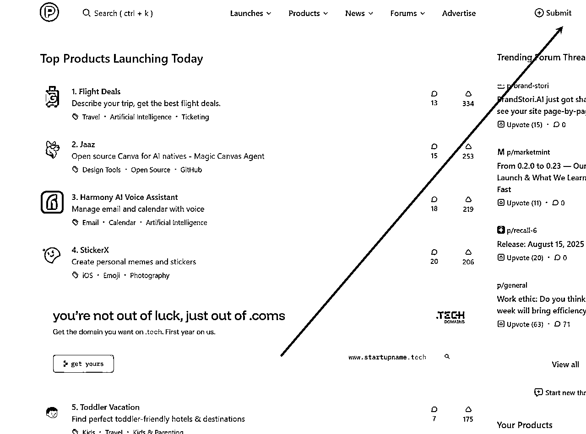


8.5.2 交换链接的小技巧

互换违背了“尽量单向”的原则，但容易操作。可注意：换链页面最好不被搜索引擎索引；换完就删链不推荐，伤信誉；给换来的链接加 no follow 降权；也可做三方互换，比如找已链到 A 站的 C 站，再让它链到你的 B 站。注意事项：选主题相近站点、查对方质量与权重、远离链接农场和垃圾站、定期复查链接是否还在。


8.5.3 链接诱饵：工具与游戏

社交里主动追逐往往吃力，释放价值才会吸引人。网站释放价值的方式，是做能引发自传播的特殊页面。常见两类：免费工具页、趣味游戏页。AI 编程普及后，做这类页面的门槛低了很多，缺的只是创意。工具页要明确受众和主题，最好与站点主题相近，传播后对权重的帮助最大。比如 Ahrefs 做了一系列免费 SEO 工具，既留住访客，也带来宣传与外链，一举多得。游戏页天然容易上瘾和分享，若加社交属性，传播欲更强。例如爆火的养鱼页 https://drawafish.com/，若放在站点子页面里并火起来，外链大概不用愁。

8.5.4 客座文章与内容合作

在媒体站发文并自然放入指向自己站点的链接，适合有预算的团队；需要联系海外媒体并支付发表费用。步骤：找接受客座稿的站点；研究其风格与受众；请熟悉本地化的 SEO 写手产出高质量原创；在内容相关处自然插入链接。注意：别批量发低质客座稿，那和垃圾外链无异；选同领域站点；内容要有真价值，保证收录；发布节奏平稳，不疾不徐。

9. GEO 流量探索

# 1. 本章概要

GEO 是 AI 时代的新机会，目标是让品牌在生成式搜索里获得更多露出。它不是取代 SEO，而是 SEO 向 AI 场景的延展。要点：理解 GEO 本质——生成式搜索引擎优化，重心从点击转向品牌曝光，AI 搜索仍依赖传统搜索数据；关注谷歌 AI 功能——AI Overviews 出现在约 45.9% 的信息类查询中，AI Mode 提供对话式界面，要抓住用户决策节点；策略上品牌建设优先于堆词，优化 Bing 索引（ChatGPT 依赖 Bing 数据），用结构化数据和语义丰富的内容，并建立第三方信号（影响力约占 80%）；执行上配置 robots.txt 放行 AI 爬虫，创建 LLMS.txt，保持内容在 2—3 年内不过时，积极参与社区与行业讨论。核心是让 AI 把你的品牌视作“首选来源”。传统 SEO 做扎实，GEO 会顺理成章。

# 本章航线图

完成本节学习与实操，可推进航线图：

选修阶段：GEO 的流量探索（不限时间）

1. 了解 GEO 的流量探索。

# 2. GEO：AI 搜索时代的曝光入口

GEO 的英文全称是 Generative Engine Optimization，中文通常译为“生成式搜索引擎优化”。随着 ChatGPT 这类通用 AI 产品不断壮大，它逐渐成为营销领域一个值得关注的新渠道。

传统搜索的做法是先建立索引，再把链接列表推给用户；AI 搜索则更像一个经过筛选的问答入口。用户不必再拆关键词，可以直接把问题讲清楚，由 AI 给出成型的回答。

这种交互方式也改变了流量逻辑：为产品或服务获取曝光时，点击率已不是唯一指标。能在 AI 回答中被提及，优质产品可能获得成倍的曝光机会。交易建立在信任之上，持续出现在 AI 答案里会沉淀为品牌可信度，用户做购买决定时也更有把握。

一句话概括：GEO 是一套尽量让产品或服务出现在 AI 搜索问答中的优化方法。

就目前来看，GEO 并不是另起炉灶的一套玩法，它与传统 SEO 关系密切。大模型本身不能直接抓取实时信息，还得调用外部工具，传统搜索引擎就是常见来源。所以，把 GEO 视为 SEO 在 AI 时代的延展，比把它说成一场革命更准确。

# 3. 为什么 GEO 值得关注？

对习惯了移动互联网推荐逻辑的人来说，搜索引擎可能显得有些距离。但在海外市场，谷歌几乎拿走了搜索流量的半壁江山，做好搜索优化几乎是提升产品流量的必要选择。

ChatGPT 和 Bing 带来压力后，谷歌顺势上线 AI Overviews 与 AI Mode，让传统搜索框具备新的 AI 能力。

这意味着什么？有统计显示，谷歌日常搜索量从 85 亿次增至 137 亿次，全年超过 5 万亿次。其中提问式搜索在 8 个月内从 38% 冲到 87%，而且仍在上升。上网人群并没有突然暴增，真正变化的是 AI 让谷歌答案更靠谱，于是人们更愿意频繁搜索。

做海外产品，SEO 几乎是必选项；跟上谷歌在 AI 时代的变化，才有机会吃到红利。

# 4. 谷歌的两类 AI 搜索形态

# 4.1. AI Overviews：把摘要放到结果顶部

AI Overviews 指的是：用户搜索某些内容时，谷歌会在顶部直接返回 AI 总结，而不是只给传统链接列表。这些摘要通常由谷歌 AI 从索引库中筛选高质量内容后生成，右下角会列出引用来源。

换个角度看，能进入引用来源的网站，都是值得拆解学习的样本。

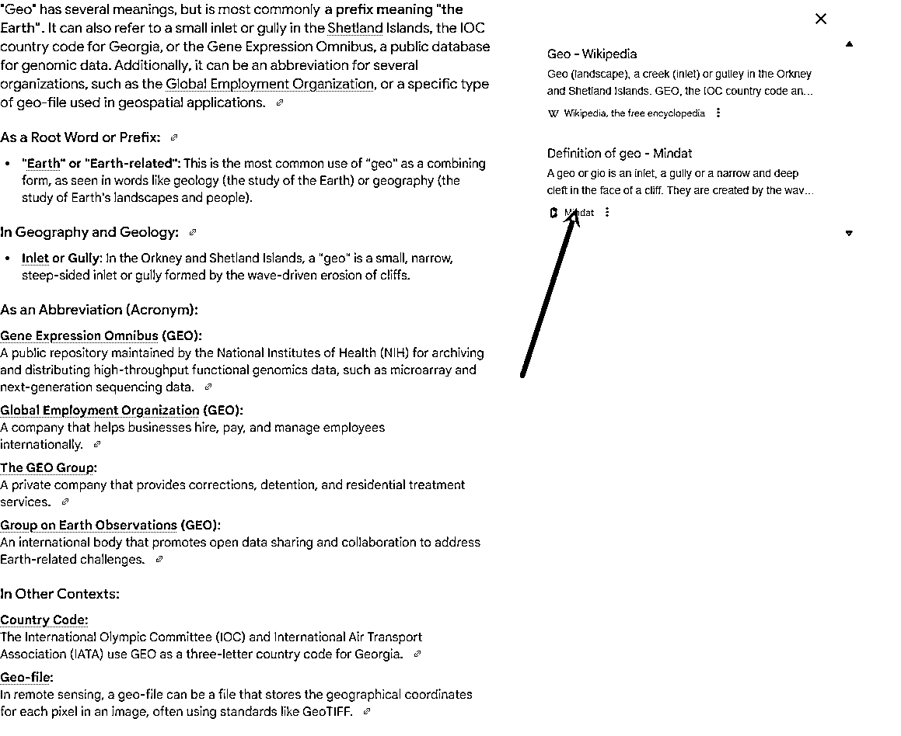

研究显示，AI 概览并不会覆盖所有搜索，它更常出现在用户意图最强的节点，比如正在调研、对比或准备拍板时。具体看：信息类（Informational）搜索出现率为 45.9%，商业类（Commercial）为 17.8%，事务类（Transactional）为 6.1%，导航类（Navigational）只有 1.5%。

也就是说，内容若进不了这些总结，丢的不只是流量，还可能是客户做选择的关键窗口。

# 4.2. AI Mode：从搜索框走向问答框

AI Mode 走得更远：传统结果页被完整 AI 对话界面取代，用户与搜索的交互入口也从“搜索框”转为“问答框”。

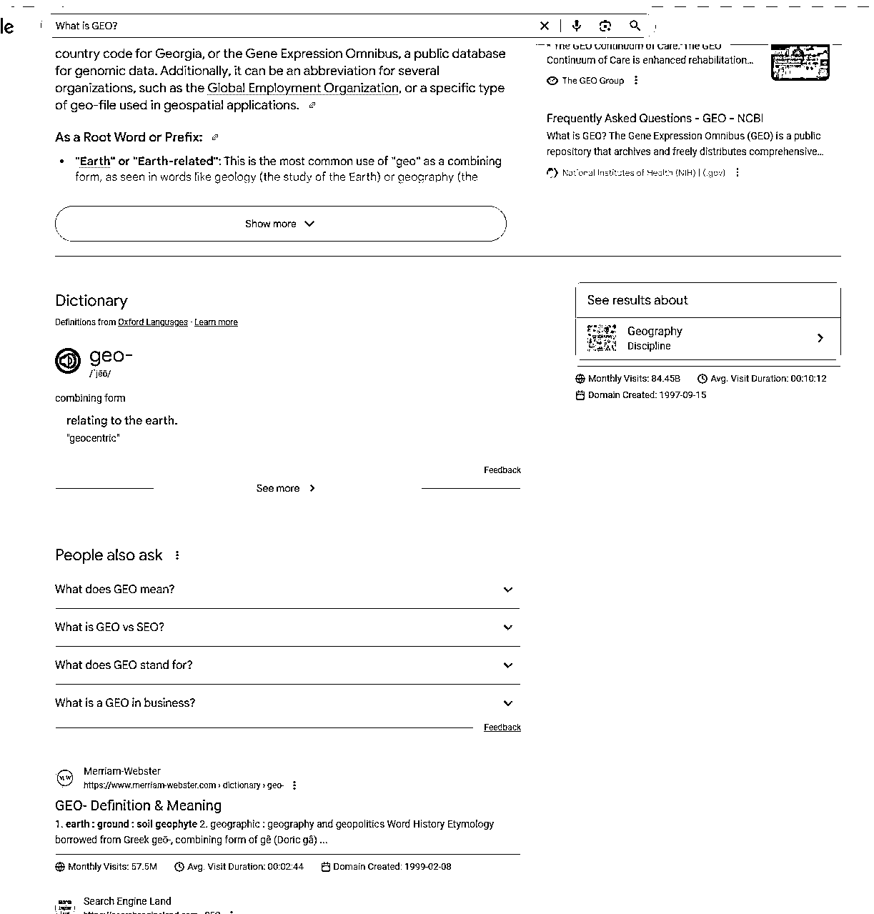

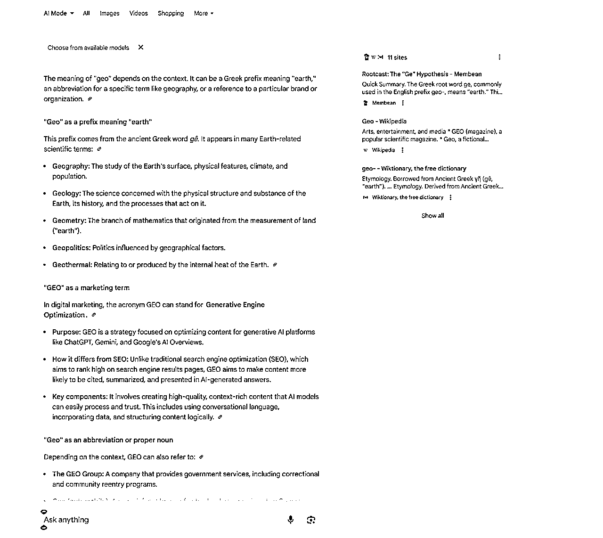

它的能力点在于：可即时回应由多个部分、长尾、复杂问题组成的查询；后台会并行执行几十个隐藏子搜索，这套机制叫“查询扇出（query fanout）”，但过程和来源并不对外展示。

因此，GEO 不只是在争排名，更是在做“语义定位（semantic positioning）”：不仅看关键词是否相关，还要看它们在上下文中的含义、与相关主题如何连接，最终让 AI 把你的品牌认成“首选来源”。

# 5. 其他 AI 搜索：声量虽大，权重仍小

谷歌在搜索市场份额接近 90%，其他 AI 搜索仍显得弱小。ChatGPT 虽在 AI 应用里领先，月访问量接近 6 亿，但对比谷歌 80 亿的月访问量仍差一个数量级；而且它的很多交互并不是搜索，而是问答对话。

所以即便要做 GEO，优先级也应明显偏向谷歌。

以 GPT 的搜索功能为例，它没有自己的搜索引擎，而是调用 Bing 的索引数据来提供实时信息；因此想提高来自 ChatGPT 的访问量，提升网站在 Bing 的排名会有实际效果。

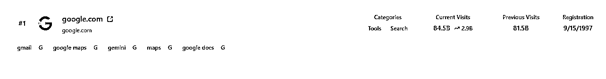

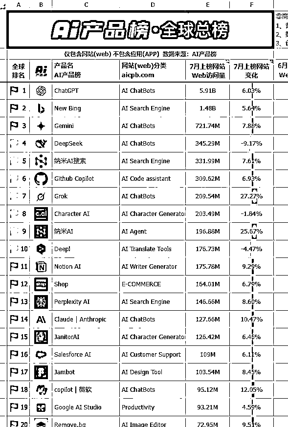

# 6. GEO 如何落地？

GEO 可以理解为在现有 SEO 上继续叠加。传统 SEO 重点在获取相关流量，AI 搜索优化的首要目标则是让品牌被提及，这要求你经营一个真正的品牌，而不是只靠关键词域名。

除品牌建设外，当前 GEO 的优化动作仍落在传统 SEO 范围内，常见做法包括：

- robots.txt：设置 AI bot 的访问权限。
- Bing 索引：ChatGPT 搜索高度依赖 Bing，确保网站被 Bing 正确收录很关键。
- LLMS.txt 文件：一项提议中的标准，可直接与大模型沟通，列出网站最重要页面，帮助 LLM 快速理解站点主题。
- 后端渲染，返回清晰 HTML 结构：AI 系统主要读取原始 HTML，把最重要内容放在 HTML 文本中，并为图片、视频补充描述性文本。
- Schema Markup：用结构化数据告诉 AI 和搜索引擎页面呈现的信息类型，帮助机器人快速判断内容。
- 语义丰富性与上下文：避免反复堆同一关键词，改用与内容相关的自然多样术语、概念和实体，织成语义网络。
- 全面性与 EEAT 原则：AI 更偏好符合经验、专业知识、权威性、可信赖性（EEAT）原则的完整内容，可通过案例、引用来源、专业展示来体现。
- 结构化内容格式：用清晰 H1/H2 层级、项目符号、编号列表、表格、FAQ 等格式，方便 AI 解析和引用。
- 持续更新网站内容：LLM 倾向引用近两三年的新鲜信息，定期更新能提高网站新鲜度。
- 第三方信号：对 AI 品牌提及影响最大，可能占 80%。包括反向链接和品牌提及（出现在行业权威网站的“最佳工具”列表或综述文章中）、客座文章（成为受信任网站的客座贡献者）、访谈和播客（LLM 会抓取文字稿）、社区参与（在 Reddit 等相关社区积极提供价值）。

可以看到，这些做法和传统 SEO 高度重合，也再次说明现阶段 GEO 就是 SEO 的自然延伸。

1. 附录：值得反复读的 SEO 资料

- https://backlinko.com/hub/seo/fundamentals：Backlinko 的 SEO 入门库，讲搜索引擎如何运作、Google 排名因素，以及怎样搭建对 SEO 友好的站点。
- https://ahrefs.com/seo：Ahrefs 的七章入门指南，覆盖 SEO 基础、关键词研究、内容创建、站内优化、链接建设、技术 SEO 等模块，适合系统学习。
- https://searchengineland.com：可当作 SEO 行业的“新闻+教程”杂志，跟踪技术趋势、实操技巧和专家文章，便于保持更新。
- https://www.scottdelong.com：Scott DeLong 分享如何快速、有效且安全地搭建盈利网站，指南偏实用，读起来不那么枯燥。
- https://moz.com/learn/seo：Moz 是 SEO 工具与教学的早期先行者之一，教程结构清晰、易懂，适合新手入门。
- GEO白皮书：AI搜索时代的品牌增长新范式：国内 GEO 先行者撰写的探索白皮书，想深入了解 GEO 可读这份文档。

到这里，Google SEO 从入门到进阶的操作脉络已经梳理完毕。关键词研究、网站结构设计、页面优化、外链建设，这些必要知识和工具都已列出。

需要记住：SEO 没有一夜见效的奇迹，只有持续投入带来的复利。短期流量没暴涨不必灰心，也别小看每次小优化积累出的长期价值。健康的网站流量增长，通常需要 3 个月以上的耐心培育。重复页面、404 错误、难以捉摸的关键词排名等技术难题，都是通往成功的必经环节。把竞品和高手当成免费老师：拆解策略、学习长处，再争取超越。

现在合上手册，打开网站后台，先做第一个优化动作。哪怕只是改一个页面标题，或把网站提交到导航站，先动起来，让你的站点在 Google 的流量版图里正式出发。

