# 2025公众号新机会：小号做窄，流量做准

# 01.项目介绍

# 1.本章概要

2025年的公众号生态里，有一类账号值得重点关注：只深耕一个细分方向的小号。它背后是精准流量的再分配，而不只是涨粉技巧。下面内容来自亦仁在星球发过的“超级标”，我挑出了最关键的骨架。

先看一个可执行目标：把一个公众号注册并开通，大概30分钟。亦仁原帖：https://t.zsxq.com/XLJBi

什么叫公众号垂直小号？简单说，就是在微信里只做一个极窄的领域，把账号做成有专业辨识度、信息含金量高的专家人设，靠微信新的推荐逻辑拿到精准流量。要让它跑起来，有三个条件得同时成立：领域切得够细、人设够专业、内容多讲能落地的“术”。

流量分发逻辑已经换了。微信现在更愿意把曝光给“小而美”的创作者——粉丝不多没关系，只要单篇内容的价值密度够高，就有机会被推荐。过去读者主要从订阅列表和朋友圈进来，如今平台更依赖社交关系与算法来分配曝光，新号因此多了一个起号窗口。

几个关键词，换个说法记：

- 细分领域：切口越窄，越容易打到对的人。比如先锁定“赚钱”，再缩到“出海赚钱”，最后落到“AI出海赚钱”。
- 深耕：方向定了就别老换标签，长期写下去。
- 专业：不用等自己成了专家才动笔。敢输出，就已经跑在九成的人前面；AI和同领域内容可以帮你快速补课。
- 价值密度高：少谈虚的“道”，多给能照着做的“术”。

这类账号赚钱的效率，一般比传统爆文号更高。原因不复杂：垂直领域广告更值钱，专家IP本身也会沉淀成资产。圈里已有真实反馈：有人照这个路子写，第二天阅读就从几百冲到几万。

亦仁有两句话，值得抄下来：别怕自己现在还不够专业，fake it until you make it，只要你愿意分享，就已经比九成的人更专业；粉丝少没关系，价值密度够高，推荐自然会来。

圈友的观察也印证了这一点：

@屋主：以前大号有推流，一篇能有两三千阅读，现在掉到原来的十分之一；同一篇内容，小号发能跑到几百近千，大号发反而被提示违规删掉。

@书虫：几百粉的小号认真写，照样能拿1w+推荐。

@贝拉：从今年2月开始，中小号的日子明显好过起来。

@兔子🐟：如果把公众号当长期输出口，这个平台很值得押注。

@一来：爆文机会隔一阵就会来一波；他自己靠公众号攒了约2000+付费用户，账号只解决一件事——公众号对标。

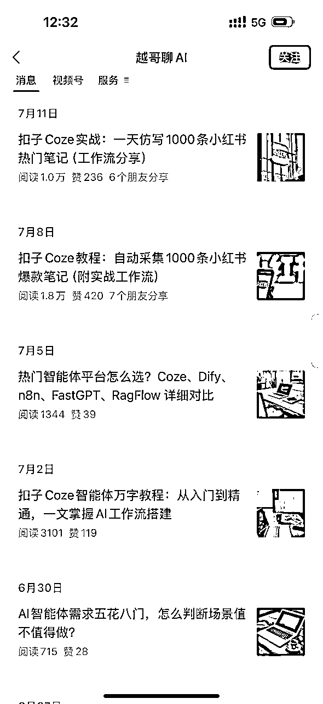

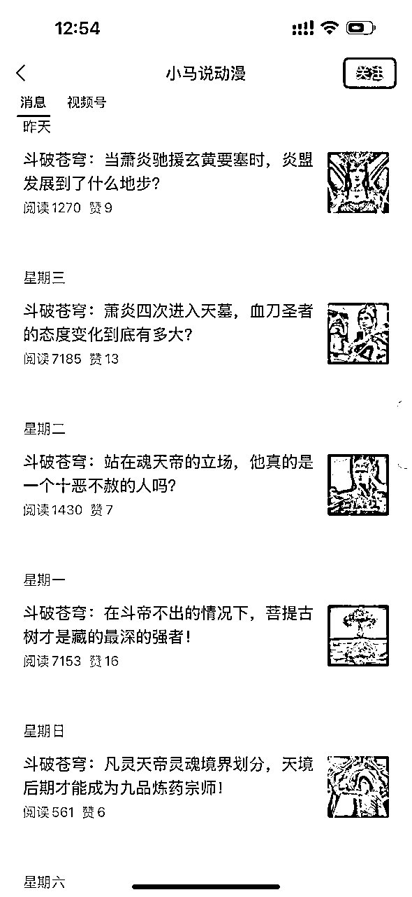

对应的案例内容如下。

# 2.注册公众号

第一步，先把身份证和一张配套银行卡准备好。刚上手的人，建议开两个号。原因有两个：一是分散违规风险，二是对抗不确定性——只有一个号又迟迟没流量时，人很容易怀疑自己。

提醒一句：一张身份证连同它的配套银行卡，只够开一个公众号。个人一般就是1个；个体工商户、企业或其他组织可以开2个；政府和媒体最多50个。想开第二个，借家人的身份证就行。

第二步，进微信公众平台 https://mp.weixin.qq.com/，点右上角“立即注册”，在页面里选“订阅号”，然后按提示填资料。

# 01.选赛道

# 1.本章概要

回到那个公式：小号要拿到大流量，得凑齐“细分领域+专家IP+术相关分享”。真正卡人的地方，是找到足够细的切口。这一章就讲怎么找。

任务：把垂直细分方向过一遍，挑出10个对标账号，给自己3小时。

# 2.标准一“拒绝大而全，聚焦小而美”

假设现在让你开号，你第一反应写什么？“职场”“情感”“美食”——这些都是大词，也早就挤满了人。光“职场”这个词，微信里就可能挂着10万多个账号。一个刚开的号，拿什么让人按下关注？所以第一条原则是：绕开大而全，只做小而美。

看一组对比。A账号做“办公技能”，Word、PPT、Excel、PS全写，看上去很全；B账号只做Excel，而且只讲函数，每天发一个函数的3种用法，比如VLOOKUP、INDEX怎么用。想学Excel的人，会更愿意关注谁？

再摆数据：微信“看一看”月活8.2亿，算法推荐已经占到65%，而去年这个数字是40%。窄赛道账号的表现更突出——平均阅读量能做到泛内容账号的2.3倍，粉丝转化率多出40%，流量主收益多出85%。算法为什么偏爱垂直内容？因为用户画像清楚，系统知道该把它推给谁。

过去做画像，常写“25-35岁白领”，太粗。更细的版本是：“30岁+的职场妈妈，在一线城市上班，每天通勤2小时，早上6点起床，晚上10点后才有自己的时间，想用碎片时间补Excel，好在年底述职时争一个晋升。”年龄、身份、生活场景、时间窗口、痛点、消费能力，全在里面。

落到动作上：
- 场景：通勤2小时，她会在路上读文章。
- 痛点：想晋升，需要能马上用的Excel技巧。
- 付费能力：一线城市职场妈妈，意愿不低。

画像细到这个程度，发文时间、内容、标题就都有答案了：早上7点通勤时段推；内容做成5分钟能看完的表格技巧；标题可以写“通勤路上就能学会的Excel技巧，让老板刮目相看”。宁可只开一厘米的口，也要往下挖一公里。

情感赛道也一样：一千个铁杆读者，每人愿意掏一百，就是十万；十万个只是路过的人，可能一分都不花。内容挖得越深，变现天花板越高。

# 3.标准二“你最深 × 竞争少 × 市场大× 变现快 = 你可变现赛道”

一个可套用的判断式：你最深 × 竞争少 × 市场大 × 变现快 = 你能变现的赛道。

“你最深”指什么？你比身边人更懂的那件事。可能是工作积累，可能是爱好，也可能是你踩过的坑。做了5年HR，招聘这件事你就比多数人清楚；养了3年多肉，养护细节你就比一般人熟。

“竞争少”怎么判断？去微信搜一搜搜目标领域。如果前10个账号粉丝都过50万，说明位置被占得差不多；如果只有两三个大号，其余都是小号，那就是机会。

“市场大”看什么？微信指数超过10万、有搜索量，是基础线。更关键的是：这个需求是不是刚需、是不是高频。AI技巧为什么被看好？因为全世界都在聊，但成体系的认知还不够，正好落在刚需和高频的交集。

“变现快”怎么算？阅读量稳在5000以上，可以接互选广告。2025年千次阅读大约50-80元，5000阅读对应250-400元。这还没算流量主、带货和私域转化。100个私域粉丝里只要有1个买课，1000个粉丝呢？再往后，可以按私域画像设计赛道课程。

说直白点：这个领域的人得愿意掏钱。“省钱技巧”的读者本来就想省，付费很难；“副业搞钱”的读者冲着赚钱来，意愿自然强。

实战工具：四象限分析。横轴看市场规模，用微信指数；纵轴看竞争程度，用同类账号数量。

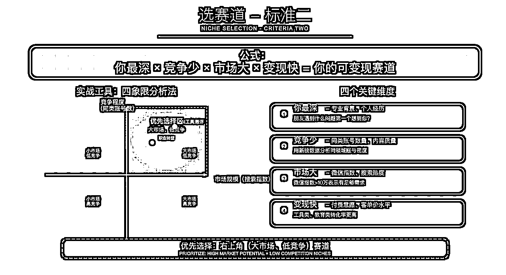

左上：市场小、竞争少，适合慢慢磨；右上：市场大、竞争少，是黄金位；左下：市场小、竞争多，建议绕开；右下：市场大、竞争多，要靠创新破局。真正值得押的是右上。但这种位置很少见，所以垂直小号才值得当项目做。

竞争少、市场大、变现快，这三项很难由你单方面决定；最能握在手里的变量，是“你最深”。我自己选的是AI+内容，因为商业认知是我最厚的底子，市场盘子大，当时还没那么卷，回钱也快。今天再去做纯AI工具分享，时机已经过了；但把AI叠进你的专业里，窗口还在。健身教练做AI健身指导智能体，对用户痛点的把握一定比外行准。那你的底子是什么？

# 02.向内求

# 1.什么是“你最深”？你在别人心中的“标签+信任度+影响力=IP 感”

先看一个账号：“产品经理黄叔”。

名字叫“AI产品黄叔”，封面黄底，标题围绕各类AI产品，行文有人味、有真实感。每篇开头都强调“黄叔”本人，付费产品叫“黄叔早期开班”。他以前是字节跳动的产品经理，在互联网行业待了10年，2024年底才转进AI垂直内容。标签三个：前大厂PM、AI实战派、工具测评专家，叠在一起就有了独特位置。做法很笨也很有效：每个AI工具亲自测，输出真实体验。2个月涨了1万粉，靠的就是这个。这就是“你最深”的力量。

很多人会说：“我好像什么都不擅长。”其实每个人都有独特价值，只是还没被自己看见。可以试“三问法”。

第一问：朋友遇到什么事，会第一个想到你？这是你的标签。朋友装修先问你，买保险先问你，学PS也先问你，那你在他心里就是那个领域的“专家”。

第二问：你花最多时间研究什么？这是你的影响力。翻浏览器历史，看搜索最多的是什么；翻收藏夹，看收藏最多的是什么。有人存了200篇育儿文章，有人看了100个装修视频——那就是你无意识投入最多的方向。

第三问：你说什么，别人会无条件信？这是信任度，也最关键。别人信不信你，比你是不是科班出身更重要。每个人都有自己的独特价值，关键往内看，别总往外看。少想“别人在做什么”，多问“我能给什么独特价值”。

标签+信任度+影响力，合起来就是“我能提供什么独特价值”，也就是常说的IP感。

# 2.你写公众号垂直小号 写什么内容？

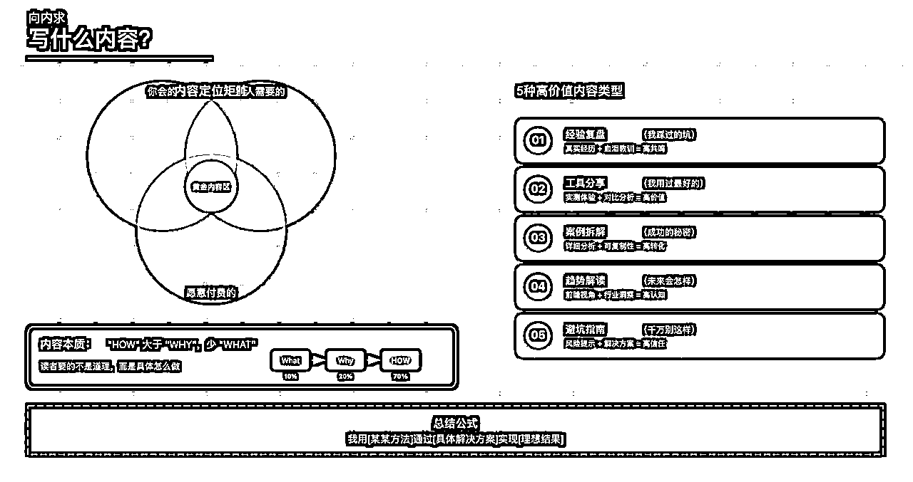

找到独特价值之后，下一个问题：具体写什么？先回想一下，你平时看公众号，什么样的文章会点收藏？有用的。但光有用不够，还得是别人需要、最好愿意付费的。

给一个公式：你会的 ∩ 别人需要的 ∩ 愿意付费的 = 黄金内容区。三个圈叠在一起，就是该写的内容。往下拆，有5类高价值内容。

第一类：经验复盘——“我踩过的坑”。人最爱看别人的失败，因为能避坑。比如“我花3万学英语，踩了这5个坑，你别再踩了”，阅读量82万。火的原因很直接：痛点精准，花钱学英语的人最怕花冤枉钱。

第二类：工具分享——“我用过最好的”。2025年7月的数据显示，工具类文章收藏率是普通文章的3.2倍。比如“这10个Excel插件，让我效率提升300%”。注意，别只介绍功能，要讲使用场景。

第三类：案例拆解——“成功的秘密”。读者想知道别人怎么成的，但案例不能虚，得有细节。比如“这个95后，3个月涨粉10万，我扒了他所有文章，发现3个秘密”。数据、行动、结果，一个不少。“有理儿有面”“洞见”“占豪”“远方青木”“视觉志”这些爆款制造机，拆它们的选题规律和标题公式，本身就是好内容。

第四类：趋势解读——“未来会怎样”。人对未来都有焦虑，都想看趋势。比如“2025年下半年，这5个赛道会爆发（基于3万份数据）”，有数据托底，可信度立刻上来。

第五类：避坑指南——“千万别这样”。这类互动率最高，因为人有损失厌恶。“千万别用这3个AI工具，我被坑惨了”，负面情绪加具体损失，点击率容易拉高。

但有一个原则要守住：“how”大于“why”，少讲“what”。什么是私域流量——没人看；为什么要做私域流量——看的人少；三步搭好私域流量池，月入5万——这才是爆款。用户要的是解决方案，不是概念。

最后给一个万能句式：我用[某某方法]通过[具体解决方案]实现[理想结果]。比如“我用3个ChatGPT提示词，10分钟产出一篇爆款文案，阅读量涨到原来的5倍”。方法、过程、结果都在，而且可复制。用户看完能马上试，试了有效果，就会转发、付费、变成铁粉。

# 03.拆对标

**1.搜索：先搭导师阵容**

拆对标，其实是给自己搭一个导师阵容，系统学他们的打法。但很多人只盯头部大号，这就偏了。你需要三类导师。

新榜地址：https://www.newrank.cn/

第一类：同赛道头部，学方法。找细分领域TOP10、粉丝50万+的标杆。新榜梳理过超过2000万个公众号，每天固定监测超过110万个有影响力的优质账号。怎么找？打开新榜，选你的垂直领域，看榜单前10。做职场就把“职场”分类下的日榜、周榜、月榜翻一遍，把长期霸榜的名字记下来。头部基本就是你未来可能长成的样子，也是最好的老师。

第二类：跨界高手，学创新。这是90%的人会漏掉的宝藏。做美食账号，别只看美食博主。可以看摄影博主怎么构图，看旅游博主怎么讲故事，看生活博主怎么造氛围。为什么？同质化是死路。美食博主都在拍特写，你学了摄影构图，照片就有艺术感；美食博主都在讲做法，你学了旅游叙事，内容就有情怀。抖音最火的美食博主“日食记”，靠的不是教做菜，而是用电影级画面讲生活故事。这就是跨界的力。

第三类：新锐黑马，学趋势。新榜有数提供内容领域的全景数据，包括爆款作品、热门话题、公众号排行榜。用它找近3个月快速冒头的账号。为什么看黑马？因为黑马代表最新玩法。比如有个账号3个月涨粉20万，秘诀是每篇都配一张AI生成的思维导图。头部不一定会用，但黑马敢试，而且成了。

去哪找这些导师？新榜看各类榜单，头部和黑马一起找；微信搜一搜直接搜关键词，看谁排前面；知识星球里很多KOL分享干货；行业社群里也常有人甩案例。找到只是第一步，关键是怎么“拆”。

**2.搜索：用AI工具武装拆解过程**

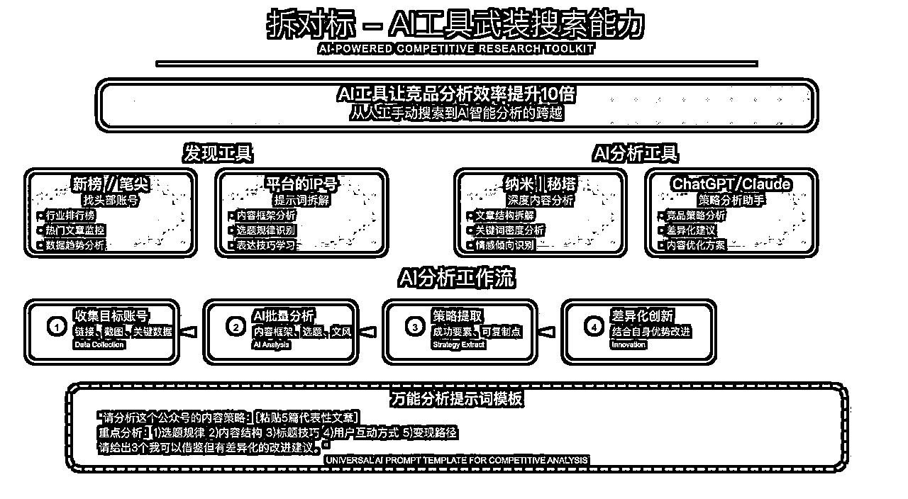

找到对标账号后，怎么高效拆？让AI工具上手。

先看搜索工具组合。第一个入口：

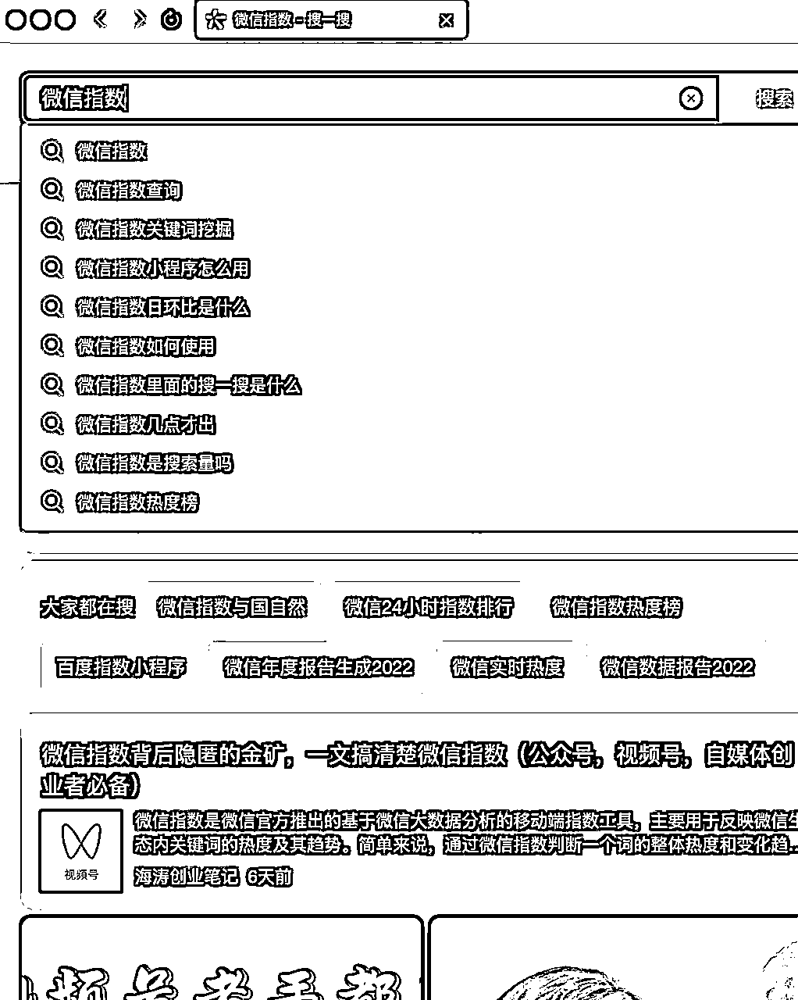

打开微信搜一搜，输入“微信指数”，点进那个小程序。

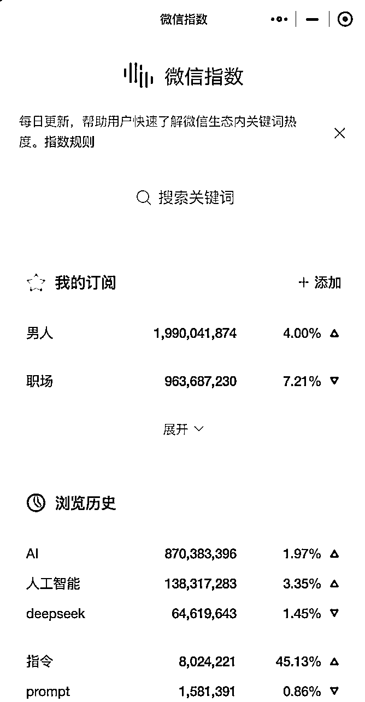

它不只用来看榜单。搜关键词可以看热度；公众号分析平台可以看账号数据；文章搜索能找出哪些内容成了爆款；趋势分析能看出什么话题在往上走。

第二个工具：笔尖。它的价值在找爆款规律，能分析任意公众号的历史文章，把爆款背后的共性拎出来。

第三个工具：国内的通义千问、KIMI、DeepSeek。它们在文案创作上的能力领先90%的AI，适合拿来分析竞品。操作也简单：把对标账号的10篇爆文丢给AI，让它回答——标题有什么规律？开头用了什么钩子？结构怎么搭？结尾怎么引导互动？

提示词模板：下面这份拆解提示词可以直接套。

```
请分析这篇文章的成功要素：
1\. 标题用了哪些吸引力技巧？
2\. 开头3句话如何抓住读者？
3\. 内容的逻辑结构是什么？
4\. 用了哪些让人想转发的金句？
5\. 如何引导用户互动和关注？
请给出具体例句和改进建议。
```

**3.本质：做填空题和选择题**

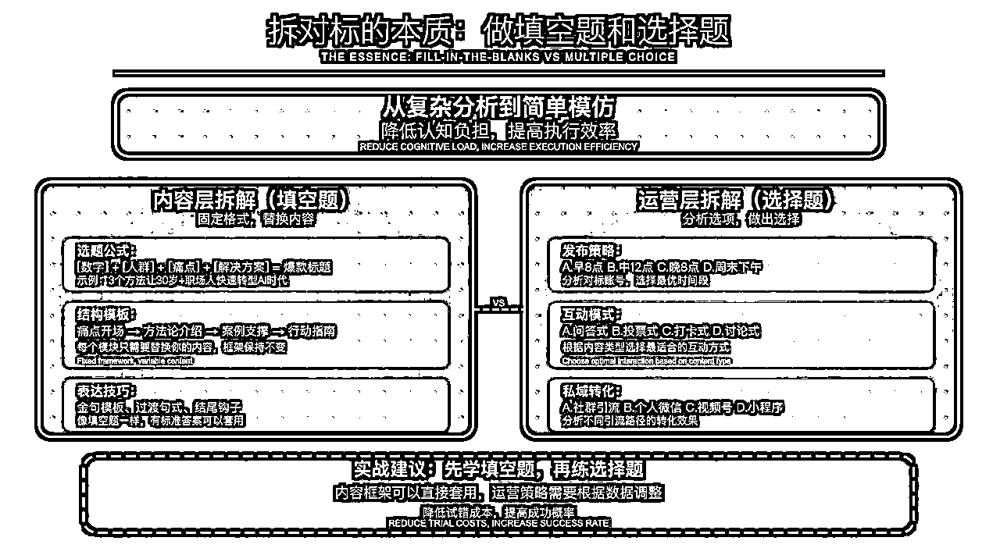

一个底层认知：做公众号不是做问答题，而是做填空题和选择题。问答题是“给我写一篇AI工具文章”，方向太大，无从下手；填空题是“用‘热点工具发布+3个使用场景+实测效果+搞钱路径’写一篇AI测评”，一下就有抓手。

内容层拆解，给你两个模板直接套。

第一个，AI赛道选题模板：【最新AI工具】+【具体应用场景】+【效率提升多少】+【省钱/赚钱数据】。真实案例：DeepSeek发布后，有人用它写公众号文章，10分钟搞定2000字，一个月省下2万元写手费，标题就是这套组合打出来的，后来跑到300万+阅读。

第二个，成长搞钱选题模板：【人群标签】+【收入目标】+【具体方法】+【时间周期】。例子：一个95后程序员，用AI做副业，目标月入3万，3个月做到，这篇2025年6月发的内容拿到150万+阅读。

再看结构模板，以AI赛道为例：
- 痛点开场（50字）：“昨天DeepSeek又更新了，你还在用ChatGPT吗？我测试后发现，在中文场景下，DeepSeek已经……”
- 解决方案（900字）：场景1写公众号，配实际操作截图；场景2做PPT，配before/after对比；场景3数据分析，配实测视频。
- 搞钱路径（300字）：“用这个工具，我帮3个客户写文案，一单收500，成本为0……”
- 行动指南（100字）：立即注册账号，附链接；用我的提示词模板，附模板；加入交流群，附二维码。

# AI内容爆款手册：从选题到私域

在成长搞钱这个细分方向，内容要让人一眼上头，表达上必须有三板斧：第一，大胆丢数字——“3个月”、“月入5万”、“0成本”这类词，天然抓眼球；第二，制造反差——“以前的我…现在的我…”、“别人在…而我在…”，对比越强烈，代入感越强；第三，直接给结果——“实现了…”、“达到了…”、“终于…”，让读者看到终点，才愿意往下读。

## 运营维度的选择题

### 发布时间：AI内容什么时候发？

先看一组我扒过的数据：2025年6月，AI领域有50篇文章冲上10万+。它们的发布时间很有意思：

- 新工具上线的当天发，能吃掉35%的流量，纯粹是热点红利；
- 周二和周四晚上9点发，占到28%的流量，因为上班族刚忙完，正好想学东西；
- 周末上午10点发，占比最高，37%，大家有空坐下来动手实操。

所以结论很简单：工具新品上线，必须当天跟；日常内容，优先安排在周末上午。

### 更新节奏：日更还是深耕？

7月的数据也给了答案：

- 天天发工具测评，单篇平均阅读只有1.2万，而且内容高度同质化；
- 改成每周三次深度测评，平均阅读直接翻到2.5万，关注者粘性也上来了；
- 只在重大更新时发，出爆款的概率能到60%，但涨粉很慢。

怎么选？新号要用日更换热点曝光，成熟号要用深度换信任。

### 互动：评论区才是第二阵地

做搞钱类内容，评论区是真正的暗战场。有个案例我印象很深：一位做AI变现的博主，每条评论都回复，还会追问一句“你试了没？效果怎么样？”这么一来，他的评论区平均能到50多条互动，算法给的推荐权重也因此涨了40%。

具体玩法有三招：

- 埋钩子：在评论区打“AI”两个字，私信就能领提示词模板；
- 抛话题：“AI会不会让你丢掉饭碗？”；
- 晒成果：把粉丝的成功案例截图置顶。

### 私域转化：AI领域独有的一环

私域转化在AI方向有自己的特殊链路。常见路线是：看到文章→加个人微信→卖课程产品。

## 融合：建立自己的表达风格

如果只是照搬别人的套路，你永远都是山寨版。所以最后一定要把学到的东西揉成自己的。公式很简单：A领域的打法 + B领域的内容 + 你自己的经历 = 独特风格。

举两个例子。

第一位是卡兹克（数字生命卡兹克），做AI内容的，竞争者太多了。他的做法是：选题跟科技媒体，热点出来立刻解读；表达学脱口秀，幽默、接地气、不装；再加上设计师出身，特别擅长做可视化。最后每篇文章都是“最快+最有趣+最好看”的AI解读。

第二位是反向的猫，做职场方向，这题材早就写烂了。她选题学知乎，只写真实职场问题；表达学闺蜜聊天，就像姐姐跟你说话；再加上大厂10年的经历，什么坑都见过。她不讲大道理，就说“我当年也这样，后来我发现……”，单篇最高冲到300万阅读。

所以你也可以问自己四个问题：

- 我想学谁的选题方式？
- 我想学谁的表达风格？
- 我想学谁的视觉呈现？
- 我最独特的经历是什么？

比如我的号“纵所周知101”，就可以这样组合：

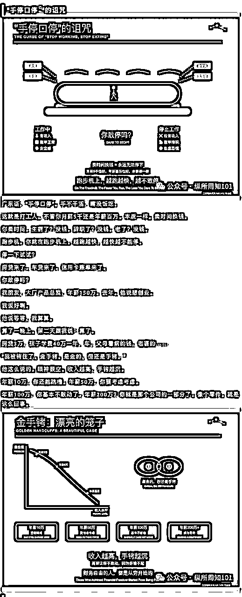

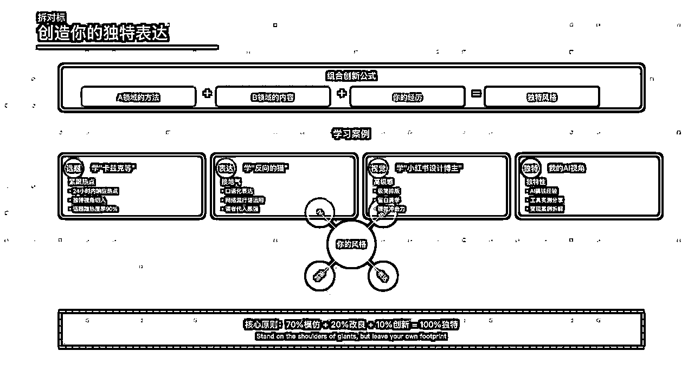

# 04. 选题方法论：两条出爆款的路径

# 1. 从阅历里找选题

公式是：你最懂的东西 × 情绪 × 热点 × 痛点 = 爆款。

听起来很简单，但90%的人没做对。

先说“你最懂的东西”。它意味着：这件事你比99%的人更了解。然后是“情绪”。当下哪种情绪最满？焦虑、恐惧、愤怒、兴奋、好奇？我观察下来，焦虑最能引发共鸣。因为人人都有工作焦虑、收入焦虑、未来焦虑。但注意，不是靠贩卖焦虑吸粉，而是帮读者缓解焦虑，给方案、给希望。接着是“热点”。眼下大家在聊什么？AI、副业、经济下行、年轻人找工作难，这些都是长线热点。可如果你做AI内容却跑去蹭明星八卦，那就是驴唇不对马嘴。最后是“痛点”。用户最难受的地方在哪？学会了AI却不知道怎么变现、想创业却没有方向、想转行但不知道往哪走，这些都是实打实的痛点。

拿我自己举例，这篇文章 https://mp.weixin.qq.com/s/Z8DxF9DOWUarO0FbZ-H3kQ 跑了18.5万阅读、2000点赞、1800转发。为什么能火？因为四个要素全中：

- 你最懂的东西：AI产品深度研究 + 投资理财认知；
- 情绪：房价焦虑 + 新机会带来的兴奋；
- 热点：AI技术爆发 + 房地产调控；
- 痛点：大家急着找新的财富增长点。

最终，这篇文章给私域带来了1800个转化。好多人在评论区说：这不就是在写我吗？一篇能让人如此对号入座的文章，就是好选题。

# 2. 用数据来定选题

除了靠感觉，数据也能帮忙。盯住两个关键指标：

第一，微信指数超过10万，说明话题本身有搜索热度；第二，低粉爆文。

什么叫低粉爆文？就是账号关注者不到1万，但单篇阅读破了10万。这意味着选题足够好，算法愿意推。

怎么找低粉爆文？三步走：

- 打开微信，进入“发现”页，再点开“搜一搜”；
- 输入你的关键词，比如“AI工具”；
- 在结果页里找阅读量10万+但账号很陌生的文章。

具体参考下图：

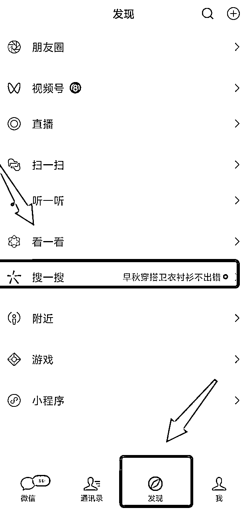

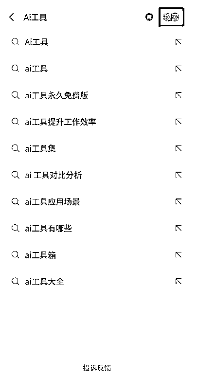

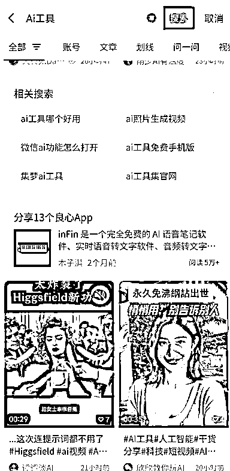

有时候选题太多，反而让人纠结。用三个原则快速过滤：时效性——能蹭热点就蹭；普适性——目标读者大概率有这个困扰；实用性——看完马上能上手。

# 05. 快速验证：发几篇试水

做内容最忌讳闭门造车，所以实战测试是必经之路。假如你想做AI赚钱方向，先发5到10篇不同角度的稿子：

角度一，痛点型。标题可以叫《35岁被裁员，我才发现不会AI就是新文盲》，开篇就写“上个月，我们部门10个人，不会用AI的7个都被裁了……”。如果评论区一片“太真实了”“我也担心”，说明痛点踩准了。

角度二，利益型。标题可以叫《学会这3个AI技能，我的时薪从100涨到1000》，内容讲“第一个技能，用DeepSeek写方案，2小时干完原来2天的活，客户主动加价50%……”。如果大家纷纷问“怎么学”“有课吗”，说明利益点够吸引人。

角度三，故事型。标题可以叫《从月薪3000到月入3万，一个普通文员的AI逆袭之路》，讲“小王，28岁，普通文员，每天做表格到深夜。直到有一天，她发现了AI……”。如果评论里都是“励志”“我也想试试”，说明有感染力。

角度四，干货型。标题可以叫《保姆级教程：用DeepSeek做副业，从0到月入过万》，一步步写清楚“第一步注册账号，第二步找三个赚钱场景，第三步套五个提示词模板……”。如果收藏和转发很高，说明内容很实用。

角度五，热点型。标题可以叫《DeepSeek爆火背后：普通人的百万商机来了》，内容围绕“DeepSeek一夜爆火，但99%的人只看到技术，没看到赚钱机会……”。如果这篇阅读量远超其他几篇，说明用户吃热点这一套。

测试的核心是四看：看阅读量，判断需求是否真实存在；看评论，判断痛点够不够深；看私信咨询，判断用户愿不愿意掏钱；看自己的状态，判断能不能长期写。

发完5篇后，再用三个指标决定要不要继续：

- 阅读量与点赞的比值：100个阅读里至少要有1个赞，说明有共鸣；
- 分享率：分享人数除以阅读人数，大于5%就有潜力，因为分享才能带来新用户；
- 评论率：1000个人看，至少要有人评论，评论率大于1%才说明有粘性。

# 06. 推荐方向

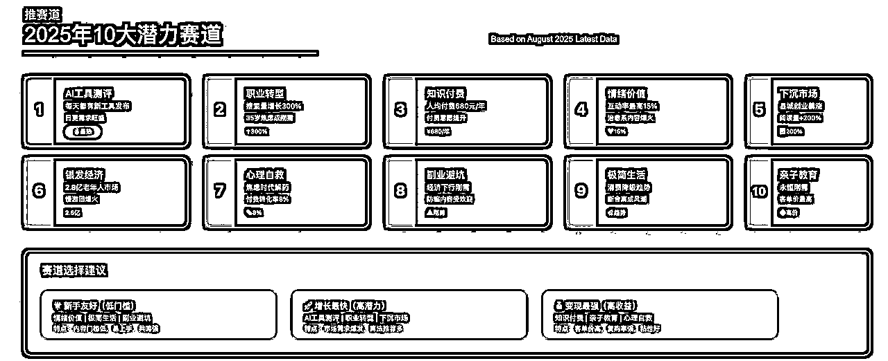

# 1. 十个值得做的细分方向

我整理了一份目前值得做的方向清单：

- 测评AI新应用：新品几乎天天有，日更素材不缺；
- 职业转型：2025年6月搜索量涨了300%，35岁焦虑成了强需求；
- 知识付费：人均付费意愿升到每年680元；
- 情绪价值：治愈系内容的平均互动率高达15%；
- 下沉市场：县城创业类内容阅读量暴涨200%；
- 银发经济：2.8亿老年人口，慢游团已经是爆款；
- 心理自救：焦虑时代的人需要解药，付费转化率有8%；
- 副业避坑：经济下行期防骗内容天然受欢迎；
- 极简生活：消费降级带火了断舍离；
- 亲子教育：永远的刚需，客单价最高。

再用四个细分方向举例，看看什么叫小而美：

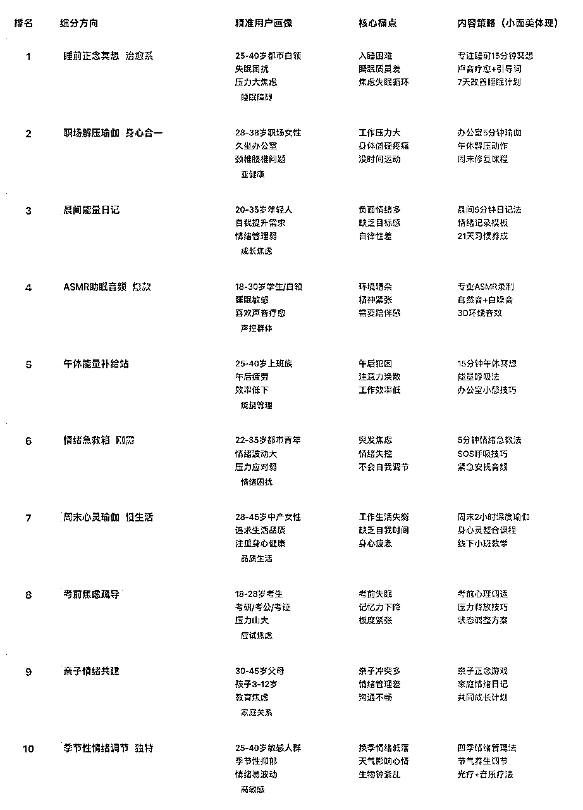

情绪价值方向

测评AI新应用方向

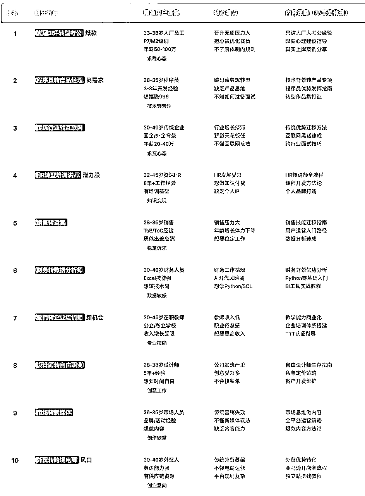

职业转型方向

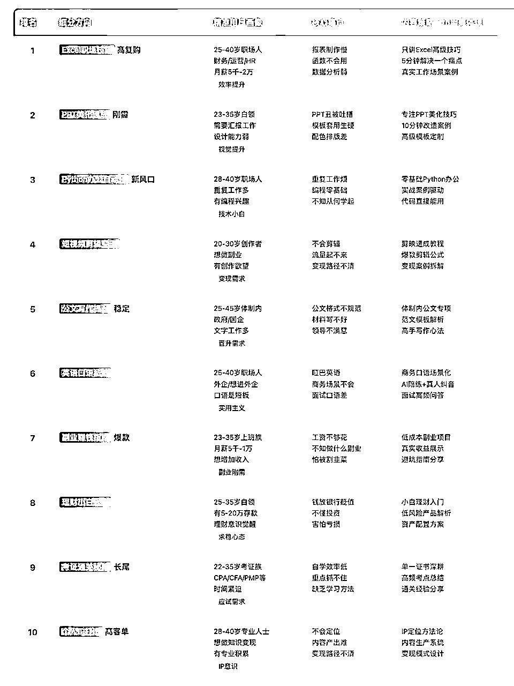

知识付费方向

# 2. 四个坑别踩

第一，别做纯资讯号。AI一天能生成300篇资讯，人工整理已经没优势了，要做资讯+深度解读+个人观点。第二，别押注强热点。热点三天就过气，追热点不等于有内容，最稳妥的结构是80%垂直内容+20%热点结合。第三，别碰违规边缘。一次违规可能全白干，医疗、金融、玄学都是雷区，合规第一。第四，别选完全不懂的领域。外行教内行是笑话，现学现卖必然漏洞百出，至少选自己了解度超过60%的方向。

记住一句话：别想着什么都做，垂直小号能立住，是因为用户只记得住你这一个标签。

# 01. 用AI出稿需要哪些工具

# 1. 本章概览

确认了细分方向，也验证了领域能变现、还有空间，下一步就轮到找题目和写正文。这时候可以借助AI来提效。下面会讲几款主流工具，包括Claude、GPT、DeepSeek，也会拆解一套完整的AI辅助公号创作流程，手把手带你从0做出爆款内容。

先看路线图：花大概2小时把AI出稿方法和工具配置搞定，再用1天时间完成5篇AI辅助文章练习。

# 2. 国内外主力AI工具

通义千问（阿里巴巴）：优点是能处理百万级上下文，多模态交互强，而且免费；缺点是机器味比较重。官网：tongyi.aliyun.com

DeepSeek（深度求索）：

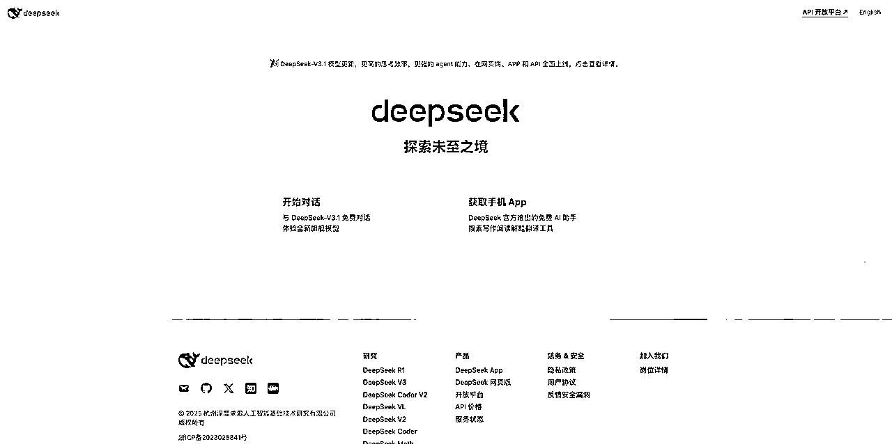

特点是对提示词有基础要求；缺点是响应速度偶尔慢，高峰时段会卡顿。官网：deepseek.com

Claude：

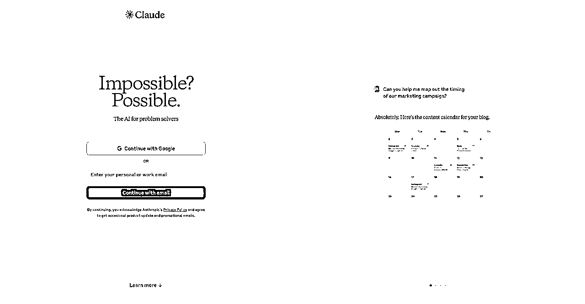

优点是语言准确度、语法规范、用词合理性都能媲美80%的人类写作者；缺点是得搭网络环境，付费功能多，免费版次数有限。官网：https://claude.ai/

# 3. 排版工具

秀米：

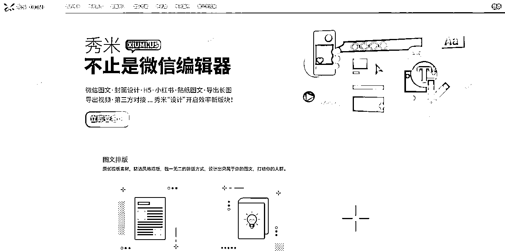

布局能力很强，想做什么风格都行，基础功能免费，性价比高，还能做H5；缺点是新手学布局要花点时间。官网：https://xiumi.us/#/

135编辑器：风格偏小清新，功能也全，注册用户超过900万，样式素材有10万+，支持一键排版、秒刷，就是免费版每个月只能上传100张图。官网：135editor.com

# 02. 怎么让AI帮你写文章

# 1. 底层逻辑

对很多人来说，写作本身就是折磨：对着空白页不知道从哪里下笔，写了个开头又删掉；写出来干巴巴的，一点吸引力都没有；耗了很多时间，效果还是不行。

很多人还有一个误区，以为好内容必须纯原创。其实AI出稿的本质，是用AI把你的专业经验封存进去。你的独特见解+会表达的AI=垂直账号的好内容。

就像厨师有独家配方，AI有写作功力，两个人合力，做出来的是米其林大餐。

# 2. 两种写作方式

# 方式一：迭代式写作

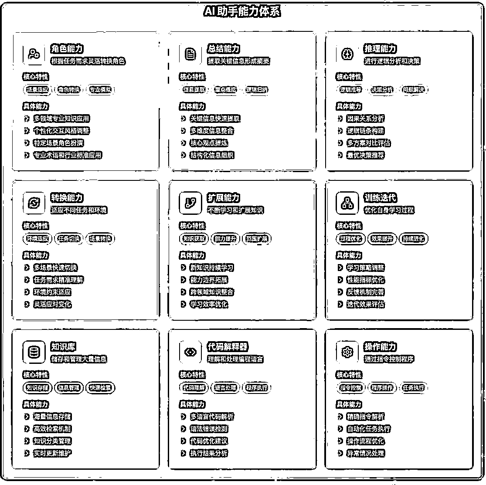

第一步，直接让AI写。我输入：有一篇稿件任务，题目是《中年以后，和激活你的人在一起》，请帮我写一篇400字左右的好文章。结果回了一堆废话，根本看不下去。

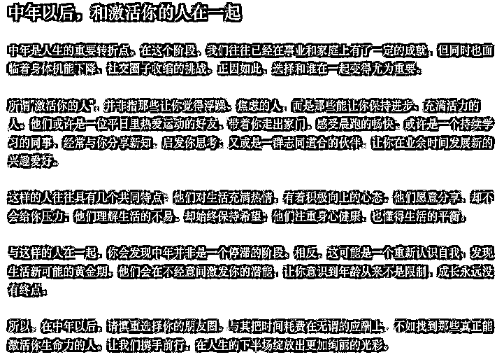

第二步，给AI设定角色。我输入：你是一位擅长公号网感文的作家，题目不变，帮我写一篇400字左右的好文章。这次好一点，但还是没有让人读完的欲望。

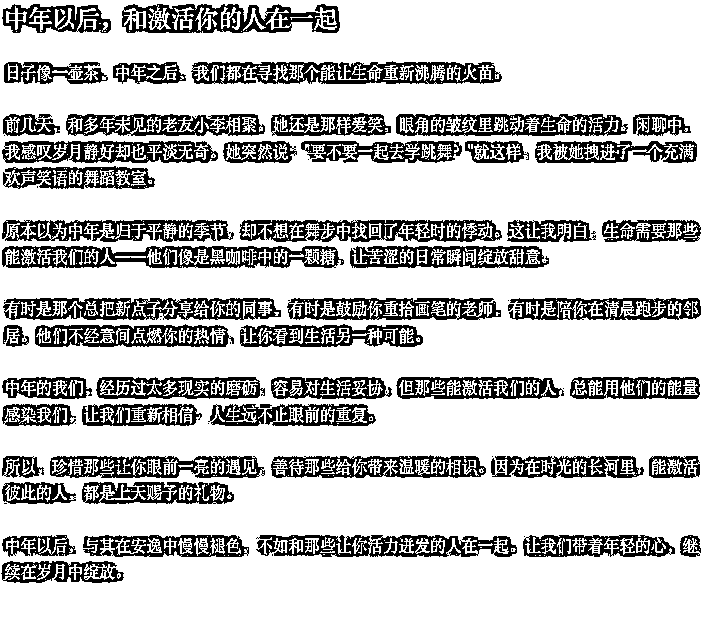

第三步，让AI先思考再动笔。我加了一句：先分析这个选题的目标读者和文章大纲，再结合大纲和读者写正文。它终于抓住了重点。

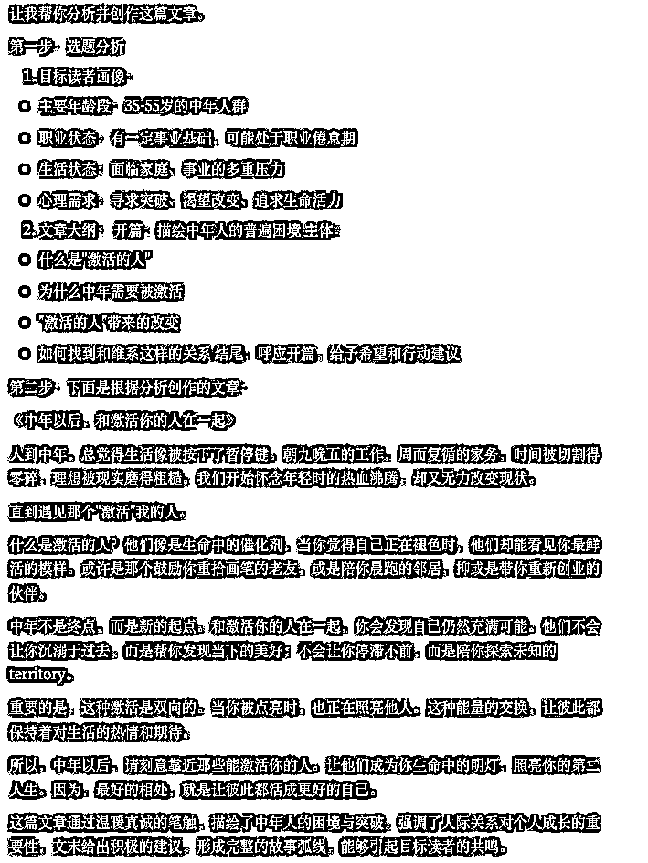

第四步，让AI做自我复盘。我让它总结文章的亮点与不足，并给出改进建议，用表格呈现。它把这些整理了出来。

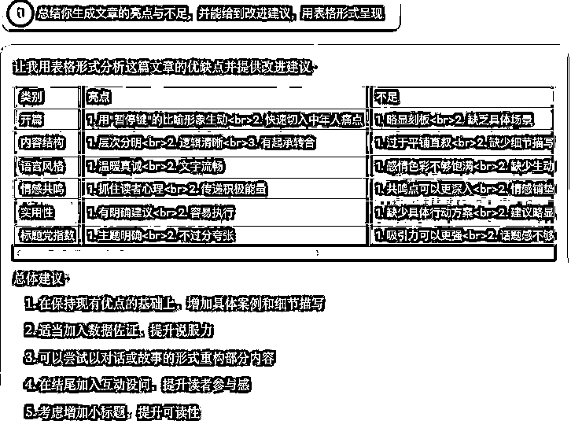

第五步，让AI做定向优化。我说：按你建议里的第1、3、5条来改。改完确实好了一点，但还差点意思。

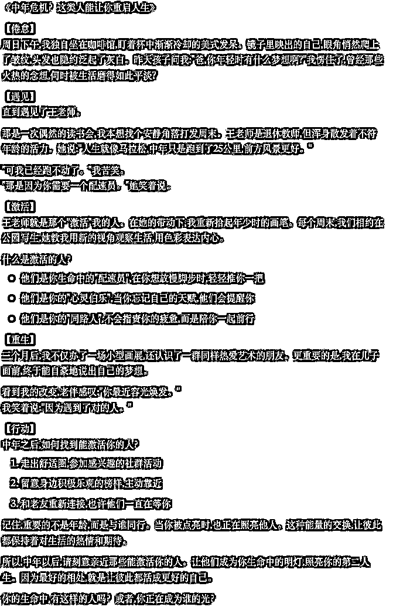

第六步，让AI做风格转换和扩写。我说：换用余华的写作风格，扩充到800字。

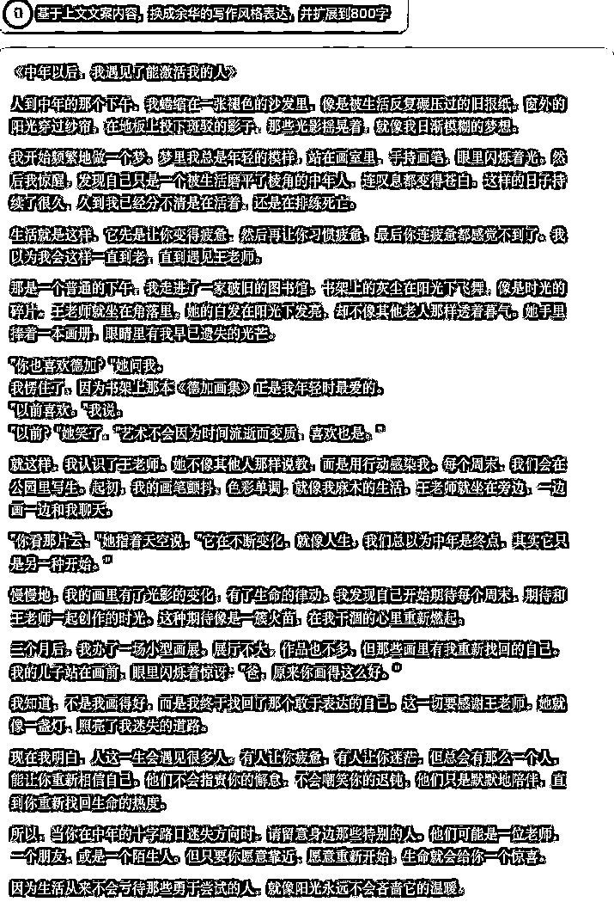

你看，这篇AI+你合作出来的文章，有没有打动你？我没有余华的文笔，但我清楚自己想表达什么；AI懂余华的写作技巧。技巧，是普通人缺少的；但每个人，都有自己对世界的理解。你的经历+一个懂写作的AI，就是内容生产的答案。

# 方式二：工作流+人的判断+AI

公号推文的完整生产流程：

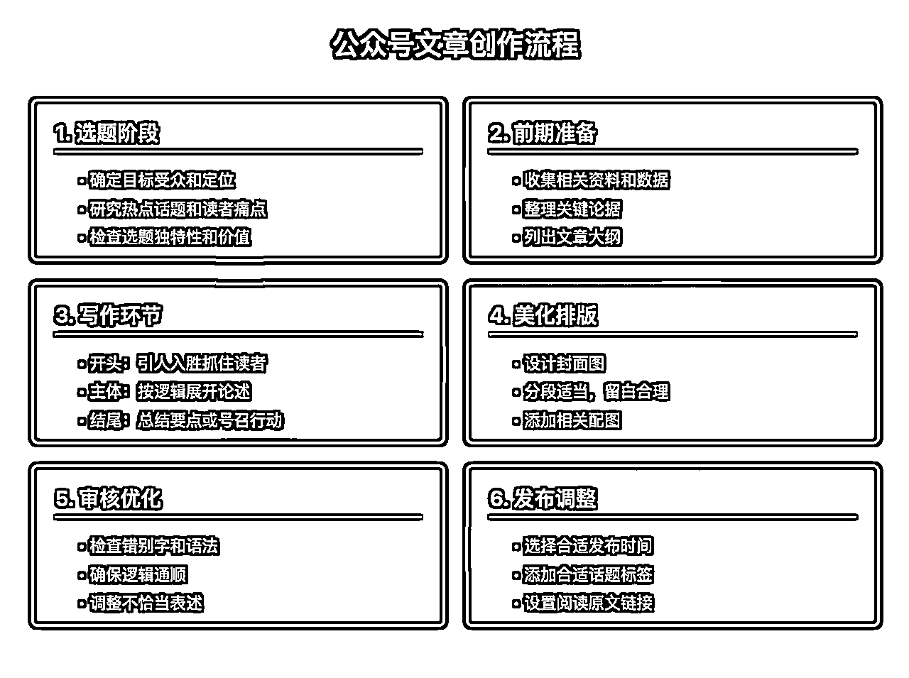

这里要区分哪些环节靠人，哪些环节靠AI。我的比例是：

- 选题：人占80%，AI提供20%的灵感补全；
- 前期准备：人负责60%的素材收集，AI负责40%的论据整理论证和大纲生成；
- 写作：人做10%的微调，AI写90%的初稿；
- 排版：人做10%的判断决策，AI做90%的执行；
- 审核：人做10%的判断决策，AI做90%的检查；
- 发布：100%由人完成。

本质很简单：人选方向、做判断、定决策、给引导；AI负责生成内容和激发灵感。

把这个分工落到工作流里：

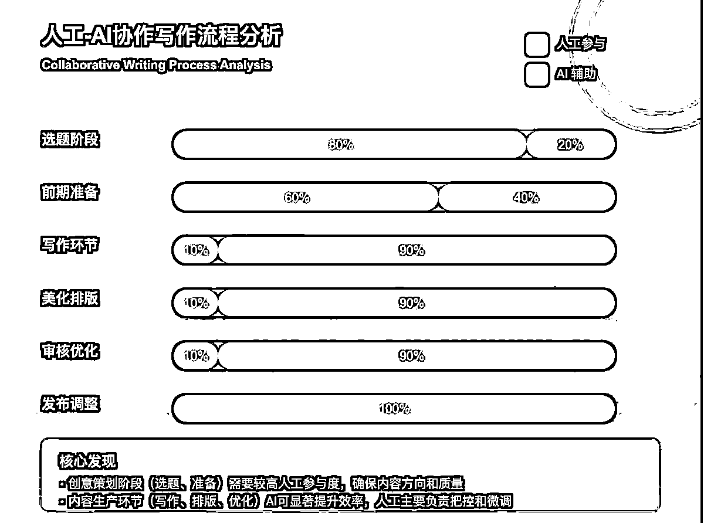

生成文章时，输入：

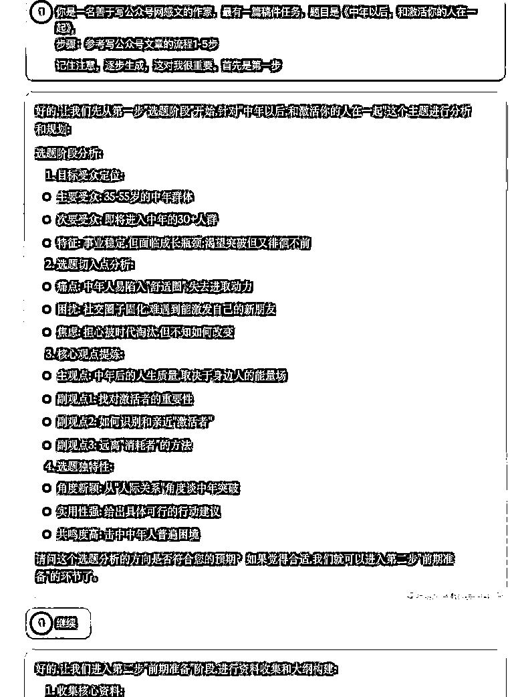

然后连续对话，最终得到输出：

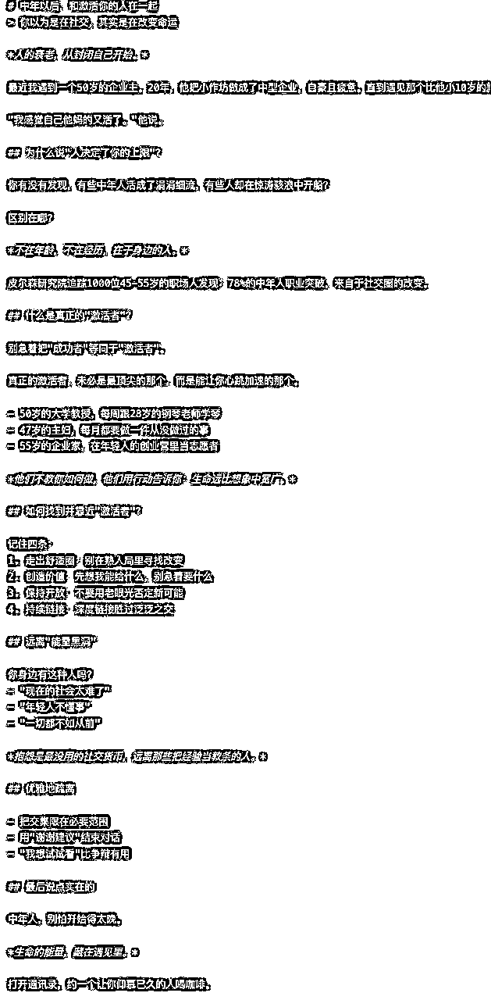

# 3. AI辅助公号创作六步法

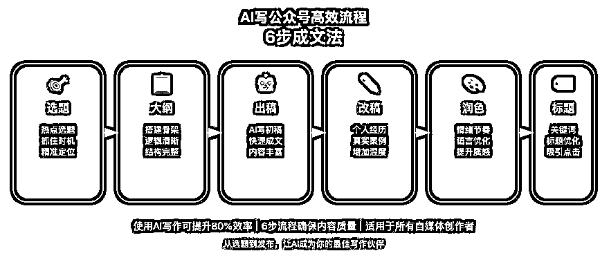

# 第1步：选题——蹭热点

热点去哪找？三个渠道：微信指数看趋势，知乎热榜看讨论，AI选题相关搜索看延伸。从这三个地方收集5到10个备选题目，然后用下面这个提示词，让AI帮你挑出最优的一个：

```
# 角色设定
你是一位资深内容策略专家，精通数据分析和用户心理学

# 任务目标  
评估以下选题的商业价值和爆款潜力

# 输入信息
选题列表：
1\. [选题1]
2\. [选题2]  
3\. [选题3]

# 分析框架
请按以下维度评分（1-10分）并说明理由：
- 搜索热度：基于关键词月搜索量
- 竞争密度：已有优质内容的饱和度
- 变现潜力：可关联的产品/服务价值
- 情绪共鸣：引发转发分享的情绪触点
- 时效窗口：话题生命周期预估

# 输出要求
1\. 数据表格对比
2\. 最优选题推荐及理由
3\. 标题优化建议（3个备选）
```

看效果：

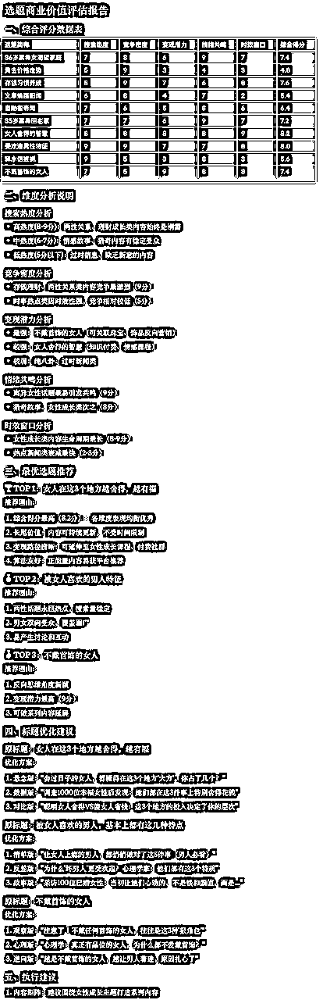

AI会直接告诉你哪个题目最值得写。

# 第2步：大纲——搭骨架

题目定了，就让它帮你搭文章骨架。这是大纲提示词模板：

```
角色：你是一个用AI月入5万的实战派博主
任务：为文章【用DeepSeek做副业月入过万】搭建大纲
要求：
1\. 痛点开场（读者正在经历什么困扰）
2\. 方法论（3-5个具体步骤）
3\. 案例支撑（每个步骤配一个真实案例）
4\. 行动指南（看完能立即做什么）
字数：1500-2000字
风格：实战、接地气、有数据支撑
```

跑一下看效果：

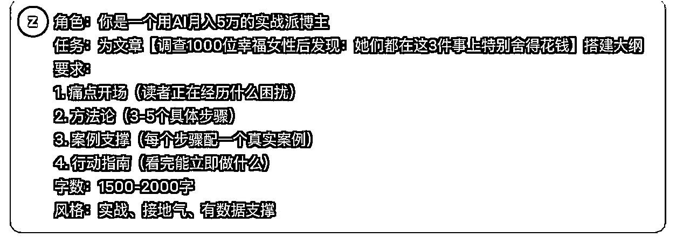

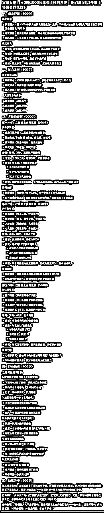

AI会给出一份逻辑清晰的大纲。

# 第3步：出稿——先有初稿再谈打磨

骨架有了，接下来让AI填血肉。提醒一句：AI出的是初稿，你必须把你的个人经历和观点加进去，文章才真正有温度。要是初稿实在没法看，不用客气，直接让它重写。

初稿提示词模板：

```
基于上面的大纲，写一篇完整文章
特别要求：
1\. 开头用一个吸引人的故事或数据
2\. 每个方法配具体操作步骤
3\. 加入"我的朋友/客户"的案例
4\. 结尾给出7天行动计划
5\. 全文避免"首先、其次、最后"这类词
6\. 多用短句，每段不超过3行
7.参考公众号排版
```

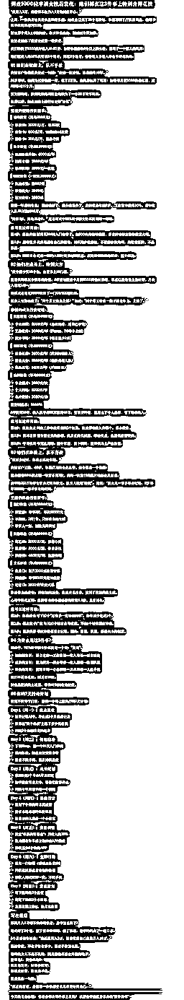

# 初稿只有60分，先别收工

# 第 4 步：改稿 - 把亲历写进去

机器替代不了你的真实经历。这一步必须自己上。

改稿可套用：
```
请在以下位置加入个人经历：
1\. 开头后加入：""
2\. 第二个方法后加入：""
3\. 结尾前加入：""
要求：融入自然，不突兀
```

# 第 5 步：润色 - 调节情绪起伏

文章读起来有没有波澜，就看这一环。

润色模板：
```
优化文章的情绪节奏：
1\. 开头：制造冲突感（可以选填其他）

2\. 中间：加入转折（可以选填其他）

3\. 结尾：情绪升华（可以选填其他）

保持原意，增强感染力
```

不想套模板也行，直接改写，把自己的说法、故事和判断塞进去。

# 第 6 步：标题 - 埋关键词，顺手优化

标题优化提示词：
```
为这篇文章生成10个标题
要求：
1\. 包含关键词：
2\. 有数字：
3\. 制造反差：
4\. 情绪钩子：

示例格式：
- 数字+结果+方法
- 反问+痛点+解决方案
- 热点+人群+收益

选出点击率最高的3个
```

一步步生成，成稿效果：
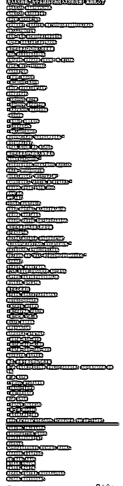

# 4.AI 公众号 - 痛点提示词模板

前文六步，解决的是“从零写出一篇”的完整链路。照做之后，通常能拿到60—80分的基础稿。

想冲优质爆款，还得再打磨。下面五套补丁式模板，专门补短板：哪块弱，就补哪块。

# 痛点一：内容厚度不足

套用词：
```
请深度优化以下文章，执行以下任务：

1\. **数据支撑层**
   - 为每个核心观点添加2025年最新数据/研究
   - 引用权威机构报告（如艾媒咨询、秒针系统等）
   - 加入行业对标数据（TOP10%表现基准）

2\. **观点延展层**
   - 添加3个层次的论证：现象层→原理层→应用层
   - 预判并回应3-5个常见质疑
   - 补充未来6-12个月的趋势预测

3\. **价值提炼层**
   - 总结3个可复制的方法论
   - 提供1个决策框架图
   - 设计1个自检清单（5-7项）

文章内容：[粘贴文章]
目标读者：[描述读者画像]
核心价值主张：[一句话说明文章价值]
```

# 痛点二：开篇抓不住人

可用词：
```
请创作5个不同风格的开头（前100字），并标注适用场景：

1\. **认知颠覆式**
   模板：大多数人以为[常识]，但真相是[反转]
   适用：知识科普类、观点输出类

2\. **场景代入式**
   模板：想象一下，[具体场景描述]，你会[情绪/行动]吗？
   适用：产品推荐类、生活方式类

3\. **数据冲击式**
   模板：[震撼数据]意味着什么？[通俗解释]
   适用：行业分析类、趋势解读类

4\. **悬念递进式**
   模板：三个问题：[问题1]？[问题2]？最关键的是[问题3]
   适用：深度思考类、问题解决类

5\. **共鸣唤醒式**
   模板：是不是经常[痛点场景]？别担心，你不是一个人
   适用：情感共鸣类、社群运营类

原始开头：[粘贴内容]
文章主题：[一句话概括]
```

# 痛点三：案例不够活

提示词参考：
```
请帮我优化以下文章中的案例部分，使其：
- 更具体、更有画面感
- 增加情感元素和细节描述
- 清晰展示问题-解决方案-结果的完整路径
- 加强与读者实际场景的关联性
案例部分：
[粘贴案例部分]
```

# 痛点四：收尾没劲

这套词：
```
设计"三层递进式"结尾架构：

第一层：【认知总结】（50字内）
- 用一个金句总结核心观点
- 呼应开头，形成闭环
- 强化一个核心记忆点

第二层：【行动清单】（3-5条）
立即行动（5分钟内可完成）：
□ [具体任务1]
□ [具体任务2]

本周挑战（需要规划）：
□ [进阶任务]

长期实践（习惯养成）：
□ [系统化方案]

第三层：【互动引导】
投票互动：你最想先尝试哪个方法？
A. [选项1] B. [选项2] C. [选项3]

深度讨论：[一个开放性问题]
资源获取：回复关键词"[XXX]"获取配套工具

原结尾：[粘贴内容]
CTA目标：[如：引导转发/收藏/评论/私信]
```

收尾情绪曲线设计：
```
平静总结 → 价值强化 → 情绪推动 → 行动号召
(理性)                            (感性)
```

# 痛点五：文风跳脱

统一文风的词：
```
请帮我统一以下文章的风格：
- 使其更符合[描述你想要的风格：
如专业/故事化/数据驱动/思考型]。
特别注意：
- 语气和词汇选择的一致性
- 段落长度和节奏感
- 专业术语使用的平衡
- 比喻和例子的协调性
文章内容：
[粘贴文章]
```

1. 公众号起号流程，怎么快速跑通？

# 1.本章概要

当你已经锁定合适的细分垂直方向，也掌握了用 AI 协助写作，接下来要看的，就是起号打法：按自己的赛道做账号包装，让读者感到你是一个有专业度的 IP。

粉丝数达到500后，登录 mp.weixin.qq.com，进入收入变现板块，找到流量主并申请开通；审核通过后，就能产生流量主收益。

本章路线：
- 了解当前起号逻辑与技巧，快速启动（4小时）
- 第一周至少发出7篇内容（约3天）
- 打磨内容策略，向500粉冲刺并开通流量主（约4天）

# 2.定人设，把资料补齐

先确定赛道，再谈人设。领域方向如何取舍？抓住两点：
- 做窄做深，不要贪图大而全
- 优先考虑变现天花板

人设越鲜明，读者越容易信任你。不同领域，人设的发力点也不同。它一般会出现在账号名、简介、关注后的自动回复，以及正文里的自我介绍中。

账号名：短、顺口、容易记
简介：一句话讲清——定位、痛点、价值、差异
关注自动回复：经历、价值、钩子

写简介时就可以露出人设，比如：
“在字节做了10年产品经理，长期研究怎样用 AI 工具提高工作效率。”

但人设不能编，必须立得住。也可以让 AI 先起草。

提示词：
```
请根据以下公式，帮我生成一个创作人设。要求简介要有吸引力（勾起好奇、体现价值、展示定位、突出差异化），关注后自动回复要能立刻传递价值。

输入要素：
1.身份标签：
2.独特经历：
3.领域：

输出格式：
名称：（2-6字）
简介：（15字左右，要勾起好奇+体现价值+有差异化，比如“踩过100个坑的前大厂PM，专讲副业赚钱的冷门路子”）
关注后自动回复：（100字左右，主要增强人设 + 传递价值，比如“hi，你好呀，我是XX。 一个非典型的程序员，交大毕业，毕业后在体制内工作，后毅然辞职，现正在创业中，期待与你一起进步，每个故事都有感悟，每次进步都值得纪念。没有高山，只有脚下的路。始终相信大胆折腾，百味才是人生，创业始终在路上。感恩相遇，回复资料，可以领取一份XXXX，回复进群，免费加入交流群”）
```

预期输出：
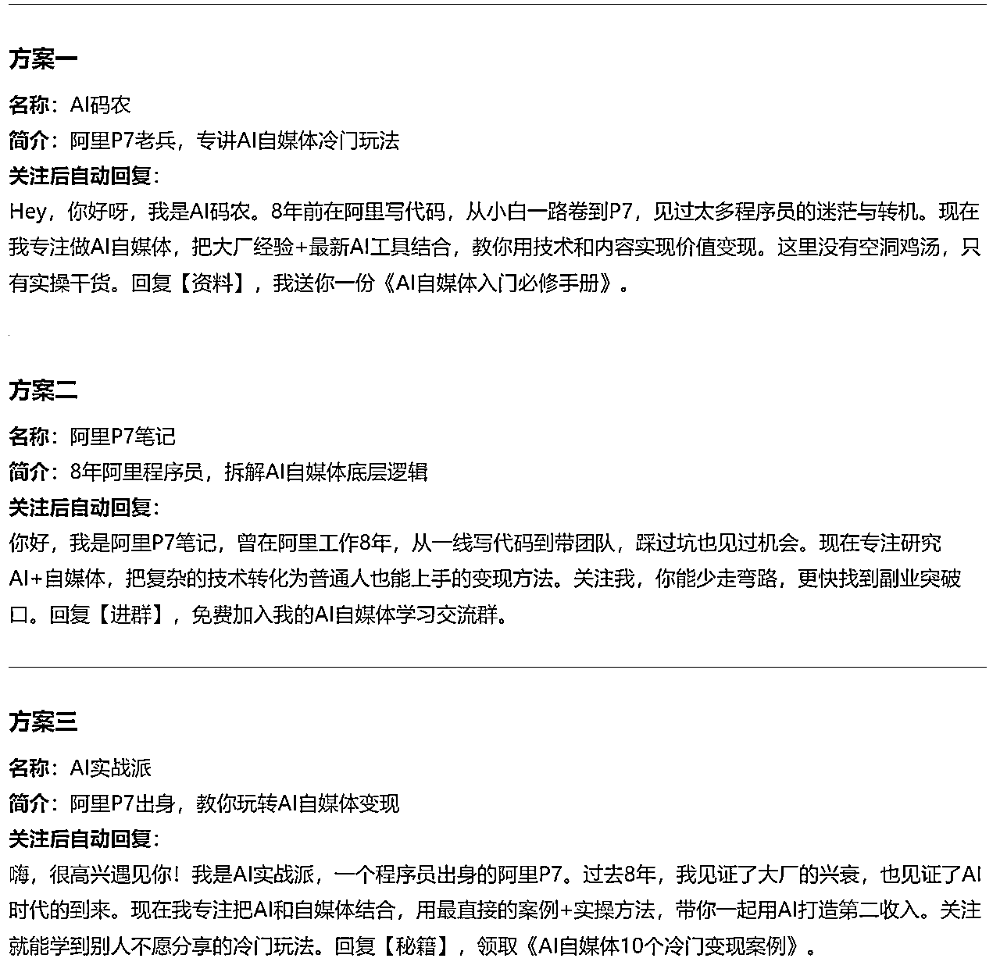

# 3.完成基础设置

改名称、简介、头像：进入后台的账号详情即可操作。

设置关注自动回复：找到互动管理，进入自动回复，选择被关注回复，填入文案。

若在被关注回复里放了口令，需要用户发送指定内容才触发，就到关键词回复中配置对应词。

进阶用法：自动回复还能按关键词分流——用户发不同词，收到不同内容。拿来做资料领取很合适，对关注率提升明显。

账号多时，可试试微信对话开放平台：一套回复配置，多个账号共用，省力。
地址：https://chatbot.weixin.qq.com/

# 4.发文章时，把人设放进去

为什么一定要有人设？当下注意力停留很短，每一次曝光都值得争取。常见位置有两个。

其一：放在文末
正文结束后，附上固定的个人介绍。一些大 V 就是这么做的，既强化身份，也留下钩子。
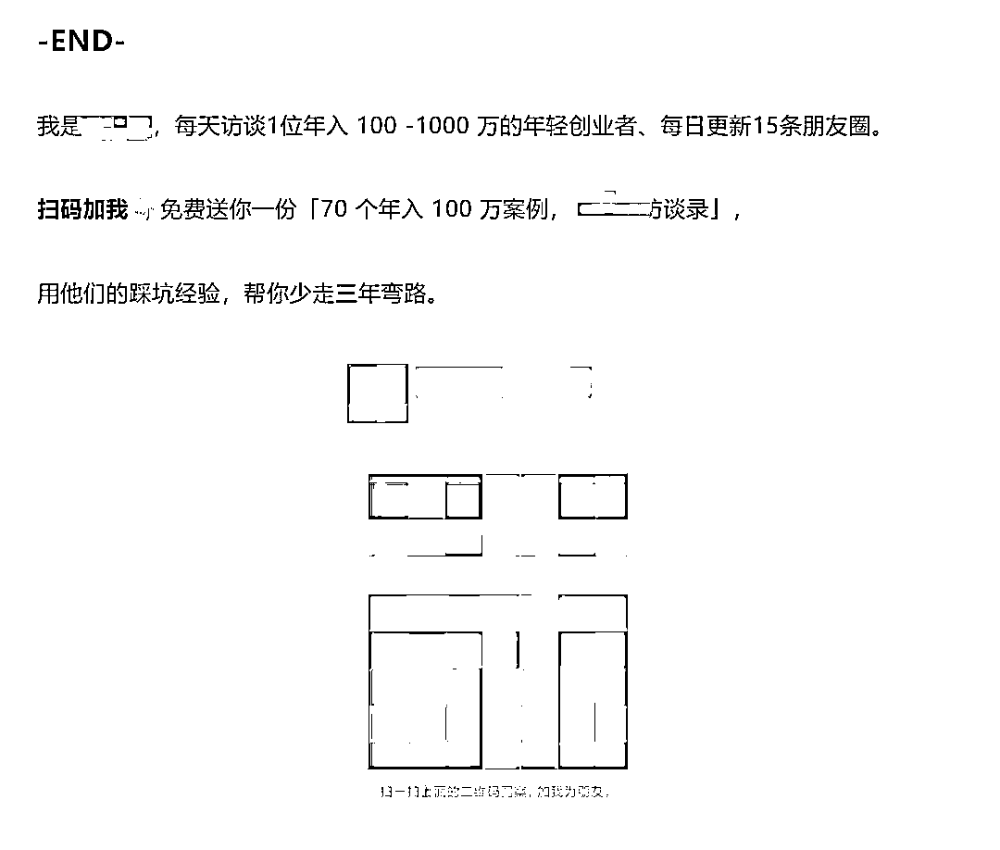

其二：放在开头
每篇开头写几句简短介绍，或者用固定图片，都能第一时间吸引目光；也可以放本人照片。此前有个做爆款的账号，每篇都配同一张自拍，数据很好。大家把图转到群里后，不少人都说见过——可见图片留在脑子里的痕迹，常常比文字更深，也更容易被记住。

圈友账号示例：
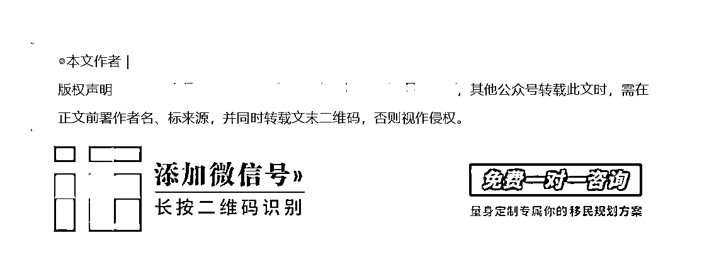


# 5.两种起号打法

基础资料准备好后，可以从下面两条路里选。

打法一：注册后直接更
注册完就开始日更，阅读量只有几十也照发。
逻辑：内容始终围绕1—3个关键词，平台算法会慢慢认出你的账号标签和人设。
好处：起步快，执行简单。
不足：要熬，可能一个月后才看到起色。

打法二：小领域转大方向
注册后先避开目标赛道，挑一个更小众的蓝海方向更新。
通常一周到半个月能进流量池；进池后，再切回目标领域。
逻辑：蓝海内容供给少，被推荐的概率更高。
好处：入池机会大，正反馈来得快。
不足：有些账号换赛道后，流量未必接得上。

1. 流量主开通计划与注意事项

# 1.开通流量主：门槛和操作

提醒：做爆文项目时，常见操作是用渠道把粉丝直接推到500，再开流量主。

可垂直小号流量通常不算高（和爆文项目选的领域相比），只靠广告变现，收益可能一般。更建议把精力放在内容质量与私域引流上，等粉丝自然涨到500，再申请流量主。

# 1.1开通方法

门槛是500粉。粉丝到100时，仅能开带货，不能给文章插广告。

达到要求后，登录 mp.weixin.qq.com，进入收入变现，找到流量主，按提示开通。

# 1.2收益结算

开通后还要绑定银行卡，收益才能到账。腾讯会在本月结清上月收益，按上半月、下半月两笔处理。

账号用本人身份注册，绑卡会简单些；若用亲友身份注册，则要提供授权函。操作如下。

进入后台流量主页面，在财务管理里点“立即完善”。
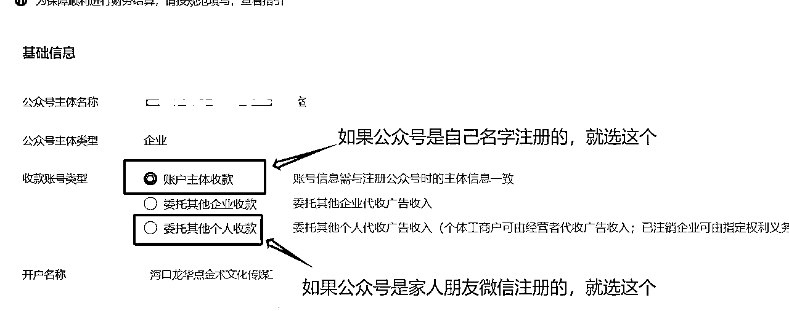

若账号注册人是自己：选账户主体收款，填本人资料和银行卡，提交即可。

若账号由家人或朋友微信注册：选委托其他个人收款，也就是对方委托你代收，钱最终进你的银行卡。填写方式如下：
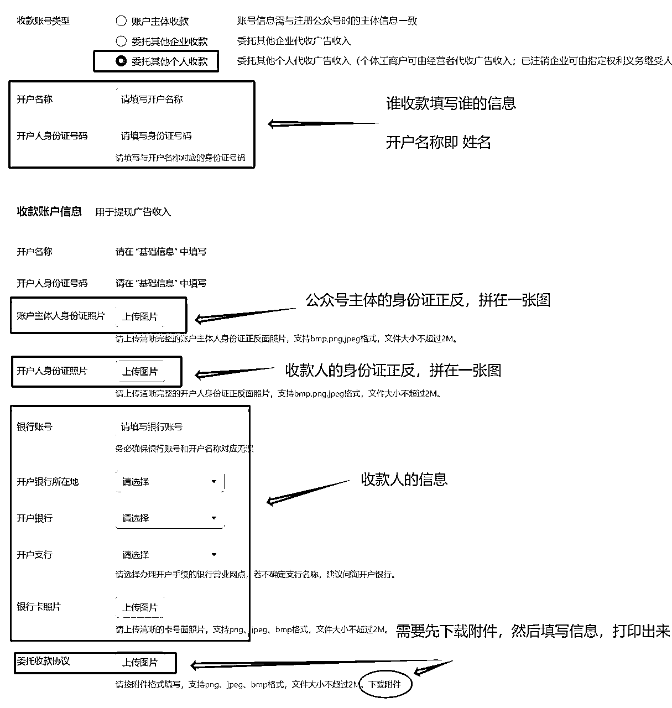

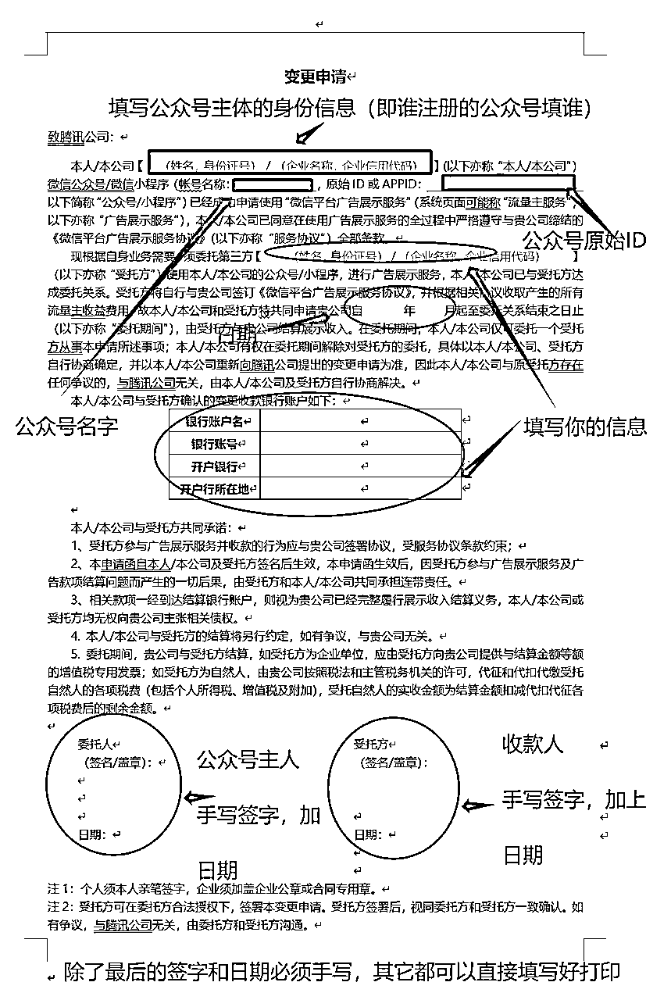

提交后等系统审核，信息没填错通常能通过。以往反馈里，最容易翻车的是开户名称：有人误填成银行名，正确做法是填真实姓名。

# 2.常见疑问与提醒

# 2.1用 AI 协助写的稿子，怎么查 AI 味？

https://matrix.tencent.com/ai-detect/

可以用腾讯推出的朱雀大模型做检测，建议把 AI 浓度压到20%以下。实测中，起号阶段长期高 AI 浓度，账号跑起来的概率偏低。

# 2.2怎么更容易通过朱雀？

它主要盯句式：把文章切成段落和句子来判断，和内容主题关系不大，更看表达习惯与写法。因此可以从标点、句型下手。下面这类提示词，有帮助。
```
【句式特点】
每个句子随机选择下面的任何一个方案。
## 方案一：短句碎片化结构

**规则**：把长句拆成多个短句，用句号代替逗号
**示例**：
```

例一：
原句：天气虽然不错，但我还是留在家里办公，手头事情太多。
改写：天气不错。我留在家里办公。事情多。得一件一件清。

```

## 方案二：标点符号不规则使用

**规则**：混用中英文标点，省略部分标点，用空格代替
**示例**：
```

例二：
原句：第一步，弄清楚问题本质；第二步，找到可行方案。
改写：第一步 弄清楚问题本质,第二步找到可行方案

```

## 方案三：断句节奏变化

**规则**：打破常规断句位置，在意想不到的地方断开
**示例**：
```

例三：
原句：这招有效，不过落地很费时间和精力。
改写：这招有效。但落地费时间。也费精力。

```

## 方案四：句式长短交替

**规则**：一个长句后面跟2-3个极短句，形成节奏变化
**示例**：
```

例四：
原句：人工智能让生活更便利，也提升了工作效率。
改写：人工智能确实让生活和工作便利了不少，效率也上去了。真的。很直观。每天都能体会到。

好👌 前面已经有四个方案，这里再补一个方案五，风格继续统一：

## 方案五：倒装句结构

**规则**：把常规语序打乱，让谓语或宾语先出现，制造强调与不规则感。

**示例**：
```
原句：我从未见过如此奇怪的事情。
改写：如此奇怪的事情。我从未见过。

原句：你一定要坚持下去，否则就会失败。
改写：坚持下去。你一定要。否则就会失败。
```

```

# 2.3 为什么流量主收益 2 个月前的都没有结算呢？

大概率是因为错过了结算期，即绑定银行卡太晚了，一般会延迟 2-3 个月结算。

# 01.选题

# 1.本章概要

在我们学习了 AI 写作方式以后，这里会分享一些写作技巧，比如一篇文章重点是选题和标题，这个决定看你文章的用户是谁，官方给你的文章打上什么标签，精准推送。

好的标题是提高点击率的核心，所以很多作者会花 80%的时间在选题、标题上去打磨内容。

本章航线图如下：

学习 10W+爆文的标题写作公式（约 2 小时）

掌握开头黄金 3 秒和结尾引导技巧（约 2 小时）

建立个人专属的爆文模板库（约 2 小时）

# 2.什么是选题？

选题，就是确定你这篇文章要写什么主题、解决什么问题。等于是大的方向。

一个领域可能有很多细分方向，可以无限细分下去，比如写副业，有线上副业，线下副业，轻创业，副业盘点等等，甚至还可以细分为人群，不同的方向，里面都有一些可以写的内容，不同的切入点，就可以作为是选题。

选题就是近期账号的大方向，垂直小号，前期尽可能一直围绕 1-3 个选题进行开展，帮助账号快速定位。比如有些账号就一直围绕发财这个选题展开，几乎每篇文章的标题都含有这个关键词，还有一些账号就一直围绕 30 岁失业这个选题，不断的创作，而且流量非常的稳定。

# 3.为什么要重视选题？

算法喜欢：围绕固定的选题，更容易给账号打上标签，从而推送给更加精准的用户

用户喜欢：读者点进来，是因为内容正中他们的痛点或兴趣。

# 4.好选题的标准

一个优质的选题，一般有以下 4 点：

.

有人关心：话题要有一定的受众，最好是刚需/高频问题。

示例：35岁裁员、孩子教育、AI副业、AI自媒体。

.

有人讨论：能引发情绪共鸣或争议，容易点赞、转发、评论。

示例：为什么越努力工作，升职的机会反而更少？

.

有人愿意付费：能延伸到后续产品或服务。

示例：副业赚钱 → 课程；情绪疗愈 → 社群；AI 工具 → 培训。

.

当前热门话题：能结合当前社会热点，巧妙切入你的选题

特别注意：千万不要硬蹭热点，而是找到热点和你领域之间的“桥”。很多时候，热点和我们写作领域表面上不相关，但通过换角度，就能形成新鲜又有深度的选题。这种可以借助 AI 帮我们融合。

选题来源

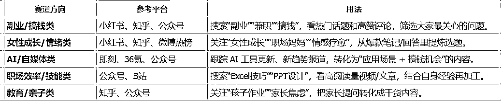

# 02.标题

# 1.标题的重要性

用三个字总结就是：生死线。

再好的内容，如果标题不吸引人，读者连点开的机会都不会给你；而一个强标题，即便内容一般，也能让文章获得初始流量。很多爆款文章，80% 靠标题赢得第一波推荐。

所以，写文章之前，标题要先过关。

# 2.爆款标题 5 大要素

不同领域的爆款标题形式各异，但它们背后的规律高度相似，总结起来有以下 5 大要素：

.

数字化：带数字更直观，容易传递“可操作”的感觉

示例：35 岁之后，升职的关键不在能力，而在这 3 点

.

结果导向：直白告诉读者“能得到什么”

示例：不会 AI 的普通人，正在被淘汰：副业月入 1 万的 5 个玩法

.

反差冲突：打破常识、制造意外，让人忍不住点开

示例：为什么越努力工作，升职的机会反而更少？

.

情绪钩子：点燃焦虑、恐惧、好奇或兴奋，让读者代入

示例：35 岁被裁员的人，现在都怎么样了？

.

人群定位：点名特定人群，更精准触达目标读者

示例：名校老师：最拖后腿的不是成绩，而是家长的这 5 个习惯

记住一句话：好标题=痛点+利益点+具体性+情绪感。

标题写得对，文章就已经赢了一半。

# 3.爆款标题常用公式

1.  数字 + 痛点/结果 + 人群

结构：X 个方法/技巧 + 解决某痛点 + 针对某人群

示例：

35 岁后，升职的关键不在能力，而在这 3 点

全职宝妈自救：这 5 个副业比上班还靠谱

1.  结果前置 + 方法 + 利他表达

结构：我实现了某结果 + 用了某方法 + 今天分享给你

示例：

我靠写公众号一年赚了 50 万，这 3 个方法今天告诉你

我有一个朋友赚了 500W，在我的威逼利诱下，今天我把这个方法告诉大家

1.  反问 + 痛点 + 解决方案

结构：反问句 + 戳中痛点 + 暗示文章有答案

示例：

为什么同样是副业，有人月入过万，有人却血亏？

孩子成绩下滑？可能是家长踩了这 3 个坑

1.  热点 + 人群 + 收益

结构：某个热点事件 + 特定人群 + 收益/机会

示例：

DeepSeek 爆火：普通打工人如何抓住副业机会？

DeepSeek 爆火：一个宝妈用 AI 写爆文实现月入 8000

1.  对比 + 转折

结构：前半句埋坑/对比 + 后半句转折/反差

示例：

我写了 100 篇文章，没火；但这 1 篇让我涨粉 1 万

越努力工作，升职机会反而更少？真相扎心了

1.  故事化（人物 + 过程 + 结果）

结构：某个具体人物 + 做了什么事 + 最终结果

示例：

从月薪 3000 到月入 3 万：一个普通文员的副业逆袭

她离婚后，靠写公众号 2 年养活自己和孩子

1.  精妙犀利金句 + 悬念

结构：一句击中人心的观点 + 暗示背后原因/答案

示例：

真正拖垮中年人的，不是没钱，而是没退路

决定孩子成绩的，不是补习班，而是家长的这 3 个习惯

# 4.优化标题工具

标题优化工具.exe

使用教程：（这个工具是免费使用，给生财有术专属使用）

标题优化工具使用教程—9月航海

先输入口令：生财有术

然后打开，选择 Poe Api 或者 DeepSeek API

Poe 获取 Api 地址：https://poe.com/api_key

DeepSeek 获取 Api 地址：https://platform.deepseek.com

导入标题，选择不同的优化风格，批处理大小选择 20-50，即每次对话处理的标题数量。最终把所有的标题处理完成，点击导出可以看到优化效果。

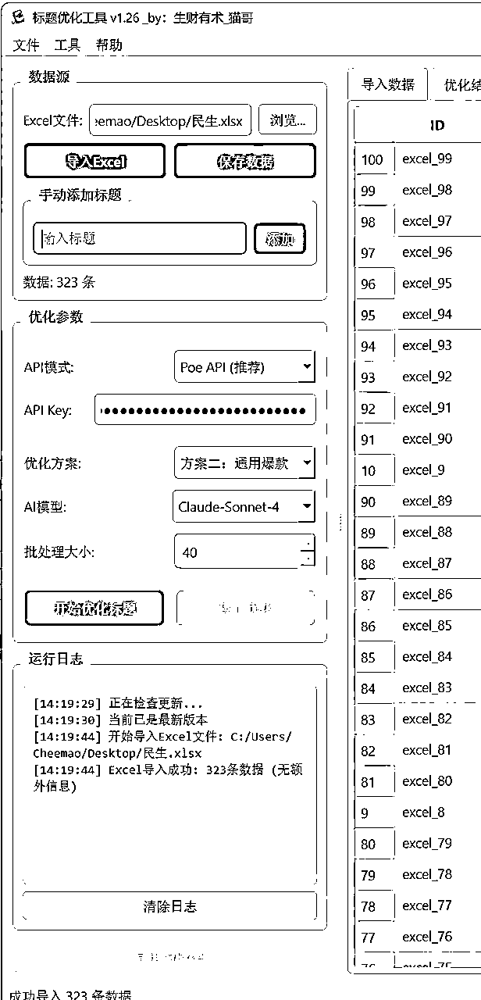

# 03.内容

# 1.内容创作思路

公众号写作的重要级是：选题 > 标题 > 内容。

其中，选题和标题决定了文章能不能火；内容决定了文章能不能留下读者。

但是，写内容往往最耗时。而且现实情况，大部分人写作能力并不是很强，这个时候我们果断选择 AI 辅助创作。我们提供内容框架，让 AI 帮我们完善，这样子可以大大减少创作文章所花费的时间，重要的是写出来的文章也完全是完整自己的思路去写的。

把 70% 的时间用在选题和标题上，剩下 30% 用 AI 辅助生成内容。

# 2.利用 AI 快速找到切入点

同样的一个选题，切入点不一样，写出来的文章也完全不一样，内核都不会一样，应该尽可能选择独特的切入点，如何去切入呢，可以直接用下面的提示词：

利用 AI 快速帮我们选择切入点，并且生成一些标题，选择你喜欢的切入点进行创作内容。

```

# 想发财？先扔掉这三样东西

你有没有想过，拦住大多数人财路的，压根不是兜里没钱，也不是身边没人。

是那几个听起来特别对、做起来特别坑的念头。

我不跟你扯虚的，今天就聊三件反着来的事。每一件，都可能让你从“忙了一年白忙活”里跳出来。

**头一件：抠门抠不出好日子。**

一提赚钱，好多人头一个反应就是“先攒”。奶茶不喝了，外卖不点了，日子过得跟苦行僧似的。然后呢？年底一算攒了两万，出个岔子全填进去。

节约当然没毛病。但光靠勒紧裤腰带，你跑不赢物价，更跑不赢资产涨的速度。**真正让人拉开距离的，是把钱花出去的本事。**

花在省时省力的工具上，花在别人不知道的信息上。你手动忙活半小时的活儿，花点小钱交给工具，十分钟搞定两遍。这叫乱花吗？这叫拿小钱换时间，再拿时间换更大的余地。想多赚点，先学会每一分钱都花出响儿来。

**第二件：非等万事俱备，风早刮过去了。**

见过太多人，想弄个副业，先啃三个月书本，再花两个月琢磨平台规则。等终于觉得“差不多了”，热闹劲儿早换了地方。

想多挣点的人，最容易栽在“啥都得弄明白再动手”上。你根本不用全懂了才开始。先跑起来，跑着跑着再调方向。我当初扔掉铁饭碗那会儿，身边没几个赞成的。但我心里清楚，干耗着才是真赔本。你得先踩出第一步，才能看清第二步往哪儿落脚。

**第三件：八爪鱼式折腾，最后两手空空。**

今儿看电商热闹，一头扎进去。明儿听说短视频带货火，又调头。折腾大半年，回头一看啥也没攒下。

没背景的人，最值钱的家底不是存折，是**心神**。你把劲儿切成八瓣使，每瓣都薄得跟纸似的。真正跑出成绩的那些人，哪个不是盯住一个点，盯到旁人都嫌烦？

**盯住一个方向，往深里凿。** 这话听着不稀奇，真能做到的没几个。

说到底，想多挣点，比的不是谁脑子快，是谁更早琢磨透——抠门抠不出好日子，等也等不来好时机，东一榔头西一棒子只能原地转圈。

换个活法，动手就完了。

```

输出结果展示：

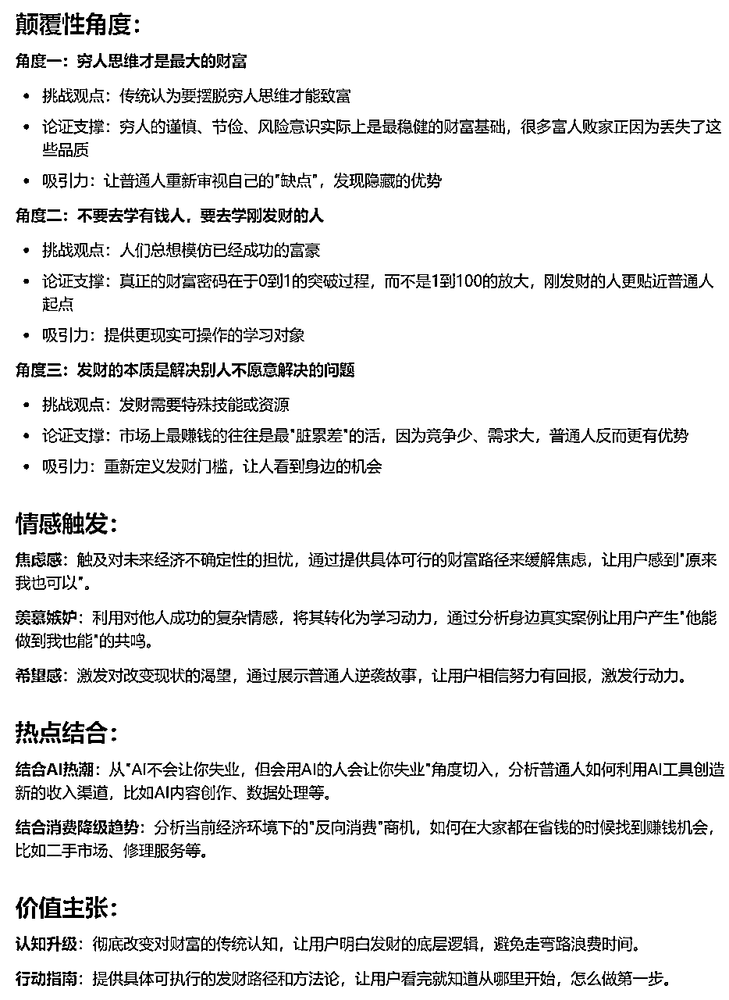

# 3.利用 AI 快速创作文章

垂直小号，一定要有人设，内容有温度，要有人情味等等，因此即便是 AI 辅助，也最好单独调教一个提示词。

这类提示词的框架主要包含：人设部分 + 个人经历 + 文章内容结构 + 语言风格 + 微信 SEO + 钩子（可选）

1.人设部分

目的是要让读者感觉到：背后是一个真实的人，而不是工具人。真实的人设会让粉丝记住你。如果不固定人设，AI 可能每次写出来的，都不是一个人，对于长期关注的粉丝来说，这将是是灾难性的，因为他完全感觉不到你是一个什么样的人。

2.个人经历

个人经历，特别是真实的个人经历，非常有助于读者了解我们。同时也为了避免 AI 跑偏，比如你是一个程序员，如果你这里写了个人经历，真有某些场景需要用的时候，AI 就会去写，而不是写你是一个外卖员，避免了这种尴尬的发生。

3.内容结构

内容结构是为了让读者更加直观，清晰的了解我们的文章，这里的结构比较多，比如：开头抓人 → 中间分点展开 → 结尾总结/引导。这是最常见的结构，还可以选择别的结构，具体可以直接让 AI 帮你分析你想要的结构。

4.语言风格

语言风格的作用就是为了固定风格，每次写出来都像你自己写的一样，否则经常换不一样的风格，对于长期阅读我们文章的粉丝，会有一种割裂感。

5.微信 SEO

搜一搜目前是国内月活最大的搜索引擎，做微信 SEO 的目的，就是为了让我们的文章更好的被搜索到。而且现在元宝模型搜索的都是公众号的内容，这也会给我们带来流量。

6.钩子（可选）

钩子的目的是为了写出来每篇文章都能让用户有所行动，比如关注，比如加好友。

下面是一个完整版的提示词，大家修改下里面的内容就可以使用了。这里推荐使用 AI 模型：Claude-opus-4.1，ChatGPT

```

```

4.润色修改

AI 生成后，可以针对不满意的地方修改，让整篇文章更符合自己的预期。

小技巧，可以一次性多开几个 AI 对话，选择不同的 AI 模型生成多篇，选择一篇比较喜欢的进行修改。这样更省时间。

# 01.更新和迭代

# 1.持续更新

# 1.1本章概要

在学习了前几章节的内容，找到一个适合自己的垂直赛道，找到定位和账号包装，借助 AI 完成公众号文章的发布，接下来就是要持续出摊，根据公众号后台数据情况，去分析迭代。

新号前 2 个月，建议日更，可以快速获取标签和粉丝积累。进入稳定期，每周 3-5 篇深度文章，质量优先。学习搭建自己的素材库，每周进行 1-2 次的复盘总结。

本章航线图：

每日复盘，数据持续迭代（约 4 天）

每次航海都会强调一个事情，持续出摊，这种内容平台，更喜欢有价值能持续活跃的创作者，因此坚持更新是非常有必要的。

# 1.2.算法偏好

公众号平台喜欢“活跃作者”，持续产出意味着账号健康。

新号阶段，持续更新更容易被推荐到新手流量池。

# 1.3.用户期待

粉丝点关注，是期待看到你后续的内容。

如果断更太久，用户很容易遗忘你。

# 1.4.长期积累（复利效应）

一篇文章可能影响有限，但几十、几百篇文章叠加，就是强大的内容资产。

公众号不同于短视频，文章是“长尾流量池”，半年后仍有人能搜到并阅读。

持续更新 ≠ 单纯堆量，一定在保障质量的前提下，有规律地稳定输出。

# 2.如何保证持续更新

# 2.1.制定更新频率

新号前 2 个月：建议日更，快速获得标签和粉丝积累。有条件可以一天一个号更新多篇。

稳定期：每周 3-5 篇深度文章，质量优先，其次可以辅助一些别的文章，尽可能保持每周更新天数不少于 6 天。

# 2.2.搭建素材库

见过太多人，一开始信心满满一天能更新 8 篇，斗志昂扬，但是坚持不了 3 天就废了，完全干不动了。这里就需要我们创建一个素材库，素材库可以是你看到的一篇不错的文章，也可以是突然的灵感，或者一个热点新闻等等。

推荐用 飞书/Notion 作为收集的工具，主要是简单，而且 2 个工具都接入了 AI，方便我们使用。这里可以优先使用飞书的多维表格功能，Notion 虽然也不错，不过 AI 功能需要付费。

随时把看到优质素材丢进去，保持手上至少有 20 个备用选题。

2.3.使用 AI 辅助提效

既然文章可以由 AI 生成，其实选题也是可以的，比如给出某个领域，某个词，让 AI 生成一些选题，然后自己再去筛选。比如给 AI 输入：帮我生成 10 个关于副业失败原因的文章选题。很快就出来了。

# 3.数据复盘与迭代

垂直小号，我觉得不需要看很多指标，最重要看 3 点，阅读量，涨粉转化率，私域转化率。

其中重要性排序：私域转化率>涨粉率>阅读量。

# 3.1.复盘方法

# 对比选题：哪个题材更容易爆？

# 对比标题：哪个标题结构点击率更高？

# 对比内容：哪类钩子更能引发涨粉/加私域？

别只看“阅读量”，要结合转化数据（关注/加微信），这才是账号的核心价值。

# 3.2.数据优化

爆款拆解

表现好的文章，拆解 3 个要素：选题、标题、结构。

总结公式 → 以后多用类似模式。

失败分析

阅读差：可能是标题没吸引力，还是选题出了问题呢？

阅读高但转化低：说明文章没解决痛点，钩子放置有问题。

爆过的选题，大概率还会爆，可以换不同的切入点，继续去选择这个选题。

# 3.3.形成正反馈循环

这是一个写作“飞轮效应”：先写 → 每篇文章当成一次实验。

数据反馈 → 哪类文章更受欢迎。

调整方向 → 更多写这类内容。

更精准 → 阅读量和转化率越来越高。

持续复盘 → 爆款出现频率越来越高。

持续更新 + 数据复盘 = 账号越写越顺，越写越精准。

复盘表格示例：

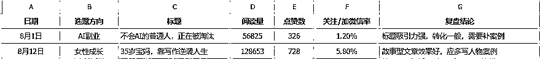

建议每周做一次总结，1–2 个月就能摸清账号的“爆款规律”。

# 01.公众号商单及分类 - 搞清楚钱从哪来

# 1.商单类型和选择标准

# 1.1 商单类型

商单不是简单的"我有流量，你给钱，我发广告"。商单的本质是什么？是品牌借用你的信任，触达你的粉丝。请大家记住这句话，这是理解所有商单逻辑的基础。

我把它拆成三个关键要素：

第一，信任转移。粉丝为什么会买你推荐的东西？不是因为东西好，市面上好东西多了去了。是因为他们相信你。你说好，他们就觉得好。这种信任，是你最宝贵的资产。

第二，精准触达。品牌为什么不去投抖音、投朋友圈？因为那是大水漫灌。而你的粉丝，是精准筛选过的。比如母婴号的粉丝，90%都是宝妈。这种精准度，是品牌梦寐以求的。

第三，内容营销。现在没人爱看硬广了。但如果你能把产品融入到故事里，让推荐变得自然而然，转化率能翻 3 倍。

当有品牌找你的时候，你要想的不是"这个价格值不值"，而是"我的粉丝会不会买账"。

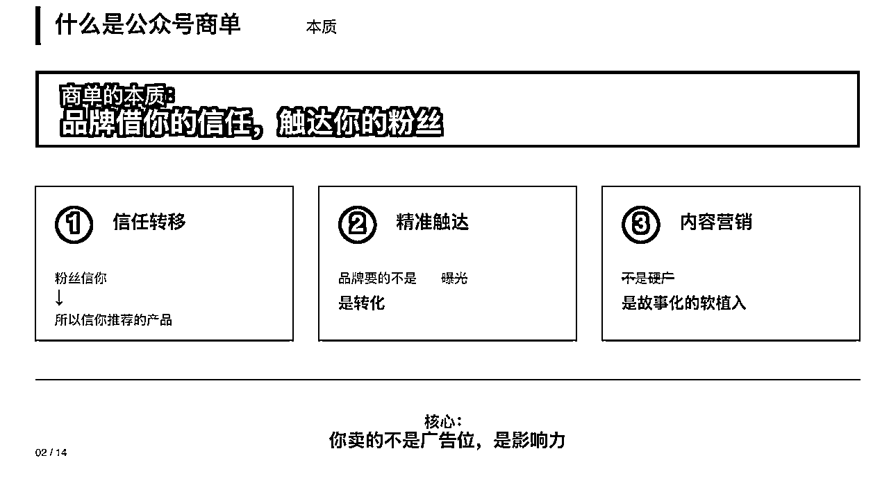

你卖的不是广告位，你卖的是影响力。影响力值钱，广告位不值钱。

商单分类 -5 大类型

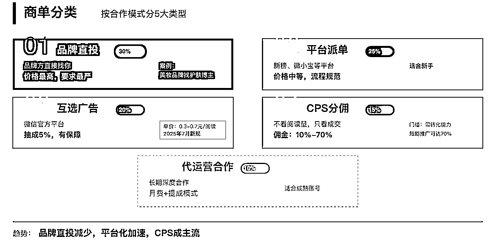

第一种：品牌直投，占比 30%。

这是食物链顶端，也是最难的。5 万粉丝的账号，如果是垂直领域，头条报价可以在 2000-3000 元。

但有个秘密——品牌方找你，80%是通过中介。所以你要做的，不是等品牌找你，是让自己被中介发现。怎么做？去新榜、微小宝这些平台注册，把你的媒体包做漂亮，特别是数据截图要真实。

第二种：平台派单，占比 25%。

最适合新手练手的方式。平台会根据你的标签自动匹配广告主。价格虽然低一些，但流程规范，不会被坑。

有个技巧：刚开始别挑，什么单都接，先把信用分做起来。信用分高了，优质商单会优先推给你。

第三种：互选广告，占比 20%。

2023 年 6 月微信推出新规后，第三方商业合作必须通过官方广告平台，平台收取 5%服务费。

听起来被抽成很亏？错！这 5%是你的保护费。有平台担保，不怕对方跑路，不怕无限改稿。最重要的是，数据透明，没人能质疑你刷量。

第四种：CPS 分佣，占比 15%。

门槛最低，风险最小。不要求阅读量，只看转化。我认识一个 1 万粉的号主，专门做图书推荐，每个月 CPS 能赚 8000 多。怎么做到的？选品精准+真诚推荐。

记住：CPS 不是让你当导购，是让你当买手。帮粉丝选好货，佣金是顺带的事。

第五种：代运营合作

内容分类参考下图

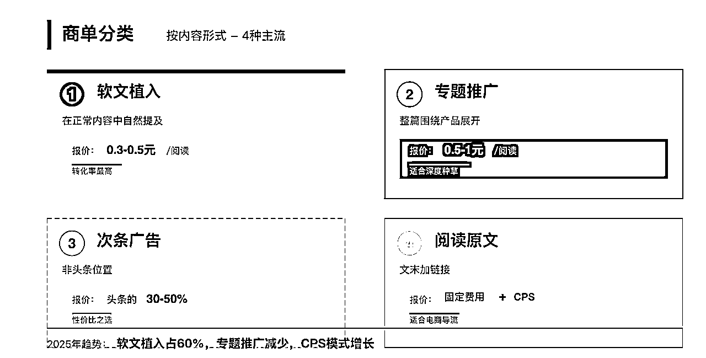


# 1.2 选择标准

大多数人接商单，看什么？看钱。给钱就接，这是最大的误区。

我有个朋友，育儿号，8 万粉丝。去年接了个白酒广告，5000 块。你猜结果？掉粉 3000，后台全是骂声，半年才缓过来。5000 块，买了个教训。

所以，选商单的核心是什么？三看原则。

第一看：匹配度。

2025 年的公众号推荐机制已形成'社交关系+兴趣标签+行为数据'的三维模型。什么意思？系统会根据你的内容给账号打标签，你接的每一个商单，都在重新定义你的标签。

我给你个判断标准：产品与粉丝需求匹配度必须超过 70%。

怎么算？很简单。你在后台看用户画像，比如你的粉丝 80%是 25-35 岁的职场女性，那么母婴产品、职场课程、轻奢品牌就是高匹配；而游戏装备、男性护肤就是低匹配。

有个技巧：接单前，先在朋友圈或社群做个小调研——'最近有个 XX 品牌想合作，你们感兴趣吗？'如果响应率低于 30%，这单别接。

第二看：品牌力。

记住一句话：宁可少赚，不可错赚。

什么是错赚？接了垃圾品牌的钱。接了问题产品，不仅退钱，还要公开道歉，账号信誉全毁。怎么查品牌？三步走：

.

企查查看背景——注册资本低于 100 万的，慎重；有诉讼记录的，不接

.

黑猫投诉查口碑——投诉超过 100 条的，不碰

.

小红书搜真实评价——差评多的，躲远点

2025 年的内容战场，用户对'信息量'和'获得感'的要求更高。每一次推荐，都是在消耗粉丝信任。接一个烂品牌，可能需要 10 个好内容才能补回来。

第三看：合作条件

看合作条件，但不是看价格，是看对方的要求。

如果对方要求：

必须说'效果超好'、'强烈推荐'这种绝对化用语

要求隐瞒是广告，伪装成日常分享

要求你承诺具体转化数据

这种单，给 10 万也不能接。为什么？违法！《互联网广告管理办法》5 月 1 日开始实施后，公众号营销规范更严格。一旦被举报，罚款事小，封号事大。

最后给你个选择公式： 匹配度×品牌力×合规性 = 接单价值

三个维度，任何一个是 0，结果都是 0。记住，商单是做乘法，不是做加法。"

选择标准-红线清单


第一类：违法违规类——碰了就死。

去年有个 20 万粉的健康号，接了个'祖传秘方'的保健品广告，结果呢？不仅号没了，人还进去了。为什么？涉嫌虚假宣传和非法行医。

哪些是雷区？

医疗保健品：没有'蓝帽子'标识的，全是违法

金融理财：承诺收益的，都是诈骗预备军

博彩相关：哪怕是海外合法博彩，在国内推广就是犯罪

有个简单判断方法：如果广告主说'这个产品很好，但不能明说功效'，转身就走。

第二类：损害账号类——慢性自杀。

2025 年公众号的变现核心，是培养用户的'付费意愿'而非'免费围观'。什么会损害账号？不匹配的广告。

我见过最离谱的：一个佛学号，接了情趣用品广告。理由是什么？'钱给得多'。结果？一夜掉粉 2 万，再也没缓过来。

记住铁律：

与定位不符的，不接

质量明显低劣的，不接

负面口碑产品，不接

你的账号定位，就是你的商业护城河。一旦破了，再也修不好。

第三类：高风险类——赌徒心态。

什么是高风险？就是对方的要求明显不合理。

比如：

夸大宣传型：'7 天美白'、'月入 10 万'、'包治百病'

霸王条款型：无限期排他、买断所有权益、承担所有风险

异常付款型：要求先发文看效果、用个人账户付款、分期付款超过 3 个月

上个月，有个号主跟我诉苦，接了个教育机构的单，对方要求'保证 50 个报名'。结果只有 20 个，对方不仅不付钱，还要求赔偿。合同白纸黑字写着的。

不是所有的钱都值得赚，但所有的坑都会让你赔。

宁可这个月不接单，也不要接一个烂单。因为修复信任的成本，远大于一单广告费。"

# 02.从询价到交付的完整流程


# 1.商单全流程

第 1 步：初步接触（1 天）

品牌方找来了，第一反应是什么？很多人是报价。错！

第一件事：验明正身。

要营业执照

要品牌授权书（如果是代理）

要过往案例

然后发你的媒体资料包。注意，不要发后台截图原图，打上水印。我见过有人拿着别人的后台截图去骗单的。

第 2 步：报价谈判（2-3 天）

2025 年千次阅读收益约 50-80 元，但这只是参考。

报价公式我刚才说了，这里讲个技巧：永远不要第一时间报最低价。

正确做法：

先报原价的 120%

对方还价后，降到 110%

最终成交在 100%左右

为什么？心理学原理——锚定效应。你的第一个报价，决定了整个谈判的基准线。

第 3 步：合同签订（1 天）

合同是你最后的保护伞。根据合同法，书面形式包括合同书、信件和数据电文。

必须写进合同的 5 个条款：

.

修改次数：最多 2 次，超过另收费

.

付款方式：50%定金，发布后 48 小时内付尾款

.

数据要求：只承诺发布，不承诺效果

.

违约责任：双方对等，别只约束自己

.

争议解决：选择你所在地法院管辖

第 4 步：内容创作（3-5 天）

接到 Brief 后，第一件事不是写，是理解。

我的方法：

把 Brief 翻译成'人话'——品牌到底想要什么

找 3 个竞品的优秀案例参考

写出 3 个不同角度的开头，让品牌选

记住：好的商单文案，是 95%的干货 +5%的植入。

第 5 步：修改确认（2-3 天）

这是最容易起冲突的环节。

技巧：

每次修改都要对方书面确认具体修改点

改完发 PDF 版本，不发可编辑文档

保留每一版的修改记录

如果对方第 3 次还要改？'根据合同，额外修改需支付 30%加急费。'

第 6 步：发布执行（1 天）

发布时机很重要。算法对原创文章的推荐权重是转载内容的 3 倍以上。

最佳发布时间：

职场类：周一到周三，早 8 点或晚 8 点

生活类：周四周五，晚 9 点

周末：上午 10 点或下午 3 点

发完立刻截图，包括阅读数据，48 小时后再截一次。

第 7 步：数据结算（7-30 天）

这步最容易被拖。

预防方法：

合同里写明：超期未付，每天收取 0.5‰滞纳金

发布后第 3 天就发送付款提醒

建立品牌方信用档案，拖款的拉黑

某财经号通过 99 元/年的会员服务，实现 30%的粉丝转化率。但如果你老是接拖款的品牌，粉丝会怎么看你？

最后，整个流程最核心的是什么？专业化。

当你的每一步都专业，品牌方不敢怠慢你，更不敢坑你。记住：专业，就是最好的护身符。"

# 2.价格谈判 - 让报价翻 3 倍的技巧

技巧 1:定价公式

报价 = 平均阅读量 × 单价系数 × 领域溢价 × 时间系数

第一，平均阅读量。 不是看最高，不是看最低，看最近 10 篇的平均值。为什么？这是你的真实水平。

有个技巧：把阅读量四舍五入到整数。比如平均阅读 8700，你就说'平均阅读接近 1 万'。不是骗人，是营销话术。

第二，单价系数。 2025 年 8 月的市场行情：泛娱乐 0.2-0.3 元/阅读，生活方式 0.3-0.5 元/阅读，垂直专业 0.5-1 元/阅读，金融理财 1-2 元/阅读。

但注意，这只是基准价。你要根据自己的转化率调整。我有个朋友做母婴的，阅读量只有 5000，但转化率 15%，他敢报 1.5 元/阅读，品牌抢着要。

第三，领域溢价。 不同领域，溢价不同：

母婴：1.5 倍（妈妈们舍得花钱）

美妆：1.3 倍（客单价高）

教育：1.4 倍（家长焦虑值钱）

科技：1.2 倍（用户质量高）

2024 年公众号确实很难做，特别是对于大号，但垂直小号反而有溢价空间。

第四，时间系数。 这个很多人忽略，但特别重要：

工作日发布：1.0 倍

周末发布：1.2 倍（牺牲休息）

节假日发布：1.5 倍（春节 2 倍）

加急 24 小时内：1.3 倍

技巧 2：打包策略——让客户觉得占便宜。

大多数人怎么报价？单篇 5000。品牌怎么想？太贵了，再看看别家。

高手怎么做？给三个选择：

基础包：1 篇头条，5000 元

标准包：3 篇头条 +1 次朋友圈，13000 元（单篇 4333）

豪华包：5 篇头条 +3 次朋友圈+社群分发，20000 元（单篇 4000）

看到了吗？单篇越多，单价越低，但总价越高。

心理学原理叫'锚定效应'。当你给出三个选择，80%的人会选中间那个。你赚了 13000，他觉得省了 2000，双赢。

技巧 3：增值服务——不加价的加价。

品牌砍价怎么办？很多人就降了。错！你应该说：

'这个价格确实没法降了，不过我可以送您一些增值服务：

免费在朋友圈转发（价值 500）

社群同步分发（覆盖 2000+精准用户）

评论区互动维护 48 小时

提供详细数据报告'

2025 年内容为王，只要内容够好，会给予源源不断的免费自然流量。这些增值服务成本很低，但价值感很高。

进阶玩法——阶梯效果承诺：

'张总，我们不承诺效果，但可以这样：

如果 24 小时阅读超过 1 万，赠送朋友圈推广 1 次

如果 48 小时阅读超过 1.5 万，赠送次条广告位 1 个

如果带来 50 个以上咨询，下次合作 8 折'

品牌觉得有保障，你也不承担风险。

# 03.接商单的坑 - 我替你踩过的 5 个大坑

坑 1：先发后付的陷阱——不要相信任何承诺。

去年 10 月，一个 15 万粉的时尚号接了个美妆品牌的单。品牌说：'我们是上市公司，先发文，月底统一结算。'号主信了。

结果呢？文章发了，阅读量 2 万+，转化率 8%，数据特别好。品牌说：'效果不错，下个月结。'下个月又说：'财务流程慢，再等等。'

三个月后，品牌电话打不通了。一查，公司注销了。1.5 万的广告费，打水漂了。

这不是个例。早在 2016 年，公众号刷量造假就被曝光，大量"10 万+"阅读的知名公众号，实际阅读只有几千甚至几百。在这种环境下，你不收定金，就是在赌博。

铁律：至少收 50%定金，没定金不开工。

坑 2：无限修改的噩梦——合同里最重要的一句话。

我见过最惨的，一个 10 万粉的育儿号，接了个奶粉品牌的单。合同没写修改次数。

第 1 稿：'太生硬了，要温情一点。' 第 2 稿：'太煽情了，要理性一点。' 第 3 稿：'太理性了，要有故事。' ... 第 8 稿：'还是用第 1 稿吧，改几个字就行。'

前后改了 15 天，号主崩溃了。最可恨的是，这是合法的，合同没约定修改次数。

解决方案：合同必须写'免费修改 2 次，超出每次收取 30%加急费'。

坑 3：数据造假风波——自证清白有多难。

这个坑最隐蔽，也最致命。

今年 3 月，一个 20 万粉的财经号，头条阅读稳定在 1.5 万。接了个金融产品的广告，

报价 1.2 万。发布后，阅读量 1.8 万，数据很好。

品牌方突然说：'你们数据有问题，我们监测只有 3000 真实阅读。'

号主懵了：'我没刷量啊！' 品牌：'那你证明啊。'

这怎么证明？刷量分技术刷和人工刷，人工刷即便被发现也很难认定，一个后台可以控制几百个真人微信号。

最后品牌方只付了 30%的钱，还到处说这个号刷量。半年时间，再没品牌找他合作。

预防措施：

.

每次发布后立刻录屏，包括后台数据

.

要求品牌方提供第三方监测机构

.

如果品牌质疑，要求对方拿出证据

央视曾曝光，有大号 70%阅读量都靠刷。在这个真假难辨的市场，你要学会保护自己。

三个数字：

50%：最低定金比例

2 次：最多免费修改次数

24 小时：发布后立刻保存所有证据

坑 4：竞品排他条款——看不见的陷阱。

今年 5 月，一个美妆号接了个护肤品牌的单，合同里有一行小字：'3 个月内不得接同类竞品广告'。号主没在意，签了。

一个月后，另一个护肤品牌找来，报价是前者的 3 倍。能接吗？不能。违约金是第一单的 5 倍。

更可怕的是什么？2025 年版权纠纷'总对总'在线诉调对接机制建立，33 家版权纠纷调解组织作为首批试点。品牌方现在维权成本极低，你违约，他们分分钟起诉你。

破解方法：

排他期最多 1 个月

排他范围要具体（不是'护肤品'，而是'美白精华'）

排他要加价，至少 50%溢价

有个聪明的做法：'排他期内，同类品牌报价低于 XX 元，我方不接；高于 XX 元，需支付差价补偿。'这样品牌也会掂量。

坑 5：结算周期过长——现金流的杀手。

结算周期分为 T+0、T+1、T+N、D+0、D+1，每种对应不同应用场景。但很多品牌玩花样。

'月结 30 天'听起来正常？错！他们的月结是：这个月发布，下个月底对账，第三个月底付款。实际周期 60-90 天。

我认识的一个号主，接了 5 个'月结'品牌的单，每单 1 万。看起来月入 5 万，实际上前 3 个月一分钱没收到，差点断粮。

应对策略：

新客户：50%定金+发布后 7 天付尾款

老客户：月结 30 天，但要签年框保障

大客户：可以月结，但要收 15%资金成本

微信支付审核 1-2 个工作日，结算周期明确，为什么品牌结算要拖几个月？不合理的要求，就要拒绝。

避坑宝典

谈判的核心原则：

.

永远不要直接说'不'——提供替代方案

.

永远不要情绪化——保持专业

.

永远给对方台阶——维护长期关系

.

永远有备选方案——进退有度

很多人接商单，不是能力不行，是不会说话。

同样的拒绝，有人得罪客户，有人还能加深好感。

我总结了 2 个最常见的场景和应对话术：

场景 1：价格太低——拒绝还能留后路。

品牌：'预算只有 2000，能做吗？'

错误回答：'太低了，不做。'（得罪人）

错误回答：'2000 太少了，至少 5000。'（暴露底线）

高情商回答：

'王总，特别感谢您的认可。2000 这个预算，可能更适合 5000-10000 粉丝的账号，我可以帮您推荐几个优质的小号。

不过我看您的产品确实不错，要不这样，我先给您一个建议：这次如果预算实在有限，可以考虑次条或者 CPS 合作，既能控制成本，效果也有保障。您看哪种方式更合适？'

看到了吗？既拒绝了，又提供了解决方案，还可能谈成其他合作。

场景 2：要求太多——优雅地说不。

品牌：'文章里要提到 15 个卖点，还要加 3 个链接，再配 5 张产品图。'

错误回答：'要求太多了，做不了。'

错误回答：'可以，但要加钱。'（显得只认钱）

高情商回答：

'李总，您的需求很专业，能看出您对这次推广很重视。

不过基于我们的经验，信息太多反而会影响转化。建议我们打造一个【高级定制套餐】：

基础版：突出 3 个核心卖点（原价）

升级版：5 个卖点 +2 个链接（加 30%）

豪华版：全部需求+数据报告（加 60%）

您看哪个版本更符合您的推广目标？

# 01.私域流量导流策略与技巧

# 1.公众号引流入口设计

主菜单栏设计栏：

「资料领取」→ 回复关键词触发自动回复，可以放资料的链接，也可以放个人二维码，引导添加私域后领取。

「免费进群」→ 自动回复微信群二维码/个人号二维码

「联系我们」→ 自动回复微信群二维码/个人号二维码

建议：可自由组合，确保至少有一个菜单，用户可以直接联系到我们。

自动回复配置

重点：这个钩子一定要足够有吸引力，贴合人群，最好还是差异化的，是目标人群的刚需。资料的内容建议 7 成干货，3 成为介绍自己以及产品。

关注欢迎语

感谢关注「XXXX」🎉

我为你准备了【XXX】，回复【XXX】即可领取。

还可以加入副业交流群，和 3000+伙伴一起交流成长！

关键词回复

“资料”“案例”“工具” → 不同礼包

每个礼包都要嵌入二维码

文章引流设计

一般 2 种方式：

第一种：文章结尾引导用户发送关键词才可以获取相关资料，通过触发自动回复，从而进行添加好友。

这样做的好处是，可以有效增加关注率，用户想要发送就必须先关注，能走完这个流程的，人群会更加精准。缺点也很明显，链路过长，有的人可能不会操作，有的人嫌麻烦。

第二种：文章结尾直接放上钩子和对应的二维码，用户直接扫码添加。

好处：用户无缝引流私域，体验会更好，更直接。缺点是：容易引起读者反感，目的性太强，且没办法提高关注率，关注率是可以拉升文章的流量。还有就是如果文章每篇直接售卖产品型的，放上二维码，一旦被投诉很容易原创违规。

# 3.承接方式

个人号承接

资料设计：推荐头像采用真人照，更加真实可靠，昵称就很重要了，要和公众号的人设保持一致，昵称是未来长期使用的，一定要简单，好记，不要有英文，特殊符号，字数建议 2-4 字，确保一个小学文化的人就可以认识。

朋友圈运营：

30% 干货分享，心得分享

30% 学员反馈、案例展示

30% 生活日常，比如吃饭，旅游，聚会

话术设计：

话术设计不同的业务对应的有很大的区别，前面话术最重要的核心目标是：介绍自己 + 建立信任。

一般包含以下几点：

自报身份：用户知道你是谁，做什么的。

先给价值：让用户觉得“加你是值得的”，吃人嘴短，拿人手短，毕竟你都送资料了，用户删你的概率就小了。

轻问需求：用开放+选择题，让用户容易接话，了解用户是需要什么，对症下药。

示例：

你好呀，感谢链接，我是 XX，坐标 XX，8 年创业人，目前专注公众号流量主项目。很高兴认识你。👋

很多朋友加我，都是先拿一份【XXXX】，要不要我也先发你一份？

你现在主要是想了解副业方向，还是已经在做但遇到瓶颈？

微信群承接

建群原则：一个群人数控制在 200 人左右，太多人很容易因为一些敏感词提示违规，人数太少，很容易冷场，慢慢就变成了死群。

群命名：统一格式，比如【XX 公众号运营交流群 3️⃣】，建议不要从数字 1️⃣开始。而是跳过去 1️⃣，这样即便是刚开始进群的人，也默认了之前已经有群了，这是新群，人少是正常的。

群氛围维护：

及时移除发广告、违规信息的人员。

每天固定时间分享一些内容。

群维护是一件非常消耗精力的事情，前期可以建少量的免费群，等人数增加后，就要创办收费群。

业务量大，也可以直接用企微建群，利用企微自带的群管理，可以轻松实现关键词踢人，发二维码，名片等自动踢出，还有欢迎语等配置。

# 02.后端产品设计与分销体系搭建

一定要敢卖！然后要尽全力的做好交付，如果你不敢卖，永远也没有机会。

# 1.产品体系分层

引流品（9-49 元）

作用：快速完成「首付费」，筛选有真实需求的粉丝，建立初步信任。

常见渠道

微信直接收款进行交付

小报童交付，直接卖小报童，置顶放自己的二维码

知识星球交付，知识星球建议私域人数在 1000 以上使用，知识星球最低可以设置为 50 元。

玩法细节

定价心理学：千万不要免费，9.9/19.9/29.9 这几个单价最常见，大部分人都能接受。

定位强调：用「时间成本」or「踩坑经历」包装价值。

示例文案：我踩了 100 个坑才整理出来的 XXX，帮你少走弯路。

成交转化：买过引流品的粉丝 → 标记标签 → 自动引导到核心品。

核心品（199-1999 元）

作用：主要营收来源，解决用户明确的痛点问题。

常见渠道

小鹅通：很适合卖一些知识付费类产品，不过真的很贵，按年收费，业务量不大，不建议使用。

知识星球：社群类运营选择它就对了，完全免费，但是成交抽成，个人星球抽成 20%，企业星球抽成 5%（每年前 10w 抽成 10%）

视频号小店：通用技能型知识付费产品可以，但是指向性的不行，比如你上架剪辑技能可以，但是你上架视频号运营，这个就可能被驳回。

玩法细节

价格区间分档：

199-399：入门课程，用户容易下单

599-999：系统课 / 小型训练营

1499-1999：深度陪跑营

成交流程：

公众号推文 → 案例展示 → 引导报名（设置倒计时/名额限制）

高客单价品（2000+元）

作用：利润来源，打造专家定位，绑定高价值用户。

常见形式

一对一私教 / 咨询

长期陪跑

企业内训

# 2.变现工具（公众号原生）

付费阅读

在公众号文章里直接开启「付费阅读全文」功能，适合：

案例合集

干货类/高价值文章

千万不要小看这个付费阅读，某些账号，每次发的付费阅读文章，付费人数都在 1w 以上，还有的付费文章，单篇文章收费高达 1000 元+，依然有很多人付费。

付费功能结算会自动纳税，和流量主税率一致。

公众号赞赏

在公众号里面可以开启赞赏功能，开启后，文章底部用户可以直接打赏，打赏金额最低 1 元，最高 256 元。这个功能可以带来额外的收入。

可以几个公众号绑定一个打赏账户，最终打赏的收益是直接到微信零钱的，而且是全额。

带货

用公众号后台的带货功能 挂载商品

目前小绿书大部分是这样的玩法，出单量也很多

接商单广告

2023 年 7 月，公众号正式宣布，要在公众号进行推广挂广告，必须走官方的互选平台。否则可能违规。

目前的商单玩法，一般是走互选平台，为了账号的安全，但是金额大部分是线下，线上很少。

比如一单 2000 元的商单，互选平台可能仅有 200 元，剩余的 1800 元为线下结算。

# 3.分销体系搭建

引流品（9.9-29.9 元）

目的：获取精准用户，不追求利润。

利润逻辑：本身就可以是亏本/保本。

佣金策略：

可给 60%-100%，甚至倒贴（比如 9.9 元课程，给推广者返 10 元，有圈友在推广小报童获客，就是这样玩的）。

核心品（199-1999 元）

目的：主力盈利产品。

利润逻辑：毛利率通常 60%-80%。

佣金策略：

建议给 20%-30%，保证推广员有动力，同时保留足够利润。

细分层级：

低价核心课（199-499 元）：可给 30%

中端核心课（599-999 元）：给 25%

高端核心课（1499-1999 元）：给 20%

高客单价服务（2000+元）

目的：利润和稀缺性来源。

利润逻辑：毛利率 60%左右，但单价高。

佣金策略：

一口价返现，比如 500 元/单 或 1000 元/单

不建议用比例，没有直接数字金额吸引人，比如客单价 5000，你给 20%佣金，实际上已经佣金 1000 了，但是看起来 20%根本没有吸引力

规则总结

引流品：佣金高（50%-100%），甚至倒贴钱换人头

核心品：佣金中等（20%-30%），主力营收

高客单：固定返现（500-1000/单），增加吸引力

最后，祝大家都能找到适合自己的垂直小号赛道，跑通变现，放大收益，一起生财有术！
```