# 2025小红书蓝海实拍：新手零基础带货全攻略

> 来源：[https://ocn93f5d9olj.feishu.cn/docx/OchadeKSRoc6QLx9I50cL8Uonoe](https://ocn93f5d9olj.feishu.cn/docx/OchadeKSRoc6QLx9I50cL8Uonoe)

# 1. 项目介绍

## 1.1 这个项目到底在做什么

小红书上的电商生意，2025 年仍处在放量窗口期。平台用户花钱的意愿强，也习惯了主动去搜，这让客单价偏高、同行偏少的冷门品更容易做出利润空间，新人上手见到成效的周期也不长。

所谓“蓝海”，除了指没人抢的产品，还包括竞争密度低的内容位置。小红书带货本质是笔记驱动，笔记能不能起量，图片起决定作用；而一张图由三样东西拼成——货、场景、机位，于是这三个方向都能挖出空白地带。

若挑中没人做的品类，自己拍图写笔记来卖货，只要拍摄水平过关、保持更新频率，就有机会切进细分市场前排，月流水做到五位数并不罕见。要是货本身处在热门赛道，但你找到了别人没拍过的场景与机位，再加上跨品类拼接的思路和对用户痛点的捕捉，用内容差异化抢位置，六位数月收入也有现成例子。归结起来就一句话：在平台找到匹配自己的货，靠自己拍的原创素材来带货，不搬不剪，逐步练出实操能力，把店经营成能长跑的生意。

为什么值得做小红书蓝海？大类目经过几年厮杀早已拥挤，可细分赛道还有大量未开发的空间。更关键的是这里女性用户占比高，对价格的接受度好，利润空间自然更足。加上平台既有推荐流又有搜索流，创新类商品更容易冒头，而新品永远在迭代，只要流量分发逻辑不变，蓝海就一直有得做。再叠上成交链路短，货选对了，开单并不困难。

为什么实拍不能省？平台对电商内容的治理越来越严，搬运与混剪的识别手段在升级、处罚力度在加重，账号报废的代价谁都扛不住。想避免反复从零开始，原创拍摄就是店铺和账号活下去的底线。新手也需要时间把拍摄手感、审美水准、账号质量与权重一点点养起来。小红书早就是女生们的搜索入口，搜索流量与长尾流量都很可观，一年前甚至更早的笔记还在持续转化，这很常见；想吃这波长尾，账号活得够久是前提，而原创素材又是前提里的前提。

蓝海实拍带来的两项好处：

✅ 实操经验会沉淀：想让带货有稳定回报，实拍这一关必须过，越早动手越占便宜，看似慢其实最快。

✅ 长尾型收益结构：这类笔记的存活周期能拉到 3—48 个月，一条爆款可以持续带来订单；守平台规矩，账号与店铺活得久，长尾流量才能吃得稳。

项目门槛并不高，完全没做过电商的新人也能比较快拿到正向结果。选对品开单容易，因为同行少；真正难的是把它做成持续稳定的开单节奏，这既取决于货的稳定性，也取决于你做流量的本事。

蓝海产品的账号实例：

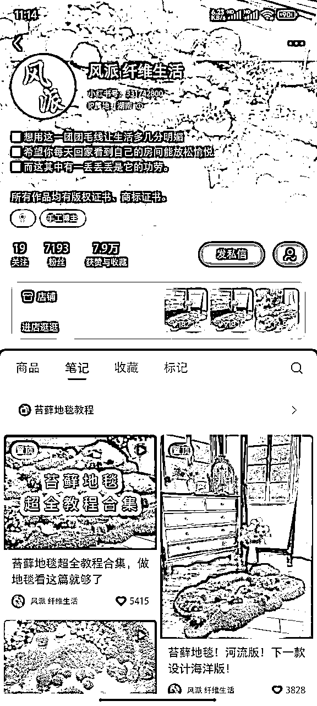

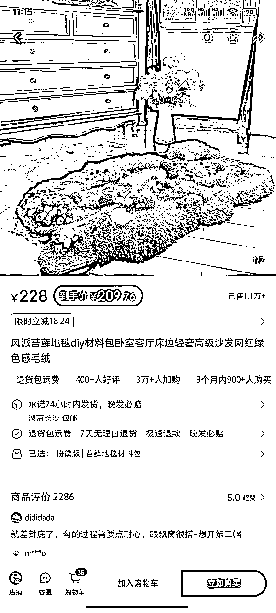

下图这份成绩单，来自一位刚离开校园的女生，副业做到第 10 天。她挑的品确实选得准，此前完全没有电商经历，她能跑出结果，圈里的朋友一样可以。

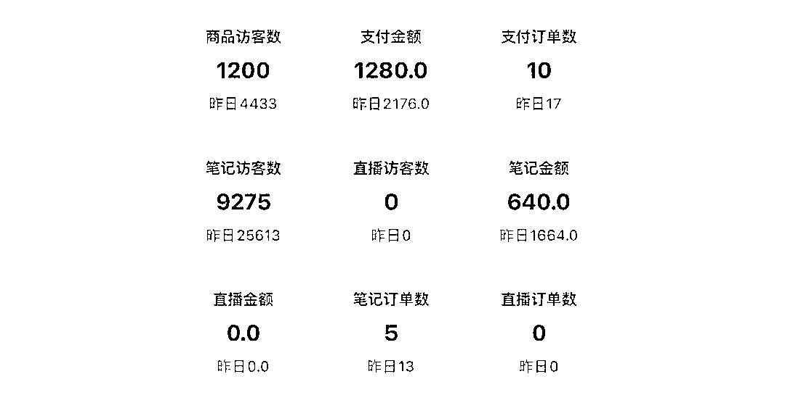

下面这份数据来自圈友@叶声，同样是小红书蓝海玩法。想看他的经验分享，可移步生财的帖子：https://t.zsxq.com/L5nG1

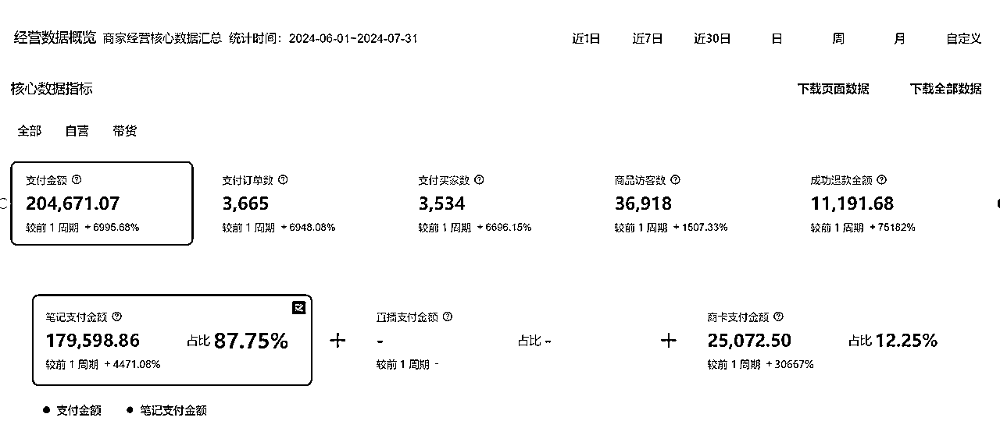


# 2. 项目完整操作思路

这期航海贴着平台趋势走，押注能长期跑的打法：蓝海品定下来之后，直接买样品自己拍，同时把供应链谈深，压住风险、把利润做厚。相比过去那种低客单混剪路线，这套玩法要练的技能更多、投入的时间更长。新手早期也会零零星星开单，但要跑出持续稳定的收入，一般得埋头两三个月，建议先备好心理预期。如果你已经有选品功底、对爆款有感觉，或者会做图文视频、有一定审美，跑通的概率会大不少；当然，只要够勤快，这些都不是障碍。本期更考验耐性，想要稳定收入需要时间，不过从零到一跑通还是相对快的。

本期操作链路如下：

注册账号并开店 > 选品（核心）> 找货源买样品 > 测账号流量是否正常 > 照着对标实拍 > 上架并打磨商品链接 > 发笔记测品（核心）> 反复复盘打磨笔记 > 做好店铺日常运营

本期航线图：

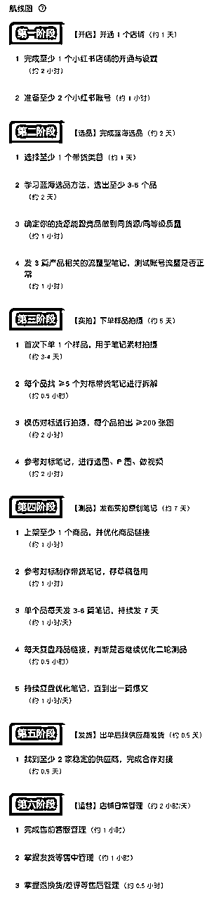

几个重点提醒：

- 注册店铺：拿本人身份证开一家小红书店铺，先不交押金，刷内容培养网感，大约 1 天。

- 蓝海选品（重点）：先圈定适合自己的类目，每个类目至少挑出 5 款产品，填进评分表打分，用分数判断成功概率，大约 3 天。

- 采购货源与实拍：确定要做的品之后，先买竞品和供应商的货做质量对比，同时可以让账号发测流笔记。质量确认没问题，再正式找对标、拆解对标、模仿着拍。

- 测品并发笔记（重点）：素材拍完，开始选图修图，按照对标的爆款标题、正文、话题来编辑，存进草稿箱。所有素材全部编辑完成，再启动第一轮为期 7 天的测品发笔记。

- 复盘优化：第一轮测完，根据数据反馈决定要不要开第二轮，或者直接换品重来。

- 店铺运营：店铺开始零星出单后，把售前咨询、发货管理、售后处理都接住，同时不断打磨笔记与商品链接，提高出大爆款的几率。

准备工具：

* 至少 1 家小红书店铺＋2 个小红书账号（暂时不用缴保证金）
* 上品工具：蚂蚁搬家
* 一键搜图工具：至尊宝
* 拍摄工具：推荐苹果 11/12（图片要清晰）


# 3. 内容出品人

内容出品人：


银河、曜文、云端行走


范师傅、蓝子鱼、Jing、月月


书豪


蓝弈


陶金金（阎老板）


V小刀、古辛、叁斤、谢小仙


半糖梦呓

手册出品方：生财有术团队

出品时间：2025 年 8 月


小红书电商里的蓝海实拍，是值得长期深耕的方向。选品的手感要靠时间喂出来，它最终会长成你的能力壁垒。为了让大家少走弯路，本期航海由银河教练提供一份【选品评分表】：把竞品的各项数据填进去，表格会自动算分，落在 8—10 分区间的品就可以拍板，决策成本大幅降低。

1. 准备账号并开通店铺

# 1. 本章概要

把小红书电商的整体盘面看清楚之后，就该真正动手了。第一件事，是把店铺准备到位。具体包含三块：

✅ 手机号与手机的准备

✅ 店铺开通（建议新人配 1 家店、2 个号）

✅ 账号定位与包装

不同类型店铺的入驻门槛并不一样，先对照自己的情况弄清楚，再进入入驻环节。

# 本章航线图

学完并完成本章的实操，航线图的第一阶段就算走完：

- 【开店】开通 1 家店铺（约 1 天）

- 完成至少 1 家小红书店铺的开通和基础设置（约 2 小时）

- 准备好至少 2 个小红书账号（约 1 小时）

# 2. 准备账号

# 2.1 准备至少 2 个账号

多数新人开 1 家个人店铺就够了，但账号至少备 2 个：其中一个用来开店、发带货内容，另一个与店铺关联、同样发带货内容。为此你需要：

- 至少 2 部手机（不建议一部手机多开账号，有被限流的可能）

- 至少 2 张电话卡（一个号配一张卡）

- 至少 1 张身份证（用来注册个人店铺）

手机怎么挑：它既承担登录，也要负责拍摄。拍摄优先选 iPhone，XR 之后的机型成像更好；后面如果想上直播，iPhone 的推流稳定性也更靠得住，不过它不支持双开。

电话卡怎么选：三家运营商都能办副卡，一张身份证可认证 5 个号码，一拖四，副卡月租大约 10 元；移动的万能副卡每张 10 元/月，一张身份证可以领两张，第一张和第二张之间要隔 90 天，营业厅和 App 都能办，走营业厅还能免掉首年月租；电信 App 里搜“无忧卡”，5 元一个月，通常第二天就送到；移动另有 8 元保号套餐可选。


# 2.2 账号登录&养号

手上有多个号的圈友，这一节也附上了多店登录的方法。

登录：同时跑两个号，能不能只用一部手机？可以，但要承担一定风险。如果手机本身带小红书应用分身（部分安卓机型如红米支持），一部手机挂两个号是可行的，我目前就是这么用的，账号没出过状况。

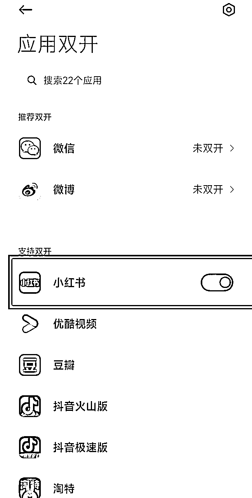

要是手机没有分身功能，千万别去装所谓的分身工具，被封的概率很高。这种情况下只能再添一部手机专门登录，二手平台上三四百元的机器就够日常使用。

实名认证：一张身份证只能绑一个账号，认证完成后除非注销账号，否则解不开。路径是：我—页面左上角三条横线—创作中心—创作服务的更多服务—开通专业号—成为专业号—选择个人后点立刻申请—填写实名信息。

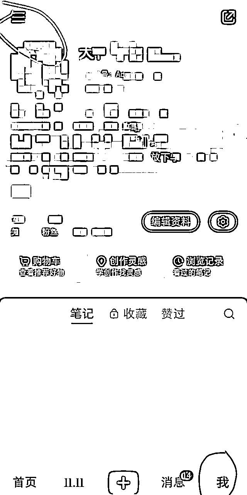

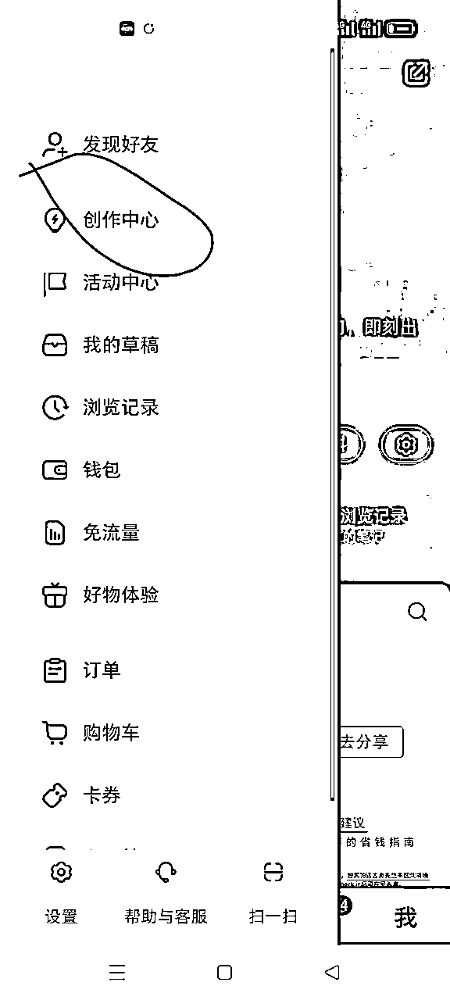

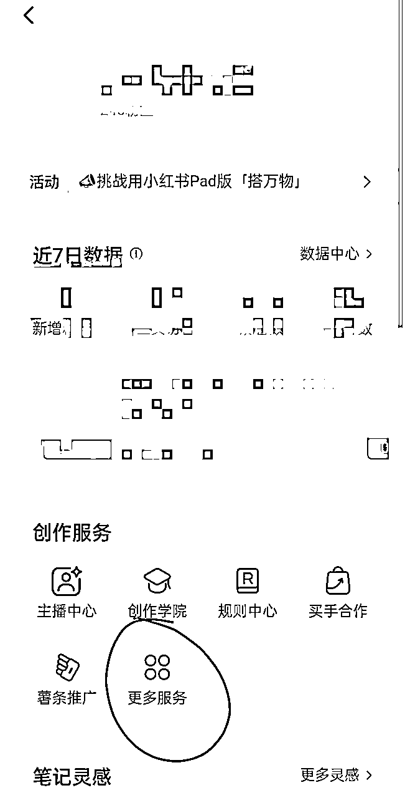

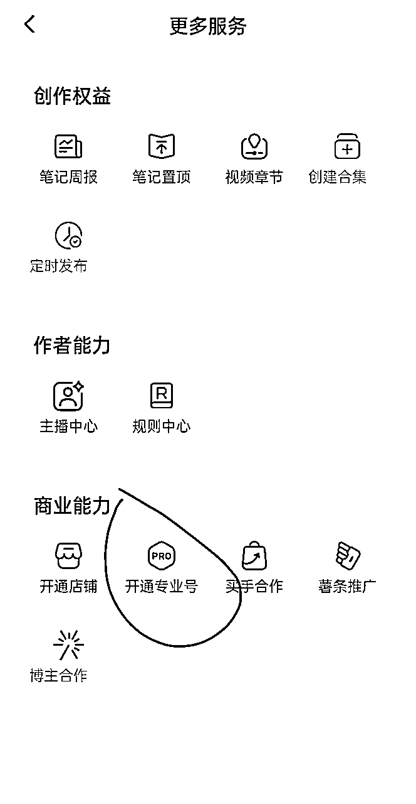

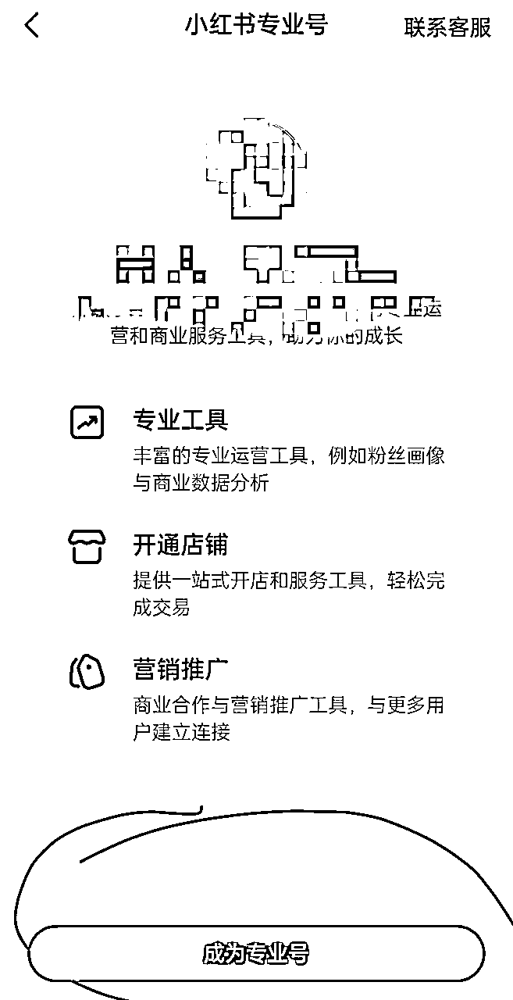

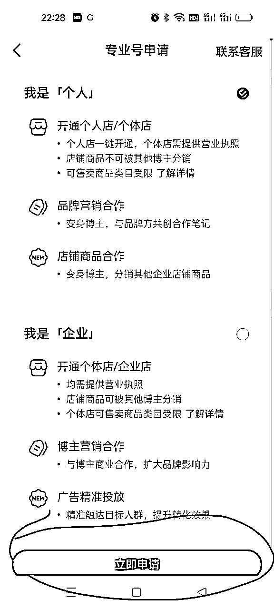

养号：新注册的号，每天刷满 30 分钟以上来养权重，刷的时候围绕自己选的赛道看对标笔记，一般坚持 1—3 天。切记别刚注册就挂商品链接。

# 3. 开通店铺

# 3.1 小红书店铺分类

入驻之前，先把店铺的类别搞明白，因为类别不同，能享受的权益也不同。

从大的方向看，小红书店铺分成两类：个人店和企业店。但不管选哪种，前提都是先完成专业号认证——新注册的账号默认为非专业号，而只有专业号才有开店资格。所以要在这变现，第一关就是把账号升级成专业号。专业号本身也有个人与企业之分。

个人型：身份标识显示为 XX 博主，比如时尚博主、美食博主这类兴趣向账号，基本提交就能过，而且不收费。流程为：创作中心—更多服务—开通专业号—我是个人—实名认证—选身份证并填写信息。

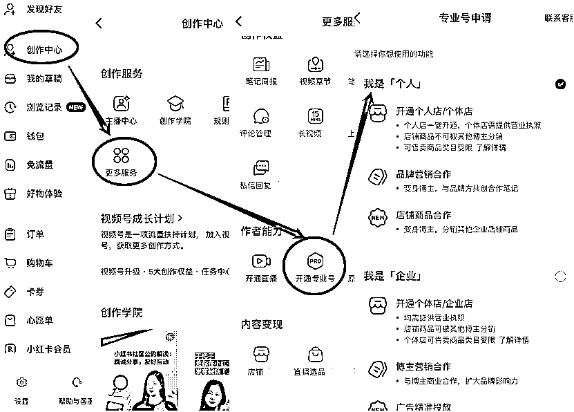

个人专业号能开个人店，也能开个体工商户店。名称格式是“XXX（昵称）的店”；保证金起步 1000 元；平台按类目收 2%—5% 的技术服务费。

企业型：要上传营业执照，并交 600 元，身份标识为 XX 品牌。流程为：创作中心—更多服务—开通专业号—我是企业—填写基础信息—填写主体信息—上传资质公函—填写运营人信息—缴纳 600 元—等待审核。填写要点见下图。务必留意：申请有效期是 30 天，逾期费用不退；审核通过后每年要年审并续费 600 元。企业专业号能开普通企业店，也能开专卖店或旗舰店。名称格式为“XXX 专卖店/旗舰店”；普通企业店保证金起步 2000 元（详见《小红书类目保证金明细》）；月营业额不足 1 万元免技术服务费；超出部分按 5% 收取。自 2023 年 9 月 10 日起，一张营业执照最多可申请 2 个专业号、2 家店铺。同一品牌只能开一家旗舰店，但可以同时开不同类型，比如一家旗舰店加一家专卖店，或一家旗舰店加一家普通企业店。企业专业号的营销权益比个人号更多，不过两者只能二选一，按自身需要决定。一般来说，新人开【个人店】更合适，门槛低；企业店更多用于放大做矩阵，平台给的宽容度也更高。

# 3.2 【个人店】入驻门槛与流程

门槛：个人型店铺再往下分【个人店】和【个体工商户店】。个人店只能经营服装、百货这类常见类目；个体工商户店除了常见类目，还能做奢侈品、珠宝等。每种店铺类型可经营的类目不同，页面里打了勾的就是能做的，具体可到小红书学习中心—规则中心—经营总览里查。

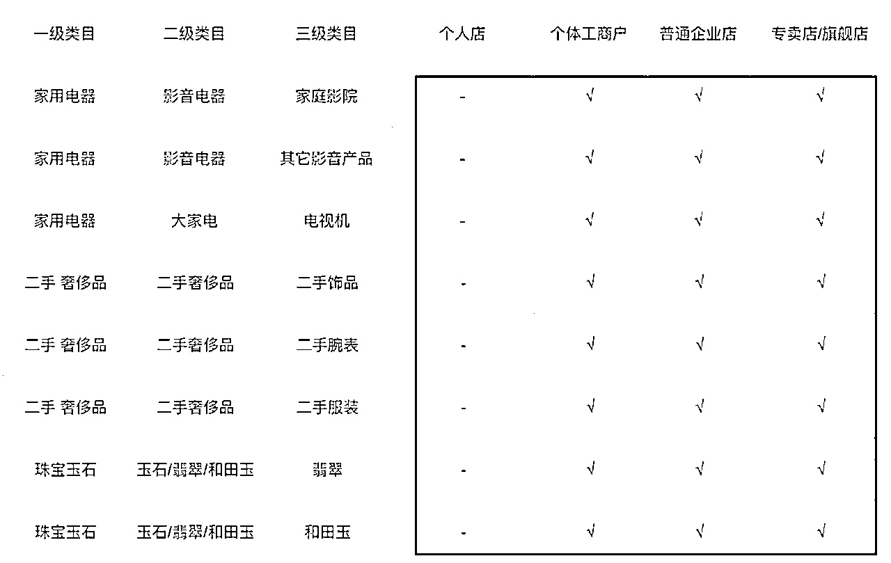

开店需要缴保证金，个人店和个体工商户都是 1000 元，但保健品、奢侈品之类特殊类目会更贵一些。

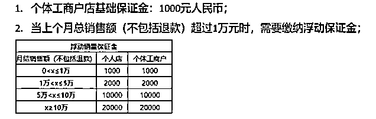

客服接待这块，个人店可以选择平台代运营，也可以自己做客服；代运营是要收费的，按自己的情况定。平台佣金也就是技术服务费，按类目收 2%—5%，收费细则见：https://school.xiaohongshu.com/rule/detail/27/2585?jumpFrom=school。目前平台为了减轻开店负担，入驻后不用先交保证金就能上架卖货；等店铺累计交易额超过 1 万元，下个月月初再补缴即可，算是实打实的“零门槛”起步。

入驻流程：选好个人店铺类型后，先挑经营类目，然后提供姓名、身份证号、手机号，完成人脸识别，验证通过店铺就开好了。

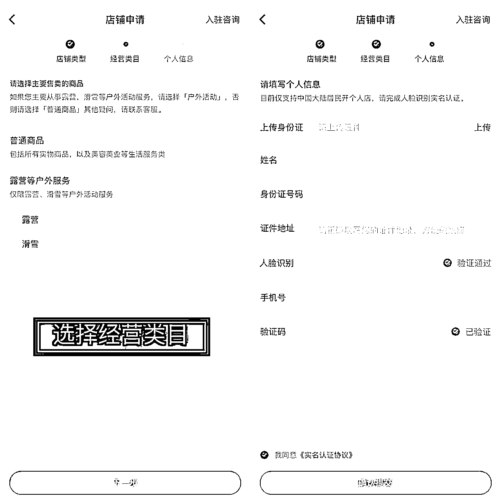

个体工商户店要提前备齐这些材料：（1）营业执照照片、公司名称、统一社会信用代码、经营地址、执照有效期；（2）店铺运营授权书。同样是先选类目，再按提示上传资料。

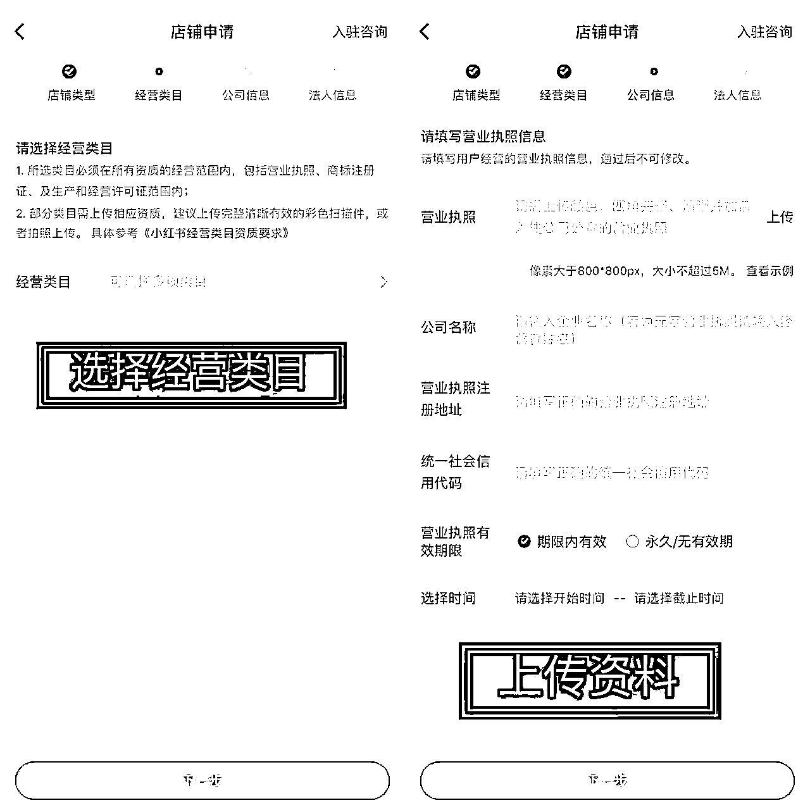

和个人店不一样的是，个体工商户店的审核通常要两到三天，期间可以自己登录系统查进度。入驻过程中遇到解决不了的问题，可在上午 9 点到晚上 24 点之间直接找人工客服咨询。

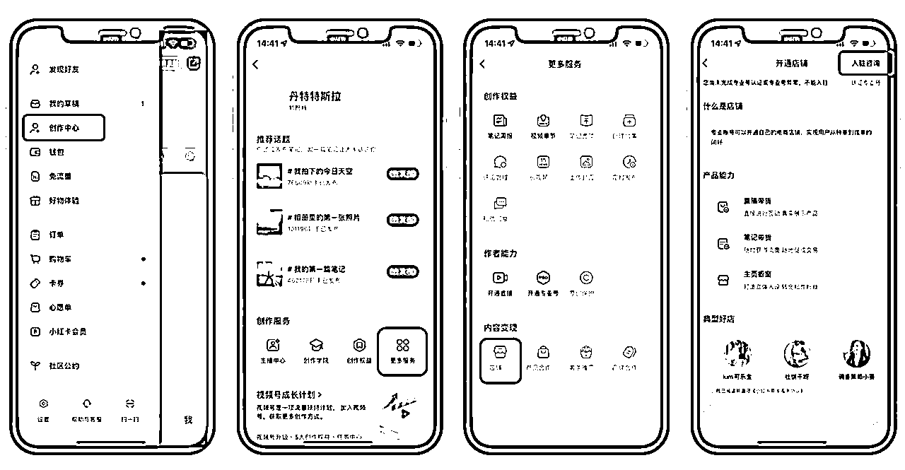


# 3.3 【企业店】入驻门槛与流程

门槛：企业型店铺分为普通企业店、旗舰店、专卖店和集合店。普通企业店的命名方式与个人店一致，都是“专业号账号名称+的店”。要注意，企业专业号取名必须与商标对应，否则店铺开不出来。旗舰店叫“xxx（品牌名）旗舰店”，专卖店叫“xxx 专卖店”，集合店叫“xxx 的海外店”。企业店支持大部分类目，保健品、医药这类特殊类目也包含在内。佣金规则与个人店相同：1 万元以下不收，超出部分收 5%。保证金按类目不同略有浮动，境内最低 2 万元，境外 3500 美金。如果拿不准怎么选，可看下面这张图快速判断。

入驻流程：企业店要备的材料偏多，建议在电脑端操作，网址为 gaia.xiaohongshu.com。先以普通企业店为例，登录后大致有 6 个步骤。第一步，把店铺类型选成普通企业店。

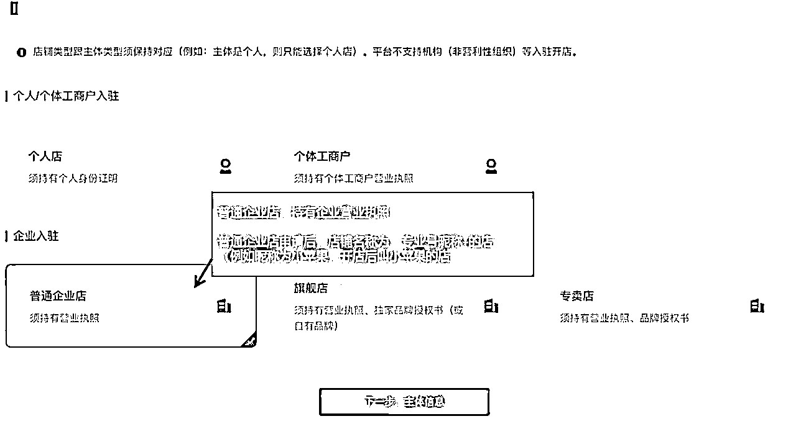

第二步，填写公司信息并上传营业执照。执照照片要拍得清晰、完整，避免扫描识别出错。

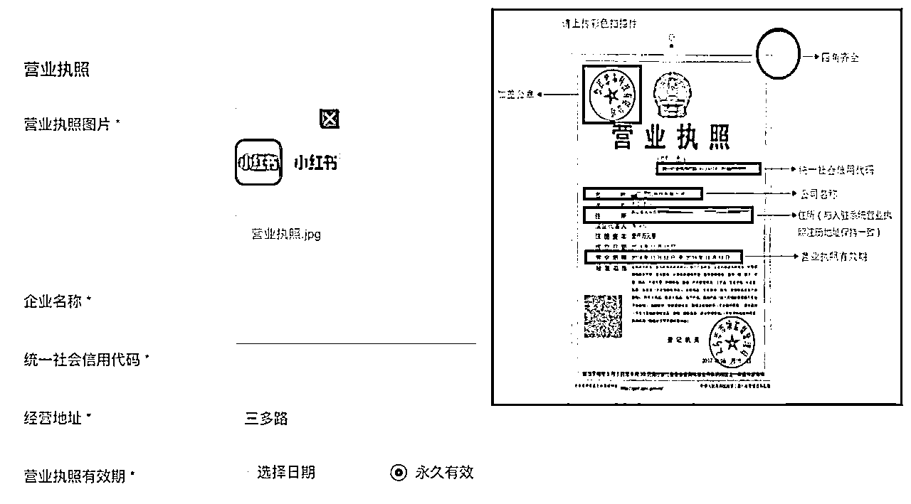

接着填写法人或店铺运营人的信息，注意联系人的信息必须和执照上的法人保持一致。

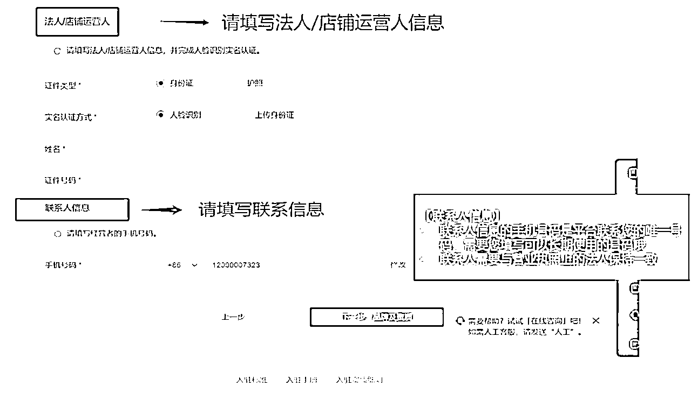

第三步，填写店铺名称。不过名称是由系统自动抓取的，格式是“昵称+的店”，直接和昵称绑定；如果要改，需要去专业号中心修改昵称。

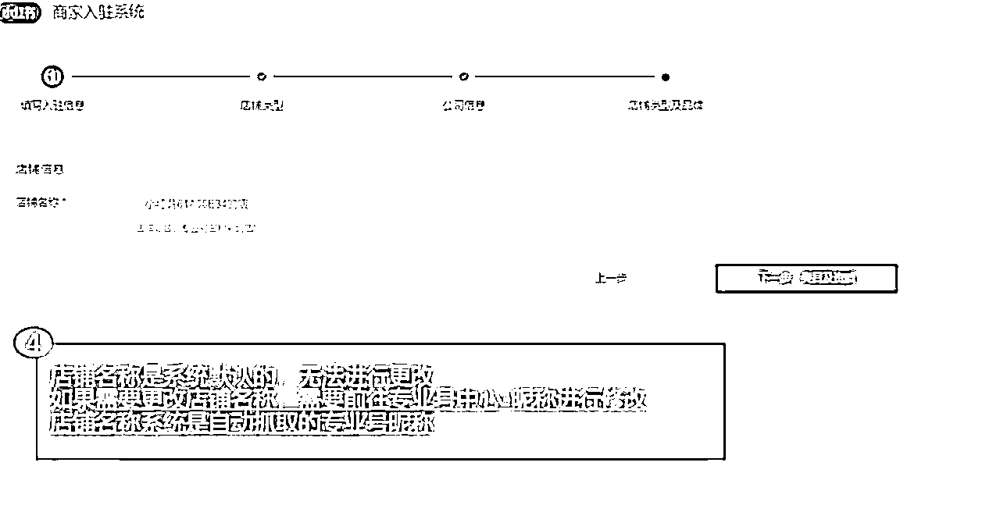

第 4 个动作：确定经营类目。关键前提只有一个——所选类目要落在商标注册证列明的范围内。

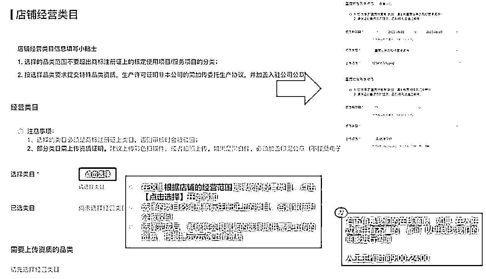

第 5 个动作：把资料递交上去，然后等审核。平台通常会在三个工作日左右给出结果；若被驳回，一般会通过电话或邮件通知。排队期间若遇到疑问，随时可以找在线客服协助。

等审核放行后，末了一个动作是交店铺保证金。这里有两个细节：付款账户必须是企业对公户；开户主体名称需要和入驻资料里填写的经营者姓名完全对得上。

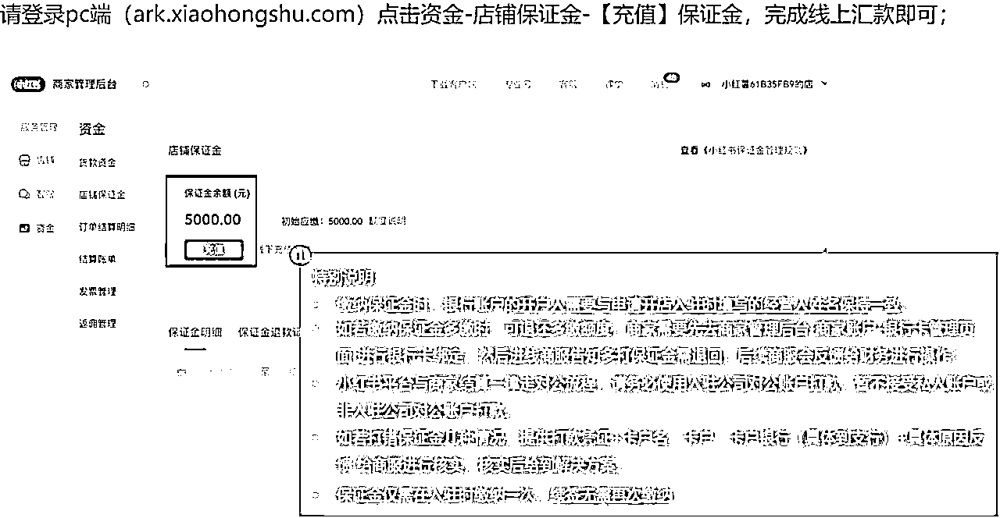

接下来聊旗舰店、专卖店的申请流程。整体跟普通企业店相差不大，不过有 4 处要格外注意：

第一，品牌资料要准确录入。假如系统库里查不到你的品牌，选择“新增品牌”自行补充；logo 图样务必与商标注册证保持一模一样。

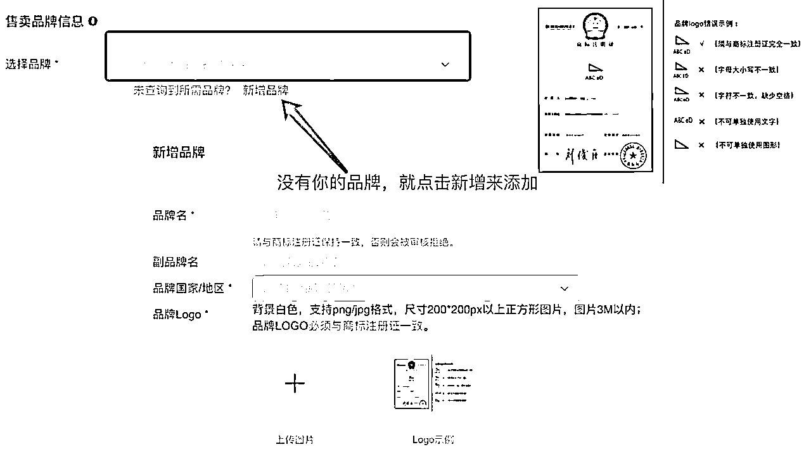

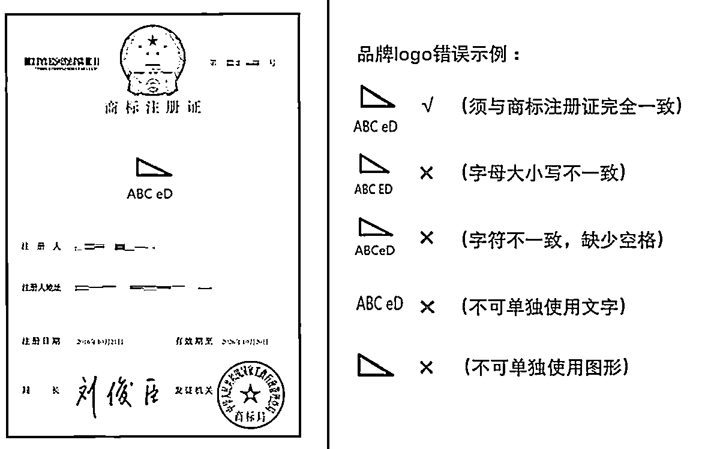

第二，要把自有品牌和代理品牌分开处理。代理品牌重点在于授权关系能一环扣一环，公司名称直接照营业执照填写即可。

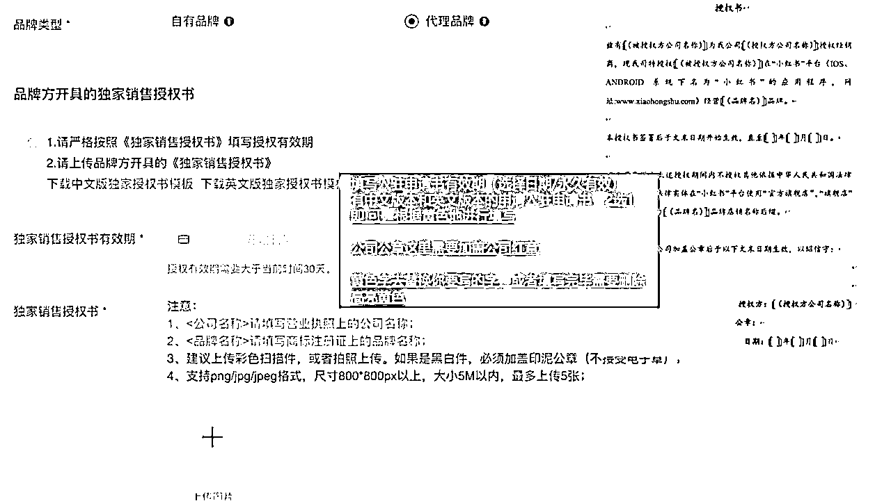

若商标握在自己公司或公司法人手里，就属于自有品牌。注册类型通常分两类：R 标指已注册商标；TM 标则是商标注册申请受理通知书。

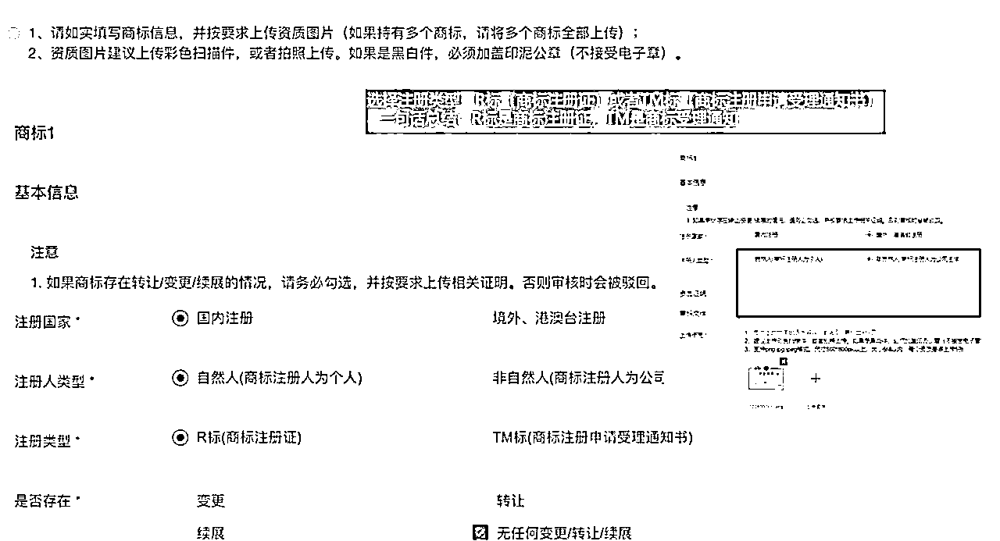

其中，个人名下的 R 标，需要提交商标注册证，并附带权利人的身份证或护照复印件/扫描件。

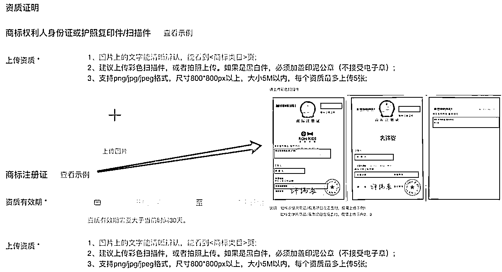

个人名下的 TM 标同理：受理通知书之外，还要准备权利人身份证或护照的复印件/扫描件。

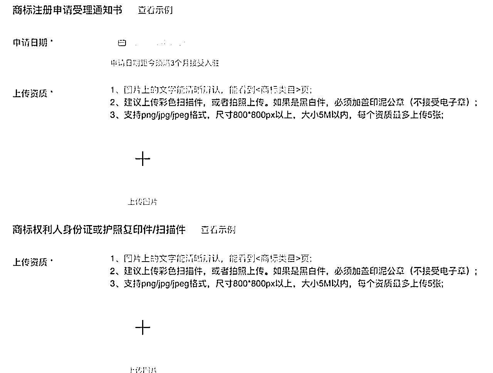

若为企业名下的 R 标或 TM 标，材料就轻一些，提供商标注册证或商标受理通知书即可。

第三，挑售卖品类时，“定制”这个选项别急着勾，要谨慎。

第四，审核放行后还有签约环节。合同通过线上邮件送达，确认方式为电话或验证码。

随后照旧交保证金，规则与普通企业型店铺一致。

最后是集合店。它不开放自主申请，只有收到平台邀约才能入驻；被邀请后的操作路径与旗舰店、专卖店一致。

全部审批走完，就能上架商品正式营业。登录账号首页时，店铺和商品入口会直接呈现。

总体而言，企业型店铺能拿到的商业权益比个人店铺更丰富，不过日常维护开销也更高，按自身条件取舍即可。

若在类目选择、审核流程上卡住，建议立刻联系“人工服务”。商家客服响应速度较快，问题通常能迅速处理。

想继续了解入驻细节，可以自行前往这个页面查看：https://school.xiaohongshu.com/helper/list?ctg=238&jumpFrom=cn

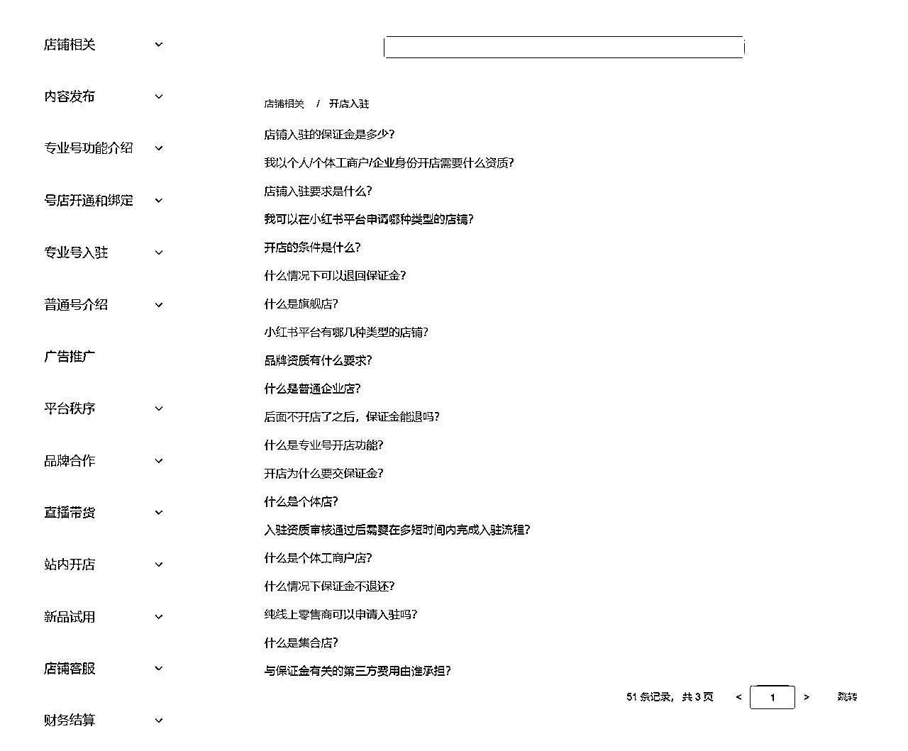

# 02. 店铺账号定位及包装

# 1. 赛道怎么定

赛道筛选方式分收费和免费两类。按效果排，前三种收费玩法更值得优先尝试；刚入门的人，直接用后两种免费方式也够用，不必反复纠结。

先看行业大盘（收费，可申请试用）：灰豚数据 → 数据大盘 → 行业流量大盘。选定行业后，观察爆文总数、预估阅读量、点赞、收藏等指标是否同步上扬。多项指标齐涨，通常代表用户对这类内容有需求，可从中挖掘选品方向；关联笔记总数即便走低，也不影响判断。

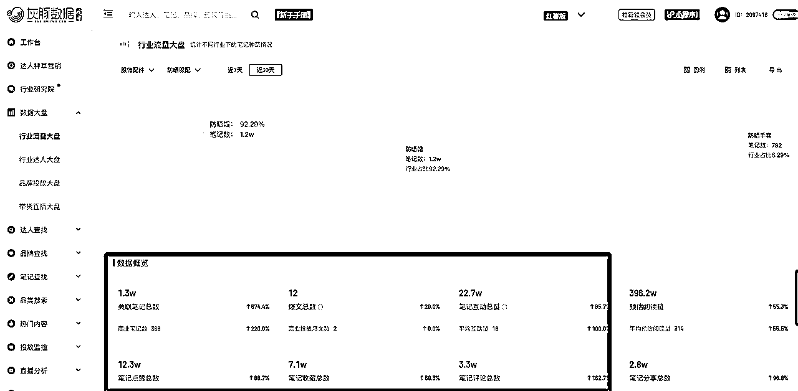

再查搜索热词（收费，有试用）：灰豚数据 → 热门内容 → 搜索飙升榜。挑出搜索量高、又与自家产品沾边的词。以美甲为例，2025 年春天换季，春季美甲需求会集中爆发，穿戴甲便存在机会。

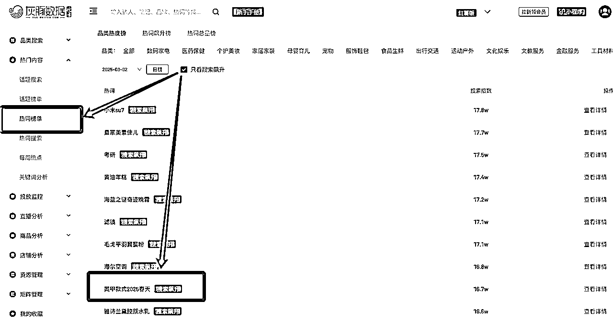

接着翻销量榜（收费，有试用）：仍在灰豚数据里，进入商品分析 → 商品榜单。销量榜、销量飙升榜都能参考，日榜、周榜、月榜按需切换。重点看近期热卖品集中在哪些类目、哪些赛道。筛选时优先勾“暂无关联品牌”的商品；带品牌的链接往往是达人带货或直播投流推起来的，新手很难正面硬拼。

千帆 app 的商机中心（免费）：打开小红书千帆 app，进入“商机中心”，观察机会类目、潜力商品分别落在哪些方向。

站内社区热搜词（免费）：同样在千帆 app 里，查看推荐热词、热搜词、蓝海词和飙升词。把与产品相关的词圈出来，再顺藤摸瓜判断它属于哪个赛道。例如飙升词里的“香薰”“宿舍用品清单”，都是可切入的品类。

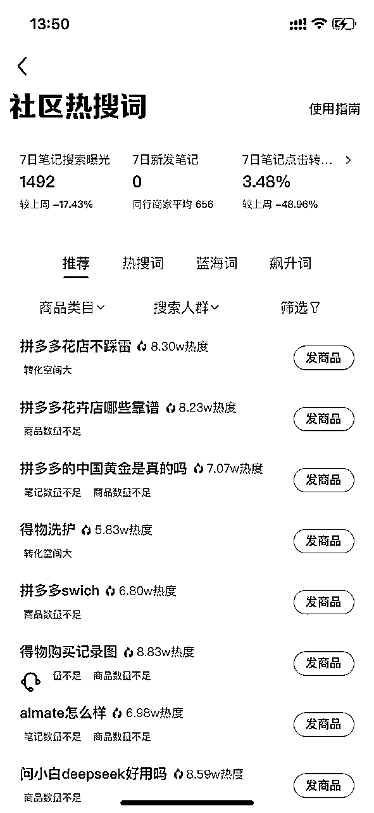

若手机端尚未发布过商品或笔记，看不到热搜词，可改用 PC 端千帆后台查询：

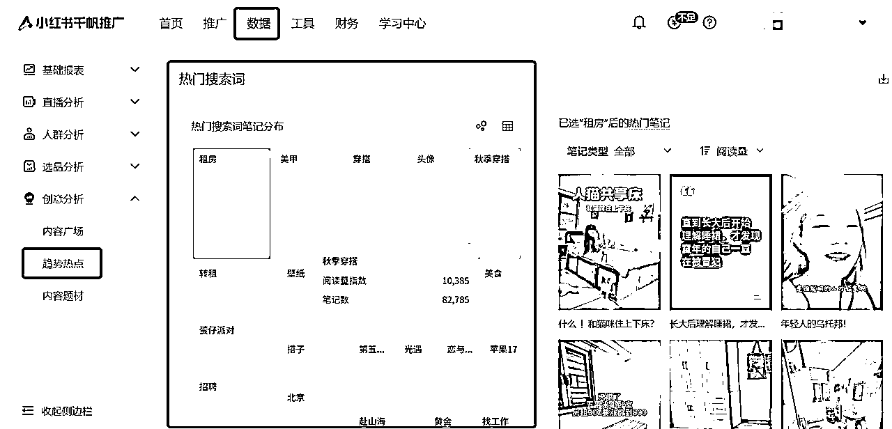

# 2. 账号包装怎么做

平台店铺的账号包装并不复杂，这里拿百货类账号作示范：

第一步，锁定一个对标账号。在小红书商城搜索赛道关键词，例如“旋转梳子”，点开销量靠前的商品，再从页面左下角头像进入对方主页。

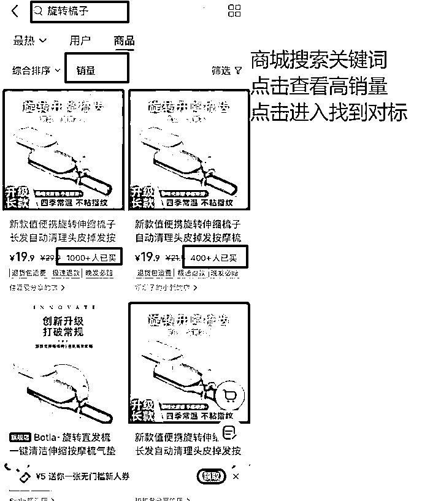

第二步，照着对标对象完成自己的定位包装。假设我对标的是“佳嘉爱分享”，那么仿照它设置的账号就是“娜娜子的小新”。

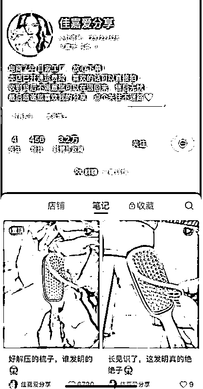

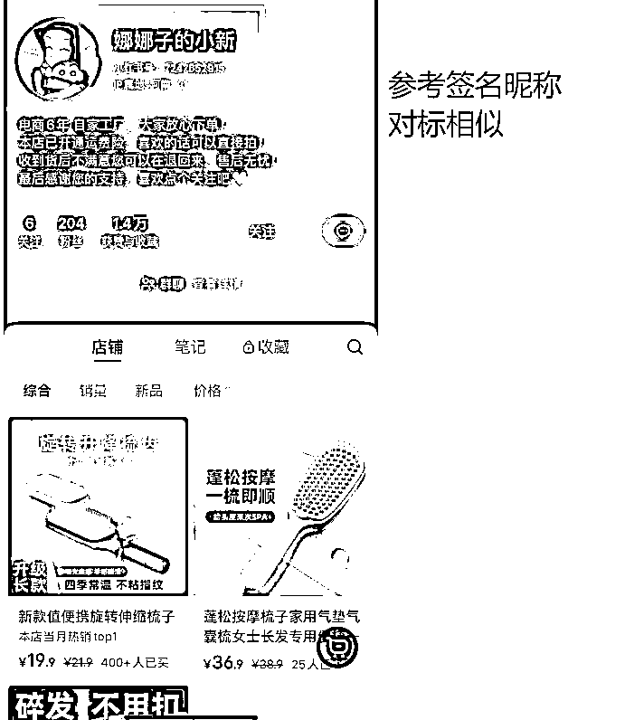

1. 蓝海商品怎么筛

# 1. 本章要点速览

店铺开好、赛道也定下来之后，就轮到选品。这一步会贯穿整个航海周期，也是项目成败的要害。

✅ 蓝海品筛选标准

蓝海选品评分表⭐

✅ 蓝海选品思路

✅ 蓝海选品方法

传统电商平台——淘宝选品

其他兴趣电商平台——抖音选品

✅ 蓝海品实操案例

✅ 先测账号是否正常；账号状态良好且优质，再绑定店铺

对刚上手的人来说，先在站内刷够爆款对标，摸清哪些商品容易在平台起量，逐步建立选品手感；随后再去淘宝、抖音等渠道筛选适合小红书的货，测品效率会明显提升。

# 本章任务路线

学完并实操本章后，路线图上的这些节点即可完成：

第二阶段：【选品】完成蓝海选品（约 2 天）

选定至少 1 个带货类目（约 1 天）

掌握蓝海选品方法，筛出至少 3—5 个商品（约 2 天）

确认自家货源能与竞品做到同货源/同等级质量（约 1 小时）

发布 3 篇产品相关流量型笔记，观察账号流量是否正常（约 1 小时）

# 2. 什么叫蓝海产品

无论是货架式电商淘宝，还是内容驱动的小红书，蓝海的判断标准都很直白：自己有能力做的，就是蓝海；做不动的，就是红海。具体归类要结合自身资源来看。

蓝海电商往往市场盘子有限，销量不会特别夸张。因此挑货时更适合盯住客单价高、利润空间足的商品，这样收益更有保障，运营压力也小一些。

蓝海产品可分成两类：标品与非标品。

标品在站内通常找得到同行参照，上手相对轻松，但容易被人复制，从蓝海滑向红海的时间很短；

非标品在站内几乎没有同行可参考，你就是第一个吃螃蟹的人。它的好处是生命周期更久，难处是启动更费劲。

基于这些，本次航海重点讲【小红书电商蓝海标品的打法】，帮助大家更快拿到正反馈、建立信心，尽早进入节奏。


1. 高客单蓝海款怎么挑

什么算合适的产品？选品不能凭直觉，优先找已经爆过或正在爆的款，成功率更高。

我们归纳了 6 条基础原则，不论用哪种方法，挑出来的商品都尽量贴合这些原则。

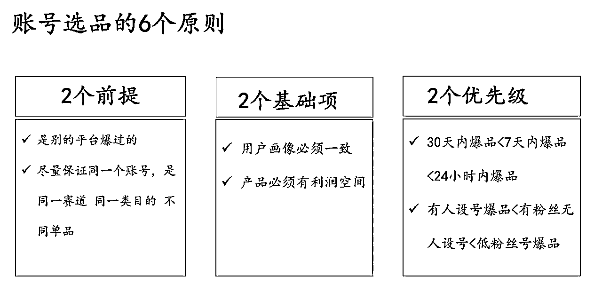

本期航海推荐的高客单门槛如下：

价格带：50—2000 元，偏向高利润、低竞争；

利润率：建议不低于 30%，结合竞品定价及 1688、闲鱼等货源渠道做利润测算。

【重要】更细的判断标准，可对照下方表格逐项核对：


# 4. 选品判断的十个维度

1. 产品数据分析：核心看小红书同行表现（下文会展开）。在其他平台选到商品后，最终仍要以站内数据为主，其他平台只作辅助，主次不能颠倒。有些人容易过度迷信第三方工具，需要多留个心眼。

2. 对标账号粉丝量：低于 5W。粉丝体量越大，模仿难度越高。

3. 是否侵权：淘宝同行数量不能少于网页版淘宝一页。淘宝数据维度更全，更利于判断侵权风险。更多排查方法可参考这篇文章：https://scys.com/articleDetail/xq_topic/4848122548858458

4. 近期销量：观察对标链接近一个月的评论数量，近一个月评论数需大于 100。

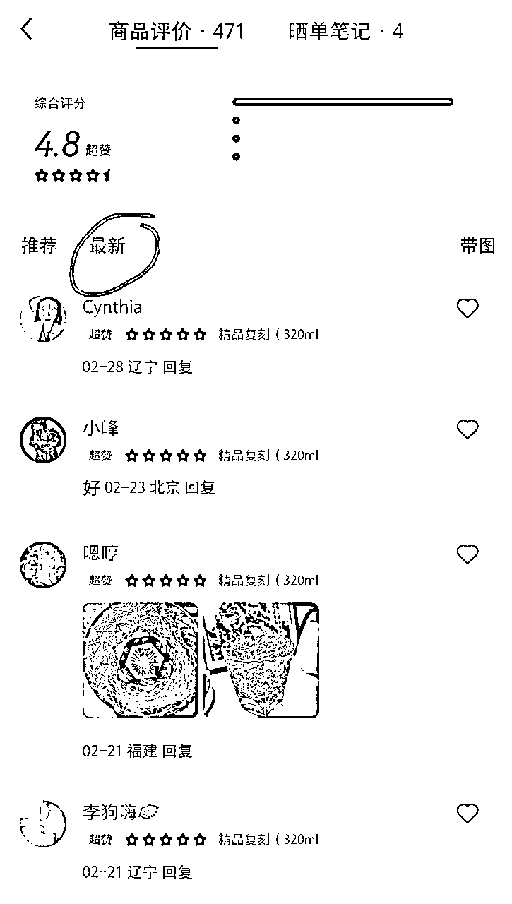

5. 是否季节性产品：看对标链接的评论是否出现季节性回落。例如某商品在 11、12、1、2 月评论只有个位数，基本可判断为夏季用品，冬季销量几乎归零。尽量避开季节性商品，反季销售很难出单。

6. 对标账号流量来源：以笔记为主，检查对方笔记数量是否充足、有没有爆款笔记。若账号只发了几篇笔记却卖出上万单，说明它并非靠笔记获流，而是另有渠道，这种不适合作为对标。我们的流量主要来自笔记，若对标号同样靠笔记起量，更利于新号启动。

7. 产品是否有回购：查看商品链接下方账号的回购数据。

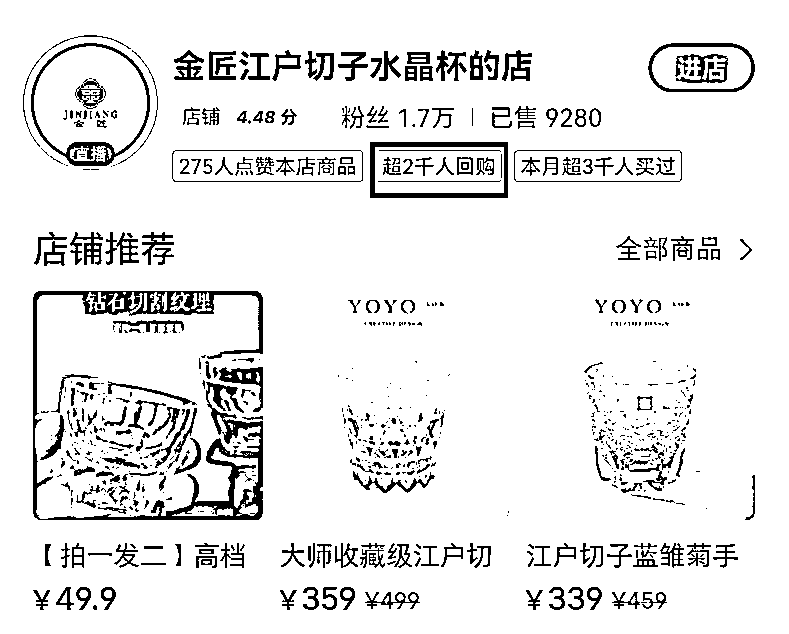

8. 预估产品销量：看链接下方三个月总销量，再平均到近三个月，算出月均销量；若上架未满 3 个月，也可通过第一条评论大致推断上架时间。

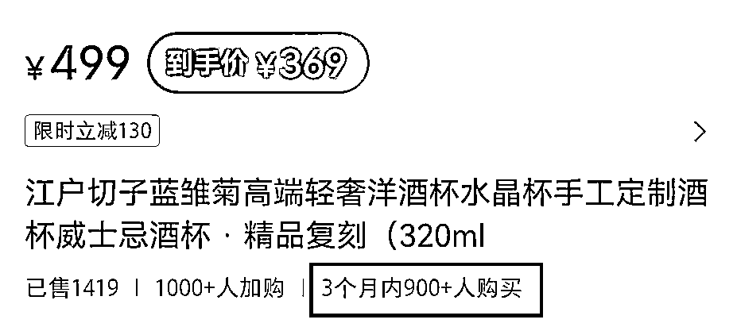

9. 货源：优先 1688 和闲鱼，不建议把拼多多当货源。拼多多货源容易触发无货源封店风险，面单处理不当还容易暴露信息。

10. 1688 和闲鱼都找不到货源怎么办？换品。利润特别诱人的除外。

# 5. 选品评分表⭐

【小红书选品评分表】可从网盘获取，链接：https://pan.quark.cn/s/dfdea328201c

表格使用教程：生财 | 小红书选品评分表 使用教程

怎样判断一个蓝海商品值不值得做？本期教练整理了一套评分标准，按各环节重要程度分配权重，最终汇总成表。找到对标竞品后，把竞品数据填进去，就能算出分数。满分 10 分，8 分及以上说明这个商品可以进入考虑范围。

提醒一句：评分表只能在数据层面辅助判断商品当下能不能做。具体你能否拼过对手、这款是短期机会还是长期机会，还得靠主观判断，因为每个人的拍摄水平、资源条件都不一样。

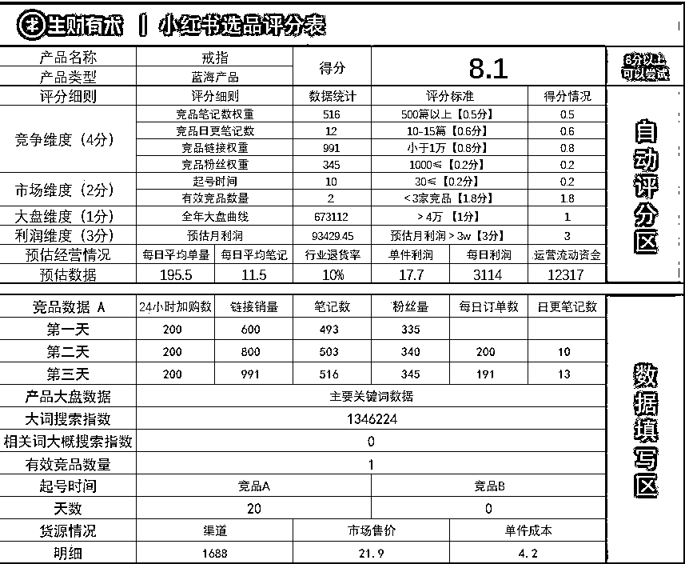

蓝海选品本身比较稀缺，选品定生死。只要选到好货，后面基本水到渠成；所以本期航海不直接推荐商品，重点在于让大家掌握方法，自己去挖。

1. 蓝海选品的思路和工具

# 1. 选品思路总览

在展开具体方法前，先理顺站内选品的整体思路。方法虽多，归根结底跑不出三个大方向：

1、平时多刷小红书站内爆款。既然要在平台卖货，就得了解最近哪些商品好卖。多刷多看，有条件的可以借灰豚看数据、找低分爆款。不过新手不建议一上来就依赖工具，先把平台刷透，顺便培养网感。

2、从传统电商平台——淘宝选品（推荐⭐）。也就是去淘宝寻找合适的商品。淘宝分类页在国内主流搜索电商平台里类目覆盖最全；而且平台成熟，不需要额外付费工具。常用路径包括：淘宝分类页、淘宝神店榜、淘宝榜单、天猫榜单。

3、从其他兴趣电商平台——抖音选品。也就是去和小红书一样靠内容带货的平台找货，目前建议优先看抖音。常用方法有：考古加选品法、蝉妈妈选品法，以及抖音精选联盟创意中心选品法。

因此，正式动手前，建议先花至少 2 小时刷小红书，对平台当下的爆品建立体感。


# 2. 具体选品方法

如果你已经刷完 2 小时小红书，就可以进入选品实操。这里提供两种路径，优先推荐淘宝，其次抖音（理由前面已说明）。

好用的选品方法，掌握一种就够了。前期可以多试几种，等选品能力提升后，再固定最适合自己的那一种。

看到意向商品后，按照【01. 蓝海品筛选标准】里的规则，判断是否值得选。

# 2.1 方法一：去淘宝找货

# 2.1.1 淘宝分类页找品（推荐）

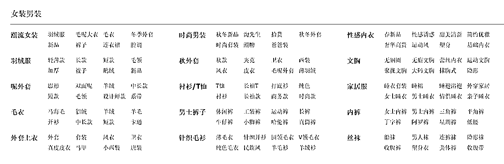

淘宝分类页在国内主流搜索电商平台中类目覆盖最全面，当然和亚马逊相比仍略逊一筹，亚马逊的分类词更丰富。

可以从淘宝分类页里挑适合女性用户的产品词，再放到小红书搜索验证。

选品初期难免枯燥，逐个到站内看数据，这一步无法省略。


# 2.1.2 淘宝神店榜淘品

淘宝神店榜是手机淘宝推出的一个板块，用来辅助小红书选品相当顺手。

步骤如下：

打开手机淘宝，点击“全部频道”。


搜索“神店榜”。

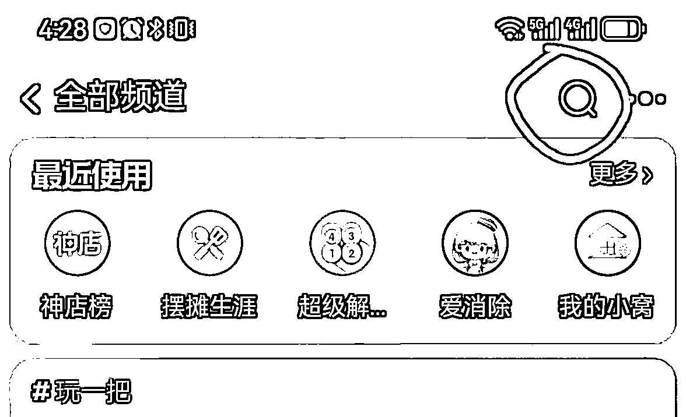

进入后会出现大量类目。选择目标类目，例如“潮玩宠物”，再点“浪漫婚礼首饰热卖榜”。

页面里几乎都是婚礼首饰店铺，顶部还有几个分类项，“黑马榜”和“回头客榜”值得翻看。

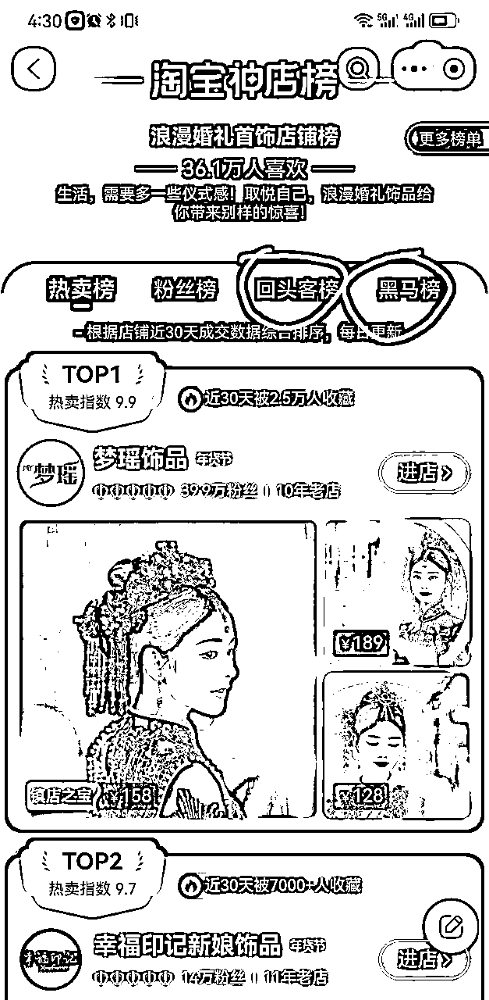

点进店铺后按销量排序，看看有没有心仪商品。若有，就到小红书搜索关键词，观察该商品在站内的数据表现。

这套方法不局限于小红书，淘宝、闲鱼等平台也能套用（抖音经实测不太适用）。


# 2.1.3 淘宝热销榜找品

手机淘宝点击搜索框，底部会弹出一个最近热销产品榜单。该榜单每小时实时刷新，其中部分商品也适合搬到小红书测试。

榜内商品对应近期淘宝搜索热度快速攀升的款，时效性很强。

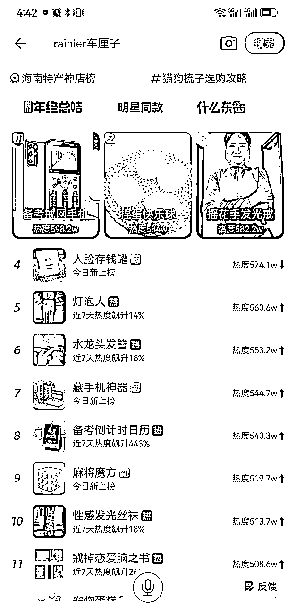


# 2.1.4 天猫榜单里挑品

手机淘宝点击“全部频道”。

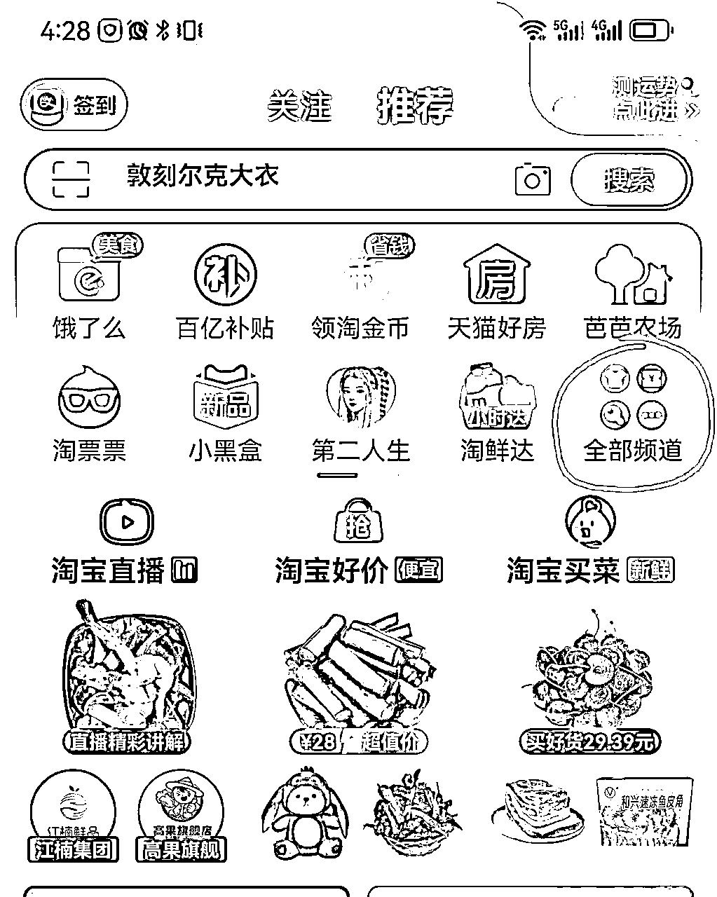

搜索“天猫榜单”。

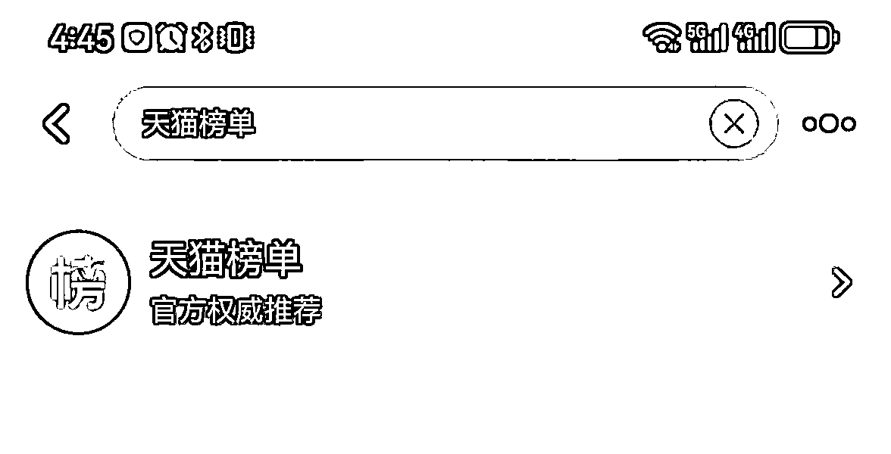

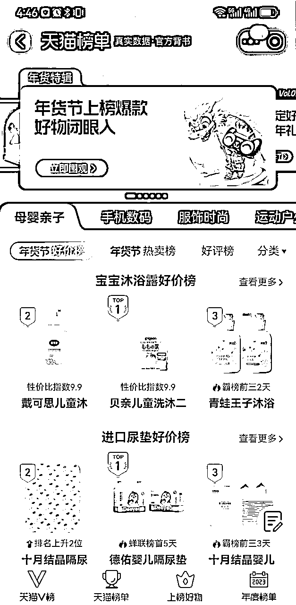

顶部有多个分类选项，点选目标分类，例如“母婴”，会出现不少母婴用品。选择第一个“宝宝沐浴露好价榜”，即可看到当前天猫卖得较好的商品。

这些商品与小红书之间存在一定信息差。天猫竞争激烈，站内未必同样卷。


# 2.2 方法二：去抖音找货

抖音创意中心由抖音官方统计，实时更新，相比考古加能更快捕捉新爆款。

其中，百货等大众品类建议重点使用【抖音创意中心选品法】。

抖音流量和玩家更多，这类大众品在抖音率先爆发的概率更大。

小红书有时偏慢热，而大众产品又多是混剪、素材同质化。等站内已经爆起来再去做素材，可选空间会变小，不如在抖音刚起量时就搬过来。

我们做过的爆品，如硅胶保湿袜、雪地靴刷子、钢丝抹布等，都是通过抖音创意中心选品法找到的。

具体步骤如下：

1、打开抖音橱窗——选择创意中心——可选择爆款视频/图文带货形式（尚未开通橱窗的，末尾附开通教程）。


2、可按时间维度、品类维度、作者等级等条件筛选。前期重点看时间维度和品类维度即可。

3、近 1 小时和 24 小时都要看，这些都是抖音实时统计的爆款带货视频。浏览过程中若发现符合前面【选品的 6 个原则】的商品，就可以进一步判断，再上架测试。


# 3. 选品实操案例

下面用具体案例展示，什么样的商品属于能快速拿到反馈的蓝海产品。

比如我通过上述方法刷到 2 个意向品：

第一个产品案例：kitty 手工编织包

第二个产品案例：小戒指


在红书平台找对标竞品，先做一轮粗筛：关注人数低于500、内容条数不到600，通常说明对方账号基础权重有限；这时我们提高更新频率，就有机会后来居上。再看转化信号：近21小时加购超过100，说明对方正处在小爆阶段，成交并非虚假，值得列为竞争对象。把上述指标录入《选品评分表》，系统会给出分值：kitty手工编织包9分，小戒指8.1分，均位于8至10分档，可进入测品。


# 1. 先确认账号流量是否健康（关键）

测流量是为了确认账号能否正常起量。每个账号的起跑权重不同，会直接影响爆文概率。新号大致分三类：废号、正常号、优质号。三类都可能出爆文，只是概率有高有低。同样内容，废号发百条可能仅出一条爆款；正常号百条约五条；优质号百条可达十五条。基数小时差距不明显，铺量后就会拉开。

每个账号都要测，流程如下：

1. 发一条围绕产品的流量内容；
2. 发一条围绕类目的流量内容；
3. 发一条围绕目标人群的流量内容。

发布满48小时后看单篇小眼睛：超过1000为优质号；50到1000为正常号；不足50为废号。若测出废号，再补发两条时事热点内容，等48小时观察，单篇小眼睛过100即可按正常号使用。

以荞麦枕为例：产品向内容，标题或正文出现“荞麦枕”；类目向内容，带一级词“枕头”；人群向内容，击中“脊椎不适者”的痛点；热点内容从近几天微博热搜找高热度话题，先搜平台是否有人发，再仿写发布。

产品向示例：


类目向示例：

人群向示例：


账号测出优质或正常，即可绑店；店铺号免绑，非店铺号需完成绑定。

# 1. 拍前备样（物流1—4天）

# 1. 本章概要

选品结束后，接下来买样、实拍，一次拍足素材再测品。前期慢一点无妨，蓝海实拍讲究慢就是快。实拍没想象中难，新手用低成本场景加苹果手机即可，后期也简单。下面开始实拍。

# 本章航线图

完成本章学习与实操，可走完航线图的：

第三阶段：【实拍】下单样品拍摄（约5天）

→ 首次下单1个样品，用于内容素材拍摄（约3—4天）

→ 每个品找不少于5个对标带货内容做拆解（约0.5小时）

→ 仿照对标拍，每个品产出不少于200张图（约2小时）

→ 参考对标选图、修图、做视频（约2小时）


# 2. 样品采购步骤

选品开店后，新手先买1个样品拍实图。

第一步：确定要采购货源的产品；
第二步：同时买竞品，便于和货源做质量对照；
第三步：在1688/拼多多以图搜图，挑2—3家下单。优先级：有标店铺＞销量高的店铺＞普通店铺（1688有标为超级工厂/1688严选/实力商家；拼多多有标为旗舰店/品牌/五星好店/百亿补贴）；
第四步：收货对比，同源或质量接近可用，差距大则放弃。

注意：

- 样品直接在自己店铺拍单；
- 想长期合作，提前问清对接流程，是加微信还是走ERP。

微信下单可避免二次面单被平台判无货源；ERP适合单量多时后台直接看单发货。新手前期量少，走微信即可。

借样流程：


注意：借样拍照通常一周，长则两周，别超时。


# 3. 如何挑出可长期合作的供货方

下单时就开始观察对方是否靠谱，重点看两个方向。

# 3.1 配合意愿

对方不配合，后续发货、售后都会吃力。

（1）电子面单
日单超过10，可谈绑定「电子面单」，之后下单、发货系统完成。前期直接谈多半不同意，出单后再聊。


（2）售后回复
代发模式起步阶段问题多，自己还不熟产品时需对方协助。问题半天不回，会影响成交率；也往往说明没有专属客服、规模小、不稳定，可能随时倒闭。

（3）发货速度
平台要求24或48小时，越快越好。确认最长48小时内发出；拖延会被扣延迟发货费，约3元。特殊情况不能按时发，要提前告知客户，别提前填单号；物流不更新算无效，照样扣钱。

（4）退换政策
不强求，看原因。用户喜好类部分产品不支持，如服装多数不退；产品本身问题应支持，连这都不支持就不值得合作。


# 3.2 货品本身

（1）价格
初期量小，议价空间有限。日单稳定50+可谈低价。同时对比同行：若自己的成本价等于别人卖价，且产品一样，说明没拿到低价；不降就换。

（2）款式
手机壳、穿戴甲更新快，看能否及时上新、有无开品能力。小众蓝海如设计师款珍珠项链、饰品，对开品要求高；款式不更新也不开发新品，不适合长期。

（3）质量
质量最关键。质量差会带来大量售后，处理麻烦还不赚钱。

（4）补货时效
厂家、销售、门店型不同；门店货发完可能短期补不上。好一些的补发不超过48小时，不影响平台时限；长期补不上不值得合作。

# 1. 实拍入门

# 1. 拆解参考内容

以旅行包内容为例：带货图=场景+产品+角度+光线+构图+陪体。简单说，在哪儿、产品放哪、站哪拍。比如高铁上把包挂好，人站侧面拍。进阶要求：自然光，包占画面中心约50%，开车窗用窗外风景增层次，或用绿色座位衬白色质感。首图决定点击，最后两张决定转化；最后两张要凸显质量，所以多角度+细节图。


# 2. 省钱拍法

一次至少备一周素材。每天6篇、每篇3图，一周需6×3×7=126张；考虑废片率，一个品至少拍200张。教练录了低成本教程：WeChat_20250326173759.mp4【在线播放】。新手初期照爆款对标1:1复刻，少走弯路。

原图


仿拍成片


有基础后可尝试【进阶版live】提升审美技术。实拍教程如下。

# 2.1 布景

按选品布景，干净整齐。新手用纯色背景，如纯色地板、软沙发、暖色床品、仿剑麻地毯。产品大，布景范围也大；香薰、相框等小物，书桌加地毯即可。


水杯、包、鞋可户外柏油路背景。更多方案在平台搜「布景室内」，挑适合的照搭。


新手建议：

1. 能外拍的鞋包水杯，找附近柏油路，拍时拉低曝光；
2. 不能外拍的香薰、礼物，买仿剑麻地毯，约35元。


# 2.2 用光

尽量窗边自然光顺光，人面向光源，避免过曝发黑，高清还原。


书桌也靠落地窗。光线不足，侧后方放补光灯，位置可调；前期多试角度找最还原色彩。无补光别用侧面逆光机位，否则明显阴影难修。


# 2.3 设备

优先苹果，自动美颜少、还原高。机型iPhone XR以上，有条件选Pro，后面说原因。

# 2.4 角度与构图

静物按大小决定焦距：大衣、长开衫用1倍拍全貌；香薰、杯子等小物或细节放大1.5、2倍；Pro可直接2X更有质感。


不同产品角度不同，构图多平台学习。


# 2.5 四个注意点

1. 清晰度：高清是关键。苹果按参数调，非苹果关美颜。清晰度保证下，不必迷信复杂模板；越花哨出货越低。
2. 功能性：直接解决痛点。如光腿神器展示不褶皱、裸肤色，提高信任。
3. 打光：接近肉眼，忌彩色灯。窗边自然光最舒服，避免货不对板。阴天补光如图：


4. 曝光：正常自然光对焦后，下拉一点小太阳，画面更清晰干净。对比图如下。


# 1. 素材后期

# 1. 图片筛选

平台同质化逻辑：图/视频相似超50%，且文字超50%，判低质/同质化营销。图片按区域色块比对，大色块不似即可；视频按零点几秒内容比对，每秒内容顺序不同即可。新号前期稽查松，首图可重复2—3次，但文字要不同；同背景同光线同构图素材不超过4篇；视频每秒素材不同。平台审核会越来越严。


# 2. 修图

不用复杂：调色还原肉眼，无统一模板，搜调色攻略多试（关键词：调色参数、暗调调色、ins调色、清透感调色……）。滤镜别过度。花字少用，选简短词，别喧宾夺主。教程：WeChat_20250326171452.mp4【在线播放】


# 3. 视频处理

蓝海产品视频简单，除详细产品视频，大多用剪映「一键成片」「营销视频」。一键成片选素材自动生成，只有音乐卡点无文字，展示够用：copy_97DB7C08-528E-409D-99F1-F50736AB78F9.MOV【在线播放】。营销视频输入产品名和卖点生成，营销感重，适合文字解说：视频.mp4【在线播放】。

# 1. 让素材多利用几次

同图不能反复发，否则触发大量低质/重复交易处罚；但拍了要多用。方法如下：

1. live图转静态：苹果live记录前后3秒，选一帧主展示；画面幅度大可换另一帧做封面，相当于换图，一个live拆N张；画面浮动小仍可能判同图。图1原图，图2换帧多一只鸭子，看似另一张，其实同一live。


2. live转视频：live本身3秒视频，转视频后多素材重剪成新素材，像混剪但原创高；也可丢一键成片/营销视频重生成。

# 1. 发布细节

# 1. 评论区维护

挂产品链接的图文流量通常低于不挂，因为平台倾向推给电商消费人群，购物习惯强、转化高；不挂车按普通内容分发，面向所有用户，浏览更多。若没挂链接，评论区置顶链接、购买引导图，或直接回复产品链接。


# 2. 封面测试

实拍依赖封面点击率，前期别自由发挥，严格参考同行爆文。看同产品哪类封面出现多、爆文多，就是点击高、用户喜欢。如光腿神器，相似角度不同账号发都能爆，说明封面点击不错；拍时多拍该角度测试。多找几个爆款封面拍，看哪个角度适合自己。


# 3. 店铺定位做“减法”

把高客单蓝海和无货源电商混为一谈是个误区——它要求类目和单品足够聚焦。与其碰泛家居，不如死磕“户外美学”这类细分领域，人群标签才不会互相干扰。再看「盖个帽儿总店」，客单不算高，但只围绕大头围帽子做文章，单品类稀缺照样把几个品卖爆。

1. 准备测品

# 1. 本章要点

每个候选产品都得拉到台面上跑一遍，才能知道行不行。这里的测试表面看是验品，深层看是验你引流的能力，当然前提是商品页转化已经整好。所以能不能测出结果，除了产品本身，就取决于两件事：

✅ 商品页质量：流量进来能不能接住，这是引流的基础；
✅ 内容质量：你能不能持续产出吸引流量，不同产品适配的内容形态不同。

准备好了吗？进入测试环节。

# 本章执行地图

跟着本章学完并做完实操，就能走完路线图的：

第四阶段：【测试】发布实拍原创内容（约 7 天）

.
先上架至少 1 件商品，并调好商品页（约 1 小时）
.
参考对标做出带货内容，可多备几篇放在草稿箱（约 1 小时）
.
单品每天发 3-6 篇，连续发 7 天（每天约 1 小时）
.
每日复盘商品页，判断要不要继续二轮测试（约 0.5 小时）
.
持续优化笔记，直到出爆文（每天约 1 小时）


# 2. 搞懂测试的逻辑

什么是测品？本质就是给选品做一个“实测版”检验。先前选品时，你靠翻同行商品页的数据，大概能看出竞争程度、每月毛利、流量水位，但那都是纸面判断，到底能不能真赚钱，必须实测才能摸清。选品偏向理论和经验，测试偏向执行和数据，所以测试是验证选品对错的唯一可靠路径。

再强调一次，这套玩法测的其实是搞流量的能力。品类一细分，吸引来的访客自然有高匹配度，只要访客供给稳定，成交就水到渠成。当然，有个大前提：商品页的转化已经调到位。

测试周期：7天。

平台上的高客单蓝海走精品路线，不像店群那样需要堆大量链接；同一个小类下的产品可以共用一个店铺，所以没必要一个店只挂一个品，那样太浪费。通常一家店放少于20个品都可以。我们实践下来的节奏是：一个品一个品地测，最好上一个测一个；全部先上架也行，但要从数据里最有潜力的那个开跑。

每天发3-5条笔记，别一股脑同时发。跑满7天，能成的品就自然出单了。

这种模式出单速度一般偏快，因为产品够细、流量够准，在商品页转化正常的情形下，7天没单，基本可以考虑换品。只要7天内出过单，就说明有戏，继续做，提升你带流量的能力。新手通常需要2-3个月才能让流量趋稳，才能稳定出单。

当然，也有一些品自带流量波峰，像玄学类产品，以及中考、高考、考研、考公这些考试节点前夕，都会出现流量小高峰。这要求你在选品时通过数据发现规律，再定好测试时间；如果没留意到这样的时间点，完美错过流量高峰，后面做起来会吃力很多。

（玄学类毛利虽高，但操作门槛高、容易违规，对新手不太友好。刚入行的朋友建议先选其他类目，更容易获得正反馈。此处只是举例子，不代表推荐大家入局。）

额外做了一张【测品流程】表，一眼就能看明白：


# 3. 测试前准备（重要）

开始测之前，先把商品上架，再把商品页的转化打磨好。下面是具体做法。

# 3.1 上架商品链接

# 3.1.1 主图与详情页

千万别做淘宝那种强精修风格的电商图。主图和详情页最好走素人实拍风，更有真实感。如果你后续准备自己实拍，那详情页也统一成实拍画风，用户会更有“所见即所得”的踏实感。

比如这个账号，详情和视频是一个风格。还有一个例子，详情页直接挪用首页笔记的图，用户一眼能看出是真拍。


# 3.1.2 怎么定价

有人觉得把拼多多的商品搬过来，直接加价三倍就能大卖，但这里的用户没那么天真。我访谈过50多个女大学生，她们大多数照样在淘宝、拼多多、得物下单，而且不少学生已经很会比价。

我的定价习惯是：去淘宝和拼多多找销量高的同款，把价格落在这两个平台的区间里。很多用户比价后看到我们的价格还稍微便宜一点，又看到视频是原创实拍、主打“所见即所得”，基本就不会去别家下单了。

举一个真实例子：从拼多多榜单随便翻到一条牛仔裤，标价39；去淘宝按销量搜同款，月销1000+的大多在70-90区间，也有40多的。这时候我可能会定59-69，再根据自己的利润仔细算一遍。


我做女装类目，从浏览到下单的转化率一般在4%-7%，如果低于4%就可以考虑调价。其他类目数据我没有细测。或者定价前多去平台刷一刷，看看同行爆文左下角挂的商品累计销量，也是个参考。

实操里，定价真的极其关键！特别是客单偏低的商品，大家容易踩两个坑：

.
觉得平台用户消费力强，就不停加价
.
把其他平台价格原样搬过来，懒得灵活调整

圈友@V 小刀有一篇星球帖，把定价讲得更细：小红书电商系列细节篇


# 3.1.3 发布商品

① 手机端

小红书APP和商家版APP流程几乎一样，跟着提示填就行。


上架流程如下：

1）编辑商品


注意：

商品标题、主图都是必填。主图有规格要求，画面要清爽，别堆文字标注。

如果首图不符合规格，直接上架失败；不符合首页推荐规则，则不会被商城首页推荐。


2）设置类目

这里展示的是个人店铺可经营类目，也可以用搜索框查。部分类目仅限企业店，要提供资质。每个店铺类型可经营的类目都不同，具体可以到小红书学习中心-规则中心-经营总览里查。

3）商品规格

一个商品有多种型号才需要填规格，只有一种就不管。

4）商品售价

按商品实际价格填。

5）库存数量

按实际库存填。

6）商品属性

按实际情况填。

7）商品详情

上传详情页图片。


8）是否包邮

系统给两个默认选项：

全国包邮；
偏远地区不包邮（偏远地区：新疆维吾尔自治区/西藏自治区/宁夏回族自治区/青海省/海南省/内蒙古自治区/甘肃省）


也可以自己设运费模板。运费金额和不同地区都能设置，但只能在电脑端商家后台操作。先设默认价格，再设特殊地区价格，计费可以按件数或重量。


9）发货时间

可以选当天发、24小时发、48小时发或预售。上架后点“立即发货”即可。平台审核是机器做的，速度极快，没有大问题基本秒上架。

② 电脑端

小红书商家助手网页版：https://ark.xiaohongshu.com

电脑端能用软件一键搬家，也能手动发。

1）一键搬家

店铺后台点服务，进服务市场挑一款搬家工具。这些软件在后台一般都能试用，选适合自己的用就行。

一键搬家软件入口：


2）手动发布

小红书商家管理后台手动上架的路径：


① 先选好产品类目，点下一步：

② 按产品属性填写，带*的必填，其余选填：


③ 如果产品品类未开通（部分类目需要资质，后台会提示），可在后台申请开通：


④ 信息填完，提交审核。

拓展资料：和上架相关的更多内容，可前往小红书商家课堂学习：

https://school.xiaohongshu.com/course/list?jumpFrom=school&categoryNo=20210515002


1. 把商品页转化拉高

测试前，商品页的转化必须过硬。下边这些都是我们实操验证过、能有效提高店铺转化率的招：

# 4.1 先发晒单内容

商品链接一上架，赶紧请身边朋友在你店里真实下一单，然后让供货商发货。这一步影响后续出单，建议照做。尽量让朋友拍下寄到家里，别用自己账号下单，主要担心没有IP隔离。收到货正常拍摄，多拍一些live图、视频，场景尽量变化。然后让朋友账号确认收货、写好评，再用你拍的素材发一条晒单笔记。

# 4.2 补评论

新品链接至少补5条带图评价。要做转化，人为补评是必须的，最好扎根图文，补5条能实现边际收益最大化。平台补单主要补评价，流量还得靠内容去引。那5条评价怎么解决？找亲友最省事；不想麻烦亲友，就找老客户；没老客户，就找微信好友；微信好友也不好意思开口，就去闲鱼发任务。

# 4.3 善用SKU引导

咱们的商品，多数都有好几个SKU。但SKU一多，用户反而容易犯选择困难，直接影响转化。不过我们可以在SKU命名上动脑筋，借从众心理把客户引导到我们想推的选项上。

拿脐橙来说：


上图这种SKU很粗糙，只有数字参数，没有半点营销性的措辞。客户一眼望去找不到哪个更好，所以我觉得这个SKU编排很差。


上图这条SKU稍微好一点，最下面那项加了“好评最多”，整体比上一个强，但在我看来仍然不到位。虽然大家的视线容易落在最后一行，问题也随之而来：排序不对——主推款应该放在前面，放在最后是怕人看到吗？还有，主推款当然要推利润高的，推尺寸最小的果是想啥呢？最后，话术还能继续优化。


再看第三条链接，这条算及格了：主推款放到了前几项，让客户能快速锁定。放到第二位更理想，第一位放单价最高的当锚：客户看到100，再看主推的80，就不觉得贵了。除了主推款，其他SKU都有对应话术，这点也不错。另外，“好评最多”可以升级为“千人好评”“万人好评”，前提是销量撑得住；销量不够时仍用“好评最多”。这种话术的用意就是给客户一个暗示：大家选的就是这个，闭眼买没错。

# 4.4 优惠券

先把原始价格调高，再放一张面额大的优惠券，客户会觉得占了便宜。尤其对非标品特别好使，因为没有同行的参考价，你的价格就是市场标准。

# 4.5 模特要漂亮

需要真人展示的产品，模特尽量挑美的，越好看越好。比如祛痘、美白这类要做前后对比的产品，效果图可以从网上找，也可以让美工做。对比图里的模特越漂亮，转化越高，因为客户会不由自主代入自己；模特丑了，反而起反效果。人都喜欢好看的东西，女性尤其希望自己更美。

# 4.6 拿捏恐惧情绪

人的情绪里，有很多能推动成交，我们用得最多也最好用的就是恐惧感。举个例子：卖儿童用品，用“你现在不纠正这个习惯，以后就会如何”“别人家孩子都在学，你家不学就落后”这类措辞；卖护肤品，用“现在省下保养的钱，以后会被小三花掉”这种让人焦虑的话术。但请记住，恐惧只是促成成交的工具，不是为了吓人而吓人，最终目的永远是卖货。

# 4.7 用相似性经营账号

账号、店铺和笔记是连在一起的，不能拆开理解。小红书的底层逻辑是种草而不是卖货：我因为某个需求买了东西，用了觉得好，就把真实感受分享给姐妹们；姐妹们被真诚打动，也去下单。所以你做号时的身份，不能是商家，而应该是爱好者/使用者。把自己定义成卖家，和用户就是买卖关系；把自己定义成解决问题的人、同好，就能和有需求的用户产生相似性，甚至变成朋友关系。你猜她们更愿意相信朋友，还是相信商人？

要营造这种相似性，你得明白目标用户长什么样、圈子内有什么黑话。这些都能靠在小红书搜关键词、翻笔记和评论来获取。那么现在检查一下：你的账号性别有没有设置成女性？笔记有没有用消费者口吻去写？记住，你的身份不是销售，而是客户的同类朋友。


就像这个卖儿童用品的号，人设做成成长型宝妈，分享日常育儿心得，很快就赢得平台宝妈们的信任，觉得她是“自己人”，因为彼此有相似性。

上面这些搞定后，商品页转化就没硬伤了，测试阶段只需要专心搞流量。

1. 发原创笔记测试

有了实拍素材，可以参考对标去做带货笔记，最好批量做一批存在草稿箱。标准节奏是：单个品每天发3-6篇，连发7天算一个测试周期。

1. 图文还是视频？

不同品适合的内容形态不同，效果也不同。先举例说明：百货赛道里，大部分货都要展示功能和使用场景，让用户知道这个东西能解决我的问题，所以多数百货更适合视频。

图文笔记更匹配这样的产品：图片本身就能亮出产品亮点/戳中需求痛点；且这类品在小红书的爆款形式大多是图文（去搜索关键词可以验证）。这里给3个例子供找感觉：

.
女装，看身材、看搭配，适合图文
http://xhslink.com/m/6qH9642DBI1
.
裤子，实拍简单，抠图方便，适合图文
http://xhslink.com/m/8V0BhHhf4M9
.
玩偶公仔，图文爆款很多，适合图文
http://xhslink.com/m/3dcU91iMzz

而视频笔记的优势在这几种情况里更明显：

产品功能在视频里可以直接演示；
产品自带猎奇感，容易抓住眼球；
需要真人出镜，强化IP；
静态图片讲不清痛点或亮点。

在小红书用关键词反复搜，你会发现这类商品的爆款内容里，短视频出现的频率明显更高。下面拿三条笔记帮你找找手感：

- 清洁百货：卖点靠现场演示，短视频更能把效果直观摆出来  
http://xhslink.com/m/5QNeVAAaBqC

- 日常护理：把实用价值和用户难受的点讲透，也适合用视频呈现  
http://xhslink.com/m/7aJQ9JjRbg6

- 解压玩具：先用画面勾住注意力，停留时长和曝光更容易起来  
http://xhslink.com/m/6WJJlA8mVbc

由此能看出，百货类商品需要把功能演示做得足够直观，视频形式天然更贴合。下面进入实操：以“硅胶保湿袜”为例，把视频笔记从准备到发布一步步拆开。


# 2. 图文笔记：先找样本，再拆结构

# 2.1 锁定“新近跑出高数据的小号样本”

找参考笔记时，我只看三个条件：内容跑出过高数据、发布时间新、账号粉丝体量不大。三项里，前两项比粉丝量更关键——刚起量的内容，只要货品匹配，即便来自粉丝不算少的账号，也值得拿来试仿。

用商品词（如“无水暖袋”）检索最热图文。


继续下滑，把点赞高的、尤其是千赞级内容筛出来做记录：


高赞样本记录：

http://xhslink.com/o/60o4E3Vzrdf

http://xhslink.com/o/9I3eaDeHP2r

http://xhslink.com/o/HtfmudYSGt

http://xhslink.com/o/1k3d5hrG059

http://xhslink.com/o/46G97IXwfr2

筛完后，优先挑其中发布更近、粉丝更少的样本作为对标。

# 2.2 封面、标题、正文逐项仿写

把上面五篇高赞笔记拆成三块：封面、标题、正文，分别找可复用的规律。

1）封面：


这些样本里，手持商品出镜的场景图出现频率很高，可以直接按这个思路拍主图。若画质或光线不够，用滤镜往爆款质感上靠。

2）标题：

先看五条对标标题的共同点：它们反复出现“大学生”“寝室”“拼爹爹”这几个词。把关键词重新组合，就能做出新标题，例如：“这回不拼爹爹了，宿舍六个女生一起拿下！”

3）正文：

正文的仿写逻辑相近，但句子要重写。核心是避开平台判相似。拿不准尺度时，可看下面三个改写样本：

案例1

原文：http://xhslink.com/o/60o4E3Vzrdf

优化后：

我妈前阵子给我带了个用移动电源供电的暖手袋，主要怕宿舍大功率不安全。上课要是忘带移动电源，还能从暖袋里借电给手机顶一下。平时我开两档暖手暖被，现在还没冷到要开最高档。这个冬天不慌了，展开就是一条薄被。

案例2

原文：http://xhslink.com/o/9I3eaDeHP2r

优化后：

哈哈，它本质是暖手袋！最妙的是能摊开当薄被。羽绒面料，支持USB补电，我已经用上了。平时还能给手机补电，挺省心。

案例3

原文：http://xhslink.com/o/HtfmudYSGt

优化后：

姐妹们，谁懂一个宿舍都怕冷的感觉！之前和室友拼团买无水暖袋，毛茸茸的触感很舒服。去图书馆那天室友来姨妈肚子难受，给她用了一下，确实顶用。趁还没入冬，早点入手。

图文笔记关键点：

实拍时，对照爆款的拍摄角度和场景，尽量做到1:1还原。测试商品阶段，如果笔记浏览量指标普遍在500以上，说明这个品有戏，可以着手找供货方。

挂商品链接的流程：

1）发布笔记：


2）添加商品：


# 3. 视频笔记：混剪与实拍两条路

# 3.1 同样先找新近高数据样本

筛选逻辑不变：先看内容是否跑出高数据，再看发布时间，最后才看账号粉丝量。刚爆起来的内容，货品合适，账号粉丝不算少也可以拿来测。

用关键词（如“无水暖袋”）搜最热视频。


把爆款视频素材下载备用，标题也一并收集，后面混剪和起标题都用得上。

# 3.2 对照样本拍剪成片

先记录同领域爆款素材，判断哪些拍摄方式自己能做到，再按1:1实拍参考。

拍摄时手机拿稳一直录就行，不必因为画面不够完美而不敢拍。

拍完拖进剪映剪，边剪边对照对标笔记调整节奏和画面。

成片后即可发布。同样，等测试商品跑出结果再找供货方。

视频笔记关键点：

混剪前要做素材去重；最好拿5条以上爆款视频交叉混剪，单条素材反复用太多容易被判违规；

新手前期可先做混剪，门槛低；长期还是建议实拍。找到对标后，先判断现有条件能否1:1复刻，能就实拍；

单款产品的混剪视频先控制在5条以内，然后换款测试。如果混剪发布24小时浏览量指标低于200，建议删掉笔记，避免后续被举报，也方便继续测款。


1. 发布节奏与入口

单账号每天发3-5条，尽量错开时间，不要集中轰炸。核心动作是拆爆款、看同行评论区找痛点，再复盘自己笔记的数据做优化。热点可以蹭，其他类目的爆款也能借鉴。

做好的笔记可以先存草稿箱（别用定时发布，可能影响流量）。发布时尽量走官方支持的不同入口，有机会拿到额外流量。活动淡季可直接发。下面五个入口都能用。

入口一：从【创作灵感】入口发布图文


入口二：关注小红书官方账号，跟着官方活动发

美妆薯、家居薯等经常出活动，参加后有机会被官方扶持，被转发也能带来大额曝光。


入口三：参与热门活动，选热门话题发布


入口四：千帆后台的商品笔记

完成每周发布任务，能拿流量券。


入口五：平台隐藏福利：生日券、后台消息等（要在活动期限内用完）


1. 笔记避坑清单

电商号发内容，尽量围着产品做，流量才精准；行业知识、避坑科普也可以，相对精准。无关内容别往账号里塞，可能流量大，但转化难。

电商要的是能转化的精准流量。不能转化的流量再多，意义有限。有些笔记只有几百浏览量，照样出单，因为人群足够准。

几个反面案例：

1）博眼球

就是严重标题党。市面上很多“标题党模板”看似吸睛，对店铺运营没有实际价值。


比如标题写“朋友来我家吃饭，居然说我家很寒碜”，点进去却是满桌菜、装修豪华，观众会觉得被套路，进而抵触笔记。

再如“sos，快来种草这个无广的国货！”，点进去却是天天打广告的护肤品，用户会很不适。

2）调性不统一，定位不明确

爆款标题、吸睛句式，要先想清楚适合什么内容。小红书可以走店铺变现、引流变现、IP变现，但三条路别混着走。

常见问题是：今天发生活日常，明天发挂车笔记；封面一会纯色大字，一会自拍，一会四宫格对比，一会平淡产品图……形式杂乱，封面还缺少美感。

3）价格与受众人群不匹配

产品面向大学生，定价却高得离谱，会有人买吗？

文案强调原材料贵，商品价格却很低，会有人信吗？

时间有限，运营部分先聊到这。再补一个团队层面的注意点。

内容来源：《小红书店铺运营：如何提升点击率和转化率？》


1. 用 AI 提效（推荐）

# 6.1 让模型批量产出吸睛标题

第一步，找对标再仿写。

先把相关爆款笔记下载下来（新红、千瓜、灰豚都能用），整理出100条可作对标的标题，微调后用于测试商品阶段。微调的原则是：重要信息保留，情绪词、语序等次要信息做替换。

例如原句围绕“洞洞鞋”和“夏天”制造惊喜感，保留这两个词，只改语气和顺序，就能得到多条变体。这样一小时能写100条。

第二步，对标出单笔记再仿写。

测试商品阶段出单超过10单，这个品可以继续做。此时去千帆—数据—我的笔记看出单笔记，批量仿写标题。

给DeepSeek下指令：

给你提供100个小红书标题，请帮我总结这些标题中出现了哪些情绪词和场景，以下是我提供的100个标题：

（这100条标题，就是第一步整理出的原始对标标题）

模型会总结出情绪词和场景。

情绪词怎么用：

对已出单标题，替换20个情绪词，得到20条新标题；每条标题再换3个场景，得到60条新标题。接下来每天至少把这个素材发2条。

场景怎么用：

直接搜场景，看有没有同行用这个场景打这个产品。如果出现点赞超过20的商品笔记，就可以铺笔记去打这个场景。把能打的场景轮测一遍，出单好的场景大量铺。

注意：标题是流量闸门，所有标题都建议人工过一遍。模型负责总结、提炼，不能指望一套模板一次成型。让模型完全代写标题，实测流量会跌得比较厉害。


# 6.2 调试带货正文提示词

# 6.2.1 提示词四段式

角色+任务+商品卖点说明+写作要求

```
角色：你是一位小红书店铺的个人卖家（这里加入个人标签，比如三胎宝妈等），要为你店铺中的商品写小红书笔记的文案。

任务：你刚刚忙完今天的发货订单，感觉很兴奋又充实。现在在写一篇小红书文案，推荐小儿积食贴。字数控制在50-100字。请以表格第一列的内容为标题写文案 ，文案的内容要与标题有很强的相关性。

产品名称：小儿积食贴

场景痛点：
宝宝肚胀/睡眠不安/食欲不振/频繁夜醒等生活化现象
家长育儿焦虑的情绪共鸣（如"哄睡崩溃""全家遭殃"）

成分描述：
天然草本原料（鸡内金/山楂/麦芽/神曲/陈皮/香附/厚朴等）
强调"成分表干净""看得懂的原料""外用温和"

产品特性：
透气质材：无纺布/纱布/亲肤材质+透气性+防闷汗设计
便捷设计：花朵造型/独立包装/易撕贴纸/便携性
使用场景：贴在肚脐上

体验描述：
家长主观感受："能睡整觉了""孩子状态更安稳"等
使用过程描述："贴上后温热感""孩子接受度高"

规避重点：
禁用词汇：治疗/疗效/治愈/解决等医疗指向性表述
效果转化：将"效果"转化为"家长观察到的体验变化"

情感引导：
同类推荐："闺蜜/同事妈妈都在用"
预防性提示："有备无患""日常调理"
紧迫感营造："别等孩子难受才后悔"

文案风格：
口语化宝妈视角+表情符号点缀
痛点场景→产品介入→体验改善的叙事逻辑
避免专业术语，使用"肚子软了""睡得香了"等生活化表达

写作要求：
语气风格：
亲和自然，像跟姐妹聊天
以分享经验为主，避免硬推销
开篇情绪要强烈一点，吸引注意力
适当使用表情符号增加活力

内容框架：
开头：点明自身身份，引出痛点
中间：介绍产品特点和使用场景
结尾：分享顾客使用反馈，邀请互动

注意事项：
不要提及任何医疗方面的内容，不要用任何医疗相关的专用词
不要强调这个产品会带来什么样的功效，如：用了这个能带来什么什么效果
段与段之间空一行，可以用emoji表情，不要有其他任何内容
```

# 6.2.2 让模型提炼商品卖点

打开DeepSeek官网，开启深度思考，把下面这段话发给它，红色字体是你需要填写的部分：

```
我是一个小红书店铺的主理人，现在在推广一款产品是XXXXX，我需要你帮我出一个提示词，让ai通过提示词生成对应的文案，我会给你五篇文案作为参考，帮我总结成这个产品的提示词。

要注意，不要提及任何医疗相关的敏感词，一定不要强调这个产品的功效，如，用了这个产品能给你带来什么改变，而是把用户带入场景中。

以下是给你参考的5篇同行文案：
复制5篇同行正文到这里
```

接着它会回一段提示词。

注意：你投喂给模型的文案，一定是你对标同行的文案，而且产品要一致，这样提炼出的卖点和特点才符合实际。

# 6.2.3 循环检查提示词

把模型返回的商品描述，填到结构化提示词里的【产品描述】部分（绿色字体），并确认红色字体是你的产品。初版提示词就完成了。

加上标题后，把完整提示词发给模型，看它输出的文案有没有问题。重点查：

1. 商品信息是否准确，比如没有赠品却写成送赠品
2. 价格部分是否写错
3. 成分是否写错
4. 字数是否过长，太长就把提示词里不重要的商品部分删掉
5. 行业违禁词，可在注意事项里注明替代词或表情

发现其他问题再随时更新。一般循环测试3-5遍，直到提示词稳定。


# 6.3 飞书多维表格＋DeepSeek 批量写文案

用DeepSeek＋飞书多维表格，可以一键生成小红书爆款文案。能实现：

输入产品名，生成对应种草笔记；

输入关键词，生成小红书笔记；

……

# 6.3.1 按选品定制提示词

每个人做的品类不同，提示词不能照抄。很多人是AI新手，不知道怎么根据产品调提示词，这里分享一个通用方法：让模型反过来告诉你，完成任务需要提供哪些信息。

确定产品后，可以问它：我要写一个xxx产品的小红书种草笔记，如何给你指令，才能写出优秀的小红书文案？你需要我提供什么信息？

确定关键词时，可以问它：我要你通过一个关键词，做出一份小红书选题，你需要我提供什么信息？

……

其他需求也一样，然后根据它给的信息填写提交，就是一份提示词。

举个例子：

假设卖保温杯，可以这么问模型：我有一个产品，是情侣保温杯，现在需要你帮我生成一篇小红书种草文案，为此你需要我提供什么信息？

它会给你一份信息让你填写，大概这样：

按要求填写信息后，模型就会生成一份小红书文案。

比如这个产品，我的提示词就是：

```
产品名：红蓝 CP 保温杯
核心功能：316 不锈钢，保热 12 小时/保冷 24 小时，450ml 容量
设计亮点：杯身可激光刻字，红黑磨砂情侣配色
目标痛点：普通保温杯太土，情侣款容易撞款，不实用
核心卖点：①专属刻字仪式感 ②一按就能开盖超方便 ③防漏便携
风格：主打送礼，结合生日礼物场景，正常素人分享语气，不要有营销感
话题：#圣诞礼物推荐 #情侣日常 #高颜值水杯”
```

然后模型生成了以下文案：

# 6.3.2 搭建多维表格

为了方便理解，录制了一段视频操作教程：

飞书更新.mp4【在线播放】

不同使用场景下的【提示词】如下：

内容仿写：

新手跑通小红书电商：测品、找货、售后全流程

刚碰小红书电商，最容易卡在三处：链接该不该继续、上游怎么找、成交后怎么发。把顺序理顺，其实没那么难🙂

**测品：用7到14天做取舍**

头7天发帖量按2、4、6、6、8、8、10逐步加码。手上短视频素材够，带货笔记就按视频:图文:普通蓝链=4:4:2来排；素材不够，则图文带货与普通蓝链按7:3走。蓝链并不神秘：笔记本身不挂车，只在评论区首条放商品入口并置顶，买家点蓝色链接直达商品页。

第4天做一次小复盘：把已成交、浏览数最高、互动数最高的笔记拎出来，拆开首图、尾部两张配图、标题、正文和话题，重新组合再测。第7天判断去留：有成交就进后半程；暂时没成交，但进店人数或加购量整体往上走，也继续；进店人数始终不到20，果断停。后7天发帖量维持在每天10篇左右，后半程首日安排第二轮素材拍摄，对照前7天反馈较好的笔记提炼首图要点再拍。后半程第7天：日均有成交或偶尔开单，就保持拍摄和优化，提升爆文概率，慢慢走向稳定；进店人数始终不到40，则放弃。

**找上游：利润和质量先过关**

自己有货源，直接和对应供货方合作；没有货源，就找支持一件代发的上游。这个阶段的目标很实在：至少谈妥2家稳定供货方并完成对接，大概花半天。选上游先算账：毛利要守住三成以上，或单件至少赚30元，否则对比同行没优势，转化也会被拖累。再看款式和质量：优先找竞品同源，从店铺体量、SKU细节、发货地做初步判断；把竞品买家秀发给上游问是否同款；或者找质量不低于竞品的货源，让对方拍实物图确认，自己买样对比。

单量到100+可以考虑ERP。用店管家关联供货方店铺：先登录自己的B店铺，点关联店铺并复制关联代码；供货方登录A店铺，打开关联店铺后点立即关联，选择平台并粘贴代码；关联成功后，A店铺能看到B店铺订单数量，供货方直接打小红书面单发货。前期单量少，可以走人工出单，但一定和商家确认不走第三方电子面单，避免被平台判定无库存；咨询前表明自己做小红书电商、能长期合作，多问几家提高合作意愿。

靠谱上游通常有这些特点：价格有空间，不随意涨价，愿意长期合作并适度让利；质量稳定，肯拍实物图或寄样，不夸大，能说清适用范围和版本差异；发货配合，量大多ERP自动出单，量少人工出单，按地址格式和面单要求执行；响应快、售后愿意承担，能提供发货实拍和打包图，有问题协商解决；能长期配合，推荐热销款，接受从平台转到私聊下单，配合打包、订单处理、物流备注；资质透明，企业信息和发货地址可查，平台、面单方式、店铺限制都讲清楚。

**源头货源怎么快速挖**

把产品图丢进搜索框反查很实用，但图片边缘模糊，或产品是A+B组合时可能识别不出，可以拆开单独搜；直接输产品名称、特性、功能、工艺等关键词；去竞品详情页和评论里找尺寸、重量、包装和真实细节图，看看买家还用来做什么；问1688厂家，工艺卡住时找回复字数多的商家问“我这个该找什么厂家”，拿到关键词再搜；找类似工艺的产品图再反查，比如难找的瓶子，把里面东西清空拍空瓶再搜。

**筛代发：人工出单、包裹干净**

无库存代发的关键，是通过筛选建立长期合作，慢慢积累自己的供应链。可以在多多平台筛能人工出单、且包裹里没有卡片的商家；先给对方看非多多字样的面单参考，再问清相关问题，提供微信号让对方添加。人工出单✅，非人工出单不建议❌。筛选时让对方提供打包发货图片；如果卖家来问，可以用图片说明避免被判定无库存，再通过私域让对方提供实拍单号，证明是自家仓库发货。

初次交易可以走平台；私聊下单时让商家给金额链接拍单；建立信任后私聊直接下单，大额交易仍走订单链接，整体交易额可按多多累计下单金额算，还可以让加微信的商家提供近期热销款。后台订单导出发给商家代发。长期合作拿货价通常会低一点，商家也愿意给热销款；每天订单不多时，私聊下单商家也接受代发。自己可以拍单回来看质量，平台有运费险，质量好再长期合作。记得签代发合同，模板可按素材链接下载；无库存代发设置发货地址时，一定要和商家发货地一致。

**和上游沟通：专业比热情重要**

尽量把1688沟通转到微信，能电话就电话；直觉觉得不靠谱，就别合作；多站工厂角度想，不轻易责备；小单量找中小型厂家更合适。供货方更喜欢这样的人：珍惜对方时间，问题问到点子上；信息密度高，自己先搞懂材质、工艺、术语，不要一上来就问本该自己了解的信息；带真心诚意，你对产品用不用心，对方能感受到，准备度和了解度就是证明。比如Zev清楚产品工艺，甚至把模雕好给上游，所以拿到了很好的开模价。

单量多走ERP，还能避免二次物流被平台检测到无库存导致冻结店铺，也节省下单和结算时间，商家后台能直接看订单打单。店管家ERP可用 http://www.dgjapp.com/ ，商家版和厂家版对接教程按官方文档走。

**无库存代发避坑**

如果还在做代拍模式，几个坑要避开。避免平台给买家推送通知：①收件人填虚拟号，在地址后缀真实电话，比如张三18900001339，地址到了打1894263109；单量大仍可能漏，就用②把手机号里一两个数字换成字母，1写成I、2写成z、6写成b，平台检测不出完整数字，快递员能看懂；③用中转地址，上架下单填中转地址，中转方二次面单成买家真实地址再发出，基本规避通知，但会多一两天。

上游不发货或产品差怎么办？优先找1688商家。多多无库存商家多、成本低，很多人一人铺几十上百家店，你下单后他可能找不到货或亏本，就不发或以次充好。在多多进货要会看：不看成交件数，尤其10W+不看，重点看评论总数和近期评论；看发货时效，标了多长时间发货的通常出货快；看店铺商品数量，数量特别多（图书食品除外）尽量不选，大多是无库存或经销商；看店铺爆款和评分，4.5星以下尽量跳过；看店铺资质，点店铺首图看开店主体，打假风险高的品类只选公司主体店铺。

**售前售后：响应率别掉链子**

在小红书商家App打开应用声音提醒，有客户咨询就能听到。平台考核客服响应率，要求不低于80%，回复不及时店铺评分会下降；处罚是限制店铺及专业号公域流量3天，不支持申诉，每周二通过商家运营系统站内信、商家版App消息、用户版App消息三处同步通知。官方还会做服务行为抽检，违规也会罚，具体看客服服务管理规则第七条。提高响应率可以设置团队话术；小红书用户关注多、群多，你回晚了，她后面可能就看不到消息，所以尽量及时回复。店铺日常管理大约每天2小时：售前客服约1小时，发货等售中约1小时，退换货和差评等售后约0.5小时。前端测品和后端发货跑顺，闭环才算真正完成。

从接单到选品：小红书店铺实操手册

想把店铺跑顺，不能只盯上新和挑货。接待、履约、售后、规则、引流、站内选品，每个环节都互相牵动。下面按经营顺序列一份能照着做的清单，建议先收藏，再逐项对照。

一、客服接待：把高频问题做成可调用模板

买家反复问的同类问题，提前沉淀成固定答复。比如出货进度、库存状态这类咨询，整理成标准回复并配一个短代号。以后输入代号，就能带出整段内容，省去反复敲字。

如果回复完对方没动静，先记下昵称，再到评论区、新增关注里找，或用昵称搜私信。但站内同名太多，靠这种方式定位人成功率低，还耗时。


2）设置自动回复

商家端App有关键词触发的自动回复。把常见咨询梳理好，设好触发词，系统就会推送预设答复或视频。以鞋服为例，尺码、样式、有没有货、是否正品、退换政策等售前疑问，都能提前配置模板，接待压力会小很多。

若自己不会写，可以开小号去同行店里咨询。扮成普通买家提问，把对方的应答拆解吸收，再改成自己的版本。


3）刷回复率

有多个账号时，可拿另一个号扮演顾客来找自家客服聊天，响应快，回复率数据就好看。没有多余账号，就在群里请朋友互相提问咨询，也能把回复率拉上去。

1. 售中管理

# 2.1 不同品的发货标准


补充：平台允许商家自设履约时效，包括当天发出、24小时内发出、48小时内发出，也可选时段预售（下单后若干天发出）或定时预售（某日前发出）。

1） 能正常发出

话术示例：“能拍下就能发哦。”

也可细化：“亲，这边可以正常出，您那边能正常收吗？我们一般48小时内发出。”

2） 特殊情况发不了，参考话术：

库存不足：“亲，近期下单量猛增，目前缺货，我们正在加急补货。”

不可抗力导致发不了，如灾害、大型会议：“亲，因***原因暂时发不出，我们也很着急。若您急需，建议先看看其他家能否发出，给您添麻烦了！”


# 2.2 超期发货（报备&处罚方式）

超期怎么报备？

经营中若遇疫情、灾害、大型会议等不可抗力，导致无法按期履约，可到商家后台提交延迟发货报备，避免平台处罚和买家投诉。操作见《小红书商家延迟发货报备操作指南》。

超期怎么罚？

一笔订单可能触发多项违规，赔付需分开说明：

1、同时被判超期和虚假发货，对买家只赔一次。

2、被判缺货，可与超期/虚假发货赔付同时发起。

3、赔付上限：同一买卖双方（以平台认定为准）在同一自然日内的多笔交易，若同时出现上述任一或多项情形，赔付金额合并计算，最高不超过500元。


# 2.3 对接物流和打单发货

自有货源模式下，物流对接和打包履约是关键环节。

物流怎么接？

平台目前有两条路：

第一条：自己找物流公司谈，顺丰、中通、圆通等均可，谈好后到千帆开通对应快递公司，之后可直接打单，面单号自动回传订单，无需手填。

第二条：开通平台已对接的快递渠道。比如京东快递，月单量超300可享3.5元/单起。具体开通见官方《官方直送操作手册》。另外，千帆后台可查看各快递报价，对比后再决定开通哪家。


自己谈物流，去哪找负责人？

两个办法：

① 地图App搜物流公司网点，找最近网点，直接上门谈。

② 平时收快递会接触快递员，直接向对方要负责人电话或微信。

谈物流要点：

① 先摸清本地快递行情价，这决定谈判底气。

② 首重、续重各多少钱，第一轮就聊清楚。

③ 让快递公司相信你月发几千单。若暂时没达到，就看沟通技巧了。

打单发货流程

物流对接后即可打单，流程如下：

登录小红书千帆后台，进入订单-电子面单。

第一步：申请电子面单，选择谈定的快递网点/已开通的官方对接快递。

第二步：配置面单模板，下载并运行小红书打印组件（免费）。

第三步：勾选订单，开始打印。


1. 第一步：打开订单-物流服务-新增合作，选择谈好的合作快递网点/已开通的官方对接快递。

若自己谈物流，务必先谈妥价格，再回千帆选择对应网点新增。


1. 第二步：配置面单模板 - 下载运行小红书打印组件（免费）


1. 第三步：选择订单进行打印


第四步：回传单号

完成上述步骤，订单会自动匹配刚打印的物流单号，无需人工再填。

第五步：当面确认揽收

最好让快递员当面把面单全部扫完，揽收件数要与打单件数一致，不一致立即排查。若快递员带回站点再统一打包，容易出现数量对不上，后续合作也可能不顺。

内容来源：《小红书店铺运营——有货源模式的玩法》、《Jing 的第 13 天航海日志》


1. 售后管理

# 3.1 退换货

买家申请退货后，商家须在72小时内给出审核结果。具体标准见下表：

退换货审核表：


商家收货表：


退换货如何降低损失？

1）买家反馈商品问题

收到问题反馈，第一时间向买家索要证明图片，并同步给上家。举例：买家A在生鲜店买了五斤橙子，到货坏了一半。客服未及时让对方拍坏果和快递面单合照，买家拖到第三天才再找客服，已超过生鲜签收后24小时售后时效，再找上家，对方可以超时拒赔。

遇到这种情况，可先问买家是否接受补发，若接受，损失可降低。

ps：遇质量问题，先要到问题商品图片，弄清实际情况，再与上家沟通交涉。

2）普通商品退换货

平台售后审核时效通常为48/72小时，淘系和拼多多审核更快，但无论哪个渠道，都要及时向上家申请，同时主动向买家确认商品状态——是否拆封、使用过、是否完好。确认后再问上家是否符合退换标准。

商家后台可设置简易自动售后，比如未发货前的自动退换。


普通商品下单时尽量勾选运费险（拼多多自带），小红书可在后台开通运费宝。即便发生退换，也能从上家退还的运费中获得一点收益。

运费宝开通位置：

【电脑端】：商家管理后台-交易-售后管理-运费宝


【手机端】：商家 APP-首页-全部工具-运费宝


做实物电商，还可用快递售后卡引流。售后卡一般是引流话术加二维码，设计可参考同行，淘宝和拼多多上有很多做售后卡的店铺。


# 3.2 差评

差评目前只影响店铺服务分，分值高有流量加权，反之可能清退店铺。

差评主要影响商品转化。小红书与其他购物平台不同，买家收货后除非质量问题，一般不会主动评价。不引导的话，可能卖几百件都没人留评。若有带图差评，图片会直接显示在商品购买页，爆款尤其要做好售后，降低差评风险。（亲测销售500+零评价）

平台对点评回复率有考核。每两个自然周考核商家对负面点评的回复率。若一个审核周期内负面点评回复率低于80%，每次扣一般违规积分2分。建议在用户点评后24小时内认真回复，并切实解决买家反馈的问题。

若已有差评，可参考以下方式降低伤害：

1）后台提交申诉

找到申诉入口，按遇到的问题提交。


一般违规行为，商家需在平台发出违规通知之日起7日内对调查单进行确认或发起申诉。

7日内未操作，视为认可违规处理，处罚自动生效。

同一项违规，线上申诉最多三次。

想提高成功率，材料要完整、真实、有效，如聊天记录、截图、链接、照片、录音、快递单凭证等，按平台要求准备。

具体见《小红书违规申诉管理规则》。

2）避免过度夸大宣传

过度宣传易招差评，也容易踩违规红线，商品描述尽量实事求是。

3）致电买家沟通删评

若问题已解决到位，可试着打电话，礼貌请对方删除评价。

1. 店铺其他注意事项

1. 违规处置与分级

平台按商品缺陷类别和商家累计违规次数判定违规级别，再对商家或店铺作出处理。

分级原则：


1. 商品名称禁止使用的词语

商品描述出现“最高级”“国家级”“最佳”“顶级”等绝对化词汇，每次扣25分，严重时冻结店铺。

与买家聊天时嘲讽、诽谤、谩骂、使用不文明语言，对方举报后每次扣25分。

完整违禁词清单见：电商违禁词整理

1. 食品类产品下单需注意

食品包装必须有标签，以下信息一项不能少：

一、名称、规格、净含量、生产日期

二、成分或者配料表

三、生产者的名称、地址、联系方式

四、保质期

五、产品标准代号

六、贮存条件

七、所使用的食品添加剂在国家标准中的通用名称

八、生产许可证编号

1. 尽早熟悉流程

即便不是团队作战，有些流程也建议早点摸透。比如拍单软件怎么用。单量小时手动操作尚可，单量突然上涨，人一慌就容易手忙脚乱，效率下滑。

1. 持续关注产品质量

做无货源，产品开始零星出单时，最好采购一件回来看实物，心里有底，售后率才不会失控。同时与上游商家建立联系，压缩沟通成本。

内容来源：《小红书店铺，月 GMV10w+ 的方法总结与复盘》

1. 如何辨别和应对打假人

打假人可分三类：要饭的、坐班的、职业玩家。

要饭的

多为找茬的、刚入行的。常见套路之一是钻平台漏洞，比如知道平台近期打击无货源，就去举报你，再协商要钱。这属于乞讨讹人，给钱就能打发。

第二种走工商举报，这类人想搞偏门，甚至有些卖家自己被搞过，转头去搞别人。

遇到工商举报，多听工商工作人员意见。除非产品本身真有质量问题，否则拒绝一切赔付。可给工商写情况说明书，写明发生原因、事情经过，最后一定写上“拒绝赔付”。过程中再与打假人协商方案，一般都能轻松收场。

坐班的

这类人每天找不同商家批量买东西、批量写投诉、批量举报，把打假当饭吃，绝大多数全职。

他们通常盯某阶段有问题的品类，比如某段时间官方明令禁止辣条里加谷氨酸钠，那阵子就专打辣条。这与选品追热点思路相似。

遇到这类人，若对方未在客服端聊天索赔、直接起诉，大概率产品本身确实有问题。投诉方式一般两种：工商举报或律师函。

应对办法：联合同行一起谈。这类打假人除了换投诉人身份，在工商基本有很多记录。也就是说，哪怕产品确有问题，不同地方政策下，工商面对职业打假人也会考虑从轻处理。再找到上家源头，拿到资质和质检报告交给工商，最后处罚一般不会太重。

职业玩家

这类人非常专业。能遇到这种级别，产品百分之百有问题。

他们只做一件事：起诉。索赔一般1万起。若起诉金额在5000以内，不用应诉，打电话协商赔偿即可。

应对办法：找处理过电商类案件的律师应诉，律师会教你提管辖权异议、申请破产清算等方式，尽可能把损失压到最小。

当然，能被这种打假人盯上起诉，也说明店铺近期生意不错——对方起诉前肯定确认过，你的资产赔得起。

内容来源：《月销百万选品宝典+供应链避坑+打假人辨别》

1. 其他获取店铺流量小技巧

1. 评论区小号互动晒图

评论区优化常见做法：用小号在评论区说“已买”，再发购买截图。


1. 参加官方活动

平台会不定期办各种促销活动，通过官方推荐活动发布相关商品笔记，可增加曝光，销售额也会上涨。

入口在商家版后台首页，点击立即报名，把商品提报上去即可。


1. 抓近期爆款关键词、跟进热门标题


1. 爆款产品带动其他产品

店铺一旦有爆款，其他商品也会跟着沾光。比如店铺铺了400件商品，除爆单款外，其余产品里大概还有7-8款稳定出单，总出单量约30件，某款能出10+件。这时评论区常有人问“有没有类似款”，相似款的价值就体现出来，稍微引导，转化更容易。

具体铺品节奏可参考圈友@月月的每日实操流程：

1. 小红书站内选品

# 1. 本章概要

选品方法很多，总结为4个方向：

1、站内选品

在站内已有商品里挑合适的货。常用方法有灰豚数据选品法、低粉爆款选品法等。

2、抖音选品

从同样靠内容带货的平台里找，目前建议从抖音选。常见方法有考古加选品法、蝉妈妈选品法、抖音精选联盟创意中心选品法等。

3、传统电商选品

去淘宝、京东等平台找合适商品。

4、SEO搜索词选品

这是老玩家进阶玩法，会用到5118工具（https://www.5118.com/）。

前面必修篇已讲完抖音平台和传统电商的选品思路，这里补充另外两个方向：站内选品、SEO搜索词选品。

1. 低粉爆款选品法

什么是低粉爆款？

一般指带货账号粉丝低于200，最近7天发布的单篇带货笔记点赞超过100，且该笔记商品销量大于100，这样的产品叫低粉爆款。

这个方法的目的是找出站内正在推且有潜力的爆品，第一时间跟品截流。

相比抖音创意中心选品法，更建议做女性产品类目的朋友重视（女性品类更容易在站内先爆），比如雪莉枚U型枕、发箍、帽子等爆款素材，首发基本都在小红书。

站内挖低粉爆款主要有两个渠道：灰豚数据、手动刷。不同品类在实际操作中要观察哪种更顺手，前期建议两个搭配使用，多维度判断。

# 2.1 灰豚数据低粉爆款选品法步骤

工具只是实现目标的路径，大家按习惯来即可：

第一步：打开灰豚数据。

第二步：点笔记查找，选择笔记搜索。

第三步：勾选【带货笔记：是】。

第四步：勾选【低粉爆文】。

第五步：搜你想做的对标类目，比如做连衣裙就搜“连衣裙”。

即使用灰豚数据，也要记住：对标账号粉丝在200以下，点赞为7天内超过100的笔记，带货笔记商品销量大于100，才达到选品门槛。同一套低粉爆款逻辑贯穿始终。

# 2.2 在小红书内手动刷

确定品类后（比如帽子），可拿一个小号，不断搜索帽子相关内容。

刷多了，系统会给这个号贴上“对帽子感兴趣”的标签，继续推帽子内容。

刷系统推荐时，点进笔记主页，看对方是否低粉丝（尽量小于200）。如果是，就点关注、点赞、留言。

这样系统会慢慢记下这个号喜欢“低粉账号的帽子内容”，后续优先推更多帽子的【低粉爆款】。

所以每天花点时间刷小号，就能最早发现最近出了什么新款式、什么文案和封面更容易出数据。

这个办法看起来费时，但刷笔记过程也在不断训练品感和网感。


# 3. 对标帐号选品法（截品）

确定品类后，可用小号关注大量同行账号，同行就是最好的老师。

每天花20分钟，把对方当天上新的商品翻一遍。重点盯发布时间相近但数据更好的品，如图中红色框内示意。

只要看到新品数据表现不错，马上跟进。

1. SEO 搜索词选品（5118.com）

聊到搜索相关工具，5118绕不开。5118也适合选品，但前提是得先知道“关键词根”，也就是“核心关键词”。不知道核心关键词，拿什么去搜？

关键词根从哪来？可从第一种选品方法里的淘宝分类页面挖，若自己有关键词库，直接从库里取。

点开 流量词库>关键词挖掘


在输入框里输入“车厘子”，接下来就能开始选品。

在小红书搜“车厘子”，把结果切到“移动日检索量”排序，热度靠前的词就会冒出来。这些词可以直接拿来起笔记标题，也适合提前放进正文关键词里。


# 03\. 三类卖家的选品路线

# 1\. 入门：追近期爆款

刚起步时，别急着凭个人喜好定品。更稳的做法是顺着近期上升势头走，哪个品刚冒头，就跟哪个。入门阶段的判断门槛可以放低：先盯抖音创意中心的爆款榜单。别把销量、点赞设成硬指标，能上榜本身就说明数据不差。这个阶段别贪多，把一个榜单方法用透，先让账号跑出正反馈，再慢慢升级选品本事，做出自己的差异。

# 2\. 进阶：盯站内热品

已经有素材与封面功底、且拿到过正反馈的卖家，可以再加一条线：观察小红书站内正在起量的低粉爆款。它和入门打法的差别是，同样一个品若在站内也热了，等于多了一次适配性验证。但跟热也有代价：前面已经有人跑出来，平台内竞争摆在那儿，想冒头就得跟得更快、素材更硬。

# 3\. 高阶：预判与再造爆款

能提前判断趋势的人，重点放在需求挖掘。提前卡位：秋冬前铺手膜、脚膜、暖手袋；节假日前铺出行小件，比如化妆收纳包、高铁毛毯、U型枕；入夏前铺拖鞋、居家运动小器材，像滚腿工具。另一头是围绕已验证的爆品再发力：爆过的品有二次起量机会。若你不靠别人的素材和封面也能做出爆款，就会成为后来者模仿的对象。很多爆款，本质是对旧爆款内容再做加工。

# 案例一：谢小仙的低成本测款思路

我运营小红书店铺号时（只卖货，不做个人IP），一直把“品”看成决定变量：流量、出单、打爆，根子都在选品。筛品和测品要围绕两个词转——成本低、效率高。

所以起步阶段，先找那些能用较少投入快速复制的对标内容，借它们筛出有持续出单潜力或打爆潜力的商品。

从时间投入、场景搭建、拍摄门槛三项看，前两种内容更重，后两种更适合起步阶段自己上手：产品突出、场景不复杂、对拍摄技术要求低，出片也快。


按投入产出粗排，优先级大致是：
真人出镜展示 ＞ 产品展示短片 ＞ 产品图文 ≥ 产品图文


真人出镜口播 ＞ 上身展示图文 ＞ 产品图文 ≥ 产品图文


真人出镜口播 ＞ 上身展示短片 ＞ 产品图文 ≥ 产品图文

这类笔记的共同点是：布景简单、拍摄门槛低、效率高。找同品类里的类似内容，照着做一比一翻拍，先跑起来。


常见简易布景有四种：木地板、纯色底、小摆件、笔记本，分别和商品同框即可。

先用高效实拍测品测内容，筛出能带来流量的款；之后再优化形式，少量尝试前两种更重的内容（不是必做）。我的原则是效率优先：用一百条六十分的内容，去覆盖十条八十分的内容。

拍摄上优先用苹果实况照片。单条素材一分钟内能拍完；真实感更贴合平台；我的后台显示，实况照片在转化、完读、赞藏表现上都更好。

视觉风格盯住一个对标号，画面统一，走方便复制的路线。

布景直接照搬优秀账号的灯光与陈设，常用的是干净桌面、卧室一角、窗边自然光、浅色底。

设备用手机即可，优先带两倍镜的苹果机型，13 到 16 Pro 都行，越新越好，拍摄时开启实况。

技巧：焦段拉到 1.5—2 倍，让背景有点虚化；尽量借自然光；画面别堆杂物，让商品成为视觉中心。

流程：先定当天拍什么款、对标哪篇；再按对标图搭景。构图、角度、镜头数量都照着来，每条至少四张。景搭好后，单条控制在一分钟内；同场景同光源下可以一次拍多双。

选品与内容怎么结合：款式优先看近期爆款；翻对标评论区与收藏点，找用户真正在意的痛点；再用最直观的方式把商品卖点展示出来。

成功关键：低成本高效率对标；角度、布景、张数一比一；靠数量堆出质量；实况照片优先；每天复盘，好的模板继续优化并持续发，差的淘汰，多试新模板。

# 案例二：半糖梦呓的流水线拍摄法

小红书带货，拍摄效率怎么提上去？

我是半糖，手里有几家自营店，主做店群测品与自动化工具运营，靠自然流量做出过多个单店月销十万的成绩。我的理解是，效率不取决于某一条素材多精致，而取决于流程顺不顺、放大后成本划不划算。带货素材别等灵感，先把生产链路搭好，产出会像产线一样稳定。

# 第一步：把拍摄计划做扎实

核心原则：别用个人审美拍，要以爆款带货笔记的审美为基准。提前做好计划，质量和效率才有保证。

1. 拍前准备

拍摄清单：明确要拍的 SKU 数量，最好多备几个，内容会更丰富。

设备：手机还是相机？我们全用手机，有些机型会自动修图，选对滤镜就行。静态图、实况图还是视频，看内容需要来选，通常实况图转化更高。不过实况图的拍摄和发布得注意机型。我们拍摄用一加 3S Pro，发布用 OPPO K12X，这两台出的实况图是一张较大的 JPG；苹果出的是一张小 JPG 加 3—5 秒短片，而且要在苹果设备上发布。

要搭氛围背景，得准备背景布、桌面、小物件、道具手或手模、美甲、画框、地毯等，还是参考对标笔记封面来，看着真实又好看，其实是布置出来的。


要拍真实感场景，就得找真实环境。日用百货类最好在家里对应位置拍；服装类看对标人群，比如白领，就挂上工牌，在电梯、路边、工位、写字楼大堂、车门后这些地方拍，一比一复刻。


考考你：图里有个小破绽，你能看出来吗？


拍摄前先规划好地点和路线，一口气转一圈全拍完。测品阶段，我们至少规划四个场景，真实感两个、氛围感两个，每个场景再拍若干组素材。

光线：氛围场景通常要补光。小台灯做背景光，柔光灯打柔光（淘宝搜“拍摄补光灯”）；想要明显阴影，就用打光手电筒（淘宝搜“拍摄手电筒”）；还可以备一块反光板，室内室外都能用（淘宝搜“双面反光板”）。真实场景尽量借自然光，道具提前备好，挑光线最好的时段拍，有明有暗、错落有致，层次感才出来；户外可以带反光板，手机里选个合适的滤镜。


2. 拍摄模板规划

找对标模板，主要盯三类素材：

最热常规封面：同行普遍在发的那类，服装上身实拍、水果精致摆盘、日百使用场景，这种可直接跟、直接测。

新鲜爆款封面：一周内赞数超过 20，一个月内破百赞，越新越优先，模仿拍摄也优先。

跨类目封面：不只看同行，也看别的赛道。像小红书卖得很好的三角荞麦枕头，参考的就是养生博主、健身博主的内容，比如怎么消除富贵包、怎么养成直角肩。

怎么找？我一般靠关键词搜，产品词、人群词、场景词、痛点词都试。刷到能对标的封面，顺手存进手机，然后开始规划自己的模板。每个产品最好备齐三类图片素材：

真实场景图：把对标图放旁边，拆解这张图的重点是什么——角度、构图、场景、灯光，还是脚本动作？爆点在哪？每个 SKU 准备 3—5 个不同场景模板，角度、道具、背景都得有变化。用第一视角展现亲手使用感，还是第三视角的“偷窥感”？用哪个道具把人带进场景？背景放在哪？比如拍小风扇，就要卫生间、厨房、床头这些场景，相关背景和道具一律按对标布置。把产品放进快递箱模拟收快递，让人感觉收到货后超出预期，特别真实。再拍收货发货场景：产品堆一块，拍打包发货，制造一种“很多人买”的氛围。

氛围感摆拍图：图片什么风格？ins 风、奶油风还是中古风？直接一比一复刻。搁大托盘里、放篮子里，或者摆床上、沙发上拍合集。

细节图：拍材质、功能、用法、特写，可以学对标笔记的镜头。

3. 确定笔记构成与拍摄数量

每条笔记六张图，通常组合是两张真实场景、两张氛围摆拍、两张细节图。算总量：每天发 20 条、每条 6 张、连发 7 天，一共 840 张。再分配：四个场景每个拍 210 张；20 个模板、不同 SKU、多个角度和道具互相组合，比如 A 产品配 B 角度、C 场景、D 道具，按这个思路摊到每个素材上。

4. 安排拍摄顺序（逻辑与效率兼顾）

建议顺序：先拍氛围产品图（最容易），再拍合集和细节，最后拍真实场景、外景（最耗时，还要找地方）。头天晚上把所有器材、背景、产品都检查到位，第二天照着流程走。

# 第二步：现场执行与心态

1. 拍摄技巧与流程

桌拍打光时，先把光布好、道具摆好，试拍几张，用手机确认构图、清晰度、滤镜、背景道具和整体氛围，没问题再批量拍。按计划里的流程走。

拍真实场景要提前看天气，准备好所有角度、道具、SKU，规划好路线一口气拍完。后期精细化运营时，把产品融入生活场景，看到合适的马上拍：酒店大堂、优衣库、咖啡馆、图书馆、餐厅、柏油路、树荫、公园都可以。

模仿对标笔记时，把爆款图打开放旁边，一比一复刻，尽量还原构图、色调和道具氛围。

2. 拍摄心态

心态上记住：选品比素材重要。测品期只拍到 60—70 分，为的是更高效测款。测出能稳定出单的 90 分好品，再制定精细计划，把拍摄质量慢慢抬到 80、90 分。

另外，测品比选品重要。批量拍的目的就是测品，测多了自然会出现数据好的款。别押注在某一两个品上，要广撒网，行就继续，不行换下一个，别内耗。


# 第三步：后期批处理

1. 批量调色

优先思路：尽量做到图片直出不用修。拍摄时就把参数设好，调光调白平衡，能省下大量后期时间。美图秀秀（会员版）一次能处理 50 张图。

2. 图片加字

电脑版美图秀秀可以批量加字：先批处理加字，存成配方，再把图片导入配方，就能全部变成加完字的样子。最好做带字和不带字两版，测一测加字对流量、转化有没有帮助。


# 补充：不同阶段的拍摄安排

测品期按上面计划执行，能出 10 单以上的品才进入精细化运营，10 单以下直接淘汰。

进入单品运营后，每周看千帆后台的数据，不出单的模板淘汰；出单好的笔记，每天至少安排一组类似素材微调再发；同时每周更新 30% 最新对标模板（封面和标题），不断吐故纳新。

1. 小红书搜索优化规则

# 1\. 搜索排名的底层逻辑

SEO 即 Search Engine Optimization，中文叫搜索引擎优化。放到小红书上，就是优化笔记里的关键词，让笔记在搜索结果里排得更靠前。

小红书现在几乎成了大家眼里的“百度”，约七成用户习惯在站内搜索，出门吃喝玩乐前都会先翻攻略。比如圣诞节想送朋友礼物，我会去搜“圣诞礼物”，然后挨个点开，特别是前几篇吸引人的。只要内容打动我，就会跟博主买同款，从种草一路走到拔草。

因此从搜索入口进来的人，购买意愿普遍很强。搜索流量，就是超精准流量，也是能“躺着赚”的流量。在某个搜索词下面，你的笔记排名越靠前，产品被看见的概率越大，也就越容易影响用户的购买决定。搜索优化的底层逻辑，说白了就是这个。

# 2\. 搜索流量能带来什么

搞清楚底层逻辑后，再看做搜索优化能带来什么好处，主要有三点。

1）流量精准，用户转化高

不管纯博主还是商家号，大家关心的就两件事：流量和变现。流量是变现的前提，所以怎么抓住流量，是每个博主都必须面对的命题。

小红书的流量主要来自三个入口：首页推荐、关注页和搜索页。


首页推荐是默认打开的，流量最大，竞争也最卷。普通人想上推荐，内容得足够强。关注页呢，大家平时打开频率不高，如果关注的人多，你早就被淹没在信息流里了。搜索页反而是普通人突围的好地方，只要有一篇笔记排到前排，整个账号都能持续拿到流量。

而且前面说了，搜索流量是用户主动来找内容，目的明确，所以更精准，转化也更高。我们不少账号，搜索端带来的粉丝都超过了一半。


2）免费流量，不拿白不拿

一篇笔记的自然推荐周期一般也就 3—7 天，哪怕是爆款，热度一过，首页推荐的流量也会慢慢降下来。平台要留住用户，就得不停推新内容。你想继续霸占首页，只能花钱投广告。

但搜索流量不一样，只要关键词铺对了，笔记没违规，它就能一直被用户搜到。两三个月前，甚至一年前的笔记，现在还能给你带来新用户。


这等于在平台长期放了广告，而且不用花钱，这么香能不拿吗？

3）矩阵运营，占领赛道流量

我常跟学员讲，要做矩阵号，特别是商家博主。

原因有二。一是降低风险。商家博主大多有引流需求，但平台为了生态和利益，不允许导流。有引流需求就免不了“湿鞋”，违规还好，封号才麻烦。如果把所有筹码压在一个号上，风险太大了。

二是多一个号就多一个流量入口，还能满足用户比价的心理。账号铺得多，用户货比三家后发现，转一圈还是回到你的号里。当然前提是关键词铺对，要是用户压根搜不到你的笔记，账号再多也是白搭。

所以说，小红书搜索优化非常有必要做。

# 3\. 排名受哪些因素影响

讲方法论之前，得先知道什么因素影响搜索排名。大方向上主要是两个：账号权重和笔记权重。

很多人不承认有权重，但它是真实存在的。账号的活跃度、原创率、垂直度影响账号权重；笔记的发布时间、点击率、互动率影响笔记权重。权重越高，被搜到的机会越大。而且笔记权重对排名的影响比账号权重更大。

比如新号权重低，但只要关键词铺对、内容能打，第一篇笔记就可能爆。而且只要爆了一篇，其他笔记也会跟着被带起来，整个账号权重都会上升。

**把关键词用对，小红书的免费流量才轮得到你**

只要账号没有踩到严重违规的红线，正常发布的内容基本都能被搜索呈现。但前提是：笔记里得埋入用户真正会去搜的那些词。

那么，用户搜得多的词长什么样？又要去哪里把它们挖出来？

# 一、高热度行业搜索词，从哪里找？

用户的搜索行为虽然主观，但也有规律可循，大体可以归成几种类型。

## 1. 选词的基本逻辑

**（1）核心词，必须先确定**

核心词就是产品和内容的命脉，多数时候就是产品名或类目名。拿护肤来说，洁面乳、面霜、乳液都算。如果打算写一篇洁面乳的种草笔记，那标题、封面图、脚本、正文里，至少有一个位置必须出现“洗面奶”这三个字。

**（2）蓝海词，少量布局即可**

蓝海词不用铺太多，100个以内就够了。这类词月搜索量大约在几万这个区间，内容围绕它们持续输出就行。做完一轮，换一个新账号再重跑一遍，就有机会把这些词全部拿下，形成霸屏。

**（3）关联词，把词串起来**

关联词就是围绕核心词延伸出去的那些，结构上可以理解为“核心词＋修饰标签”，大家口中的长尾词也是它。还是拿洗面奶打比方，氨基酸洗面奶、敏感肌洗面奶、洗面奶测评这些都属于关联词。

**（4）高转化词，购买意图明显的词**

这类词背后是带着强烈购买欲的人，比如平价洗面奶推荐、洗面奶怎么买、某某洗面奶好不好用等。

**（5）热搜词，跟着趋势走**

热搜词又可以拆成热点类和行业类。热点类热度虽然凶猛，但未必契合自己的定位，像“阳了”“小阳人”这种就不一定用得上。所以我们真正要盯的是行业热搜词，它们通常与节日、人群、功效相关。再用洗面奶举例，学生党洗面奶、某某品牌洗面奶就可能出现在热搜榜上。这类词的流量波动很大，随时都可能变。

## 2. 关键词可以从哪里挖？

**途径一：聚光平台的关键词规划工具**

聚光的关键词规划工具很能打，从笔记推词、以词推词、上下游推词、行业推词等五个方向都能给你推荐。拿“以词推词”来说，输入目标词，系统会给出蓝海词、同行买词、黑马词和高点击词，蓝海词和黑马词的竞争小、需求大，特别值得优先考虑。因为是官方工具，聚光的数据相对精准。不过门槛在于，只有完成认证且开通了广告功能的企业号才能登录使用。

**途径二：千瓜数据**

千瓜专注小红书数据分析，关键词排名、对比、下载这些功能都挺全。

在左侧工具栏点开“热搜词搜索”，输入关键词后，一串关联词就出来了，每个词都配有热度和笔记数。可以建个表格把这些数据记下来，拿热度值除以笔记数算个比例，比例越大，说明搜的人多、竞争又小，是最值得选的目标词。另外“热搜词榜”里还能看到热词增量榜和总量榜。两种导出方式都很方便，整理起来不费事。缺点嘛，就是要付费，会员一个月好几千，对个人玩家来说门槛偏高。

**途径三：小红书站内，免费但费时间**

主要有六个入口：

**① 搜索框的下拉联想**

在搜索页输入“洗面奶”，下方会自动带出一长串关联词。

这些词都是系统按照近期的搜索热度聚合出来的，挑适合的直接布局就行。遇到“洗面奶推荐”和“洗面奶氨基酸”这种二选一的局面怎么取舍？一般来说，排得越靠前热度越高，也就是搜“洗面奶推荐”的人更多。但把两个词分别丢进搜索框，再看笔记量就会发现，“洗面奶推荐”下面已经堆了107w＋篇内容，想挤进去难度很大；而“洗面奶氨基酸”只有23w＋篇，竞争小很多，明显更适合下手。

**② 搜索结果页的隐藏词**

输入关键词进入结果页，能看到不少关联词的露出位。

一个是顶部的标签栏，会展示一行跟搜索词相关的词，向左滑还能翻出更多，挑几个和自己目标词组合着用。另一个是往下刷页面时出现的“大家都在搜”，这部分内容不仅能当关键词，还能拿来做选题。

**③ 话题标签的浏览量**


笔记文本框里一般都会挂话题标签，点进话题页，能看到浏览量和相关笔记。去同行的笔记里统计一圈就能收集到不少。

**④ 笔记灵感**

路径：主页“我”→创作中心→下滑找到“笔记灵感”。每个灵感都对应一个内容领域，选自己擅长领域里发布量高的关键词来用。比如上班早餐、通勤穿搭、闺蜜的冰激凌、本地美食、本地人爱吃的店。


**⑤ 社区热搜词**

路径：小红书商家版，主页下滑到“社区热搜词”。

**⑥ 爆文评论区／私信咨询**

案例：北京落户

需求热度：按评论区点赞量来判断

需求1：父母投靠子女需要哪些材料；

需求2：北京落户＋必须无业或农户；

需求3：北京落户多久审批下来。


上面这些挖词方式都是经过实践检验的，挖出来的词相对客观，能避开自己拍脑袋造词、发出去却没人搜的尴尬。

## 3. 如何批量挖掘关键词？

一个个手动去收集确实太磨人，市面上已经有现成的工具。这里拿我最常用的5118来演示：

**1）行业关键词挖掘：**https://www.5118.com/ciku/index


**2）流量关键词挖掘：**https://www.5118.com/traffic


**3）下拉关键词挖掘：**https://yx.5118.com/suggestdig


**4）长尾关键词挖掘：**https://www.5118.com/ci/xhs


**5）下拉联想词拓展：**https://www.5118.com/suggest


这几个入口分别覆盖不同类型的词，按自己的需求挑就行。词挖到手之后，下一步就是关键环节：怎么把这些词合理地布进笔记里。

# 二、关键词如何布局？

关键词布局可不只是标题和正文的事，还有好几个维度可以利用。

## 1. 昵称与简介

最常见的套路是“行业词＋IP”组合。起名时避开生僻字和绕口的英文名，简单好记最要紧，这样用户下次想找你就搜得到；但名字也不能烂大街。性别选女性更讨喜，以闺蜜人设出场，更容易让姐妹掏钱；名字里能带产品词就带上，自带搜索流量。比如卖水果的可以叫xx果园水果，卖衣服的可以叫xxx穿搭服饰。

再看化妆师Sisi这个例子。大家搜化妆类博主时，只要她的粉丝量和近期互动数据过得去，很容易被顶到前排。

注册店铺前，记得先去小红书搜一下想用的名字，别重名。如果重名的那位已经开了店，这个名字就不能再用来开店了，而且改名字还要等7天，白耽误工夫。

## 2. 图片上的文字

图片里的文字同样能被系统读取，别浪费这个入口。一般放核心词＋关联词，就像上图中的“养生零食”“营养师补充剂”。

## 3. 评论区

评论区的内容也会参与搜索权重。用千瓜搜热门笔记时，就有一个专门按评论搜索的入口。

## 4. 话题标签


每篇笔记文案末尾加上相关话题标签，一般用关联词就行。别贪多，10个以内，更不要硬挂无关话题。

## 5. 笔记正文

正文里铺关键词，只要记住一个原则：有节奏地分布，别堆砌。同一个词隔开行、分散段落来放，比如下面这篇👇👇


一篇笔记中，核心词、关联词、高转化词和热搜词都能组合着用，但一定要自然。一旦堆得太密，阅读体验变差，完读率就会掉，笔记数据和权重也会跟着受影响。

## 6. 标题

标题放最后说，因为它最重要。

标题有三个作用：一是概括笔记内容，让用户一眼看懂；二是决定点击率，能抓住用户需求的标题才有人点；三是有利于搜索，关键词布局正确，系统才能给笔记打上准确标签，推给对的人。

标题里的关键词布局，通常要覆盖四类搜索词中的至少一种，比如：

核心词：迷你披萨❤️君君辅食记

转化词：闭口黑头怎么办？看看李佳琦是怎么做的吧

热搜词：小🐑人亲测有效！！喉咙的刀片取出来了！！

关联词：不夸张的彩色睫毛大测评！心机又特别！

也可以用核心词搭配其他类型的词，比如：

场景词：提升幸福感❗️100个办公室养生好物🌟

人群词：梨形👭进｜请收下今日份敷衍痩腿运动✅

价格词：均10💰好物合集‼️清洁/提亮/润唇/卸妆

品牌词：MAC眼影盘平替！天王老子来了都说是亲姐妹

功效词：10元冬季国货护手霜太🐂了！保湿防开裂！

本地词：杭州拱墅店的小猫求抱抱太可爱了

不过要提醒一句：别为了搜素流量硬塞那些跟产品或内容八竿子打不着的词。题文不符会让用户觉得被忽悠，平台也不待见这种做法。前期的挖词和布局确实是花时间的，但一旦做扎实，就能把小红书的免费搜索流量吃透，让用户源源不断自己找上门。

内容来源：《做对小红书关键词布局，拿捏消息99+的流量密码！》

# 三、账号矩阵：多号占位，稳拿排名

一个账号能占的搜索位终归有限，多开几个账号，排名被搜到的概率自然就上去了。

矩阵的思路有两条：

1）同一个品类，用多个账号同步布局；

2）把核心关键词拆出来，给单独账号专攻。

# 四、店铺SEO实战案例

第一步：小红书的店铺名和账号名是绑定的，所以只要在账号名称里布局好关键词，店铺的SEO也就跟着解决了（账号名称布局的方法前面已经讲过）；

第二步：在商品名称里埋关键词，商品被搜出来的概率会明显提升。比如：


第三步：商品名的开头先写品牌名，品牌名之外，前10个字的位置要优先塞核心关键词。

直接看案例：

【案例一】

商品：美甲；核心关键词：2023年夏季新款

优化后的商品名：

奕妃·2023年夏季新款夏日美甲多巴胺女孩组合显白爆款糖果爆闪网红美甲·夏日美甲-多巴胺女孩组合


这里就用到了“多关键词布局”的手法，里面含了：2023年夏季新款、夏日美甲、多巴胺女孩、显白爆款、糖果爆闪网红美甲、网红美甲、多巴胺女孩组合。

【案例二】

商品：折叠衣架；核心关键词：旅游出行

优化后的商品名：

宜洁·旅游出行 便携旅行折叠衣架（带夹）旅行出游x3


同样堆了好几个词：旅游出行、便携旅行、折叠衣架、旅行出游、带夹折叠衣架。

【案例三】

商品：夏天男装；核心关键词：夏季男生穿搭

优化后的商品名：

L-jrun·男生穿搭夏季男装搭配男士衬衫条纹外套ins百搭港风衬衣套装男潮·套装一（不含鞋子）L [165穿搭夏季/小个子衣服一套夏/成熟气质夏天/夏裤子]


这个案例除了多关键词布局之外，还叠加了产品特性的关键词：

1、多关键词：男生穿搭、夏季男装搭配、男士衬衫条纹外套、ins百搭、港风衬衣套装、男潮

2、产品特性：套装一（不含鞋子）L [165穿搭夏季/小个子衣服一套夏/成熟气质夏天/夏裤子]

# 五、投放：聚光平台怎么用？

想长期在小红书做生意，可以考虑用聚光平台来投放。“投流”是店铺运营里偏高阶的玩法，常见于品牌店铺做流量采买和营销合作。

聚光平台是啥？它是小红书官方推出的一站式广告投放系统，能满足“产品种草、商品销量、客资收集、直播推广、抢占赛道”这些不同的营销目标。这个平台把搜索和浏览两大关键决策场景都打通了，还支持以SPU（产品）为颗粒度做精准定向和智能投放，等于给广告主提供了一套完整的营销方案，让好产品自己发光。

更详细的投流玩法，可以点开这两篇内容去延伸学习：《聚光平台投流方法》、《3月航海|聚光投放|实战手册》。

# 六、一个人怎么同时运营多个号？

## 1. 多账号怎么管？

做矩阵号就是为了放大收益，建议开局直接注册3个企业号。❗重点强调：一定要守住一机一卡一网络的原则，否则账号被关联，一个号出了问题，全军都得跟着遭殃。矩阵号之间也别互相点赞，最好把隔离做彻底。

如果打算走批量矩阵化路线，就要想方设法把“生产”成本压下来，因为后面要考虑的是怎么“放大”。所以内容创作的形式要尽量轻量，这里确实需要一些运营技巧。

但有一点要拎清：内容质量始终是笔记阅读量的根，不能为了凑数量就不要质量。


## 2. 内容怎么批量产？

低成本做出优质内容，核心是找对标、仿封面、收集爆款选题和标题。先锁定你的对标账号，看他们做什么选题能爆，就朝那个方向去创作新内容。

先做选题规划：

找3～5个对标账号，粉丝数都在3-5万以下，然后每个号挖3-5个爆款选题，这样你手里就有10-20个题目了。把这些汇总起来，就能形成自己的选题和标题库：


选题方向确定之后，再来看怎么批量产出。

批量生产的一个重点是：每个平台规则不一样，小红书对内容重合和查重的要求其实比较宽松。所以可以去各大平台或垂直论坛，把优质内容或爆款素材找出来，重组一下，就能变成一篇“新”内容。

大致操作方式：

确定要写的选题关键词后，去某某平台搜，如果是视频是高赞的，就用视频转文字的工具把文案导出来，再按自己的口吻改一改。

这个某某，包括但不限于：

抖音搜

小红书站搜

知乎搜

5118搜

百度搜

微信搜

必应搜

垂直领域的网站/论坛搜

……

也可以借助ChatGPT，把优质内容或爆款内容丢给它，让它批量改写，我们再人工调整一下。（小红书对ChatGPT直接生成的内容可能限流，人工过一遍基本是必须的。）

有了这套思路，就不愁没内容写了，哪怕招个大学生实习生来写，即使对方不是这个专业，也能轻松上手。

封面模板准备：

写好的文章，难道只能发一次就完事了？当然不是。

一篇笔记写完后，可以用不同的小红书封面风格去套。而且如果这篇爆了，就说明选题和内容都经得起验证，换个「展现风格」再来一次，大概率还能再爆一轮。

方法一：

在小红书搜自己类目的关键词，可以多搜几个，点“最热”，再切“图文”，专挑点赞量高的笔记看。收集几个自己能模仿的封面模板，留意发布时间，优先选最近的；再点进主页，看对方是不是整个账号都统一用同一种封面风格。

是的话，就存下来当对标模板，分配给一个企业号去测试。接着用同样的方法，给其他企业号分别找封面模板。如果类目词太小众，“最热”标签下的笔记数据都不行，那就换类似行业的词去搜，这里卡得没那么严，类似行业下的爆文封面同样值得参考，选一个数据好、你又学得来的，当作封面模板去跑。

方法二：

用工具或手工整理，把类目关键词下的笔记导出成Excel表格，按点赞数和发布时间排序，挑近期点赞高的笔记，打开链接收集封面，再用前面的方法找对标模板。

方法三：

在小红书搜类目词，切到用户tab，专看那些粉丝量高的企业号。点进主页浏览，看有没有规律性的封面模板；没有也没关系，翻一下高赞笔记，如果好几篇爆文用的都是相近的封面，那这个模板也可以直接借鉴。


挖词和布局这件事，前期的投入确实不小；但只要步步到位，就能把小红书的免费搜索流量榨干用尽，让有需求的用户不断找上门来。

矩阵铺量与直播放量：小红书企业号实战拆解

先定下一套封面模板，再按同样的挑选思路，给另外两个号各配一套，但三个号的排版风格必须错开。这样一来，同一个选题可以同时给三个号用，用极低的复制成本做矩阵，出爆款的概率也会被放大。

标题、封面均按号单独制作。平台对图片的查重远没有文字严格，标题和正文稍作修改，基本都能顺利发布。


很多爆款，本质上是已有内容的二次组装：把几篇旧笔记拆开、重拼、润色，就能变出十几篇新笔记，流量不见少，也不容易违规。

这里的关键是：单个号不要反复换封面风格，而是同一条内容做几个不同封面版本，分别发到不同号上。有时候这个号毫无水花，另一个号反而爆了。

接下来就是持续加量。等所有企业号都换上各自的爆文封面，用近期验证过的爆款选题做封面，再从标题库里借参考句式来写标题。这样的笔记起点不差，天然有爆款潜力。

保持每天更新2到3条，用不了几天，大概率会有一个号跑出爆款，引流数据也会跟着起来。

所以前两步做完后，剩下就是每天铺量不停更，同时盯紧每篇笔记的数据反馈，不断调整封面和内容。

还可以拿现有封面做底版，借鉴数据好的封面的亮点去迭代，再结合数据走势和平台近期热门趋势，及时跟进新选题。

企业号起号本身有概率，有同行反映成功率在50%左右，仅供参考。

所以别指望每个号都出成绩，三个号里能跑出一个数据不错的，就算赚到了。

数据好的号，值得投入更多精力做精细化运营，发布量也可以往上加；数据一般的号，保持更新、慢慢优化即可。

如果一两个月还是起不来，干脆注销，注册新的企业号重新跑一遍流程。

说白了，一个健康的企业号矩阵，就是在起号、测试、注销、重开之间循环，把跑通的账号一个个积累起来。只要起号链路顺畅，新号持续跑出来，哪怕遇到违规封号或者数据波动，也不会伤筋动骨。

1. 小红书直播的商机与底层规律

# 1. 小红书直播的商机

有直播带货经验的圈友，可以结合小红书客户画像与自己的货源优势来选品。目前平台上的直播风格总体平缓，准备直播间物料和话术时，建议往两个方向靠：视觉体验更精致，产品讲解更细致、更真诚。

入口方面，今年丰富了不少。除了关注博主开播会收到系统提醒，还有三种常见路径：关注页会显示直播字样；推荐页和搜索页里，正在直播的博主头像外圈会有红色“直播”角标；发现页顶部工具栏设有独立直播入口，点进去就是直播广场。


广场里的内容五花八门，几乎什么都有：服饰带货、沉浸式学习、家居展示、助眠冥想，甚至还有人开着摄像头请网友帮忙照看宠物。


另外，官方在流量上有所倾斜，今年直播间的场观明显提升。我曾在某个周五中午随手截过一张带货榜单，哪怕是工作时间，不少直播间的在线人数也很能打，客单价还不低。


平心而论，小红书直播起步并不早，但高净值用户是它的底牌，这也让它做到了其他平台眼红的“三高一低”：高转化率、高客单价、高复购率、低退货率。对普通人来说，平台助推、用户质量高、用户习惯养成，三者齐备，就像天时地利人和。所以今年的小红书直播，非常值得尝试。

1. 小红书直播的运行内核

直播离不开人、货、场，而小红书在三个方面都有自己独特的打法。

# 2.1【人】人设先行，货随人走

现在能在小红书出圈的主播，个人标签都很鲜明，而且标签和他们推荐的产品高度契合。章小蕙优雅贵气，专注高端护肤和美妆；董洁温柔恬淡，主推舒适时尚单品和实用家居好物。用户下单，更多是被她们的生活方式和品位种草，货品实际上是跟着主播个人魅力走的。而在很多其他平台，用户是追货不追人，商品本身才是重点，对主播的粘性自然不高。

# 2.2【货】品质打底，客单不低

董洁和章小蕙的选品里，大量是小众品牌和设计师作品，价格普遍偏高，但卖点独特，强调高级感、实用性和质感，和小红书用户追求高品质生活的调性高度吻合。传统直播间则把低价当作核心卖点，用户只关心性价比，结果客单价被压低，用户也难以沉淀。

# 2.3【场】聊天式分享，信任感更强

董洁直播出圈时，很多人给出的评价是“不吵不闹，很舒服”“花钱也有被尊重的感觉”。这种风格完全颠覆了传统的叫卖式直播，也正好符合小红书主流用户的偏好。它不是为卖而卖，而是带着自用心态真诚分享，用户在直播间感受好，信任感也会随之增强。

所以，想做好小红书直播，人要做差异化、垂直化的定位；货要选小众、实用、有创意的东西；场要贴合小红书审美，并且真诚分享。比如你做穿搭，是小个子、极简风还是微胖型，定位越清晰，越容易吸引同样审美和身材的用户，粉丝精准了，转化率自然高。蝉小红近七日的数据里，有位只有200多粉的珠宝主播，销售额却冲到了300多万。

1. 如何撬动更多直播间流量

前面提到的三个入口：关注页、推荐/搜索页头像、直播广场，具体该怎么做？

# 1. 关注页流量：预告+固定时间

第一，开播前发预告。首次直播尤其要做，让粉丝知道你有直播安排。预告一般在开播前几天发出，讲清楚主题、时间和福利，引导大家提前预约。预约进来的这批人，对直播间的留存、互动和转化都很有帮助。


第二，固定直播时间。熟悉之后，可以确定一个固定时段，比如每周三晚8点，并把时间写进个人简介，慢慢培养粉丝的观看习惯。

# 2. 推荐/搜索页流量：笔记质量与关键词

小红书首页的笔记信息流暂时没有单独的直播间推荐，只有博主头像上挂着直播角标，点开头像才能进直播间。所以推荐/搜索页的直播流量，很大程度上靠笔记质量支撑，日常要好好打磨笔记。

搜索页本身是笔记的重要流量入口，搜索页的头像也带直播标记，这同样是一个不可忽视的直播流量入口。


想把搜索流量做起来，核心是关键词布局。日常笔记把关键词做扎实，搜索页的直播曝光也会随之提升。具体方法见8.5如何布局关键词。

# 3. 直播广场流量：封面、冷启动、蹭话题

直播广场里的展示形式和笔记很像，也是封面加标题的模式。


因此标题与封面的设计非常关键，要从用户痛点和需求出发，把最吸引人的点亮出来。但封面内容一定要和直播强相关，否则会被判违规。


冷启动也要刻意经营。广场的推荐逻辑和笔记相似，先推给一小波人测试反馈，数据好就继续放大，数据不好就停止推荐。所以把人吸引进来只是第一步，接下来要看点赞、评论、关注、停留时长、下单转化这些数据是否撑得住。做冷启动的核心，还是回到人货场的基本功：找到适合自己的风格，并符合小红书调性。

平台为了扶持直播，会定期推出各种直播计划和主题活动，这和笔记带话题的逻辑一样。遇到适合自己的话题，积极参与，能带来额外曝光。


1. 小红书直播避坑手册

新手开播，有些雷区提前知道比较好。

① 别硬凑数据。有些新人怕没流量，开播时叫来一堆亲朋好友撑场。但系统会给每个直播间打标签，撑场的人标签一乱，直播间标签也会被影响，系统就不知道该把直播推给谁了。

② 别碰站外导流。直播间和笔记一样，不允许把用户往站外引。微信、淘宝链接、二维码、手机号都算敏感信息，系统一旦检测到，轻则警告，重则停播甚至限制开播权限。

③ 别讨好所有人。为了流量，有些博主会用和领域无关的福利吸睛，但吸引来的多半不是精准用户，还会打乱直播间标签。我们只需要吸引和留住目标人群，精准人群才能带来更高的转化。

④ 场观少也别摆烂。直播间人员流动性很大，随时可能有人进来。新观众进直播间，未必知道场观多少，他们首先感受到的是主播状态和直播氛围。只要能把他们留住，系统会识别到不错的留存和互动，继而推来更多相似用户，慢慢形成正循环；反之则是负循环，人只会越来越少。所以不管场观如何，都要拿出最好的状态，稳住自己的节奏。

⑤ 笔记越垂直越好。穿搭博主就好好卖女装，不要发一堆生活照、自拍照，然后什么都卖。直播带货的定位要和笔记方向挂钩。

⑥ 蓄水越久，GMV越好看。什么算蓄水？


简单说，就是用好小红书的直播预约功能：提前把开播信息发出去，并在直播前持续预热，比如发笔记预告、在粉丝群里互动。这和抖音有明显区别。同样的主播、团队和运营内容，在抖音卖爆款时，200人在线可能瞬间冲到几千甚至几万；小红书200人在线慢慢爬到五六百再到1000，已经算不错，爆发性确实弱很多。我们也做过测试：同样风格、货盘、量级和时长，小红书能跑15万，抖音能跑45万，后者是前者的2到5倍。如果每天开播，小红书一天大概2万，一周7场加起来14万；但每周只播一场，提前蓄水一周，同样能到14万，只是要花更多精力去预热。换句话说，7份精力的回报，可能只抵得上一次集中蓄水的回报。不过小红书的粘性要比抖音强不少：很多用户买过一件后，会把小黄车里的东西都买一遍，这种用户抖音很少。

⑦ 新手别一上来就直播带货。建议先用心做笔记，等粉丝到几千再研究直播；或者等粉丝过万再做带货测试。几百粉就开播，不仅熬人，推流效果也有限。


上面的构成图可以收藏起来，把影响小红书直播带货的各个维度逐一拆解，哪里弱就补哪里，点对点提升自己的直播能力。