# 2025年9月航海：小红书提效模板实战指南

# 新手怎样启动小红书提效模板项目？

# 1. 项目介绍

先欢迎加入这期【小红书虚拟产品-提效模板】航海。对普通人来说，虚拟产品是很友好的生意形态，也是很值得考虑的副业方向。小红书虚拟产品几乎不需要启动资金：不压库存、不跑供应链、不必天天发货，还有机会形成“睡着后仍在进账”的收入。

今年小红书电商对虚拟类目的支持更成体系：流量会倾斜，官方会对接，品类在扩充，也欢迎商家提建议。平台还会围绕虚拟产品做定期站内活动，此前简历、滤镜类就拿到过扶持；官方榜单持续更新，没灵感可去榜单找方向。另外，账号关联功能已上线，一个商家可绑定3个账号，加上主号共4个账号同步发笔记、拉流量，店铺成交也有机会增长。

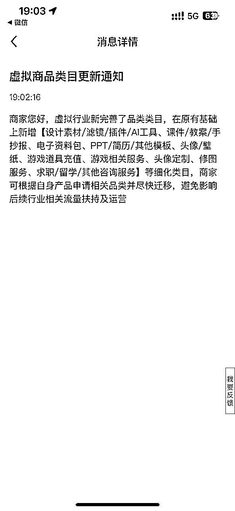
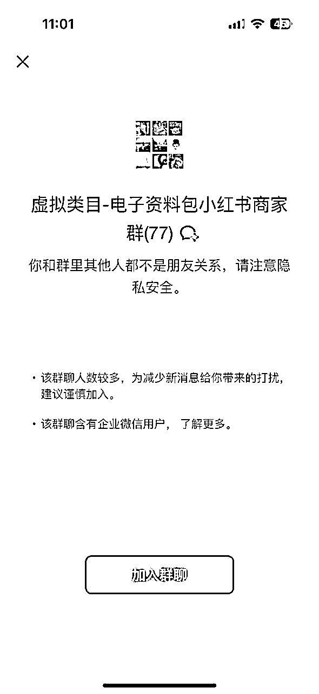
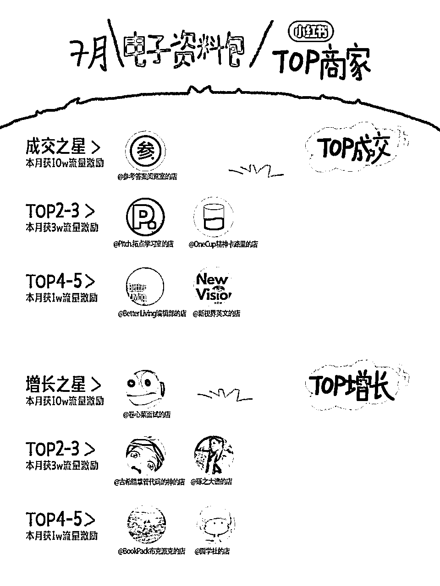

整体来看，我认为小红书虚拟产品是2025年普通人赚到“职场打工体系外”第一块钱的很好的机会。

案例很有说服力：本期教练叁斤自2024年起深耕小红书虚拟电商，以原创产品为主；今年5月转向提效模板，至今销量已破1000份。另有职场人用飞书做OKR和项目管理模板，定价49.9元，售出400多份。

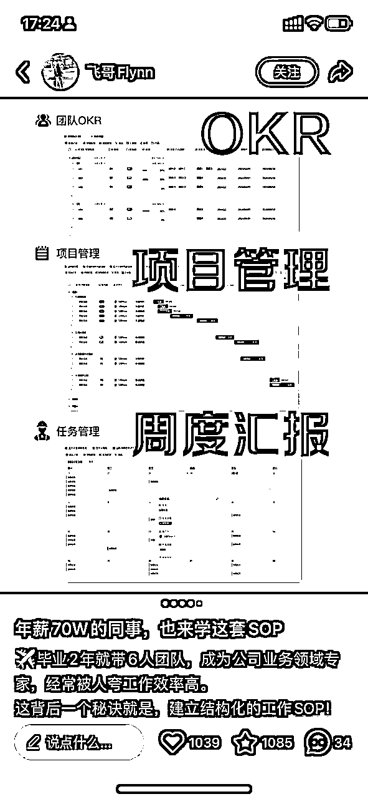
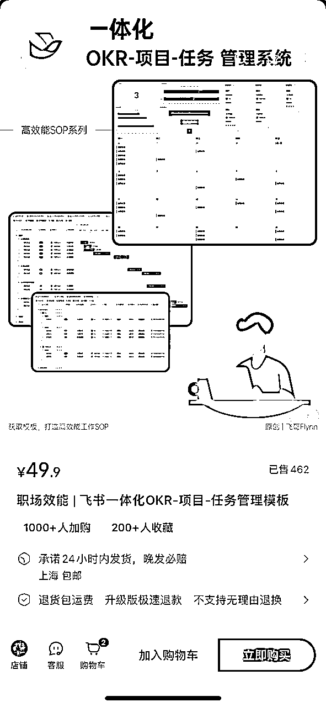

苹果日历的案例更轻：作者只是分享自己用苹果日历提升效率的做法，严格说不是模板，而是一套方法，售价60元，销量却达到1万单，全程依托苹果自带功能。PPT也有类似案例：一份职场汇报模板定价30元，卖出1万份。


小红书上类似提效模板类产品还有很多。


那提效模板是什么？在小红书虚拟电商里，它属于门槛偏低、产品形态清晰、价值一眼能看懂的方向。不需要专业背景；对Notion、PPT等软件较熟，擅长信息整理，或者有画画等爱好，都可能转化为可售卖虚拟产品。常见形态包括Notion/飞书模板、快捷指令记账、视频剪辑预设、调色参数包、素材包等，核心都是帮用户提效。

这个赛道最大的优势是：用户获得感强——“用了这个模板，效率会更高”。内容制作也简单，录屏或放效果图即可，适合新手起步并快速获得正反馈。和所有虚拟产品一样，提效模板一次创造就能无限次售卖，没有物流和仓储成本。想赚职场外一份收入，或做副业没方向时，提效模板是很合适的赛道。


项目优势可以概括为：门槛与风险相对低，小红书支持0元开店，投入时间和执行力就有机会出单；容易拿到结果，前期主要搞流量，后期结合自身优势开发专属虚拟产品，较轻松打造第二收入曲线，结果会奖励执行力强的人，运营技巧不复杂，肯执行、敢迭代就有好结果；边际成本为0，做一次可无限分发，完成后重点只剩发笔记，就能持续出单；平台红利期，平台2025年重点运营虚拟赛道，目前正是项目红利期。

项目风险也要提前知道：账号限流、不出单，容易怀疑自己选错赛道；新手不会写商销笔记，推销味太浓，小红书不给曝光；上架产品常提示被下架，磨心态。放心，这些问题航海期间会带大家重点攻克。


# 2. 项目完整操作思路

本次项目的核心流程是：先调研与定位，再敲定具体选品方向，随后设计制作模板（关键），搭建账号与店铺，完成定价上架，产出可视化笔记并发布（关键），最后做好交付与服务。具体可参考本期航线图：

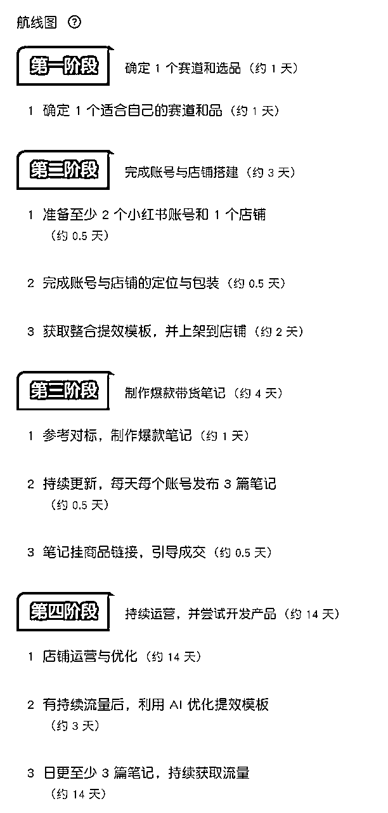

先根据自身优势与推荐方向，锁定1个赛道和1个选品。这期航海的目标是帮大家搭一个能长期做的副业，因此看热点、追趋势时，也要把兴趣放进来，它决定你能坚持多久。教练组讨论后认为，有3个大方向适合新手入门并长期深耕：Notion/GoodNotes/飞书模板、PPT/Keynote/Canva模板、视频剪辑预设与素材包。航海也会提供个人优势梳理方法，帮你选出更适合长期做的赛道。

先做获客笔记。新手容易一上来就备货，其实更稳的顺序是先用流量验证需求，再完善后端产品。虚拟产品也一样：选好赛道和对标对象后，先发笔记；标题、封面可参考优秀案例，从模仿起步，发布后依据体感和数据持续调整。

接着上架虚拟商品。若缺少相关资质，可选择艺术定制品类或电子资料包上架。这一步特别关键！！！

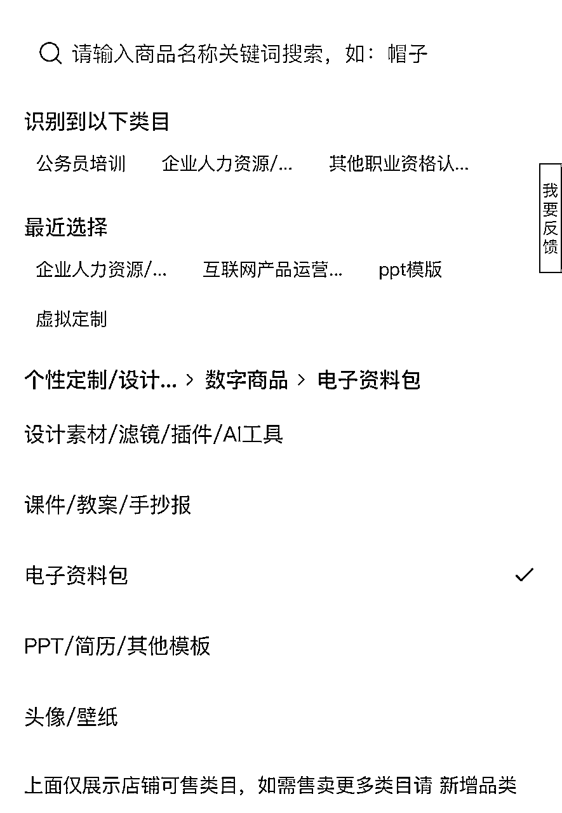
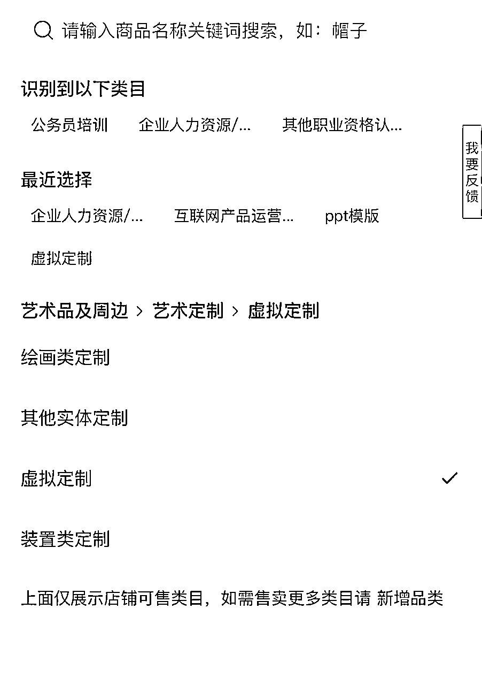

尝试用AI开发自己的产品。当大家都在卷盗版资料时，原创资料更好卖，市场空间也更大。长期看，我会鼓励大家掌握开发资料的能力；有了AI加持，开发难度会低很多。用AI开发产品，本质是和AI共创，遇到问题都可以用AI。想快速做一份自己的虚拟产品，可以制作各种垂直领域模板，比如飞书模板、快捷指令模板等。

划重点：虚拟产品听起来陌生，其实并不复杂。它可小可大：小到一份简历模板、一份考试经验总结，大到知识库、知识星球。多数人只需盯住“出单”这个结果，不要把准备过程想复杂。很多人一心追求全新产品，研发投入过重，一旦结果不好就很难接受。更实用的打法是【量大出奇迹】【干中学】【事上练】；先模仿，但不是抄袭，而是借鉴底层流量密码。做职场或简历模板，就研究同赛道高销量商家的笔记策略、标题封面和拍摄方式。自己拆解不动，可交给DeepSeek帮你分析。

比如产品已经做完，却卡在发笔记，担心没流量。此时要拆解笔记：封面图、标题、正文、评论区四部分。观察虚拟产品头部玩家怎么发，先粗仿，再创新。很多卖家把资料打印出来用手机拍，正文写得不多，因为图片已承载关键信息；这种方式新手可直接复制，也省精力。产品上线后要勤发，一天3篇，从不同角度讲产品，同时布局关键词。3月招聘旺季，做职场赛道就想想用户会搜什么词，把词嵌进笔记。记住，笔记本身就是解决方案。

总体看，小红书虚拟产品真正卡人的地方通常只有两个：产品，以及笔记。跨过这两道坎，就要想怎么放大成果。一个账号跑通后，应把打法迁移到其他账号，从0到1推进到1到10。

新手准备与避坑：加入航海后要重视过程，投入时间，把它当成自己的项目，而不是随便试试。执行时别只机械操作，要多思考；航海手册要多看，但看懂不等于会做，关键在【做中学】。暂时没出单别急，先在群里提问，把背景和问题交代清楚，再判断是优化笔记还是调整赛道，整体保持耐心。

# 3. 内容出品人

内容出品人：叁斤、更绪、稳稳


米杰、希平


总的来说，虚拟产品对普通人来说性价比很高，也适合长期主义。你可以想象：每天醒来，账号后台都有新增收入，本质上像给自己攒一份养老金。那失败了怎么办？很多人会这么问。我想说，当你真正投入心血加入这次航海，你就已经成功了。没出单不代表失败，勇敢踏出这一步，就已经成功。真正有价值的胜利，值得等待它的人。

1. 如何定位选赛道

# 1. 本章概要

选择往往比努力更关键；方向错了，付出容易打水漂。在优质赛道里深耕，多数情况下带来的效益远高于低质赛道。本期航海已经帮大家筛出一个大赛道方向，具体细分赛道可结合自身优势和兴趣选择。

选赛道主要看两个因素：外部因素看市场环境，它决定项目难度和收益天花板；内部因素看兴趣与优势，它影响你能否在这个赛道长期深耕。

⚠️长期来看，肯定鼓励大家选择自己原创的虚拟资料，所以选赛道时也可以想想：这个赛道的资料，我后续有没有能力原创？赛道既意味着起跑线，也意味着天花板。

# 本章航线图

学完并完成本章实操，航线图第一阶段就完成了：确定1个赛道和选品（约1天），也就是锁定1个适合自己的赛道与产品（约1天）。

# 2. 定位选赛道

只有跟自己匹配的赛道，才更容易做得顺。很多博主表达力不弱，却没认真分析优势，直接进入陌生领域，最后草草收尾。欲速则不达，做小红书虚拟产品之前，先盘资源、找定位。

为什么这一步重要？不盘优势，选题很快就会枯竭。比如一位资深HR跑去美妆赛道，而HR才是他的专业区：过往经验多，表达更自如，选题不断，起号只是把经历迁移到小红书。这类经验真实、独特、专业，更容易被算法和粉丝识别；再配套开发虚拟产品与服务，商业闭环就形成了，个人也从打工人向生意人转变。

怎么盘？先问自己：有没有完成过某件事，过程中经历挫折和失败，最终战胜自己，而且你有强烈表达欲，这个经验还能利他？这往往是隐藏的内容金矿；不主动回想，很难意识到自己有这段经历。关键在【经验是否利他】。若整理出的内容太小众，既难共鸣，也会打击信心。要找到真实市场与优势的交集，把知识残片变成他人的刚需。

如果还没头绪，问自己三个问题：你拿到过什么大结果，能否总结方法？你在哪个领域比多数人更有经验，比如做计划、做PPT、P图？你有哪些强基础技能，如飞书多维表格、Notion模板搭建、视频剪辑、AI、PS、PPT、手绘、Procreate做饭等？

比如你擅长飞书多维表格，就可以按用户场景做不同的【飞书解决方案】。春招季，有博主用飞书多维表格做春招进度表模板，卖出3000多份。若仍没思路，可对照上面3问；想更快跑通0到1，也可看下一节，教练结合市场热度和操作难度推荐了5个提效模板赛道，任选其一实操。

1. 提效模板赛道&选品推荐

教练组讨论后，给出以下几个适合入门、也值得长期做的方向：Notion模板，面向大学生和职场人，可做年计划、月计划、待办日历等；日程提效模板，面向学生和职场人，可做快捷指令、时间管理系统等；调色预设，面向Vlog博主，可做电影感Luts、可爱风转场、ins风英文字体包等；快捷指令，面向苹果手机用户，可做记账、翻译、采集笔记、收藏文章等；电子手帐模板，面向学生、手帐和旅行爱好者，可做精美手帐、旅行笔记等。先研究下方各赛道对标账号的店铺和内容形式，再结合优势与兴趣，选1个细分方向作为航海项目。

# 赛道 1：Notion 年/月/季 计划模板

年计划模板、打卡模板、工作计划表：

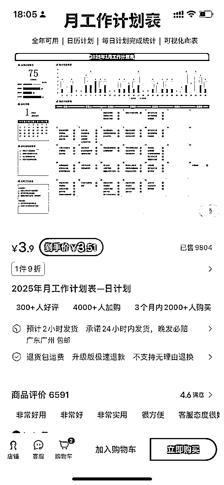

赛道说明：适用人群覆盖多数职场人和大学生。这个方向的价值在于“获得感”很强，用户买下后容易觉得满足，像买到一本合心意的书；实际用起来也真能梳理个人生活，通常很少出现售后和差评。可售内容包括把日计划、月计划、年计划、年中复盘、打卡计划等搬进飞书或Notion表格，形态接近知识库，但比知识库轻。

赛道特点：定价空间很宽，从低到高都有销量，说明用户认可度不低，每个价位都有自己的受众，值得测试；上手不难，每套模板都带个人风格，二次创作空间大，把几款热卖产品的亮点拼合，去掉多余功能，就能形成自己的版本。

售卖周期：多数产品全年都能卖。每年11月前后是年计划需求高峰，用户开始规划来年；此时可主推年终复盘、来年计划、目标管理等模板。


# 赛道 2：日程提效模板/系统

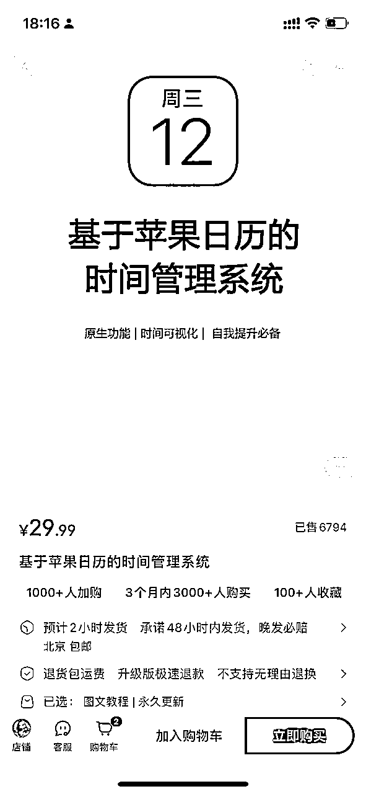
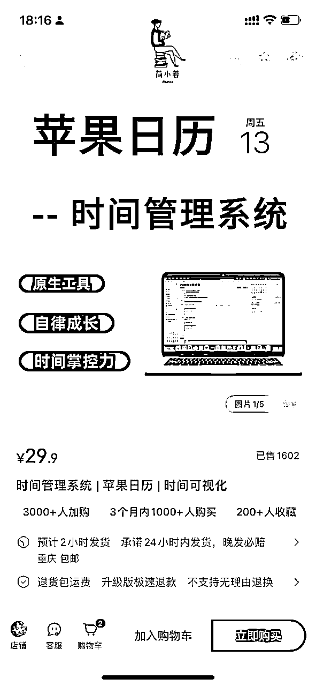
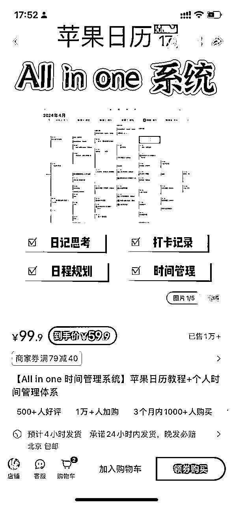

赛道说明：主要面向职场人和大学生，其中苹果系统用户更匹配。日常做日程和时间管理，往往要装很多App；而苹果自带系统可以少下载工具，按个人习惯设好流程和分类，就能较轻便地完成日程管理与日复盘。可售内容是基于日历做的时间管理、日程管理系统，重点在苹果日历；Windows和安卓用户可略过，因为苹果用户更常用苹果生态产品，原生日历足够简洁，不必额外装工具；安卓和Windows用户情况较杂，这套方案适配度不高。

赛道特点：付费意愿高，从案例看，同类产品在多个价位都有不错销量，说明需求是真实存在的；苹果设备用户整体消费力较强，也愿意为效率付费。原创空间大，它更像一套方法课，而非模板文件，核心是教人用日历做时间管理、日程规划，并更高效地使用日历。因此很适合原创；多研究苹果手机使用技巧，也能做出自己的版本。

需求周期：自律、成长、日程管理类产品全年可卖；每年1到3月进入新周期，很多人想重新自律，会有一波小高峰。

# 赛道 3：调色预设

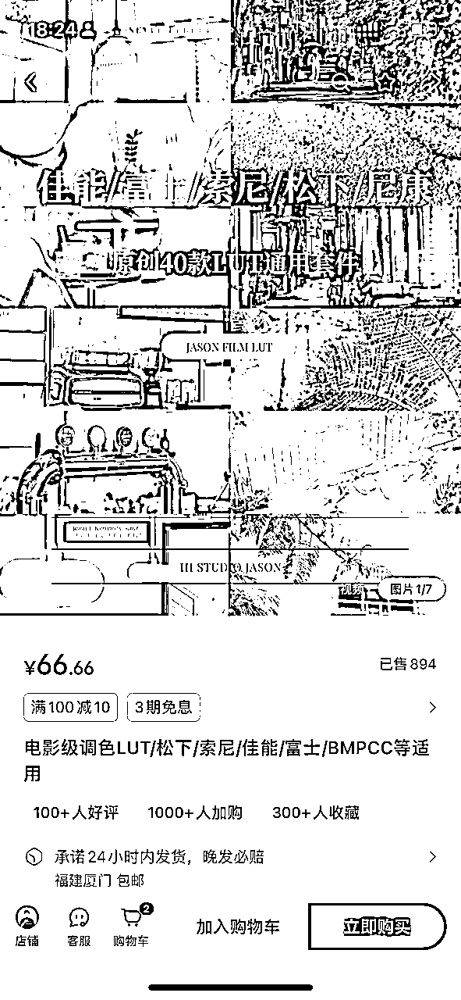

赛道说明：主要面向绘画、摄影、视频剪辑等小众兴趣人群。产品本质是现成参数包，买后直接套用，就能复刻相近色调或视频效果，省去反复调校，剪辑和调色效率明显提升。可售内容涵盖相机内置预设、Lightroom调色、视频调色等；把自用效果好的参数导出，就能成为商品。

赛道特点：定价空间宽，不同价位、不同产品都有销量，说明需求稳定；单套预设和合集都能卖。版权压力较小：这类产品多数不申请版权，且常做成大合集；即便涉及版权，在原参数上做调整，整体差异不大，通常问题不大。

销售节奏：全年可卖，兴趣圈层不同，需求也不同；每年9到11月秋季旅游旺季，摄影需求上涨，会带动调色和剪辑预设销量。

# 赛道 4：快捷指令

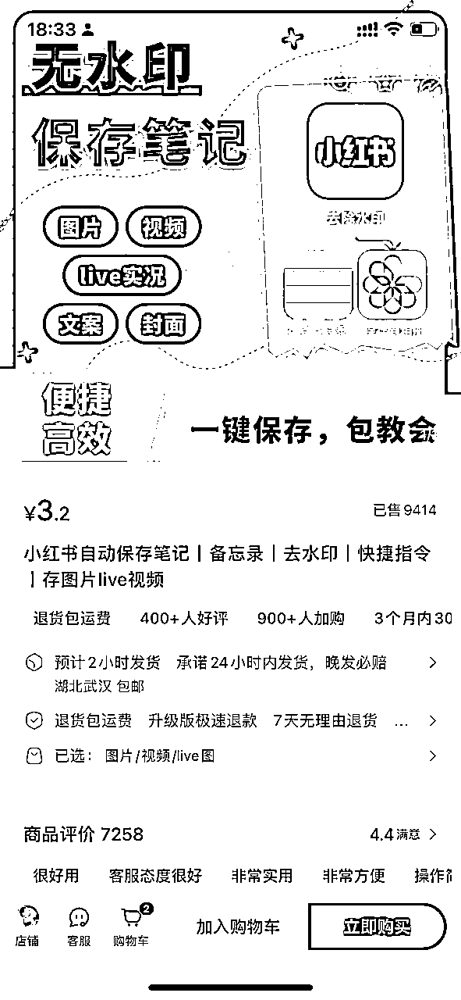

赛道说明：主要服务苹果设备用户。苹果快捷指令能覆盖不少场景：记账、翻译、把文章或对标笔记采集到飞书等；可延展空间很大。

# 两个不靠季节吃饭的虚拟品

先看快捷指令。它表面只是手机里的一个小入口，实际能长出不少可卖的产品。自动记账类快捷指令这两年在市场上热度不减，同类单品销量普遍不差，说明需求真实存在。再往旁边延伸，翻译、截图取字、保存小红书笔记、下载抖音视频，也都能通过快捷指令完成。

**这个方向的特点：**

**可做的空间大：** 底层逻辑跟编程有些相似，但上手门槛低得多。以自动记账为例，用 AI 就能从零搭建出来。

**付费意愿高：** 苹果设备用户对工具类产品的付费意愿整体偏高。单看自动记账这一个品类，小红书里跑出高销量的店铺就不少，很多人刷到就愿意下单。

**适合入手的时段：** 没有明显淡季，一年四季都能卖。


# 赛道 5：电子手账，盯住小而准的人群

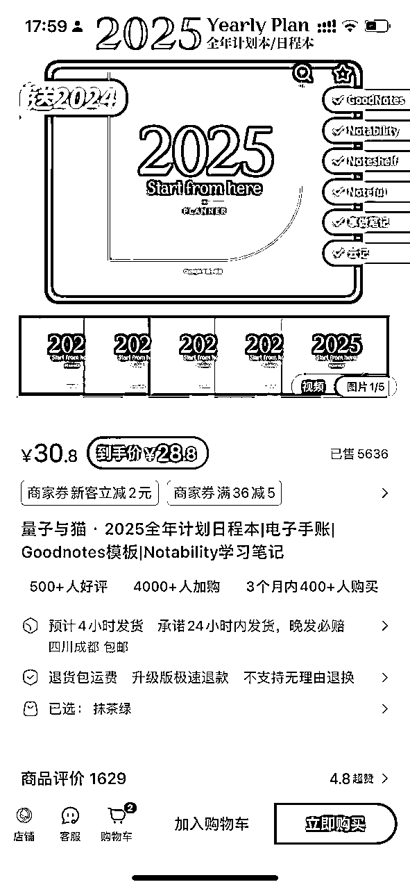

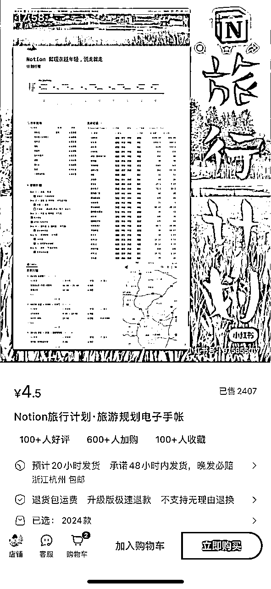

**赛道说明：**

目标人群主要是学生、手帐玩家、旅行爱好者等。

它的价值在于：市面上常见的手帐模板偏大众化，而这类产品围绕某一类小众用户的偏好来设计，受众更集中。

资料形态可以是 Goodnotes 模板，也可以是飞书、Notion 模板，甚至做成 PDF 打印手册。

**这个方向的特点：**

**小众需求：** 圈子越聚焦，转化效率往往越高。

**用户精准：** 吸引来的人对某个场景有硬需求。比如旅游手册，来的多是旅行爱好者，私域还能继续承接旅行类产品，一份流量多次变现。

**适合入手的时段：** 全年都能卖。

旅行手册在 9～11 月会有一波小高峰。

全年计划日程模板则在 11～12 月进入旺季，眼下正是铺内容、做产品的好时机。

1. 账号和店铺，先把基础搭好

# 1. 本章要点

这一章两个核心动作：

**搭建账号。** 以前是把流量往私域引、跟平台规则躲猫猫；现在在小红书开店卖虚拟产品，本身就是平台电商生态的一环，玩法合规，不用再操心违规问题。所以，“一卡一机一号”、非得用流量不能连 WiFi、养号之类的顾虑，都可以放一边，怎么顺手怎么来。

**制作提效模板。** 这类产品版权门槛不高，新手起步阶段可以先做二创，操作不难；后续再做原创也没多大难度，只要对 Notion、PPT 等工具有基本熟练度，或者擅长信息梳理，就能把技能转化为可售卖的虚拟商品。

# 这一章的推进路线

学完并实操本章，即可完成路线图中的：

第一阶段：完成账号与店铺搭建（约 3 天）

准备至少 2 个小红书账号和 1 个店铺（约 0.5 天）

完成账号与店铺的定位与包装（约 0.5 天）

获取整合提效模板，并上架到店铺（约 2 天）


# 2. 设备准备

✔️ 手机准备：只要设备没有被小红书永久封号、永久限流这两类严重违规，都能用，小违规不影响。

✔️ 电话卡准备：用自己没有注册过小红书的手机卡；有老号也能直接用，做过类似无货源等项目的号同样可以直接用。只要没有永久封号、永久限流这两类严重违规，都可以直接用。

推荐在淘宝/京东搜索电信无忧卡，5 元月租即可办一张；或者去营业厅给已有卡办副卡，一般月租 10 元。

✔️ 账号准备：一卡一机一号，有最好，没有也无所谓。一台设备同时登 2 个号问题不大，不需要纠结连 WiFi 还是用流量，怎么方便怎么来。

# 2.1 手机：别被设备数量吓住

个人做的话，设备可能不多，十台以内；做到工作室矩阵级别，设备数量会在 10 台以上，甚至上百台。这里给一些工作室常用设备推荐。

苹果设备推荐机型：

iPhone 7：工作室钉子户，性价比高，流程速度快。

iPhone 8：游戏和短视频场景居多，功耗低、运行速度快。

iPhone SE2：存在感不强，直播、电商、短视频都 OK。

iPhone X：直播电商、短视频养号都能用，预算充足可上。

安卓设备推荐机型：

红米 10X：中规中矩。

小米 10 青春 8+128G：性能好。

小米 8 青春、小米 8SE：多人用。

安卓设备还有很多，这里不一一列举。

原则上：

能买二手就别买全新，当然现在很多国全新设备“便靓正”。

能买原装就别买组装，注意辨别：无指纹、无面容通常是拆机。

尽量不要去闲鱼。

能买国行就别买外版。

买配置别买外观。

买品牌不买杂牌。

具体机型优先考虑 8+128GB。

年限上，安卓机 4 年内、苹果机 6 年内。

建议准备 2 台或以上手机，机器越多，成功概率越高。同时去营业厅办理三张及以上手机卡，月租选最便宜的，但需要有流量，流量最好 20G 以上。可以用 1 张主卡绑定 2 张副卡的模式办理，直接和营业厅工作人员说，她就会推荐合适的卡。

# 2.2 电话卡：能注册、没大违规就能用

办卡渠道一：当地营业厅直接办理。

办卡渠道二：支付宝搜“号卡中心”可直接办理。

办卡渠道三：淘宝/京东搜“电信无忧卡”，月租仅需 5 元。


1. 开店：先把个人店跑通

# 3.1 店铺分三类

① 个人店

一张身份证加一个已实名的小红书号就够，其他材料不用准备，申请后很快就能审核通过。

② 个体店

个体店需要一张个体户营业执照。如果要办，最好办百货店的，闲鱼/淘宝代办目前大概 100 元左右一张。

③ 企业店

企业店是用公司营业执照去申请。相比个体店，它没有太大额外用处，反而会涉及税务等事项，比较麻烦，可以直接忽略。

应该选哪种店铺？

新手小白什么都不用想，直接申请个人店铺即可。

如果已有一定经验，建议先用个体工商户认证蓝 V（需要花 600 块），再去开店铺（个体店），这样后期想做矩阵号时可以直接绑定。

# 3.2 几个关键提醒

新手小白直接开个人店，什么都不用考虑。

想做矩阵的老手，去办一张个体户营业执照，然后认证蓝 V（花费 600 块），再去开个体店。营业执照经营范围包含下图红线部分即可，其他随意。

开店地址：这个链接可直达小红书千帆，打开后手机号登录，选择个人入驻即可：

https://ark.xiaohongshu.com/?ticket=ST-68c517438149514474558399hfl9opty5x6viycd&from=ark-login

保证金建议：保证金是 1000 元，但可以先不交，可以等赚到 1000 之后再交，确保自己不亏钱。不交的情况下不能提现，但可以等提现时再交保证金。

# 3.3 开店实操

打开小红书官方电商链接：

https://ark.xiaohongshu.com/?ticket=ST-68c517438149514474558399hfl9opty5x6viycd&from=ark-login


选择个人身份/个体工商户入驻。

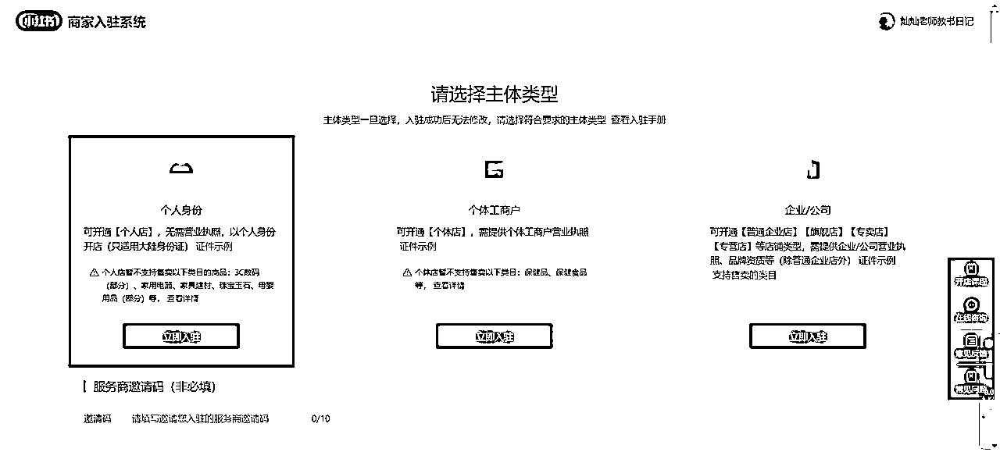

填写相关资料（填必填项即可）并刷脸。昵称会自动匹配小红书昵称，如需修改，把小红书账号名改掉即可；或者入驻后去个人信息里修改，这个不重要。

主营类目填写默认的【零售批发、生活娱乐、其他】即可。用这个类目，是因为虚拟资料类目需要上传资质。

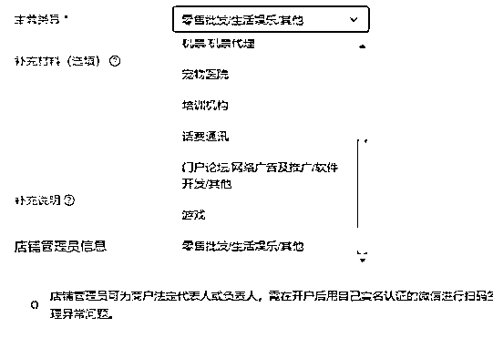

填写【地址设置】、【店铺信息认证】。物流模板里的地址可以随便写，写什么都无所谓；不放心可以写自己家，但写模糊一点。到时候主页只会显示，不会有详细地址。

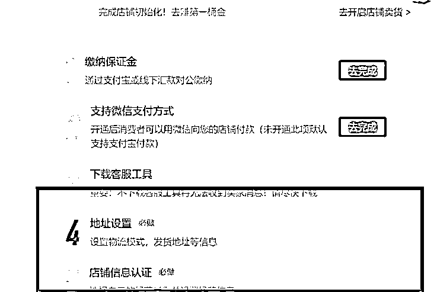

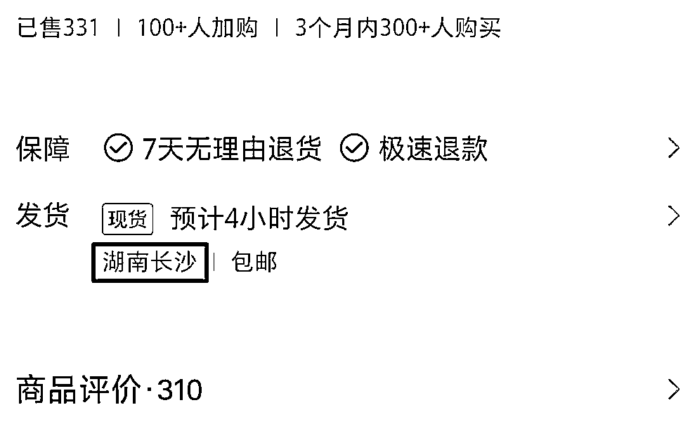

经营类型勾选类型 3 或类型 4 都可以，任选其一。

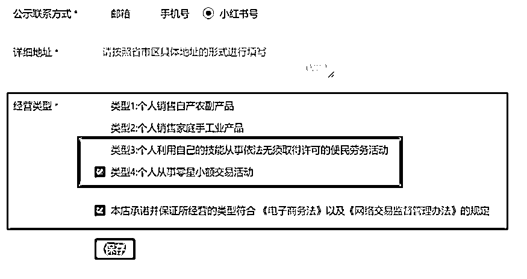

商品类目选择电子资料包。


最后填写完成，页面会显示审核中，一般一分钟就会审核完成，刷新后就能进去了。

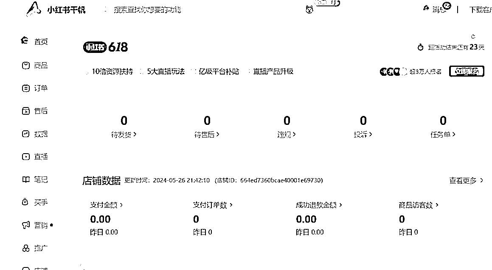

1. 做虚拟产品：从提效模板切入

关于提效模板的制作，新手建议先拿别人的模板快速修改，先上架一个粗糙产品。

这类产品的版权壁垒偏弱，尤其是日程提效、计划模板和快捷指令等，前期都可以二创。

如果想长期做，还是要建立 IP、做原创；当然，如果只是把它当作快速跑通 0-1 的练手项目，就先不用管 IP。

二创流程如下：

# 第一步：先买爆款，拆出能复制的优点

比如日程提效模板/系统，把市面上销量高的那几个都买下来。

这类产品一般以课程形式交付，比如「ALL IN ONE 日历系统」，就是用视频加图文教学的方式交付。

它的优点可以保存下来，变成我们也能参考的做法。

这里说的“优点”，是指用户容易看懂、同时我们也能轻易复制的方法。

比如，这个产品是自己搭建网页来做交付，但点开里面，就是图文和视频排版的教程。

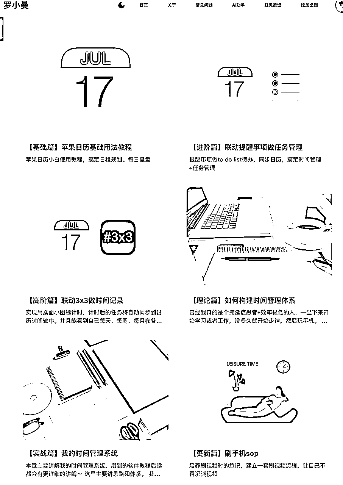

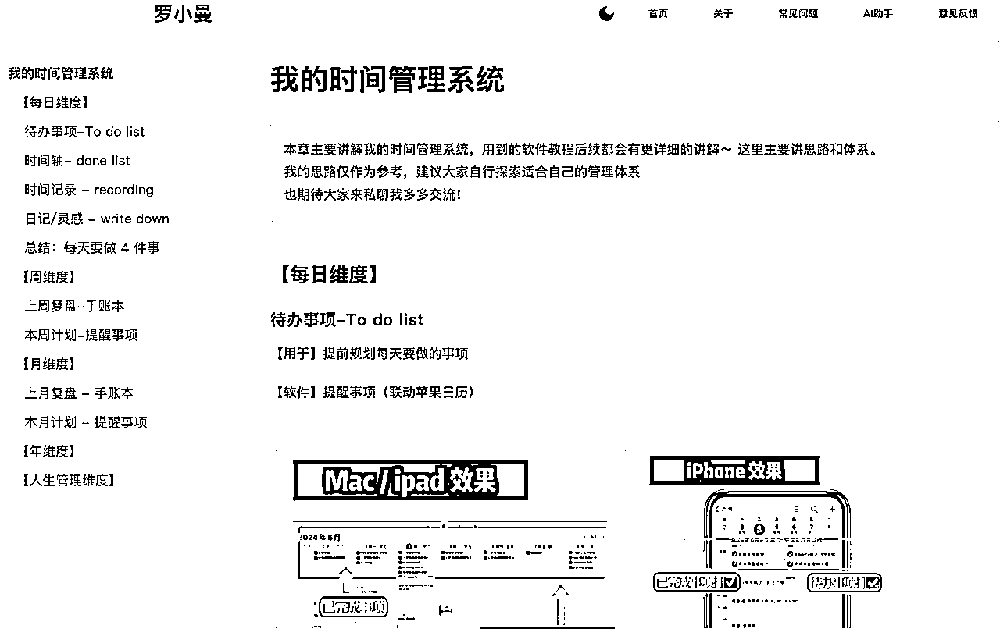

而这个教程，我们用飞书也能实现：

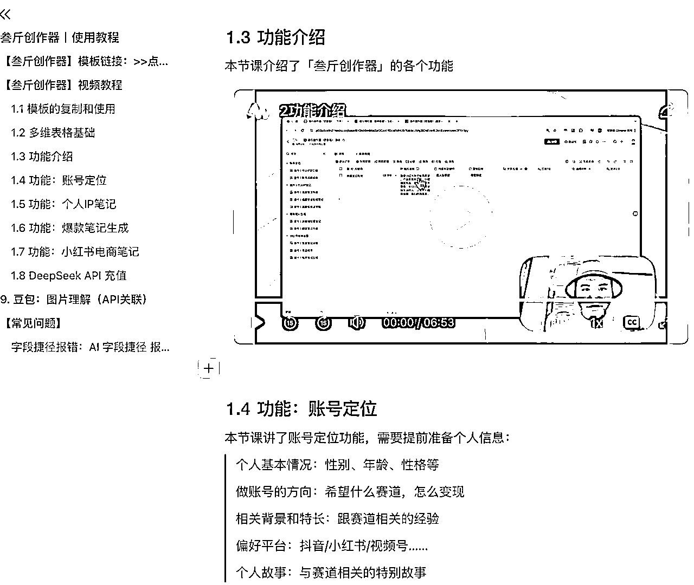

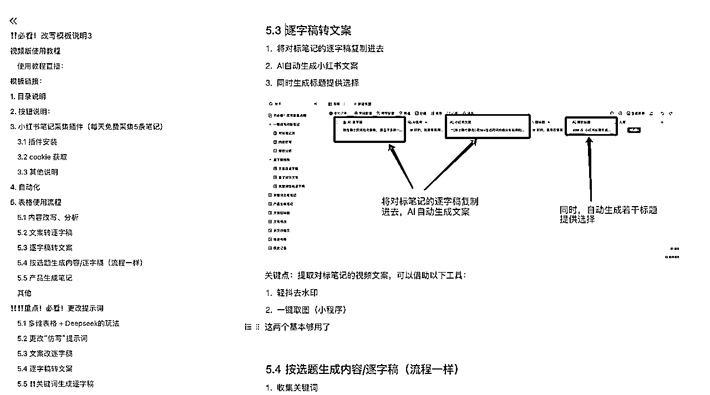

到这一步，多买几个人的模板。如果买了盗版，比如已经买了 A 的，买 B 的模板发现跟 A 一模一样，这时果断退款。一定要买不同人的原创产品，不然浪费钱。

# 第二步：把多份优点合成自己的模板

把每个人产品的优点全部记录下来，再把多个人的优点综合成自己的。

比如日程提效模板，你发现 A 的日程提效系统没有用上 AI 或快捷指令，而 B 用上了，那就可以在 A 的基础上，增加 B 的 AI 或快捷指令。

重点说下：飞书多维表格模板。

提效模板里，「飞书多维表格」是非常常用的模板。我用这个功能做了个「叁斤创作器」，用一个表格完成小红书从账号定位到笔记生成的全流程。

这个产品定价 49.9，一个月卖了几百份。

今天，用一个地产行业的朋友圈文案模板，详细拆解这种模板应该怎么制作：

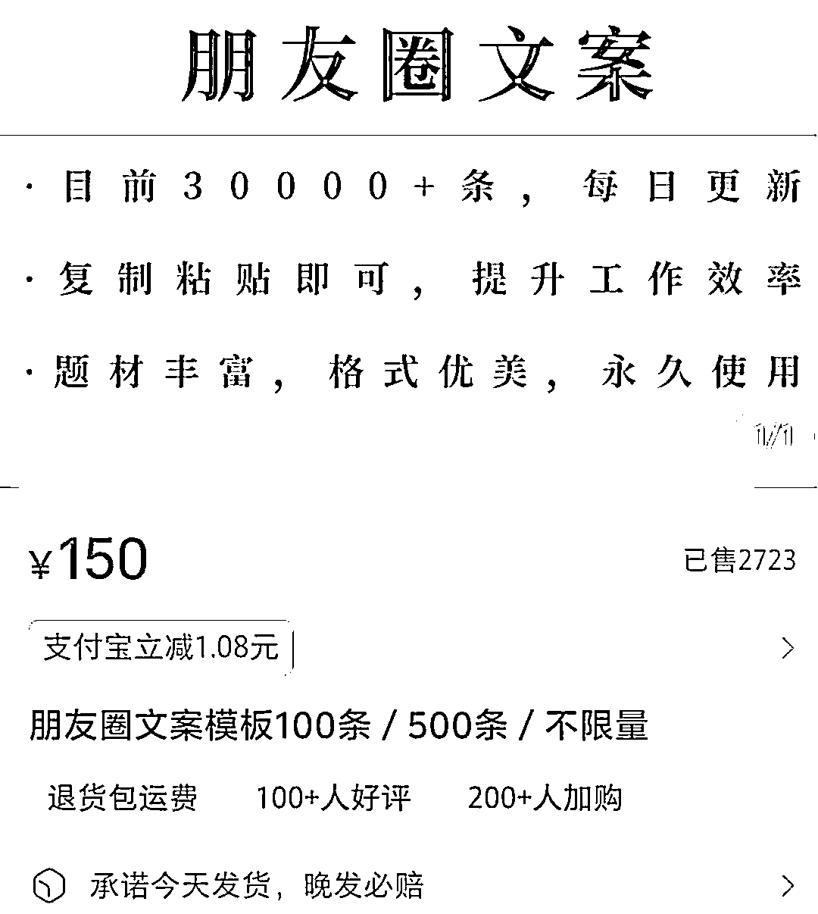

这个产品只卖朋友圈文案模板，150/年，卖了 2700 份，粗略算下来有 40W+。

100 条朋友圈文案模板卖 10 块钱，即使按最低 SKU、不升高客单，也卖了近 3 万块钱。

然后我们尝试用 AI 把这个产品做出来，跟着实操，10 分钟就能做好。

先看看成品：对标的只是固定朋友圈模板，而我们的产品能根据用户每一个产品情况，生成不一样的文案。

也就是对标产品的升级版：「地产文案生成器」。用户输入信息后，等文案模板生成完成，复制就能用。

有这个表格，别说 3 万个朋友圈文案，10 万个也没问题。

而且我测试了一下，发出去的视觉效果还不错：

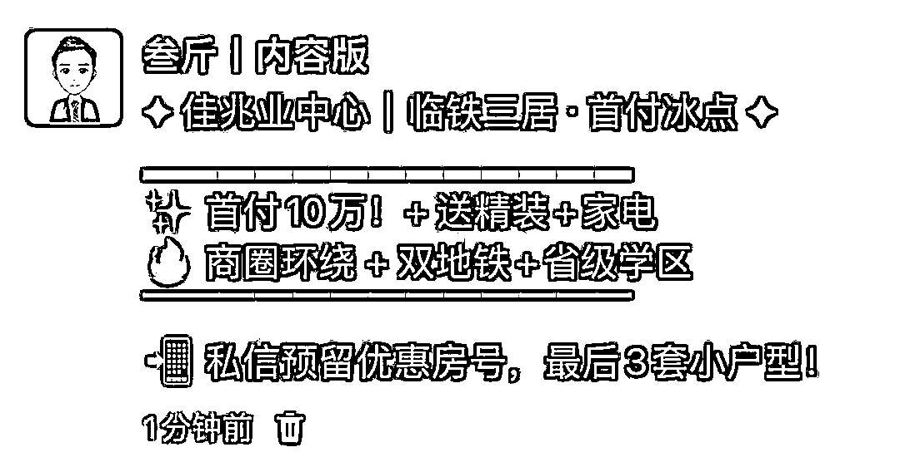

还可以随时开拓美业、微商、银行等不同行业的朋友圈文案模板。开拓新模板，掌握这套方法后，开发难度为 0，只需要更改提示词。

我们模板用的是飞书多维表格 + DeepSeek，具体流程如下：

1. 网页打开飞书，新建「多维表格」。

2. 把新建表格中默认的列表删除掉。

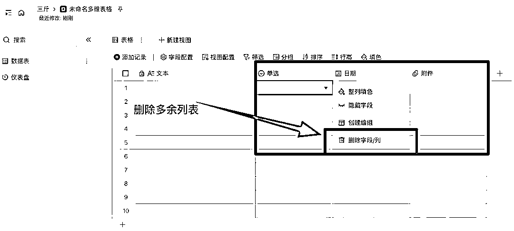

3. 点击 + 号，新增列表。

4. 新增「字段类型」，并且搜索，选择「DeepSeek R1」。

关于 DS 部分，有 V3、R1 和 R1 联网。我测试了一下，生成效果差距不大，直接用 V3 也可以，我习惯用 R1。

5. 绑定 DeepSeek 大模型账号。

这里最好绑定一下 API。不绑定的话，可能用几次就不能用了。绑定后可以按照消耗情况充值，费用很低。

自己去「火山引擎」新增 DeepSeek 的 API，获取【接入点名称/ID、API Key】后，回来绑定即可。

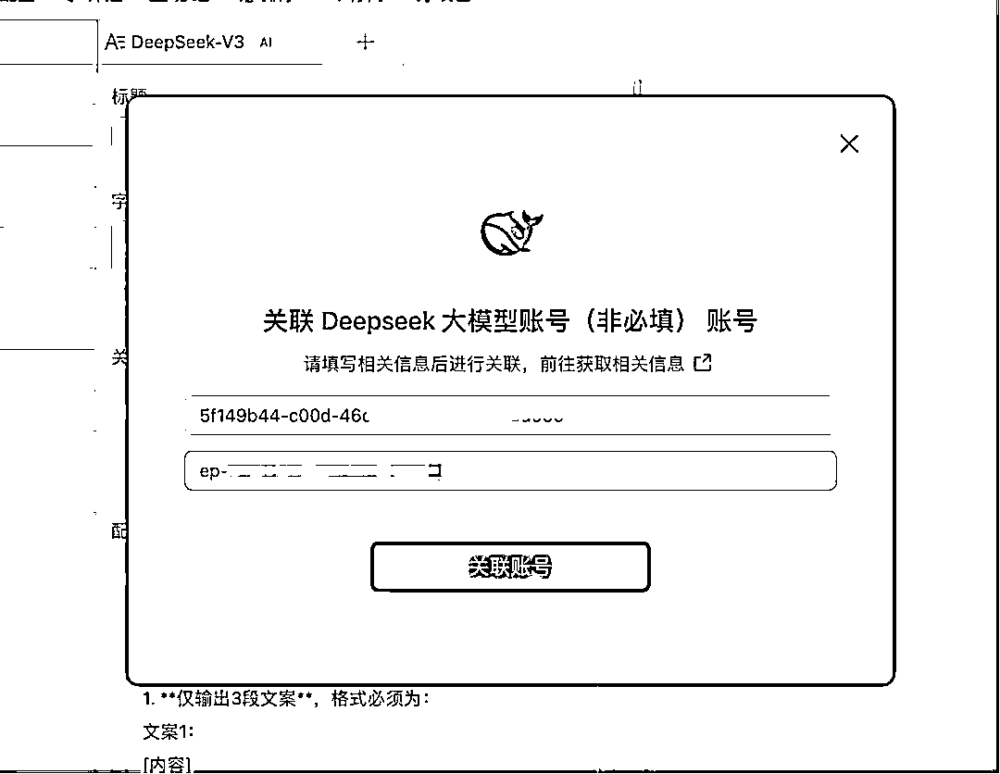

火山引擎操作如下：

地址：https://www.volcengine.com/activity/enterprise

完成实名认证。

进入火山方舟控制台：

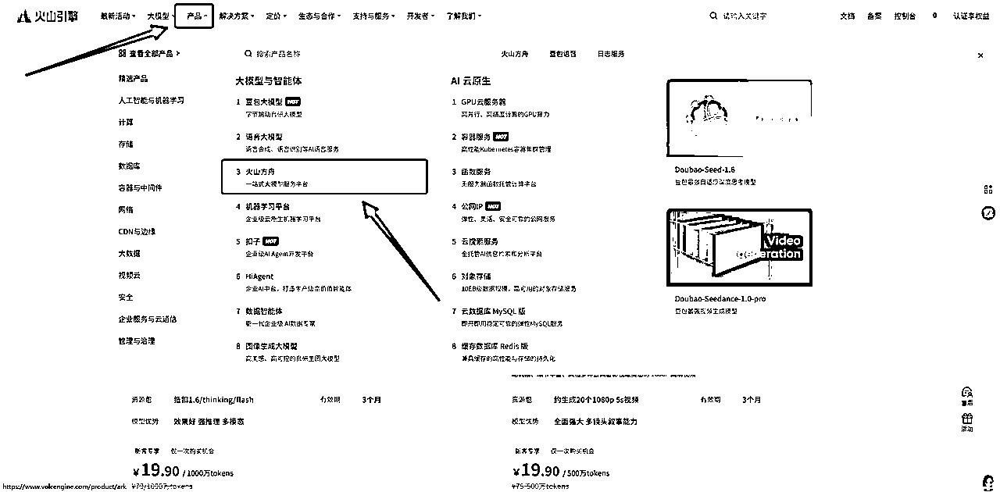

在模型广场搜索框输入“DeepSeek”：

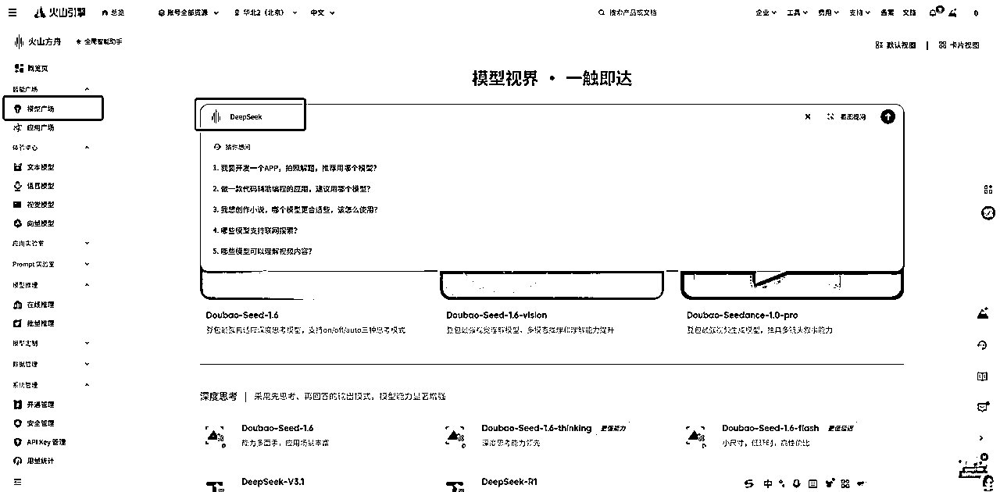

选择 R1 模型：

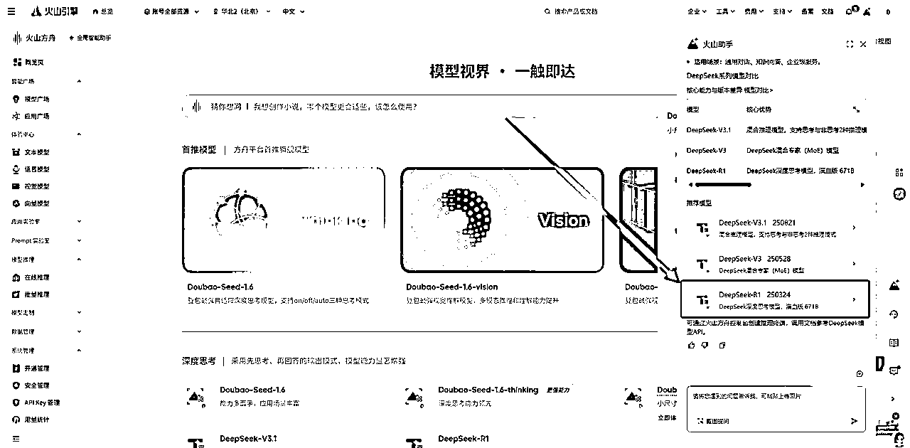

在线推理 - 自定义推理接入点 - 创建推理接入点。

选择 R1 模型 - 创建并接入：

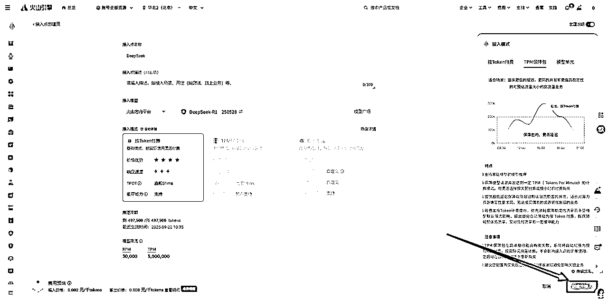

复制接入点名称/ID：

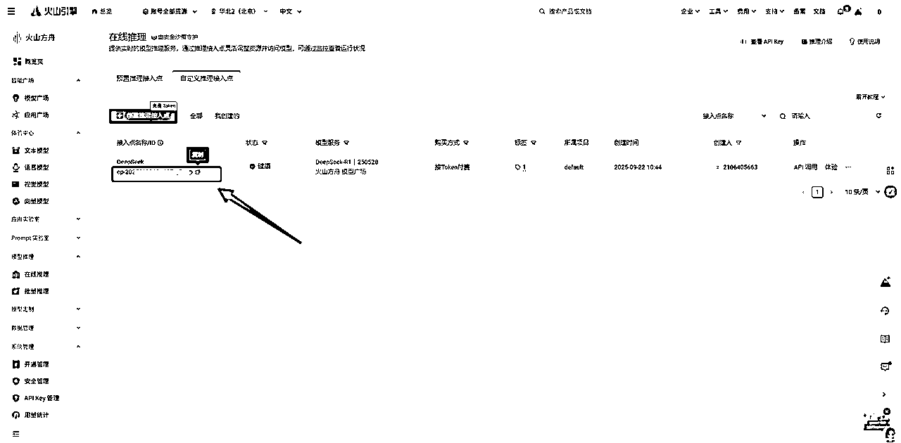

复制 API Key：

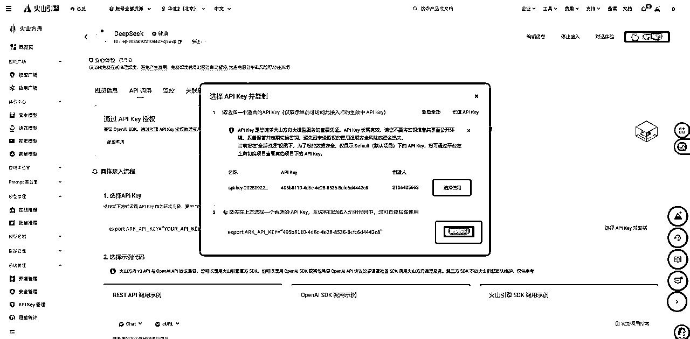

拿到【接入点名称/ID、API Key】后，即可回到 DeepSeek 绑定。

6. 绑定后，在「输入指令」处粘贴这一串提示词：

```
你是一个朋友圈排版专家，根据用户输入的房产信息，生成 3 种固定排版风格的朋友圈文案。规则：
1\.  仅输出 3 段文案 ，格式必须为：
文案 1：
[内容]
文案 2：
[内容]
文案 3：
[内容]
2\.  所有文案需严格使用以下风格模板：
━━━━━━━━━━━━━━━━━━━━
文案 1：符号分隔型 
[装饰符号] 项目名称｜核心卖点 [装饰符号]
▂▂▂▂▂▂▂▂▂▂▂▂▂
✨ 首付[金额]！+ [利益点 1]
🔥 [利益点 2] + [利益点 3]
▔▔▔▔▔▔▔▔▔▔▔▔▔
[行动号召] + [紧迫感提示]
文案 2：客户证言型 
「[真实感客户评价]」
——[客户称呼] @项目名称 🌟
▂▂▂ [面积]首付[金额]真相 ▂▂▂
✅ [生活场景 1] ✅ [生活场景 2]
💡 [情感化结论]
⏰ [限时福利]
文案 3：悬念提问型 
?? [吸引眼球的问题]？
▸ [选项 1]
▸ [选项 2]
───────────────
🌇 [悬疑答案提示] 👇
📱 [互动指令] + [符号]
━━━━━━━━━━━━━━━━━━━━
3\.  用户输入 ：
4\.  必须使用 Unicode 装饰符号（如▂▂▂/✨/🔥/▸）
```

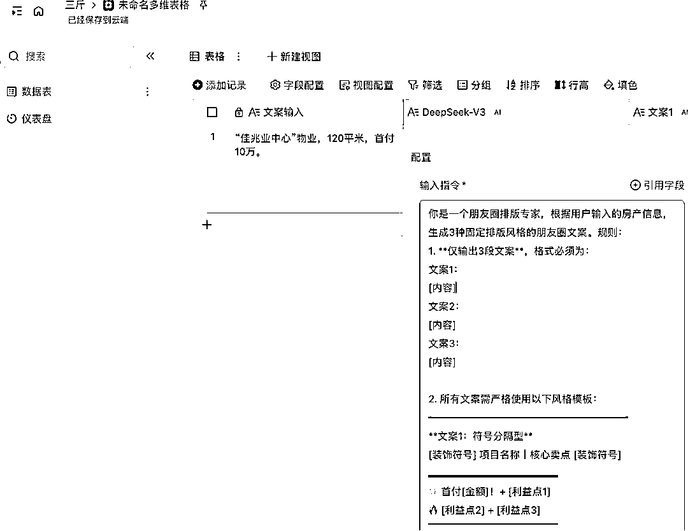

这个提示词可以根据不同行业、不同模板自行调整。

7. 生成文案。

只要在第一列输入信息，AI 就能自动写好 3 条不同风格的朋友圈文案。

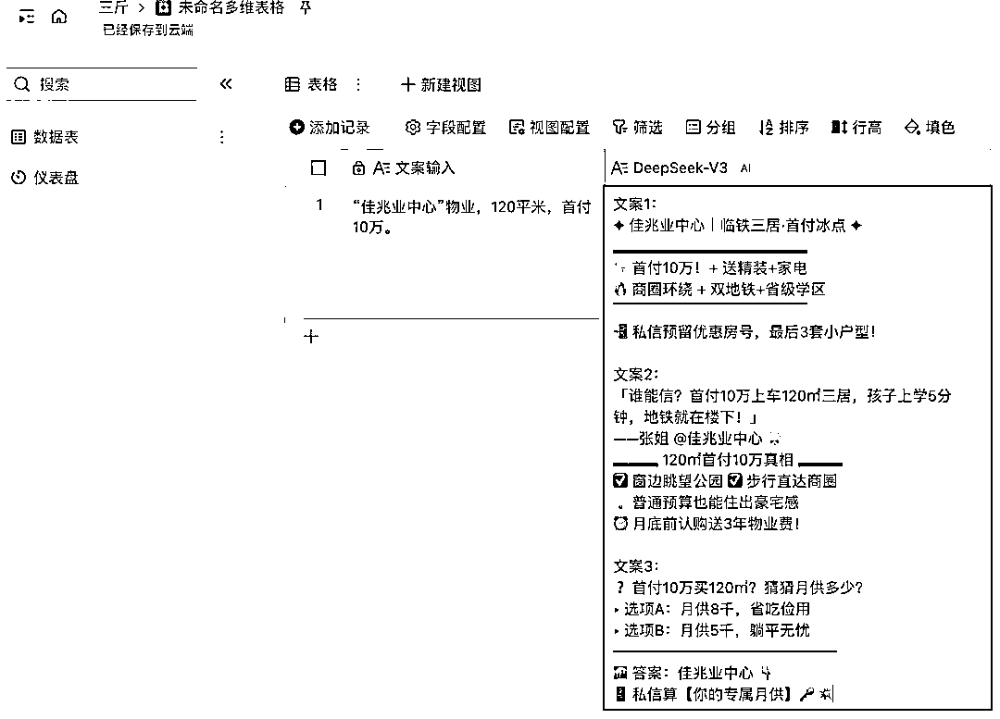

8. 新增「信息提取」字段。

AI 生成朋友圈文案后，再新增一列「信息提取」字段。

9. AI 自动分类文案。

系统会自动把 3 条文案分离，用户觉得哪条写得好，复制去发布即可。

以上，整个表格搭建完成。需要更多文案模板，只需要在提示词上调整修改。

要开拓其他行业的朋友圈文案，也可以直接在提示词上修改。

1. 商品上架：类目和定价别弄错

# 1. 上架步骤：按系统提示走

在小红书千帆官网主页找到【商品管理】：

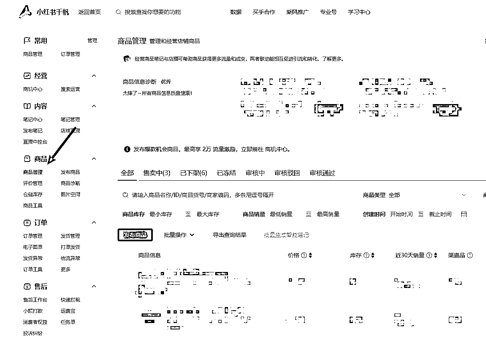

注意类目选择【个性定制/设计服务/DIY > 数字商品 > 电子资料包】即可：


然后根据提示完善需要上传的商品资料即可。如果有其他提示，就按系统提示修改，一般没什么大问题。


# 2. 定价：锚定 19、29、39

定价可以参考小红书对标或淘宝对标，整体价格尽量锚定在 19、29、39。

如果参考小红书对标，对标什么价格，你就定什么价格。

如果是参考淘宝对标选品，相同商品在小红书的定价最好在淘宝的 2-5 倍。做小红书就是为了卖高客单，不要担心定价比同行高就卖不出去。小红书本质上是兴趣电商，不是货架电商。

1. 设置自动发货：出单后再折腾也不迟

注意事项：

前提细节：

阿奇索前期有七天免费使用，先用免费的七天。

一般是出单之后再搞阿奇索自动发货，没出单的话可以先不用搞。

自己电脑如果没法长期开机，可以挂服务器上，或者买短信提醒。

下面是小红书阿奇索自动发货设置，按图片顺序操作：

点击进入服务市场：

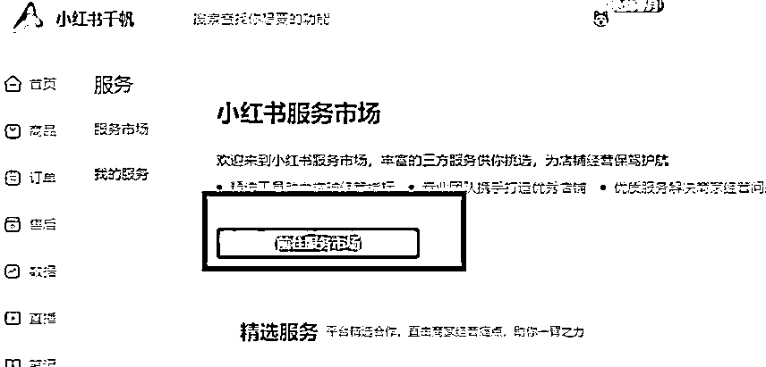

搜索自动发货，找到阿奇索：

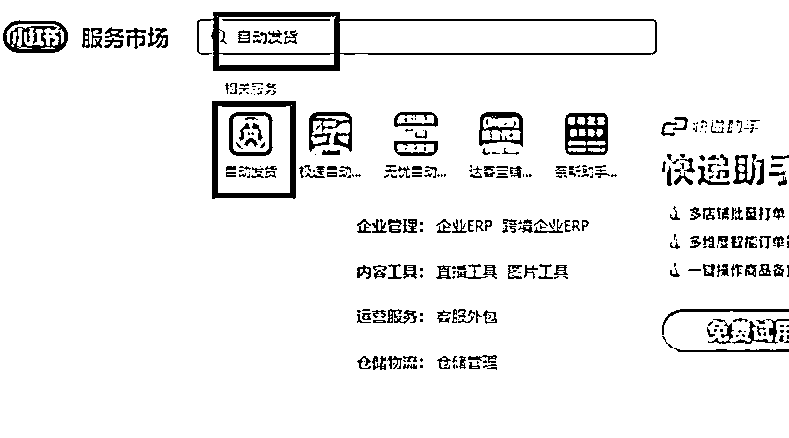

需要绑定一下这个平台：

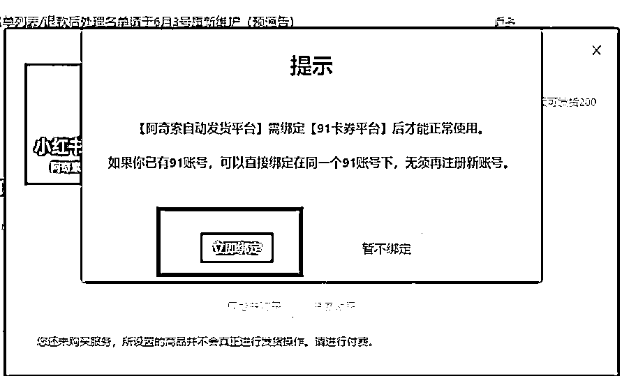

随便注册一下。

如果不是时常有电脑挂着，就记得回来登一下。

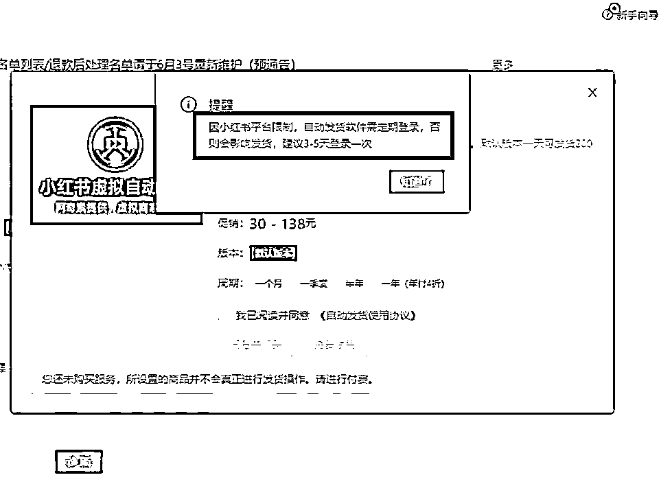

先用免费试用的 7 天。

需要下载 App：

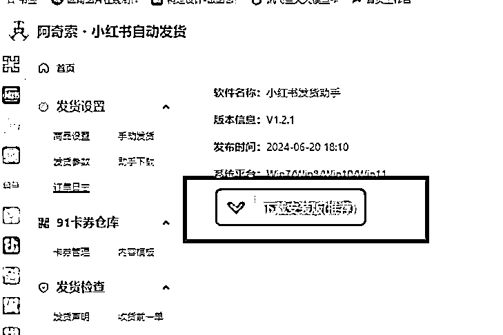

登录需要账号密码，需要在千帆店铺设置一下：

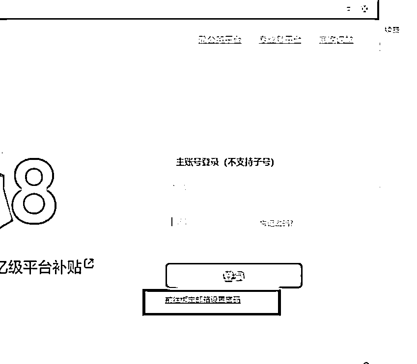

找到自动发货，点击商品设置：

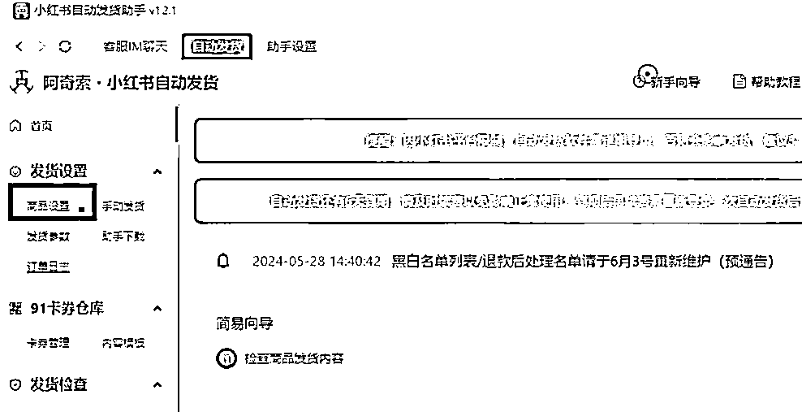

点击添加。

# 小红书虚拟店：从发货设置到爆款笔记

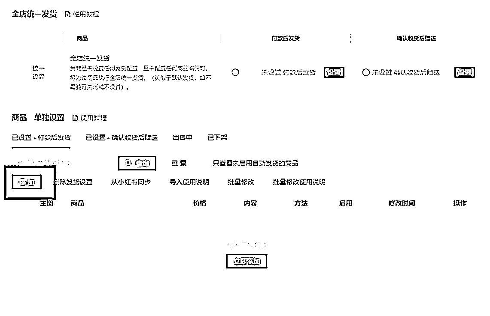

先把要卖的商品挑出来上架。

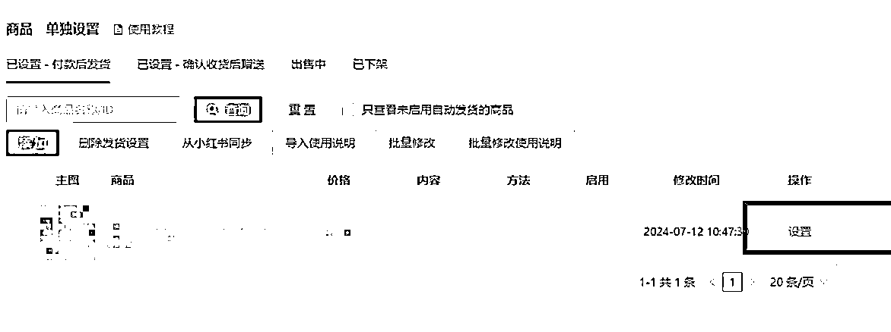

配置好自动回复的固定话术。

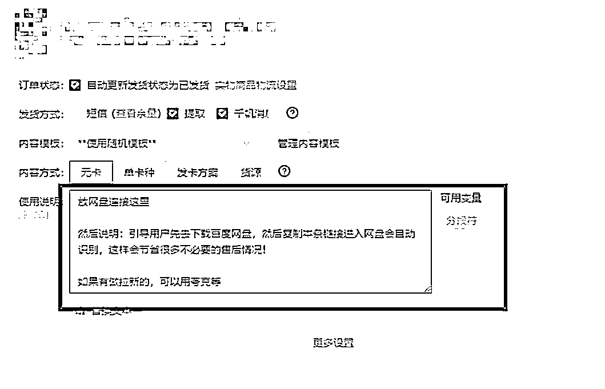

要是电脑没法长时间开机挂着，那就去买短信发货服务。发货助手下载之后必须一直挂在电脑端运行；做不到的话，要么用短信服务，要么租一台服务器把助手挂上去。

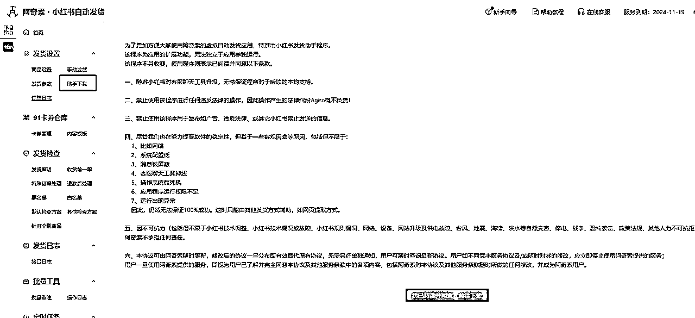

去千帆后台把店铺的登录邮箱绑定好。发货助手只支持邮箱登录，扫码是进不去的；只有助手在线登录，自动发货才会生效。

整套流程走完之后，建议自己下单一单做测试，确认自动发货能否正常触发。


1. 上架注意点

问：小红书店铺版权怎么看？

答：开店时尽量别上传带版权的内容，一旦版权方找上门，很容易被举报，而且店铺是实名校验过的。

判断有没有版权风险，可以看这几点：

最稳妥的是图片不要带水印；

看看同行在不在卖，如果有三家以上都在卖，基本说明可以卖；

另外送大家一张【免责说明】详情页图片，留着应急兜底。


问：听说店铺都在打价格战？

答：淘宝、闲鱼、拼多多这类货架电商的比价确实很凶，但小红书骨子里是兴趣电商，用户习惯并不爱比价。如果一百个访客还卖不动，可能是定价偏高；但访客只有寥寥几个，就别往价格上找原因了。

记住：小红书用户对价格相当不敏感，不用怕比同行贵，放心往高卖。价格提高后订单量或许会降，但最终收益未必会少。

问：虚拟资料订单发货时还要寄件，怎么处理？

答：选无物流发货就行，发货页面里有这个选项。

问：店铺和私域能放在同一个账号上吗？

答：不建议。店铺所在的账号已经实名，店铺也绑在这个号里。一个号同时打两种打法风险很大，私域本身是违规行为，号一旦被封，店铺也会跟着关掉。店铺适合做低客单销售，前期可以靠它过渡赚钱，私域另开新号去弄。

1. 寻找对标账号

# 1. 本章速览

这一章会详细拆解小红书引流爆款笔记的整套做法。

重点包括：对标账号的筛选方式、选题的挖掘方法、爆款标题的制作流程、封面与内页的排版流程，以及提效模板笔记的常见类型。

这是全课程最核心的实操部分，务必认真对待。

# 本章路线图

学完并动手练完本章，就能走完路线图中的：

第二阶段：产出爆款带货笔记（大约 4 天）

.

参照对标账号，做出爆款笔记（大约 1 天）

.

保持日更，每个账号每天发 3 篇笔记（大约 0.5 天）

# 2. 哪些账号值得对标

无论在哪个平台做内容，找一个合适的对标账号都是很高效的起号方式。所谓对标账号，就是同行业或同类型的其他创作者，你可以从他们的图文或视频、选题方向等地方借鉴。

挑对标账号时可以看这几条：

⭕ 粉丝量低，控制在一万粉以内，超过的不看；

⭕ 赞数高，点赞量高于粉丝量，说明内容有价值、有质量；

⭕ 看近一个月的内容，因为周末流量更集中，只看一周没有参考意义；

⭕ 主页反复出现，刷首页时同一个封面多次冒出来，这种账号就是好对标，照着做就对了。

爆款笔记的四个关键：选题思路 + 封面打法 + 标题技巧 + 内容写法。

⭕ 小爆款（赞藏加评论总数 ≥ 200）

⭕ 中等爆款（赞藏加评论总数 ≥ 1000+）

⭕ 大爆款（赞藏加评论总数 ≥ 1w+）

⭕ 超级爆款（赞藏加评论总数 ≥ 10w+）


# 3. 对标账号怎么找？

关键词搜索：在首页搜你所在赛道的核心词（也就是养号阶段搜过的那些），从靠前的 50 篇笔记里挑出小爆款和中等爆款，并且评论区出现“求”“需要”“私我发”这类留言的，这样的笔记就是值得对标的爆款。优先选同赛道里做号三个月到半年左右的账号。

搜索框挖词：在搜索栏输入赛道关键词（如下），下拉提示里都是小红书用户高频搜索的，说明需求旺盛，可以直接用“小爆款+中等爆款”的标准去筛出好选题来对标。


刷首页推荐：养号结束后，系统会依据你的互动和偏好推送可能感兴趣的爆款笔记。这时候首页上大部分都是同行内容，同样按小爆款和中等爆款的标准去筛选优质选题来对标。

从赛道热门话题里挖：关注同领域中做得好的博主，找出他们发布后互动量高的笔记，点进对应的话题标签，再用小爆款和中等爆款的标准从中筛出优质选题来对标。

借助 AI 挖选题：

举个例子，如果你卖的是简历模板，可以这样写提示词：

我是一个在小红书卖大学生求职简历模板的商家，想知道我这个赛道里，「赛道关键词、人群关键词、产品关键词、功效关键词、痒点关键词、痛点关键词」分别有哪些？


拿到这些关键词后放回小红书搜索，同样用小爆款和中等爆款的标准，从话题标签里挑出优质选题来对标。

1. 挖掘爆款选题

这里提供两种找爆款选题的方法。新手建议先用第一种【通过话题标签找选题】；等积累了一定的爆款感觉，再尝试第二种【用 AI + 乘风关键词词包找选题】，用工具提升选品质量和效率。

# 1. 用话题标签找选题

看到一篇爆款笔记时，尤其是最近三天发布的，点开笔记页面上的话题标签进入话题页，再按综合、最新、最热三个维度去翻更多爆款笔记。


也可以顺手关注这个话题，之后在小红书首页的关注页就能刷到该话题下的相关笔记。


# 2. 用 AI + 乘风关键词词包找选题

小红书之前主推过一款站内电商推广工具，叫乘风。

它为什么能用来找选题？因为它支持两种投放模式：通投和搜索。换句话说，卖家可以通过买词的方式投放笔记。举个例子：

假设你做雅思考试领域，就可以投雅思相关的词，比如“雅思备考”“十天雅思备考”，用户搜索这些词时就能看到你的笔记。

乘风后台有个功能叫【推荐词包】。

比如搜索“雅思备考”，会出来不少词包，下载并打开后

能看到具体关键词和分类，比如竞争指数、月均搜索指数、市场出价。

月均搜索指数和市场出价呈正相关：搜索指数越高，市场出价越高，说明用户搜索意愿越强。


这个词库的价值在于能反映用户的搜索倾向。

不过，靠自己分析，大多数人很难从里面抽出有用的结论，缺少层层拆解的能力。

这时候可以让 DeepSeek 帮你找出潜在的选题红利，用关键词倒推选题。

具体怎么操作？

第一步，把词库发给 DeepSeek，让它帮你思考、总结和分析。

这里要说明一点：

我给的策略和提示词未必是最优解。DeepSeek 本身已经足够聪明，不需要用过于复杂的提示词去框住它的想象力。

我用的第一条提示词是：

请根据这份文档，给我 20 个选题方向，并给出 20 个包含热门搜索词的标题，同时说明选题理由以及覆盖了哪些核心关键词。

DeepSeek 的思考过程很有料。它指出，高搜索词流量大但竞争也激烈，可以搭配长尾词来降低难度。

让我意外的是，它不仅给了公式，还附带了正文写法

例如【高搜索词】+【人群/场景】+【长尾词】。

它还提供了一个很实用的正文写作方法，教我把高价值搜索词合理嵌进去。

当然，如果觉得结果不够丰富，可以继续让它给出更多公式和写作技巧。

总体来看，它既能给选题，也能教正文怎么写。

核心思路就是让 DeepSeek 分析关键词、扩展选题，提前卡位搜索流量，这样能有效避免选题枯竭。

上面是一套具体的操作流程。

不过，DeepSeek 还有一个隐藏用法。既然它已经这么聪明，为什么不直接问它：我们该怎么向你提问，才能更高效地利用你？

于是，DeepSeek 给出了它的回答：


1. 打造爆款笔记

# 1. 标题打法

# 1.1 标题杂交法

这里得感谢袁隆平爷爷——把不同的优质水稻杂交，能培育出超级水稻。

这套方法操作简单、见效直接，我的爆款标题就是这么来的，称得上是流量密码。

看下图：搜索“纪录片”按最热排序，翻前十篇笔记，关键词翻来覆去就几个：央视推荐、绝了、建议收藏。

最热前 8 篇里有 6 篇标题几乎一模一样（爆款本来就是重复的），直接拿来用，把关键词不断排列组合，杂交出来的标题天然带着爆款基因。


★ 小建议：平时刷到爆款标题就记进备忘录，闲下来多翻翻，慢慢培养网感。


# 1.2 二极管式标题法

基本原理：

人天生偏爱省力法则和即时享受。

动物的底层驱动力是追求快乐、逃避痛苦，由此延伸出两种刺激：正刺激和负刺激。

标题公式：

正面刺激：产品/方法 + 只需 1 秒/一键（短期）+ 懒人开挂（逆天效果）

快捷指令类示例：【苹果手机】保姆级图文教程，一键自动记账（见下图）

负面刺激：你不 xxx + 绝对会后悔（巨大损失）+ 紧迫感

“不看这篇文章你会错过一个亿，限时删除！！！”

抖音上大多数文案都是这个套路，说白了就是制造焦虑，有点损，但用户确实吃这一套。

本质上是在利用人们厌恶损失和负面偏误的心理——原始社会里抓住一个机会可能只是多吃几口肉，但一次失误可能葬身虎口，进化让我们对负面信息更敏感。


# 1.3 三步起标题法（全赛道通用）

1. 搜索：找出 5～10 个同行的爆款标题。

例如：

.

升级咯！百分百进面简历模板2.0

.

一天看了上百份简历，拿offer的简历长这样！

.

一天看了上百份简历，这个醉优秀👍🏻

.

🔥大厂HR最喜欢的产品经理简历原来长这样💯

.

月薪8k的新媒体运营简历长这样|快来抄作业

1. 拆解：把标题切成不同的“词组模块”。

.

升级咯！百分百进面简历模板2.0

.

一天看了上百份简历，拿offer的简历长这样！

.

一天看了上百份简历，这个醉优秀👍🏻

.

🔥大厂HR最喜欢的产品经理简历原来长这样💯

.

月薪8k的新媒体运营简历长这样|快来抄作业

1. 重组：像搭积木一样，把不同标题里的模块拼成新标题。

标题 1 和标题 2 的词组结合：一天看上百份简历，百分百进面原来长这样

标题 4 和标题 1 的词组结合：🔥大厂HR最喜欢的运营简历，百分百进面！

标题 5 和标题 3 的词组结合：月薪8k的产品经理简历，这个醉优秀👍🏻

用这个方法可以组合出无数个标题，任何赛道都适用。

小结：

多用感叹号，目标用户偏爱夸张的情感表达。

语气要真诚，把读者当成“熟人”来聊，用词通俗易懂。


# 2. 笔记封面与内页

# 2.1 排版的核心原则

# 2.1.1 三个要点

✅ 给零基础作图的朋友划几个重点。

封面排版记住三条：

做小红书封面时，建议守住下面这三个要点：

要点一：封面尺寸

竖屏用 3:4

方形用 1:1

横屏用 4:3

竖版笔记在屏幕上占的比例更大，能在用户视野里停留更久，既能承载更多信息，被划走的概率也更低。

要点二：选图要准

有视觉冲击力的高颜值图片（可以用 AI 生成）

简洁明了的手写风格图（自己手写也不难）

适合合集、美食、旅游攻略等类型

要点三：文字要精简

小红书笔记标题上限是 20 个字符（emoji 会占 1～3 个字符）。

想补充更多信息，就得把封面利用好。

用户在发现页浏览时往往没有明确目标，所以核心文字要在画面中占足够大的比例，概念清楚，直接命中需求，让用户一眼知道：这篇笔记对我有用！从而产生点击冲动。


竖版 3:4


横版 4:3


竖版 9:16


横版 16:9


# 2.1.2 二少原则

二少原则：少变动、少堆砌。

第一少：少变

不要频繁更换封面版式，尽量做到【模板化/可替换化】。排版、字体、风格保持一致（颜色可以在同色系内变化），这样主页更整齐，也方便粉丝认出你。

第二少：少用

不相干的贴纸少加，容易喧宾夺主、分散注意力。


# 2.2 内容呈现的 7 种形式

不同产品和作品可以用哪些方式呈现？

这里介绍 7 种形式，一个账号选 1～2 种就够了，具体按赛道情况来定。

注意别在一个账号里堆太多呈现形式，既增加制作难度，也会影响用户观感。

# 2.2.1 实拍呈现（推荐）

实拍比截图更有场景感，也更真实。我们测试下来，实拍的转化率更高，制作难度反而比截图低。

把虚拟产品打印出来，或者放在电脑、平板上拍下来。

也可以在实际使用场景里拍摄记录，比如快捷指令记账，可以在付款时拍下来。


具体流程：

1. 在电脑上打开你的产品

1. 用手机找好角度拍产品

1. 最好用醒图之类的工具给图片再加一个标题

另外，拍摄时尽量选光线明亮的位置。家里不够亮就去咖啡厅，我常去瑞幸拍，光线很好。

视频拍摄教程：


IMG_1657.MOV【在线播放】


RPReplay_Final1756011613.MP4【在线播放】


拍照时一定要注意：手机镜头先擦干净！光线要足，拍完再调一下滤镜。

# 2.2.2 截图呈现（推荐）

截图是最省事的作品呈现方式。

但截图容易同质化，怎么破？很简单：

1.自己动手截图发布；

2.给作品加上边框，调整图片参数；

3.把文件内容复制进 AI 工具，让 AI 重写一份相似的，再截图，这样就是一份全新的文件；

4.或者打印出来，拍打印后的作品。

这几种方案都建议用上。另外，如果某个素材在你的账号爆了，就换个形式再发一次，争取在同一个账号里二次爆发。切记！！！


截图笔记怎么做？

把资料或产品截图下来，裁成 3:4 尺寸即可。

提效类产品往往有很多模板、表格和工具，不一定能裁成 3:4。这时可以参考图 2、3、4，做简单排版，把图片设计一下。


稿定设计操作步骤：

1. 找到爆款笔记的图片，复制下来

# 小红书封面复用与成交运营手记

做封面可以拆成三个动作：先打开稿定设计，建一块“小红书配图”尺寸的画布；接着把爆款笔记的封面贴进来，缩放到和画布同样大小；再把封面图层透明度调低，一比一临摹版式即可。

视频教程：

封面制作1.mp4【在线播放】

一套封面模板定型后，遇到同模板的笔记，换素材会快很多。我的做法是：某个模板发布后能带来产品订单，就会持续用下去。替换方法看这里：

模板替换.mp4【在线播放】


# 2.2.3 拼图式展示

这种形式适合集中陈列素材，让客户一眼看清产品全貌，下面看案例。


拼图类作品怎么做

这类图并不复杂，手机端最省事，用拼图功能就能完成：把需要的素材先截图，再拼到一起即可。想做得更精致，可以上PS；如果只是快速出图，美图秀秀的拼图也能胜任，重点是把内容讲明白。


# 2.2.4 目录页展示

目录式内容的表现力也很强。前期制作会辛苦一些，但成品可以反复调用，属于做一次、长期受益的类型。


怎么制作？

微信本身就能帮忙。我以心理健康公开课为例：先把图片裁好发到微信，再用微信把文字提取出来，最后放进xlsx表格里完成排版。


心理健康原稿.xlsx


# 2.2.5 固定底图

这种玩法适合点对点呈现，也适合课件、视频类素材展示，先看几个直观案例。


整体思路是：先找到合适的背景图，再把作品嵌进背景里，图片和视频都能放。核心是用场景感或新鲜的表现方式抓住注意力。

背景怎么找？方法和平时找素材一样，去小红书等平台搜关键词，挑出合适的背景图。当然，有条件的话，自己拍实景或直接录制会更贴合；平时也要养成积累素材的习惯。

第一步找背景：

我用的关键词是：“办公室电脑桌面壁纸简约”“班级多媒体桌面壁纸”，下面是一些案例。


第二步做图文：

如果想把模板固定下来做图文，就要用黄油相机，具体操作如下：

先把素材拖进来，调整到合适大小


再把要展示的PPT画面截下来


接着把截图加进去：选择贴纸→导入图片，找到想嵌入的那张图


模板做好后，主页上会显示出来

下次点“使用模板”就能复用

第三步：做视频

要展示视频，就需要剪映。先把课件录制下来，再到剪映里调画面、做模板，以后替换新录的课件即可。这里以手机操作为例，会用到WPS。

用WPS打开


选择播放，手机就会横屏


用手机自带的录制功能把课件录下来

f9cfe675c4317a2f09a64c9131c2b6e1_raw.mp4【在线播放】

录好的视频准备好后，打开剪映，先把背景素材导入。


选择画中画


把录制好的内容放进来


如果素材带黑边，先裁剪一下

素材和素材之间要对齐


加上音乐和合适的文案，导出即可

成品效果见下方视频，画面干净美观，比单纯截图更有辨识度。

e8e5d922f75b78312a797c928aa45ece.mp4【在线播放】

思考：这里能看出场景有多重要。平时要有意识地利用身边素材，养成积累习惯。

固定背景展示课件视频操作指导：

固定背景展示课件.mp4【在线播放】


# 2.2.6 大字报式封面

用大号文字直接传递关键信息，让主题或重点更醒目。


操作方式：用文字（可搭配表情）制作封面页。

# 2.2.7 前后对比图

把学习前后的成绩摆在一起对照，突出内容价值，勾起用户好奇。


操作方式：先找相关素材和表情，做好修改，再进行拼合。


# 3. 提效模板笔记的常见类型

类型 1｜“录屏演示”式：用动态画面呈现顺畅体验

比如快捷指令助手，轻敲手机背面就能激活，并完成翻译等任务。

类型 2｜前后对照式：产品视觉冲击力最强

但只适合使用前后差别明显的产品，比如调色预设，把调色前和调色后放在一起看。

类型 3｜拆解设计思路式：讲清产品、模板背后的考量，提升专业感

这类内容转化率通常较高，也相对好做。可以写为什么开发这个产品、开发中碰到过哪些问题、使用前是什么状态、使用后又是什么状态。

类型 4｜落地场景式：把工具、模板放进具体使用情境，说明能给用户带来什么实际好处

比如记账指令，在任何手机消费场景下激活指令，就能完成记账动作。


# 4. 笔记小贴士

# 1）先排查敏感词

敏感词会让笔记进入更严格的机器审核流程，造成审核变慢，甚至被限流。长文案写好后，可以到零克查词：https://www.lingkechaci.com 检查文案里有没有敏感或违规表达，再用谐音字、拼音替换。

# 2）伪原创笔记（新手可优先尝试）

如果不知道发什么，也不清楚目标用户偏好什么，可以直接拿同行的低粉爆赞图文（封面也算）来做伪原创。

如何用美图秀秀做伪原创

视频教程👉https://scys.com/docx/SgtrdWTZhokAMMxqLzYcfhMynPb

如何用剪映制作伪原创图片

视频教程👉https://scys.com/docx/KCrAdiLyEoDOaxx4VW9cuWsGnXc

如何用剪映批量制作伪原创图片

视频教程👉https://scys.com/docx/HZdmdkU1PoOgzRxhe96cAE1InSd

# 3）提前布局搜索流量

把关键词提前埋进笔记文案里，一条笔记就能持续获得精准流量。SEO可以这样理解：假设你做小学教师资料赛道，用户在小红书搜“小学期末评语”相关字眼时，就能刷到你的笔记。主动搜索的人，消费需求和付费意愿通常更强，粉丝也更精准，成交率自然更高。

所以标题和文案里一定要放关键词。比如小吃配方赛道可用“夏日摆摊爆款”“xx（产品）配方”，创业比赛赛道可用“互联网＋”“三创赛”“xx（项目）计划书”“计划书完整版”，这样有助于提升笔记搜索排名和曝光量。

# 4）笔记排版

小红书很看重精致感，排版做得好会占优势。用户多在碎片时间浏览，清晰的排版能明显改善阅读体验，让关键信息一眼可见。两个重点：

.

封面标题要提炼。封面上要打上笔记的主要内容，让用户第一时间判断这条内容对他有没有用，再决定是否点击。

.

文案要分段。如果是一大段文字，必须空行分段，并适当加表情，读起来会更轻松。

# 5）添加#话题

在正文末尾插入与笔记主题相关的热门话题。话题要选关联度高、浏览量大的。比如要发一篇小学期末评语资料，在文末点“#话题”输入期末评语，就会出现一系列相关话题，挑最火的几个即可。另外也可以带上细分赛道关键词，例如 #二年级期末评语 #低年级期末评语 等。

# 6）发布时间建议

白天：11-13 点

晚上：19-22 点

# 7）3 个检测笔记是否限流的小技巧

以下三个动作，在没有阅读量或阅读量不正常时再操作（新笔记发布后 24 小时内浏览量还持续低于 100，或连续几篇笔记浏览量都在 100 以内）。

.

看能否用薯条推广。点进笔记 ➥ 点击右上角“···” ➥ 点击下方“薯条推广” ➥ 查看能否通过推广审核，能出现付款选择界面就说明笔记正常。

.

看笔记检测里有没有违规。点击左上角“≡” ➥ 点击“帮助与客服” ➥ 点击“笔记申诉” ➥ 查看有没有违规笔记记录，没有记录就说明正常。

.

看能否搜到你的笔记。用第三小号到搜索栏搜笔记标题 ➥ 能搜到就说明正常。

如果整个账号遭遇整体性限流，大概率是因为“硬广告”发多了，或者账号权重不到位。这时可以发一些有价值的干货内容或讨论帖，提升互动，逐步恢复账号权重与流量表现。

# 8）素材传输工具推荐

很多小伙伴传素材时很苦恼：社交软件会压缩画质，邮箱又麻烦。这里推荐两个我们团队一直在用的传输神器，支持安卓、苹果、鸿蒙、Windows 以及 Mac。（一定不要用小红书去传输素材！！)

.

PP 直连 https://www.ppzhilian.com （网页版，无需下载，推荐苹果）

.

极连快传 http://www.zqbapp.cn（稳定，需要下载，苹果无，推荐安卓）

# 9）做好小红书的 10 个建议

① 干货笔记引流，单条笔记承接交易。并不需要所有笔记都带货，也不是所有笔记都要有好曝光，笔记的目的很重要。

② 怎么写是战术，写什么是战略。每一篇笔记都要有目的，从目的出发、结果导向，中间填充手段和方法，否则越做越迷茫，浪费时间。

③ 先模仿再创新，模仿能解决 70% 的问题。

④ 100 篇平庸不如一篇精雕细琢。

⑤ 小红书不是用来展现自己的。

⑥ 发一条就认真发一条，做一个品类就把一个品类尽量垄断。

⑦ 建立热点敏感性，建立流量敏锐，遇到搜索热点赶紧上。

⑧ 笔记不到 500 就是选题和封面的问题，至于流量有多大，是互动指数的流量开关有没有被打开。

⑨ 爆款都是重复的，重复地做爆款，第一是选题和模仿，第二是高效率地做内容。

⑩ 认真尚不能一定成功，不加思考的随意开始注定失败。

1. 成交引导与优化

# 1. 本章概要

笔记最终要服务于成交。怎样把流量价值放大、把商品转化率提上去？主要抓三件事：

发布笔记时直接带商品入口，拿到更精准的人群

用小号配合大号一起发笔记

成交后及时发货、跟进售后，让店铺正常运转并持续优化

具体内容进入本章学习～

# 本章航线图

完成本章学习和实操，即可完成路线图中的：

第二阶段：制作爆款带货笔记（约 4 天）

.

笔记挂商品链接，引导成交（约 0.5 天）

第三阶段：持续运营，并尝试开发产品（约 14 天）

.

店铺运营与优化（约 14 天）


# 2. 笔记挂商品链接

先说结论：商品入口要在发布笔记那一刻就放上去，别等数据起来再补。放入口确实会牵动流量，但未必是坏事；带商品的笔记能获得的，是付费投放之外最精准的一批人。


可放位置有两个：标签末尾、评论区置顶。前者手机和电脑都能操作；后者只能手机做，电脑端没有入口。


电脑发笔记效率高，但只能放标签末尾那个入口，通常也够用。建议先用电脑发布；等某篇数据表现好，再用手机重新编辑，在评论区置顶补上入口。


# 1. 同店多账号如何协同

把账号看成承载笔记的容器。单个账号日更量过大容易触发违规，因此“1 个专业号+3 个主理人号”的本质是分散发布压力，别把所有内容压在同一处，从而降低风险。

推荐做法：绑定店铺的专业号尽量少发甚至不发；即使走正规路线，平台偶尔也会抽风，风险仍在。主力交给主理人号去发布笔记并放置商品入口。


# 1. 发货与售后

春节后平台开始收紧店铺端管理。过去只重视前端笔记，店铺几乎不用打理；现在售后同样关键，用户负反馈比例过高会直接压制流量。

发货常见问题

物流类型选错：编辑商品时，要选带“无物流配送”字样的类型，不然自动发货不会生效。若忘记选且已有订单，可去拼多多按买家收货信息下礼品单，再用该单号回平台后台发货，切勿随意填写单号。

运费模板选全国包邮。系统默认非偏远地区包邮，会让新疆、甘肃、海南等地用户无法下单。虚拟产品不涉及实际物流，直接选全国包邮即可。


售后常见问题

网盘打不开：不少用户不熟悉网盘，大文件往往不保存就用手机直接下载。最好提前录一段操作视频，教用户使用百度网盘。

用户未开会员、文件多导致一次存不下：可建议只转存马上要用的部分，其余随用随取，链接长期有效，不必全部转存。

用户申请退款时，态度放好，直接同意即可。引导退款原因选“拍错/多拍/不喜欢”或“其他”；若选了对我方不利的理由，会计入负反馈率，次数多会限流，而且修改后也只按首次选择计算。


# 1. 店铺维护与优化

好评返资料：用户拍下后，自动发货的同时附一段话术，引导好评并赠送其他资料。话术可参考淘宝、拼多多同行的成熟版本，既能积累好评，也能促使用户确认收货，让货款更快到账。


千帆后台可配置自动回复，把高频问题提前写成答案，第一时间解答、消除顾虑，转化率会明显提升。用户常问：怎么发？能否立刻发？资料有答案吗？能打印吗？能试看吗？是不是Word、能不能改？这些是通用问题。某些资料还会有特定关注点，需要客服在沟通中不断总结。自动回复对客服三分钟回复率考核也有帮助。


先提一个常被忽视的开关：七天无理由退款，别关。关掉它，退货量并不会因此变少，该退的照样退；反而容易把顾客吓跑——人家点进下单页，一眼瞧见“不支持七天无理由”那行字，多半直接退出去了。所以这个选项，开着更划算。

## 1. 靠AI做虚拟资料生意

### 1. 为什么要把AI拉进来做虚拟产品

如果你打算在小红书做电商、靠卖虚拟资料变现，那“用 AI 开发产品”这门功夫值得花时间练。DeepSeek R1 发布之后，这件事的门槛又低了一截。

零基础的新手，想凭一己之力把产品从无到有做出来，难度不小。关键词是“一己之力”：你会被各种细节绊住。举个常见情形——打算做一套教程，把自己的经验塞进去，可脑内只有模糊的轮廓，搭不出像样的骨架。

这跟学生时代的考场作文很像：题目和范围都给你框好，反而写得出来；完全放开，倒无从下笔。如今新手可以借 AI 跨过这道坎。但要明白，它的作用不止是“代写成品”，更是在整个搭建过程中给你搭把手。下面用几个场景来说明。


## 1. 借AI做虚拟产品的思路

动手之前，先达成一个共识：别戴着有色眼镜看 AI，也别急着给它划边界。那些你过去觉得“不可能”的事，它往往能推你一把。把成见收一收，尽量放开手脚跟它配合。

有了这个前提，个人想从零到一做出原创产品，大致可以按下面几步走。

# 2.1 第一步，摸清自己的底牌

让 AI 帮你做一次“优势体检”：把技能、长处，以及那些市场愿意掏钱买单的认知、经验、方法和知识点，一条条梳理出来。

具体怎么操作？下面这套仅供参考，谈不上标准答案。思路是用 kimi 搭配 DeepSeek-R1 组合着来。

大部分人第一步就卡住——不会写提示。说白了，提示就是一道明确的问题：你要它处理什么、完成哪些动作。

要是对此发怵，可以让 kimi 里的“提示词专家”先替你把提示写出来。我当时就是这么干的，原话大意是：“请帮我拟一份‘优势挖掘专家’的提示词，用来有效发掘我自己的长处。”


它很快返回了一份能直接拿来用的版本。我把其中的骨架整理在下面，方便你照着改：

- 角色设定：优势挖掘专家，兼任心理顾问。
- 背景：用户希望看清自己的长处，借此释放潜力、建立信心、推动成长与职业进阶；但自我认知往往模糊，需要有人带路。
- 人物画像：老练、眼光毒，有心理学底子，擅长用评估和分析帮人找到闪光点，并辅以案例给出贴合个人的建议。
- 能力清单：懂心理机制、人格测量、优势理论、职业路径规划和沟通方法，能借深度对话剖析长处并给出策略。
- 目标：系统评估优势与潜力，提供定制化建议，助用户扬长、增信、成长、进阶。
- 约束条件：以科学的心理学原理与方法为依据，确保结果准确、客观；同时照顾用户隐私与情绪，营造安全放松的对话氛围。
- 输出形式：文字叙述、优势报告、定制化建议、真实实例。
- 工作流程：先通过深入交谈了解经历、兴趣与职业背景；再借助心理学与优势理论做评估，锁定潜在强项；最后给出针对性策略。
- 例子：做软件的可突出逻辑推理、拆解问题的本事和技术上手快；做销售的可突出沟通、客户关系维护与市场嗅觉；在校学生则突出学习适应力、创新与团队协作。
- 初始化：首轮直接输出欢迎语，引导用户讲述自己的经历、兴趣与职业背景。

拿到这份提示后，复制粘贴到 DeepSeek 里就能用。它会先试着读懂你给的指令。之后你不断追问，它就能帮你理清长处，以及这些长处能在哪些场景换成钱。DeepSeek 的强项正是连续追问——多聊几轮，答案才会浮出来。

# 2.2 第二步，验证需求真假

不少所谓“需求”，其实是伪需求。可以让 AI 先估一估它到底立不立得住，再顺着它给的方向去市场上找现成的产品和服务，进一步确认这个需求是不是真的。

举个例子。我给 DeepSeek 的提问是：我来自新能源汽车行业，有五年从业经历，请列几个制作快、能轻量落地、又能切实解决用户痛点的虚拟产品。它回了一批方向。其中若你对《新能源车企面试答案库》感兴趣，靶子就清晰了——需求验证到此结束，可以进入下一步，让它协助你把产品做出来。


# 2.3 第三步，让AI搭出资料型产品

很多人的困扰在于：肚里经验不少，却没法成套地讲出来，脑子里缺一副完整骨架。这跟写命题作文一个道理——给个由头，写得挺顺；放手让你自由发挥，反而卡壳。DeepSeek 正好补这一块：它先甩给你一个还算像样的框架，你顺着往里填经验就行；顺着框架，还能把沉睡在记忆深处的细节勾出来。

例如你要做一份“从零开始装修”的指南，就让它先出框架。提问可以这样写：我刚装完一套三居室，想把整个过程整理成一份 PDF，内容涵盖从开工到入住的完整流程，并在目录中补充市面上少见的隐性知识、暗知识和实操细节，请给我一份详细目录。它给出目录后，你心里就有了大致结构；后面怎么填肉，全看你对装修的理解与经验。

为什么非要点明“隐性知识、暗知识、实操细节”？因为这是往深里挖的关键。想做出竞争力，颗粒度必须细，内容还得少见同款。它一旦读到你这条要求，就会把重心放在市场上稀缺的内容上，给出更有深度的建议。

这一招，适合那些知识储备够、只缺一条“梳理线索”的人。除此之外，也能完全交给 AI，从零做出一款产品，像合同模板、简历模板、面试题库都行。这类东西完全可以靠 AI 从无到有搭起来。下面拿面试题库举例，说说具体怎么搞。


拿到它出的面试题后，再一题一题让它写专业答案。为什么不一次性搞定？因为让 AI 同时出题又出答案，难度大，细节也粗，答出来的东西很难读。分两步走——先出题、再答题，成品可用性会高得多。

还有一点：让它答题时，务必一次只围绕一道题来写，参考下面这张图。


这么做的收获是：每道题都能拿到细致的解题思路，成品内容自然更厚、更饱满。所以做题库类产品，顺序别反——先有题，再有答，内容才立得住。

# 2.4 第四步，用AI做原创工具型产品

不少人以为，不写代码就没法让 AI 帮自己做独立产品。事实上，如今的大模型已经够聪明，还流行起一种叫 vibe coding 的做法——直译就是“氛围编程”。普通创作者懂点代码当然好，一点都不懂也无妨，遇到不会的直接问 AI。

用 AI 做原创产品，原则是什么？说到底就一句话：盯住具体场景里的具体痛点。别动辄想搞改变世界的大东西，别去跟大厂正面刚，美观也不必死磕。最关键的一条是：真有人用得上，而且愿意掏钱。

举个例子。我在小红书上见过一个很窄的工具：专帮律师快速梳理案件时间线的 AI 应用，只服务律师干活时的某一个环节。也有虚拟产品卖家在教学场景里做小工具，比如班级点名器，加了点花样——被抽中的同学会看到彩带、听到欢呼。这东西难做吗？不难，它甚至不算网站，本地就能跑，谁都能用，交付时把本地网页打包发过去即可。我曾用 Claude 照这个需求复刻过一版，做出来很轻松。

可见，想用 AI 做原创产品，就得把场景、人群、需求这三点抠细，切口越小越好，解决的问题越具体越好。我自己也做过一批教学场景用的小工具，效果不错，可以拿来参考。


小结一下：AI 能陪你走完整条从零到一的路——先摸清自己、盘点资源与长处，再帮你验证需求真假，最后润色成稿、做出成品。每一步都有它搭手的位置。

## 1. 把虚拟资料升级成人设IP

从卖资料到卖人设：单店月销20万+的复盘 @申铭

为什么要从“卖资料”转向“卖人设”？不少卖家做久了会发现，纯矩阵号不带人设，很容易撞上增长天花板。虚拟资料出单确实不费劲，可同行复制起来同样不费劲。想攒出别人拿不走的竞争力，人设就是那道墙。圈友 @申铭 的团队从 2025 年 3 月起开始迭代，一边精细打磨方案、一边真金白银自己投，结果超出预期。尤其临近暑假，新模式的账号直接冲起来，单店月销量稳在 20 万以上。


整个迭代期一共动了 3 个账号，眼下这一个，是三个里唯一跑出较稳定成绩的；剩下两个虽有起色，但尚未稳住，还在反复试错。不过至少说明一点：路子是对的。接下来聊聊，怎么靠人设这个抓手，捅破虚拟资料赛道的增长天花板。

### 1. 做人设，图的是什么

① 信任背书：买家要的不是资料本身，而是一个懂他的人

我们心里很清楚：多数买资料的人，并不急着立刻用。他们真正在买的是那句潜台词——“你做的资料我信得过，你应该清楚我当下最缺什么”。所以做人设的关键，是把“买份资料”扭转成“找个靠谱老师带带我”的顺手下意识，这跟直播带货的话术套路本质相通。

同样卖 K12 资料，你单摆一份高中语文押题合集，和你说一句“这是张雪峰团队精编的”，转化效果完全两码事。

② 差异化定位：内容最容易被盗版，而你这个人最难被复制

最近刷生财的帖子，看到不少圈友在考证、考研培训上拿到了好成绩。这也说明，大家都盯上这块了——那些机构、人多势众的团队，权且叫它们“大厂”，人、钱、流量都比个人或小团队硬，产品更精细，前端引流品还能压到更低价（靠后端二次成交赚钱），所以差异化这道题绕不开。

现在不少同行做的人设，无非挂个昵称、写两行自我介绍，头像甚至还是 AI 画的。看着像模像样，其实毫无记忆点，用户扫一眼就忘。

我们走的是带引号的“真人人设”：出镜露脸、会讲故事、内容始终围着人设定位转，还得有带风格的说话腔调和自己的观点。我们不搞那种假兮兮、自恋味十足的 IP，而是走小红书当下最吃得开的“活人感”路线——像你身边的同事、老师、朋友，可信、真实，甚至让女生素着脸就录口播。下面这张图不是我们的号，是拿来参考“活人感”的。


③ 情感链接与溢价：人设管着你能卖几轮、卖什么价

虚拟资料说到底属于知识服务型产品。能不能反复复购、后端能不能标更高的价，取决于内容和用户之间有没有情感上的连接。没有这层连接，一单就是一单；一旦加上人设，再小的资料也能被买三轮以上。

我们还专门做过对照测试：其他条件都一样时，有露脸、有人格化表达的账号，高客单价的转化更顺、更快。尤其在 89、99、129 这几个价位段，用户基本不还价。可见人设带来的溢价空间相当可观。

做完人设，我们顺手加了两个强化动作：

其一，内容层面：一个账号只做一类人设、一个垂类产品，赛道绝不混着来。比如考公号，文案、头像、资料全部围绕“公务员教培老师”这个身份来搭；做高考艺考号，则立“学姐+资料整理者”的形象，穿搭都往艺术生风格靠（本人就是艺术生，比较清楚这类人想要什么）；账号还会拆分，但视觉、内容、角色必须一条线。例如同属考公，可以把公文写作和行测题拆到两个号去运营。号多确实更累，但换来的是更垂直——转化率明显上去，用户单次停留更久，互动也更积极。

其二，内容形式层面：主打视频，图文做辅助。视频比图文更有人味——这是结论，不是建议。小红书给视频的流量池明显更大（上下滑给视频曝光开了大口子），平台权重也越来越往真人表达类内容上倾斜。所以人设上线之后，我们直接把主力形态从图文切成了短视频：口播、讲故事、塞干货。

### 1. 人设定位：给账号找专属标签

人设最容易做得飘——空空洞洞，后面内容还常跟人设脱节。因此我们给资料号定人设时，严格按“资料属性+目标用户需求”这两条硬绑。

第一步：先弄清到底是谁在买。

年龄段/身份：中学生、大学生、艺术生、待业人群；

核心诉求：中学生想要精准靠谱的考点合集（文言文背诵、历年真题都在内），大学生考教资抓不住知识点，艺术生找不到最新版的文艺常识，待业的人想考公却摸不清方向；

痛点：渠道难找、人犯懒、信息不对称、资料堆太杂不知怎么用。

接着往下推。假设目标就是那批想考公的大学生，或毕业几年准备上岸的人。他们卡在“没方向、不会安排学习和复习”，还可能在某类题上老是丢分，需要专门补。但碍于预算，他们不太愿意花大钱报系统课，更想自己私下省钱备考。

第二步：看清自己手里有什么牌——跟同行比，我们强在哪？（结合上面的用户画像来立人设）

经历：在某考公机构待过五年以上、公考首战上岸拿过高分、曾是公务员后辞职下海；

擅长：公文写作、面试辅导、能快速抓取时政新闻要点并用到实战里；

态度：不割韭菜，只做真有用的资料。

这一步未必非得是真的——履历可以编。但编就要编得让人查不到。比如“考公满分”“哪年上岸哪个岗位”这种，一搜就穿帮，人设当场塌掉。换成“在某考公培训机构待过几年”，就难查得多，大型机构员工成百上千，他们自己都认不全人。代价是后续内容得注意：少提机构内部细节，把它当成一个身份标签就好。

另外，我们选品本身就很窄。比如考公这条线，只做公文、精读拆解和面试，别的一概不碰。人设也尽量跟这条窄线对齐。做资料生意或知识付费，专精一门比样样都通更好转化，守住一小块地盘足矣，顺带还能绕开人设撞车的问题。

第三步：敲定人设关键词，3 到 5 个核心标签。

例如🌰：前某考公机构一线教师、专攻公文写作、快速提分若干。

这些词可以放进小红书简介。做视频的话，也能在口播里顺手带出来，比如“我90%的学生公文写作提10分以上，靠的就是这套公式”。反复用口播强化，用户心里就会慢慢贴上这些标签；等他变成粉丝、翻你旧视频时，这个印象只会越来越清。


### 1. 让人设真正落到账号上

人设要渗透进账号的每个动作，才算真的立住了。

账号人格不是换张头像

很多人对人设的理解，还停留在取个昵称、做张封面。真正开始日更时，内容根本撑不住。这也是大量卖虚拟资料的账号普遍翻车的地方，我们当初也栽过跟头。

我们做人设的第一阶段，其实只动了两处：内容调性和画面观感。真人出镜口播，效率也不差。仅仅这两项改动，转化率就有了肉眼可见的起色。

# 3.1 视频这条线，三类打法

我们做视频内容，长期围绕三类：归纳型、亲历型、互动型。

a. 归纳型：热题+判断方法

所谓归纳，就是先翻自己的历史记录，挑出跑出数据的选题；再看看同行近半年哪些内容数据好。然后给这些热题接一个“怎么理解/怎么办”的角度。这类内容能反衬出账号的专业底色。

拿我们的公考号举例，这几个月蹭“卤鹅哥”“labubu”“新闻联播”的稿子流量都不错。以“卤鹅哥”为例，加上“怎么看”就成了“卤鹅哥爆火，公考人怎么看”。账号定位是公考，话题必须扣在这条线上，于是可以展开成“卤鹅哥为什么能走红”“他给荣昌带来的，除了流量还有什么”。这种选题天然适合短视频，尤其能帮考公的人练面试。

口播时不能只甩结论，要把分析路径展示出来：先给判断——这是典型的X类题；再拆框架——按A、B、C三个环节组织答案；接着做演示——拿卤鹅哥事件模拟一遍；最后给钩子——说最新时政、更多热点都已整理进资料，由前某公考机构的一线老师把关。

b. 亲历型：用“我踩过坑”的语气讲方法

知识类视频容易劝退，是因为太干。五月底，传术师群里东山老师分享过一条视频，观点我一直记着：在公域谈实操、讲干货，等于做公益、过嘴瘾，赚不到钱。他还补了一句：人需要的不是干货，是被理解；不是方法，是希望。后来我做短视频基本都带着这个心态。资料号一旦用过来人的身份讲同样的内容，用户立刻就有共鸣。

比如：“我第一年考公失利，栽在三个低级失误上，你别再犯”“每天硬学12小时，真正帮我提分的只有三件事”。你看，讲的还是公考方法论，但因为多了“人+情绪+故事”，评论区更容易热起来。账号也随之有了人情味，不再是卖资料的，而是一个走过弯路、现在愿意拉你一把的前辈。

c. 互动型：从评论区挖选题

一个规律：某条视频一旦跑爆，评论区的真实提问往往是几十条起。这就是我们目前最大的选题池。

操作很直接：把点赞高的评论圈出来（自己或同行的都行）；提炼提问背后的真问题；再用“你问我答”的人设口吻做成视频。这类内容容易起量，互动率也高，用户会觉得你不是在推销，而是陪她一起往前。

# 3.2 视频视觉，让画面先说话

小红书的视觉系统，无非封面、头像、出镜穿搭、拍摄场景四件事。我的建议很简单：全部贴向赛道审美。拿医考资料来说，封面上的角色和视频里的出镜者，最好穿白大褂，或者穿网上那个流传很广的精神病服，跟职业场景对上号，用户天然就多一层信任。公考号同理，穿厅局风、体制内的穿搭，让知识点从衣服里透出来，用户会觉得这人说得对，更愿意掏钱。头像也跟着调就行。有条件的话，真去那个场景拍，或者找个高度相似的场景，效果更足。

这是硬性要求吗？也不是。什么风格都能转化，只是越贴合的视觉，转化率越高。但视觉要跟着人格设定走：你人设本来不是那个角色，硬穿那套衣服反而奇怪。

# 3.3 产品层面，把信任做进去

a. 资料本身就是人格

用户拿到资料，第一眼、第一句话就得知道“这是谁做的”“这个人可不可信”。我们现在每套资料，从第一页就开始铺垫人格。

① 开篇放人设故事+使用说明

第一页固定放400-500字，两块内容。

动机：为什么会有这份资料。比如“这套东西本来是给我弟按头整理的，现在拿出来共享”“我踩过的坑，不希望你再来一遍”“教过两百多个学生，这里汇总的都是他们最容易错的地方”。这些句子能让用户一打开就产生好感：他是为我好，不是来卖货的。

用法：教他先读哪一章、怎么搭配方法用。这比目录多了一层“教学说明书”的意义，潜台词是：我在陪你学，我没有推销的目的。放到第一页还有一个好处：教用法这件事，多数人会认真看完，看完之后带着好感再看后面的内容，哪怕资料有些瑕疵也能理解。

② 赠品要“人格化”，不要“无感文件”

以前我们也送东西，但名不正言不顺，用户感知不到价值。现在所有赠品都改成“人设周边”，随资料一起走，等于给资料加筹码。比如：“我自己每天还在用的复盘表格”（体现实操）；“整理好的上千条爆款标题库”（体现专业）；“当月人民时评精读”（体现持续更新、有积累）。用户收到后，不会觉得是搭头，而觉得是一个靠谱前辈的额外关照。

b. 服务，把靠谱两个字做实

坦白讲，我们现在的运营并不轻。虚拟资料本应很轻松，但为了转化，我们把所有一级产品都配上了服务。提供服务后，转化率和复购比之前高了不少，具体涨了几个点没专门统计。服务大体分两类。

售后托底。推出了“资料用了不满意也能退”的承诺，退款不用退货，但要在私域微信里操作：先在线点确认收货，再给个五星好评+图文评价，我们会主动给好评文案模板，所以目前申请退款的人大多会带图评论。另外还有免费的专人答疑，一个学员直接对一名答主，几乎有问必应。现在有两个人专门抱着手机等消息回复，他们并非全行业都懂，基本靠AI辅助，按收集到的问题做相对中性的回复；但重点业务必须专业，因为后端转化靠它，含糊不得。这套售后做起来辛苦，可传递的形象很值钱——虚拟资料和知识付费市场，恰恰缺这种靠谱。

用户共创。考公、高考这类产品有时效性，隔段时间就得更新。每次更新前，我们都会在私域问一圈：“下期想加什么”“还缺什么”。一来二去，群聊和单聊的黏性都上来了，也为后端产品转化提前埋了线。

以上这些做法，都不是拍脑袋。圈友@申铭 做了三年虚拟资料副业，他的体会是：平台的规则一变，流量可能说没就没了，但信任不会。今天蹭的热点、赌的爆款，明天未必还灵。账号短期的命脉是爆款，长期能不能稳住，靠的是人格化的信任（普通电商要做长生意，则靠品牌）。否则只会越做越累、越成交越焦虑。更别说我们这种小副业团队，要和那些十来个人、几十个人、敢投流、会矩阵的大玩家抢用户，根本没胜算。唯一能打穿的，就是人格、内容、产品三件事绑在一起。

1. 更多变现方式

# 1 接广告（商单）

定义：小红书账号做到1000粉以上，入驻蒲公英成为达人，就会有品牌方和广告主来约稿，做付费的广告笔记。达人靠接单赚钱，一单最低100元。

路径：注册账号 → 选赛道 → 养号 → 照对标账号做包装 → 持续对标爆款更新 → 涨到千粉并实名 → 进蒲公英接单。

从哪里入手：3月航海小红书达人变现。

优势：变现链路短，不用做私域、不用搞后端。

局限：先得有1000粉，涨粉慢就得熬；天花板也明显：一个号一个月大约15条广告，单价在180-240，单号月收入普遍2000上下。


1. 付费打卡社群

什么是付费打卡社群？

用打卡任务做门槛，让用户付费进群，再用机制提高黏性。教育领域常见的形式，是提供资料、陪学、监督。

付费打卡社群怎么落地？

前提很简单：有粉丝，还能把粉丝精确导到微信。

创建付费打卡社群：
- 定人群和主题：比如健身、读书、学技能。
- 定规则和价格：门槛合理，质量不塌。
- 选工具：知识星球等可以做付费圈子，支持发内容、管成员、搞活动。
- 设计打卡与奖励：比如每日读书、每日健身，配上激励机制。

运营付费打卡社群：
- 持续输出价值：内容够好，互动够勤。
- 多促交流：开话题、做答疑，带大家聊起来。
- 定期办活动：线上分享、讲座、研讨，线下聚会、工作坊，强化认同感。

拉人进付费打卡社群：
- 给出价值：专业、技能、价值观，总得满足一样。
- 做关系链接：让成员之间先熟起来，社群就有了付费价值。
- 给分销激励：老带新给佣金，让成员帮你拉人。

管理付费打卡社群：
- 立规矩：群规明确，违规处理，维护秩序。
- 精细化：按兴趣和活跃度给成员打标签，针对性推送。
- 靠工具：报名、抽奖、打卡全用工具，省人力。

优势：付费本身是筛选，也方便圈主变现；学员交了钱更愿意参与；运营成本有着落，可以安排专人盯内容质量，服务自然更好。

局限：愿意付费的人有限，引流难度大；免费资源太多，交过钱的用户期待也高，对内容设计和运营流程都是挑战。


# 3 督学

还有一种变现路径叫督学。

督学是什么？

小红书上有类学习博主，自己雅思考了高分，却没有能力录一套系统课教人，但照样有人追着问备考方法，于是“雅思督学”就成了生意。

督学怎么操作？

逻辑跟打卡群相近，但改为一对一。

- 先发自己的高分成绩和备考攻略，圈一波粉。
- 再发“可带督学”的引流笔记。
- 把学生导到私域成交。
- 成交前，先发一份背景信息采集清单：学科基础、目标分数、每天能投入的时间。
- 按这些信息定学习计划，但别一次全发，先给一半，确认付款再给另一半。
- 之后每天按计划提醒学习、发资料、解答问题，别错过报名等关键节点。
- 督学期间，可以让学生去朋友圈或公域平台给自己做转介绍。

收费按备考周期阶梯定价，一般月费299上下，时长拉长可以给优惠课包。

适用高客单人群：考雅思托福的、考MBA的职场人。

优势：客户比打卡群更有目标感、需求更急，谈成交更容易，客单价也更高。

局限：要真专业，不适合纯新手。


# 4 资料代理（收徒）

资料代理（收徒）是什么？

这是销售+培训的复合生意：师傅既卖资料，也教徒弟怎么把这些资料卖出去，人带人，形成一张销售网。

一句话：卖资料已经能赚钱，再收学费教别人卖资料，就是第二层收入。

资料代理怎么落地？

- 备货：选高质量资料，电子版或纸质版都行，覆盖各种考试和学习领域。
- 获客：靠小红书这类平台稳定拿客户。
- 招徒：用广告或推荐等方式收学员，教他们卖。
- 带教：从选客户、做网销、应对咨询，系统过一遍。
- 更新：资料有时效，定期更新保准确。

优势：
- 启动便宜，比多数创业项目都轻。
- 天花板高：徒弟多了，销售网络自动扩。
- 收益叠加：资料和学费都是钱。

局限：
- 交付重：知识付费行业鱼龙混杂，要对每个学员负责。
- 靠流量：没有持续客流，一切都白搭。
- 资料质量不稳：市面内容好坏参半，得挑。
- 版权风险：务必确认不侵权。


1. 和教培机构合作分销产品

是什么：跟教育培训机构合作，分销他们的课程和服务。

一般选有知名老师、成体系课程的合作方，找市场部或商务部负责人谈佣金比例，谈好拿物料就可以在自己私域里推。也可以找本地机构合作。

怎么做：
- 渠道一：在生财#资源对接 板块找。
- 渠道二：看中机构后，直接联系市场部负责人谈。

选机构：
- 看品牌、课程质量、市场口碑。
- 看内容是否匹配自己的粉丝。

签协议：
- 明确佣金、结算方式、推广责任。
- 明确合作期限和续约规则。

客单价：几百到上千。

优势：
- 风险低、回报不低：不用自己开发课程。
- 分工清晰：你只管流量，交付由机构负责。

局限：
容易变成依赖：信任基础、利益分配、流量归属都得事先想清楚。


# 6 文创产品（带货）

是什么：在私域里卖手写笔记、纸质书、教辅、学习机、母婴用品等实物。

怎么做：先想清楚自己的用户是谁，再找靠谱供应商，保证质量和供货稳定，然后铺开宣传和销售。

渠道一：在生财#资源对接 板块对接。
渠道二：找到供应链后，直接找对方的市场部负责人谈商务。

优势：在虚拟资料之外延伸产品线，满足用户更多需求，也能做二次消费。

局限：重选品，后端供应链必须硬。

1. 私域引流与运营

1. 引流方法

# 1.1 群聊导流


- 打开小红书“消息”，右上角“发现群聊”，点“创建群聊”。（名字建议：资料名+）
- 在群设置里点“关联笔记”，选点赞过10的作品。
- 也可以生成群口令，复制后放到评论区（别太频繁）。

重点来了，评论区引导的骚操作：复制好口令，在评论输入框里先别发，把群名文字改成“领《xxx》”（见下左图），再发送（见下右图），这样能百分百置顶，引导效果直接上一个台阶。这里的《xxx》就是这套资料的名字。


接着用辅助号在群里发导流信息，比如表情+微信号（参见下左图）、搜索表情包（参见下右图）。


“群管理”设置：
- 对新成员展示历史消息：打开，这样后来的人也能看到你发过的导流内容。
- 进群确认：不要开，让想拿资料的人秒进；你要是手动通过，他下一刷到同行的同类笔记，对方秒回，你就丢客了。
- 成员消息权限：全部关掉，防止同行混进来发广告截流，也防其他领域博主塞广告。


# 1.2 艾特小号导流

- 准备一个辅助号，直接发微信号截图。（微信→我→设置→账号与安全→点微信号截图，或用另一台手机拍）
- 主号简介里@辅助号，基本能躲掉大部分风险；就算小号没了，也能迅速换个号接上。
- 辅助号的昵称最好跟主号有关联，比如叫“某号助手”“某号助理”，用户一看就懂，主号在评论区艾特时也顺。
- 在评论区@辅助号，把用户引到辅助号的笔记。


总结：没被判违规就是正常。如果被屏蔽、看不到，先查主号有无异常；没问题就重新操作一遍，标题别写太敏感的词。


# 1.3 修改小红书号


# 小红书引流：从账号名开始

把小红书ID换成自己的私域号码，相当于给粉丝埋下一枚只有内行才看得懂的“路标”。胆子再大一点的，还会在个性签名里补一句提示。号码设置成类似账号的数字或字母组合，明白的人自然明白。有人来问，就用谐音回一句“看红薯浩哦～”。

更稳妥的做法，是把这一步交给专门做引流的小号。也就是让小号把自己的小红书号改成下面图片里的样式。


来看一个实际案例：有人把小红书号直接设成私域号，再用背景图提示粉丝去关注账号。我的建议同样是，这套动作只放在引流小号上，大号尽量别碰。

# 1.4 小号发布引导作品

思路不复杂：安排一个小号，专门发一条“加V”笔记。但新号必须先养，养熟再发；否则刚发出去，系统就可能判定违规。


# 1.5 大号收藏夹藏小号笔记

大号可以引导粉丝去看主页收藏。收藏夹里最好只留一条内容，就是那条用来引导加V的笔记。此前收藏过的内容，建议清掉，只保留这一条“路标”。

客户来了，可以发表情包示意，也可以直接给一句话：“看我主页收藏的第一个作品”。

流程是：大号先关注小号，再收藏小号那条V信作品，它就会自动出现在收藏页。


小号这条作品怎么做？可以参考下面的样式。


“笔尖处寻人”那张图，画面要做得乱一些，避免系统直接识别出号码。

# 1.6 大号转发群聊给客户

客户主动找来，或者在评论区留言，大号可以把一个群聊转给客户，再让群里的小号接手引导。


# 1.7 大号把收藏笔记转给客户

前面说到，大号已经收藏了小号的加V笔记。客户私聊或在评论区出现时，点开客户头像，在聊天页找到“分享笔记”，进入收藏页，把那条小号笔记发过去即可。


# 1.8 用置顶笔记做入口

笔记发到5条以上，就有2条置顶名额。可以把两篇笔记拼成完整号码，也可以直接发一条引导笔记。建议仍由小号来发；大号非必要别做，同行一旦盯上，举报很容易命中。

再提醒一次：新注册的小号不能上来就发引导笔记，必须先养一段时间。第二堂课讲过的“放大镜”功能，这时候正好派上用场。小号可以做一张图，也可以做成作品。


# 1.9 小号头像暗藏号码


小号作品文案可以写“资料点我头像”，个人简介也能写，但要隐晦。另一个办法是，小号在小红书群里引导大家看头像，效果也不错。

# 1.10 让拉群小号当管理员

还不会拉群的，回看7月13日那堂“小红书平台基础搭建及操作”。先把小号设成管理员，再由小号在群里导流。


小号可以这样发：

1. 在群里说“籽料看我头像”（前提是头像已经带上号码）。
2. 发一张“笔尖处找我”的图片（提前设计好）。


3. 发自己提前做好的导流作品。这里用大号演示，小号当管理员后也能同样操作。


# 1.11 群置顶配合欢迎语

关键在于：群置顶消息加上群欢迎语，让进群的人先看置顶内容，从而实现自动引流。这里用大号演示。设好管理员后，小号也具备置顶功能。教的是方法，真正落地时最好用管理员小号来操作。注意：分享到群里的笔记要等系统审核一会儿才能置顶，而且并非每条都能百分百成功。


# 1.12 表情包也能带路

表情包太小，可以做一些引导话术，也可以让小号把“卫星号”拆成两张图，再组合展示。


点开这个表情。


把做好的图片添进表情包即可。看看最终效果。这个表情包也能直接私聊发给客户。

# 1.13 直接向客户要联系方式

有些客户怎么暗示都看不明白，那就别绕了，直接要对方的V：“把你的❤给我”。

# 1.14 评论区@小号

在评论区把小号@出来，也能多出一条引流路径。


总结：

引流说到底，就是在和客户建立连接时，让对方去看提前备好的引导内容。场景无非三种：私聊时引导、群聊时引导、客户自己看到内容后主动找来。不要主动说“微信”，谐音也尽量少用。最合适的方式，是用作品、图片去暗示客户来加，做到隐晦但能懂。

其次，引流图片要多备几套。小号那条引流作品可以长期不换，但“笔尖处找我”这类图片或表情要经常换，同一张图发太多次，平台容易识别。

最后，多套动作要组合使用，别只盯一种。大号要长期运营，大小号要配合，但以引流小号为主。

群聊引流尤其注意：不要来一个客户就发一次引流图，频率太高账号活不久，偶尔发一次就行，切记！


1. 销转话术

# 2.1 通用成交话术骨架

① 好感建立—破冰
加上客户后，先别急着报价，先做简单了解。
参考：“你好，我是XX，平时喜欢整理资料，很高兴认识你，请问你需要哪类？”

② 放大需求—诊断
了解基本情况后，继续挖需求并放大，推动成交。
参考：“你之前在网上找过，但担心资料不全，一直没敢买，对吗？”
“你也从别人那里买过，质量参差不齐，最后还浪费了时间，是吧？”

③ 成交铺垫—方案
把解决方案摆出来，让客户清楚你能帮他解决哪些具体问题。
参考：“拼多多也有盗版资源，但找起来费时间，算下来也不便宜，你说呢？”
“谢谢你跟我聊这么多。不帮到你，我都觉得过意不去，必须让你拿到结果。”
“大家时间都很宝贵，你肯定也想找一套齐全又价格合理的课件，对吧？”

④ 突破抗拒—信任
这一步不能放松，否则到手的客户也容易跑掉。客户听完方案后，心里可能还有顾虑。最好的办法是晒出付款截图、好评和感谢。朋友圈日常经营很关键。

⑤ 引导下单—成交
客户问题都解决了，如果还在犹豫，可以用三招：
- 限时赠品或限时低价
- 零风险承诺
- 明确的下单指令

参考：
限时赠品/低价——“买课件正好有活动，额外送**资料一份，只有5份，下单后发你。”
“这两天活动价xxx元，过两天恢复原价，错过拍大腿。”
零风险——“放心下单，资料不合适两天内可退，不辜负你的信任。”
明确指令——“点链接下单，付款后把截图发我，我拉你进群。”

# 2.2 实战案例回放


话术只是参考，要结合实际情况调整。能促成成交的，就是好话术。

销售原则：
- 热情大方，但不能没有底线。
- 利他，先方便客户，而不是只想着自己。
- 回复要及时，慢了容易流失。
- 流程尽量标准化，常用话术收藏起来，减少沟通成本。
- 不跟客户抬杠。遇到难缠、骂人、要求退款的客户，先挽回：“感谢您提出宝贵意见，有您的监督我们会做得更好。您先用一段时间，实在不行再商量。”挽回不了，该退就退。


# 2.3 常见疑问

# 2.3.1 开场第一句怎么发

参考：“你好！我是XX老师，专注小学教师资料整理，可以看我朋友圈了解。感谢关注，送你作业批改记录表和学生奖励兑换券。老师需要什么资料？”


# 2.3.2 客户嫌贵如何接


客户要求便宜，就从资料价值切入，把注意力从价格转到价值上，放大成交后的获得感。中间两句话是在抓痛点，前提是熟悉学科资料，销售就会轻松很多。

# 2.3.3 客户标签怎么打


# 2.3.4 套餐怎么组合

要有攻略思维：把产品组合起来卖，设计不同价格梯度让客户选。客户进来后可以发：

“亲亲，整理不易，小小有偿，资料获取方式：
1、精美＊＊＊＊（公域引流资料）9.9/份（赠送＊＊＊+＊＊＊，可送作业登记表这类实用小资料）
2、打包全部班主任开学资料包49.9💰（100+套）
3、现在有开学季全年最低入会员活动，终身免费下载价值5w+小学教师资料库，轻松面对开学。（80％老师选择）
😘回复相应数字，我发资料给你哈。”


另一套也实用：

“亲亲，整理不易，小小有偿，资料获取方式：
1、三年级课后反思15💰/年级，赠送24秋精美校历表+三年级语文教学计划。
2、年级教辅资料69.9元（上千份，包含知识梳理、预习单、背诵表格、单元测试、期中试卷、期末试卷等）
3、现在有开学季全年最低入会员活动，终身免费下载价值5w+小学教师资料库，轻松面对开学。（🥇推荐！80％老师选择）
😘回复相应数字，我发资料给你哈。”

准备好后，从被动销售转为主动销售。可结合自身情况调整，这里只是参考。

底层逻辑：组合套餐销售，单品没有竞争力。同时设计价格梯度，抓住客户爱占小便宜的心理，增强获得感。掌握这两个核心，话术可自由发挥。

拆解：设计的1、2、3要形成闭环，也就是包含关系。比如1设成积分兑换券，价格9.9元，可判断来领资料的是班主任；2设计班主任开学资料包，并包含1；3再包含2，闭环形成，成交率自然提高。

1. 朋友圈变现技巧

微信号像门店、像超市，也像公司。朋友圈的重要性，相当于超市货架。坚持是关键，朋友圈有积累性，积累越久，“超市”越大。

航海小任务（100个同行原则）：同行就是最好的老师。
- 添加100个同行微信。怎么加？用小号加，私人号别动，坚持加，并做好表格登记（如下图案例）。
- 对同行做标签化管理，按好到差分Ⅰ Ⅱ Ⅲ。怎么辨别？看更新频率、内容、质量。
- 每天刷同行朋友圈30分钟以上，坚持一个月。

登记案例（如下图）：


# 3.1 朋友圈内容按334配比

朋友圈展示在整个项目里很关键。做朋友圈时，一般遵循334发圈原则。

朋友圈打造和人设搭建一脉相承，甚至可以说，朋友圈是辅助人设搭建最重要的环节，一定要结合着做。还没看人设篇的，先补课。同时要理解目标用户画像：年纪、花钱心态、付费能力、付费意识等。

# ① 三成产品内容

主要是营销内容，展示产品价值，以卖产品为主。

案例展示：


# ② 三成生活内容

主要分享日常生活，比如锻炼、旅游、美食、风景。核心是晒好生活，简约不简单，低调有质感。让客户觉得你有追求、有情调，工作之余也有灵魂、有趣，自然更靠谱。

案例展示：


朋友圈素材来源：
- 小红书App
- 抖音App
- 快手App
- 生活里、朋友的朋友圈
- 同行朋友圈（同行是最好的老师，前面讲的100个同行原则）

怎么找素材？到各大平台搜关键词：日常生活、锻炼、旅游、美食、风景等，遇到好文案、好图片随手保存。


# ③ 四成价值内容

以分享干货为主，有感悟、有认知、有利他内容。

案例展示：


素材来源同上，也可以搜“认知文案”“读书打卡”等。

# 3.2 发圈时间怎么选

每个时间段，客户状态都不同：是在发呆，还是在忙工作，是在挤地铁，还是在喝酒聚餐？不同时间发圈，触达效果完全不一样。

朋友圈黄金时段：七个窗口，别发错

在相近时间窗口里，人群动作往往趋同。我们没法精准知道某位好友正在忙什么，但多数人的节奏可以判断：清晨多半在准备早饭，午后工作间隙容易拿起手机。踩准这些窗口，朋友圈的成交效率会更好。

七个值得留意的发布时段：

① 07:30—09:00 晨间问候
一天刚启动，多数人正在起床或吃早餐。适合发轻问候、元气型内容。

② 10:00—12:00 产品种草
工作一阵后会有短暂放松，刷圈概率上升。可发有质感的产品实拍，配一段有情节的软性推荐。

③ 12:30—13:00 口碑反馈
午间休息，大家爱翻动态。发买家好评截图、效果图，文案可从客户对话切入。

④ 15:00—17:00 价值输出
工作间隙喝杯茶、歇口气。发原创思考，纯文字或图文皆可。

⑤ 18:00—18:30 产品二次触达
下班饭后放松时段。从用户视角写产品软文，融入自己的使用心得。

⑥ 19:00—20:30 生活展示
晚饭或聚会时段。发生活感照片，写有温度的场景文字。

⑦ 21:00—23:00 晚间复盘
睡前很多人会回想当天。适合发复盘、总结类内容。

按这七个窗口安排，朋友圈经营会更顺。


# 3.3 人设怎么立：两个实战样本

# 3.3.1 案例1：小学教师资料账号

小学教师人设要立住，可从三面入手：专业过硬、生活积极、敢表达观点。

① 反馈展示
发成交截图，也发老师、家长、学生使用资料后的进步记录。真实成绩是最有说服力的广告。


② 生活展示
节假日祝福、日常小惊喜、小细节都可入圈：和喜欢的人吃饭、周末与闺蜜逛街、假期旅行。工作之外有烟火气，同行和家长更愿意为你付费。


③ 认知输出
认知圈用于输出价值。即便不是老师，也要体现教师人设的专业优势：分享价值观点、家庭教育、经验方法，多维度展示人格魅力和真实自我。


④ 素材获取
以小红书为例：搜“简约美图、课室、办公场景、教师生活、教师生活感悟”等词；合适文案可借鉴；心仪图片可去水印保存。


无水印提取三步：
先复制笔记链接；
再在微信小程序搜“小红薯无水印”，粘贴链接并点“去水印”；
最后保存无水印图片，即可用于朋友圈。


# 3.3.2 案例2：创赛资料账号

创赛是大学阶段受关注度较高的比赛。人设通常是拿过奖项的学长学姐，背后有团队提供辅导。

① 反馈展示


② 生活展示


③ 认知输出
认知圈可理解为对行业、人生、万物的看法，包括鸡汤、名言、哲理。可写自己的行业体会，也可摘录文章视频中的观点。看到有价值句子就存进素材库。

文案素材案例|朋友圈


④ 素材获取
仍以小红书为例：搜“大学生创赛、创赛现场、挑战杯、互联网+、三创、互联网项目”等；文案可参考；图片可去水印。


无水印提取三步：
复制笔记链接；
打开“小红薯无水印”小程序，粘贴链接，执行去水印；
保存图片后即可发布。


1. 可拓展的资料方向

1. 好赛道的挑选逻辑

不迷茫的人通常有这些特点：在教育行业沉淀多年，了解客户与痛点，能迅速匹配产品；看得懂行业数据，知道哪些方向在增长；网感灵敏，例如“高考志愿填报”曾是一波机会。

暂时迷茫也正常：没接触过教育行业、看不懂数据报告、网感一般。这些不是问题，没有人天生全知。我们在生财有术能接触一线互联网信息，已比多数普通玩家靠前。

挑赛道前先明确好赛道标准。

市场盘子要够大。以闲鱼为例，“闲鱼数码”只能吸引对数码感兴趣的学员；“闲鱼高客单价”则可覆盖想做高客单价变现的人。鱼多的地方，才更容易钓到鱼。

消费频率要高，即复购要强。K12每个新学期都有新内容，对补习机构意味着成倍增长机会。

持续性要稳。有些项目只火一阵，蹭完流量就退场；好赛道能持续带来稳定流量。

下面几个筛选技巧。

# 方法一：按热点周期找方向

航海期间会冒出热门教育活动，其背后往往有大量资料需求，可作参考。


# 方法二：借官方数据筛方向

先看头部教育企业在做什么，如新东方、好未来；跟随资本动作，出错概率较低。

优先考虑需求大、主流核心的方向；也可查官方数据验证需求，如考研人数、微信搜索指数。


还可留意身边广告。无论公司大小，能持续投放并进入你视野，说明市场有需求。


# 方法三：用差异化切需求

如何找到蓝海？把“教”与“育”分开：“教”以老师为核心，“育”以学生为核心。

当大家挤在K12学生市场时，能否转向教师群体？可用赛道对比表做定位分析，理清后开工。类似思路：都在教孩子，能否改教家长如何教育孩子？希望你挖到自己的蓝海。


# 方法四：从专业或兴趣入手

兴趣能提供持续动力。找兴趣与市场需求的交集，选既喜欢又有需求的方向。

1）从成就事件找优势
朋友L做投资，对数字和原理天生敏感，数学一直不错；大学时父亲一次给足四年学费，她拿去投资，手头宽裕；工作后专注炒股，常能看出买卖点，收益总体不错；聊投资时，她扫几眼就能解释数字含义并推演时机，不惧质疑，享受逻辑验证，靠专业吸引客户。她长期对数据逻辑敏锐，分析力强，也靠这种方式取得成绩。

用盖洛普的说法，这是“分析”主题：数字敏感、爱追根究底、不接受未证实结论、信科学不靠直觉、能看透本质。

列出3—5个成就事件，找共同点。那些反复出现、帮你拿到结果的做法，往往就是优势。

2）从重复行为找优势
一个人愿意反复投入同一件事，通常说明其中有吸引力，也可能藏着优势动力。

朋友A爱出门、参加活动、结交新朋友，晚上11点也能准时到场；一段时间不社交就难受；遇到难题第一反应是出门见人，听朋友经历和建议。她的“取悦+行动+积极”主题突出：认识新人、体验新事物像充电；有她在场子不冷，大家开心；听到好建议立刻行动、拿反馈、持续迭代。

当然，重复行为未必都有正反馈。我爱刷消息、看商业报道、发朋友圈，容易分心；另一个朋友爱学课程、囤小物件，可能被说不务正业；还有朋友话少，一开口就指出问题给方案，被认为爱挑刺。

但这些忍不住做的事，背后常对应思维、理念、搜集、学习、取悦等主题。比如我几乎不缺朋友圈素材：搜集主题积累素材，理念主题带来灵感，思维主题负责加工，靠持续写作实现七位数变现，却没系统学过写作。

所以，你有忍不住想做的事，不管外界支持还是否定，它大概率对应底层主题需求。关键是把主题放到合适场景，放大优势。

但选赛道第一原则仍是市场需求，否则容易陷入虚无主义，最后为爱发电。

# 注意事项

第一，定位要准。反面例子：本想做考研老师卖考研资料，却去卖小学作文素材。

第二，赛道别多而杂。不要做大杂烩，要做精品店、专卖店。一个账号同时做小学、初中、考研、教资，定位混乱，别人会觉得不专业、不可靠。教育领域尤其看重专业度。

第三，别三分钟热度。今天K12资料，明天考研，后天法考，短期没结果就换，问题不修正，换赛道还会遇到。认准一个方向，尽量跑通闭环。

中途若发现市场体量或天花板不达预期，再换也来得及。但在大教育赛道里，卖资料不用太担心，它可能只是冰山一角。

1. 更多赛道推荐

# 2.1 大学复习资料方向

封面可做纯文字、伪实拍、四宫格真人出镜。


赛道说明：
目标客户为大学生。
提供各科目复习资料，覆盖理工、人文、社科等，帮助期中期末提效。
资料以PDF、Word等电子文档出售。初期全部科目打包，后期增加单科资料与打包组合，扩充SKU，满足不同需求。
通过私域沉淀用户，后续在考研、保研、留学、考证等方向二次变现，提供更深入的学术与职业资料，拉长用户生命周期。

黄金期：
一级：期末月（6—7月、11—12月），需求最集中。
二级：期中月（4月中下旬、10月底至11月中旬），销量明显上升。
三级：全年其他月份，尤其开学初与寒暑假，预习复习需求稳定。


# 2.2 英语四六级资料方向

封面常见纯文字、备忘录、四宫格实拍。


赛道说明：
目标客户为四六级备考者。
提供词汇表、语法精讲、真题解析、模拟题、听力与口语练习等，帮助高效备考、提升通过率。
资料覆盖全备考环节，可按单项强化（听力、阅读、写作、翻译）或综合套餐销售。
可与高校、在线教育平台合作，提供专项培训、考前冲刺、在线模考等增值服务，实现二次变现。

黄金期：
一级：考前3个月（3—5月、9—11月），复习高峰，需求集中。
二级：报名期（2月、8月），备考启动，需求逐步增加。
三级：出分后（1月、7月），未通过者准备下一轮，需求回升。


# 2.3 考研资料方向

封面可做纸质手写、电子手写、聊天记录。


赛道说明：
目标客户为考研备考生。
提供政治、英语、数学及专业课教材讲解、重点分析、真题解析、模拟题、答题技巧等，帮助系统备考、提高通过率。
资料形式含电子书、视频课、题库、模拟考试系统；销售形式分单科强化与综合套餐。
可与高校、在线教育平台合作，提供专项培训、考前冲刺、复试指导等增值服务，形成二次变现。

黄金期：
一级：初试前3—6个月（7—12月），复习关键期，需求最旺。
二级：复试前（次年2—4月），专业课与面试准备带来新增需求。
三级：报名期（9—10月），复习计划启动，资料需求逐步上升。


# 2.4 考公资料方向

封面可用电子手写笔记、四宫格倒计时、纯文字。


赛道说明：
目标客户为备考公务员的学生。
提供行测、申论、面试技巧及专项题库、模拟试卷等，帮助系统备考、提高通过率。
资料形式含电子书、视频课、专项训练营、题库练习、在线模考系统；销售形式分单科强化与全科综合套餐，满足不同考生需求。

公考资料这门生意，卖笔记只是第一层。真正能把客单价往上抬的，是跟教培机构、线上学习平台联手，把专项班、冲刺课、面试带练这类服务接进来，让同一批考生再掏一次钱。至于什么时候推资料最合适，有三个时间点值得盯：笔试前半年左右，也就是6月到11月，考生进入高强度复习，资料销量会冲到顶；面试前的一到两个月，次年1月到2月、6月到7月，面试训练和专项准备的需求会明显起来；再就是报名阶段，每年10月到11月，考生刚下定决心，资料需求开始爬坡。


# 2.5 法考类赛道

封面先放出资料实拍图来建立信任，接着用四宫格加真人出镜强化人设，再放四宫格加备考记录展示过程，最后进入赛道拆解。

做的是法考人群的生意。目标用户是准备法律从业资格考试的考生，司法考试、法律职业资格考试都在服务范围内。内容围绕宪法、民法、刑法、行政法、商法、诉讼法等核心科目展开，帮考生把知识体系串起来，抓住高频考点，提升过关概率。产品形态比较灵活：教材精讲、重难点拆解、真题解析、模拟卷、案例讲解、视频课都能做；售卖时既可以拆成单科，也能组合成全科备考包。二次变现靠跟法律教育机构、线上学习平台合作，把专项班、冲刺课、复试指导、职业发展课嫁接到现有用户身上。节奏上，考前3到6个月也就是4月到9月是主战场，冲刺需求最集中；成绩公布后的10月到12月，落榜或准备再战的人会重新激活市场；报名阶段的3月和6月，新增考生入场，需求开始抬头。


# 2.6 医学类赛道

封面通常有三种打法：四宫格配真人出镜、手写笔记封面、电子笔记封面，三种风格轮着用，然后进入赛道说明。

面向的是备考医学生。考试范围从执业医师、执业护士到临床医学、药学、口腔医学等，目标是帮考生把复习路径理顺、锁定重点、提高通过率。资料可以做成教材精讲、重难点剖析、真题、模拟题、临床案例、视频课；销售端既能卖单科强化包，也能卖全科综合包。二次变现的合作方是医学培训机构和线上学习平台，可叠加专项班、冲刺课、实习指导、职业发展课程。黄金窗口分三层：考前3到6个月即6月到11月，冲刺需求最旺；成绩公布后的次年1月到3月，新考生启动，市场回暖；寒暑假1月到2月、7月到8月，医学生有整块时间提前复习，需求保持稳定。


# 2.7 财会类赛道

封面可以实拍教材，也可以走卡通路线，或者用电子笔记封面，铺完再讲赛道。

客户是备考财会证书的人。注册会计师（CPA）、初级会计、中级会计、税务师、会计从业资格等都在覆盖范围，帮考生梳理科目框架、抓住重点、提升通过率。资料形态有教材精讲、重难点解析、真题、模拟题、财务案例、视频课；售卖方式分单科强化和全科套餐。二次变现是跟财会培训机构、线上学习平台合作，增加专项班、冲刺课、职业规划服务。时间上，考前3到6个月即5月到9月最旺；成绩公布后的次年1月到3月，下一轮备考启动，需求回升；报名阶段的3月到4月、8月到9月，新考生进入，资料需求明显增加。

# 2.8 金融类赛道

封面先上实拍资料，再配四宫格真人出镜，最后用备忘录封面，之后进入赛道说明。

目标人群是金融证书考生。特许金融分析师（CFA）、金融风险管理师（FRM）、证券从业、基金从业、银行从业等考试都做，帮考生搭建知识框架、锁定重点、提高通过率。资料包括教材精讲、重难点解析、真题、模拟题、案例、视频课；销售上单科强化和全科套餐都能走。二次变现通过金融培训机构、线上学习平台，把专项班、冲刺课、职业规划咨询打包进去。黄金期：考前3到6个月即3月到6月、8月到11月，冲刺需求最强；报名期2月到3月、7月到8月，需求明显上升；成绩公布后的次年1月到2月、7月到8月，准备再战的人带动需求回暖。


# 2.9 语言类赛道

封面先用纸质版，再上四宫格真人出镜，最后用电子笔记封面，然后进入赛道说明。

服务对象是语言考试备考者。英语、日语、法语、德语、西班牙语等语种的能力测试和资格认证都覆盖，托福、雅思、GRE、JLPT、DELF/DALF、TestDaF等都在其中，帮考生打牢基础、抓住考点、冲击高分。资料可以做成教材精讲、语法词汇解析、听力训练、阅读写作练习、真题、模拟题、口语练习、视频课；销售端有单项技能包和全科综合包。二次变现与语言培训机构、线上学习平台合作，叠加专项班、冲刺课、口语陪练、留学申请咨询。黄金期：考前3到6个月即3月到5月、9月到11月，冲刺需求最旺；报名期1月到2月、7月到8月，需求明显增加；成绩公布后的次年1月到2月、7月到8月，下一轮备考启动，需求逐步上升。


# 2.10 建筑类赛道

封面常用电子版打头，手写笔记封面跟上，再用电子手写封面，然后进入赛道说明。

目标客户是建筑类考生。注册建筑师、结构工程师、一级/二级建造师、造价工程师等考试都涵盖，帮考生理清知识体系、扣住重点、提高过关率。资料形式包括教材精讲、重难点解析、案例分析、施工图纸解读、真题、模拟题、视频课；销售上单科强化和全科综合包都可以。二次变现靠建筑培训机构和线上学习平台，增加专项班、冲刺课、职业规划咨询。黄金期：考前3到6个月即3月到6月、8月到11月，需求最大；报名期1月到3月、7月到8月，需求明显增加；成绩公布后的次年1月到2月、7月到8月，下一轮备考带来需求回升。


# 2.11 计算机类赛道

封面有文字标题款、电子资料款、四宫格真人出镜款，之后进入赛道说明。

面向计算机类考生。全国计算机等级考试（NCRE）、软件工程师、网络工程师、信息系统项目管理师、数据分析师认证、网络安全认证（如CISSP）等都在服务范围，帮考生过考点、有方向地复习、提升通过率。资料包括教材精讲、算法与编程解析、实践项目指导、真题、模拟题、实验视频教程；销售上单项技能强化和全科综合包并行。二次变现与IT培训机构、线上学习平台合作，提供专项班、冲刺课、项目实战训练、职业发展咨询。黄金期：考前3到6个月即2月到5月、8月到11月，冲刺需求最旺；报名期1月到2月、7月到8月，需求显著增加；成绩公布后的次年1月到2月、7月到8月，下一轮备考带动需求上升。

# 2.12 专升本赛道

封面可以是真人实拍、教材实拍、备考资料实拍，三种选一种，然后进入赛道说明。

目标用户是专升本考生。公共课如英语、数学、语文，以及专业课的教材精讲、重点解析、真题、模拟题等都在覆盖范围，帮考生系统复习、提高上岸概率。资料形式有电子书、视频课、题库练习、在线模拟考试系统；销售上可拆单科强化包，也可组合全科套餐。二次变现与教育培训机构、线上学习平台合作，提供专项班、冲刺课、复试指导。黄金期：考前3到6个月即1月到4月，冲刺需求最旺；报名期11月到12月，需求明显增加；成绩公布后的次年5月到6月，下一批考生启动，需求逐步上升。

# 2.13 亲子教育类赛道

封面有文字款，备忘录款，真人实拍款，三种风格铺完进入赛道说明。

客户是宝妈和家长。产品围绕育儿理念、亲子互动游戏、教育方法、心理发展指南等内容，帮家长科学带娃、改善亲子关系。资料形式有电子书、视频课、亲子游戏手册、成长记录工具；按0到3岁、3到6岁、6到12岁分龄，也按主题打包，适配不同家庭。二次变现与教育机构、心理咨询平台合作，开亲子专题课、育儿讲座、心理咨询服务。黄金期：开学季9月和3月、暑期7月到8月，家长关注度最高，销量冲顶；春节、儿童节、母亲节等节假日，亲子互动时间多，产品需求增加；育儿展会和教育展会期间，家长集中采购，市场需求明显上升。


# 2.14 职业教育类赛道

封面连续三张文字款：先文字封面，再文字封面，最后仍是文字封面，然后进入赛道说明。

目标客户是职场人。内容围绕主播培训、美容师、化妆师、健身教练、烹饪师等具体职业，提供培训资料和实操指导，帮学员掌握技能、增强就业竞争力。资料形式包括技能视频教程、实操指导手册、考试认证辅导资料、职业发展规划；销售上单项技能课和全套职业教育套餐都做。二次变现与职业培训机构、线上学习平台合作，提供职业认证培训、实操训练营、就业辅导。黄金期：行业招聘旺季3月到5月、9月到11月，学员集中提升技能和考认证，需求最旺；职业培训和认证报名期1月到3月、7月到9月，需求明显增加；行业展会和职业教育展会期间，学员集中了解动态并下单，市场需求上升。


# 2.15 TED 赛道


赛道说明：这个方向提供TED演讲相关资源，包括演讲稿、字幕、演讲者简介、背景故事等，帮用户更好地理解和吸收TED演讲的精华。演讲稿可以按主题或系列打包出售，比如科技创新、教育与心理学、个人成长与职业发展等方向，满足不同用户的需求。二次变现上，可以推出深度学习课程、演讲技巧培训，并推广演讲者相关的书籍和课程，再通过线上线下的活动把用户粘性和转化率做起来。黄金期：全球大型TED大会（如TED Conference、TEDx events）前后，用户关注度最高，演讲稿等资源的需求量最大；大学毕业季5月到7月和求职季9月，职场新人和转型者急需职业成长资源；春节、国庆等长假1月到2月、10月，大家有时间充电学习，演讲稿需求随之增加。

需要注意，具体资料内容和考试时间会受政策影响，以上仅供参考。若发现疏漏，欢迎向航海教练反馈，我们会积极修正。


# 2.16 日报时评精选

这条线也属于公考，不过是从公考里再切一刀，做细分品。

（国考：今年10到11月；省考：明年2到3月；军队文职：今年12月）

公考大部队都在卷行测和申论网课，范围太大。这里只打“精选时评”这个点，帮考生省时间。

适合谁：准备考公、需要跟进政治理论和时事分析的学生。

笔记怎么做：拍真实图书馆学习场景，展示竞争对手的笔记制造紧迫感，发经验帖，做日报时评笔记。

怎么赚钱：导流到私域卖资料；店铺上架考公资料。

# 2.17 宠物行为

一提宠物赛道，大家先想到猫粮、猫砂、猫爬架这些实物。

那“宠物+虚拟”有没有人跑通？

这个账号把狗狗行为训练拆得很细，每个肢体动作单独讲，靠卖虚拟资料赚钱。

内容本身并不神秘，实体书里也能翻到。关键在于用户刷到那条笔记的那一刻，家里正好有狗，狗的动作又刚好对得上，好奇心被勾起来，下单就顺理成章。

笔记形式/内容：拆解狗狗行为、教怎么训练。

客户人群：养宠家庭、想让宠物和自己和平相处、想读懂宠物意图的人。

变现方式：卖行为解读资料；顺带带货猫粮、鱼干、饮水机等。


# 2.18 影像图谱

这条线门槛稍高，要有专业积累，受众也窄，主要面向临床医学人群。

一句话公式：专业能力+资料产品=小众虚拟生意。

不过非医学背景也不是不能碰——资料到手后，笔记要围绕用户痛点和需求去切。

内容方向：犬只CT解剖图、复习资料归纳、考证资料。

客户人群：临床类专业学生、考研党。

变现方式：导流私域卖医学备考资料等。


# 2.19 育儿+玄学

有个账号卖资料，切入角度很刁：育儿加玄学，比如“父母什么样，孩子什么命”。

大多数育儿号直接推K12，它偏偏换了个差异化选题——“孩子的命和父母有关”，一下就戳中家长的好奇心。

# 宝妈赛道的一个轻量打法

先看一个门槛不高的思路：笔记只放两类东西——产品横向对比图、名人金句。流量瞄准带孩子的人群，粉丝画像集中在育儿家庭。赚的是后端的钱：把绘本、家庭教育课程、身心疗愈类服务搬进私域成交。


# 2.20 AI+K12：给孩子的英语启蒙也能批量产出

短文底稿不必自己写，现成的素材包买来就能用；插画交给免费的绘图工具，敲几句提示词图就出来了；至于小孩念英语的音频，一个变声软件就能合成。市面上儿童读物一抓一大把，可这位作者偏偏往里掺了 AI 的味道——家长面对新鲜玩意儿向来买账，于是内容很容易跑出量。

制作难度：普通

制作流程：
1. 先让 ChatGPT 把稿子写出来
2. 再用 AI 绘画工具出插画，绕开版权风险
3. 排版交给稿定设计、Canva 这类在线工具
4. 导入剪映等工具，配音与字幕一起补齐
5. 多平台分发

内容形态：英文小短文 + AI 插画 + 童声朗读
受众：家有幼儿的父母
后端收入：私域卖中英对照绘本，也带学员


# 2.21 定制 PPT：把 AI 变成接单帮手

一提“定制”，多数人先想到价格不便宜。这里的做法其实是 AI 加 PPT：把需求写成提示词喂给模型，拿到框架后粘进 Mindshow 这类自动排版工具，一份成品就出来了。账号定位足够聚焦的话，框架里的内容几乎不用返工，省心得很。

内容形态：赛道相关短视频、蹭热点的 PPT 成品
受众：要做 PPT 又懒得动手的人（切用户需求）
后端收入：卖模板、接代做单


# 2.22 合同模板：正式场合的刚需

凡是用到合同的场景，多半正式又关键，所以起草文本是件挺专业的事。普通人动笔，条款容易漏、表述也松散，一份规范范本的价值就显出来了。更常见的情况是：事情推进到一半才发现缺合同，于是临时跑去平台搜起草攻略。

内容形态：各类合同范本展示
受众：需要模板、怕麻烦的人（切用户需求）
后端收入：卖模板、提供代拟服务


# 2.23 行业报告：替人看清赛道大小

行业报告属于高浓度的信息集合，翻一翻就能摸清某个领域的近况。商业环境变得快，读懂趋势几乎成了上班族和在校生的基本功。老板靠它拍板方向，个人靠它挑到上升中的行业。说白了，就是弄清楚这块蛋糕有多大、还能吃几年。

内容形态：各领域报告封面
受众：老板、上班族、在校学生
后端收入：私域卖报告资料包


# 2.24 天涯神贴：把旧帖包装成信息差

天涯当年聚集了不少能人，写帖的人阅历深、本事硬、来路广，却在社区里藏着身份，只把社会运转的真实一面抖出来。这个论坛在 2022 年 11 月 22 日傍晚六点宣布永久停站，此后那些被称为“神帖”的内容，就被当成稀缺信息在网络上转手售卖。

内容形态：神贴里的金句与节选
受众：好奇赚钱门道背后故事的人
后端收入：卖整理好的帖子合集


# 2.25 月子餐食谱：抓住产后家庭的刚需

传统医学认为，产褥期调养不当会留下一辈子的病痛，因此国内女性对坐月子格外上心。营养跟得上，气血才补得回来，于是产妇在家往往被当作重点保护对象，吃什么、怎么吃都有人盯着。新手家庭没经验，只能四处问人、上网翻找“月子里吃什么最补”。

内容形态：电子档、纸质版食谱
受众：正在产褥期调养的母亲
后端收入：私域卖食谱


# 2.26 电商运营：开店的人越多，资料越好卖

如今连乡下老太太都明白东西要在网上卖，线下生意被挤压之后，电商的分量越来越多人看得见。可这门生意环节多、门道杂，靠几天时间根本摸不透，于是想入行的人四处搜教程、翻攻略，运营资料的市场就这么长了出来。

内容形态：运营表格、实操攻略笔记
受众：打算入行或已经在做电商的人
后端收入：私域卖资料包、课程


# 2.27 学习方法：稀缺的从来不是知识

不少人把学习理解成背考点、记知识点，可写完、记完、背完之后照样忘光，问题就出在没找对路子——方法对了，学起来才轻快。于是，专门教人怎么学的作者陆续冒了出来。


内容形态：各类理论与方法拆解
受众：所有想提高学习效率的人
后端收入：私域卖方法技巧、代为制定学习方案


# 2.28 教培管理：从业者也得补课

很多人默认只有学生需要学，其实教育圈里的从业者一样要进修，比如团队管理、运营打法、课程规划这些。政策对教培的管制逐步松动，行业正在回温，相关需求也会跟着涨。

内容形态：管理、运营、教学方法的持续输出
受众：教培机构的负责人与老板
后端收入：私域卖教培资料、提供管理咨询


1.  矩阵放大

小节概要：

当你已经验证了最小可行模式、也跑通了收钱链路，下一步想的就是让收入再上一个台阶，办法是做成矩阵。铺矩阵时，收款通道怎么搭、人手怎么凑、一堆设备和账号怎么管、办公场地要不要租，这些拦路虎一个都躲不掉。它们并非只在平台引流时出现，做任何私域盘子或线上生意都会撞上，所以放进选修章节，供已经在实操的朋友参考。

1.  收款通道怎么解决

# 1.1 营业执照可选类目

情形一：手里没有经营场所，走电商平台上的代办服务即可；
情形二：已有实际地址，本人跑一趟当地市场监管部门就能办。


# 1.2 商家收款码怎么申请

1）微信端申请入口：
a914a91b3698034e57205bb38c069c98.mp4【在线播放】

2）支付宝商家版开通步骤：

- 手机端打开支付宝，从底部导航进入【我的】；
- 找到【商家服务】，首页搜关键词也能跳进去；
- 未开通的先勾选协议完成开通，再点右上角齿轮图标进入【设置】；
- 在【商家服务-我的设置】里找到【我的收钱码】，商家码就在那儿。


1.  人手从哪里来

招什么人的问题：

在校大学生——成本低，适合做线上兼职；触达方式：校园表白墙、学校相关的非官方号、兼职社群等。

渠道怎么挖：

在微信里搜“某大学”“某大学兼职”，顺着结果一路找，能翻出一大批兼职信息入口。

社会招聘——便于筛选，适合坐班全职；入口：BOSS 直聘，抖音、小红书上的招聘内容等。

约人面试时：


每日招聘邀约表.xlsx


邀约话术技巧.doc


应聘者常见问题.doc

面试常见问题.doc

确定录用后：


劳动合同.doc


入职登记表.docx

实习协议书.docx

廉洁自律承诺书.doc

不购买社保申请书.doc


保密及竞业限制协议.doc

在职期间：

外出申请表.docx


员工岗位调动申请表.docx

离开前：


离职申请表.docx


1.  设备和账号怎么管

# 3.1 一拖多充电排插


# 3.2 设备贴标与登记

每台机器背面贴好编号标签，哪张卡配哪台机，逐一登记在册。


另外，公司资产也要守住，几条要点（针对员工与线下合伙人）：

- 手机在养号、日常使用时，卡、机、号三样都不能出岔子，丢一个号按约定罚款 xxxx 元；
- 账号的注册人与实际操作人必须分开，用自己的号干活是不允许的；
- 各类信息一律不外传，同事的隐私同样要护好；
- 有人离开后，记得把实名认证换掉！

# 3.3 号卡如何备足

路子一：由员工本人去办
新人到岗后，让运营商（合作门店）上门统一开卡，同时把相关协议签好，或者直接给员工发个红包补贴。

路子二：动员亲属
姑妈姨妈……统统拉来办卡。


1.  办公场地怎么安排

刚起步的阶段，办公室能不要就不要。见过太多年轻人东拼西凑几十万，项目没起来钱先见底，其中一大块就砸在了房租和装修上。装修再体面也带不走，更不会给业绩添一分。起步期最该抠的就是成本，面子先放一边，预算优先砸向流量。

建议：把自家房间、居民住宅、商住公寓改造一下，用最低成本先转起来，拉一根网线就能开工。

等业务真的起来了，再考虑写字楼。挑楼的时候怎么避坑？

1. 写字楼按月报价，但合同通常一年起签。也别一签三年以上，房东多半不接受，或者会附加涨价条款。报价分两种口径：“包票”指租金里已含租赁发票，“净到手”则不含。（要问清：最短租期多久？报价含不含税？每年上浮多少？）

2. 除租金外还有物业费，按每平方米每月计，得主动打听。行业惯例是 20 元以下的多数没有中央空调，或者空调费单独收；20 元以上的大多带中央空调。物业费一般覆盖公共区域的水电维修和保洁。（要问清：物业费单价？空调费是否包含？电费单价？宽带按月还是按年？联合办公通常报价里已打包物业和水电。）

3. 各栋楼的中央空调开放时段不一样，多数限定时段和季节，24 小时供应的极少，常规是跟随上班时间（约 8:30—18:30），延时使用要另付空调费。少数楼允许自己装分体机，需要加班或不想用中央空调的，可以问问能不能装。（要问清：供冷时段多长？温度能否自调？能否加装独立空调？）

4. 互联网团队常常通宵，但写字楼里不能住人（带商务公寓属性的除外），也不能开明火做饭，微波炉倒是可以用。也有复式或商住两用的楼可以留宿，这些都需要主动开口问。（要问清：能否住人？）

5. 车位收费也要问明白。老板和员工通常办月卡，重点了解月卡价格。承租面积大的客户，可以争取一到两个免费车位（个人房东除外）。（要问清：月卡、年卡各多少钱？年付有无折扣？临停单价？每日上限？）

6. 毛坯房源记得谈免租期，视面积和装修工期，一到三个月都有可能，属于可协商项。即便是精装交付，一般也能要到一周左右，搬家、修补都得花时间。（要问清：免租几个月？）

7. 租期内的递增条款别忽略：合同超过一年的，通常从第二或第三年起月租上浮 5%—8%，个别楼宇连物业费一起涨。（要问清：涨幅多少？）

8. 条件谈妥再约时间签约。要确认对面是业主本人，还是二房东公司。一般来说大业主和二房东都比较好沟通，很多事能请他们帮忙。（要问清：对面是业主、二房东，还是小业主？）

9. 还有定金环节。有些情况没法直接落笔签合同，先付定金是折中方案；定金付过之后若业主反悔，需要双倍返还。

高频问题清单：

1. 最短租期是多久？
2. 报价里含税吗？
3. 每年上浮比例？
4. 物业费单价？
5. 空调费算在里面吗？
6. 电费单价？
7. 宽带按月还是按年收？
8. 供冷时段多长？
9. 温度能自己调吗？
10. 能加装独立空调吗？
11. 可以留宿吗？
12. 车位月卡、年卡多少钱？
13. 年付有折扣吗？
14. 临时停车单价？
15. 每天封顶多少钱？
16. 付款节奏怎么安排？
17. 免租几个月？
18. 对面是业主、二房东，还是小业主？

1.  投流放大

小节概要：

在小红书给虚拟店铺投流，绕不开两个后台：乘风、聚光。

乘风偏电商，冲着成交去，常见用法是推商品、加热笔记、给直播做预告；
聚光偏曝光，靠信息流与搜索把内容推给人，常见用法是种草，以及后期收集客资。

投流是要真金白银的，因此不列入必修，兜里有预算、也攒了经验的再上手。

# 2.1 乘风

乘风在 2024 年 9 月才开放全量测试，初版相当简陋，像把聚光的电商模块单独拎了出来，跑出来的数据也不太好看。根子在平台电商体量偏小：用户没有形成购物习惯，行为数据积累不足，人群标签自然打不准，效果就上不去。

到了 25 年，比刚上线时好了一些，但仍谈不上理想。业内普遍估计，要等平台电商成交规模做到抖音的十分之一，乘风的效果才会真正显现。所以刚入局的人，不必急着投。

详细的乘风投放手册自取：https://doc.weixin.qq.com/doc/w3_AfEA_waPAH4gCVL1rebSQy1UTwTlo?dver=

内容来源：https://t.zsxq.com/6FCbC


# 2.2 聚光

# 2.2.1 先算清成本账

动聚光之前，投入产出这笔账要先算。

规则是：想拿到私信豁免，账户日耗得在 100 元以上，且投放进入第三天才生效，同时还要保持连续投放。也就是每天固定支出 100 元。

拿小学资料这个品举例。临近期末，转化率约 20%—30%，取 20%、客单 49 元来算：一天引来 15 个人，15×0.2×49＝147 元，已经高过 100 元的投放成本。

反过来说，日引流不足 15 人就会亏。若一天能来 100 人，则 100×0.2×49－100＝880 元成交额。

所以要不要投，取决于两件事：内容产出能力，以及把人引进私域的能力。后者尤其关键。投放状态下，用户咨询可以直接导到微信；而靠自然流量，中间损耗很大，微信号和图片都可能被吞，100 个人来问，最后加上的可能只有 20—30 个（实测）。走聚光的私信通，系统能自动发微信号，同样 100 个人问，能进来 80—100 个（实测）。

综合下来，仍以小学资料为例，在账号没被封的前提下，自然流量一天能稳定引来 6 人以上，开通聚光基本能打平甚至回本，值得一试。上面这套算法务必吃透，一定要代入自家产品的客单价和转化率。

聚光还有一块是信息流投放，但那套打法适合高客单商品，单个获客成本常要几十元。做教辅类虚拟资料，真正图的是私信豁免，信息流不必花太多心思。

# 2.2.2 从哪里开户

官方开户门槛是 5000 元起充，入口在这里👇

小红书聚光平台

# 2.2.3 开户门槛

投聚光得用蓝 V 账号，也就是先注册个体户执照，再交 600 元做认证。个人号目前无法投放。做小学教辅还涉及出版物经营许可证，用来认证图书类目，电商平台上代办价格约 1800 元。

成本自己核一遍，有余力再上。

# 2.2.4 私信通怎么开通

对做引流的人来说，这个功能的价值在于：用户点开私信窗口的瞬间，系统会自动推送一段预设话术，把微信号放进去就行：

# 2.2.5 一号带矩阵，私信权限别浪费

电子档没法直接甩在聊天里，想领取就加微信号 xxxx。

这项权益名为“私信通”：累计投放花费达到 1000 元后，系统会在每个周二统一激活。

实操时，每个投放账户仅可关联一个蓝V身份，同主体下的其他矩阵号无法共享该豁免。所以，可以只保留一个投放账户，另外配 5 个左右普通账号组成矩阵；在这些小号的账号说明处统一写：领资料请 @（蓝V 主号）。

上述小号不接私信、不在留言区互动，账号说明处只留一句引导：想领资料，去 @ 蓝V 主号。这样在聚光投放中，蓝V主号的价值就能被充分释放。

愿各位都能选对虚拟资料方向，打通变现链路，把利润滚大，在生财有术一起精进！