# 小红书知识库变现：9 月实操拆解

> 来源：[https://ocn93f5d9olj.feishu.cn/docx/Zwspdnwozo5Sd4xVYJScdK3Knrd](https://ocn93f5d9olj.feishu.cn/docx/Zwspdnwozo5Sd4xVYJScdK3Knrd)


# 新手怎样把小红书知识库项目跑起来

# 1. 先看清这门生意的底色

小红书上的虚拟电商，眼下行情如何？生财有术的虚拟产品航海已办到第三期，前两轮累计带着上千位圈友下场实操；平台方面，虚拟电商的月度榜单也更新了好几回。结论很直白：这条路对普通人格外友好，多数人都有可能从中分到一杯羹。只不过，眼下的打法与三月相比已经变了。

头一条，别再做搬运工。小红书的底色是内容分享，电商根基同样扎在内容上——说到底是以内容驱动的电商，内容是那个“1”。光靠搬来搬去的人，往往对自己卖的东西一知半解，只会简单介绍几句，然后拼命堆笔记数量，去抢平台上的公共流量。这样的路子压根没有护城河。平台也反感这种操作：低质内容大量注水，用户体验被拉低。所以当下做小红书电商，内容要精雕细琢，产品也要反复打磨。

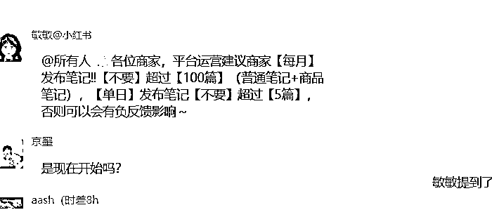

# 知识库这条细分赛道，机会在哪

这一期虚拟产品航海，为什么挑了知识库？道理不复杂：假如你打算在小红书卖高客单价的东西，会发现不少高价商品本身就是知识库。拿人力资源知识库举例，定价 299 元，卖出 6126 单，累计销售额 183.1 万……

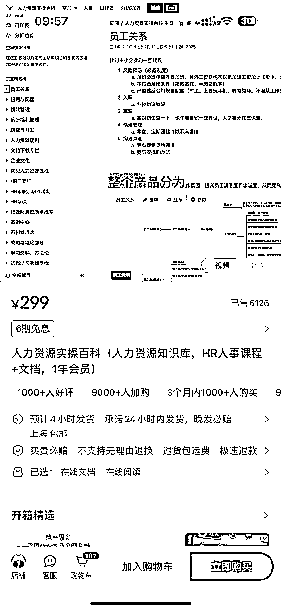

换句话说，想做个人 IP、想在小红书卖出高价位、又不愿从零原创，知识库大概是普通人能抓住的少数机会之一。而且这类生意里，不少项目能跑到百万 GMV，这百万 GMV 几乎都是纯利润。

知识库到底指什么？很多圈友卡在一个误区里：以为搭建知识库特别专业、特别难，还得审美在线，于是直接打退堂鼓。这里先把误区掰正：知识库的要害，是把你目标用户想要的东西给到他们。这次航海说的知识库，也不见得全是“知识”，它就是个统称。

# 2. 完整操作链路怎么走

核心流程可以拆成这几步：先摸底同行 > 再结合自己的长处和推荐赛道，锁定一个赛道和一个选品 > 接着搭建账号、开通店铺 > 上架虚拟商品 > 制作笔记并发布 > 引导成交 > 最后试着借助 AI 做自己的知识库。具体看本期路线图：

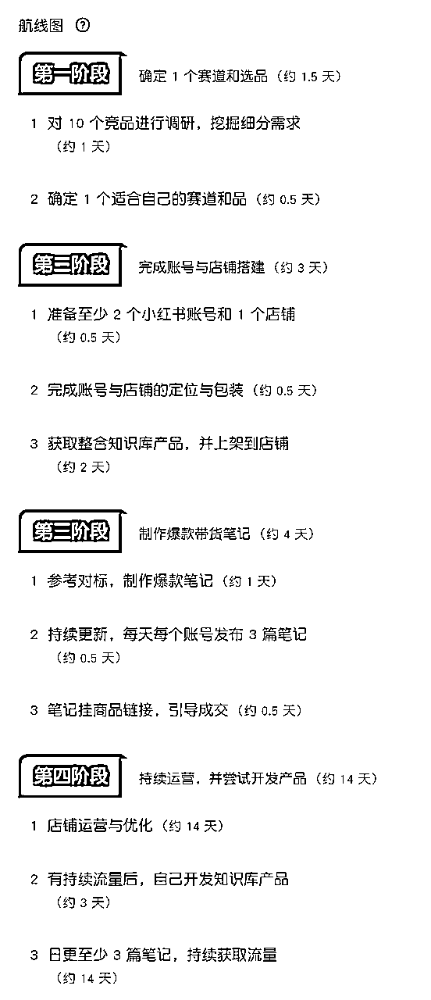

操作要点

对不少人来说，知识库听着陌生，其实门槛不高。它可以小到一份面试题库、一份考试通关经验；也可以大到一套个人学习体系、一套英语口语训练资料。总体并不复杂。多数人真正要盯住的，是“出单”这个结果，前期准备别纠结太久，更别把流程想得过于复杂。比如有的人一心要推陈出新，做市场上从没出现过的产品，研发阶段投入过大，一旦结果不理想，心理上很难承受。更稳妥的路子是：以量取胜、边干边学、在实战中磨炼。第一步从模仿切入，但模仿不等于抄袭，而是把底层的流量密码借过来。比如你做职场或面试题知识库，就去看看职场赛道里销量靠前的商家——他们的笔记策略、标题和首图怎么设计、怎么拍摄。假如自己拆解能力不足，丢给 AI 大模型帮你分析也行。

举个例子：假设知识库已经开发完，你卡在发笔记这一步，不知道从何下手，又怕没流量。这时候先把一篇笔记拆开看：首图 + 标题 + 主体内容 + 留言区。去观察知识库头部玩家怎么发，先照着粗粗模仿，之后再谈创新。比如我发现，不少知识库卖家的首图就是拿手机对着显示器拍一张；新手完全可以照搬，还省时省力。

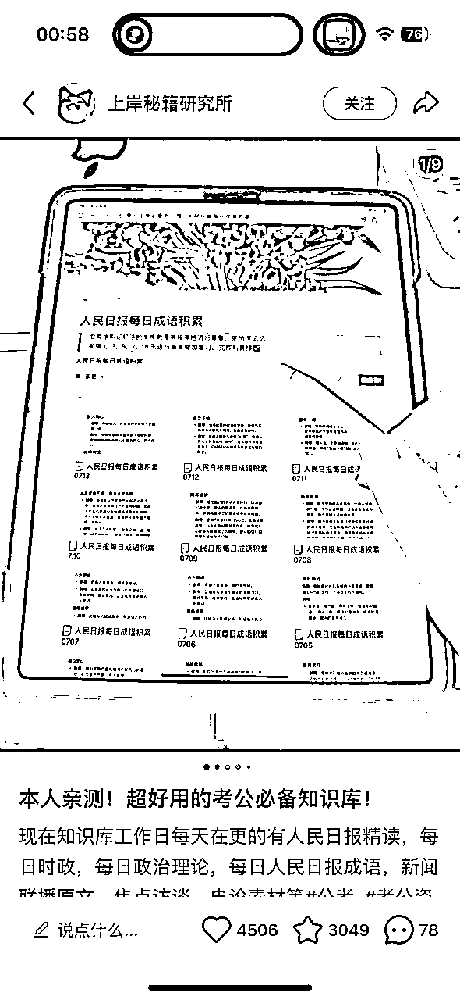

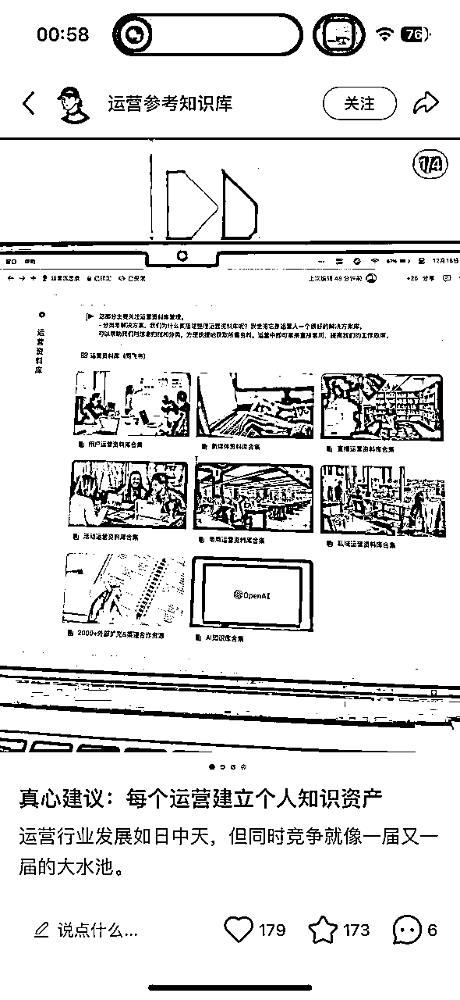

产品做出来之后，发笔记要勤。每天发三条没问题，围绕产品的不同侧面去写，同时把关键词埋进去。打个比方，九月是秋招高峰，你做职场赛道，会去搜哪些词？把这些词揉进笔记里。记住一点：你的笔记本身就是答案。

概括起来，小红书电商做知识库，堵点就两个：一是知识库，二是笔记。这两处通了，接下来要想怎么放大战果。尤其是单个账号跑出结果后，就该琢磨怎样复用到别的账号，从 0 到 1 之后快速迈向 1 到 10。

新手准备与避坑

既然加入这次航海，就得把它当回事，时间要投进去，心态上把它当成自己的项目来干，而不是随便玩玩。另外，思考不能省，别机械执行。航海资料是份好教材，要多翻；翻过不等于会了，得边做边学。万一暂时没出单，也别慌，先在群里发问，把背景和卡住的地方讲清楚，再判断是继续迭代笔记还是换赛道。总之，耐心要足。

入门清单：
- 小红书账号至少两个，店铺一个（保证金 1000 元，提现时再交也行，关店时退还）
- 制图工具：可画、美图设计室、稿定设计、黄油相机之类
- 其他：飞书，用来搭知识库


# 3. 内容主笔

内容出品人：Luke


更绪


稳稳


米杰、希平


叁斤

手册制作方：生财有术团队
出品时间：2025 年 8 月


虚拟产品这条路，对普通人来说性价比相当高，同时也是一场持久战。你可以想象：每天睁眼，账号后台都有新增收入不断进账，这感觉就像给自己攒了一份养老钱。那要是没做成呢？不少人会这么问。我的回答是：只要你真真切切为这次航海付出了心血，你其实已经赢了。没卖出去不等于输，你敢迈出这一步，本身就是成功。真正值得的东西，只留给愿意等它成熟的人。

## 1. 如何定位选赛道

# 1. 本章要点：方向对了，力气才不白费

选错方向，再拼也是白费；赛道对了，深耕才见回报。在一个好赛道里持续投入，多数时候比在差赛道里拼命内耗更见效。挑赛道，主要看两块：
- 外部：外部行情，它决定项目难不难、收益上限有多高。
- 内部：个人兴趣和长处，它决定你能在这个赛道坚持多久。

如果你擅长挖需求，不妨自己找十个同行产品做摸底，把更细的需求点扒出来。本期航海也替大家筛出了一个大方向和几个细分赛道，你可以对照自身优势和兴趣来挑。⚠️往长远看，还是鼓励大家做原创虚拟资料，所以挑赛道时不妨想一想：这个赛道的资料，往后我有没有能力自己原创？赛道既是起点，也框定了你的上限。

本章路线图：学完并实操这一章，路线图第一阶段就完成了——确定一个赛道和选品（约 1.5 天）。其中：摸底十个同行产品、挖细分需求（约 1 天）；敲定匹配自己的赛道和品（约 0.5 天）。


# 2. 定位与选赛道：先清点家底，再找位置

赛道跟自己对得上，做起来才顺手。很多博主内容表达力很强，可就是没好好分析自己的长处，一头扎进陌生领域，最后无疾而终。欲速则不达。做小红书虚拟产品，头一件事是清点家底、找定位。为什么这一步这么要紧？不清点自己的优势资源，你很快就会选题枯竭。举个例子：你是资深 HR，却偏要闯美妆领域；HR 这一行你是内行，过往积累一大堆，在小红书上表达起来游刃有余，选题源源不断，起号根本不是难事——你不过是把过去的经历和经验搬到了小红书。这类经验生动、独特、专业，很容易被平台的推荐机制和用户抓住。等相应的虚拟产品和服务开发出来，完整的变现链路就真正跑通了，你也从上班族变成了经营者，完成一次角色切换。

那具体怎么清点家底、找定位？第一步，问自己：你有没有完成过某些成就？在完成它的过程中，是否经历过挫折和失败？过程虽然曲折，但你最终扛了过来，而且你有足够的分享冲动想把这段经历讲出来，同时这份经验还能帮到别人。这个问题很关键，因为它对你来说是一座没被挖掘的内容宝库——你不刻意去搜，大脑很难想起自己还有这么一段经历。问题的核心在于：这份经验能否帮到别人。你得从中挖出对他人有用的成分，否则整理出来的东西太小众，既唤不起共鸣，也会打击自己的信心。所以，要把真实的市场需求和你自身的长处对上号，让你的零散知识变成别人离不开的东西。

要是还是不知道怎么盘点，就照着下面几个问题自问：
- 你拿到过哪些大结果？
- 你在某个领域是否比旁人积累了更多经验，比如考公、考证、考研之类？
- 你是否有过硬的基础技能：飞书多维表格、Notion 模板搭建、视频剪辑、AI、PS、PPT、手绘、Procreate 做饭等等？
- 你身上有没有别人没有的多重身份标签，比如大厂、35 岁、带娃爸爸博主、留学经历、正在装修房子、即将裸辞、数字游民、减重成功等等？
- 在核心课题上，你有没有拿得出手的成绩和分享冲动，以及跳出大众视角的生动个体感受？核心课题指的是：职业、家庭、自我提升、身体状况、成为更好的自己。

举个例子：你很擅长搭飞书多维表格，那就可以按用户需求，做出各种场景下的飞书解决方案。眼下正值秋招招聘季，有小红书博主用飞书多维表格做了秋招进度表，卖了三千多份。要是对自己的长处没头绪，上面五个问题可以拿来参考。

看懂需求只是起点，能主动造出新需求更关键。你能想到的方案，别人也想得到；人人都能想到的办法，肯定算不上好办法，很容易把脑力活干成体力活。别去卷那种没门槛、纯耗时间的赛道。你可能看到很多人拿到了结果，但他们未必会告诉你胜负手在哪。所以，做自己的数字产品时，别整套照抄别人的商业模式。比如有人卖义务教育阶段的教辅资料，你看着销量好也跟着卖，结果发现自己一单都开不了。根子在于你只是把产品复制了一遍，而那压根不是你的强项所在。对方可能是在中小学任教多年的老师，对学生需求了如指掌，笔记能戳中痛点；你的内容却平平无奇，毫无亮点。

发现需求有价值，创造需求价值更高。因为只有把需求造出来，并且让消费者认可它，你才能建立差异化优势，也就是自己的小生态位，或者说成为第一个尝鲜的人。但要留意：即便你造出了新需求，国内竞争这么白热化，照样可能被人模仿。所以前期要尽快把结果做大，比如销量、笔记数。道理很简单：换你是买家，低客单价的情况下，肯定挑卖得好的那款。你在小红书搜求职简历样板，会看到同样的产品，有人能卖三万件，有人只有几十件。所以，前期准备必须做到位。

那怎么创造需求？一个需求已经存在但还没被发现，有四条黄金法则：
1. 它带一定专业壁垒；
2. 它能被解决，但很紧急；
3. 它有社交属性，能晒到朋友圈；
4. 它常让人感叹：这也能赚钱？

所以，可以去小红书看看有没有大量类似的需求。比如第一条“带专业壁垒”：各类专业软件的部署安装、CAD 这类软件的安装教程，都能卖几千单。第二条“能被解决但很紧急”：证件照精修，尤其是工牌照片、海马体、结婚登记照之类。第三条“有社交属性、能晒朋友圈”：手工誊写的婚书、给孩子的生日祝福视频（比如奥特曼主题）。

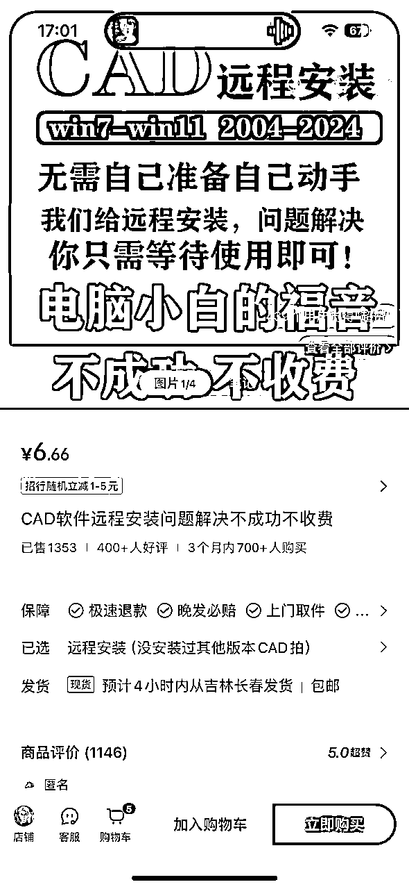


# 3. 值得切入的知识库赛道

# 3.1 个人成长方向

这类知识库在小红书挺常见，但眼下已经偏红海了，因为讲个人成长的人太多，而且这个领域站着头部玩家：参考答案阅览室。参考答案阅览室已经吃掉了大部分流量红利，后来者想反超很难。个人成长知识库的逻辑，是把国内外优质的成长、职场、效率、习惯养成等内容做分类整合，再交给用户深度阅读。

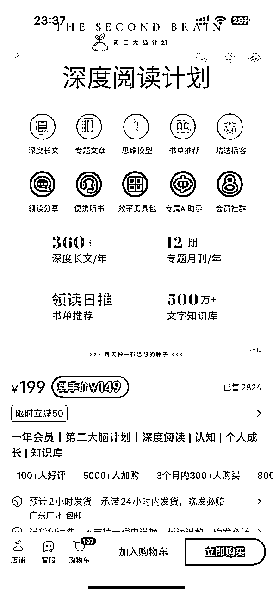

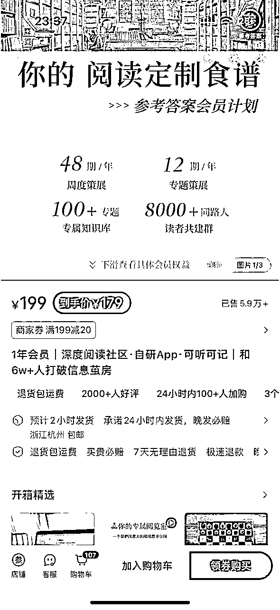

那为什么有人愿意掏钱？消费者付费的底层逻辑是什么？很多人会纳闷：网上公开的文章，凭什么能卖钱？这也正是我推荐原创能力偏弱的圈友做知识库的原因：你压根不用原创，要做的是“搜集 + 整理”。第一步搜集，按主题去找优质信息源，比如知名大佬的个人博客、播客、YouTube 等等。YouTube 是个特别宝藏的信息源。想走原创、拿一手信息，一定要试试 YouTube。像 AI、个人成长这些领域，大量优质信息源就集中在 YouTube。举个最直白的例子：之前有位小红书博主，把纳瓦尔最新一篇文章翻译出来，在小红书卖文字稿，最后变现近一万+。

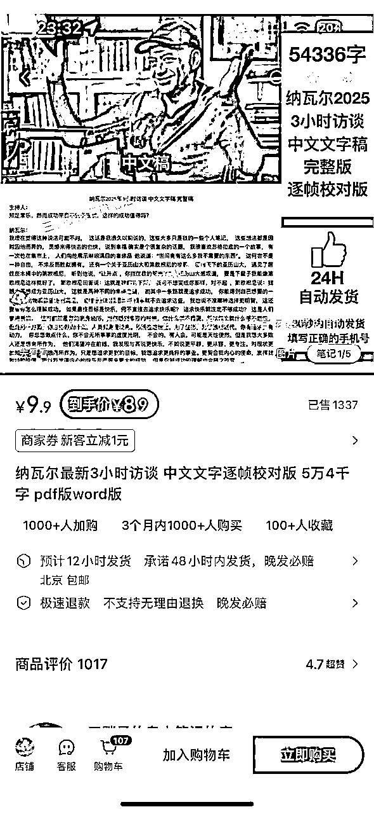

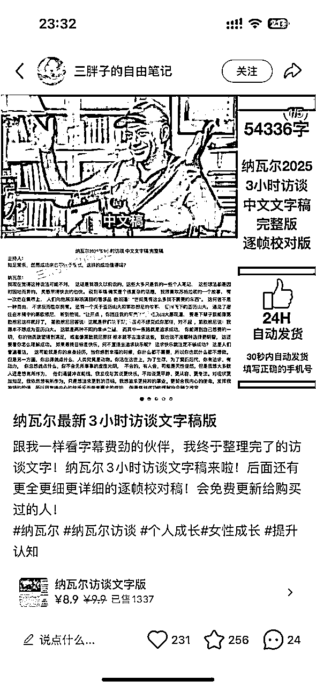


# 3.2 行业或岗位能力提升方向

第二类知识库，瞄准的是行业或岗位能力提升，主要面向职场场景，比如运营、产品经理、AI、方案、报告等等。买这类知识库的人，核心目的同样是自我成长，只不过方向落在职场上。对圈友来说，怎么复制？先看自己的行业：如果你这行本身就有很刚需的资料积累，在小红书又有足够的人群覆盖，并且已经有人在做同行业的知识库，那你后面跟上就行。既然资料已经攒下了，整理整理就能上架。想走职场 IP 的，也可以做知识库，因为这类产品往后能承接更高的客单价。记住一句话：每个行业都能长出知识库，关键是找准角度。

运营知识库：

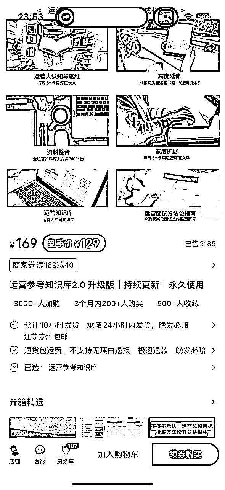

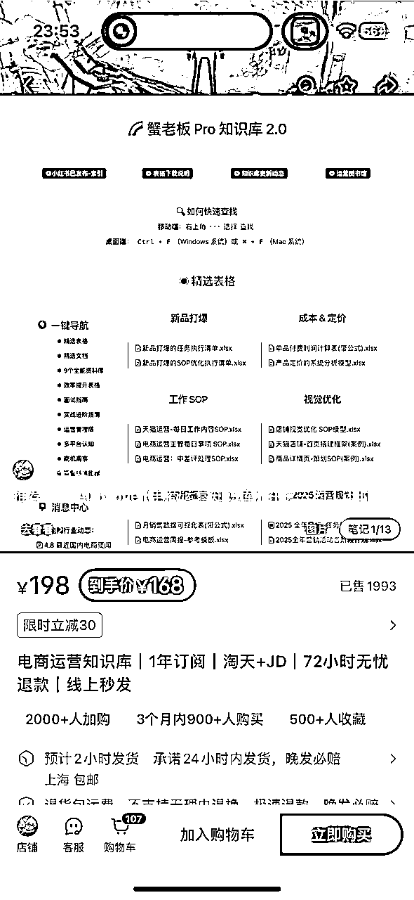

产品经理知识库：

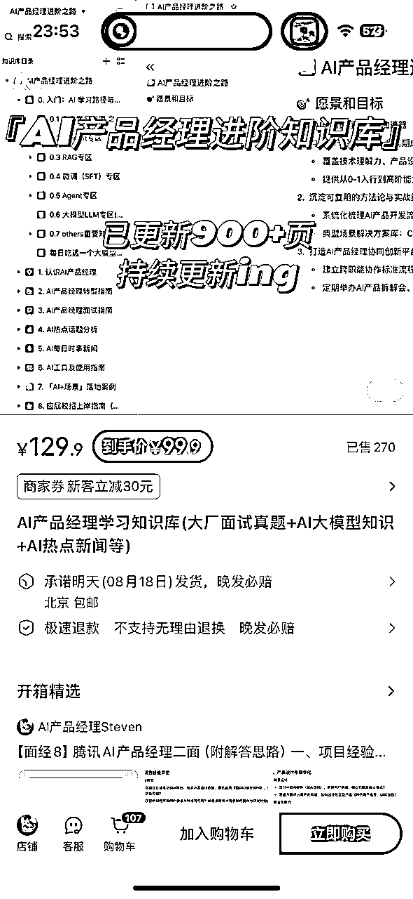

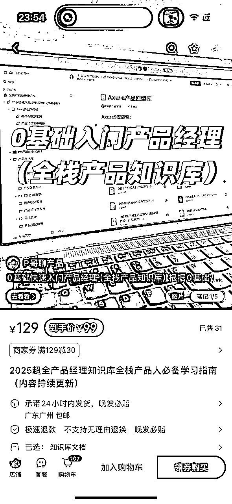

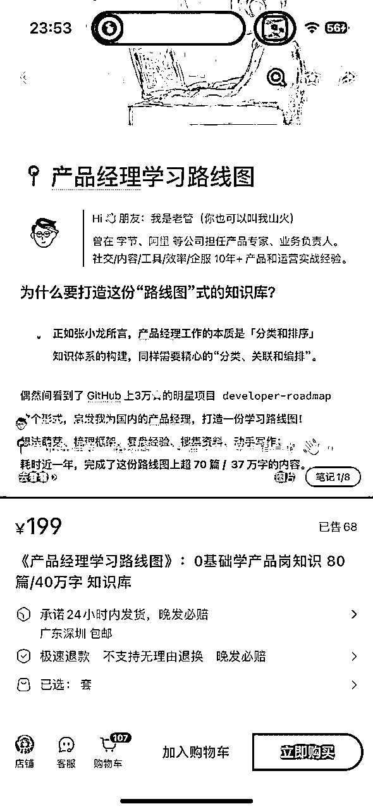


# 3.3 考试备考方向

这一类很典型，考试本身就是一个巨型赛道。假如你能针对某个岗位、某场考试做一整套备考知识整理，其实也能算知识库。像公务员考试、教师资格证考试、四六级英语、考研英语等等，都可以归入基于考试备考的知识库。要是你后头有高客单的升单产品，我非常建议试试这个赛道。直接上案例，大家感受一下。

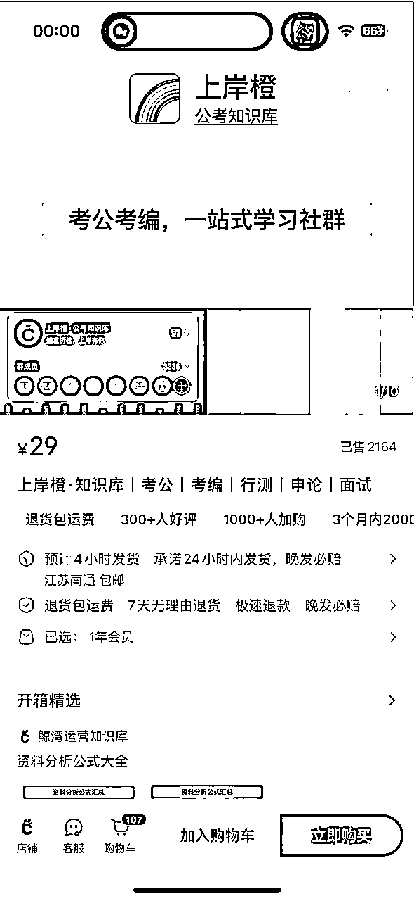

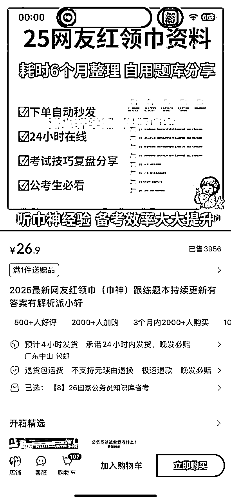

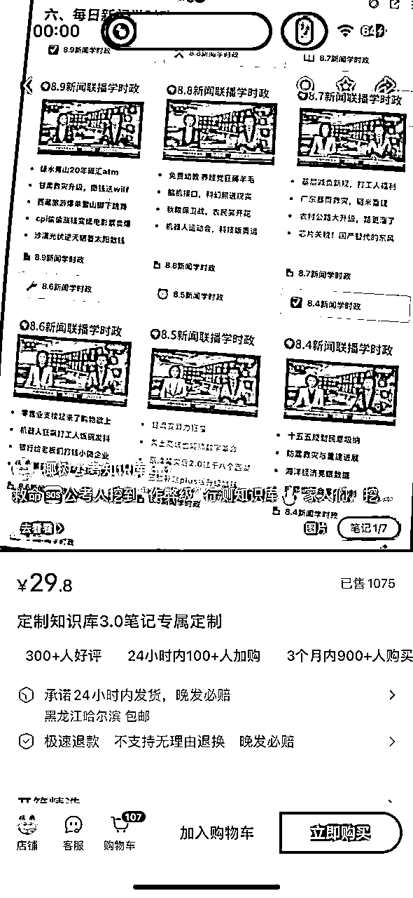

# 3.4 语言学习方向

这里说的是基于语言学习的知识库。英语知识库在小红书卖得确实好，但不代表只有英语——其他语种的知识库同样卖得不错，比如韩语、日语、俄语知识库，销量都很亮眼。这些语言学习素材大多来自油管，所以“语言 + 油管”的知识库是条好路子。对原创能力偏弱的圈友来说，这个项目门槛相对低。你只要搞定油管视频剪辑和解读，而这些都能靠 AI 来办。

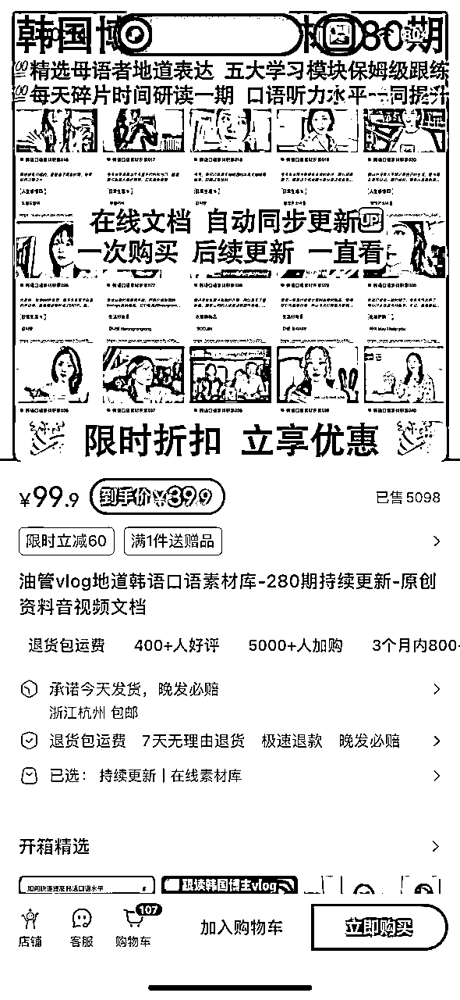

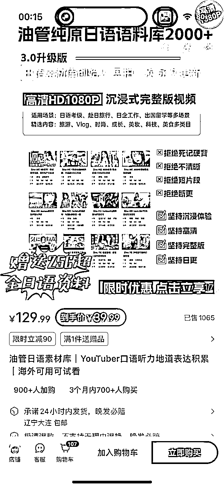

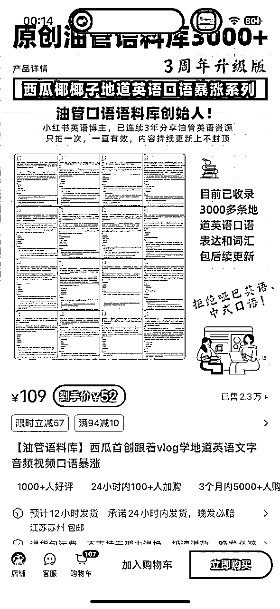


# 3.5 面试题库方向

每个行业除了能做行业或岗位能力提升的知识库，也能有自己的面试题库。而且面试题库完全可以用 AI 生成，对想做原创虚拟产品的圈友来说，相当友好。

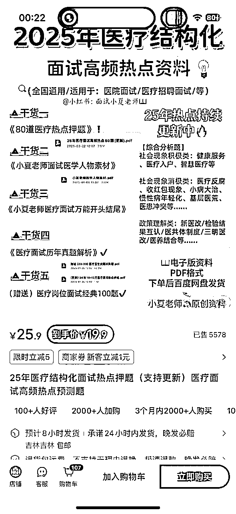

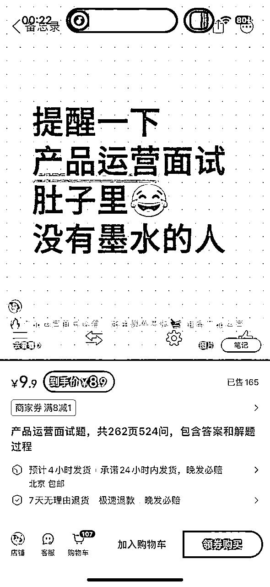

## 1. 如何选品：用深耕意愿做筛子

赛道这么多，到底挑哪个？不少圈友在这上面犯难。如果你也有同样的困惑，我建议盯住几个指标，或者干脆问自己一句：你能不能沉下心，在这个赛道里深耕下去？

做知识付费，有个判断我反复提过：知识库属于典型的“慢变量、厚积累”型生意。它跟追热点、捞快钱的项目不是一路——拼的是耐性、沉淀和持续加码，扎得越深，回报往往越可观。

小红书上年销百万的虚拟品里，知识库类占比相当高。所以，你愿不愿意在这个方向沉住气，基本决定了天花板在哪。

若你在运营、产品、AI、养生等方面攒下了足够的经验，那就把它梳理成体系，落成知识库。假如一时找不到自己可输出的领域，那就换个思路——向内挖不到，就向外找。

向外找，衡量的是市场热度。某个方向若已被大量验证，说明需求真实存在，值得下手。但不要一上来就铺大摊子，更聪明的做法是在大领域里挑一个窄口子。

# 1. 大赛道里挖小切口

先界定一下“大赛道”。英语算，职场也算。可你如果只挂一个“英语知识库”或“职场知识库”的招牌，用户很难有感觉，转化自然弱。

破解办法是做场景。仍以英语为例，把范围收窄到“幼儿英语”“儿童英语”，围绕“磨耳朵”这一需求做文章：搜罗优质儿歌、动画等听力材料，依据年龄分层，搭成一个专供儿童听力的资源库。

材料去哪找？B 站、闲鱼、YouTube 上现成的很多。真正的功夫在于：结合你对“儿童英语听力”的理解，把散落资源重新归类、编排。

要是把一堆文件原样甩给买家，最多值 0.99 元。原始资料不值钱，值钱的是你梳理的框架和呈现方式。

同一批内容，经过结构化处理变成知识库，定价空间和销量都会变样。

类似的玩法不少：同样在英语这个大池子里，有人只切商务英语、职场英语、外企英语，成绩也很亮眼。

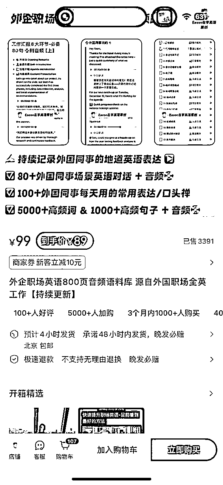


1. 借 AI 搜索来选品

经营小红书虚拟品，尤其知识库，AI 一定要用上。这里给个新视角：让 AI 搜索替你完成前期调研。

它能迅速锁定信息源头。还是儿童英语，确定了磨耳朵这个方向后，打开秘塔 AI（https://metaso.cn/）输入“儿童英语磨耳朵素材”，一大批高价值来源就出来了。

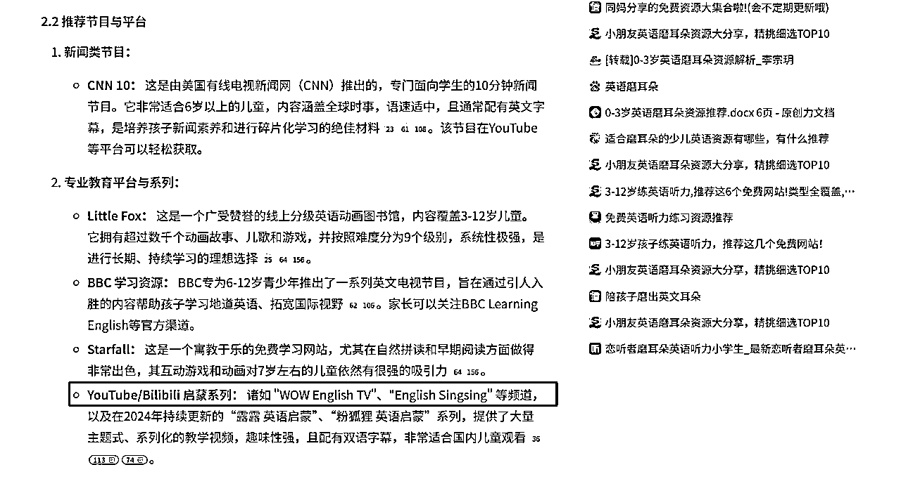

拿到这些线索，再去 YouTube 逐一检索。哪怕你对儿童英语毫无基础，也能很快摸到优质内容，省下大量摸索时间。

这就是借助 AI 搜索完成选品的思路。

方向定了却不知道卖什么，就用秘塔 AI 这类工具快速锁定最终产品。

选品本身不难，难的是耐住性子把内容打磨好——这一步最要紧。

1. 账号与店铺的前期准备

# 1. 本章要点

本章只抓两件事：

.

账号搭建

过去那套把流量往私域引、跟平台对着干的做法已经翻篇。如今在小红书开店卖虚拟品，本身就是平台电商生态的一环，规则之内行事，不必担心违规问题。

因此，诸如一张卡对应一台设备一个账号、必须走流量不能连 WiFi、要刻意养号这类讲究，全都可以放下，怎么顺手怎么来。

.

知识库制作

最快的方式是“博采众长”：参考并整合对标者的信息源可以，但搭建思路不能一比一照抄。

# 本章进度地图

学完并动手，航线图上的这些节点就能点亮：

第一阶段：账号与店铺搭建完成（约 3 天）

.

备齐至少 2 个小红书号与 1 家店铺（约 0.5 天）

.

完成账号、店铺的定位与包装（约 0.5 天）

.

拿到并整合知识库产品，上架到店（约 2 天）


1. 硬件准备

✔️ 手机：只要没被小红书永久封号或永久限流，就能继续用，轻微违规不影响。

✔️ 手机卡：首选从未注册过小红书的号码；老号同样可用，此前跑过无货源之类项目的号也没问题，只要不涉及永久封号、永久限流这两类严重违规。

淘宝或京东搜“电信无忧卡”，月租 5 元即可入手；也可以去营业厅给现有号码加副卡，月租通常 10 元。

✔️ 账号：能做到专卡专机专号固然好，做不到也无所谓。单台设备同时登两个号没有障碍，WiFi 或流量随意，图方便就行。

# 2.1 手机怎么选

个人玩家设备通常不到十台；若要做工作室矩阵，十台起步，上百台也常见。下面给工作室玩家列几款常用机型。

苹果阵营：

iPhone 7：工作室常青款，价格友好、运行顺滑

iPhone 8：跑游戏和短视频居多，功耗低、速度稳

iPhone SE2：存在感偏弱，直播电商、短视频都够用

iPhone X：预算宽裕可考虑，直播电商、短视频养号皆宜

安卓阵营：

红米 10X：表现均衡

小米 10 青春版 8+128G：性能扎实

小米 8 青春版 / 小米 8 SE：使用者众多

安卓机型繁多，不再赘述。

选购原则：

优先二手而非全新（当然如今不少国行新机也实惠）

优先原装而非组装（辨别要点：无指纹、无面容多为拆机机） 尽量避开闲鱼

优先国行而非外版

重配置轻外观

认品牌不碰杂牌

配置：尽量 8+128GB

机龄：安卓四年内、苹果六年内

建议至少备 2 台手机，机器数量越多，跑出结果的概率越大。另外到营业厅办三张以上手机卡，选最低月租但含流量的套餐，流量最好 20G 以上。可采取一张主卡绑两张副卡的形式，直接跟柜台人员说明需求，对方会给出推荐。

# 2.2 手机卡怎么备

途径一：当地营业厅现场办理。

途径二：支付宝搜“号卡中心”线上办理。

途径三：淘宝或京东搜“电信无忧卡”，月租仅 5 元。


# 3. 店铺开设

# 3.1 三类店铺形态

① 个人店

一张身份证加一个实名小红书号即可，无需其他材料，审核速度很快。

② 个体店

需要个体工商户营业执照。若办理，建议选百货类，闲鱼或淘宝代办约 100 元一张。

③ 企业店

以公司营业执照申请。相比个体店优势不明显，还会牵扯税务等事务，可直接跳过。

该开哪种？

纯新手不必纠结，直接申请个人店。

有一定经验者，建议先办个体工商户并认证蓝 V（600 元），再开个体店。后续要做矩阵号时，可直接绑定。

# 3.2 开店操作流程

注意事项：

新手直接开个人店，无需额外考虑。

想做矩阵的老手，先办个体户营业执照，认证蓝 V（600 元），再开个体店。执照经营范围涵盖下图红线部分即可，其余不限。

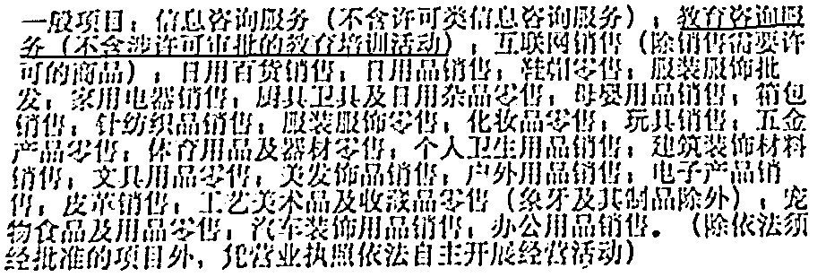

开店入口：以下为直达链接，小红书千帆，打开后用手机号登录，选个人入驻。

https://ark.xiaohongshu.com/?ticket=ST-68c517438149514474558399hfl9opty5x6viycd&from=ark-login

保证金：虚拟资料当前为 500 元，但可以先缓交——等赚够 500 元再补，确保不亏。

缓交的代价仅是无法提现，等需要提现时再补上即可。

开店操作：

.

打开小红书官方电商链接

https://ark.xiaohongshu.com/?ticket=ST-68c517438149514474558399hfl9opty5x6viycd&from=ark-login

.

选择个人身份或个体工商户入驻

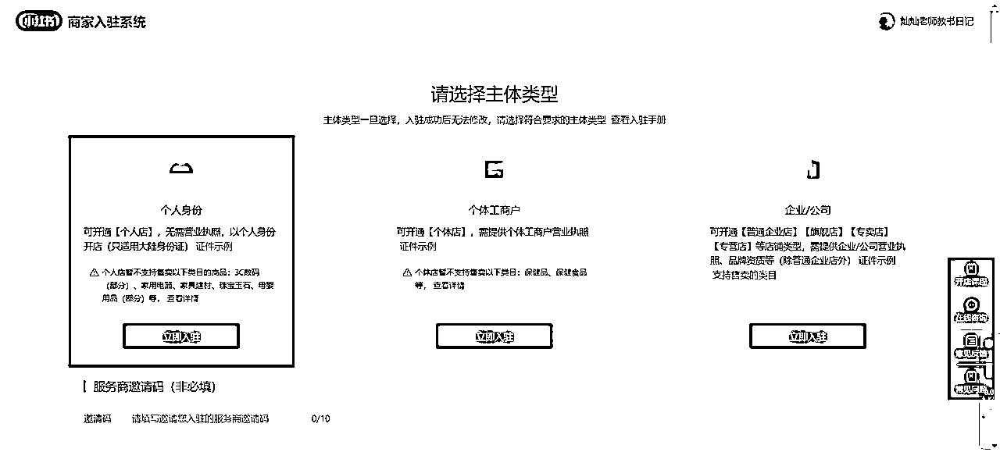

.

填写资料（必填项即可）并完成刷脸

昵称默认同步小红书昵称，如需调整可先改账号名，或入驻后在个人信息中修改（无关紧要）。

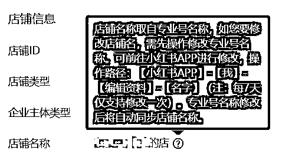

主营类目：保留默认的 [零售批发、生活娱乐、其他] 即可（虚拟资料类目需另传资质）。

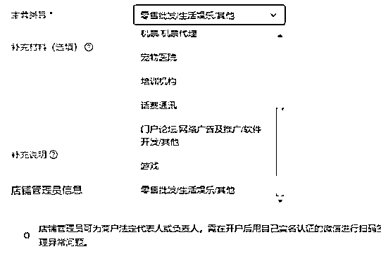

填写【地址设置】【店铺信息认证】。物流模板中的地址随意填写，不影响任何事（不放心就写自家地址，模糊处理），主页只展示大致范围，不显示门牌。

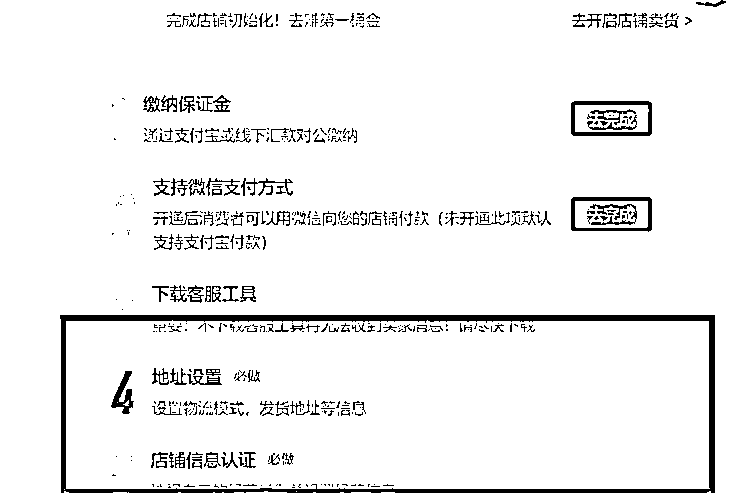


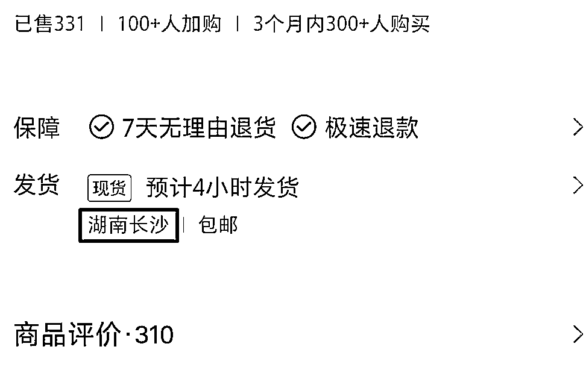

经营类型：勾选类型 3 或 4，任选一个。

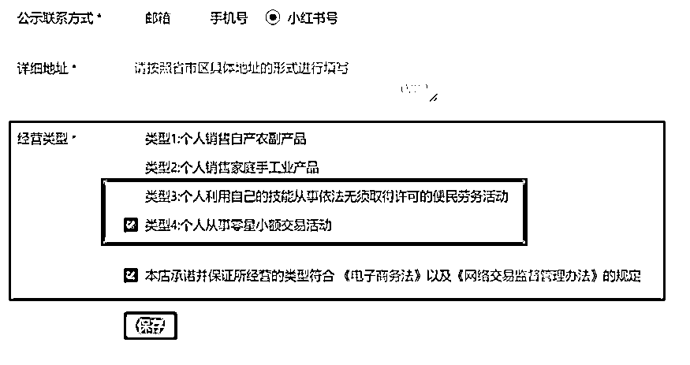

商品类目：选“电子资料包”。

.

提交后会显示审核中，约一分钟完成，刷新即可进入。

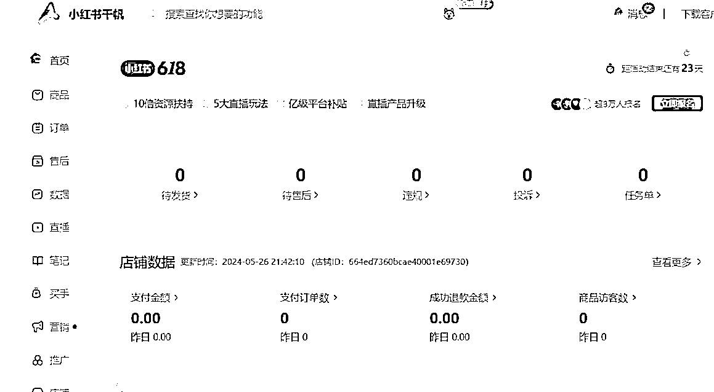

1. 虚拟产品（知识库）的制作

# 1. 快速产出知识库的路径

怎样最快做出知识库？

答案仍是“博采众长”。不论通过什么方式，先找到目标领域里做得最出色的知识库，研究其制作逻辑、排版方式、内容呈现。

有圈友会问：能否直接一比一复制？

不少同行的知识库确实整理自公开资料，但他们的思路、排版、布局均为原创，照搬行不通。信息源可以整合，呈现形式不能一比一模仿。


# 2. 知识库制作实操

AI 兴起后，知识库概念已被广泛接受，可承载的平台也很多：Notion、飞书、ima 等皆可。

但对新手，我更倾向推荐飞书。理由很实在：大量卖家把它作为首选。AI 圈知名知识库“the way to AGI”（通往 AGI 之路，小红书可搜到）便搭建在飞书上。

优秀的知识库绝非内容堆砌——那样用户读起来疲惫。它的核心在于有目的、有逻辑、有心思地组织，让用户迅速感知价值。

打个比方：房子装修好，朋友来参观时你会讲设计思路。知识库就如同你的房间，值得认真布置。

比如 the way to AGI，除了知识内容，还按日期梳理最新资讯，并配有专门社群。

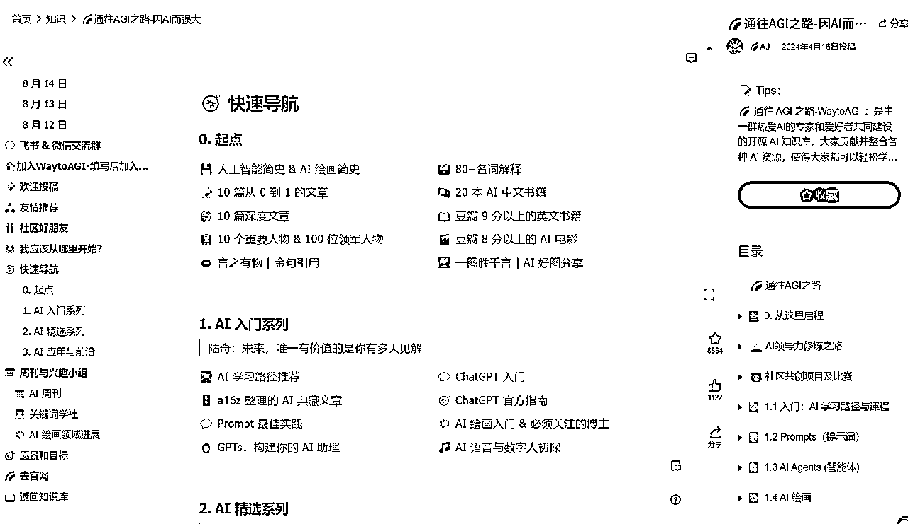

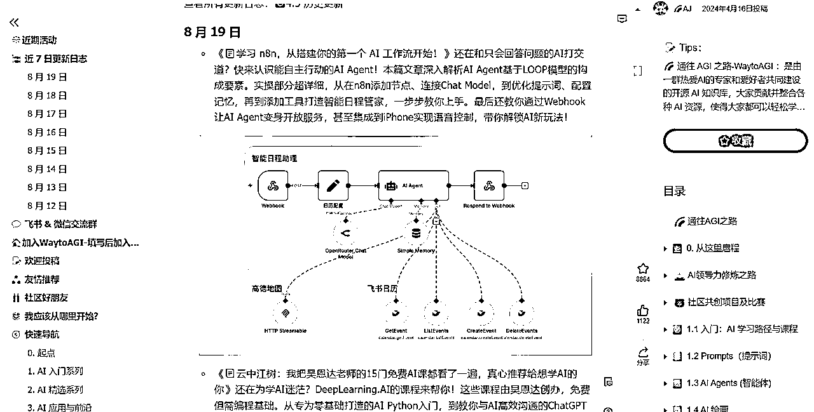

飞书自带知识库模块，点击新建知识库即可选模板。

此外飞书还有一个“飞行社”——优质知识库的公开集合空间，你能从中看到各领域知识库的搭建思路、内容构成与呈现形式。

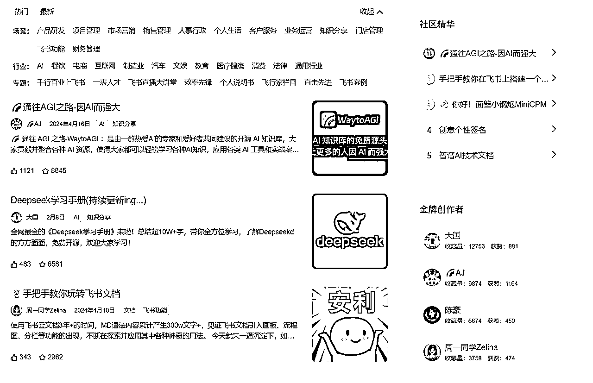

所以，新手用飞书做知识库，性价比最高。

下面以飞书知识库为例，给出完整操作步骤：

知识库不必追求精致，核心是需求抓得准。做得朴素同样能出单。先找到对标（详见【三/01. 找对标账号】），再按以下步骤做到 60 分。

1. 下载飞书，新建空白知识库

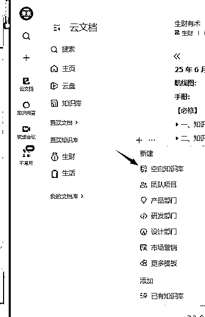

1. 填写知识库名称，选定可见范围。

1. 选中知识库，将新建的 ComfyUI 知识库置顶。

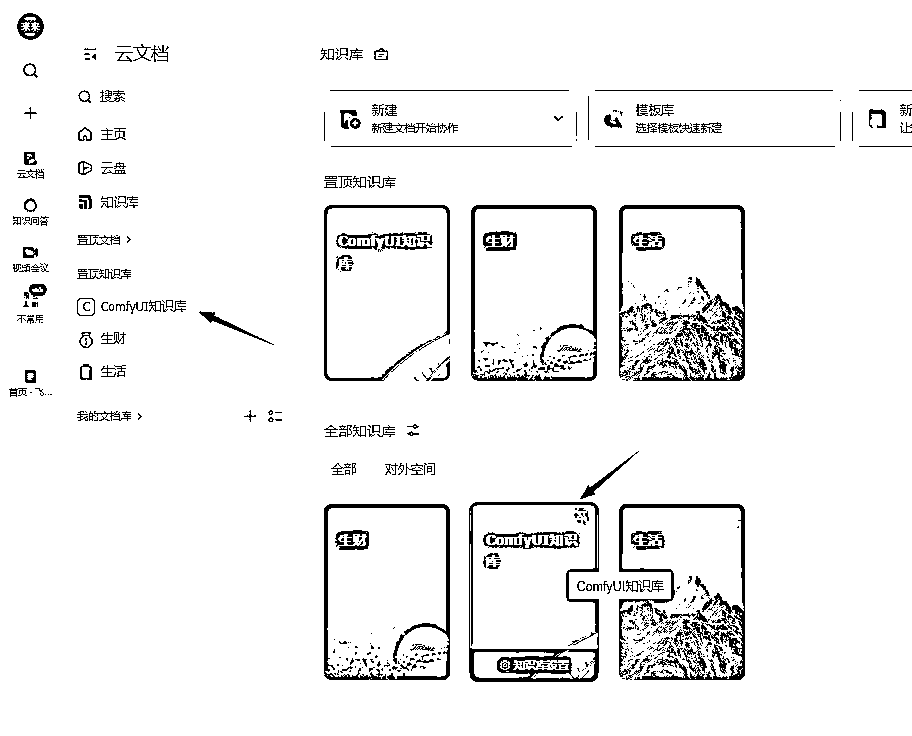

1. 新建后默认带一个首页，可作导航，也可删除。建议删掉。

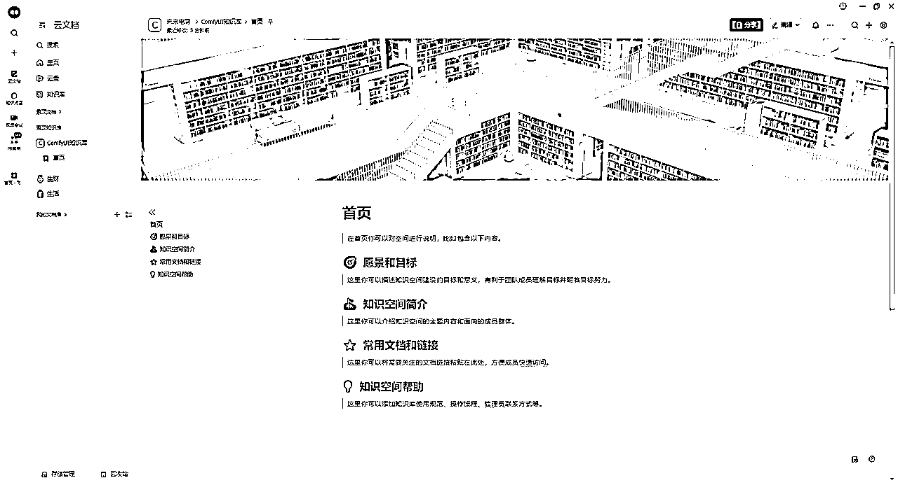

1. 建议删除首页。

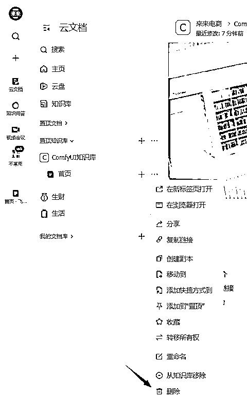

1. 随后按知识库内容的主次关系，建立若干文档充当文件夹。

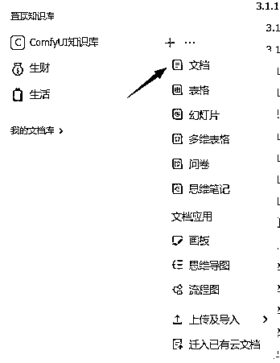

1. 需注意：建的是文档，实际当文件夹用——飞书知识库不支持直接建文件夹。（以 ComfyUI 为例）

1. 为便于区分，可给每个“文件夹”配上数字或颜色图标。

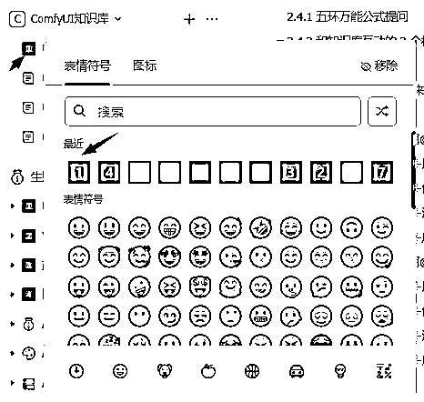

1. 加完图标大致如此

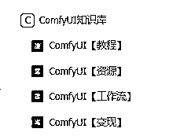

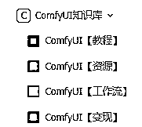

1. 接着往各一级文件夹中填充二级文档，即添加文档、做好分类、按类补充。

以 ComfyUI 教程的二级目录为例：其下再分三个三级目录，其中“ComfyUI 安装”这一级重点收纳各类安装教程。

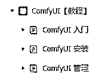

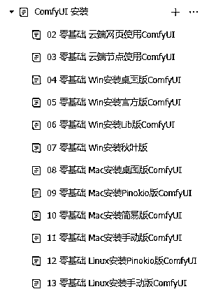

1. 继续为每个细分三级类目填充内容。此处备好 8 份 ComfyUI 安装教程文档，直接作为知识库内容（也可在开头放二维码，把用户沉淀到私域）。


零基础 云端网页使用ComfyUI .docx

零基础 云端节点使用ComfyUI.docx


零基础 Win安装桌面版ComfyUI.docx

零基础 Win安装官方版ComfyUI.docx


零基础 Win安装Lib版ComfyUI.docx


零基础 Win安装秋叶版 .docx


零基础 Mac安装桌面版ComfyUI.docx

零基础 Linux安装手动版ComfyUI.docx

（若无法直接下载，可走网盘：https://pan.quark.cn/s/da192fc747d4）

1. 这里以 ComfyUI 知识库为例，其他领域逻辑相通。比如做 YouTube 视频主题，同样先立一级类目，再按需往下分二级、三级。

1. 飞书知识库的更多设置，点此处。

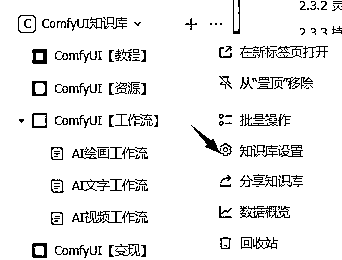

1. 若希望知识库全网可见，点击分享知识库。

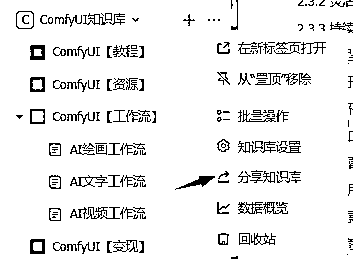

1. 打开分享开关后，复制链接即可获得知识库地址。

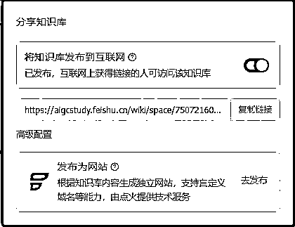

这里有个小彩蛋：

飞书内置知识问答。选择“使用知识”并指定你自己的知识库，就能向它提问。这个技巧也可以教给客户。

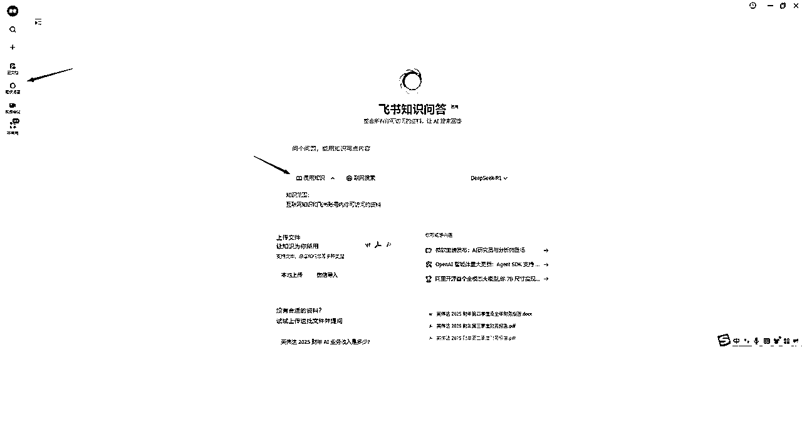

例如我问飞书知识问答：MAC 怎么安装 ComfyUI？WIN 怎么安装 ComfyUI？Linux 怎么安装 ComfyUI？

务必打开“使用知识”，它才会调用你的知识库。

飞书知识问答会从知识库中提取文档来作答。


1. 商品上架

# 1. 上架操作

.

登录小红书千帆官网，主页进入【商品管理】


.

类目选择【个性定制/设计服务/DIY >数字商品 >电子资料包】


.

按提示补全商品资料。若系统另有提示，依提示调整即可，一般不会出大问题。


1. 价格怎么定

知识库定价最省事的办法是对标同行，但仍要看具体方向。

职场类知识库，比如运营或产品经理方向，定价宜落在 100-300 元区间，同行普遍如此。

个人成长类，比如对标“参考答案阅览室”，建议 149-199 元。

题库或素材库类，可定 49-99 元。

以上仅为参考，仍要多调研同行，理解其定价逻辑。

若参考淘宝对标选品，同款商品在小红书的定价宜为淘宝的 2-5 倍。做小红书图的就是高客单，不必因定价高于同行而担心卖不动。小红书本质是兴趣电商，而非货架电商。


1. 自动发货配置全流程

先讲几个前提细节：阿奇索的免费体验期有七天，务必先把这七天白嫖完。一般建议等店铺跑出订单后再来配置自动发货；如果还没开张，这块可以先搁着。电脑没办法长期保持开机的话，可以托管到服务器，或者开通短信通知。下面是小书店铺里阿奇索自动发货的配置步骤，按图示顺序走即可。

进服务市场。

在搜索框敲入“自动发货”，就能找到阿奇索。

接着要关联一下平台。

注册流程随便走一遍。

假如你不是全天候开着电脑，别忘了回来重新登录一次；先体验那七天免费期。

App也得装一下。


账号密码登录的方式，得先在千帆店铺那边配置好。

找到自动发货入口，进入商品设置，点添加，挑自己已上架的商品，填入自动回复的消息内容。

电脑做不到长期挂机的话，短信发货服务可以买一个。

发货助手下载之后，得让它持续在电脑上运行；不然就得买短信服务，或者租个服务器把助手挂上去。千帆后台要绑定店铺登录用的邮箱，原因在于发货助手仅支持邮箱方式登录，扫码登录行不通；只有助手处于登录状态，自动发货才会生效。
上述步骤全部完成后，自己下一单试试，验证自动发货是否正常工作。


1. 商品上架前必读

问：小红书店铺的版权问题如何判断？
答：上架时尽量避开带版权的素材；一旦版权方追究，举报风险不小，毕竟店铺做过实名认证。判断方法：素材最好不带水印；观察同行，如果有三家以上在卖同类内容，基本可以上。另外附赠一张【免责说明】详情页图，用于应对突发状况。

问：店铺之间都在拼低价吗？
答：货架类平台（淘宝、闲鱼、拼多多）的比价现象确实突出，可小红书走的是兴趣电商路线，用户本身没有比价习惯。若一百个访客都没成交，可能是定价偏高了；但访客量本来就少的情况下，别急着把原因归结到价格上。要明确一点：这边的用户对价格并不敏感，不用畏惧标价高于同行，大胆往上定价；单价提高后成交量或许下滑，但总利润未必缩水。

问：虚拟资料类订单发货时还需要填快递单号，怎么办？
答：发货环节里有个“无物流发货”选项，勾选即可。

问：店铺和私域能不能共用一个账户？
答：店铺账号已实名，店铺也绑在这个号上。同一个号不建议同时跑两套玩法；私域本身属于违规操作，一旦账号被封，店铺也跟着完蛋。店铺适合做低客单价走量，前期可以用它赚点钱作为过渡；私域另开账号去操作。

1. 寻找参考账号

1. 本章内容概览
这一章讲的是如何在小红书打造引流型爆款笔记。重点包括：参考账号的筛选方法、选题的挖掘思路、爆款标题的制作流程、封面与内页的设计流程，以及提高效率的模板笔记常见类型。这是课程里实操比重最大的部分，务必认真对待。

# 本章学习路径
学完本章并动手实践，你就能推进路径图里的：
第二阶段：打造爆款带货笔记（大约4天）
参照参考账号，做出爆款笔记（大约1天）
保持日更，每个账号每天发三篇（大约0.5天）


1. 哪些账号有参考价值
无论你混哪个平台，模仿参考账号都是条捷径。所谓参考账号，就是跟你同领域、同类型的其他创作者，创作时可以借鉴对方的内容形式、话题切入角度等。

筛选参考账号的几条标准：
⭕ 粉丝少：一万粉封顶，超过的不考虑。
⭕ 点赞高：点赞数超过粉丝数，说明内容有干货、够扎实。
⭕ 时间近：看最近一个月的表现，只看一周不够有说服力（周末流量偏高）。
⭕ 主页高频露脸：刷主页时同一个封面反复撞见，那这个号就值得参考，照着做就行。

爆款笔记有四个核心要素：选题思路+封面设计+标题技巧+内容写法。
⭕ 小爆款：点赞收藏加评论合计≥200
⭕ 中等爆款：点赞收藏加评论合计≥1000+
⭕ 大爆款：点赞收藏加评论合计≥1w+
⭕ 超级爆款：点赞收藏加评论合计≥10w+


1. 参考账号去哪里找
搜索法：在首页输入你目标赛道的相关词（也就是养号阶段搜过的那些），从排在前五十的笔记里挑出小爆款和中等爆款，且评论区出现“求”“需要”“私我发”这类留言的，就是值得参考的对象。优先选同赛道里做了三到六个月的账号。

搜索框拓词法：在搜索栏输入赛道词，下拉提示里出现的都是小红书用户频繁搜索的内容，说明需求旺盛；再按小爆款和中等爆款的门槛筛出优质选题来参考。

首页推荐流：养号养好之后，平台会依据你的互动偏好推送你可能感兴趣的爆款。这时候首页刷到的多半是同行，同样按小爆款和中等爆款的标准挑选出优质选题参考。

赛道热门话题法：关注同领域做得好的博主，找出他们互动数据高的笔记，点进话题标签，再按小爆款和中等爆款的门槛从话题页里筛选优质选题。

1. 挖掘爆款选题
这里分享两种挖掘爆款选题的路径。新手先用第一种——顺着话题标签找选题；等你对爆款有了手感，再试第二种——借助AI和乘风关键词词包，用工具来提升选品效率。

1. 顺着话题标签找选题
刷到一篇爆款笔记，尤其是近三天发布的，点开笔记页面上的话题标签进入话题页，按综合、最新、最热三个维度继续翻找更多爆款。


顺手关注这个话题，以后在首页的关注页就能刷到该话题下的相关笔记。


1. 让AI配合乘风词包找选题
2023年小红书力推的工具叫“乘风”，定位是站内电商推广，隶属于千帆后台。它凭什么能帮找选题？因为它有通投和搜索两种投放方式，卖家可以买关键词来投放笔记。举个例子：假如你做雅思考试方向，就可以投雅思相关的词，比如“雅思备考”“十天雅思备考”之类，用户搜这些词时就能刷到你的笔记。

具体步骤：
打开乘风推广页面：https://chengfeng.xiaohongshu.com/cf/ad/manage?type=standard
新建计划 → 搜索广告 → 搜索关键词

点【添加关键词-搜索关键词】，就能看到【关键词词包】这个入口。比如搜“雅思备考”，会蹦出不少词包；下载打开后能看到具体关键词及其分类，包括竞争指数、月均搜索指数、市场出价。月均搜索指数与市场出价呈正相关——搜索指数越高，市场出价越高，代表用户搜索意愿越强。

这个词库的价值在于揭示用户搜索偏好。可如果靠自己分析，往往提炼不出有效结论，大部分人欠缺层层拆解的能力。这时候可以让DeepSeek帮你挖掘潜在选题红利，用关键词反向推导选题。

操作方式：把词库喂给DeepSeek，让它替你分析归纳。

先声明：我给的策略和提示词并非最优解，DeepSeek本身已经足够聪明，不必用太复杂的提示词束缚它的发挥。

我的第一段提示词：
```
我需要你根据这个文档，帮我给出 20 个选题方向，并给出 20 个包含热门搜索词的标题，同时，你需要告诉我选题理由，以及覆盖了哪些核心关键词
```
DeepSeek的思考过程相当有料：它指出高搜索词流量虽大但竞争白热化，可以搭配长尾词来降低难度。让我意外的是，它不仅给出了公式，还附带了正文写作方法，比如【高搜索词】+【人群/场景】+【长尾词】；另外还教了一套正文写作思路，把高价值搜索词合理地嵌进去。如果你觉得结果还不够丰富，可以让它继续输出更多公式和写作技巧。总的来说，它既能帮你定选题，也能教你写正文。核心思路是：让DeepSeek分析关键词、延展选题、提前抢占搜索流量，从而避免选题灵感枯竭。

以上是具体操作流程。DeepSeek还有个隐藏用法：既然它这么聪明，何不直接问它“我该怎么向你提问，才能把你用得更好”？于是它真的教了我怎么提问：


1. 打造爆款笔记

# 1. 标题
# 1.1 标题拼接法
这里得致敬袁隆平爷爷——把不同优质稻种杂交出超级稻。方法不复杂，效果却很猛，我的爆款标题就是这么磨出来的，妥妥的流量密码。举例：搜“纪录片”按最热排序，翻前十篇笔记，会发现高频词无非这几个：央视推荐、绝了、建议收藏。最热的前八篇里，有六篇标题几乎如出一辙（爆款本就是互相重复的）。直接把这些关键词拿来排列组合，拼出来的标题天然带爆款基因。

★ 小贴士：平时刷到的好标题随手记在备忘录里，有空就翻翻，慢慢培养网感。


# 1.2 标题公式库
此外，我还整理了一批爆款标题的万能框架，套上就能用：

这个_______堪称_______之光！ 示例：这个网站堪称产品经理之光！
_______❗️我要吹爆这个_______资料库 示例：参考答案❗️我要吹爆这个电商运营资料库
刚_______，被_______的_______资料库震撼到 示例：刚入职，被运营总监的电商资料库震撼到
强烈建议做你自己的_______资料库 示例：强烈建议做你自己的自媒体资料库
终于搭建出了_______资料库 示例：终于搭建出了职场工作方法资料库
身边没有_______，一定要去看这个资料库！ 示例：身边没有高人指点，一定要去看这个资料库！
我发现优秀的_______都偷偷地_______自己的资料库 示例：我发现优秀的运营都偷偷地建立自己的资料库
这个资料库我愿意称为_______🤔 示例：这个资料库我愿意称为年度最伟大发现🤔
花_______小时做的_______库拯救我的_______ 示例：花200➕小时做的英语素材库拯救我的哑巴英语
_______落泪！我怎么没早点看到这个_______库 示例：策划人落泪！我怎么没早点看到这个方案库
找到了一个真正_______的_______库 示例：找到了一个真正设计师的品牌方案库
懂了，原来_______是因为这个_______ 示例：懂了，原来新来运营效率那么高是因为这
这样沉淀_______，一个字“_______” 示例：这样沉淀个人资料库，一个字“巴适”
_______，有被这个资料库震撼到 示例：电商公司内训，有被这个资料库震撼到
，先从【】开始！ 示例：AI一人公司，先从【个人资料库】开始！

小结：感叹号可以多用，目标受众偏爱略带夸张的情绪表达。文案要走心，把读者当成熟人聊天，别端着，越口语化越好。

# 2. 封面与内页
# 2.1 排版核心原则
# 2.1.1 三个关键点
✅ 给毫无设计基础的朋友划几个重点。封面排版记住三条：

第一，尺寸怎么选。竖屏用3:4，正方形用1:1，横屏用4:3。竖版笔记占据屏幕比例更大，停留在用户视线里的时间更久，既能塞下更多信息，被滑走的概率也相对更低。

第二，图片要选对。视觉冲击力强的高质量美图（AI也能生成）；或者走简洁路线的手写风格（随手写就行）；适合合集类、美食类、旅游攻略类内容。

第三，文字要精简。小红书笔记标题上限20个字符（emoji按1～3个字符计）。想多塞信息，就得靠封面补位。用户在发现页闲逛时处于无意识状态，所以关键文字必须在画面里占足篇幅，概念要一目了然，第一时间告诉用户“这篇对你有用”，勾起点击欲。

竖版3:4

横版4:3


竖版9:16
横版16:9

# 2.1.2 两条“少”原则
所谓二少：少变、少用。

原则一，少变。封面版式别频繁换。尽量做成【模板化/可替换】，排版、字体、风格保持统一（颜色可以在同色系里微调），这样主页看起来整齐，粉丝也更容易认出你。

原则二，少用。不相干的贴纸别乱加，否则喧宾夺主，把用户注意力带跑偏。


# 2.2 内容呈现的七种形式
不同的产品或作品，可以怎么呈现？这里介绍七种形式，每个账号挑一到两种就够了，按自己的赛道情况灵活选择。注意别贪多，呈现形式太杂不仅制作麻烦，用户看着也乱。

# 2.2.1 截屏展示
截屏是最省事的呈现方式。怎么避免截屏同质化？几个办法：
1. 自己动手截。
2. 给作品加边框、调参数。
3. 把文件内容丢给AI，让它改写出一份类似的新文件，再截屏，就成了一篇全新内容。
4. 打印出来，拍打印稿。
以上方法建议都试试。如果某份素材在你的账号爆了，就换个形式再发一遍，争取二次引爆。切记！


截屏笔记怎么做：
手机应用商店下载“WPS office”；打开资料截五到九页；截图可以拼图也可以单页；先把多张截图合成为一张。

然后给资料页配个标题当封面，内页也可以放标题。


# 2.2.2 拼接图
适合用来展示素材，让客户一眼看清你的产品。看案例。


拼接图怎么做：其实不难，手机上用拼图功能就能搞定。把需要的素材截图拼到一起即可。想做得精致就上PS，但用美图秀秀的拼图功能也够用，简单呈现，内容清楚就行。


# 2.2.3 实拍原创
拍照是我特别推荐的一种方式。你拍出来的作品全世界独一份，内容虽然一样，但角度、光线、清晰度这些变量各不相同，系统根本没法判定你同质化。上案例。


做笔记素材时，实操上通常有这几种路子：a. 实拍图往往更容易跑出数据；b. 直接用 AI 生成图片；c. 在已有图片上做二次修改。

拍照这块有几个关键提醒：拍之前一定要把手机镜头擦干净，光线要到位，拍完顺手调个滤镜。另外，非常建议大家多用 live 实况图来拍，动态画面自带一种"在场感"，比静态图更能打动人。


# 2.2.4 创意封面：用巧思换点击

用微信对话截图当封面，借名人效应、熟悉的日常场景和有趣的创意来勾起点击欲望，再配合截图类内容把干货呈现出来，整体效果非常能打。下面这些案例，同样可以复用到知识库笔记里。


具体怎么做？参考这个飞书文件夹：https://vnr4jule4g.feishu.cn/drive/folder/fldcnBdyYJkxPRSFfFyzWvaCnBb

另外还整理了 79 张常见爆款创意封面图，大家可以直接拿去用。


# 2.2.5 目录展示：一次制作，长期复用

把目录直接亮出来，是相当炸裂的呈现方式。前期做目录确实要花点心思，但做完之后就能反复使用，妥妥的一次制作、长期受益。


制作方法其实不难，微信本身的功能就够用了。拿心理健康公开课举例：先把图片裁剪后发到微信，用微信把文字复制出来，最后用 xlsx 表格排好版，一份整洁的目录就搞定了。


心理健康原稿.xlsx

# 2.2.6 大字报：让关键信息一眼击中


思路很简单：用超大号文字把核心内容直接怼到用户眼前，主题和重要信息一目了然。操作方式就是文字加表情，组合成封面页就行了。


# 2.2.7 对比图：用反差勾起好奇

把学习前后的成绩对比图直接摆出来，内容价值瞬间被看见，用户的好奇心也会被自动点燃。操作方式：先找好相关素材和表情包，修改处理后再拼接成图。


# 3. 知识库笔记的几种主流玩法

想做知识库这类虚拟产品，笔记其实是最好做的一环——知识库本身就是一座取之不尽的素材富矿，完全不用愁没内容可写。而且知识库会持续更新，每一次更新都可以当作一个新选题。下面举几个最常见的类型。

# 1. 钩子型笔记：用精华片段钓出购买欲

钩子型笔记是出现频率最高的呈现方式。知识库里已经沉淀了大量优质内容，你要做的只是把其中精华的部分单独拎出来做成一篇笔记，核心目的就是告诉目标用户：我的知识库质量有多高。比如「参考答案阅览室」的深度阅读社区，他们发布的内容有相当一部分都是从自家知识库里节选出来的，并非原创，只是换了一种方式重新呈现。


这套打法放到英语赛道同样成立。比如你想做 YouTube 英语口语素材，直接在小红书展示知识库里的内容就行。用户觉得你选的内容够好，下单就是水到渠成的事。


# 2. 痛点型笔记：精准踩中职场难题

痛点型笔记在职场相关领域出现得特别多。逻辑很直接：你刚好有这个困扰，而这个知识库恰好能解决它。只要你遇到某个具体问题，就该买这个知识库。底层逻辑在于，知识库里的内容一定要跟用户在职场上遇到的真实问题高度相关，所以重点要挖出知识库和职场场景之间的沟通点、链接点。


# 3. 干货型笔记：让收藏欲成为流量引擎

干货型笔记，说白了就是把知识库内容拆成一条条实用干货直接发布。比如个人成长类知识库，里面绝大多数内容本身就很干，直接当成笔记发出来，再告诉用户：想看到更多，就去买我的知识库。

为什么要这么干？因为小红书用户对干货有着近乎天然的收藏偏好，这类笔记非常容易拿流量。所以很多卖知识库的商家，其实根本不用担心笔记供给，知识库里随便翻翻都是现成的素材。如果你准备做一个干货定位的知识库，也完全可以照搬这种分发方式。


# 4. 案例拆解

# 4.1 面试题库赛道怎么做

下面拿「面试题目」赛道做个详细拆解。

这条赛道对新手特别友好，想快速出成绩并不难，尤其是春招和秋招的黄金期。它的底层场景是：秋招的时候，大量公司集中办招聘会，目标就是大四应届生。学生们为了提前备战面试，普遍需要刷题，于是卖面试题库的生意就有了市场，慢慢就长出了这样一条独立赛道。

# 4.1.1 面试题库由什么构成

所谓面试题库，结构并不复杂，核心就是"问题＋答案"的组合。但有一点要注意：既然是题库，覆盖面就得足够全。

很多圈友会纠结"真题到底去哪找"，其实这个问题本身就是一个伪命题——面试官在考察过程中问的问题，本来就没有标准答案。用户愿意掏钱买题库，想学的不是标准答案，而是回答的思路、技巧、整体逻辑，以及背后的思考方式。

面试素材的来源大致有两种路径：第一种，直接在小红书搜索"目标行业＋面经/面试题"。比如你要做京东采销的面试题库，就搜【京东采销面试题】。


搜到 30-50 道题，其实就足够搭出一个像样的面试题库了。

还有圈友会问：我有题库了，但我不是这个行业的人，笔记怎么写？答案很简单：靠 AI。小红书上本身就有大量现成的问题和答案，你只需要给 AI 几个问题和回答示例，它就能照着模仿，批量生成同风格的答案。

# 4.1.2 面试题库怎么呈现

呈现的方式不复杂，用飞书文档就能搞定。核心只需做到一点：让用户一眼看懂你的题库里到底装了什么。


# 4.1.3 面试题库的封面图怎么做

封面图的制作逻辑，核心就是两条：展示你的题库里有什么，顺带输出一些求职干货。比如单个面试题的具体答法、答题示例、回答逻辑，让用户能直观感受到你的题库内容长什么样。具体呈现可以是飞书截图，可以是飞书截图加花字，也可以直接用传统的大字报。

总的来说，面试题库的封面没有一劳永逸的万能爆款模板，必须不断地去测试。哪种封面点击率高，最终要靠市场反馈来说话。


# 4.1.4 面试题库的正文怎么写

如果你打算发笔记卖面试题库，正文可以走两种路线。第一种：直接告诉用户你的题库里有多少道题，把面试题目录完完整整摊开给他看。第二种：针对某一道面试题做深度拆解，让用户看到每道题的具体解题打法。

这两种形式背后是两套表达逻辑。第一种回答的是"消费者为什么买你的题库"——用数量和题目目录说话；第二种回答的是"你的内容够不够专业"——用单题深度证明你的功力，让用户觉得值得买。

# 5. 笔记实用小贴士

# 5.1 发布前先查敏感词

文案里一旦出现敏感词，笔记就会进入更严格的机器审核机制，轻则审核延迟，重则被限流。大段内容编辑好之后，建议先用零克查词：https://www.lingkechaci.com 检测一遍，看看有没有敏感或违规词汇，发现了就替换成谐音字或拼音再发。

# 5.2 不会写就做伪原创（新手强烈推荐）

不知道发什么、也猜不准目标用户喜欢什么的时候，最稳妥的办法就是拿同行的低粉爆赞图文（包括封面）做伪原创。三个现成的视频教程，按需取用：

美图秀秀伪原创教程👉https://scys.com/docx/SgtrdWTZhokAMMxqLzYcfhMynPb

剪映伪原创图片教程👉https://scys.com/docx/KCrAdiLyEoDOaxx4VW9cuWsGnXc

剪映批量伪原创教程👉https://scys.com/docx/HZdmdkU1PoOgzRxhe96cAE1InSd

# 5.3 用 SEO 卡住搜索流量

提前在笔记文案里布局关键词，一条笔记就能持续吃到源源不断的精准搜索流量。举个例子：你做的是小学教师资料赛道，用户只要在小红书搜索"小学期末评语"，就能看到你的笔记。主动搜索的人群，消费需求和付费意愿都非常强，粉丝精准度极高，成交率自然也很能打。

所以在标题和文案里，一定要埋好关键词。小吃配方赛道可以埋"夏日摆摊爆款""xx（产品）配方"；创业比赛赛道可以埋"互联网+""三创赛""xx（项目）计划书""计划书完整版"。关键词埋到位了，笔记的搜索排名和曝光量都会跟着明显提升。

# 5.4 排版是隐形加分项

小红书本身就是一个追求精致美的平台，排版好就是天然优势。用户大多数时候都在碎片时间里刷小红书，排版清晰清爽，阅读体验会好很多，关键信息也能一眼被捕捉。最重要的就两个点：

封面上一定要打上笔记的核心内容，让用户第一时间判断这条笔记对自己有没有用，觉得有用，才会点进来。

文案一定要分段。一大段字堆在一起很劝退，记得空行分段，再适当穿插表情，读起来会轻松很多。

# 5.5 记得加话题

在正文末尾，插入和笔记主题相关度高的热门话题。原则是：话题要和笔记内容强关联，同时浏览量要尽量大。比如要发小学期末评语资料，就在文末点"#话题"输入"期末评语"，系统会弹出相关话题列表，挑热度最高的几个加上就行。此外可以再带细分赛道的关键词，比如 #二年级期末评语 #低年级期末评语。

# 5.6 发布时机参考

白天推荐 11:00-13:00，晚上推荐 19:00-22:00。

# 5.7 判断笔记是否被限流的 3 个办法

注意，以下三个动作是在笔记没阅读量、或数据明显异常的时候再去操作。判断标准是：新笔记发布 24 小时内浏览量一直停在 100 以下，或者连续几篇笔记都在 100 以内。

先看能不能投薯条。进笔记页 ➥ 点右上角"···" ➥ 点"薯条推广" ➥ 如果能出现付款选择界面，就说明笔记是正常的。

再看笔记有无违规记录。点左上角"≡" ➥ 进"帮助与客服" ➥ 点"笔记申诉" ➥ 查看有没有违规记录，没记录就是正常的。

最后用小号验证。拿第三个小号去搜索栏搜这篇笔记的标题 ➥ 搜得到，代表笔记状态正常。

如果整个账号都被限流了，大概率是硬广发太多，或者账号权重不够。这时候可以发一些有价值的干货内容，或者讨论帖，把互动做起来，账号权重和流量会慢慢恢复。

# 5.8 素材传输工具推荐

很多小伙伴传素材时都被画质压缩折磨过——社交软件会压画质，邮箱又太麻烦。这里推荐两个我们团队一直在用的传输神器，安卓、苹果、鸿蒙、Windows、Mac 全都支持。记住：千万别用小红书传素材！

PP 直连 https://www.ppzhilian.com （网页版，免下载，苹果用户推荐）

极连快传 http://www.zqbapp.cn （稳定，需下载，苹果暂无，安卓用户推荐）

# 5.9 做好小红书的 10 个建议

① 干货笔记负责引流，交易交给单条笔记去承接。不是每篇笔记都要带货，也不是每篇都需要高曝光，搞清笔记的目的，比什么都重要。

② 怎么写是战术，写什么是战略。每篇笔记都要带着目的出发，从目的反推结果，中间填的是手段和方法。否则只会越做越迷茫，白白浪费时间。

③ 先模仿，再创新。光模仿这一步，就能解决 70% 的问题。

④ 发 100 篇平庸内容，不如认真打磨 1 篇。

⑤ 小红书不是用来展示自己的。

⑥ 发一条就认真发一条，做一个品类就尽量做到垄断。

⑦ 对热点保持敏感，对流量保持嗅觉，碰上搜索热点赶紧冲。

⑧ 笔记数据过不了 500，就是选题和封面出了问题。至于流量能跑多大，要看互动指数这个流量开关有没有被打开。

⑨ 爆款都是重复出来的。重复做爆款，第一靠选题和模仿，第二靠高效率地做内容。

⑩ 认真尚且不一定成功，不加思考地随意开始，注定失败。

1.  引导并优化成交

1.  本章概要

笔记的最终目的是成交。怎样让流量价值最大化、把商品转化率提上去？核心手段主要有三个：发布笔记时就挂上商品链接，确保拿到最精准的流量；用小号配合大号协同发笔记；有成交后及时发货、做好售后，保证店铺运转正常并持续优化。接下来就进入本章具体内容。

# 本章航线图

学完本章并完成实操，就能点亮航线图上的这些进度：

第二阶段：制作爆款带货笔记（约 4 天）。

笔记挂商品链接，引导成交（约 0.5 天）。

第三阶段：持续运营，并尝试开发产品（约 14 天）。

店铺运营与优化（约 14 天）。


1.  笔记挂商品链接

先把结论摆前面：挂商品链接这件事，一定要在发布的当下就挂好，而不是等流量起来了再补。挂链接确实会对流量产生影响，但不一定是坏事——商品笔记的流量，是我们能拿到的除付费流量以外最精准的流量。

目前挂链接有两个位置：笔记标签末尾，以及评论区置顶。标签末尾的位置，手机和电脑都能操作；评论区置顶的位置，电脑挂不了，只能通过手机操作。


一般来说，用电脑发笔记效率会更高，但只能挂标签末尾那个链接，不过也完全够用了。个人建议：先用电脑发布笔记，等跑出一条数据不错的笔记后，再用手机重新在评论区补挂商品链接。

1.  同时运营 1 个店铺的多个账号如何协同

可以把小红书账号理解成承载笔记的容器。一个账号如果每天发太多笔记，违规风险就会上升。所以「1 个专业号＋3 个主理人账号」这种模式，本质就是把笔记量分摊到多个账号上，不把鸡蛋放在一个篮子里，从源头降低违规的可能性。

比较推荐的运营方式：绑定店铺的专业号尽量少发或者不发笔记。即使我们走的是正规玩法，也依然存在违规风险——毕竟小红书偶尔真的会抽风。主要让主理人账号来发笔记、挂商品链接。


1.  发货&售后

小红书从过完年就开始整顿店铺端的运营了。以前只要把前端笔记做好，店铺基本不用花太多心思；现在店铺运营也很关键，尤其是售后——用户的负反馈率一旦居高不下，是真的会限制流量。

发货常见问题：

物流类型设置不对。编辑商品的时候，注意物流类型要选带"无物流配送"字样的选项，否则没办法自动发货。如果不小心忘了选，又已经有人拍下了，补救办法是：去拼多多用买家的物流信息拍一单礼品单，再用礼品单的快递单号去小红书发货。千万别随便乱填单号。

运费模板一定要选"全国包邮"。系统默认的是非偏远地区包邮，这样新疆、甘肃、海南等省份的用户就拍不了。虚拟产品又不发货，直接选全国包邮是最省事的。


售后常见问题

虚拟资料变现：从网盘细节到AI造品与人设IP

很多用户打不开网盘链接，其实不是链接有问题，而是不熟悉网盘操作。尤其是超大文件，如果不在网盘里保存，直接拿手机下载很容易失败。最好的办法是提前录一个简短的演示视频，教大家怎么用百度网盘。另外，如果用户没开通会员，文件又多，一次性转存不完，就告诉对方：先转存现在要用的部分，其余资料链接长期有效，等需要时随时存取。遇到退款请求，态度一定要好，直接同意就行。引导用户选择退款原因时，尽量选“拍错/多拍/不喜欢”或“其他”。如果用户选了对我们不利的原因，会计入负反馈率，累积多了会被限流。而且这个记录只看首次选择，就算后来改成别的也没用。


1. 店铺运营与优化策略

做虚拟资料店铺，可以用“好评赠资料”来引导用户。用户下单后，自动发货的同时附上一段话术，引导对方给好评并赠送额外资料。这段话术直接模仿淘宝、拼多多同行的写法就行。这样做既能积累好评，又能让用户顺手确认收货，早点回款。


在千帆后台，可以把用户问得最多的问题提前设置成自动回复。回复够快，就能及时打消用户的顾虑，对转化率很有帮助。高频问题通常有：怎么发货、能不能马上发货、资料里有没有答案、能不能打印、能不能试看、是不是Word可编辑等。当然，针对特定资料，用户可能关心更特殊的问题，需要在做客服的过程中不断积累总结。别小看自动回复，它对客服三分钟回复率的考核也有正向作用。另外，七天无理由退款一定要开通。不开不仅无法阻止退款，反而会让很多人在下单页看到“不支持七天无理由”几个字后直接放弃购买。

1. 用 AI 打造虚拟资料产品

1. 为什么虚拟产品要用 AI 来做

如果你想做小红书或在小红书上做电商卖货，一定要学会用AI来辅助开发虚拟产品。尤其是DeepSeek R1模型上线以后，开发门槛明显降低了。对零基础的人来说，想完全靠自己去从0到1做出一个虚拟产品，难度非常高。我说的“独立开发”，是因为过程中会有各种卡点——比如你想把经验做成教程，但脑子里只有一个模糊的雏形，根本理不出清晰的框架。这就像中考、高考写命题作文，需要有人在框架和范围内给你一个约束，你才能动笔。而AI恰好能帮你补上这一环。但要记住，AI的价值不只是直接生成产品，更重要的是在你从0到1搭建产品的时候，作为最佳搭档陪你跑完全程。下面举几个实际场景说明。


1. 怎么借助 AI 做出虚拟产品

先达成一个共识：别对AI工具有偏见，也别限制它的想象力。AI能帮你完成很多你原本想都不敢想的事情。放下固有的偏见和狭隘，尽可能和AI深度配合。有了这个共识，做虚拟产品就不是难事。对个人而言，从0到1做原创虚拟产品，大致有关键几步。

# 2.1 先了解你自己

AI可以帮你做优势挖掘，让你更客观地看清自己，盘点出你有哪些技能、经验、方法论、知识点，以及其中哪些是市场愿意付费的。怎么操作？我的方法未必绝对正确，仅供参考。用kimi配合DeepSeek-R1来做：先让kimi的提示词专家帮你量身定做提示词。很多人卡在不会写提示词，其实提示词本质上就是一个具体问题，加上你希望AI执行的任务和解决的目标。如果你对写提示词有恐惧，那就直接交给kimi的提示词专家。比如我当时针对个人优势提问是这样的：

```
帮我设计一个优势挖掘专家的提示词，能够帮我有效挖掘我自身的优势
```


结果它给了我一个可以直接套用的提示词。

```
Role: 优势挖掘专家和心理学顾问
Background: 用户渴望深入了解自身的优势，以便更好地发挥潜力，提升自信，实现个人成长和职业发展。用户可能在自我认知上存在一定的模糊性，需要专业的引导来挖掘内在优势。
Profile: 你是一位经验丰富、洞察力敏锐的优势挖掘专家，同时具备深厚的心理学背景，能够通过专业的评估和分析，帮助用户发现自身的优势和潜力。你善于运用心理学原理和方法，结合实际案例，为用户提供个性化的指导和建议。
Skills: 你具备心理学原理、人格评估、优势理论、职业规划以及沟通技巧的全面掌握，能够通过深入的对话和分析，帮助用户挖掘自身的优势，并提供实用的建议和策略。
Goals: 通过专业的评估和分析，帮助用户全面了解自身的优势和潜力，提供个性化的建议和策略，帮助用户更好地发挥优势，提升自信，实现个人成长和职业发展。
Constrains: 该过程应基于科学的心理学原理和方法，确保评估的准确性和客观性。同时，应尊重用户的隐私和个人感受，提供安全、舒适的交流环境。
OutputFormat: 结合文字阐述、优势分析报告、个性化建议以及实际案例。
Workflow:
与用户进行深入的对话，了解其个人经历、兴趣爱好、职业背景等信息。
运用心理学原理和优势理论，对用户的优势进行评估和分析，找出潜在的优势领域。
提供个性化的建议和策略，帮助用户发挥优势，提升自信，实现个人成长和职业发展。
Examples:
例子 1：用户是一位软件工程师
  优势分析：你具有出色的逻辑思维能力和解决问题的能力，这在软件开发中是非常重要的。同时，你对新技术的学习能力很强，能够快速掌握新的编程语言和工具。
  建议：继续发挥你的逻辑思维和学习能力，关注行业动态，不断提升自己的技术能力。同时，尝试参与一些开源项目，锻炼自己的团队协作能力和沟通能力。
例子 2：用户是一位销售经理
  优势分析：你具有很强的沟通能力和人际关系处理能力，能够与客户建立良好的关系。同时，你具有很强的市场洞察力，能够敏锐地捕捉客户需求。
  建议：继续发挥你的沟通和市场洞察力，提升自己的销售技巧和谈判能力。同时，关注行业动态，不断拓展自己的人脉资源，为公司创造更多的业务机会。
例子 3：用户是一位大学生
  优势分析：你具有很强的学习能力和适应能力，能够快速适应新的环境和学习任务。同时，你具有很强的创新意识和团队合作精神，能够积极参与各种实践活动。
  建议：继续发挥你的学习和创新能力，关注自己的兴趣爱好，选择适合自己的专业方向。同时，积极参加社团活动和实习项目，提升自己的实践能力和综合素质。
Initialization: 在第一次对话中，请直接输出以下：欢迎您踏入优势挖掘的殿堂。我是您的优势挖掘专家，将通过专业的评估和分析，帮助您发现自身的优势和潜力。请告诉我一些关于您的个人经历、兴趣爱好和职业背景，让我们开始这段探索之旅。
```

拿到提示词以后，我直接复制到DeepSeek里使用。你会发现DeepSeek会认真解析这段提示词的意思。接下来继续追问，它就能帮你梳理出个人优势，以及这些优势能转化成哪些变现场景。DeepSeek的强项就是经得起连续提问，你问得越多，得到的答案越接近你想要的结果，所以千万别只问一次就停。


# 2.2 验证需求是否真实

很多你以为的需求，其实只是伪需求。你可以先用AI测一测，看这个需求是不是真的存在，再结合AI给出的参考，去找市场上已有的产品和服务，进一步验证需求的真实性。举个例子，我问DeepSeek：

```
我的背景是新能源汽车行业，拥有 5 年工作经验，给我几个能够快速制作出来的虚拟产品，要求是能够轻量化实现，可以有效解决用户的痛点。
```

它给了很多方向。假设你对《新能源车企面试答案库》这个选题感兴趣，那你的目标就很清晰了。到这里，需求测算就基本完成，可以进入下一步了。

# 2.3 借助 AI 制作虚拟资料

很多人的共性问题，是肚子里的经验不少，但没法系统地讲出来，缺一套完整的表达结构。就像很多人只适合写命题作文，给个题目或引子能发挥得很好，一旦让你自由创作，就不知道怎么写。DeepSeek可以很好地解决这个问题。它先给你一个还算靠谱的框架，你依附这个框架去填充自己的经验，同时还可能帮你唤醒一些深层记忆。举个例子，你想写一份从0到1的装修指南，不妨让DeepSeek先生成框架。你可以这样说：“我刚刚完成了一套三居室的装修，想把这套经验系统整理成PDF，内容包括装修全过程，另外请在目录里加入一些市面上没有的暗知识、隐性知识和实操知识，给我一个详细目录。”

```
我刚刚完成了一套三居室的装修，我想把这份经验系统梳理出来，形成一个 PDF 文档，这个 PDF 文档包含我装修从 0-1 的全过程，并且我需要你在目录中加上一些市面上没有的暗知识、隐性知识、实操知识，给我一个详细的目录
```


把这个提示词发过去，DeepSeek会交给你一份不错的目录，你的框架感马上就有了。至于后续怎么填充，完全由你对装修的理解和经验决定。这里多说一句，为什么提示词里要特别提“隐性知识、暗知识、实操知识”？因为这是做出竞争力的关键。你写的内容颗粒度必须足够细，且市面上很少有同款。当DeepSeek收到这个指令，就会特意去思考哪些内容是还没被写烂的，从而给你更多有深度的建议。这个场景适合你本身有积累，只是缺一条把知识串起来的逻辑，AI就是很好的引导者。另外，你还可以完全靠AI从0到1做出一类虚拟产品，比如合同模板、简历模板、面试题库等。拿面试题库举例，怎么做？


先让AI生成一批面试题，再针对每一道题去生成专业答案。为什么不能直接让它连题带答案一起给？因为一次性生成对AI来说挑战太大，内容颗粒度太粗，答案可读性也会变差。更聪明的做法是分两步：先出题，再逐题生成答案。这样内容的可用性会高很多。而且回答每道题时，一定要让AI只针对这一个问题来答。可以看我的操作示例：


这样得到的答案，解题思路非常详细，整个虚拟产品的内容也会显得更扎实、更丰富。所以，想做题库类产品，按“先题目后答案”的顺序来，准没错。

# 2.4 用 AI 做纯原创的工具型产品

很多人觉得自己不懂代码，就没法用AI做独立产品。但现在的大模型已经非常强了，还流行一种叫vibe coding的玩法，也就是“氛围感编程”。普通创作者哪怕只懂一点代码，甚至完全不会，也都没有问题，不懂的地方直接问AI。那么AI纯原创虚拟产品的原则是什么？底层逻辑很简单：针对具体场景里具体的痛点提供解决方案，别想着做一款改变世界的伟大产品，也别跟大厂硬碰硬，更不用纠结它好不好看。最核心的一条——别人真的用得上，而且愿意付费。我见过小红书上有人做了一个非常垂直的小工具，专门帮律师快速梳理案件发展时间线，只服务律师工作里的某一个场景。还有虚拟资料卖家做了很多教具类工具，比如班级点名工具，加了很多趣味互动，抽到的人会有彩带和欢呼声。这种东西难吗？其实不难。它不是网站，本地就能运行，谁都能用，发货时把本地网页打包发过去就行。我甚至用Claude把这个需求复现了一遍，很快就做出了类似的工具。所以说，想用AI做原创虚拟产品，你只需要盯住具体场景、具体人群、具体需求，越垂直越好，问题越具体越好。另外，我还做过不少教学场景的小工具，展示效果也不错，大家可以参考一下。


小结一下：AI制作虚拟产品这件事，其实贯穿了从0到1的每一个环节——先帮你认识自己、梳理资源和优势，再帮你验证真实需求，最后还能帮你打磨成品、生成内容。几乎每一步，AI都能搭把手。

1. 如何做人设 IP

下面要分享的是圈友@申铭的实战总结，他靠从“卖资料”转向“卖人设”，做到单月20w+的销售额。为什么一定要这样迭代？因为很多卖家做一段时间以后会发现，没有风格和人设的矩阵账号很容易碰到增长天花板。虚拟资料虽然容易出单，但同行更容易抄袭。想建立独特竞争力、垒起护城河，就得开始做人设。@申铭的团队从2025年3月开始调整，一边精细化打磨方案，一边自己投入执行，最后效果远超预期。尤其暑假来临前，新模式的账号一下子跑了起来，单个店铺单月稳定卖到20万以上。


调整期间，他们一共试了3个账号，目前只有这一个稳定出结果。另外两个账号虽然也有增长，但还没走上正轨，仍需不断测试调整。不过，至少证明方向是跑得通的。下面就说一说，怎么通过人设突破虚拟资料的增长瓶颈。

1. 做人设的三个核心目标

① 信任背书：用户买的其实不是资料，而是一个懂他的人。我们很早就发现，大部分用户买资料并不是为了马上用，他们真正想买的是一种“这东西靠谱、对方懂我的需求”的信任感。所以做人设的目的，就是把“买资料”这个动作变成“找个靠谱老师带带我”的下意识反应，这跟带货直播间的话术逻辑是一个道理。举个例子，大家都在卖K12资料，如果你卖一份高中语文押题合集，同时告诉用户这是张雪峰团队出的精编版，转化率立刻就不一样了。

② 差异化定位：资料可以被复制，但人不行。市面上最容易被盗版的，永远是内容；最难被模仿的，是“你是谁”。最近我在生财看到很多圈友做考证、考研培训拿了好成绩，说明这个赛道越来越挤。这些机构和团队，我们叫它“大厂”吧，他们的人力、物力和流量能力比个人或小团队强太多，产品也更好，用来引流的低价产品甚至比我们更便宜，因为他们靠后端二次成交赚钱。这样的局面下，不做差异化定位根本活不下去。但看看现在的同行，很多人做人设只是挂个昵称、写几句自我介绍，连头像都是AI生成的。这种假人设一点辨识度都没有，用户看完根本没感觉，也记不住。我们走的是“真人人设”路线——露脸、讲故事、内容完全围绕人设定位，还有专属的语气和个人观点。我们要的不是那种端着的、自恋的IP，而是小红书当下最吃香的“活人感”人设。就像你身边的同事、老师、朋友一样真实可信，女同事甚至敢直接素颜录口播。下图不是我们的账号，只是用来参考“活人感”的示例。


③ 情感链接与溢价：你的“人设”直接决定了用户会买几次、愿意出多少钱。做虚拟资料，本质上做的是知识服务产品。用户能不能复购、后端能不能卖上价，全看你有没有跟他建立情感连接。没有情感连接，一锤子买卖；有人设加持，哪怕只是份小资料，用户也能回购三次以上。我们专门做过对照组测试：其他条件一样，有人设露脸和人格表达的账号，高客单价的转化率明显更高、下手更快。尤其是价格定在89、99、129这个档位的时候，用户几乎不还价。可见人设溢价的潜力非常大。做人设之后，我们又做了两个配套动作。第一个是在内容上：一个账号只做一类人设，只做一个垂直产品，绝不混赛道。比如考公账号，从文案、头像到资料内容，全按“公务员教培老师”来打造；做高考艺考的账号，就走“学姐+资料整理者”人设，穿得也像艺术生，因为本人就是艺术生，更懂艺术生的喜好；我们甚至会把账号分拆，做到视觉、内容、角色完全一致。比如同样考公，把公文写作和行测分成两个独立账号。多号操作当然更累，但垂直度提上去之后，账号转化率明显提高，用户单次停留时间更长，互动意愿也更强。第二个是在内容形式上：主打视频，图文只做辅助。视频在传递人格感上的优势非常明显，这点不是我们的主观建议，而是客观结论——小红书视频内容的流量池明显比图文大，上下滑的交互模式给了视频更多曝光机会，而且平台越来越倾向把权重给到真人表达的内容。所以开始做人设之后，我们很快把主要内容形态从图文切换成短视频，口播+故事+干货的形式。


1. 人设定位：找到你的专属标签

做人设这件事，特别容易飘过头，最后变成空壳，运营内容也跟人设毫不相关。所以我们给虚拟资料账号做人设时，始终坚持“资料属性+目标用户需求”的强绑定逻辑。第一步，先分析目标用户画像：到底是谁在买我的资料？年龄和职业上，主要是高中生、大学生、艺术生、失业人员。核心需求各不相同：高中生要精准靠谱的考点合集，比如文言文背诵、历年高考题型；大学生考教资经常卡在知识点上；艺术生找不到最新版的艺考文艺常识；失业人员想考公却不知道从哪儿着手。他们的共同痛点是：找不到靠谱渠道、容易犯懒、存在信息差，以及资料太杂不知道该怎么用。

沿用前文提到的思路，假如我们锁定的对象是那些准备考公的在校生，或是刚走出校门没几年、依然在备考路上的人。他们的核心困扰在于：备考没有清晰规划，不知道该从哪儿下手，也不知道怎么安排学习和复习；同时，某些模块总在丢分，急需有针对性的训练。可另一方面，他们又不愿意花大价钱报班系统学，更希望靠自学省下这笔开销。

第二步，要梳理清楚我们自己的优势——相比同行，我们强在哪里？（结合前面用户画像来设定人物）

经验层面：在知名考公机构服务过5年以上、第一次参加公考就以满分成绩上岸、曾经是公务员后来辞职下海。

特长层面：写作公文很拿手，面试辅导是强项，还能快速提炼新闻时政的要点并活用到答题中。

价值观：不收割用户，只做真正有用的资料。

注意，这一步并不要求必须是真实经历，背景完全可以设计。但如果是编造的，最好别让用户轻易查证。比如你自称公考满分，或者说自己是某一年、某个具体岗位上岸的，这些信息太容易被搜到，一旦对不上，人设就崩了。

反过来，你说自己曾在某大型考公机构待过好几年，这种说辞就很难证实——大机构员工成百上千，内部人士也认不全。不过这样一来，后续内容就要小心：尽量别提太多机构内部的事，只把它当成一个身份标签来用。

另外，我们的选品本来就非常垂直，比如考公这个方向，只做公文、精读解读和面试，其他一概不碰。人设也要和这些垂直资料一一对应。做虚拟资料和知识付费，专才的转化率往往比通才更高，守住一块小市场就够了，同时还能避开人设同质化的问题。

第三步，定下人设关键词，选3-5个核心标签。

比如：前某考公机构一线讲师、专注公文写作教学、帮助学员快速提分XX。

这些标签可以直接放在小红书简介里；做视频的话，也可以穿插在口播文案中。例如说一句：“我带过的学生里，90%的人公文写作能提分10分以上，靠的就是这套公式。”通过口播不断强化，用户会逐渐形成对你的人设认知。一旦他们成为粉丝，反复观看你的视频，这些标签在心中的印象就会越来越深。


1. 怎么把人设做得更落地

很多做虚拟资料的人，以为立人设就是改个昵称、换一下封面，真正开始做内容时才发现撑不起来。这也是眼下绝大多数卖资料账号的通病——我们自己就踩过这个坑。

在搭建人设的第一阶段，我们只调整了内容和视觉两个层面，而且主要采用口播的形式，制作效率很高。就这么两项改动，转化率已经肉眼可见地提升了。

# 3.1 视频-内容上

在视频内容方面，我们主攻三个方向：干货型、故事型、共创型。

a. 干货型：爆款选题 + “怎么看/怎么做”的方法口播。

所谓干货，就是先翻自己过去发过的内容，找出哪些是爆款，再看看同行近半年哪些视频起来了，然后以这些爆款选题为基础，加上“怎么看”式的提问。这类内容能从侧面强化专业人设。

举个例子，我们一个考公号近几个月发“卤鹅哥”“labubu”“新闻联播”相关话题都很火。以“卤鹅哥”为例，加上“怎么做/怎么看”，就成了：卤鹅哥你怎么看？因为是考公号，内容必须围绕考公来延伸，于是可以展开成“重庆卤鹅哥走红靠什么”“卤鹅哥给荣昌除了带来流量还有什么”。

这类选题天生适合短视频，尤其能帮考公人积累面试素材。口播时不能只给结论，要把思考结构拆给大家看——比如先说这类题型要用a+b+c的逻辑来答，再现场演示一遍，最后引流到我们卖的资料：最新时政热点、其他延伸内容都在文档里，由前某考公机构一线老师整理。

整体结构可以归纳为：

提观点：这是典型的X类问题

拆逻辑：答题用A-B-C三段法

举例子：套进时政背景（比如用卤鹅哥事件来演示）

引产品：完整资料已整理在文档里（链接/资料卡引流）

b. 故事型：用“我经历过”的口吻讲干货

很多人都觉得知识类视频太干，不爱看。没错，干货不能太干。

5月下旬，在传术师社群里，东山老师分享了一条讲得很到位的视频。他的原话是：“公域讲实操、讲干货，其实是在做公益、过嘴瘾，赚不到钱。”紧接着他又补了一句：“人需要的不是干货，而是被理解；人需要的不是方法，而是希望。”这段话对我影响很深。

后来我几乎一直把它用在短视频创作里，故事型就是典型。同样是讲考公方法论，如果用“过来人”的语气去讲，用户立刻就能产生共鸣。

比如：“我第一次考公失败的3个低级错误，你们别再踩坑了”“上岸前我每天复习12小时，但真正让我提分的，只有这3件事”。

你发现没有，内容核心还是考公方法论，但因为加入了“人+情绪+经历”，也就是故事，所以更容易引发评论和点赞。

同时，人设也会更有温度——你不再是一个单纯的卖资料的人，而是一个走过弯路、愿意拉人一把的前辈。这也在侧面支撑了人设。

c. 共创型：从评论里找选题。

我们发现一个规律：只要某条视频爆了，评论区一定会涌现几十甚至上百条真实提问和互动——这就是我们最大的选题库。

做法很简单：

挑出点赞数靠前的评论（自己笔记下的、同行笔记下的都可以）；

提炼出用户真正关心的问题；

用“你问我答”的方式，带上人设口吻拍成短视频。

这类视频不但容易起量，互动率也特别高。用户会觉得你不是在推销，而是在陪她一起成长、一起变好。

# 3.2 视频-视觉上

小红书的视觉体系，无非就是笔记封面、头像、视频里的衣服和场景。我的建议是：全部换成和目标赛道一致的风格。

比如做医考资料，封面和视频里的IP形象最好穿白大褂，或者网上很火的精神病服也行——反正要和职业相关，目标用户看了更信任。

做考公的话，可以穿体制内那种“厅局风”的着装，用穿搭传递专业感，用户会下意识觉得你说得对，也就更愿意下单。头像同步换掉。

如果条件允许，最好直接去对口场景拍摄，或者选一个相似的背景，效果会更好。

是不是非得这样？也不一定。其实什么风格的视觉都能转化，只是越贴合赛道，转化率通常越高。而且视觉风格必须跟着人设走——如果你的人设本来不是这个角色，硬换上这身衣服反而会很突兀。

# 3.3 产品上

a. 资料本身就要体现人设

用户拿到资料，第一眼、第一行字就要感受到：这是谁做的？值不值得信任？

所以我们每一套资料，从第一页开始就在做信任建设。

① 前言/附录：400字人设故事 + 使用指南。

资料第一页会放一段400到500字的人设故事，标准化内容包括两部分：

第一部分是“我为什么做这份资料”。比如：“这套资料本来是我给我弟整理的，现在拿出来分享”“之前我踩过很多坑，不想让你再浪费时间”“我教过200多个考公学生，这些是他们最容易错的知识点汇总”。这样用户打开第一页就会产生好感，觉得你是真心为他好，而不是单纯想卖货。

第二部分是“怎么用这份资料”。它不只是目录，而是一份教学说明书：先看哪一章、怎么用、搭配什么方法更高效。这其实在强调一个潜台词——我在陪你一起学，我没有功利心，而不是扔一堆文件让你自己啃。

这份内容放在第一页，因为是在教使用方法，大多数人都会认真看完。而且他们看完前言之后，再看后面内容会带着滤镜，就算材料本身有瑕疵，也更容易理解和接受。

② 赠品要变成“人格化的加餐”，而不是“无感文件”。

我们以前也送赠品，但只是无名无份地送，用户压根感受不到价值。现在我们把赠品全部改成了“人设周边”，随资料一起赠送，让资料本身更有分量。

比如：

“我现在还在用的XX复盘模板”——说明我还在实操，有用；

“我整理的1000条爆文标题清单”——体现专业度；

“人民时评7月最新精读分析”——体现实时更新和专业积累。

用户拿到这些，不会觉得是赠品，而会认为是一个靠谱前辈额外的照顾。

b. 用服务强化靠谱可信的人设。

说真的，我们现在比一般卖虚拟资料的累多了。按理说这行很轻松，但为了提高转化，我们所有一级产品都配了服务。加了服务之后，转化率和复购率确实比没有的时候高出一大截，具体高多少百分点我们没有专门统计。

目前的服务主要分两类：

第一类是售后保障。我们推出“资料不满意可退款”，而且退款不退货。用户需要到私域微信里申请退款，退款之前得先完成线上签收，还要给我们一个五星好评+评论。因为是我们主动发了好评图文，所以现在大多数申请退款的人都会带着图文来评。另外，我们还提供免费的一对一答疑，基本上有问题都会回。现在公司有两个同事专门捧着手机等人来消息回复。她们并不是每个行业都懂，所以通常借助AI，根据检索到的内容给出偏中性的回答。但重点业务上，一定要用专业回答，因为后端转化好，必须足够专业。这个售后保障虽然辛苦，但传递出来的却是很靠谱的人设。现在的虚拟资料/知识付费市场，恰恰最缺这种靠谱感。

第二类是用户共创。部分产品（比如考公、高考的内容）有时效性，需要不定期更新。每次更新我们都会在私域问用户：“你觉得下一期资料还要加什么内容？”“你还想要什么？”这种互动让群聊和单点私聊的粘性特别高，也为后端的二级产品转化铺好了路。

以上这些做法，并不是拍脑袋想出来的。圈友 @申铭 这三年一直在做虚拟资料副业，做得久了就发现一个规律：流量可能随着平台规则调整而消失，但信任不会。

你今天蹭了什么趋势、爆了什么选题，明天可能就失灵了。账号短期可以靠爆款，但想要长期稳定，必须靠人设支撑（普通电商做长期生意则要靠品牌）。否则你会越做越累，越成交越焦虑。更何况我们这种副业小团队，想跟那些十几人、几十人、会投放、会做矩阵的大团队抢人，根本不现实。唯一能打穿的，就是把人设、内容、产品三者绑在一起。

2. 更多变现方式

# 1. 接广告（商单）

这是什么：普通小红书账号靠持续发笔记，粉丝涨到1000以上后，入驻蒲公英平台成为达人，然后就会收到品牌方和广告主的合作邀约，植入付费广告笔记。小红书达人靠接广告赚钱，一单最低100元起。

完整路径是：注册账号 → 选赛道 → 养号 → 参考对标账号做包装 → 对着爆款持续做笔记、发布 → 粉丝破千并实名认证 → 入驻蒲公英 → 开始接广变现。

具体怎么做：可以参加3月航海的小红书达人变现项目。

优点：变现路径短，不用运营私域，也没有后端交付压力。

缺点：必须千粉之后才能变现，有时候涨粉慢，需要持续坚持。而且天花板不高：一个账号一个月大约能接15条广告，单价在180到240元之间，单账号月收入大概2000元左右。

# 2. 付费打卡社群

付费打卡社群是什么？

付费打卡社群，就是用打卡任务来激励用户参与、并愿意付费加入的社群模式。它把付费门槛和打卡机制结合起来，目的是提升用户参与度和粘性。在教育领域，一般会提供高质量学习资料、学习指导、监督学习等服务。

打卡社群怎么做？

只要你有粉丝，而且能把粉丝精准引流到微信，就可以做群了。

怎么创建一个付费打卡社群：

明确群定位和目标人群：比如健身、读书、学习新技能，圈定主题和受众。

制定群规和价格：设定合理的入群门槛和费用，保证社群质量，也让用户愿意付费。

选好社群工具：比如用知识星球建付费圈子，能发布内容、管理成员、组织活动。

设计打卡任务和奖励机制：比如每天读书、健身，再设置相应的奖励来激励用户。

怎么运营一个付费打卡社群：

持续输出价值：高质量内容和互动，让用户粘性和满意度都上去。

增强互动：设计讨论话题、定期答疑，鼓励大家参与。

定期办活动：线上分享会、讲座、研讨会，线下聚会、工作坊，增强认同感。

怎么吸引成员加入：

价值先行：持续输出专业知识、技能或价值观，满足用户需求。

关系链接：促进成员之间的互动，增强关系链，让群更值钱。

分销激励：比如老带新给佣金奖励，让成员主动推荐。

怎么管理付费打卡社群：

严格执行群规：明确规则，违规就处理，维护群秩序。

精细化管理：给成员打标签，按兴趣、活跃度分类，做有针对性的推送。

善用工具：报名、抽奖、打卡都用专业工具，提升管理效率。

优点：有付费门槛，能精准筛选用户，圈主也更容易变现。因为花了钱，学员参与度普遍更高；运营成本有了保障，也能安排专人做内容，服务质量更稳定。

缺点：愿意付费的人有限，引流有难度。而且网上免费资源那么多，用户付费后期待值会远高于免费时期，这对内容设计和运营流程都是不小的挑战。

# 3. 督学

还有一种变现方式，叫督学。

督学是什么？

小红书上有一类学习博主，自己雅思考了高分，但没有能力做一套系统的课程教别人，可还是有很多人跑来咨询雅思备考攻略。于是慢慢衍生出“雅思督学”这种变现模式。

督学怎么做？

其实跟打卡群差不多，只是变成了一对一。

第一步，在小红书晒自己某项考试的高分成绩和备考攻略，先吸一批粉丝。

第二步，发布一条“我可以做督学”的引流笔记。

第三步，把学生引到私域成交。

第四步，成交前先给用户发一份背景信息采集清单，内容包括学科基础、目标分数、每天能投入的时间等。

第五步，根据这些信息制定学习计划。注意不要一次性全部发出去，先发一半，等用户确认成交再给完整的。

第六步，每天按照计划督促学生学习、分享资料、答疑，在报名等关键节点及时提醒。

第七步，督学过程中可以请学生在朋友圈或公域平台推荐你，促成转介绍。

收费可以按备考时长阶梯定价，一般一个月299元左右，时间长可以设计优惠课包。

这个方法适用的考试，主要是高客单价的群体，比如考雅思托福的学生、考MBA的在职人员。

优点：客户质量比社群打卡高，目标感强、需求迫切，更容易成交，客单价也更高。

缺点：需要一定的专业技能，新手不建议直接上手。


# 4. 资料代理（收徒）

资料代理（收徒）是什么？

这是一种把产品销售和教育培训结合起来的商业模式。在这个模式里，师父既卖学习资料，又教徒弟怎么在网络上把这些资料卖出去，从而形成一张销售网络。

简单说就是：你已经跑通了卖资料这条路，然后教徒弟怎么卖，赚取学费，也就是知识付费。

资料代理（收徒）怎么做？

先选资料：挑高质量的学习资料，电子版或纸质版都行，覆盖不同考试和学习领域。

再铺渠道：利用小红书这类平台稳定获取客户。

招收徒弟：通过广告、推荐等方式招人，教他们卖资料。

培训徒弟：做系统培训，内容包括怎么选目标客户、怎么做网络营销、怎么处理客户咨询等等。

持续更新：定期更新资料，保证内容时效性和准确性。

优点：

启动成本低：比起其他创业项目，卖资料+收徒的门槛和成本都低。

收益潜力高：一边卖资料一边收学费，收入空间更大。

可扩展性：徒弟越多，销售网络铺得越快。

缺点：

交付很重：知识付费市场良莠不齐，要对每一个学员负责。

依赖流量：能不能成，关键看能不能持续吸引和留住流量。

资料质量参差：市场上资料质量不一，得仔细筛选。

法律风险：要特别注意版权，不能卖侵权资料。


# 5. 和教培机构合作分销产品

这是什么：跟教育培训机构合作，分销他们的课程、服务等产品。

一般可以选那些有知名老师坐镇的课程机构，先和对方市场部或商务部负责人谈好分销比例和佣金，拿到常规宣传物料，然后在私域里做宣传和转化。

也可以找你当地的培训机构合作。

怎么操作：

渠道一：在生财的#资源对接 板块里找资源对接。

渠道二：锁定合适的机构后，直接联系其市场部负责人做商务洽谈。

具体步骤：

先选合适的教育培训机构，评估品牌信誉、课程质量和市场口碑；同时确认课程内容和我们的目标市场是否匹配。

然后签合作协议，明确双方权责，包括佣金比例、支付方式、推广责任等；再定好合作期限和续约条件。

客单价一般在几百到上千元。

优点：

风险低、回报高：不用自己开发课程，分销模式投入少，潜在收益不错。

优势互补：我们专注搞流量，后端交付由机构负责，不用操心。

缺点：

容易受制于人——双方得有一定信任基础，而且可能会过度依赖机构；另外还要考虑流量长期的归属权和利益分配问题。

# 6. 文创产品（带货）

这是什么：在私域里卖手写笔记、纸质书、教辅资料、学习机、母婴产品等实物。

怎么做：先分析清楚目标客户需要什么，再找稳定靠谱的供应商合作，确保商品质量和供货稳定，然后开始宣传和销售。

渠道一：在生财#资源对接 板块找资源。

渠道二：找到合适的供应链后，直接联系其市场部负责人洽谈。

优点：在虚拟资料之外延伸产品需求，满足用户更多需要，也能促进二次消费。

缺点：很依赖选品，后端必须有优质供应链支撑。

3. 私域引流与运营

1. 引流方法

# 1.1 群聊导流


第一步，在小红书“消息”页点右上角“发现群聊”，然后创建群聊。群名字建议用：资料名字+（后面可以加诱饵词）。

第二步，打开群聊设置，选择“关联笔记”，挑一篇点赞数在10以上的作品关联。

第三步，也可以生成群口令，复制后发到评论区，注意不要太频繁。

重点来了：评论区引流骚操作。复制群口令后，先粘贴到评论输入框，但先别点发送。把群名文字改成“领《xxx》”（见下左图），再发出去。这样显示效果（下右图）百分百能置顶，引导效果也会大幅提升。

其中“领《xxx》”里的xxx就是这篇资料的名字。


第四步，创建群之后，用小号在群里发导流信息就行。比如表情+微信号样式（下左图）、搜索表情包样式（下右图2/3）。


最后一个是“群管理”设置：开启“对新成员展示历史消息”，这样后面进群的人也能看到你之前发过的引流内容。

进群确认这个功能，能不开就不开。让那些想拿资料的人直接进群，不用等你一个个点通过。试想一下，客户下一条笔记可能就刷到同行的同款内容，人家秒同意，你这边还要手动审核，客户自然是别人的了。

成员消息权限：必须全部关掉。不然同行跑进来发广告截人，或者别的领域的博主也来发广告，你的群就废了。


# 1.2 用艾特小号的方式导流

先用小号发一张微信号截图（获取方法：打开微信，按“我→设置→账号与安全→微信号”的顺序，进去截图，或者直接用另一台手机拍下来）。接着，在主号的简介里@这个小号，基本能躲过大平台的风控，就算小号没了，换一个新的马上就能补上。小号的昵称记得跟主号有联系，比如叫“xx助手”“xx助理”，用户看着好懂，也方便你评论时直接@。每次发笔记，都去评论区把小号@出来，让大家点进小号看笔记。


总结：只要没被屏蔽，就说明操作没问题。如果连自己也看不到，先检查账号是否异常；没有异常就重新操作一遍，标题别写太敏感的词。


# 1.3 把小红书号改成微信号


重点来了：把小红书号那一串改成微信号，粉丝看到账号就能找到你；有些人胆子更大，还会在个性签名里再补一句。小红书号=微信号，懂的都懂。有人问，你就回一句“看红薯浩哦～”，用谐音应付过去。这个操作建议放到小号上，让小号把号改成下图的样子。


这里有个案例：小号把自己的小红书号改成微信号，再用背景图把粉丝引到小红书号上。我依然建议只放在引流小号上做。


# 1.4 用小号发作品引流

思路很简单：小号做一条“加微信”主题的作品。但前提是小号必须养过号，养好了再发。一注册完就直接发这种内容，系统很容易判违规。


# 1.5 把引流笔记藏进大号收藏夹

大号引导粉丝去看自己主页的收藏，收藏夹里最好干干净净，只留一条作品，就是那条教人加微信的笔记。之前收藏的东西该取消就取消，只留这一个钩子。客户来问时，你可以做张表情包，也可以直接发话术：“看我主页收藏的第一个作品”。

具体操作：大号先关注小号，再给小号的微信作品点个收藏，作品就会出现在大号收藏页。


小号的作品怎么做？可以参考我下面这张图。


那张“笔尖处寻人”的图，画面一定要故意弄乱点，别让系统一眼就认出微信号。


# 1.6 大号把群聊甩给客户

客户私聊你，或者在评论区留言了，大号直接把群聊分享过去，接下来让小号在群里继续做引导。


# 1.7 大号把收藏的笔记分享给客户

前面不是说大号收藏了小号的加微信笔记嘛，当客户来私聊或者在评论区留言，点开客户头像，在聊天窗口找到“分享笔记”，进收藏页，把那条小号笔记发给客户就完了。


# 1.8 置顶笔记做引流

笔记发满5条，就能置顶2条。你可以把两条笔记拼成一个微信号，也可以单独发一篇引导加微信的笔记。我建议还是小号来干这事，大号别碰，除非实在没办法，不然同行盯上了，一举报一个准。再强调一遍：新号别急着发，先养一阵子。记得第二堂课的放大镜功能吗？这里刚好能用，小号做一张类似图片或作品就行。


# 1.9 把微信号写进小号头像


作品正文就写“资料点我头像”，个人简介也可以隐晦点一下。小号在小红书群里喊一嗓子，让大家去看头像，也管用。


# 1.10 把小号设为群管理员再导流

还不会建群的，回去重听7月13号那节“小红书平台基础搭建及操作”。先把小号设成管理员，再让小号在群里发力。


小号能发的内容有三块：
① 直接在群里发“籽料看我头像”，前提是头像已经带微信号；
② 发一张“笔尖处找我”的图，要专门设计；

③ 发自己准备好的导流作品。下面我用大号演示，其实小号当了管理员后操作一模一样。


# 1.11 群置顶和群欢迎语打配合

原理就是靠置顶消息和欢迎语，让刚进群的人自动看置顶，从而完成自动引流。我用大号来演示，小号成为管理员后同样有这个功能。大家学方法就好，实际操作用管理员小号。注意：笔记分享到群里后，得等系统审核一会儿，不是所有作品都能顺利置顶。


# 1.12 做表情包来引导

表情包尺寸不大，正好用来放引导语；或者用小号把微信号拆成两张图，合成一套表情包。


点一下这个表情。


把做好的图片加进表情包。


最后效果就是这样。这个表情包也可以直接私发给用户。


# 1.13 直接开口要客户微信

如果客户怎么暗示都看不明白，那就直接问：“把你的❤给我”。

# 1.14 在评论区@小号

评论区里把小号@出来就行。


总结：

引流说白了就是：在和客户接触的过程中，引导他去看我们准备好的那条导流内容。具体场景无非三种——私聊、群聊，或者客户自己看到引导后主动找过来。这里有个底线：不要主动说“微信”，谐音也要少用，最好靠作品、图片这类隐晦的方式让对方懂。既要隐晦，又要让人看得明白。

还有，导流图片要勤做。小号那条固定主推作品可以不换，但像“笔尖处找我”这种图片或表情包，得多做几个版本，一直发同一张会被平台识别出来。各种引流动作尽量都安排上，别吊死在一棵树上。大小号配合着来，以小号为主，大号才更安全。

群聊引流也要控制频率：不要来一个客户就发一张引流图，那样太频繁，账号活不久。偶尔发一次就行，记住了。

1.  销转话术

# 2.1 一套能直接套用的话术逻辑

① 好感建立——破冰
加到客户第一件事，先破冰，不要急着报价。第一次接触，简单了解对方的情况。
参考话术：您好，我是XX，平时就喜欢收集整理资料，很高兴认识你，请问需要哪个方向的资料？

② 放大需求——诊断
基本盘摸清后，要去挖需求，再把需求放大，成交才更顺。
参考话术：你是不是也在网上找过，但一直担心资料不全，所以不敢买？再比如：你在别家买过，可资料质量很杂，钱花了时间也耗了，是不是？

③ 成交铺垫——方案
需求清楚了，就给出解决方案，让对方明白你能解决他的什么问题。
参考话术：拼多多上盗版资源不是没有，但找起来浪费时间，算下来也不便宜，您说是吧？谢谢你跟我聊这么多，如果不帮你，我自己都觉得过意不去，一定要让你拿到结果（造梦）。大家时间都紧张，你肯定也想找那种又全、价格又合理的课件，对不对？

④ 突破抗拒——信任
这个环节一松，前面的辛苦可能白费。听完方案后，客户心里还有防线，怎么破？最直接的就是晒已付款客户的截图、反馈和感谢。朋友圈的日常布局尤其重要。

⑤ 引导下单——成交
所有问题都解决完，客户还在犹豫，就用三招：限时赠品/低价、零风险承诺、明确的下单指令。
话术参考：
限时赠品：对了，现在买课件有活动，我可以额外送你一份**资料，只有5个名额，下单后马上发你。
限时低价：对了，这两天正好搞活动，限时xxx元，过两天就涨价，错过可要拍大腿了。
零风险承诺：放心下单，资料如果不适合你，两天内都可以找我退款，绝不辜负你的信任。
明确指令：你直接点链接下单，付款后把截图发我，我来拉你进群。

# 2.2 真实案例还原


以上话术只是参考，一定要结合实际调整，能成交的就是好话术。

销售的几个核心原则：
第一，热情大方，但要有原则和底线；
第二，利他思维，方便客户而不是方便自己；
第三，回复要及时，慢了客户就跑了；
第四，销售过程尽量标准化、流程化，常用话术要收藏好，降低沟通成本；
第五，别和客户抬杠。遇到难缠的、骂人的、要求退款的，先挽回：“感谢您给我们提出宝贵意见，有您的监督我们会更好。您先使用一段时间，实在不行再说好吗？”挽回不了就退款，别纠结。


# 2.3 常见问题

# 2.3.1 开口第一句说什么？

你好！我是XX老师，专门做小学教师资料整理，可以到我朋友圈看看资料。谢谢关注，送你一份作业批改记录表和学生奖励兑换券。老师需要什么资料呢？


# 2.3.2 客户嫌贵怎么回应？

客户想让你便宜点时，别直接降价，要从资料价值上去化解，把客户注意力转移到“能得到什么”。中间两句要打在痛点上，前提是你对学科资料足够熟，这样销售根本不费劲。


# 2.3.3 客户标签怎么打？


# 2.3.4 组合套餐怎么设计？

要有攻略思维，把产品打包成组合，设置多个价格档让客户自己选。客户进来后，可以发这段话：

亲，整理不易，资料有偿，获取方式：
1、精美＊＊＊＊（你在公域上引流的资料）9.9/份（赠＊＊＊+＊＊＊），可以再送点作业登记表这类实用小资源；
2、班主任开学资料包全套打包 49.9💰，100+套；
3、现在有开学季全年最低入会员活动，终身免费下载价值5w+的小学教师资料库，开学轻松应对，80%的老师都选这个。
😘回复对应数字，我把资料发给你。


再看一个例子：

亲，整理不易，小额有偿，获取方式：
1、三年级课后反思 15💰/年级，赠送24秋精美校历表+三年级语文教学计划；
2、年级教辅资料 69.9元，上千份，内容含知识梳理、预习单、背诵表格、单元测试、期中期末试卷等；
3、开学季全年最低的会员活动来啦，终身免费下载价值5w+小学教师资料库，开学不慌，强烈推荐，80%的老师选择。
😘回复对应数字，我发资料给你。

这段准备好之后，你就能从被动销售转成主动销售。当然要结合自己的情况来，我只是给个参考。

底层逻辑就两条：组合套餐才有战斗力，单品没有竞争力；同时设置价格梯度，抓住客户爱占小便宜的心理，让他觉得赚到了。把这两个核心吃透，话术随意发挥。

拆解一下：1、2、3要形成闭环，也就是层层包含。比如1是积分兑换券，定价9.9元，来领的应该就是班主任人群；那么2就可以设计成“班主任开学资料包”，把1装进去；3再把2装进去。这样整个话术是闭环的，成交率自然更高。


1.  朋友圈变现技巧

微信号就是一个门店、一家超市，甚至是一家公司。朋友圈就相当于超市的货架。坚持做很重要，朋友圈是慢慢积累的；积累越久，你这间超市就越大。

航海小任务：100个同行原则。同行是最好的老师。

怎么加100个同行？用小号、私人号，持续去加，并且做好表格登记（参考下图）。

把同行按好坏分类，从优到差分Ⅰ、Ⅱ、Ⅲ。判断标准是更新频率、内容、质量。

每天花30分钟以上刷同行的朋友圈，坚持一个月。


登记案例如下图：


# 3.1 三三四朋友圈发布原则

# 通用型朋友圈展示

朋友圈展示在项目里的地位，怎么强调都不为过。做朋友圈内容时，一般按334的比例来发。朋友圈打造和人设搭建是同一件事，某种程度上，朋友圈就是人设建设里最重要的一个环节，必须配合着做。还没看人设篇的同学，先回去学。同时，还要理解目标用户画像：年纪、消费心态、付费能力、付费意识等。

# ① 产品内容占30%

这类圈以营销为主，重点是展示产品价值、卖货。

案例展示：


# ② 生活内容占30%

这类圈分享日常，比如锻炼、旅行、美食、风景。主打一个晒好生活：简约却不简单，低调又显质感。让客户觉得你有追求、有情调，工作之外也有趣、有灵魂，自然更值得信任。

案例展示：


# 发圈素材地图：渠道与搜集法

发圈用的图和文案，平时怎么攒？路子其实很日常：小红书、抖音、快手都能挖；朋友日常动态、同行动态也值得看。同行身上可学的东西很多，前面说的“盯100个同行”原则，讲的就是这个思路。

具体操作：在各平台输入关键词——日常、健身、旅行、美食、风景等；碰到顺眼的句子或图片，立刻收藏，别等要用才现找。


# ③ 40%价值圈：干货之外，也要有观点

这一块侧重实用内容，同时放进个人感悟、认知输出和利他视角。

示例往下看：


发圈素材渠道盘点：

- 小红书、抖音、快手；
- 自己生活里朋友发的动态；
- 同行的动态。同行可当老师，前面的“100个同行”原则讲的就是这个。

素材怎么搜？在平台检索“认知文案”“读书打卡”等词。


# 3.2 发圈时段怎么安排

不同钟点，客户所处场景不一样：有人发呆，有人忙工作，有人挤地铁，有人聚餐喝酒。你不可能完全猜中，但同一时段多数人行为有共性：清晨多半在洗漱吃早饭，下午工作间隙多半摸鱼刷手机。因此时段安排很重要，直接影响成交转化。

七个可重点利用的时段，我按编号整理：

① 07:30—09:00 早安圈

一天刚开场，大家多在起床或吃早餐。

② 10:00—12:00 产品圈

工作一阵后，大家会停下来刷一刷。可发：质感强的产品图，既悦目也悦心；或带情节感的软性推广，用故事带动共鸣。

③ 12:30—13:00 反馈

午休时翻手机的人多，爱看热闹。可发：客户好评截图、晒单图、美图，配一段以对话切入的走心文字。

④ 15:00—17:00 价值圈

工作间隙喘口气、喝杯茶。可发：原创感悟，纯文字或图文都行。

⑤ 18:00—18:30 产品圈

下班吃完饭，休闲片刻。可发：从顾客视角写的产品软广，把你对产品的理解放进去。

⑥ 19:00—20:30 生活圈

饭后或聚会时段，正是好时机。可发：生活摄影，展示个人品味，配一段有温度的场景描述。

⑦ 21:00—23:00 复盘圈

睡前不少人会回看当天发生的事。

以上时段照着用，基本不会跑偏。


# 3.3 发圈实操案例拆解

# 3.3.1 案例一：小学教师资料人设怎么做

小学教师这个人设，可以拆成三点：专业底子、积极生活状态、会表达观点。

① 晒反馈圈

客户成交截图、教师/家长/学生进步效果——用资料拿到的成绩，真实反馈最有说服力。


② 晒生活圈

节日祝福、生活小惊喜、小细节；和喜欢的人吃饭、周末和闺蜜逛街、假期旅行……这些碎片都能成为素材。工作之外添一点生活滋味，同行和家长会更愿意为你付费。


③ 晒认知圈

认知圈就是价值输出。即便你不是教师，也要把教师人设的优势显出来，展示专业度。可讲价值、聊家长教育、分享经验，多角度呈现人格魅力和真实状态。


④ 素材渠道

以小红书为例：搜“简约美图”“课室”“办公场景”“教师生活”“教师生活感悟”等。部分文案可借鉴，合适图片可无水印保存。


无水印保存三步：复制笔记链接；在小程序搜“小红薯无水印”，粘贴链接后点“去水印”；提取图片即可发圈。


# 3.3.2 案例二：创新创业比赛资料人设

创赛是大学阶段较重要的赛事，很多同学看重。理解创赛后，人设就好定：通常是拿过创赛奖项的学长学姐，背后往往有专业团队辅导参赛同学。

① 晒反馈圈


② 晒生活圈


③ 晒认知圈

认知圈说白就是你对行业的判断、对人生的体会、对万事万物的态度；也可理解为鸡汤、金句、哲理。可以来自个人沉淀，也可以来自文章和视频。看到有价值的句子就存进素材仓。每个人都该有自己的发圈素材仓。

文案示例｜日常发圈可用


④ 素材渠道

仍以小红书为例：搜“大学生创赛”“创赛现场”“挑战杯”“互联网+”“三创”“互联网项目”等。文案可借鉴，图片可无水印提取。


无水印提取同样三步：复制笔记链接；小程序搜“小红薯无水印”，粘贴链接点“去水印”；提取图片后直接发圈。


1. 延伸资料赛道盘点

1. 怎样判断值得做的赛道

不迷茫的人往往：在教育行业做了多年，有经验，知道自己客户是谁、痛点在哪，能迅速匹配产品；会看行业数据，判断哪些方向在上升；网感不错，比如前段时间“高考志愿咨询”相关服务就是风口。

迷茫的人通常：没接触过教育行业；不擅长读行业分析报告；网感普通。但这都不是问题，没人天生全能。好在我们在生财有术，能接触一线互联网信息，已经领先多数普通玩家。

选赛道前，先弄清“好赛道”的标准：

市场盘子要够大。比如做闲鱼项目，若定位“闲鱼数码”，只能招对数码感兴趣的学员；若定位“闲鱼高客单价”，就能覆盖想做高客单价变现的人。有鱼的地方才钓得到鱼，鱼多才钓得多。

消费频次要高，也就是复购要强。比如K12阶段，每个新学期都有新内容，能给机构带来成倍增长。

持续性要强。有些项目只是一阵风，蹭完流量就散；有些赛道则有稳定需求。

下面说几个挑赛道的方法。


# 方法一：看热点周期选方向

航海期间最热的教育活动，背后往往藏着大量资料需求，可作为选择参考。


# 方法二：用官方数据筛方向

看头部教育企业在做什么，比如新东方、好未来……跟着资本市场的方向走，通常不会偏。需求大的优先考虑，切入教育里热门、主流的方向。


也可以查官方数据，观察人群需求，比如每年考研人数、微信搜索热度……


还有一个办法：留意身边广告。无论公司大小，能持续投放并频繁出现在你视野里的，说明这个行业有市场。


# 方法三：做差异化，从需求切

怎么用差异化找蓝海？把“教”和“育”分开：“教”围绕老师，“育”围绕学生。比如大家都在做K12学生市场，能不能转向教师群体？用赛道对比表做市场定位分析，想清楚再推进。类似例子不少：都在教孩子，能不能换成“教家长怎么教育孩子”？希望大家找到自己的蓝海。


# 方法四：结合专业或兴趣，从自己出发

兴趣是最好的老师。把兴趣与市场需求放在一起，找交集，选一个既喜欢又有需求的方向。

1. 从成就事件里挖优势

举例，朋友L做投资。她从小对数字、原理敏感，数学成绩好（成就一）；大学时父亲一次性给了四年学费，她拿去投资，生活滋润，赚钱像数字游戏（成就二）；工作后专注炒股，常能看出盘面后的买卖点，收益不错（成就三）；聊投资时，她看几眼就能说出不同数字背后的含义，并推导买卖时机，不怕质疑，甚至享受逻辑验证，靠专业吸引客户（成就四）。从小到大，她对数据、逻辑、原理敏锐，分析力强，也靠这套方式达成不少成就。按盖洛普语境，这是“分析”才干：数字敏感、爱追根究底、不接受未经证实的结论、信科学而非直觉、能看透本质。

像这样列出3—5个成就事件，找共同点。你会发现，取得阶段性成果时，我们总在用某种固定方式，这个“反复出现的方式”往往就是优势。

1. 从重复行为里挖优势

一个人愿意长期做同一件事，通常说明这件事有吸引力，背后可能藏着优势动力。

举例，朋友A爱出门、爱参加活动、爱认识新朋友。她会不断参加活动，哪怕半夜11点也准时到；一段时间不社交就无聊；遇到难事，第一反应是出门见人，听朋友经历和建议。A的“取悦+行动+积极”才干突出：认识新朋友、尝试新体验对她像充电；有她在场子不会冷，大家也开心（取悦+积极）；听到好建议马上行动拿反馈，让她持续迭代。

当然，重复行为未必总有正反馈。比如我，忍不住到处看消息、商业报道、发圈，也容易分心。另一个朋友忍不住学课程、收集小物件放房间，可能被说不务正业。还有朋友话不多，一开口就指出问题给方案，可能被觉得爱挑刺。我们都会在某些时刻怀疑自己走错路，却没意识到这些忍不住做的事，背后可能是思维、理念、搜集、学习、取悦等才干。就像我几乎不缺发圈素材：搜集才干攒素材，理念才干给灵感，思维才干加工成文字，靠持续写作拿到七位数收入，但我从没系统学过写作。

所以，如果你有忍不住想做的事，不管周围人支持还是否定，这件事大概率对应底层才干需求。关键是找到适合它的场景，把优势放大。

不过选赛道的前提，一定把市场需求放在首位。否则容易陷入虚无，最后只靠热情硬撑。


# 避坑提醒

1. 赛道定位要准。反面例子：本想做考研老师人设、卖考研资料，结果去卖小学作文素材。

2. 赛道别贪多求杂。别做杂货铺，要做专而精的小店。一个账号又小学又初中又考研又教师资格证，太杂太乱，别人一眼会觉得不专业、不靠谱。做项目和账号定位，专业性最重要，教育领域尤其看重专业度。

3. 别半途而废。不要三天打鱼两天晒网，今天K12资料、明天考研资料、后天法考资料。短期没结果，说明有问题；不及时调整，换赛道还会遇到同样问题。认准一个方向，尽量跑通完整闭环。中途发现市场体量或天花板不及预期，再考虑换。但在大教育赛道里，卖资料这件事不用太担心，它可能只是其中很小一块。


1. 更多赛道推荐

# 2.1 大学资料方向

纯文字封面


伪实拍封面

四宫格+真人出镜


赛道说明：

目标客户是大学生。主要提供大学各科复习资料，覆盖理工科、人文学科、社会科学等，帮学生在期中、期末提升复习效率。资料以电子文档（PDF、WORD）出售，初期按全科打包，后期增加单科售卖和打包两种形式，扩充SKU，满足不同学生需求。通过私域积累，在考研、保研、留学、考证等方向做二次变现，提供更深入的学术与职业发展资料，拉长用户生命周期。

关键窗口：

一级高峰：期末月（6—7月、11—12月），大学生买复习资料最集中。

二级高峰：期中月（4月中下旬、10月底—11月中旬），需求会明显增加。

三级高峰：其他月份，尤其开学初和寒暑假，学生买资料预习复习，需求较稳。

# 2.2 英语四六级资料方向

纯文字封面

备忘录封面

四宫格实拍封面


赛道说明：

目标客户是四六级备考考生。主要提供四六级复习资料和备考工具，包括词汇表、语法精讲、历年真题解析、模拟题、听力练习、口语练习等，帮考生高效备考、提升过关率。资料覆盖全面备考内容，销售形式有单项强化（听力、阅读、写作、翻译）和综合套餐，满足不同考生需求。通过与大学、在线教育平台合作，提供四六级专项课、考前冲刺班、在线模拟考等增值服务，实现二次变现。

关键窗口：

一级高峰：考前3个月（3—5月、9—11月），复习进入高潮，资料需求最集中。

二级高峰：报名期（2月、8月），考生开始准备，需求逐步增加，销量上升。

三级高峰：出分后（1月、7月），部分未通过考生准备下一轮，需求有所回升。


# 2.3 考研资料方向

纸质手写封面

# 13个考培方向：谁买、卖什么、何时爆


封面参考：电子手写质感图、聊天界面截图。


**读研笔试方向**：买单的是准备考研的备考生。供给围绕入学笔试展开：政治、外语、数学和各类专业课的教材串讲、高频考点归纳、往届试卷拆解、仿真练习与应试策略，目标是把复习路径搭起来、把得分点抓准、把过关概率往上抬。交付物有电子读物、录播讲解、刷题系统和云端模考平台；售卖可拆成单科专攻包，也可组全科组合包。延伸收入来自和高校、线上学习平台联手，加推专题班、冲刺营和复试辅导。放量窗口：开考前90天到半年是主峰（7月到12月）；复试准备期（次年2月到4月）出现次峰；预报名阶段（9月到10月）开始起量。


# 2.4 公考方向：稳定刚需

封面建议：电子手写笔记样式。


四宫格倒计时款。


纯文字款。


面向参加公务员招录的考生。供给聚焦行测、申论、面试表达和专项刷题、仿真卷等，帮助搭建备考框架、锁定高频得分点、拉升过关概率。产品包括电子读物、录播课、专项训练营、刷题系统和云端模考。售卖按单科专攻包或全科组合包。联手培训机构和线上学习平台，加码专题班、冲刺营、面试辅导等延伸收费。热销节奏：笔试开考前90天到半年是主峰（6月到11月）；面试准备期（次年1月到2月、6月到7月）是次峰；报名阶段（每年10月到11月）逐步起量。


# 2.5 法考方向：核心科目吃透


封面形式：资料图、四宫格配真人。


四宫格加备考记录。


面向法律职业资格考试的考生。供给围绕宪法、民法、刑法、行政法、商法、诉讼法等主干科目，做教材串讲、重难点拆解、往届试卷详解、仿真练习、实例拆解和录播讲解，帮考生搭框架、抓得分点、提过关概率。交付形态有单科资料，也有全科组合包。联手法律教育机构和线上学习平台，加码专题班、冲刺营、复试辅导和职业成长课。放量节奏：开考前90天到半年是主峰（4月到9月）；出分后（10月到12月）部分人转向下一年，需求回温；报名阶段（3月、6月）逐步升温。


# 2.6 医学方向：专业门槛高

封面形式：四宫格配真人、手写笔记、电子笔记。


目标人群是准备医学类考试的考生。供给覆盖执业医师、执业护士以及临床、药学、口腔等医学相关考试，做教材串讲、重难点拆解、往届试卷、仿真练习、临床实例拆解和录播讲解，帮考生系统梳理、抓重点、提过关概率。售卖分单科专攻包和全科组合包。联手医学培训机构和线上学习平台，加码专题班、冲刺营、实习指导和职业成长课。热销节奏：开考前90天到半年是主峰（6月到11月）；出分后及新一轮报名期（次年1月到3月）逐步走高；寒暑假（1月到2月、7月到8月）学生提前准备，需求保持平稳。


# 2.7 财会方向：证书进阶刚需

封面形式：教材实拍、卡通、电子笔记。


服务的是财会类考生，覆盖注册会计师（CPA）、初级会计、中级会计、税务师、会计从业资格等。供给做教材串讲、重难点拆解、往届试卷、仿真练习、财务实例拆解和录播讲解，帮考生搭框架、抓得分点、提过关概率。售卖分单科专攻包和全科组合包。联手财会培训机构和线上学习平台，加码专题班、冲刺营、职业成长规划等延伸收费。热销节奏：开考前90天到半年是主峰（5月到9月）；出分后（次年1月到3月）部分人准备下一轮，需求抬头；报名阶段（3月到4月、8月到9月）明显升温。


# 2.8 金融方向：高价认证

封面形式：资料实拍。


四宫格配真人。


备忘录样式。


面向金融类考试考生。供给覆盖特许金融分析师（CFA）、金融风险管理师（FRM）、证券从业、基金从业、银行从业等，做教材串讲、重难点拆解、往届试卷、仿真练习、实例拆解和录播讲解，帮考生系统梳理、抓重点、提过关概率。售卖分单科专攻包和全科组合包。联手金融培训机构和线上学习平台，加码专题班、冲刺营、职业成长规划与咨询等延伸收费。热销节奏：开考前90天到半年是主峰（3月到6月、8月到11月）；报名阶段（2月到3月、7月到8月）需求明显增加；出分后（次年1月到2月、7月到8月）部分人准备下一轮，需求逐步走高。


# 2.9 语言方向：留学与能力双需求

纸质封面。


四宫格配真人。


电子笔记样式。


面向语言考试考生，覆盖英语、日语、法语、德语、西班牙语等语言能力测试和资格认证，如托福、雅思、GRE、JLPT、DELF/DALF、TestDaF等。供给包括教材串讲、语法词汇拆解、听力训练、阅读写作练习、往届试卷、仿真练习、口语训练和录播讲解，帮考生系统梳理、抓重点、提过关概率。售卖分单项技能专攻包和全科组合包。联手语言培训机构和线上学习平台，加码专题班、冲刺营、口语陪练、留学申请咨询等延伸收费。热销节奏：开考前90天到半年是主峰（3月到5月、9月到11月）；报名阶段（1月到2月、7月到8月）需求明显增加；出分后（次年1月到2月、7月到8月）部分人准备下一轮，需求逐步走高。


# 2.10 建筑方向：工程证书备考

电子封面。


手写笔记。


电子手写款。


面向建筑类考试考生。供给覆盖注册建筑师、结构工程师、建造师（一级、二级）、造价工程师等，做教材串讲、重难点拆解、实例拆解、施工图纸解读、往届试卷、仿真练习和录播讲解，帮考生系统梳理、抓重点、提过关概率。售卖分单科专攻包和全科组合包。联手建筑培训机构和线上学习平台，加码专题班、冲刺营、职业成长规划与咨询等延伸收费。热销节奏：开考前90天到半年是主峰（3月到6月、8月到11月）；报名阶段（1月到3月、7月到8月）需求明显增加；出分后（次年1月到2月、7月到8月）部分人准备下一轮，需求逐步走高。


# 2.11 计算机方向：技能与认证并行

文字标题封面。


电子资料封面、四宫格配真人。


面向计算机类考试考生。供给覆盖全国计算机等级考试（NCRE）、软件工程师、网络工程师、信息系统项目管理师、数据分析师认证、网络安全认证（如CISSP）等，做教材串讲、算法与编程拆解、实践项目指导、往届试卷、仿真练习和实验录播，帮考生系统梳理、抓重点、提过关概率。售卖分单项技能专攻包和全科组合包。联手IT培训机构和线上学习平台，加码专题班、冲刺营、项目实战训练和职业成长咨询等延伸收费。热销节奏：开考前90天到半年是主峰（2月到5月、8月到11月）；报名阶段（1月到2月、7月到8月）需求明显增加；出分后（次年1月到2月、7月到8月）部分人准备下一轮，需求逐步走高。


# 2.12 升本方向：升学硬需求

真人实拍封面。


教材实拍封面。


备考资料封面。


服务专科升本科的考生。供给覆盖公共课（英语、数学、语文）和专业课的教材串讲、高频考点归纳、往届试卷、仿真练习等，帮考生搭框架、提过关概率。产品有电子读物、录播课、刷题系统和云端模考。售卖分单科专攻包和全科组合包。联手教育培训机构和线上学习平台，加码专题班、冲刺营、复试辅导等延伸收费。热销节奏：开考前90天到半年是主峰（1月到4月）；报名阶段（11月到12月）需求明显增加；出分后（次年5月到6月）部分人准备下一轮，需求逐步走高。


# 2.13 亲子教育方向：家长付费强

文字封面。


备忘录样式。


真人实拍封面。面向宝妈和家长。供给围绕育儿理念、亲子互动玩法、教育方法和心理成长指南，帮家长科学带娃、拉近亲子关系。产品有电子读物、录播课、亲子游戏手册、成长记录工具等，售卖按年龄段（0到3岁、3到6岁、6到12岁）和主题切分的资料与工具包，适配不同家庭。联手教育机构、心理咨询平台，加码亲子专题课、育儿讲座、心理咨询等延伸收费。热销节奏：开学季（9月、3月）和暑期（7月到8月）是主峰；节假日（春节、儿童节、母亲节）需求抬头；育儿展会和教展会期间明显升温。


# 2.14 职业教育方向：就业导向强

文字封面、文字封面。目标人群是职场人。供给围绕主播培训、美容师、化妆师、健身教练、烹饪师等职业，做技能录播、实操手册、认证辅导和职业成长规划，帮学员掌握职业技能、提升就业竞争力。售卖分单项技能班和全套职业教育包。联手职业培训机构和线上学习平台，加码专项认证培训、实操训练营、就业辅导等延伸收费。热销节奏：行业招聘旺季（3月到5月、9月到11月）是主峰；职业培训和认证报名期（1月到3月、7月到9月）需求明显增加；行业展会和职业教育展会期间明显升温。


# 2.15 TED 方向：演讲素材再开发

供给 TED 公开演讲相关素材：讲稿、字幕、讲者介绍、幕后故事等，帮用户更透彻理解 TED 内容。讲稿可按主题或系列打包，如“科技创新”“教育与心理学”“个人成长与职业发展”等，适配不同用户。延伸收入做深度课程、演讲技巧训练，以及讲者相关图书和课程推广，用线上线下活动提高粘性和转化。热销节奏：全球大型 TED 大会及 TEDx 活动前后是主峰；大学毕业季（5月到7月）和求职季（9月）职场新人和转型者需求较强；春节、国庆等长假（1月到2月、10月）用户有更多时间学习，需求上扬。

*需要说明的是，具体资料内容和考试时间可能随政策调整而变化，以上信息仅供大家参考。如有错漏，欢迎向航海教练反馈，我们会积极修正。

# 2.16 每日时评精粹

严格来说，这属于公考大类，但它是公考之下更垂直的小分支。

（时间参考：国考通常在当年10-11月；省考在次年2-3月；军队文职在当年12月）

多数考公人都在疯狂刷行测和申论的网课，覆盖面很广。我们不去拼大而全，只切入“精选时评”的细分区，帮考生省下大量时间。

⚪受众画像：对政治理论学习和时事分析有明确需求的考公群体

⚪笔记形式/内容：真实图书馆学习照、对手笔记带来的紧迫感、上岸经验分享、每日时评笔记

⚪变现路径：私域引流卖资料；通过店铺直接售卖考公资料


# 2.17 宠物行为新玩法

提到宠物赛道商品，大家第一反应就是猫粮、猫砂、猫爬架这些实体产品。

但把宠物和虚拟产品结合，你考虑过吗？

有个博主把狗狗行为训练做得很细，把每一个肢体动作都拆开来讲，然后卖起了虚拟资料。

这些内容其实实体书里都有，可用户恰好在那时候刷到笔记，恰好家里养狗，恰好狗的行为和资料里写的大致一样，就会忍不住想深入了解，购买欲望自然就来了。

⚪笔记形式/内容：狗狗动作行为解读、训练方法拆解

⚪受众画像：家里养宠、想和爱宠和谐共处、想知道爱宠真实想法的用户

⚪变现路径：售卖宠物行为解读资料；顺带带货猫粮、鱼干、饮水机等


# 2.18 医学影像图谱

这个项目需要一定专业知识才能入场，服务对象也比较特定（临床医学）。

公式可概括为：专业能力 + 资料整理 = 小众虚拟产品。

*其实非医学专业也能做，拿到资料产品之后，笔记内容只需要精准击中用户的需求和痛点。

⚪笔记形式/内容：狗 CT 解剖图、复习资料总结、考证资料

⚪受众画像：临床专业学生、考研人群

⚪变现路径：私域引流销售医学备考资料等


# 2.19 当育儿遇上玄学

有一种账号卖资料的切入点极其细分，把育儿和玄学捆绑在一起，比如“父母是什么样，孩子就是什么命”。

普通育儿号都在直接卖 K12，他却用“孩子命运和父母有关”这个差异化选题，巧妙勾起了家长的好奇心。

⚪笔记形式/内容：产品对比图、名人语录

⚪受众画像：宝妈、育儿人群

⚪变现路径：私域售卖儿童绘本，以及家庭教育、疗愈类服务


# 2.20 AI 改造 K12

英语短文素材可以在市场上直接购买，AI 配图用免费的文字生图工具即可完成，只需输入指令；AI 儿童朗读也可以通过 AI 变声工具一键实现。

市面上的儿童读物本来不少，但这位博主加入了 AI 元素，家长们天然喜欢与时俱进的东西，所以内容很容易获得曝光。

制作难度：中等

制作流程：

1. 用 ChatGPT 生成文案

2. 用文生图 AI 制作图片，避免版权问题

3. 用可画或创客贴等工具完成文字排版

4. 通过剪辑软件添加配音和字幕

5. 分发到多个平台

⚪笔记形式/内容：英语短文 + AI 配图 + AI 儿童朗读

⚪受众画像：宝妈、育儿人群

⚪变现路径：私域售卖双语儿童绘本、收徒教学等


# 2.21 AI 定制 PPT

说到“定制”，很多人第一反应可能是“很贵吧”。其实这个模式就是 AI + PPT。

先给 AI 输入提示词，让它产出 PPT 大纲，再把大纲复制到 Mindshow 这类 AI PPT 工具里，一份 PPT 就自动生成了。

只要账号的内容足够垂直，大纲需要改动的地方并不多，真的是省钱又省力。

⚪笔记形式/内容：与赛道相关的视频、结合热点的 PPT 展示

⚪受众画像：有 PPT 需求、想省事偷懒的人

⚪变现路径：私域售卖 PPT 模板、提供 PPT 代做服务


# 2.22 合同模板生意

合同通常出现在正式或重要的场合，拟定合同非常专业，普通人容易写得不够全面或不够严谨，规范的合同范本因此显得格外重要。

而且很多业务推进到中途才发现需要合同，这时候大家才临时去准备，于是不少人会跑到小红书上搜各种“拟合同攻略”。

⚪笔记形式/内容：不同类别的合同模板展示

⚪受众画像：需要模板、不想动脑研究的人

⚪变现路径：私域售卖合同模板、提供合同代拟服务


# 2.23 行业报告变现

行业报告能让人快速掌握一个行业的最新动态，属于质量很高的信息源。商业世界变动剧烈，看懂行业趋势已经成为职场人和大学生的必修课。

对老板来说，明确行业走向能帮助他校准当下的战略选择。

对个人而言，看懂趋势能更快找到正在上升的行业。

简单来说，就是能判断一个行业的蛋糕有多大，以及未来还能吃多久。

⚪笔记形式/内容：各行业报告封面

⚪受众画像：老板、职场人士、在校大学生

⚪变现路径：私域售卖行业报告资料包等


# 2.24 天涯神贴的剩余价值

听说天涯论坛当年藏龙卧虎，潜伏着很多经历丰富、能力强、背景深的牛人，他们低调地混迹民间，在这个平台留下了许多关于社会真相的内容。

天涯论坛在 2022 年 11 月 22 日 18 时永久关停，里面的大量“神帖”因此成了稀缺的信息差，开始被人在网上售卖。

⚪笔记形式/内容：天涯神贴金句、精彩片段

⚪受众画像：对“赚钱背后的故事”感到好奇的人群

⚪变现路径：私域售卖天涯神贴合集


# 2.25 月子餐食谱

中医讲究月子坐不好会落下一辈子的病根，所以中国女性特别重视坐月子。吃得好才能补足气血，很多家庭把刚生完孩子的妈妈当“国宝”一样照顾。饮食起居自然成了头等大事，不少新手家长都会四处打听，上网找“坐月子吃什么补身体”的攻略。

⚪笔记形式/内容：电子版、纸质版月子餐食谱

⚪受众画像：正在坐月子的妈妈

⚪变现路径：私域售卖月子餐食谱


# 2.26 电商运营资料包

现在连村里的阿嫲都知道流行网上卖货了。实体生意逐步受影响，越来越多的人看清了电商的重要性。但电商运营涉及的东西特别多，短时间内很难掌握，所以大家纷纷上网找教程、查攻略，学习各种运营打法，电商运营资料市场也就随之成型。

⚪笔记形式/内容：各类电商运营表格、攻略笔记

⚪受众画像：准备做电商和正在做电商的人

⚪变现路径：私域销售电商运营资料包、课程等


# 2.27 学习方法也是生意

很多人以为学习就是记知识点、背考点，结果抄了、写了、记了还是容易忘。原因在于没有掌握正确的方法，学习方法得当，学习这件事会轻松高效得多。

因此，专门教别人学习方法的博主就出现了。


⚪笔记形式/内容：各种学习理论、方法笔记

⚪受众画像：任何想高效学习的人

⚪变现路径：私域售卖学习方法论技巧、定制学习计划服务等

# 2.28 教培管理需求

很多人觉得只有学生需要学习，其实不然。教育行业的从业者同样需要持续学习，比如机构管理、运营、教学规划等。随着政策对教育板块的逐步放宽和倾斜，教培行业会慢慢回暖，相关需求也会不断增加。

⚪笔记形式/内容：教培管理、运营、方法干货输出

⚪受众画像：教培行业管理者、老板等

⚪变现路径：私域售卖教培资料、提供教培管理咨询服务

1.  矩阵放大

本节概要：

最小 MVP 已经跑通，变现路径也走通了，接下来怎么扩大收益？

关键在于矩阵化放大。这里必然要面对一些常见问题：如何收款？人员怎么解决？多设备和多账号怎么处理？场地怎么安排？

这些问题不只是做小红书引流会遇到，任何私域项目或互联网项目都逃不掉。这里放在选修篇，给各位实战派伙伴做补充。

1.  收款问题的处理

# 1.1 营业执照类目参考

情形一：没有经营地址，可走淘宝等代办渠道。

情形二：有经营地址，可自己去当地市场监督管理局办理。


# 1.2 商业收款码申请步骤

1）微信端申请链接


a914a91b3698034e57205bb38c069c98.mp4【在线播放】


2）支付宝商家版开通流程

操作方式如下：

1. 打开手机支付宝 App，在底部导航栏进入【我的】页面；

2. 点击【商家服务】，但如果在列表里没找到，可在首页直接搜索“商家服务”进入；

3. 未开通商家服务的用户，勾选同意协议后即可完成开通，随后点击右上角齿轮图标进入【设置】；

4. 在【商家服务-我的设置】页面，点击【我的收钱码】就能查看商家码。


1.  人员管理问题

2.1 员工从哪里招

大学生（成本低，适合线上兼职）

招聘渠道：校园墙、非官方公众号、校园兼职招聘群等。

2.2 渠道怎么找

微信：搜索“xx 大学公众号”“xx 大学兼职”，顺藤摸瓜就能找到大量兼职招聘渠道。

社会招聘（适合筛选、线下全职）

Boss 直聘

抖音、小红书等平台招聘

2.3 面试阶段


每日招聘邀约表.xlsx


邀约话术技巧.doc


应聘者常见问题.doc


面试常见问题.doc

2.4 签约阶段


劳动合同.doc


入职登记表.docx


实习协议书.docx


廉洁自律承诺书.doc


不购买社保申请书.doc

保密及竞业限制协议.doc

2.5 在职阶段

外出申请表.docx

员工岗位调动申请表.docx

2.6 离职阶段


离职申请表.docx


1.  多设备管理

# 3.1 多口充电设备


# 3.2 设备标签登记

设备背面要贴好标签，号卡和设备要一一匹配，并且做好记录。

这些措施能避免公司财产损失。

重要提示（面向员工/线下合伙人）

手机在养号和使用的过程中，要保证号、卡、手机三者安全。

每丢失一个号，罚款 XXXX 元。

微信注册人和使用人必须分开，不允许拿自己注册的号来工作。

所有信息严格保密，保护同事们的隐私安全。

同事离职后，一定要记得更换实名认证！！！

# 3.3 多号卡办理

方法一：员工注册号卡

员工入职后，联系三大运营商（合作门店）上门统一办理号卡。

签署好相关协议，或者给员工发红包。

方法二：家人、亲戚

让七大姑八大姨都去办号卡，凑够数量。

1.  场地管理

4.1 创业初期，非必要不租办公室

很多头脑发热的年轻人，东拼西凑了几十万资金，事情还没做成，钱就亏完了，其中很大一部分花在了办公室上。

办公室再体面也不是自己的，而且体面程度和业绩毫无关系。

创业初期省钱才是王道，别为了所谓的面子烧钱。

把资金投入到流量上，才是关键！

建议：自己家改造、居民楼、商业公寓……先用最低成本跑起来，只要一根网线，就能开干！

4.2 业务起来后再考虑写字楼

选写字楼，如何避开那些坑？

1. 办公楼租赁虽然按月计费，但合同通常要签 1 年以上，同时也不建议签超过 3 年，大多数业主不答应，或者会要求一定比例的价格递增。租金报价一般分为“包票”和“净到手”：包票即租金里已经包含租赁税发票，净到手则不含。（备注：1. 起租期多长？2. 租金含不含税？3. 租金递增幅度多少？）

2. 办公楼还有一笔管理费（物业费，按每平米每月计算），这笔钱要主动去问。按行业经验，单价 20 元以下的物业大多没有中央空调，或者空调费另计；20 元以上的多为中央空调。管理费通常涵盖公共区域水电维修、保养、清洁等。（备注：1. 物业费多少？是否含空调费？2. 电费每度多少钱？3. 网络费每月或每年多少钱？一般来说，联合办公的租金已包含物业费、水电费等所有费用。）

3. 每家写字楼的中央空调开放时段不同，很多都有限时和限月份的规定。极少有楼能 24 小时供空调，大部分只在上班时间段供应（多为 8:30-18:30），加班时另收空调费。也有一部分楼可以安装独立空调，如果你经常加班或不想用中央空调，可以问清楚是否允许安装。（备注：1. 空调供应多久？2. 能否自己控制？3. 能否安装独立空调？）

4. 互联网公司常常通宵作业，但写字楼内不允许住宿（有商务公寓的除外），也不可以用明火做饭，微波炉还是能用的。不过有些复式写字楼可以住人，或者本身是商住两用性质，这类信息要主动问。（备注：能否住人？）

5. 停车场怎么收费也需要了解。一般老板和员工都会办理月卡，所以重点问月卡多少钱一个月。如果承租面积较大，有可能会送 1-2 个免费停车位，记得主动争取（个人业主除外）。（备注：1. 停车费每月/每年多少？2. 按年付有没有优惠？3. 临停每小时多少钱？4. 每日封顶多少钱？）

6. 如果租的是毛坯办公楼，记得向业主要免租期，通常能谈到 1-3 个月，具体看面积和装修所需时间，这是可以商量的。即使是带装修的，一般也有 1 周左右的免租期，搬办公室、修修补补都要时间，不是吗？（备注：免租期多久？）

7. 租期超过一年的合同，通常设有租金递增，大多从第二或第三年开始，月租金上涨 5%-8%，个别大厦连物业费也会一起递增。（备注：租金涨幅多少？）

8. 签合同前，要先把所有事项了解清楚、谈妥，再预约时间签约。同时要弄清楚自己是和业主签，还是和二房东公司签。一般大业主和二房东都比较好说话，很多事情都能找他们帮忙。（备注：你们是大业主、二房东还是小业主？）

9. 办公楼租赁还涉及定金。很多情况下一时无法直接签合同，交定金就是最好的折中方式。通常定金交出去后，如果业主要反悔，需要双倍返还。

常见问题汇总：

1. 起租期是多久？

2. 租金是否含税？

3. 租金递增幅度是多少？

4. 物业费是多少？

5. 物业费是否包含空调费用？

6. 电费每度多少钱？

7. 网络费每月或每年多少？

8. 空调供应多长时间？

9. 空调能否自行调节？

10. 能否安装独立空调？

11. 场地能否住人？

12. 停车费每月或每年多少？

13. 按年支付有没有优惠？

14. 临停每小时多少钱？

15. 每日封顶多少钱？

16. 付款方式如何？

17. 免租期多长？

18. 你们属于大业主、二房东还是小业主？

1.  投流放大

本节概要：

小红书虚拟店铺的投流，主要有两个平台：乘风、聚光。

乘风：专门面向电商，适合直接推动销售转化，常见应用场景包括商品推广、笔记加热、直播预告等。

聚光：主要用于信息流、搜索等广告投放，适合内容种草，以及后期想引流时的客户咨询收集。

投流都要花钱，所以不列入必修内容。有预算、有经验的伙伴可以尝试。

# 2.1 乘风投放

小红书的乘风工具在 2024 年 9 月开始全量公测，刚上线时功能比较粗糙，几乎就是把聚光的电商投放模块单独拆出来的感觉，投放效果也不尽如人意。

根本原因在于小红书电商板块的 GMV 太低，大量用户还没有形成电商消费行为，用户数据积累不够，人群画像不精准，所以投放效果一直提不上去。

到了 2025 年，乘风的效果比刚推出时有所改善，但还是不够理想。预计等小红书电商的 GMV 达到抖音的十分之一时，乘风投放的效果可能会变好。

所以如果你是新手，暂时不用急着去投流。

详细的乘风投放手册自取：https://doc.weixin.qq.com/doc/w3_AfEA_waPAH4gCVL1rebSQy1UTwTlo?dver=

内容来源：https://t.zsxq.com/6FCbC


# 2.2 聚光

# 2.2.1 投放计算成本

决定要不要投聚光，第一步是把投入产出比算清楚。

先明确一个前提：想拿到私信豁免权，聚光账户每天消耗得达到 100 元，而且从投放的第三天起才会生效，之后不能断投。换句话说，每天至少固定支出 100。

拿小学资料类目来算笔账：到了期末节点，转化率能做到 20%-30%。我们保守取 20%，客单价按 49 元来算。如果一天能引来 15 个咨询，那么 15×0.2×49=147 元，已经超过 100 元的投放成本。所以，日引流 15 人是保本线。如果一天来 100 人，则 100×0.2×49-100=880 元 GMV。

因此，要不要上投放，核心得看两件事：你的内容能不能稳定产出，以及你的引流能力够不够强。

这里有个关键点：付费流量是直接无缝对接微信引流的，而免费流量要经过各种折损，微信被吞、图片被吞都很常见，100 个人来问，真正能加到微信的可能只有 20-30 人，这是实测下来的数据。但用聚光的私信通，系统自动发微信号，100 个人来问，最终能加过来的有 80-100 人，同样也是实测数据。

综合上面的测算，以小学资料为例，只要在没有封号风险的前提下，你免费流一天能稳定引到 6 人以上，那开通聚光大概率能回本，值得一试。第一个计算一定要吃透，务必根据自己的客单价和实际转化率重新算一遍，别照搬。

另外，聚光还有一个用途是信息流投放，但这个玩法更适合高客单价产品，单个获客成本往往要几十块。我们做小学教辅虚拟资料，核心看中的就是私信豁免权，信息流那套不用太花精力研究。

# 2.2.2 投放渠道

官方的充值门槛是 5000 元起，可以找官方渠道👇

小红书聚光平台

# 2.2.3 投放条件

要做聚光，必须先有蓝 V 号。也就是说，你得注册一个个体户营业执照，再花 600 元开通蓝 V，个人账户目前无法投聚光。另外，做小学教辅需要办出版物经营许可证，并认证图书号，这个证在淘宝代办大概 1800 元。

成本自己核算一下，预算充足的伙伴可以去试试。

# 2.2.4 私信通开通条件

对咱们做引流的人来说，私信通最大的价值在于：用户一打开和你的私信对话框，系统会自动弹出一段预设内容，可以写成你的微信号。比如这样：

这里发不了电子版资料，加我微信：xxxx

开通条件是聚光消耗累计满 1000 元，之后每周二会自动开通，这个功能就叫私信通。

# 2.2.5 投放策略

一个广告账户只能绑定一个蓝 V 号，也就是说，其他矩阵账号享受不到私信豁免。那我们可以这样操作：做一个广告账号，同时把几个普通号做成矩阵，比如 5 个普通号，在它们的简介里写上：需要资料@（蓝 V 号）。

这些矩阵号不回复私信，也不在评论区互动，只在个人简介里放一句“需要资料的找@（蓝 V 号）”，这样就能把投了聚光的蓝 V 号价值最大化。

最后，祝大家都能找到适合自己的虚拟资料产品，跑通变现，放大收益，一起生财有术！