# 香港储蓄险配置科普 202512

> 来源：[https://my.feishu.cn/docx/VnhgdPIu0oyJxnx6hmpcxRpAn9d](https://my.feishu.cn/docx/VnhgdPIu0oyJxnx6hmpcxRpAn9d)

<https://my.feishu.cn/sync/Lj5sd8APisk896bxImEcYvjMnlF>

# 开船第一课

## ⛵开篇：写给在不确定时代寻求确定性的你

### 1.项目介绍

#### 1.1 为什么做这个航海？

大家好，欢迎来到香港储蓄分红险入门航海。

一说到香港保险，很多人第一反应是：这是富人的游戏，跟我们这种普通上班族没啥关系，要么就是保险是骗人的，更别提香港保险了，和我就更没关系了。

**这样想，你可能恰恰错过了一个省心省力、**还比较稳健，能帮你的“资产升值的产品”。

虽然香港储蓄险确实有一定门槛，但并不是只为富人准备的，对于以下几类人来说，完全是可以考虑的：

+   **创业者与企业主**：所处行业在高增长赛道，但个人财富与行业风险高度绑定，需要为家庭隔离出一块安全的保护带。

+   **自由职业者：**收入波动大，希望锁定一部分资金，为未来打好稳健的底。

+   **有闲置资金**：手上有数十万闲置资金，不擅长投资，但希望找到稳健增值的产品。

+   **资深投资者**：已有成熟投资组合（A 股、基金、房产），但希望配置一些稳健的资产，做好资产配置。

+   **有美元资产需求的规划者**：未来子女有留学需求、有海外业务或家庭有全球化发展的现实需求。

+   **先学习再考虑的爱学习人士**：没想好要不要配置，但希望系统了解这一金融工具的运作逻辑，为以后做准备。

如果你是以上任何一类人，那这个航海就是为你准备的。

对于咱们圈友来说，大部分时间在研究什么项目赚钱，怎么赚钱，赚钱自然是很重要的，但如何处理我们赚到的钱，让赚到口袋里的钱更稳妥、能抗通胀甚至增值也同样重要。

**这个航**海，并不是告诉你要买什么产品，而是从资产配置的角度入手，顺手整理一下你的家庭资产，让你对自己的钱该如何划分更清楚。同时和你一起搞明白“这么多人说香港储蓄分红险好？到底好在哪里？要注意什么？怎么才能不被销售忽悠，买到最适合自己的保险”，帮你建立一套"稳健增值"的财富系统。

#### 1.2什么是香港储蓄分红险？

**大家经常听说香港储蓄险很好，收益高，其**实这里往往指的是主流产品香港储蓄分红险。

香港储蓄险其实是包含很多种的：储蓄分红险、短期固定收益类、保费融资单、IUL（指数万用寿险），这几类具体的区别在02. 香港储蓄险的类型与选择 这一章节有详细说明。我们本次航海主要学习的是香港储蓄分红险产品，相对来说，它最适合普通人。

什么是储蓄分红险呢？可以这样理解，如果你购买了一份香港储蓄分红险，表面上你买的是保险，但本质上买的是一个服务，是一个由世界最顶尖的一批投资机构来管理的全球投资基金组合。关键是，这个基金组合是保底的，只要持有超过一定年限（通常是7年左右），就不会有亏损风险。

**本**期航海手册，就会带大家详细拆解香港储蓄分红险的本质、收益构成、安全/风险、如何选择产品等知识点，辅助大家做好决策。

### 2. 项目完整操作思路

**除了**讲清楚香港储蓄险的本质和原理，本期航海手册的主线模拟了一个普通人的决策和行动的全流程。从接触香港储蓄险概念，判断自己是否合适、到看懂保险产品、再看懂储蓄分红险计划书、最后到去了解如何投保与管理的全流程。

航线图如下：

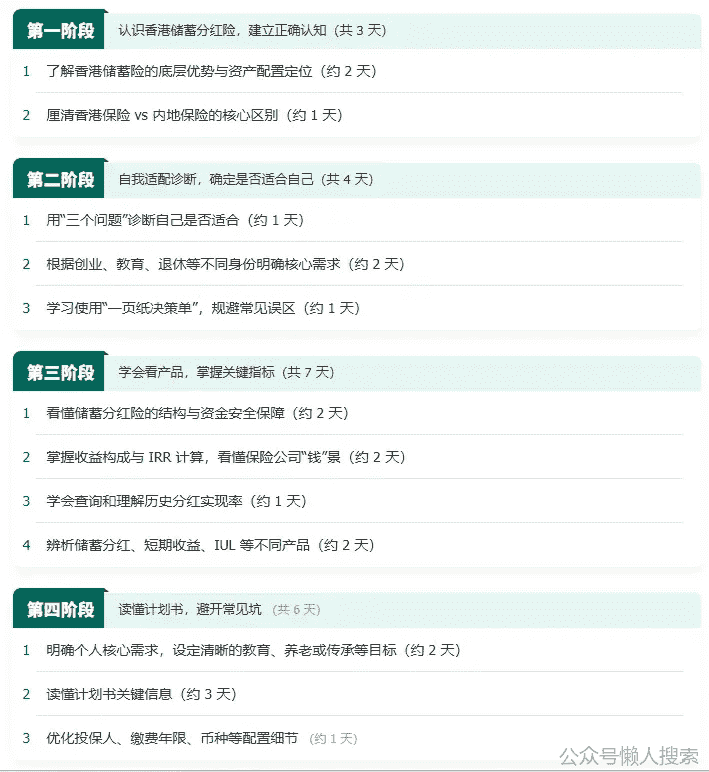

如果你希望用最少的时间抓到学习重点，以下为章节概括和指引，可以点击跳转对应章节：

**1.你是否适合购买香港储蓄险？**

3 个关键问题 +1 个测评，帮你搞懂自己适不适合买香港储蓄险。

2.如何看懂选产品的关键指标和自己是否需要

a.关键指标：IRR、历史分红实现率。

b.是否需要，看产品功能：

i.全球资产配置分散风险：投资全球资产，分散风险，可投资品种更多。

ii.资产增值：不懂投资但想资产增值。

iii.资产固化：担心自己乱花钱，强制储蓄。

iv.财富传承：无限次更改受保人，确保钱能安全的传给后代。

v.私密隔离：【隔离婚姻风险】和【债务风险】。

vi.灵活提取：部分产品可做到按你的需求来提取保险金。

c.购买香港储蓄险的风险有哪些？如何预防？

3.如何设计适合自己的储蓄险方案。

**4.如何投保与管理保单。**

#### 2.1 新手常见问题

香港保险真的比内地好吗？值得专门去香港买吗？

这份手册不会简单地告诉你"好"或"不好"，而是客观分析两地保险的差异，包括收益率、保障范围、理赔便利性、汇率风险等，让你根据自身情况做判断。

我完全不懂保险，能看懂这份手册吗？

手册内容用通俗的语言讲解保险知识，即使是保险小白，只要耐心阅读，也能建立起完整的知识体系。遇到不懂的概念，手册中都有详细解释和实例说明，也可在航海中询问教练。

**买香港储蓄分红险有什么硬性门槛吗？

买**香港保险要亲自去香港签单，年交保费最好要超过1万美元（大概72000人民币）

#### 2.2 开船前必备认知

本手册内容仅供学习参考，不构成任何投资建议或保险购买建议。保险配置需要根据个人实际情况（年龄、收入、家庭结构、风险承受能力等）综合考虑。

购买保险前，请务必咨询专业的持牌保险顾问，并仔细阅读保险条款。

#### 2.3 风险挑战和应对建议

**风险： 需要注意储蓄分红险的流动性风险、汇率风险、分红不**确定性等。不要看别人买，自己就都跟着买。

**建议**： 按照课程里说的资产配置方法来考虑保险的配比，不要把所有资金都配置在保险上，建议保险资产占家庭可投资资产的 20%-30%。同时要确保短期内不会动用这笔钱，最好是 10 年后才用的钱，避免早期退保造成损失。

在从业十年时间里，我见过太多中产与创业者：有人拼命赚钱渴望暴富，被股市深套；有人把钱都压在房产，结果被流动性困住；也有人只信"现金为王"，结果十年过去资产没涨反降。

香港储蓄险不是万能解药，但它能让你的财富系统更稳、更深、更有方向。

它能帮你：

+   锁定长期收益（有可能获得年化 6-6.5%的复利增长）

+   分散货币风险（配置全球资产）

+   完成代际传承（无限次更改受保人）

**好的家庭理财意识就是——**

1.理解家庭理财的反脆弱，一定要实现资产分区，互不干扰。

2.专注于收息现金流资产，用赚到的钱去经营自己的现金流。

**所以，这不是一门教你“追高”的课，而是你让你在足够长的时间里，知道如何让口袋里的**钱能稳健增值、跑赢通胀、未雨绸缪的探索之旅，它需要你投入时间去理解、思考和实践。

如果你认同“先搭资产配置系统、再谈如何获得收益”，欢迎和我们一起上船。

# 必修篇

# 一、香港储蓄分红险的定位与核心优势

## 01.香港储蓄分红险的三大底层优势

💡

**本章概要**

本章我们将共同探讨，资产配置，保险监管，全球投资的具体价值。

**本章航线图**

完成本章节的学习和操作，即可完成航线图的：

第一阶段：认识香港储蓄分红险，建立正确认知（3天）

+   了解香港储蓄险的底层优势与资产配置定位（约 2 天）

+   厘清香港保险 vs 内地保险的核心区别（约 1 天）

### 1.重新定义：它在你财富版图中的位置

在深入细节之前，我们先回答一个根本问题：香港储蓄分红险，在我的整个财富版图中，究竟扮演什么角色？

**孟**岩在投资的第一课里说过，资产配置决定了绝大部分的收益，这意味着，在纠结于买什么、何时买、能赚多少钱之前，我们更应该先规划好钱的去处。

当我们考虑资产配置时，往往会希望手里的闲钱有更高的收益，未来的现金流有更多增长，以及未来我们可能会哪些钱，需要做什么准备等等。

如果从来不做资产整理，就会发现再怎么赚钱，财务可能都是混乱的，但如果你拥有一个清晰、稳健的财富架构，反而可以让自己看清“适合自己的财富导航图”。你会对“现在在哪、未来要去哪、怎么去”都一目了然。

这便是资产配置的重要性——让你的财富和努力都变得清晰。

在做资产配置时，我们往往会分为四个账户来考虑，像一家公司的不同部门，各司其职：

+   **账户一：保障账户（托底的钱）**

职责： 应对突发风险，防止生活被改变，是托底的关键。

工具： 重疾险、医疗险、定期寿险、意外险等消费型保险。

核心： 杠杆，用最小成本转移最大风险。

+   **账户二：现金账户（活用的钱）**

职责： 覆盖日常开销和短期应急。

工具： 活期存款、货币基金。

核心： 确保流动性和安全性，随用随取。

+   账户三：稳健账户（保本升值的钱）

职责： 为 1-3 年的中期目标（如买房首付、买车）做准备。

工具： 大额存单、国债、稳健理财。

核心： 安全、稳定，收益高于通胀。

+   **账户四：投资账户（增值的钱）**

职责： 追求长期高回报，承担相应风险。

工具： 股票、基金、房产等。

核心： 博取高收益，主要是增长财富，无论是亏是赚，都不会影响我们的正常生活。

那么，香港储蓄分红险属于哪个账户？

**它的独特之处在于，它跨越了账户三**和账户四，并兼具了账户一的部分传承功能。

所以，了解香港储蓄分红险，绝不是简单地买一款保险。而是为你现有的资产配置引入一个“战略级工具”：它能加固你的财务地基，让你在投资时更从容，并为未来的重大人生目标提供一笔确定性较高的备用资源。

这样，我们可以避免盲目投资带来亏损，还能把闲钱利用好，提高获得收益的可能。

接下来，我们会详细说说香港储蓄分红险，为什么能在资产配置中做到跨越账户，成为一个不错的选择。

### 2.对冲人民币单一货币风险

我们先用一个故事来理解，什么是对冲人民币单一货币风险。

假如现在我们手上有 100 万闲钱，当你完全不懂投资时，你可能会放在余额宝、零钱通、银行定期里，或者你会了解到银行大额存单。

但很快会发现这个收益太低了，看着支付宝里一个个标着“热销产品年化 15%-30%”的基金，想下手又怕亏了。一开始你很可能只会拿出很少一部分试试水，赚了想卖出但怕还会涨，亏了又舍不得卖出。

如果你不懂投资，你很难把这 100 万当中的大部分钱投入其中，这样一来，涨又涨不了多少，那么，就很难达到“稳定增长和博取高收益”的目标了。

而且，无论是余额宝还是 A 股的基金，看似我们把钱分散在了“货币基金”、“股票型基金”里，没有把鸡蛋都放在一个篮子里。

但其实只是换了一个地方来买“人民币”增长的可能性。一旦国家经济有任何动荡，这些资产可能会被一起影响。

这就像是把鸡蛋放进了不同的篮子，但这些篮子都放在同一辆卡车上。卡车颠簸一小下，就会有一些鸡蛋碎掉。

这就是“投资于单一货币的不同品种”所隐藏的风险。因此，很多有经验的投资者会着手进行“身份、业务、资产”的全面对冲。怎么理解呢？

资产对冲是基础，好比把财富放在不同的房间里。

你不会把所有的现金、珠宝和重要文件都堆在客厅，而是会分散在书房、保险柜里。同样的，配置不同货币的资产，就像是把你的人民币资产（客厅的现金），也放一些到“美元房间”（书房）和“欧元房间”（保险柜）。

这样，万一“客厅”（人民币区）的物价上涨得快，你发现手里的钱能买的东西变少了，但此时“书房”（美元区）的物价可能还很稳定，那里的钱购买力依然强劲。

这就实现了“跨币种”的分散，让你的整体财富购买力更平稳。

业务对冲是房子的承重墙，好比让家庭收入来源多元化。

如果你的生意或收入只依赖一个国家或一个行业，就像房子只有一面承重墙，风险集中。而如果能将业务拓展到不同地区或领域，就如同增加了多面承重墙，即使一面受到影响，整体结构依然稳固。

就像我们的很多圈友，哪怕主业收入不错，也会再做个副业来应对主业的不确定性，例如：裁员，让自己有更多选择权。

很多做国内电商的圈友会做跨境，产品经理开始做 AI 编程做海外产品赚美元，都是为了让收入来源多元化，让自己有开启事业第二增长曲线的可能性。

身份对冲则是为这所房子多开几扇门，多备几条钥匙。

它意味着通过合理的规划，可以让子女获取国际化的教育背景和身份选择，让下一代有在全球范围内自由选择发展地的可能性。

同时，自己和配偶也拥有在海外宜居国家旅居的权利，让养老生活有更多选项。

当一扇门因为政策或环境变化而难以通行时，还可以从容地选择另一扇门。

**对**于普通人而言，资产的货币对冲是实现门槛最低、最触手可及的第一步。而香港储蓄分红险，刚好是一个不错的选择。

之所以这么说，是因为其拥有多元货币配置属性和其投资全球市场的底层逻辑。

**第**一、香港作为全球金融中心，是金融自由的资本主义市场，可投资全球，香港保单自然也支持多种货币计价，天然适合用于做多元货币资产配置。

第二、由于可投资全球，保险公司在投资策略上，一定会考虑如何获得更多利润的同时，又确保自己可以存活下去。

**比**如目前保险公司主要投资于美股市场，用美元或港币结算，就是因为在过去十年，美股的平均回报率可以达到 10%左右。

**在**全球投资这一前提条件下，香港储蓄分红险才能给出平均 6.0-6.5%的预期回报，但要注意：预期回报≠保证一定会有的回报。

**而内**地保险因为是强监管，产品定价时，内地往往更看重承诺的保证收益，且其预定利益上限能有多少是由监管部门决定的，外加底层资产的投资限制（基本仅限国内） ，所以其预期收益往往比香港储蓄分红险低。

这也是为什么我们在了解香港储蓄分红险时，听到其预期收益竟然比余额宝、内地保险高不少时，首先是怀疑其真实性。

这是因为我们对香港储蓄分红险、内地储蓄险的产品设计逻辑的区别、投资知识不够了解。

**要**特别提醒的是，预期收益高并不意味着香港储蓄分红险一定比内地储蓄险更适合大家，而是要综合考虑个人的诉求再进行配置。

了解了这些，大家就能理解购买了香港储蓄分红险，实质上是相当于持有了一项多元货币的全球投资资产。比如买了美元保单，当人民币兑美元汇率发生波动时，这部分资产的美元价值是独立的，从而天然起到了分散单一货币风险的作用。

它不像转换业务或身份那样需要巨大的投入和变动，也不需要我们亲自去海外考察房产或深入研究股市。

只需通过一次规范的投保，就能高效地配置一类重要的外币资产。只要整个流程有成熟的顾问体系支持，你也懂香港保险的投保重点和坑，就能大大降低了普通人进行全球资产配置的门槛，提高获取收益的可能性。

**而**我们的这个航海，就是帮助大家能全面的了解香港储蓄分红险，弄明白自己的投保重点、避坑。做出明确的配置决定。

### 3.投资范围优势：当你的钱能投"全球优质资产"

**当前大多数香港储蓄分红险以美元为结算货币，且**其资金池多投资于美元计价的全球金融资产。

目前香港保险公司的资产池（尤其是分红险的参与型基金）主要投向：

+   美元计价的债券（美国国债、企业债）

+   美元计价的国际投资基金

+   全球大型企业的美元股票或债券

**为什么呢？主要是三方面原因：**

**1. 监管端要求：**

根据香港《保险业条例》（Insurance Ordinance）及相关指引（如 GL13 《资产负债管理》），保险公司需要确保“资产与负债的币种匹配且需要考虑其期限、流动性等特征”。

意思是，每卖出一份美元保单，保险公司就要持有相应的美元资产（如美债）来支撑这份负债。这样做可以最大限度地降低汇率波动风险，投资品类也更加透明和高效。

这在一定程度上，确保了我们持有保单，能投资美元资产，实现分散风险、提高收益的目的。

**因此，保险公司自然倾向于发行美元结算的保**单，让投资端与负债端一致，这样风险最低。

当然，当有一天美元资产不再占优的时候，保险公司也自然会去投资“下一个美元资产”。这就是不局限于单一资本市场，可投资全球的魅力。

**2. 汇率稳定：**

这属于历史原因，香港自 1983 年起实行“联系汇率制度”，意思是港币的价值，不是由市场自由浮动决定的，而是和美元强相关，港币的汇率一般在 1 美元 ≈ 7.8 港币（上下波动 ± 0.05）左右。

这意味着港币实际上与美元“绑定”，价值几乎同步。

**因**此，即使保险公司收取的是港币保费，也往往会在后台兑换为美元进行投资——不如直接以美元计价更高效、更稳妥。

**3. 美元是全球资产配置的核心**

目前美元在全球金融体系中处于主导地位，拥有最广泛的投资市场（美国债市、美股、美企债券等）、最丰富的金融工具，同时抗通胀能力强、流通性高。

**对**保险公司来说，为了兑现长期分红和保证回报，必须选择稳定、流动性强、收益可预测的资产——而美元债券正是目前全世界最稳健的长期收益来源之一。

因此，目前美元资产成为香港保险公司当前阶段的投资组合的“核心仓位”，以美元结算的储蓄险，也就顺理成章成为了主流。

那么，对我们来说，持有一份香港储蓄分红险，意味着什么呢？

1.有专业团队帮我们操心着我们的投资

我们自己投资，往往需要花费大量精力去研究、盯盘。而专业的保险公司都有一个庞大的专业资管团队，7 x 24 小时地监控全球市场，进行资产配置和动态调整。

我们投入的保费，实际上也享受了这份“大机构级别”的专业服务，让自己省心省力。

2.资产配置更灵活：可投资品增多，顺周期轮动，提高获得收益的概率

**2.**1 香港保险公司的资金池，可以在全球范围内寻找投资机会。如果你拉长时间维度来看（比如过去 30 年的市场数据），会发现——全球主要资产（股票、债券、黄金、房地产）并不会同时涨跌。

它们往往呈现“跷跷板效应”：

+   当股票市场强劲时，债券收益通常走低；

+   当经济放缓、股市低迷时，债券价格反而上涨；

+   黄金在通胀或避险情绪高涨时表现突出；

+   房地产则在低利率周期中更具吸引力。

**保险公司能在不同经济阶段灵活配置这些资产，通**过全球资产轮动，平衡风险、稳定长期收益。

就像一位画家手中有个“全球调色盘”——不同市场时机，就是不同的颜色，用来调出稳健的收益曲线。

2.2 进一步分散投资，降低风险

香港保险公司的资金可以投向全球不同市场和资产类别——债券、股票、房地产、基金、甚至部分基础设施项目。

这种全球化配置让投资组合不依赖单一市场，即便某个市场波动，其他资产也能对冲风险。

**买香港储蓄分红险，其实就是请专业的人帮我们理财。他们不追短期暴利，而是靠分散投资、稳中求进的投**资风格来降低风险，再把赚到的利润的一部分分给我们，让我们的资产跟着时间一起增长。

初步了解了香港储蓄分红险的优势后，接下来我将会带领大家一起详细拆解从“是否适合购买香港储蓄分红险”，香港储蓄分红险到底是什么，怎么帮我们达到资产增值的目标，如何判断哪些产品值得买，有什么风险和坑，如何投保等全流程。

当然，香港储蓄分红险并非没有风险，具体的风险的论述因为涉及到一些专有名词的理解，所以在章节安排上我们放置到了后面的章节，在理解对应的专有名词后会更容易理解，但对此需要第一时间了解的朋友可以点击这里跳转到香港储蓄分红险的风险有哪些？。

## 02. 香港分红储蓄险的定位

### 1.香港分红储蓄险VS银行理财VS基金股票投资

**总的来说**

+   **香港储蓄分红险**：长期外币资产，复利稳增值，适合做家庭核心财富“压舱石”。

+   **银行理财**：低收益、短周期，适合短期资金停放。

+   **基金股票**：波动大、难长期拿住，适合主动型投资者

没有所谓的最完美的产品，全都要才是成年人的选择。

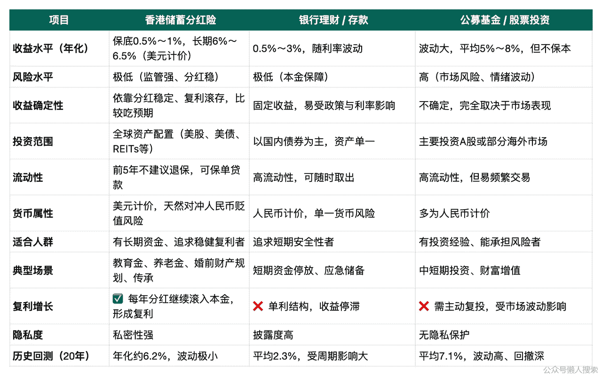

### 2.香港保险 vs 内地保险，区别在哪里？

+   **内地保险**：以“保”为主，重在保障。

+   **香港保险**：以“储”为主，重在财富增长。

两者没有谁好谁坏，只是逻辑不同：

内地保险帮你“守住底线”，

香港保险帮你“赢在复利”。

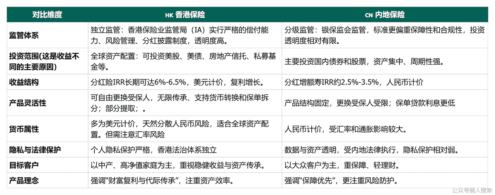

# 二、我适合购买香港储蓄分红险吗？

## 01.判断香港储蓄险是否适合自己

💡

**本章概要**

**香港储蓄分红险虽然好，但并不适合所有人购买，先判断是否适合自己，再研究买什么，怎么买。既能节约决策时间，避免不必要的损失，也能尽可能保**证我们的财务规划是合理的。所以，本章核心是帮你判断要不要买，适不适合买。接下来会有三轮简单测评，每一轮测评会在上一轮测评的基础上深化需求，进一步看你适不适合买。

**本章航线图**

完成本章节的学习和操作，即可完成航线图的：

第二阶段：自我适配诊断，确定是否适合自己（共 4 天）

+   用“三个问题”诊断自己是否适合（约 1 天）

+   根据创业、教育、退休等不同身份明确核心需求（约 2 天）

+   学习使用“一页纸决策单”和规避常见误区（约 1 天）

### 1.用「三个问题」帮你判断是否适合配置香港储蓄分红险

先做一个自我诊断

+   测试题 1：你的核心目标是什么？（可多选）

A：子女教育金/养老金（5-30 年后需要）

B：财富传承安排

C：资产隔离需求

D：短期高收益

**测试题 1 说明：**

A：子女教育金/养老金：为未来的确定性支出（孩子上学、自己养老）做规划，既可以提领部分资金出来，剩下部分还能继续复利增值。

B：财富传承安排：这笔钱未来能顺利、合法、清晰地传给下一代，且可以实现无限传承（无限更换被保人）还可以实现保单拆分功能，2 个孩子按比例分配，避免纠纷。

C：资产隔离需求：在有经营或职业风险时，让这部分资产在法律上独立，不容易被外部债务或诉讼牵连。

D：短期高收益：1-5 年内获得年化 10%以上的高收益。

这一题的关键，是厘清你希望这笔钱“完成什么任务”。

如果你选择 A、B 或 C，那说明你的目标偏长期、偏稳健，香港储蓄分红险非常适配。它的特点是「确定性强、收益可复利、风险低、流动性适中」。

但如果你选择 D，希望 1-5 年就能看到显著回报，那要提醒你：储蓄险并不是“短线理财”，而是“时间复利工具”，可能并不适合你。

+   **测试题 2：你的资产状况如何？** （多选）

A：有稳定的现金流收入

B：即使暂时没有收入，但有足够的现金或资产存量，能支持未来 5–10 年的生活

C：已准备好"紧急备用金"（12 个月生活费）

D：已配置基础保障（重疾险、医疗险、意外险）

E：这笔钱至少 5-10 年不会动用

**测试题 2 说明：**

这一题的关键，在于你有没有长期可持续的支付能力。

如果你的答案中有多个“是”，那说明你的财务结构已经相对稳健，完全有条件进入长期规划阶段。

无论收入来自工作、投资、还是一笔闲置资金，只要这笔钱不会影响生活，就可以成为储蓄险的配置来源。

反之，如果你的收入不稳定、保障不足、或者应急金都还没准备好，那现在最该做的不是“投资”，而是先“打地基”。

先把保障账户和活钱账户补齐，再谈储蓄险，顺序对了，整个财富系统才会稳。

+   **测试题 3：你对波动的容忍度？**

A. 接受“稳但不快”，抗焦虑能力 OK

B. 喜欢“快节奏收益”，不想等

C. 任何时刻一点亏损都不能承受，流动性高。

**测试题 3 说明：**

选 A，非常适合储蓄险这种稳定复利的工具——涨得慢，但稳得住。

选 B，说明你更倾向权益类资产，比如股票、基金；

选 C，说明你更希望时时刻刻的“保本保息”，那银行的大额存单或国债会更让你安心。

不过要记住，“波动”不是亏损。储蓄险在前几年现金价值低，回本都需要好几年，是因为保险成本、初期费用摊销的设计，而且只有这样流动性差才能做到资产固化。长期来看，它的复利效应反而会越滚越强。

**看懂评估结果**

+   **非常适合**：有明确长期目标 + 资金充裕 + 追求稳健

+   **比较适合**：有财务目标 + 基础保障完善 + 能接受长期锁定

+   **暂不适合**：没有长期规划 + 资金紧张 + 近期可能要用钱

+   **不适合**：纯粹追求高收益 + 短期投机心态

结合测试题说明，测试题 1 里的 ABC 为非常适合，测试题 2 满足越多越适合，测试题 3 选 A 为非常适合。B 和 C 情况为不合适。

补充说明：如果目前你的资金情况不适合用香港储蓄分红险作为长期规划的一部分，可以先完善活钱和基础保障（重疾险、医疗险、意外险），了解相关的香港储蓄分红险知识，时机成熟再配置。

### 2. 适配度测评，进一步细化

每项0–2分，合计满分18分。

**A. 目标稳定度**

+   长期目标清晰（教育/养老/传承）——2

+   有部分长期目标，但未量化——1

+   主要是短期收益诉求——0

**B. 资金期限**

+   可锁定≥5–10年资金——2

+   可锁定3–5年资金——1

+   随时会用到——0

**C. 现金流稳定度**

+   家庭现金流稳定，负债率低——2

+   基本稳定，偶有波动——1

+   波动大/不确定高——0

**D. 保障与活钱完备度**

+   保障齐全+应急金≥6–12月——2

+   二者其一到位——1

+   都未到位——0

**E. 波动容忍度**

+   接受“稳但不快”，能长期持有——2

+   心理预期可调，但容易着急——1

+   喜欢快、频繁操作——0

**F. 全球化需求**

+   有美元支出/出国教育/全球资产增值需求——2

+   暂无明确需求——1

+   明确不需要——0

**G. 资产规模与结构匹配度**

+   可用于购买储蓄险的资金不低于7 万/年，共缴5 年，占总资产的20%–30% —— 2 分

+   资产规模尚可，但结构集中，可投资产基本能达到 7 万/年，共缴5 年 —— 1 分

+   资产规模过小且过度集中单一资产（如仅有房产，且有房贷） —— 0 分

**H. 家庭责任阶段**

+   处于家庭高责任期（育儿/赡养/教育金规划） —— 2 分

+   责任适中，还未组建家庭 —— 1 分

+   责任低或阶段不稳定（频繁换城市/行业） —— 0 分

**I. 风险认知成熟度**

+   理解“分红≠保证 6.5%的收益”，能接受分红波动 —— 2 分

+   知道分红数额随市场浮动，但理解不深 —— 1 分

+   认为买了立刻就有钱 —— 0 分

**说明：**

13–18 分：高适配，建议进入方案设计。

7–12 分：中适配，先补足保障/活钱再配。

≤6 分：低适配，暂缓，先梳理家庭资产与现金流。

### 3.从身份出发，确定你的核心需求

确定了适配度后，我们可以进一步理顺自己的核心需求，从身份入手做一个简单的决策单。

#### 3.1 创业者｜把利润“外置”，搭建风险防火墙

+   **处境**：利润与行业高度绑定；公司波动会影响家庭安全。

+   **适配信号**：有年度利润结余、希望做抗周期的“压舱石”。

+   **建议**：一次性/年缴均可；**美元计价 + 长期持有**；额度按“净资产 20%以内”或“年利润的 30%”设上限。

+   **红线**：不要用高成本短贷续缴；不要把“周转资金”拿去锁长期。

#### 3.2 自由职业者/高收入个体｜做一个“能睡得着”的现金流池

+   **处境**：收入波动大，心理上更偏好“稳定感”。

+   **适配信号**：有稳定底层客户与结算周期，能留出 5 年以上长期金。

+   **建议**：先做**保障+应急金**，再配储蓄险；采用**年缴**，额度=“近 3 年平均结余×2”。

+   **红线**：没搭好应急金前不要上；不要把短期项目款拿去缴费。

#### 3.3 教育金家庭｜用时间换确定性

+   **处境**：10–15 年后有海外留学学费需求。

+   **适配信号**：有清晰时间线与金额预算。

+   **建议****：选择有多元**货币转换功能的保单；目标金额倒推额度；现金价值节点对齐学费高峰。

+   **红线**：早期提取会破坏复利；不要用“高预期”替代“兑现记录”。

#### 3.4 退休预备者｜把退休现金流做成“可提可留”的池子

+   **处境**：希望退休后有**低波动、可预期**的现金流补充。

+   **适配信号**：可以设定【567 提取模式】5 年交完保费，第 6 年开始每年提取总保费的 7%，一直提到身故为止，只要活着就有钱，没提领完的钱也可设立第二受保人，孩子也能接着领钱。

+   **建议**：**年缴为主**，10 年+持有；配合养老金/社保/债券形成“多引擎”。

+   **红线**：不要把全部养老筹码押在单一产品上；分散提取路径与货币。

### 4.一页纸决策单 1.0——让保险规划简单清晰且有用

#### 4.1 一页纸梳理你的保险需求

结合前面的梳理，我们可以将自己的情况填入下表，帮我们看的更清楚。

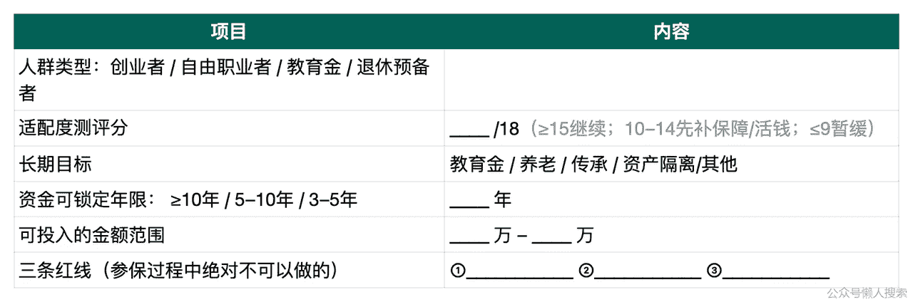

#### 4.2案例参考：不同人群的适配度

**画像 1：子女教育金规划者**

典型案例：35 岁的互联网中层王女士

+   家庭情况：孩子 3 岁，计划 15 年后出国留学

+   年收入：家庭年收入 80 万

+   需求：为孩子准备 100 万教育金

+   痛点：不知道该存多少钱，担心通胀

**储蓄险适配度：★★★★★**

+   ✓ 时间确定性强（教育时间固定）

+   ✓ 金额可测算

+   ✓ 需要强制储蓄

+   ✓ 复利增值对抗通胀

**画像 2：高净值创业者**

典型案例：42 岁的科技公司创始人李先生

+   家庭情况：公司经营稳定，个人资产 2000 万

+   年收入：波动较大，年均 300 万+

+   需求：资产隔离、财富传承、税务筹划

+   痛点：担心经营风险影响家庭，想做财富传承安排

**储蓄险适配度：★★★★★**

+   ✓ 资产隔离功能（与经营风险隔离）

+   ✓ 财富传承工具（指定受益人）

+   ✓ 税务筹划（香港无遗产税）

+   ✓ 强制储蓄（避免经营冲动）

画像 3：自由职业者/新经济工作者

典型案例：30 岁的自由设计师张先生

+   家庭情况：单身，收入不稳定

+   年收入：40-60 万波动

+   需求：养老金储备、强制储蓄

+   痛点：没有社保/企业年金，担心老了没保障

**储蓄险适配度：★★★★☆**

+   ✓ 强制储蓄（收入不稳定更需要）

+   ✓ 养老金补充

+   ✓ 灵活性（可选择缓交功能的产品）

+   ✗ 需注意流动性风险

**画像 4：退休规划的中年人**

典型案例：48 岁的企业高管陈女士

+   家庭情况：孩子已独立，即将退休

+   年收入：150 万，有社保

+   需求：养老金补充、资产保值增值

+   痛点：退休后收入下降，想要稳定的现金流

**储蓄险适配度：★★★★☆**

+   ✓ 补充养老金

+   ✓ 提供稳定现金流

+   ✓ 保值增值

+   ✗ 配置时间窗口收窄

### 5.三个常见误区

+   **误区 1**："别人都买了，我也要买"

✗ 跟风配置最容易踩坑

✓ 根据自己的需求和情况决定

+   **误区 2**："储蓄险收益高，可以替代其他投资"

✗ 储蓄险不是投资品

✓ 它是资产配置的一部分，不能替代股票、基金等

+   **误区 3**："香港储蓄分红险一定比内地保险好"

✗ 不同产品适合不同人群

✓ 要看具体需求和产品匹配度

### 6.本章小结：三个核心判断标准

+   **需求匹配**：有明确的长期财务目标

+   **资金匹配**：有长期不用的闲置资金

+   **认知匹配**：理解产品特点，接受其局限性

注意：储蓄险是好工具，但不是所有人都需要。适合自己的，才是最好的。

# 三、看懂保险产品，不踩坑确保增值

## 01. 读懂香港储蓄分红险的底层逻辑

💡

**本章概要**

搞懂了是否适合投保香港储蓄分红险后，我们再来聊聊怎么看懂一款产品适不适合我们购买。这一章节，我们就来解决这个问题。本章核心是看懂香港储蓄分红险产品的利弊。

**本章航线图**

完成本章节的学习和操作，即可完成航线图的：

第三阶段：会看产品，掌握关键指标（共 7 天）

+   看懂储蓄分红险的结构与资金安全保障（约 2 天）

+   掌握收益构成与 IRR 计算，看懂保险公司“钱”景（约 2 天）

+   学会查询和理解历史分红实现率（约 1 天）

+   辨析储蓄分红、短期收益、IUL 等不同产品（约 2 天）

大家在内地购买保险时，会发现种类繁多，选的人眼花缭乱，有的保险会每年返钱，而有的保险每年却只交钱；有的保险在缺钱的时候能随便取出，有的保险却不能。

**保险公司每年返钱的话，自己不亏吗？ 这种好事能落在我头上吗？ **那些精算师那么精明，真的会让我赚到钱吗？

**看到这些疑问，相信你已经能看明白其中的玄机，即便是同一类型的保险**，功能也是多种多样的，这样设计是为了满足不同人的需求，购买保险讲究的就是个适配。

很多人买保险，只看到合同上的数字——保额、分红、收益率，甚至道听途说，很少有人真正理解，那些数字背后的“逻辑”。

**一**旦你理解了它的底层运作方式，你就不会被高收益广告吸引，也不会被销售话术绕晕。你会清楚地知道：哪类产品适合你，不会乱买保险，浪费钱又浪费精力。

所以一定记住，如果你想购买香港储蓄分红险，最重要的不是急于选择“哪家公司？哪个产品？.

**而是先弄明白：我们的需求是什么（上一节已搞定了这个问题），以及香港储蓄分红险到**底是什么，它是怎么帮我增值的？我交出去的钱，都被用到了哪里？是否安全等关键问题。

接下来的几个章节，我们就会详解这些关键问题。

### 1.什么是香港储蓄分红险？

什么是香港储蓄分红险呢，听完这个故事，你就懂了。

特别说明：目前主流的香港储蓄分红险是以美元来计价的，为了便于理解，下面的案例使用的是港币。

话说有 50 个年轻人，来到香港一家金银首饰店当学徒。他们每天都在打磨金饰、镶钻石，稍不留神，一不小心摔坏一颗宝石，那可不得了——最便宜的也要 5 万港币！还可能会被辞退，陷入没有收入的境地。

这帮学徒干起活来也心惊肉跳，生怕摔碎了宝石，赚的钱打水漂，店主老陈也很担心： “这么干下去也不行，宝石是实实在在的亏损不说，学徒目前又赔不起。”于是，他请来一个聪明的财务顾问阿财，帮忙解决这个问题。

**【第一阶段：消费型保险出现】**

阿财说：“要不这样吧，你们每人每年交点钱，我帮你们建一个‘打碎宝石保障基金’，谁摔坏了宝石，就从这个基金里赔。”

大家一听觉得挺好。

阿财算了算，和大家说：“你们一年大概会打碎 5 颗宝石，每颗要赔 50,000 港币，总共要赔 250000（这是保障成本）。我来帮你们设立一个‘打碎宝石保障基金’、负责管理账户、做记录、出赔付报告，确保公平公正和资金安全，收取 10%的管理费。”

一共加起来就需要 250,000+25,000=275,000 元，你们 50 个人分摊下来，每人一年交 5,500 港币（这是保费，也就是我们交给保险公司的费用）。

大家觉得这个方案不错，哪怕哪天手一滑打碎了宝石，也不用掏 50,000，就同意了这个方案。

**保费=保障成本 + 管理费用**

**→ 这就是消费型保险的雏形。它的主要功能**是当风险发生要花掉一大笔钱时的经济补偿。

**【第二阶段：储蓄险想法萌芽】**

在这些学徒中，有个学徒叫阿稳，做事细心从没出错，他心想：“我每年交 5,500 港币，如果干十年就要交 5,5000 港币，啥也没回来，多可惜啊。但又不敢不交，万一哪天真摔了呢？”.

于是他找阿财谈：“阿财，要是我十年都没打碎宝石，这些钱能不能退我一点啊？反正我都没用上嘛。”

阿财想了想：“那这样吧——如果你在这 10 年里都平安无事，我可以把你交的钱还给你。不过我得多收你一点钱，每年再多交 1,000 港币。我把这部分钱拿去做稳健投资，赚到收益后，十年后除了给你本金，也分你点利息。不然要是别人打碎的宝石太多，我把钱退给你了，我可就亏了呀。”

阿稳一听，立刻点头：“也很有道理，这更好了，不仅有保障，还能全额拿回本金，还有点利息。超出预期啊”。

于是，阿财在原来的保障基金基础上，加入了“到期返还本金”的机制。

**这**就是储蓄型保险的雏形。它是一种既能防风险，又能帮人存钱的保险。若发生意外，有基金赔偿；若平安无事，到期就能取回本金和约定利息。

**【第三阶段：储蓄分红险的出现】**

阿稳一高兴回去就告诉了阿狗，一传十十传百，这个契约在学徒间传开了，大家都觉得划算，交的钱能拿回来，还比原来的纯保障划算多了。

结果呢，有个叫阿灵的学徒，平时脑子灵活、消息也快，也来找阿财。

阿灵说：“阿财，听说你还会投资啊？我听说最近外面的投资行情很好，有没有什么办法，能让我除了拿本金和利息，还能分点你赚的钱？”

阿财笑了：“你还真会提要求啊。其实，这想法没错。如果我用你们的钱投资，赚得比预期多，当然可以分点钱给你们。不过也得看市场行情——有赚就多分，没赚就少分。

要不这样，你再多交点钱，这多出来的钱我拿去投资，如果赚了就按一定比例分给你，给你单独开个分红账户，不管行情好不好，你的本金和基本利息都不会受影响。”

阿灵一听，眼睛一亮：“也就是说，市场好、你管理好、大家表现好——我们都能多赚一点，对吧？”.

阿财点头：“没错。这就是‘分红’，赚得多，大家就能一起分享收益。”

这一年，市场行情确实不错，投资回报比预期高，加上学徒们比往年更小心、赔的钱也少，阿财年底结账时，发现基金还多出一笔结余。他依照约定，把这部分盈余按比例分给了大家。

大家第一次发现——保险居然还能“赚钱”。

于是，新的契约诞生了：

保费=保障成本 + 管理费用 + 投资的钱。

→ 这，就是储蓄分红险的雏形。也是我们这次航海主要要了解的险种。

**从上面的故事不难看，从本质上来讲，保险通常可以**简单分为两类：消费型和返还型（储蓄型）。

+   **消费型保险**，就像你租房交房租、吃饭、打车一样，收钱的一方提供相应的服务，钱用完就没了；

**一般来说，我们在做“基础保障”时，会优先考**虑消费型保险（比如重疾、医疗、意外险）。

**它**们性价比高、杠杆大，本质上是为了防范突发风险，当身体出问题导致收入中断时，能有笔钱帮我们渡过难关，他并非是用于治病的钱，而是一种经济补偿。

所以，这类保险更关注的是——“怎么用最小的成本，买到最大的保障。”

+   **储蓄型保险**（尤其是储蓄分红险），则更像你买房子或黄金，不仅能留下资产，自用、传承，时间久了，还有机会升值。

当一个家庭的基础保障已经齐备后，很多人开始思考另外一个问题：

**除**了保障之外，我的钱能不能放在一个安全的地方，既能稳稳增值，又能作为未来的储备金？”这时候，就轮到储蓄型保险登场了。

**它和我们传统印象里的“保险”有点不一样，它更像一个长期、复利增长的储蓄账户；既有基础保障（万**一的风险兜底）；又有投资收益（让钱为你生钱）；同时，资产还可以传承、分配、增值。

这两种保险的不同功能，都要考虑。这也是我们为什么一直强调，在配置保险时，既要做好基础保障，也要考虑储蓄险的适配性，这样能让我们的财务在安全和增值之间，找到平衡。

**补**充说明：如果你需要购买消费型保险，优先考虑内地，如意外险、医疗险，储蓄险保险则可以根据情况选择最适合的，内地和香港的都可以考虑。

我们的核心原则是：花更少的钱，办更大的事。

### 2.香港储蓄分红险的结构核心是什么？

**了解**了香港储蓄分红险的保费构成后，我们还要注意它的结构，即储蓄第一，保障第二，它不是单纯的保障型保险，也不是纯投资产品，而是结合保障＋储蓄／投资的长期机制。它的保险壳只是“外衣”，核心是资产管理。

简单的理解是，其核心功能是储蓄增值，保障功能可以忽略不计。

参考下图的区别：

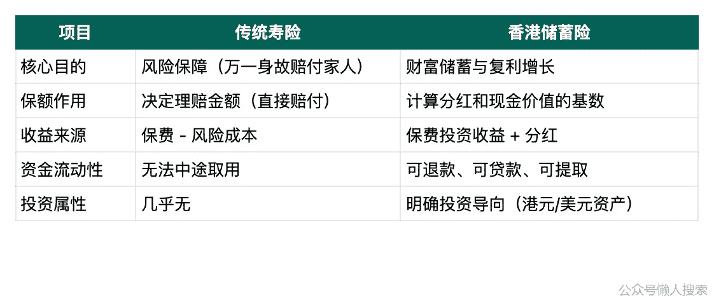

既然如此，你可能会问了，那为什么不去掉保障功能，只做储蓄分红的产品呢？

**是**这样，虽然香港储蓄分红险的合同中也会出现“身故赔付”“保额”等字样，但这是附带的，不是主功能。这些条款主要是为了满足保险合同的法律属性。

通常身故赔付金额 =（1）保单现金价值 + 已分红 + 累积利息 或（2）已缴保费的倍数（通常为105%~110%），也就是说，你在合同期间如果人没了，保险公司会把你的储蓄部分全额返还，甚至加上部分红利——这相当于一种“资金安全托底”，但是就没有大家想像的高额身故杠杆了几百块赔付100万那种。

**换**句话说：你买香港储蓄分红险，并不是为了“保命”，而是为了“保钱”——让这笔钱在你活着时能稳定增长，在你不在时，也能平稳地传给家人。

**那么**，香港储蓄分红险里的“保额”到底是干什么用的呢？保额 ≠ 保费 ≠ 赔偿金，它通常是一个计算基准：保险公司会以“基本保额”为基数，来确定未来的分红金额、现金价值增长，以及身故赔付金额。

你可以把它想象成“本金的一个虚拟参考值”，不是保障额度，而是收益计算的锚点。所以它“有保额”，但目的不是赔付身故，而是为了让保单具备保险合同属性（合规要求），同时为收益增长提供一个计算框架。

我们可以继续用前面“打碎宝石保障基金”的故事，来理解这些“规则”。

**阿稳看懂“保额”和“现金价值”**

几年后，阿财帮大家的“打碎宝石基金”变成了一个巨大的“储蓄池”。每个人都有自己的账户。有一天，阿稳拿着合同来问：“阿财，这上面写着‘基本保额 10 万港币’，是什么意思？是不是最多能赔我 10 万港币？”

**阿财**笑着摇头：“不是的，这个‘保额’，在储蓄险里不是赔付上限，而是一个计算用的标尺。就像你银行理财买了份产品，说明书写着‘年化收益按 10 万港币本金计算’，这 10 万港币就是计算收益的‘参考基数’。

所以保险公司说‘分红按保额的 5%’，就是：以这 10 万港币为底，每年算出 5,000 港币的收益。”

阿稳恍然大悟：“哦，原来‘保额’就像一个‘虚拟本金’，不是说真赔我多少钱，而是用来算我赚多少钱的基准！”

阿财笑着说：对，就是这样。假如你有一天不想继续投保了，假设保单的现金价值变成 8 万港币，而我投资分给你的利润是 3,000 港币红利（分红）；那这个时候你的保单情况是这样的：

+   保额：10 万港币（合同里的计算基准）

+   现金价值：8 万港币（现在退保能拿到的钱）

+   红利：3,000 港币（我给你当年分给的收益，会滚入现金价值）

**如果你决定退保，不需要“打碎宝石基金”，你可以拿回现金价值 + 累计红利的金额，也就是 83,000 港**币；如果继续买呢，我给你分红的钱呢就会加上原来你投的钱继续“利滚利”，现金价值也会跟着上涨。你的打碎宝石基金也就会越多。

阿财说：原来如此啊，我懂了。

阿灵看懂“现金价值”和“身故赔付”

过了一阵，阿灵也拿着合同来了。她问：“那合同里写的‘现金价值’又是啥？我看每年都在变。”

**阿财**解释说：“现金价值，其实就是你账户里已经属于你的钱。你每年交的保费，扣掉保障成本和费用后，剩下的部分都会进入这个账户。随着时间推移，保险公司会把投资收益和分红都加进去，所以你的现金价值会一年比一年高。”

阿灵点点头，又问：“那‘身故赔付’呢？是不是我不在了，家人才能拿这笔钱？”

**阿财**笑道：“对，但要注意——在香港储蓄分红险里，‘身故赔付’主要是一条安全底线。通常写的是：赔付金额 =保单现金价值 + 已分红 + 累积利息 或已缴保费的倍数（通常为100%~110%）的较高者。

意思是：你要是发生意外，保险公司至少会退还你账户里的全部储蓄（现金价值），如果那时收益还不高，也保证给到一个已交保费的倍数，比如某些产品第一年交了1万美金，不在了是给10500美金。所以，它主要目的不是‘多赔你钱’，而是保证你这笔储蓄，不会因为任何风险而归零。”

阿灵恍然：“所以这个‘赔付’，其实是帮我的钱上了保险！”阿财点头：“没错。所以说你买的不是‘保命’，而是‘保钱’。它让你活着的时候钱在涨，离开后也能安安全全地传给家人。”

## 02. 香港储蓄险的类型与选择

前面通过小故事，大家通过对比消费型和储蓄险的区别，进一步了解了储蓄险，这一节我们会展开说说储蓄险都包括哪些，以及我们本次航海重点讲解的的储蓄分红险的风险。

### 1.储蓄险类型：储蓄分红险、短期固定收益类、保费融资单、IUL（指数万用寿险）

#### 1.1储蓄分红险

最普遍、且内地客户选择最多的保险类型，基本大家提到的买香港保险其实就是指这类产品。

保证收益率一般在 0.5%至 2.5%之间，而长期的预期年化收益则在 6%至 6.5%之间。

适合长期（10-20 年）持有，作为家庭资产配置的一部分，用来教育金，养老金，婚前财产规划等场景。

#### 1.2短期固定收益类

针对5年的期限，保证收益可达到 4至 5%。

这一方案适合短期资金规划、或作为紧急备用金，可以是我们内地大额存单的替代品，不过需要考虑的是汇率波动的风险。

另外美元存单其实也有三四个点的收益，只是一般只有三个月或者半年的时间选择，想 5 年左右确定性的锁定 4%左右的利率，这类保单也是很不错的选择。

#### 1.3保费融资产品

类似咱们过去的贷款买房，可以从银行贷款，来赚取贷款利息和保险利息之间的息差。

举个例子：投入 200 万，能买到 800 万的保单，9 年退出，去掉贷款、利息，还能净赚 150 万，相当于每年赚 16.6 万，平均每年 8.25%左右

**资金门槛**

+   一般建议 **保费金额在800万港币以上** 才有意义。

+   **因为融资比例通**常在 75**%左右**，自己仍需先出 25%首期资金。

**资质门槛**

**银行会做“信贷审批”：**

+   需要提供总保费的1.05倍资产证明(总流动资产-总负债=1.05倍总保费)

+   100%自付额的境外资产证明

+   征信报告

银行要确认：你是真实有还款能力的人，不是拿保险来“套现”。

#### 1.4IUL（指数万用寿险）

比较适合对投资市场有一定的了解 因为是把你的钱和标普 500 等全球指数挂钩。市场涨，你跟着分红；市场跌，有保底，不怕亏完。它不是赌博，而是“带安全带的投资”

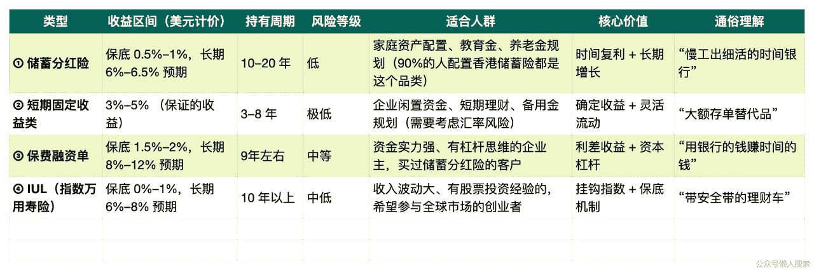

### 2.香港储蓄分红险的风险有哪些？

要知道，香港储蓄分红险的特点是 “低风险、长期型”。

**它的风险比基金小，收益通常比银行存**款高一点，属于追求稳健增长的理财型保险。

不过，它并非“零风险”产品，主要潜在风险包括以下几种：

+   风险一：非保证收益风险（投资波动风险）

香港储蓄分红险的分红部分属于“非保证收益”，会随着保险公司投资表现而变动。市场下行时分红可能减少。例如保险公司演示 IRR 6.5%，基于保险公司假设的分红实现率，实际回报需视公司投资表现和派息政策而定，通常在 70%-100% 实现率间波动。

**✅ 如何应对？选择历史分红实现率高、投资组合稳健的公司（**如友邦、宏利等）；持有期≥15 年最佳。

+   **风险二：汇率风险**

大多数香港储蓄分红险以美元计价，如果未来美元兑人民币贬值，那么兑换成人民币时回报会下降。反之美元升值，则收益更高。你 10 年前存 10 万美元，美元升值时取回，不仅本身保险有不错的收益且折成人民币可能比账面多赚 20%；若美元贬值则相反。

**✅ **如何应对？香港保险除了美元保单之外，还支持人民币、欧元、英镑等多种货币投保，部分产品还附带有【货币转换】的功能。另外也可考虑选择期交型产品，这样相当于定投或持有美元资产作对冲。

+   风险三： 流动性风险（提前退保损失）

储蓄分红险的结构决定保险公司前期费用成本较高，前 5–8 年退保往往现金价值＜已交保费。只有长期持有（≥10 年）复利效应才明显。买后 3 年急用钱退保，可能只拿回部分本金。

**✅ 如何应对？投保前规划好资金用途，尽量不用几**年内要动用的钱；若未来可能急用钱，别买。

## 03. 我们购买储蓄分红险的钱去哪儿了？是否安全？

### 1.我们交的钱到底去哪了？

**前**面说过，我们交给保险公司的钱，被称为保费。保费并不是直接拿去“生利息”的——它的背后有一套分配逻辑，才能尽可能确保保险公司和我们双赢。

可以这么理解：当你交出第一笔钱时，其实是在做两件事：

+   买到**保险公司的保障承诺**，用于保障（死亡、身故、合同保障责任） + 初期费用 +营运成本。

+   进入了保险公司的**投资账户**，通过债券、股票、不动产等长期资产配置获取收益。

所以，保险公司会把我们支付的钱（保费），按一定比例分到保障成本、管理费用、投资资金中。

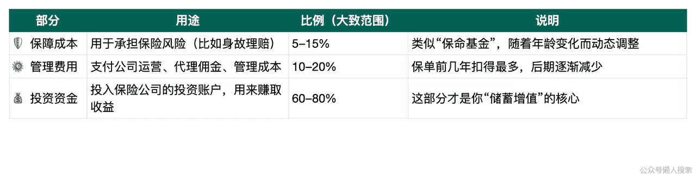

**这里的投资资金主要投资于美债美股等，一般不会被用来“冒险炒股”，而**是遵循“稳健、分散、长期”的投资原则。这也是它“收益不暴涨、但很稳”的根本原因。

**大**家看到很多说的，资金配比往往是：“70% 固收类、30%权益类”，但那是分析师的大致估算，并非保险公司合同或监管报告里保证披露的数字。

但我们购买储蓄险也不需要把保险公司投的品种都一一了解清楚，毕竟我们图的就是省事、稳健。

**这里要说明的是：由于不同保险公司的产品结构、投资组合、保障成本不同，具体的比例可能会有很大差异。在**投保合同中，也不会写明“我拿你保费的 X% 去投资”，而是通过展示“保单的现金价值、红利、保额”等数据来展示保单的价值。

补充说明：

保单的现金价值：当前你的保单值多少钱？如果你现在不想继续买了，保险公司愿意用多少钱买回你的保单，也就是退保能拿到的钱。

红利：保险公司帮我投资赚钱后，给我们的那部分利润分成。

保额：可以理解为虚拟本金，用来计算收益和保障的参考值。用于计算红利、现金价值、理赔金额等，不是固定的“用于赔付的金额”。

尽管我们不知道他们投资的是什么，但这并不妨碍我们寻找到相对靠谱的产品，在接下来的一节，我们将会展开详解如何判断产品收益和靠谱性。

### 2.给保险公司交的钱安全吗？

**很**多人以为“保险公司稳健投资”=“钱安全”，其实真正保障你资金安全的，不只是投资策略和香港保险市场的机制，更主要的是法律结构和监管制度。

香港是全亚洲最成熟、最国际化的市场之一。无论是 1997 年亚洲金融风暴、2008 年金融危机，还是 2020 年疫情，香港的保险公司都撑过来了，也赢得了很多国际评级机构的信任。

它的保险渗透率（买保险的人口比例）是全球第一，保险密度（人均保费支出）全球第二。

什么意思？就是在香港，几乎每个家庭都有保险，如此庞大的经济体，意味着保险业已深深扎根于香港的经济土壤，长成了一棵“参天大树”。这棵树的健康，与整个生态（银行、法律、税务）息息相关，一荣俱荣，一损俱损，倒逼监管体系必须做到极致严谨。

这也是为什么，很多国际保险集团把总部或区域中心设在香港。因为这座城市的金融生态——银行、监管、法律、税务——形成了一个严密又透明的系统，支撑着保险业的长期稳健。

那么，这套体系是如何守护你的保单的呢？我们可以从五个层面看清其安全逻辑

#### 2.1法律隔离：保单持有人基金（Participating Fund）独立存在

**每家保险公司在香港销售的储蓄险（尤其是分红型/储蓄型），都必须建立一个专门**的「参与基金（Participating Fund）」，简称 Par Fund。

**这个基金是由保险公司设立、由香港保险业监管局（Insurance Authority**， IA）监管的，其核心目标就是：让客户的钱永远不与保险公司的运营资金混在一起。

**而且，所有储蓄险和分红险的投资运作，都必须遵守香港《保险业条例》（Insurance Or**dinance）及其配套监管指引——尤其是 《GL13：投资及衍生品使用指引》。

**当你交了保费后，这笔钱就会被划入保险公司内部的建**立的基金账户里，严格按照监管要求来使用。

那么，这笔基金属于谁呢？属于所有保单持有人，而不是保险公司。

**保险**公司只是这笔钱的受托管理人（fund manager），不能随意挪用，也不能拿去补贴公司其他亏损业务。即使保险公司遇到经营问题，Par Fund 里的钱属于客户，不属于公司资产。

这样才能保证投保人在任何情况下，都能获得保单里应有的保障。

就像我们前面举的例子，阿稳和他的同事们都找阿财买了“打碎宝石保障基金”，这个钱需要存到一个专门的账户里，而不能和阿财个人的财务混在一起。阿财可以根据合同来投资，管理这笔钱，但不可以私人挪用。这些钱依旧属于和阿财一样的投保人。

→ 关键监管文件，可在官方查阅：https://www.ia.org.hk/en/index.html

#### 2.2财务监管：资本金与偿付能力要求

香港监管局要求保险公司维持足够的“偿付能力比率”（Solvency Ratio），意思是哪怕你“赔到天荒地老，你也要赔得起，只有你的钱够厚，你才能卖保单。”.

**大**部分大型公司（如友邦、宏利）通常维持在 250%–400% 之间。如果低于标准，监管局会立刻介入，要求补充资本或限制分红派发。

#### 2.3投资与风险监管：严格限制投资类型

保险公司是不能随意拿客户的钱去投资的，监管条例明确限定了投资比例与风险分散要求。

例如：在香港《Insurance Ordinance》及其配套指引（如 GL13）中规定：

+   投资必须与负债匹配（以长期债券为主）；

+   股票、衍生品等高风险资产必须受比例限制；

+   不得将资金集中投资于单一标的。

并且，所有投资活动都要向监管局定期报备。

#### 2.4资金托管与外部审计

保险公司每年都要聘请独立审计机构（通常是四大会计师事务所）对其参与基金（Par Fund）进行审计，核实：

+   资金是否分账管理；

+   投资是否合规；

+   费用扣除是否合理。

审计报告需提交香港保险业监管局（IA）备案。

如果保险公司违反了相关条例，香港保险业监管局（IA）会依法作出处罚。

根据违规的严重程度，处罚可能包括：

+   暂停经营权或撤销牌照（即吊销营业授权，无法继续经营保险业务）；

+   公开谴责（处罚结果会永久留档，公众可在监管局网站上查询，形成长期信誉影响）；

+   金钱罚款（金额视违规情节而定）；

+   禁止当事人再申请牌照或担任保险公司管理职务。

**其**中最严重的，就是吊销牌照。要知道，一家保险公司取得香港保险牌照的门槛极高，资本金、风险管理、审计体系、管理资质都有严格要求。

**一旦**被吊销，不仅意味着失去经营资格，更相当于品牌信誉和市场地位的“彻底清零”。正因代价极大，香港保险公司普遍非常重视合规与审计，在投资运作、客户资金管理、信息披露等方面，都会严格遵守监管要求。

#### 2.5倾向你的法律保护

在香港，法律体系是普通法（Common Law），核心精神就是“保护个体、讲求公平”。这意味着如果未来在理赔或合同解释上有争议，法庭一般会站在消费者那一边。

**同**时，客户资料隐私保护也非常严格，受《个人资料（私隐）条例》（PDPO）保护，保险公司不能随便使用你的财务或健康资料。

**另**外，每一份保单都有 21 天-30天冷静期——如果买完反悔了，只要在期限内退回保单，就能全额退还保费。

除此之外，香港是自由金融市场的特点，也一定程度上形成了一种保护机制：这里汇聚了全球顶尖的保险公司。激烈的竞争迫使它们必须不断优化产品设计、提升投资回报、改善服务来吸引客户。

因此，你会看到香港储蓄分红险在功能上（如“更换受保人”、“保单拆分”）往往更具创新性和灵活性，更能满足财富传承、税务规划等高端需求。

**买保**险的逻辑和我们日常消费无异：当一个市场有多个强大品牌竞争时，没有哪家敢懈怠。它们会努力提供“补贴”（更好的产品功能、更高的收益预期、还有超高的预缴优惠和保费折扣）来吸引用户。

这种“鹬蚌相争”的局面，会让作为“渔翁”的消费者，享受到实实在在的红利，也避免一家独大后价格虚高。

## 04. 保险公司能给我们的钱到底有多少？

**搞**懂了前面所有的知识，大家一定会关心：到底我买香港储蓄分红险的收益有多少呢？这一节，我们就来研究这个问题。

**香**港储蓄分红险收益的核心是“用时间换复利”，那我们就要搞清楚：这个复利到底是怎么形成的？有多少？是不是可靠？

很多人在听到「年化 6%」「IRR 6.5%」（内部收益率）这类数字时，会下意识想问：“真的吗？这是我一定能得到的收益吗？毕竟内地的分红增额寿，预期收益也就 3%左右。香港的凭什么收益高这么多？”

**这其实正是理解储蓄险的关键一步。下面，我会给大家解构香港储蓄**分红险的收益构成和如何判断哪些产品靠谱。

### 1.储蓄分红险的收益构成：保障收益+非保证收益

**你可以把分红型储蓄险想象成一个“双引擎”系统：一个是“保**证收益”，另一个是“非保证收益”，如图。

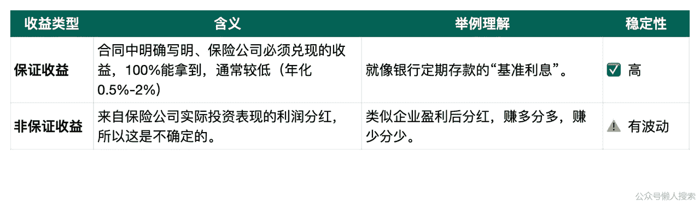

**可**以这样理解：保证收益是“下限”，让你知道最差也能拿多少；非保证收益是“上限”，让你有机会分享到更高的回报。

这里，我们就要重点关注一下“非保证收益”的构成了。

由于香港金融市场的特殊性，保险公司可以在合法合规的情况下，可以投资全球的金融市场，投资组合通常包括（仅为参考，以实际产品为准）：

+   固收类资产：债券，非标资产，银行存款等稳定收益类，主要是为了提供保证收益和产品流动性支持。

+   权益类资产：股票，基金，股权投资，房产等增长潜力类，主要提供高预期收益的支持

**当**投资有了收益后，保险公司会按照合同约定，把一部分利润分配给客户，这就是我们看到的“分红”或“收益”。也就是非保证收益的主要来源。

**但要注意，由于不同保险公司的产品结构、投资组合、**保障成本不同，具体的比例可能会有很大差异

所以可以理解为香港的保险公司他们能投资全球市场，美股、美债、欧洲、亚洲，哪里收益高就往哪儿投。

然后内地保险公司的钱，主要投在国内市场。国内的债券、股票、房地产，能给的回报就摆在那儿。这就是造成香港储蓄分红险和内地分红险收益差距的主要原因——投资标的不同。

### 2.必看指标 IRR——怎么看懂你能赚多少钱？

#### 2.1必看指标 IRR——看懂一份保单能带给你的预期收益

**很多人看到香港储蓄分红险的计划书，第一反应就是：“这里写的年回报 5**%、6% 是真实的吗？怎么计算的？”“是不是保险公司每年给我按这个结算利息？”.

并非如此，看完下面的讲解，就知道了。

你交保费后，不是简单的“交了就有钱”，而是“钱＋时间”两维度的共同作用，也就是“复利效应”所带来的收益。这在储蓄险中是关键：

+   时间越长：你承担的初期费用（例如承保费、费用加载、销售成本）被摊薄；

+   分红／红利如果在保单内继续滚存，不取出，那么“利滚利”效应加速，非保证收益部分可能更可观；

+   香港保险监管在演示文件中也要求展示不同情景（标准、悲观、乐观）下的回报走势。

举个例子：若两人在同一产品、交同样保费，但一个持有 10 年就终止了、一个持有 20 年，20 年那位因复利累积＋费用摊薄，现金价值与 IRR（内部收益率）通常显著高于 10 年。

所以“早买早开始”＋“长期持有”＝复利优势。

那么，保险公司是怎么计算收益率的呢？和保单计划书里说的 5%-6%是什么关系？为什么它们可以做到既帮客户赚到钱，自己也赚到钱的呢？

**保险公司计算复利收益，并不是简单的“单笔利滚利”，而是用一**种叫做 「内部收益率 IRR」 的方式。

**用大白话理解就是，你不用研究保险公司把你的钱拿去投了什么项目，也不用去算各种管理费、保障成本是多少，你只要看——**你总共投入了多少钱，最后能拿回多少钱，保险公司就是根据这两头的数字，算出了一个平均年化回报率，这个回报率，就是 IRR。

**它**帮你把“所有复杂的利息、红利、费用”都折算成一个直观的复利增长率。能告诉你——这份保单，平均每年到底“帮你的钱涨了多少”。

**它**代表的，是这份保单的真实复利增长水平。只是它不会写在合同里，而是通过每年的分红公告、账户价值表体现出来。但我们也是可以查到的。

IRR 就是我们要重点关注的指标，举个例子便于大家理解：

假设你买一份储蓄险：

每年交 1 万美元，连续交 5 年，保险公司每年帮你滚存收益，

30 年后你退保或取出，拿到比如 25.6 万美元（这就是我们算的“复利结果”）。

这期间有各种复杂的扣费、分红、复利滚存……保险公司不会让你一个个去算。他们只告诉你一个结果——

**这笔钱的平均年化收益率（IRR）大约是 5**-6%（但这是内部模型，不直接告诉你）。

这 5%-6%就是内部收益率 IRR

在对比不同产品的 IRR（内部收益率）时，一定要在同一口径下比较：

**必须保证是同一币种（USD / HKD）、同一缴费方式（趸交 / 期交）、同一持有期限（如 20 **年或 30 年）、同一领取方式（不领取或按计划领取），并且分红方式一致（如英式分红产品不要和美式分红产品放在一起对比）。

只有在这些条件一致的前提下，对比出来的 IRR 才具有参考意义。

另外要注意，长期 IRR 的参考价值远高于短期 IRR。

**我们可以看一下，下面的表就是不同持有期的 IRR 对比，越长期越有参考价值。切勿以为外界**说的港险预期收益 6.5%就是刚投进去的保费第一年就有这个收益，前期还没回本的。

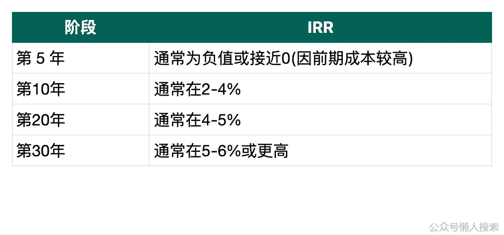

#### 2.2在哪里查询 IRR 的数值？

**香港保险公司不会在合同或官网上直接写 “IRR = 5%”，但是—**—保险公司必须提供计算 IRR 所需的所有数据，而这些数据在官方文件里都能查到。

+   **第一步：查找数据**

最直接的方法，是看「利益演示表（Benefit Illustration）」，可以通过下面两个途径查找数据。

方式一：在官网查找。

方式二：找保险代理人要产品 Illustration 文件（这是强制提供的，也最推荐，效率高又准确）

在航海中，我们也可以直接询问教练。

+   **第二步：找到表格中的关键数据**

文件里通常会列出一张类似这样的表

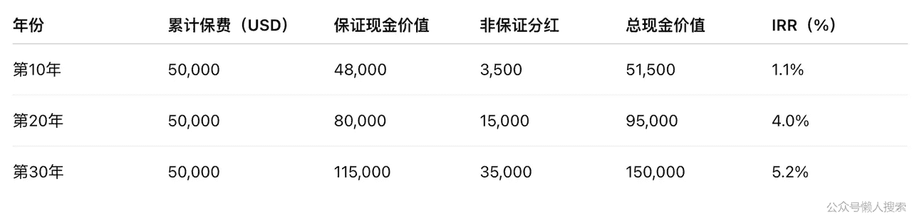

一般产品计划书会出现总的现金价值，具体的产品 IRR 可以让投保顾问给你做好对比表。

#### 2.3同样的钱，为什么早期看着亏、后期反而赚得多？

当我们考虑保险公司能给我多少钱时，是站在终局看的，但为什么早期看却是亏的呢？

是这样，当你交保费后，保险公司不会马上把这笔钱全算进你的账户，你的钱还在铺设阶段，并非立刻进入资金池，他需要先把钱分配到下面三部分里：

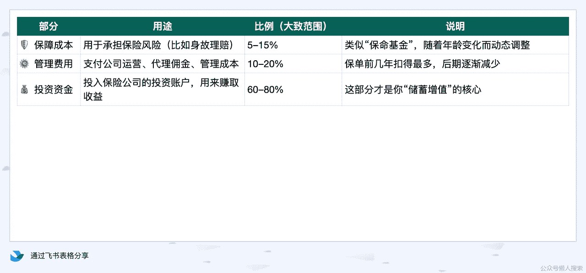

资金的整体使用流程，如图所示。

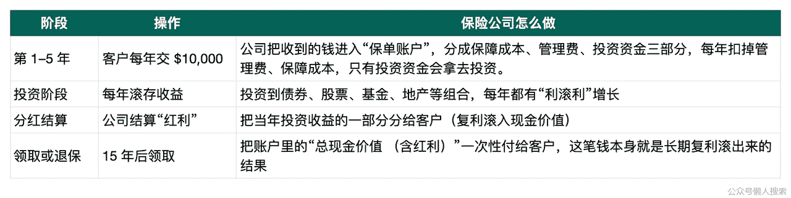

**所**以，如果你在前几年退保的话，是会亏损的，因为保险公司的成本是前置的（先收回成本：销售费、管理费、风险准备金），而收益是后置的（复利效应）。

比如：你每年交 10,000 美元，其中第一年的 2,000–3,000 美元要用来支付销售佣金、管理费、设立基金账户等。所以你账户上“现金价值”一开始可能只有 60%–70%。

**这时如果你提前退保，保险公司会把这些尚未摊销完的前期成本一次性**扣回，于是就出现了“退保有损失”的现象。

**一**旦前期费用摊销完毕，后面管理费用会越来越低，且后续的所有钱都会进入投资池，每年的收益还会利滚利（compound）。

**加**上香港储蓄分红险的分红部分会自动累积，使得现金价值曲线在第 10 年以后往往是加速上升的态势，收益越来越可观。

所以，储蓄分红险往往是长期持有收益更高，复利效应明显。

## 05. 这么多产品都说收益高，哪个更靠谱？

### 1.保险公司那么多怎么选？

+   **偿付能力比率**：这个数字越高，说明公司越安全，倒闭风险越低；可在保险公司年度报告或监管披露文件里查到

+   **信用评级**：国际上的评级机构会给保险公司打分，AA 属于高评级，A 属于良好评级；BBB以下，不建议碰。

+   **运营时间和历史业绩**：刚成立二三十年的和已经有一两百年历史的运营稳定性肯定也不一样；

+   **股东背景与资本结构**：可以知道是“谁在背后撑腰”，有人偏好成立久的公司，如成立180多年的；也有人偏好中资保险公司，如中国人寿、中国太平，但也有人对此有负面看法，觉得中资公司背后会有“看不见的大手”。

### 2.看历史分红实现率（Fulfilment Ratio）

上一节我们了解了内部收益率 IRR，知道了用它可以判断一个产品的真实预期年收益率，你可能在想这个收益能达到吗？有没有什么办法能判断它靠不靠谱呢？

**有，**那就是不仅关注「内部收益率 IRR」，再关注一下“历史分红实现率（Fulfilment Ratio）”，你可以理解为它是“保险公司过去所发布的所有产品，在非保证收益部分的分红兑现比例”，用一个例子来辅助理解：

**如**果一家公司的分红实现率稳定在 90% 以上，它的实际 分红往往接近计划书中的假设分红（例如：假设分红是100块，实际是90块）。

**如**果分红实现率常年低于 70%，那这家公司产品的实际 分红可能长期低于演示（例如：假设分红是100块，实际分红只有70块）。

**总结来说， IRR 告诉你“这份保单最终能帮你赚多少”，分红实现率告诉你“保险公司**以前说的能不能做到，别最后全是画饼”；两者一前一后，一个是收益度，一个是信任度。

**由于不同公司的分红政策、资产配置能力、投资风格不同，客户拿到的分红实现**率也会不同。这也是为什么选择保险公司时，我们要看它的“过往分红兑现情况”的原因。

比率接近 100%意味着保险公司过去基本实现了其预期的非保证利益，若履行比率高于 100%，则代表实际给你的钱高于销售时演示的数额，反过来如果低于 100%，则意味着并没达到销售时演示的数额。

那么，分红实现率达到多少可以考虑呢？我给大家准备了一个比例参考：

+   90%-100%以上：优秀，说明公司投资能力强且演示保守

+   80%-90%：合格，但需关注趋势变化

+   80%以下：需警惕，可能存在演示过于激进或投资表现不佳

所以这个分红实现率就能决定你的预期收益 6.5%，到底是不是画饼了，香港保监局规定，保险公司必须在官网公布过去 5 年的分红实现率。所以你买之前，一定要去查一查。

**但**是，仍然要注意，历史分红实现率可作为我们评估产品过往表现的参考依据，但绝非是预测未来分红宣告情况的唯一指标。

**我们在投保前，还是要综合考虑产品的适用性、**保费承担能力、关键特性及风险等重要因素。

### 3.在哪查历史分红实现率（Fulfilment Ratio）

**可在保险公司官网或保监局网站查询，也可以找投保顾问要整**理好的各家保险公司的分红实现率的汇总表。

+   第一步：点击下方链接，能看到各公司披露分红实现率的页面，点击你想查询的公司。

https://www.ia.org.hk/sc/fulfillment_ratio/list_of_insurer.html

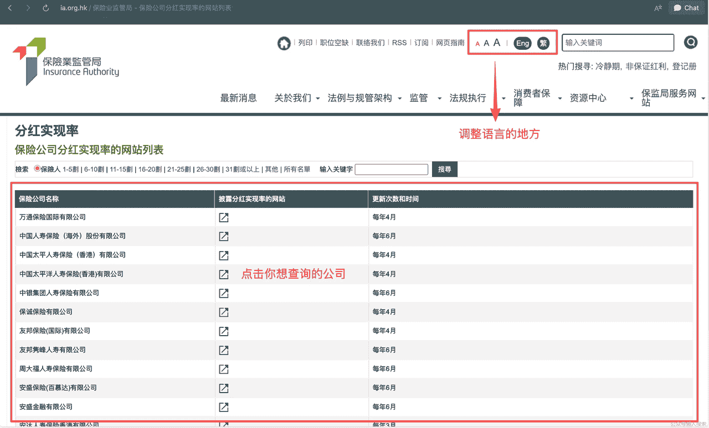

+   以“保诚保险”为例，我们点击链接后，可以在保诚保险的官网查看对应的产品的“历史分红实现率”。

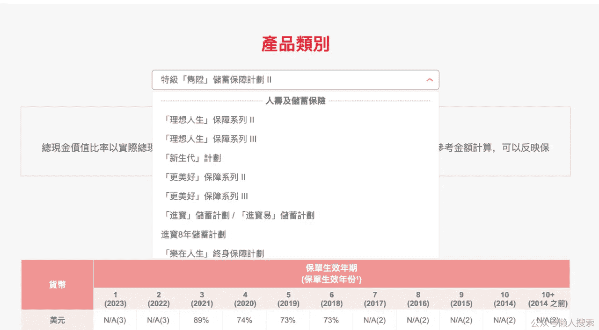

另外，可以关注一下“总现金价值比率”这个数值，它决定了最后我们拿到手的钱。

举例：第30个保单周年日，计划书演示的收益总额（保证收益+分红）为100万，我实际退保拿到了98万，那么总现金价值比率为98%。

### 3.本章小结：判断产品靠不靠谱的 3 个核心标准

一句话总结：靠谱的产品 = 优秀的保险公司（安全） + 兑现稳定（信任） + 收益合理（回报），看三点：

+   **信用评级：国际三大评级机构包括标普、穆迪、惠誉。**AA级以上，是稳健；A级，是安全；BBB以下，不建议碰。

+   **内部收益率 IRR：**收益度——平均每年到底“帮你的钱涨了多少”，重点看长期的 IRR 数值。

+   **历史分红实现率**：信任度——保险公司过去所说的预期收益能不能做到。

# 选修篇

# 一、如何设计你的储蓄分红险方案

## 01. 设计方案第一步：确定你的主要需求等重要信息

💡

**本章概要**

想要做一份适合自己的储蓄分红险方案，你只需要搞定这项，就可以明确你的需求、找专业的保险顾问出配置方案或自己先查找合适的产品（通常建议找专业顾问，或询问航海教练）、看懂产品计划书、确定最终方案

**本章航线图**

完成本章节的学习和操作，即可完成航线图的：

第四阶段：读懂计划书，避开常见坑（共 6 天）

+   明确个人核心需求，设定清晰的教育、养老或传承等目标（约 2 天）

+   读懂计划书关键信息（约 3 天）

+   敲定优化投保人、缴费年限、币种等配置细节（约 1 天）

为了帮你设计出最匹配你的储蓄分红险方案，我们先来回顾一下重点内容，确保你的时间和金钱不会浪费。

如果现在你的基础保障型保险还没配好（如：重疾险、医疗险、意外险），或是短期需要资金，请优先设计“保障类”保险方案，或是做好应急金规划。

如果你的基础保障已配好，未来 5 年能有至少 35 万人民币的可投资资金，即便未来 10 年不动用这笔钱，你的生活也不会有影响。且你希望这笔钱能慢慢增值，省心省力，不追求暴利。

那么，可以跟随教练一起设计你的“储蓄分红险方案”。

我们的目的永远是让自己的生活更舒适，开心，而不是刺激和富贵险中求。

如果想设计好一个最适合你的储蓄分红险方案，大概需要以下几个步骤：

+   确定你的主要需求

+   确定需求测算所需资金

+   确定交款方式：更倾向于一次性交还是期交？

+   产品选择：英式分红 vs 美式分红

+   提领方式：一次性取 VS 每年提领

接下来，我会详细的给大家拆解，每一条需要的区别、要点，大家跟着操作，就能了解自己适合的储蓄险分红方案了。

### 确定你的主要需求

+   **教育金**：配置孩子的教育金，必须提早准备，防止任何意外打乱孩子的教育计划；

+   **养老金**：为未来的自己提前储备养老金，养老金的储备是确定的；

+   **财富传承**：这笔钱未来能顺利、合法、清晰地传给下一代，且可以实现无限传承；

+   **强制储蓄：**并没有具体或者长远的目标单纯想存一笔钱

**因为这些需求不一样，所适合的产品方案完全不一样，**所以上来不问需求直接推产品的全是假顾问。

### 2.确定需求测算所需资金

#### 1.教育金需求测算

**案例：为 3 岁孩子准备大学及留学费用，目标金额 =** 当前价格 × （1 + 通胀率）^年数

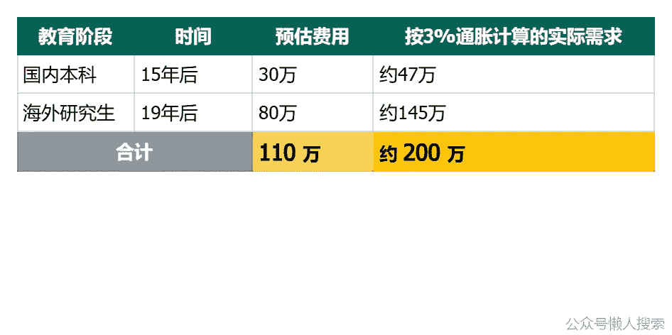

结论：孩子 18 岁开始用钱，你现在投保，15-19 年的积累期

提取方式：设定从第 15 年开始提取，每年提取 20-40 万，提 4-6 年

需要准备的不是 110 万，而是200 万！

#### 2.养老金需求测算

案例：40 岁开始准备，60 岁退休

**步骤 1：预估退休后的生活费**

+   当前月生活费：1.5 万

+   退休后维持：60-70%的生活水平 → 约 1 万/月

+   按 3%通胀，20 年后需要：约 1.8 万/月

**步骤 2：计算养老金缺口**

+   社保养老金：约 6000 元/月

+   企业年金：约 3000 元/月

+   合计：9000 元/月

+   缺口：9000 元/月，25 年约需 270 万

**步骤 3：确定储蓄险配置金额**

+   建议准备缺口的 50-70% → 135-190 万

+   其余通过其他资产配置（基金、股票）

#### 3.财富传承需求测算

案例：希望给孩子留下一笔确定的财富，且代代相传

**考虑因素：**

+   希望传承的金额：500 万

+   时间规划：预计 25 年后

+   提取方式：不提取，或者只在特殊情况下提取，让复利滚雪球

**分红储蓄险优势：**

+   确定性：有无限更改被保人和保单拆分，且受益人明确，定向传承没有纠纷

+   杠杆性：可以额外再加终身寿险把身故保险金放大

+   隔离性：避免债务和婚姻风险

### 3. 确定交款方式：更倾向于一次性交还是期交？

如果有一笔大额闲置资金 → 趸交/2 年期交。

如果希望分散压力 → 选 5 年期。

如果产品没有趸交，可以选择预缴，一次性把两年保费或者 5 年保费提前交给保险公司，保险公司会给出 4%-7%的确定的预缴利息。

另外和预缴一起出现的是保费折扣和保费回赠，意思是保险公司给到的优惠力度，比如一共交 100 万人民币，选择 5 年期产品，加上预缴利息和保费优惠可能最后你的总保费可以节约十几万，所以加上这些，保单收益会更加可观。

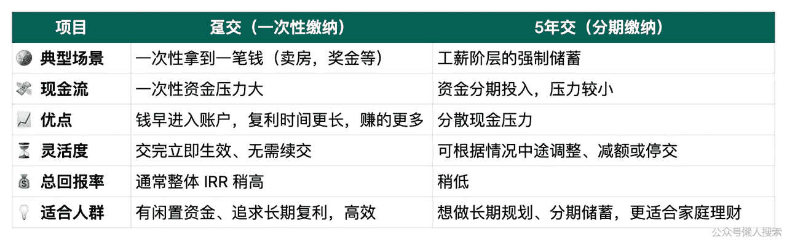

### 4产品选择：英式分红 VS 美式分红

香港储蓄分红险产品主要分两种：【美式分红】和【英式分红】。

**美式分红：稳定现金流**

红利直接发现金，落袋为安。可以理解为每年有真金白银入账，不用等十几年后才兑付。但终身收益相对较低，大概4.5%-5%。适合退休人士，或者需要定期现金流的人。

代表产品：产品A(咱们的手册不会出现具体产品名字)。

2年供款，3年回本。从第3年开始，每年自动派息总保费的5%。10年IRR 3.71%，20年IRR 4.98%。

英式分红：长期高收益（主流产品）

红利不发现金,继续放在保单里滚存。复利效应强，30年复利可以达到6.5%。但短期看不到现金分红，波动性相对大一些。适合年轻人,或者追求长期财富增值、传承规划的人。

代表产品：产品B。

20年复利6.12%，30年复利达6.5%。复归红利+终期红利双轮驱动。

怎么选？很简单：

需要定期现金流（养老）→ 美式分红

追求长期最大化收益（教育、传承）→ 英式分红

想兼顾两者 → 英式分红+定期提取功能

大部分人,我建议选英式分红。不仅仅是因为市场主流产品是英式分红产品，而且你买香港保险,本来就是为了长期收益。如果是为了拿现金分红，那只有退休躺平才适合，适合50岁以上人群配置。

### 5. 提领方式：一次性取 VS 每年提领

在最初购买产品的时候，我们很多人并不能立马决定这份保单未来是一次性退保，还是到了退休的时候每年提领，所以最好提前看好同一款产品一直持有到最后一次性退保和后续每年提领情况下的不同收益展示

举例，30 岁女生每年交 5 万美金累计 25 万美金，按照 分红实现率 100%的情况下，那 20 年后可以看到退保金含分红是 676783 美金，退保金分红=退保金保证+复归红利（分的是保额，一经派发就是确定的）+终期红利（身故或退保才派发），这个时候的 IRR 为 5.67%，按单利去算是 9.48%。

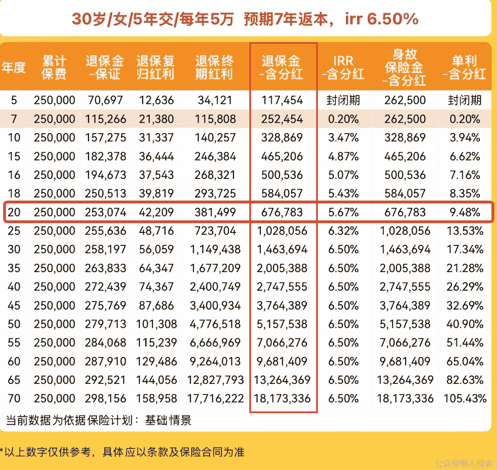

接下来我们可以看到同样的方案在提领情况下收益展示：

从 20 年后也就是 50 岁开始，每年提领总保费的 10%也就是 25000 美金，一直领 50 年也就是 100 岁，累计领了 127.5 万美金，还剩 886 万美金给下一代。

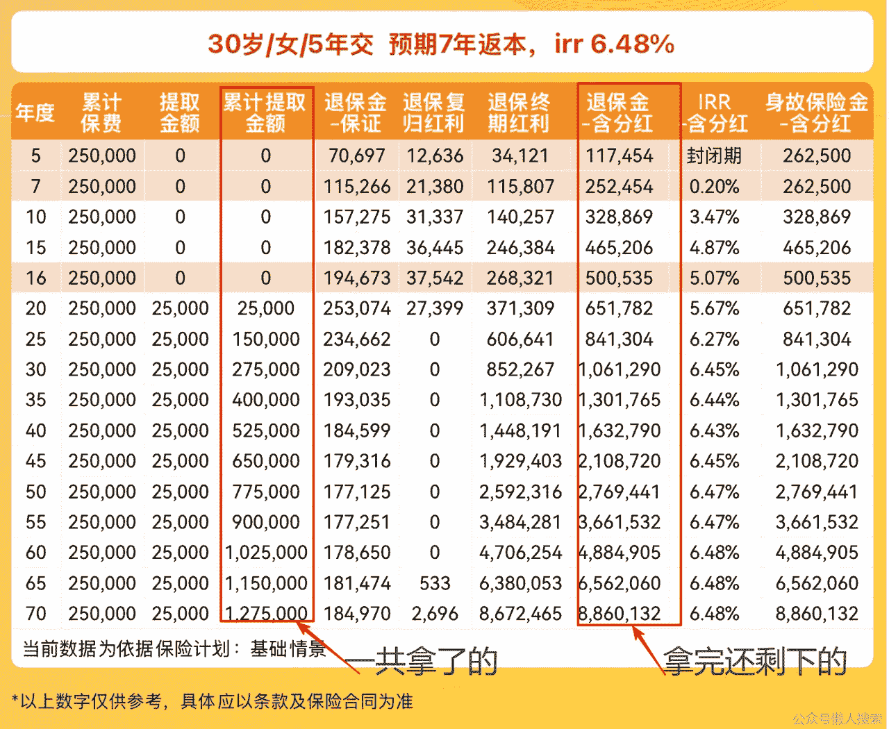

当然所谓的提领只是让我们在配置之前心里有个数，我们不一定按照我们最初计划的去提领，毕竟提领的演示需要基于分红实现率 100%才能实现。

**值得提醒的是，香港储蓄分红险一般建议持有时间超过 10 年再考虑**提领，买完马上提领对大部分产品收益伤害特别大，特别容易断单（提着提着就没钱了）。

## 02. 设计方案第二步：看懂计划书，不被销售牵着走

### 1.保单首页：

这页主要是投保的基本信息，主要是核对信息无误。

---

受保人姓名：也就是被保人，享受保障的人。

• 保单货币：美元，选哪种主要取决于你未来的资金使用场景和汇率偏好。

• 投保时的基本金额：主要用于计算保费和利益，与实际赔付金额无关。

• 保费供款年期：简单说，就是“交多久”的问题，比如交 5 年。

• 保障年期：显示保障时间，许多储蓄分红险的保障期是终身的。

PS：保费的零头是给保监局的征费，每个保单都有的。

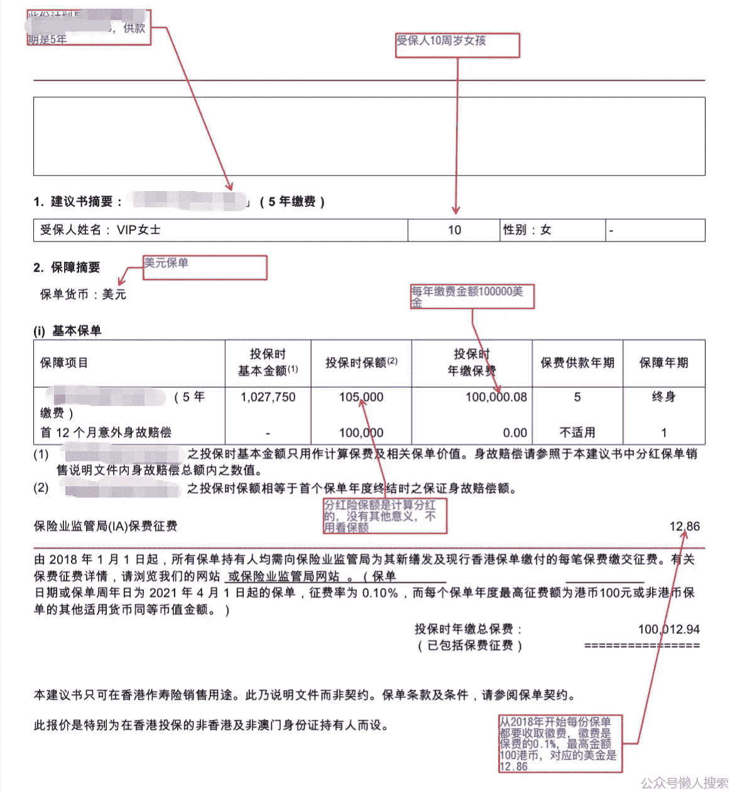

### 2.利益摘要：

**这**个表是保单最重要的结构，简易版本计划书其实都是根据这页计算得来，也是我们保单的[标准情况]，代表分红实现率100%达成的情况。

**第一部分，分别是保单年度终结以及缴付保费总额，说**人话就是保单年度末以及已缴纳保费的意思。

**第二部分，就是退保发还金额，这部分展示的是我们退保时退还的金额。里面包括保证的和非保证**的，首先是保证金额，是到了哪年，保单就价值多少钱，且这个是保证的一定会拿到手的。

**而非保**证金额就是香港储蓄保险的高收益来源，也就是分红。里面又包括复归红利和终期红利，当然也有产品没有复归红利的，且一般来说复归红利（分的是保额，一经派发就是确定的）的占比低于终期红利（身故或退保才派发）。所以这三部分加起来，就是我们看到的“总额”，也就是当年预期的总利益。

第三部分，就是身故赔偿金，香港储蓄分红险身故杠杆很低，也就 5%左右，比如第一年保费交了 10 万美金，不幸身故，身故金是 10.5 万美金

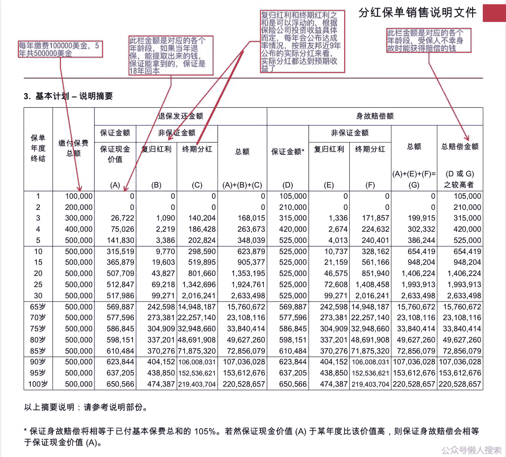

### 3.悲观、标准、乐观三种收益：

计划书会展示不同市场条件下的分红预期，分别对应：

**• 悲观：最低收益假设。**

• 标准：保守估计，保险公司需要对此负责。

• 乐观：理想市场条件下的最大化收益预测。

**我们重点关注我们上一节利益摘要的【标**准情况】就可以了，因为它最贴近实际情况。

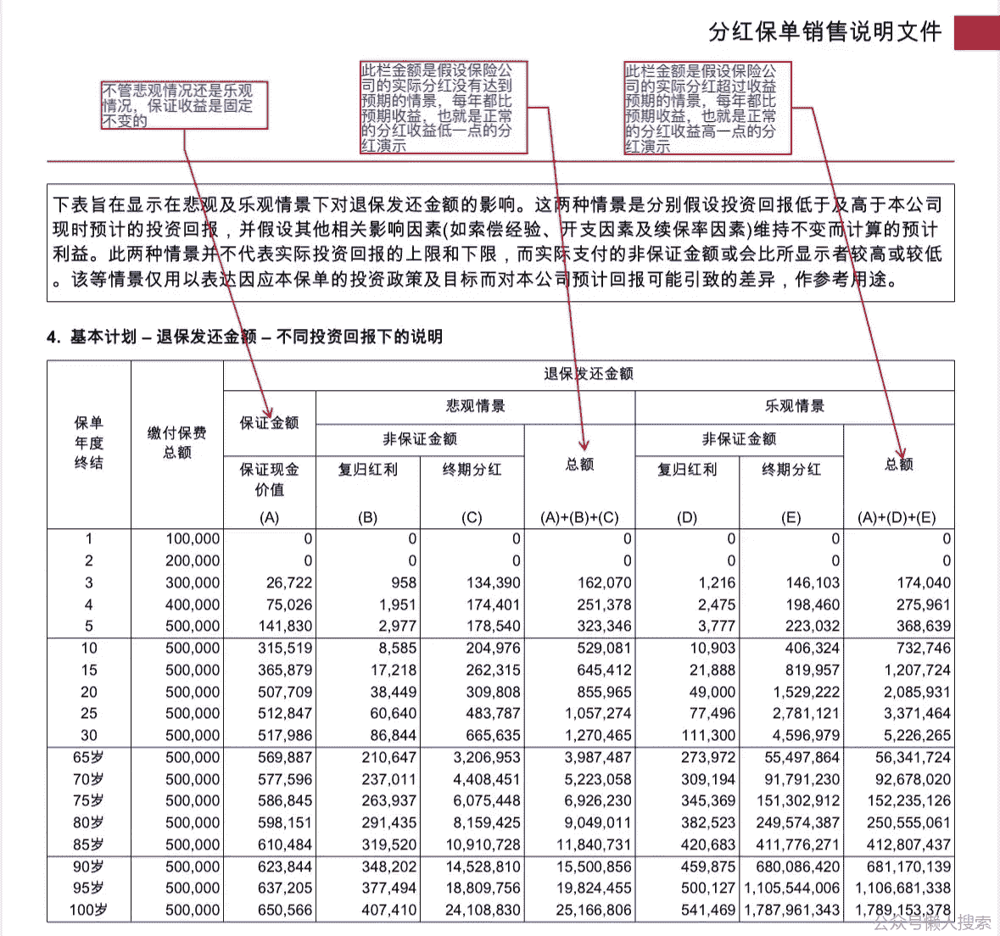

### 4.保单贷款：

保单流动性很差，因此也成为了资产固化的好工具，但是真遇到用钱的时候怎么办呢？这页展示的就是保单贷款，短期资金应急是可以周转的。

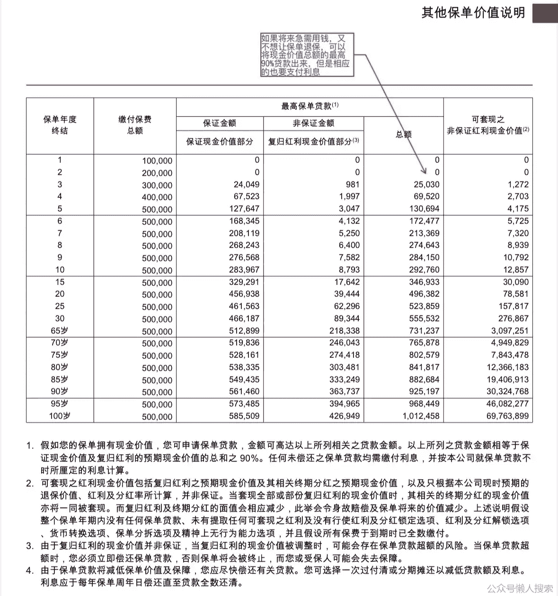

### 5.保单提领：

当保单封闭期后有资金需求的时候可以自由提领，市场上所展示的各种提领密码比如[557]其实是指 5 年期缴，第 5 年末就能每年提领总保费的 7%。这种交完保费就能领钱而且能领终身，直接戳中了很多人想"提前变现"的心趴。

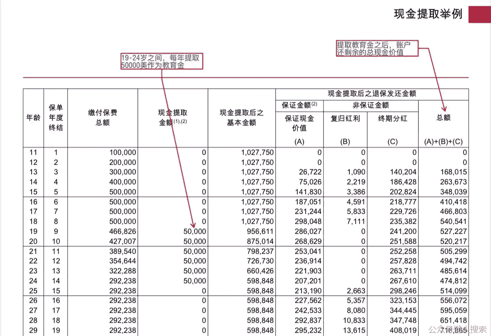

## 04. 设计方案第三步：优化配置细节

### 1.投保人、受保人、受益人的选择

这是方案设计的【灵魂】，安排对了，能最大化保单价值。安排错了，可能达不到你的目的。

**角色 1：投保人**

定义：出钱的人，拥有保单控制权。

权利：可以更改受益人，可以申请保单贷款，可以提取现金价值，可以退保

设计要点：谁来做投保人，取决于【谁掌控财富】。

一般来说：

如果是夫妻共同投保，谁的收入高，谁做投保人

如果是父母给孩子投保，父母做投保人

如果是为了债务隔离，企业主父母做投保人

特殊设计：

可以设【第二投保人】，第一投保人身故后，自动由第二投保人接管保单。

**角色 2：被保险人**

定义：生命是保单标的的人无法领钱，可以理解为"工具人“

特点：被保险人身故，保险公司赔付身故保险金。

设计要点：谁来做被保险人，取决于【保单期限】。

一般来说：如果是为了子女教育金，被保险人设为孩子，如果是为了养老金，被保险人设为自己

特殊设计：可以设【第二被保人】，这个设计，对于父母和孩子年纪差距大的或者财富传承的超级重要，有的产品可以投保时提前设立，避免被保人身故直接赔付身故金，合同结束，没办法增值复利。

**角色 3：受益人**

定义：领取身故保险金的人。

权利：被保险人身故后，受益人可以领取身故保险金。

设计要点：受益人的设计，要考虑【风险隔离】和【传承意图】。

一般来说：建议写指定受益人，避免变成遗产产生纠纷。

### 3.方案设计自查清单

还记得我们前面做的“一页纸决策单 1.0”吗，在原来的基础上，增加一些问题，确保考虑周全，我汇总了一份总的问题，共 10 个：

+   我的配置目标是什么？（教育/养老/传承）

+   需要准备多少钱？（考虑了通胀吗？)

+   这笔钱什么时候需要用？（确定持有期）

+   这笔钱是未来一次性退保还是想每年提领补充现金流（动态收益静态收益不同）

+   年缴金额会影响生活品质吗？（<年收入 30%）

+   我能坚持缴费到期吗？（收入稳定性）

+   选择的产品类型适合我吗？（保守/平衡/进取）

+   保证部分的占比我接受吗？（分红占比总收益很高）

+   持有人/受保人/受益人安排合理吗？（可以提前设立第二持有人和第二受保人）

+   币种选择符合未来消费场景吗？（货币转换功能）

+   我看过至少 3 款产品对比了吗？（确定产品是市场里最适配的，而不是一看就买）

如果以上 10 个问题都有明确答案，恭喜你，可以进入下一步——投保！

本章小结：好方案的四个标准

+   **目标明确**：知道为什么买，要解决什么问题

+   **金额合理**：不影响生活，不超过资产配置比例

+   **产品匹配**：特点符合需求，条款看得懂

+   **可持续性**：能坚持缴费，不会中途退保

提示：没有最好的产品，只有最适合的方案。

# 二、如何投保与管理

## 01. 投保前的准备工作

💡

**本章概要**

本章核心：投保流程、常见问题

**本章航线图**

完成本章节的学习和操作，即可完成航线图的：

第五阶段：搞懂投保流程，避免常见问题（共 1 天）

+   了解赴港投保的完整流程（约 0.5 天）

+   了解理赔和提取流程（约 0.5 天）

### 1.确认产品和方案

在出发前，你要先确认好：

买哪家公司的产品年交多少，交几年，预缴利息和保费优惠是多少

投保人、被保险人、受益人怎么安排，选哪个币种

### 2.预约保险公司

香港保险，必须提前几天预约，必须去香港签单才受保护，在内地没办法买香港保单，一般也只有投保才需要亲临香港。

**预约方式：通过你的保险顾问预约**

预约时间：一般是工作日，周一到周五

预约地点：一般是保险公司总部或分公司

### 3.准备证件

有效身份证（本人+被保险人）

港澳通行证（有效签注，一定要确认好，也可以到深圳前一晚去签注）

入境小白条（过关时获取，一定要保留）

**建议携带：**

户口本（部分保险公司要求）

结婚证（如果投保人和被保险人是夫妻）

孩子的出生证明（如果被保险人是孩子）

### 4.选择缴费方式

香港保险的首期保费，可以用以下方式支付：

VISA 信用卡刷卡（有限额，但是建议多张也可以都带过去）

香港银行账户转账（推荐，额度大，所以没有港卡的投保当天也要去办好港卡，有港卡开户指引可以发给大家）

现金（香港过关每个人可以带 5000 美元&2 万人民币）

### 5.免责声明

**本手册仅供参考学习，里面不涉及任何具**体产品不构成任何投资建议或保险销售邀约。

香港保险产品具有一定复杂性和风险性，配置前请务必：

1.充分了解产品条款和风险，但保险产品条款、监管规则可能发生变化，请以保险公司最新正式文件为准。

2.评估自身需求和承受能力，每个人的财务状况、风险偏好、投资目标各不相同，本手册内容不一定适用于所有人。

3.选择正规持牌顾问咨询，涉及法律、税务、财务规划的复杂问题，请务必咨询持牌专业顾问

### 6.致谢

感谢你花时间学习这本手册。

财富管理是一生的功课，没有人能一蹴而就。重要的是建立正确的认知，培养长期主义的思维，并付诸行动。

如果这本手册能够帮助你：

+   理解香港储蓄分红险的本质

+   建立系统的决策框架

+   做出理性的配置决策

+   为家人创造更确定的未来

那将是我们最大的欣慰。

最后

感谢生财团队，感谢各位老板的陪伴，

人这一生，

总是需要被一种善意的执念推着向前，

能够陪伴大家一起智慧理财，也是我所愿所喜，

祝你在创业发展路上，做大做强，做久做长，

祝你在财富管理路上，走得更稳，走得更远，

未来，多多交流呀，一起精进，

一起等风来，一起等花开。